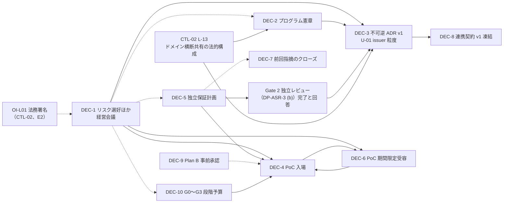

# 決裁事項詳細（DEC-1〜DEC-10）

> 文書ID: DCS-03 / 版: 0.4 / 状態: draft / 最終更新: 2026-10-15
> 対応要求: R-005, R-007, R-018, R-022, R-075, R-202, G-002, G-025, G-026, G-028, G-040, G-046, G-047（DEC-11（仮）の単位のみ）, G-054（主なもの）
> 依存文書: CONVENTIONS.md, traceability/deliverables.md（DL-39、§6.1）, traceability/seed/seed-03-redteam-decision.md（§3）, traceability/R-requirements.md, traceability/G-goal-criteria.md, traceability/traceability-matrix.md（§3.5）, 05_adr/README.md（§5、§6）, 05_adr/reconciliation-notes.md（§5、§6）, 05_adr/ADR-001・ADR-007・ADR-013・ADR-021・ADR-022, 02_requirements/tenant-lifecycle.md（K-8）, 01_governance/（GOV-01, GOV-02, GOV-03, GOV-05, GOV-06, GOV-07, GOV-08, GOV-09）, 06_controls/applicability.md（L-04, L-11, L-13, §1.4, §12）, 03_threat-model/attacker-model.md（§7 AM-1・AM-2）, 03_threat-model/threat-catalog.md（§8 TD-1〜TD-3）, 03_threat-model/fraud-abuse-controls.md（§14 決裁案 2・4〜6）, traceability/open-items.md（OI-L01）, 09_assurance/independent-assurance-plan.md（DP-ASR-3）, 08_operations/operating-model.md, 08_operations/tco-vendor-lts.md, 11_contracts/README.md, 12_poc/preregistered-test-plan.md, 00_decision/02-prior-findings-crosswalk.md（§2.1）, 00_decision/05-residual-risk-register.md（DP41-1）, 00_decision/06-gate-plan-and-plan-b.md（§0, §3, §5.2, §5.2.1, §5.3.1, §5.5, §9 DP42-7, §11 H-1・H-7・H2-5）, 00_decision/07-organization-and-tco.md（§3.1, §3.4, §6.2, §7, §8.1, §8.3）, 00_decision/00-cover.md（§2）, research/README.md
> 作成方法: AI エージェント（Claude）が上記の文書を通読し、DEC ごとの決裁案として起草した。本書の推奨・評価は自己レビューであり、実在の CTO・CISO・経営会議の決裁ではない（CONVENTIONS §8）。本書の時点で決議済みの DEC は 0 件である。
> 表の注記: 表のセルでタグのないものは、本書または依存文書の記述を要約した設計推論 [D] であり、この注記で個別のタグに代える。

## 要旨

- 本書は DEC-1〜DEC-10 の正式定義の場所である [D][^2]。各 DEC について、決裁内容、選択肢、推奨、帰結、可逆性、承認者、見直し日、決議文案、依存 ADR・文書を置く（§4）[D]。
- 10 件の内訳は、経営会議の決裁 1 件（DEC-1。統治規程 GOV-05〜GOV-08 と残余リスク台帳の採用、攻撃者モデル AM-1・テナント横断学習 TD-2・特権濫用の許容方針 R-012 の経営判断を含む）、CTO・CISO を中心とする決裁 7 件（DEC-2〜DEC-5、DEC-7〜DEC-9）、CFO＋CTO＋CISO による G0〜G3 の段階予算 1 件（DEC-10。予備費を除き G0〜G2 約 0.7〜5.7 億円、計 約 1.2〜8.6 億円の幅の中で上限を決める。G0〜G2 には DEC-3 の前提である Gate 2 の独立レビューの上限キャップ 0.8 億円を含む（§4.10）。付議基準額を超える場合は経営会議）、事業責任者の受容 1 件（DEC-6）である [D][^3][^123][^154]。不可逆の決定を含むのは DEC-3 と DEC-8（識別子の部分）だけであり、DEC-6 は期限付き、その他は可逆である [D]。
- 次回の決裁で求めるのは、DEC-1（統治規程を含む。対象法域は法務署名版の判定に限る）、DEC-2、DEC-5、DEC-7、DEC-9、DEC-10 と、DEC-4 の第 1 段（入場条件、予算の決め方、総額の上限（not-to-exceed）＝2.2 億円 ×（1＋予備費率））までである（§2.3、§4.4）[D][^125]。DEC-3・DEC-8 は Gate 2 の独立レビューの後に、DEC-4 の第 2 段（費目別の確定値と入場の最終承認）と DEC-6 は Gate 4 入場前の別会議に置く [D]。本番化、全社標準化、移行強制、対外的な安全性表明、製品の最終選定、20 年分の予算の 6 項目は求めない（§3）[D][^3][^4]。
- 本プログラムで最大の継続費用である定常要員（約 48〜66 FTE、年 約 4.8〜13.2 億円）の確約幅と A-054 の改訂、DEC-10 で先行採用した SRE の G3 判定後の人件費、G3〜本番設計審査の基盤要員費・契約管理費、構築期の上限の候補は、将来の決裁単位 DEC-11（仮）として G3 判定時に経営会議＋CFO が決める（§4.11）[D][^161][^165]。次回決裁では求めない [D]。
- DEC-3 の主議題は U-01（issuer の粒度）である [D][^5]。ADR-007 KD7-1 はテナント／realm 別、ADR-021 K21-1 と REQ-05 K-8 は信頼区画別（共通 issuer＋tid＋cell 別鍵）を推奨して対立しており、13 本の ADR の記述がこの結論に依存する [D][^5][^6]。本書は (b) 信頼区画別を暫定の推奨とするが、推奨は未確定の入力（A-013、NA-021-1、DEC-1 での封じ込めの扱い）に依存し、ADR-021 §4.5 の感度分析では逆転し得る（§4.3.3）[D][^7]。このため U-01 は入力の確定と Gate 2 の独立レビューの後に決めることを推奨する（§4.3.4）[D]。
- U-01 は不可逆区分の値なので preview に置けず、DEC-3 の決裁が DEC-8 の前提条件になる [D][^9]。DEC-3 の前に決めるべき前置論点が 3 件（ADR-018 K18-5、ADR-026 L26-2、CTL-02 L-13）、DEC-3 で同時に決める論点が U-01 を含めて 3 件、条件付きの論点が 1 件ある（§4.3.2）[D][^5]。ADR-013 の法域パーティションは、分割の原則と非共有だけを不可逆とし、英国をどこに置くかは法務確認（L-11）まで可逆の配置値とする（§4.3.1）[D][^121][^122]。
- 経営会議の DEC-1 が成立しない場合、DEC-2・DEC-4・DEC-5・DEC-7・DEC-9・DEC-10 は条件付きの決裁になり、DEC-3 と DEC-6（受容）は決裁しない（§2.2、§5.1）[D][^3]。版 0.2 の是正は模擬パネル（自己レビューであり、実在の CTO・CISO・CFO・法務・監査の決裁ではない）のラウンド 1 指摘、版 0.3 の是正はラウンド 2 指摘、版 0.4 の是正はラウンド 3 指摘による（レビュー記録）[D][^1]。CTO・CISO が単独で受容する残余リスクは 0 件とし、受容は事業責任者または経営に置く（§5.2）[D][^4][^18]。

---

## 1. 本書の位置付けと読み方

- 本書は成果物 DL-39 である [D][^2]。deliverables.md §6.1 の DEC 表は成果物割当のための暫定対応であり、DEC の正式な定義・文言・承認者は本書が持つ [D][^2]。本書と §6.1 が食い違う場合は本書を正とし、§6.1 の更新を残課題に載せる [D]。
- DEC-1〜DEC-7 は種資料 seed-03 §3 の D1〜D7 を、DEC-8 は再提案計画で追加した「連携契約 v1 の凍結」を、DEC-9 は seed-03 §3 末尾の「Plan B を最初に承認しておく」提案を読み替えたものである [D][^2][^3]。DEC-10 は、ゲート計画 DCS-06 §5.5・DP42-7 が提案した G0〜G3 の段階予算の決裁を、同書 §11 H-1 の申し送りにより本書で正本化したものである（版 0.3）[D][^123]。
- 各 DEC の値・選択肢の詳細は、依存文書の決裁案（GOV-02 決裁案 1〜3、ADR-021 K21-1〜K21-6、ADR-022 D-11 など）を正本とする [D]。本書はそれらを決裁の単位に束ね、決議文案を置く [D]。依存文書の推奨と本書の推奨が異なる場合は、その旨を明記する [D]。
- 決議文案の〔　〕は、決裁の場で埋める値または選ぶ選択肢である [D]。

### 1.1 各 DEC の記載項目

| 項目 | 内容 |
|---|---|
| 決裁内容 | 何を承認するか。承認しないものも併記する |
| 選択肢 | 現状維持・延期を含む 3 案以上 |
| 推奨 | 推奨案と理由。依存文書の推奨と異なる場合は差分 |
| 帰結 | 推奨案を採った場合と採らない場合に起きること |
| 可逆性 | 可逆／期限付き／不可逆。不可逆なら範囲 |
| 承認者 | 承認者、同意者、起案者 |
| 見直し日 | 見直しの時点（日付はゲート計画 DL-42 で確定する） |
| 決議文案 | 決議録にそのまま写せる文 |
| 依存 | 前提となる DEC、依存 ADR・文書、主な調査ストリーム |

---

## 2. 決裁の全体像

### 2.1 一覧

| DEC | 決裁内容 | 承認者 | 可逆性 | 関連ゲート | 前提条件 |
|---|---|---|---|---|---|
| DEC-1 | リスク選好・許容度、重大損失シナリオ、データ分類、対象法域。未完成部分の策定責任者と期限。統治規程（GOV-05 RACI・決裁権・CISO の報告経路、GOV-06 停止権限・代行順位・S6 凍結、GOV-07 段 1〜3・床・AT 類型・RV、GOV-08 KRI の層と報告周期）と残余リスク台帳の採用（DCS-05 DP41-1）。攻撃者モデル・脅威・不正対策の経営判断（AM-1、TD-2、R-012）と、G0 で決めない AM-2・TD-1・TD-3・不正対策決裁案 2・5・6 の決める場と期限 | 経営会議／取締役会（起案: CISO・CTO・事業責任者）。S6 と段 3、TD-2 の B は取締役会 | 可逆（年 1 回以上見直し） | G0 | 対象法域の部分だけ OI-L01（法務責任者が署名した CTL-02 版または確認意見書、E2）。欠ける場合は対象法域を未完成部分に回す |
| DEC-2 | プログラム憲章（目的、スコープ、パイロット候補、非目標）と 20 年耐久性憲章 | CTO＋CISO | 可逆 | G0〜G1 | DEC-1（条件付きで先行可）、CTL-02 L-13（NA-8 の確定を含む。期限 G0） |
| DEC-3 | 不可逆決定の ADR v1（ADR-001・007・013・021・022）と U-01 等の同時決裁論点 | CTO（アーキテクチャ審査会経由）＋CISO 同意。K21-2 は経営会議、K21-6 は法務 | 不可逆（範囲は §4.3） | G2 の後〜G3 | DEC-1（外部 RP での cell 封じ込めの扱いを含め確定済み）、DEC-2、DEC-5（DP-ASR-3 (b)）と Gate 2 独立レビューの完了・全所見への回答（E6）、G1 での A-013・A-114 の確定と NA-021-1 の標本調査、前置論点 3 件（CTL-02 L-13 を含む）、RR21-01 の受容票。法域パーティションへの法域の割当は L-04・L-11・G-054 の法務確認 |
| DEC-4 | Gate 4 PoC 入場。第 1 段: 入場条件、要員と稼働率、期間上限、事前登録仮説と合否・中止基準、合成データ限定、パイロット参加確約、予算上限の決め方と総額の上限（2.2 億円 ×（1＋予備費率））。第 2 段: 費目別の確定値への置換えと入場の最終承認 | CTO＋CISO＋CFO | 可逆 | 第 1 段: 次回決裁。第 2 段: G4 入場前 | DEC-1、DEC-5。第 2 段は DEC-6 と同時 |
| DEC-5 | 独立保証計画（評価者の独立性要件、任命・調達、Gate 2/4/5 の関与と立会い範囲） | CISO（独立性の確認は内部監査） | 可逆 | G0〜G5 | DEC-1 の統治規程部分（GOV-05・GOV-06。条件付きで同時可） |
| DEC-6 | PoC 期間限定の残余リスク受容 | パイロット事業の事業責任者 | 期限付き | G4 | DEC-1 の統治規程部分（GOV-07 の段・床・AT-7・RV）、DEC-4 の期間・データ区分 |
| DEC-7 | 前回指摘のうち検証済み項目のクローズと、繰延べ項目のゲート割当 | CTO＋CISO | 可逆（再オープン可） | 各ゲート | DL-38 の対照表 |
| DEC-8 | 連携契約 v1 の凍結（条件付き） | CTO＋CISO | 識別子は不可逆、他は版付きで可逆 | 第 1 段（rc 凍結と告知期間）: DEC-3 の後、G3 でのキット・sandbox 提供時。第 2 段（v1 凍結）: 最早で G4 での TC-119・TC-026 の実測報告の後（§4.8） | DEC-3（U-01）、ADR-022 D-11 の 5 条件 |
| DEC-9 | Plan B（中止・方針転換時の既定経路）の事前承認 | CTO＋CISO（経営へ報告） | 可逆 | 全ゲート | DL-44 の代替案比較 |
| DEC-10 | G0〜G3 の段階予算（G0〜G2 と G3 の予算上限・期間上限、費目別内訳、上限到達時の扱い） | CFO＋CTO＋CISO。上限の合計が経営会議の付議基準額を超える場合は経営会議 | 可逆（未使用分は G3 判定時に失効） | G0（判定は G0 合格基準 (7)）〜G3 | DEC-1（条件付きで先行可） |
| DEC-11（仮） | G3 の要員確約と G3〜本番設計審査の予算（定常要員の確約幅 48〜66 FTE と A-054 の改訂、先行採用 SRE の G3 判定後の人件費、G3〜本番設計審査（G4・G5 を含む）の基盤要員費と契約管理費、構築期の上限の候補）。次回決裁では求めない（§4.11） | 経営会議＋CFO（起案: CTO・人事責任者）。A-054 の改訂は CTO＋CFO＋人事責任者 | 可逆（常勤採用分は取り消せない継続費用） | G3 判定時 | DEC-10（先行採用の実績）、G3 判定、OPS-02 DP-OM-2・DP-OM-3、DEC-9 の PB-T2・PB-T8 |

### 2.2 前提関係

矢印は「前提を与える DEC → 前提を使う DEC」を表す [D]。点線は、前提が欠けても条件付きで決裁できる関係である [D]。

- DEC-1 → DEC-3 は実線である [D]。U-01 の (a)(b) の優劣は、外部 RP での cell 封じ込めの重みで逆転し得る（ADR-021 §4.5）[D][^7]。その重みはリスク選好・許容度（DEC-1）で決まるので、DEC-1 の「未完成部分の策定責任者と期限の承認」で先送りできる部分に、外部 RP での cell 封じ込めの扱いを含めない（§4.1 決議文案 6）[D]。
- DEC-1 → DEC-6 は実線である [D]。DEC-6 は GOV-07 の受容票の様式と AT-7 で受容するが、受容を承認できる者の権限階層は方針・手順に役割単位で定めなければならない（IR 8286B-upd1 §2.3: must）[N][^15]（RS-01#21）。権限階層（GOV-07 §3.1 の段）が未承認のまま受容すると、受容者の正当性が決議記録から示せない [D]。同じ理由で、DEC-3 の RR21-01 の受容票も DEC-1 の後に置く [D]。
- DEC-1 → DEC-4 は実線、DEC-1 → DEC-5 は点線である [D]。DEC-4 は GOV-06 の停止権限（PoC の中止）、DEC-5 の決議文案 5 は GOV-06 の本番移行停止（S1）を参照するため、統治規程の承認を前提にする [D][^17]。DEC-5 は同じ会議で DEC-1 と同時に決められるので点線にした [D]。
- DEC-5 → Gate 2 → DEC-3 は、独立保証計画の DP-ASR-3 (b)（DEC-3 対象の ADR 5 本を Gate 2 の独立レビューの範囲に含める）を採ったうえで、そのレビューの報告と全所見への回答（E6）を DEC-3 の前提にする関係である [D][^20]。
- DEC-4 の第 2 段（金額）と DEC-6 は、Gate 4 入場前の同じ会議で決める [D]。DEC-6 の受容票の有効期限は DEC-4 の期間上限で決まり、DEC-4 の入場は DEC-6 の受容を条件とするためである [D][^22]。
- OI-L01 → DEC-1 は点線である [D]。法務責任者が署名した CTL-02 版（または確認意見書、E2）がなければ、DEC-1 は対象法域を承認範囲から外し、未完成部分として策定責任者（法務責任者）と期限だけを承認する（DCS-06 §3.2 の入場条件 (2)）[D][^123][^136]。CTL-02 は、判定がすべて法務署名前の案であり、法的助言でも法務・経営の決定でもないと自ら述べている [D][^134]。
- L-13 → DEC-2・DEC-3 は実線である [D]。CTL-02 は、事業ドメインをまたぐ共通 ID・SSO・リスクシグナル・監査記録の共有の法的構成（単一法人か別法人か、委託／共同利用／同意／GDPR 第 26 条の共同管理者）を、DEC-2 の主体範囲と ADR-021 K21-2・K21-6 の前提とし、L-13 を DEC-2・DEC-3 の前置論点（期限 G0）としている [D][^134]。
- DEC-1 → DEC-10 は点線、DEC-10 → DEC-4 は実線である [D]。DEC-10 は DEC-1 が未了でも条件付きで決裁できる（DCS-06 §5.5 の前提欄）[D][^123]。DEC-10 は G3 判定までの予算を承認し、G4 PoC の予算は DEC-4 が扱うので、DEC-4 の第 2 段は DEC-10 の承認済みの上限を前提に積み上げる [D]。
- DEC-1 が未了の場合、DEC-2・DEC-4・DEC-5・DEC-7・DEC-9・DEC-10 は条件付き決裁とする [D][^3]。DEC-3・DEC-6 は DEC-1 が未了なら決裁しない（§5.1）[D]。条件付き決裁の規則は §5.1 に置く [D]。

### 2.3 次回決裁で求める範囲

| 区分 | DEC | 時点 | 理由 |
|---|---|---|---|
| 次回決裁で求める | DEC-1（統治規程、DP41-1、AM-1・TD-2・R-012 を含む）、DEC-2、DEC-5、DEC-7、DEC-9、DEC-10、DEC-4 第 1 段 | G0 | G0 の合格基準 (1)〜(7) を決議で満たせる組合せである [D][^123]。(1) の対象法域は法務署名版（OI-L01）がある場合に限る。(7) の段階予算は DEC-10 で満たす（§4.10）[D] |
| 次回決裁で求めない（G2 の後） | DEC-3、DEC-8 | DEC-3 は G1 の入力確定と G2 の独立レビュー完了の後。DEC-8 は第 1 段が DEC-3 と G3 のキット提供の後、第 2 段が G4 での TC-119・TC-026 の実測報告の後（§4.8） | 不可逆決定を、逆転し得る入力が未確定のまま、独立レビューを経ずに行わないため（§4.3.4）[D][^7][^20] |
| 次回決裁で求めない（G4 入場前） | DEC-4 第 2 段、DEC-6 | G4 入場前の会議 | 非要員費の確定値（HSM の見積り、K58-4 決定後の負荷環境ほか）が G4 入場前でないと得られないため（§4.4）。DEC-6 の期限は DEC-4 の期間で決まるため [D][^125] |
| 次回決裁で求めない（G3 判定時） | DEC-11（仮） | G3 判定と同じ会議（§4.11） | 定常要員の確約幅は OPS-02 DP-OM-2 の推奨で G3 に確約するとされ、A-054 の確定ゲートも G3 である [D][^161][^162]。G4 の工数実測（TC-130）の前に確約値を決めると、重複と漏れの補正ができない [D][^161] |

- 次回決裁で Gate 2 は判定しない [D]。G2 の合格基準は脅威ごとの統制と試験への追跡を求めるが、統制の試験欄の TH-TC 58 件のうち 47 件は TC に吸収された記録がなく、区分 C の R 147 行のうち 41 行は TC・RB・演習のいずれにも割り当てられていないためである [D][^123][^126]。
- G2 の承認者は CISO＋独立評価者であり、経営の決定権を持たない [D][^123]。また G1・G2 の判定は DEC として扱わない（DCS-06 §0 の 2）[D][^123]。このため、攻撃者モデルの設計範囲のうち経営が決めるとされた AM-1（期限 G2）・AM-2（全テナント波及のため RACI-08 以上）と、取締役会の判断を要し得る TD-2 は、G2 の判定に任せず DEC-1 で決めるか、DEC-1 決議文案 4 で決める場と期限を承認する（§4.1 の (9)(10)）[D][^131][^132]。G2 の合格基準に「AM-1・AM-2・TD-2 の経営決議（E1）が済んでいること」を加える改版は TR-10 で申し送る [D]。
- 本節が「次回決裁で求める DEC」の集合の唯一の正本である [D]。00-cover（DCS-00）§1〜§3、01-executive-summary（DCS-01）§0・§3・§9、06-gate-plan（DCS-06）§0 の 2・§2・§4.3・§5.3.1 CP-3・DP42-1 は、模擬パネルのラウンド 2 指摘（cto、Critical）への対応で本節に合わせた（DCS-00・DCS-01 版 0.2、DCS-06 版 0.3。TR-1〜TR-3 は反映済み）[D]。DCS-06 版 0.2 の申し送り H-2（DEC-3 の関連ゲートを「次回決裁で先行し、G3 で点検」に改める）は、本節と §4.3.4 に反するので採らず、DCS-06 版 0.3 で撤回された [D]。
- 文書間で本節の集合が再び食い違わないよう、00〜08 の各文書が示す集合と本節の集合の一致を機械で検査することを申し送った（TR-R2-3）[D]。

---

## 3. 今回求めない事項

次回の決裁では次の 6 項目を求めない [D][^3]。受入基準 G-025 は、本番承認を求める文が 0 件であり、6 項目がすべて記載されていることを合格条件にしている [D][^23]。

| # | 求めない事項 | 理由 | いつ・どの決裁で扱うか |
|---|---|---|---|
| 1 | 本番化（限定スコープを含む本番導入の承認） | レビューは、証拠が揃った時点で初めて限定スコープの本番導入を承認できるとしている [D][^4] | G5 の後、G6 の段階導入で cell ごとに決める [D][^3] |
| 2 | 全社標準化（新規開発・改修での使用義務、旧方式の新規利用禁止） | レビューは、退出基準を満たすまで不可逆な標準化を行わないとしている [D][^4]。停止権限規程の S6 で常設の凍結とし、その決議を DEC-1 決議文案 7 に置く [D][^17] | S6 の項目ごとの段階解除（経営会議、GOV-06 DP46-5）[D][^17] |
| 3 | 移行強制（既存システムの強制移行、旧経路の撤去） | 同上 [D][^4][^17] | S6 の段階解除。移行は任意参加のパイロットから始める [D][^17] |
| 4 | 対外的な安全性表明（顧客・規制当局・市場への安全性の主張） | 同上 [D][^4]。独立評価は 1 件も実施されていない [D][^20] | G5 の独立保証の後。表明の可否は法務を含めて別途決める [D][^17] |
| 5 | 製品の最終選定（IdP・認可エンジン・KMS/HSM の製品と契約） | 製品選定は Gate 3 の判断であり、PoC の実測（G4）と RFP を経る [D][^3]。連携契約は製品選定から独立させている（G-120）[D][^23] | G3〜G4（ADR-001・ADR-010 の再検討トリガー、ARC-14）[D] |
| 6 | 20 年分の予算 | 20 年耐久性憲章は計画期間全体の予算に署名しない [D][^25]。継続・置換は 3〜5 年ごとに再決裁する [A-101] | 各ゲートの予算上限（G0〜G3 は DEC-10、G4 は DEC-4、G3 判定後の要員確約と G3〜本番設計審査の予算は DEC-11（仮）、G3 判定時）と継続ゲート（経営）[D][^3][^123] |

- 6 のうち、本プログラムで最大の継続費用である定常要員（約 48〜66 FTE、年 約 4.8〜13.2 億円）は、G3 判定時の DEC-11（仮）（経営会議＋CFO）で確約幅を決める（§4.11）[D][^161]。次回決裁では承認しない [D]。DEC-10 で先行採用した SRE の G3 判定後の人件費、G3 から本番設計審査までの基盤要員費・契約管理費、構築期の上限の候補も同じ DEC-11（仮）で扱う [D][^164][^165]。本番設計審査以降の運用 TCO の年次予算は、DEC-11（仮）で確約した幅を前提に本番設計審査の前に承認する（DCS-00 §2 の「本番設計審査前に別途承認」はこの部分と読む）[D][^166]。

- DEC-8 の「凍結」は全社標準化ではない [D]。凍結するのは版付きの契約であり、採用は任意参加のパイロットに限る [D][^17]。この線引きを DEC-8 の決議文案に明記する（§4.8）[D]。
- DEC-3 の不可逆決定も全社標準化ではない [D]。DEC-3 は基盤が外部に出す識別子の形を固定するものであり、依存サービスに採用を義務づけるものではない [D][^17]。

---

## 4. 決裁事項

### 4.1 DEC-1 リスク選好・重大損失シナリオ・データ分類・対象法域・統治規程・脅威の経営判断

| 項目 | 内容 |
|---|---|
| 決裁内容 | (1) リスク選好・許容度ステートメント（GOV-02 決裁案 1〜3。テナント間漏えいゼロの運用定義 G-080 を含む）。(2) 重大損失シナリオの上位と順位（GOV-03 決裁案 A）。(3) データ分類（REQ-04）。(4) 対象法域と適用性の判定（CTL-02）。データ所在地の方針 L-04 を含む（L-04 の期限は G0）[D][^122]。承認するのは法務責任者が署名した CTL-02 版（または法務責任者の確認意見書。OI-L01、証拠 E2）の判定に限る。署名がない場合と判定保留の項目は、(6) の未完成部分として策定責任者（法務責任者）と期限だけを承認する（DCS-06 §3.2 の入場条件 (2)・合格基準 (1)）[D][^123][^134][^136]。(5) BIA（GOV-04）と前提台帳（GOV-01）を付議資料として受領すること。(6) 未完成部分（金額パラメータ MP-01〜MP-09、推定の校正など）の策定責任者と期限 [D][^19]。ただし外部 RP での cell 封じ込めを欠く状態の扱いは (6) に含めず、本決議で確定する（§2.2）[D]。(7) 統治規程: GOV-05（RACI、決裁権、受容権限の段 1〜3、CISO の取締役会への直接報告の経路。DP-1・DP-3・DP-4・DP-5・DP-7）、GOV-06（停止権限・代行順位、S6 不可逆標準化の凍結。DP46-1〜DP46-5・DP46-7・DP46-8）、GOV-07（段 1〜3、類型 AT-1〜AT-8 と床、受容票の検証規則 RV-1〜RV-14。DP05-1・DP05-2・DP05-4・DP05-5）、GOV-08（KRI の層と報告周期。決裁案 K-A〜K-D）[D][^17][^18][^22][^127]。(8) 残余リスク台帳の採用と段の付け方（DCS-05 DP41-1。期限 G0、決める人は経営会議）[D][^128]。(9) 攻撃者モデル・脅威・不正対策の経営判断: AM-1（署名鍵を窃取できる攻撃者、ATK-01 の能力段 L4 を設計対象にする範囲。決める人は経営会議（DEC-1 のリスク選好の一部）、期限 G2）、TD-2（複数テナントのデータを使う学習・共有モデル。推奨 A 禁止。B を選ぶ場合は選好の超過に当たり得るため段 3 の取締役会と法務の協議）、不正対策の決裁案 4（特権濫用の許容方針、R-012。決める人は経営会議（DEC-1）、期限 G0）[D][^131][^132][^133]。(10) G0 では選択しない脅威関連の決裁案（AM-2、TD-1、TD-3、不正対策の決裁案 2・5・6）について、決める場と期限 [D][^131][^132][^133] |
| 承認しないもの | 金額パラメータの値、許容度の時間値の確定（G4 で実測後に見直す）、予算（G0〜G3 は DEC-10）、段の境目の金額・停止時間（GOV-05 §4.2 の TBD）、KRI の閾値の値（GOV-08 決裁案 K-B）、法務署名のない対象法域の判定、(10) の決裁案の選択そのもの（決める場と期限だけを承認する）[D][^18][^19][^127] |
| 承認者 | 経営会議または取締役会。起案は CISO・CTO・事業責任者の共同 [D][^3]。各統治規程の決裁案の「決める人」は CEO（経営会議）または取締役会であり、取締役会の所管（GOV-05 DP-3・DP-7、GOV-07 DP05-4、GOV-08 K-C・K-D の周期）は取締役会で決議する [D][^18][^22][^127]。TD-2 で B を選ぶ場合も取締役会で決議する [D][^132]。S6 と段 3 は取締役会に報告する [D] |
| 依存 | 前提: OI-L01（CTL-02 の法務責任者署名または確認意見書、E2。期限 G0）[D][^136]。OI-L01 は (4) の対象法域だけの前提であり、欠ける場合は (4) を未完成部分に回して他の項目を決議する [D][^123]。依存文書: GOV-01〜GOV-08、REQ-04、CTL-02（法務署名版）、DL-41（DCS-05）、DL-45、03_threat-model/attacker-model.md §7、threat-catalog.md §8、fraud-abuse-controls.md §14。主な調査: RS-01、RS-02、RS-08、RS-10、RS-12〜RS-15 [D] |
| 対応 | R-005、R-007、R-012、R-022、G-011、G-030、G-080 [D][^24][^23][^133] |

- 統治規程を独立した DEC とせず DEC-1 に含めたのは、規程の決裁案の決める人がいずれも経営会議または取締役会であり、G0 の同じ会議で決まるためである [D][^123]。版 0.2 は「DEC の番号体系（CONVENTIONS §2 の DEC-1〜DEC-9）も変えずに済む」としていたが、版 0.3 で G0〜G3 の段階予算を DEC-10 として新設した（§4.10）[D]。DEC-10 の承認者（CFO＋CTO＋CISO）は統治規程の決める人と異なるので、統治規程は引き続き DEC-1 に置く [D]。CONVENTIONS §2 の DEC の範囲の改版は TR-17 で申し送る [D][^1]。
- G0 の合格基準は (2) GOV-05〜GOV-08 の承認と (6) S6 の決議を含む [D][^123]。本書の版 0.1 ではどの DEC の決議文案にもこれらがなく、全 DEC を承認しても G0 を通過できなかった [D]。決議文案 6〜9 で補った [D]。
- 版 0.2 では、攻撃者モデル・脅威・不正対策の文書が経営会議・取締役会の決定とした決裁案（AM-1・AM-2、TD-1〜TD-3、不正対策の決裁案 2・4〜6）が、どの DEC にもゲートの合格基準にも入っていなかった [D][^131][^132][^133]。G2 の承認者は CISO＋独立評価者で経営の決定権を持たず、G1・G2 の判定は DEC として扱わない（DCS-06 §0 の 2）ため、攻撃者モデルの設計範囲が経営承認を経ずに G2 を通過するか、どこでも決まらないおそれがあった [D][^123]。版 0.3 で (9)(10) と決議文案 4・10 に加えた [D]。(9) は決める人が経営会議・取締役会であり、G0 の同じ会議で決められるものである [D]。(10) は決める人や期限が G0 と異なる（AM-2 は CTO＋CISO の起案で受容は RACI-08 以上、TD-1 は事業責任者、TD-3 は G4 の実測後、不正対策の決裁案 2・5・6 は CISO・法務責任者・事業責任者）ので、決める場と期限だけを承認する [D][^18][^131][^132][^133]。
- AM-2 の期限は、攻撃者モデル §7 では G3（ADR-007 の決定前）、残余リスク台帳 RRG-009 では「G2（AM-2 の決裁と同時）」と食い違っている [D][^131][^128]。本書は G2 に揃える案をとる [D]。G2 は攻撃者モデルのゲートであり、ADR-007 の不可逆決定（DEC-3）は G2 の後に置く（§2.3）ので、G2 に揃えても「ADR-007 の決定前」という攻撃者モデルの条件を満たすためである [D]。攻撃者モデル §7 の改版は TR-11 で申し送る [D]。

**選択肢**

| 選択肢 | 内容 | 帰結 |
|---|---|---|
| (a) 一括承認 | 4 要素を完成品として承認する | 金額パラメータと推定の校正が TBD のまま承認することになり、許容度の値に根拠が残らない [D][^19]。法務署名がないまま対象法域を承認すると、CTL-02 自身が法的助言でないとする判定案を承認することになる [D][^134] |
| (b) 部分承認＋策定責任者と期限の承認（推奨） | 4 要素の構造・選好の水準・受容しない線を承認し、未完成部分は策定責任者と期限を承認する。対象法域は法務責任者が署名した CTL-02 版の判定に限って承認する | 下位の DEC が条件付きでなく進められる。未完成部分は期限で追跡される [D][^3]。法務署名版（OI-L01）がある場合は、その版の判定を承認し、判定保留の項目だけを策定責任者（法務責任者）と期限に回す。署名がない場合は、対象法域を承認範囲から外し、全体を策定責任者（法務責任者）と期限に回す。この場合 G0 の合格基準 (1) の対象法域部分は期限付きの未完成部分になり、承認条件 1 は法務署名が揃うまで未達のままである（DCS-06 §3.2・§7）[D][^123] |
| (c) 差し戻し | いずれも承認しない | DEC-4 以降は条件付きになる [D][^3]。G0 で決められない場合は共通基盤化をやめ個別サービスの改善に縮小する、という中止基準に当たり得る [D][^3] |

- 選好の水準は GOV-02 の 3 選択肢（A 保守、B 標準、C 積極）から選ぶ [D][^19]。GOV-02 は「B 標準を全社の既定とし、規制業種・高保証テナントの区画には A 保守の値を適用する」ことを推奨している [D][^19]。本書もこれを推奨する [D]。
- 上級経営層（取締役会を含む）がすべてのリスク種別について受容水準と資源配分を決める、と NIST IR 8286r1 §4.3 は述べている [N][^14]（RS-01#15）。本 DEC を経営会議に置くのはこれに基づく [D]。

**推奨**: (b) [D]。理由は、GOV-03 の推定枠が未校正の作業仮説であり、金額単価の決定と校正の後でなければ許容度の金額比較ができないためである [D][^19]。

**帰結**: (b) を採ると、受容しない線（GOV-02 §2.3 の U1〜U3）とテナント間漏えいゼロの運用定義が G0 で確定し、ADR・PoC の合否基準の上限になる [D][^19]。決議文案 6 の選択は U-01（DEC-3）の推奨を左右する（§4.3.3 の逆転条件 (2)）ので、(b) でも策定責任者と期限の承認に回さない [D][^7]。決議文案 10 を承認すると、攻撃者モデルの設計範囲（AM-1）、テナント横断学習（TD-2）、特権濫用の許容方針（R-012）が経営の決議（E1）で確定し、G2 の判定が経営の決めた範囲に対して行われる [D][^131][^132][^133]。決議文案 10 を G0 で決めない場合は、決議文案 4 に決める場と期限を記し、G2 の合格基準でその決議の有無を確認する（TR-10）[D]。決議文案 7〜9 を承認すると、G0 の合格基準 (2) と (6) が決議で満たされ、DEC-5 の決議文案 5、DEC-6 の受容票、DEC-3 の RR21-01 の受容票が承認済みの規程に基づくことになる [D][^123]。未完成部分の期限を過ぎた場合は、GOV-06 の停止権限に従って依存する DEC を条件付きに戻す [D][^17]。

**可逆性**: 可逆 [D]。リスク選好は年 1 回以上見直す（GOV-05 RACI-01）[D][^18]。

**見直し日**: 決議から 12 か月以内、または G4 の判定時のいずれか早い方 [D]。G4 で見直すのは、GOV-02 の推奨が PoC と演習の実測後に値を見直す条件付きの推奨だからである [D][^19]。

**決議文案**

> 経営会議（取締役会）は、認証・認可基盤再提案プログラムについて、次のとおり決議する。
> 1. リスク選好は〔B 標準を全社の既定とし、規制業種・高保証テナントの区画に A 保守の値を適用する〕案を採る。受容しないリスクは GOV-02 §2.3 のとおりとする。
> 2. テナント間漏えいの許容ゼロは、GOV-02 決裁案 3 の運用定義〔既知の未緩和経路 0 件、検知から封じ込めまでの上限時間〕で測る。
> 3. 重大損失シナリオ（GOV-03）、データ分類（REQ-04）を承認する。対象法域と適用性は、法務責任者が署名した CTL-02 版〔　〕の判定を承認する。署名がない場合、および判定保留の項目は、策定責任者（法務責任者）と期限を承認する。
> 4. 次の未完成部分について策定責任者と期限を定める。金額パラメータ MP-01〜MP-09（〔CFO＋事業責任者〕、期限〔　〕）、推定の校正と独立検証（〔CISO〕、期限〔　〕）、段の境目の金額・停止時間（〔CFO＋事業責任者＋CISO〕、期限〔　〕）、法務署名のない対象法域と判定保留の項目（〔法務責任者〕、期限〔　〕）。あわせて、次の脅威関連の決裁案について決める場と期限を定める。決議文案 10 で決めない AM-1・TD-2（〔経営会議。TD-2 で B を選ぶ場合は取締役会〕、期限〔G2〕）、AM-2 クラウド事業者側の侵害の扱い（起案〔CTO＋CISO〕、残余リスクの受容は〔経営会議（RACI-08 以上）〕、期限〔G2〕）、TD-1 フィッシング耐性認証の義務化範囲（〔事業責任者。A を満たさない場合は段 2 の経営会議の受容〕、期限〔G3〕）、TD-3 剥奪反映の許容窓（〔経営会議（段 2）〕、期限〔G4〕）、不正対策の決裁案 2 弱い認証方式の扱い（〔CISO＋事業責任者＋営業・顧客成功責任者〕、期限〔G1〕）、決裁案 5 顧客企業への通知方針（〔法務責任者＋事業責任者＋CISO〕、期限〔G0。期限の値は G4 の測定後〕）、決裁案 6 自動対応の権限（〔法務責任者＋事業責任者＋CISO〕、期限〔条項は G0、技術条件は G3〕）。
> 5. 本決議は年 1 回以上、および G4 の判定時に見直す。
> 6. 外部の RP・第三者 client が標準の検証だけを行う経路で、cell 単位の封じ込めを欠く状態（ADR-021 RR21-01 の型）は、〔許容度内として段〔2〕の受容票で受容し得る／選好の範囲外として受容しない〕。後者の場合、issuer の粒度（U-01）はテナント別を既定として DEC-3 に付議する。
> 7. 停止権限・凍結規程（GOV-06 版〔　〕）を承認する。不可逆標準化の凍結（S6 の F-a〜F-d）は本決議の時点で発効し、解除は経営会議が項目ごとに行う（DP46-5〔(a)〕）。代行順位と本番移行停止の例外の承認者は GOV-06 の決裁案〔のとおり／修正のうえ〕とする。
> 8. ガバナンス規程・RACI（GOV-05 版〔　〕）、例外・リスク受容手順（GOV-07 版〔　〕。段 1〜3、類型と床、受容票の検証規則 RV-1〜RV-14）及び KRI と報告（GOV-08 版〔　〕。層と報告周期）を承認する。CISO は受容者とならず、閾値を超えた場合は経営を経由せず取締役会〔又は委任委員会〕へ直接報告できる（GOV-05 §4.3、DP-1〔　〕）。段 3 の受容と S6 の例外は取締役会に報告する。
> 9. 残余リスク台帳（DCS-05 版〔　〕）を採用し、段の付け方は DP41-1〔(a)〕とする。内部監査の意見を添える。
> 10. 攻撃者モデル（03_threat-model/attacker-model.md 版〔　〕）のうち、署名鍵を窃取できる攻撃者（ATK-01 の能力段 L4）を設計対象にする範囲は〔AM-1 (b): 検知・封じ込め・復旧を対象とし、予防の保証水準は L3 までとする〕とし、窃取から検知までの間に偽造 token が受理される残余リスクは GOV-07 の段〔　〕の受容票で扱う。複数テナントのデータを使う学習・共有モデルは〔TD-2 A: 禁止する〕（B を選ぶ場合は取締役会の決議による）。特権濫用の許容方針（R-012）は〔不正対策の決裁案 4 A: 許容度ゼロ。常時の特権を持たせず、全特権操作に二者承認と記録を求め、例外は break-glass に限り毎回事後審査する〕とする。本項のうち本決議で決めない部分は、決議文案 4 のとおり決める場と期限を定める。

---

### 4.2 DEC-2 プログラム憲章と 20 年耐久性憲章

| 項目 | 内容 |
|---|---|
| 決裁内容 | (1) プログラム憲章（DL-40）: 目的、対象とする主体の範囲（顧客向け ID・社員 ID・workload ID のどこまでか）、事業ドメイン、パイロット候補と参加確約、非目標。(2) 20 年耐久性憲章（GOV-09）: 7 性質を耐久性の判定基準として採用すること、各性質の設計原則・証拠・継続指標、約束しないものの明示、サンセット条項 [D][^25] |
| 承認しないもの | 「この設計なら 20 年戦える」という予言、特定の製品・プロトコル・暗号の 20 年使用、将来の費用水準、計画期間全体の予算 [D][^25] |
| 承認者 | CTO＋CISO [D][^2]。計画期間と再決裁周期の確定は経営会議の所管である [A-100][A-101] |
| 依存 | 前提: DEC-1（条件付きで先行可）、CTL-02 L-13（事業ドメインをまたぐ共有の法的構成。NA-8（事業ドメインと運営法人の対応）の確定を含む。決める人は法務責任者＋事業責任者、期限 G0）[D][^134]。依存文書: DL-40、GOV-09、DL-44、CTL-02 §1.4・L-13。主な調査: RS-11、RS-15 [D] |
| 対応 | G-041、G-065 [D][^23] |

**選択肢**（主体の範囲）

| 選択肢 | 内容 | 帰結 |
|---|---|---|
| (a) 3 種の主体を設計範囲に入れ、パイロットは任意参加で絞る（推奨） | 顧客向け ID（B2B・B2C）、社員 ID、workload ID を設計の範囲に入れる。パイロットは参加確約が得られたサービスに限る | 識別子・鍵・信頼区画の設計（DEC-3）が 3 種を前提にでき、後から主体を足す際の識別子の付け替えを避けられる [D][^7]。ただし L-13 で選択肢 B（全委託・横断共有なし）になった場合は、ドメイン横断の SSO とリスクシグナル共有を範囲から外す [D][^134]。CTL-02 は、構成が決まるまでドメイン間の共有を法人単位・データ種別単位で有効・無効を切り替えられる設定値として持つとしている [D][^134] |
| (b) 顧客向け ID と workload ID に限る | 社員 ID は既存の社内 IdP を継続する | 範囲は小さいが、従業員を別区画にするかの判断（K21-1）を先送りできない [D][^7] |
| (c) 顧客向け ID に限る | workload ID と社員 ID を範囲外にする | 約 300 サービス間の委任・token exchange（ADR-009）が範囲外になり、PEP の網羅（ADR-012）を共通の主体モデルで扱えない [D][A-050] |

**推奨**: (a) [D]。(a) は CTL-02 L-13 の結論を条件とする [D][^134]。L-13 が別法人を含む構成で選択肢 A（共通 ID・SSO・リスクシグナルは共同利用、EU 利用者には共同管理者の取決め）または C（同意）になる場合は (a) のまま進め、B になる場合はドメイン横断の SSO とリスクシグナル共有を除いた (a) とする [D][^134]。ただし範囲と非目標の正本は DL-40 であり、DL-40 の推奨が本書と異なる場合は DL-40 を正とする [D]。前提台帳は B2B・B2C・従業員の混在を基準シナリオに置いている [D][A-115]。

**帰結**: 範囲を確定すると、DEC-3 の信頼区画の数（K21-1）と SPIFFE trust domain の数（P09-1）の前提が決まる [D][^7]。パイロットの参加確約は DEC-4 の入場条件になる [D][^2]。

**可逆性**: 可逆 [D]。範囲の縮小は DEC-9 の Plan B と同じ手続で扱う [D]。

**見直し日**: 決議から 12 か月以内、または G3 の判定時のいずれか早い方 [D]。耐久性憲章の指標は GOV-09 の定める頻度で取り直す [D][^25]。

**決議文案**

> CTO 及び CISO は、次のとおり決裁する。
> 1. プログラム憲章（DL-40 版〔　〕）を承認する。対象とする主体の範囲は〔顧客向け ID、社員 ID、workload ID〕とし、パイロット候補は〔　〕とする。非目標は DL-40 の記載のとおりとする。事業ドメインをまたぐ共有（共通 ID、SSO、リスクシグナル、監査記録）の範囲は、CTL-02 L-13 の決定〔単一法人／A 共同利用と共同管理者の取決め／B 全委託・横断共有なし／C 同意〕に従う。
> 2. 20 年耐久性憲章（GOV-09 版〔　〕）の 7 性質を、本プログラムの耐久性の判定基準として採用する。特定の製品・プロトコル・暗号を 20 年使用すること、将来の費用水準、計画期間全体の予算には署名しない。
> 3. 計画期間と再決裁周期の確定を経営会議に付議する。

---

### 4.3 DEC-3 不可逆決定の ADR v1

#### 4.3.1 決裁の範囲

| 項目 | 内容 |
|---|---|
| 決裁内容 | 05_adr/README.md §5.1 の 5 本の ADR について、不可逆とする決定を承認する。ADR-001（自作しない原則、外部識別子と endpoint の固定、主体台帳の正本、信頼する issuer）、ADR-007（3 層の鍵階層、(iss, typ, kid) → 許可鍵集合、信頼アンカーとマニフェスト、kid 命名、鍵台帳スキーマ）、ADR-013（分割キー、法域パーティションで分割するという原則とパーティション間の非共有、cell 間の非共有、global 部品の許可リスト、cell 識別子の非露出、fail-open の禁止）、ADR-021（issuer URL、識別子の不透明契約、RP ID、SAML entityID/ACS、pairwise、名前空間、claim 名）、ADR-022（識別子と GA で凍結した claim の意味）[D][^5] |
| 同時に決める論点 | §4.3.2 の議題 [D][^5] |
| 承認しないもの | 製品の選択、KMS/HSM の backend、cell の数と寸法、alg、鍵年齢などの数値、契約の凍結そのもの（DEC-8）、各法域パーティションにどの法域を入れるか（英国の置き場所を含む）[D][^5][^122] |
| 承認者 | CTO（アーキテクチャ審査会経由）＋CISO 同意 [D][^2]。K21-2（ドメインの構成）は経営会議、K21-6（`<id-domain>` の名称と保有法人）は法務を含む [D][^7] |
| 依存 | 前提: DEC-1（決議文案 6 を含めて確定済み）、DEC-2、DEC-5（DP-ASR-3 (b)）と Gate 2 の独立レビューの報告・全所見への回答（E6）、G1 での A-013・A-114 の確定と NA-021-1 の標本調査（§4.3.3）、前置論点 3 件（§4.3.2。CTL-02 L-13 を含む）、RR21-01 の受容票（推奨案を採る場合。DEC-1 で承認した GOV-07 の段による）。法域パーティションへの法域の割当は L-04（方針）・L-11 と G-054 の法務確認による。依存文書: 05_adr/README.md §5、reconciliation-notes §5、REQ-05 K-8、ADR-013 D13-01・D13-02、CTL-02 L-04・L-11・L-13・§1.4。主な調査: RS-14 を除く 16 ストリーム [D] |
| 対応 | G-054（パーティション割当の部分）、G-067、G-074 [D][^23] |

**法域パーティションの不可逆範囲（ADR-013 D13-02）**

- ADR-013 D13-02 は第 1 段を「日本／EU・英国／米国」の法域パーティションとし、データ・鍵・運用アクセスを共有しない硬い境界にして、不可逆と記している [D][^121]。英国を EU 側に置くのは前提台帳 A-063 の仮置きである [D][^121][^129]。
- 一方、適用性判定（CTL-02）は英国利用者の EU リージョン収容（L-11）を「英国から EU への移転規律の原典確認を済ませてから決める。確認するまでは判定保留」とし、期限を G3 にしている [D][^122]。データ所在地の方針 L-04 の期限は G0（方針）と G3（ADR-013）、G-054 の判定者は法務である [D][^23][^122]。
- このため DEC-3 で不可逆とするのは「法域パーティションで分割するという原則と、パーティション間でデータ・鍵・運用アクセスを共有しないこと」に限る [D]。各パーティションにどの法域を入れるかは、D13-01 の明示の配置表と同じく、可逆な配置の値として扱う [D][^121]。英国の置き場所は L-11 と G-054 の法務確認の後に配置表で決め、変更はテナントの cell 間移動（ADR-028）の手順で行う [D]。値の変更は費用を伴うが、外部識別子を変えない（D13-01 はテナント ID を cell 名・issuer URL・鍵 ID に埋め込まない。ADR-021 は cell・リージョンごとに issuer を分けない）ので不可逆ではない [D][^121][^7]。
- ADR-013 D13-02 にも同じ注記が要る（他文書への申し送り TR-6）[D]。

#### 4.3.2 議題（05_adr/README.md の未決論点の整理）

05_adr/README.md は未決論点を重複除去後 166 件と数えている [D][^5]。このうち DEC-3 の議題に載せるのは、不可逆区分の値に関わる次の 6 件と、CTL-02 から前置論点として申し送られた L-13（0-3）である [D][^5][^134]。残りは各 ADR の決裁案（G3〜G4、CTO＋CISO 等）または U-02〜U-04 の決める場で扱う [D][^5]。

| 順 | 議題 | 起票元 | 区分 | 決める場 | 本書の扱い |
|---|---|---|---|---|---|
| 0-1 | 可搬秘密（pairwise の秘密、pepper）の扱い | ADR-018 K18-5（L18-1） | 前置 | DEC-3 の前に CTO＋CISO | ADR-021 D21-14e の持ち出し要件と ADR-007 D7-06 の非エクスポート既定を調停する。ADR-018 は (a) 可搬秘密の用途族と二者統制の持ち出し手順を推奨する [D][^5] |
| 0-2 | 内部開始取引の `txn` の意味 | ADR-026 L26-2 | 前置 | DEC-3 の前に CTO＋CISO | 相関 ID 欄の意味は ADR-022 で不可逆とされるため、ADR-021・ADR-022 に読み方を明記するか、内部開始を別欄にするかを先に決める [D][^5] |
| 0-3 | 事業ドメインをまたぐ共有の法的構成と、K21-6 の保有法人の整合 | CTL-02 L-13（NA-8）、§12 の申し送り | 前置 | DEC-3 の前に法務責任者＋事業責任者（DPO と協議。期限 G0） | L-13 の結論（単一法人、または別法人を含む場合の A 共同利用（個人情報保護法第 27 条第 5 項第 3 号）と GDPR 第 26 条の共同管理者の取決め／B 全委託／C 同意）を、K21-2（ドメインの構成）と K21-6（`<id-domain>` の名称と保有法人）の前提にする。K21-6 の保有法人を、共同利用の管理責任者・基盤運営法人とそろえるかを決める [D][^134] |
| 1 | **U-01 issuer の粒度** | reconciliation-notes U-01（ADR-007 KD7-1、ADR-021 K21-1、REQ-05 K-8） | 同時決裁 | DEC-3 | §4.3.3 で 1 つの論点として示す [D][^6] |
| 2 | SPIFFE trust domain の数 | ADR-009 P09-1 | 同時決裁 | DEC-3 | ADR-009 は法域パーティションごと（本番 3＋非本番 1）、ADR-021 D21-28 は本番 1・非本番 1 で対立する [D][^5]。U-01 と同じく「区画をどの単位で切るか」の論点なので、U-01 の直後に決める [D] |
| 3 | ADR-021 K21-2〜K21-6 | ADR-021 | 同時決裁 | DEC-3（K21-2 は経営会議、K21-6 は法務） | ドメイン構成、専用 issuer 枠の上限、pairwise の既定、名前空間台帳の所有者、`<id-domain>` の名称と保有法人 [D][^7]。K21-2・K21-6 は 0-3（L-13）の結論を前提にする [D][^134] |
| 4 | 層 F 専用の信頼区画 issuer | ADR-020 P-1 | 条件付き | DEC-3（U-01 と同時） | ADR-001 T-02（FAPI 足切り不合格）が起きた場合だけ議題にする。ADR-020 の推奨は (a) で、区画を追加しない [D][^5] |

- 0-1〜0-3 が DEC-3 の前に決まらない場合、DEC-3 は該当する識別子（0-1 は pairwise の値、0-2 は相関 ID 欄、0-3 は K21-2 のドメイン構成と K21-6 の `<id-domain>`）を除いて決裁し、除いた部分は次の DEC-3 の追補で決める [D]。除いた部分は DEC-8 の凍結対象から外す [D][^9]。
- ADR-022 の KD 系のうち、凍結そのもの（D-11）は DEC-3 でなく DEC-8 で決める [D][^9]。
- 05_adr/README.md §5.3 が挙げる「DEC-3 対象外だが戻しにくい要素」（ADR-002〜ADR-029 のうち 21 本）は、DEC-3 では承認せず、各 ADR の決裁と DEC-8 の凍結範囲で扱う [D][^5]。

#### 4.3.3 U-01 issuer の粒度

**論点**: 外部の RP・client と依存サービスが信頼する issuer を、どの単位で分けるか [D][^6]。issuer URL は利用者の安定識別子 (iss, sub) の片方であり、決めた後で変えると利用者参照の付け替えが要る [D]。OIDC Core は、利用者を一意かつ安定に識別できるのは iss と sub の組だけであるとしている [N][^11]（RS-14#1）。

**3 文書の推奨の対立**

| 文書 | 推奨 | 主な理由 |
|---|---|---|
| ADR-007 KD7-1 | テナント／realm 別の不変 issuer | 外部 RP でも、RFC 8725 §3.8 の鍵と issuer の結合と OIDC の iss 一致という標準の検証だけで cell 単位の封じ込めが効く [D][^8] |
| ADR-021 K21-1 | 信頼区画 issuer＋cell 別鍵＋専用 issuer 枠 | 第三者 client 約 800 件の実装が区画ごとに 1 issuer で済む。cell 封じ込めは第一者の検証点（SDK・edge）が tid→cell 対応表で補う [D][^7][A-013] |
| REQ-05 K-8 | 共通 issuer＋tid＋cell 別の署名鍵と鍵スコープの結合 | テナント別 issuer では、統合・分割で利用者の (iss, sub) が変わり、依存サービスが保持する利用者参照の付け替えが要る [D][^10] |

**選択肢**

| 選択肢 | 内容 | 帰結 |
|---|---|---|
| (a) テナント／realm 別 | テナント（B2C は realm）ごとに不変の issuer を置く | 外部 RP も標準の検証だけで cell 封じ込めを得る [D][^6]。issuer metadata が約 1 万件になり、複数 issuer を扱う外部 client に mix-up 対策（RFC 9207 の iss 検査と issuer ごとの状態保持）が要る [N][^13][D]。テナントの統合・分割で (iss, sub) が変わる [D][^10] |
| (b) 信頼区画別＋cell 別鍵＋専用 issuer 枠（推奨） | 信頼区画ごとに 1 issuer。鍵は cell 別。規制・契約上の必要があるテナントには専用 issuer 枠（上限は K21-3）を割り当てる | 外部 client は区画ごとに 1 issuer で済む [D][^7]。外部 RP に対する cell 封じ込めは失われ、残余リスク RR21-01 になる [D][^7]。統合・分割で issuer は変わらない [D][^10] |
| (c) cell・リージョン別 | cell またはリージョンごとに issuer を置く | cell 識別子を外部識別子に出さないという ADR-013 の不可逆決定 (5) と衝突する [D][^5]。cell 間移動（ADR-028）で issuer が変わる [D] |
| (d) 単一の global issuer | 全域で 1 issuer | 法域パーティションを越えて鍵と信頼を共有しないという ADR-013 の不可逆決定 (2) と衝突する [D][^5] |

- (c) と (d) は ADR-013 の不可逆決定と両立しないので、実質の選択は (a) と (b) である [D]。
- RFC 8725 §3.8 は、JWT が iss を含む場合に使われた鍵が当該 issuer に属することの検証を MUST とし、結合の手段は application-specific としている [N][^12]（RS-05#36）。(b) では区画 issuer の JWKS に全 cell の鍵が載るので、§3.8 の検証は区画単位でしか cell を区別しない [D][^7]。cell を区別するには、tid の収容 cell と kid の cell の一致を追加で検証する（ADR-021 D21-07）[D][^7]。

**推奨が依存する入力と感度（ADR-021 §4.5 の転記）**

推奨 (b) は、まだ確定していない入力に依存している [D]。

| 入力 | 現在の値 | 状態 | 確定の場 |
|---|---|---|---|
| A-013 第三者・顧客自作の client 数と有効 grant 数 | client 800・grant 3 万（範囲 client 300〜3,000、grant 1 万〜10 万） | 仮置き [A-013] | G1（所有者: プロダクト責任者＋CISO）[D][^129] |
| A-114 顧客側 federation 設定の現状 | SAML 1,800・OIDC 200 接続 | 仮置き [A-114] | G1（所有者: 営業・顧客成功責任者＋プロダクト責任者）[D][^129] |
| NA-021-1 複数 issuer の動的な発見と検証を実装できる外部 RP・第三者 client の比率 | 基準 30%、範囲 10〜60% | 未測定。前提台帳に未登録 | ADR-021 は G1〜G3 に確定を置く [D][^7] |
| 外部 RP での cell 封じ込めの重み | ADR-021 §4.5 の ops の重みで E4 封じ込め 25 | リスク選好で決まる（DEC-1 決議文案 6） | G0 [D] |

ADR-021 §4.5 は、案の自己採点（参考）の感度分析として次の値を示している [D][^7]。

| 条件 | 区画案（推奨 (b)） | テナント別（(a)） | 順位 |
|---|---|---|---|
| 基準（ops の重み: E1 移行費 30、E2 運用 20、E3 習得容易性 15、E4 封じ込め 25、E5 規制適合 10） | 4.20 | 3.05 | (b) が上位 |
| (1) E4 封じ込めを 45、E1 移行費を 10 に変更 | 3.80 | 3.65 | (b) が上位（差 0.15） |
| (2) (1) に加え、NA-021-1 が 60% 以上でテナント別の E3 が 2 から 4 に上がる | 3.80 | 3.95 | **(a) が逆転** |

- 逆転条件は、ADR-021 §3.5 の案 D の「勝つ条件」(a) 複数 issuer を扱える比率が 60% 以上、と (b) 外部 RP での封じ込めが受容条件になる、が同時に成り立つ場合に当たる [D][^7]。(a) は NA-021-1 と A-013 の実測で、(b) は DEC-1 決議文案 6 で決まる [D]。
- 上の値は提案者による自己採点であり、重みはレンズごとに異なる [D][^7]。順位の差が 0.15 しかない条件 (1) は、採点の誤差で入れ替わり得る [D]。
- 以上から、本書版 0.1 は、逆転し得る入力が未確定のまま不可逆決定を求める構成であり、その事実を決裁者に示していなかった [D]。§4.3.4 で決裁の時点を改める [D]。

**推奨**: (b) を暫定の推奨とする [D]。決裁は §4.3.4 の (4) のとおり入力の確定と Gate 2 の独立レビューの後に行い、その時点で上の感度表を実測値で再計算する [D]。逆転条件が成り立った場合は (a) を推奨に改める [D]。(b) を採る場合は次の 4 条件を決裁条件とする [D]。

1. RR21-01（第三者 RP が標準の検証だけを行う場合、ある cell の鍵侵害で同じ区画の別 cell のテナントを名乗る token を偽造され得る）を、受容票で受容する [D][^7]。ADR-021 は受容者を CISO としているが、CISO は受容権を持たない（GOV-05 規則 1）ので、受容者は事業責任者または経営とし、CISO は同意者にする [D][^18][^24]。RR21-01 は同じ区画の複数 cell のテナントに及ぶので、GOV-07 §3.1 の段 2（基盤横断・全テナント波及。受容者は CEO（経営会議））に当たると本書は判断する [D][^22]。段は DEC-1 で承認した GOV-07 による。この食い違いは ADR-021 の改版事項として残課題に載せる [D]。
2. 第一者の検証点（共通 SDK、sidecar、edge）の既定で tid→cell の検証を有効にし、無効化を CI で検出する [D][^7]。
3. 専用 issuer 枠の上限（K21-3）を決め、上限を超えたら K21-1 を再検討する（ADR-021 T-13）[D][^7]。
4. 第三者 RP で鍵スコープに起因する偽造が起きた場合、または外部 RP での cell 封じ込めを受容条件とするテナントの比率が ADR-021 の閾値（NA-021-1 の 60%）を超えた場合は、K21-1 を再検討する（ADR-021 T-10）[D][^7]。

**推奨の理由**

| # | 理由 |
|---|---|
| 1 | 識別子の永続性（GOV-09 の 7 性質の 1 つ）の観点で、テナントの統合・分割・cell 間移動で (iss, sub) が変わらない (b) が優る [D][^10][^25]。テナント操作は ADR-028 で日常の運用に含めている [D][^5] |
| 2 | 第三者 client 約 800 件と有効 grant 約 3 万件を前提にすると、issuer 約 1 万件の metadata を扱わせる (a) の負担と mix-up の攻撃面は大きい [D][A-013]。mix-up 対策は RFC 9207 で MUST を含む手順になり、client の実装品質に依存する [N][^13]。ただし client 数・grant 数（A-013）は G1 で確定する仮置きであり、複数 issuer を扱える比率（NA-021-1）は未測定である [D][A-013][^7]。この理由は入力の確定までは暫定である [D] |
| 3 | (b) で失う cell 封じ込めは、第一者の経路では SDK の検証で補え、第三者 RP の経路だけが残余になる [D][^7]。残余は受容票で受容者・期限・失効条件を持たせられる [D][^22] |
| 4 | (b) から (a) 寄りへの移行は、専用 issuer 枠を新規テナントに割り当てる形で部分的にできる [D][^7]。(a) から (b) への移行は既存利用者の (iss, sub) を変えるので、事実上戻せない [D] |

**推奨しない理由の開示（ADR-007 の立場）**: ADR-007 の推奨 (a) は、検証者の実装に依存しない封じ込めを重視している [D][^8]。本書の推奨は、この利点を受容票付きの残余リスクと引き換えにしている [D]。決裁の場では ADR-007 の起草側の意見を併記し、採らなかった場合は dissent-log に記録する [D]。

**帰結**: (b) を採ると、ADR-007 D7-16〜D7-18・D7-22 を作り直し（ADR-007 §8 の 2 行目のトリガー）、03_threat-model/threat-catalog.md の予防策を区画 issuer 前提に書き換える [D][^6][^8]。ADR-001・ADR-005・ADR-013・ADR-022 などの条件付きの記述を片方に揃える [D][^6]。(a) を採ると、ADR-021 §1.6 と K21-1、REQ-05 K-8 を改版し、issuer metadata の発行と mix-up 対策の試験を PoC に追加する [D][^7][^10]。

#### 4.3.4 DEC-3 全体の選択肢・推奨・帰結

| 選択肢 | 内容 | 帰結 |
|---|---|---|
| (1) 次回決裁で 5 本の不可逆決定と U-01 を同時に決裁 | §4.3.1 と §4.3.2 の議題 1〜3（条件付きで 4）を次回の決裁で一度に決める | DEC-8 の識別子の前提が早く揃う [D][^9]。ただし A-013・NA-021-1 と DEC-1 決議文案 6 が未確定のまま、逆転し得る不可逆決定をすることになる（§4.3.3）[D][^7]。DP-ASR-3 (b) の Gate 2 独立レビューを経ない不可逆決定になり、評価者もまだ任命されていない（DEC-5 と同じ会議）[D][^20] |
| (2) U-01 を除いて決裁 | U-01 を延期し、他の不可逆決定だけを決める | U-01 は preview に置けないので DEC-8 が止まる [D][^9]。独立レビューを経ない点は (1) と同じである [D] |
| (3) DEC-3 全体を PoC の後まで延期 | PoC の実測後に一括で決める | PoC の issuer・鍵構成を仮置きのまま進めることになり、PoC の結果が本番の識別子に使えない [D] |
| (4) 入力の確定と Gate 2 独立レビューの後に一括決裁（推奨） | G1 で A-013・A-114 を実データで確定し、NA-021-1 を標本調査し、DEC-1 決議文案 6 を決め、Gate 2 で DEC-3 対象の ADR 5 本の独立レビュー（DP-ASR-3 (b)）の報告と全所見への回答（E6）を得てから、(1) の範囲を一度に決める | 不可逆決定の前に逆転条件の入力と外部の目が揃う [D][^7][^20]。DEC-3 と DEC-8 は次回決裁から外れ、G2 の後になる [D]。PoC（G4）より前に決まるので、PoC は本番の識別子の構成で試験できる [D] |

**推奨**: (4) [D]。前置論点 0-1〜0-3 が未了なら、該当部分を除いて (4) を行う [D]。

**延期による DEC-8 の遅延**

- 遅延日数は、本書の時点では日数で示せない [D]。ゲートの期間上限は G0〜G6 のすべてで TBD であり、暦日は DL-42 で定まっていないためである [D][^123]。
- DEC-8 は 2 段であり、第 1 段（rc 凍結と告知期間）は DEC-3 の後に G3 でキット・sandbox を提供する時点、第 2 段（v1 凍結）の最早時期は G4 での TC-119・TC-026 の実測報告の後である（§4.8）[D]。G2 は G3・G4 より前のゲートなので、DEC-3 を G2 の後に置くこと自体は第 2 段の最早時期を動かさない [D][^123]。
- 遅延は次の式で表す [D]。第 1 段の遅延日数 ＝ max(0, DEC-3 の決裁日 − G3 でのキット・sandbox の提供予定日)。第 2 段の遅延日数 ＝ max(0, DEC-3 の決裁日 ＋ キット・sandbox と PoC 基盤の構築・TC-119・TC-026 の実測に要する日数 − G4 での実測報告の予定日)。いずれの項も、G2 の独立レビューへの回答完了が G3 の開始を越えて遅れない限り 0 日である [D]。
- 現時点で DEC-8 は U-01 と無関係にも凍結できない [D]。下流向けライフサイクルイベント契約が未作成で、ADR-022 D-11 の条件 ④（G-118 の判定）を満たせないためである（§4.8 現状）[D][^26]。D-11 の条件 ②③（報告系統の異なる者の模擬連携、負例ベクタの不一致 0 件）は G4 の実測を要する [D][^9]。
- 遅延の間も、0.x の preview 契約による並行開発は止まらない [D]。0.x の間は期間の約束がないこと（SemVer 項目 4）は開示する [D][^16]。

**(1) を採る場合の開示事項（決議文案に書く）**

経営・CTO が (1) または (2) を選ぶ場合は、未確定の入力のまま決めることを決議文に開示し、次を書く [D]。

| 項目 | 内容 |
|---|---|
| 未確定の入力 | A-013（G1 で確定）、A-114（G1 で確定）、NA-021-1（未測定、範囲 10〜60%）、DEC-1 決議文案 6 の選択 [D][^7][^129] |
| 失う選択肢 | (b) を採った場合: 既存テナントへのテナント別 issuer（(a)）への切替えは、既存利用者の (iss, sub) を変えるので事実上できない。残るのは新規テナントへの専用 issuer 枠の割当（K21-3 の上限内）だけである [D][^7]。(a) を採った場合: (a) から (b) への移行は既存利用者の (iss, sub) を変えるので戻せない [D] |
| 逆転時の費用（(b) を採った後に (a) へ移る場合の桁） | 下限の目安は ADR-021 §3.5 が案 D（テナント別 issuer）に示す費用である。第三者 client の改修 800 ×（1 − NA-021-1）＝ 320〜720 件（基準 560 件）、1 件 1〜5 人日（NA-021-5）として基準で 560〜2,800 人日、issuer と JWKS の数は約 3 桁増える [D][^7][A-013]。決定の後に移る場合は、これに既存利用者の (iss, sub) の付け替え（依存サービスと外部 RP が保持する利用者参照のすべて）が加わり、件数は未算定である [D][^10] |
| 独立レビュー | Gate 2 の独立レビュー（DP-ASR-3 (b)）を経ない不可逆決定である [D][^20] |
| 異議 | CISO の異議として dissent-log に記録する（他文書への申し送り TR-8）[D] |

**可逆性**: 不可逆 [D]。不可逆とする範囲は §4.3.1 の決裁内容に限り、各 ADR が「可逆として切り出したもの」は含めない [D][^5]。

**見直し日**: 値の定期見直しはしない [D]。点検は G6 の開始時と、継続・置換の再決裁（初回は G6 開始から 3 年以内、以後 5 年以内）で行う [D][A-101]。各 ADR の再検討トリガー（例: ADR-021 T-10・T-13、識別子の変更で顧客作業が 1 件でも発生）が発火したら臨時に再決裁する [D][^5]。

**決議文案**

> CTO は、アーキテクチャ審査会の審議を経て、CISO の同意を得て、次のとおり決裁する。
> 0. 本決裁の前提として、DEC-1（決議文案 6 を含む）の決議、G1 での A-013・A-114 の確定、NA-021-1 の標本調査の結果〔　〕%、Gate 2 の独立レビュー（DP-ASR-3 (b)）の報告書〔　〕と全所見への回答を確認した。§4.3.3 の感度表を上の実測値で再計算した結果は〔　〕である。
> 1. ADR-001、ADR-007、ADR-013、ADR-021、ADR-022（各版〔　〕）のうち、05_adr/README.md §5.1 に掲げる決定を不可逆の決定として承認する。各 ADR が可逆として切り出した事項は本決裁に含まない。ADR-013 の法域パーティションについて不可逆とするのは、法域パーティションで分割する原則とパーティション間の非共有に限り、各パーティションにどの法域を入れるか（英国の置き場所を含む）は可逆な配置の値として L-11 と G-054 の法務確認の後に定める。
> 2. issuer の粒度（U-01。ADR-007 KD7-1、ADR-021 K21-1、REQ-05 K-8）は〔(b) 信頼区画別＋cell 別鍵＋専用 issuer 枠／(a) テナント別〕とする。(b) の場合、これに伴う残余リスク RR21-01 は、DEC-1 で承認した GOV-07 の段〔2〕による受容票〔　〕（受容者〔CEO（経営会議）〕、CISO 同意、期限〔　〕）により受容する。第一者の検証点の既定で tid→cell の検証を有効にする。
> 3. SPIFFE trust domain の数（ADR-009 P09-1）は〔　〕とする。
> 4. ADR-021 K21-3〜K21-5 は〔　〕とする。K21-2 は経営会議に、K21-6 は法務の確認を経て経営会議に付議する。K21-2・K21-6 は CTL-02 L-13 の決定〔　〕を前提とし、K21-6 の保有法人は共同利用の管理責任者・基盤運営法人と〔そろえる／そろえない（理由〔　〕）〕。
> 5. 前置論点（ADR-018 K18-5、ADR-026 L26-2、CTL-02 L-13）の決定〔済／未了〕。未了の場合、該当する識別子（L-13 の場合は K21-2・K21-6）を本決裁から除き、追補で決める。
> 6. ADR-007 の起草側の反対意見を dissent-log に記録する。採らなかった選択肢を再検討する条件は ADR-021 T-10・T-13 のとおりとする。
> 7. （前提 0 の一部を欠いたまま決裁する場合に限り記載する）本決裁は〔A-013／A-114／NA-021-1／DEC-1 決議文案 6／Gate 2 独立レビュー〕が未確定・未了のまま行う。これにより失う選択肢と逆転時の費用の桁は §4.3.4 の開示表のとおりである。CISO の異議を dissent-log〔DS-　〕に記録した。

---

### 4.4 DEC-4 Gate 4 PoC 入場

| 項目 | 内容 |
|---|---|
| 決裁内容 | 2 段に分ける [D]。**第 1 段（次回決裁）**: (1a) PoC の予算上限の決め方（OPS-03 K33-3 (a) の費目別積上げ＋予備費）と総額の上限（not-to-exceed）＝2.2 億円 ×（1＋予備費率）（DCS-07 §6.2 の高の値。うち要員費の上限 1.26 億円）。(2) 要員の氏名と稼働率。(3) 期間上限と中間時点。(4) 事前登録した仮説・合否基準・中止基準（POC-01）。(5) 合成データ限定。(6) パイロット参加確約。(7) PoC の中止権限（POC-01 KP-6）。(8) PoC 負荷段階の上限（容量モデル K58-4）[D][^2][^27][^125][^130]。**第 2 段（Gate 4 入場前の別会議）**: (1b) 第 1 段の上限の内側での費目別の確定値への置換え（上限を超える場合は上限の再決裁）と入場の最終承認。DEC-6 と同じ会議で決める [D] |
| 承認しないもの | 本番・段階導入への PoC 成果物の流用、製品の最終選定。第 1 段では費目別の確定値（上限だけを承認する）[D][^22] |
| 承認者 | CTO＋CISO＋CFO [D][^2]。CISO の独立予算枠の額は CFO＋CISO が同時に決める [D][^18] |
| 依存 | 前提: DEC-1（統治規程。未了なら第 1 段は条件付き）、DEC-5、DEC-10（G3 判定までの予算。DEC-4 は G4 PoC の予算だけを扱う）。第 2 段は DEC-6 と同時。依存文書: POC-01（DL-22）、DL-42、DL-43（DCS-07 §6.2・§8.3）、OPS-02（DL-27）、OPS-03、容量モデル（K58-4）。主な調査: 全 17 ストリーム [D] |
| 対応 | G-046（段階 1 は PoC 予算の承認）。選択肢 (a-1) を採れば、第 1 段の決議で満たせる（下記「G-046 段階 1 の充足」）[D][^23] |

**2 段に分ける理由**

- PoC の費目別の幅の正本は DCS-07 §6.2 である [D][^125]。版 0.2 の DCS-07 は、要員費 約 0.29〜1.26 億円、非要員費 約 0.09〜0.91 億円（負荷環境、HSM、評価契約、独立立会人、KMS）、予備費を除く計 約 0.4〜2.2 億円を置いた [D][^125]。この値は DCS-06 §5.2 の G4 行と一致する [D][^123]。幅は仮置きで信頼水準を持たず、HSM は単価を公開ページで確認できない未確認の仮置きである [D][^125]。
- 総額の式は「(要員費の上限 ＋ 非要員費の積上げ) × (1 ＋ 予備費率)」であり、予備費率は CFO が選ぶ（NA-DCS07-4）[D][^125]。上限を高の 2.2 億円に置くと、総額の上限は予備費率 10% で約 2.42 億円、20% で約 2.64 億円、30% で約 2.86 億円になる [D][^125]（算術）。
- それでも 2 段に分けるのは、費目別の確定値（HSM の見積り、容量モデル K58-4 決定後の負荷環境、独立立会人の RFP 見積り）が G4 入場前でないと得られず、DEC-6 の受容票の期限も DEC-4 の期間で決まるためである [D][^125][^130]。版 0.2 の「算定が間に合えば第 1 段と第 2 段を同じ会議で決めてよい」は、仮置きの幅が算定された時点で、次の選択肢 (a-1) に置き換えた [D]。

**第 1 段の予算の扱い（選択肢）**

| 選択肢 | 第 1 段で承認するもの | 第 2 段 | G-046 段階 1 |
|---|---|---|---|
| (a-1) 上限先行（推奨） | 決め方（K33-3 (a)）と総額の上限 2.2 億円 ×（1＋予備費率）。予備費率は CFO がその場で選ぶ | 上限の内側で費目別の確定値に置き換える。超える場合は上限を再決裁する | 次回決裁で満たせる（条件は下記） |
| (a-2) 決め方だけ先行（版 0.2 の案） | 決め方と要員費の上限 1.26 億円 | 総額を初めて決める | 第 2 段（G4 入場前）まで満たせない |
| (a-3) 一括 | 第 1 段と第 2 段を同じ会議で決める | なし | 次回決裁で満たせるが、HSM の見積りと K58-4 の決定を次回決裁より前に終える必要がある |

- 推奨は (a-1) である [D]。仮置きの幅の上端で上限を承認しておけば、CFO は承認する金額の上限を次回決裁で持てる [D]。費目別の値が仮置きのまま支出されることは、第 2 段の置換えと入場の最終承認を経るまで PoC に入場しないことで防ぐ（第 1 段 決議文案 7）[D]。

**G-046 段階 1 の充足**

- G-046 の合格条件は「段階1 で PoC 予算の承認がある」である [D][^23]。(a-1) では、第 1 段の決議で総額の上限が数値として承認されるので、次回決裁で段階 1 を満たせる [D]。条件は、(i) CFO が予備費率を選んで上限を数値にすること、(ii) DEC-1・DEC-5 の成立（未了なら条件付き決裁となり、条件が成立するまで満たさない）、(iii) 判定者（CTO・CISO・CFO）が、上限の承認を「PoC 予算の承認」と判定すること、の 3 点である [D][^23]。
- 予備費率を選ばずに決議した場合は上限が数値にならず、段階 1 は満たさない [D]。この場合は (a-2) と同じ扱いになる [D]。

**選択肢**

| 選択肢 | 内容 | 帰結 |
|---|---|---|
| (a) 条件付き入場（推奨） | 第 1 段で決め方・総額の上限・要員・期間・事前登録を承認し、第 2 段で費目別の確定値への置換えと DEC-6 の成立を条件に入場する。系統 2 の TC は第 1 段の後に凍結する | 事前登録の後に実測が始まり、G4 の判定材料が得られる [D][^27] |
| (b) 独立評価の後に入場 | 独立評価（G5 相当）を終えてから入場する | 期間が延び、G4 の実測が遅れる [D][^22] |
| (c) PoC を行わない | 机上の成果物だけで G3 以降に進む | C 区分の要求（親 ID 111 件）が閉じられない [D][^24] |

**推奨**: (a) [D]。予算上限は総額だけでなく費目別に積み上げる（K33-3 (a)）[D]。総額だけでは、managed 候補の契約環境などを予算で削った理由が残らないためである [D][^28]。

**帰結**: 中止基準（テナント越境・剥奪・可用性目標を現実的構成で満たせない）に当たった場合は G4 で方針転換し、DEC-9 の Plan B を既定経路にする [D][^3]。要員が A-054 の下限を割る場合は、OPS-02 §10 の Plan B 条件（PB-2 ほか）で再決裁する [D][^21][A-054]。

**可逆性**: 可逆 [D]。PoC は合成データと本番から分離した環境で行い、成果物の本番流用を禁止する [D][^22]。

**見直し日**: PoC 期間の中間時点と期間上限の末日 [D]。中間時点で予算消化率・TC の進捗・中止基準への該当を報告する [D]。

**決議文案**

第 1 段（次回決裁）:

> CTO、CISO 及び CFO は、次のとおり決裁する。
> 1. Gate 4 PoC の入場条件を承認する。予算は「(要員費の上限 ＋ 非要員費の費目別積上げ) × (1 ＋ 予備費率)」で定め、総額の上限（not-to-exceed）を 2.2 億円 ×（1＋予備費率〔　〕%）＝〔　〕億円とする（費目別の幅は DL-43 版〔0.2〕§6.2、うち要員費の上限 1.26 億円）。費目別の確定値は Gate 4 入場前の第 2 段の決裁で、この上限の内側に置き換える。期間上限は〔6〕か月、中間報告は〔　〕とする。PoC 負荷段階の上限は K58-4〔(b)〕とする。
> 2. 要員は〔氏名・稼働率〕とする。稼働率が〔専任 0.8／兼任 0.2〕を下回った場合は中間報告を待たず報告する。
> 3. 事前登録試験計画（POC-01 版〔　〕、ハッシュ〔　〕）を凍結の対象とし、凍結後の変更は POC-01 の手順で開示する。
> 4. PoC は合成データだけを使い、本番のネットワーク・IdP・鍵から分離する。実データの混入を検知した場合は即時中止する。
> 5. パイロット参加確約（〔サービス名・事業責任者〕）を受領する。
> 6. 本承認は、DEC-1 及び DEC-5 の成立を条件とする。DEC-1 が未了の場合、本承認は〔　〕までの条件付きとする。
> 7. 本承認は本番化、段階導入、製品の最終選定を含まない。本承認だけでは PoC に入場しない。

第 2 段（Gate 4 入場前、DEC-6 と同じ会議）:

> CTO、CISO 及び CFO は、次のとおり決裁する。
> 1. Gate 4 PoC への入場を承認する。予算は、第 1 段で承認した上限〔　〕億円の内側で、費目別の確定値〔　〕円（要員費〔　〕円、非要員費〔　〕円（HSM の見積りを含む。費目別内訳は DL-43 版〔　〕）、予備費〔　〕円）とする。確定値の計が上限を超える場合は、上限の再決裁をもって本承認に代える。
> 2. 本承認は、DEC-6 の受容票〔　〕の成立を条件とする。

---

### 4.5 DEC-5 独立保証計画

| 項目 | 内容 |
|---|---|
| 決裁内容 | (1) 評価者の独立性要件（報告系統の分離、利益相反の申告）。(2) 評価範囲（設計・コード・IaC・policy・鍵管理・CI/CD・runbook）。(3) Gate 2/4/5 の関与時期と Gate 4 の立会い範囲。(4) 評価者の任命方針と RFP の発出（DL-59）。(5) 評価結果を「原文添付・全指摘回答・未回答なら決裁不可」の規則で決裁に入れること [D][^20] |
| 承認者 | CISO [D][^2]。評価者の独立性は内部監査が確認し、確認結果を決裁記録に添える（ASR-01 IND-7）[D][^20] |
| 依存 | 前提: DEC-1 の統治規程部分（GOV-05 RACI-13、GOV-06 S1。同じ会議で同時に決めてよい）。依存文書: ASR-01（DL-07）、DL-30、DL-59〜DL-61、GOV-05 RACI-13、GOV-06。主な調査: RS-01、RS-02、RS-13 [D] |
| 対応 | R-018、G-033（評価者部分）[D][^24][^23] |

**選択肢**（評価者の母集団）

| 選択肢 | 内容 | 帰結 |
|---|---|---|
| (a) 社内の内部監査部門 | 系統外の社内要員が評価する | 費用は小さいが、基盤技術を評価できる要員の確保が要る [D][^27] |
| (b) 外部の評価者 | DL-59 の SOW で調達する | 独立性は高いが、費用と調達期間がかかる [D][^27] |
| (c) 組合せ（推奨） | 系統 1 は内部監査、系統 2（Gate 4 立会い・Gate 5 本評価）は外部 | 独立性と費用の均衡をとる [D][^27] |

**推奨**: (c) [D]。評価者は CISO と内部監査へ同時に原文で報告する（ASR-01 DP-ASR-1 推奨案）[D][^20]。

**帰結**: CISO 組織は鍵 ceremony・特権操作の実行者でもあるため、評価の発注責任者が被評価側を兼ねる [D][^20]。このため独立性の確認を内部監査に置き、評価者の報告を CISO だけに閉じない [D][^20]。DEC-3 の前に設計段階の独立レビューを置くか（DP-ASR-3）は本決裁で選ぶ [D][^20]。ASR-01 は (b)「DEC-3 対象の ADR 5 本に限り、Gate 2 の独立レビューの範囲に含める」を推奨し、期限を Gate 0 としている [D][^20]。本書も (b) を推奨し、その報告と全所見への回答を DEC-3 の前提にする（§2.2、§4.3.4）[D]。G2 の承認者は CISO＋独立評価者であり、評価者の任命は本決裁の後になるので、DEC-3 は次回決裁に置かない [D][^123]。

**可逆性**: 可逆 [D]。評価者の交代は利益相反の申告と IND-7 の確認を経る [D][^20]。

**見直し日**: Gate 2・Gate 4・Gate 5 の各判定前と、決議から 12 か月以内のいずれか早い方 [D]。

**決議文案**

> CISO は、内部監査による独立性の確認（IND-7）を添えて、次のとおり決裁する。
> 1. 独立保証計画（ASR-01 版〔　〕）を承認する。
> 2. 評価者の母集団は〔(c) 系統 1 は内部監査、系統 2 は外部〕とし、外部評価者は DL-59 の RFP により調達する。
> 3. 評価者は CISO と内部監査へ同時に原文で報告する。評価結果は原文を添付し、全指摘に回答がなければ決裁に付さない。
> 4. DEC-3 の前の設計段階の独立レビューは〔DP-ASR-3 (b): DEC-3 対象の ADR 5 本を Gate 2 の独立レビューの範囲に含める〕とし、その報告と全所見への回答を DEC-3 の前提とする。
> 5. Critical/High が未解決の場合の本番移行停止と、例外を経営承認に限る規則は、停止権限規程（GOV-06）を承認した DEC-1 決議文案 7 の経営会議決議による。

---

### 4.6 DEC-6 PoC 期間限定の残余リスク受容

| 項目 | 内容 |
|---|---|
| 決裁内容 | PoC 環境に残る残余リスクを、PoC 期間に限って受容する（GOV-07 §9.1 の受容票、受容類型 AT-7）[D][^22] |
| 承認者 | パイロット事業の事業責任者 [D][^2][^22]。CISO・CTO は同意者であり受容者ではない [D][^18] |
| 依存 | 前提: DEC-1 の統治規程部分（GOV-07 の段 1〜3、床、AT-7、受容票の検証規則 RV。条件付き決裁にしない）、DEC-1 決議文案 9（残余リスク台帳の採用）、DEC-4 の期間上限とデータ区分。依存文書: GOV-07（DL-05）、残余リスク台帳（DL-41）。主な調査: RS-01 [D] |
| 対応 | R-007、R-075、G-032 [D][^24][^23] |

**選択肢**

| 選択肢 | 内容 | 帰結 |
|---|---|---|
| (a) 独立評価を終えてから PoC に入る | 受容をしない | 期間が延びる（DEC-4 の期間上限と比べる）[D][^22] |
| (b) 期間と範囲を区切って受容する（推奨） | 合成データ限定と本番からの分離を補完統制とし、期間上限の末日を有効期限とする | PoC に入れる。条件が破れた時点で失効する [D][^22] |
| (c) PoC を行わない | — | Gate 4 の実測が得られない [D][^22] |

**推奨**: (b) [D]。NIST IR 8286B-upd1 §2.3 は、処置できない容認不可のリスクは暗黙に受容されたものになり、「無視」は選択肢にならないとしている [N][^15]（RS-01#22）。PoC の残余リスクを明示の受容票に載せるのはこれを避けるためである [D]。同節は、受容を含むリスク対応の決定を誰が承認できるかの権限階層を、役割単位で方針・手順に定めなければならないとしている（must）[N][^15]（RS-01#21）。このため DEC-6 は、GOV-07 の段と床を承認する DEC-1 の後に置き、条件付きでは決裁しない [D]。

**帰結**: 失効条件（実データの投入、本番系との接続、期間上限の超過、PoC 資産の本番流用、DEC-4 の条件変更など）のいずれかで受容は失効し、PoC は停止する [D][^22]。受容済みのリスクも許容度内にあることを測定し続ける [N][^14]（RS-01#19）。

**可逆性**: 期限付き [D]。

**見直し日**: PoC 期間の中間時点（日付は DEC-4 の期間から設定）と、事前登録計画の変更・独立評価者の立会い所見・Critical/High の発見の各時点 [D][^22]。

**決議文案**

> 〔パイロット事業〕の事業責任者は、CISO 及び CTO の同意を得て、次のとおり受容する。
> 1. 受容票〔　〕（DEC-1 で承認した GOV-07 版〔　〕の §9.1 様式。類型 AT-7、段〔1〕、検証規則 RV-1〜RV-14 の検査済み）に記載した PoC 環境の残余リスクを、PoC 期間上限の末日〔　〕まで受容する。
> 2. 補完統制は、合成データ限定、本番のネットワーク・IdP・鍵からの分離、PoC 要員に限った操作権限とする。
> 3. 受容票の失効条件のいずれかに該当した場合、本受容は失効し、PoC を停止する。
> 4. 本受容は本番、段階導入及び対外的な表明に及ばない。

---

### 4.7 DEC-7 前回指摘のクローズと繰延べ項目のゲート割当

| 項目 | 内容 |
|---|---|
| 決裁内容 | (1) 前回指摘対照表（DL-38）で、作成者以外が検証した項目のクローズ。(2) 繰延べ項目のゲート割当。(3) クローズの規則（区分 A は作成者以外の検証、B は決議記録、C は実測、D は第三者報告書を要する）。(4) 調査ストリームの期間上限と打切り条件の規則（research/README §3.6 の案）[D][^1][^2] |
| 承認者 | CTO＋CISO [D][^2] |
| 依存 | 前提: DL-38。依存文書: DL-38、DL-101、DL-104、DL-110、R-requirements、research/README。主な調査: 全 17 ストリーム [D] |
| 対応 | G-002 [D][^23] |

- 原子要求は親 ID 283 件、枝番を含め 326 行あり、R-requirements.md 上の状態は 2026-10-15 時点ですべて open である [D][^24]。クローズの件数の正本は DCS-02 §2.1 の集計とする [D][^124]。
- 決裁時点のクローズ候補は 35 件である [D][^124]。区分 A の行のうち、文書側が「閉じた」と判定し、かつ作成者以外の検証記録があるものである [D][^124]。区分 B・C・D のクローズ候補は 0 件である [D][^124]。
- 35 件の「作成者以外の検証」は AI エージェント間のレビューであり、人による独立検証ではない [D][^124]。このため DCS-02 は、35 件を暫定クローズとし、人の検証者（内部監査または DEC-7 で指名するレビュアー）の抜取り確認の後に確定クローズとする 2 段階を提案している [D][^124]。本書もこれを採る [D]。

| 区分 | 親 ID 件数 | 行数（枝番を含む） | 行の内訳（DCS-02 §2.1） | クローズ候補（行） |
|---|---|---|---|---|
| A 机上 | 77 | 77 | 閉じた 57（うち検証記録あり 35）、一部未了 14、対応表なし 6 | 35（暫定） |
| B 組織決定 | 76 | 83 | 決裁案まで 83 | 0 |
| C 実測 | 111 | 147 | 要実測 147 | 0 |
| D 第三者 | 19 | 19 | 要第三者 19 | 0 |
| 計 | 283 | 326 | — | 35 |

- 表の親 ID 件数は R-requirements.md、行数と内訳は DCS-02 §2.1・§2.2 による [D][^24][^124]。本書の版 0.1 は「本書の時点でクローズできる件数は 0 件」と書き、DCS-02 §0 の 4 と DCS-01 §3 の「35 件」と矛盾していた [D]。

**選択肢**

| 選択肢 | 内容 | 帰結 |
|---|---|---|
| (a) 規則とゲート割当を承認し、決裁時点の検証済み件数でクローズ（推奨） | DL-38 の決裁時点の件数を承認し、繰延べ項目に割当ゲートを付ける | 繰延べ件数と未解決件数を開示したまま進める [D][^2] |
| (b) 全件を独立評価後にまとめてクローズ | G5 まで判断を保留する | 区分 A の机上成果物まで閉じられず、次ゲートの前提が固まらない [D] |
| (c) 作成者の自己判定でクローズ | 起草者が判定する | 自己レビューであり、検証者を作成者以外とする要件（DL-38）に反する [D][^2] |

**推奨**: (a) [D]。

**帰結**: 区分 B・C・D の要求は、机上の成果物だけではクローズしない [D][^1]。クローズ後に反証が見つかった項目は再オープンし、次の DEC-7 で報告する [D]。

**可逆性**: 可逆（再オープン可）[D]。

**見直し日**: 各ゲートの判定時 [D]。

**決議文案**

> CTO 及び CISO は、次のとおり決裁する。
> 1. 前回指摘対照表（DL-38 版〔　〕）のうち、区分 A で作成者以外の検証記録がある〔35〕件を暫定クローズとする。人の検証者〔内部監査／指名レビュアー〕が〔抜取り件数・方法〕で確認した行を確定クローズとする。区分 B は決議記録、C は実測、D は第三者報告書がなければクローズしない。
> 2. 繰延べ項目〔　〕件を対照表記載のゲートに割り当てる。未解決〔　〕件を開示する。
> 3. 調査ストリームの期間上限と打切り条件は research/README §3.6 の〔案のとおり／修正のうえ〕とする。
> 4. クローズ後に反証が見つかった項目は再オープンし、次回の本決裁で報告する。

---

### 4.8 DEC-8 連携契約 v1 の凍結

| 項目 | 内容 |
|---|---|
| 決裁内容 | 連携契約 v1（11_contracts 一式と ADR-022）を版とハッシュを固定して凍結し、他システムがモック・契約試験キットで並行開発を開始できる状態を承認する [D][^2][^9] |
| 承認しないもの | 全社標準としての採用の義務付け、既存システムの強制移行、製品・エンジン・cell 構成・内部 API・SDK 内部実装の凍結 [D][^17][^26] |
| 承認者 | CTO＋CISO [D][^2] |
| 依存 | 前提: DEC-3（U-01）、ADR-022 D-11 の 5 条件、G-118〜G-122 と G-126 の判定、G-129（委託契約条項の採否。0.x・rc 期間の変更吸収の扱いを含む）[D][^9][^23][^86]。5 条件のうち ② は Gate 4 の本番相当環境で行う TC-119、③ は TC-026 の実測を要するため、DEC-8 は G4 での実測報告（DL-81）の後にしか決裁できない（下記「最早時期」）[D][^82]。第 1 段（凍結前の安定性の約束）の前提は DEC-3 と、G3 でのモック・契約試験キット（DL-80）と sandbox の提供である [D]。依存文書: ADR-022、ADR-016、CON-00〜DL-80、CON-01 §13、10_integration。主な調査: RS-06、RS-10、RS-13、RS-16、RS-17 [D] |
| 対応 | R-022、G-134 [D][^24][^23] |

**選択肢**（ADR-022 D-11）

| 選択肢 | 内容 | 帰結 |
|---|---|---|
| (1) 条件付き凍結（推奨） | D-1〜D-10 の区分で v1 を凍結し、5 条件の充足を承認条件にする | 並行開発を開始できる。preview 依存の consumer には改版が残る [D][^9] |
| (2) 段階凍結 | OIDC/OAuth と token 検証だけを先に凍結し、残りは Gate 3 の後 | 認可・監査の契約がないまま開発が始まり、自前実装が再生産される [D][^9] |
| (3) 凍結延期 | パイロットの実測後に一括凍結 | 並行開発（G-146）を始められない [D][^9] |

**5 条件**（ADR-022 D-11 の要約）: ①少なくとも 1 言語で SDK なしに契約と負例ベクタだけで適合試験に合格（G-140）。②基盤チームと報告系統が異なる者が模擬連携を作り、コード差分 0 で PoC 基盤へ切り替え（G-123）。③モックと PoC 基盤の負例ベクタの結果の不一致 0 件（G-142）。④G-118〜G-122 と G-126 の判定済み。⑤版とハッシュの固定と、決議への 2 文言の記載 [D][^9]。

**最早時期**: 条件 ② と ③ は、キットと PoC 基盤ができた後でしか測れない [D]。② の G-123 は TC-119（並行開発パイロットと独立開発者の切替）で判定し、TC-119 は系統 2、すなわち Gate 4 の本番相当環境で行う試験である [D][^82]。TC-119 の判定基準のうち G-146 の 4 指標の値は TBD で、事前登録の状態は「待」である [D][^82]。③ の G-142 は TC-026（契約試験・モック一致・CI ガード）で判定し、TC-026 は系統 1 で実行できるが、比較の相手になる PoC 基盤（DL-82）とモック・試験キット（DL-80）の両方を要する [D][^82][^87]。したがって順序は「DEC-3 → モック・契約試験キット・sandbox（G3）→ PoC 基盤（G4）→ TC-119・TC-026 の実測と DL-81 での報告 → DEC-8」であり、DEC-8 の最早時期は **G4 での TC-119 の実測報告の後** である [D]。§2.1 の「DEC-3 の後（G3〜G4）」はこの順序を示していなかったので改めた [D]。

**凍結前の期間の問題**: DEC-3 から DEC-8 までの間（少なくとも G3 と G4 の期間）、約 300 サービス・20〜30 チーム／ベンダーは版 0.x の契約で開発することになる [D][A-050]。凍結前の契約には互換性・非推奨ポリシーの期間が適用されず、約束は変更の通知（CP-60）だけである [D][^81]。SemVer 2.0.0 は major 0 の間は何がいつ変わってもよいとする [N][^16]（RS-16#31）。さらに G-129 は委託契約条項の採否を DEC-8 より前に決めることを求めており、ベンダーへの発注は安定性の約束がない仕様に対して行われ得る [D][^86]。ADR-022 は破壊的変更 1 回あたりの consumer 側の移行費を 300 サービスで 600〜1,500 人日と置いている（NA-022-3、仮置き）[D][^85]。版 0.x の間はこの費用が発生する回数に上限がない [D]。この手戻りを決裁で扱うため、DEC-8 を 2 段に分ける [D]。第 1 段は凍結前の安定性の約束、第 2 段は v1 の凍結（上表の選択肢）である [D]。

**第 1 段の選択肢**（凍結前の安定性。ADR-022 D-11 への追加を申し送り 8-1 に載せた）

| 選択肢 | 内容 | 帰結 |
|---|---|---|
| (A) 現行案: 通知のみ | CP-60（変更ごとの版上げ、差分、リリースノート、版とハッシュの記録）だけを約束する [D][^81] | 提供者の負担は最小。連携側は破壊的変更の時期を予見できず、手戻りの回数と時期に上限がない [D] |
| (B) GA 候補要素の release candidate 凍結（推奨） | DEC-3 の決裁後、G3 でキット・sandbox を提供する時点で、GA 候補の要素（D-1 の GA 区分の候補）だけを `1.0.0-rc.N` として版とハッシュで固定する。rc 間の破壊的変更には最短の事前告知期間（値は TBD、所有者 CTO、決め方: NA-022-3 の実測と BIA、期限 DEC-8 第 1 段の前）を約束する。preview 候補の要素は対象外 [D] | 連携側は告知期間の範囲で変更を計画に取り込める。破壊的変更の必要が出た場合、提供者は告知期間だけ待つ。SemVer 2.0.0 は pre-release 版を「不安定」とし、関連する通常版より優先順位が低いと定める [N][^83]。SemVer は rc に互換性を約束させないので、告知期間の約束は SemVer ではなく自社の互換性・非推奨ポリシー（CON-01）に書く必要がある [D] |
| (C) 第 1 段を置かない（凍結を早める） | 選択肢 (2) 段階凍結のように、条件 ②③ の実測前に一部を `1.0.0` で凍結する | 5 条件のうち ②③ を欠いたまま major 1 の約束を負う。ADR-022 D-11 の承認条件と両立しない [D][^9] |

**推奨**: 第 1 段は (B)、第 2 段は (1) [D]。(B) の約束は版付きで可逆であり、識別子は DEC-3 で既に固定済みなので、第 1 段は新たな不可逆決定を含まない [D]。このため §5.1 の「条件付き決裁にしない」の対象は第 2 段に限る [D]。(B) を採らない場合は、凍結前の手戻りを残余リスクとして受容する票を DEC-8 第 1 段の時点で残余リスク台帳（DCS-05）に起票する（申し送り 8-2）[D]。(B) を採る場合も、告知期間内の変更による手戻りは残るので同じ行を起票する [D]。

**凍結前の手戻りの受容者案**: 影響は連携側の複数ドメイン（約 300 サービス）に及ぶので、GOV-07 §3.1 の段 1（影響が単一ドメインに閉じる）に当たらず、段 2（CEO）とする案を置く [D][^84]。CTO・CISO は受容者にしない（§5.2）[D]。

**現状**: 2026-10-15 時点では凍結できる状態にない [D][^26]。契約 9 ファイルは draft で揃い機械検証のエラーは 0 件だが、下流向けライフサイクルイベント契約が未作成で、G-118 と DEC-8 が未達になる [M][D][^26]。U-01 も未決であり、§4.3.4 の推奨により DEC-3 は Gate 2 の独立レビューの後になる [D][^5]。このため DEC-8 は次回決裁で求めず、DEC-3 の後に付議する（§2.3）[D]。

**帰結**: 凍結版は SemVer の `1.0.0` とする [D][^26]。SemVer 2.0.0 は、major 0 の間は何がいつ変わってもよく、公開 API に後方互換でない変更を入れたら major を上げなければならない（MUST）と定める [N][^16]（RS-16#31）。したがって凍結前（0.x）の連携開発には期間の約束がなく、凍結後の破壊的変更は major の改版と非推奨期間を要する [D]。第 1 段で (B) を採ると、DEC-3 の後から DEC-8 第 2 段（G4 の実測後）までの間は、GA 候補要素について rc 版の告知期間だけが約束になる [D]。第 1 段も採らない場合、この期間の約束は CP-60 の通知だけである [D][^81]。不可逆になるのは識別子だけであり、その他の要素は「版付き・非推奨期間付き・強制移行なし」で置き換えられる [D][^9][^26]。この線引きにより、R-022 の「不可逆な標準化の凍結」と両立させる [D][^17]。

**可逆性**: 識別子（issuer URL、sub/tid の形式、名前空間、claim 名の予約、kid 命名、相関 ID 欄の意味、GA で凍結した claim の意味）は不可逆、その他は版付きで可逆 [D][^5]。

**見直し日**: 契約の定期改版日（年 2 回の固定日を案とし、値は本決裁で確定する）[D][^18]。加えて、準拠する標準の状態変化（draft の RFC 化など）を検知した時点 [D]。

**決議文案（第 1 段。DEC-3 の決裁後、G3 でキット・sandbox を提供する時点）**

> CTO 及び CISO は、次のとおり決裁する。
> 1. 連携契約のうち GA 候補の要素〔　〕を版 1.0.0-rc.〔　〕、ハッシュ〔　〕として固定する。〔(A) を採る場合: 凍結前の約束は CP-60 の変更通知だけとする。〕
> 2. rc 版の間の破壊的変更は、少なくとも〔　〕日前に CP-60 の経路で告知する。この約束は互換性・非推奨ポリシー（CON-01）に記載し、SemVer の pre-release の定めに依らない。
> 3. 本決裁は連携契約 v1 の凍結ではなく、不可逆の決定を含まない。凍結は第 2 段で、ADR-022 D-11 の 5 条件（G4 での TC-119・TC-026 の実測を含む）の充足を確認したうえで決裁する。
> 4. DEC-8 第 2 段までの連携側の手戻りを残余リスク台帳に登録し、受容者を〔CEO（段 2）〕とする。開発委託の条項（G-129）に、rc・0.x 期間の変更の吸収の扱いを含める。

**決議文案（第 2 段。G4 での TC-119・TC-026 の実測報告の後）**

> CTO 及び CISO は、次のとおり決裁する。
> 1. 連携契約 v1（11_contracts 版 1.0.0、ハッシュ〔　〕、ADR-022 版〔　〕）を凍結する。
> 2. 凍結後の変更は、互換性・非推奨ポリシー（ADR-016、DL-70）に従う。
> 3. 本凍結で不可逆となるのは識別子だけであり、その他の契約要素は版付き・非推奨期間付き・強制移行なしで置き換える。
> 4. 本凍結は全社標準としての採用の義務付け及び既存システムの強制移行を含まない。採用は任意参加のパイロットから始める。
> 5. 承認の前提として、ADR-022 D-11 の 5 条件、G-118〜G-122 及び G-126 の判定、DEC-3 の U-01 の決裁が済んでいることを確認した。preview に置いた要素は〔　〕である。
> 6. 契約の定期改版日は毎年〔　〕月〔　〕日及び〔　〕月〔　〕日とする。

---

### 4.9 DEC-9 Plan B の事前承認

| 項目 | 内容 |
|---|---|
| 決裁内容 | 中止・方針転換時の既定経路（Plan B）を事前に承認する。Plan B は「マネージド IdP＋サービス内認可ライブラリ＋共通契約」を既定とし、代替案比較（DL-44）で別の経路が勝つ条件を併記する [D][^3][^23] |
| 発動条件 | G0 で決められない（個別サービス改善へ縮小）、G3 で要員を確保できない（SRE 下限の不足 PB-T2、または SRE 下限は確約できたが定常確約が 48 FTE 未満の PB-T8）、G4 の中止基準に該当、OPS-02 §10 の PB-1〜PB-8、耐久性憲章のサンセット条項の期限超過、共通基盤の継続が代替案より劣る [D][^3][^21][^25]。発動条件の一覧の正本は DL-42 §6.4 の PB-T1〜PB-T8 である [D][^151] |
| 承認者 | CTO＋CISO（経営へ報告）[D][^2] |
| 依存 | 前提: DL-44。依存文書: DL-42、DL-44、OPS-02 §10、GOV-09、ADR-001 D17-2、ADR-018。主な調査: RS-15、RS-16 [D] |
| 対応 | G-028 [D][^23] |

- PB-T8 はラウンド 2 で加えた [D]。OPS-02 は SRE 下限の不足（PB-1）と 15 FTE 未満（PB-2）の行き先を定めている。一方、DP-OM-2 (b) の定常 48 FTE に届かず 15 FTE 以上という区間（DCS-08 の W-2f。24〜47 FTE を含む）の行き先は、どこにも定めていなかった [D][^152][^153]。PB-T8 で発動した場合、付議先の経営会議は二つを比べる。(i) は ④ の部品縮小で、OPS-02 §4.3 の #6 → #14 → #13 → #3 → #7 の順に削る。(ii) は ② への転換である。比べる尺度は、DCS-08 §3.3 の要員差（② は少なくとも 10〜17 FTE 少ない）と、残余リスク行（RRG）の増分である [D][^151][^152]。既定は確約 FTE の区間で決める（DL-42 §6.4.1）。約 44 FTE 以上なら (i)、約 41 FTE 未満なら (ii) とする。約 41 FTE 未満では #3・#7 まで削る必要があり、承認条件 6・4 を満たせないためである [D][^151]。
- 版 0.2 の本書は、G3 の要員の条件を「要員を確保できない」としか書いていなかった [D]。このため、SRE 下限は確約し、定常要員を 48 FTE 未満で確約する決議が、行き先の規則のないまま成立し得た [D]。

**選択肢**

| 選択肢 | 内容 | 帰結 |
|---|---|---|
| (a) Plan B（マネージド IdP＋サービス内認可ライブラリ＋共通契約）を事前承認（推奨） | 発動条件と移行手順を先に承認する | 中止が危機でなく予定された判断になる [D][^3] |
| (b) DL-44 で選んだ別経路を事前承認 | 例: 共通契約だけの連邦型 | DL-44 で (a) より優る条件が示された場合に採る [D][^2] |
| (c) 事前承認しない | 中止時にその都度決める | 中止の判断が遅れ、サンクコストで継続する圧力が残る [D] |

**推奨**: (a) [D]。DL-44 の比較結果が (b) を支持する場合は (b) に差し替える [D]。

**帰結**: DEC-3 で固定した識別子（自社所有ドメインと不透明 ID）と DEC-8 の共通契約は、Plan B でも資産として残る設計である [D][^5][^9]。このため Plan B への移行は、識別子の付け替えを伴わない範囲で行える [D]。ADR-022 は、Plan B で置換を計画しないことが決裁された場合に「製品のネイティブ API を契約にする」案が勝ち得るとしている [D][^9]。

**可逆性**: 可逆 [D]。

**見直し日**: 各ゲートの判定時と、DL-44 の改版時 [D]。

**決議文案**

> CTO 及び CISO は、次のとおり決裁し、経営会議に報告する。
> 1. 本プログラムを中止又は方針転換する場合の既定経路として、〔マネージド IdP、サービス内認可ライブラリ及び共通契約による構成〕を事前に承認する。
> 2. 発動条件は DL-42 版〔　〕§6.4 に掲げる PB-T1〜PB-T8（G0・G3・G4 の中止基準、OPS-02 §10 の PB-1〜PB-8、耐久性憲章のサンセット条項を含む）とする。G3 で SRE 一次の下限は確約されたが、プラットフォーム定常要員の確約が〔48〕FTE に届かない場合（PB-T8）は、経営会議に付議する。経営会議は、本基盤の部品縮小（DL-42 §6.4.1 の順位表による）とマネージド IdP・サービス内認可ライブラリへの転換を比べて選ぶ。既定は DL-42 §6.4.1 の区間規則による。
> 3. 発動時も、DEC-3 で固定した識別子と DEC-8 で凍結した契約を維持する（発動が DEC-3・DEC-8 の決裁より前の場合は、その時点の preview 版の識別子と契約を引き継ぎ、不可逆の扱いは DEC-3 の決裁まで生じない）。
> 4. 本承認は各ゲートの判定時及び代替案比較（DL-44）の改版時に見直す。

---

### 4.10 DEC-10 G0〜G3 の段階予算

版 0.3 で新設した [D]。DEC-1〜DEC-9 のどれも、G0 から G4 入場までに行う作業（法務判定と署名（DL-34、OI-L01）、As-Is の実データ棚卸し、RFP・製品評価、評価契約環境、契約管理 2 FTE、SRE の先行採用、NR-1〜NR-5 の先行着手）の支出を承認していなかった [D][^123][^135]。DEC-4 は G4 PoC の予算だけを扱う（§4.4）[D]。一方、ゲート計画は G0 の合格基準 (7) に G0〜G3 の段階予算を置いており、正本の本書に DEC がなければ G0 を合格できない [D][^123]。決議文案は DCS-06 §5.5 の案を移したものである [D][^123]。

| 項目 | 内容 |
|---|---|
| 決裁内容 | (1) G0〜G2 の予算上限と期間上限（G0 の決議日から G2 判定まで）。(2) G3 の予算上限と期間上限（G2 判定から G3 判定まで。SRE の先行採用を含む）。(3) 費目別の内訳（DCS-06 §5.2.2）。(4) 予備費率。(5) 上限に達したときの扱い（DCS-06 §5.1 の原則 3: 継続審査、延長は 1 ゲートにつき 1 回まで）[D][^123]。(6) 後悔しない施策の先行着手（DCS-08 K44-2）と、G0〜G2 で行う NR-2 の範囲（下の「NR-2 の G0〜G2 での範囲」。ラウンド 3 で追加）[D][^137][^192] |
| 承認しないもの | G4 PoC の予算（DEC-4）、G5 の予算（DEC-5 の範囲。見積り取得後）、定常要員の確約幅と A-054 の改訂、先行採用 SRE の G3 判定後の人件費、G3〜本番設計審査の基盤要員費・契約管理費、構築期の上限（以上は DEC-11（仮）、G3 判定時、経営会議＋CFO。§4.11）、20 年分の予算（§3 の 6）[D][^123][^165]。issuer URL・WebAuthn RP ID・SAML SP entityID の値の決定と外部への登録・配布、`<id-domain>` の名称と保有法人の確定（いずれも DEC-3 の ADR-021 K21-1・K21-2・K21-6）[D][^191] |
| 承認者 | CFO＋CTO＋CISO。上限の合計が経営会議の付議基準額〔　〕を超える場合は経営会議 [D][^123] |
| 依存 | 前提: DEC-1（未了なら条件付き。§5.1）。依存文書: DCS-06 §5.1〜§5.3（§5.2.1 NA-DCS06-8・9、§5.3.1 CP-7）・§5.5・DP42-7・§11 H2-5、ASR-01 DP-ASR-3、DCS-07、DCS-08 K44-2、OPS-02 §5.1。主な調査: RS-15 [D] |
| 対応 | G-027（予算・期間の上限のうち G0〜G3 の部分）[D][^23] |

**金額の幅**（DCS-06 §5.2・§5.2.2 の転記。予備費を除く）

| 段 | 予算上限の幅 | 期間上限の幅 | 主な費目 |
|---|---|---|---|
| G0〜G2 | 約 0.7〜5.7 億円（内部 6.0〜24.25 人年＋外部評価者 約 0.14 億円〜上限キャップ 0.8 億円） | 6〜12 か月（CP-7 により 8 か月以上を推奨） | As-Is の回答、集計、法務判定・署名、契約管理 2 FTE、NR-2〜NR-4、SRE の先行採用（G2 判定までの在籍分）、Gate 2 の独立レビュー（外部評価者、上限キャップ 0.8 億円、NA-DCS06-8） |
| G3 | 約 0.4〜2.9 億円 | G2 判定から 6〜12 か月 | RFP・製品評価、契約管理、SRE の先行採用 4〜8 名（G2 判定から G3 判定までの在籍分）、managed の評価契約環境 |
| 計 | 約 1.2〜8.6 億円 | — | — |

- 金額は DCS-06 版 0.3 §5.2・§5.2.2 の現行値である [D][^154]。SRE の先行採用の在籍期間を NA-DCS06-7 で G0〜G2 と G3 に分け、ラウンド 2 追補 2 R2-c で G0〜G2 に Gate 2 の独立レビュー（外部評価者）の行を加えた後の値である [D][^154]。G0〜G2 は内部 6.0〜24.25 人年（0.6〜4.85 億円）と外部 約 0.14 億円〜0.8 億円の和 0.74〜5.65 億円を、計は 1.15〜8.55 億円を丸めた [D][^154]。本節の版 0.3 の初稿は分割前の値（G0〜G2 約 0.6〜3.7 億円、G3 約 0.3〜2.1 億円、計 約 0.9〜5.8 億円）を、ラウンド 2 の是正後は外部評価者の行を加える前の値（G0〜G2 約 0.6〜4.9 億円、計 約 1.0〜7.8 億円）を転記していたので、ラウンド 3 の是正で改めた [D]。金額の正本は DCS-06 §5.2 とし、本節は参照する [D]。
- Gate 2 の独立レビューは、ASR-01 DP-ASR-3 (b) により DEC-3 対象の ADR 5 本を範囲に含み、DEC-3 はこのレビューの報告と全所見への回答の後に付議する（§2.3、§4.3.4）[D][^20][^154]。この費用が DEC-10 の上限の外にあると、DEC-3 の前提となるレビューの支出と、評価者の RFP の発出（CP-7。DEC-5 と DEC-10 決議文案 1 の承認後）に予算の裏付けがない [D][^154]。外部の人年単価と工数（1.43〜2.47 人年、単価 1,000 万〜3,000 万円）は RFP の前で分からない起草者の仮置きであり、0.8 億円は見積りではなく費目の上限キャップである（NA-DCS06-8）[D][^154]。RFI の幅がキャップを超えた場合は、DCS-06 §5.1 の原則 3 により継続審査で、上限の改定、範囲の縮小（DP-ASR-3 (a) への後退）、DEC-3 の延期のいずれかを決める [D][^154]。
- G0〜G2 の期間上限は 6〜12 か月の幅だが、CP-7（評価者の RFP → 任命 → G2 レビュー → 回答）は回答の完了まで 4〜8 か月（ADR の改版があれば 5〜10 か月、NA-DCS06-9）を要する [D][^154]。6 か月に収まるのは各段が短い側に寄る場合に限られるので、DCS-06 §5.3.1 は期間上限を 8 か月以上で選ぶよう推奨している [D][^154]。6〜7 か月を選ぶ場合は、原則 3 による延長を見込んだ日程であることを決議に併記する [D][^154]。

- 値は DCS-06 の新規仮定 NA-DCS06-1〜NA-DCS06-3・NA-DCS06-7 と 1 人年の単価（NA-001-2: 低 1,000 万円、高 2,000 万円）から積み上げた設計推論であり、見積りの点ではなく上限の候補である [D][^123]。NA-DCS06-1〜NA-DCS06-9 は前提台帳に未登録である [D][^123][^154]。模擬パネルのラウンド 2 指摘（cfo）の約 0.9〜5.8 億円は分割前の値である [D]。
- SRE の先行採用は常勤採用であり、ゲートで中止しても取り消せない継続費用である [D][^123]。DCS-06 は、範囲縮小を除く経路（本案、PB-1、Plan B）では SRE として使い続ける費用とし、G0 で範囲縮小が決まった場合は採用を始めないとしている [D][^123]。DEC-10 の未使用分は G3 判定時に失効するが、雇用は続く [D]。G3 判定後の人件費は DCS-06 §5.2.2 が「G3 以降に決める定常要員の予算で扱う」としており、その決裁単位を DEC-11（仮）とした（§4.11、決議文案 5）[D][^165]。
- 低と高は各費目の低どうし・高どうしの組合せで、信頼水準を持たない [D][^123]。予備費率は根拠のある値がないので、CFO が選ぶ（NA-DCS07-4）[D][^123][^125]。

**NR-2 の G0〜G2 での範囲（ラウンド 3 で追加）**

- G0〜G2 の費目 NR-2〜NR-4 は、DCS-08 §6 の後悔しない施策と K44-2 による [D][^137][^192]。NR-2 は「issuer・RP ID・SAML entityID を自社所有ドメインに固定する」施策であり、DCS-08 は G0〜G1 での着手を推奨している（K44-2、期限 G0）[D][^137][^192]。
- 一方、ADR-021 は次の 3 つを不可逆識別子としている [D][^191]。issuer URL、WebAuthn RP ID（信頼区画の login ホスト `
.<id-domain>`、D21-15）、SAML SP entityID・ACS（`https://sso.<id-domain>/s/<接続 ID>`、D21-19）である。外部の RP・顧客 IdP・利用者の認証器に写し取られるためである [D][^191]。その形は、issuer の粒度（K21-1、U-01）、ドメインの構成（K21-2）、`<id-domain>` の名称と保有法人（K21-6）とともに、DEC-3 で決める [D][^191]。
- 本書は DEC-3 を、G1 の入力確定と Gate 2 の独立レビューの後に置いた（§2.3、§4.3.4）[D]。NR-2 の作業で識別子の値が先に外部へ写し取られると、DEC-3 を実質的に先取りすることになる [D]。写し取りの例は、RP への issuer の登録、顧客 IdP への entityID・ACS の登録、passkey の登録である [D][^191]。passkey は登録時の RP ID でしか使えない（WebAuthn L3 §4・§5.11 の要約。ADR-021 N-8）[N][^191]。
- このため、G0〜G2 の NR-2 は次の 3 つに限る [D]。
  - (i) 自社所有の登録可能ドメインの取得。K21-6 が未決なので、候補名を複数確保してよい。
  - (ii) DNS 管理権の確保。registrar のアカウント統制と権限の棚卸しを含む。
  - (iii) ベンダー所有ドメインの利用状況の棚卸し。対象は、issuer・RP ID・entityID にベンダー所有ドメインを使っている箇所である。
- issuer URL・RP ID・entityID の値の決定と、外部への登録・配布は、DEC-3 の決議まで行わない（決議文案 7）[D]。取得したドメインを DEC-3 で使わなくても、失うのは取得と維持の費用だけである [D]。外部に写し取られた識別子は残らないので、この範囲は可逆である [D]。
- ADR-021 は、ドメイン保有の費用と DNS 統制の工数を TBD としている（所有者: SRE 責任者、期限: G3）[D][^191]。NR-2 の G0〜G2 の工数は、DCS-06 §5.2.2 の NR-2〜NR-4（1.0〜4.0 人年）の内数とする [D][^154]。範囲を絞っても上限は変えない（上限であり見積りではないため）[D]。
- K44-2（後悔しない施策の先行着手）の決める人は、CTO＋CISO＋各事業責任者、期限は G0 である [D][^192]。本書は K44-2 を DEC-10 の決裁内容 (6) として決める [D]。DEC-10 の承認者（CFO＋CTO＋CISO）には各事業責任者が入らないので、決議文案 7 で各事業責任者の同意を記録する [D]。ADR-021 への NR-2 の範囲の注記は R3N-1 で、DCS-08 の K44-2 の決める場の明記は R3N-2 で申し送る [D]。

**裁定記録（ラウンド 2、audit 指摘への対応）**

- 本書版 0.2 は「DEC の番号体系は DEC-1〜DEC-9 のまま」としていた。一方、DCS-06 版 0.2 は DEC-10 の新設を推奨していた [D][^151]。G0〜G3 の段階予算を承認する DEC は、どちらの文書でも定義されていなかった [D]。
- ラウンド 2 で、本書と DCS-06 の起草者の立場で (a)〜(c) を比べ、(a) DEC-10 の新設を採った [D]。理由は 3 つある [D]。第一に、G0〜G3 の作業は PoC の中止と独立に続ける施策であり、PoC の決裁と束ねない方が、DEC-4 第 2 段の不承認や PoC の中止が予算に及ばない（DCS-08 K44-2）[D][^137]。第二に、見直し日が DEC-4 と異なる（G2・G3 判定時と、PoC の中間時点・期間上限の末日）[D]。第三に、DCS-00・DCS-01 はすでに DEC-1〜DEC-10 で書かれている [D]。DCS-06 §5.5・DP42-7 も同じ裁定に揃えた [D][^151]。
- 採らなかった (b) の論拠は 2 つある [D]。一つは、CONVENTIONS §2・deliverables §6.1 の DEC-1〜DEC-9 を改めずに済むことである [D][^1][^2]。もう一つは、承認者（CTO＋CISO＋CFO）と会議が DEC-4 第 1 段と同じであることである [D]。この論拠を dissent-log に登録するよう申し送る（申し送り R2B-1）[D]。
- この裁定は起草者の案であり、実在の CFO・CTO・CISO の決定ではない [D]。

**選択肢**（DCS-06 DP42-7）

| 選択肢 | 内容 | 帰結 |
|---|---|---|
| (a) DEC-10 を新設する（推奨） | 本節のとおり、G0〜G3 の段階予算を独立の DEC で承認する | G0 の決議の直後から始まる作業（OI-L01 の法務署名、棚卸し、SRE の先行採用）に予算の裏付けができ、G0 の合格基準 (7) を決議で満たせる [D][^123]。DEC 番号の範囲が DEC-1〜DEC-10 になり、CONVENTIONS §2 と deliverables.md §6.1 の改版が要る（TR-17）[D] |
| (b) DEC-4 を拡張する | DEC-4 第 1 段に決議文案を追加して G0〜G3 の予算を含める | DEC の番号体系（DEC-1〜DEC-9）を変えずに済み、承認者（CTO＋CISO＋CFO）と会議も DEC-4 第 1 段と同じである [D][^123]。DEC-4 第 1 段の前提は DEC-1（条件付き可）と DEC-5 であり、追加する決議文案に DEC-5 と第 2 段を前提にしないと書けば支出は縛られない [D][^123]。一方、DEC-4 の名称は PoC 入場であり、G0〜G3 の支出が PoC の支出と誤読され得る。見直し日も PoC の中間時点と G2・G3 判定時で異なる [D][^123]。G0〜G3 の作業は G4 PoC の中止とは独立に続ける「後悔しない施策」（DCS-08 K44-2）であり、PoC の決裁と束ねる理由は弱い [D][^137] |
| (c) 決裁しない（各部門の既存予算で賄う） | DEC を置かず、各部門の既存予算で賄う | DCS-06 §3.2 の合格基準 (7) と §5.2 の「次回決裁（DEC-10 案）」を削ることになる [D][^123]。G4 入場までの作業に予算の裏付けがなく、最も余裕の短いクリティカルパス CP-1（SRE の採用）と、G0 までに要る CP-4（法務署名）の着手が、各部門の予算の都合に依存する [D][^123] |

**推奨**: (a) [D]。DCS-06 版 0.2 の DP42-7 の推奨と同じであり、模擬パネルのラウンド 2 指摘（cfo）が求めた H-1 の実施である [D]。理由は 3 つある [D]。第一に、G0〜G3 の支出は PoC の成否と独立に続くので、PoC 入場の DEC と分けると、決議記録だけで支出の根拠と見直し日が読める [D]。第二に、(b) の利点である番号体系の維持は文書の改版で代替でき、改版先は TR-17 に挙げた文書に限られる [D]。第三に、承認者と会議が DEC-4 第 1 段と同じであることは、同じ会議で両方を決議できることを意味するだけで、決裁の単位を一つにする理由にはならない [D]。

**DCS-06 との食い違い**: DCS-06 は本版と並行したラウンド 2 の改版で DP42-7 を (b) に裁定し、G0〜G3 の段階予算を「DEC-4 第 1 段 決議文案 8・9」に置く案に改めた（DCS-06 §5.2・§5.5、残課題 18）[D][^123]。本書の §4.4 には決議文案 8・9 はない [D]。DCS-06 §4.3 の注記は、DEC の一覧・承認者の正本を本書とし、食い違いは本書を正とすると定めている [D][^123]。本書は上の理由で (a) を採るので、DCS-06 §5.2 の「決める場」欄、§5.5、§9 DP42-7、§11 H-1 を DEC-10 に合わせる改版を TR-17 で申し送る [D]。(b) の論拠（番号体系の改版範囲、承認者・会議の一致、名称の誤読への手当て）は、DCS-06 起草者の異議として dissent-log に登録するよう申し送る（TR-17）[D]。決裁の場で (b) が選ばれた場合は、本節の内容を DEC-4 第 1 段の決議文案に移し、本節を削る [D]。

**帰結**: (a) を採ると、§2.1 の一覧と §2.3 の次回決裁の範囲に DEC-10 が入り、G0 の合格基準 (1)〜(7) を次回決裁の決議で満たせる組合せになる [D][^123]。(b) を採る場合は本節を削り、DEC-4 の決裁内容と第 1 段の決議文案 1 に G0〜G3 の上限を加える [D]。(c) を採る場合は本節を削り、DCS-06 §3.2 の (7) と §5.2 の決める場の欄を改めることを申し送る [D]。

**可逆性**: 可逆 [D]。未使用分は G3 判定時に失効する [D][^123]。

**見直し日**: G2 判定時と G3 判定時 [D][^123]。期間上限に達した場合は、そのゲートの承認者が継続審査で「延長（理由と新上限）／範囲縮小／Plan B」を決める [D][^123]。

**決議文案**

> CFO、CTO 及び CISO は、次のとおり決裁する（上限の合計が〔　〕円を超える場合は経営会議に付議する）。
> 1. G0 から G2 判定までの予算上限を〔0.7〜5.7 億円の範囲で〕〔　〕円、期間上限を〔6〜12 か月の範囲で〕〔　〕か月とする（期間上限は〔8 か月以上〕を推奨する。6〜7 か月とする場合は、第 4 項による延長を見込んだ日程であることを併記する）。費目別の内訳は DL-42 版〔　〕§5.2.2 のとおりとする。うち Gate 2 の独立レビュー（外部評価者。DEC-3 対象の ADR 5 本と脅威モデル、独立反証）の費用は上限〔0.8 億円〕とし、RFI の見積りの幅が得られた時点で CISO 及び CFO が上限内で置き換える。上限を超える場合は継続審査に付す。
> 2. G2 判定から G3 判定までの予算上限を〔0.4〜2.9 億円の範囲で〕〔　〕円、期間上限を〔6〜12 か月の範囲で〕〔　〕か月とする。SRE の先行採用〔4〜8〕名（G0 の決議日から〔3〜6〕か月後の着任を見込む）の在籍分は、第 1 項と本項に分けて計上する。G0 で範囲縮小が決まった場合は採用を始めない。
> 3. 予備費率は〔　〕% とする。
> 4. 期間上限に達した場合は、DL-42 §5.1 の原則 3 により継続審査にかける。延長は 1 ゲートにつき 1 回までとする。
> 5. 本承認は、G4 PoC、G5 独立保証、構築期、定常要員の予算を含まない。未使用分は G3 判定時に失効する。先行採用した SRE の G3 判定後の人件費は〔DEC-11（G3 の要員確約と G3〜本番設計審査の予算）〕で扱い、その決議までは〔　〕の予算で継続する。
> 6. 本承認は DEC-1 の成立を条件とする。DEC-1 が未了の場合、本承認は〔　〕までの条件付きとする。
> 7. 後悔しない施策 NR-1〜NR-5 を G0〜G1 で先行着手する（DL-44 K44-2。各事業責任者の同意を記録する）。ただし、G0〜G2 の NR-2 は、自社所有の登録可能ドメインの取得、DNS 管理権の確保、ベンダー所有ドメインの利用状況の棚卸しに限る。issuer URL・RP ID・entityID の値の決定と外部への登録・配布は、DEC-3 の決議まで行わない。

- 決議文案 5 の後段は、模擬パネルのラウンド 3 指摘（cfo）で加えた [D]。後段の〔　〕の候補は §4.11 の「つなぎの予算」の行に置いた [D]。

### 4.11 DEC-11（仮） G3 の要員確約と G3〜本番設計審査の予算

版 0.4 で、将来の決裁単位として番号と承認者・時点だけを置いた [D]。次回決裁では求めない（§2.3）[D]。決議文案は G3 の前に、G4 の工数実測の計画（TC-130）と DEC-9 の PB-T8 の比較規則が揃った段階で起草する [D]。番号は仮であり、CONVENTIONS §2 と deliverables §6.1 への登録は申し送る（R3S-6）[D]。

**置く理由**: 本プログラムで最大の継続費用を承認する決裁単位が、版 0.3 までどの DEC にもなかった [D]。

- 定常のプラットフォーム要員は、OPS-02 の推奨の読みで約 48〜66 FTE であり、A-054 の基準値 24 FTE を大きく上回る [D][^161][^162]。1 人年の単価 1,000 万〜2,000 万円（NA-001-2）を掛けると、年 約 4.8〜13.2 億円になる（低は 48 FTE × 1,000 万円、高は 66 FTE × 2,000 万円の算術）[D][^161]。OPS-02 DP-OM-2 は、推奨 (b)（約 48 FTE を G3 で確約し、66 FTE までを Gate ごとの実測で追加）の決める人を CEO（経営会議）＋CFO、時点を G3 としている [D][^161]。GOV-05 RACI-34（基盤要員の確保、A-054）は経営を A、人事責任者を R とする [D][^163]。前提台帳は A-054 の所有者を CTO＋CFO＋人事責任者、確定ゲートを G3 としている [D][^162]。
- DEC-10 で採用を始める常勤 SRE 4〜8 名は、DEC-10 の未使用分が G3 判定時に失効した後も雇用が続く [D][^123][^165]。G3 判定後の人件費は年 約 0.4〜1.6 億円になる（4 名 × 1,000 万円〜8 名 × 2,000 万円の算術）[D]。DCS-06 §5.2.2 はこれを「G3 以降に決める定常要員の予算で扱う」としているが、その予算を承認する DEC はなかった [D][^165]。
- G3 判定から本番設計審査までの期間は、G4（4〜6 か月）と G5（6〜12 か月。本番設計審査は G5 の期間の末尾に置く）を合わせて約 10〜18 か月になる [D][^165]。この期間の PoC 要員と非要員費は DEC-4、独立評価は DEC-5 の範囲だが、PoC に入らない基盤要員と契約管理 2 FTE の費用はどの DEC の範囲にもなかった [D][^164][^165]。
- 構築期の一時増分（約 4.1〜15.8 億円、参考値）の決める場は、DCS-06 §5.2 で G3 とされている [D][^165]。
- 文書間で時点が揃っていなかった。DCS-00 §2 は定常要員と運用 TCO を「本番設計審査前に別途承認」とし、DCS-06 §5.2 は構築期の決める場を G3 とし、DCS-07 §7 PB-1・§8.1 #4・#5 は G3 の確約を「DEC-4」に載せていた [D][^164][^165][^166]。DEC-4 は PoC 入場の決裁であり、第 1 段は G0、第 2 段は G4 入場前に行う。どちらも G3 の決裁ではない（§2.1、§4.4）[D]。

| 項目 | 内容 |
|---|---|
| 決裁内容（予定） | (1) 定常のプラットフォーム要員の確約幅（OPS-02 DP-OM-2 の (a)〜(c) から選ぶ。推奨は (b)）と、DP-OM-3（ADR の増分を A-054 の内数とするか外数とするか）。(2) A-054 の改訂（前提台帳の変更手続）。(3) 先行採用 SRE の G3 判定後の人件費（(1) の内数として扱うかどうかを含む）。(4) G3 判定から本番設計審査までの基盤要員費と契約管理費（G4 PoC の要員・非要員費は DEC-4、G5 の独立評価は DEC-5 の範囲であり、重複して計上しない）。(5) 構築期の上限の候補と構築期の長さ（OM-N3）の仮置き [D][^161][^162][^165] |
| 承認しないもの | 本番設計審査以降の運用 TCO の年次予算（DEC-11（仮）の確約幅を前提に、本番設計審査の前に承認する）、構築期の予算の確定（本番設計審査の後）、20 年分の予算（§3 の 6）[D][^166] |
| 承認者 | 経営会議＋CFO（起案: CTO・人事責任者）。A-054 の改訂は前提台帳の所有者（CTO＋CFO＋人事責任者）が変更手続を行い、経営会議に報告する [D][^161][^162][^163] |
| 時点 | G3 判定と同じ会議。G3 判定の前に、期限 G3 の段 2 受容票を経営会議が決議する（DCS-06 §3.1 の G3 行）ので、同じ経営会議に付議できる [D][^165] |
| 区分 | 次回決裁で求めない（§2.3）[D] |
| 金額の幅（参考） | 定常要員: 年 約 4.8〜13.2 億円（48〜66 FTE）。先行採用 SRE: 年 約 0.4〜1.6 億円（定常要員の内数になる場合は重複して足さない）。G3〜本番設計審査の基盤要員費: 未算定（在籍する基盤要員 FTE × 約 10〜18 か月 × 単価の式で、G3 の前に算定する）。構築期: 約 4.1〜15.8 億円（参考値）。いずれも新規仮定による設計推論で、信頼水準を持たない [D][^161][^165] |
| つなぎの予算（DEC-10 決議文案 5 の〔　〕の候補） | (i) DEC-11（仮）が G3 判定と同時に決議できない場合に限り、DEC-10 の G3 の上限のうち SRE の人件費の月額分を、最長〔3〕か月延長する（DEC-10 決議文案 4 の継続審査による延長として扱う）。(ii) 人事部門の既存の人件費予算で継続する。(iii) Plan B の発動時は DCS-06 §5.2.2 の経路別の扱いに従い、移行先の予算に振り替える。推奨は (i) [D]。(ii) は支出の根拠が DEC の決議記録から読めなくなるためである [D] |
| 依存 | 前提: DEC-10（先行採用の実績）、G3 判定、DEC-9 の PB-T2・PB-T8（確約値が 48 FTE 未満なら PB-T8 の比較に回る）。依存文書: OPS-02 §4.3・§4.4・§5.1・§11 DP-OM-2・DP-OM-3、前提台帳 A-054、GOV-05 RACI-34、DCS-06 §3.1・§5.2・§5.2.2、DCS-07 §3・§7・§8.1 [D][^161][^162][^163][^164][^165] |
| 対応 | G-047（段階3 の要員確約。合格は 24/365 体制の確約）、R-092（必要要員の評価）[D][^167] |

- 本節は決裁の単位と時点だけを定める [D]。選択肢・推奨・帰結・見直し日・決議文案は G3 の前に本節で起草する（残課題 18）[D]。
- DEC-9 の PB-T8 は、DEC-11（仮）の確約値が 48 FTE 未満かつ 15 FTE 以上の場合に発動する [D][^151]。このため、DEC-11（仮）と PB-T8 の比較は同じ経営会議で扱う [D]。

---

## 5. 決裁の運用規則

### 5.1 条件付き決裁

- 前提の DEC が未了の場合、後続の DEC は「〔前提 DEC〕の成立を条件とし、〔期限〕までに成立しなければ失効する」と決議に書く [D]。
- 条件付き決裁の失効時は、失効した DEC に依存する作業を停止権限規程（GOV-06）に従って止める [D][^17]。
- DEC-2・DEC-4（第 1 段）・DEC-5・DEC-7・DEC-9・DEC-10 は、DEC-1 が未了なら条件付きで決裁できる [D]。DEC-10 の条件付き決裁が失効した場合は、G0〜G3 の作業の支出を止め、§4.10 の選択肢 (c) と同じ状態になる [D]。
- DEC-3 と DEC-8 は不可逆の部分を含むので、条件付き決裁にしない [D]。前提が欠ける場合は延期する [D]。経営・CTO が延期せずに決める場合は、§4.3.4 の開示表を決議文案 7 に写し、CISO の異議を dissent-log に記録する [D]。
- DEC-6 と、DEC-3 の RR21-01 の受容票は、受容の権限階層（GOV-07 の段・床）を承認する DEC-1 の後でなければ決裁しない [D]。権限階層を方針に定めることは IR 8286B-upd1 §2.3 の must である [N][^15]（RS-01#21）。DEC-8 で不可逆の部分を含むのは第 2 段（v1 の凍結）だけであり、第 1 段（rc 凍結と告知期間）はこの規則の対象外とする（§4.8）[D]。

### 5.2 受容権限との整合

- 本書の DEC で残余リスクを受容するのは、DEC-1（経営会議による選好・許容度、残余リスク台帳の採用）、DEC-6（事業責任者、段 1）、DEC-3 の RR21-01 受容票（本書の判断では段 2 の CEO（経営会議））だけである [D][^22]。受容者の段は、DEC-1 で承認した GOV-07 §3.1・§3.2 の段と床の高い方による [D][^22]。
- CISO は受容権を持たず、同意者・異議の記録者である（GOV-05 規則 1）[D][^18]。レビューは例外を経営承認付きの受容に限り、CISO 単独へ押し付けないことを求めている [D][^4]（R-075）。
- NIST IR 8286B-upd1 §2.3 は、下位の管理層で重大なリスクが受容されていたことを上級経営層が知らなかった事例を問題として挙げている [N][^15]。このため、受容票は残余リスク台帳（DL-41）を通じて経営に報告する [D]。

### 5.3 決議記録

- 各 DEC の決議・議事録（E1）は、実在の承認者が作る [D][^23]。本書の決議文案は案であり、E1 ではない [D]。
- 未決の DEC には理由と再上程日を記録する（G-040）[D][^23]。

---

## 6. 対応要求と受入基準

| ID | 内容 | 本書の該当箇所 | 閉じ方 | 状態 |
|---|---|---|---|---|
| R-005 | リスク許容度の経営承認 | §4.1 | B | 決裁案まで（DEC-1 の決議で閉じる） |
| R-012 | 特権濫用リスクの許容方針 | §4.1 (9)、決議文案 10 | B | 決裁案まで（DEC-1 の決議で閉じる）[D][^133] |
| R-007 | 残余リスク受容者の指名 | §4.1 決議文案 8・9（GOV-07、DP41-1） | B | 決裁案まで（DEC-1 の決議で閉じる） |
| R-018 | 独立保証計画 | §4.5 | B | 決裁案まで（DEC-5 の決議で閉じる） |
| R-022 | 不可逆な標準化・強制移行・対外的表明の凍結 | §3、§4.1 決議文案 7（S6）、§4.8 決議文案 3・4 | B | 決裁文案まで |
| G-046 | PoC 予算上限の DEC-4 承認（段階 1） | §4.4（2 段、選択肢 (a-1)） | B | 未達（決議 0 件）。(a-1) を採り、CFO が予備費率を選べば、次回決裁の第 1 段で満たせる |
| G-011 | 法域・規制の適用判定と法務署名（E2） | §2.2、§4.1 (4)・依存・決議文案 3 | B | 未達（OI-L01 の法務署名が未取得）。署名がなければ対象法域は DEC-1 の未完成部分になる |
| G-027 | ゲートごとの予算・期間の上限（G0〜G3 の部分） | §4.10 | A | 決裁案まで。値はゲート計画の仮置きの幅であり、DEC-10 の決議で確定する |
| G-054 | 法域ごとの所在地要件から cell 分割への対応と法務確認 | §4.3.1（法域パーティションの不可逆範囲） | B | 決裁案まで（法務の確認待ち） |
| R-075 | 例外は経営承認のみ（CISO 単独不可） | §4.3.3 条件 1、§4.6、§5.2 | B | 決裁案まで |
| R-202 | 改訂提案書の決裁構造 | 全体 | B | 決裁案まで |
| G-002 | 調査ストリームの供給先 | §4 の各「依存」行 | A | 供給先を記載。期間上限と打切り条件は DEC-7 で承認 |
| G-025 | 次回決裁の範囲の限定と求めない事項 | §3 | A | 6 項目を記載。作成者以外の確認は未実施 |
| G-026 | DEC ごとの 7 項目 | §4 | A | 10 件×7 項目を記載（DEC-10 は版 0.3 で追加）。作成者以外の確認は未実施 |
| G-028 | Plan B の事前承認 | §4.9 | B | 未達（決議記録がない） |
| G-040 | 全 DEC の決議または再上程日 | §5.3 | B | 未達（決議 0 件） |
| R-010 | 規制・契約要件と対象法域（ドメイン横断共有の法的構成を含む） | §4.1 (4)、§4.2 依存、§4.3.2 議題 0-3 | B | 決裁案まで（OI-L01 と L-13 の決定待ち）[D][^134] |
| G-047 | 要員の確約（段階1 は PoC 要員、段階3 は 24/365 体制） | §4.4（段階1）、§4.11（段階3 の確約幅の決裁単位） | B | 未達。段階3 の決裁単位を DEC-11（仮）として置いた段階であり、決議文案は未起草（残課題 18）[D][^167] |

---

## 残課題

1. DEC-1〜DEC-10 の決議は 0 件である [D]。G-028・G-040 ほか B 区分の受入基準はすべて未達である [D]。
2. 見直し日はゲート基準で定めており、暦日は DL-42（ゲート計画）で確定する [D]。DL-42 は未作成である [D]。
3. RR21-01 の受容者を ADR-021 は CISO としているが、GOV-05 規則 1 と R-075 に合わせて事業責任者または経営（本書の判断では段 2 の CEO）に改める必要がある [D]。ADR-021 の改版事項として申し送る（本書では ADR を編集していない）[D]。
4. U-01 で ADR-007 の推奨 (a) を採らない場合、その反対意見を dissent-log に登録する必要がある [D]。本書では台帳を編集していない [D]。
5. 前置論点 ADR-018 K18-5 と ADR-026 L26-2 の決定者・期限（DEC-3 の前）を DL-42 の日程に載せる必要がある [D]。
6. DEC-2 の範囲の推奨は DL-40（プログラム憲章、未作成）と、DEC-9 の推奨は DL-44（代替案比較、未作成）と照合していない [D]。両文書の確定後に本書を改版する [D]。
7. 下流向けライフサイクルイベント契約が未作成であり、DEC-8 の条件 ④ が満たせない [D][^26]。
8. deliverables.md §6.1 の DEC 表を本書に合わせて更新する（承認者の補足: K21-2 は経営会議、K21-6 は法務、DEC-6 の CISO・CTO は同意者）[D]。本書では deliverables.md を編集していない [D]。
9. 本書の推奨・整理は AI エージェントによる自己レビューであり、作成者以外の検証（G-025・G-026 の判定）を経ていない [D]。
10. DEC-8 を 2 段に分けた（§4.8）[D]。第 1 段 (B) の告知期間の値（TBD、所有者 CTO）、凍結前の手戻りの残余リスク行、G-129 の条項案への追記、関連文書の順序の是正は他文書の改版を要し、「DEC-8 是正の他文書への申し送り」8-1〜8-6 に載せた [D]。§4.3.4 の「延期による DEC-8 の遅延」は、DEC-8 の 2 段と、条件 ②③ が G4 でしか実測できないことを含む式に改めた [D]。

11. U-01 の推奨 (b) は暫定であり、A-013・A-114 の確定（G1）、NA-021-1 の標本調査、DEC-1 決議文案 6 の選択、Gate 2 の独立レビューの後に、§4.3.3 の感度表を再計算して確定する [D]。NA-021-1 は前提台帳に未登録である [D][^7]。
12. DEC-4 の予算は、DCS-07 版 0.2 §6.2 の仮置きの幅（予備費を除き約 0.4〜2.2 億円）により、総額の上限 2.2 億円 ×（1＋予備費率）を第 1 段で承認できる形になった [D][^125]。予備費率（CFO が選ぶ）と、費目別の確定値（HSM の見積り、K58-4 決定後の負荷環境、独立立会人の見積り）は未定であり、確定値は第 2 段で置き換える [D][^125]。
13. 英国の法域パーティションへの割当（L-11）と G-054 の法務確認は未了である [D][^122]。
14. OI-L01（CTL-02 の法務署名）は未着手である [D][^136]。次回決裁までに署名が得られなければ、DEC-1 は対象法域を未完成部分として決議し、承認条件 1 は未達のまま残る [D][^123]。
15. CTL-02 L-13 と NA-8 は未決である [D][^134]。L-13 が DEC-2 の前に決まらない場合、DEC-2 は「L-13 の決定を条件とする」条件付きで決裁し、ドメイン横断の共有は設定値で無効にしておく [D]。
16. AM-2 の期限（攻撃者モデル §7 は G3、残余リスク台帳 RRG-009 は G2）の食い違いは、本書では G2 に揃える案を置いたが、両文書は改版していない（TR-11）[D]。
17. DEC-10 の金額は DCS-06 の新規仮定（NA-DCS06-1〜NA-DCS06-3・NA-DCS06-7〜NA-DCS06-9、前提台帳に未登録。NA-DCS06-8 の外部単価とリードタイムは原典・実績で確かめていない）による仮置きの幅であり、付議基準額は未定である [D][^123]。DCS-06 は並行した改版で G0〜G3 の段階予算を DEC-4 第 1 段に置く (b) に裁定しており、本書の (a) と食い違う（§4.10、TR-17）[D]。DEC 番号の範囲の変更（DEC-1〜DEC-10）は CONVENTIONS §2 と deliverables.md §6.1 に未反映である（TR-17）[D]。
18. DEC-11（仮）（§4.11）は、決裁の単位・承認者・時点だけを置いた [D]。選択肢・推奨・帰結・見直し日・決議文案は未起草であり、G3 の前に起草する [D]。G3〜本番設計審査の基盤要員費は未算定である [D]。DEC-10 決議文案 5 のつなぎの予算の〔　〕は CFO が選ぶ [D]。DCS-07・DCS-06・DCS-00・DCS-01 などへの反映は R3S-1〜R3S-7 に申し送った [D]。

## DEC-1・DEC-3・DEC-4・DEC-7 是正の他文書への申し送り

本書以外は編集していない [D]。以下は模擬パネルのラウンド 1 指摘（cto・ciso・legal・audit・cfo）への対応として、各文書の所有者に申し送る [D]。

| # | 申し送り先 | 内容 | 所有者（案） | 期限（案） |
|---|---|---|---|---|
| TR-1 | 00_decision/00-cover.md §1・§3 | 次回決裁で求める範囲を本書 §2.3 に合わせる（DEC-3・DEC-8 を外す。DEC-4 は第 1 段のみ）。DEC-1 の内容に統治規程（GOV-05〜GOV-08）と DP41-1 を加える。**反映済み**（DCS-00 版 0.2） | 決裁文書の担当 | 次版 |
| TR-2 | 00_decision/01-executive-summary.md §0・§3 | 「設計方針（不可逆 ADR）の承認」「連携契約 v1 の条件付き凍結」を次回決裁の範囲から外し、G2 の後・G4 入場前に置く。DEC-1 行に統治規程を加え、DEC-4 行を 2 段にする。DEC-7 行の「35 件」を「35 件を暫定クローズとし、人の検証者の抜取り確認後に確定」に改める（DCS-02 申し送り 1 と同旨）。**反映済み**（DCS-01 版 0.2） | 決裁文書の担当 | 次版 |
| TR-3 | 00_decision/06-gate-plan-and-plan-b.md §0 の 2、§3.2、§3.4、§3.5 | §0 の 2 から「Gate 2 の机上成果物の承認」を削る（TH-TC 47 件と区分 C の R 41 行の未割当が残るため）。§3.2 の合格基準の各項に対応 DEC（(2)(6) は DEC-1 決議文案 7・8、DP41-1 は決議文案 9）を記す。§3.5 の「不可逆決定は DEC-3 で先行」に「G2 の独立レビュー（DP-ASR-3 (b)）の後」を加える。**反映済み**（DCS-06 版 0.3。§3.4 の AM-1・AM-2・TD-2 の追記は TR-10 による） | DL-42 の担当（CTO） | 次版 |
| TR-4 | 00_decision/07-organization-and-tco.md §6.2・§8.3 | 非要員費（managed 候補の契約環境、評価契約、合成 100 万人の負荷環境、KMS・HSM、独立立会人）の費目別の幅（低・高）を、公開単価 × 期間 × 容量モデル K58-4 の上限の式で追加する。単価は research の原典で確認したものに限る。式で出せない独立立会人などは上限キャップを仮置きして前提台帳に登録する。予備費率は CFO が選ぶ選択肢（例: 10/20/30%）と各選択肢の総額を並べる。§8.3 の決議文案を本書 §4.4 の 2 段に合わせる | DCS-07 の担当、調達責任者、CFO | Gate 4 入場前（可能なら次回決裁前） |
| TR-5 | 01_governance/assumptions-register.md | NA-021-1〜NA-021-5 を前提台帳に登録し、NA-021-1 の所有者・期限（G2 まで）・決め方（外部 RP・第三者 client の標本調査）を定める | 前提台帳の所有者、プロダクト責任者 | G1 |
| TR-6 | 05_adr/ADR-013-cell-partitioning-fail-mode.md D13-02 | 不可逆とするのは「法域パーティションで分割する原則とパーティション間の非共有」に限り、各パーティションに入れる法域（英国の置き場所）は D13-01 と同じく可逆な配置の値であり、L-11 と G-054 の法務確認で決まる旨を注記する | ADR-013 の起案者 | DEC-3 前 |
| TR-7 | 05_adr/ADR-021-irreversible-identifiers.md §6.3、T-10 | RR21-01 の受容者を段 2（CEO）とし CISO を同意者にする。T-10 の「CISO が外部 RP での cell 封じ込めを受容条件にしたとき」を「DEC-1 決議文案 6 で選好の範囲外とされたとき」に改める | ADR-021 の起案者 | DEC-3 前 |
| TR-8 | traceability/dissent-log.md | DEC-3 を §4.3.4 の (1)(2) で決める場合の CISO の異議（独立レビューを経ない不可逆決定、未確定入力）と、U-01 で (a) を採らない場合の ADR-007 起草側の異議の登録欄を用意する | dissent-log の所有者 | DEC-3 前 |
| TR-9 | traceability/deliverables.md §6.1 | DEC-1 に統治規程と DP41-1、DEC-4 に 2 段、DEC-3・DEC-8 の時点（G2 の後）を反映する | TRC-03 の担当 | 次版 |

## DEC-8 是正の他文書への申し送り

本書以外は編集していない [D]。以下は模擬パネルのラウンド 1 指摘（DEC-8 の時期と凍結前の安定性）への対応として、各文書の所有者に申し送る [D]。

| # | 申し送り先 | 内容 | 所有者（案） | 期限（案） |
|---|---|---|---|---|
| 8-1 | 05_adr/ADR-022 D-11 | 決裁案を 2 段に分け、第 1 段の選択肢 (A) 通知のみ／(B) GA 候補要素の `1.0.0-rc.N` 固定と最短告知期間（値 TBD、所有者 CTO）／(C) 第 1 段なし を追加する。条件 ②③ の実測時期（TC-119 は系統 2＝G4、TC-026 は DL-80・DL-82 の後）を明記する | ADR-022 の起案者、CTO | DEC-3 前 |
| 8-2 | 00_decision/05-residual-risk-register.md | 行「0.x・rc 期間の連携側の手戻り（DEC-3 から DEC-8 第 2 段まで。約 300 サービス、破壊的変更 1 回あたり 600〜1,500 人日の仮置き）」を追加する。受容者案は段 2（CEO）、トリガーは rc 間の破壊的変更の告知、レビュー時点は G3 と G4 | DCS-05 の担当 | DEC-8 第 1 段の前 |
| 8-3 | G-129 の暫定置き場所（10_integration/onboarding.md、10_integration/definition-of-ready.md） | 委託契約条項案に、0.x・rc 期間の変更の吸収の扱い（CP-60 の購読義務、rc 版とハッシュの固定、告知期間内の破壊的変更への追従工数の負担区分、DEC-8 第 2 段後の DL-80 による再適合）を加える | 調達部門・法務、INT 文書の担当 | DEC-8 第 1 段の前 |
| 8-4 | 10_integration/onboarding.md §9 と 10_integration/README.md §0-3・§7.1 | 図・表と提供時期を「DEC-3 → キット・sandbox（G3）→ PoC 基盤（G4）→ TC-119・TC-026 の実測 → DEC-8 第 2 段」の順に直し、DEC-8 の最早時期（G4 の実測後）と第 1 段の位置（G3）を明記する | INT 文書の担当 | 次版 |
| 8-5 | 00_decision/01-executive-summary.md §9 | 並行開発の開始条件に、DEC-8 の最早時期と第 1 段（凍結前の安定性）の選択肢、凍結前の手戻りの残余リスク行を加える | 決裁文書の担当 | 次版 |
| 8-6 | 11_contracts/compatibility-deprecation-policy.md §13.1 と research/RS-16 | (B) を採る場合、rc 期間の告知期間の約束を CON-01 に追加する（SemVer の pre-release は互換性を約束しないため）。SemVer 項目 9・11.3（pre-release）の確認を RS-16 の検証済み主張に追加する（本書では 2026-10-15 に原典を直接確認した） | CON-01 の担当、RS-16 の担当 | DEC-8 第 1 段の前 |

## DEC-4 金額是正（ラウンド 2）の他文書への申し送り

本書以外は編集していない [D]。

| # | 申し送り先 | 内容 | 所有者（案） | 期限（案） |
|---|---|---|---|---|
| TR-R2-1 | 00_decision/06-gate-plan-and-plan-b.md §5.2 表（G4 行）・§11 H-6 | G4 の決める場を「次回決裁（DEC-4 第 1 段で上限、第 2 段で確定値）」とし、費目別の幅は DCS-07 §6.2 を参照する形にする。H-6 を対応済みとする | DL-42 の担当（CTO） | 次版 |
| TR-R2-2 | traceability/deliverables.md §6.1 | DEC-4 の第 1 段に総額の上限（not-to-exceed）を加える | TRC-03 の担当 | 次版 |
| TR-R2-3 | traceability/consistency-checks.md §3 | 機械検査を 1 行追加する。00_decision/00〜08 の各文書が「次回決裁で求める」とする DEC の集合（「DEC-4 第 1 段」のような段の表記を含む。DCS-00 §1・DCS-01 §0 の `<!-- next-decision: ... / not-next: ... -->` マーカーを優先して読む）が本書 §2.3 の「次回決裁で求める」行の集合と一致するかを判定する。本書 §2.3 で「次回決裁で求めない」とした DEC（DEC-3、DEC-8、DEC-4 第 2 段、DEC-6）が「次回決裁で求める」「次回決裁で先行」の文脈に現れたら検出する（DCS-00 申し送り C-3、DCS-01 申し送り 11、DCS-06 H-9 と同件） | 統括者 | 次回決裁の起案時 |

- TR-4 は DCS-07 版 0.2 で対応された（§6.2・§8.3）[D][^125]。

## 予算の要約反映（ラウンド 2・cto）の他文書への申し送り

本書以外は編集していない [D]。

| # | 申し送り先 | 内容 | 所有者（案） | 期限（案） |
|---|---|---|---|---|
| R2-1 | 00_decision/06-gate-plan-and-plan-b.md §0 の 2・§5.2 表の「決める場」・§5.5・§9 DP42-7・§11 H-1・H-2 | G0〜G3 の段階予算の決裁単位を本書 §2.1・§4.10 の DEC-10 に揃える（2026-10-15 の確認時点の DCS-06 本文は「DEC-10 を新設せず、DEC-4 第 1 段の決議文案 8・9 に含める」としているが、本書 §4.4 に決議文案 8・9 はない）。金額の正本は DCS-06 §5.2 のままとし、本書 §4.10 はその現行値（計 約 1.0〜7.8 億円）を参照する。H-2（DEC-3 を次回決裁で先行し G3 で点検）は §2.3（DEC-3 は G2 の独立レビューの後）と相反するので採らない | DL-42 の担当（CTO）、本書の担当、CFO | 次回決裁の起案前 |
| R2-2 | CONVENTIONS.md §2、traceability/deliverables.md §6.1 | DEC-n の範囲を DEC-1〜DEC-10 に改め、DEC 表に DEC-10 を加える（DCS-06 H-1、TR-9、DCS-00 C-7 と同件） | 統括者、TRC-03 の担当 | 次回決裁の起案時 |
| R2-3 | traceability/open-items.md | 本書の申し送り（TR-1〜TR-19、8-1〜8-6、TR-R2-1〜TR-R2-3、R2-1〜R2-5）と DCS-06 H-1〜H-8 の OI 行を起票する。起票案（OI-P01〜OI-P14、担当・期限・出典 ID・状態付き）は DCS-01 §11 の申し送り 16 に一括して置いた | POA&M（DL-110）の担当、本書の担当 | 次回決裁の起案時 |
| R2-4 | 00_decision/05-residual-risk-register.md | 8-2 の行（0.x・rc 期間の連携側の手戻り。DEC-3 から DEC-8 第 2 段まで、約 300 サービス、破壊的変更 1 回あたり 600〜1,500 人日の仮置き（NA-022-3）、受容者案 段 2（CEO）、トリガーは rc 間の破壊的変更の告知、レビュー時点 G3・G4）を追加する。RRG-069 は版 0.2 で PDP の照会 oracle 化に使われたので、ID は次番（案 RRG-070、受容票 RA-0070 の次）とし、§0 の件数（70 件、段2 50 件）と §4.15 の集計を更新する | DCS-05 の担当 | DEC-8 第 1 段の前 |
| R2-5 | traceability/dissent-log.md | DP42-7 で (a) DEC-10 と (b) DEC-4 第 1 段の拡張のどちらを採るかについて、採らなかった側の論拠を登録する（DCS-06 §5.5 の申し送りと同件） | dissent-log の所有者 | 次回決裁の起案前 |

## ラウンド 2 是正の他文書への申し送り

本書以外は編集していない [D]。以下は模擬パネルのラウンド 2 指摘（ciso・legal・cfo）への対応として、各文書の所有者に申し送る [D]。

| # | 申し送り先 | 内容 | 所有者（案） | 期限（案） |
|---|---|---|---|---|
| TR-10 | 00_decision/06-gate-plan-and-plan-b.md §3.4（G2） | 合格基準に「AM-1・AM-2・TD-2 の経営決議（E1）が済んでいること（DEC-1 決議文案 10、または決議文案 4 で定めた場での決議）」を加える。承認者欄に「経営会議（TD-2 で B を選ぶ場合は取締役会）の決議を前提とする」と書く。証拠欄に E1 を加える | DL-42 の担当（CTO）、CISO | 次版（G0 前） |
| TR-11 | 03_threat-model/attacker-model.md §7 AM-1・AM-2、残課題 1 | AM-2 の期限を G3 から G2 に改め、残余リスク台帳 RRG-009 の「G2（AM-2 の決裁と同時）」と揃える（G2 は DEC-3 の ADR-007 の不可逆決定より前なので「ADR-007 の決定前」を満たす）。G3 を維持する場合は、逆に RRG-009 の期限を G3 に改める（TR-12）。AM-1 の決める場を「DEC-1 決議文案 10（G0 で決めない場合は決議文案 4 で定めた場、期限 G2）」と明記する | 攻撃者モデルの担当、CISO | 次版（G0 前） |
| TR-12 | 00_decision/05-residual-risk-register.md RRG-009 | TR-11 で AM-2 を G2 に揃える場合は変更不要。G3 を維持する場合は期限を「G3（AM-2 の決裁と同時）」に改める | DCS-05 の担当 | TR-11 と同時 |
| TR-13 | 03_threat-model/threat-catalog.md §8 TD-1〜TD-3、残課題 7 | TD-2 の期限を G2（G2 合格基準に入れるため）とし、決める場を DEC-1 決議文案 10（B の場合は取締役会）と明記する。TD-1・TD-3 の決める場と期限を DEC-1 決議文案 4 に合わせる | 脅威カタログの担当、CISO | 次版（G0 前） |
| TR-14 | 03_threat-model/fraud-abuse-controls.md §14 | 決裁案 4（R-012）の編入先を DEC-1 決議文案 10、決裁案 2・5・6 の決める場と期限を DEC-1 決議文案 4 と記す（§14 冒頭の「DEC-n への編入は DL-39 で行う」の実施） | 不正対策文書の担当 | 次版 |
| TR-15 | 00_decision/01-executive-summary.md §3 | DEC-1 行の推奨欄に「対象法域は法務署名版（OI-L01）に限る。署名がなければ未完成部分として策定責任者と期限を承認」を加え、決裁内容に AM-1・TD-2・R-012 を加える。DEC-10 の行を加える。00-cover §1・§3 も同じ | 決裁文書の担当 | 次版 |
| TR-16 | 05_adr/ADR-021-irreversible-identifiers.md K21-2・K21-6 | CTL-02 §12 の申し送りの転記。K21-2（ドメインの構成）と K21-6（`<id-domain>` の名称と保有法人）の議題に CTL-02 L-13 を前置論点として載せ、K21-6 の保有法人を共同利用の管理責任者・基盤運営法人と整合させる。CTL-02 §12 の DEC-2・DEC-3 向けの 2 行は本書 §4.2・§4.3.2 で反映済みとして閉じる | ADR-021 の起案者、法務責任者 | DEC-3 前 |
| TR-17 | CONVENTIONS.md §2、traceability/deliverables.md §6.1、00_decision/06-gate-plan-and-plan-b.md §5.2（決める場の欄）・§5.2.2・§5.5・§9 DP42-7・§11 H-1・H-7・残課題 18、traceability/dissent-log.md | DEC の範囲を DEC-1〜DEC-10 に改める。deliverables §6.1 に DEC-10（承認者 CFO＋CTO＋CISO、付議基準額超は経営会議、前提 DEC-1（条件付き可））を加える。DCS-06 の「DEC-4 第 1 段 決議文案 8・9」を「DEC-10（DCS-03 §4.10）」に改め、DP42-7 の裁定を本書 §4.10 の (a) に合わせて残課題 18 を閉じる。H-1 と H-7 を反映済みとする。(b) の論拠を DCS-06 起草者の異議として dissent-log に登録する | 規約の所有者、TRC-03 の担当、DL-42 の担当 | 次版 |
| TR-18 | traceability/open-items.md OI-B01 | DEC-1 の内容に AM-1・TD-2・R-012（不正対策の決裁案 4）を加え、依存に OI-L01 があることを確認する。AM-2・TD-1・TD-3・不正対策の決裁案 2・5・6 の期限を DEC-1 決議文案 4 に合わせる | 残課題台帳の担当 | 次版 |
| TR-19 | 01_governance/assumptions-register.md | DCS-06 の NA-DCS06-1〜NA-DCS06-7（DEC-10 の金額の前提）を登録する | 前提台帳の所有者 | 次回決裁前 |

## ラウンド 2（PB-T8・DEC-10 裁定）の他文書への申し送り

本書以外は編集していない [D]。

| # | 申し送り先 | 内容 | 所有者（案） | 期限（案） |
|---|---|---|---|---|
| R2B-1 | traceability/dissent-log.md | G0〜G3 の段階予算の決裁単位を DEC-10 とした裁定（§4.10 の裁定記録）について、採らなかった (b)「DEC-4 第 1 段に含める」の論拠を登録する。論拠は、番号体系と関連文書を改めずに済むこと、承認者と会議が同じであることの 2 つである。裁定者は本書と DCS-06 の起草者であり、実在の決裁者ではないことも記す | dissent-log の所有者 | 次回決裁の起案時 |
| R2B-2 | 08_operations/operating-model.md（OPS-02）§10・§11 DP-OM-2 | PB 表に PB-T8 相当の行（SRE 下限は確約、定常確約が 48 FTE 未満かつ 15 FTE 以上 → DL-42 §6.4.1 で比べる）と、24〜47 FTE の区間で残す部品の順位表を加える（DCS-06 申し送り H2-1・H2-2 と同旨） | 運用責任者 | G3 前 |
| R2B-3 | 00_decision/00-cover.md、00_decision/01-executive-summary.md | DEC-9 の発動条件の要約に PB-T8（定常要員 48 FTE 未満の部分確約）を加える | 決裁文書の担当 | 次版 |

## ラウンド 3（DEC-10 の金額・H2-5）の他文書への申し送り

本書以外は編集していない [D]。値の正本は DCS-06 版 0.3 §5.2・§5.2.2（予備費を除き G0〜G2 約 0.7〜5.7 億円、G3 約 0.4〜2.9 億円、計 約 1.2〜8.6 億円。G0〜G2 は Gate 2 の独立レビューの上限キャップ 0.8 億円を含む）である [D][^154]。R2-1 の「現行値（計 約 1.0〜7.8 億円）」は本節で置き換える [D]。

| # | 申し送り先 | 内容 | 所有者（案） | 期限（案） |
|---|---|---|---|---|
| R3-1 | 00_decision/00-cover.md §2「次回決裁で承認を求める予算」・§5 の費用の行 | G0〜G2 を「約 0.7〜5.7 億円（Gate 2 の独立レビューの上限キャップ 0.8 億円を含む）」、計を「約 1.2〜8.6 億円」に改める。G0〜G2 の期間上限に「8 か月以上を推奨（CP-7）」を添える | 決裁文書の担当 | 次回決裁の起案前 |
| R3-2 | 00_decision/01-executive-summary.md §3 の DEC-10 行・§5 のゲート別表と本文 | §3 の DEC-10 行と §5 の表の G0〜G2 を「約 0.7〜5.7 億円」、本文の計を「約 1.2〜8.6 億円」に改める。§5 本文の「DCS-06 の改版中の値（2026-10-15 時点）を転記した」を「DCS-06 版 0.3 §5.2・§5.2.2 の値を転記した（G0〜G2 は Gate 2 の独立レビューの上限キャップ 0.8 億円を含む）」に改める | 決裁文書の担当 | 次回決裁の起案前 |
| R3-3 | 00_decision/07-organization-and-tco.md §1「決裁に載せるもの」 | DEC-10 の幅を「予備費を除き計 約 1.2〜8.6 億円」に改め、費目の列挙に Gate 2 の独立レビュー（外部評価者、上限キャップ 0.8 億円）を加える | TCO の担当 | 次回決裁の起案前 |
| R3-4 | traceability/consistency-checks.md §3 | 機械検査を 1 行追加する。DEC-10 の金額の文字列（G0〜G2「0.7〜5.7 億円」、G3「0.4〜2.9 億円」、計「1.2〜8.6 億円」、Gate 2 の独立レビューの上限「0.8 億円」）が、DCS-06 §5.2・§5.2.2 と、本書 §4.10（表と決議文案 1・2）、DCS-00 §2・§5、DCS-01 §3・§5、DCS-07 §1 で一致することを検査する。旧値（「0.6〜4.9 億円」「1.0〜7.8 億円」）が経緯の記述（レビュー記録、申し送り、脚注）以外に残っていないことも検査する。TR-R2-3（次回決裁の DEC の集合の検査）と同じ節に置く | TRC-03 の担当 | 次回決裁の起案前 |
| R3-5 | 01_governance/assumptions-register.md、09_assurance/rfp-sow.md（ASR-05）§2.7 | DCS-06 §11 H2-5 の残り（NA-DCS06-8・NA-DCS06-9 の登録、SOW-01 設計段と SOW-07 の RFI の回収期限を G3 から G0 に前倒し）を実施する。本書の残課題 17 はこの登録で一部閉じる | 前提台帳の所有者、独立保証の担当 | G0 |

## ラウンド 3（NR-2 の範囲・K44-2）の他文書への申し送り

本書以外は編集していない [D]。

| # | 申し送り先 | 内容 | 所有者（案） | 期限（案） |
|---|---|---|---|---|
| R3N-1 | 05_adr/ADR-021-irreversible-identifiers.md §2.12（K21-1・K21-2・K21-6）、§3.1 案 A の費用欄 | NR-2 の G0〜G2 での範囲を注記する。範囲は、自社所有の登録可能ドメインの取得（K21-6 の確定前は候補名の複数確保を可とする）、DNS 管理権の確保、ベンダー所有ドメインの利用状況の棚卸しに限る。issuer URL・RP ID・entityID の値の決定と、外部への登録・配布は DEC-3 の決議まで行わない（DCS-03 §4.10 決議文案 7） | ADR-021 の所有者 | 次回決裁の起案時 |
| R3N-2 | 00_decision/08-alternatives-comparison.md（DCS-08）§6 NR-2・§7 K44-2 | K44-2 の決める場を「DEC-10（DCS-03 §4.10 決裁内容 (6)・決議文案 7。各事業責任者の同意を記録）」と明記する。NR-2 の行に、G0〜G2 は上の範囲に限り、識別子の値の固定と外部への登録は DEC-3 の後とする旨を加える | DCS-08 の担当 | 次版 |
| R3N-3 | 00_decision/06-gate-plan-and-plan-b.md（DCS-06）§5.2.2 の NR-2〜NR-4 の行 | 費目名「識別子の自社ドメイン固定」に「G0〜G2 はドメインの取得・DNS 管理権・棚卸しに限る。値の決定と外部への登録は DEC-3 の後（DCS-03 §4.10）」を注記する。金額は変えない | DCS-06 の担当 | 次版 |
| R3N-4 | 00_decision/01-executive-summary.md §5.1・§9、00_decision/00-cover.md §2 | G0〜G2 の期間を 6〜12 か月とだけ書いている箇所に、「CP-7（評価者の任命 1〜3 か月＋レビュー 2〜3 か月＋回答 1〜2 か月、NA-DCS06-9）により 8 か月以上を推奨。6 か月では独立レビューと回答が収まらない場合がある」を添える（DCS-06 §5.3.1）。§5.1 の DEC-3 の最早時期を、G0〜G2 の期間上限の推奨（8 か月以上）と CP-7 の回答完了（4〜8 か月、改版があれば 5〜10 か月）に合わせる。R3-1・R3-2 の金額の改訂と同じ版で行う | 決裁文書の担当 | 次回決裁の起案前 |

## ラウンド 3（G3 の要員確約・DEC-11（仮））の他文書への申し送り

本書以外は編集していない [D]。以下は模擬パネルのラウンド 3 指摘（cfo、定常要員の決裁単位）への対応として、各文書の所有者に申し送る [D]。DEC-11 の番号は仮であり、決裁の場で別の番号になった場合は読み替える [D]。

| # | 申し送り先 | 内容 | 所有者（案） | 期限（案） |
|---|---|---|---|---|
| R3S-1 | 00_decision/07-organization-and-tco.md（DCS-07）§7 PB-1・PB-3 | PB-1 の「G3 までに SRE 一次の下限が DEC-4 で確約されない」を「G3 判定時に SRE 一次の下限が DEC-11（G3 の要員確約、DCS-03 §4.11）で確約されない」に改める。PB-3 の「DEC-4 で確約できない」も、CAM・facade が定常要員であれば同じく DEC-11 に改める（PoC 期間の要員だけを指すなら DEC-4 のまま） | DCS-07 の担当 | 次版 |
| R3S-2 | 00_decision/07-organization-and-tco.md（DCS-07）§8.1・§8.3・§3.4 | §8.1 の #4（定常要員の確約幅）・#5（A-054 の改訂）を「DEC-4 に載せる事項」から外し、新しい小節「G3 の決裁（DEC-11、DCS-03 §4.11）に載せる事項」へ移す。§8.3 第 1 段の決議文案 (4) を「定常要員について、前提台帳 A-054 の 24 FTE では運用できないとの評価を受け、確約幅は G3 判定時に DEC-11（DCS-03 §4.11）で決める」に改める。§3.4 の「G3 まで」の行の確約の形（人事責任者の採用計画と CFO の予算）に、G0〜G3 は DEC-10、G3 判定後は DEC-11 と記す | DCS-07 の担当、CFO | 次回決裁の起案前 |
| R3S-3 | 00_decision/06-gate-plan-and-plan-b.md（DCS-06）§5.2 の構築期の行・§5.2.2 の先行採用 SRE の段落・§3.1 G6 行 | 構築期の行の「決める場 G3」を「G3（DEC-11、DCS-03 §4.11）」とする。§5.2.2 の「G3 判定の後の人件費は、G3 以降に決める定常要員の予算で扱う」を「G3 判定の後の人件費は DEC-11（DCS-03 §4.11、G3 判定時、経営会議＋CFO）で扱う」に改める。§3.1 G6 行の「承認は G3 以降」も同じ参照にする | DL-42 の担当（CTO） | 次版 |
| R3S-4 | 00_decision/00-cover.md（DCS-00）§2「次回決裁で承認しない予算」・§8 の 6 | 定常要員の欄を「定常要員の確約幅と G3〜本番設計審査の予算は DEC-11（仮）で G3 判定時に承認（経営会議＋CFO）。本番設計審査以降の運用 TCO の年次予算は、その幅を前提に本番設計審査の前に承認」に改め、構築期の欄に DEC-11（仮）を記す | 決裁文書の担当 | 次回決裁の起案前 |
| R3S-5 | 00_decision/01-executive-summary.md（DCS-01）§3・§4・§5 | §3 の DEC 一覧の後に「将来の決裁単位: DEC-11（仮）、G3 判定時、経営会議＋CFO」を 1 行加える。§4 の 6（20 年分の予算）の扱う時点に DEC-11（仮）を加える。§5 の「承認を求めない」予算の列挙に DEC-11（仮）と時点を記す | 決裁文書の担当 | 次回決裁の起案前 |
| R3S-6 | CONVENTIONS.md §2、traceability/deliverables.md §6.1 | DEC-11（仮）を将来の決裁単位として登録する（TR-17・R2-2 の DEC-10 と同じ版で行う）。承認者 経営会議＋CFO（起案 CTO・人事責任者）、時点 G3 判定時、前提 DEC-10・G3 判定 | 規約の所有者、TRC-03 の担当 | 次回決裁の起案時 |
| R3S-7 | 08_operations/operating-model.md（OPS-02）§11 DP-OM-2・DP-OM-3、01_governance/assumptions-register.md A-054 | DP-OM-2 の「期限 G3、DEC-4」を「G3、DEC-11（DCS-03 §4.11）」に改める。A-054 の備考の「要員は DEC-4 の確約対象」を「PoC 要員は DEC-4、定常要員は DEC-11（G3）」に改める | 運用責任者、前提台帳の所有者 | G3 前（可能なら次回決裁の起案時） |

## レビュー記録

| ラウンド | 指摘（模擬パネル。自己レビューであり実在の CTO・CISO の決裁ではない） | 対応 |
|---|---|---|
| 1 | High（devlead）: DEC-8 の承認条件 ②（G-123）と ③（G-142）はキット（G3）と PoC 基盤（G4）の後でしか測れないのに、決裁文書が凍結を G3〜G4 に置き、凍結前の安定性の約束（CP-60 は通知だけ）と G-129 による先行発注の手戻りリスクを明示していない | §4.8 に「最早時期」を加え、TC-119 が系統 2（G4）、TC-026 が DL-80・DL-82 を要することを POC-01 §3.4・§5.4 で確認して順序と最早時期を明記した [D][^82][^87]。§2.1・§2.3・§5.1 の時期と条件付き決裁の規則を合わせた。凍結前の期間の問題（CP-60 の範囲、G-129、NA-022-3）を記載し [D][^81][^85][^86]、DEC-8 を 2 段に分けて第 1 段の選択肢 (A)〜(C)、推奨 (B)、決議文案、受容者案（段 2、GOV-07 §3.1）を置いた [D][^84]。SemVer の pre-release の定めは原典で確認した [N][^83]。他文書（ADR-022、DCS-05、G-129 の置き場所、onboarding・INT-00、01-executive-summary、CON-01・RS-16）は申し送り 8-1〜8-6 とした |
| 1 | High（cto）: 不可逆の U-01 (b) の推奨が、未確定の A-013（G1 確定）・NA-021-1（未測定 10〜60%）と DEC-1 の封じ込めの重みに依存し、ADR-021 §4.5 で逆転し得るのに、§2.2 に DEC-1→DEC-3 がなく、その事実が決裁者に示されていない | §2.2 に DEC-1→DEC-3 を実線で加え、DEC-1 決議文案 6 で外部 RP での cell 封じ込めの扱いを確定させ、策定責任者と期限への先送りから外した。§4.3.3 に入力の状態表と ADR-021 §4.5 の感度・逆転条件の表を転記した（ADR-021 §1.5・§3.5・§4.5 と前提台帳 A-013・A-114 の行で値を確認）[D][^7][^129]。§4.3.4 に選択肢 (4)「G1 の入力確定・NA-021-1 の標本調査・G2 独立レビューの後に決める」を加えて推奨とし、DEC-8 の遅延を式で示した（暦日は DL-42 が TBD のため日数は示せない）。(1)(2) を採る場合の開示表（未確定入力、失う選択肢、逆転時の費用の桁、CISO の異議）と決議文案 7 を置いた |
| 1 | High（ciso）: G0 の合格基準 (2)（GOV-05〜GOV-08 の承認）と (6)（S6 の決議）、DP41-1、CISO の取締役会への直接報告経路を承認する DEC がなく、DEC-6 は未承認の受容階層で受容し、DEC-5 決議文案 5 は存在しない決議を参照している | 新しい DEC-10 は置かず、DEC-1 の決裁内容 (7)(8) と決議文案 7〜9 に統治規程（GOV-05・GOV-06・GOV-07・GOV-08 の決裁案のうち期限 G0 のもの）と DP41-1 を加えた。各決裁案の「決める人」が経営会議または取締役会であることを GOV-05 §9、GOV-06 §9、GOV-07 §12、GOV-08 §9、DCS-05 DP41-1 で確認した [D][^17][^18][^22][^127][^128]。IR 8286B-upd1 §2.3 の権限階層の must は RS-01#21 で確認した [N][^15]。§2.2 に DEC-1→DEC-4・DEC-6（実線）、DEC-1→DEC-5（点線）を加え、DEC-5 決議文案 5 を DEC-1 決議文案 7 の参照に改めた。DEC-6・RR21-01 の受容票は DEC-1 の後でなければ決裁しない規則を §5.1 に置いた。cover・exec summary・gate plan・deliverables は TR-1〜TR-3・TR-9 に申し送った |
| 1 | High（ciso）: DEC-3 の前提に DEC-1 と Gate 2 独立レビュー（DP-ASR-3 (b)）がなく、評価者の任命前に不可逆決定が成立し得る。次回決裁の範囲が cover と gate plan §0 の 2 で食い違い、G2 は TH-TC 47 件と区分 C の R 41 行の未割当で合格できない | DEC-3 の前提に DEC-1（実線）と DEC-5（DP-ASR-3 (b)）・Gate 2 独立レビューの完了と回答（E6）を加え、§2.2 に DEC-1→DEC-3、DEC-5→Gate 2→DEC-3 を引いた（ASR-01 DP-ASR-3 の推奨 (b) と期限 Gate 0、G2 の承認者 CISO＋独立評価者を確認）[D][^20][^123]。§2.3 を新設し、DEC-3・DEC-8 を次回決裁から外して G2 の後に置き、次回決裁で G2 を判定しないことを traceability-matrix §0・§3.1・§3.5 の件数で示した [D][^126]。外さない場合は CISO の異議を dissent-log に記録する（§4.3.4、§5.1、TR-8）。他文書の範囲記述の一致は TR-1〜TR-3 |
| 1 | High（legal）: DEC-3 が ADR-013 D13-02 の法域パーティション（英国を EU 側）を不可逆とするが、CTL-02 は L-11 を判定保留（期限 G3）とし、L-04 と G-054 の法務確認も DEC-3 の依存にない | §4.3.1 の決裁内容を分け、不可逆とするのは「法域パーティションで分割する原則とパーティション間の非共有」に限り、各パーティションに入れる法域（英国の置き場所）は可逆な配置の値として L-11 と G-054 の法務確認の後に定めるとした。L-04（方針、期限 G0）は DEC-1 の (4) に含めた。ADR-013 D13-01・D13-02、CTL-02 L-04・L-11、前提台帳 A-063、ADR-021 D21-03（issuer をリージョンで分けない）で確認した [D][^121][^122][^129][^7]。ADR-013 への注記は TR-6 |
| 1 | High（audit）: DEC-7 のクローズ件数が、本書（0 件）と DCS-02 §0 の 4・DCS-01 §3（35 件）で矛盾している | 正本を DCS-02 §2.1 の集計に一本化し、決裁時点のクローズ候補 35 件（区分 A、作成者以外の検証記録あり。B・C・D は 0 件）とした。親 ID（A 77／B 76／C 111／D 19）と行（A 77／B 83／C 147／D 19）の対応表を添え、DCS-02 §2.1・§2.2 で値を確認した [D][^124][^24]。DCS-02 §2.4 の 2 段階（暫定・確定クローズ）を採り、決議文案 1 を改めた |
| 1 | High（cfo）: DEC-4 の決議文案「予算上限は〔　〕円」を埋める数値がなく、非要員費と予備費率が TBD のまま総額なしで承認を求めている | DCS-07 §6.2・§8.3・§8.4 で、要員費の上限 1.26 億円以外が TBD であることを確認した [D][^125]。DEC-4 を 2 段（第 1 段: 決め方・要員費の上限・要員・期間・事前登録・K58-4 を次回決裁、第 2 段: 総額を G4 入場前に DEC-6 と同じ会議）に分け、決議文案を段ごとに書き直した。予備費率 10/20/30% を要員費だけに掛けた参考値を算術で示した。非要員費の公開単価による幅の算定は DCS-07 の所管として TR-4 に申し送った（本書では公開単価を新たに引用していない） |
| 2 | High（audit）: DCS-06 版 0.2 が G4 約 0.4〜2.2 億円（非要員費 0.09〜0.91 億円）を置いたのに、本書は非要員費を TBD とし、残課題 12・§4.4 が「総額を書けない」のまま | 対応した。DCS-06 §5.2・§5.2.2 と DCS-07 版 0.2 §6.2 で値を確認し [D][^123][^125]、要旨、§2.1、§2.3、§4.4（決裁内容、2 段に分ける理由、決議文案）、§6 の G-046 行、残課題 12 を同じ値と同じ式（予備費率は CFO の選択）に揃えた。幅は仮置きで信頼水準を持たないことを明記した |
| 2 | High（cfo）: 算定ができた後も「間に合えば同じ会議で決めてよい」が更新されず、G-046 段階 1 を次回決裁で満たせるかが不明確 | 対応した。§4.4 に第 1 段の予算の選択肢 (a-1) 上限先行（推奨）・(a-2) 決め方だけ先行・(a-3) 一括を置き、(a-1) で総額の上限 2.2 億円 ×（1＋予備費率）を第 1 段で承認し第 2 段で費目別の確定値に置き換える文案にした。G-046 の合格条件（G-goal-criteria の G-046 行）を確認し、段階 1 の充足条件 3 点を明記した [D][^23]。DCS-06 と deliverables への反映は TR-R2-1・TR-R2-2 に申し送った |
| 2 | Critical（cto）: 不可逆の DEC-3（ADR v1 と U-01）と DEC-8 を次回決裁で求めるかが決裁パッケージ内で正反対である。本書 §2.3 は求めないが、DCS-06 §0 の 2・§4.3・DP42-1 は「DEC-3 は次回決裁で先行し、G3 で点検」とし H-2 で本書をそれに合わせるよう申し送り、DCS-00 §1・DCS-01 §0・§3 は不可逆 ADR v1 の承認と連携契約 v1 の凍結を次回決裁に含めていた。本書は TR-1〜TR-3 で食い違いを認めていたが、どの文書にも反映されていなかった | 対応した。本書 §2.3 を唯一の正本とすることを §2.3 末尾に明記し、H-2 は §4.3.4 の推奨 (4)（入力確定と G2 独立レビューの後）と §4.5（評価者の任命は DEC-5 の後）に反するので採らないとした [D][^20][^123]。同じ作業者が DCS-00 §1〜§3、DCS-01 §0・§3・§9、DCS-06 §0 の 2・§2・§3.2・§3.5・§4.3・§5.3.1 CP-3・DP42-1・§11 H-2（撤回）を本節に合わせ、TR-1〜TR-3 を反映済みとした。§4.9 決議文案 3 に、Plan B の発動が DEC-3・DEC-8 より前になる場合の扱いを加えた。文書間の集合の一致の機械検査は TR-R2-3 に申し送った |
| 2 | High（cto）: DCS-06・DCS-08 の予算の是正が決裁者の読む要約側に届いていない。本書に DEC-10 がなく、G0 から G4 入場までの支出（法務判定、棚卸し、RFP、SRE の先行採用）に承認の根拠がない。申し送り H-1〜H-8、TR-1〜TR-9、8-1〜8-6 に OI 行がなく所有者と期限が追跡されていない（G-130）。8-2 の残余リスク行も DCS-05 にない | 対応した。§2.1・§2.2・§2.3 の DEC-10 と §4.10 は同じラウンドの別の是正で置かれていたので、§4.10 の金額を DCS-06 §5.2・§5.2.2 の現行値（G0〜G2 約 0.6〜4.9 億円、G3 約 0.4〜2.9 億円、計 約 1.0〜7.8 億円。SRE の先行採用の在籍期間を NA-DCS06-7 で分けた後の値）に改め、決議文案 1・2 の範囲も改めた [D][^123]。DCS-06 の本文が決裁単位を DEC-4 第 1 段に寄せており本書と相反すること、H-2 を採らないことを R2-1 に記した。全申し送りの OI 行の起票案は DCS-01 §11 の申し送り 16（OI-P01〜OI-P14）に一括して置き、本書からは R2-3 で参照した。DCS-05 の行は、RRG-069 が使用済みであることを DCS-05 §4 で確認し、次番で起票するよう R2-4 に記した。DCS-00 §2 の承認しない予算と DCS-07 §6.2 の非要員費は、それぞれの文書で反映済みであることを確認した [D][^125] |
| 2 | High（ciso）: 攻撃者モデル AM-1（L4 の設計範囲、経営会議、G2）・AM-2（全テナント波及、RACI-08 以上、G3）、脅威カタログ TD-1〜TD-3、不正対策の決裁案 4（R-012、DEC-1／G0）と 2・5・6 が、どの DEC にもゲート合格基準にも入っていない。G2 の承認者は CISO＋独立評価者で経営の決定権がなく、G1・G2 は DEC でない。RRG-009 の期限（G2）と AM-2（G3）が食い違う | attacker-model §7、threat-catalog §8・残課題 7、fraud-abuse-controls §14・対応表 R-012、DCS-05 RRG-009、DCS-06 §0 の 2・§3.4、GOV-05 RACI-08 で決める人と期限を確認した [D][^131][^132][^133][^128][^123][^18]。DEC-1 の決裁内容に (9)（AM-1・TD-2・R-012）と (10)（AM-2・TD-1・TD-3・不正対策の決裁案 2・5・6 の決める場と期限）を加え、決議文案 10 を新設し、決議文案 4 に (10) の各項の決める場と期限を列挙した。§2.1・§2.3・承認者欄（TD-2 の B は取締役会）を改めた。AM-2 は G2 に揃える案とし、根拠（DEC-3 は G2 の後）を §4.1 に書いた。G2 の合格基準と承認者欄の改版は TR-10、攻撃者モデル・RRG-009・脅威カタログ・不正対策文書・残課題台帳は TR-11〜TR-14・TR-18 に申し送った |
| 2 | High（legal）: DCS-06 §3.2 は G0 の入場条件・合格基準を法務署名版 CTL-02（E2、OI-L01）による対象法域の承認としているのに、DEC-1 の依存が「前提: なし」、決議文案 3 が法務署名前の判定案をそのまま承認する文面で、H-7 が未反映 | DCS-06 §3.2・§11 H-7、CTL-02 冒頭（法務署名前の案）、open-items OI-L01、G-011 で確認した [D][^123][^134][^136][^23]。§4.1 の依存に OI-L01 を加え、決裁内容 (4) を法務署名版に限った。決議文案 3 をパネルの文言（署名がない場合と判定保留の項目は策定責任者（法務責任者）と期限）に改め、決議文案 4 に法務の未完成部分を加えた。選択肢表の (a)(b) の帰結に署名の有無の分岐を書いた。§2.1 の前提条件、§2.2 の OI-L01 → DEC-1（点線）、§2.3、§6 の G-011 を改めた。DCS-01 §3 の DEC-1 行は TR-15 に申し送った |
| 2 | High（legal）: CTL-02 §1.4・L-13・§12 は、事業ドメインをまたぐ共有の法的構成を DEC-2・DEC-3 の前置論点（期限 G0）としているのに、DEC-2 の依存は DEC-1 だけで、DEC-3 の依存・議題にも L-13・NA-8 がなく、K21-6 の保有法人と共同利用の管理責任者の整合も議題にない | CTL-02 §1.3 NA-8、§1.4、L-13、§12 で、選択肢 A〜C、推奨 A、決める人（法務責任者＋事業責任者）、期限 G0（DEC-2・DEC-3 より前）、K21-6 の保有法人の整合を確認した [D][^134]。DEC-2 の依存に L-13（NA-8 を含む）を加え、推奨 (a) の帰結と推奨文に「L-13 で B なら横断の SSO とリスクシグナル共有を範囲から外す」を書き、決議文案 1 に L-13 への従属を加えた。DEC-3 §4.3.2 に議題 0-3 を加え、前置論点を 3 件とし、依存・決議文案 4・5・要旨・§2.1 を合わせた。§2.2 に L-13 → DEC-2・DEC-3 を引いた。CTL-02 §12 の ADR-021 向け申し送りは TR-16 に転記した。法令の条文は CTL-02 の起草者が原典で確認した記述を参照しており、本書で新たな条文の主張は加えていない |
| 2 | High（cfo）: G0〜G3 の支出（法務判定、棚卸し、RFP、評価契約環境、契約管理 2 FTE、SRE の先行採用、NR-1〜NR-5。予備費を除き約 0.9〜5.8 億円）を承認する DEC が正本の DCS-03 になく、DCS-06 の合格基準 (7)（DEC-10）を正本どおりでは満たせない | DCS-06 §0 の 2・§3.2・§4.3・§5.2・§5.2.2・§5.5・§9 DP42-7・§11 H-1 と DCS-08 K44-2 で、費目、金額の幅（SRE の先行採用を在籍月数で分けた後の現行値: G0〜G2 約 0.6〜4.9 億円、G3 約 0.4〜2.9 億円、計 約 1.0〜7.8 億円。指摘の 0.9〜5.8 億円は分割前の値）、承認者、版 0.2 の推奨 (a) を確認した [D][^123][^137]。H-1 を実施し、§4.10 DEC-10 を新設した（承認者 CFO＋CTO＋CISO、付議基準額超は経営会議、前提 DEC-1（条件付き可）、決議文案は DCS-06 §5.5 から移した）。選択肢 (a)〜(c) と各帰結を書いた。並行した改版で DCS-06 が (b)（DEC-4 第 1 段 決議文案 8・9）に裁定したことを確認し、DCS-06 §4.3 の規則（本書を正とする）に従って (a) を維持する理由と、(b) が選ばれた場合の扱いを §4.10 に書いた。§2.1 の一覧、§2.2 の D1 -.-> D10・D10 → D4、§2.3 の次回決裁の範囲（合格基準 (1)〜(7)）、§3 の 6、§4.1 の番号体系の注記、§4.4 の依存、§5.1、§6 を改めた。CONVENTIONS §2・deliverables §6.1・DCS-06 は TR-17、前提台帳は TR-19 に申し送った |
| 2 | High（cto）: PB-1（SRE 8 名を割る）と PB-2（15 FTE を割る）はあるが、「SRE の下限は確約できるが定常 48 FTE には届かない（24〜47 FTE）」場合の行き先が、DEC-9 の発動条件にもゲート条件にもない（DCS-08 W-2f、申し送り 4・5 が未反映） | §4.9 の発動条件に PB-T8 を加え、注記で比較の方法と既定を示した。比較は (i) ④ の部品縮小（OPS-02 §4.3 の #6 → #14 → #13 → #3 → #7）と (ii) ② への転換の間で、DCS-08 §3.3 の要員差と RRG の増分を尺度にする。既定は、約 44 FTE 以上なら (i)、約 41 FTE 未満なら (ii) とした。決議文案 2 に PB-T1〜PB-T8 と PB-T8 の付議先・比較を書いた。順位表と区間規則の正本は DCS-06 §6.4.1 である。値は OPS-02 §4.3・§10・DP-OM-2、DCS-08 §3.3・W-2f で確認した [D][^151][^152][^153]。OPS-02 と cover・exec summary への反映は R2B-2・R2B-3 で申し送った |
| 2 | High（audit）: DCS-06 が DEC-10 の新設を推奨する一方、本書は DEC-1〜DEC-9 のままとしており、G0〜G3 の段階予算を承認する DEC がない。裁定記録も dissent-log 登録もない | 本書版 0.3 の §2.1・§2.3・§4.10 で DEC-10 を置いたことを前提に、§4.10 に裁定記録を加え、(a) を採った理由と、採らなかった (b) の論拠を記した。DCS-06 §5.5・DP42-7・H-1 も同じ裁定に揃えた（同ラウンドで DCS-06 の一部に一時入った「DEC-4 第 1 段に含める」表記は DEC-10 に戻した）[D][^151]。dissent-log への登録は R2B-1、CONVENTIONS §2・deliverables §6.1 の改訂は既存の TR-17 による |
| 3 | High（cfo）: 金額の正本 DCS-06 版 0.3 §5.2・§5.2.2 は、ラウンド 2 追補 2 R2-c で Gate 2 の独立レビュー（上限キャップ 0.8 億円、NA-DCS06-8）を加え、G0〜G2 約 0.7〜5.7 億円、G0〜G3 約 1.2〜8.6 億円としている。本書 §4.10 の表・主な費目・決議文案 1 と要旨、DCS-00 §2・§5、DCS-01 §3・§5、DCS-07 §1 は約 0.6〜4.9 億円・計 約 1.0〜7.8 億円のままで、H2-5 の申し送りが反映されていない。このままでは DEC-3 の前提である Gate 2 の独立レビュー（DP-ASR-3 (b)）の費用が承認上限の外に出て、CP-7 の RFP の発出が予算の裏付けを失う | 対応した。DCS-06 版 0.3 の §3.1 G0 行、§5.2 G0〜G2 行、§5.2.1 NA-DCS06-8、§5.2.2 の合計行、§5.3.1 CP-7、§11 H2-5 で値と文言を確認した [D][^154]。H2-5 を本書の範囲で実施した。§4.10 の表を G0〜G2 約 0.7〜5.7 億円、計 約 1.2〜8.6 億円に改め、主な費目に Gate 2 の独立レビュー（外部評価者、上限キャップ 0.8 億円）を、期間上限の欄に「CP-7 により 8 か月以上を推奨」を加えた。表の下に、内部と外部の内訳、レビューが DEC-3 の前提であること、キャップが見積りでないこととキャップ超過時の継続審査の選択肢、期間上限の推奨の根拠を書いた [D][^20][^154]。決議文案 1 の範囲を〔0.7〜5.7 億円〕に改め、Gate 2 の独立レビューの上限〔0.8 億円〕と CISO 及び CFO による RFI 後の置換え、超過時の継続審査、期間上限〔8 か月以上〕の推奨を加えた。要旨の DEC-10 の記述に金額の幅を加えた。残課題 17 の未登録仮定に NA-DCS06-8・9 を加え、脚注 135 の値を改め、DCS-06 版 0.3 の脚注 154 を加えた。DCS-00・DCS-01・DCS-07 の値の改訂と consistency-checks の金額の文字列一致の機械検査は、本ファイル以外を編集しない制約により R3-1〜R3-4 に、前提台帳と ASR-05 は R3-5 に申し送った。外部単価とリードタイム（NA-DCS06-8・9）は DCS-06 の起草者の仮置きで、原典・実績では確かめていない（DCS-06 残課題 20）[D][^154] |
| 3 | High（cto）: DEC-10 は G0〜G2 の費目に NR-2（issuer・RP ID・SAML entityID を自社所有ドメインに固定）を含め、DCS-08 K44-2 は G0〜G1 での着手を推奨している。一方、ADR-021 はこれらを不可逆識別子とし、その形を U-01 とともに DEC-3 で決めるとしている。DEC-3 を G2 の後に回したのに、同じ決裁で予算を付けた NR-2 が識別子を先に外部へ写し取らせると、DEC-3 を実質的に先取りする。K44-2 がどの DEC に属するかも明示されていない | 対応した。ADR-021 の冒頭（不可逆の範囲、DEC-3 対象）、D21-15（RP ID は `
.<id-domain>`）、D21-19（entityID・ACS）、N-8、§2.12 K21-1・K21-2・K21-6、§3.1 案 A の費用欄（ドメイン保有の費用は TBD、期限 G3）と、DCS-08 §6 NR-2・K44-2（決める人 CTO＋CISO＋各事業責任者、期限 G0）、DCS-06 §5.2.2 の NR-2〜NR-4 の行（1.0〜4.0 人年）で確認した [D][^191][^192][^154]。§4.10 に「NR-2 の G0〜G2 での範囲」を新設し、G0〜G2 の NR-2 をドメインの取得・DNS 管理権の確保・ベンダー所有ドメインの棚卸しに限った。issuer URL・RP ID・entityID の値の決定と外部への登録・配布は DEC-3 の決議まで行わないとした。K44-2 は DEC-10 の決裁内容 (6) とし、決議文案 7 を加えた（各事業責任者の同意を記録）。承認しないものに識別子の値の決定と `<id-domain>` の名称・保有法人の確定を加えた。ADR-021・DCS-08・DCS-06 への注記は R3N-1〜R3N-3 に申し送った。本修正は作成者以外の検証をまだ経ていない |
| 3 | High（cto）: 次回決裁で承認を求める DEC-10 の金額が文書間で食い違う。決議文案 1 は「0.6〜4.9 億円の範囲で」、表紙・要約・DCS-07 は計 約 1.0〜7.8 億円のままで、正本 DCS-06 版 0.3 §5.2・§5.2.2（G0〜G2 約 0.7〜5.7 億円、計 約 1.2〜8.6 億円。Gate 2 の独立レビューの上限キャップ 0.8 億円を含む）と合わない。Gate 2 の独立レビューの費用が承認額の外に出て、G2 判定・DEC-3・DEC-8 と並行開発の開始が遅れる経路が生じる。要約 §5.1・§9 は G0〜G2 を 6〜12 か月とし、CP-7 による 8 か月以上の推奨が開示されていない | 対応した。同じラウンドの High（cfo）行と同じ是正である。DCS-06 版 0.3 §5.2、§5.2.1 NA-DCS06-8・NA-DCS06-9、§5.2.2、§5.3.1 CP-7、§11 H2-5 で値を確認した [D][^154]。§4.10 の表・注記・決議文案 1 を「0.7〜5.7 億円の範囲で」に改め、Gate 2 の独立レビューの上限〔0.8 億円〕と CISO＋CFO による RFI 見積りでの置換、期間上限の 8 か月以上の推奨を加えた。表紙・要約・DCS-07 の金額と期間の改訂は R3-1〜R3-3 に、consistency-checks の機械検査は R3-4 に、要約 §5.1・§9 の期間と DEC-3 の最早時期の開示は R3N-4 に申し送った。本修正は作成者以外の検証をまだ経ていない |
| 3 | High（cfo）: 本プログラムで最大の継続費用を承認する決裁単位がない。(a) G3 で確約する定常要員の確約幅 48〜66 FTE（年 4.8〜13.2 億円）と A-054 の改訂、(b) DEC-10 で採用を始める常勤 SRE 4〜8 名の G3 判定後の人件費（DEC-10 の未使用分は G3 で失効するが雇用は続く）、(c) G3〜本番設計審査（G5 を含む）の基盤要員と契約管理の費用。本書は「定常要員の予算（G3 以降）」とだけ書き DEC 番号も承認者もない。DCS-00 §2 は「本番設計審査前に別途承認」、DCS-06 §5.2 は構築期の決める場を G3 とし時期が揃わない。DCS-07 §7 PB-1・§8.1 #4・#5 は G3 の確約を DEC-4（G0 と G4 入場前の決裁）に載せている | 対応した。OPS-02 §4.3・§4.4・§5.1・§11 DP-OM-2（推奨 (b)、決める人 CEO（経営会議）＋CFO、G3）、前提台帳 A-054（24 FTE、所有者 CTO＋CFO＋人事責任者、確定 G3）、GOV-05 RACI-34（経営が A、人事責任者が R）、DCS-06 §3.1・§5.2・§5.2.2、DCS-07 §3.4・§7・§8.1・§8.3、DCS-00 §2、G-047 で値と決める人を確認した [D][^161][^162][^163][^164][^165][^166][^167]。§4.11 に DEC-11（仮）「G3 の要員確約と G3〜本番設計審査の予算」を置き、決裁内容（定常要員の確約幅、A-054 の改訂、先行採用 SRE の G3 判定後の人件費、G3〜本番設計審査の基盤要員費・契約管理費、構築期の上限の候補）、承認者（経営会議＋CFO、起案 CTO・人事責任者）、時点（G3 判定時）、区分（次回決裁で求めない）、金額の幅（参考。年 約 4.8〜13.2 億円などは NA-001-2 の単価による算術）、つなぎの予算の候補を書いた。§2.1 に行を、§2.3 に「次回決裁で求めない（G3 判定時）」行を加えた。§3 の 6 の扱う時点と注記に DEC-11（仮）を記し、DCS-00 §2 の「本番設計審査前」を本番設計審査以降の運用 TCO と読む整理を置いた。§4.10 の承認しないものを DEC-11（仮）の参照に改め、決議文案 5 に「先行採用した SRE の G3 判定後の人件費は〔DEC-11〕で扱い、その決議までは〔　〕の予算で継続する」を加えた。DCS-07 §7 PB-1・§8.1 #4・#5・§8.3 (4)、DCS-06 §5.2・§5.2.2、DCS-00 §2、DCS-01、CONVENTIONS・deliverables、OPS-02・前提台帳は R3S-1〜R3S-7 に申し送った。DEC-11 の決議文案と G3〜本番設計審査の基盤要員費の算定は未了である（残課題 18） |

## 参考文献

[^1]: 本リポジトリ『執筆規約（全成果物共通）』. CONVENTIONS.md （参照箇所: §6 閉じ方の区分, §8 誠実性、確認日: 2026-10-15）
[^2]: 本リポジトリ『成果物計画（マスターファイル計画）』TRC-03 版 0.1. traceability/deliverables.md （参照箇所: §4.1 DL-38・DL-39・DL-42・DL-44 の行, §6.1 DEC-1〜DEC-9、確認日: 2026-10-15）
[^3]: 計画エージェント（レッドチームレンズ）『種資料03: 決裁パッケージに対するレッドチーム分析』2026-10-03. traceability/seed/seed-03-redteam-decision.md （参照箇所: §1 A3, §3 段階的決裁・ゲート表・Plan B、確認日: 2026-10-15）
[^4]: 『20年運用を前提とした認証・認可基盤提案のCTO/CISOレビュー』. 20年運用を前提とした認証・認可基盤提案のCTO CISOレビュー.md （参照箇所: L9（不可逆な標準化・強制移行・安全性表明を行わない）, L256（限定スコープの本番導入の条件）, L196（例外は経営承認付き、CISO 単独へ押し付けない）、確認日: 2026-10-15）
[^5]: 本リポジトリ『ADR 索引と様式』ADR-000 版 0.1・2026-10-15. 05_adr/README.md （参照箇所: 要旨, §4.2, §5.1〜§5.3, §6.1, §6.4、確認日: 2026-10-15）
[^6]: 本リポジトリ『主要 ADR 8 本の整合調整記録』. 05_adr/reconciliation-notes.md （参照箇所: §5 U-01〜U-04, §6 申し送り（threat-catalog、tenant-lifecycle K-8）、確認日: 2026-10-15）
[^7]: 本リポジトリ『ADR-021 不可逆識別子（issuer・sub/tid・RP ID・entityID・リソース型名前空間）』. 05_adr/ADR-021-irreversible-identifiers.md （参照箇所: §1.5 NA-021-1〜NA-021-5, §1.6, D21-03, §2.12 K21-1〜K21-6, §3.5 案 D（費用・要員の桁、勝つ条件）, §4.5 感度分析, RR21-01, 再検討トリガー T-10・T-13、確認日: 2026-10-15）
[^8]: 本リポジトリ『ADR-007 鍵階層と KMS/HSM（root of trust）』. 05_adr/ADR-007-key-hierarchy-kms-hsm.md （参照箇所: D7-16, §2.13 KD7-1、確認日: 2026-10-15）
[^9]: 本リポジトリ『ADR-022 連携契約の標準と並行開発の契約凍結範囲』. 05_adr/ADR-022-integration-contract-standards.md （参照箇所: D-10b, D-11, 案 F の行、確認日: 2026-10-15）
[^10]: 本リポジトリ『テナントライフサイクル』REQ-05. 02_requirements/tenant-lifecycle.md （参照箇所: §11 K-8、確認日: 2026-10-15）
[^11]: OpenID Foundation『OpenID Connect Core 1.0 incorporating errata set 2』2023-12-15. https://openid.net/specs/openid-connect-core-1_0.html （参照箇所: §5.7、確認日: 2026-10-03。RS-14#1、REQ-05 脚注 2 経由）
[^12]: Y. Sheffer, D. Hardt, M. Jones『RFC 8725 (BCP 225): JSON Web Token Best Current Practices』2020-02. https://www.rfc-editor.org/rfc/rfc8725.html （参照箇所: §3.8、確認日: 2026-10-03。RS-05#36）
[^13]: IETF (K. Meyer zu Selhausen, D. Fett)『RFC 9207: OAuth 2.0 Authorization Server Issuer Identification』2022-03. https://www.rfc-editor.org/rfc/rfc9207 （参照箇所: §2, §2.4、確認日: 2026-10-03。RS-04#71）
[^14]: S. Quinn et al. (NIST)『Integrating Cybersecurity and Enterprise Risk Management (ERM)』NIST IR 8286r1, 2025-12. https://doi.org/10.6028/NIST.IR.8286r1 （参照箇所: §3.6.2, §4.3（Step 1）、確認日: 2026-10-03。RS-01#15, #19）
[^15]: S. Quinn et al. (NIST)『Prioritizing Cybersecurity Risk for Enterprise Risk Management』NIST IR 8286B-upd1, 2025-02. https://doi.org/10.6028/NIST.IR.8286B-upd1 （参照箇所: §2.3、確認日: 2026-10-03。RS-01#21, #22）
[^16]: T. Preston-Werner『Semantic Versioning 2.0.0』. https://semver.org/ （参照箇所: Specification 項目 4, 8、確認日: 2026-10-03。RS-16#31）
[^17]: 本リポジトリ『停止権限・凍結規程』GOV-06. 01_governance/stop-authority.md （参照箇所: §4.1 S1, §4.6 S6 不可逆標準化の凍結, F-a〜F-d, §9 DP46-1〜DP46-8、確認日: 2026-10-15）
[^18]: 本リポジトリ『ガバナンス規程・RACI』GOV-05. 01_governance/raci-governance.md （参照箇所: RACI-01・13・17・18・30, 規則 1（受容の行で IS・TO 等を A にしない）, RACI-08（段 2: 基盤横断・全テナント波及の受容）, CISO の権限の行, §4.2 受容権限の階層, §4.3 CISO の独立した経路, §9 DP-1〜DP-7, 契約の定期改版日の案、確認日: 2026-10-15）
[^19]: 本リポジトリ『リスク選好・許容度ステートメント（決裁案）』GOV-02. 01_governance/risk-appetite-draft.md （参照箇所: §1.1, §2.3, §3.8, §3.9, §6 決裁案 1〜3, §7、確認日: 2026-10-15）
[^20]: 本リポジトリ『独立保証計画』ASR-01. 09_assurance/independent-assurance-plan.md （参照箇所: §0, §3, §5.1, §7.2 決裁ごとの入力（DEC-3 の行）, IND-7, DP-ASR-1〜3（DP-ASR-3 の推奨 (b) と期限 Gate 0）、確認日: 2026-10-15）
[^21]: 本リポジトリ『運用・要員モデル』OPS-02. 08_operations/operating-model.md （参照箇所: §10 PB-1〜PB-8、確認日: 2026-10-15）
[^22]: 本リポジトリ『例外・リスク受容手順と受容票』GOV-07. 01_governance/exception-risk-acceptance.md （参照箇所: §3.1 段, §3.2 類型と床（AT-1〜AT-8）, §5.2 検証規則 RV-1〜RV-14, §9.1 PoC 期間限定受容の様式例, §12 DP05-1〜DP05-7、確認日: 2026-10-15）
[^23]: 本リポジトリ『受入基準（G-goal-criteria）』. traceability/G-goal-criteria.md （参照箇所: G-025, G-026, G-028, G-030, G-032, G-033, G-040, G-041, G-046, G-054, G-065, G-067, G-074, G-080, G-118〜G-126, G-129, G-134、確認日: 2026-10-15）
[^24]: 本リポジトリ『原子要求一覧（R-requirements）』. traceability/R-requirements.md （参照箇所: §2.1, §2.2, R-005, R-007, R-018, R-022, R-075 の行、確認日: 2026-10-15）
[^25]: 本リポジトリ『20 年耐久性憲章』GOV-09. 01_governance/durability-charter-20y.md （参照箇所: §2.4, 設計原則 5, 撤退（Plan B）の行, サンセット条項、確認日: 2026-10-15）
[^26]: 本リポジトリ『連携契約 一覧・規約』CON-00. 11_contracts/README.md （参照箇所: 要旨 1・2, ライフサイクルイベント契約の行, 版の規則（1.0.0 で凍結）、確認日: 2026-10-15）
[^27]: 本リポジトリ『高保証 PoC 試験計画（事前登録）』POC-01. 12_poc/preregistered-test-plan.md （参照箇所: §2.2, 入場条件, KP-1, KP-6、確認日: 2026-10-15）
[^28]: 本リポジトリ『TCO・vendor support・LTS 評価』OPS-03. 08_operations/tco-vendor-lts.md （参照箇所: K33-3 PoC 期間の予算上限の決め方、確認日: 2026-10-15）
[^81]: 本リポジトリ『互換性・非推奨ポリシー（SLA）』CON-01 版 0.2. 11_contracts/compatibility-deprecation-policy.md （参照箇所: 要旨 7, §1.2, §13.1 CP-60（「期間は約束しない」）, 残課題 14、確認日: 2026-10-15）
[^82]: 本リポジトリ『高保証 PoC 試験計画（事前登録）』POC-01. 12_poc/preregistered-test-plan.md （参照箇所: 要旨 1（系統 1・系統 2 の区分）, §3.4 TC 一覧の TC-026・TC-119 の行, §5.4 TC-119 の行, 対応表の G-123・G-142 の行、確認日: 2026-10-15）
[^83]: T. Preston-Werner『Semantic Versioning 2.0.0』. https://semver.org/ （参照箇所: Specification 項目 9（pre-release は不安定であり、関連する通常版より優先順位が低い）, 項目 11.3、確認日: 2026-10-15。RS-16 未収録のため本書作成者が原典を直接確認）
[^84]: 本リポジトリ『例外・リスク受容手順と受容票』GOV-07. 01_governance/exception-risk-acceptance.md （参照箇所: §3.1 段の表（段 1: 影響が単一ドメインに閉じ、許容度内）、確認日: 2026-10-15）
[^85]: 本リポジトリ『ADR-022 連携契約の標準と並行開発の契約凍結範囲』. 05_adr/ADR-022-integration-contract-standards.md （参照箇所: 新規仮定 NA-022-3, D-5-4, §3 案 A の費用、確認日: 2026-10-15）
[^86]: 本リポジトリ『受入基準（G-goal-criteria）』. traceability/G-goal-criteria.md （参照箇所: G-123, G-129（採否を DEC-8 より後にしない）, G-142 の行, §8 の申し送り、確認日: 2026-10-15）
[^87]: 本リポジトリ『成果物計画（マスターファイル計画）』TRC-03. traceability/deliverables.md （参照箇所: §4.1 DL-80・DL-81・DL-82 の行、確認日: 2026-10-15）
[^121]: 本リポジトリ『ADR-013 cell 分割・global 部品の最小化・fail-mode 原則』. 05_adr/ADR-013-cell-partitioning-fail-mode.md （参照箇所: D13-01（明示の配置表、テナント ID を cell 名・issuer URL・鍵 ID に埋め込まない）, D13-02（法域パーティション、不可逆）, 対応表 G-054 の行、確認日: 2026-10-15）
[^122]: 本リポジトリ『法域・規制・契約適用性判定表』CTL-02 版 0.2. 06_controls/applicability.md （参照箇所: §6.1 法域別の表（英国の行）, L-04 データ所在地と越境アクセスの方針（期限 G0・G3）, L-11 英国利用者の EU リージョン収容（判定保留、期限 G3）, 対応表 G-054 の行、確認日: 2026-10-15）
[^123]: 本リポジトリ『ゲート計画と Plan B』DCS-06 版 0.2. 00_decision/06-gate-plan-and-plan-b.md （参照箇所: §0 の 2, §3.1 総表, §3.2 G0 合格基準 (1)〜(6), §3.4 G2 承認者・合格基準, §3.5 G3, §5.2 ゲート別の上限（仮置きの幅、G4 行 約 0.4〜2.2 億円）, §5.2.2, §5.5 DEC-10 案, §3.2 G0 入場条件 (2)（OI-L01）・合格基準 (7), §3.4 G2 承認者（CISO＋独立評価者）, §4.3 の注記（DCS-03 を正とする）, §5.2.1 NA-DCS06-7, §5.2.2（G0〜G2 約 0.6〜4.9 億円、G3 約 0.4〜2.9 億円）, §5.3.1 CP-1・CP-4, §5.5 と §9 DP42-7（DEC-4 第 1 段への統合の裁定）, §11 H-1・H-7, 残課題 18、確認日: 2026-10-15）
[^124]: 本リポジトリ『前回指摘対照表（CTO/CISO レビュー指摘 R 全件の閉じ方と状態）』DCS-02. 00_decision/02-prior-findings-crosswalk.md （参照箇所: §0 の 4, §2.1 状態別件数, §2.2 閉じ方の規則と件数, §2.4 検証者の判定規則とクローズの段階, §8 申し送り 1、確認日: 2026-10-15）
[^125]: 本リポジトリ『体制と TCO（決裁要約）』DCS-07 版 0.2. 00_decision/07-organization-and-tco.md （参照箇所: §6.2 PoC 要員と要員費、非要員費の幅、総額の上限（not-to-exceed）の表, §8.1, §8.3 決議文案, §8.4 模擬判定, NA-DCS07-4、確認日: 2026-10-15）
[^126]: 本リポジトリ『R/G 追跡表（双方向トレーサビリティ）』TRC-04. traceability/traceability-matrix.md （参照箇所: §0 の 6, §3.1 集計（41／147、47／58）, §3.5 試験の未割当、確認日: 2026-10-15）
[^127]: 本リポジトリ『KRI 定義・四半期報告様式』GOV-08. 01_governance/kri.md （参照箇所: §6.4 CISO の直接報告の発動条件, §7 取締役会向け四半期報告様式, §9 決裁案 K-A〜K-E の「決める人」、確認日: 2026-10-15）
[^128]: 本リポジトリ『残余リスク台帳』DCS-05. 00_decision/05-residual-risk-register.md （参照箇所: DP41-1 台帳の採用と段の付け方（推奨 (a)、決める人 CEO（経営会議）、期限 G0）, RRG-009 の行（段 3、期限「G2（AM-2 の決裁と同時）」）、確認日: 2026-10-15）
[^129]: 本リポジトリ『前提台帳（Assumptions Register）』GOV-01. 01_governance/assumptions-register.md （参照箇所: A-013, A-063, A-114 の値の行と確定ゲート・所有者の行、確認日: 2026-10-15）
[^130]: 本リポジトリ『容量モデル（Capacity Model）』ARC-13 版 0.3. 04_architecture/capacity-model.md （参照箇所: §11 K58-4 PoC 負荷段階の上限（推奨 (b)、決める人 CTO＋CISO＋CFO（DEC-4）、期限 Gate 4 入場前）、確認日: 2026-10-15）
[^131]: 本リポジトリ『攻撃者モデル』03_threat-model/attacker-model.md （参照箇所: 要旨 6, §3.1 ATK-01 の能力段 L4, ATK-08(b), §7 AM-1（決める人: 経営会議（DEC-1 のリスク選好の一部）、期限 G2）・AM-2（全テナント波及のため RACI-08 以上、期限 G3（ADR-007 の決定前））, 残課題 1、確認日: 2026-10-15）
[^132]: 本リポジトリ『脅威カタログ』03_threat-model/threat-catalog.md （参照箇所: 要旨 6, §8 TD-1（A を満たさない場合は段 2 の受容）・TD-2（B は段 3 の取締役会と法務の協議）・TD-3（段 2、CEO・経営会議）, 残課題 7（TD-1・TD-2: G3、TD-3: G4）、確認日: 2026-10-15）
[^133]: 本リポジトリ『不正・濫用対策』03_threat-model/fraud-abuse-controls.md （参照箇所: §14 決裁案一覧の決裁案 2・4・5・6（決める人・期限）, 対応表 R-012 の行（経営会議の決議、DEC-1、E1、G0）、確認日: 2026-10-15）
[^134]: 本リポジトリ『法域・規制・契約適用性判定表』CTL-02. 06_controls/applicability.md （参照箇所: 冒頭（判定はすべて法務署名前の案であり、法的助言でも法務・経営の決定でもない）, §1.2, §1.3 NA-8, §1.4 事業ドメインをまたぐ共有の法的構成（設計への帰結）, §9 L-13（選択肢 A〜C、推奨 A、決める人、期限 G0（DEC-2・DEC-3 より前））, §12 他文書への申し送り（DEC-2、DEC-3・ADR-021 の行）、確認日: 2026-10-15）
[^135]: 本リポジトリ『ゲート計画と Plan B』DCS-06. 00_decision/06-gate-plan-and-plan-b.md （参照箇所: §5.2.2 積上げ（G0〜G3 の合計 約 1.2〜8.6 億円、予備費を除く。SRE の先行採用を NA-DCS06-7 で G0〜G2 と G3 に分け、Gate 2 の独立レビューの行（NA-DCS06-8）を加えた後の値。加える前は約 1.0〜7.8 億円）, §5.5 の費目の列挙、確認日: 2026-10-15）
[^136]: 本リポジトリ『残課題台帳』traceability/open-items.md （参照箇所: OI-L01（法域・規制の適用判定と法務署名。DL-34、G-011、G-054、G-139。決める人: 法務責任者、期限 G0（署名）、状態: 未着手）, OI-B01 の依存欄、確認日: 2026-10-15）
[^137]: 本リポジトリ『代替案比較』DCS-08. 00_decision/08-alternatives-comparison.md （参照箇所: K44-2 後悔しない施策の先行着手（推奨 (a) G0〜G1 で着手、期限 G0）、確認日: 2026-10-15）
[^151]: 本リポジトリ『ゲート計画と Plan B』DCS-06. 00_decision/06-gate-plan-and-plan-b.md （参照箇所: §3.5 中止・方針転換, §5.5 裁定記録, §6.4 PB-T1〜PB-T8, §6.4.1 PB-T8 の比較規則と順位表, §9 DP42-5・DP42-7、確認日: 2026-10-15）
[^152]: 本リポジトリ『代替案比較』DCS-08. 00_decision/08-alternatives-comparison.md （参照箇所: §3.3 要員（② が持たない増分 計 ＋10〜17 FTE、24〜47 FTE の区間は未定義）, §5.2 W-2f, 他文書への申し送り 4・5、確認日: 2026-10-15）
[^153]: 本リポジトリ『運用・要員モデル』OPS-02. 08_operations/operating-model.md （参照箇所: §4.3 定常の増分（約 48〜66 FTE）, §10 PB-1〜PB-8, §11 DP-OM-2 (a)(b)、確認日: 2026-10-15）
[^154]: 本リポジトリ『ゲート計画と Plan B』DCS-06 版 0.3. 00_decision/06-gate-plan-and-plan-b.md （参照箇所: §0 の 1, §3.1 総表の G0 行（G0〜G2 約 0.7〜5.7 億円＋予備費、Gate 2 の独立レビューの上限キャップ 0.8 億円を含む）, §5.2 の G0〜G2 行（期間上限は CP-7 により 8 か月以上を推奨。Gate 2 の独立レビューの費目は CISO＋CFO）, §5.2.1 NA-DCS06-8（工数 1.43〜2.47 人年、外部単価 1,000 万〜3,000 万円、約 0.14〜0.74 億円、上限キャップ 0.8 億円）・NA-DCS06-9, §5.2.2（G0〜G2 の合計 約 0.7〜5.7 億円、G0〜G3 の合計 約 1.2〜8.6 億円、加える前は約 0.6〜4.9 億円・約 1.0〜7.8 億円。キャップ超過時の継続審査の選択肢）, §5.3.1 CP-7 と期間上限の推奨, §11 H2-5, 残課題 20, ラウンド 2 追補 2 R2-c、確認日: 2026-10-15）
[^191]: 本リポジトリ『ADR-021 不可逆識別子（issuer・sub/tid・RP ID・entityID・リソース型名前空間）』. 05_adr/ADR-021-irreversible-identifiers.md （参照箇所: 冒頭の可逆性（issuer URL・WebAuthn RP ID・SAML SP entityID/ACS を不可逆とする）と DEC-3 対象, N-8（WebAuthn L3 §4・§5.11 の要約）, D21-15, D21-19, §2.12 K21-1・K21-2・K21-6, §3.1 案 A の費用・要員の桁（ドメイン保有の費用と DNS 統制の工数は TBD、所有者 SRE 責任者、期限 G3）、確認日: 2026-10-15）
[^192]: 本リポジトリ『代替案比較』DCS-08. 00_decision/08-alternatives-comparison.md （参照箇所: §6 どの案でも行う施策（NR-2 の行、NR-1〜NR-5 を G0〜G1 で選ぶ案と独立に着手する推奨）, §7 K44-2（推奨 (a) G0〜G1 で着手、決める人 CTO＋CISO＋各事業責任者、期限 G0）、確認日: 2026-10-15）
[^161]: 本リポジトリ『運用・要員モデル』OPS-02. 08_operations/operating-model.md （参照箇所: §4.3 定常の増分（推奨の読み 約 48〜66 FTE）, §4.4 構築期の一時増分と OM-N3, §5.1 採用の順序, §11 DP-OM-2（(b) 約 48 FTE を G3 で確約し 66 FTE までを Gate ごとの実測で追加、「(b) は要員費が年約 4.8 億円以上」、決める人 CEO（経営会議）＋CFO、G3）・DP-OM-3、確認日: 2026-10-15）
[^162]: 本リポジトリ『前提台帳（Assumptions Register）』GOV-01. 01_governance/assumptions-register.md （参照箇所: A-054 の値の行（24、範囲 15/40）と所有者・確定ゲートの行（CTO＋CFO＋人事責任者、G3）、確認日: 2026-10-15）
[^163]: 本リポジトリ『ガバナンス規程・RACI』GOV-05. 01_governance/raci-governance.md （参照箇所: RACI-34 基盤要員の確保（A-054）の行（経営が A）, §3 の注記「人事責任者は RACI-34 で R」、確認日: 2026-10-15）
[^164]: 本リポジトリ『体制と TCO（決裁要約）』DCS-07. 00_decision/07-organization-and-tco.md （参照箇所: §3.1 定常のプラットフォーム要員, §3.4 採用計画, §7 PB-1・PB-3（「DEC-4 で確約」）, §8.1 #4・#5（決める人 経営会議＋CFO／CTO＋CFO＋人事責任者、期限 G3）, §8.3 第 1 段の決議文案 (4)、確認日: 2026-10-15）
[^165]: 本リポジトリ『ゲート計画と Plan B』DCS-06. 00_decision/06-gate-plan-and-plan-b.md （参照箇所: §3.1 総表（G3 行の経営会議による段 2 受容票の決議、G4 4〜6 か月、G5 6〜12 か月、G6 行「承認は G3 以降」）, §5.2 構築期の行（約 4.1〜15.8 億円、決める場 G3）, §5.2.2 先行採用 SRE の段落（「G3 判定の後の人件費は、G3 以降に決める定常要員の予算で扱う」）と経路別の扱いの表, §5.3 の「本番設計審査は G5 の期間の末尾」、確認日: 2026-10-15）
[^166]: 本リポジトリ『決裁パッケージ表紙』DCS-00. 00_decision/00-cover.md （参照箇所: §2 次回決裁で承認しない予算（定常要員と運用 TCO は「本番設計審査前に別途承認」、構築期は G3 以降）, §8 の 6、確認日: 2026-10-15）
[^167]: 本リポジトリ『受入基準（G-goal-criteria）』. traceability/G-goal-criteria.md （参照箇所: G-047 の行（段階1 で PoC 要員、段階3 で 24/365 体制の確約）、確認日: 2026-10-15）
