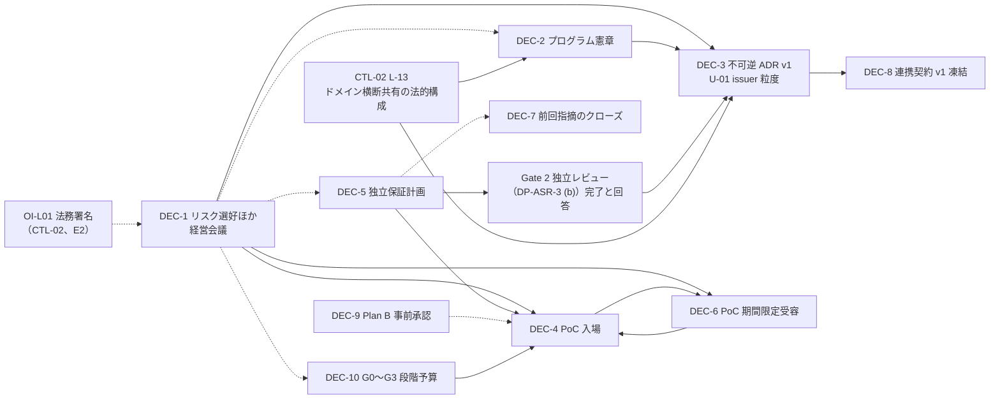

# 決裁事項詳細（DEC-1〜DEC-10）

> 文書ID: DCS-03 / 版: 0.9 / 状態: draft / 最終更新: 2026-10-15（0.9 追補（ラウンド 7 cto、High。PoC の不利な結果の台帳・決裁への伝播）: POC-02 §6.2〜§6.4 の不利な結果のうち被害封じ込めと可用性に関わる 3 件（TC-021 の X-D、TC-014 の誤撤去の未検知、TC-022 の F-5。DCS-01 §10.1 の X-8〜X-10）を決裁文書に伝えた。DEC-1 の決裁内容 (8) と決議文案 9 の注記の台帳の現行値を DCS-05 版 0.11・77 件（段1 19・段2 57・段3 1）に改め、3 件の吸収先（X-D→X-01、F-5→RRG-052、誤撤去→RRG-011）と X-D を受容票の対象にしないことを決議文案 9 に書いた。DEC-3 論点 5 に判断材料 MR-4（X-C と X-D）を加え、決議文案 8 に subject 側の検証層と再実行の受領を加えた。DEC-4 第 1 段 決議文案 9 の開示対象を X-1〜X-10 に広げた。末尾「ラウンド 7（PoC の不利な結果の伝播）の他文書への申し送り」とレビュー記録ラウンド 7 cto。0.9 追補（ラウンド 7 cto、High 2 件）: 要旨と §2.1 の DEC-11（仮）の期間を §4.11 のゲート順序に揃え（G4 を外し G5＋g とした）、§2.1 の DEC-10 行に決裁内容 (9) と確約者を、§4.10 の承認者の行に確約者を加えた。末尾「ラウンド 7（DEC-11（仮）の期間・DEC-10 (8)・(9) の伝播）の他文書への申し送り」とレビュー記録ラウンド 7 cto。0.9 追補（ラウンド 7 ciso、High）: DCS-05 §10 の決裁案のうち、決める人が経営会議・CEO なのに決裁単位がなかった DP41-3（上位 5 件の並べ方と段3 の RRG-009 の扱い。期限 G0）を DEC-1 の決裁内容 (8) と新しい決議文案 16 に、DP41-5（凍結前の契約の手戻り RRG-070 の受容。CEO（経営会議）、期限 DEC-8 第 1 段の前）を DEC-8 第 1 段の決議文案 4（CEO（経営会議）の決議として第 1 段の付議前に行い、受容票 RA-0071・失効条件を付ける）に置いた。§2.1・§2.3・§4.8 の承認者と依存・§5.2 を合わせて改め、R6A-4 を反映済みとした。末尾「ラウンド 7（DP41-3・DP41-5 の決裁単位）の他文書への申し送り」とレビュー記録ラウンド 7。模擬パネルは自己レビューであり、実在の CTO・CISO の決裁ではない。0.9 追補（ラウンド 6 audit、Critical）: 同じラウンドの並行是正で DCS-05 が版 0.8（76 件、段2 56、RRG-074 を追加）になったため、DEC-1 の決裁内容 (8)・決議文案 9 の注記と要旨の現行値を版 0.8・76 件に改め、DCS-05・DCS-00・DCS-01・本書の版・件数・DP41-7・RRG-073 の失効条件を機械照合した。末尾「ラウンド 6（audit。台帳の版の再陳腐化）の他文書への申し送り」とレビュー記録ラウンド 6 audit。0.9 追補（ラウンド 6 legal、Critical）: DEC-1 の決裁内容 (8) と決議文案 9 の RRG-073 に期限（前提の完成は DEC-8 第 1 段の付議前（G3）、LC-CV-09〜15 の実行は G4）を加え、受容が GDPR 33 条・34 条と個人情報保護法 26 条の報告・通知を免除しないことを決議文案 9 に書いた。§4.1 に法務上の意味の注記、申し送り R6-L1・R6-L2、末尾「レビュー記録」ラウンド 6 legal を加えた。模擬パネルは自己レビューであり、実在の CTO・CISO・法務責任者の決裁ではない。0.9 追補（ラウンド 6 cfo）: DEC-10 §4.10 に決裁内容 (9) と決議文案 9（G0〜G3 の先行作業の内部要員の役割別配置、人事責任者と各部門長の確約、配置率が閾値を下回った場合の報告と継続審査）を加えた。金額の値は変えていない。0.9: 模擬パネル ラウンド 6 の指摘（cto Critical、ciso Critical・High、sre・redteam・devlead High）により、DEC-1 の決裁内容 (8)・決議文案 9 と要旨の残余リスク台帳を DCS-05 版 0.7 の 75 件（段1 19・段2 55・段3 1。RRG-032-1・RRG-073 を含む）に改め、決議文案 9 を「決議日に凍結した DCS-05 の版・件数・SHA-256 を記す」形にし、RRG-073 の失効条件を加えた。DP41-7（RRG-032-1 の段と「検知窓内の write 以上の誤 allow は 0 件ではなく E_max は未決」の開示）を決裁内容 (8) と決議文案 15 に置き、決議文案 1 に GOV-02 §3.4.3 の「0 件」が検知窓外に限られることを注記した。DEC-8 第 1 段の前提に LC-OI-3（CON-15 の GA 化）と LC-OI-8（ADR-007 族 9・KD7-9 の決裁）を加え、未完成で付議した場合の RRG-073 の失効を決議文案に書いた。DEC-3 の同時決裁論点に KD7-9（論点 6）を加えた。§4.3.4・§4.8 の現状と残課題 7 の「ライフサイクル契約が未作成」を、CON-12〜CON-14 配置済み・CON-15（案）起草済み・契約 12 ファイルに改めた。DEC-10 決議文案 1 に KD-INT00-1 (a)（G0 の決議日から暫定疑義窓口を開く）を加えた。§5.3 に台帳の凍結版の記録規則を置いた。末尾「レビュー記録」ラウンド 6。模擬パネルは自己レビューであり、実在の CTO・CISO の決裁ではない。0.9 追補（ラウンド 6 の legal・cfo 指摘、いずれも High）: DEC-9 §4.9 の決裁内容・依存に Plan B の処理者連鎖・越境移転・所在地の約束の変更（DCS-06 版 0.5 §6.5・§6.6 の PB-L1〜PB-L4）を加え、決議文案 7（発動時は法務責任者が PB-L1〜PB-L4 と顧客への変更通知の要否を確認してから移行を始める）を加えた。DEC-11（仮）§4.11 の「置く理由」の第 3 項・時点・金額の幅の行を、ゲートの順序「G4 入場 → G4 判定 → G3 判定 → G5」に合わせ、G3 判定から本番設計審査までを「約 10〜18 か月（G4＋G5）」から「約 6〜12 か月（G5）＋G3 判定から G5 入場までの間隔」に改めた。金額の値は変えていない。0.8: 模擬パネル ラウンド 5 の audit 指摘（Critical）により、§4.10 の注記・ラウンド 3 申し送りの前文・脚注 135・154・341 が DCS-06 版 0.4 と新しい値（G0〜G2 約 0.9〜6.7 億円、G3 約 0.6〜4.2 億円、計 約 1.5〜10.9 億円）を指すことを確かめ、R3-4 の照合文字列を新値に置き換える旨を記した。模擬パネル ラウンド 5 の cfo 指摘により、§2.5（OPS-02 DP-OM-1〜8・OPS-03 K33-1〜7 の決裁単位の対応表）を新設し、DEC-1 の決裁内容 (12)・決議文案 14 に K33-6、DEC-10 の決裁内容 (7)・決議文案 8 に K33-2、DEC-11（仮）の決裁内容 (6)〜(8) に K33-1・DP-OM-6・DP-OM-1・DP-OM-4 を加え、§3 に DEC に割り当てない決裁案と理由を記した。末尾「レビュー記録」ラウンド 5。0.7: 模擬パネル ラウンド 5 の指摘（cto・cfo）により、DEC-9 §4.9 の承認者欄と決議文案 6（発動時の移行予算を CFO＋CTO が付議し CFO が承認する手続）、中止時の累計支出と Plan B の切替え費用（DCS-06 版 0.4 §5.2.3・§6.5.1）の参照を加え、DEC-10 §4.10 の注記、ラウンド 3 申し送りの前文、脚注 135・154・309・341 を DCS-06 版 0.4 の値（計 約 1.5〜10.9 億円）に揃えた。模擬パネル ラウンド 5 の指摘（ciso・audit）により、DEC-1 の決裁内容 (8)・決議文案 9 と要旨の残余リスク台帳を DCS-05 版 0.5（73 件、RRG-072 を含む）に改め、決議文案 9 に RRG-072 の条件と X-01 への移行を加えた。DEC-4 §4.4 の系統 1 の件数の段落を DCS-01 §10.1.1 の締切時刻と集約ハッシュの参照に改め、第 1 段 決議文案 9 の開示対象を X-1〜X-7 と W-5 不充足の全実行に広げ、DL-43 の参照版を 0.3 に改めた。末尾「レビュー記録」ラウンド 5。0.6: 模擬パネル ラウンド 4 の redteam 指摘により、DEC-3 §4.3.1 の依存に ICR-02 の解消を、§4.3.2 に同時決裁論点 5（越境ゲストの付与範囲、ADR-024 D24-08 の改訂と TC-002 K2 の扱い）と決議文案 8 を加えた。0.5: 模擬パネル ラウンド 4 の指摘（legal）により、DEC-1 の決裁内容 (4) に OPS-02 DP-OM-5 の同時決裁を、決議文案に 11 を、DEC-3 §4.3.2 に前置論点 0-4（ADR-013 D13-02 の「運用アクセスを共有しない」の定義）と決議文案の定義欄を加えた。末尾「レビュー記録」。模擬パネルは AI による自己レビューであり、実在の CTO・CISO・法務責任者の決裁ではない。あわせてラウンド 4 の指摘（cto・ciso・audit・redteam・cfo）により、§2.4（独立反証の ICR の持込み）を新設し、DEC-1 に DP41-6 と DX 型の起票期限、DEC-4 第 1 段に KP-1・KP-2 ほか、DEC-5 に第 2 段（G5 予算）を加え、DEC-9 の既定経路を M1〜M8 の充足を条件とする形に改めた）
> 対応要求: R-005, R-007, R-018, R-022, R-075, R-202, G-002, G-006（持込み先 DEC の側の記載）, G-009（DEC-4 で決める凍結・立会いの規則）, G-025, G-026, G-028, G-040, G-046, G-047（DEC-11（仮）の単位のみ）, G-054（主なもの）
> 依存文書: CONVENTIONS.md, traceability/deliverables.md（DL-39、§6.1）, traceability/seed/seed-03-redteam-decision.md（§3）, traceability/R-requirements.md, traceability/G-goal-criteria.md, traceability/traceability-matrix.md（§3.5）, 05_adr/README.md（§5、§6）, 05_adr/reconciliation-notes.md（§5、§6）, 05_adr/ADR-001・ADR-007・ADR-013・ADR-021・ADR-022, 02_requirements/tenant-lifecycle.md（K-8）, 01_governance/（GOV-01, GOV-02, GOV-03, GOV-05, GOV-06, GOV-07, GOV-08, GOV-09）, 06_controls/applicability.md（L-04, L-11, L-13, §1.4, §12）, 03_threat-model/attacker-model.md（§7 AM-1・AM-2）, 03_threat-model/threat-catalog.md（§8 TD-1〜TD-3）, 03_threat-model/fraud-abuse-controls.md（§14 決裁案 2・4〜6）, traceability/open-items.md（OI-L01）, 09_assurance/independent-assurance-plan.md（DP-ASR-3）, 08_operations/operating-model.md, 08_operations/tco-vendor-lts.md, 11_contracts/README.md, 12_poc/preregistered-test-plan.md, 00_decision/02-prior-findings-crosswalk.md（§2.1）, 00_decision/05-residual-risk-register.md（DP41-1）, 00_decision/06-gate-plan-and-plan-b.md（§0, §3, §5.2, §5.2.1, §5.3.1, §5.5, §9 DP42-7, §11 H-1・H-7・H2-5）, 00_decision/07-organization-and-tco.md（§3.1, §3.4, §6.2, §7, §8.1, §8.3）, 00_decision/00-cover.md（§2）, research/README.md, traceability/independent-challenge-review.md（TRC-09 §2〜§6.2 の ICR、版 0.5 で追加）, 00_decision/05-residual-risk-register.md（版 0.4 の RRG-071・DP41-6・§12.1 の 19〜28。版 0.7 で版 0.5 の §0 の 1・RRG-072・§12.1 の 29・30）, 00_decision/01-executive-summary.md（版 0.5 の §10.1 X-1〜X-7・§10.1.1。版 0.7 で追加）, 12_poc/preregistered-test-plan.md（§2.2.2、§7 KP-1〜KP-6、H-POC-4）, 00_decision/06-gate-plan-and-plan-b.md（§5.2 の G5 行、§6.7、§7 #3、DP42-4、§11 H-4）, 05_adr/ADR-001（D9-2、RR-10）, traceability/independent-challenge-review.md（TRC-09 §3・§6.2 の ICR）, 00_decision/05-residual-risk-register.md（版 0.4 の RRG-071・DP41-6・§12.1 の 19〜28）, 12_poc/preregistered-test-plan.md（§2.2.2、§7 KP-1〜KP-6、H-POC-4）, 00_decision/06-gate-plan-and-plan-b.md（§5.2 の G5 行、§6.7、DP42-4、§11 H-4）, 05_adr/ADR-001（D9-2、RR-10）, 09_assurance/rfp-sow.md（ASR-05）, 00_decision/05-residual-risk-register.md（版 0.7 の §0 の 1・RRG-032-1・RRG-073・DP41-7・§12.1 の 35・36・38・42〜44。版 0.9 で追加）, 11_contracts/lifecycle-events.asyncapi.yaml（CON-12 版 0.4.0 §6・§10 H3-2・LC-OI-3・LC-OI-8、内包の CON-15（案））, 11_contracts/README.md（CON-00 版 0.6 要旨 1・§2.6.4・§9 申し送り 6・14）, 05_adr/ADR-007（版 0.2 D7-10 族 9・D7-10a・KD7-9）, 03_threat-model/threat-catalog.md（THR-03 版 0.3 T-093・T93-1・T93-2）, 01_governance/risk-appetite-draft.md（GOV-02 §3.4.3）, 07_slo/numeric-contracts.md（SLO-01 SLI-038）, 10_integration/README.md（INT-00 KD-INT00-1）, traceability/open-items.md（OI-B38）（以上は版 0.9 で追加）
> 作成方法: AI エージェント（Claude）が上記の文書を通読し、DEC ごとの決裁案として起草した。本書の推奨・評価は自己レビューであり、実在の CTO・CISO・経営会議の決裁ではない（CONVENTIONS §8）。本書の時点で決議済みの DEC は 0 件である。
> 表の注記: 表のセルでタグのないものは、本書または依存文書の記述を要約した設計推論 [D] であり、この注記で個別のタグに代える。

## 要旨

- 本書は DEC-1〜DEC-10 の正式定義の場所である [D][^2]。各 DEC について、決裁内容、選択肢、推奨、帰結、可逆性、承認者、見直し日、決議文案、依存 ADR・文書を置く（§4）[D]。
- 10 件の内訳は、経営会議の決裁 1 件（DEC-1。統治規程 GOV-05〜GOV-08 と残余リスク台帳の採用、攻撃者モデル AM-1・テナント横断学習 TD-2・特権濫用の許容方針 R-012 の経営判断を含む）、CTO・CISO を中心とする決裁 7 件（DEC-2〜DEC-5、DEC-7〜DEC-9）、CFO＋CTO＋CISO による G0〜G3 の段階予算 1 件（DEC-10。予備費を除き G0〜G2 約 0.9〜6.7 億円、計 約 1.5〜10.9 億円の幅の中で上限を決める。G0〜G2 には DEC-3 の前提である Gate 2 の独立レビューの上限キャップ 0.8 億円を、G0〜G3 には DEC-8 第 1 段の前提である契約試験キット・共有 sandbox・BFF 参照実装と第 1 言語の SDK・暫定疑義窓口の先行要員を含む（§4.10）。付議基準額を超える場合は経営会議）、事業責任者の受容 1 件（DEC-6）である [D][^3][^123][^154]。不可逆の決定を含むのは DEC-3 と DEC-8（識別子の部分）だけであり、DEC-6 は期限付き、その他は可逆である [D]。
- 次回の決裁で求めるのは、DEC-1（統治規程を含む。対象法域は法務署名版の判定に限る）、DEC-2、DEC-5、DEC-7、DEC-9、DEC-10 と、DEC-4 の第 1 段（入場条件、予算の決め方、総額の上限（not-to-exceed）＝2.2 億円 ×（1＋予備費率））までである（§2.3、§4.4）[D][^125]。DEC-3・DEC-8 は Gate 2 の独立レビューの後に、DEC-4 の第 2 段（費目別の確定値と入場の最終承認）と DEC-6 は Gate 4 入場前の別会議に置く [D]。本番化、全社標準化、移行強制、対外的な安全性表明、製品の最終選定、20 年分の予算の 6 項目は求めない（§3）[D][^3][^4]。
- 本プログラムで最大の継続費用である定常要員（約 48〜66 FTE、年 約 4.8〜13.2 億円）の確約幅と A-054 の改訂、DEC-10 で先行採用した SRE の G3 判定後の人件費、G3 判定〜本番設計審査（G5 を含み、G3 判定より前に終わる G4 は含まない）の基盤要員費・契約管理費、構築期の上限の候補は、将来の決裁単位 DEC-11（仮）として G3 判定時に経営会議＋CFO が決める（§4.11）[D][^161][^165]。次回決裁では求めない [D]。
- DEC-3 の主議題は U-01（issuer の粒度）である [D][^5]。ADR-007 KD7-1 はテナント／realm 別、ADR-021 K21-1 と REQ-05 K-8 は信頼区画別（共通 issuer＋tid＋cell 別鍵）を推奨して対立しており、13 本の ADR の記述がこの結論に依存する [D][^5][^6]。本書は (b) 信頼区画別を暫定の推奨とするが、推奨は未確定の入力（A-013、NA-021-1、DEC-1 での封じ込めの扱い）に依存し、ADR-021 §4.5 の感度分析では逆転し得る（§4.3.3）[D][^7]。このため U-01 は入力の確定と Gate 2 の独立レビューの後に決めることを推奨する（§4.3.4）[D]。
- U-01 は不可逆区分の値なので preview に置けず、DEC-3 の決裁が DEC-8 の前提条件になる [D][^9]。DEC-3 の前に決めるべき前置論点が 3 件（ADR-018 K18-5、ADR-026 L26-2、CTL-02 L-13）、DEC-3 で同時に決める論点が U-01 を含めて 5 件（版 0.6 で越境ゲストの付与範囲（論点 5。ICR-02 の多層防御の独立性に関わる）を、版 0.9 でライフサイクル事象の署名鍵の用途族 ADR-007 KD7-9（論点 6。DEC-8 第 1 段の前提）を追加）、条件付きの論点が 1 件ある（§4.3.2）[D][^5][^352]。ADR-013 の法域パーティションは、分割の原則と非共有だけを不可逆とし、英国をどこに置くかは法務確認（L-11）まで可逆の配置値とする（§4.3.1）[D][^121][^122]。
- 経営会議の DEC-1 が成立しない場合、DEC-2・DEC-4・DEC-5・DEC-7・DEC-9・DEC-10 は条件付きの決裁になり、DEC-3 と DEC-6（受容）は決裁しない（§2.2、§5.1）[D][^3]。版 0.2 の是正は模擬パネル（自己レビューであり、実在の CTO・CISO・CFO・法務・監査の決裁ではない）のラウンド 1 指摘、版 0.3 の是正はラウンド 2 指摘、版 0.4 の是正はラウンド 3 指摘による。ラウンド 4 指摘（DEC-7 の件数）の是正も版 0.4 の中で行った（レビュー記録）[D][^1]。CTO・CISO が単独で受容する残余リスクは 0 件とし、受容は事業責任者または経営に置く（§5.2）[D][^4][^18]。
- 版 0.5 では、ラウンド 4 の指摘により次を決裁文書に入れた [D]。(1) 独立反証レビュー（AI 自己反証）から各 DEC に持ち込まれた未解決の異論 ICR-01〜ICR-22 を、未回答・部分回答の区別とともに §2.4 と各 DEC の「依存」行に記した [D][^302]。(2) DEC-1 に残余リスク台帳、DP41-6（RRG-071 の段）、DX 型の未起票要素の起票期限 G2 を加えた [D][^301]。採用対象の台帳は、版 0.7（ラウンド 5）で DCS-05 版 0.5 の 73 件に改め、版 0.9（ラウンド 6）で正本の DCS-05 版 0.7 の 75 件（段1 19・段2 55・段3 1）に改めた [D][^372]。同じラウンドの並行是正で DCS-05 が版 0.8（76 件、段2 56。RRG-074 を追加）になったため、(8) と決議文案 9 の現行値を版 0.8 に改めた（ラウンド 6 audit）[D][^398]。75 件は、越境ゲストの付与範囲の RRG-072、FM-13 の検知前の窓の write 以上の誤 allow の RRG-032-1、ライフサイクル事象の注入・偽造による付け替えと大量削除の RRG-073 を含む [D][^372]。決議文案 9 は、版と件数を固定値で書かず、決議日に凍結した DCS-05 の版・件数・SHA-256 を記す形にした [D]。あわせて、RRG-072・RRG-073 の失効条件を決議文案 9 に、DP41-7（RRG-032-1 の段と「検知窓内の誤 allow は 0 件ではなく E_max は未決」の開示）を決議文案 15 に置いた [D][^372]。(3) DEC-4 第 1 段に独立立会人（KP-1）、系統 1 の結果と既存の自己実行記録の扱い（KP-2）、KP-3〜KP-5 の決める人と期限を加えた [D][^304]。(4) DEC-5 を 2 段にし、G5 独立保証の予算を第 2 段（G4 入場前、CISO＋CFO）で決める単位を置いた [D][^300]。(5) DEC-9 の既定経路を、M1〜M8 を満たす候補がない場合（PB-T3 を含む）は DL-42 §6.7 の (i)、不成立なら (iii) とする形に改めた [D][^309]。

---

## 1. 本書の位置付けと読み方

- 本書は成果物 DL-39 である [D][^2]。deliverables.md §6.1 の DEC 表は成果物割当のための暫定対応であり、DEC の正式な定義・文言・承認者は本書が持つ [D][^2]。本書と §6.1 が食い違う場合は本書を正とし、§6.1 の更新を残課題に載せる [D]。
- DEC-1〜DEC-7 は種資料 seed-03 §3 の D1〜D7 を、DEC-8 は再提案計画で追加した「連携契約 v1 の凍結」を、DEC-9 は seed-03 §3 末尾の「Plan B を最初に承認しておく」提案を読み替えたものである [D][^2][^3]。DEC-10 は、ゲート計画 DCS-06 §5.5・DP42-7 が提案した G0〜G3 の段階予算の決裁を、同書 §11 H-1 の申し送りにより本書で正本化したものである（版 0.3）[D][^123]。
- 各 DEC の値・選択肢の詳細は、依存文書の決裁案（GOV-02 決裁案 1〜3、ADR-021 K21-1〜K21-6、ADR-022 D-11 など）を正本とする [D]。本書はそれらを決裁の単位に束ね、決議文案を置く [D]。依存文書の推奨と本書の推奨が異なる場合は、その旨を明記する [D]。
- 決議文案の〔　〕は、決裁の場で埋める値または選ぶ選択肢である [D]。

### 1.1 各 DEC の記載項目

| 項目 | 内容 |
|---|---|
| 決裁内容 | 何を承認するか。承認しないものも併記する |
| 選択肢 | 現状維持・延期を含む 3 案以上 |
| 推奨 | 推奨案と理由。依存文書の推奨と異なる場合は差分 |
| 帰結 | 推奨案を採った場合と採らない場合に起きること |
| 可逆性 | 可逆／期限付き／不可逆。不可逆なら範囲 |
| 承認者 | 承認者、同意者、起案者 |
| 見直し日 | 見直しの時点（日付はゲート計画 DL-42 で確定する） |
| 決議文案 | 決議録にそのまま写せる文 |
| 依存 | 前提となる DEC、依存 ADR・文書、主な調査ストリーム |

---

## 2. 決裁の全体像

### 2.1 一覧

| DEC | 決裁内容 | 承認者 | 可逆性 | 関連ゲート | 前提条件 |
|---|---|---|---|---|---|
| DEC-1 | リスク選好・許容度、重大損失シナリオ、データ分類、対象法域。未完成部分の策定責任者と期限。統治規程（GOV-05 RACI・決裁権・CISO の報告経路、GOV-06 停止権限・代行順位・S6 凍結、GOV-07 段 1〜3・床・AT 類型・RV、GOV-08 KRI の層と報告周期）と残余リスク台帳の採用（DCS-05 DP41-1。決議日に凍結した版。版 0.7 は 75 件）、DP41-6・DP41-7（RRG-032-1 の段と、検知窓内の write 以上の誤 allow が 0 件でないことの開示。版 0.9 で追加）、DP41-3（上位 5 件の並べ方と段3 の RRG-009 の扱い。版 0.9 のラウンド 7 で追加）。攻撃者モデル・脅威・不正対策の経営判断（AM-1、TD-2、R-012）と、G0 で決めない AM-2・TD-1・TD-3・不正対策決裁案 2・5・6 の決める場と期限。全面停止・全テナント侵害の財務影響の受け方（OPS-03 K33-6。版 0.8 で追加） | 経営会議／取締役会（起案: CISO・CTO・事業責任者）。S6 と段 3、TD-2 の B は取締役会 | 可逆（年 1 回以上見直し） | G0 | 対象法域の部分だけ OI-L01（法務責任者が署名した CTL-02 版または確認意見書、E2）。欠ける場合は対象法域を未完成部分に回す |
| DEC-2 | プログラム憲章（目的、スコープ、パイロット候補、非目標）と 20 年耐久性憲章 | CTO＋CISO | 可逆 | G0〜G1 | DEC-1（条件付きで先行可）、CTL-02 L-13（NA-8 の確定を含む。期限 G0） |
| DEC-3 | 不可逆決定の ADR v1（ADR-001・007・013・021・022）と U-01 等の同時決裁論点（版 0.9 で ADR-007 KD7-9（族 9）を追加） | CTO（アーキテクチャ審査会経由）＋CISO 同意。K21-2 は経営会議、K21-6 は法務 | 不可逆（範囲は §4.3） | G2 の後〜G3 | DEC-1（外部 RP での cell 封じ込めの扱いを含め確定済み）、DEC-2、DEC-5（DP-ASR-3 (b)）と Gate 2 独立レビューの完了・全所見への回答（E6）、G1 での A-013・A-114 の確定と NA-021-1 の標本調査、前置論点 3 件（CTL-02 L-13 を含む）、RR21-01 の受容票。法域パーティションへの法域の割当は L-04・L-11・G-054 の法務確認 |
| DEC-4 | Gate 4 PoC 入場。第 1 段: 入場条件、要員と稼働率、期間上限、事前登録仮説と合否・中止基準、合成データ限定、パイロット参加確約、予算上限の決め方と総額の上限（2.2 億円 ×（1＋予備費率））。第 2 段: 費目別の確定値への置換えと入場の最終承認 | CTO＋CISO＋CFO | 可逆 | 第 1 段: 次回決裁。第 2 段: G4 入場前 | DEC-1、DEC-5。第 2 段は DEC-6 と同時 |
| DEC-5 | 独立保証計画。第 1 段: 評価者の独立性要件、任命・調達、Gate 2/4/5 の関与と立会い範囲。第 2 段: G5 独立保証の予算上限と期間上限（ASR-05 の見積り取得後。§4.5） | 第 1 段: CISO（独立性の確認は内部監査）。第 2 段: CISO＋CFO（付議基準額を超える場合は経営会議） | 可逆 | 第 1 段: G0〜G5。第 2 段: G4 入場前 | DEC-1 の統治規程部分（GOV-05・GOV-06。条件付きで同時可） |
| DEC-6 | PoC 期間限定の残余リスク受容 | パイロット事業の事業責任者 | 期限付き | G4 | DEC-1 の統治規程部分（GOV-07 の段・床・AT-7・RV）、DEC-4 の期間・データ区分 |
| DEC-7 | 前回指摘のうち検証済み項目のクローズ（暫定クローズ候補 34 件。R-268（承認条件 3）は RB-13 未作成のため候補外。§4.7）と、繰延べ項目のゲート割当 | CTO＋CISO | 可逆（再オープン可） | 各ゲート | DL-38 の対照表 |
| DEC-8 | 連携契約 v1 の凍結（条件付き）。第 1 段の前提として、凍結前の契約の手戻り RRG-070 の受容（DCS-05 DP41-5）を第 1 段の付議前に決議する（版 0.9 のラウンド 7 で追加） | CTO＋CISO。RRG-070 の受容（DP41-5）は CEO（経営会議） | 識別子は不可逆、他は版付きで可逆 | 第 1 段（rc 凍結と告知期間）: DEC-3 の後、G3 でのキット・sandbox 提供時。第 2 段（v1 凍結）: 最早で G4 での TC-119・TC-026 の実測報告の後（§4.8） | DEC-3（U-01、KD7-9）、ADR-022 D-11 の 5 条件。第 1 段は LC-OI-3（CON-15 の独立レビューと GA 化）と LC-OI-8（ADR-007 族 9・KD7-9 の決裁）の完成（未完成で付議すると DCS-05 RRG-073 が失効。版 0.9 で追加） |
| DEC-9 | Plan B（中止・方針転換時の既定経路）の事前承認 | CTO＋CISO（経営へ報告） | 可逆 | 全ゲート | DL-44 の代替案比較 |
| DEC-10 | G0〜G3 の段階予算（G0〜G2 と G3 の予算上限・期間上限、費目別内訳、上限到達時の扱い）。「1000 億円規模」の分母と比率の使い方（OPS-03 K33-2。版 0.8 で追加）。暫定疑義窓口の開設時期（INT-00 KD-INT00-1。推奨 (a)。暫定窓口の先行要員の費用は (a) が前提。版 0.9 で追加）。G0〜G3 判定の内部要員の役割別の確約、月次報告、配置率が閾値を下回った場合の継続審査（決裁内容 (9)・決議文案 9。DCS-07 §3.4.1。ラウンド 6 cfo で追加）[D][^395] | CFO＋CTO＋CISO。上限の合計が経営会議の付議基準額を超える場合は経営会議。決議文案 9 の役割別の要員は、人事責任者と各部門長が決議日に人数と着任予定日を確約する（確約者として決裁の場に招集する）[D][^395] | 可逆（未使用分は G3 判定時に失効） | G0（判定は G0 合格基準 (7)）〜G3 | DEC-1（条件付きで先行可） |
| DEC-11（仮） | G3 の要員確約と G3〜本番設計審査の予算（定常要員の確約幅 48〜66 FTE と A-054 の改訂、先行採用 SRE の G3 判定後の人件費、G3 判定〜本番設計審査（G5 を含む。G4 は G3 判定より前に終わり DEC-4 で扱う）の基盤要員費と契約管理費（在籍する基盤要員 FTE ×（約 6〜12 か月＋g）× 単価で G3 の前に算定。g は G3 判定から G5 入場までの間隔）、構築期の上限の候補）[D][^394]。版 0.8 で、依存サービスの改修費の計上先（OPS-03 K33-1）、移行専任チーム（OPS-02 DP-OM-6）、SRE 一次の拠点構成とセキュリティ当番の 24/365（DP-OM-1・DP-OM-4）を追加。次回決裁では求めない（§4.11） | 経営会議＋CFO（起案: CTO・人事責任者）。A-054 の改訂は CTO＋CFO＋人事責任者 | 可逆（常勤採用分は取り消せない継続費用） | G3 判定時 | DEC-10（先行採用の実績）、G3 判定、OPS-02 DP-OM-2・DP-OM-3、DEC-9 の PB-T2・PB-T8 |

### 2.2 前提関係

矢印は「前提を与える DEC → 前提を使う DEC」を表す [D]。点線は、前提が欠けても条件付きで決裁できる関係である [D]。

- DEC-1 → DEC-3 は実線である [D]。U-01 の (a)(b) の優劣は、外部 RP での cell 封じ込めの重みで逆転し得る（ADR-021 §4.5）[D][^7]。その重みはリスク選好・許容度（DEC-1）で決まるので、DEC-1 の「未完成部分の策定責任者と期限の承認」で先送りできる部分に、外部 RP での cell 封じ込めの扱いを含めない（§4.1 決議文案 6）[D]。
- DEC-1 → DEC-6 は実線である [D]。DEC-6 は GOV-07 の受容票の様式と AT-7 で受容するが、受容を承認できる者の権限階層は方針・手順に役割単位で定めなければならない（IR 8286B-upd1 §2.3: must）[N][^15]（RS-01#21）。権限階層（GOV-07 §3.1 の段）が未承認のまま受容すると、受容者の正当性が決議記録から示せない [D]。同じ理由で、DEC-3 の RR21-01 の受容票も DEC-1 の後に置く [D]。
- DEC-1 → DEC-4 は実線、DEC-1 → DEC-5 は点線である [D]。DEC-4 は GOV-06 の停止権限（PoC の中止）、DEC-5 の決議文案 5 は GOV-06 の本番移行停止（S1）を参照するため、統治規程の承認を前提にする [D][^17]。DEC-5 は同じ会議で DEC-1 と同時に決められるので点線にした [D]。
- DEC-5 → Gate 2 → DEC-3 は、独立保証計画の DP-ASR-3 (b)（DEC-3 対象の ADR 5 本を Gate 2 の独立レビューの範囲に含める）を採ったうえで、そのレビューの報告と全所見への回答（E6）を DEC-3 の前提にする関係である [D][^20]。
- DEC-4 の第 2 段（金額）と DEC-6 は、Gate 4 入場前の同じ会議で決める [D]。DEC-6 の受容票の有効期限は DEC-4 の期間上限で決まり、DEC-4 の入場は DEC-6 の受容を条件とするためである [D][^22]。
- OI-L01 → DEC-1 は点線である [D]。法務責任者が署名した CTL-02 版（または確認意見書、E2）がなければ、DEC-1 は対象法域を承認範囲から外し、未完成部分として策定責任者（法務責任者）と期限だけを承認する（DCS-06 §3.2 の入場条件 (2)）[D][^123][^136]。CTL-02 は、判定がすべて法務署名前の案であり、法的助言でも法務・経営の決定でもないと自ら述べている [D][^134]。
- L-13 → DEC-2・DEC-3 は実線である [D]。CTL-02 は、事業ドメインをまたぐ共通 ID・SSO・リスクシグナル・監査記録の共有の法的構成（単一法人か別法人か、委託／共同利用／同意／GDPR 第 26 条の共同管理者）を、DEC-2 の主体範囲と ADR-021 K21-2・K21-6 の前提とし、L-13 を DEC-2・DEC-3 の前置論点（期限 G0）としている [D][^134]。
- DEC-1 → DEC-10 は点線、DEC-10 → DEC-4 は実線である [D]。DEC-10 は DEC-1 が未了でも条件付きで決裁できる（DCS-06 §5.5 の前提欄）[D][^123]。DEC-10 は G3 判定までの予算を承認し、G4 PoC の予算は DEC-4 が扱うので、DEC-4 の第 2 段は DEC-10 の承認済みの上限を前提に積み上げる [D]。
- DEC-1 が未了の場合、DEC-2・DEC-4・DEC-5・DEC-7・DEC-9・DEC-10 は条件付き決裁とする [D][^3]。DEC-3・DEC-6 は DEC-1 が未了なら決裁しない（§5.1）[D]。条件付き決裁の規則は §5.1 に置く [D]。

### 2.3 次回決裁で求める範囲

| 区分 | DEC | 時点 | 理由 |
|---|---|---|---|
| 次回決裁で求める | DEC-1（統治規程、DP41-1・DP41-3・DP41-6・DP41-7、AM-1・TD-2・R-012 を含む）、DEC-2、DEC-5 第 1 段、DEC-7、DEC-9、DEC-10、DEC-4 第 1 段 | G0 | G0 の合格基準 (1)〜(7) を決議で満たせる組合せである [D][^123]。(1) の対象法域は法務署名版（OI-L01）がある場合に限る。(7) の段階予算は DEC-10 で満たす（§4.10）[D] |
| 次回決裁で求めない（G2 の後） | DEC-3、DEC-8 | DEC-3 は G1 の入力確定と G2 の独立レビュー完了の後。DEC-8 は第 1 段が DEC-3 と G3 のキット提供の後、第 2 段が G4 での TC-119・TC-026 の実測報告の後（§4.8） | 不可逆決定を、逆転し得る入力が未確定のまま、独立レビューを経ずに行わないため（§4.3.4）[D][^7][^20] |
| 次回決裁で求めない（G4 入場前） | DEC-4 第 2 段、DEC-6、DEC-5 第 2 段（G5 の予算） | G4 入場前の会議 | 非要員費の確定値（HSM の見積り、K58-4 決定後の負荷環境ほか）が G4 入場前でないと得られないため（§4.4）。DEC-6 の期限は DEC-4 の期間で決まるため [D][^125]。G5 の予算は ASR-05 の RFP/SOW による見積りの取得後でないと桁が決まらないため（§4.5）[D][^300] |
| 次回決裁で求めない（G3 判定時） | DEC-11（仮） | G3 判定と同じ会議（§4.11） | 定常要員の確約幅は OPS-02 DP-OM-2 の推奨で G3 に確約するとされ、A-054 の確定ゲートも G3 である [D][^161][^162]。G4 の工数実測（TC-130）の前に確約値を決めると、重複と漏れの補正ができない [D][^161] |

- 次回決裁で Gate 2 は判定しない [D]。G2 の合格基準は脅威ごとの統制と試験への追跡を求めるが、統制の試験欄の TH-TC 58 件のうち 47 件は TC に吸収された記録がなく、区分 C の R 147 行のうち 41 行は TC・RB・演習のいずれにも割り当てられていないためである [D][^123][^126]。
- G2 の承認者は CISO＋独立評価者であり、経営の決定権を持たない [D][^123]。また G1・G2 の判定は DEC として扱わない（DCS-06 §0 の 2）[D][^123]。このため、攻撃者モデルの設計範囲のうち経営が決めるとされた AM-1（期限 G2）・AM-2（全テナント波及のため RACI-08 以上）と、取締役会の判断を要し得る TD-2 は、G2 の判定に任せず DEC-1 で決めるか、DEC-1 決議文案 4 で決める場と期限を承認する（§4.1 の (9)(10)）[D][^131][^132]。G2 の合格基準に「AM-1・AM-2・TD-2 の経営決議（E1）が済んでいること」を加える改版は TR-10 で申し送る [D]。
- 本節が「次回決裁で求める DEC」の集合の唯一の正本である [D]。00-cover（DCS-00）§1〜§3、01-executive-summary（DCS-01）§0・§3・§9、06-gate-plan（DCS-06）§0 の 2・§2・§4.3・§5.3.1 CP-3・DP42-1 は、模擬パネルのラウンド 2 指摘（cto、Critical）への対応で本節に合わせた（DCS-00・DCS-01 版 0.2、DCS-06 版 0.3。TR-1〜TR-3 は反映済み）[D]。DCS-06 版 0.2 の申し送り H-2（DEC-3 の関連ゲートを「次回決裁で先行し、G3 で点検」に改める）は、本節と §4.3.4 に反するので採らず、DCS-06 版 0.3 で撤回された [D]。
- 文書間で本節の集合が再び食い違わないよう、00〜08 の各文書が示す集合と本節の集合の一致を機械で検査することを申し送った（TR-R2-3）[D]。

### 2.4 独立反証レビューから持ち込まれた未解決の異論（ICR。ラウンド 4 で追加）

- 独立反証レビュー（TRC-09）は AI による自己反証であり、報告系統外の独立反証（G-007）ではない [D][^302]。pre-mortem・steelman・数値への攻撃の指摘 53 件の判定は、回答済 22 件、部分回答 28 件、未回答 3 件である。「推奨が正しいために真でなければならないこと」MBT-01〜12 の 12 件は未検証である。TRC-09 はこれらの残課題を ICR-01〜ICR-22 に束ね、持込み先の DEC を指定している [D][^302]。
- 版 0.4 の本書には ICR への言及が 1 件もなかった [D]。このため決裁者は、DEC の文書だけでは持ち込まれた異論を知ることができなかった [D]。G-006 は、未解決の異論の持込み先（DEC）が記録されていることを求めている [D][^307]。そこで下表を置き、各 DEC の「依存」行に持ち込まれた ICR を記した [D]。
- 未回答 3 件（PM-4c、SM-1b、SM-3a）は POA&M の OI-J01〜OI-J03 に、残りの束は OI-J04 に起票されている [D][^311]。次回決裁で扱う DEC のうち、未回答の指摘を含むのは DEC-9（SM-1b、SM-3a）と DEC-10（SM-3a）である [D]。DEC-9 決議文案 5 に、未回答のまま承認することと、G3 判定時に判定することを明記した [D]。
- 表の判定は TRC-09 の判定を転記したものであり、本書では判定し直していない [D]。G-006 の合否は作成者以外のレビュアーが判定する（ICR-22）[D]。

| ICR | 持込み先 DEC | 元の指摘と TRC-09 の判定 | 本書で扱う時点 | 所有者・期限（TRC-09 の案） |
|---|---|---|---|---|
| ICR-01 | DEC-4 | PM-1b・NUM-L4・NUM-R4（部分回答） | DEC-4 第 1 段（決議文案 9 の開示） | PoC 実施責任者、G4 入場前 |
| ICR-02 | DEC-3、DEC-4 | PM-2a・PM-2b（部分回答）、MBT-06（未検証） | DEC-4 第 1 段で受領。DEC-3 は G2 の後（§4.3.1 の依存、§4.3.2 論点 5。版 0.6 で追加） | CTO（ARB）＋CISO、G2 後（XR-07）・G4（K2）。版 0.6 で、K2 の立会い下での再実行と原因の確認を DEC-3 の付議前とし、POA&M の独立行（所有者 CISO）に分けるよう申し送った（R4G-1） |
| ICR-03 | DEC-1 | PM-1c（部分回答） | 次回決裁（決議文案 13） | CISO＋プラットフォームチーム長、G1 |
| ICR-04 | DEC-1 | PM-1d（部分回答・決定待ち） | 次回決裁（決議文案 10 の TD-2、13） | 取締役会（起案 CISO）、G0 |
| ICR-05 | DEC-1 | PM-2c・PM-X2（部分回答） | 次回決裁（決議文案 13） | CTO＋CISO、G0 |
| ICR-06 | DEC-9、DEC-10 | PM-3b・PM-3c（部分回答）、**SM-3a（未回答。OI-J03）** | 次回決裁（DEC-9 決議文案 5） | CTO＋事業責任者、G1 |
| ICR-07 | DEC-3 | PM-4b（部分回答） | G2 の後 | CTO（ARB）、G3 |
| ICR-08 | DEC-3 | **PM-4c（未回答。OI-J01）** | G2 の後 | CTO（ARB）、G2 |
| ICR-09 | DEC-4 | PM-5b（部分回答） | DEC-4 第 2 段 | CISO、G4 |
| ICR-10 | DEC-1 | PM-5c（部分回答。受容票なし） | 次回決裁（決議文案 13） | CISO（起案）、受容は段 2 以上、G2 |
| ICR-11 | DEC-3 | PM-5d（部分回答・決定待ち） | G2 の後 | CTO＋CISO、G2 後 |
| ICR-12 | DEC-4、DEC-5 | PM-X3（部分回答） | 次回決裁（DEC-4 第 1 段 (9)(10)、決議文案 8・9） | CISO（独立性は内部監査）、G0 |
| ICR-13 | DEC-9 | SM-1a（部分回答）、**SM-1b（未回答。OI-J02）** | 次回決裁（DEC-9 決議文案 5） | CTO、G3 |
| ICR-14 | DEC-4、DEC-9 | SM-1c（部分回答） | 次回決裁（DEC-9 決議文案 5） | CTO＋人事責任者、G3 |
| ICR-15 | DEC-9 | SM-2a（部分回答） | 次回決裁（DEC-9 決議文案 5） | CTO＋CISO、G1 |
| ICR-16 | DEC-4 | NUM-C2・NUM-C3（部分回答） | DEC-4 第 1 段（K58-4）・第 2 段 | SRE 責任者、G4 入場前 |
| ICR-17 | DEC-1、DEC-4 第 2 段 | NUM-L1・NUM-L5（部分回答） | 次回決裁（DEC-1 決議文案 13）と G4 入場前 | CTO＋CISO＋事業責任者、G4 |
| ICR-18 | DEC-1 | NUM-R3・NUM-R5（部分回答） | 次回決裁（決議文案 13） | CISO＋法務、G1 |
| ICR-19 | DEC-10 | NUM-T2・NUM-T6（部分回答） | 次回決裁（DEC-10 の見直し日） | CFO＋CTO、G3 |
| ICR-20 | DEC-1 | NUM-T5（部分回答）、MBT-01（未検証） | 次回決裁（決議文案 4 の MP-01〜MP-09、13） | CFO＋事業責任者、G0〜G1 |
| ICR-21 | DEC-5 | TRC-09 全体（G-007 は未達） | 次回決裁（DEC-5 第 1 段） | CISO（独立性は内部監査）、G2 |
| ICR-22 | DEC-7 | TRC-09 全体（G-006 は作成者以外の判定待ち） | 次回決裁（DEC-7） | 作成者以外のレビュアー、Phase 4 |

### 2.5 OPS-02・OPS-03 の決裁案と決裁単位の対応（版 0.8 で追加）

- OPS-02 §11 は DP-OM-1〜DP-OM-8 の 8 件、OPS-03 §11 は K33-1〜K33-7 の 7 件の決裁案を置き、いずれも決定済みではない [D][^359][^360]。版 0.7 までの本書がどの DEC に載せていたかは、DP-OM-2・DP-OM-3（DEC-11（仮）(1)）、DP-OM-5（DEC-1 (4)・決議文案 11）、K33-3（DEC-4 第 1 段 (1a)）の 4 件だけであった [D]。
- 残る 11 件のうち、K33-1（依存サービスの改修費の計上先）は承認者 CFO＋CTO、期限 G3 であるのに、同じ G3 判定時の DEC-11（仮）の決裁内容になかった [D][^359]。OPS-03 §4.8 は、300 サービスで 1 サービスあたり 2 人月なら改修費が 5〜10 億円になり、基盤の定常年額（中）を上回るとしている [D][^359][A-050]。K33-2（期限 G0）、K33-6（期限 G0、承認は経営会議）、DP-OM-6（10^1 FTE の桁の移行専任チーム、CTO＋CFO、G3）も決裁単位がなかった [D][^359][^360]。ラウンド 3 で継続費用の決裁単位（DEC-11（仮））を置いたが、改修費と移行費の決裁単位は欠けたままだった [D]。
- 本書は、全 15 件を次のとおり割り当てる [D]。DEC に割り当てない 5 件は、理由と決める場を §3 の注記に記す [D]。

| 決裁案 | 論点（要旨） | 正本の決める人・期限 | 割り当てる DEC（本書の場所） | 理由 |
|---|---|---|---|---|
| DP-OM-1 | SRE 一次の拠点構成と開発者の on-call 参加 | CTO＋人事責任者＋CFO。G3（OPS-02 は「DEC-4」） | DEC-11（仮）決裁内容 (8) | SRE 一次の下限を確約する場は DEC-11（仮）である（DCS-07 §7 PB-1）。DEC-4 は PoC 入場の決裁で、G3 の決裁ではない（§4.11）[D] |
| DP-OM-2 | 定常要員の確約幅 | CEO（経営会議）＋CFO。G3 | DEC-11（仮）決裁内容 (1)（版 0.4 から） | 既存 [D] |
| DP-OM-3 | ADR の増分を A-054 の内数とするか外数とするか | CTO。G3 | DEC-11（仮）決裁内容 (1)（版 0.4 から） | 既存 [D] |
| DP-OM-4 | セキュリティ当番・ITDR・鍵の二者の 24/365 | CISO＋CFO。G3 | DEC-11（仮）決裁内容 (8) | CISO 組織の当番は TCO の幅の外にあり（DCS-07 §4.3 のプラットフォーム外の要員）、確約幅と同じ会議で決めないと継続費用が決裁の外に残る [D][^360] |
| DP-OM-5 | 本番の特権操作に関わる要員の所在国と L-04 B の提供範囲 | CTO＋CISO＋法務責任者＋CFO。G0。(a-2) の人数は G3 | DEC-1 決裁内容 (4)・決議文案 11（版 0.5 から）。(a-2) の人数・費用は DEC-11（仮） | 既存 [D][^220] |
| DP-OM-6 | 移行専任チーム | CTO＋CFO。G3（DL-43） | DEC-11（仮）決裁内容 (7) | 10^1 FTE の桁の要員で、定常 48〜66 FTE の外数（OPS-02 §4.5 のプラットフォーム外）である。10 FTE なら年 約 1.0〜2.0 億円になる（10 FTE × 1,000 万〜2,000 万円の算術、NA-001-2）[D][^360] |
| DP-OM-7 | 単一ベンダー依存の重要手順 | CTO＋調達責任者。G3 | 割り当てない（§3 の注記） | 費用の承認を伴わない運用規則であり、決める人がライン長である [D][^360] |
| DP-OM-8 | 連携開発者向け文書と窓口の言語 | プラットフォームチーム長＋調達責任者。G4 前 | 割り当てない（§3 の注記） | 同上。窓口要員の増員に至る場合は、OPS-02 §8.3 の判定規則により DP-OM-2 の再決裁（DEC-11（仮））に回る [D][^360] |
| K33-1 | TCO の計上範囲（依存サービスの改修費） | CFO＋CTO。G3 | DEC-11（仮）決裁内容 (6) | 改修費は 1 サービスあたり 1 人月ごとに 2.5〜5.0 億円で、2 人月なら 5〜10 億円となり基盤の定常年額（中 4.45 億円）を上回る。計上先を決めないと決裁の外に出る（OPS-03 K33-1 の (c) の帰結）[D][^359] |
| K33-2 | 「1000 億円規模」の分母と比率の使い方 | CFO。G0 | DEC-10 決裁内容 (7)・決議文案 8 | 期限が G0 であり、G3 の DEC-11（仮）では遅い。DEC-10 は G0 の CFO を含む予算の決裁であり、「比率を上限に使わない」は G0〜G3 の上限の決め方と直結する [D][^359]。模擬パネルの是正例は DEC-11（仮）としていたが、期限を優先した [D] |
| K33-3 | PoC 期間の予算上限の決め方 | CTO＋CISO＋CFO（DEC-4）。Gate 4 入場前 | DEC-4 第 1 段 (1a)（版 0.2 から） | 既存 [D][^28] |
| K33-4 | 修正期限を約束しない OSS 構成の扱い（認可エンジン） | CTO＋CISO。G3 | 割り当てない（§3 の注記） | 選定するエンジンが決まらないと選択肢 (a)(b) を比べられず、Gate 3 の製品選定（§3 の 5）の一部として決める [D][^359][^361] |
| K33-5 | 価格変動リスクの契約条項 | 調達責任者＋法務責任者。G3（RFP 前） | 割り当てない（§3 の注記） | RFP の必須条件であり、ARC-14 K14-2（RFP の必須添付。法務責任者＋調達責任者、G3 RFP 前）と同時に決める [D][^359][^361] |
| K33-6 | 全面停止・全テナント侵害の財務影響の受け方 | CFO＋法務責任者＋事業責任者（承認: 経営会議）。G0 | DEC-1 決裁内容 (12)・決議文案 14 | 承認が経営会議、期限が G0 で DEC-1 と一致し、重大損失シナリオ（DEC-1 (2)）と未完成部分 MP-01〜MP-09（同 (6)）に直接つながる [D][^359] |
| K33-7 | 供給者リスク台帳の所有と評価周期 | CTO＋調達責任者。G3 | 割り当てない（§3 の注記） | ARC-14 K14-5（供給者健全性の四半期記録の所有、CTO、G3）と同じ論点・同じ理由であり、一本化して決める [D][^359][^361] |

- 割り当てた 10 件のうち、本版で新たに載せたのは K33-1・K33-2・K33-6・DP-OM-1・DP-OM-4・DP-OM-6 の 6 件である [D]。割り当てない 5 件を含む全 15 件は、POA&M（TRC-11）の OI-B39（DP-OM-1〜DP-OM-8）と、TRC-11 版 0.7 で起票した OI-B47〜OI-B53（K33-1〜K33-7）で追う [D]。
- 正本の OPS-02・OPS-03 の期限欄はまだ「DEC-4」などの旧い記載を含む [D][^359][^360]。改版はラウンド 5（決裁単位の対応）の申し送り R5C-1〜R5C-3 で行う [D]。

---

## 3. 今回求めない事項

次回の決裁では次の 6 項目を求めない [D][^3]。受入基準 G-025 は、本番承認を求める文が 0 件であり、6 項目がすべて記載されていることを合格条件にしている [D][^23]。

| # | 求めない事項 | 理由 | いつ・どの決裁で扱うか |
|---|---|---|---|
| 1 | 本番化（限定スコープを含む本番導入の承認） | レビューは、証拠が揃った時点で初めて限定スコープの本番導入を承認できるとしている [D][^4] | G5 の後、G6 の段階導入で cell ごとに決める [D][^3] |
| 2 | 全社標準化（新規開発・改修での使用義務、旧方式の新規利用禁止） | レビューは、退出基準を満たすまで不可逆な標準化を行わないとしている [D][^4]。停止権限規程の S6 で常設の凍結とし、その決議を DEC-1 決議文案 7 に置く [D][^17] | S6 の項目ごとの段階解除（経営会議、GOV-06 DP46-5）[D][^17] |
| 3 | 移行強制（既存システムの強制移行、旧経路の撤去） | 同上 [D][^4][^17] | S6 の段階解除。移行は任意参加のパイロットから始める [D][^17] |
| 4 | 対外的な安全性表明（顧客・規制当局・市場への安全性の主張） | 同上 [D][^4]。独立評価は 1 件も実施されていない [D][^20] | G5 の独立保証の後。表明の可否は法務を含めて別途決める [D][^17] |
| 5 | 製品の最終選定（IdP・認可エンジン・KMS/HSM の製品と契約） | 製品選定は Gate 3 の判断であり、PoC の実測（G4）と RFP を経る [D][^3]。連携契約は製品選定から独立させている（G-120）[D][^23] | G3〜G4（ADR-001・ADR-010 の再検討トリガー、ARC-14）[D] |
| 6 | 20 年分の予算 | 20 年耐久性憲章は計画期間全体の予算に署名しない [D][^25]。継続・置換は 3〜5 年ごとに再決裁する [A-101] | 各ゲートの予算上限（G0〜G3 は DEC-10、G4 は DEC-4、G3 判定後の要員確約と G3〜本番設計審査の予算は DEC-11（仮）、G3 判定時）と継続ゲート（経営）[D][^3][^123] |

- 6 のうち、本プログラムで最大の継続費用である定常要員（約 48〜66 FTE、年 約 4.8〜13.2 億円）は、G3 判定時の DEC-11（仮）（経営会議＋CFO）で確約幅を決める（§4.11）[D][^161]。次回決裁では承認しない [D]。DEC-10 で先行採用した SRE の G3 判定後の人件費、G3 から本番設計審査までの基盤要員費・契約管理費、構築期の上限の候補も同じ DEC-11（仮）で扱う [D][^164][^165]。本番設計審査以降の運用 TCO の年次予算は、DEC-11（仮）で確約した幅を前提に本番設計審査の前に承認する（DCS-00 §2 の「本番設計審査前に別途承認」はこの部分と読む）[D][^166]。

- **DEC に割り当てない OPS-02・OPS-03 の決裁案（版 0.8 で追加）**: DP-OM-7、DP-OM-8、K33-4、K33-5、K33-7 の 5 件は、どの DEC でも求めない [D][^359][^360]。上の 6 項目の数（G-025 の判定対象）は変えない [D]。理由と決める場は次のとおりである [D]。
  - DP-OM-7・DP-OM-8 は費用の承認を伴わない運用規則で、決める人がライン長（CTO＋調達責任者、プラットフォームチーム長＋調達責任者）である。OPS-02 §11 の決める人と期限（G3、G4 前）で決める [D][^360]。DP-OM-8 で窓口要員が増える場合は DP-OM-2 の再決裁として DEC-11（仮）に回る [D][^360]。
  - K33-4・K33-5・K33-7 は Gate 3 の製品選定（上の 5）と同じ手続で、ARC-14 §6 の選定手順と §9 の K14-2・K14-5 とともに G3 で決める [D][^361]。K33-5 は K14-2 と、K33-7 は K14-5 と論点が重なるため、同じ決定記録に一本化する [D][^359][^361]。
  - K33-4 の選択肢 (b)（自社の追随 SLO を定め、露出期間を受容する）を採る場合、OPS-03 は受容者を CISO としているが、本書 §5.2 は CTO・CISO が単独で受容する残余リスクを 0 件とする [D][^359]。このため (b) の受容は GOV-07 の段の受容者（事業責任者または経営）が受容票（E9）で行い、CISO は意見を付す（DCS-07 §5 と同じ扱い）[D]。OPS-03 の改版は R5C-1 で申し送る [D]。
  - 5 件の決定が G3 判定に間に合わない場合は、Gate 3 の選定（§3 の 5）を行わず継続審査に回す [D]。

- DEC-8 の「凍結」は全社標準化ではない [D]。凍結するのは版付きの契約であり、採用は任意参加のパイロットに限る [D][^17]。この線引きを DEC-8 の決議文案に明記する（§4.8）[D]。
- DEC-3 の不可逆決定も全社標準化ではない [D]。DEC-3 は基盤が外部に出す識別子の形を固定するものであり、依存サービスに採用を義務づけるものではない [D][^17]。

---

## 4. 決裁事項

### 4.1 DEC-1 リスク選好・重大損失シナリオ・データ分類・対象法域・統治規程・脅威の経営判断

| 項目 | 内容 |
|---|---|
| 決裁内容 | (1) リスク選好・許容度ステートメント（GOV-02 決裁案 1〜3。テナント間漏えいゼロの運用定義 G-080 を含む）。GOV-02 §3.4.3 は write と privileged・break-glass の誤 allow の許容値を選択肢 A・B で「0 件」とするが、SLO-01 SLI-038 と ARC-08 §6.13 は FM-13 の検知前の窓の誤 allow を防げないとして目標を「検知窓外 0 件、検知窓内は E ≦ E_max」に分けている。このため、B 標準または A 保守を採る場合の「0 件」は検知窓外に限ることを決議文案 1 に注記し、窓内の残余は (8) の DP41-7 で扱う（版 0.9 で追加）[D][^377][^378][^372]。(2) 重大損失シナリオの上位と順位（GOV-03 決裁案 A）。(3) データ分類（REQ-04）。(4) 対象法域と適用性の判定（CTL-02）。データ所在地の方針 L-04 を含む（L-04 の期限は G0）[D][^122]。L-04 の選択肢 B（所在地指定テナントの運用アクセス元を所在国に限る契約オプション）は、OPS-02 DP-OM-5（B を提供する法域と、本番の特権操作に関わる運用要員 R1・R3・R4 の所在国）と同時に決める。DP-OM-5 は本 DEC の場で同時に決裁し、決める人は CTO＋CISO＋法務責任者＋CFO、期限は G0 とする（決議文案 11）[D][^220]。承認するのは法務責任者が署名した CTL-02 版（または法務責任者の確認意見書。OI-L01、証拠 E2）の判定に限る。署名がない場合と判定保留の項目は、(6) の未完成部分として策定責任者（法務責任者）と期限だけを承認する（DCS-06 §3.2 の入場条件 (2)・合格基準 (1)）[D][^123][^134][^136]。判定保留の項目には未成年者・児童の規律（CTL-02 §2.7 の E-11・E-12・U-12・J-01 注記 2）を含み、その前提の NA-9（B2C 利用者に未成年者・児童を含むか）と方針 L-14 は (6) の未完成部分として扱う（決める人は事業責任者（B2C）＋法務責任者。期限は NA-9 と方針が G0、各行の判定と登録・回復の設計への反映が G1）[D][^230]。(5) BIA（GOV-04）と前提台帳（GOV-01）を付議資料として受領すること。(6) 未完成部分（金額パラメータ MP-01〜MP-09、推定の校正など）の策定責任者と期限 [D][^19]。ただし外部 RP での cell 封じ込めを欠く状態の扱いは (6) に含めず、本決議で確定する（§2.2）[D]。(7) 統治規程: GOV-05（RACI、決裁権、受容権限の段 1〜3、CISO の取締役会への直接報告の経路。DP-1・DP-3・DP-4・DP-5・DP-7）、GOV-06（停止権限・代行順位、S6 不可逆標準化の凍結。DP46-1〜DP46-5・DP46-7・DP46-8）、GOV-07（段 1〜3、類型 AT-1〜AT-8 と床、受容票の検証規則 RV-1〜RV-14。DP05-1・DP05-2・DP05-4・DP05-5）、GOV-08（KRI の層と報告周期。決裁案 K-A〜K-D）[D][^17][^18][^22][^127]。(8) 残余リスク台帳（決議日に凍結した DCS-05 の版。2026-10-15 のラウンド 7 の確認時点の正本は版 0.11、77 件。段1 19 件・段2 57 件・段3 1 件。版 0.10 で共有エージェント実行環境に残るサイドチャネル（RRG-075。段2、受容票 RA-0077）が加わり、版 0.11 で PoC 系統 1 の不利な結果 3 件が新しい行を起こさずに吸収された（TC-021 の X-D→X-01、TC-014 の鍵の誤撤去の未検知→RRG-011 の補完統制と失効条件、TC-022 の F-5→RRG-052 の失効条件）[D][^400][^401]。版 0.8 で、管理者が 1 名で break-glass アカウントもないテナントの契約手続の突破（RRG-074。段2、期限 G3、受容票 RA-0076）が加わった。2026-10-15T04:37Z の照合で確認）[D][^398]の採用と段の付け方（DP41-1）[D][^372]、FM-13 の検知前の窓に PEP を通る write・privileged・break-glass の誤 allow（RRG-032-1。段2、受容票 RA-0074）の段と開示（DP41-7。推奨 (a) 段2 で期限付き。G0 で決めるのは段と「E_max は未決（CISO、G4）であり、検知窓内の誤 allow は 0 件ではない。日本の標準 cell で窓 1 秒あたり 7,742 × p_w 件」の開示だけで、E_max・P_ka・N_ka の値と受容票 RA-0074 は G4。GOV-02 §3.4.3 に窓内の扱いを加えるまでは許容度を超える受容として扱う。(b) 段3 を選ぶと段2 が 1 件減り段3 が 1 件増える。決める人 CEO（経営会議）、期限 G0）[D][^372][^378]、ライフサイクル事象の注入・偽造・再送による付け替えと大量削除（RRG-073。段2、受容票 RA-0075。期限は前提の完成が DEC-8 第 1 段の付議前（G3）、W_burst・N_burst が G3、LC-CV-09〜LC-CV-15 の実行が G4。受容は GDPR 33 条・34 条、個人情報保護法 26 条の報告・通知の義務を免除しない[^396][^397]）の受容の条件と失効条件（照会 API の契約 CON-15（LC-OI-3）または ADR-007 族 9・KD7-9（LC-OI-8）が未完成のまま DEC-8 第 1 段に進めば失効し、偽造した付け替えでテナント間の到達が起きた場合は X-01 に移る）[D][^372][^373]、敵対的な破壊・恐喝（RRG-071、DX 型）の段（DP41-6。推奨 (a) 段2。AM-N5 の実測が BIA の MTPD を超えた場合は段3 に上げる）、及び越境ゲストの付与範囲の閉じ込めが R 段だけに依存する構造上の弱点（RRG-072。段2（CEO）、受容票 RA-0073、期限 DEC-3・G4）の受容の条件と X-01 への移行、並びに残余リスク上位 5 件（DL-37）の並べ方と段3 の RRG-009 の扱い（DP41-3。推奨 (a) 封じ込め単位と予防の可否で並べる（DCS-05 §6.2 の順: RRG-008・RRG-001・RRG-032・RRG-044・RRG-012）。(b) GOV-03 の合計点の順を選ぶと RRG-001 が先頭になる。(c) RRG-009 を 6 件目として添えると DL-37 の「上位 5 件」の枠を超える。推奨では段3 の RRG-009 は DL-37 の 1 枚に載せず、取締役会への報告に個別に載せる。版 0.9 のラウンド 7 で追加）[^399]。いずれも期限 G0、決める人は経営会議（CEO）[D][^128][^301][^356]。凍結前の契約の手戻り（RRG-070）の受容（DP41-5）は期限が DEC-8 第 1 段の前（G3）であるため本 DEC に含めず、§4.8 の第 1 段 決議文案 4 で経営会議が決める [D][^399]。(9) 攻撃者モデル・脅威・不正対策の経営判断: AM-1（署名鍵を窃取できる攻撃者、ATK-01 の能力段 L4 を設計対象にする範囲。決める人は経営会議（DEC-1 のリスク選好の一部）、期限 G2）、TD-2（複数テナントのデータを使う学習・共有モデル。推奨 A 禁止。B を選ぶ場合は選好の超過に当たり得るため段 3 の取締役会と法務の協議）、不正対策の決裁案 4（特権濫用の許容方針、R-012。決める人は経営会議（DEC-1）、期限 G0）[D][^131][^132][^133]。(10) G0 では選択しない脅威関連の決裁案（AM-2、TD-1、TD-3、不正対策の決裁案 2・5・6）について、決める場と期限 [D][^131][^132][^133]。(11) DX 型の損失から受容者までの連鎖のうち未起票の要素（S-20（GOV-03）、T-088〜T-091（THR-03）、DX 型の統制（DL-28）、RB-13（OPS-01）、TC-DX-01〜06（POC-01）、AM-N5（前提台帳））の起票の所有者と期限（G2。TC の実測と AM-N5 の値は G4）[D][^301]。(12) 全面停止・全テナント侵害の財務影響の受け方（OPS-03 K33-6。版 0.8 で追加）。選択肢は (a) 顧客契約のクレジットに上限を置き、残りをサイバー保険（MP-09）と相関を断つ統制（cell、静的安定性）で扱う、(b) 上限を置かない、(c) 基盤起因の停止を顧客 SLA の除外事由にする、であり、OPS-03 の推奨は (a) である。決める人は CFO＋法務責任者＋事業責任者、承認は経営会議、期限 G0 [D][^359]。方針だけを承認し、金額（MP-01〜MP-09、NA-OPS03-5）と財務レビュー（E2、G-045）は (6) の未完成部分として扱う [D][^359] |
| 承認しないもの | 金額パラメータの値、許容度の時間値の確定（G4 で実測後に見直す）、予算（G0〜G3 は DEC-10）、段の境目の金額・停止時間（GOV-05 §4.2 の TBD）、KRI の閾値の値（GOV-08 決裁案 K-B）、RRG-032-1 の E_max・P_ka・N_ka の値と受容票 RA-0074（G4）、法務署名のない対象法域の判定、(10) の決裁案の選択そのもの（決める場と期限だけを承認する）[D][^18][^19][^127] |
| 承認者 | 経営会議または取締役会。起案は CISO・CTO・事業責任者の共同 [D][^3]。各統治規程の決裁案の「決める人」は CEO（経営会議）または取締役会であり、取締役会の所管（GOV-05 DP-3・DP-7、GOV-07 DP05-4、GOV-08 K-C・K-D の周期）は取締役会で決議する [D][^18][^22][^127]。TD-2 で B を選ぶ場合も取締役会で決議する [D][^132]。決議文案 11（DP-OM-5）は、CTO＋CISO＋法務責任者＋CFO が同じ会議で決裁する。CFO を含めるのは、(a-2) を採ると法域内の運用要員の費用が TCO の幅（DCS-07 §4）の外で生じるためである [D][^220]。S6 と段 3 は取締役会に報告する [D] |
| 依存 | 前提: OI-L01（CTL-02 の法務責任者署名または確認意見書、E2。期限 G0）[D][^136]。OI-L01 は (4) の対象法域だけの前提であり、欠ける場合は (4) を未完成部分に回して他の項目を決議する [D][^123]。依存文書: GOV-01〜GOV-08、REQ-04、CTL-02（法務署名版）、OPS-02 §3.7.1・DP-OM-5、OPS-03 §7・§11 K33-6、DL-41（DCS-05。決議日に凍結した版。DP41-7・RRG-032-1・RRG-073 を含む）、SLO-01 SLI-038、ARC-08 §6.13、CON-12 §6（RRG-073 の前提）、DL-45、03_threat-model/attacker-model.md §7、threat-catalog.md §8、fraud-abuse-controls.md §14。主な調査: RS-01、RS-02、RS-08、RS-10、RS-12〜RS-15 [D]。独立反証レビューからの持込み（§2.4）: ICR-03・04・05・10・18（部分回答）、ICR-17（部分回答。DEC-4 第 2 段と共有）、ICR-20（部分回答と未検証の条件 MBT-01）。未回答の指摘はない [D][^302] |
| 対応 | R-005、R-007、R-012、R-022、G-011、G-030、G-080。G-045 は (12) の受け方の方針の部分だけ（試算と財務レビューは未達）[D][^24][^23][^133][^359] |

- 統治規程を独立した DEC とせず DEC-1 に含めたのは、規程の決裁案の決める人がいずれも経営会議または取締役会であり、G0 の同じ会議で決まるためである [D][^123]。版 0.2 は「DEC の番号体系（CONVENTIONS §2 の DEC-1〜DEC-9）も変えずに済む」としていたが、版 0.3 で G0〜G3 の段階予算を DEC-10 として新設した（§4.10）[D]。DEC-10 の承認者（CFO＋CTO＋CISO）は統治規程の決める人と異なるので、統治規程は引き続き DEC-1 に置く [D]。CONVENTIONS §2 の DEC の範囲の改版は TR-17 で申し送る [D][^1]。
- G0 の合格基準は (2) GOV-05〜GOV-08 の承認と (6) S6 の決議を含む [D][^123]。本書の版 0.1 ではどの DEC の決議文案にもこれらがなく、全 DEC を承認しても G0 を通過できなかった [D]。決議文案 6〜9 で補った [D]。
- 版 0.2 では、攻撃者モデル・脅威・不正対策の文書が経営会議・取締役会の決定とした決裁案（AM-1・AM-2、TD-1〜TD-3、不正対策の決裁案 2・4〜6）が、どの DEC にもゲートの合格基準にも入っていなかった [D][^131][^132][^133]。G2 の承認者は CISO＋独立評価者で経営の決定権を持たず、G1・G2 の判定は DEC として扱わない（DCS-06 §0 の 2）ため、攻撃者モデルの設計範囲が経営承認を経ずに G2 を通過するか、どこでも決まらないおそれがあった [D][^123]。版 0.3 で (9)(10) と決議文案 4・10 に加えた [D]。(9) は決める人が経営会議・取締役会であり、G0 の同じ会議で決められるものである [D]。(10) は決める人や期限が G0 と異なる（AM-2 は CTO＋CISO の起案で受容は RACI-08 以上、TD-1 は事業責任者、TD-3 は G4 の実測後、不正対策の決裁案 2・5・6 は CISO・法務責任者・事業責任者）ので、決める場と期限だけを承認する [D][^18][^131][^132][^133]。
- AM-2 の期限は、攻撃者モデル §7 では G3（ADR-007 の決定前）、残余リスク台帳 RRG-009 では「G2（AM-2 の決裁と同時）」と食い違っている [D][^131][^128]。本書は G2 に揃える案をとる [D]。G2 は攻撃者モデルのゲートであり、ADR-007 の不可逆決定（DEC-3）は G2 の後に置く（§2.3）ので、G2 に揃えても「ADR-007 の決定前」という攻撃者モデルの条件を満たすためである [D]。攻撃者モデル §7 の改版は TR-11 で申し送る [D]。
- 版 0.4 までは、DP-OM-5 がどの DEC にも DEC-10 にもなかった [D]。L-04 は選択肢 A を既定とし、所在地指定テナント（基準 500）に B を契約オプションとして提供することを推奨している [D][^222][A-062]。一方、OPS-02 は本番の特権操作に関わる R1・R3・R4 を当面日本の単一拠点に置くことを推奨しており、この推奨（DP-OM-5 (a-1)）では日本以外の所在地指定テナントに B を提供できない [D][^220]。このため、DEC-1 が L-04 だけを承認すると、B を約束する契約が運用要員と費用の裏付けなしに成立し得た [D]。
- DP-OM-5 の選択肢は、(a-1) 日本のみ（B は日本以外に提供しない）、(a-2) B を提供する法域ごとに法域内の運用要員を置く、(b) 時差運用、である [D][^220]。法域内で 24/365 を回す場合、単一拠点 8 名が 1 法域あたりの目安になる [V][^223]（RS-15#70）。OPS-02 はこれを用いて、(a-2) を EU・英国と米国の 2 法域で採ると最大 ＋16 名の桁になるとした [D][^220]。営業時間内の対応だけを法域内に置く構成なら人数は下がるが、B の約束の範囲（夜間の障害対応を含むか）を契約で定める必要がある [D][^220]。
- DP-OM-5 を DEC-10 でなく DEC-1 に置くのは、期限（G0）と同時に決めるべき相手（L-04）が DEC-1 にあるためである [D]。DEC-10 は G0〜G3 の段階予算であり、定常要員の確約は承認しない（§4.10 の承認しないもの）[D]。(a-2) を採る場合の人数と費用の確約は、OPS-02 は「G3 の DEC-4」としているが、本書は定常要員の確約を DEC-11（仮）（§4.11）に移したので、DEC-11（仮）で行う [D][^220]。OPS-02 の記述の改版は R4L-3 で申し送る [D]。
- 運用要員の所在国は、REQ-04 の N2（「日本だけ」と仮置き）、CTL-02 の NA-3（未定）、OPS-02 の OM-N1（拠点構成は未定）の 3 つの仮 ID に分かれて置かれ、いずれも前提台帳と POA&M に起票されていなかった [D][^220][^222]。DP-OM-5 の決議でこの 3 つを 1 つの値に確定する [D]。前提台帳への統合登録は R4L-4 で申し送り、POA&M には OI-L11 として起票した（OI-L10 は同じラウンドの NA-9・L-14 の行）[D]。
- 版 0.7 までは、OPS-03 K33-6（全面停止・全テナント侵害の財務影響の受け方。承認は経営会議、期限 G0）がどの DEC にもなかった [D][^359]。OPS-03 §7.5 は、上流のクレジットは上流の月額料金に比例し、自社が顧客に払うクレジットは R_sla に比例するので、損失の移転手段は (a) 顧客契約のクレジット上限、(b) サイバー保険、(c) 相関を断つ統制であるとしている [D][^359]。K33-6 の (b)（上限を置かない）では 1 回の停止の損失が R_sla に比例して上限なく増え、(c) は規制顧客の出口要件と衝突し得る [D][^359]。この方針は DEC-1 (1) のリスク選好と (2) の重大損失シナリオの受け方そのものであり、期限・承認者も一致するので、(12) と決議文案 14 に置いた [D]。

- 版 0.4 までの DEC-1 は DP41-1 だけを扱っていた [D]。DCS-05 版 0.4 が追加した RRG-071（段2、処置所有 CTO、期限 G2、受容票 RA-0072）と DP41-6（決める人 CEO、期限 G0、DEC-1 と同時）は、決裁内容にも決議文案にもなかった [D][^301]。DCS-05 は、RRG-071 の補完統制・試験・runbook がすべて案であることを開示している。S-20、T-088〜T-091、RB-13、TC-DX-01〜06、DX 型の統制、AM-N5 はいずれも未起票である。DCS-05 は、DEC-1 で採用を求める版にこの行と未起票の開示を含めるとしている [D][^301]。このため (8) に DP41-6 を加え、(11) と決議文案 12 で起票の期限を定めた（ラウンド 4）[D]。起票の期限を決めても、損失から統制・検証・受容者までの連鎖が閉じるわけではない。連鎖が閉じるのは G2 の起票と G4 の実測の後である [D]。
- 版 0.6 までの DEC-1 は、採用する台帳を DCS-05 版 0.4（72 件、段2 52 件）としていた [D]。正本の DCS-05 は版 0.5 で RRG-072 を追加し、73 件（段1 19・段2 53・段3 1）になっている [D][^356]。RRG-072 は、G 段規則 1 が外部付与の有無だけを見て資源範囲を見ない（ADR-024 D24-08）ため、CAM の誤変更・誤配布が有効な間、越境ゲストが資源側テナントの付与外資源に到達し得るという構造上の弱点である [D][^355][^352]。受容者は段2（CEO）、受容票は RA-0073、期限は DEC-3（(A) の採否）と G4（実装）である [D][^355]。失効条件は、付与外 allow を本番・PoC の立会い試験で 1 件でも観測すること（その時点で X-01（S-01、U1 受容不可）に移る）、(B) が G4 入場前に実装されないこと、DEC-3 で (A) を採らないこと、TC-002 の立会い下での再実行で X1 が 1 件以上出るか OB-TI-02 と異なる原因が見つかることである [D][^355]。旧版の決議文案のまま署名すると、台帳の採用から RRG-072 が外れ、保護対象（S-01）→脅威（T-092）→許容度（U1／X-01）→受容者の連鎖が決議の上で切れる [D][^353][^355]。このため (8) と決議文案 9 を DCS-05 版 0.5 に改め、RRG-072 の条件を決議文案 9 に書いた（ラウンド 5）[D]。DCS-05 §12.1 の申し送り 29（要約 DCS-01 の件数と ICR-02 の記述）・30（OI-J05 の起票）は本書の編集範囲外であり、R5-1〜R5-4 で再掲した [D][^356]。
- 版 0.8 までの DEC-1 は、採用する台帳を DCS-05 版 0.5（73 件、段2 53 件）としていた [D]。正本の DCS-05 は、ラウンド 5 の並行是正で版 0.6 に RRG-032-1 と DP41-7 を、版 0.7 に RRG-073 を加え、75 件（段1 19・段2 55・段3 1）になっている [D][^372]。DCS-05 §12.1 の申し送り 36（本書の DEC-1 に DP41-7 を加える）・42（DEC-8 第 1 段の前提）・44（件数を版 0.7 の 75 件に改める）は本書に未適用だった [D][^372]。旧版のまま署名すると、段2 の受容対象 2 件が台帳の採用から外れる [D]。1 件は RRG-073 で、テナント間到達の経路として X-01 に連なる [D]。もう 1 件は RRG-032-1 である [D]。RRG-032-1 は、決議文案 1 の B 標準が write・privileged・break-glass の誤 allow を「0 件」とするのに対し、設計（SLO-01 SLI-038、ARC-08 §6.13）が検知窓内の誤 allow を構造上許すという矛盾を含む [D][^377][^378]。このままでは経営会議がその矛盾を知らないまま両方を承認する [D]。報告期間内に処置できない容認不可のリスクは暗黙に受容されたものとなる、と NIST IR 8286B-upd1 §2.3 は述べている [N][^15]（RS-01#22）。受容者のない暗黙の受容が生じないよう、(8)・決議文案 9・15 と決議文案 1 の注記を改めた（ラウンド 6）[D]。
- 版 0.8 の台帳のまま署名すると、RRG-073 と RRG-032-1 は DEC-1 の採用範囲から外れ、受容者のいない残余になる（ラウンド 6 legal）[D][^372]。法務の観点では、RRG-073 の偽造した付け替えと不可逆な大量削除は、GDPR 32 条 1 項が確保を求める処理システムの完全性・可用性を損なう事象である [D]。同項は、リスクに見合った措置の例として処理システムの継続的な機密性・完全性・可用性・回復性の確保を挙げる [N][^396]（RS-02#44）。個人データの侵害に当たれば、管理者は原則 72 時間以内に監督機関へ通知し、処理者は遅滞なく管理者へ通知する（33 条 1 項・2 項）[N][^396]（RS-02#45）。高いリスクがあれば本人へも通知する（34 条 1 項）[N][^396]（RS-02#46）。日本では、個人データの漏えい・滅失・毀損の防止は安全管理措置の対象であり（個人情報保護法 23 条）、個人の権利利益を害するおそれが大きい漏えい等は個人情報保護委員会への報告と本人への通知の対象になる（26 条 1 項・2 項）[N][^397]（RS-02#1・#2、RS-10#63）。個々の事象がこれらの要件に当たるかは事象ごとの法務判断であり、本書は判定しない [D]。このため版 0.9 追補（legal）で、(8) と決議文案 9 に RRG-073 の期限を明記し、受容が報告・通知の義務を免除しないことを決議文案 9 に書いた [D]。台帳の版が決裁文書に伝播しない事象はラウンド 4・5・6 で 3 回目であり、照合規則の拡張と同一改版での更新を R6-L1 で申し送る [D]。
- 同じ型の食い違い（正本の改版が決裁文書に伝わらない）はラウンド 5 に続いて 2 回目である [D]。版を固定値で決議文に書くと、正本が上がるたびに決議文案が古くなる [D]。そこで決議文案 9 は版と件数を〔　〕のまま残さず、決議日に凍結（状態 frozen）した DCS-05 の版・件数・SHA-256 を決議記録に記す形に改め、§5.3 に規則を置いた [D]。提出前の凍結手順を DCS-00 §4 に置くことと、版・件数の一致の機械検査は R6-1・R6-6 で申し送る [D]。
- ラウンド 7 の cto 指摘により、PoC 実測レポート POC-02 §6.2〜§6.4 の不利な結果のうち被害封じ込めと可用性に関わる 3 件を、DEC-1 で採用する台帳の判断材料として (8) と決議文案 9 に書いた [D][^402][^400]。(a) TC-021: façade の関係書込 API が他テナントの role を subject として受理し、昇格が 1 件成立した（`eval.json` の escalation_success 1）[D][^402]。CON-04 §3 の「主体と資源が異なるテナントの tuple は拒否」に反する [D][^402]。(b) TC-014: 基準の 5 指標では合格だが、鍵の誤撤去を検知できず、使用中の token 1,980 件のうち 1,566 件が拒否された（全面停止型の可用性リスク。ADR-007 §8 のトリガーに当たる可能性）[D][^402]。(c) TC-022 の F-5: 拒否された support アクセスが監査に outcome=success として後から記録された（監査の完全性）[D][^402]。正本 DCS-05 は版 0.11 で、(a) を X-01、(b) を RRG-011、(c) を RRG-052 に吸収し、件数は 77 件のままである [D][^400]。(a) を X-01 に置いたことで、DEC-1 は「受容しない既知の越境経路が PoC で 1 件観測され、是正の決定先と立会い下の再実行が未了」の状態で台帳を採用することになる [D]。このため決議文案 9 に、X-D を受容票の対象にしないことと是正の期限を書いた [D]。いずれも立会人のない自己実行であり、[M] の証拠として扱わず合否にも使わない [D]。
- RRG-032-1 の窓 1 秒あたりの件数（7,742 × p_w）は、ARC-13 §5.1 の日本の標準 cell の Check の中央推定に、write 以上の要求比率 p_w（TBD、ADR-005 NA-02、G1 の実測）を掛けた ARC-08 の近似である [D][^372]。p_w ＝ 0.1 なら約 774 件だが、これは感度の例示であって仮置きの値ではない [D][^372]。
- 攻撃者モデル（ATK 定義の正本）§6.1 は、DX 型に仮番「RRG-069 案」「T-087 案〜T-090 案」を使っている [D][^303]。しかし RRG-069 と T-087 は、どちらも PDP の照会 oracle 化で使用済みである [D][^301]。本書は DCS-05 の採番（RRG-071、T-088〜T-091）を使う [D]。攻撃者モデル側の改番は R4X-4 で申し送る [D]。
- 独立反証レビューから DEC-1 に持ち込まれた ICR は 7 件である（ICR-03・04・05・10・17・18・20。§2.4）[D][^302]。元の指摘の判定はいずれも部分回答で、ICR-20 は未検証の条件 MBT-01 を含む [D][^302]。決議文案 13 で、これらが未解決のまま決議することを記録する [D]。
- 版 0.9（ラウンド 6）までは、DCS-05 §10 の DP41-3（決める人 経営会議、期限 G0）と DP41-5（決める人 CEO（経営会議）、期限 DEC-8 第 1 段の前（G3））が、本書のどの DEC の決裁内容にも決議文案にもなかった [D][^399]。ラウンド 6 audit の機械照合で検出し、R6A-4 で開示だけを行っていた [D]。DP41-3 は期限が G0 なのに次回決裁（G0）の決議文案になく、DP41-5 は受容者の決定経路がないまま DEC-8 第 1 段の前提になっていた。後者では、損失から受容者による受容までのリスク連鎖の最後の段が閉じていなかった（ラウンド 7 ciso）[D]。そこで、DP41-3 は期限と決める人が同じ DEC-1 の (8) と決議文案 16 に置いた。DP41-5 は §4.8 の第 1 段 決議文案 4 に置いた [D]。DP41-5 を DEC-1 に入れないのは、DCS-05 が期限を DEC-8 第 1 段の前（G3）とし、第 1 段の選択（(A)／(B)）と告知期間の値、INT-05 VC-17 の負担区分を受容の条件として同時に決める案を推奨しているためである[^399] [D]。G0 では、受容の条件になる告知期間の値も、VC-17 の負担区分もまだ決まっていない [D]。なお DP41-3 は並べ方と載せ方を決めるだけであり、各行の受容は (8) の DP41-1 による台帳の採用で扱う [D]。

**選択肢**

| 選択肢 | 内容 | 帰結 |
|---|---|---|
| (a) 一括承認 | 4 要素を完成品として承認する | 金額パラメータと推定の校正が TBD のまま承認することになり、許容度の値に根拠が残らない [D][^19]。法務署名がないまま対象法域を承認すると、CTL-02 自身が法的助言でないとする判定案を承認することになる [D][^134] |
| (b) 部分承認＋策定責任者と期限の承認（推奨） | 4 要素の構造・選好の水準・受容しない線を承認し、未完成部分は策定責任者と期限を承認する。対象法域は法務責任者が署名した CTL-02 版の判定に限って承認する | 下位の DEC が条件付きでなく進められる。未完成部分は期限で追跡される [D][^3]。法務署名版（OI-L01）がある場合は、その版の判定を承認し、判定保留の項目だけを策定責任者（法務責任者）と期限に回す。署名がない場合は、対象法域を承認範囲から外し、全体を策定責任者（法務責任者）と期限に回す。この場合 G0 の合格基準 (1) の対象法域部分は期限付きの未完成部分になり、承認条件 1 は法務署名が揃うまで未達のままである（DCS-06 §3.2・§7）[D][^123] |
| (c) 差し戻し | いずれも承認しない | DEC-4 以降は条件付きになる [D][^3]。G0 で決められない場合は共通基盤化をやめ個別サービスの改善に縮小する、という中止基準に当たり得る [D][^3] |

- 選好の水準は GOV-02 の 3 選択肢（A 保守、B 標準、C 積極）から選ぶ [D][^19]。GOV-02 は「B 標準を全社の既定とし、規制業種・高保証テナントの区画には A 保守の値を適用する」ことを推奨している [D][^19]。本書もこれを推奨する [D]。
- 上級経営層（取締役会を含む）がすべてのリスク種別について受容水準と資源配分を決める、と NIST IR 8286r1 §4.3 は述べている [N][^14]（RS-01#15）。本 DEC を経営会議に置くのはこれに基づく [D]。

**推奨**: (b) [D]。理由は、GOV-03 の推定枠が未校正の作業仮説であり、金額単価の決定と校正の後でなければ許容度の金額比較ができないためである [D][^19]。

**帰結**: (b) を採ると、受容しない線（GOV-02 §2.3 の U1〜U3）とテナント間漏えいゼロの運用定義が G0 で確定し、ADR・PoC の合否基準の上限になる [D][^19]。決議文案 6 の選択は U-01（DEC-3）の推奨を左右する（§4.3.3 の逆転条件 (2)）ので、(b) でも策定責任者と期限の承認に回さない [D][^7]。決議文案 10 を承認すると、攻撃者モデルの設計範囲（AM-1）、テナント横断学習（TD-2）、特権濫用の許容方針（R-012）が経営の決議（E1）で確定し、G2 の判定が経営の決めた範囲に対して行われる [D][^131][^132][^133]。決議文案 10 を G0 で決めない場合は、決議文案 4 に決める場と期限を記し、G2 の合格基準でその決議の有無を確認する（TR-10）[D]。決議文案 7〜9 を承認すると、G0 の合格基準 (2) と (6) が決議で満たされ、DEC-5 の決議文案 5、DEC-6 の受容票、DEC-3 の RR21-01 の受容票が承認済みの規程に基づくことになる [D][^123]。未完成部分の期限を過ぎた場合は、GOV-06 の停止権限に従って依存する DEC を条件付きに戻す [D][^17]。

**可逆性**: 可逆 [D]。リスク選好は年 1 回以上見直す（GOV-05 RACI-01）[D][^18]。

**見直し日**: 決議から 12 か月以内、または G4 の判定時のいずれか早い方 [D]。G4 で見直すのは、GOV-02 の推奨が PoC と演習の実測後に値を見直す条件付きの推奨だからである [D][^19]。

**決議文案**

> 経営会議（取締役会）は、認証・認可基盤再提案プログラムについて、次のとおり決議する。
> 1. リスク選好は〔B 標準を全社の既定とし、規制業種・高保証テナントの区画に A 保守の値を適用する〕案を採る。受容しないリスクは GOV-02 §2.3 のとおりとする。GOV-02 §3.4.3 の write 及び privileged・break-glass の誤 allow の許容値「0 件」は、PDP が形式の正しい誤った allow を返す障害（FM-13）の検知窓の外に限る。検知窓内の誤 allow は 0 件ではなく、その扱いは第 15 項による。cross-tenant の誤 allow は検知窓の内外を問わず 0 件とする。
> 2. テナント間漏えいの許容ゼロは、GOV-02 決裁案 3 の運用定義〔既知の未緩和経路 0 件、検知から封じ込めまでの上限時間〕で測る。
> 3. 重大損失シナリオ（GOV-03）、データ分類（REQ-04）を承認する。対象法域と適用性は、法務責任者が署名した CTL-02 版〔　〕の判定を承認する。署名がない場合、および判定保留の項目は、策定責任者（法務責任者）と期限を承認する。判定保留の項目には未成年者・児童の規律（CTL-02 §2.7。E-11・E-12・U-12・J-01 注記 2）を含む。L-14 で未成年者・児童を対象外とする場合は、その判断（決める人、根拠、対象事業・法域）と、利用規約で利用可能年齢を制限することを承認の対象に含める。
> 4. 次の未完成部分について策定責任者と期限を定める。金額パラメータ MP-01〜MP-09（〔CFO＋事業責任者〕、期限〔　〕）、推定の校正と独立検証（〔CISO〕、期限〔　〕）、段の境目の金額・停止時間（〔CFO＋事業責任者＋CISO〕、期限〔　〕）、法務署名のない対象法域と判定保留の項目（〔法務責任者〕、期限〔　〕）、未成年者・児童の受け入れ（NA-9: B2C 利用者に未成年者・児童を含むか。事業ごと・法域ごと）と CTL-02 L-14 の方針（〔事業責任者（B2C）＋法務責任者（個人情報保護責任者と協議）〕、期限〔G0〕。CTL-02 §2.7 の各行の判定と、登録・回復の設計への反映は期限〔G1〕）。あわせて、次の脅威関連の決裁案について決める場と期限を定める。決議文案 10 で決めない AM-1・TD-2（〔経営会議。TD-2 で B を選ぶ場合は取締役会〕、期限〔G2〕）、AM-2 クラウド事業者側の侵害の扱い（起案〔CTO＋CISO〕、残余リスクの受容は〔経営会議（RACI-08 以上）〕、期限〔G2〕）、TD-1 フィッシング耐性認証の義務化範囲（〔事業責任者。A を満たさない場合は段 2 の経営会議の受容〕、期限〔G3〕）、TD-3 剥奪反映の許容窓（〔経営会議（段 2）〕、期限〔G4〕）、不正対策の決裁案 2 弱い認証方式の扱い（〔CISO＋事業責任者＋営業・顧客成功責任者〕、期限〔G1〕）、決裁案 5 顧客企業への通知方針（〔法務責任者＋事業責任者＋CISO〕、期限〔G0。期限の値は G4 の測定後〕）、決裁案 6 自動対応の権限（〔法務責任者＋事業責任者＋CISO〕、期限〔条項は G0、技術条件は G3〕）。
> 5. 本決議は年 1 回以上、および G4 の判定時に見直す。
> 6. 外部の RP・第三者 client が標準の検証だけを行う経路で、cell 単位の封じ込めを欠く状態（ADR-021 RR21-01 の型）は、〔許容度内として段〔2〕の受容票で受容し得る／選好の範囲外として受容しない〕。後者の場合、issuer の粒度（U-01）はテナント別を既定として DEC-3 に付議する。
> 7. 停止権限・凍結規程（GOV-06 版〔　〕）を承認する。不可逆標準化の凍結（S6 の F-a〜F-d）は本決議の時点で発効し、解除は経営会議が項目ごとに行う（DP46-5〔(a)〕）。代行順位と本番移行停止の例外の承認者は GOV-06 の決裁案〔のとおり／修正のうえ〕とする。
> 8. ガバナンス規程・RACI（GOV-05 版〔　〕）、例外・リスク受容手順（GOV-07 版〔　〕。段 1〜3、類型と床、受容票の検証規則 RV-1〜RV-14）及び KRI と報告（GOV-08 版〔　〕。層と報告周期）を承認する。CISO は受容者とならず、閾値を超えた場合は経営を経由せず取締役会〔又は委任委員会〕へ直接報告できる（GOV-05 §4.3、DP-1〔　〕）。段 3 の受容と S6 の例外は取締役会に報告する。
> 9. 残余リスク台帳（本決議の日に凍結した DCS-05。版〔　〕、〔　〕件。段1〔　〕・段2〔　〕・段3〔　〕、SHA-256〔　〕。版、件数及びハッシュは決議記録に記載する。2026-10-15 のラウンド 7 の確認時点の正本は版 0.11、77 件、段1 19・段2 57・段3 1）を採用し、段の付け方は DP41-1〔(a)〕とする。敵対的な破壊・恐喝（RRG-071）の段は DP41-6〔(a): 段2 で期限付きで受容する。AM-N5 の実測（TC-DX-04）が BIA の MTPD を超えた場合は段3（取締役会）に上げる〕とし、ATK-08(b) と KMS の quorum の共謀は RRG-009 に残す。越境ゲストの付与範囲の閉じ込めが R 段だけに依存する構造上の弱点（RRG-072。段2、受容票 RA-0073）は、DEC-3 論点 5（ADR-024 D24-08 の改訂）の決議と、(B) CAM の CI 検査の G4 入場前の実装を条件とする。TC-002 の立会い下での再実行その他の立会い試験または本番で付与外 allow を 1 件でも観測した時点で、本行は X-01（U1、受容不可）に移り、受容の対象から外れる。PoC 系統 1 の TC-021 で観測された、他テナントの role を subject とする関係書込の受理（POC-02 の X-D）は X-01 とし、受容票の対象にしない。書込経路で subject の所属テナントを検証する層の決定は〔DEC-3〕まで、立会い下での TC-021 の再実行は〔G4 入場前〕までとする。鍵の誤撤去を検知できないこと（TC-014）は RRG-011 の失効条件として、監査の再送で結果を取り違えること（TC-022 の F-5）は RRG-052 の失効条件として扱う。ライフサイクル事象の注入・偽造・再送による付け替えと大量削除（RRG-073。段2、受容票 RA-0075）は、照会 API の契約 CON-15（LC-OI-3）の独立レビューと GA への昇格、及び ADR-007 族 9 と KD7-9（LC-OI-8）の決裁が、DEC-8 第 1 段の付議前に完成することを条件とする。未完成のまま DEC-8 第 1 段に進んだ場合、本行の受容は失効し、第 1 段の付議を止める。偽造又は注入した事象を本番又は試験で受理し、付け替え又は削除を 1 件でも実行した場合も失効し、付け替えによりテナント間の到達が起きた場合は X-01 に移る。本行の期限は、前提の完成を DEC-8 第 1 段の付議前〔G3〕、W_burst 及び N_burst の決定を〔G3〕、LC-CV-09〜LC-CV-15 の実行を〔G4〕とする。本行及び RRG-032-1（第 15 項）の受容は、事象が個人データの侵害又は漏えい等に当たる場合の監督機関・個人情報保護委員会への報告及び本人への通知の義務（GDPR 33 条・34 条、個人情報保護法 26 条）を免除せず、該当性は法務責任者が事象ごとに判断する。内部監査の意見を添える。
> 10. 攻撃者モデル（03_threat-model/attacker-model.md 版〔　〕）のうち、署名鍵を窃取できる攻撃者（ATK-01 の能力段 L4）を設計対象にする範囲は〔AM-1 (b): 検知・封じ込め・復旧を対象とし、予防の保証水準は L3 までとする〕とし、窃取から検知までの間に偽造 token が受理される残余リスクは GOV-07 の段〔　〕の受容票で扱う。複数テナントのデータを使う学習・共有モデルは〔TD-2 A: 禁止する〕（B を選ぶ場合は取締役会の決議による）。特権濫用の許容方針（R-012）は〔不正対策の決裁案 4 A: 許容度ゼロ。常時の特権を持たせず、全特権操作に二者承認と記録を求め、例外は break-glass に限り毎回事後審査する〕とする。本項のうち本決議で決めない部分は、決議文案 4 のとおり決める場と期限を定める。
> 11. （CTO、CISO、法務責任者及び CFO の同時決裁）データ所在地の方針 L-04 の選択肢 B（運用アクセス元を所在国に限る契約オプション）を提供する法域は〔日本のみ／日本及び〔　〕〕とし、本番の特権操作に関わる運用要員（R1・R3・R4）の所在国は OPS-02 DP-OM-5 の〔(a-1) 日本のみ／(a-2) 日本及び B を提供する法域ごとの法域内要員／(b) 時差運用〕とする。(a-1) の場合、日本以外の所在地指定テナントには B を提供しない。(a-2) の場合、法域内要員の人数（24/365 なら 1 法域あたり 8 名が目安、2 法域で最大 ＋16 名の桁）と B の約束の範囲〔24/365／営業時間内〕を定め、人数と費用は DEC-11（仮）で確約する。本決議で確定した所在国を、REQ-04 N2、CTL-02 NA-3、OPS-02 OM-N1 の値とする。
> 12. 敵対的な破壊・恐喝（DX 型）について、各文書の所有者は〔G2〕までに次を起票する。損失シナリオ S-20（GOV-03）、脅威 T-088〜T-091（THR-03）、統制（DL-28）、runbook RB-13（OPS-01）、試験 TC-DX-01〜06（POC-01）、前提 AM-N5（前提台帳）である。TC-DX-01〜06 の実測と AM-N5 の値は〔G4〕までとする。G2 までに起票されない場合、RRG-071 は DCS-05 の失効条件により一段上の段で扱う。
> 13. 独立反証レビュー（TRC-09。AI による自己反証）から本決議に持ち込まれた ICR-03・04・05・10・17・18・20 は、部分回答または未検証のまま本決議を行う。所有者と期限は TRC-09 §6.2 の案〔のとおり／修正のうえ〕とする。
> 14. （CFO、法務責任者及び事業責任者の起案）全面停止・全テナント侵害の財務影響は、〔OPS-03 K33-6 (a): 顧客契約のクレジットに上限を置き、残りをサイバー保険と相関を断つ統制（cell、静的安定性）で扱う／(b) 上限を置かない／(c) 基盤起因の停止を顧客 SLA の除外事由にする〕方針で受ける。クレジット上限の値、保険の付保額及び損失単価 MP-01〜MP-09 は第 4 項の未完成部分として定め、財務レビュー（E2）の後に本決議の見直し（第 5 項）で確認する。
> 15. PDP が形式の正しい誤った allow を返す障害（ARC-08 FM-13）の検知前の窓に PEP を通る write、privileged 及び break-glass の誤 allow（RRG-032-1）は、DP41-7〔(a): 段2 で期限付きで受容する／(b): 選好の超過として段3（取締役会）で受容する〕とする。検知窓内の誤 allow は 0 件ではなく、1 事象・cell あたりの上限 E_max は未決である（所有者 CISO、期限 G4）。露出量は日本の標準 cell で窓 1 秒あたり 7,742 × write 以上の要求比率 p_w 件（p_w は G1 で実測）である。E_max、P_ka 及び N_ka の値と受容票 RA-0074 の起票は G4 で行い、本決議では段と本項の開示だけを決める。GOV-02 §3.4.3 に検知窓内の扱いを加えるまでは、本行を許容度を超える受容として扱う。cross-tenant の誤 allow は本行に含めず、検知窓内に観測した場合は X-01 に移す。
> 16. 残余リスク上位 5 件（DL-37）の並べ方は、DP41-3〔(a): 封じ込め単位と予防の可否で並べる（RRG-008、RRG-001、RRG-032、RRG-044、RRG-012）／(b): GOV-03 の合計点の順で並べる／(c): (a) に段3 の RRG-009 を 6 件目として添える〕とする。〔(a) 又は (b) の場合: 段3（取締役会）の唯一の行である RRG-009 は DL-37 の 1 枚に載せず、取締役会への報告に個別の行として載せる。〕本項は並べ方と載せ方を定めるものであり、各行の受容は第 9 項の台帳の採用による。凍結前の契約の手戻り（RRG-070、DP41-5）の受容は本決議に含めず、DEC-8 第 1 段の付議前に経営会議が別に決議する。

---

### 4.2 DEC-2 プログラム憲章と 20 年耐久性憲章

| 項目 | 内容 |
|---|---|
| 決裁内容 | (1) プログラム憲章（DL-40）: 目的、対象とする主体の範囲（顧客向け ID・社員 ID・workload ID のどこまでか）、事業ドメイン、パイロット候補と参加確約、非目標。(2) 20 年耐久性憲章（GOV-09）: 7 性質を耐久性の判定基準として採用すること、各性質の設計原則・証拠・継続指標、約束しないものの明示、サンセット条項 [D][^25] |
| 承認しないもの | 「この設計なら 20 年戦える」という予言、特定の製品・プロトコル・暗号の 20 年使用、将来の費用水準、計画期間全体の予算 [D][^25] |
| 承認者 | CTO＋CISO [D][^2]。計画期間と再決裁周期の確定は経営会議の所管である [A-100][A-101] |
| 依存 | 前提: DEC-1（条件付きで先行可）、CTL-02 L-13（事業ドメインをまたぐ共有の法的構成。NA-8（事業ドメインと運営法人の対応）の確定を含む。決める人は法務責任者＋事業責任者、期限 G0）[D][^134]。CTL-02 L-14（未成年者・児童の受け入れと法域別の扱い。前置は NA-9。決める人は事業責任者（B2C）＋法務責任者、期限は NA-9 と方針が G0、各行の判定と登録・回復の設計への反映が G1）[D][^230]。依存文書: DL-40、GOV-09、DL-44、CTL-02 §1.4・§2.7・L-13・L-14。主な調査: RS-11、RS-15 [D] |
| 対応 | G-041、G-065 [D][^23] |

**選択肢**（主体の範囲）

| 選択肢 | 内容 | 帰結 |
|---|---|---|
| (a) 3 種の主体を設計範囲に入れ、パイロットは任意参加で絞る（推奨） | 顧客向け ID（B2B・B2C）、社員 ID、workload ID を設計の範囲に入れる。パイロットは参加確約が得られたサービスに限る | 識別子・鍵・信頼区画の設計（DEC-3）が 3 種を前提にでき、後から主体を足す際の識別子の付け替えを避けられる [D][^7]。ただし L-13 で選択肢 B（全委託・横断共有なし）になった場合は、ドメイン横断の SSO とリスクシグナル共有を範囲から外す [D][^134]。CTL-02 は、構成が決まるまでドメイン間の共有を法人単位・データ種別単位で有効・無効を切り替えられる設定値として持つとしている [D][^134] |
| (b) 顧客向け ID と workload ID に限る | 社員 ID は既存の社内 IdP を継続する | 範囲は小さいが、従業員を別区画にするかの判断（K21-1）を先送りできない [D][^7] |
| (c) 顧客向け ID に限る | workload ID と社員 ID を範囲外にする | 約 300 サービス間の委任・token exchange（ADR-009）が範囲外になり、PEP の網羅（ADR-012）を共通の主体モデルで扱えない [D][A-050] |

**推奨**: (a) [D]。(a) は CTL-02 L-13 の結論を条件とする [D][^134]。L-13 が別法人を含む構成で選択肢 A（共通 ID・SSO・リスクシグナルは共同利用、EU 利用者には共同管理者の取決め）または C（同意）になる場合は (a) のまま進め、B になる場合はドメイン横断の SSO とリスクシグナル共有を除いた (a) とする [D][^134]。ただし範囲と非目標の正本は DL-40 であり、DL-40 の推奨が本書と異なる場合は DL-40 を正とする [D]。前提台帳は B2B・B2C・従業員の混在を基準シナリオに置いている [D][A-115]。また、主体範囲のうち B2C 利用者（基準シナリオで 27 万人）[A-002] に未成年者・児童を含むかは未決であり（NA-9。前提台帳 A-064）、範囲の承認は CTL-02 L-14 の結論を条件とする [D][^230]。L-14 で対象外（選択肢 B）とする場合は、各 B2C 事業の利用規約で利用可能年齢を制限し、子どもと判明した場合の削除手順だけを持つ。受け入れる（A）か事業・法域ごとに分ける（C）場合は、法域別の年齢閾値と保護者の同意・承認の経路を規制プロファイルの設定値として持ち、登録・回復の設計（B5）と PC-10(b)（法定代理）に反映する [D][^230]。CTL-02 の推奨は、L-14 の結論に関わらず、年齢区分と保護者関係を後から claim として加えられる枠と、閾値の設定項目を G1 までに確保しておくことである [D][^230]。

**帰結**: 範囲を確定すると、DEC-3 の信頼区画の数（K21-1）と SPIFFE trust domain の数（P09-1）の前提が決まる [D][^7]。パイロットの参加確約は DEC-4 の入場条件になる [D][^2]。

**可逆性**: 可逆 [D]。範囲の縮小は DEC-9 の Plan B と同じ手続で扱う [D]。

**見直し日**: 決議から 12 か月以内、または G3 の判定時のいずれか早い方 [D]。耐久性憲章の指標は GOV-09 の定める頻度で取り直す [D][^25]。

**決議文案**

> CTO 及び CISO は、次のとおり決裁する。
> 1. プログラム憲章（DL-40 版〔　〕）を承認する。対象とする主体の範囲は〔顧客向け ID、社員 ID、workload ID〕とし、パイロット候補は〔　〕とする。非目標は DL-40 の記載のとおりとする。事業ドメインをまたぐ共有（共通 ID、SSO、リスクシグナル、監査記録）の範囲は、CTL-02 L-13 の決定〔単一法人／A 共同利用と共同管理者の取決め／B 全委託・横断共有なし／C 同意〕に従う。B2C 利用者に未成年者・児童を含むかとその扱いは、CTL-02 L-14 の決定〔A 受け入れる／B 対象外とし、利用規約で利用可能年齢を制限する／C 事業・法域ごとに分ける〕に従い、L-14 の決定前は未決として開示する。
> 2. 20 年耐久性憲章（GOV-09 版〔　〕）の 7 性質を、本プログラムの耐久性の判定基準として採用する。特定の製品・プロトコル・暗号を 20 年使用すること、将来の費用水準、計画期間全体の予算には署名しない。
> 3. 計画期間と再決裁周期の確定を経営会議に付議する。

---

### 4.3 DEC-3 不可逆決定の ADR v1

#### 4.3.1 決裁の範囲

| 項目 | 内容 |
|---|---|
| 決裁内容 | 05_adr/README.md §5.1 の 5 本の ADR について、不可逆とする決定を承認する。ADR-001（自作しない原則、外部識別子と endpoint の固定、主体台帳の正本、信頼する issuer）、ADR-007（3 層の鍵階層、(iss, typ, kid) → 許可鍵集合、信頼アンカーとマニフェスト、kid 命名、鍵台帳スキーマ）、ADR-013（分割キー、法域パーティションで分割するという原則とパーティション間の非共有、cell 間の非共有、global 部品の許可リスト、cell 識別子の非露出、fail-open の禁止）、ADR-021（issuer URL、識別子の不透明契約、RP ID、SAML entityID/ACS、pairwise、名前空間、claim 名）、ADR-022（識別子と GA で凍結した claim の意味）[D][^5] |
| 同時に決める論点 | §4.3.2 の議題 [D][^5] |
| 承認しないもの | 製品の選択、KMS/HSM の backend、cell の数と寸法、alg、鍵年齢などの数値、契約の凍結そのもの（DEC-8）、各法域パーティションにどの法域を入れるか（英国の置き場所を含む）[D][^5][^122] |
| 承認者 | CTO（アーキテクチャ審査会経由）＋CISO 同意 [D][^2]。K21-2（ドメインの構成）は経営会議、K21-6（`<id-domain>` の名称と保有法人）は法務を含む [D][^7] |
| 依存 | 前提: DEC-1（決議文案 6 を含めて確定済み）、DEC-2、DEC-5（DP-ASR-3 (b)）と Gate 2 の独立レビューの報告・全所見への回答（E6）、G1 での A-013・A-114 の確定と NA-021-1 の標本調査（§4.3.3）、前置論点 3 件（§4.3.2。CTL-02 L-13 を含む）、RR21-01 の受容票（推奨案を採る場合。DEC-1 で承認した GOV-07 の段による）。法域パーティションへの法域の割当は L-04（方針）・L-11 と G-054 の法務確認による。依存文書: 05_adr/README.md §5、reconciliation-notes §5、REQ-05 K-8、ADR-013 D13-01・D13-02、CTL-02 L-04・L-11・L-13・§1.4。主な調査: RS-14 を除く 16 ストリーム [D]。ICR-02（多層防御の独立性）の解消、すなわち TC-002 の K2 の立会い下での再実行と原因の確認（CHANGES-tenant-isolation.md OB-TI-02 の検証）を、付議の前提に加える（POA&M の独立行に分ける。申し送り R4G-1。版 0.6 で追加）[D][^350][^351]。同時決裁論点 5（越境ゲストの付与範囲、§4.3.2）の起案に THR-03 T-092・DCS-05 RRG-072・ADR-024 D24-08 の改訂案を使う [D][^352][^353][^355]。同時決裁論点 6（KD7-9、§4.3.2）の起案に ADR-007 版 0.2 の D7-10 族 9・D7-10a、CON-12 LC-OI-8、THR-03 T-093、DCS-05 RRG-073 を使う（版 0.9 で追加）[D][^375][^373][^376][^372] |
| 対応 | G-054（パーティション割当の部分）、G-067、G-074 [D][^23] |

**法域パーティションの不可逆範囲（ADR-013 D13-02）**

- ADR-013 D13-02 は第 1 段を「日本／EU・英国／米国」の法域パーティションとし、データ・鍵・運用アクセスを共有しない硬い境界にして、不可逆と記している [D][^121]。英国を EU 側に置くのは前提台帳 A-063 の仮置きである [D][^121][^129]。
- 一方、適用性判定（CTL-02）は英国利用者の EU リージョン収容（L-11）を「英国から EU への移転規律の原典確認を済ませてから決める。確認するまでは判定保留」とし、期限を G3 にしている [D][^122]。データ所在地の方針 L-04 の期限は G0（方針）と G3（ADR-013）、G-054 の判定者は法務である [D][^23][^122]。
- このため DEC-3 で不可逆とするのは「法域パーティションで分割するという原則と、パーティション間でデータ・鍵・運用アクセスを共有しないこと」に限る [D]。各パーティションにどの法域を入れるかは、D13-01 の明示の配置表と同じく、可逆な配置の値として扱う [D][^121]。英国の置き場所は L-11 と G-054 の法務確認の後に配置表で決め、変更はテナントの cell 間移動（ADR-028）の手順で行う [D]。値の変更は費用を伴うが、外部識別子を変えない（D13-01 はテナント ID を cell 名・issuer URL・鍵 ID に埋め込まない。ADR-021 は cell・リージョンごとに issuer を分けない）ので不可逆ではない [D][^121][^7]。
- ADR-013 D13-02 にも同じ注記が要る（他文書への申し送り TR-6）[D]。
- 「運用アクセスを共有しない」の意味は、ADR-013 で確定していない [D][^220]。D13-46 は全 cell を on-call 1 系統の fleet で運用し、cell ごと・地域ごとの on-call を置かないとしている [D][^221]。2 つが両立するのは、非共有を**資格情報と参照範囲の分離**（パーティションごとに別の資格情報・権限・記録とし、同じ要員が切り替えて入る）と読む場合に限られる [D][^220]。**要員の分離**（パーティションごとに別の要員）と読めば、D13-46 の fleet 1 系統、OPS-02 の日本単一拠点の推奨、定常 48〜66 FTE の見積り（DCS-07 §3.1）の前提がいずれも崩れ、R1 の人数下限がパーティションごとにかかる [D][^220]。
- このため、不可逆とする前にこの定義を決める必要があり、§4.3.2 の前置論点 0-4 に置いた [D]。定義は決議文案 1 の定義欄に書く [D]。本書は資格情報と参照範囲の分離を推奨する [D]。OPS-02 の FTE と DP-OM-1・DP-OM-5 の推奨がこの読みを前提にしており、要員の分離を不可逆にすると、所在国（DP-OM-5、可逆の運用判断）が不可逆の決定に従属するためである [D][^220]。

#### 4.3.2 議題（05_adr/README.md の未決論点の整理）

05_adr/README.md は未決論点を重複除去後 166 件と数えている [D][^5]。このうち DEC-3 の議題に載せるのは、不可逆区分の値に関わる次の 6 件と、CTL-02 から前置論点として申し送られた L-13（0-3）、OPS-02 から申し送られた ADR-013 D13-02 の運用アクセス非共有の定義（0-4。版 0.5 で追加）、模擬パネル ラウンド 4 の redteam 指摘による越境ゲストの付与範囲の閉じ込め（5。版 0.6 で追加）、模擬パネル ラウンド 6 の ciso 指摘によるライフサイクル事象の署名鍵の用途族 KD7-9（6。版 0.9 で追加）である [D][^5][^134][^220][^375]。残りは各 ADR の決裁案（G3〜G4、CTO＋CISO 等）または U-02〜U-04 の決める場で扱う [D][^5]。

| 順 | 議題 | 起票元 | 区分 | 決める場 | 本書の扱い |
|---|---|---|---|---|---|
| 0-1 | 可搬秘密（pairwise の秘密、pepper）の扱い | ADR-018 K18-5（L18-1） | 前置 | DEC-3 の前に CTO＋CISO | ADR-021 D21-14e の持ち出し要件と ADR-007 D7-06 の非エクスポート既定を調停する。ADR-018 は (a) 可搬秘密の用途族と二者統制の持ち出し手順を推奨する [D][^5] |
| 0-2 | 内部開始取引の `txn` の意味 | ADR-026 L26-2 | 前置 | DEC-3 の前に CTO＋CISO | 相関 ID 欄の意味は ADR-022 で不可逆とされるため、ADR-021・ADR-022 に読み方を明記するか、内部開始を別欄にするかを先に決める [D][^5] |
| 0-3 | 事業ドメインをまたぐ共有の法的構成と、K21-6 の保有法人の整合 | CTL-02 L-13（NA-8）、§12 の申し送り | 前置 | DEC-3 の前に法務責任者＋事業責任者（DPO と協議。期限 G0） | L-13 の結論（単一法人、または別法人を含む場合の A 共同利用（個人情報保護法第 27 条第 5 項第 3 号）と GDPR 第 26 条の共同管理者の取決め／B 全委託／C 同意）を、K21-2（ドメインの構成）と K21-6（`<id-domain>` の名称と保有法人）の前提にする。K21-6 の保有法人を、共同利用の管理責任者・基盤運営法人とそろえるかを決める [D][^134] |
| 0-4 | ADR-013 D13-02 の「パーティション間で運用アクセスを共有しない」の定義（資格情報・参照範囲の分離か、要員の分離か）と、D13-46（fleet 1 系統）との整合 | OPS-02 §3.7.2、他文書への申し送り 1 | 前置 | DEC-3 の前に CTO＋CISO（法務責任者と協議。DEC-1 決議文案 11 の DP-OM-5 と整合させる） | 本書は資格情報と参照範囲の分離を推奨する（§4.3.1）[D][^220]。要員の分離に決まった場合は、D13-46 を改め、OPS-02 DP-OM-1・DP-OM-2・DP-OM-5 と DCS-07 の FTE・TCO を再決裁する [D][^220][^221]。決議文案 1 の定義欄に書き、ADR-013 D13-02 本文への注記は R4L-2 で申し送る [D] |
| 1 | **U-01 issuer の粒度** | reconciliation-notes U-01（ADR-007 KD7-1、ADR-021 K21-1、REQ-05 K-8） | 同時決裁 | DEC-3 | §4.3.3 で 1 つの論点として示す [D][^6] |
| 2 | SPIFFE trust domain の数 | ADR-009 P09-1 | 同時決裁 | DEC-3 | ADR-009 は法域パーティションごと（本番 3＋非本番 1）、ADR-021 D21-28 は本番 1・非本番 1 で対立する [D][^5]。U-01 と同じく「区画をどの単位で切るか」の論点なので、U-01 の直後に決める [D] |
| 3 | ADR-021 K21-2〜K21-6 | ADR-021 | 同時決裁 | DEC-3（K21-2 は経営会議、K21-6 は法務） | ドメイン構成、専用 issuer 枠の上限、pairwise の既定、名前空間台帳の所有者、`<id-domain>` の名称と保有法人 [D][^7]。K21-2・K21-6 は 0-3（L-13）の結論を前提にする [D][^134] |
| 4 | 層 F 専用の信頼区画 issuer | ADR-020 P-1 | 条件付き | DEC-3（U-01 と同時） | ADR-001 T-02（FAPI 足切り不合格）が起きた場合だけ議題にする。ADR-020 の推奨は (a) で、区画を追加しない [D][^5] |
| 5 | **越境ゲストの付与範囲の閉じ込め**（ADR-024 D24-08 の改訂と、TC-002 の合否基準 K2 の扱い。版 0.6 で追加） | 模擬パネル ラウンド 4（redteam）、THR-03 T-092、DCS-05 RRG-072、ADR-024 D24-08 の改訂案、TRC-09 ICR-02、POC-02 MR-4（X-C・X-D。ラウンド 7 で追加） | 同時決裁 | DEC-3（CTO（アーキテクチャ審査会）＋CISO 同意。起案は ADR-024・ADR-011 の所有者。RRG-072 の受容は段2（CEO・経営会議）） | 下の「論点 5 の内容」で示す [D][^352][^353] |
| 6 | **ライフサイクル事象の署名鍵の用途族**（ADR-007 D7-10 族 9・D7-10a と KD7-9。版 0.9 で追加） | ADR-007 版 0.2、CON-12 LC-OI-8・§6、THR-03 T-093、DCS-05 RRG-073 | 同時決裁 | DEC-3（CTO＋CISO。KD7-9 の決める人） | 下の「論点 6 の内容」で示す [D][^375][^373] |

**論点 5 の内容（越境ゲストの付与範囲。版 0.6 で追加）**

- **事実**: ADR-024 D24-08 は G 段規則 1 で外部付与の有無だけを見て、付与の資源範囲を見ない [D][^352]。このため外部ゲスト（資源側テナントの `external_member`）は G 段を通り、ゲストを付与範囲に閉じ込めるのは R 段（ドメインモデル）だけになる [D][^352][^351]。PoC 系統 1 の TC-002 v2 の自己実行では、全域 permit のモデルで、ゲストの付与外資源への allow が OpenFGA 構成 10,004 回中 275 件、Cedar 構成 10,003 回中 90 件（一覧の項目で 480 件と 178 件）あり、文脈 tid・所属の不一致による allow は両構成とも 0 件であった [D][^350]。実行者はこれを設計どおりの挙動と記録している（OB-TI-02）[D][^351]。立会人がいないため [M] の証拠ではない [D][^350]。
- **推奨の前提との食い違い**: 本パッケージの推奨は「エンジンやモデルを誤っても L0／G 段がテナント越境を止める」を前提にしており（ADR-011、TC-002 の合否基準「全域 permit のモデルでも越境 allow 0 件」）、ゲストの付与外アクセスについてはこの前提が現行設計では成り立たない [D][^354]。攻撃者は被害テナントで 1 資源の外部付与を得ておけば、CAM の誤変更・誤配布の時点でそのテナントの付与外資源に到達できる（THR-03 T-092）[D][^353]。
- **PoC の追加の兆候（MR-4。ラウンド 7 で追加）**: POC-02 は、TC-002 の X-C（上の事実）に加え、TC-021 の X-D を、テナント境界の多層防御の独立性（ICR-02）への不利な兆候として DEC-3 論点 5 の判断材料に加えるよう求めている（MR-4）[D][^402]。X-D では、façade の関係書込 API が、他テナントで作った role（`core/role:<id>#assignee`）を自テナントの folder の viewer の subject として、ドメイン writer の資格情報で受理し、昇格が 1 件成立した [D][^402]。参照の role サービスは同じ割当てを拒否した [D][^402]。TC-002 の「他テナントへの関係書込の受理 0」は object 側の検査で、subject 側の検査で越境が見えたのはこれが初めてである [D][^402]。原因区分（PoC 実装か、検証する層が決まっていない設計か）は未確定である [D][^402]。X-C は判定（G 段が付与範囲を見ない）、X-D は書込（subject の所属テナントを見ない）で、2 つの層でそれぞれ境界の検査が 1 層に依存していることを示す [D]。選択肢 (A)(B) はいずれも判定時の検査であり、書込時の subject 側の検査は含まない [D]。このため論点 5 の決議では、(A)〜(C) の選択とあわせて、subject の所属テナントを検証する層（façade の書込 API、関係の正本サービス、G 段のいずれか）を決める必要がある（決議文案 8）[D]。正本 DCS-05 版 0.11 は X-D を X-01（受容不可）に置き、RRG-072 と同じ ICR-02 の群として扱う [D][^400]。立会人のない自己実行であり、[M] の証拠ではない [D]。
- **選択肢（ADR-024 D24-08 の改訂）**: (A) G 段で外部付与の資源範囲を検査する（基盤所有の共有 grant ストア。ADR-029 D29-10・D29-11 の特権 grant ストアと同型。子孫の判定は資源の正本の親子関係による）。(B) CAM の CI で、外部付与の relation から到達できる permission を機械検査する（ADR-011 D2-5 への追加。モデルの誤りには効くが、CI を経ない誤配布には効かない）。(C) 現状維持（R 段だけの閉じ込めを DCS-05 RRG-072 として段2 で受容する）[D][^352]。
- **選択肢（TC-002 の合否基準 K2）**: (K-i) ゲスト経路を K2 に含めたまま変えず、(A) を前提とする構成で判定する。(K-ii) ゲスト経路を K2 から除き、X2 を別の記録項目にする [D]。(K-ii) は結果を見た後の基準変更であり、POC-01 §2.4 の逸脱として DL-81 に開示しなければならない [D][^354]。
- **推奨**: (A) と (B) を採り、(B) は DEC-3 の付議前（遅くとも G4 入場前、TC-002 の立会い下での再実行の前）に、(A) は G4 までに実装する。K2 は (K-i) とする [D]。(B) だけでは誤配布の経路が残り、(C) は多層防御の独立性（ICR-02、MBT-06）を外部付与の範囲で放棄することになるためである [D][^352]。
- **帰結**: (A) を採ると、ADR-011 D1-2 規則 1 の改訂（基盤の変更審査）、G 段での親子関係の参照による判定遅延、出口 export（ADR-018）の外部付与の取出し元の変更が生じる [D][^352]。外部付与を tuple だけで持った後で (A) に移ると全テナントの外部付与の走査と移送が要るため、DEC-3 の時点で決める（戻しにくい要素）[D][^352]。(C) を採る場合は、決議文に「推奨案の多層防御はテナントの内部所属者に限られ、外部ゲストの付与範囲には及ばない」ことを開示し、RRG-072 の受容票（段2）を条件にする [D][^355]。
- **可逆性・見直し日**: (A)(B) は可逆（後から外せる）だが、(C) から (A) への移行費用は時間とともに増える [D]。見直しは TC-002 の立会い下での再実行の結果が出た時点と、G4 判定時に行う [D]。

**論点 6 の内容（ライフサイクル事象の署名鍵の用途族 KD7-9。版 0.9 で追加）**

- **事実**: CON-12 は、tenant.merge.cutover・split.cutover（テナント参照と所有属性の付け替え）と deletion.requested を GA の type とし、約 300 の受信サービスに実行を義務付ける [D][^373][A-050]。事象の真正性はメッセージ単位の署名（PO-13）と受信側の検証（RO-11）に依存する [D][^373]。ADR-007 版 0.2 は、この署名鍵を L2 の用途族 9「ライフサイクル事象の署名」として D7-10 に案で加え、鍵スコープ（D7-10a）と KD7-9 を置いた [D][^375]。決める人は CTO＋CISO（DEC-3）である [D][^375]。
- **選択肢（KD7-9）**: (a) 族 9 を置き、principal パーティションは主体台帳の正本を持つ cell の鍵で署名する。受信側は照会 API（CON-15 案）で主体の cell を確かめる。(b) 族 9 を置き、principal パーティションは法域単位の 1 系統で署名する。(c) 族 9 を置かず、内部 token（族 3）の鍵を流用する [D][^375]。
- **推奨**: ADR-007 の推奨 (a) を採る [D][^375]。(c) は RFC 8725 §3.12 の鍵の分離に反し、内部 token の鍵を持つ者が削除を偽造できるので採らない、と ADR-007 は述べている [D][^375]。(a) は照会 API への依存が増え、(b) は封じ込め単位が法域になる [D][^375]。
- **DEC-3 に置く理由**: 用途族の構成は、§4.3.1 で不可逆とする ADR-007 の 3 層の鍵階層と (iss, typ, kid) → 許可鍵集合に属する [D][^5][^375]。族 9 の決定は CON-12 の GA の凍結（DEC-8 第 1 段）の前提でもある（CON-12 §6、LC-OI-8）[D][^373]。DEC-3 で決めないまま DEC-8 第 1 段に進むと、DCS-05 RRG-073 の受容は失効する [D][^372]。
- 論点 6 が DEC-3 で決まらない場合も、DEC-3 の他の不可逆決定は決裁できる [D]。ただしその場合、DEC-8 第 1 段は付議しない（§4.8）[D]。

- 0-1〜0-3 が DEC-3 の前に決まらない場合、DEC-3 は該当する識別子（0-1 は pairwise の値、0-2 は相関 ID 欄、0-3 は K21-2 のドメイン構成と K21-6 の `<id-domain>`）を除いて決裁し、除いた部分は次の DEC-3 の追補で決める [D]。除いた部分は DEC-8 の凍結対象から外す [D][^9]。0-4 が決まらない場合は、D13-02 のうちデータと鍵の非共有だけを不可逆として決裁し、運用アクセスの非共有は定義が決まるまで不可逆の範囲から除く [D]。論点 5 が決まらない場合も DEC-3 の不可逆決定は決裁できるが、決議文案 8 の (C) の開示（多層防御が外部ゲストの付与範囲に及ばないこと）を書く [D]。
- ADR-022 の KD 系のうち、凍結そのもの（D-11）は DEC-3 でなく DEC-8 で決める [D][^9]。
- 05_adr/README.md §5.3 が挙げる「DEC-3 対象外だが戻しにくい要素」（ADR-002〜ADR-029 のうち 21 本）は、DEC-3 では承認せず、各 ADR の決裁と DEC-8 の凍結範囲で扱う [D][^5]。

#### 4.3.3 U-01 issuer の粒度

**論点**: 外部の RP・client と依存サービスが信頼する issuer を、どの単位で分けるか [D][^6]。issuer URL は利用者の安定識別子 (iss, sub) の片方であり、決めた後で変えると利用者参照の付け替えが要る [D]。OIDC Core は、利用者を一意かつ安定に識別できるのは iss と sub の組だけであるとしている [N][^11]（RS-14#1）。

**3 文書の推奨の対立**

| 文書 | 推奨 | 主な理由 |
|---|---|---|
| ADR-007 KD7-1 | テナント／realm 別の不変 issuer | 外部 RP でも、RFC 8725 §3.8 の鍵と issuer の結合と OIDC の iss 一致という標準の検証だけで cell 単位の封じ込めが効く [D][^8] |
| ADR-021 K21-1 | 信頼区画 issuer＋cell 別鍵＋専用 issuer 枠 | 第三者 client 約 800 件の実装が区画ごとに 1 issuer で済む。cell 封じ込めは第一者の検証点（SDK・edge）が tid→cell 対応表で補う [D][^7][A-013] |
| REQ-05 K-8 | 共通 issuer＋tid＋cell 別の署名鍵と鍵スコープの結合 | テナント別 issuer では、統合・分割で利用者の (iss, sub) が変わり、依存サービスが保持する利用者参照の付け替えが要る [D][^10] |

**選択肢**

| 選択肢 | 内容 | 帰結 |
|---|---|---|
| (a) テナント／realm 別 | テナント（B2C は realm）ごとに不変の issuer を置く | 外部 RP も標準の検証だけで cell 封じ込めを得る [D][^6]。issuer metadata が約 1 万件になり、複数 issuer を扱う外部 client に mix-up 対策（RFC 9207 の iss 検査と issuer ごとの状態保持）が要る [N][^13][D]。テナントの統合・分割で (iss, sub) が変わる [D][^10] |
| (b) 信頼区画別＋cell 別鍵＋専用 issuer 枠（推奨） | 信頼区画ごとに 1 issuer。鍵は cell 別。規制・契約上の必要があるテナントには専用 issuer 枠（上限は K21-3）を割り当てる | 外部 client は区画ごとに 1 issuer で済む [D][^7]。外部 RP に対する cell 封じ込めは失われ、残余リスク RR21-01 になる [D][^7]。統合・分割で issuer は変わらない [D][^10] |
| (c) cell・リージョン別 | cell またはリージョンごとに issuer を置く | cell 識別子を外部識別子に出さないという ADR-013 の不可逆決定 (5) と衝突する [D][^5]。cell 間移動（ADR-028）で issuer が変わる [D] |
| (d) 単一の global issuer | 全域で 1 issuer | 法域パーティションを越えて鍵と信頼を共有しないという ADR-013 の不可逆決定 (2) と衝突する [D][^5] |

- (c) と (d) は ADR-013 の不可逆決定と両立しないので、実質の選択は (a) と (b) である [D]。
- RFC 8725 §3.8 は、JWT が iss を含む場合に使われた鍵が当該 issuer に属することの検証を MUST とし、結合の手段は application-specific としている [N][^12]（RS-05#36）。(b) では区画 issuer の JWKS に全 cell の鍵が載るので、§3.8 の検証は区画単位でしか cell を区別しない [D][^7]。cell を区別するには、tid の収容 cell と kid の cell の一致を追加で検証する（ADR-021 D21-07）[D][^7]。

**推奨が依存する入力と感度（ADR-021 §4.5 の転記）**

推奨 (b) は、まだ確定していない入力に依存している [D]。

| 入力 | 現在の値 | 状態 | 確定の場 |
|---|---|---|---|
| A-013 第三者・顧客自作の client 数と有効 grant 数 | client 800・grant 3 万（範囲 client 300〜3,000、grant 1 万〜10 万） | 仮置き [A-013] | G1（所有者: プロダクト責任者＋CISO）[D][^129] |
| A-114 顧客側 federation 設定の現状 | SAML 1,800・OIDC 200 接続 | 仮置き [A-114] | G1（所有者: 営業・顧客成功責任者＋プロダクト責任者）[D][^129] |
| NA-021-1 複数 issuer の動的な発見と検証を実装できる外部 RP・第三者 client の比率 | 基準 30%、範囲 10〜60% | 未測定。前提台帳に未登録 | ADR-021 は G1〜G3 に確定を置く [D][^7] |
| 外部 RP での cell 封じ込めの重み | ADR-021 §4.5 の ops の重みで E4 封じ込め 25 | リスク選好で決まる（DEC-1 決議文案 6） | G0 [D] |

ADR-021 §4.5 は、案の自己採点（参考）の感度分析として次の値を示している [D][^7]。

| 条件 | 区画案（推奨 (b)） | テナント別（(a)） | 順位 |
|---|---|---|---|
| 基準（ops の重み: E1 移行費 30、E2 運用 20、E3 習得容易性 15、E4 封じ込め 25、E5 規制適合 10） | 4.20 | 3.05 | (b) が上位 |
| (1) E4 封じ込めを 45、E1 移行費を 10 に変更 | 3.80 | 3.65 | (b) が上位（差 0.15） |
| (2) (1) に加え、NA-021-1 が 60% 以上でテナント別の E3 が 2 から 4 に上がる | 3.80 | 3.95 | **(a) が逆転** |

- 逆転条件は、ADR-021 §3.5 の案 D の「勝つ条件」(a) 複数 issuer を扱える比率が 60% 以上、と (b) 外部 RP での封じ込めが受容条件になる、が同時に成り立つ場合に当たる [D][^7]。(a) は NA-021-1 と A-013 の実測で、(b) は DEC-1 決議文案 6 で決まる [D]。
- 上の値は提案者による自己採点であり、重みはレンズごとに異なる [D][^7]。順位の差が 0.15 しかない条件 (1) は、採点の誤差で入れ替わり得る [D]。
- 以上から、本書版 0.1 は、逆転し得る入力が未確定のまま不可逆決定を求める構成であり、その事実を決裁者に示していなかった [D]。§4.3.4 で決裁の時点を改める [D]。

**推奨**: (b) を暫定の推奨とする [D]。決裁は §4.3.4 の (4) のとおり入力の確定と Gate 2 の独立レビューの後に行い、その時点で上の感度表を実測値で再計算する [D]。逆転条件が成り立った場合は (a) を推奨に改める [D]。(b) を採る場合は次の 4 条件を決裁条件とする [D]。

1. RR21-01（第三者 RP が標準の検証だけを行う場合、ある cell の鍵侵害で同じ区画の別 cell のテナントを名乗る token を偽造され得る）を、受容票で受容する [D][^7]。ADR-021 は受容者を CISO としているが、CISO は受容権を持たない（GOV-05 規則 1）ので、受容者は事業責任者または経営とし、CISO は同意者にする [D][^18][^24]。RR21-01 は同じ区画の複数 cell のテナントに及ぶので、GOV-07 §3.1 の段 2（基盤横断・全テナント波及。受容者は CEO（経営会議））に当たると本書は判断する [D][^22]。段は DEC-1 で承認した GOV-07 による。この食い違いは ADR-021 の改版事項として残課題に載せる [D]。
2. 第一者の検証点（共通 SDK、sidecar、edge）の既定で tid→cell の検証を有効にし、無効化を CI で検出する [D][^7]。
3. 専用 issuer 枠の上限（K21-3）を決め、上限を超えたら K21-1 を再検討する（ADR-021 T-13）[D][^7]。
4. 第三者 RP で鍵スコープに起因する偽造が起きた場合、または外部 RP での cell 封じ込めを受容条件とするテナントの比率が ADR-021 の閾値（NA-021-1 の 60%）を超えた場合は、K21-1 を再検討する（ADR-021 T-10）[D][^7]。

**推奨の理由**

| # | 理由 |
|---|---|
| 1 | 識別子の永続性（GOV-09 の 7 性質の 1 つ）の観点で、テナントの統合・分割・cell 間移動で (iss, sub) が変わらない (b) が優る [D][^10][^25]。テナント操作は ADR-028 で日常の運用に含めている [D][^5] |
| 2 | 第三者 client 約 800 件と有効 grant 約 3 万件を前提にすると、issuer 約 1 万件の metadata を扱わせる (a) の負担と mix-up の攻撃面は大きい [D][A-013]。mix-up 対策は RFC 9207 で MUST を含む手順になり、client の実装品質に依存する [N][^13]。ただし client 数・grant 数（A-013）は G1 で確定する仮置きであり、複数 issuer を扱える比率（NA-021-1）は未測定である [D][A-013][^7]。この理由は入力の確定までは暫定である [D] |
| 3 | (b) で失う cell 封じ込めは、第一者の経路では SDK の検証で補え、第三者 RP の経路だけが残余になる [D][^7]。残余は受容票で受容者・期限・失効条件を持たせられる [D][^22] |
| 4 | (b) から (a) 寄りへの移行は、専用 issuer 枠を新規テナントに割り当てる形で部分的にできる [D][^7]。(a) から (b) への移行は既存利用者の (iss, sub) を変えるので、事実上戻せない [D] |

**推奨しない理由の開示（ADR-007 の立場）**: ADR-007 の推奨 (a) は、検証者の実装に依存しない封じ込めを重視している [D][^8]。本書の推奨は、この利点を受容票付きの残余リスクと引き換えにしている [D]。決裁の場では ADR-007 の起草側の意見を併記し、採らなかった場合は dissent-log に記録する [D]。

**帰結**: (b) を採ると、ADR-007 D7-16〜D7-18・D7-22 を作り直し（ADR-007 §8 の 2 行目のトリガー）、03_threat-model/threat-catalog.md の予防策を区画 issuer 前提に書き換える [D][^6][^8]。ADR-001・ADR-005・ADR-013・ADR-022 などの条件付きの記述を片方に揃える [D][^6]。(a) を採ると、ADR-021 §1.6 と K21-1、REQ-05 K-8 を改版し、issuer metadata の発行と mix-up 対策の試験を PoC に追加する [D][^7][^10]。

#### 4.3.4 DEC-3 全体の選択肢・推奨・帰結

| 選択肢 | 内容 | 帰結 |
|---|---|---|
| (1) 次回決裁で 5 本の不可逆決定と U-01 を同時に決裁 | §4.3.1 と §4.3.2 の議題 1〜3・5・6（条件付きで 4）を次回の決裁で一度に決める | DEC-8 の識別子の前提が早く揃う [D][^9]。ただし A-013・NA-021-1 と DEC-1 決議文案 6 が未確定のまま、逆転し得る不可逆決定をすることになる（§4.3.3）[D][^7]。DP-ASR-3 (b) の Gate 2 独立レビューを経ない不可逆決定になり、評価者もまだ任命されていない（DEC-5 と同じ会議）[D][^20] |
| (2) U-01 を除いて決裁 | U-01 を延期し、他の不可逆決定だけを決める | U-01 は preview に置けないので DEC-8 が止まる [D][^9]。独立レビューを経ない点は (1) と同じである [D] |
| (3) DEC-3 全体を PoC の後まで延期 | PoC の実測後に一括で決める | PoC の issuer・鍵構成を仮置きのまま進めることになり、PoC の結果が本番の識別子に使えない [D] |
| (4) 入力の確定と Gate 2 独立レビューの後に一括決裁（推奨） | G1 で A-013・A-114 を実データで確定し、NA-021-1 を標本調査し、DEC-1 決議文案 6 を決め、Gate 2 で DEC-3 対象の ADR 5 本の独立レビュー（DP-ASR-3 (b)）の報告と全所見への回答（E6）を得てから、(1) の範囲を一度に決める | 不可逆決定の前に逆転条件の入力と外部の目が揃う [D][^7][^20]。DEC-3 と DEC-8 は次回決裁から外れ、G2 の後になる [D]。PoC（G4）より前に決まるので、PoC は本番の識別子の構成で試験できる [D] |

**推奨**: (4) [D]。前置論点 0-1〜0-4 が未了なら、該当部分を除いて (4) を行う [D]。

**延期による DEC-8 の遅延**

- 遅延日数は、本書の時点では日数で示せない [D]。ゲートの期間上限は G0〜G6 のすべてで TBD であり、暦日は DL-42 で定まっていないためである [D][^123]。
- DEC-8 は 2 段であり、第 1 段（rc 凍結と告知期間）は DEC-3 の後に G3 でキット・sandbox を提供する時点、第 2 段（v1 凍結）の最早時期は G4 での TC-119・TC-026 の実測報告の後である（§4.8）[D]。G2 は G3・G4 より前のゲートなので、DEC-3 を G2 の後に置くこと自体は第 2 段の最早時期を動かさない [D][^123]。
- 遅延は次の式で表す [D]。第 1 段の遅延日数 ＝ max(0, DEC-3 の決裁日 − G3 でのキット・sandbox の提供予定日)。第 2 段の遅延日数 ＝ max(0, DEC-3 の決裁日 ＋ キット・sandbox と PoC 基盤の構築・TC-119・TC-026 の実測に要する日数 − G4 での実測報告の予定日)。いずれの項も、G2 の独立レビューへの回答完了が G3 の開始を越えて遅れない限り 0 日である [D]。
- 現時点で DEC-8 は U-01 と無関係にも凍結できない [D]。ライフサイクル事象の契約 CON-12・CON-13 と client 登録の CON-14 は draft で配置済み（DL-117〜DL-119）で、照会 API は CON-15（案、DL-121 案、preview）として CON-12 に内包して起草済みである [D][^374][^373]。それでも凍結できないのは、作成者以外の独立レビュー、DL-111 による G-118 の再判定、LC-OI-3（CON-15 の GA 化）、LC-OI-8（ADR-007 族 9・KD7-9 の決裁）、U-01 が未了だからである（§4.8 現状）[D][^374][^373]。このため ADR-022 D-11 の条件 ④（G-118 の判定）を満たせない [D][^26]。D-11 の条件 ②③（報告系統の異なる者の模擬連携、負例ベクタの不一致 0 件）は G4 の実測を要する [D][^9]。
- 遅延の間も、0.x の preview 契約による並行開発は止まらない [D]。0.x の間は期間の約束がないこと（SemVer 項目 4）は開示する [D][^16]。

**(1) を採る場合の開示事項（決議文案に書く）**

経営・CTO が (1) または (2) を選ぶ場合は、未確定の入力のまま決めることを決議文に開示し、次を書く [D]。

| 項目 | 内容 |
|---|---|
| 未確定の入力 | A-013（G1 で確定）、A-114（G1 で確定）、NA-021-1（未測定、範囲 10〜60%）、DEC-1 決議文案 6 の選択 [D][^7][^129] |
| 失う選択肢 | (b) を採った場合: 既存テナントへのテナント別 issuer（(a)）への切替えは、既存利用者の (iss, sub) を変えるので事実上できない。残るのは新規テナントへの専用 issuer 枠の割当（K21-3 の上限内）だけである [D][^7]。(a) を採った場合: (a) から (b) への移行は既存利用者の (iss, sub) を変えるので戻せない [D] |
| 逆転時の費用（(b) を採った後に (a) へ移る場合の桁） | 下限の目安は ADR-021 §3.5 が案 D（テナント別 issuer）に示す費用である。第三者 client の改修 800 ×（1 − NA-021-1）＝ 320〜720 件（基準 560 件）、1 件 1〜5 人日（NA-021-5）として基準で 560〜2,800 人日、issuer と JWKS の数は約 3 桁増える [D][^7][A-013]。決定の後に移る場合は、これに既存利用者の (iss, sub) の付け替え（依存サービスと外部 RP が保持する利用者参照のすべて）が加わり、件数は未算定である [D][^10] |
| 独立レビュー | Gate 2 の独立レビュー（DP-ASR-3 (b)）を経ない不可逆決定である [D][^20] |
| 異議 | CISO の異議として dissent-log に記録する（他文書への申し送り TR-8）[D] |

**可逆性**: 不可逆 [D]。不可逆とする範囲は §4.3.1 の決裁内容に限り、各 ADR が「可逆として切り出したもの」は含めない [D][^5]。

**見直し日**: 値の定期見直しはしない [D]。点検は G6 の開始時と、継続・置換の再決裁（初回は G6 開始から 3 年以内、以後 5 年以内）で行う [D][A-101]。各 ADR の再検討トリガー（例: ADR-021 T-10・T-13、識別子の変更で顧客作業が 1 件でも発生）が発火したら臨時に再決裁する [D][^5]。

**決議文案**

> CTO は、アーキテクチャ審査会の審議を経て、CISO の同意を得て、次のとおり決裁する。
> 0. 本決裁の前提として、DEC-1（決議文案 6 を含む）の決議、G1 での A-013・A-114 の確定、NA-021-1 の標本調査の結果〔　〕%、Gate 2 の独立レビュー（DP-ASR-3 (b)）の報告書〔　〕と全所見への回答を確認した。§4.3.3 の感度表を上の実測値で再計算した結果は〔　〕である。
> 1. ADR-001、ADR-007、ADR-013、ADR-021、ADR-022（各版〔　〕）のうち、05_adr/README.md §5.1 に掲げる決定を不可逆の決定として承認する。各 ADR が可逆として切り出した事項は本決裁に含まない。ADR-013 の法域パーティションについて不可逆とするのは、法域パーティションで分割する原則とパーティション間の非共有に限り、各パーティションにどの法域を入れるか（英国の置き場所を含む）は可逆な配置の値として L-11 と G-054 の法務確認の後に定める。パーティション間で運用アクセスを共有しないとは〔資格情報・権限・記録をパーティションごとに分け、同じ要員が切り替えて入る（資格情報と参照範囲の分離）／パーティションごとに別の要員を置く（要員の分離）〕ことをいう（前置論点 0-4）。後者の場合、ADR-013 D13-46 の fleet 1 系統は〔改める〕。
> 2. issuer の粒度（U-01。ADR-007 KD7-1、ADR-021 K21-1、REQ-05 K-8）は〔(b) 信頼区画別＋cell 別鍵＋専用 issuer 枠／(a) テナント別〕とする。(b) の場合、これに伴う残余リスク RR21-01 は、DEC-1 で承認した GOV-07 の段〔2〕による受容票〔　〕（受容者〔CEO（経営会議）〕、CISO 同意、期限〔　〕）により受容する。第一者の検証点の既定で tid→cell の検証を有効にする。
> 3. SPIFFE trust domain の数（ADR-009 P09-1）は〔　〕とする。
> 4. ADR-021 K21-3〜K21-5 は〔　〕とする。K21-2 は経営会議に、K21-6 は法務の確認を経て経営会議に付議する。K21-2・K21-6 は CTL-02 L-13 の決定〔　〕を前提とし、K21-6 の保有法人は共同利用の管理責任者・基盤運営法人と〔そろえる／そろえない（理由〔　〕）〕。
> 5. 前置論点（ADR-018 K18-5、ADR-026 L26-2、CTL-02 L-13、ADR-013 D13-02 の運用アクセス非共有の定義）の決定〔済／未了〕。未了の場合、該当する識別子（L-13 の場合は K21-2・K21-6）を本決裁から除き、追補で決める。運用アクセス非共有の定義が未了の場合は、D13-02 のうちデータと鍵の非共有だけを不可逆とする。
> 6. ADR-007 の起草側の反対意見を dissent-log に記録する。採らなかった選択肢を再検討する条件は ADR-021 T-10・T-13 のとおりとする。
> 7. （前提 0 の一部を欠いたまま決裁する場合に限り記載する）本決裁は〔A-013／A-114／NA-021-1／DEC-1 決議文案 6／Gate 2 独立レビュー〕が未確定・未了のまま行う。これにより失う選択肢と逆転時の費用の桁は §4.3.4 の開示表のとおりである。CISO の異議を dissent-log〔DS-　〕に記録した。
> 8. 越境ゲストの付与範囲（論点 5、ADR-024 D24-08 の改訂）は〔(A) G 段で外部付与の資源範囲を検査する／(B) CAM の CI 検査だけを行う／(A) と (B) の両方／(C) 現状維持〕とする。TC-002 の K2 は〔ゲスト経路を含めたまま判定する／ゲスト経路を除き、POC-01 §2.4 の逸脱として DL-81 に開示する〕。本決裁の前に、TC-002 の K2 の独立立会人の下での再実行の結果〔　〕と、原因の確認（OB-TI-02）〔　〕を受領した。(C) を採る場合、推奨案の多層防御はテナントの内部所属者に限られ、外部ゲストの付与範囲には及ばないことを確認し、残余リスク RRG-072 を GOV-07 の段〔2〕による受容票〔RA-0073〕（受容者〔CEO（経営会議）〕、CISO 同意、期限〔　〕）で受容する。あわせて、関係書込で subject の所属テナントを検証する層を〔façade の書込 API／関係の正本サービス／G 段〕とし、CON-04 §3 の不変条件（主体と資源が異なるテナントの tuple は越境共有を除き拒否）の実装とする。本決裁の前に、TC-021 で観測された他テナントの subject の受理（POC-02 の X-D）の原因の確認〔　〕を受領し、TC-021 の立会い下での再実行は〔G4 入場前〕に行う。X-D と同じ受理は受容の対象にしない（X-01）。
> 9. ライフサイクル事象の署名鍵（ADR-007 D7-10 族 9、D7-10a）は〔KD7-9 (a): 族 9 を置き、principal パーティションは主体台帳の正本を持つ cell の鍵で署名する／(b): 族 9 を置き、principal パーティションは法域単位の 1 系統で署名する〕とする。族 9 を置かずに内部 token の鍵を流用する案は採らない。本項が未決の間は、DEC-8 第 1 段を付議しない（DCS-05 RRG-073 の受容の条件）。

---

### 4.4 DEC-4 Gate 4 PoC 入場

| 項目 | 内容 |
|---|---|
| 決裁内容 | 2 段に分ける [D]。**第 1 段（次回決裁）**: (1a) PoC の予算上限の決め方（OPS-03 K33-3 (a) の費目別積上げ＋予備費）と総額の上限（not-to-exceed）＝2.2 億円 ×（1＋予備費率）（DCS-07 §6.2 の高の値。うち要員費の上限 1.26 億円）。(2) 要員の氏名と稼働率。(3) 期間上限と中間時点。(4) 事前登録した仮説・合否基準・中止基準（POC-01）。(5) 合成データ限定。(6) パイロット参加確約。(7) PoC の中止権限（POC-01 KP-6）。(8) PoC 負荷段階の上限（容量モデル K58-4）[D][^2][^27][^125][^130]。(9) 独立立会人の母集団と任命期限（POC-01 KP-1。推奨 (c) 系統 1 は内部監査、系統 2 は外部。DEC-5 決議文案 2 と同じ母集団）。(10) 系統 1 の結果の扱い（KP-2。推奨 (b) 論理性質の TC に限り E4 とし、性能値は使わない）と、第 1 段の決議より前に行われた系統 1 の自己実行記録（立会人なし）の処置。(11) KP-3（TBD の閾値が残る TC の凍結方法）・KP-4（生成型の試験の残余率上限 p_max）・KP-5（系統 1 への SpiceDB の追加）の決める人と期限。選択は第 2 段の前提とする [D][^304]（ラウンド 4 で追加）。**第 2 段（Gate 4 入場前の別会議）**: (1b) 第 1 段の上限の内側での費目別の確定値への置換え（上限を超える場合は上限の再決裁）と入場の最終承認。DEC-6 と同じ会議で決める [D] |
| 承認しないもの | 本番・段階導入への PoC 成果物の流用、製品の最終選定。第 1 段では費目別の確定値（上限だけを承認する）[D][^22] |
| 承認者 | CTO＋CISO＋CFO [D][^2]。CISO の独立予算枠の額は CFO＋CISO が同時に決める [D][^18] |
| 依存 | 前提: DEC-1（統治規程。未了なら第 1 段は条件付き）、DEC-5、DEC-10（G3 判定までの予算。DEC-4 は G4 PoC の予算だけを扱う）。第 2 段は DEC-6 と同時。依存文書: POC-01（DL-22）、DL-42、DL-43（DCS-07 §6.2・§8.3）、OPS-02（DL-27）、OPS-03、容量モデル（K58-4）。主な調査: 全 17 ストリーム [D]。独立反証レビューからの持込み（§2.4）: ICR-01・09・12・16（部分回答）、ICR-02（部分回答と未検証の条件 MBT-06。DEC-3 と共有）、ICR-14（部分回答。DEC-9 と共有）、ICR-17（部分回答。DEC-1 と共有）[D][^302] |
| 対応 | G-046（段階 1 は PoC 予算の承認）。選択肢 (a-1) を採れば、第 1 段の決議で満たせる（下記「G-046 段階 1 の充足」）[D][^23] |

**2 段に分ける理由**

- PoC の費目別の幅の正本は DCS-07 §6.2 である [D][^125]。版 0.2 の DCS-07 は、要員費 約 0.29〜1.26 億円、非要員費 約 0.09〜0.91 億円（負荷環境、HSM、評価契約、独立立会人、KMS）、予備費を除く計 約 0.4〜2.2 億円を置いた [D][^125]。この値は DCS-06 §5.2 の G4 行と一致する [D][^123]。幅は仮置きで信頼水準を持たず、HSM は単価を公開ページで確認できない未確認の仮置きである [D][^125]。
- 総額の式は「(要員費の上限 ＋ 非要員費の積上げ) × (1 ＋ 予備費率)」であり、予備費率は CFO が選ぶ（NA-DCS07-4）[D][^125]。上限を高の 2.2 億円に置くと、総額の上限は予備費率 10% で約 2.42 億円、20% で約 2.64 億円、30% で約 2.86 億円になる [D][^125]（算術）。
- それでも 2 段に分けるのは、費目別の確定値（HSM の見積り、容量モデル K58-4 決定後の負荷環境、独立立会人の RFP 見積り）が G4 入場前でないと得られず、DEC-6 の受容票の期限も DEC-4 の期間で決まるためである [D][^125][^130]。版 0.2 の「算定が間に合えば第 1 段と第 2 段を同じ会議で決めてよい」は、仮置きの幅が算定された時点で、次の選択肢 (a-1) に置き換えた [D]。

**第 1 段の予算の扱い（選択肢）**

| 選択肢 | 第 1 段で承認するもの | 第 2 段 | G-046 段階 1 |
|---|---|---|---|
| (a-1) 上限先行（推奨） | 決め方（K33-3 (a)）と総額の上限 2.2 億円 ×（1＋予備費率）。予備費率は CFO がその場で選ぶ | 上限の内側で費目別の確定値に置き換える。超える場合は上限を再決裁する | 次回決裁で満たせる（条件は下記） |
| (a-2) 決め方だけ先行（版 0.2 の案） | 決め方と要員費の上限 1.26 億円 | 総額を初めて決める | 第 2 段（G4 入場前）まで満たせない |
| (a-3) 一括 | 第 1 段と第 2 段を同じ会議で決める | なし | 次回決裁で満たせるが、HSM の見積りと K58-4 の決定を次回決裁より前に終える必要がある |

- 推奨は (a-1) である [D]。仮置きの幅の上端で上限を承認しておけば、CFO は承認する金額の上限を次回決裁で持てる [D]。費目別の値が仮置きのまま支出されることは、第 2 段の置換えと入場の最終承認を経るまで PoC に入場しないことで防ぐ（第 1 段 決議文案 7）[D]。

**立会い・凍結の規則と系統 1 の記録（ラウンド 4 で追加）**

- POC-01 は、経営判断が要る点を KP-1〜KP-6 としている [D][^304]。KP-1 は独立立会人の選定で、推奨は (c)、決める人は CISO＋CTO（DEC-4 の一部）、期限は凍結前である。KP-2 は系統 1 の結果の扱いで、推奨は (b)、決める人は CTO＋CISO、期限は Phase 4 の終わりである [D][^304]。版 0.4 の本書は KP-6 だけを第 1 段に入れており、KP-1〜KP-4 はどの DEC にもなかった [D]。
- 一方、12_poc/data/ には系統 1 の実行記録がある [D][^304]。立会人はなく（`witness: null`）、凍結日時は実行時に同じ実行の中で書かれていた [D][^304]。確認時点でも実行は続いていた [D][^304]。旧版の判定を見た後に manifest を再凍結した TC は、POC-01 §2.4.1 の DEV-01〜DEV-04（TC-013・TC-016・TC-027・TC-028）に加え、要約 DCS-01 §10.1.1 の照合では TC-002・TC-008・TC-009・TC-010・TC-012・TC-022 の版の切替えも W-5（旧版の実行が終わった後の版上げ）に当たる [D][^357][^358]。POC-01 §2.2.2 は、系統 1 の実行を全件 §2.5 の扱い（Gate 4 の証拠に使わない）としている [D][^304]。
- 件数は本書の本文に固定しない（DCS-01 §10.1 と同じ方式）[D][^357]。実行は並行して続いており、版 0.6 までの本書が引いた件数（DCS-01 版 0.4 の 21 件、POC-01 §2.2.2 の 23 件）は既に古い [D]。件数を引く場合の基準は、DCS-01 §10.1.1 の締切 2026-10-15T03:28Z の一覧とその集約ハッシュ `6507d54bf6b8389d5fce4d600720232bd50dc90fee69b80dcf6484741d431591` とする（生成手順は DCS-01 §10.1。同書申し送り 30 の run ledger ができればそれに代える）[D][^357]。不利な結果と逸脱は、DCS-01 §10.1 の X-1〜X-7 で開示されている [D][^357]。X-1 は TC-010（縮退）の正式な実行 2 件の不合格、X-2 は TC-028 の v1・v2 不合格後の v3 合格（DEV-04）、X-3 は TC-002 の 4 回の中止（K2 未達を含む）、X-4 は TC-022 の v4 までの再凍結、X-5 は eval.json の上書き、X-6 は参考 params による数え方の変更、X-7 は DEC-4 第 1 段の承認前の凍結実行と合否算出（ゲート統制からの逸脱 GD-01）である [D][^357]。決議では件数でなく「第 1 段の決議より前の実行」で範囲を定める [D]。
- 版 0.6 までの第 1 段 決議文案 9 は、開示の対象を「v1 の不合格・中止と、v1 の判定後の再凍結（TC-013・TC-016・TC-027）」に限っていた [D]。これは決裁パッケージ自身の開示（DCS-01 §10.1 の X-1〜X-7、§10.1.1 の W-5 不充足の実行）より狭く、TC-010 の正式な実行 2 件の不合格、TC-028 の v3 合格、TC-022 の再凍結、eval.json の上書き、参考 params による数え方の変更、GD-01 が署名される決議の対象から抜けていた [D][^357]。版 0.7（ラウンド 5）で決議文案 9 の開示対象を改めた [D]。
- 版 0.9 の第 1 段 決議文案 9 は、開示の対象を DCS-01 §10.1 の X-1〜X-7 としていた [D]。ラウンド 7 で DCS-01 §10.1 に X-8〜X-10（TC-021 の X-D、TC-022 の F-5、TC-014 の誤撤去の未検知）が加わったため、開示の対象を X-1〜X-10 に広げた（ラウンド 7 cto）[D][^402]。TC-014 は「合格」、TC-021 は「判定保留」、TC-022 は「中止」と判定されているが、いずれも合否の表示だけでは不利な結果が読み取れない [D][^402]。
- 凍結と立会いの規則（POC-01 §2.2 の F-5、§2.2.1 の W-1〜W-3）を決める主体がないまま記録が増えると、E4 の候補となる記録が積み上がる [D][^304]。その場合、事前登録の信頼性（G-009: 全 TC で凍結日時が測定開始より前）を回復できない [D][^307]。このため第 1 段に (9)〜(11) と決議文案 8〜10 を加えた [D]。
- 既存記録の処置は、(a) 全件を `_prefreeze` 相当に隔離して合否に使わない、(b) 立会人の下で凍結版から再実行する、の 2 つを組み合わせる案を推奨する [D]。(a) だけでは系統 1 の論理性質の証拠（KP-2 (b)）が得られない。(b) だけでは v1 の不合格・中止の扱いが残る [D]。v1 の不合格・中止は、POC-01 §2.4 に従い正式な結果として実測レポート（DL-81）に開示する [D][^304]。
- KP-1 の母集団は、DEC-5 決議文案 2 の評価者の母集団と同じ (c) を推奨する [D][^20][^304]。立会人の独立性は、DEC-5 と同じく内部監査が確認する（ICR-12 の所有者案）[D][^302]。

**G-046 段階 1 の充足**

- G-046 の合格条件は「段階1 で PoC 予算の承認がある」である [D][^23]。(a-1) では、第 1 段の決議で総額の上限が数値として承認されるので、次回決裁で段階 1 を満たせる [D]。条件は、(i) CFO が予備費率を選んで上限を数値にすること、(ii) DEC-1・DEC-5 の成立（未了なら条件付き決裁となり、条件が成立するまで満たさない）、(iii) 判定者（CTO・CISO・CFO）が、上限の承認を「PoC 予算の承認」と判定すること、の 3 点である [D][^23]。
- 予備費率を選ばずに決議した場合は上限が数値にならず、段階 1 は満たさない [D]。この場合は (a-2) と同じ扱いになる [D]。

**選択肢**

| 選択肢 | 内容 | 帰結 |
|---|---|---|
| (a) 条件付き入場（推奨） | 第 1 段で決め方・総額の上限・要員・期間・事前登録を承認し、第 2 段で費目別の確定値への置換えと DEC-6 の成立を条件に入場する。系統 2 の TC は第 1 段の後に凍結する | 事前登録の後に実測が始まり、G4 の判定材料が得られる [D][^27] |
| (b) 独立評価の後に入場 | 独立評価（G5 相当）を終えてから入場する | 期間が延び、G4 の実測が遅れる [D][^22] |
| (c) PoC を行わない | 机上の成果物だけで G3 以降に進む | C 区分の要求（親 ID 111 件）が閉じられない [D][^24] |

**推奨**: (a) [D]。予算上限は総額だけでなく費目別に積み上げる（K33-3 (a)）[D]。総額だけでは、managed 候補の契約環境などを予算で削った理由が残らないためである [D][^28]。

**帰結**: 中止基準（テナント越境・剥奪・可用性目標を現実的構成で満たせない）に当たった場合は G4 で方針転換し、DEC-9 の Plan B を既定経路にする [D][^3]。要員が A-054 の下限を割る場合は、OPS-02 §10 の Plan B 条件（PB-2 ほか）で再決裁する [D][^21][A-054]。

**可逆性**: 可逆 [D]。PoC は合成データと本番から分離した環境で行い、成果物の本番流用を禁止する [D][^22]。

**見直し日**: PoC 期間の中間時点と期間上限の末日 [D]。中間時点で予算消化率・TC の進捗・中止基準への該当を報告する [D]。

**決議文案**

第 1 段（次回決裁）:

> CTO、CISO 及び CFO は、次のとおり決裁する。
> 1. Gate 4 PoC の入場条件を承認する。予算は「(要員費の上限 ＋ 非要員費の費目別積上げ) × (1 ＋ 予備費率)」で定め、総額の上限（not-to-exceed）を 2.2 億円 ×（1＋予備費率〔　〕%）＝〔　〕億円とする（費目別の幅は DL-43 版〔0.3〕§6.2、うち要員費の上限 1.26 億円）。費目別の確定値は Gate 4 入場前の第 2 段の決裁で、この上限の内側に置き換える。期間上限は〔6〕か月、中間報告は〔　〕とする。PoC 負荷段階の上限は K58-4〔(b)〕とする。
> 2. 要員は〔氏名・稼働率〕とする。稼働率が〔専任 0.8／兼任 0.2〕を下回った場合は中間報告を待たず報告する。
> 3. 事前登録試験計画（POC-01 版〔　〕、ハッシュ〔　〕）を凍結の対象とし、凍結後の変更は POC-01 の手順で開示する。DEC-4 の決裁前に行った PoC の実行の記録（12_poc/data/ 配下の実行を含む）は、Gate 4 の証拠に使わない。Gate 4 の証拠は、POC-01 §2.2.1 の条件（立会人の保管記録、立会記録による凍結日時の先行、作業ツリーの一致）を満たす凍結後の実行に限る。
> 4. PoC は合成データだけを使い、本番のネットワーク・IdP・鍵から分離する。実データの混入を検知した場合は即時中止する。
> 5. パイロット参加確約（〔サービス名・事業責任者〕）を受領する。
> 6. 本承認は、DEC-1 及び DEC-5 の成立を条件とする。DEC-1 が未了の場合、本承認は〔　〕までの条件付きとする。
> 7. 本承認は本番化、段階導入、製品の最終選定を含まない。本承認だけでは PoC に入場しない。
> 8. 独立立会人の母集団は〔KP-1 (c): 系統 1 は内部監査、系統 2 は外部（DL-59 の SOW に含める）〕とし、CISO 及び CTO は〔　〕までに立会人を任命する。立会人の独立性は内部監査が確認する。任命までの系統 1 の実行は POC-01 §2.5 の扱いとし、凍結後の実測として扱わない。
> 9. 系統 1 の結果は〔KP-2 (b): 論理性質の TC（負例・状態遷移・差分・再構成）に限り E4 として Gate 4 の証拠の一部とし、性能値は使わない〕とする。本決議より前に行われた系統 1 の自己実行記録は〔全件を `_prefreeze` 相当に隔離して合否に使わず、立会人の下で凍結版から再実行した結果だけを使う〕。DCS-01 §10.1 の逸脱と不利な結果 X-1〜X-10（GD-01 を含む。X-8〜X-10 は POC-02 §6.2〜§6.4 の TC-021 の越境の昇格、TC-022 の F-5 の監査記録の誤り、TC-014 の誤撤去を検知できないこと）と、§10.1.1 で W-5 を満たさないすべての実行（POC-01 §2.4.1 の DEV-01 以降。DEV-05 以降の候補を含む）は、旧版の不合格・中止を正式な結果として、理由と差分を付けて実測レポート（DL-81）に開示する。開示の範囲の基準は DCS-01 §10.1.1 の締切〔2026-10-15T03:28Z〕と集約ハッシュ〔6507d54b…〕とし、それより後の本決議前の実行も同じ扱いとする。
> 10. 次の 3 点を、各期限までに決める。TBD の閾値が残る TC の凍結方法（KP-3）は CTO 及び CISO が〔最初の凍結の前〕まで。生成型の試験の残余率上限 p_max（KP-4）は CISO が〔TC-002・TC-021 の凍結の前〕まで。系統 1 への SpiceDB の追加（KP-5）は CTO が〔凍結前〕まで。p_max の下で残る確率は残余リスクとして扱う。いずれの決定も第 2 段の前提とし、第 2 段の決議記録に添える。

第 2 段（Gate 4 入場前、DEC-6 と同じ会議）:

> CTO、CISO 及び CFO は、次のとおり決裁する。
> 1. Gate 4 PoC への入場を承認する。予算は、第 1 段で承認した上限〔　〕億円の内側で、費目別の確定値〔　〕円（要員費〔　〕円、非要員費〔　〕円（HSM の見積りを含む。費目別内訳は DL-43 版〔　〕）、予備費〔　〕円）とする。確定値の計が上限を超える場合は、上限の再決裁をもって本承認に代える。
> 2. 本承認は、DEC-6 の受容票〔　〕の成立を条件とする。

---

### 4.5 DEC-5 独立保証計画

| 項目 | 内容 |
|---|---|
| 決裁内容 | 2 段に分ける（ラウンド 4）[D]。**第 1 段（次回決裁）**: (1) 評価者の独立性要件（報告系統の分離、利益相反の申告）。(2) 評価範囲（設計・コード・IaC・policy・鍵管理・CI/CD・runbook）。(3) Gate 2/4/5 の関与時期と Gate 4 の立会い範囲。(4) 評価者の任命方針と RFP の発出（DL-59）。(5) 評価結果を「原文添付・全指摘回答・未回答なら決裁不可」の規則で決裁に入れること [D][^20]。**第 2 段（G4 入場前、ASR-05 の見積り取得後）**: (6) G5 独立保証の予算上限と期間上限。対象は ASR-05 の SOW のうち G5 に置くもの（外部アーキテクチャの再評価、本番前の cross-tenant pentest、red team、クラウド設定・供給網のレビュー、OIDF 適合の独立確認）である [D][^300][^308]。Gate 2 の独立レビューは DEC-10、G4 の立会いは DEC-4 の非要員費で扱い、重複して計上しない [D] |
| 承認者 | 第 1 段: CISO [D][^2]。評価者の独立性は内部監査が確認し、確認結果を決裁記録に添える（ASR-01 IND-7）[D][^20]。第 2 段: CISO＋CFO（起案 CISO・調達責任者）。上限が経営会議の付議基準額〔　〕を超える場合は経営会議 [D]。評価の発注責任者（CISO）は被評価側を兼ねるので（下の帰結）、評価の支出を CISO 単独では承認しない [D][^20] |
| 依存 | 前提: DEC-1 の統治規程部分（GOV-05 RACI-13、GOV-06 S1。同じ会議で同時に決めてよい）。依存文書: ASR-01（DL-07）、DL-30、DL-59〜DL-61、GOV-05 RACI-13、GOV-06。主な調査: RS-01、RS-02、RS-13 [D]。第 2 段の前提: ASR-05 の RFP/SOW による見積り（DCS-06 §5.2 の G5 行は TBD）[D][^300]。独立反証レビューからの持込み（§2.4）: ICR-12（部分回答。DEC-4 と共有）、ICR-21（報告系統外の独立反証 G-007 の発注。未達）[D][^302] |
| 対応 | R-018、G-033（評価者部分）[D][^24][^23] |

**G5 の予算の決裁単位（ラウンド 4 で追加）**

- 版 0.4 は G5 の予算を「DEC-5 の範囲。見積り取得後」としていた（§4.10 の承認しないもの）[D]。しかし DEC-5 の決裁内容 (1)〜(5) に予算の項目はなく、承認者は CISO 単独だった [D]。DCS-06 §5.2 は、G5 の予算上限を TBD としている。ASR-05 の RFP/SOW による見積りの取得前であり、評価の範囲・回数で桁が変わるためである。決める場は「CISO（DEC-5）＋調達責任者、G4 入場前（見積り取得後）」としている [D][^300]。ASR-05 は期間・人員・費用の値を置かず、RFI の見積り比較で決めるとしている [D][^308]。DEC-5 は次回決裁で承認されるので、その後に G5 の支出を承認する場と、CFO の関与が定義されていなかった [D]。
- このため DEC-5 を 2 段に分け、第 2 段で G5 の予算を CISO＋CFO が決めることにした [D]。CFO を加える理由は 2 つある [D]。一つは、DEC-4・DEC-10 と同じく予算の承認者に CFO を置くためである [D]。もう一つは、評価の発注責任者（CISO）が被評価側を兼ねるためである [D][^20]。第 2 段は、DEC-4 第 2 段と同じ G4 入場前の会議で決めてよい [D]。

**選択肢**（評価者の母集団）

| 選択肢 | 内容 | 帰結 |
|---|---|---|
| (a) 社内の内部監査部門 | 系統外の社内要員が評価する | 費用は小さいが、基盤技術を評価できる要員の確保が要る [D][^27] |
| (b) 外部の評価者 | DL-59 の SOW で調達する | 独立性は高いが、費用と調達期間がかかる [D][^27] |
| (c) 組合せ（推奨） | 系統 1 は内部監査、系統 2（Gate 4 立会い・Gate 5 本評価）は外部 | 独立性と費用の均衡をとる [D][^27] |

**推奨**: (c) [D]。評価者は CISO と内部監査へ同時に原文で報告する（ASR-01 DP-ASR-1 推奨案）[D][^20]。

**帰結**: CISO 組織は鍵 ceremony・特権操作の実行者でもあるため、評価の発注責任者が被評価側を兼ねる [D][^20]。このため独立性の確認を内部監査に置き、評価者の報告を CISO だけに閉じない [D][^20]。DEC-3 の前に設計段階の独立レビューを置くか（DP-ASR-3）は本決裁で選ぶ [D][^20]。ASR-01 は (b)「DEC-3 対象の ADR 5 本に限り、Gate 2 の独立レビューの範囲に含める」を推奨し、期限を Gate 0 としている [D][^20]。本書も (b) を推奨し、その報告と全所見への回答を DEC-3 の前提にする（§2.2、§4.3.4）[D]。G2 の承認者は CISO＋独立評価者であり、評価者の任命は本決裁の後になるので、DEC-3 は次回決裁に置かない [D][^123]。

**可逆性**: 可逆 [D]。評価者の交代は利益相反の申告と IND-7 の確認を経る [D][^20]。

**見直し日**: Gate 2・Gate 4・Gate 5 の各判定前と、決議から 12 か月以内のいずれか早い方 [D]。

**決議文案**

第 1 段（次回決裁）:

> CISO は、内部監査による独立性の確認（IND-7）を添えて、次のとおり決裁する。
> 1. 独立保証計画（ASR-01 版〔　〕）を承認する。
> 2. 評価者の母集団は〔(c) 系統 1 は内部監査、系統 2 は外部〕とし、外部評価者は DL-59 の RFP により調達する。
> 3. 評価者は CISO と内部監査へ同時に原文で報告する。評価結果は原文を添付し、全指摘に回答がなければ決裁に付さない。
> 4. DEC-3 の前の設計段階の独立レビューは〔DP-ASR-3 (b): DEC-3 対象の ADR 5 本を Gate 2 の独立レビューの範囲に含める〕とし、その報告と全所見への回答を DEC-3 の前提とする。
> 5. Critical/High が未解決の場合の本番移行停止と、例外を経営承認に限る規則は、停止権限規程（GOV-06）を承認した DEC-1 決議文案 7 の経営会議決議による。
> 6. 本承認は G5 独立保証の予算を含まない。G5 の予算は、ASR-05 の見積りの取得後、G4 入場前に第 2 段で決める。

第 2 段（G4 入場前、ASR-05 の見積り取得後。DEC-4 第 2 段と同じ会議でよい）:

> CISO 及び CFO は、内部監査による独立性の確認を添えて、次のとおり決裁する（上限が〔　〕円を超える場合は経営会議に付議する）。
> 1. G5 独立保証（ASR-05 版〔　〕の SOW〔　〕）の予算上限を〔　〕円、期間上限を〔評価 3〜6 か月＋是正 3〜6 か月の範囲で〕〔　〕か月とする。見積りは RFI〔　〕社の比較による。
> 2. Gate 2 の独立レビュー（DEC-10）及び G4 の立会い（DEC-4 の非要員費）の費用は本予算に含めない。
> 3. 上限に達した場合は DL-42 §5.1 の原則 3 により継続審査にかける。

---

### 4.6 DEC-6 PoC 期間限定の残余リスク受容

| 項目 | 内容 |
|---|---|
| 決裁内容 | PoC 環境に残る残余リスクを、PoC 期間に限って受容する（GOV-07 §9.1 の受容票、受容類型 AT-7）[D][^22] |
| 承認者 | パイロット事業の事業責任者 [D][^2][^22]。CISO・CTO は同意者であり受容者ではない [D][^18] |
| 依存 | 前提: DEC-1 の統治規程部分（GOV-07 の段 1〜3、床、AT-7、受容票の検証規則 RV。条件付き決裁にしない）、DEC-1 決議文案 9（残余リスク台帳の採用）、DEC-4 の期間上限とデータ区分。依存文書: GOV-07（DL-05）、残余リスク台帳（DL-41）。主な調査: RS-01 [D] |
| 対応 | R-007、R-075、G-032 [D][^24][^23] |

**選択肢**

| 選択肢 | 内容 | 帰結 |
|---|---|---|
| (a) 独立評価を終えてから PoC に入る | 受容をしない | 期間が延びる（DEC-4 の期間上限と比べる）[D][^22] |
| (b) 期間と範囲を区切って受容する（推奨） | 合成データ限定と本番からの分離を補完統制とし、期間上限の末日を有効期限とする | PoC に入れる。条件が破れた時点で失効する [D][^22] |
| (c) PoC を行わない | — | Gate 4 の実測が得られない [D][^22] |

**推奨**: (b) [D]。NIST IR 8286B-upd1 §2.3 は、処置できない容認不可のリスクは暗黙に受容されたものになり、「無視」は選択肢にならないとしている [N][^15]（RS-01#22）。PoC の残余リスクを明示の受容票に載せるのはこれを避けるためである [D]。同節は、受容を含むリスク対応の決定を誰が承認できるかの権限階層を、役割単位で方針・手順に定めなければならないとしている（must）[N][^15]（RS-01#21）。このため DEC-6 は、GOV-07 の段と床を承認する DEC-1 の後に置き、条件付きでは決裁しない [D]。

**帰結**: 失効条件（実データの投入、本番系との接続、期間上限の超過、PoC 資産の本番流用、DEC-4 の条件変更など）のいずれかで受容は失効し、PoC は停止する [D][^22]。受容済みのリスクも許容度内にあることを測定し続ける [N][^14]（RS-01#19）。

**可逆性**: 期限付き [D]。

**見直し日**: PoC 期間の中間時点（日付は DEC-4 の期間から設定）と、事前登録計画の変更・独立評価者の立会い所見・Critical/High の発見の各時点 [D][^22]。

**決議文案**

> 〔パイロット事業〕の事業責任者は、CISO 及び CTO の同意を得て、次のとおり受容する。
> 1. 受容票〔　〕（DEC-1 で承認した GOV-07 版〔　〕の §9.1 様式。類型 AT-7、段〔1〕、検証規則 RV-1〜RV-14 の検査済み）に記載した PoC 環境の残余リスクを、PoC 期間上限の末日〔　〕まで受容する。
> 2. 補完統制は、合成データ限定、本番のネットワーク・IdP・鍵からの分離、PoC 要員に限った操作権限とする。
> 3. 受容票の失効条件のいずれかに該当した場合、本受容は失効し、PoC を停止する。
> 4. 本受容は本番、段階導入及び対外的な表明に及ばない。

---

### 4.7 DEC-7 前回指摘のクローズと繰延べ項目のゲート割当

| 項目 | 内容 |
|---|---|
| 決裁内容 | (1) 前回指摘対照表（DL-38）で、作成者以外が検証した項目のクローズ。(2) 繰延べ項目のゲート割当。(3) クローズの規則（区分 A は作成者以外の AI 間レビューに加え、人の検証者（内部監査または指名レビュアー）による抜取り確認、B は決議記録、C は実測、D は第三者報告書を要する。ラウンド 4 で DCS-02 申し送り 2 を反映）。(4) 調査ストリームの期間上限と打切り条件の規則（research/README §3.6 の案）[D][^1][^2] |
| 承認者 | CTO＋CISO [D][^2] |
| 依存 | 前提: DL-38。依存文書: DL-38、DL-101、DL-104、DL-110、R-requirements、research/README。主な調査: 全 17 ストリーム [D] |
| 対応 | G-002 [D][^23] |

- 原子要求は親 ID 283 件、枝番を含め 326 行あり、R-requirements.md 上の状態は 2026-10-15 時点ですべて open である [D][^24]。クローズの件数の正本は DCS-02 §2.1 の集計とする [D][^124]。
- 決裁時点の暫定クローズ候補は 34 件である [D][^124]。区分 A の行のうち、文書側が「閉じた」と判定し、かつ作成者以外の検証記録があるものである [D][^124]。区分 B・C・D のクローズ候補は 0 件である [D][^124]。
- R-268（承認条件 3「root of trust と侵害 runbook」）は候補から外した [D][^124]。THR-02 §6.1 は承認条件 3 を「RB-13 案と T-087 案で受ける。いずれも未達」としている [D][^193]。OPS-01 版 0.3 は RB-13 を欠番として残し、未作成である [D][^194]。DCS-02 版 0.2 はこれにより R-268 を「本書で閉じた（一部未了）」に改めた [D][^124]。RB-13 が起票され、作成者以外の検証記録が付いた時点で候補に戻す（DCS-02 §8 申し送り 7）[D][^124]。承認条件 3 を DEC-7 の決議で閉じることはしない [D]。
- 34 件の「作成者以外の検証」は AI エージェント間のレビューであり、人による独立検証ではない [D][^124]。このため DCS-02 は、34 件を暫定クローズとし、人の検証者（内部監査または DEC-7 で指名するレビュアー）の抜取り確認の後に確定クローズとする 2 段階を提案している [D][^124]。本書もこれを採る [D]。

| 区分 | 親 ID 件数 | 行数（枝番を含む） | 行の内訳（DCS-02 §2.1） | クローズ候補（行） |
|---|---|---|---|---|
| A 机上 | 77 | 77 | 閉じた 56（うち検証記録あり 34）、一部未了 16、対応表なし 5 | 34（暫定） |
| B 組織決定 | 76 | 83 | 決裁案まで 83 | 0 |
| C 実測 | 111 | 147 | 要実測 147 | 0 |
| D 第三者 | 19 | 19 | 要第三者 19 | 0 |
| 計 | 283 | 326 | — | 34 |

- 表の親 ID 件数は R-requirements.md、行数と内訳は DCS-02 §2.1・§2.2 による [D][^24][^124]。本書の版 0.1 は「本書の時点でクローズできる件数は 0 件」と書き、DCS-02 §0 の 4 と DCS-01 §3 の「35 件」と矛盾していた [D]。版 0.4 までは区分 A を「閉じた 57（うち検証記録あり 35）、一部未了 14、対応表なし 6」としていた [D]。DCS-02 版 0.2 のラウンド 3 是正（R-268 を一部未了へ）と最終整合（R-213 を対応表なしから一部未了へ）に合わせ、ラウンド 4 で改めた [D][^124]。

**選択肢**

| 選択肢 | 内容 | 帰結 |
|---|---|---|
| (a) 規則とゲート割当を承認し、決裁時点の検証済み件数でクローズ（推奨） | DL-38 の決裁時点の件数を承認し、繰延べ項目に割当ゲートを付ける | 繰延べ件数と未解決件数を開示したまま進める [D][^2] |
| (b) 全件を独立評価後にまとめてクローズ | G5 まで判断を保留する | 区分 A の机上成果物まで閉じられず、次ゲートの前提が固まらない [D] |
| (c) 作成者の自己判定でクローズ | 起草者が判定する | 自己レビューであり、検証者を作成者以外とする要件（DL-38）に反する [D][^2] |

**推奨**: (a) [D]。

**帰結**: 区分 B・C・D の要求は、机上の成果物だけではクローズしない [D][^1]。クローズ後に反証が見つかった項目は再オープンし、次の DEC-7 で報告する [D]。

**可逆性**: 可逆（再オープン可）[D]。

**見直し日**: 各ゲートの判定時 [D]。

**決議文案**

> CTO 及び CISO は、次のとおり決裁する。
> 1. 前回指摘対照表（DL-38 版〔　〕）のうち、区分 A で作成者以外の検証記録がある〔34〕件を暫定クローズとする。R-268（承認条件 3）は RB-13 が未作成のため含めない。人の検証者〔内部監査／指名レビュアー〕が〔抜取り件数・方法〕で確認した行を確定クローズとする。区分 B は決議記録、C は実測、D は第三者報告書がなければクローズしない。
> 2. 繰延べ項目〔　〕件を対照表記載のゲートに割り当てる。未解決〔　〕件を開示する。
> 3. 調査ストリームの期間上限と打切り条件は research/README §3.6 の〔案のとおり／修正のうえ〕とする。
> 4. クローズ後に反証が見つかった項目は再オープンし、次回の本決裁で報告する。

---

### 4.8 DEC-8 連携契約 v1 の凍結

| 項目 | 内容 |
|---|---|
| 決裁内容 | 連携契約 v1（11_contracts 一式と ADR-022）を版とハッシュを固定して凍結し、他システムがモック・契約試験キットで並行開発を開始できる状態を承認する [D][^2][^9]。対象成果物は DL-62〜DL-80、DL-117〜DL-120 と DL-121（案。CON-15、deliverables.md 未登録）である（版 0.9 で DL-117〜DL-121 を明記）[D][^381][^374] |
| 承認しないもの | 全社標準としての採用の義務付け、既存システムの強制移行、製品・エンジン・cell 構成・内部 API・SDK 内部実装の凍結 [D][^17][^26] |
| 承認者 | CTO＋CISO [D][^2]。ただし第 1 段の決議文案 4（凍結前の契約の手戻り RRG-070 の受容。DCS-05 DP41-5）は、受容権限が段 2 の CEO（経営会議）にあるため、経営会議が第 1 段の付議前に決議し、CTO＋CISO の決裁はその決議を確認する（版 0.9 のラウンド 7 で追加）[D][^84][^399] |
| 依存 | 前提: DEC-3（U-01）、ADR-022 D-11 の 5 条件、G-118〜G-122 と G-126 の判定、G-129（委託契約条項の採否。0.x・rc 期間の変更吸収の扱いを含む）[D][^9][^23][^86]。5 条件のうち ② は Gate 4 の本番相当環境で行う TC-119、③ は TC-026 の実測を要するため、DEC-8 は G4 での実測報告（DL-81）の後にしか決裁できない（下記「最早時期」）[D][^82]。第 1 段（凍結前の安定性の約束）の前提は DEC-3 と、G3 でのモック・契約試験キット（DL-80、本体 DL-120）と sandbox の提供である [D]。第 1 段にはさらに次の 2 つの完成を前提とする（版 0.9 で追加）[D][^373][^372]。(i) LC-OI-3: 照会 API の契約 CON-15 の作成者以外による独立レビューと GA への昇格（CON-12 §4.1 Q-5）。(ii) LC-OI-8: ADR-007 D7-10 族 9・KD7-9 の DEC-3 での決裁（§4.3.2 論点 6）。いずれかが未完成なら第 1 段は付議しない。未完成で付議した場合は DCS-05 RRG-073 の受容が失効する [D][^372]。(iii) DP41-5: 凍結前の契約の手戻り RRG-070（受容票 RA-0071）について、経営会議（CEO）の受容の決議（第 1 段の決議文案 4。版 0.9 のラウンド 7 で追加）。この決議がなければ第 1 段は付議しない [D][^399]。依存文書: ADR-022、ADR-016、CON-00〜CON-15（案）（DL-62〜DL-80、DL-117〜DL-120、DL-121（案））、CON-01 §13、ADR-007 D7-10 族 9・KD7-9、THR-03 T-093、DCS-05 RRG-073、10_integration。主な調査: RS-06、RS-10、RS-13、RS-16、RS-17 [D] |
| 対応 | R-022、G-134 [D][^24][^23] |

**選択肢**（ADR-022 D-11）

| 選択肢 | 内容 | 帰結 |
|---|---|---|
| (1) 条件付き凍結（推奨） | D-1〜D-10 の区分で v1 を凍結し、5 条件の充足を承認条件にする | 並行開発を開始できる。preview 依存の consumer には改版が残る [D][^9] |
| (2) 段階凍結 | OIDC/OAuth と token 検証だけを先に凍結し、残りは Gate 3 の後 | 認可・監査の契約がないまま開発が始まり、自前実装が再生産される [D][^9] |
| (3) 凍結延期 | パイロットの実測後に一括凍結 | 並行開発（G-146）を始められない [D][^9] |

**5 条件**（ADR-022 D-11 の要約）: ①少なくとも 1 言語で SDK なしに契約と負例ベクタだけで適合試験に合格（G-140）。②基盤チームと報告系統が異なる者が模擬連携を作り、コード差分 0 で PoC 基盤へ切り替え（G-123）。③モックと PoC 基盤の負例ベクタの結果の不一致 0 件（G-142）。④G-118〜G-122 と G-126 の判定済み。⑤版とハッシュの固定と、決議への 2 文言の記載 [D][^9]。

**最早時期**: 条件 ② と ③ は、キットと PoC 基盤ができた後でしか測れない [D]。② の G-123 は TC-119（並行開発パイロットと独立開発者の切替）で判定し、TC-119 は系統 2、すなわち Gate 4 の本番相当環境で行う試験である [D][^82]。TC-119 の判定基準のうち G-146 の 4 指標の値は TBD で、事前登録の状態は「待」である [D][^82]。③ の G-142 は TC-026（契約試験・モック一致・CI ガード）で判定し、TC-026 は系統 1 で実行できるが、比較の相手になる PoC 基盤（DL-82）とモック・試験キット（DL-80）の両方を要する [D][^82][^87]。したがって順序は「DEC-3 → モック・契約試験キット・sandbox（G3）→ PoC 基盤（G4）→ TC-119・TC-026 の実測と DL-81 での報告 → DEC-8」であり、DEC-8 の最早時期は **G4 での TC-119 の実測報告の後** である [D]。§2.1 の「DEC-3 の後（G3〜G4）」はこの順序を示していなかったので改めた [D]。

**凍結前の期間の問題**: DEC-3 から DEC-8 までの間（少なくとも G3 と G4 の期間）、約 300 サービス・20〜30 チーム／ベンダーは版 0.x の契約で開発することになる [D][A-050]。凍結前の契約には互換性・非推奨ポリシーの期間が適用されず、約束は変更の通知（CP-60）だけである [D][^81]。SemVer 2.0.0 は major 0 の間は何がいつ変わってもよいとする [N][^16]（RS-16#31）。さらに G-129 は委託契約条項の採否を DEC-8 より前に決めることを求めており、ベンダーへの発注は安定性の約束がない仕様に対して行われ得る [D][^86]。ADR-022 は破壊的変更 1 回あたりの consumer 側の移行費を 300 サービスで 600〜1,500 人日と置いている（NA-022-3、仮置き）[D][^85]。版 0.x の間はこの費用が発生する回数に上限がない [D]。この手戻りを決裁で扱うため、DEC-8 を 2 段に分ける [D]。第 1 段は凍結前の安定性の約束、第 2 段は v1 の凍結（上表の選択肢）である [D]。

**第 1 段の選択肢**（凍結前の安定性。ADR-022 D-11 への追加を申し送り 8-1 に載せた）

| 選択肢 | 内容 | 帰結 |
|---|---|---|
| (A) 現行案: 通知のみ | CP-60（変更ごとの版上げ、差分、リリースノート、版とハッシュの記録）だけを約束する [D][^81] | 提供者の負担は最小。連携側は破壊的変更の時期を予見できず、手戻りの回数と時期に上限がない [D] |
| (B) GA 候補要素の release candidate 凍結（推奨） | DEC-3 の決裁後、G3 でキット・sandbox を提供する時点で、GA 候補の要素（D-1 の GA 区分の候補）だけを `1.0.0-rc.N` として版とハッシュで固定する。rc 間の破壊的変更には最短の事前告知期間（値は TBD、所有者 CTO、決め方: NA-022-3 の実測と BIA、期限 DEC-8 第 1 段の前）を約束する。preview 候補の要素は対象外 [D] | 連携側は告知期間の範囲で変更を計画に取り込める。破壊的変更の必要が出た場合、提供者は告知期間だけ待つ。SemVer 2.0.0 は pre-release 版を「不安定」とし、関連する通常版より優先順位が低いと定める [N][^83]。SemVer は rc に互換性を約束させないので、告知期間の約束は SemVer ではなく自社の互換性・非推奨ポリシー（CON-01）に書く必要がある [D] |
| (C) 第 1 段を置かない（凍結を早める） | 選択肢 (2) 段階凍結のように、条件 ②③ の実測前に一部を `1.0.0` で凍結する | 5 条件のうち ②③ を欠いたまま major 1 の約束を負う。ADR-022 D-11 の承認条件と両立しない [D][^9] |

**推奨**: 第 1 段は (B)、第 2 段は (1) [D]。(B) の約束は版付きで可逆であり、識別子は DEC-3 で既に固定済みなので、第 1 段は新たな不可逆決定を含まない [D]。このため §5.1 の「条件付き決裁にしない」の対象は第 2 段に限る [D]。(B) を採らない場合は、凍結前の手戻りを残余リスクとして受容する票を DEC-8 第 1 段の時点で残余リスク台帳（DCS-05）に起票する（申し送り 8-2。DCS-05 は RRG-070・受容票 RA-0071・決裁案 DP41-5 として登録済み）[D][^399]。(B) を採る場合も、告知期間内の変更による手戻りは残るので同じ行を起票する [D]。

**第 1 段の前提: ライフサイクル事象の真正性（ラウンド 6 で追加）**: 第 1 段は、GA 候補の要素を rc として凍結する [D]。その対象には CON-12 の tenant.merge.cutover・split.cutover（付け替え）と deletion.requested が含まれ、約 300 の受信サービスに実行が義務付けられる [D][^373][A-050]。CON-12 §6 は、照会 API（LC-OI-3）と署名鍵の用途族（LC-OI-8）が揃うまで GA の凍結（DEC-8 第 1 段）を付議しないとしている [D][^373]。揃わないまま第 1 段に進んだ場合は DCS-05 RRG-073 が失効するとも書いている [D][^373]。揃わない間、事象の真正性は broker の ACL（PO-10）だけに依存する [D][^372]。この状態では、broker の channel に書き込める workload を 1 つ侵害するだけで、偽造した付け替えや削除を受信サービスに受理させ得る（THR-03 T-093）[D][^376]。CON-12 §10 H3-2・THR-03 T93-2・DCS-05 §12.1 の 42 は、いずれもこの前提を本書の DEC-8 に明記するよう求めていたが、版 0.8 までは未適用だった [D][^373][^376][^372]。このため、依存行と第 1 段の決議文案 5 に前提と失効を書いた [D]。

**凍結前の手戻りの受容者案**: 影響は連携側の複数ドメイン（約 300 サービス）に及ぶので、GOV-07 §3.1 の段 1（影響が単一ドメインに閉じる）に当たらず、段 2（CEO）とする案を置く [D][^84]。CTO・CISO は受容者にしない（§5.2）[D]。受容そのものは DCS-05 DP41-5 の決裁案であり（推奨 (a) 段2 で期限付き受容）、本書では第 1 段の決議文案 4 として、経営会議が第 1 段の付議前に決議する形にした（版 0.9 のラウンド 7）[D][^399]。

**現状**: 2026-10-15 時点では凍結できる状態にない [D][^26]。機械可読な契約は 12 ファイル（OpenAPI 6 本、AsyncAPI 1 本、JSON Schema 5 本）が draft で揃い、CON-00 の作成者の再実行で機械検証のエラーは 0 件である [M][^374]。これとは別に、照会 API の CON-15（案、DL-121 案、preview）が CON-12 の拡張 `x-state-query-api` に内包されている [D][^374]。CON-12・CON-13・CON-14 は draft で配置済み（DL-117〜DL-119）である [D][^374][^381]。凍結できない理由は、(1) 作成者以外の独立レビュー、(2) DL-111 による G-118 の再判定、(3) LC-OI-3 の GA 化、(4) LC-OI-8 の決裁、(5) U-01 が未了であることである [D][^374][^373]。版 0.8 までの本節は「契約 9 ファイル」「下流向けライフサイクルイベント契約が未作成」と書いており、CON-00 §9 申し送り 6 が未反映だった（ラウンド 6 で是正）[D][^374]。U-01 は未決であり、§4.3.4 の推奨により DEC-3 は Gate 2 の独立レビューの後になる [D][^5]。このため DEC-8 は次回決裁で求めず、DEC-3 の後に付議する（§2.3）[D]。

**帰結**: 凍結版は SemVer の `1.0.0` とする [D][^26]。SemVer 2.0.0 は、major 0 の間は何がいつ変わってもよく、公開 API に後方互換でない変更を入れたら major を上げなければならない（MUST）と定める [N][^16]（RS-16#31）。したがって凍結前（0.x）の連携開発には期間の約束がなく、凍結後の破壊的変更は major の改版と非推奨期間を要する [D]。第 1 段で (B) を採ると、DEC-3 の後から DEC-8 第 2 段（G4 の実測後）までの間は、GA 候補要素について rc 版の告知期間だけが約束になる [D]。第 1 段も採らない場合、この期間の約束は CP-60 の通知だけである [D][^81]。不可逆になるのは識別子だけであり、その他の要素は「版付き・非推奨期間付き・強制移行なし」で置き換えられる [D][^9][^26]。この線引きにより、R-022 の「不可逆な標準化の凍結」と両立させる [D][^17]。

**可逆性**: 識別子（issuer URL、sub/tid の形式、名前空間、claim 名の予約、kid 命名、相関 ID 欄の意味、GA で凍結した claim の意味）は不可逆、その他は版付きで可逆 [D][^5]。

**見直し日**: 契約の定期改版日（年 2 回の固定日を案とし、値は本決裁で確定する）[D][^18]。加えて、準拠する標準の状態変化（draft の RFC 化など）を検知した時点 [D]。

**決議文案（第 1 段。DEC-3 の決裁後、G3 でキット・sandbox を提供する時点）**

> CTO 及び CISO は、次のとおり決裁する。
> 1. 連携契約のうち GA 候補の要素〔　〕を版 1.0.0-rc.〔　〕、ハッシュ〔　〕として固定する。〔(A) を採る場合: 凍結前の約束は CP-60 の変更通知だけとする。〕
> 2. rc 版の間の破壊的変更は、少なくとも〔　〕日前に CP-60 の経路で告知する。この約束は互換性・非推奨ポリシー（CON-01）に記載し、SemVer の pre-release の定めに依らない。
> 3. 本決裁は連携契約 v1 の凍結ではなく、不可逆の決定を含まない。凍結は第 2 段で、ADR-022 D-11 の 5 条件（G4 での TC-119・TC-026 の実測を含む）の充足を確認したうえで決裁する。
> 4. （CEO（経営会議）の決議。本決裁の付議前に行い、本決裁はその決議があることを確認する）凍結前（版 0.x 及び 1.0.0-rc.N）の契約で先行開発した連携側の手戻り（残余リスク RRG-070。DCS-05 版〔　〕、受容票 RA-0071）は、DP41-5〔(a): 段 2 で期限付きで受容する／(b): 段 1 で各ドメインの事業責任者が自ドメインの連携分を受容する／(c): 受容せず、DEC-8 第 2 段まで連携側の先行開発と発注を止める〕とする。〔(a) の場合: 受容者は CEO（段 2）とし、処置の所有者は CTO（rc の運用と第 2 項の告知期間の値）とする。追従工数の負担区分（INT-05 VC-17）は調達部門責任者及び法務責任者が協議して〔　〕までに定め、開発委託の条項（G-129）に rc・0.x 期間の変更の吸収の扱いを含める。本受容は、第 2 項の告知期間未満で破壊的変更を実施した場合、移行人日が ADR-022 NA-022-3 の 2〜5 人日／サービスから 1 桁以上外れた場合（H-7）、DEC-8 第 2 段が延期された場合（DCS-06 CP-3）、又は VC-17 を採らずに DEC-8 第 2 段の前の発注が始まった場合に失効する。レビューは本決裁時（G3）と第 2 段の付議前（G4）に行い、rc 間の破壊的変更の告知ごとに影響サービス数と移行人日を記録する。第 2 段の決議で受容票を閉じ、以後は凍結後の版管理（RRG-061）で扱う。〕本項の決議がない場合は、本決裁を付議しない。
> 5. 本決裁の前提として、照会 API の契約 CON-15（LC-OI-3）の作成者以外による独立レビューと GA への昇格（版〔　〕、ハッシュ〔　〕）、及び ADR-007 D7-10 族 9 と KD7-9（LC-OI-8）の DEC-3 での決裁〔　〕が完了していることを確認した。いずれかが未完成の場合は本決裁を付議しない。未完成のまま本決裁を行った場合、残余リスク RRG-073（DCS-05、受容票 RA-0075）の受容は失効し、偽造又は注入したライフサイクル事象による付け替え及び大量削除の残余は受容されていない状態となる。

**決議文案（第 2 段。G4 での TC-119・TC-026 の実測報告の後）**

> CTO 及び CISO は、次のとおり決裁する。
> 1. 連携契約 v1（11_contracts 版 1.0.0、ハッシュ〔　〕、ADR-022 版〔　〕）を凍結する。
> 2. 凍結後の変更は、互換性・非推奨ポリシー（ADR-016、DL-70）に従う。
> 3. 本凍結で不可逆となるのは識別子だけであり、その他の契約要素は版付き・非推奨期間付き・強制移行なしで置き換える。
> 4. 本凍結は全社標準としての採用の義務付け及び既存システムの強制移行を含まない。採用は任意参加のパイロットから始める。
> 5. 承認の前提として、ADR-022 D-11 の 5 条件、G-118〜G-122 及び G-126 の判定、DEC-3 の U-01 の決裁が済んでいることを確認した。preview に置いた要素は〔　〕である。
> 6. 契約の定期改版日は毎年〔　〕月〔　〕日及び〔　〕月〔　〕日とする。

---

### 4.9 DEC-9 Plan B の事前承認

| 項目 | 内容 |
|---|---|
| 決裁内容 | 中止・方針転換時の既定経路（Plan B）を事前に承認する。Plan B は「出口条件 M1〜M8 をすべて満たすマネージド IdP＋サービス内認可ライブラリ＋共通契約」を既定とする。PB-T3（managed 候補も M1〜M8 を満たさない）で発動した場合、または他の発動条件で M1〜M8 を満たす候補がない場合は、DL-42 §6.7 の (i) を既定とする。(i) は、M1・M2 を外し、M3、M4 の残り、M5〜M8 を必須とする managed＋JIT 移行の出口である。(i) の必須条件も満たせない場合は (iii)（範囲縮小）を既定とする。(i) の出口不能のリスク（ADR-001 RR-10、DCS-05 RRG-057）は段 2（経営会議）の受容票で受容する。代替案比較（DL-44）で別の経路が勝つ条件を併記する [D][^3][^23][^309][^310]。発動時は、法務責任者が法務の条件 PB-L1〜PB-L4（DL-42 §6.6 手順 3）と、顧客への再処理者・所在地の変更通知の要否を確認してから移行を始める（決議文案 7。ラウンド 6 で追加）[D][^390] |
| 発動条件 | G0 で決められない（個別サービス改善へ縮小）、G3 で要員を確保できない（SRE 下限の不足 PB-T2、または SRE 下限は確約できたが定常確約が 48 FTE 未満の PB-T8）、G4 の中止基準に該当、OPS-02 §10 の PB-1〜PB-8、耐久性憲章のサンセット条項の期限超過、共通基盤の継続が代替案より劣る [D][^3][^21][^25]。発動条件の一覧の正本は DL-42 §6.4 の PB-T1〜PB-T8 である [D][^151] |
| 承認者 | CTO＋CISO（経営へ報告）[D][^2]。発動時の移行予算は本 DEC の承認の外であり、付議先が経路を選んだ後に CFO＋CTO が付議し、CFO（付議基準額を超える場合は経営会議）が承認する（決議文案 6。ラウンド 5 で追加）[D][^370] |
| 依存 | 前提: DL-44。依存文書: DL-42、DL-44、OPS-02 §10、GOV-09、ADR-001 D17-2・D9-2・RR-10、ADR-018、DL-42 §6.7・DP42-4、DCS-05 RRG-057、DL-42 §6.5 の処理者連鎖の行・§6.6 の PB-L1〜PB-L4、CTL-02 §3.8（GDPR 28 条 2 項・4 項は CTL-02 §11 で未反映と開示済み）・L-04、OI-L05（顧客契約の変更通知の期間。ラウンド 6 で追加）[D][^390][^392][^393]。主な調査: RS-15、RS-16 [D]。独立反証レビューからの持込み（§2.4）: ICR-06（未回答の SM-3a を含む）、ICR-13（未回答の SM-1b を含む）、ICR-14・ICR-15（部分回答）[D][^302] |
| 対応 | G-028 [D][^23] |

- PB-T8 はラウンド 2 で加えた [D]。OPS-02 は SRE 下限の不足（PB-1）と 15 FTE 未満（PB-2）の行き先を定めている。一方、DP-OM-2 (b) の定常 48 FTE に届かず 15 FTE 以上という区間（DCS-08 の W-2f。24〜47 FTE を含む）の行き先は、どこにも定めていなかった [D][^152][^153]。PB-T8 で発動した場合、付議先の経営会議は二つを比べる。(i) は ④ の部品縮小で、OPS-02 §4.3 の #6 → #14 → #13 → #3 → #7 の順に削る。(ii) は ② への転換である。比べる尺度は、DCS-08 §3.3 の要員差（② は少なくとも 10〜17 FTE 少ない）と、残余リスク行（RRG）の増分である [D][^151][^152]。既定は確約 FTE の区間で決める（DL-42 §6.4.1）。約 44 FTE 以上なら (i)、約 41 FTE 未満なら (ii) とする。約 41 FTE 未満では ④ は #3・#7 まで削る必要があり、承認条件 6・4 を欠く [D][^151]。ただし ② も #3・#7 を持たない構成なので、そのままでは同じく 4・6 を欠く（DCS-08 §3.3・§3.7）[D][^152][^260]。そこで (ii) を既定にする理由は、「④ と ② のどちらも 4・6 を欠く場合の比較」として次のように置く [D][^151]。(1) 両方が 4・6 を欠く状態では、② は ④ の #6・#14・#13・#3・#7 をすべて削った形より約 3.5〜4.5 FTE 少ない要員で成り立つ。(2) 4・6 を取り戻すには、④ では #3・#7 を戻し、② では DL-42 §6.8 の B4（サービス内ライブラリ版の coverage 検査と storage guardrail）と B6（サービスごとの剥奪反映時間の実測と、ライフサイクル事象の受信の契約試験）を加える。(3) ④ は 4・6 を欠いたままでも、中央の AS・STS・PDP facade の運用と構築期の一時費を負い続ける [D][^151][^260]。② に B4・B6 を加えた要員にも届かない場合は、範囲縮小を併せて付議し、承認条件 4・6 を満たせない範囲を段2 の受容票で受容するかを G6 入場の前に決める [D][^151]。
- ラウンド 4（cto）で、Plan B に適用する本番設計審査の条件を決議文案 2 に加えた [D]。それより前の本書は、Plan B が承認条件 10 項（R-216 により G6 入場の退出基準）にどう臨むかを定めていなかった。このため、事前承認する既定経路が本番に到達できるかが不明なまま DEC-9 が成立し得た [D][^151]。DEC-9 の事前承認は経路の切替えの承認であり、本番の承認ではない [D]。Plan B も承認条件 10 項を退出基準とし、条件そのものは免除しない [D][^151]。満たせない範囲は、GOV-07 の受容票で扱う [D][^22]。床が段2 の類型は、許容度を下回る統制での運用（AT-3）と、剥奪の反映遅延が全テナントに及び得る判断（AT-4・AT-5）である。受容者は CEO（経営会議）とし、受容票は条件の充足に数えない [D][^22]。
- 版 0.2 の本書は、G3 の要員の条件を「要員を確保できない」としか書いていなかった [D]。このため、SRE 下限は確約し、定常要員を 48 FTE 未満で確約する決議が、行き先の規則のないまま成立し得た [D]。

- **M1〜M8 を満たす候補がない場合（ラウンド 4 で追加）**: 版 0.4 の決議文案 1 は、既定経路を無条件に「マネージド IdP、サービス内認可ライブラリ及び共通契約」としていた [D]。しかし ADR-001 D9-2 によれば、2026-10-03 時点の公式文書で M1 と M2 を満たすと確認できた候補はない [D][^310]。M1 は password hash の export、M2 は passkey の公開鍵 credential 記録と MFA secret の export である。PB-T3 は「managed 候補も M1〜M8 を満たさない」ときに発動する。そのまま承認すると、成り立たない可能性のある構成を既定経路として事前承認することになる [D][^309]。DCS-06 §6.7 と DP42-4 はこの循環を解いた。M1〜M8 を満たす候補がない場合（PB-T3 を含む）は (i) を、それも成り立たなければ (iii) を既定とする [D][^309]。(ii)（③ 連邦型＋少数の self-host OSS IdP）は self-host の要員を要し、PB-T3 の前提と両立しない。このため、経営会議が要員を確約した場合だけ選ぶ [D][^309]。本書は DCS-06 申し送り H-4 のとおり、決裁内容・選択肢 (a)・決議文案 1・2 をこの条件付きの形に改めた [D]。
- (i) の代償は、出口時に利用者の約半数が回復手順での再設定になり得ることである（ARC-14 §8.4 の試算）[D][^309]。受容者は段 2 の経営会議である [D][^309]。DEC-9 の承認者（CTO＋CISO）はこの受容を行わず、受容票を経営会議に付議する [D]。
- **持ち込まれた未解決の異論（ラウンド 4 で追加）**: 独立反証レビュー（AI 自己反証）は、ICR-06・13・14・15 を DEC-9 に持ち込んだ [D][^302]。うち 2 件は未回答の指摘を含む [D][^302]。SM-1b は、DCS-08 の R2 が managed 側の残余には事故事例を挙げる一方、本案（自社運用）の残余に事故の基準率がなく、比較が非対称だという指摘である。SM-3a は、同じ予算を ① の個別改善に投じる強い形と、2031 年時点の越境リスクを比べていないという指摘である [D][^302]。POA&M では OI-J02（期限 G3）と OI-J03（期限 G1）に起票されている [D][^311]。DEC-9 は Plan B と ④ の比較を前提に (a) を推奨しているので、次回決裁で承認すると、この 2 件が未回答のまま事前承認が成立する [D]。本書は、そのことを決議文案 5 に明記し、見直し日（G3 判定時）に回答の有無を判定する案をとる [D]。
- **処理者連鎖・越境移転・所在地の約束の変更（ラウンド 6 legal で追加）**: 版 0.8 までの DEC-9 は、Plan B に切り替えたときの法務上の残余を、DL-42 §6.5 の退出条項（EU データ法 25 条、DORA 28 条 (8)）だけで受けていた [D]。Plan B では、約 1 万テナントの人の認証データの処理者連鎖に managed IdP のベンダーとその再委託先が新しく入る [D]。GDPR 第 28 条第 2 項は、処理者が管理者の事前の書面による個別または一般の承認なしに他の処理者を使ってはならず、一般承認の場合は追加・変更を通知して異議の機会を与えるとしている [N][^391]。当社が顧客の処理者である B2B テナントでは、この承認か変更通知を経なければベンダーを再処理者にできない [D]。このほか、個人情報保護法 25 条の監督、support の第三国からの遠隔アクセスによる移転と DPF の継続性、外国事業者のクラウドの所在国の開示、所在地指定テナント（CTL-02 L-04 B）の約束、DORA 30 条 2 項 (b) の所在地変更の事前通知、公共顧客の ISMAP の各論点を、DCS-06 版 0.5 が §6.5 の残余の行と §6.6 の法務の条件 PB-L1〜PB-L4 に置いた [D][^390]。受容者案は法務責任者＋事業責任者で、所在地の約束を破る範囲は段 2 とする [D][^390]。顧客契約に再処理者・所在地の変更通知の期間を置くと、その期間が切替えの所要期間の下限になる [D]。期間は OI-L05 で TBD のままである [D][^393]。そこで決議文案 7 に、発動時の法務の確認を移行開始の条件として置いた [D]。この指摘はラウンド 4 の MP-4-11（Medium）として出ていたが未是正だった [D]。法的評価は起草者の整理であり、法務責任者の判定を経ていない [D]。
- **中止時の累計支出、Plan B の切替え費用、移行予算の承認者（ラウンド 5 cfo で追加）**: 版 0.6 までの DEC-9 は、Plan B を事前承認しながら、(a) 切替え費用の幅、(b) ゲートごとに中止した場合の累計支出と回収不能額、(c) 移行予算の承認者を持たなかった [D]。この指摘は MP-1-33・MP-2-32・MP-2-33・MP-3-30 として 3 ラウンド続いていた [D][^371]。DCS-06 版 0.4 は、(b) を §5.2.3 に置いた [D][^370]。累計支出の上限は、G0 中止で 0、G1〜G2 中止で約 0.9〜6.7 億円、G3 中止（PB-T2・PB-T8）と G4 中止（PB-T4）で約 1.9〜13.1 億円（DEC-10 と DEC-4 の上限の累積）である [D][^370]。回収不能分は、常勤 SRE の人件費 年 約 0.4〜1.6 億円（範囲縮小の場合だけ後悔しない費用にならない）、Gate 2 の評価契約（上限 0.8 億円）、G4 の契約済み非要員費などである [D][^370]。(a) は §6.5.1 に、新規仮定 NA-DCS06-12 による桁の幅として置いた [D][^370]。一時費は 0.1〜0.6 億円＋2.5〜5.0 億円 × m₂（m₂ は未実測）、定常費は年 約 0.48〜1.79 億円＋TBD である [D][^370]。(c) は、DEC-9 の承認者（CTO＋CISO）を変えずに、発動時の移行予算を CFO が承認する手続を決議文案 6 に置く案とした [D][^370]。承認者に CFO を加えて移行予算を事前承認する案（DCS-06 DP42-10 (b)）は採らない。m₂ が未実測で、事前に上限を置けないためである [D][^370]。

**選択肢**

| 選択肢 | 内容 | 帰結 |
|---|---|---|
| (a) Plan B（M1〜M8 を満たすマネージド IdP＋サービス内認可ライブラリ＋共通契約。候補がない場合と PB-T3 の場合は DL-42 §6.7 の (i)、不成立なら (iii)）を事前承認（推奨） | 発動条件、経路の既定の規則と移行手順を先に承認する | 中止が危機でなく予定された判断になる [D][^3] |
| (b) DL-44 で選んだ別経路を事前承認 | 例: 共通契約だけの連邦型 | DL-44 で (a) より優る条件が示された場合に採る [D][^2] |
| (c) 事前承認しない | 中止時にその都度決める | 中止の判断が遅れ、サンクコストで継続する圧力が残る [D] |

**推奨**: (a) [D]。DL-44 の比較結果が (b) を支持する場合は (b) に差し替える [D]。

**帰結**: DEC-3 で固定した識別子（自社所有ドメインと不透明 ID）と DEC-8 の共通契約は、Plan B でも資産として残る設計である [D][^5][^9]。このため Plan B への移行は、識別子の付け替えを伴わない範囲で行える [D]。ADR-022 は、Plan B で置換を計画しないことが決裁された場合に「製品のネイティブ API を契約にする」案が勝ち得るとしている [D][^9]。(a) を採ると、SM-1b・SM-3a（OI-J02・OI-J03）が未回答のまま、Plan B と ④ の比較に基づく事前承認が成立する [D][^302][^311]。G3 判定時までに回答がない場合は DEC-9 を再上程する。回答で ② または ① の強い形が ④ に優ると示された場合も再上程し、(b) への差替えと、発動条件「共通基盤の継続が代替案より劣る」への該当を判定する [D]。

**可逆性**: 可逆 [D]。

**見直し日**: 各ゲートの判定時と、DL-44 の改版時 [D]。G3 判定時には、ICR-06・13・14・15 の回答の有無（とくに未回答の SM-1b・SM-3a）を判定する [D][^302]。

**決議文案**

> CTO 及び CISO は、次のとおり決裁し、経営会議に報告する。
> 1. 本プログラムを中止又は方針転換する場合の既定経路として、〔出口条件 M1〜M8 をすべて満たすマネージド IdP、サービス内認可ライブラリ及び共通契約による構成〕を事前に承認する。本構成は、PB-T3 以外の発動条件で、M1〜M8 を満たす候補がある場合の既定とする。
> 2. 発動条件は DL-42 版〔　〕§6.4 に掲げる PB-T1〜PB-T8（G0・G3・G4 の中止基準、OPS-02 §10 の PB-1〜PB-8、耐久性憲章のサンセット条項を含む）とする。G3 で SRE 一次の下限は確約されたが、プラットフォーム定常要員の確約が〔48〕FTE に届かない場合（PB-T8）は、経営会議に付議する。経営会議は、本基盤の部品縮小（DL-42 §6.4.1 の順位表による）とマネージド IdP・サービス内認可ライブラリへの転換を比べて選ぶ。既定は DL-42 §6.4.1 の区間規則による。Plan B を本番へ進める場合の本番設計審査の条件は、本基盤と同じ承認条件 10 項とし、条件そのものを免除しない。承認条件 4 及び 6 は、DL-42 版〔　〕§6.8 に掲げるサービス内ライブラリ版の coverage 検査及び storage guardrail（B4）並びにサービスごとの剥奪反映時間の実測及びライフサイクル事象の受信の契約試験（B6）によって満たすものとし、これに要する要員を Plan B の要員の確約に含める。これらを満たせないサービス又は範囲は、範囲、期限及び失効条件を定めた段2（CEO（経営会議））の受容票によらなければ本番に接続せず、当該受容票は承認条件の充足に数えない。PB-T3 で発動した場合、又は M1〜M8 を満たす候補がない場合は、DL-42 §6.7 の (i) を既定とする。(i) は、M1・M2 を外し、M3、M4 の残り及び M5〜M8 を必須とするマネージド IdP と、JIT 移行による出口である。(i) の必須条件も満たせない場合は (iii)（範囲縮小）を既定とする。(i) を採る場合は、出口不能のリスク（ADR-001 RR-10、RRG-057）の段 2 の受容票を経営会議に付議し、その受容を (i) の条件とする。(ii) は、経営会議が self-host の要員を確約した場合に限り選ぶ。
> 3. 発動時も、DEC-3 で固定した識別子と DEC-8 で凍結した契約を維持する（発動が DEC-3・DEC-8 の決裁より前の場合は、その時点の preview 版の識別子と契約を引き継ぎ、不可逆の扱いは DEC-3 の決裁まで生じない）。
> 4. 本承認は各ゲートの判定時及び代替案比較（DL-44）の改版時に見直す。
> 5. 独立反証レビュー（TRC-09。AI による自己反証）が本承認に持ち込んだ ICR-06・13・14・15 のうち、SM-1b（自社運用の事故の基準率がない比較の非対称）と SM-3a（① の強い形との比較がない）は、未回答のまま本承認を行う。G3 判定時に回答の有無と内容を判定し、回答がない場合又は比較の結論が変わる場合は、本承認を再上程する。
> 6. 本承認は、移行の支出を承認しない。第 2 項の付議先が Plan B（DL-42 §6.7 の (i) 及び (ii) を含む）を選んだときは、CFO 及び CTO は、選んだ日から〔30〕日以内に、移行予算の上限（DL-42 版〔0.4〕§6.5.1 の桁の幅を入力とする）を付議し、CFO（上限が経営会議の付議基準額〔　〕を超える場合は経営会議）の承認を得る。移行予算の承認までの支出は、Plan B 用の ADR の起草並びに製品及びライブラリの選定に限り、その時点で有効な DEC-10、DEC-4 及び DEC-11（仮）の上限の未使用分の範囲で行う。マネージド IdP の本契約及び依存サービスの改修の発注は、移行予算の承認の後に行う。
> 7. 本承認に基づく経路の発動時は、法務責任者が、DL-42 版〔0.5〕§6.6 に掲げる法務の条件 PB-L1〜PB-L4（法域ごとのリージョン・鍵・support のアクセス元の選択、DPF に依存しない移転根拠、再処理者の変更通知への対応、ISMAP の登録状況）を候補製品が満たすことと、顧客への再処理者及び所在地の変更通知の要否並びに通知期間を確認し、その結果を第 2 項の付議先に報告した後に、移行を開始する。変更通知を要する顧客のテナントの移行は、通知期間の経過後に行う。所在地の約束を維持できない範囲は、段 2（CEO（経営会議））の受容票によらなければ移行しない。

---

### 4.10 DEC-10 G0〜G3 の段階予算

版 0.3 で新設した [D]。DEC-1〜DEC-9 のどれも、G0 から G4 入場までに行う作業（法務判定と署名（DL-34、OI-L01）、As-Is の実データ棚卸し、RFP・製品評価、評価契約環境、契約管理 2 FTE、SRE の先行採用、NR-1〜NR-5 の先行着手）の支出を承認していなかった [D][^123][^135]。ラウンド 4 で、G3 で連携側へ提供し DEC-8 第 1 段の前提になる契約試験キット（DL-120）・共有 sandbox・BFF 参照実装と第 1 言語の SDK・暫定疑義窓口の先行要員と sandbox の基盤費を加えた（下の注記）[D][^341]。DEC-4 は G4 PoC の予算だけを扱う（§4.4）[D]。一方、ゲート計画は G0 の合格基準 (7) に G0〜G3 の段階予算を置いており、正本の本書に DEC がなければ G0 を合格できない [D][^123]。決議文案は DCS-06 §5.5 の案を移したものである [D][^123]。

| 項目 | 内容 |
|---|---|
| 決裁内容 | (1) G0〜G2 の予算上限と期間上限（G0 の決議日から G2 判定まで）。(2) G3 の予算上限と期間上限（G2 判定から G3 判定まで。SRE の先行採用、キットの保守・sandbox の運用・BFF 参照実装と第 1 言語の SDK を含む）。(3) 費目別の内訳（DCS-06 §5.2.2）。(4) 予備費率。(5) 上限に達したときの扱い（DCS-06 §5.1 の原則 3: 継続審査、延長は 1 ゲートにつき 1 回まで）[D][^123]。(6) 後悔しない施策の先行着手（DCS-08 K44-2）と、G0〜G2 で行う NR-2 の範囲（下の「NR-2 の G0〜G2 での範囲」。ラウンド 3 で追加）[D][^137][^192]。(7) 「1000 億円規模」の分母と比率の使い方（OPS-03 K33-2。決める人 CFO、期限 G0。推奨は (ii) 年間システム予算を主、(iii) 年間売上を財務影響の比較用とし、比率を予算の上限に使わない。版 0.8 で追加）[D][^359]。(8) 暫定疑義窓口の開設時期（INT-00 KD-INT00-1。決める人 CTO。推奨 (a): G0 の決議日から S1 の縮小版を開き、回答は正誤表の草稿と FAQ の改訂で返す。版 0.9 で追加）[D][^379]。(9) G0〜G3 の先行作業の内部要員の役割別 FTE・元の部署・確約者と、配置率が閾値を下回った場合の扱い（DCS-07 §3.4.1。ラウンド 6 cfo で追加）[D][^395] |
| 承認しないもの | G4 PoC の予算（DEC-4）、G5 の予算（DEC-5 第 2 段。G4 入場前、ASR-05 の見積り取得後、CISO＋CFO。§4.5）、定常要員の確約幅と A-054 の改訂、先行採用 SRE の G3 判定後の人件費、G3〜本番設計審査の基盤要員費・契約管理費、構築期の上限（以上は DEC-11（仮）、G3 判定時、経営会議＋CFO。§4.11）、PEP SDK の残り 2 言語（第 1 言語以外）の開発費と、開発者支援の先行要員の G3 判定後の費用（DEC-11（仮）。ラウンド 4 で追加）[D][^341]、20 年分の予算（§3 の 6）[D][^123][^165]。issuer URL・WebAuthn RP ID・SAML SP entityID の値の決定と外部への登録・配布、`<id-domain>` の名称と保有法人の確定（いずれも DEC-3 の ADR-021 K21-1・K21-2・K21-6）[D][^191] |
| 承認者 | CFO＋CTO＋CISO。上限の合計が経営会議の付議基準額〔　〕を超える場合は経営会議 [D][^123]。決議文案 9 の確約者として、人事責任者と各部門長が決議日に役割別の人数と着任予定日を確約する。承認者ではないが、決裁の場に招集する（ラウンド 7 cto で追加）[D][^395] |
| 依存 | 前提: DEC-1（未了なら条件付き。§5.1）。依存文書: DCS-06 §5.1〜§5.3（§5.2.1 NA-DCS06-8・9、§5.3.1 CP-7）・§5.5・DP42-7・§11 H2-5、ASR-01 DP-ASR-3、DCS-07（§4.4）、DCS-08 K44-2、OPS-02 §5.1、OPS-03 §6・§11 K33-2、INT-00 §10 KD-INT00-1（版 0.9 で追加）。主な調査: RS-15 [D]。独立反証レビューからの持込み（§2.4）: ICR-06（未回答の SM-3a を含む。DEC-9 と共有）、ICR-19（部分回答）[D][^302] |
| 対応 | G-027（予算・期間の上限のうち G0〜G3 の部分）[D][^23] |

**金額の幅**（DCS-06 §5.2・§5.2.2 の転記。予備費を除く）

| 段 | 予算上限の幅 | 期間上限の幅 | 主な費目 |
|---|---|---|---|
| G0〜G2 | 約 0.9〜6.7 億円（内部 7.5〜29.25 人年＋外部評価者 約 0.14 億円〜上限キャップ 0.8 億円＋sandbox 基盤費 約 0.005〜0.05 億円） | 6〜12 か月（CP-7 により 8 か月以上を推奨） | As-Is の回答、集計、法務判定・署名、契約管理 2 FTE、NR-2〜NR-4、SRE の先行採用（G2 判定までの在籍分）、Gate 2 の独立レビュー（外部評価者、上限キャップ 0.8 億円、NA-DCS06-8）、契約試験キット（DL-120）の実装・共有 sandbox の構築・暫定疑義窓口（3〜5 FTE、NA-DCS06-11） |
| G3 | 約 0.6〜4.2 億円 | G2 判定から 6〜12 か月 | RFP・製品評価、契約管理、SRE の先行採用 4〜8 名（G2 判定から G3 判定までの在籍分）、managed の評価契約環境、キットの保守と版付け・共有 sandbox の運用・BFF 参照実装と第 1 言語の SDK・暫定疑義窓口（3〜6 FTE、NA-DCS06-11） |
| 計 | 約 1.5〜10.9 億円 | — | — |

- 金額は DCS-06 版 0.4 §5.2・§5.2.2 の現行値である [D][^154][^341]。G0〜G2 は、内部 7.5〜29.25 人年（0.75〜5.85 億円）、外部評価者 約 0.14〜0.8 億円、sandbox の基盤費 0.005〜0.05 億円の和 0.895〜6.70 億円を丸めた。G3 は 0.565〜4.15 億円、計は 1.46〜10.85 億円を丸めた [D][^341]。経緯: 本節の版 0.3 の初稿は分割前の値（G0〜G2 約 0.6〜3.7 億円、G3 約 0.3〜2.1 億円、計 約 0.9〜5.8 億円）を転記していた。ラウンド 2 の是正後は、外部評価者の行を加える前の値（G0〜G2 約 0.6〜4.9 億円、計 約 1.0〜7.8 億円）を転記していた。ラウンド 3 の是正後は、R4K-1 の行を加える前の値を転記していた。その値は G0〜G2 約 0.7〜5.7 億円（内部 6.0〜24.25 人年 0.6〜4.85 億円＋外部 約 0.14〜0.8 億円 ＝ 0.74〜5.65 億円）、計 約 1.2〜8.6 億円（1.15〜8.55 億円）である [D]。DCS-06 は R4K-1 で金額を改めながら版 0.3 のままだった。このため「DCS-06 版 0.3」という参照が、計 約 1.2〜8.6 億円と約 1.5〜10.9 億円の 2 組を指していた。ラウンド 5（cto）で DCS-06 は版 0.4 に上がり、本節と脚注 135・154・309・341 の参照も版 0.4 に揃えた [D][^341]。金額の正本は DCS-06 §5.2 とし、本節は版と値の組で照合して参照する（DCS-06 §11 H5C-1）[D]。
- ラウンド 4（devlead）で、上の表を DCS-06 §5.2.2 の改訂値に改めた [D][^341]。それまでの G0〜G2 約 0.7〜5.7 億円、G3 約 0.4〜2.9 億円、計 約 1.2〜8.6 億円には、DCS-06 §8 と CP-3 が「G3 で提供」とし DEC-8 第 1 段の前提にしている契約試験キット（DL-120。MK-01〜MK-08、ドライバ、ベクタ）、共有 sandbox（CON-11 K11-3）、BFF 参照実装・SDK（INT-00 KD-INT00-2）、暫定疑義窓口（KD-INT00-1 (a)）の工数と費用がなかった [D][^342]。INT-00 はこれらを A-054 の PEP SDK・開発者支援 4 FTE の内側に置いている。しかし A-054 は定常要員で確約は G3 であり、OPS-02 §5.1 の Gate 0〜Gate 3 の確保対象にも入っていない [D][^342]。このため、DCS-06 は新規仮定 NA-DCS06-11（G0〜G2 3〜5 FTE、G3 3〜6 FTE、各 0.5〜1.0 年、sandbox の基盤費 各 0.005〜0.05 億円）を置いた [D][^341]。DEC-8 第 1 段は G2 判定から 0〜3 か月で来るので、キットの実装は G0〜G2 に置いた（DCS-06 §5.3.1 CP-8）[D][^341]。G0〜G2 は内部 7.5〜29.25 人年（0.75〜5.85 億円）、外部 約 0.14〜0.8 億円、基盤費 0.005〜0.05 億円の和 0.895〜6.70 億円を、G3 は 0.565〜4.15 億円を、計は 1.46〜10.85 億円を丸めた [D][^341]。値は工数の実績も価格の確認もない起草者の仮置きであり、上限の候補である [D]。
- 先行要員は SRE と違い常勤採用にせず、配置換えか期間を限った委託で確保する（NA-DCS06-11）[D][^341]。G3 判定の後の費用は、残り 2 言語の SDK とともに DEC-11（仮）で扱う（§4.11）[D]。DEC-10 でこの費目が承認されない、または減額された場合は、DCS-06 §8 のキット・sandbox・BFF 参照実装の「G3」が成り立たない。その場合は同表を「DEC-10 の承認後〔　〕か月」に改め、DEC-8 第 1 段を延期する（§4.8）[D][^341]。
- Gate 2 の独立レビューは、ASR-01 DP-ASR-3 (b) により DEC-3 対象の ADR 5 本を範囲に含み、DEC-3 はこのレビューの報告と全所見への回答の後に付議する（§2.3、§4.3.4）[D][^20][^154]。この費用が DEC-10 の上限の外にあると、DEC-3 の前提となるレビューの支出と、評価者の RFP の発出（CP-7。DEC-5 と DEC-10 決議文案 1 の承認後）に予算の裏付けがない [D][^154]。外部の人年単価と工数（1.43〜2.47 人年、単価 1,000 万〜3,000 万円）は RFP の前で分からない起草者の仮置きであり、0.8 億円は見積りではなく費目の上限キャップである（NA-DCS06-8）[D][^154]。RFI の幅がキャップを超えた場合は、DCS-06 §5.1 の原則 3 により継続審査で、上限の改定、範囲の縮小（DP-ASR-3 (a) への後退）、DEC-3 の延期のいずれかを決める [D][^154]。
- G0〜G2 の期間上限は 6〜12 か月の幅だが、CP-7（評価者の RFP → 任命 → G2 レビュー → 回答）は回答の完了まで 4〜8 か月（ADR の改版があれば 5〜10 か月、NA-DCS06-9）を要する [D][^154]。6 か月に収まるのは各段が短い側に寄る場合に限られるので、DCS-06 §5.3.1 は期間上限を 8 か月以上で選ぶよう推奨している [D][^154]。6〜7 か月を選ぶ場合は、原則 3 による延長を見込んだ日程であることを決議に併記する [D][^154]。

- 値は DCS-06 の新規仮定 NA-DCS06-1〜NA-DCS06-3・NA-DCS06-7・NA-DCS06-11 と 1 人年の単価（NA-001-2: 低 1,000 万円、高 2,000 万円）から積み上げた設計推論であり、見積りの点ではなく上限の候補である [D][^123]。NA-DCS06-1〜NA-DCS06-9・NA-DCS06-11 は前提台帳に未登録である [D][^123][^154][^341]。模擬パネルのラウンド 2 指摘（cfo）の約 0.9〜5.8 億円は分割前の値である [D]。
- SRE の先行採用は常勤採用であり、ゲートで中止しても取り消せない継続費用である [D][^123]。DCS-06 は、範囲縮小を除く経路（本案、PB-1、Plan B）では SRE として使い続ける費用とし、G0 で範囲縮小が決まった場合は採用を始めないとしている [D][^123]。DEC-10 の未使用分は G3 判定時に失効するが、雇用は続く [D]。G3 判定後の人件費は DCS-06 §5.2.2 が「G3 以降に決める定常要員の予算で扱う」としており、その決裁単位を DEC-11（仮）とした（§4.11、決議文案 5）[D][^165]。
- 低と高は各費目の低どうし・高どうしの組合せで、信頼水準を持たない [D][^123]。予備費率は根拠のある値がないので、CFO が選ぶ（NA-DCS07-4）[D][^123][^125]。

**NR-2 の G0〜G2 での範囲（ラウンド 3 で追加）**

- G0〜G2 の費目 NR-2〜NR-4 は、DCS-08 §6 の後悔しない施策と K44-2 による [D][^137][^192]。NR-2 は「issuer・RP ID・SAML entityID を自社所有ドメインに固定する」施策であり、DCS-08 は G0〜G1 での着手を推奨している（K44-2、期限 G0）[D][^137][^192]。
- 一方、ADR-021 は次の 3 つを不可逆識別子としている [D][^191]。issuer URL、WebAuthn RP ID（信頼区画の login ホスト `
.<id-domain>`、D21-15）、SAML SP entityID・ACS（`https://sso.<id-domain>/s/<接続 ID>`、D21-19）である。外部の RP・顧客 IdP・利用者の認証器に写し取られるためである [D][^191]。その形は、issuer の粒度（K21-1、U-01）、ドメインの構成（K21-2）、`<id-domain>` の名称と保有法人（K21-6）とともに、DEC-3 で決める [D][^191]。
- 本書は DEC-3 を、G1 の入力確定と Gate 2 の独立レビューの後に置いた（§2.3、§4.3.4）[D]。NR-2 の作業で識別子の値が先に外部へ写し取られると、DEC-3 を実質的に先取りすることになる [D]。写し取りの例は、RP への issuer の登録、顧客 IdP への entityID・ACS の登録、passkey の登録である [D][^191]。passkey は登録時の RP ID でしか使えない（WebAuthn L3 §4・§5.11 の要約。ADR-021 N-8）[N][^191]。
- このため、G0〜G2 の NR-2 は次の 3 つに限る [D]。
  - (i) 自社所有の登録可能ドメインの取得。K21-6 が未決なので、候補名を複数確保してよい。
  - (ii) DNS 管理権の確保。registrar のアカウント統制と権限の棚卸しを含む。
  - (iii) ベンダー所有ドメインの利用状況の棚卸し。対象は、issuer・RP ID・entityID にベンダー所有ドメインを使っている箇所である。
- issuer URL・RP ID・entityID の値の決定と、外部への登録・配布は、DEC-3 の決議まで行わない（決議文案 7）[D]。取得したドメインを DEC-3 で使わなくても、失うのは取得と維持の費用だけである [D]。外部に写し取られた識別子は残らないので、この範囲は可逆である [D]。
- ADR-021 は、ドメイン保有の費用と DNS 統制の工数を TBD としている（所有者: SRE 責任者、期限: G3）[D][^191]。NR-2 の G0〜G2 の工数は、DCS-06 §5.2.2 の NR-2〜NR-4（1.0〜4.0 人年）の内数とする [D][^154]。範囲を絞っても上限は変えない（上限であり見積りではないため）[D]。
- K44-2（後悔しない施策の先行着手）の決める人は、CTO＋CISO＋各事業責任者、期限は G0 である [D][^192]。本書は K44-2 を DEC-10 の決裁内容 (6) として決める [D]。DEC-10 の承認者（CFO＋CTO＋CISO）には各事業責任者が入らないので、決議文案 7 で各事業責任者の同意を記録する [D]。ADR-021 への NR-2 の範囲の注記は R3N-1 で、DCS-08 の K44-2 の決める場の明記は R3N-2 で申し送る [D]。

**裁定記録（ラウンド 2、audit 指摘への対応）**

- 本書版 0.2 は「DEC の番号体系は DEC-1〜DEC-9 のまま」としていた。一方、DCS-06 版 0.2 は DEC-10 の新設を推奨していた [D][^151]。G0〜G3 の段階予算を承認する DEC は、どちらの文書でも定義されていなかった [D]。
- ラウンド 2 で、本書と DCS-06 の起草者の立場で (a)〜(c) を比べ、(a) DEC-10 の新設を採った [D]。理由は 3 つある [D]。第一に、G0〜G3 の作業は PoC の中止と独立に続ける施策であり、PoC の決裁と束ねない方が、DEC-4 第 2 段の不承認や PoC の中止が予算に及ばない（DCS-08 K44-2）[D][^137]。第二に、見直し日が DEC-4 と異なる（G2・G3 判定時と、PoC の中間時点・期間上限の末日）[D]。第三に、DCS-00・DCS-01 はすでに DEC-1〜DEC-10 で書かれている [D]。DCS-06 §5.5・DP42-7 も同じ裁定に揃えた [D][^151]。
- 採らなかった (b) の論拠は 2 つある [D]。一つは、CONVENTIONS §2・deliverables §6.1 の DEC-1〜DEC-9 を改めずに済むことである [D][^1][^2]。もう一つは、承認者（CTO＋CISO＋CFO）と会議が DEC-4 第 1 段と同じであることである [D]。この論拠を dissent-log に登録するよう申し送る（申し送り R2B-1）[D]。
- この裁定は起草者の案であり、実在の CFO・CTO・CISO の決定ではない [D]。

**選択肢**（DCS-06 DP42-7）

| 選択肢 | 内容 | 帰結 |
|---|---|---|
| (a) DEC-10 を新設する（推奨） | 本節のとおり、G0〜G3 の段階予算を独立の DEC で承認する | G0 の決議の直後から始まる作業（OI-L01 の法務署名、棚卸し、SRE の先行採用）に予算の裏付けができ、G0 の合格基準 (7) を決議で満たせる [D][^123]。DEC 番号の範囲が DEC-1〜DEC-10 になり、CONVENTIONS §2 と deliverables.md §6.1 の改版が要る（TR-17）[D] |
| (b) DEC-4 を拡張する | DEC-4 第 1 段に決議文案を追加して G0〜G3 の予算を含める | DEC の番号体系（DEC-1〜DEC-9）を変えずに済み、承認者（CTO＋CISO＋CFO）と会議も DEC-4 第 1 段と同じである [D][^123]。DEC-4 第 1 段の前提は DEC-1（条件付き可）と DEC-5 であり、追加する決議文案に DEC-5 と第 2 段を前提にしないと書けば支出は縛られない [D][^123]。一方、DEC-4 の名称は PoC 入場であり、G0〜G3 の支出が PoC の支出と誤読され得る。見直し日も PoC の中間時点と G2・G3 判定時で異なる [D][^123]。G0〜G3 の作業は G4 PoC の中止とは独立に続ける「後悔しない施策」（DCS-08 K44-2）であり、PoC の決裁と束ねる理由は弱い [D][^137] |
| (c) 決裁しない（各部門の既存予算で賄う） | DEC を置かず、各部門の既存予算で賄う | DCS-06 §3.2 の合格基準 (7) と §5.2 の「次回決裁（DEC-10 案）」を削ることになる [D][^123]。G4 入場までの作業に予算の裏付けがなく、最も余裕の短いクリティカルパス CP-1（SRE の採用）と、G0 までに要る CP-4（法務署名）の着手が、各部門の予算の都合に依存する [D][^123] |

**推奨**: (a) [D]。DCS-06 版 0.2 の DP42-7 の推奨と同じであり、模擬パネルのラウンド 2 指摘（cfo）が求めた H-1 の実施である [D]。理由は 3 つある [D]。第一に、G0〜G3 の支出は PoC の成否と独立に続くので、PoC 入場の DEC と分けると、決議記録だけで支出の根拠と見直し日が読める [D]。第二に、(b) の利点である番号体系の維持は文書の改版で代替でき、改版先は TR-17 に挙げた文書に限られる [D]。第三に、承認者と会議が DEC-4 第 1 段と同じであることは、同じ会議で両方を決議できることを意味するだけで、決裁の単位を一つにする理由にはならない [D]。

**DCS-06 との食い違い**: DCS-06 は本版と並行したラウンド 2 の改版で DP42-7 を (b) に裁定し、G0〜G3 の段階予算を「DEC-4 第 1 段 決議文案 8・9」に置く案に改めた（DCS-06 §5.2・§5.5、残課題 18）[D][^123]。本書の §4.4 には決議文案 8・9 はない [D]。DCS-06 §4.3 の注記は、DEC の一覧・承認者の正本を本書とし、食い違いは本書を正とすると定めている [D][^123]。本書は上の理由で (a) を採るので、DCS-06 §5.2 の「決める場」欄、§5.5、§9 DP42-7、§11 H-1 を DEC-10 に合わせる改版を TR-17 で申し送る [D]。(b) の論拠（番号体系の改版範囲、承認者・会議の一致、名称の誤読への手当て）は、DCS-06 起草者の異議として dissent-log に登録するよう申し送る（TR-17）[D]。決裁の場で (b) が選ばれた場合は、本節の内容を DEC-4 第 1 段の決議文案に移し、本節を削る [D]。

**帰結**: (a) を採ると、§2.1 の一覧と §2.3 の次回決裁の範囲に DEC-10 が入り、G0 の合格基準 (1)〜(7) を次回決裁の決議で満たせる組合せになる [D][^123]。(b) を採る場合は本節を削り、DEC-4 の決裁内容と第 1 段の決議文案 1 に G0〜G3 の上限を加える [D]。(c) を採る場合は本節を削り、DCS-06 §3.2 の (7) と §5.2 の決める場の欄を改めることを申し送る [D]。

**可逆性**: 可逆 [D]。未使用分は G3 判定時に失効する [D][^123]。

**見直し日**: G2 判定時と G3 判定時 [D][^123]。G3 判定時には、ICR-06（① の強い形との比較、NR-3 の展開計画）と ICR-19（TCO と移行負債の信頼水準付きの範囲）の回答を確認する [D][^302]。期間上限に達した場合は、そのゲートの承認者が継続審査で「延長（理由と新上限）／範囲縮小／Plan B」を決める [D][^123]。

**決議文案**

> CFO、CTO 及び CISO は、次のとおり決裁する（上限の合計が〔　〕円を超える場合は経営会議に付議する）。
> 1. G0 から G2 判定までの予算上限を〔0.9〜6.7 億円の範囲で〕〔　〕円、期間上限を〔6〜12 か月の範囲で〕〔　〕か月とする（期間上限は〔8 か月以上〕を推奨する。6〜7 か月とする場合は、第 4 項による延長を見込んだ日程であることを併記する）。費目別の内訳は DL-42 版〔　〕§5.2.2 のとおりとする。うち Gate 2 の独立レビュー（外部評価者。DEC-3 対象の ADR 5 本と脅威モデル、独立反証）の費用は上限〔0.8 億円〕とし、RFI の見積りの幅が得られた時点で CISO 及び CFO が上限内で置き換える。上限を超える場合は継続審査に付す。契約試験キット（DL-120）の実装、共有 sandbox の構築及び暫定の疑義窓口に充てる開発者支援の先行要員〔3〜5〕名相当（社内の配置換え又は期間を限った委託による）と sandbox の基盤費を含む。（CTO の決定）疑義窓口の開設時期（KD-INT00-1）は〔(a): 本決議の日から暫定疑義窓口（S1 の縮小版。回答は正誤表の草稿と FAQ の改訂で返す）を開く〕とする。応答の目標値は G4 前の暫定値とし、DEC-8 の後に S1 の本来の形へ移す。
> 2. G2 判定から G3 判定までの予算上限を〔0.6〜4.2 億円の範囲で〕〔　〕円、期間上限を〔6〜12 か月の範囲で〕〔　〕か月とする。SRE の先行採用〔4〜8〕名（G0 の決議日から〔3〜6〕か月後の着任を見込む）の在籍分は、第 1 項と本項に分けて計上する。G0 で範囲縮小が決まった場合は採用を始めない。キットの保守と版付け、共有 sandbox の運用、BFF 参照実装と第 1 言語の PEP SDK の開発、暫定の疑義窓口に充てる開発者支援の先行要員〔3〜6〕名相当と sandbox の基盤費を含む。
> 3. 予備費率は〔　〕% とする。
> 4. 期間上限に達した場合は、DL-42 §5.1 の原則 3 により継続審査にかける。延長は 1 ゲートにつき 1 回までとする。
> 5. 本承認は、G4 PoC、G5 独立保証、構築期、定常要員の予算と、PEP SDK の第 1 言語以外の 2 言語の開発費を含まない。未使用分は G3 判定時に失効する。先行採用した SRE の G3 判定後の人件費は〔DEC-11（G3 の要員確約と G3〜本番設計審査の予算）〕で扱い、その決議までは〔　〕の予算で継続する。
> 6. 本承認は DEC-1 の成立を条件とする。DEC-1 が未了の場合、本承認は〔　〕までの条件付きとする。
> 7. 後悔しない施策 NR-1〜NR-5 を G0〜G1 で先行着手する（DL-44 K44-2。各事業責任者の同意を記録する）。ただし、G0〜G2 の NR-2 は、自社所有の登録可能ドメインの取得、DNS 管理権の確保、ベンダー所有ドメインの利用状況の棚卸しに限る。issuer URL・RP ID・entityID の値の決定と外部への登録・配布は、DEC-3 の決議まで行わない。
> 8. （CFO の決定）「1000 億円規模」の分母は〔(ii) 年間のシステム関連予算／(i) 計画期間の累計投資／(iii) 依存事業の年間売上〕とし、〔(iii) を財務影響（DL-33 §7）の比較用の副〕とする。基盤費用の比率は予算の上限として使わず、As-Is の分散費用と全面停止の 1 事象あたりの損失と並べて示す。
> 9. G0 から G3 判定までの内部要員は、集計〔2〜4〕名相当を〔　〕から、法務判定〔1〜2〕名相当を〔法務部門〕から、NR-2〜NR-4〔2〜4〕名相当を〔　〕から、第 1 項及び第 2 項の開発者支援の先行要員を〔　〕から（又は期間を限った委託により）、契約管理〔2〕名相当を〔　〕から、G3 の RFP・製品評価〔2〜4〕名相当を〔　〕から配置する。人事責任者及び各部門長は、本決議の日に役割別の人数と着任予定日を確約する。SRE の先行採用は第 2 項による。CTO は配置の状況を月次で報告し、いずれかの役割の配置率が〔　〕% を下回った場合は、G2 判定を待たずに報告し、DL-42 §5.1 の原則 3 の継続審査にかける。

- 決議文案 5 の後段は、模擬パネルのラウンド 3 指摘（cfo）で加えた [D]。後段の〔　〕の候補は §4.11 の「つなぎの予算」の行に置いた [D]。
- 決裁内容 (7) と決議文案 8 は、模擬パネルのラウンド 5 指摘（cfo）で加えた [D]。OPS-03 §6.1 は、CONVENTIONS §7 の「1000 億円規模」が何の金額かを定めておらず、分母を 20 年の累計投資とみなすか年間のシステム予算とみなすかで比率が 20 倍変わるとしている [D][^359]。OPS-03 は分母の決定（K33-2）の期限を G0、決める人を CFO としているが、版 0.7 までの本書ではどの DEC にもなかった [D][^359]。DEC-10 に置くのは、期限 G0 と CFO が一致し、比率を上限（キャップ）として使うと SRE の削減で ADR-001 D17 の要員ゲートを割るという OPS-03 §6.2 の理由が、G0〜G3 の上限の決め方と直結するためである [D][^359]。
- 決議文案 1・2 の末文（開発者支援の先行要員と sandbox の基盤費）と、決議文案 5 の「第 1 言語以外の 2 言語」は、模擬パネルのラウンド 4 指摘（devlead）で加えた [D][^341]。
- 決裁内容 (8) と決議文案 1 の KD-INT00-1 は、模擬パネルのラウンド 6 指摘（devlead）で加えた [D]。版 0.8 の決議文案 1・2 は、暫定疑義窓口に充てる先行要員の費用を承認していた [D]。この費用は KD-INT00-1 の選択肢 (a)（今から暫定窓口を開く）を前提にしている [D][^379][^341]。一方、開く時期を決める KD-INT00-1 の扱いは 3 か所で食い違っていた [D]。POA&M は OI-B38 として DEC-8（最早で G4 の実測後）にまとめていた [D][^380]。INT-00 §10 は「CTO、次回の ARB」とし、§0 の 7 は「決裁前」としていた [D][^379]。このままでは費用だけが承認され、窓口を開く決定は G4 以降まで宙に浮く [D]。その間、DEC-8 前の 0.x 契約での実装中に出る疑義（G-145）の受け先も決まらない [D]。KD-INT00-1 の決める人（CTO）は DEC-10 の承認者に含まれ、費用と開設時期は同じ会議で決めるのが自然なので、DEC-10 に置いた [D]。応答の目標値（SLA）は従来どおり G4 前の暫定値とし、開示済みの残課題のままとする [D]。OI-B38 から KD-INT00-1 を外し DEC-10 に移すこと、INT-00 §0 の 7・§10 の決める場と期限を同期することは R6-9・R6-10 で申し送る [D]。
- 決裁内容 (9) と決議文案 9 は、模擬パネルのラウンド 6 指摘（cfo）で加えた [D]。決議文案 1・2 は G0〜G2 の内部工数として最大 29.25 人年を承認する案である。G0〜G2 には SRE を除いて 10〜17 FTE、SRE の先行採用 4〜8 名を含めて 14〜25 FTE が同時に要る（DCS-06 §5.2.1 NA-DCS06-2・NA-DCS06-11、§5.2.2）[D][^395]。版 0.9 までの決議文案は予算だけを承認し、要員を確約する項を持たなかった [D]。DEC-4 第 1 段は PoC 要員の氏名と稼働率を求めているので、DEC-10 だけが人の付かない予算になっていた [D]。集計・法務判定・先行要員は、それぞれクリティカルパス CP-5・CP-4・CP-8 を律速する（DCS-06 §5.3.1）[D][^395]。役割別の FTE の幅、確保の方法（OPS-02 §5.2 の社内異動・新規採用・委託ベンダー）、元の部署と確約者の案、配置率の閾値の候補（役割ごとの FTE の幅の低い側 ÷ 確約 FTE）、SRE の採用リスク（リードタイムの仮置き、G3 の遅延月数、委託 SRE・PB-1・G3 の延長）の正本は DCS-07 §3.4.1・§3.4.2 である [D][^395]。部署名と閾値の〔　〕は、決議時に人事責任者と CFO が埋める [D]。

### 4.11 DEC-11（仮） G3 の要員確約と G3〜本番設計審査の予算

版 0.4 で、将来の決裁単位として番号と承認者・時点だけを置いた [D]。次回決裁では求めない（§2.3）[D]。決議文案は G3 の前に、G4 の工数実測の計画（TC-130）と DEC-9 の PB-T8 の比較規則が揃った段階で起草する [D]。番号は仮であり、CONVENTIONS §2 と deliverables §6.1 への登録は申し送る（R3S-6）[D]。

**置く理由**: 本プログラムで最大の継続費用を承認する決裁単位が、版 0.3 までどの DEC にもなかった [D]。

- 定常のプラットフォーム要員は、OPS-02 の推奨の読みで約 48〜66 FTE であり、A-054 の基準値 24 FTE を大きく上回る [D][^161][^162]。1 人年の単価 1,000 万〜2,000 万円（NA-001-2）を掛けると、年 約 4.8〜13.2 億円になる（低は 48 FTE × 1,000 万円、高は 66 FTE × 2,000 万円の算術）[D][^161]。OPS-02 DP-OM-2 は、推奨 (b)（約 48 FTE を G3 で確約し、66 FTE までを Gate ごとの実測で追加）の決める人を CEO（経営会議）＋CFO、時点を G3 としている [D][^161]。GOV-05 RACI-34（基盤要員の確保、A-054）は経営を A、人事責任者を R とする [D][^163]。前提台帳は A-054 の所有者を CTO＋CFO＋人事責任者、確定ゲートを G3 としている [D][^162]。
- DEC-10 で採用を始める常勤 SRE 4〜8 名は、DEC-10 の未使用分が G3 判定時に失効した後も雇用が続く [D][^123][^165]。G3 判定後の人件費は年 約 0.4〜1.6 億円になる（4 名 × 1,000 万円〜8 名 × 2,000 万円の算術）[D]。DCS-06 §5.2.2 はこれを「G3 以降に決める定常要員の予算で扱う」としているが、その予算を承認する DEC はなかった [D][^165]。
- G3 判定から本番設計審査までの期間は、G5（6〜12 か月。本番設計審査は G5 の期間の末尾に置く）に、G3 判定から G5 入場までの間隔 g を足した約 6〜12 か月＋g である [D][^165][^394]。ゲートの順序は G4 入場 → G4 判定 → G3 判定（本 DEC と同じ会議）→ G5 であり、G4 は G3 判定より前に終わるので、この期間に含めない [D][^394]。この期間の独立評価は DEC-5 の範囲だが、基盤要員と契約管理 2 FTE の費用はどの DEC の範囲にもなかった [D][^164][^165]。版 0.8 までは「G4（4〜6 か月）と G5 を合わせて約 10〜18 か月」としていた。これは G4 を G3 判定の後に数えており、DCS-06 §5.3・§5.2.3（G4 は G3 の期間の内側、G4 の判定は G3 判定より前）と食い違い、算定式の期間を最大 6 か月長く見せていた（ラウンド 6 cfo）[D][^394]。
- 構築期の一時増分（約 4.1〜15.8 億円、参考値）の決める場は、DCS-06 §5.2 で G3 とされている [D][^165]。
- 文書間で時点が揃っていなかった。DCS-00 §2 は定常要員と運用 TCO を「本番設計審査前に別途承認」とし、DCS-06 §5.2 は構築期の決める場を G3 とし、DCS-07 §7 PB-1・§8.1 #4・#5 は G3 の確約を「DEC-4」に載せていた [D][^164][^165][^166]。DEC-4 は PoC 入場の決裁であり、第 1 段は G0、第 2 段は G4 入場前に行う。どちらも G3 の決裁ではない（§2.1、§4.4）[D]。模擬パネル ラウンド 4（sre）の是正で、DCS-00 §1〜§3 と DCS-01 §0・§3〜§5 は DEC-11（仮）に揃えた（R3S-4・R3S-5 は反映済み）[D][^166][^240]。DCS-06・DCS-07・CONVENTIONS・deliverables・open-items は 2026-10-15 時点で未反映であり、R3S-1〜R3S-3・R3S-6・R3S-7 と R4S-1〜R4S-3 で追う [D]。

| 項目 | 内容 |
|---|---|
| 決裁内容（予定） | (1) 定常のプラットフォーム要員の確約幅（OPS-02 DP-OM-2 の (a)〜(c) から選ぶ。推奨は (b)）と、DP-OM-3（ADR の増分を A-054 の内数とするか外数とするか）。(2) A-054 の改訂（前提台帳の変更手続）。(3) 先行採用 SRE の G3 判定後の人件費（(1) の内数として扱うかどうかを含む）。(4) G3 判定から本番設計審査までの基盤要員費と契約管理費（G4 PoC の要員・非要員費は DEC-4、G5 の独立評価は DEC-5 の範囲であり、重複して計上しない）。(5) 構築期の上限の候補と構築期の長さ（OM-N3）の仮置き [D][^161][^162][^165]。(6) 依存サービスの改修費（PEP SDK・token 移行）の計上先（OPS-03 K33-1。(a) 基盤 TCO に含める、(b) 別建てにして同じ資料で並べる、(c) 含めない。推奨 (b)。決める人 CFO＋CTO）[D][^359]。(7) 移行専任チームの要否と規模（OPS-02 DP-OM-6。(a) 専任チームを置く（10^1 FTE の桁）、(b) 各ドメインの兼務。推奨 (a)。決める人 CTO＋CFO。定常 48〜66 FTE の外数）[D][^360]。(8) SRE 一次の拠点構成と開発者の on-call 参加（DP-OM-1。推奨 (c)。決める人 CTO＋人事責任者＋CFO）と、セキュリティ当番・ITDR・鍵の二者の 24/365（DP-OM-4。推奨 (b) 外部 SOC＋社内の有資格者の呼出し。決める人 CISO＋CFO）[D][^360]。(6)〜(8) は版 0.8 で追加した（§2.5）[D] |
| 承認しないもの | 本番設計審査以降の運用 TCO の年次予算（DEC-11（仮）の確約幅を前提に、本番設計審査の前に承認する）、構築期の予算の確定（本番設計審査の後）、20 年分の予算（§3 の 6）[D][^166] |
| 承認者 | 経営会議＋CFO（起案: CTO・人事責任者）。A-054 の改訂は前提台帳の所有者（CTO＋CFO＋人事責任者）が変更手続を行い、経営会議に報告する [D][^161][^162][^163]。(6) は CTO、(8) の DP-OM-4 は CISO が起案に加わる [D][^359][^360] |
| 時点 | G3 判定と同じ会議。G3 判定は G4 判定の後に行うので、確約は G4 の結果（PB-T4 に当たらないこと）を見た後になる（DCS-06 §2）[D][^394]。G3 判定の前に、期限 G3 の段 2 受容票を経営会議が決議する（DCS-06 §3.1 の G3 行）ので、同じ経営会議に付議できる [D][^165] |
| 区分 | 次回決裁で求めない（§2.3）[D] |
| 金額の幅（参考） | 定常要員: 年 約 4.8〜13.2 億円（48〜66 FTE）。先行採用 SRE: 年 約 0.4〜1.6 億円（定常要員の内数になる場合は重複して足さない）。G3〜本番設計審査の基盤要員費: 未算定（在籍する基盤要員 FTE ×（約 6〜12 か月＋g）× 単価の式で、G3 の前に算定する。g は G3 判定から G5 入場までの間隔で未定）[D][^394]。構築期: 約 4.1〜15.8 億円（参考値）。依存サービスの改修費（(6)）: 1 サービスあたり 1 人月ごとに 2.5〜5.0 億円（300 サービス）、2 人月なら 5〜10 億円（工数はパイロットで実測、NA-OPS03-6）[^359]。移行専任チーム（(7)）: 10 FTE なら年 約 1.0〜2.0 億円（算術）。CISO 組織の当番（(8)）: TBD（自前で単一拠点なら 8 名が下限の目安）[^360]。いずれも新規仮定による設計推論で、信頼水準を持たない [D][^161][^165] |
| つなぎの予算（DEC-10 決議文案 5 の〔　〕の候補） | (i) DEC-11（仮）が G3 判定と同時に決議できない場合に限り、DEC-10 の G3 の上限のうち SRE の人件費の月額分を、最長〔3〕か月延長する（DEC-10 決議文案 4 の継続審査による延長として扱う）。(ii) 人事部門の既存の人件費予算で継続する。(iii) Plan B の発動時は DCS-06 §5.2.2 の経路別の扱いに従い、移行先の予算に振り替える。推奨は (i) [D]。(ii) は支出の根拠が DEC の決議記録から読めなくなるためである [D] |
| 依存 | 前提: DEC-10（先行採用の実績）、G3 判定、DEC-9 の PB-T2・PB-T8（確約値が 48 FTE 未満なら PB-T8 の比較に回る）。依存文書: OPS-02 §3.1〜§3.5・§4.3・§4.4・§4.5・§5.1・§11 DP-OM-1〜DP-OM-4・DP-OM-6、OPS-03 §4.8・§11 K33-1、前提台帳 A-054、GOV-05 RACI-34、DCS-06 §3.1・§5.2・§5.2.2、DCS-07 §3・§4.3・§7・§8.1 [D][^161][^162][^163][^164][^165][^359][^360] |
| 対応 | G-047（段階3 の要員確約。合格は 24/365 体制の確約）、R-092（必要要員の評価）[D][^167] |

- 本節は決裁の単位と時点だけを定める [D]。選択肢・推奨・帰結・見直し日・決議文案は G3 の前に本節で起草する（残課題 18）[D]。
- DEC-9 の PB-T8 は、DEC-11（仮）の確約値が 48 FTE 未満かつ 15 FTE 以上の場合に発動する [D][^151]。このため、DEC-11（仮）と PB-T8 の比較は同じ経営会議で扱う [D]。
- (6)〜(8) は模擬パネルのラウンド 5 指摘（cfo）で加えた [D]。K33-1 で (c)（含めない）を採ると、300 サービスの改修費が決裁の外に出る（OPS-03 K33-1 の帰結）[D][^359]。(6) で (b) を採る場合も、改修費の予算は各ドメインの予算で承認されるので、本 DEC は計上先と、改修費を基盤費用と並べて示すことだけを決める [D]。DP-OM-6 と DP-OM-4 の要員は定常 48〜66 FTE の外数であり（OPS-02 §4.5）、(1) の確約幅だけを承認すると継続費用の一部が決裁の外に残る [D][^360]。DP-OM-1 は OPS-02 の期限欄が「G3（DEC-4）」のままであり、R5C-2 で DEC-11（仮）に改める [D][^360]。

---

## 5. 決裁の運用規則

### 5.1 条件付き決裁

- 前提の DEC が未了の場合、後続の DEC は「〔前提 DEC〕の成立を条件とし、〔期限〕までに成立しなければ失効する」と決議に書く [D]。
- 条件付き決裁の失効時は、失効した DEC に依存する作業を停止権限規程（GOV-06）に従って止める [D][^17]。
- DEC-2・DEC-4（第 1 段）・DEC-5・DEC-7・DEC-9・DEC-10 は、DEC-1 が未了なら条件付きで決裁できる [D]。DEC-10 の条件付き決裁が失効した場合は、G0〜G3 の作業の支出を止め、§4.10 の選択肢 (c) と同じ状態になる [D]。
- DEC-3 と DEC-8 は不可逆の部分を含むので、条件付き決裁にしない [D]。前提が欠ける場合は延期する [D]。経営・CTO が延期せずに決める場合は、§4.3.4 の開示表を決議文案 7 に写し、CISO の異議を dissent-log に記録する [D]。
- DEC-6 と、DEC-3 の RR21-01 の受容票は、受容の権限階層（GOV-07 の段・床）を承認する DEC-1 の後でなければ決裁しない [D]。権限階層を方針に定めることは IR 8286B-upd1 §2.3 の must である [N][^15]（RS-01#21）。DEC-8 で不可逆の部分を含むのは第 2 段（v1 の凍結）だけであり、第 1 段（rc 凍結と告知期間）はこの規則の対象外とする（§4.8）[D]。

### 5.2 受容権限との整合

- 本書の DEC で残余リスクを受容するのは、DEC-1（経営会議による選好・許容度、残余リスク台帳の採用）、DEC-6（事業責任者、段 1）、DEC-3 の RR21-01 受容票（本書の判断では段 2 の CEO（経営会議））、DEC-8 第 1 段の決議文案 4 の RRG-070 受容票 RA-0071（DCS-05 DP41-5。段 2 の CEO（経営会議）が第 1 段の付議前に決議する。CTO＋CISO の決裁では受容しない。版 0.9 のラウンド 7 で追加）だけである [D][^22][^399]。受容者の段は、DEC-1 で承認した GOV-07 §3.1・§3.2 の段と床の高い方による [D][^22]。
- CISO は受容権を持たず、同意者・異議の記録者である（GOV-05 規則 1）[D][^18]。レビューは例外を経営承認付きの受容に限り、CISO 単独へ押し付けないことを求めている [D][^4]（R-075）。
- NIST IR 8286B-upd1 §2.3 は、下位の管理層で重大なリスクが受容されていたことを上級経営層が知らなかった事例を問題として挙げている [N][^15]。このため、受容票は残余リスク台帳（DL-41）を通じて経営に報告する [D]。

### 5.3 決議記録

- 各 DEC の決議・議事録（E1）は、実在の承認者が作る [D][^23]。本書の決議文案は案であり、E1 ではない [D]。
- 未決の DEC には理由と再上程日を記録する（G-040）[D][^23]。
- 決議が正本の文書を採用・参照する場合（DEC-1 決議文案 9 の残余リスク台帳 DCS-05 など）は、付議の前に正本を凍結（状態 frozen）し、凍結した版・件数・SHA-256 を決議記録に記す。決議文案に版や件数を固定値で書かない（版 0.9 で追加。ラウンド 5・6 で 2 回続いた版ずれの再発防止）[D]。凍結の手順は DCS-00 §4 に置くよう申し送る（R6-1）[D]。凍結後に正本を改版した場合は、決議を見直すか、差分を追補として付議する [D]。

---

## 6. 対応要求と受入基準

| ID | 内容 | 本書の該当箇所 | 閉じ方 | 状態 |
|---|---|---|---|---|
| R-005 | リスク許容度の経営承認 | §4.1 | B | 決裁案まで（DEC-1 の決議で閉じる） |
| R-012 | 特権濫用リスクの許容方針 | §4.1 (9)、決議文案 10 | B | 決裁案まで（DEC-1 の決議で閉じる）[D][^133] |
| R-007 | 残余リスク受容者の指名 | §4.1 決議文案 8・9・15（GOV-07、DP41-1・DP41-6・DP41-7） | B | 決裁案まで（DEC-1 の決議で閉じる） |
| R-018 | 独立保証計画 | §4.5 | B | 決裁案まで（DEC-5 の決議で閉じる） |
| R-022 | 不可逆な標準化・強制移行・対外的表明の凍結 | §3、§4.1 決議文案 7（S6）、§4.8 決議文案 3・4 | B | 決裁文案まで |
| G-046 | PoC 予算上限の DEC-4 承認（段階 1） | §4.4（2 段、選択肢 (a-1)） | B | 未達（決議 0 件）。(a-1) を採り、CFO が予備費率を選べば、次回決裁の第 1 段で満たせる |
| G-011 | 法域・規制の適用判定と法務署名（E2） | §2.2、§4.1 (4)・依存・決議文案 3 | B | 未達（OI-L01 の法務署名が未取得）。署名がなければ対象法域は DEC-1 の未完成部分になる |
| G-027 | ゲートごとの予算・期間の上限（G0〜G3 の部分） | §4.10 | A | 決裁案まで。値はゲート計画の仮置きの幅であり、DEC-10 の決議で確定する |
| G-054 | 法域ごとの所在地要件から cell 分割への対応と法務確認 | §4.3.1（法域パーティションの不可逆範囲） | B | 決裁案まで（法務の確認待ち） |
| R-075 | 例外は経営承認のみ（CISO 単独不可） | §4.3.3 条件 1、§4.6、§5.2 | B | 決裁案まで |
| R-202 | 改訂提案書の決裁構造 | 全体 | B | 決裁案まで |
| G-002 | 調査ストリームの供給先 | §4 の各「依存」行 | A | 供給先を記載。期間上限と打切り条件は DEC-7 で承認 |
| G-025 | 次回決裁の範囲の限定と求めない事項 | §3 | A | 6 項目を記載。作成者以外の確認は未実施 |
| G-026 | DEC ごとの 7 項目 | §4 | A | 10 件×7 項目を記載（DEC-10 は版 0.3 で追加）。作成者以外の確認は未実施 |
| G-028 | Plan B の事前承認 | §4.9 | B | 未達（決議記録がない） |
| G-040 | 全 DEC の決議または再上程日 | §5.3 | B | 未達（決議 0 件） |
| R-010 | 規制・契約要件と対象法域（ドメイン横断共有の法的構成を含む） | §4.1 (4)、§4.2 依存、§4.3.2 議題 0-3 | B | 決裁案まで（OI-L01 と L-13 の決定待ち）[D][^134] |
| G-047 | 要員の確約（段階1 は PoC 要員、段階3 は 24/365 体制） | §4.4（段階1）、§4.11（段階3 の確約幅の決裁単位） | B | 未達。段階3 の決裁単位を DEC-11（仮）として置いた段階であり、決議文案は未起草（残課題 18）[D][^167] |
| G-006 | 反証の記録と未解決の異論の持込み先（DEC） | §2.4、各 DEC の「依存」行、DEC-1 決議文案 13、DEC-9 決議文案 5 | A | 持込み先 DEC の側の記載まで。判定は TRC-09 の転記であり、作成者以外の確認（ICR-22）は未実施 [D][^302][^307] |
| G-009 | PoC の全 TC の実測開始前の凍結と、凍結後の変更の開示 | §4.4 第 1 段 (9)〜(11)、決議文案 3・8〜10 | C | 未達。立会人は未任命であり、系統 1 の既存記録は全件が凍結の条件を満たさない [D][^304][^307] |

---

## 残課題

1. DEC-1〜DEC-10 の決議は 0 件である [D]。G-028・G-040 ほか B 区分の受入基準はすべて未達である [D]。
2. 見直し日はゲート基準で定めており、暦日は DL-42（ゲート計画）で確定する [D]。DL-42 は未作成である [D]。
3. RR21-01 の受容者を ADR-021 は CISO としているが、GOV-05 規則 1 と R-075 に合わせて事業責任者または経営（本書の判断では段 2 の CEO）に改める必要がある [D]。ADR-021 の改版事項として申し送る（本書では ADR を編集していない）[D]。
4. U-01 で ADR-007 の推奨 (a) を採らない場合、その反対意見を dissent-log に登録する必要がある [D]。本書では台帳を編集していない [D]。
5. 前置論点 ADR-018 K18-5 と ADR-026 L26-2 の決定者・期限（DEC-3 の前）を DL-42 の日程に載せる必要がある [D]。
6. DEC-2 の範囲の推奨は DL-40（プログラム憲章、未作成）と、DEC-9 の推奨は DL-44（代替案比較、未作成）と照合していない [D]。両文書の確定後に本書を改版する [D]。
7. ライフサイクル事象の契約 CON-12・CON-13 と client 登録の CON-14 は draft で配置済み（DL-117〜DL-119）、照会 API は CON-15（案、DL-121 案、preview）である [D][^374]。契約は 12 ファイル（＋CON-15 を CON-12 に内包）である [D][^374]。それでも DEC-8 の条件 ④ は満たせない [D][^26]。作成者以外の独立レビュー、DL-111 による G-118 の再判定、LC-OI-3 の GA 化、LC-OI-8 の決裁、U-01 が未了だからである [D][^374][^373]。DL-121 は deliverables.md に未登録である（R6-4）[D][^381]。
8. deliverables.md §6.1 の DEC 表を本書に合わせて更新する（承認者の補足: K21-2 は経営会議、K21-6 は法務、DEC-6 の CISO・CTO は同意者）[D]。本書では deliverables.md を編集していない [D]。
9. 本書の推奨・整理は AI エージェントによる自己レビューであり、作成者以外の検証（G-025・G-026 の判定）を経ていない [D]。
10. DEC-8 を 2 段に分けた（§4.8）[D]。第 1 段 (B) の告知期間の値（TBD、所有者 CTO）、凍結前の手戻りの残余リスク行、G-129 の条項案への追記、関連文書の順序の是正は他文書の改版を要し、「DEC-8 是正の他文書への申し送り」8-1〜8-6 に載せた [D]。§4.3.4 の「延期による DEC-8 の遅延」は、DEC-8 の 2 段と、条件 ②③ が G4 でしか実測できないことを含む式に改めた [D]。

11. U-01 の推奨 (b) は暫定であり、A-013・A-114 の確定（G1）、NA-021-1 の標本調査、DEC-1 決議文案 6 の選択、Gate 2 の独立レビューの後に、§4.3.3 の感度表を再計算して確定する [D]。NA-021-1 は前提台帳に未登録である [D][^7]。
12. DEC-4 の予算は、DCS-07 版 0.2 §6.2 の仮置きの幅（予備費を除き約 0.4〜2.2 億円）により、総額の上限 2.2 億円 ×（1＋予備費率）を第 1 段で承認できる形になった [D][^125]。予備費率（CFO が選ぶ）と、費目別の確定値（HSM の見積り、K58-4 決定後の負荷環境、独立立会人の見積り）は未定であり、確定値は第 2 段で置き換える [D][^125]。
13. 英国の法域パーティションへの割当（L-11）と G-054 の法務確認は未了である [D][^122]。
14. OI-L01（CTL-02 の法務署名）は未着手である [D][^136]。次回決裁までに署名が得られなければ、DEC-1 は対象法域を未完成部分として決議し、承認条件 1 は未達のまま残る [D][^123]。
15. CTL-02 L-13 と NA-8 は未決である [D][^134]。L-13 が DEC-2 の前に決まらない場合、DEC-2 は「L-13 の決定を条件とする」条件付きで決裁し、ドメイン横断の共有は設定値で無効にしておく [D]。
16. AM-2 の期限（攻撃者モデル §7 は G3、残余リスク台帳 RRG-009 は G2）の食い違いは、本書では G2 に揃える案を置いたが、両文書は改版していない（TR-11）[D]。
17. DEC-10 の金額は DCS-06 の新規仮定（NA-DCS06-1〜NA-DCS06-3・NA-DCS06-7〜NA-DCS06-9、前提台帳に未登録。NA-DCS06-8 の外部単価とリードタイムは原典・実績で確かめていない）による仮置きの幅であり、付議基準額は未定である [D][^123]。DCS-06 は並行した改版で G0〜G3 の段階予算を DEC-4 第 1 段に置く (b) に裁定しており、本書の (a) と食い違う（§4.10、TR-17）[D]。DEC 番号の範囲の変更（DEC-1〜DEC-10）は CONVENTIONS §2 と deliverables.md §6.1 に未反映である（TR-17）[D]。
18. DEC-11（仮）（§4.11）は、決裁の単位・承認者・時点だけを置いた [D]。選択肢・推奨・帰結・見直し日・決議文案は未起草であり、G3 の前に起草する [D]。G3〜本番設計審査の基盤要員費は未算定である [D]。DEC-10 決議文案 5 のつなぎの予算の〔　〕は CFO が選ぶ [D]。DCS-07・DCS-06・DCS-00・DCS-01 などへの反映は R3S-1〜R3S-7 に申し送った [D]。
19. 未成年者・児童の受け入れ（NA-9）と CTL-02 L-14 の方針は未決である（期限 G0。各行の判定は G1）[D][^230]。CTL-02 §2.7 の 4 行（E-11・E-12・U-12・J-01 注記 2）は判定保留であり、その原典は是正担当が取得して確認したが research に登録されておらず、作成者以外の照合を経ていない [D][^230]。L-14 が次回決裁までに決まらない場合、DEC-1 は NA-9 と L-14 を未完成部分として決議し、DEC-2 は B2C の主体範囲を「L-14 の結論を条件とする」条件付きで決裁する [D]。
20. DP-OM-5（L-04 B を提供する法域と運用要員の所在国、DEC-1 決議文案 11）と、ADR-013 D13-02 の運用アクセス非共有の定義（DEC-3 前置論点 0-4）は未決である [D][^220]。(a-2) を採る場合の法域内要員の人数・費用は未算定で、TCO の幅（DCS-07 §4）に含まれていない [D][^220]。REQ-04 N2・CTL-02 NA-3・OPS-02 OM-N1 は前提台帳に未登録である（R4L-4。POA&M は OI-L11・OI-B44）[D]。
21. ICR-01〜ICR-22 の判定は TRC-09 の転記であり、作成者以外の確認（G-006）は未実施である [D][^302]。DEC-9・DEC-10 は、未回答の SM-1b・SM-3a（OI-J02・OI-J03）を抱えたまま次回決裁に付す [D][^311]。
22. DX 型の連鎖要素（S-20、T-088〜T-091、DX 型の統制、RB-13、TC-DX-01〜06、AM-N5）は未起票である [D][^301]。2026-10-15 の確認時点で、open-items にもこれらの行はない [D][^311]。DEC-1 決議文案 12 は起票の期限を定めるだけで、連鎖を閉じない [D]。表紙・要約の残余リスク件数と DCS-05 の件数の一致は R4X-2・R4X-3 で申し送り、ラウンド 5 で DCS-05 版 0.5 の 73 件（段2 53 件）に改めて R5-1〜R5-3 で申し送った [D][^356]。ラウンド 6 で版 0.7 の 75 件（段2 55 件）に改め、R6-1・R6-2 で置き換えた [D][^372]。
23. 系統 1 の自己実行記録は確認時点でも増えており、件数は確定していない [D][^304][^306]。独立立会人は未任命であり、DEC-4 第 1 段の決議までの実行はすべて POC-01 §2.5 の扱いになる [D][^304]。OI-C18（既存記録の扱い）は open-items に未起票である（R4X-1）[D][^306]。
24. G5 の予算は、ASR-05 の見積りの取得前で TBD である [D][^300][^308]。DEC-5 第 2 段の付議基準額も未定である [D]。
25. OPS-02・OPS-03 の決裁案 15 件の決裁単位を §2.5 で割り当てた [D]。正本（OPS-02 §11、OPS-03 §11、ARC-14 §9）の期限欄は未改版であり（R5C-1〜R5C-3）、DEC-1 決議文案 14、DEC-10 決議文案 8、DEC-11（仮）(6)〜(8) の選択はいずれも未決である [D][^359][^360][^361]。依存サービスの改修費の工数（NA-OPS03-6）は未実測で、移行専任チームと CISO 組織の当番の人数は TBD である [D][^359][^360]。
26. DEC-9 の既定 (i) は、RRG-057 の段 2 の受容票（未起票）を条件とする [D][^309]。M1〜M8 の充足は、ADR-001 TC-01-17（契約環境での export の依頼と記録）まで確認できない [D][^310]。（版 0.9 で、重複していた番号 25 を 26 に改めた）
27. RRG-032-1 の E_max・P_ka・N_ka は未決（G4）で、p_w は未実測（G1）である [D][^372]。GOV-02 §3.4.3 は「0 件」のままで、検知窓内の扱いは未改訂である（R6-5）[D][^377]。DEC-1 決議文案 1 の注記と決議文案 15 は、この改訂までのつなぎである [D]。DCS-05 は 2026-10-15 時点で状態 draft であり、凍結（frozen）の手順はまだない（R6-1・R6-3）[D][^372]。
28. RRG-073 の前提（CON-15 の独立レビューと GA 化、ADR-007 族 9・KD7-9 の決裁、LC-OI-9、W_burst・N_burst）はいずれも未完成である [D][^372][^373]。open-items には THR-03 T93-1・DCS-05 §12.1 の 43 の行がまだない（R6-8）[D][^376]。
29. KD-INT00-1 は DEC-10 決議文案 1 に置いたが、OI-B38・INT-00 §0 の 7・§10 は未改訂である（R6-9・R6-10）[D][^379][^380]。

## DEC-1・DEC-3・DEC-4・DEC-7 是正の他文書への申し送り

本書以外は編集していない [D]。以下は模擬パネルのラウンド 1 指摘（cto・ciso・legal・audit・cfo）への対応として、各文書の所有者に申し送る [D]。

| # | 申し送り先 | 内容 | 所有者（案） | 期限（案） |
|---|---|---|---|---|
| TR-1 | 00_decision/00-cover.md §1・§3 | 次回決裁で求める範囲を本書 §2.3 に合わせる（DEC-3・DEC-8 を外す。DEC-4 は第 1 段のみ）。DEC-1 の内容に統治規程（GOV-05〜GOV-08）と DP41-1 を加える。**反映済み**（DCS-00 版 0.2） | 決裁文書の担当 | 次版 |
| TR-2 | 00_decision/01-executive-summary.md §0・§3 | 「設計方針（不可逆 ADR）の承認」「連携契約 v1 の条件付き凍結」を次回決裁の範囲から外し、G2 の後・G4 入場前に置く。DEC-1 行に統治規程を加え、DEC-4 行を 2 段にする。DEC-7 行の「35 件」を「35 件を暫定クローズとし、人の検証者の抜取り確認後に確定」に改める（DCS-02 申し送り 1 と同旨）。**反映済み**（DCS-01 版 0.2） | 決裁文書の担当 | 次版 |
| TR-3 | 00_decision/06-gate-plan-and-plan-b.md §0 の 2、§3.2、§3.4、§3.5 | §0 の 2 から「Gate 2 の机上成果物の承認」を削る（TH-TC 47 件と区分 C の R 41 行の未割当が残るため）。§3.2 の合格基準の各項に対応 DEC（(2)(6) は DEC-1 決議文案 7・8、DP41-1 は決議文案 9）を記す。§3.5 の「不可逆決定は DEC-3 で先行」に「G2 の独立レビュー（DP-ASR-3 (b)）の後」を加える。**反映済み**（DCS-06 版 0.3。§3.4 の AM-1・AM-2・TD-2 の追記は TR-10 による） | DL-42 の担当（CTO） | 次版 |
| TR-4 | 00_decision/07-organization-and-tco.md §6.2・§8.3 | 非要員費（managed 候補の契約環境、評価契約、合成 100 万人の負荷環境、KMS・HSM、独立立会人）の費目別の幅（低・高）を、公開単価 × 期間 × 容量モデル K58-4 の上限の式で追加する。単価は research の原典で確認したものに限る。式で出せない独立立会人などは上限キャップを仮置きして前提台帳に登録する。予備費率は CFO が選ぶ選択肢（例: 10/20/30%）と各選択肢の総額を並べる。§8.3 の決議文案を本書 §4.4 の 2 段に合わせる | DCS-07 の担当、調達責任者、CFO | Gate 4 入場前（可能なら次回決裁前） |
| TR-5 | 01_governance/assumptions-register.md | NA-021-1〜NA-021-5 を前提台帳に登録し、NA-021-1 の所有者・期限（G2 まで）・決め方（外部 RP・第三者 client の標本調査）を定める | 前提台帳の所有者、プロダクト責任者 | G1 |
| TR-6 | 05_adr/ADR-013-cell-partitioning-fail-mode.md D13-02 | 不可逆とするのは「法域パーティションで分割する原則とパーティション間の非共有」に限り、各パーティションに入れる法域（英国の置き場所）は D13-01 と同じく可逆な配置の値であり、L-11 と G-054 の法務確認で決まる旨を注記する | ADR-013 の起案者 | DEC-3 前 |
| TR-7 | 05_adr/ADR-021-irreversible-identifiers.md §6.3、T-10 | RR21-01 の受容者を段 2（CEO）とし CISO を同意者にする。T-10 の「CISO が外部 RP での cell 封じ込めを受容条件にしたとき」を「DEC-1 決議文案 6 で選好の範囲外とされたとき」に改める | ADR-021 の起案者 | DEC-3 前 |
| TR-8 | traceability/dissent-log.md | DEC-3 を §4.3.4 の (1)(2) で決める場合の CISO の異議（独立レビューを経ない不可逆決定、未確定入力）と、U-01 で (a) を採らない場合の ADR-007 起草側の異議の登録欄を用意する | dissent-log の所有者 | DEC-3 前 |
| TR-9 | traceability/deliverables.md §6.1 | DEC-1 に統治規程と DP41-1、DEC-4 に 2 段、DEC-3・DEC-8 の時点（G2 の後）を反映する | TRC-03 の担当 | 次版 |

## DEC-8 是正の他文書への申し送り

本書以外は編集していない [D]。以下は模擬パネルのラウンド 1 指摘（DEC-8 の時期と凍結前の安定性）への対応として、各文書の所有者に申し送る [D]。

| # | 申し送り先 | 内容 | 所有者（案） | 期限（案） |
|---|---|---|---|---|
| 8-1 | 05_adr/ADR-022 D-11 | 決裁案を 2 段に分け、第 1 段の選択肢 (A) 通知のみ／(B) GA 候補要素の `1.0.0-rc.N` 固定と最短告知期間（値 TBD、所有者 CTO）／(C) 第 1 段なし を追加する。条件 ②③ の実測時期（TC-119 は系統 2＝G4、TC-026 は DL-80・DL-82 の後）を明記する | ADR-022 の起案者、CTO | DEC-3 前 |
| 8-2 | 00_decision/05-residual-risk-register.md | 行「0.x・rc 期間の連携側の手戻り（DEC-3 から DEC-8 第 2 段まで。約 300 サービス、破壊的変更 1 回あたり 600〜1,500 人日の仮置き）」を追加する。受容者案は段 2（CEO）、トリガーは rc 間の破壊的変更の告知、レビュー時点は G3 と G4 | DCS-05 の担当 | DEC-8 第 1 段の前 |
| 8-3 | G-129 の暫定置き場所（10_integration/onboarding.md、10_integration/definition-of-ready.md） | 委託契約条項案に、0.x・rc 期間の変更の吸収の扱い（CP-60 の購読義務、rc 版とハッシュの固定、告知期間内の破壊的変更への追従工数の負担区分、DEC-8 第 2 段後の DL-80 による再適合）を加える | 調達部門・法務、INT 文書の担当 | DEC-8 第 1 段の前 |
| 8-4 | 10_integration/onboarding.md §9 と 10_integration/README.md §0-3・§7.1 | 図・表と提供時期を「DEC-3 → キット・sandbox（G3）→ PoC 基盤（G4）→ TC-119・TC-026 の実測 → DEC-8 第 2 段」の順に直し、DEC-8 の最早時期（G4 の実測後）と第 1 段の位置（G3）を明記する | INT 文書の担当 | 次版 |
| 8-5 | 00_decision/01-executive-summary.md §9 | 並行開発の開始条件に、DEC-8 の最早時期と第 1 段（凍結前の安定性）の選択肢、凍結前の手戻りの残余リスク行を加える | 決裁文書の担当 | 次版 |
| 8-6 | 11_contracts/compatibility-deprecation-policy.md §13.1 と research/RS-16 | (B) を採る場合、rc 期間の告知期間の約束を CON-01 に追加する（SemVer の pre-release は互換性を約束しないため）。SemVer 項目 9・11.3（pre-release）の確認を RS-16 の検証済み主張に追加する（本書では 2026-10-15 に原典を直接確認した） | CON-01 の担当、RS-16 の担当 | DEC-8 第 1 段の前 |

## DEC-4 金額是正（ラウンド 2）の他文書への申し送り

本書以外は編集していない [D]。

| # | 申し送り先 | 内容 | 所有者（案） | 期限（案） |
|---|---|---|---|---|
| TR-R2-1 | 00_decision/06-gate-plan-and-plan-b.md §5.2 表（G4 行）・§11 H-6 | G4 の決める場を「次回決裁（DEC-4 第 1 段で上限、第 2 段で確定値）」とし、費目別の幅は DCS-07 §6.2 を参照する形にする。H-6 を対応済みとする | DL-42 の担当（CTO） | 次版 |
| TR-R2-2 | traceability/deliverables.md §6.1 | DEC-4 の第 1 段に総額の上限（not-to-exceed）を加える | TRC-03 の担当 | 次版 |
| TR-R2-3 | traceability/consistency-checks.md §3 | 機械検査を 1 行追加する。00_decision/00〜08 の各文書が「次回決裁で求める」とする DEC の集合（「DEC-4 第 1 段」のような段の表記を含む。DCS-00 §1・DCS-01 §0 の `<!-- next-decision: ... / not-next: ... -->` マーカーを優先して読む）が本書 §2.3 の「次回決裁で求める」行の集合と一致するかを判定する。本書 §2.3 で「次回決裁で求めない」とした DEC（DEC-3、DEC-8、DEC-4 第 2 段、DEC-6）が「次回決裁で求める」「次回決裁で先行」の文脈に現れたら検出する（DCS-00 申し送り C-3、DCS-01 申し送り 11、DCS-06 H-9 と同件） | 統括者 | 次回決裁の起案時 |

- TR-4 は DCS-07 版 0.2 で対応された（§6.2・§8.3）[D][^125]。

## 予算の要約反映（ラウンド 2・cto）の他文書への申し送り

本書以外は編集していない [D]。

| # | 申し送り先 | 内容 | 所有者（案） | 期限（案） |
|---|---|---|---|---|
| R2-1 | 00_decision/06-gate-plan-and-plan-b.md §0 の 2・§5.2 表の「決める場」・§5.5・§9 DP42-7・§11 H-1・H-2 | G0〜G3 の段階予算の決裁単位を本書 §2.1・§4.10 の DEC-10 に揃える（2026-10-15 の確認時点の DCS-06 本文は「DEC-10 を新設せず、DEC-4 第 1 段の決議文案 8・9 に含める」としているが、本書 §4.4 に決議文案 8・9 はない）。金額の正本は DCS-06 §5.2 のままとし、本書 §4.10 はその現行値（計 約 1.0〜7.8 億円）を参照する。H-2（DEC-3 を次回決裁で先行し G3 で点検）は §2.3（DEC-3 は G2 の独立レビューの後）と相反するので採らない | DL-42 の担当（CTO）、本書の担当、CFO | 次回決裁の起案前 |
| R2-2 | CONVENTIONS.md §2、traceability/deliverables.md §6.1 | DEC-n の範囲を DEC-1〜DEC-10 に改め、DEC 表に DEC-10 を加える（DCS-06 H-1、TR-9、DCS-00 C-7 と同件） | 統括者、TRC-03 の担当 | 次回決裁の起案時 |
| R2-3 | traceability/open-items.md | 本書の申し送り（TR-1〜TR-19、8-1〜8-6、TR-R2-1〜TR-R2-3、R2-1〜R2-5）と DCS-06 H-1〜H-8 の OI 行を起票する。起票案（OI-P01〜OI-P14、担当・期限・出典 ID・状態付き）は DCS-01 §11 の申し送り 16 に一括して置いた | POA&M（DL-110）の担当、本書の担当 | 次回決裁の起案時 |
| R2-4 | 00_decision/05-residual-risk-register.md | 8-2 の行（0.x・rc 期間の連携側の手戻り。DEC-3 から DEC-8 第 2 段まで、約 300 サービス、破壊的変更 1 回あたり 600〜1,500 人日の仮置き（NA-022-3）、受容者案 段 2（CEO）、トリガーは rc 間の破壊的変更の告知、レビュー時点 G3・G4）を追加する。RRG-069 は版 0.2 で PDP の照会 oracle 化に使われたので、ID は次番（案 RRG-070、受容票 RA-0070 の次）とし、§0 の件数（70 件、段2 50 件）と §4.15 の集計を更新する | DCS-05 の担当 | DEC-8 第 1 段の前 |
| R2-5 | traceability/dissent-log.md | DP42-7 で (a) DEC-10 と (b) DEC-4 第 1 段の拡張のどちらを採るかについて、採らなかった側の論拠を登録する（DCS-06 §5.5 の申し送りと同件） | dissent-log の所有者 | 次回決裁の起案前 |

## ラウンド 2 是正の他文書への申し送り

本書以外は編集していない [D]。以下は模擬パネルのラウンド 2 指摘（ciso・legal・cfo）への対応として、各文書の所有者に申し送る [D]。

| # | 申し送り先 | 内容 | 所有者（案） | 期限（案） |
|---|---|---|---|---|
| TR-10 | 00_decision/06-gate-plan-and-plan-b.md §3.4（G2） | 合格基準に「AM-1・AM-2・TD-2 の経営決議（E1）が済んでいること（DEC-1 決議文案 10、または決議文案 4 で定めた場での決議）」を加える。承認者欄に「経営会議（TD-2 で B を選ぶ場合は取締役会）の決議を前提とする」と書く。証拠欄に E1 を加える | DL-42 の担当（CTO）、CISO | 次版（G0 前） |
| TR-11 | 03_threat-model/attacker-model.md §7 AM-1・AM-2、残課題 1 | AM-2 の期限を G3 から G2 に改め、残余リスク台帳 RRG-009 の「G2（AM-2 の決裁と同時）」と揃える（G2 は DEC-3 の ADR-007 の不可逆決定より前なので「ADR-007 の決定前」を満たす）。G3 を維持する場合は、逆に RRG-009 の期限を G3 に改める（TR-12）。AM-1 の決める場を「DEC-1 決議文案 10（G0 で決めない場合は決議文案 4 で定めた場、期限 G2）」と明記する | 攻撃者モデルの担当、CISO | 次版（G0 前） |
| TR-12 | 00_decision/05-residual-risk-register.md RRG-009 | TR-11 で AM-2 を G2 に揃える場合は変更不要。G3 を維持する場合は期限を「G3（AM-2 の決裁と同時）」に改める | DCS-05 の担当 | TR-11 と同時 |
| TR-13 | 03_threat-model/threat-catalog.md §8 TD-1〜TD-3、残課題 7 | TD-2 の期限を G2（G2 合格基準に入れるため）とし、決める場を DEC-1 決議文案 10（B の場合は取締役会）と明記する。TD-1・TD-3 の決める場と期限を DEC-1 決議文案 4 に合わせる | 脅威カタログの担当、CISO | 次版（G0 前） |
| TR-14 | 03_threat-model/fraud-abuse-controls.md §14 | 決裁案 4（R-012）の編入先を DEC-1 決議文案 10、決裁案 2・5・6 の決める場と期限を DEC-1 決議文案 4 と記す（§14 冒頭の「DEC-n への編入は DL-39 で行う」の実施） | 不正対策文書の担当 | 次版 |
| TR-15 | 00_decision/01-executive-summary.md §3 | DEC-1 行の推奨欄に「対象法域は法務署名版（OI-L01）に限る。署名がなければ未完成部分として策定責任者と期限を承認」を加え、決裁内容に AM-1・TD-2・R-012 を加える。DEC-10 の行を加える。00-cover §1・§3 も同じ | 決裁文書の担当 | 次版 |
| TR-16 | 05_adr/ADR-021-irreversible-identifiers.md K21-2・K21-6 | CTL-02 §12 の申し送りの転記。K21-2（ドメインの構成）と K21-6（`<id-domain>` の名称と保有法人）の議題に CTL-02 L-13 を前置論点として載せ、K21-6 の保有法人を共同利用の管理責任者・基盤運営法人と整合させる。CTL-02 §12 の DEC-2・DEC-3 向けの 2 行は本書 §4.2・§4.3.2 で反映済みとして閉じる | ADR-021 の起案者、法務責任者 | DEC-3 前 |
| TR-17 | CONVENTIONS.md §2、traceability/deliverables.md §6.1、00_decision/06-gate-plan-and-plan-b.md §5.2（決める場の欄）・§5.2.2・§5.5・§9 DP42-7・§11 H-1・H-7・残課題 18、traceability/dissent-log.md | DEC の範囲を DEC-1〜DEC-10 に改める。deliverables §6.1 に DEC-10（承認者 CFO＋CTO＋CISO、付議基準額超は経営会議、前提 DEC-1（条件付き可））を加える。DCS-06 の「DEC-4 第 1 段 決議文案 8・9」を「DEC-10（DCS-03 §4.10）」に改め、DP42-7 の裁定を本書 §4.10 の (a) に合わせて残課題 18 を閉じる。H-1 と H-7 を反映済みとする。(b) の論拠を DCS-06 起草者の異議として dissent-log に登録する | 規約の所有者、TRC-03 の担当、DL-42 の担当 | 次版 |
| TR-18 | traceability/open-items.md OI-B01 | DEC-1 の内容に AM-1・TD-2・R-012（不正対策の決裁案 4）を加え、依存に OI-L01 があることを確認する。AM-2・TD-1・TD-3・不正対策の決裁案 2・5・6 の期限を DEC-1 決議文案 4 に合わせる | 残課題台帳の担当 | 次版 |
| TR-19 | 01_governance/assumptions-register.md | DCS-06 の NA-DCS06-1〜NA-DCS06-7（DEC-10 の金額の前提）を登録する | 前提台帳の所有者 | 次回決裁前 |

## ラウンド 2（PB-T8・DEC-10 裁定）の他文書への申し送り

本書以外は編集していない [D]。

| # | 申し送り先 | 内容 | 所有者（案） | 期限（案） |
|---|---|---|---|---|
| R2B-1 | traceability/dissent-log.md | G0〜G3 の段階予算の決裁単位を DEC-10 とした裁定（§4.10 の裁定記録）について、採らなかった (b)「DEC-4 第 1 段に含める」の論拠を登録する。論拠は、番号体系と関連文書を改めずに済むこと、承認者と会議が同じであることの 2 つである。裁定者は本書と DCS-06 の起草者であり、実在の決裁者ではないことも記す | dissent-log の所有者 | 次回決裁の起案時 |
| R2B-2 | 08_operations/operating-model.md（OPS-02）§10・§11 DP-OM-2 | PB 表に PB-T8 相当の行（SRE 下限は確約、定常確約が 48 FTE 未満かつ 15 FTE 以上 → DL-42 §6.4.1 で比べる）と、24〜47 FTE の区間で残す部品の順位表を加える（DCS-06 申し送り H2-1・H2-2 と同旨） | 運用責任者 | G3 前 |
| R2B-3 | 00_decision/00-cover.md、00_decision/01-executive-summary.md | DEC-9 の発動条件の要約に PB-T8（定常要員 48 FTE 未満の部分確約）を加える | 決裁文書の担当 | 次版 |

## ラウンド 3（DEC-10 の金額・H2-5）の他文書への申し送り

本書以外は編集していない [D]。本節を起こした時点（ラウンド 3）の値の正本は、R4K-1 より前の DCS-06（予備費を除き G0〜G2 約 0.7〜5.7 億円、G3 約 0.4〜2.9 億円、計 約 1.2〜8.6 億円。G0〜G2 は Gate 2 の独立レビューの上限キャップ 0.8 億円を含む）であった [D]。この値は、R4K-1 が版を上げずに改めたため、当時「DCS-06 版 0.3」として引かれていた [D]。現行の正本は DCS-06 版 0.4 §5.2・§5.2.2 であり、値は G0〜G2 約 0.9〜6.7 億円、G3 約 0.6〜4.2 億円、計 約 1.5〜10.9 億円である [D][^154][^341]。下表 R3-1〜R3-4 の値は経緯として残し、R4K-S1・R4K-S2 の値で上書きする [D]。R2-1 の「現行値（計 約 1.0〜7.8 億円）」も同じく置き換える [D]。

| # | 申し送り先 | 内容 | 所有者（案） | 期限（案） |
|---|---|---|---|---|
| R3-1 | 00_decision/00-cover.md §2「次回決裁で承認を求める予算」・§5 の費用の行 | G0〜G2 を「約 0.7〜5.7 億円（Gate 2 の独立レビューの上限キャップ 0.8 億円を含む）」、計を「約 1.2〜8.6 億円」に改める。G0〜G2 の期間上限に「8 か月以上を推奨（CP-7）」を添える | 決裁文書の担当 | 次回決裁の起案前 |
| R3-2 | 00_decision/01-executive-summary.md §3 の DEC-10 行・§5 のゲート別表と本文 | §3 の DEC-10 行と §5 の表の G0〜G2 を「約 0.7〜5.7 億円」、本文の計を「約 1.2〜8.6 億円」に改める。§5 本文の「DCS-06 の改版中の値（2026-10-15 時点）を転記した」を「DCS-06 版 0.3 §5.2・§5.2.2 の値を転記した（G0〜G2 は Gate 2 の独立レビューの上限キャップ 0.8 億円を含む）」に改める | 決裁文書の担当 | 次回決裁の起案前 |
| R3-3 | 00_decision/07-organization-and-tco.md §1「決裁に載せるもの」 | DEC-10 の幅を「予備費を除き計 約 1.2〜8.6 億円」に改め、費目の列挙に Gate 2 の独立レビュー（外部評価者、上限キャップ 0.8 億円）を加える | TCO の担当 | 次回決裁の起案前 |
| R3-4 | traceability/consistency-checks.md §3 | **ラウンド 5 で照合文字列を置換え（audit 指摘）**: 以下の旧値の照合文字列は使わない。新値（G0〜G2「0.9〜6.7 億円」、G3「0.6〜4.2 億円」、計「1.5〜10.9 億円」、上限「0.8 億円」）を DCS-06 版 0.4 と組にして照合し、旧値 5 種（「0.7〜5.7 億円」「0.4〜2.9 億円」「1.2〜8.6 億円」「0.6〜4.9 億円」「1.0〜7.8 億円」）は経緯の記述以外で禁止する文字列とする。照合対象に open-items OI-B45 を加える（R5V-1、DCS-00 C5-5 と同件）。以下は当初の申し送り（経緯）: 機械検査を 1 行追加する。DEC-10 の金額の文字列（G0〜G2「0.7〜5.7 億円」、G3「0.4〜2.9 億円」、計「1.2〜8.6 億円」、Gate 2 の独立レビューの上限「0.8 億円」）が、DCS-06 §5.2・§5.2.2 と、本書 §4.10（表と決議文案 1・2）、DCS-00 §2・§5、DCS-01 §3・§5、DCS-07 §1 で一致することを検査する。旧値（「0.6〜4.9 億円」「1.0〜7.8 億円」）が経緯の記述（レビュー記録、申し送り、脚注）以外に残っていないことも検査する。TR-R2-3（次回決裁の DEC の集合の検査）と同じ節に置く | TRC-03 の担当 | 次回決裁の起案前 |
| R3-5 | 01_governance/assumptions-register.md、09_assurance/rfp-sow.md（ASR-05）§2.7 | DCS-06 §11 H2-5 の残り（NA-DCS06-8・NA-DCS06-9 の登録、SOW-01 設計段と SOW-07 の RFI の回収期限を G3 から G0 に前倒し）を実施する。本書の残課題 17 はこの登録で一部閉じる | 前提台帳の所有者、独立保証の担当 | G0 |

## ラウンド 3（NR-2 の範囲・K44-2）の他文書への申し送り

本書以外は編集していない [D]。

| # | 申し送り先 | 内容 | 所有者（案） | 期限（案） |
|---|---|---|---|---|
| R3N-1 | 05_adr/ADR-021-irreversible-identifiers.md §2.12（K21-1・K21-2・K21-6）、§3.1 案 A の費用欄 | NR-2 の G0〜G2 での範囲を注記する。範囲は、自社所有の登録可能ドメインの取得（K21-6 の確定前は候補名の複数確保を可とする）、DNS 管理権の確保、ベンダー所有ドメインの利用状況の棚卸しに限る。issuer URL・RP ID・entityID の値の決定と、外部への登録・配布は DEC-3 の決議まで行わない（DCS-03 §4.10 決議文案 7） | ADR-021 の所有者 | 次回決裁の起案時 |
| R3N-2 | 00_decision/08-alternatives-comparison.md（DCS-08）§6 NR-2・§7 K44-2 | K44-2 の決める場を「DEC-10（DCS-03 §4.10 決裁内容 (6)・決議文案 7。各事業責任者の同意を記録）」と明記する。NR-2 の行に、G0〜G2 は上の範囲に限り、識別子の値の固定と外部への登録は DEC-3 の後とする旨を加える | DCS-08 の担当 | 次版 |
| R3N-3 | 00_decision/06-gate-plan-and-plan-b.md（DCS-06）§5.2.2 の NR-2〜NR-4 の行 | 費目名「識別子の自社ドメイン固定」に「G0〜G2 はドメインの取得・DNS 管理権・棚卸しに限る。値の決定と外部への登録は DEC-3 の後（DCS-03 §4.10）」を注記する。金額は変えない | DCS-06 の担当 | 次版 |
| R3N-4 | 00_decision/01-executive-summary.md §5.1・§9、00_decision/00-cover.md §2 | G0〜G2 の期間を 6〜12 か月とだけ書いている箇所に、「CP-7（評価者の任命 1〜3 か月＋レビュー 2〜3 か月＋回答 1〜2 か月、NA-DCS06-9）により 8 か月以上を推奨。6 か月では独立レビューと回答が収まらない場合がある」を添える（DCS-06 §5.3.1）。§5.1 の DEC-3 の最早時期を、G0〜G2 の期間上限の推奨（8 か月以上）と CP-7 の回答完了（4〜8 か月、改版があれば 5〜10 か月）に合わせる。R3-1・R3-2 の金額の改訂と同じ版で行う | 決裁文書の担当 | 次回決裁の起案前 |

## ラウンド 3（G3 の要員確約・DEC-11（仮））の他文書への申し送り

本書以外は編集していない [D]。以下は模擬パネルのラウンド 3 指摘（cfo、定常要員の決裁単位）への対応として、各文書の所有者に申し送る [D]。DEC-11 の番号は仮であり、決裁の場で別の番号になった場合は読み替える [D]。

| # | 申し送り先 | 内容 | 所有者（案） | 期限（案） |
|---|---|---|---|---|
| R3S-1 | 00_decision/07-organization-and-tco.md（DCS-07）§7 PB-1・PB-3 | PB-1 の「G3 までに SRE 一次の下限が DEC-4 で確約されない」を「G3 判定時に SRE 一次の下限が DEC-11（G3 の要員確約、DCS-03 §4.11）で確約されない」に改める。PB-3 の「DEC-4 で確約できない」も、CAM・facade が定常要員であれば同じく DEC-11 に改める（PoC 期間の要員だけを指すなら DEC-4 のまま） | DCS-07 の担当 | 次版 |
| R3S-2 | 00_decision/07-organization-and-tco.md（DCS-07）§8.1・§8.3・§3.4 | §8.1 の #4（定常要員の確約幅）・#5（A-054 の改訂）を「DEC-4 に載せる事項」から外し、新しい小節「G3 の決裁（DEC-11、DCS-03 §4.11）に載せる事項」へ移す。§8.3 第 1 段の決議文案 (4) を「定常要員について、前提台帳 A-054 の 24 FTE では運用できないとの評価を受け、確約幅は G3 判定時に DEC-11（DCS-03 §4.11）で決める」に改める。§3.4 の「G3 まで」の行の確約の形（人事責任者の採用計画と CFO の予算）に、G0〜G3 は DEC-10、G3 判定後は DEC-11 と記す | DCS-07 の担当、CFO | 次回決裁の起案前 |
| R3S-3 | 00_decision/06-gate-plan-and-plan-b.md（DCS-06）§5.2 の構築期の行・§5.2.2 の先行採用 SRE の段落・§3.1 G6 行 | 構築期の行の「決める場 G3」を「G3（DEC-11、DCS-03 §4.11）」とする。§5.2.2 の「G3 判定の後の人件費は、G3 以降に決める定常要員の予算で扱う」を「G3 判定の後の人件費は DEC-11（DCS-03 §4.11、G3 判定時、経営会議＋CFO）で扱う」に改める。§3.1 G6 行の「承認は G3 以降」も同じ参照にする | DL-42 の担当（CTO） | 次版 |
| R3S-4 | 00_decision/00-cover.md（DCS-00）§2「次回決裁で承認しない予算」・§8 の 6 | 定常要員の欄を「定常要員の確約幅と G3〜本番設計審査の予算は DEC-11（仮）で G3 判定時に承認（経営会議＋CFO）。本番設計審査以降の運用 TCO の年次予算は、その幅を前提に本番設計審査の前に承認」に改め、構築期の欄に DEC-11（仮）を記す。**反映済み**（ラウンド 4・sre。DCS-00 §1・§2・§3・§5・§7・§8 の 6 と範囲マーカー）・作成者以外の確認待ち | 決裁文書の担当 | 次回決裁の起案前 |
| R3S-5 | 00_decision/01-executive-summary.md（DCS-01）§3・§4・§5 | §3 の DEC 一覧の後に「将来の決裁単位: DEC-11（仮）、G3 判定時、経営会議＋CFO」を 1 行加える。§4 の 6（20 年分の予算）の扱う時点に DEC-11（仮）を加える。§5 の「承認を求めない」予算の列挙に DEC-11（仮）と時点を記す。**反映済み**（ラウンド 4・sre。DCS-01 §0 の範囲マーカーと第 2 項、§3 の DEC-11（仮）行と注記、§4 の 6、§5 の定常要員・構築期の行・本文・PB-1）・作成者以外の確認待ち | 決裁文書の担当 | 次回決裁の起案前 |
| R3S-6 | CONVENTIONS.md §2、traceability/deliverables.md §6.1 | DEC-11（仮）を将来の決裁単位として登録する（TR-17・R2-2 の DEC-10 と同じ版で行う）。承認者 経営会議＋CFO（起案 CTO・人事責任者）、時点 G3 判定時、前提 DEC-10・G3 判定 | 規約の所有者、TRC-03 の担当 | 次回決裁の起案時 |
| R3S-7 | 08_operations/operating-model.md（OPS-02）§11 DP-OM-2・DP-OM-3、01_governance/assumptions-register.md A-054 | DP-OM-2 の「期限 G3、DEC-4」を「G3、DEC-11（DCS-03 §4.11）」に改める。A-054 の備考の「要員は DEC-4 の確約対象」を「PoC 要員は DEC-4、定常要員は DEC-11（G3）」に改める | 運用責任者、前提台帳の所有者 | G3 前（可能なら次回決裁の起案時） |

## ラウンド 4（DEC-7 の件数）の他文書への申し送り

本書以外は編集していない [D]。00-cover.md・01-executive-summary.md・06-gate-plan-and-plan-b.md は同じラウンドで是正した [D]。

| # | 対象文書・箇所 | 内容 | 所有者（案） | 期限（案） |
|---|---|---|---|---|
| R4D-1 | 00_decision/02-prior-findings-crosswalk.md §8 申し送り 2・4・5・6・8 | DCS-03 §4.7・DCS-00 §1・§3・DCS-01 §1・§3・DCS-06 §7 の #3 で反映済みと記す。申し送り 5 の「一部未了 15」は申し送り 8 の最終整合で「16」に改まったため、反映は 56／16／5 で行ったと注記する [D][^124] | DL-38 の担当 | 次版 |
| R4D-2 | 08_operations/compromise-runbooks.md（OPS-01）残課題 14、00_decision/02-prior-findings-crosswalk.md §8 申し送り 6 | DCS-06 §7 #3 の所有者・期限は、ラウンド 4 redteam 指摘により OPS-01 残課題 14（CISO、G3）に揃えた（DCS-06 H4-1・H4-4）。DCS-02 申し送り 6 の「SRE 責任者＋CISO、G2」を「CISO、G3」に改める。G3 より前倒しする場合は OPS-01 の所有者と CISO が決める。RB-13 を起票し作成者以外の検証記録が付くまで、R-268 は DEC-7 の暫定クローズ候補に戻さない [D][^194][^124] | CISO、DL-38 の担当 | 次版 |
| R4D-3 | traceability/consistency-checks.md §3 | DCS-01 申し送り 17 の件数一致検査に、DCS-03 §4.7 の区分 A の内訳（56／16／5）と DCS-06 §7 の承認条件の状態（R-268 行）を加える [D] | 統括者 | 次回決裁の起案前 |
| R4D-4 | 00_decision/02-prior-findings-crosswalk.md 脚注 14・15 | 脚注 14 の「『決裁事項（DEC-1〜DEC-9）』DCS-03 版 0.1」を「『決裁事項詳細（DEC-1〜DEC-10）』DCS-03 版 0.5」に、脚注 15 の「DCS-01 版 0.1」を現行版に改め、参照箇所に本書 §4.7 の区分 A の内訳と決議文案 1 の〔34〕を加える（ラウンド 4 legal 指摘）[D][^124] | DL-38 の担当 | 次版 |

## ラウンド 4（未成年者・児童 NA-9・L-14）の他文書への申し送り

本書以外では、本ラウンドの担当範囲である 00_decision/01-executive-summary.md、01_governance/assumptions-register.md、traceability/open-items.md を同時に是正した [D]。それ以外の文書は編集していない。次を各文書の所有者に申し送る [D]。

| # | 申し送り先 | 内容 | 所有者（案） | 期限（案） |
|---|---|---|---|---|
| R4-1 | 00_decision/05-residual-risk-register.md（DCS-05） | 未成年者・児童の個人データの扱いが未決であること（NA-9・L-14 未決、CTL-02 §2.7 の 4 行は判定保留）を 1 行で開示する。受け入れる場合の登録・保護者同意の経路の欠落と、対象外とした場合でも子どもと判明した場合の削除手順が要る点（CTL-02 L-14 の帰結）を、残余リスクの行（段は DP41-1 に従う）または未決事項の注記として置く | DCS-05 の担当、法務責任者 | 次回決裁の起案前 |
| R4-2 | 06_controls/applicability.md（CTL-02）§1.3・§11・§12 | NA-9 を前提台帳に A-064 として登録した（GOV-01 版 0.2）。§1.3 の NA-9 行と §12 の前提台帳の行に A-064 を併記し、POA&M の行 OI-L10 を §11 の未成年者・児童の行の参照先に加える | CTL-02 の担当 | 次版 |
| R4-3 | 00_decision/04-program-charter.md（DCS-04、DL-40） | 対象とする主体の範囲・非目標に、B2C 利用者に未成年者・児童を含むかが CTL-02 L-14 の結論待ちであることと、対象外とする場合は利用規約で利用可能年齢を制限することを書く | DCS-04 の担当、事業責任者（B2C） | 次回決裁の起案前 |
| R4-4 | 00_decision/06-gate-plan-and-plan-b.md（DCS-06）§3.2（G0）・§3.3（G1） | G0 の合格基準の法域の項に「NA-9 と L-14 の方針の決定（または DEC-1 決議文案 4 の未完成部分としての登録）」を、G1 の項に「CTL-02 §2.7 の各行の判定と登録・回復の設計への反映」を加える | DCS-06 の担当 | 次回決裁の起案前 |

## ラウンド 4（運用アクセス元・DP-OM-5・D13-02 の定義）の他文書への申し送り

本書以外では、本指摘の担当範囲である 00_decision/07-organization-and-tco.md、02_requirements/data-classification.md、traceability/open-items.md を同時に是正した [D]。それ以外の文書は編集していない [D]。同じラウンドの別指摘の申し送り（R4-1〜R4-4）と番号が重ならないよう、本節は R4L- を使う [D]。

| # | 申し送り先 | 内容 | 所有者（案） | 期限（案） |
|---|---|---|---|---|
| R4L-1 | 06_controls/applicability.md（CTL-02）L-04・§1.3 NA-3 | L-04 の帰結と決める人に「B の提供には法域内の運用要員が要り、OPS-02 DP-OM-5 と同時に DEC-1（DCS-03 決議文案 11）で決める。決める人に CFO を含む」を加える。NA-3 の値の確定先を DEC-1 決議文案 11 とし、REQ-04 N2・OPS-02 OM-N1 と同じ値に統合することを記す | 法務責任者（CTL-02 の担当） | G0 |
| R4L-2 | 05_adr/ADR-013-cell-partitioning-fail-mode.md D13-02・D13-46、05_adr/reconciliation-notes.md | D13-02 の「運用アクセスを共有しない」の定義が DEC-3 の前置論点 0-4 であることを注記し、決定後に定義を本文に書く。D13-46 との整合を reconciliation-notes に記録する（OPS-02 申し送り 1・6 と同じ内容） | ADR-013 の所有者（CTO） | DEC-3 前 |
| R4L-3 | 08_operations/operating-model.md（OPS-02）§3.7.1・§11 DP-OM-5・残課題 15 | DP-OM-5 の決裁の場を「DEC-1（DCS-03 決議文案 11）」と明記する。「(a-2) を採る場合の人数は G3 の DEC-4 で確約する」を「G3 判定時に DEC-11（仮）（DCS-03 §4.11）で確約する」に改める（定常要員の確約は DEC-11（仮）に移したため。R3S-1・R3S-2 と同じ扱い） | OPS-02 の担当 | 次版 |
| R4L-4 | 01_governance/assumptions-register.md | REQ-04 N2（運用拠点は日本だけ）、CTL-02 NA-3（運用・support 要員と外部委託 SOC の所在国）、OPS-02 OM-N1（SRE 一次の拠点構成）を 1 つの A-ID に統合して登録する。値は「仮置き: 日本の単一拠点（REQ-04 N2）。未確定」、確定ゲートは G0（DEC-1 決議文案 11）、所有者は CTO＋CISO＋法務責任者＋CFO とし、外れた場合に変わるもの（移転根拠、28 CFR Part 202 の判定、R1 の人数下限、L-04 B の提供範囲、TCO）を記す | 前提台帳（DL-45）の確定責任者 | G0 |
| R4L-5 | 00_decision/01-executive-summary.md（DCS-01）§5 | 「24/365 の SRE 一次は単一拠点で 8 名以上」の段落に、TCO が法域内の運用要員を含まないこと、DP-OM-5 で (a-2) を採ると最大 ＋16 名の桁が加わること、(a-1) では日本以外の所在地指定テナントに L-04 B を提供できないことを 1 文で加える（DCS-07 §0 の 4・§3.2 と同じ内容） | DCS-01 の担当 | 次回決裁の起案前 |
| R4L-6 | 08_operations/tco-vendor-lts.md（OPS-03）§4 | (a-2) を採る場合の法域内運用要員の人数と費用を、TCO の幅の外の費目として明記する（OPS-02 申し送り 4） | OPS-03 の所有者 | G3（DEC-11（仮）） |
| R4L-7 | CONVENTIONS.md §2、traceability/deliverables.md §6.1 | DEC-1 の承認者の補足に「決議文案 11（DP-OM-5）は CTO＋CISO＋法務責任者＋CFO」を加える | 規約の所有者、TRC-03 の担当 | 次回決裁の起案時 |

## ラウンド 4（DEC-11（仮）の入口への反映）の他文書への申し送り

本書と、同じ担当範囲の 00_decision/00-cover.md・01-executive-summary.md 以外は編集していない [D]。R3S-4・R3S-5 は反映済みとした [D]。残る反映先を次のとおり申し送る。DEC-11 の番号は仮である [D]。

| # | 申し送り先 | 内容 | 所有者（案） | 期限（案） |
|---|---|---|---|---|
| R4S-1 | 00_decision/07-organization-and-tco.md（DCS-07）§7 PB-1・PB-3、§8.1 #4・#5、§8.3 (4)、§3.4 | R3S-1・R3S-2 を再掲する。ラウンド 4 の時点でも「DEC-4 で確約」のままであり、表紙・要約（DEC-11（仮））と食い違っている（DCS-00 C4-1、DCS-01 R4S-1 と同件） | DCS-07 の担当、CFO | 次回決裁の起案前 |
| R4S-2 | 00_decision/06-gate-plan-and-plan-b.md（DCS-06）§5.2・§5.2.2・§3.1 G6 行・§0 の 2 の範囲マーカー | R3S-3 を再掲し、範囲マーカーの not-next に `DEC-11(G3判定時)` を加える。DCS-00 §1・DCS-01 §0 のマーカーには設置済みである（DCS-00 C4-2、DCS-01 R4S-2 と同件） | DL-42 の担当（CTO） | 次版 |
| R4S-3 | traceability/open-items.md（新規行）、CONVENTIONS.md §2、traceability/deliverables.md §6.1 | DEC-11（仮）の選択肢・推奨・帰結・見直し日・決議文案の起草と G3〜本番設計審査の基盤要員費の算定（残課題 18）を、期限「G3 判定の前」の OI 行として起票する。DEC-10 決議文案 5 のつなぎの予算の〔　〕も同じ行で追う。CONVENTIONS・deliverables への登録は R3S-6 のとおり（DCS-00 C4-3・C4-4、DCS-01 R4S-3 と同件） | POA&M（DL-110）の担当、規約の所有者、TRC-03 の担当 | 次回決裁の起案時 |

## ラウンド 4（Plan B の本番設計審査の条件）の他文書への申し送り

本書以外では、本ラウンドの担当範囲である DCS-06（§6.4.1・§6.5・§6.8・§7・DP42-9）と DCS-08（§3.3・§3.7）を同時に是正した [D]。それ以外の文書は編集していない。

| # | 申し送り先 | 内容 | 所有者（案） | 期限（案） |
|---|---|---|---|---|
| R4P-1 | 00_decision/00-cover.md の DEC-9 の行、00_decision/01-executive-summary.md の DEC-9 の行と Plan B の記述 | 「Plan B を本番へ進める場合も承認条件 10 項を退出基準とし、条件 4・6 はサービス内ライブラリ版の検査（B4・B6）で満たす。満たせない範囲は段2 の受容票による（DCS-06 §6.8）」を 1 文加える。PB-T8 の既定の理由を記している箇所があれば「④ と ② のどちらも 4・6 を欠く場合の比較」に改める | DCS-00・DCS-01 の所有者 | 次回決裁の起案時 |
| R4P-2 | DCS-06 §11 H4P-1〜H4P-5 の申し送り先（OPS-02 §10、前提台帳 NA-DCS06-10、DCS-05、ASR-01・OPS-01、R-requirements の R-216 行） | DCS-06 側の申し送りのとおり。本書からは重複して起票しない | 各文書の所有者 | 次回決裁の起案時（OPS-02・前提台帳）、Plan B 発動時（ASR-01・OPS-01） |

## ラウンド 4（ICR・DX 型・立会い・Plan B・G5 予算）の他文書への申し送り

本書以外は編集していない [D]。以下は、模擬パネルのラウンド 4 指摘（cto・ciso・audit・redteam・cfo）への対応として、各文書の所有者に申し送る [D]。

| # | 申し送り先 | 内容 | 所有者（案） | 期限（案） |
|---|---|---|---|---|
| R4X-1 | traceability/open-items.md | 次の各行を、所有者と期限を付けて起票する。S-20（GOV-03、G2）、T-087（THR-03。PDP の照会 oracle 化）、T-088〜T-091（THR-03、G2）、RB-13（OPS-01、G2）、TC-DX-01〜06（POC-01。登録 G2、実測 G4）、DX 型の統制（DL-28、G2）、AM-N5（前提台帳。値は G4）、DP41-6（経営会議、G0）、攻撃者モデルの仮番の改訂（R4X-4）。DCS-05 §12.1 の 27 と同件である。あわせて OI-C18（系統 1 の既存記録の扱い。DCS-01 §11 の 23）を起票し、DEC-4 第 1 段 決議文案 9 を決める場とする。OI-J04 の ICR の束には、持込み先 DEC 側の記載として本書 §2.4 を参照させる | 統括者、POA&M（DL-110）の担当 | 次回決裁の起案前 |
| R4X-2 | 00_decision/00-cover.md §3 の DEC-1 行・DEC-4 行・DEC-5 行・DEC-9 行、§7、§2、§6 の付属 H | §7 の残余リスクの件数を 72 件（段2 52 件）に改め、RRG-071 と DP41-6 を記す。§3 の各行に次を反映する。DEC-1 に DP41-6 と DX 型の起票期限、DEC-4 に KP-1・KP-2、DEC-5 に第 2 段、DEC-9 に M1〜M8 の条件と (i)・(iii) である。§2 の「次回決裁で承認しない予算」の G5 を「DEC-5 第 2 段（CISO＋CFO、G4 入場前、見積り取得後）」に改める。§6 の付属 H の状態欄を、DCS-01 §11 の 18 のとおり「系統 1 の自己実行記録あり、[M] の証拠とせず合否にも使わない」に改める | 決裁文書の担当 | 次回決裁の起案前 |
| R4X-3 | 00_decision/01-executive-summary.md §3・§6・§11 | §6 の件数を 72 件（段2 52 件）に改め、上位 5 件の欄外に RRG-071 を載せる（DCS-05 §12.1 の 26 と同件）。§3 の各行を R4X-2 と同じ内容に揃える。§11 の OI-P03（DCS-06 H-4）を「反映済み（DCS-03 版 0.5 §4.9）」とする | 決裁文書の担当 | 次回決裁の起案前 |
| R4X-4 | 03_threat-model/attacker-model.md §6.1・§11 | 残余リスク行の仮番「RRG-069 案」を RRG-071（RA-0072）に改める。脅威の仮番「T-087 案〜T-090 案」は T-088〜T-091 に改める（DCS-05 §12.1 の 25 と同件）。§6.1 の受容者案を、DEC-1 決議文案 9 の DP41-6 の決定に合わせる | 攻撃者モデルの担当、CISO | 次回決裁の起案前 |
| R4X-5 | 00_decision/06-gate-plan-and-plan-b.md §5.2 の G5 行、§7 の #3、§11 H-4 | G5 行の決める場を「DEC-5 第 2 段（CISO＋CFO。付議基準額を超える場合は経営会議）、G4 入場前（見積り取得後）」に改める。§7 の #3 の閉じる成果物の「THR-02 §6.1（T-087 案）」を「T-088（DCS-05 の採番）」に改める。H-4 を「反映済み（DCS-03 版 0.5 §4.9）」とする | DL-42 の担当（CTO）、CFO | 次版 |
| R4X-6 | 12_poc/preregistered-test-plan.md §7 KP-1〜KP-5、他文書への申し送り H-POC-4 | KP-1・KP-2 の決める場を「DEC-4 第 1 段 (9)(10)・決議文案 8・9」と記す。KP-3〜KP-5 の決める場を「DEC-4 第 1 段 (11)・決議文案 10（選択は第 2 段の前提）」と記す。H-POC-4 を「反映済み（DCS-03 版 0.5 §4.4 決議文案 3）」とする | POC-01 の担当 | 次版 |
| R4X-7 | 00_decision/05-residual-risk-register.md §12.1 の 28 | 「反映済み（DCS-03 版 0.5 §4.1 (8)・(11)、決議文案 9・12）」とする | DCS-05 の担当 | 次版 |
| R4X-8 | traceability/independent-challenge-review.md §6.2、他文書への申し送り | 持込み先 DEC の側の記載が DCS-03 §2.4 と各 DEC の「依存」行にあることを記す。G-006 の判定者（作成者以外のレビュアー）は、そこを確認対象にする | TRC-09 の担当 | 次版 |
| R4X-9 | traceability/deliverables.md §6.1 | DEC-5 を 2 段にする（第 2 段は G5 の予算、承認者は CISO＋CFO、G4 入場前）（TR-9・TR-17 と同じ版で行う） | TRC-03 の担当 | 次回決裁の起案時 |
| R4X-10 | traceability/consistency-checks.md §3 | 機械検査を 2 行追加する。(1) 残余リスクの件数（72 件、段2 52 件）が DCS-05 §0・DCS-00 §7・DCS-01 §6 で一致すること。(2) TRC-09 §6.2 の ICR-01〜ICR-22 が、持込み先 DEC の節（本書 §2.4 と §4 の「依存」行）にすべて現れること | 統括者 | 次回決裁の起案前 |
| R4X-11 | 09_assurance/rfp-sow.md（ASR-05） | G5 に置く SOW（SOW-01 の再評価、SOW-02 の本番前、SOW-03〜SOW-06）の RFI の回収期限を、DEC-5 第 2 段（G4 入場前）の前に置く | 独立保証の担当、調達責任者 | G3 |

## ラウンド 4（DEC-10 のキット・sandbox の予算）の他文書への申し送り

本書と 00_decision/06-gate-plan-and-plan-b.md（DCS-06）以外は編集していない [D]。金額の正本は DCS-06 §5.2・§5.2.2 である [D][^341]。DCS-06 §11 H4K-1〜H4K-5 と同件である [D]。

| # | 申し送り先 | 内容 | 所有者（案） | 期限（案） |
|---|---|---|---|---|
| R4K-S1 | 00_decision/00-cover.md、00_decision/01-executive-summary.md、00_decision/07-organization-and-tco.md（DCS-07）§1 | DEC-10 の金額を「予備費を除き G0〜G2 約 0.9〜6.7 億円、G3 約 0.6〜4.2 億円、計 約 1.5〜10.9 億円」に改め、費目の列挙に「契約試験キット（DL-120）・共有 sandbox・BFF 参照実装と第 1 言語の SDK・暫定疑義窓口の先行要員（NA-DCS06-11）」を加える。PEP SDK の残り 2 言語は DEC-10 に含まず、G3 判定の後（DEC-11（仮））であることを記す | 決裁文書の担当、CFO | 次回決裁の起案前 |
| R4K-S2 | traceability/consistency-checks.md §3（R3-4 の機械検査） | DEC-10 の金額の照合文字列を上の値に改める | TRC の担当 | 次版 |
| R4K-S3 | 01_governance/assumptions-register.md | NA-DCS06-11 を登録する（DCS-06 H4K-1） | 前提台帳の所有者 | 次回決裁前 |
| R4K-S4 | 10_integration/README.md（INT-00）§7.1・§10、11_contracts/mock-contract-test-kit.md（CON-11）§13 K11-3、traceability/deliverables.md の DL-120 の行、08_operations/operating-model.md（OPS-02）§5.1 | DCS-06 H4K-2〜H4K-4 のとおり、PEP SDK の提供時期（第 1 言語は G3、残り 2 言語は G3 判定の後）、K11-3 の運用要員（G0〜G3 は NA-DCS06-11）、DL-120 の予算の根拠（DEC-10）、Gate 0〜Gate 3 の確保対象（先行要員）を改める | 各文書の所有者 | 次回決裁の起案前 |
| R4K-S5 | 本書 §4.11（DEC-11（仮）） | 決裁内容に、開発者支援の先行要員から定常要員（A-054 の改訂）への引継ぎと、PEP SDK の残り 2 言語の予算を加える。DEC-11（仮）の起草（残課題 18）と同時に行う | 本書の担当、CTO | G3 判定の前 |

## ラウンド 4（越境ゲスト・ICR-02）の他文書への申し送り

本書と、同じ担当範囲の 03_threat-model/threat-catalog.md（T-092 を起票）、05_adr/ADR-024-cross-tenant-sharing.md（D24-08 の改訂案、RR24-07、TC-24-11 案）、00_decision/05-residual-risk-register.md（RRG-072）以外は編集していない [D]。同じラウンドの他の申し送りと番号が重ならないよう、本節は R4G- を使う [D]。

| # | 申し送り先 | 内容 | 所有者（案） | 期限（案） |
|---|---|---|---|---|
| R4G-1 | traceability/open-items.md | ICR-02 を OI-J04 の束から分け、独立の行（仮番 OI-J05）として起票する。内容: TC-002 の K2 の独立立会人の下での再実行（X1 と X2 を分けて記録）、原因の確認（OB-TI-02 の「G 段で付与範囲を見ない設計どおりの挙動」の検証）、三者一致の定義（XR-07）の確定、本書 §4.3.2 論点 5 の決定。所有者 CISO（再実行の判定。設計の決定は CTO（ARB））。期限 DEC-3 の付議前（K2 の再実行を含む）。閉じ方 C（実測）と B（DEC-3）。OI-J04 の行からは ICR-02 を除いた旨を記す | POA&M（DL-110）の担当 | 次版 |
| R4G-2 | 00_decision/01-executive-summary.md（DCS-01）§10 | ICR-02 の記述「原因（試験装置の欠陥か設計の欠陥か）は記録されていない」を、実行者の自己記録（OB-TI-02）が原因を設計どおりの挙動（ADR-024 D24-08 は G 段で付与範囲を見ない）としていること、THR-03 T-092・DCS-05 RRG-072 に登録したこと、DEC-3 論点 5 で (A)〜(C) を決めること、立会い下での再実行で確かめることに改める。残余リスクの件数を 73 件（段2 53 件）に改める（DCS-05 申し送り 29 と同件） | DCS-01 の担当 | 次回決裁の起案前 |
| R4G-3 | 00_decision/00-cover.md（DCS-00）§6 付属 J の行・§8 | 「最も重い反証（ICR-02）」の後に、原因が OB-TI-02 に記録されていること、T-092・RRG-072・DEC-3 論点 5 で追うこと、POA&M の独立行（R4G-1）を加える | DCS-00 の担当 | 次回決裁の起案前 |
| R4G-4 | 12_poc/preregistered-test-plan.md（POC-01）§4.2 TC-002、12_poc/code/CHANGES-tenant-isolation.md OB-TI-02 | TC-002 の測定点に X1 と X2 の分計を加え、関連に T-092 と TC-24-11 案を加える。K2 の合否基準は論点 5 の決定まで変えず、変える場合は §2.4 の逸脱として DL-81 に開示する。OB-TI-02 に、判定が自己記録であり立会い下の再実行で確かめることと、T-092・RRG-072 への参照を加える（THR-03 T92-1・T92-3 と同件） | PoC リード、CISO | DEC-3 の付議前 |
| R4G-5 | 05_adr/ADR-011-policy-language-pep-pdp-api.md D1-1・D1-2・D2-5、traceability/independent-challenge-review.md ICR-02 | ADR-011: 論点 5 の決定に合わせて G 段規則 1 と CAM の CI 検査を改め、決定まで「モデルを誤っても G 段が止める」がゲストの付与範囲を含まないことを注記する（THR-03 T92-2 と同件）。TRC-09: ICR-02 の「原因が記録されていない」に、OB-TI-02 の記録と本書論点 5 を参照として加える | ADR-011 の所有者（プラットフォームチーム長）、TRC-09 の担当 | DEC-3 |

## ラウンド 5（残余リスク台帳の版・系統 1 の開示範囲）の他文書への申し送り

本書以外は編集していない [D]。同じラウンドの他の申し送りと番号が重ならないよう、本節は R5- を使う [D]。R5-1〜R5-3 は DCS-05 §12.1 の申し送り 29・30 を、本書の決議文案の改訂に合わせて再掲するものである [D][^356]。

| # | 申し送り先 | 内容 | 所有者（案） | 期限（案） |
|---|---|---|---|---|
| R5-1 | 00_decision/00-cover.md（DCS-00）§7・付属の行（DCS-05 の行） | 残余リスクの件数を DCS-05 版 0.5 の 73 件（段1 19・段2 53・段3 1）に改め、RRG-072（越境ゲストの付与範囲、段2、期限 DEC-3・G4、受容票 RA-0073）を記す。§3 の DEC-1 行に、決議文案 9 が RRG-072 の条件と X-01 への移行を含むことを記す。R4X-2 の「72 件（段2 52 件）」はこれで置き換える | DCS-00 の担当 | 次回決裁の起案前 |
| R5-2 | 00_decision/01-executive-summary.md（DCS-01）§6・§3 | §6 の残余リスク件数を 73 件（段2 53 件）に改める（DCS-05 申し送り 29 (1) と同件）。§3 の DEC-1 行を R5-1 と同じ内容に揃える。R4X-3 の「72 件（段2 52 件）」はこれで置き換える | DCS-01 の担当 | 次回決裁の起案前 |
| R5-3 | traceability/open-items.md | DCS-05 申し送り 30（ICR-02 を OI-J04 から分けて OI-J05 として起票し、RRG-072 の (A)(B) と K2 の扱いを同じ行で追う。R4G-1 と同件）が未反映であれば起票する。あわせて OI-C18 案（既存の系統 1 記録の扱い）の対象を、DCS-01 §10.1 の X-1〜X-7 と §10.1.1 の W-5 不充足の実行に合わせる | POA&M（DL-110）の担当 | 次版 |
| R5-4 | traceability/consistency-checks.md §3 | 機械検査を 2 行追加する。(1) 残余リスク台帳の版・総件数・段別件数（現行: 版 0.5、73 件、段1 19・段2 53・段3 1）が、DCS-05 §0 の 1・§4.15、本書 §4.1 の決裁内容 (8)・決議文案 9 と要旨、DCS-00 §7、DCS-01 §6 で一致すること。値は DCS-05 §0 から読み取り、他文書の値と照合する（版を上げるたびに検査側を書き換えない）。(2) 本書 §4.4 第 1 段 決議文案 9 の開示対象が、DCS-01 §10.1 の逸脱 ID（X-n）と POC-01 §2.4.1 の DEV-n をすべて含むこと。R4X-10 (1) の「72 件、段2 52 件」の固定値はこれで置き換える | 統括者 | 次回決裁の起案前 |
| R5-5 | 00_decision/07-organization-and-tco.md（DCS-07）§8.3 | 決議文案の DL-43 の参照版を、本書第 1 段 決議文案 1 と同じく現行版（0.3）に揃える（DCS-07 §6.2 の値は版 0.2 から変わっていないことを確認済み）| DCS-07 の担当 | 次回決裁の起案前 |

## ラウンド 5（DEC-9 の移行予算・DCS-06 の版管理）の他文書への申し送り

本書と 00_decision/06-gate-plan-and-plan-b.md（DCS-06）以外は編集していない [D]。DCS-06 §11 H5C-1・H5C-2・H5F-1〜H5F-4 と同件である [D][^370]。

| # | 申し送り先 | 内容 | 所有者（案） | 期限（案） |
|---|---|---|---|---|
| R5V-1 | traceability/consistency-checks.md §3（R3-4・R4K-S2 の機械検査） | 「正本の金額・上限・件数の値を変える改版は必ず版を上げ、参照側は版で照合する」規則を加える。照合文字列を〈文書 ID・版・値〉の組（例: DCS-06 版 0.4、計 約 1.5〜10.9 億円）にし、同じ〈文書 ID・版〉に 2 組の値が引かれていたら検出する（DCS-06 H5C-1） | TRC の担当 | 次回決裁の起案前 |
| R5V-2 | 00_decision/00-cover.md、00_decision/01-executive-summary.md、00_decision/07-organization-and-tco.md、00_decision/02-prior-findings-crosswalk.md、traceability/open-items.md、traceability/independent-challenge-review.md の「DCS-06 版 0.3」の脚注 | 版 0.4 と現行値（G0〜G2 約 0.9〜6.7 億円、G3 約 0.6〜4.2 億円、計 約 1.5〜10.9 億円）に改める（DCS-06 H5C-2） | 各文書の所有者 | 次回決裁の起案前 |
| R5V-3 | 00_decision/00-cover.md、00_decision/01-executive-summary.md（DEC-9 の要約） | DEC-9 の要約に、決議文案 6（発動時の移行予算を CFO＋CTO が付議し CFO が承認）と、中止時の累計支出・Plan B の切替え費用の桁（DCS-06 §5.2.3・§6.5.1）を加える（DCS-06 H5F-3） | 決裁文書の担当、CFO | 次回決裁の起案前 |
| R5V-4 | traceability/open-items.md の OI-K05、traceability/mock-panel-report.md の MP-1-33・MP-2-32・MP-2-33・MP-3-30 | 処置先を DCS-06 版 0.4 §5.2.3・§6.5.1 と本書 §4.9 決議文案 6 と記し、OI-K05 の状態を「起草済み（作成者以外の検証待ち）」に改める（DCS-06 H5F-2） | POA&M の担当 | 次版 |

## ラウンド 5（OPS-02・OPS-03 決裁案の決裁単位）の他文書への申し送り

本書以外では、DCS-07（§4.3・§8.2）と TRC-11（K33-1〜K33-7 の POA&M 行）を同じ是正で改めた [D]。それ以外の文書は編集していない [D]。番号は R5C- を使う [D]。

| # | 申し送り先 | 内容 | 所有者（案） | 期限（案） |
|---|---|---|---|---|
| R5C-1 | 08_operations/tco-vendor-lts.md（OPS-03）§11、§0 の 6 | K33 の各行の期限欄に決裁の場を書く。K33-1「G3（DEC-11（仮）決裁内容 (6)、DCS-03 §4.11）」、K33-2「G0（DEC-10 決裁内容 (7)・決議文案 8）」、K33-3「DEC-4 第 1 段 (1a)」、K33-6「G0（DEC-1 決裁内容 (12)・決議文案 14）」、K33-4・K33-5・K33-7「G3（DEC 外。ARC-14 の Gate 3 選定手順。K33-5 は K14-2、K33-7 は K14-5 と同時）」。K33-4 の「受容は CISO」を「CISO が意見を付し、GOV-07 の段の受容者（事業責任者または経営）が受容票で受容」に改める（DCS-03 §5.2） | OPS-03 の担当 | 次回決裁の起案前 |
| R5C-2 | 08_operations/operating-model.md（OPS-02）§11 DP-OM-1・DP-OM-4・DP-OM-6〜DP-OM-8、§12 | DP-OM-1 の「G3（DEC-4）」を「G3（DEC-11（仮）決裁内容 (8)）」に、DP-OM-4 の「G3」を「G3（DEC-11（仮）(8)）」に、DP-OM-6 の「G3（DL-43）」を「G3（DEC-11（仮）(7)）」に改める。DP-OM-7・DP-OM-8 は DEC 外（ライン長の決定）と注記する。R3S-7・R4L-3 と同時に行う | OPS-02 の担当 | 次回決裁の起案前 |
| R5C-3 | 04_architecture/product-evaluation-exit.md（ARC-14）§9 K14-2・K14-5、残課題 1 | K14-2 に「OPS-03 K33-5（価格上限・改定通知・円建て・解約権）を同じ RFP 必須条件として同時に決める」を、K14-5 に「OPS-03 K33-7 と一本化する」を加える。K33-4（認可エンジンの修正期限）を §6 の Gate 3 の選定手順の判断項目に加える | ARC-14 の担当 | G3（RFP 前） |
| R5C-4 | 00_decision/00-cover.md（DCS-00）§3、00_decision/01-executive-summary.md（DCS-01）§3 | DEC-1 の行に K33-6（財務影響の受け方）、DEC-10 の行に K33-2（分母）、DEC-11（仮）の行に K33-1・DP-OM-6・DP-OM-1・DP-OM-4 を加える | DCS-00・DCS-01 の担当 | 次回決裁の起案前 |
| R5C-5 | traceability/consistency-checks.md §3 | 機械検査を 1 行追加する。OPS-02 §11 の DP-OM-n と OPS-03 §11 の K33-n の全 ID が、DCS-03 §2.5 の対応表に 1 回ずつ現れ、割当て先の DEC の決裁内容または §3 の注記に同じ ID があること | consistency-checks の担当 | 次回決裁の起案前 |

## ラウンド 6（残余リスク台帳の凍結版・DP41-7・RRG-073 の前提・KD-INT00-1）の他文書への申し送り

本書以外は編集していない [D]。番号は R6- を使う [D]。R6-1・R6-2 は R5-1・R5-2 を、R6-6 は R5-4 (1) を置き換える [D]。DCS-05 §12.1 の申し送り 36・42・44 は本書の側では本版で適用した [D][^372]。

| # | 申し送り先 | 内容 | 所有者（案） | 期限（案） |
|---|---|---|---|---|
| R6-1 | 00_decision/00-cover.md（DCS-00）§3 の DEC-1 行・§4・§7 付属の DCS-05 行 | (1) §7 の件数を DCS-05 版 0.7 の 75 件（段1 19・段2 55・段3 1）に改め、「DEC-1 で採用を求めるのはこの版である」を「DEC-1 で採用を求めるのは、付議前に凍結した DCS-05 の版（版・件数・SHA-256 は決議記録に記す。DCS-03 §5.3）である」に改める。(2) §4 に、提出前に DCS-05 を凍結（状態 frozen）し、版・件数・SHA-256 を付議資料に記す手順を置く。(3) §3 の DEC-1 行に DP41-7（RRG-032-1 の段と、検知窓内の誤 allow が 0 件でないことの開示）と RRG-073 の失効条件を加える（DCS-05 申し送り 34・44 を含む）| DCS-00 の担当 | 次回決裁の起案前 |
| R6-2 | 00_decision/01-executive-summary.md（DCS-01）§3・§6・§9・§10 | (1) §6 の件数を 75 件（段2 55、DCS-05 版 0.7）に改める（ラウンド 3 の 71 件のまま。DCS-05 申し送り 26・29・35・44、DCS-00 の申し送り C4-6 と R5-2 を置き換える）。上位 5 件の RRG-032 の行に「FM-13 の検知窓内の write 以上の誤 allow は 0 件ではない。E_max は未決（CISO、G4）。日本の標準 cell で窓 1 秒あたり 7,742 × p_w 件」を付記する。(2) §10（未達と限界）に、RRG-032-1（E_max は DEC-1 では決まらない。DP41-7）と RRG-073（CON-15・族 9 が未完成のまま DEC-8 第 1 段に進めば失効）を 1 行ずつ書く。(3) §3 の DEC-1 行に DP41-7、DEC-8 行に第 1 段の前提（LC-OI-3・LC-OI-8）、DEC-10 行に KD-INT00-1 を写す。(4) §9 の DEC-8 第 1 段の前提に LC-OI-3・LC-OI-8 を写す | DCS-01 の担当 | 次回決裁の起案前 |
| R6-3 | 00_decision/05-residual-risk-register.md（DCS-05）§12.1 | 申し送り 36・42・44 の DCS-03 分を「反映済み（DCS-03 版 0.9）」とする。申し送り 36 の版・件数（版 0.6、74 件）は版 0.7 の 75 件で置き換えた。DEC-1 の付議前に本書を凍結（状態 frozen）し、凍結版の SHA-256 を記録する手順を §0 または §12 に置く | DCS-05 の担当 | DEC-1 の付議前 |
| R6-4 | traceability/deliverables.md §4.5・§6.1・§7・§8 | (1) §4.5 に DL-121（CON-15 照会 API。所有者 DL-49 の所有者＋プラットフォームチーム長、期限 DEC-8 第 1 段の付議前）を加える（CON-00 §9 申し送り 14・CON-12 H5-1 と同件）。(2) §6.1 の DEC-8 行の対象成果物に DL-121 を加える | deliverables の担当 | DEC-8 第 1 段の付議前 |
| R6-5 | 01_governance/risk-appetite-draft.md（GOV-02 §3.4.3） | write と privileged・break-glass の「選択肢 A・B で 0 件」に、FM-13 の検知窓内の扱い（E_max、CISO、G4）を決裁案 1 の論点として加える。加えるまでは、DCS-03 DEC-1 決議文案 1 の注記（0 件は検知窓外に限る）と決議文案 15 を経過措置とする（DCS-05 申し送り 38、SLO-01 申し送り 9、ARC-08 申し送り 8 と同件）| GOV-02 の所有者 | G0（DEC-1 の付議前） |
| R6-6 | traceability/consistency-checks.md §3 | 機械検査を常設する。(1) DCS-03 DEC-1 決議文案 9 の注記の版・件数、DCS-00 §7、DCS-01 §6 の版・件数・段別件数が DCS-05 §0 の 1 の版・件数と一致すること（R5-4 (1) を置き換える。DCS-05 の版が上がると不一致として検出する）。(2) DCS-05 の失効条件で DCS-03 の DEC を名指す行（RRG-072・RRG-073 ほか）について、名指された DEC の決裁内容または決議文案に同じ RRG ID があること。(3) DCS-05 §10 の DP41-n の全件が DCS-03 に現れること | consistency-checks の担当 | 次回決裁の起案前 |
| R6-7 | 11_contracts/lifecycle-events.asyncapi.yaml（CON-12）冒頭の版 0.4.0 の更新記録、11_contracts/README.md（CON-00）§2.6.4・§9 | (1) CON-12 版 0.4.0 の「文書ID と DL は traceability/deliverables.md §4.5 で確定済みのため『案』を外した」を、2026-10-15 時点の deliverables（DL-01〜DL-120。DL-121 は未登録）の事実に合わせて改める。確定済みは CON-12・CON-13・CON-14（DL-117〜DL-119）であり、CON-15・DL-121 は案である。(2) CON-00 §2.6.4 に、DEC-8 第 1 段の前提（LC-OI-3・LC-OI-8）と RRG-073 の失効を DCS-03 §4.8 と同じ文で写す。(3) CON-00 §9 申し送り 6 と CON-12 §10 H3-2 を「反映済み（DCS-03 版 0.9）」とする | CON-12・CON-00 の所有者 | 次版 |
| R6-8 | traceability/open-items.md（POA&M） | THR-03 T93-1・DCS-05 §12.1 の 43・CON-12 H3-1/H5-3 の (1)〜(5) を起票する。(1) ADR-007 族 9・KD7-9 の決裁（DEC-3 論点 6）、(2) CON-15 の独立レビューと GA への昇格・単独ファイル化、(3) LC-OI-9 の決定、(4) W_burst・N_burst の決定（G3）、(5) RRG-073 の受容票 RA-0075 の起票。期限は DEC-8 第 1 段の付議前。あわせて DCS-05 §12.1 の 39 (6)（DP41-7、段と開示は G0、受容票 RA-0074 は G4）を起票する | POA&M の担当 | 次版 |
| R6-9 | traceability/open-items.md の OI-B38 | KD-INT00-1 を OI-B38（DEC-8）から外し、DEC-10（決議文案 1、G0）の行に移す。応答の目標値（SLA）の暫定値は G4 前の残課題として残す | POA&M の担当 | 次版 |
| R6-10 | 10_integration/README.md（INT-00）§0 の 7・§10 KD-INT00-1 | 決める人・期限を「CTO。DCS-03 DEC-10 決議文案 1（G0 の次回決裁）」に改め、§0 の 7 の「決裁前」を同じ参照に揃える | INT-00 の所有者 | 次版 |
| R6-11 | 05_adr/ADR-007-key-hierarchy-kms-hsm.md KD7-9 | 決める場の欄に「DCS-03 §4.3.2 論点 6・DEC-3 決議文案 9」を記し、DEC-8 第 1 段の前提であることを明記する | ADR-007 の所有者 | DEC-3 の付議前 |
| R6-L1 | traceability/consistency-checks.md §3、00_decision/05-residual-risk-register.md（DCS-05）の改版手順 | R3-4 の〈文書 ID・版・値〉の照合規則を残余リスク台帳にも適用する。照合の組は〈DCS-05、版、総件数、段1・段2・段3 の件数、受容票の予約範囲（RA-0001〜RA-nnnn）〉とし、正本の値は DCS-05 §0 の 1 と §4.15 から実行のたびに抽出する（定数にしない）。照合先は DCS-00 §7 と脚注 5、DCS-01 §6 と脚注 11、本書 DEC-1 の決裁内容 (8)・決議文案 9 の注記と脚注 372 である。DCS-05 の改版で件数・段・受容票の範囲が変わる場合は、同じ改版の中で DCS-00・DCS-01・DCS-03 の上記箇所を更新する。同じ改版で更新できない場合は、DCS-05 の更新記録に「未伝播」と相手文書を記す。R6-6 (1) と同件で、本行は同一改版での更新の規則を加える | 統括者、DCS-05 の担当 | 次回決裁の起案前 |
| R6-L2 | 00_decision/05-residual-risk-register.md（DCS-05）RRG-073・RRG-032-1 の行、01_governance/exception-risk-acceptance.md（GOV-07）の受容票の様式 | 受容票（RA-0074・RA-0075）に「本受容は GDPR 33 条・34 条、UK GDPR 33 条、個人情報保護法 26 条その他の報告・通知の義務を免除しない。事象の発生時は法務責任者が該当性を判断する」の欄を置き、RS-02 §3.7 の通知期限の表への参照を付ける [D][^396][^397] | DCS-05 の担当、GOV-07 の所有者、法務責任者 | DEC-1 の付議前 |

## ラウンド 6（DEC-9 の処理者連鎖・DEC-11（仮）の期間とゲート順序）の他文書への申し送り

本書と 00_decision/06-gate-plan-and-plan-b.md（DCS-06）以外は編集していない [D]。DCS-06 §11 H6C-1〜H6C-3・H6L-1〜H6L-6 と同件である [D][^390][^394]。

| # | 申し送り先 | 内容 | 所有者（案） | 期限（案） |
|---|---|---|---|---|
| R6P-1 | 06_controls/applicability.md（CTL-02）§3.8 | GDPR 第 28 条第 2 項・第 4 項の行を加え、Plan B 発動時の再処理者（managed IdP のベンダー）の追加を適用場面として注記する（DCS-06 H6L-1） | 法務責任者（CTL-02 の改版） | G0 |
| R6P-2 | traceability/open-items.md の OI-L05、02_requirements/customer-admin-responsibility.md（REQ-06）§11 | 顧客契約に再処理者・所在地の変更通知の期間〔　〕日と異議の扱いの条項を加え、Plan B の切替えの所要期間の下限になる旨を記す。参照元に本書 §4.9 決議文案 7 を加える（DCS-06 H6L-2・H6L-3） | 法務責任者、調達部門責任者 | G0〜DEC-8 前 |
| R6P-3 | 04_architecture/product-evaluation-exit.md（ARC-14） | 法務の条件 PB-L1〜PB-L4 を出口条件 M1〜M8 と並ぶ選定条件として加える（DCS-06 H6L-4） | ARC-14 の担当、法務責任者 | G3（RFP 前） |
| R6P-4 | traceability/consistency-checks.md §3、08_operations/operating-model.md（OPS-02）§5.1 の図 | ゲート順序の照合（DCS-06 §2 の mermaid・本文、§5.2 と本書 §4.11 の DEC-11（仮）の期間）を機械検査に加える。OPS-02 §5.1 の図「Gate 3 → Gate 4 → Gate 5」を「G4 入場 → G4 判定 → G3 判定（DEC-11（仮））→ G5」に改める（DCS-06 H6C-1・H6C-2） | TRC の担当、OPS-02 の担当 | 次回決裁の起案前 |
| R6P-5 | traceability/mock-panel-report.md の MP-4-11 | 処置先を DCS-06 版 0.5 §6.5・§6.6 と本書 §4.9 決議文案 7 と記す（DCS-06 H6L-6） | 模擬パネル報告の担当 | 次版 |

## ラウンド 6（audit。台帳の版の再陳腐化）の他文書への申し送り

| # | 申し送り先 | 内容 | 所有者（案） | 期限（案） |
|---|---|---|---|---|
| R6A-1 | 00_decision/05-residual-risk-register.md（DCS-05）§12.1 | 申し送り 36・42・44・51 の DCS-03 分を「反映済み（DCS-03 版 0.9。(8)・決議文案 9 の現行値は版 0.8・76 件）」とする。34・35・44・51 の DCS-00・DCS-01 分も、DCS-00 版 0.6 §7・DCS-01 版 0.7 §6・§10 で反映済みである（レビュー記録ラウンド 6 audit の照合）[D][^398] | DCS-05 の担当 | DCS-05 の次版 |
| R6A-2 | traceability/consistency-checks.md §3 | 台帳の版・件数の常設検査（R5-4、DCS-00 C6-4）に次を加える。(1) 正本の値は DCS-05 §4 の行数と §4.15 の列挙から算出し、§0 の 1 と照合してから他文書と比べる（定数にしない）。(2) DCS-05 §10 の DP41-n がすべて DCS-03 に現れること。(3) DCS-05 §12.1 のうち申し送り先が DCS-00・DCS-01・DCS-03 の行の反映状態。(4) DCS-05 の版が上がった時点で検査を再実行する（ラウンド 6 では反映の直後に版 0.7→0.8 の変化で再び不一致になった）[D] | 整合検査（DL-106）の担当 | 次回決裁の起案前 |
| R6A-3 | traceability/open-items.md | RRG-074 の受容票 RA-0076 と、DEC-1 決議の時点で台帳を凍結し版・件数・SHA-256 を決議記録に記す手順（§5.3）を POA&M で追う（DCS-05 申し送り 50 と同件）[D][^398] | 統括者 | 次回決裁の起案前 |
| R6A-4 | 00_decision/03-decision-items.md（DCS-03。本書の次版）、traceability/open-items.md | DCS-05 §10 の DP41-3（上位 5 件の並べ方と段3 の RRG-009 の扱い。決める人 経営会議、期限 G0）と DP41-5（凍結前の契約の手戻り RRG-070 の受容。決める人 CEO、期限 DEC-8 第 1 段の前）を、どの DEC の決裁内容・決議文案で決めるかを決める（案: DP41-3 は DEC-1 (8)、DP41-5 は DEC-8 第 1 段 決議文案 4）。ラウンド 6 audit の機械照合で、両者が本書に ID で 0 件であることを検出した。本ラウンドでは割当ての判断をせず、開示に留める [D][^398]。→ ラウンド 7 で本書は反映済み（DP41-3 は DEC-1 (8)・決議文案 16、DP41-5 は §4.8 第 1 段 決議文案 4）。open-items 分は R7-4 に引き継ぐ [D] | DCS-03 の担当 | 次回決裁の起案前 |

## ラウンド 7（DP41-3・DP41-5 の決裁単位）の他文書への申し送り

| # | 申し送り先 | 内容 | 所有者（案） | 期限（案） |
|---|---|---|---|---|
| R7-1 | 00_decision/00-cover.md（DCS-00）§3 承認者の表 | DEC-1 行の決裁内容に「残余リスク上位 5 件の並べ方と段3 の RRG-009 の扱い（DCS-05 DP41-3。経営会議、G0）」を加える。DEC-8 行に「第 1 段の付議前に、凍結前の契約の手戻り RRG-070 の受容（DP41-5。受容票 RA-0071）を CEO（経営会議）が決議する。この決議がなければ第 1 段は付議しない」と、承認者欄に「RRG-070 の受容は CEO（経営会議）」を加える（本書 §2.1・§4.8）[D][^399] | DCS-00 の担当 | 次回決裁の起案前 |
| R7-2 | 00_decision/01-executive-summary.md（DCS-01）§3 決裁事項の表（DEC-1・DEC-8 の行）、§6、§9 | R7-1 と同じ内容を DEC-1 行と DEC-8 行に加える。§6 の上位 5 件の並べ方は DP41-3 の決裁事項であり DEC-1 決議文案 16 で決めることを、§9 の RRG-070 の記述に DEC-8 第 1 段の決議文案 4（経営会議、付議前）で受容を決めることを書く [D] | DCS-01 の担当 | 次回決裁の起案前 |
| R7-3 | 00_decision/05-residual-risk-register.md（DCS-05）§10 DP41-3・DP41-5、§12.1 の 16 | DP41-3 の末尾に「決裁単位: DCS-03 DEC-1 の決裁内容 (8)・決議文案 16」、DP41-5 の末尾に「決裁単位: DCS-03 §4.8 DEC-8 第 1 段 決議文案 4（経営会議の決議。第 1 段の付議前）」を加える。§12.1 の 16（DCS-03 §4.8 の参照先に RRG-070 と DP41-5 を加える）を反映済みとする。なお模擬パネル指摘の是正案は RRG-070 の受容票を「RA-0070」としていたが、DCS-05 §0 の表の 6 と §4.13 の RRG-070 の行では RA-0071 であり（RA-0070 は RRG-040-1）、本書は RA-0071 を用いた [D][^399] | DCS-05 の担当 | DCS-05 の次版 |
| R7-4 | traceability/open-items.md | R6A-4 の行を「DCS-03 で反映済み（ラウンド 7）」とする。DP41-5 の決議（経営会議、DEC-8 第 1 段の付議前）と、その条件になる告知期間の値（CTO）と VC-17 の負担区分（調達部門責任者＋法務責任者）を、DEC-8 第 1 段の前を期限とする行として追う（DCS-05 §12.1 の 18 と同件）[D] | 統括者 | 次回決裁の起案前 |
| R7-5 | traceability/consistency-checks.md §3 | R6A-2 (2)（DCS-05 §10 の DP41-n がすべて DCS-03 に現れること）を再実行する。加えて、各 DP41-n の「決める人」と、それを置いた DEC の承認者（または決議文案の決議主体の注記）が一致することを検査項目にする（DP41-5 の CEO（経営会議）と DEC-8 の CTO＋CISO の不一致がラウンド 7 の原因である）[D] | 整合検査（DL-106）の担当 | 次回決裁の起案前 |

## ラウンド 7（DEC-11（仮）の期間・DEC-10 (8)・(9) の伝播）の他文書への申し送り

本書・00_decision/00-cover.md（DCS-00）・00_decision/01-executive-summary.md（DCS-01）以外は編集していない [D]。DCS-00 申し送り C7C-1〜C7C-3、DCS-01 R7S-1 と同件である [D]。

| # | 申し送り先 | 内容 | 所有者（案） | 期限（案） |
|---|---|---|---|---|
| R7C-1 | 00_decision/06-gate-plan-and-plan-b.md（DCS-06）§11 H6C-1、traceability/consistency-checks.md §3（R6P-4 と同じ行） | ゲート順序の機械検査の照合対象に、本書の要旨と §2.1、DCS-00 §2・§3、DCS-01 §3 の DEC-11（仮）の記述を含める。G4 を期間に数える表記（例「G4・G5 を含む」）が 0 件であること、期間が §4.11 の「約 6〜12 か月＋g」と一致することを照合する。ラウンド 6 の是正で §4.11 だけが直り、§2.1 と表紙・要約の DEC-11（仮）行に旧表記が残った [D][^394] | 決裁パッケージの整合検査の担当 | 次回決裁の起案前 |
| R7C-2 | traceability/consistency-checks.md §3 の VC-11 | DEC ごとの決裁内容の番号集合（§4.x の (1)〜(n)）と決議文案の数を本書から抽出し、本書 §2.1、DCS-00 §2・§3、DCS-01 §3 の各 DEC 行と照合する検査を加える（照合値は定数にしない）。版 0.9 の DEC-10 (8)・(9)・決議文案 9 が §2.1 と表紙・要約に伝わらなかった [D][^395] | 同上 | 同上 |
| R7C-3 | 00_decision/07-organization-and-tco.md（DCS-07）§3.4.1、traceability/open-items.md | 決議文案 9 の確約者（人事責任者・各部門長）を DEC-10 の付議の際に招集することを、DCS-07 §3.4.1 の確約者の案と POA&M の次回決裁の準備項目に記す [D][^395] | DCS-07 の担当、統括者 | 次回決裁の起案前 |
| R7C-4 | traceability/mock-panel-report.md（TRC-10） | ラウンド 7 cto の 2 件と本書・DCS-00・DCS-01 の是正を記録する [D] | 模擬パネル報告の担当 | 次版 |

## ラウンド 7（PoC の不利な結果の伝播）の他文書への申し送り

本書・00_decision/01-executive-summary.md（DCS-01）・00_decision/05-residual-risk-register.md（DCS-05）以外は編集していない [D]。

| # | 申し送り先 | 内容 | 所有者（案） | 期限（案） |
|---|---|---|---|---|
| R7K-1 | 00_decision/00-cover.md（DCS-00）§7 | 残余リスク件数を DCS-05 版 0.11 の 77 件（段1 19・段2 57・段3 1）に改め、PoC の不利な結果 3 件の吸収先（X-D→X-01、F-5→RRG-052、TC-014 の誤撤去→RRG-011）を付記する（DCS-01 R7K-1 と同件）[D][^400] | DCS-00 の作成者 | 次版 |
| R7K-2 | 05_adr/ADR-024-cross-tenant-sharing.md §8、05_adr/ADR-011-policy-language-pep-pdp-api.md、05_adr/ADR-010 D-28、10_integration/authz-modeling-guide.md | 論点 5 の決議の選択肢に「subject の所属テナントを検証する層」の欄を加える。ADR-024 §8 の再検討トリガーの判断材料に X-D を加える（POC-02 MR-4）[D][^402] | ADR-024・ADR-011・ADR-010 の所有者 | DEC-3 の付議前 |
| R7K-3 | traceability/open-items.md OI-J05・OI-C23・OI-C24 | DEC-3 の付議前の完了条件に、X-D の原因の確認と subject 側の検証層の決定案を加える [D] | CISO、PoC リード | DEC-3 の付議前 |
| R7K-4 | traceability/consistency-checks.md §3 | DEC-4 第 1 段 決議文案 9 の開示範囲（X-1〜X-n）の上限が DCS-01 §10.1 の X-n の最大番号と一致することを検査する [D] | 統括者 | 次版 |
| R7K-5 | traceability/mock-panel-report.md（TRC-10） | ラウンド 7 cto（PoC の不利な結果の伝播）の指摘と、本書・DCS-01 の是正、DCS-05 版 0.11 の吸収を記録する [D] | 模擬パネル報告の担当 | 次版 |

## レビュー記録

| ラウンド | 指摘（模擬パネル。自己レビューであり実在の CTO・CISO の決裁ではない） | 対応 |
|---|---|---|
| 1 | High（devlead）: DEC-8 の承認条件 ②（G-123）と ③（G-142）はキット（G3）と PoC 基盤（G4）の後でしか測れないのに、決裁文書が凍結を G3〜G4 に置き、凍結前の安定性の約束（CP-60 は通知だけ）と G-129 による先行発注の手戻りリスクを明示していない | §4.8 に「最早時期」を加え、TC-119 が系統 2（G4）、TC-026 が DL-80・DL-82 を要することを POC-01 §3.4・§5.4 で確認して順序と最早時期を明記した [D][^82][^87]。§2.1・§2.3・§5.1 の時期と条件付き決裁の規則を合わせた。凍結前の期間の問題（CP-60 の範囲、G-129、NA-022-3）を記載し [D][^81][^85][^86]、DEC-8 を 2 段に分けて第 1 段の選択肢 (A)〜(C)、推奨 (B)、決議文案、受容者案（段 2、GOV-07 §3.1）を置いた [D][^84]。SemVer の pre-release の定めは原典で確認した [N][^83]。他文書（ADR-022、DCS-05、G-129 の置き場所、onboarding・INT-00、01-executive-summary、CON-01・RS-16）は申し送り 8-1〜8-6 とした |
| 1 | High（cto）: 不可逆の U-01 (b) の推奨が、未確定の A-013（G1 確定）・NA-021-1（未測定 10〜60%）と DEC-1 の封じ込めの重みに依存し、ADR-021 §4.5 で逆転し得るのに、§2.2 に DEC-1→DEC-3 がなく、その事実が決裁者に示されていない | §2.2 に DEC-1→DEC-3 を実線で加え、DEC-1 決議文案 6 で外部 RP での cell 封じ込めの扱いを確定させ、策定責任者と期限への先送りから外した。§4.3.3 に入力の状態表と ADR-021 §4.5 の感度・逆転条件の表を転記した（ADR-021 §1.5・§3.5・§4.5 と前提台帳 A-013・A-114 の行で値を確認）[D][^7][^129]。§4.3.4 に選択肢 (4)「G1 の入力確定・NA-021-1 の標本調査・G2 独立レビューの後に決める」を加えて推奨とし、DEC-8 の遅延を式で示した（暦日は DL-42 が TBD のため日数は示せない）。(1)(2) を採る場合の開示表（未確定入力、失う選択肢、逆転時の費用の桁、CISO の異議）と決議文案 7 を置いた |
| 1 | High（ciso）: G0 の合格基準 (2)（GOV-05〜GOV-08 の承認）と (6)（S6 の決議）、DP41-1、CISO の取締役会への直接報告経路を承認する DEC がなく、DEC-6 は未承認の受容階層で受容し、DEC-5 決議文案 5 は存在しない決議を参照している | 新しい DEC-10 は置かず、DEC-1 の決裁内容 (7)(8) と決議文案 7〜9 に統治規程（GOV-05・GOV-06・GOV-07・GOV-08 の決裁案のうち期限 G0 のもの）と DP41-1 を加えた。各決裁案の「決める人」が経営会議または取締役会であることを GOV-05 §9、GOV-06 §9、GOV-07 §12、GOV-08 §9、DCS-05 DP41-1 で確認した [D][^17][^18][^22][^127][^128]。IR 8286B-upd1 §2.3 の権限階層の must は RS-01#21 で確認した [N][^15]。§2.2 に DEC-1→DEC-4・DEC-6（実線）、DEC-1→DEC-5（点線）を加え、DEC-5 決議文案 5 を DEC-1 決議文案 7 の参照に改めた。DEC-6・RR21-01 の受容票は DEC-1 の後でなければ決裁しない規則を §5.1 に置いた。cover・exec summary・gate plan・deliverables は TR-1〜TR-3・TR-9 に申し送った |
| 1 | High（ciso）: DEC-3 の前提に DEC-1 と Gate 2 独立レビュー（DP-ASR-3 (b)）がなく、評価者の任命前に不可逆決定が成立し得る。次回決裁の範囲が cover と gate plan §0 の 2 で食い違い、G2 は TH-TC 47 件と区分 C の R 41 行の未割当で合格できない | DEC-3 の前提に DEC-1（実線）と DEC-5（DP-ASR-3 (b)）・Gate 2 独立レビューの完了と回答（E6）を加え、§2.2 に DEC-1→DEC-3、DEC-5→Gate 2→DEC-3 を引いた（ASR-01 DP-ASR-3 の推奨 (b) と期限 Gate 0、G2 の承認者 CISO＋独立評価者を確認）[D][^20][^123]。§2.3 を新設し、DEC-3・DEC-8 を次回決裁から外して G2 の後に置き、次回決裁で G2 を判定しないことを traceability-matrix §0・§3.1・§3.5 の件数で示した [D][^126]。外さない場合は CISO の異議を dissent-log に記録する（§4.3.4、§5.1、TR-8）。他文書の範囲記述の一致は TR-1〜TR-3 |
| 1 | High（legal）: DEC-3 が ADR-013 D13-02 の法域パーティション（英国を EU 側）を不可逆とするが、CTL-02 は L-11 を判定保留（期限 G3）とし、L-04 と G-054 の法務確認も DEC-3 の依存にない | §4.3.1 の決裁内容を分け、不可逆とするのは「法域パーティションで分割する原則とパーティション間の非共有」に限り、各パーティションに入れる法域（英国の置き場所）は可逆な配置の値として L-11 と G-054 の法務確認の後に定めるとした。L-04（方針、期限 G0）は DEC-1 の (4) に含めた。ADR-013 D13-01・D13-02、CTL-02 L-04・L-11、前提台帳 A-063、ADR-021 D21-03（issuer をリージョンで分けない）で確認した [D][^121][^122][^129][^7]。ADR-013 への注記は TR-6 |
| 1 | High（audit）: DEC-7 のクローズ件数が、本書（0 件）と DCS-02 §0 の 4・DCS-01 §3（35 件）で矛盾している | 正本を DCS-02 §2.1 の集計に一本化し、決裁時点のクローズ候補 35 件（区分 A、作成者以外の検証記録あり。B・C・D は 0 件）とした。親 ID（A 77／B 76／C 111／D 19）と行（A 77／B 83／C 147／D 19）の対応表を添え、DCS-02 §2.1・§2.2 で値を確認した [D][^124][^24]。DCS-02 §2.4 の 2 段階（暫定・確定クローズ）を採り、決議文案 1 を改めた |
| 1 | High（cfo）: DEC-4 の決議文案「予算上限は〔　〕円」を埋める数値がなく、非要員費と予備費率が TBD のまま総額なしで承認を求めている | DCS-07 §6.2・§8.3・§8.4 で、要員費の上限 1.26 億円以外が TBD であることを確認した [D][^125]。DEC-4 を 2 段（第 1 段: 決め方・要員費の上限・要員・期間・事前登録・K58-4 を次回決裁、第 2 段: 総額を G4 入場前に DEC-6 と同じ会議）に分け、決議文案を段ごとに書き直した。予備費率 10/20/30% を要員費だけに掛けた参考値を算術で示した。非要員費の公開単価による幅の算定は DCS-07 の所管として TR-4 に申し送った（本書では公開単価を新たに引用していない） |
| 2 | High（audit）: DCS-06 版 0.2 が G4 約 0.4〜2.2 億円（非要員費 0.09〜0.91 億円）を置いたのに、本書は非要員費を TBD とし、残課題 12・§4.4 が「総額を書けない」のまま | 対応した。DCS-06 §5.2・§5.2.2 と DCS-07 版 0.2 §6.2 で値を確認し [D][^123][^125]、要旨、§2.1、§2.3、§4.4（決裁内容、2 段に分ける理由、決議文案）、§6 の G-046 行、残課題 12 を同じ値と同じ式（予備費率は CFO の選択）に揃えた。幅は仮置きで信頼水準を持たないことを明記した |
| 2 | High（cfo）: 算定ができた後も「間に合えば同じ会議で決めてよい」が更新されず、G-046 段階 1 を次回決裁で満たせるかが不明確 | 対応した。§4.4 に第 1 段の予算の選択肢 (a-1) 上限先行（推奨）・(a-2) 決め方だけ先行・(a-3) 一括を置き、(a-1) で総額の上限 2.2 億円 ×（1＋予備費率）を第 1 段で承認し第 2 段で費目別の確定値に置き換える文案にした。G-046 の合格条件（G-goal-criteria の G-046 行）を確認し、段階 1 の充足条件 3 点を明記した [D][^23]。DCS-06 と deliverables への反映は TR-R2-1・TR-R2-2 に申し送った |
| 2 | Critical（cto）: 不可逆の DEC-3（ADR v1 と U-01）と DEC-8 を次回決裁で求めるかが決裁パッケージ内で正反対である。本書 §2.3 は求めないが、DCS-06 §0 の 2・§4.3・DP42-1 は「DEC-3 は次回決裁で先行し、G3 で点検」とし H-2 で本書をそれに合わせるよう申し送り、DCS-00 §1・DCS-01 §0・§3 は不可逆 ADR v1 の承認と連携契約 v1 の凍結を次回決裁に含めていた。本書は TR-1〜TR-3 で食い違いを認めていたが、どの文書にも反映されていなかった | 対応した。本書 §2.3 を唯一の正本とすることを §2.3 末尾に明記し、H-2 は §4.3.4 の推奨 (4)（入力確定と G2 独立レビューの後）と §4.5（評価者の任命は DEC-5 の後）に反するので採らないとした [D][^20][^123]。同じ作業者が DCS-00 §1〜§3、DCS-01 §0・§3・§9、DCS-06 §0 の 2・§2・§3.2・§3.5・§4.3・§5.3.1 CP-3・DP42-1・§11 H-2（撤回）を本節に合わせ、TR-1〜TR-3 を反映済みとした。§4.9 決議文案 3 に、Plan B の発動が DEC-3・DEC-8 より前になる場合の扱いを加えた。文書間の集合の一致の機械検査は TR-R2-3 に申し送った |
| 2 | High（cto）: DCS-06・DCS-08 の予算の是正が決裁者の読む要約側に届いていない。本書に DEC-10 がなく、G0 から G4 入場までの支出（法務判定、棚卸し、RFP、SRE の先行採用）に承認の根拠がない。申し送り H-1〜H-8、TR-1〜TR-9、8-1〜8-6 に OI 行がなく所有者と期限が追跡されていない（G-130）。8-2 の残余リスク行も DCS-05 にない | 対応した。§2.1・§2.2・§2.3 の DEC-10 と §4.10 は同じラウンドの別の是正で置かれていたので、§4.10 の金額を DCS-06 §5.2・§5.2.2 の現行値（G0〜G2 約 0.6〜4.9 億円、G3 約 0.4〜2.9 億円、計 約 1.0〜7.8 億円。SRE の先行採用の在籍期間を NA-DCS06-7 で分けた後の値）に改め、決議文案 1・2 の範囲も改めた [D][^123]。DCS-06 の本文が決裁単位を DEC-4 第 1 段に寄せており本書と相反すること、H-2 を採らないことを R2-1 に記した。全申し送りの OI 行の起票案は DCS-01 §11 の申し送り 16（OI-P01〜OI-P14）に一括して置き、本書からは R2-3 で参照した。DCS-05 の行は、RRG-069 が使用済みであることを DCS-05 §4 で確認し、次番で起票するよう R2-4 に記した。DCS-00 §2 の承認しない予算と DCS-07 §6.2 の非要員費は、それぞれの文書で反映済みであることを確認した [D][^125] |
| 2 | High（ciso）: 攻撃者モデル AM-1（L4 の設計範囲、経営会議、G2）・AM-2（全テナント波及、RACI-08 以上、G3）、脅威カタログ TD-1〜TD-3、不正対策の決裁案 4（R-012、DEC-1／G0）と 2・5・6 が、どの DEC にもゲート合格基準にも入っていない。G2 の承認者は CISO＋独立評価者で経営の決定権がなく、G1・G2 は DEC でない。RRG-009 の期限（G2）と AM-2（G3）が食い違う | attacker-model §7、threat-catalog §8・残課題 7、fraud-abuse-controls §14・対応表 R-012、DCS-05 RRG-009、DCS-06 §0 の 2・§3.4、GOV-05 RACI-08 で決める人と期限を確認した [D][^131][^132][^133][^128][^123][^18]。DEC-1 の決裁内容に (9)（AM-1・TD-2・R-012）と (10)（AM-2・TD-1・TD-3・不正対策の決裁案 2・5・6 の決める場と期限）を加え、決議文案 10 を新設し、決議文案 4 に (10) の各項の決める場と期限を列挙した。§2.1・§2.3・承認者欄（TD-2 の B は取締役会）を改めた。AM-2 は G2 に揃える案とし、根拠（DEC-3 は G2 の後）を §4.1 に書いた。G2 の合格基準と承認者欄の改版は TR-10、攻撃者モデル・RRG-009・脅威カタログ・不正対策文書・残課題台帳は TR-11〜TR-14・TR-18 に申し送った |
| 2 | High（legal）: DCS-06 §3.2 は G0 の入場条件・合格基準を法務署名版 CTL-02（E2、OI-L01）による対象法域の承認としているのに、DEC-1 の依存が「前提: なし」、決議文案 3 が法務署名前の判定案をそのまま承認する文面で、H-7 が未反映 | DCS-06 §3.2・§11 H-7、CTL-02 冒頭（法務署名前の案）、open-items OI-L01、G-011 で確認した [D][^123][^134][^136][^23]。§4.1 の依存に OI-L01 を加え、決裁内容 (4) を法務署名版に限った。決議文案 3 をパネルの文言（署名がない場合と判定保留の項目は策定責任者（法務責任者）と期限）に改め、決議文案 4 に法務の未完成部分を加えた。選択肢表の (a)(b) の帰結に署名の有無の分岐を書いた。§2.1 の前提条件、§2.2 の OI-L01 → DEC-1（点線）、§2.3、§6 の G-011 を改めた。DCS-01 §3 の DEC-1 行は TR-15 に申し送った |
| 2 | High（legal）: CTL-02 §1.4・L-13・§12 は、事業ドメインをまたぐ共有の法的構成を DEC-2・DEC-3 の前置論点（期限 G0）としているのに、DEC-2 の依存は DEC-1 だけで、DEC-3 の依存・議題にも L-13・NA-8 がなく、K21-6 の保有法人と共同利用の管理責任者の整合も議題にない | CTL-02 §1.3 NA-8、§1.4、L-13、§12 で、選択肢 A〜C、推奨 A、決める人（法務責任者＋事業責任者）、期限 G0（DEC-2・DEC-3 より前）、K21-6 の保有法人の整合を確認した [D][^134]。DEC-2 の依存に L-13（NA-8 を含む）を加え、推奨 (a) の帰結と推奨文に「L-13 で B なら横断の SSO とリスクシグナル共有を範囲から外す」を書き、決議文案 1 に L-13 への従属を加えた。DEC-3 §4.3.2 に議題 0-3 を加え、前置論点を 3 件とし、依存・決議文案 4・5・要旨・§2.1 を合わせた。§2.2 に L-13 → DEC-2・DEC-3 を引いた。CTL-02 §12 の ADR-021 向け申し送りは TR-16 に転記した。法令の条文は CTL-02 の起草者が原典で確認した記述を参照しており、本書で新たな条文の主張は加えていない |
| 2 | High（cfo）: G0〜G3 の支出（法務判定、棚卸し、RFP、評価契約環境、契約管理 2 FTE、SRE の先行採用、NR-1〜NR-5。予備費を除き約 0.9〜5.8 億円）を承認する DEC が正本の DCS-03 になく、DCS-06 の合格基準 (7)（DEC-10）を正本どおりでは満たせない | DCS-06 §0 の 2・§3.2・§4.3・§5.2・§5.2.2・§5.5・§9 DP42-7・§11 H-1 と DCS-08 K44-2 で、費目、金額の幅（SRE の先行採用を在籍月数で分けた後の現行値: G0〜G2 約 0.6〜4.9 億円、G3 約 0.4〜2.9 億円、計 約 1.0〜7.8 億円。指摘の 0.9〜5.8 億円は分割前の値）、承認者、版 0.2 の推奨 (a) を確認した [D][^123][^137]。H-1 を実施し、§4.10 DEC-10 を新設した（承認者 CFO＋CTO＋CISO、付議基準額超は経営会議、前提 DEC-1（条件付き可）、決議文案は DCS-06 §5.5 から移した）。選択肢 (a)〜(c) と各帰結を書いた。並行した改版で DCS-06 が (b)（DEC-4 第 1 段 決議文案 8・9）に裁定したことを確認し、DCS-06 §4.3 の規則（本書を正とする）に従って (a) を維持する理由と、(b) が選ばれた場合の扱いを §4.10 に書いた。§2.1 の一覧、§2.2 の D1 -.-> D10・D10 → D4、§2.3 の次回決裁の範囲（合格基準 (1)〜(7)）、§3 の 6、§4.1 の番号体系の注記、§4.4 の依存、§5.1、§6 を改めた。CONVENTIONS §2・deliverables §6.1・DCS-06 は TR-17、前提台帳は TR-19 に申し送った |
| 2 | High（cto）: PB-1（SRE 8 名を割る）と PB-2（15 FTE を割る）はあるが、「SRE の下限は確約できるが定常 48 FTE には届かない（24〜47 FTE）」場合の行き先が、DEC-9 の発動条件にもゲート条件にもない（DCS-08 W-2f、申し送り 4・5 が未反映） | §4.9 の発動条件に PB-T8 を加え、注記で比較の方法と既定を示した。比較は (i) ④ の部品縮小（OPS-02 §4.3 の #6 → #14 → #13 → #3 → #7）と (ii) ② への転換の間で、DCS-08 §3.3 の要員差と RRG の増分を尺度にする。既定は、約 44 FTE 以上なら (i)、約 41 FTE 未満なら (ii) とした。決議文案 2 に PB-T1〜PB-T8 と PB-T8 の付議先・比較を書いた。順位表と区間規則の正本は DCS-06 §6.4.1 である。値は OPS-02 §4.3・§10・DP-OM-2、DCS-08 §3.3・W-2f で確認した [D][^151][^152][^153]。OPS-02 と cover・exec summary への反映は R2B-2・R2B-3 で申し送った |
| 2 | High（audit）: DCS-06 が DEC-10 の新設を推奨する一方、本書は DEC-1〜DEC-9 のままとしており、G0〜G3 の段階予算を承認する DEC がない。裁定記録も dissent-log 登録もない | 本書版 0.3 の §2.1・§2.3・§4.10 で DEC-10 を置いたことを前提に、§4.10 に裁定記録を加え、(a) を採った理由と、採らなかった (b) の論拠を記した。DCS-06 §5.5・DP42-7・H-1 も同じ裁定に揃えた（同ラウンドで DCS-06 の一部に一時入った「DEC-4 第 1 段に含める」表記は DEC-10 に戻した）[D][^151]。dissent-log への登録は R2B-1、CONVENTIONS §2・deliverables §6.1 の改訂は既存の TR-17 による |
| 3 | High（cfo）: 金額の正本 DCS-06 版 0.3 §5.2・§5.2.2 は、ラウンド 2 追補 2 R2-c で Gate 2 の独立レビュー（上限キャップ 0.8 億円、NA-DCS06-8）を加え、G0〜G2 約 0.7〜5.7 億円、G0〜G3 約 1.2〜8.6 億円としている。本書 §4.10 の表・主な費目・決議文案 1 と要旨、DCS-00 §2・§5、DCS-01 §3・§5、DCS-07 §1 は約 0.6〜4.9 億円・計 約 1.0〜7.8 億円のままで、H2-5 の申し送りが反映されていない。このままでは DEC-3 の前提である Gate 2 の独立レビュー（DP-ASR-3 (b)）の費用が承認上限の外に出て、CP-7 の RFP の発出が予算の裏付けを失う | 対応した。DCS-06 版 0.3 の §3.1 G0 行、§5.2 G0〜G2 行、§5.2.1 NA-DCS06-8、§5.2.2 の合計行、§5.3.1 CP-7、§11 H2-5 で値と文言を確認した [D][^154]。H2-5 を本書の範囲で実施した。§4.10 の表を G0〜G2 約 0.7〜5.7 億円、計 約 1.2〜8.6 億円に改め、主な費目に Gate 2 の独立レビュー（外部評価者、上限キャップ 0.8 億円）を、期間上限の欄に「CP-7 により 8 か月以上を推奨」を加えた。表の下に、内部と外部の内訳、レビューが DEC-3 の前提であること、キャップが見積りでないこととキャップ超過時の継続審査の選択肢、期間上限の推奨の根拠を書いた [D][^20][^154]。決議文案 1 の範囲を〔0.7〜5.7 億円〕に改め、Gate 2 の独立レビューの上限〔0.8 億円〕と CISO 及び CFO による RFI 後の置換え、超過時の継続審査、期間上限〔8 か月以上〕の推奨を加えた。要旨の DEC-10 の記述に金額の幅を加えた。残課題 17 の未登録仮定に NA-DCS06-8・9 を加え、脚注 135 の値を改め、DCS-06 版 0.3 の脚注 154 を加えた。DCS-00・DCS-01・DCS-07 の値の改訂と consistency-checks の金額の文字列一致の機械検査は、本ファイル以外を編集しない制約により R3-1〜R3-4 に、前提台帳と ASR-05 は R3-5 に申し送った。外部単価とリードタイム（NA-DCS06-8・9）は DCS-06 の起草者の仮置きで、原典・実績では確かめていない（DCS-06 残課題 20）[D][^154] |
| 3 | High（cto）: DEC-10 は G0〜G2 の費目に NR-2（issuer・RP ID・SAML entityID を自社所有ドメインに固定）を含め、DCS-08 K44-2 は G0〜G1 での着手を推奨している。一方、ADR-021 はこれらを不可逆識別子とし、その形を U-01 とともに DEC-3 で決めるとしている。DEC-3 を G2 の後に回したのに、同じ決裁で予算を付けた NR-2 が識別子を先に外部へ写し取らせると、DEC-3 を実質的に先取りする。K44-2 がどの DEC に属するかも明示されていない | 対応した。ADR-021 の冒頭（不可逆の範囲、DEC-3 対象）、D21-15（RP ID は `
.<id-domain>`）、D21-19（entityID・ACS）、N-8、§2.12 K21-1・K21-2・K21-6、§3.1 案 A の費用欄（ドメイン保有の費用は TBD、期限 G3）と、DCS-08 §6 NR-2・K44-2（決める人 CTO＋CISO＋各事業責任者、期限 G0）、DCS-06 §5.2.2 の NR-2〜NR-4 の行（1.0〜4.0 人年）で確認した [D][^191][^192][^154]。§4.10 に「NR-2 の G0〜G2 での範囲」を新設し、G0〜G2 の NR-2 をドメインの取得・DNS 管理権の確保・ベンダー所有ドメインの棚卸しに限った。issuer URL・RP ID・entityID の値の決定と外部への登録・配布は DEC-3 の決議まで行わないとした。K44-2 は DEC-10 の決裁内容 (6) とし、決議文案 7 を加えた（各事業責任者の同意を記録）。承認しないものに識別子の値の決定と `<id-domain>` の名称・保有法人の確定を加えた。ADR-021・DCS-08・DCS-06 への注記は R3N-1〜R3N-3 に申し送った。本修正は作成者以外の検証をまだ経ていない |
| 3 | High（cto）: 次回決裁で承認を求める DEC-10 の金額が文書間で食い違う。決議文案 1 は「0.6〜4.9 億円の範囲で」、表紙・要約・DCS-07 は計 約 1.0〜7.8 億円のままで、正本 DCS-06 版 0.3 §5.2・§5.2.2（G0〜G2 約 0.7〜5.7 億円、計 約 1.2〜8.6 億円。Gate 2 の独立レビューの上限キャップ 0.8 億円を含む）と合わない。Gate 2 の独立レビューの費用が承認額の外に出て、G2 判定・DEC-3・DEC-8 と並行開発の開始が遅れる経路が生じる。要約 §5.1・§9 は G0〜G2 を 6〜12 か月とし、CP-7 による 8 か月以上の推奨が開示されていない | 対応した。同じラウンドの High（cfo）行と同じ是正である。DCS-06 版 0.3 §5.2、§5.2.1 NA-DCS06-8・NA-DCS06-9、§5.2.2、§5.3.1 CP-7、§11 H2-5 で値を確認した [D][^154]。§4.10 の表・注記・決議文案 1 を「0.7〜5.7 億円の範囲で」に改め、Gate 2 の独立レビューの上限〔0.8 億円〕と CISO＋CFO による RFI 見積りでの置換、期間上限の 8 か月以上の推奨を加えた。表紙・要約・DCS-07 の金額と期間の改訂は R3-1〜R3-3 に、consistency-checks の機械検査は R3-4 に、要約 §5.1・§9 の期間と DEC-3 の最早時期の開示は R3N-4 に申し送った。本修正は作成者以外の検証をまだ経ていない |
| 3 | High（cfo）: 本プログラムで最大の継続費用を承認する決裁単位がない。(a) G3 で確約する定常要員の確約幅 48〜66 FTE（年 4.8〜13.2 億円）と A-054 の改訂、(b) DEC-10 で採用を始める常勤 SRE 4〜8 名の G3 判定後の人件費（DEC-10 の未使用分は G3 で失効するが雇用は続く）、(c) G3〜本番設計審査（G5 を含む）の基盤要員と契約管理の費用。本書は「定常要員の予算（G3 以降）」とだけ書き DEC 番号も承認者もない。DCS-00 §2 は「本番設計審査前に別途承認」、DCS-06 §5.2 は構築期の決める場を G3 とし時期が揃わない。DCS-07 §7 PB-1・§8.1 #4・#5 は G3 の確約を DEC-4（G0 と G4 入場前の決裁）に載せている | 対応した。OPS-02 §4.3・§4.4・§5.1・§11 DP-OM-2（推奨 (b)、決める人 CEO（経営会議）＋CFO、G3）、前提台帳 A-054（24 FTE、所有者 CTO＋CFO＋人事責任者、確定 G3）、GOV-05 RACI-34（経営が A、人事責任者が R）、DCS-06 §3.1・§5.2・§5.2.2、DCS-07 §3.4・§7・§8.1・§8.3、DCS-00 §2、G-047 で値と決める人を確認した [D][^161][^162][^163][^164][^165][^166][^167]。§4.11 に DEC-11（仮）「G3 の要員確約と G3〜本番設計審査の予算」を置き、決裁内容（定常要員の確約幅、A-054 の改訂、先行採用 SRE の G3 判定後の人件費、G3〜本番設計審査の基盤要員費・契約管理費、構築期の上限の候補）、承認者（経営会議＋CFO、起案 CTO・人事責任者）、時点（G3 判定時）、区分（次回決裁で求めない）、金額の幅（参考。年 約 4.8〜13.2 億円などは NA-001-2 の単価による算術）、つなぎの予算の候補を書いた。§2.1 に行を、§2.3 に「次回決裁で求めない（G3 判定時）」行を加えた。§3 の 6 の扱う時点と注記に DEC-11（仮）を記し、DCS-00 §2 の「本番設計審査前」を本番設計審査以降の運用 TCO と読む整理を置いた。§4.10 の承認しないものを DEC-11（仮）の参照に改め、決議文案 5 に「先行採用した SRE の G3 判定後の人件費は〔DEC-11〕で扱い、その決議までは〔　〕の予算で継続する」を加えた。DCS-07 §7 PB-1・§8.1 #4・#5・§8.3 (4)、DCS-06 §5.2・§5.2.2、DCS-00 §2、DCS-01、CONVENTIONS・deliverables、OPS-02・前提台帳は R3S-1〜R3S-7 に申し送った。DEC-11 の決議文案と G3〜本番設計審査の基盤要員費の算定は未了である（残課題 18） |
| 4 | High（cto）: ラウンド 3 で是正を求めた DEC-7 のクローズ件数が食い違ったままである。DCS-02 版 0.2 は R-268（承認条件 3。RB-13 未作成）を候補から外し、暫定クローズ候補 34 件、区分 A の内訳 56／16／5 としたのに、本書 §4.7 の本文・表・決議文案 1、表紙、要約は 35 件・57／14／6 のままで、DCS-06 §7 も承認条件 3 を「準備済」としている。決裁内容 (3) も AI 間レビューに人の抜取り確認が要る限定を欠く | 対応した。DCS-02 版 0.2 の §0 の 2・4、§2.1 の表と一部未了の注記、§2.4、R-268 行、§8 申し送り 2・4〜8 を確認した [D][^124]。THR-02 §6.1 の「承認条件との対応」行（いずれも未達）[D][^193] と、OPS-01 版 0.3 の RB-13 欠番（冒頭表記、§1.3、残課題 14）[D][^194] を原典で確認した。§4.7 の候補件数を 34 件、区分 A の内訳を「閉じた 56（うち検証記録あり 34）、一部未了 16、対応表なし 5」、計を 34 に改め、R-268 を除いた理由と候補に戻す条件を加えた。決議文案 1 を〔34〕件にし、R-268 を含めないことを明記した。決裁内容 (3) を「作成者以外の AI 間レビューに加え、人の検証者による抜取り確認」に改めた。表紙 §1・§3、要約 §1・§3、DCS-06 §7 の #3 は同じラウンドで是正した。DCS-02・OPS-01・consistency-checks への申し送りは「ラウンド 4（DEC-7 の件数）の他文書への申し送り」の R4D-1〜R4D-3 に置いた（同ラウンドの他の指摘の R4-n と区別するため接頭辞 R4D とした） |
| 4 | High（legal）: 未成年者・児童の扱い（NA-9、L-14）が決裁パッケージに伝わっていない。CTL-02 は §2.7・L-14・E-11・E-12・U-12 を追加し、NA-9 と方針は G0、判定と登録・回復設計への反映は G1、決める人は事業責任者（B2C）＋法務責任者としたが、00_decision/ に NA-9・L-14 の記載がなく、前提台帳に NA-9 が未登録、POA&M は OI-P02 で「年齢閾値」を束ねるだけで L-14 の行がない。DEC-2 は B2C 利用者 27 万人を含む主体範囲を承認するのに、児童を受け入れるか否かの前提が開示されていない | 対応した。CTL-02 §1.3 NA-9、§2.7、§9 L-14、§11、§12 を読み、決める人・期限・選択肢を確認した[^230]。(1) §4.1 決裁内容 (4) と決議文案 3 に、判定保留の項目に未成年者・児童の規律を含むこと、対象外とする場合はその判断と利用規約での年齢制限を承認対象に含めることを加えた。(2) 決議文案 4 の未完成部分に NA-9 と L-14 の方針（事業責任者（B2C）＋法務責任者、期限 G0。各行の判定は G1）を加えた。(3) §4.2 DEC-2 の依存に L-14 を加え、推奨と決議文案 1 に、B2C の主体範囲は L-14 の結論を条件とし、対象外とする場合は利用規約で年齢を制限することを書いた。(4) 残課題 19 を加えた。(5) 同時に、要約 DCS-01 §10 に 1 行の開示、前提台帳に A-064（NA-9）、POA&M に OI-L10（L-14 の個別行）を置いた。DCS-05 への 1 行開示ほかは「ラウンド 4 の他文書への申し送り」R4-1〜R4-4 に書いた。新しい法令上の事実は本書に書いておらず、閾値は CTL-02 §2.7 を参照するに留めた（同節の原典は research 未登録）[D] |
| 4 | High（cto）: TRC-09 §6.2 は ICR-01〜ICR-22 の持込み先 DEC を指定しているが、本書には ICR への言及が 0 件である。DEC-9 は SM-1b（本案側に事故の基準率がない比較の非対称）を未回答のまま次回決裁で事前承認され、決裁者は DEC の文書だけで持ち込まれた異論を知ることができない（G-006） | 対応した。TRC-09 §3.1・§3.3・§6.1・§6.2 で、各 ICR の由来と元の指摘の判定を確認した [D][^302]。open-items の OI-J01〜OI-J04 も確認した [D][^311]。§2.4 に全 22 件の持込み先・判定・扱う時点の表を新設した。DEC-1・DEC-4・DEC-5・DEC-9・DEC-10 の「依存」行に、持ち込まれた ICR を未回答・部分回答の区別とともに記した。DEC-9 には、SM-1b・SM-3a（OI-J02・OI-J03）が未回答のまま事前承認することを帰結と決議文案 5 に書き、見直し日（G3 判定時）に判定することにした。DEC-1 には決議文案 13 を置いた。TRC-09・consistency-checks への申し送りは R4X-8・R4X-10 とした |
| 4 | High（ciso）: R-268 を暫定クローズ候補から外す是正が DCS-02 だけで行われ、本書 §4.7 は 35 件・57／14／6 のままである | 同じラウンドの cto 指摘（上の DEC-7 の行）への対応で是正済みであることを確認した。§4.7 の本文・表・決議文案 1 は 34 件・56／16／5 になっており、R-268 を除いた理由も書かれている。DCS-06 §7 #3 の閉じる成果物に残る「T-087 案」は、DCS-05 の採番では T-088 に当たる（T-087 は PDP の照会 oracle 化）。このため R4X-5 で改番を申し送った [D][^301][^303] |
| 4 | High（ciso）: DX 型のリスク連鎖が決裁文書の上で閉じていない。DCS-05 版 0.4 は 72 件だが、表紙は 70 件、要約は 71 件である。DP41-6 は DEC-1 にない。S-20・T-088〜T-091・RB-13・TC-DX-01〜06・AM-N5 は未起票で、open-items に行がない。攻撃者モデルの仮番は DCS-05 と衝突している | 対応した。DCS-05 版 0.4 の §0 の 1・2、RRG-071 の行と注記、DP41-6、残課題 16、§12.1 の 19〜28 を確認した [D][^301]。攻撃者モデル §6.1 の仮番も確認した [D][^303]。open-items に該当行がないことは全文検索で確認した [D][^311]。DEC-1 の決裁内容 (8) に台帳版 0.4（72 件）と DP41-6（推奨 (a) 段2、AM-N5 の実測が MTPD を超えれば段3）を加え、(11) と決議文案 12 に未起票要素の起票期限（G2、実測は G4）を置いた。決議文案 9 にも DP41-6 を加えた。表紙・要約の件数、open-items の起票、攻撃者モデルの改番は R4X-1〜R4X-4 で申し送った（本書以外は編集していない） |
| 4 | High（ciso）: 立会人なしの系統 1 の実行が続き、v1 の結果を見た後の再凍結もある。それなのに KP-1（独立立会人）・KP-2（系統 1 の結果の扱い）はどの DEC にもない。DEC-4 第 1 段には KP-6 だけがある。OI-C18 も未起票である | 対応した。POC-01 版 0.2 の §0 の 7、§2.2.2、§7 KP-1〜KP-6、残課題 10、H-POC-4 を確認した [D][^304]。DCS-01 の §10.1 と §11 の 18・23 も確認した [D][^306]。DEC-4 第 1 段の決裁内容に (9) KP-1、(10) KP-2 と既存の自己実行記録の処置、(11) KP-3〜KP-5 の決める人と期限を加え、決議文案 8〜10 を置いた。H-POC-4 に従い、決議文案 3 に「DEC-4 の決裁前の実行記録は Gate 4 の証拠に使わない」を加えた。件数は確認時点で異なる（21 件／23 件）ので、範囲は「第 1 段の決議より前の実行」で定めた。OI-C18 の起票、表紙の付属 H、POC-01 の決める場の記載は R4X-1・R4X-2・R4X-6 で申し送った |
| 4 | High（audit）: Plan B の経路の循環は DCS-06 §6.7 で解消されたが、DEC-9 の決議文案 1 は既定経路を無条件に定めている。PB-T3 で発動した場合の既定がなく、DCS-06 H-4 と DCS-01 OI-P03 は未反映である | 対応した。DCS-06 版 0.3 の §6.7（(i)〜(iii) と既定の規則）、DP42-4、§11 H-4 を確認した [D][^309]。ADR-001 の D9-2（M1・M2 を満たすと確認できた候補はない）、RR-10、TC-01-17 も確認した [D][^310]。決裁内容、選択肢 (a)、決議文案 1・2 を、M1〜M8 の充足を条件とする形に改めた。M1〜M8 を満たす候補がない場合と PB-T3 の場合は (i)、不成立なら (iii) を既定とし、(i) の RR-10・RRG-057 の段 2 受容を経営会議に付議することを条件にした。説明の段落を加えた。DCS-06 H-4 と DCS-01 OI-P03 を反映済みとする改版は R4X-3・R4X-5 で申し送った |
| 4 | High（redteam）: 上と同じ。署名される決議文案 1 に Plan B の経路の循環が残っている | 上の audit の行と同じ是正で対応した。決議文案 1 は「PB-T3 以外の発動条件で M1〜M8 を満たす候補がある場合の既定」と書き分けた。決議文案 2 には、PB-T3 または候補がない場合は (i)、不成立なら (iii) とし、(ii) は要員の確約がある場合に限ることを加えた [D][^309] |
| 4 | High（cfo）: G5 の独立保証の予算に決裁の単位がない。DEC-5 の決裁内容に予算の項目がなく、承認者は CISO 単独であり、CFO が関与しない | 対応した。DCS-06 §5.2 の G5 行（TBD、決める場は CISO（DEC-5）＋調達責任者、G4 入場前）を確認した [D][^300]。ASR-05 の要旨 6（値を置かない）と SOW の時期の列も確認した [D][^308]。DEC-5 を 2 段に分け、第 2 段（G4 入場前、ASR-05 の見積り取得後）で G5 の予算上限と期間上限を CISO＋CFO が決めることにした。付議基準額を超える場合は経営会議とした。決裁内容・承認者・依存・決議文案を置き、Gate 2（DEC-10）と G4 の立会い（DEC-4）の費用との重複を除いた。§2.1・§2.3・§4.10 の承認しないものも揃えた。DCS-06 §5.2、表紙 §2、deliverables、ASR-05 への申し送りは R4X-2・R4X-5・R4X-9・R4X-11 とした |
| 4 | High（legal）: 運用アクセス元をめぐる矛盾が、OPS-02 版 0.2 §3.7.1〜§3.7.3 で開示されたのに決裁文書に伝わっていない。(1) DEC-3 は D13-02 の「運用アクセスを共有しない」を不可逆とするが、資格情報・参照範囲の分離か要員の分離かを議題にしていない。(2) DEC-1 (4) は L-04 を承認するが、同時に決めるべき DP-OM-5（G0、CFO を含む）がどの DEC にもない。(3) DCS-07 §3.2 は TCO に法域内要員がないことと B を提供できないことを開示していない。(4) REQ-04 N2 は「日本だけ」、CTL-02 NA-3・OPS-02 OM-N1 は未定で、いずれも前提台帳・POA&M に未起票 | 対応した。OPS-02 §3.7.1・§3.7.2・§11 DP-OM-5・申し送り 1・4、CTL-02 L-04・NA-3、ADR-013 D13-02・D13-46 を読み、記述を確認した [D][^220][^221][^222]。(1) §4.3.1 に定義の論点と D13-46 との両立条件を記し、§4.3.2 に前置論点 0-4 を加え、決議文案 1 に定義欄、決議文案 5 に未了時の扱い（データと鍵の非共有だけを不可逆とする）を置いた。(2) DEC-1 の決裁内容 (4)・承認者・依存に DP-OM-5 の同時決裁を加え、決議文案 11（CTO＋CISO＋法務責任者＋CFO）を新設した。DEC-10 でなく DEC-1 に置いた理由と、(a-2) の人数確約を DEC-11（仮）で行うことを §4.1 に記した。最大 ＋16 名の桁は OPS-02 の推計で、根拠の目安（単一拠点 8 名）は SRE 本（RS-15#70）による [V][^223]。(3) DCS-07 §0・§3.2・§4.3 を同時に是正した。(4) REQ-04 N2 を「仮置き。NA-3・OM-N1 の確定に従う」に改め、POA&M に OI-L11（所在国の 3 仮定の統合と DP-OM-5）と OI-B44（D13-02 の定義）を起票した。前提台帳への統合登録は R4L-4 で申し送った。残課題 20 を加えた。他文書は R4L-1〜R4L-7 で申し送った |
| 4 | High（legal）: DEC-7 のクローズ件数が文書間で食い違う。正本の DCS-02 版 0.2 は R-268（承認条件 3、RB-13 未作成）を候補から外し、暫定クローズ 34 件、区分 A を閉じた 56・一部未了 16・対応表なし 5、未解決 270 件とするのに、§4.7 と決議文案 1 は〔35〕・57／14／6 のまま。〔35〕で署名すると、承認条件 3 を満たさない R-268 を AI 間のレビューだけで暫定クローズする。DCS-02 の脚注が参照する本書の版（版 0.1、DEC-1〜DEC-9）も古い | 対応した。同じ論点の cto 指摘（前掲）の是正で、§4.7 の本文・表・決議文案 1 は〔34〕件、56／16／5 に改まり、R-268 を除く理由（THR-02 §6.1 で未達、OPS-01 版 0.3 で RB-13 が欠番）[D][^193][^194] と、承認条件 3 を DEC-7 の決議で閉じないことが明記済みであることを、DCS-02 版 0.2 §2.1・§2.3・§2.4 と照合して確認した [D][^124]。未解決 270 件は表紙 §1・要約 §1 に記載済みである。DCS-02 は本書の編集範囲外のため、脚注 14・15 の版の更新は R4D-4 で申し送った |
| 4 | High（cfo）: ラウンド 3 で内部監査が差し戻した DEC-7 の件数不整合が解消していない。DCS-02 の申し送り 4・5・8 を適用し、クローズ件数の正本を DCS-02 §2.1 とする旨を各文書で揃えること | 対応した。§4.7 冒頭の「クローズの件数の正本は DCS-02 §2.1 の集計とする」を維持し、表紙 §1（正本 DCS-02 版 0.2 §2.1・§2.4 の 34 件）に加え、要約 §1 の「指摘の閉じ方」行にも正本の記載を加えた [D][^124]。申し送り 4・5・8 の反映（5 の「一部未了 15」は 8 の最終整合により 16 で反映）は R4D-1 で DCS-02 に申し送り済みである |
| 4 | High（redteam）: DEC-7 の暫定クローズ件数が文書間で食い違い、DCS-02 申し送り 4・6・8 が未反映である。このまま署名すると、RB-13 が未作成の承認条件 3（R-268）を暫定クローズすることになる。DCS-06 §7 #3 も「準備済」のままである | 対応した。正本 DCS-02 版 0.2 の §0 の 2・4、§2.1、§8 申し送り 4〜8 と R-268 行を確認した[^124]。§4.7 の本文・区分別表・決議文案 1 が 34 件、56／16／5、〔34〕であり、R-268 を含めない旨と AI エージェント間の検証であり人による独立検証ではない旨があることを確認した。§2.1 の DEC-7 行に「暫定クローズ候補 34 件。R-268 は RB-13 未作成のため候補外」を加えた。THR-02 §6.1 の未達[^193]と OPS-01 残課題 14（RB-13 未作成。所有者 CISO、期限 G3）[^194]を確認し、DCS-06 §7 #3 を「未達（RB-13 未作成。所有者 CISO、期限 G3）」に揃えた（DCS-06 H4-4）。R4D-2 を、DCS-02 申し送り 6 の所有者・期限の修正に改めた。本記録は模擬パネルによる自己レビューへの対応であり、実在の CTO・CISO の決裁ではない [D] |
| 4 | High（sre）: CFO が求めた継続費用の決裁単位として版 0.4 は DEC-11（仮）を新設したが、DEC-11 は DCS-00・01・06・07、deliverables、open-items のいずれにも現れず、決裁者の入口（表紙・要約）では最大の継続費用がどの決裁で承認されるかが読めない。§4.11 が自ら挙げた時点の食い違い（DCS-00 の「本番設計審査前に別途承認」、DCS-07 の「DEC-4 で G3 確約」）も残っている | 対応した（本書と表紙・要約の範囲）。本書 §2.1・§2.3・§3 の 6・§4.11 の DEC-11（仮）の定義（承認者 経営会議＋CFO、時点 G3 判定時、金額の幅は OPS-02 DP-OM-2・前提台帳 A-054・DCS-06 §5.2.2 に基づく参考値）は変えていない [D][^161][^162][^165]。R3S-4 により DCS-00 §2 の「次回決裁で承認しない予算」を DEC-11（仮）と本番設計審査以降の運用 TCO の年次予算に分けて書き直し、§1 の 1 行決裁事項・範囲マーカー・§3 の承認者表に DEC-11（仮）を加えた。R3S-5 により DCS-01 §0・§3・§4・§5 に DEC-11（仮）の行と時点を加えた [D][^166][^240]。§4.11 の「文書間で時点が揃っていなかった」の項に反映状況を追記し、R3S-4・R3S-5 を反映済みとした。DCS-06・DCS-07・CONVENTIONS・deliverables・open-items は担当外のため R4S-1〜R4S-3 に申し送った（R3S-1〜R3S-3・R3S-6 の再掲を含む）。本修正は作成者以外の検証をまだ経ていない |
| 4 | High（audit）: DEC-7 のクローズ候補件数が正本と食い違っている。正本 DCS-02 版 0.2 は R-268 を除外して暫定クローズ候補を 34 件、区分 A を 56／16／5、未解決を 270 件に改めたが、§4.7（本文、表、決議文案 1）は 35 件・57（うち 35）・14・6 のままだった | 対応した。§4.7 の本文・区分別の表・決議文案 1 は、同じラウンドの cto・legal・cfo 指摘への対応（上の行）で 34 件、閉じた 56（うち検証記録あり 34）・一部未了 16・対応表なし 5、〔34〕件、R-268 を候補外とする理由（THR-02 §6.1 の未達、OPS-01 版 0.3 の RB-13 欠番）に改まっていた。これを DCS-02 版 0.2 の §0 の 2・4、§2.1、§2.3、§2.4 と照合し、一致を確認した [D][^124]。「作成者以外の検証は AI エージェント間のレビューで、人による独立検証ではない」は §4.7 の本文にあり、表紙・要約の DEC-7 行の行内にも同じ文を置いた [D][^166][^240]。件数一致の機械検査は DCS-00 C4-5、DCS-01 R4S-4 に申し送った |
| 4 | High（devlead）: DCS-02 ラウンド 3 は R-268（RB-13 未作成）を外し暫定クローズ候補を 34 件にしたが、§4.7 の決議文案 1 は〔35〕のままで、決議すると未達の承認条件 3 を経営決議で閉じる。DCS-02 §8 申し送り 4〜6 を適用し、R-268 を外した理由を注記すること | 対応済みを確認した（同ラウンドの cto・legal・cfo・redteam・audit 指摘と同件）。§4.7 の区分別の表は「閉じた 56（うち検証記録あり 34）、一部未了 16、対応表なし 5」「34（暫定）」、決議文案 1 は〔34〕で、R-268 は RB-13 未作成のため含めない旨を明記している[^124] [D]。申し送り 5 の「一部未了 15」は DCS-02 申し送り 8 の最終整合で 16 とした（R4D-1）。DCS-06 §7 #3 は「未達」に改められている（所有者 CISO、期限 G3。OPS-01 残課題 14 に揃えた）[D] |
| 4 | High（cto）: PB-T8 の区間規則（約 41 FTE 未満 → (ii)）は「#3・#7 まで削ると承認条件 6・4 を満たせず、④ は本番設計審査を通れない」を理由にするが、DCS-08 §3.3 では ② も #3（失効配布・SSF）と #7（PEP coverage 工具）を持たず、DCS-06 §6.5 も剥奪の反映を各サービスに委ねるので、② も条件 4・6 を満たせない。Plan B が承認条件 10 項（R-216）にどう臨み、誰が何を受容するかがどこにも定義されず、DEC-9 で事前承認する既定経路が本番に到達できるか不明なまま承認される | 対応した。DCS-06 §6.8（同じラウンドで新設）と DCS-08 §3.3・§3.7（同じラウンドで新設）を正本として、§4.9 の PB-T8 の注記の理由文を「④ と ② のどちらも 4・6 を欠く場合の比較」に改めた。両方が 4・6 を欠く状態での要員差（② が約 3.5〜4.5 FTE 少ない）、4・6 を取り戻す手段（④ は #3・#7 の復元、② は B4・B6）、④ が中央部品の運用と構築期の一時費を負い続けることを理由とした [D][^151][^260]。注記を 1 項加え、DEC-9 は経路の承認であって本番の承認ではないこと、Plan B も承認条件 10 項を退出基準とし条件を免除しないこと、満たせない範囲は GOV-07 の受容票（AT-3・AT-4・AT-5 の床は段2）で扱い充足に数えないことを書いた。床の段は GOV-07 §3.2 で確認した [D][^22]。決議文案 2 に、Plan B に適用する本番設計審査の条件（承認条件 10 項、B4・B6 とその要員の確約、満たせない範囲は段2 の受容票によらなければ本番に接続せず、受容票は充足に数えない）を加えた。脚注 151 の参照箇所に DCS-06 §6.5・§6.8・DP42-9 を加え、DCS-08 の脚注 260 を加えた。新たな外部原典は用いていない。表紙・要約への反映は「ラウンド 4（Plan B の本番設計審査の条件）の他文書への申し送り」の R4P-1 に置いた |
| 4 | High（devlead）: DCS-06 §8 と CP-3 は、キット・MK-08・共有 sandbox を「G3 で提供」とし、DEC-8 第 1 段の前提にしている。ところが DEC-10 の G3 予算（約 0.4〜2.9 億円）の内訳は RFP・製品評価、契約管理、SRE の先行採用、managed の評価契約環境だけで、キットの実装（MK-01〜MK-08、ドライバ、ベクタ）、共有 sandbox（K11-3）、BFF 参照実装・SDK（KD-INT00-2）、暫定の疑義窓口（KD-INT00-1 (a)）の工数・費用がない。A-054 の開発者支援 4 FTE も定常要員で、G0〜G3 に着任する根拠がない | 対応した（計上する案を採った）。DCS-06 は同じラウンドで、新規仮定 NA-DCS06-11（G0〜G2 3〜5 FTE、G3 3〜6 FTE、各 0.5〜1.0 年、sandbox の基盤費）を置き、§5.2.2 に 2 行と CP-8 を加えた [^341]。DL-120・K11-3・KD-INT00-1・KD-INT00-2・OPS-02 §5.1・A-054 の記述は原典で確認した [^342]。本書は、要旨の金額、§4.10 の前文・決裁内容 (2)・承認しないもの・金額の幅の表・注記、決議文案 1・2・5 を改めた。G0〜G2 は約 0.9〜6.7 億円、G3 は約 0.6〜4.2 億円、計は約 1.5〜10.9 億円（予備費を除く）になった。PEP SDK の残り 2 言語は DEC-10 に含めず、G3 判定の後（DEC-11（仮））とすることを承認しないものと決議文案 5 で開示した。承認されない場合に DCS-06 §8 の時期を改める規則も注記した。値は工数の実績も価格の確認もない仮置きである。新たな外部原典は用いていない。他文書は R4K-S1〜R4K-S5 に申し送った |
| 4 | High（redteam）: テナント越境の攻撃経路（越境共有のゲスト付与と、モデルの誤り・policy の誤配布の組合せ）が未対策で、決裁パッケージに開示されていない。TC-002 v2 の自己実行では全域 permit のモデルで越境 allow が OpenFGA 275 件・Cedar 90 件（一覧項目 480 件・178 件）あり、原因は OB-TI-02 に記録されている。外部ゲストは G 段規則 1 を満たし、ADR-024 D24-08 は G 段で付与範囲を見ないので、ゲストの閉じ込めは R 段だけに依存し、推奨案の前提（モデルを誤っても L0／G 段が止める）と食い違う。ICR-02 は OI-J04 に束ねられ期限がない | 対応した。TC-002 run 20261015T022625Z-96a12e の eval.json（K2: C3 n=10,004・x1 0・x2 275・一覧 480、C4 n=10,003・x1 0・x2 90・一覧 178）と run.json（`witness: null`）、OB-TI-02、PoC の façade・cam.json（G 段の所属確認が `belongs`＝`member` または `external_member`）、ADR-024 D24-08、POC-01 §4.2 の TC-002 の仮説・合否基準を読み、指摘の事実を確認した [D][^350][^351][^352][^354]。§4.3.2 に同時決裁論点 5（ADR-024 D24-08 の改訂の選択肢 (A) G 段の範囲検査・(B) CAM の CI 検査・(C) 現状維持と、TC-002 の K2 の扱い (K-i)・(K-ii)、推奨 (A)＋(B)・(K-i)、帰結、可逆性）を置き、未決時の扱いと決議文案 8 を加えた。§4.3.1 の依存に ICR-02 の解消（K2 の立会い下での再実行と原因の確認）を加えた。同じ担当で THR-03 に T-092、DCS-05 に RRG-072（段2、RA-0073）、ADR-024 に D24-08 の改訂案・RR24-07・TC-24-11 案を置いた [D][^353][^355]。ICR-02 の独立 OI 行（所有者 CISO、期限 DEC-3 の付議前）は open-items が担当外のため R4G-1 で申し送り、DCS-01・DCS-00・POC-01・CHANGES・ADR-011・TRC-09 は R4G-2〜R4G-5 に置いた。新たな外部原典は用いていない。本記録は模擬パネルによる自己レビューへの対応であり、実在の CTO・CISO の決裁ではない [D] |
| 5 | High（ciso）: DEC-1 の決議文案 9 と決裁内容 (8) が残余リスク台帳を DCS-05 版 0.4・72 件（段2 52 件）としているが、正本は版 0.5・73 件（段2 53 件）で RRG-072 が追加されている。このまま署名すると、テナント越境に隣接する段2 リスクが台帳の採用から外れ、S-01→T-092→U1／X-01→受容者の連鎖が決議の上で切れる。DCS-05 §12.1 の申し送り 29・30 も未反映 | 対応した。DCS-05 版 0.5 の §0 の 1、§4.1 RRG-072 の行、§4.15、§5 X-01、§12.1 の 29・30 で値を確認した [D][^355][^356]。決裁内容 (8) と決議文案 9 を版 0.5・73 件（段1 19・段2 53・段3 1）に改め、決議文案 9 に「RRG-072 は DEC-3 論点 5 の決議と (B) CAM の CI 検査の G4 入場前の実装を条件とし、立会い試験（TC-002 の再実行を含む）または本番で付与外 allow を観測した時点で X-01（U1、受容不可）に移る」を加えた。要旨 (2)、§4.1 の説明（版の変更と連鎖）、残課題 22、依存文書を改めた。他文書の件数と機械検査は R5-1〜R5-4 で申し送った（R4X-2・R4X-3・R4X-10 の 72 件を置き換え）|
| 5 | High（audit）: §4.4 が DCS-01 §10.1 を 21 件、POC-01 §2.2.2 を 23 件、v1 判定後の再凍結を 3 件（TC-013・TC-016・TC-027）と古い数値で引いている。DEC-4 第 1 段 決議文案 9 の開示対象も同じ 3 件に限られ、X-1（TC-010 の正式な実行 2 件の不合格）、DEV-04（TC-028）、X-4（TC-022）、X-5（eval.json の上書き）、X-6（参考 params）、X-7（GD-01）が抜けている。DL-43 版〔0.2〕も古い | 対応した。DCS-01 版 0.5 の §10.1（X-1〜X-7）と §10.1.1（締切 03:28Z、49 件、集約ハッシュ、W-5 不充足 24 件）、POC-01 版 0.3 §2.4.1（DEV-01〜DEV-04）、DCS-07 版 0.3 §6.2（値は版 0.2 と同じ）を確認した [D][^357][^358][^125]。§4.4 の件数の段落を、件数を固定せず DCS-01 §10.1.1 の締切時刻と集約ハッシュを参照する形に改め、X-1〜X-7 の要点と再凍結の TC（DEV-01〜DEV-04 と W-5 に当たる版の切替え）を記した。決議文案 9 の開示対象を「DCS-01 §10.1 の X-1〜X-7（GD-01 を含む）と §10.1.1 の W-5 不充足のすべての実行（DEV-01 以降）」に改め、締切以後の決議前の実行も同じ扱いとした。第 1 段 決議文案 1 の DL-43 を版〔0.3〕に改めた。DCS-07 §8.3・open-items・consistency-checks は R5-3〜R5-5 で申し送った |
| 5 | High（cfo）: OPS-03 の経営判断 7 件（K33-1〜K33-7）のうち K33-3 以外の 6 件が、どの DEC の決裁内容にも POA&M の行にも結び付いていない。K33-1（依存サービスの改修費の計上先。2 人月で 5〜10 億円、基盤の定常年額（中）を上回る）は承認者 CFO＋CTO・期限 G3 なのに、同じ G3 判定時の DEC-11（仮）(1)〜(5) にない。K33-2（分母）、K33-6（全面停止の財務影響、期限 G0）、DP-OM-6（移行専任チーム）も同様で、ラウンド 3 で是正した継続費用の決裁単位の欠落が改修費と移行費に残っている | 対応した。§2.5 に OPS-02 DP-OM-1〜8・OPS-03 K33-1〜7 の 15 件の対応表を置いた。K33-1・DP-OM-6 は DEC-11（仮）決裁内容 (6)・(7)、K33-6 は DEC-1 決裁内容 (12)・決議文案 14、K33-3 は DEC-4 第 1 段 (1a)（既存）に割り当てた。K33-2 は是正例の DEC-11（仮）でなく、期限 G0 と CFO が一致する DEC-10 決裁内容 (7)・決議文案 8 に置いた（G3 では期限に遅れるため）。あわせて、同じ欠落があった DP-OM-1・DP-OM-4 を DEC-11（仮）(8) に加えた。K33-4・K33-5・K33-7 は DEC-3（不可逆決定の ADR）の範囲ではないため DEC に割り当てず、ARC-14 の Gate 3 選定手順（K14-2・K14-5 と同時）で決めるとし、DP-OM-7・DP-OM-8 とともに理由を §3 の注記に記した。K33-4 (b) の受容者は §5.2 に合わせて GOV-07 の段の受容者とした。§2.1、DEC-11 の金額の幅・依存・承認者、残課題 25 を改め、正本の改版は R5C-1〜R5C-5 で申し送った。DCS-07 §4.3・§8.2 と TRC-11 の K33-1〜K33-7 の行は同じ是正で改めた [D][^359][^360][^361] |
| 5 | High（cto）: 正本の版管理が破綻している。DCS-06 は R4K-1 で金額の値を変えたのに版 0.3 のままで、ヘッダには「金額の値は変えていない」とある。「DCS-06 版 0.3」という同じ参照が計 約 1.2〜8.6 億円と約 1.5〜10.9 億円の 2 組を指す。本書 §4.10 も、表は新値なのに直下の注記は旧値の算術（内部 6.0〜24.25 人年、0.74〜5.65 億円、計 1.15〜8.55 億円）を「現行値」とし、ラウンド 3 申し送りの前文と脚注 135・154 も正本を約 0.7〜5.7・約 1.2〜8.6 億円としている。CFO が決議文案のどの値を承認するのか特定できない | 対応した。DCS-06 は同じラウンドで版 0.4 に上がり、ヘッダに R4K-1 の値の改訂（新旧の値）が記された [D][^341]。§4.10 の注記を、内部 7.5〜29.25 人年（0.75〜5.85 億円）＋外部 0.14〜0.8 億円＋sandbox 0.005〜0.05 億円 ＝ 0.895〜6.70 億円、G3 0.565〜4.15 億円、計 1.46〜10.85 億円の算術に改めた。DCS-06 §5.2.2 の各行から再計算し、一致を確かめた [D][^341]。旧値の算術は経緯として残し、どの版の値かを明記した。ラウンド 3 申し送りの前文を、当時の正本（R4K-1 前）と現行の正本（版 0.4）に書き分け、R3-1〜R3-4 は R4K-S1・R4K-S2 で上書きすると記した。脚注 135・154・300・309・341 を DCS-06 版 0.4 と現行値に揃えた。決議文案 1・2 の〔0.9〜6.7 億円〕〔0.6〜4.2 億円〕は版 0.4 と一致している。「正本の金額を変える改版は必ず版を上げ、参照側は版で照合する」規則の consistency-checks への追加は、DCS-06 §11 H5C-1 で申し送った（本ファイル外）。新たな外部原典は用いていない |
| 5 | High（cfo）: DEC-9 は Plan B を次回決裁で事前承認するのに、(a) 切替え費用の幅、(b) ゲートごとに中止した場合の累計支出と回収不能額の一覧、(c) 移行予算の承認者（DEC-9 の承認者は CTO＋CISO で CFO がいない）がない。MP-1-33・MP-2-32・MP-2-33・MP-3-30 として 3 ラウンド続いたが、Medium のため未処理だった | 対応した。(a)(b) は DCS-06 版 0.4 の §6.5.1（NA-DCS06-12 による桁の幅）と §5.2.3（G0・G1〜G2・G4・G3 中止の累計支出の上限、回収不能分、引き継げる資産）で起草された [D][^370]。§4.9 にその要点と MP の経緯を記した [D][^370][^371]。(c) は、承認者欄に移行予算は本 DEC の外であることを記し、決議文案 6 を加えた。付議先が Plan B を選んだ日から〔30〕日以内に、CFO 及び CTO が移行予算の上限を付議し、CFO（付議基準額超は経営会議）が承認する。承認前の支出は ADR の起草と選定に限り、managed の本契約と改修の発注は承認の後とする。DEC-9 の承認者に CFO を加えて事前に上限を承認する案は、m₂ が未実測のため採らなかった（DCS-06 DP42-10）。値はすべて本リポジトリの成果物（OPS-03 §4.8・§5、DCS-08 §3.2 C5、ARC-14 §8.4）と仮置きからの算術であり、新たな外部原典は用いていない |
| 5 | Critical（audit）: ラウンド 4 の devlead 是正（R4K-S1）で §4.10 の表と決議文案 1・2 は「G0〜G2 約 0.9〜6.7 億円、G3 約 0.6〜4.2 億円、計 約 1.5〜10.9 億円」に改まったが、表紙・要約・DCS-07・OI-B45 は旧値のままだった。DCS-06 は値を変えても版 0.3 のままで、§4.10 の注記は新しい値の根拠に、旧値（0.7〜5.7）を記した脚注 154（DCS-06 版 0.3）を挙げていた。同じ版番号が 2 通りの金額を指し、証跡として特定できない | 対応した（本書の範囲）。DCS-06 が版 0.4 に上がり、冒頭の版表記に R4K-1 による増額と新旧の値が記されたこと、§4.10 の注記 1・ラウンド 3 申し送りの前文・脚注 135・154・341 が同じラウンドの cto・cfo 是正で DCS-06 版 0.4 と新しい値を指すように改まったことを確かめた [D][^154][^341]。R3-4 の行に、旧値の照合文字列を使わず新値と DCS-06 版 0.4 の組で照合し、旧値 5 種を禁止文字列とし、OI-B45 を対象に加える旨を記した。常設は consistency-checks が担当外のため R5V-1 に統合した。表紙・要約・DCS-07・OI-B45 は同じラウンドで新しい値と版 0.4 に改めた（各文書のレビュー記録ラウンド 5）。決議文案 1・2 の幅は変えていない。新たな外部原典は用いていない。本記録は模擬パネルによる自己レビューへの対応であり、実在の CTO・CISO の決裁ではない [D] |
| 6 | Critical（cto）: DEC-1 で経営会議が採用する残余リスク台帳の版と件数が正本と食い違う。正本 DCS-05 は版 0.7・75 件（段1 19・段2 55・段3 1）で RRG-032-1・RRG-073 を含むのに、決議文案 9 は「版〔0.5〕〔73〕件」のまま。表紙 §7 は 73 件で「DEC-1 で採用を求めるのはこの版」と事実と異なる指定をし、要約 §6 は 71 件のまま。ラウンド 5 で差し戻された「正本改版の未伝播」の再発 | 対応した。DCS-05 版 0.7 の §0 の 1・§4.15・RRG-032-1・RRG-073・DP41-7・§12.1 の 34〜44 を確かめた [D][^372]。要旨、§2.1、§2.3、決裁内容 (8)、決議文案 9 を 75 件（段1 19・段2 55・段3 1）に改めた。決議文案 9 は版・件数を固定値で書かず、決議日に凍結した DCS-05 の版・件数・SHA-256 を決議記録に記す形にし、§5.3 に凍結版の記録規則を置いた。表紙 §7・§4、要約 §6・§10 の改訂と凍結手順は R6-1〜R6-3 で、版・件数の常設検査は R6-6 で申し送った（本書以外は編集していない）[D] |
| 6 | Critical（ciso）: 決議文案 1 の B 標準は write・privileged・break-glass の誤 allow を 0 件とするが、正本 DCS-05 の RRG-032-1 は FM-13 の検知窓内の誤 allow が 0 件でなく E_max が未決とし、DP41-7 は G0 で DEC-1 と同時に段と開示を決めることを求める。DCS-03 には DP41-7・RRG-032-1・RRG-073・E_max が 0 件で、経営会議が矛盾を知らずに両方を承認し、受容者のない暗黙の受容（NIST IR 8286B-upd1 §2.3）が生じる | 対応した。GOV-02 §3.4.3、SLO-01 SLI-038、ARC-08 §6.13、DCS-05 DP41-7 を確かめた [D][^377][^378][^372]。決議文案 1 に「0 件は検知窓外に限る。cross-tenant は内外を問わず 0 件」を注記し、決裁内容 (1)(8) と決議文案 15（DP41-7。推奨 (a) 段2、E_max は未決で G4、GOV-02 §3.4.3 改訂まで許容度を超える受容として扱う）を新設した。決議文案 9 に RRG-073 の失効条件を加えた。暗黙の受容の論拠は既存の脚注 15（RS-01#22）による。GOV-02 §3.4.3 の改訂は R6-5 で申し送った。要約・表紙の DEC-1 行への写しは R6-1・R6-2 [D] |
| 6 | High（ciso）: RRG-073 の受容は CON-15（LC-OI-3）と ADR-007 族 9・KD7-9（LC-OI-8）が DEC-8 第 1 段の前に完成することを前提とするが、DCS-03 には CON-15・LC-OI-3・LC-OI-8・族 9・KD7-9・T-093 が 0 件。族 9 は鍵階層の不可逆部分に関わるのに DEC-3 の付議対象にない | 対応した。CON-12 版 0.4.0 §6・§10 H3-2、ADR-007 版 0.2 D7-10・D7-10a・KD7-9、THR-03 版 0.3 T-093・T93-2 を確かめた [D][^373][^375][^376]。§2.1 の DEC-8 行、§4.8 の依存行と「第 1 段の前提」の段落、第 1 段 決議文案 5 に前提と RRG-073 の失効を書いた。DEC-3 の同時決裁論点 6（KD7-9）、論点 6 の内容、決議文案 9 を加え、§2.1 の DEC-3 行と要旨の論点数を改めた。要約 §9 と CON-00 §2.6.4 への写しは R6-2・R6-7 で申し送った [D] |
| 6 | High（sre）: DEC-1 の台帳が版 0.5・73 件のままで、DP41-7（RRG-032-1 の段 (a)/(b)/(c) と「E_max は未決、窓内の誤 allow は 0 件ではない」の開示。G0、DEC-1 と同時、CEO）がどの DEC にもない。DCS-05 申し送り 36 が未反映 | 上の cto・ciso の行と同じ是正で対応した。決裁内容 (8) に DP41-7 を加え、推奨 (a)、G0 で決めるのは段と開示だけ、E_max・P_ka・N_ka と RA-0074 は G4 と書いた。決議文案 15 に窓 1 秒あたり 7,742 × p_w 件の開示を書き、(b) で段3 が 1 件増えることを (8) に注記した [D][^372] |
| 6 | High（redteam）: 決議文案 9 が DCS-05 版 0.5・73 件のままで、RRG-032-1・RRG-073 の段2 の受容と DP41-7 が決議から外れ、T-093 → RRG-073 → 受容者の連鎖が切れる。DCS-05 申し送り 44 は未適用。DCS-05 の版が上がるたびに照合が落ちるよう常設検査を置くこと | 上の cto・ciso の行と同じ是正で対応した。決議文案 9 の版・件数を凍結版の記録に改めたので、正本の改版で決議文案が古くなる構造そのものを除いた。常設検査は R6-6（R5-4 (1) を置き換え、DP41-n と失効条件が名指す DEC の照合を追加）で申し送った [D] |
| 6 | High（redteam）: DEC-8 に CON-15・LC-OI-3・LC-OI-8 の前提がない（THR-03 T93-2・DCS-05 申し送り 42 未適用）。deliverables は DL-120 までで DL-121・CON-15 の行がないのに、CON-12 版 0.4.0 は「deliverables §4.5 で確定済みのため『案』を外した」と事実と異なる記述をしている。open-items にも CON-15・族 9・LC-OI-9 の行がない | DEC-8 の前提と決議文案は上の ciso の行の是正で対応した。deliverables.md の DL 範囲（DL-01〜DL-120。DL-121 の行はない）と §6.1 の DEC-8 行を確かめた [D][^381]。§4.8 の決裁内容に対象成果物（DL-117〜DL-120、DL-121（案、未登録））を書いた。DL-121 の登録は R6-4、CON-12 の記述の是正は R6-7、POA&M の起票は R6-8 で申し送った（いずれも本書の編集範囲外）[D] |
| 6 | High（devlead）: §4.3.4・§4.8 の現状・残課題 7 が「ライフサイクルイベント契約が未作成」「契約 9 ファイル」のままで、CON-00 §9 申し送り 6 が未反映。§4.8 の依存行と第 1 段の決議文案に LC-OI-3・LC-OI-8 の前提と RRG-073 の失効がなく、依存行は「CON-00〜DL-80」で止まっている | 対応した。CON-00 版 0.6 の要旨 1（12 ファイル: OpenAPI 6・AsyncAPI 1・JSON Schema 5）、§2.6.4、§9 申し送り 6 を確かめた [D][^374]。§4.3.4・§4.8 の現状・残課題 7 を「CON-12〜CON-14 は配置済み（DL-117〜DL-119）、CON-15（案、preview）は起草済み、凍結できない理由は独立レビュー・G-118 の再判定・LC-OI-3・LC-OI-8・U-01 の未了」に改めた。依存行に CON-15（案）・DL-117〜DL-121（案）を加え、前提と失効は上の ciso の行の是正による [D] |
| 6 | High（devlead）: DEC-10 の決議文案 1・2 は暫定疑義窓口の先行要員の費用を承認するが、開設時期を決める KD-INT00-1 は POA&M では OI-B38 として DEC-8（G4 以降）に、INT-00 §10 では「CTO、次回の ARB」に置かれ、費用だけが承認されて開設が宙に浮く（MP-4-24 から継続） | 対応した。INT-00 版 0.2 の §0 の 7・§10 KD-INT00-1 と open-items OI-B38 を確かめた [D][^379][^380]。DEC-10 の決裁内容 (8) と決議文案 1 に「KD-INT00-1 (a): 本決議の日から暫定疑義窓口を開く（CTO の決定）」を加え、§2.1 の DEC-10 行と依存行・注記を改めた。応答の目標値は G4 前の暫定値のまま残課題とした。OI-B38 の付け替えと INT-00 の同期は R6-9・R6-10 で申し送った [D] |
| 6 | （全体） | 新たな外部原典は用いていない。暗黙の受容の論拠は既存の脚注 15（NIST IR 8286B-upd1 §2.3、RS-01#22）による。脚注 372〜381 は本リポジトリ内の文書であり、いずれも 2026-10-15 に該当箇所を読んで確かめた。本記録は模擬パネル（AI による自己レビュー）への対応であり、実在の CTO・CISO の決裁ではない [D] |
| 6 | High（legal）: DEC-9 は Plan B を事前承認するが、DCS-06 §6.5 の法務上の残余は退出条項だけである。切替えで人の認証データの処理者連鎖に新しい再処理者が入るのに、GDPR 28 条 2 項・4 項の事前承認・変更通知、個人情報保護法 25 条の監督、support の遠隔アクセスによる移転と DPF の継続性、外国事業者のクラウドの所在国の開示、L-04 B・DORA 30 条 2 項 (b)・ISMAP が、残余にも前提条件にもない。顧客契約の変更通知の期間が切替えの所要期間の下限になる。MP-4-11 が未是正 | 対応した。DCS-06 版 0.5 の §6.5 に処理者連鎖の行、§6.5.1 に変更通知の行、§6.6 に法務の条件 PB-L1〜PB-L4 を同じラウンドで置いたことを確かめ、§4.9 の決裁内容・依存と説明の項に反映し、決議文案 7（発動時は法務責任者が PB-L1〜PB-L4 と顧客への変更通知の要否・期間を確認し、付議先に報告してから移行を始める。変更通知を要するテナントは通知期間の経過後、所在地の約束を維持できない範囲は段 2 の受容票による）を加えた。GDPR 28 条 2 項は INT-05 で逐語確認済みの原典による[^391]。CTL-02 §3.8（GDPR 28 条 2 項・4 項は CTL-02 §11 で未反映と開示済み）と OI-L05 に紐付けた[^392][^393]。CTL-02・OI-L05・REQ-06・ARC-14・MP-4-11 への反映は R6P-1〜R6P-3・R6P-5 に申し送った。法的評価は起草者の整理であり、法務責任者の判定を経ていない |
| 6 | High（cfo）: G3 判定と G4 判定の前後関係が 3 通りに書かれている。§4.11 の「置く理由」の第 3 項と金額の幅の行は「G3 判定から本番設計審査まで約 10〜18 か月（G4 4〜6 か月＋G5 6〜12 か月）」として G4 を G3 判定の後に数え、DCS-06 §5.3・§5.2.3（G4 判定は G3 判定より前）と食い違う。DEC-11（仮）で定常 48〜66 FTE を確約した後に PB-T4 が起こり得る読みが残り、基盤要員費の算定式の期間が最大 6 か月ずれる | 対応した。順序を DCS-06 版 0.5 §2 の「G4 入場 → G4 判定 → G3 判定（DEC-11（仮）と同じ会議）→ G5」に一本化した[^394]。§4.11 の「置く理由」の第 3 項を「G5 の 6〜12 か月＋G3 判定から G5 入場までの間隔 g」に改め、G4 をこの期間に含めない理由を記した。時点の行に、確約は G4 の結果を見た後になることを加えた。金額の幅の行の算定式を「FTE ×（約 6〜12 か月＋g）× 単価」に改めた。DCS-06 側の mermaid・§5.2・DP42-1 は同じラウンドで改めた。ゲート順序の機械検査と OPS-02 の図の修正は R6P-4 に申し送った。金額の値は変えていない。新たな外部原典は用いていない |
| 6 | High（cfo）: DEC-10 は G0〜G2 の内部工数として最大 29.25 人年（初年度に約 14〜25 FTE が同時に要る）を承認するが、決議文案に要員の確約の項がなく、DCS-07 §3.4 も集計・法務・NR-2〜NR-4・先行要員（NA-DCS06-11）の確保の方法・確約者を持たない。DEC-4 第 1 段は PoC 要員の氏名と稼働率を求めるのに、DEC-10 は予算だけが承認され人が付かない。CP-4・CP-5・CP-8 の律速要素なのに、確保の失敗が中止・延長の基準につながっていない | 対応した。DCS-06 版 0.5 §5.2.1・§5.2.2・§5.3.1 で FTE の幅と CP を確かめ、§4.10 に決裁内容 (9) と決議文案 9（役割別の配置元、人事責任者と各部門長の決議日の確約、月次報告、配置率が〔　〕% を下回った場合の G2 判定前の報告と DL-42 §5.1 原則 3 の継続審査）を加えた。役割別の確保表と SRE の採用リスクの材料は DCS-07 版 0.6 §3.4.1・§3.4.2 に置いた（同じラウンドの是正）[^395]。部署名と閾値は〔　〕のまま決裁者が埋める。金額の値は変えていない [D] |
| 6 | Critical（legal）: 正本 DCS-05 版 0.7 は 75 件（RA-0001〜RA-0075、段2 55）なのに、DEC-1 の決裁内容 (8)・決議文案 9・要旨、表紙 §7、要約 §6 が 73 件または 71 件のままで、署名すると RRG-073（偽造・注入したライフサイクル事象による付け替えと不可逆な大量削除。GDPR 32〜34 条、個人情報保護法 26 条の報告・通知につながる）と RRG-032-1 が受容者のいない残余になる。「正本の改版が決裁文書に伝播しない」型の 3 回目 | 修正済み。件数・版の是正は同じラウンドの cto・ciso・sre・redteam 指摘への対応（版 0.9）で行われていた。2026-10-15T04:31Z に、本書 (8)・決議文案 9（2026-10-15 時点の正本は版 0.7、75 件、段1 19・段2 55・段3 1。RRG-073 は RA-0075、RRG-032-1 は RA-0074 と決議文案 15）が DCS-05 §0 の 1・§4.15 と一致することを確かめた [D][^372]。legal 固有の不足として、(8) と決議文案 9 に RRG-073 の期限（前提の完成は DEC-8 第 1 段の付議前（G3）、W_burst・N_burst は G3、LC-CV-09〜15 は G4）を加え、受容が報告・通知の義務を免除しないことを決議文案 9 に書いた。§4.1 に法務上の意味の注記を加えた。根拠は GDPR 32 条 1 項・33 条 1 項・2 項・34 条 1 項[^396]、個人情報保護法 23 条・26 条 1 項・2 項[^397]（RS-02#1・#2・#44〜#46、RS-10#63 で検証済みの原典）。照合規則の拡張と同一改版での更新は R6-L1、受容票の様式は R6-L2 で申し送った。表紙 §8 の 7 の DCS-03 行（不一致）の解消は表紙側に追記した |
| 6 | Critical（audit）: 残余リスク台帳の版と件数が決裁パッケージの中で 3 通りに分かれている（正本 DCS-05 版 0.7 §0 の 1 は 75 件。DEC-1 の採用対象と DCS-00 §7 は版 0.5・73 件、DCS-01 §6 は 71 件）。DP41-7 が本書に 0 件、RRG-032-1（E_max 未決）と RRG-073 の失効条件が決議から漏れる。DCS-05 申し送り 34〜36・42・44 の未反映で、ラウンド 2・4・5 と同じ伝播の失敗の再発。改版と同時に件数・版の一致を機械照合し記録すること | 対応した。(1)(2) DEC-1 の (8)・決議文案 9・要旨の台帳、DP41-7（決裁内容 (8)・決議文案 15）、(1) の GOV-02 §3.4.3 の論点、RRG-073 の失効条件、DEC-8 第 1 段の前提（LC-OI-3・LC-OI-8）と決議文案 5 は、同じラウンドの cto・ciso・sre・redteam 指摘の是正（版 0.9）で反映済みであることを確かめた。(3) その後 DCS-05 が版 0.8（76 件、段2 56、RRG-074 を追加）になり、反映直後の値が再び古くなったため、(8)・決議文案 9 の注記・要旨の現行値を版 0.8 に改めた（DCS-05 申し送り 51 の本書分）。決議文案 9 は決議日に凍結した版を記す形なので、決議の値は版の変化に追従する。(4) 機械照合の結果は下記。R6A-1〜R6A-3 を申し送った [D][^398] |
| 7 | High（ciso）: DCS-05 §10 の決裁案のうち、決める人が経営会議・CEO の DP41-3（上位 5 件の並べ方と段3 の RRG-009 の扱い。期限 G0）と DP41-5（凍結前の契約の手戻り RRG-070 の受容。期限 DEC-8 第 1 段の前）に決裁単位がない。DCS-03 も R6A-4 で開示に留めていた。DP41-3 は期限 G0 なのに次回決裁の決議文案になく、DP41-5 は残余リスクの受容そのものなのに、受容者の決定経路がないまま DEC-8 第 1 段の前提になっている。このため、リスク連鎖の最後の段（受容者による受容）が閉じていない | 対応した。DCS-05 版 0.8 の §6.2・§6.3（上位 5 件の順と RRG-009 の扱い）、§0 の表の 6（RRG-070→RA-0071）、§4.13 の RRG-070 の行と注記、§10 の DP41-3・DP41-5 を読んで確かめた[^399]。(1) DP41-3 を DEC-1 の決裁内容 (8) と新しい決議文案 16（選択肢 (a)〜(c)、推奨 (a)、段3 の RRG-009 を取締役会報告に個別に載せる）に置いた。§2.1・§2.3 に DP41-3 を加えた。(2) DP41-5 は §4.8 第 1 段の決議文案 4 を書き換えて置いた。DEC-8 の承認者は CTO＋CISO であり段 2 の受容権を持たない（GOV-07 §3.1、§5.2）[^84]。そこで第 4 項は CEO（経営会議）の決議とし、第 1 段の付議前に行う形にした。受容者 CEO、受容票 RA-0071、処置所有 CTO、VC-17 の負担区分、失効条件 4 つ（DCS-05 の RRG-070 の行の失効条件）、レビュー時点（G3・G4）、第 2 段で閉じることを書いた。決議がなければ第 1 段を付議しない。§4.8 の承認者・依存 (iii)・推奨・受容者案、§2.1 の DEC-8 行、§5.2 を合わせて改めた。(3) 是正案は受容票を RA-0070 としていたが、DCS-05 では RA-0070 は RRG-040-1 であり、RRG-070 は RA-0071 である。本書は RA-0071 を用いた。(4) DP41-5 を DEC-1 に入れず DEC-8 第 1 段に置いた理由（期限 G3、告知期間と VC-17 の負担区分が受容の条件）を §4.1 の注記に書いた。(5) R6A-4 を反映済みとした。表紙 §3・DCS-01 §3・DCS-05 §10・open-items・整合検査への反映は、新設した「ラウンド 7 の他文書への申し送り」R7-1〜R7-5 で申し送った（本書以外は編集していない）。新たな外部原典は用いていない。脚注 399 は本リポジトリ内の文書であり、2026-10-15 に該当箇所を読んで確かめた。本記録は模擬パネル（AI による自己レビュー）の指摘への対応であり、実在の CTO・CISO の決裁ではない [D] |
| 7 | High（cto）: ラウンド 6 の是正（DCS-06 版 0.5 §2、本書 §4.11 の R6F-1）でゲート順序が「G4 入場 → G4 判定 → G3 判定（DEC-11（仮）と同じ会議）→ G5」に一本化され、DEC-11（仮）の期間から G4 が外れたが、§2.1 の DEC-11（仮）行は「G3〜本番設計審査（G4・G5 を含む）」のままで §4.11 と食い違い、表紙・要約も同じだった | §2.1 の DEC-11（仮）行を「G3 判定〜本番設計審査（G5 を含む。G4 は G3 判定より前に終わり DEC-4 で扱う）」に改め、§4.11 の算定式「在籍する基盤要員 FTE ×（約 6〜12 か月＋g）× 単価」を写した。要旨の DEC-11（仮）の項も同旨に改めた [D][^394]。DCS-00 §2・§3 と DCS-01 §3 も同じ作業で改めた。機械検査は R7C-1 で申し送った [D] |
| 7 | High（cto）: 版 0.9 で DEC-10 に加えた決裁内容 (8)（KD-INT00-1）と (9)（決議文案 9 の要員確約と配置率による継続審査）が表紙・要約になく、§2.1 にも (9) がない。決議日に確約を求められる人事責任者と各部門長が承認者・同意者の欄にない | §2.1 の DEC-10 行に (8) の推奨と費用の前提 (a)、(9) と確約者を加え、§4.10 の承認者の行に確約者（承認者ではなく、決裁の場に招集する）を加えた [D][^395]。DCS-00 §2・§3（同意・確認欄）と DCS-01 §3 も同じ作業で改めた。照合の常設は R7C-2、DCS-07 と POA&M への反映は R7C-3 で申し送った。新たな外部原典は用いていない。脚注 394・395 は 2026-10-15 に該当箇所（DCS-06 §2・DP42-1、DCS-07 §3.4.1）を読んで確かめた [D] |
| 7 | High（cto）: POC-02 §6.2〜§6.4 が報告した不利な結果のうち、被害封じ込めと可用性に関わる 3 件（TC-021 の X-D: 他テナントの role を subject とする関係書込の受理と昇格 1 件、TC-014: 鍵の誤撤去を検知できず使用中の token 1,980 件中 1,566 件を拒否、TC-022 の F-5: 拒否された support アクセスの outcome=success 記録）が決裁パッケージと残余リスク台帳にない。DEC-3 論点 5 と DEC-1 で採用する台帳の判断材料が欠けている | 対応した。値は POC-02 §6.2〜§6.4 と TC-021・TC-014 の `eval.json`、CON-04 §3 で確かめた[^402]。DCS-05 は同じラウンドの版 0.11 で 3 件を X-01・RRG-011・RRG-052 に吸収し件数は 77 件のままであるため、DEC-1 の (8) と決議文案 9 の注記を版 0.11・77 件に改め、X-D を受容票の対象にしないことと期限を決議文案 9 に書いた[^400]。DEC-3 論点 5 に「PoC の追加の兆候（MR-4）」を加え、決議文案 8 に subject 側の検証層の選択と再実行を加えた。DEC-4 第 1 段 決議文案 9 の開示対象を X-1〜X-10 にした。DCS-01 §6・§10・§10.1 は同じ作業で改めた[^401]。申し送り R7K-1〜R7K-5 |

- **ラウンド 6 audit の機械照合**: 2026-10-15T04:37Z の作業ツリーで、正本の値を定数にせず DCS-05（版 0.8、SHA-256 先頭 16 桁 088dfbc67faba21c）から抽出した。§4 の `| RRG-` で始まる行 76 行（重複 0）、§4.15 の段1 の列挙 19 件・段3 の列挙 1 件から段2 ＝ 56 件を求め、§0 の 1 の記載（76・19・56・1）と一致した。この値と次の箇所を照合し、すべて一致した: DCS-00 §7 の 5 行目 一致、DCS-01 §6 冒頭 一致、DCS-01 §10 の台帳の版 一致、DCS-03 DEC-1 決裁内容 (8) 一致、DCS-03 決議文案 9 の注記 一致、DCS-03 (8) の DP41-7・E_max・RRG-032-1 一致、DCS-03 (8)・決議文案 9 の RRG-073 失効条件 一致、DCS-03 (1) の GOV-02 §3.4.3 論点 一致、DCS-03 DEC-8 の LC-OI-3・LC-OI-8・RRG-073 一致、DCS-01 §10 の E_max・RRG-073 失効 一致。DCS-05 §10 の DP41-1〜DP41-7 のうち DCS-03 に ID で現れるのは DP41-1・DP41-6・DP41-7 であり、DP41-2（ADR の受容者案の書き換え。CTO＋CISO、G2）・DP41-3（上位 5 件の並べ方と段3 の扱い。経営会議、G0）・DP41-4（ID 接頭辞の登録。CONVENTIONS の所有者、G0）・DP41-5（RRG-070 の受容。CEO、DEC-8 第 1 段の前）は現れない。このうち決める人が経営会議（CEO）の DP41-3・DP41-5 は、どの DEC で決めるかが未割当である（DCS-03 R6A-4）[D]。これは作成者による一時的な照合で、作成者以外の確認と consistency-checks への常設は未了である（R6A-2）[D]。

## 参考文献

[^1]: 本リポジトリ『執筆規約（全成果物共通）』. CONVENTIONS.md （参照箇所: §6 閉じ方の区分, §8 誠実性、確認日: 2026-10-15）
[^2]: 本リポジトリ『成果物計画（マスターファイル計画）』TRC-03 版 0.1. traceability/deliverables.md （参照箇所: §4.1 DL-38・DL-39・DL-42・DL-44 の行, §6.1 DEC-1〜DEC-9、確認日: 2026-10-15）
[^3]: 計画エージェント（レッドチームレンズ）『種資料03: 決裁パッケージに対するレッドチーム分析』2026-10-03. traceability/seed/seed-03-redteam-decision.md （参照箇所: §1 A3, §3 段階的決裁・ゲート表・Plan B、確認日: 2026-10-15）
[^4]: 『20年運用を前提とした認証・認可基盤提案のCTO/CISOレビュー』. 20年運用を前提とした認証・認可基盤提案のCTO CISOレビュー.md （参照箇所: L9（不可逆な標準化・強制移行・安全性表明を行わない）, L256（限定スコープの本番導入の条件）, L196（例外は経営承認付き、CISO 単独へ押し付けない）、確認日: 2026-10-15）
[^5]: 本リポジトリ『ADR 索引と様式』ADR-000 版 0.1・2026-10-15. 05_adr/README.md （参照箇所: 要旨, §4.2, §5.1〜§5.3, §6.1, §6.4、確認日: 2026-10-15）
[^6]: 本リポジトリ『主要 ADR 8 本の整合調整記録』. 05_adr/reconciliation-notes.md （参照箇所: §5 U-01〜U-04, §6 申し送り（threat-catalog、tenant-lifecycle K-8）、確認日: 2026-10-15）
[^7]: 本リポジトリ『ADR-021 不可逆識別子（issuer・sub/tid・RP ID・entityID・リソース型名前空間）』. 05_adr/ADR-021-irreversible-identifiers.md （参照箇所: §1.5 NA-021-1〜NA-021-5, §1.6, D21-03, §2.12 K21-1〜K21-6, §3.5 案 D（費用・要員の桁、勝つ条件）, §4.5 感度分析, RR21-01, 再検討トリガー T-10・T-13、確認日: 2026-10-15）
[^8]: 本リポジトリ『ADR-007 鍵階層と KMS/HSM（root of trust）』. 05_adr/ADR-007-key-hierarchy-kms-hsm.md （参照箇所: D7-16, §2.13 KD7-1、確認日: 2026-10-15）
[^9]: 本リポジトリ『ADR-022 連携契約の標準と並行開発の契約凍結範囲』. 05_adr/ADR-022-integration-contract-standards.md （参照箇所: D-10b, D-11, 案 F の行、確認日: 2026-10-15）
[^10]: 本リポジトリ『テナントライフサイクル』REQ-05. 02_requirements/tenant-lifecycle.md （参照箇所: §11 K-8、確認日: 2026-10-15）
[^11]: OpenID Foundation『OpenID Connect Core 1.0 incorporating errata set 2』2023-12-15. https://openid.net/specs/openid-connect-core-1_0.html （参照箇所: §5.7、確認日: 2026-10-03。RS-14#1、REQ-05 脚注 2 経由）
[^12]: Y. Sheffer, D. Hardt, M. Jones『RFC 8725 (BCP 225): JSON Web Token Best Current Practices』2020-02. https://www.rfc-editor.org/rfc/rfc8725.html （参照箇所: §3.8、確認日: 2026-10-03。RS-05#36）
[^13]: IETF (K. Meyer zu Selhausen, D. Fett)『RFC 9207: OAuth 2.0 Authorization Server Issuer Identification』2022-03. https://www.rfc-editor.org/rfc/rfc9207 （参照箇所: §2, §2.4、確認日: 2026-10-03。RS-04#71）
[^14]: S. Quinn et al. (NIST)『Integrating Cybersecurity and Enterprise Risk Management (ERM)』NIST IR 8286r1, 2025-12. https://doi.org/10.6028/NIST.IR.8286r1 （参照箇所: §3.6.2, §4.3（Step 1）、確認日: 2026-10-03。RS-01#15, #19）
[^15]: S. Quinn et al. (NIST)『Prioritizing Cybersecurity Risk for Enterprise Risk Management』NIST IR 8286B-upd1, 2025-02. https://doi.org/10.6028/NIST.IR.8286B-upd1 （参照箇所: §2.3、確認日: 2026-10-03。RS-01#21, #22）
[^16]: T. Preston-Werner『Semantic Versioning 2.0.0』. https://semver.org/ （参照箇所: Specification 項目 4, 8、確認日: 2026-10-03。RS-16#31）
[^17]: 本リポジトリ『停止権限・凍結規程』GOV-06. 01_governance/stop-authority.md （参照箇所: §4.1 S1, §4.6 S6 不可逆標準化の凍結, F-a〜F-d, §9 DP46-1〜DP46-8、確認日: 2026-10-15）
[^18]: 本リポジトリ『ガバナンス規程・RACI』GOV-05. 01_governance/raci-governance.md （参照箇所: RACI-01・13・17・18・30, 規則 1（受容の行で IS・TO 等を A にしない）, RACI-08（段 2: 基盤横断・全テナント波及の受容）, CISO の権限の行, §4.2 受容権限の階層, §4.3 CISO の独立した経路, §9 DP-1〜DP-7, 契約の定期改版日の案、確認日: 2026-10-15）
[^19]: 本リポジトリ『リスク選好・許容度ステートメント（決裁案）』GOV-02. 01_governance/risk-appetite-draft.md （参照箇所: §1.1, §2.3, §3.8, §3.9, §6 決裁案 1〜3, §7、確認日: 2026-10-15）
[^20]: 本リポジトリ『独立保証計画』ASR-01. 09_assurance/independent-assurance-plan.md （参照箇所: §0, §3, §5.1, §7.2 決裁ごとの入力（DEC-3 の行）, IND-7, DP-ASR-1〜3（DP-ASR-3 の推奨 (b) と期限 Gate 0）、確認日: 2026-10-15）
[^21]: 本リポジトリ『運用・要員モデル』OPS-02. 08_operations/operating-model.md （参照箇所: §10 PB-1〜PB-8、確認日: 2026-10-15）
[^22]: 本リポジトリ『例外・リスク受容手順と受容票』GOV-07. 01_governance/exception-risk-acceptance.md （参照箇所: §3.1 段, §3.2 類型と床（AT-1〜AT-8）, §5.2 検証規則 RV-1〜RV-14, §9.1 PoC 期間限定受容の様式例, §12 DP05-1〜DP05-7、確認日: 2026-10-15）
[^23]: 本リポジトリ『受入基準（G-goal-criteria）』. traceability/G-goal-criteria.md （参照箇所: G-025, G-026, G-028, G-030, G-032, G-033, G-040, G-041, G-046, G-054, G-065, G-067, G-074, G-080, G-118〜G-126, G-129, G-134、確認日: 2026-10-15）
[^24]: 本リポジトリ『原子要求一覧（R-requirements）』. traceability/R-requirements.md （参照箇所: §2.1, §2.2, R-005, R-007, R-018, R-022, R-075 の行、確認日: 2026-10-15）
[^25]: 本リポジトリ『20 年耐久性憲章』GOV-09. 01_governance/durability-charter-20y.md （参照箇所: §2.4, 設計原則 5, 撤退（Plan B）の行, サンセット条項、確認日: 2026-10-15）
[^26]: 本リポジトリ『連携契約 一覧・規約』CON-00. 11_contracts/README.md （参照箇所: 要旨 1・2, ライフサイクルイベント契約の行, 版の規則（1.0.0 で凍結）、確認日: 2026-10-15）
[^27]: 本リポジトリ『高保証 PoC 試験計画（事前登録）』POC-01. 12_poc/preregistered-test-plan.md （参照箇所: §2.2, 入場条件, KP-1, KP-6、確認日: 2026-10-15）
[^28]: 本リポジトリ『TCO・vendor support・LTS 評価』OPS-03. 08_operations/tco-vendor-lts.md （参照箇所: K33-3 PoC 期間の予算上限の決め方、確認日: 2026-10-15）
[^81]: 本リポジトリ『互換性・非推奨ポリシー（SLA）』CON-01 版 0.2. 11_contracts/compatibility-deprecation-policy.md （参照箇所: 要旨 7, §1.2, §13.1 CP-60（「期間は約束しない」）, 残課題 14、確認日: 2026-10-15）
[^82]: 本リポジトリ『高保証 PoC 試験計画（事前登録）』POC-01. 12_poc/preregistered-test-plan.md （参照箇所: 要旨 1（系統 1・系統 2 の区分）, §3.4 TC 一覧の TC-026・TC-119 の行, §5.4 TC-119 の行, 対応表の G-123・G-142 の行、確認日: 2026-10-15）
[^83]: T. Preston-Werner『Semantic Versioning 2.0.0』. https://semver.org/ （参照箇所: Specification 項目 9（pre-release は不安定であり、関連する通常版より優先順位が低い）, 項目 11.3、確認日: 2026-10-15。RS-16 未収録のため本書作成者が原典を直接確認）
[^84]: 本リポジトリ『例外・リスク受容手順と受容票』GOV-07. 01_governance/exception-risk-acceptance.md （参照箇所: §3.1 段の表（段 1: 影響が単一ドメインに閉じ、許容度内）、確認日: 2026-10-15）
[^85]: 本リポジトリ『ADR-022 連携契約の標準と並行開発の契約凍結範囲』. 05_adr/ADR-022-integration-contract-standards.md （参照箇所: 新規仮定 NA-022-3, D-5-4, §3 案 A の費用、確認日: 2026-10-15）
[^86]: 本リポジトリ『受入基準（G-goal-criteria）』. traceability/G-goal-criteria.md （参照箇所: G-123, G-129（採否を DEC-8 より後にしない）, G-142 の行, §8 の申し送り、確認日: 2026-10-15）
[^87]: 本リポジトリ『成果物計画（マスターファイル計画）』TRC-03. traceability/deliverables.md （参照箇所: §4.1 DL-80・DL-81・DL-82 の行、確認日: 2026-10-15）
[^121]: 本リポジトリ『ADR-013 cell 分割・global 部品の最小化・fail-mode 原則』. 05_adr/ADR-013-cell-partitioning-fail-mode.md （参照箇所: D13-01（明示の配置表、テナント ID を cell 名・issuer URL・鍵 ID に埋め込まない）, D13-02（法域パーティション、不可逆）, 対応表 G-054 の行、確認日: 2026-10-15）
[^122]: 本リポジトリ『法域・規制・契約適用性判定表』CTL-02 版 0.2. 06_controls/applicability.md （参照箇所: §6.1 法域別の表（英国の行）, L-04 データ所在地と越境アクセスの方針（期限 G0・G3）, L-11 英国利用者の EU リージョン収容（判定保留、期限 G3）, 対応表 G-054 の行、確認日: 2026-10-15）
[^123]: 本リポジトリ『ゲート計画と Plan B』DCS-06 版 0.2. 00_decision/06-gate-plan-and-plan-b.md （参照箇所: §0 の 2, §3.1 総表, §3.2 G0 合格基準 (1)〜(6), §3.4 G2 承認者・合格基準, §3.5 G3, §5.2 ゲート別の上限（仮置きの幅、G4 行 約 0.4〜2.2 億円）, §5.2.2, §5.5 DEC-10 案, §3.2 G0 入場条件 (2)（OI-L01）・合格基準 (7), §3.4 G2 承認者（CISO＋独立評価者）, §4.3 の注記（DCS-03 を正とする）, §5.2.1 NA-DCS06-7, §5.2.2（G0〜G2 約 0.6〜4.9 億円、G3 約 0.4〜2.9 億円）, §5.3.1 CP-1・CP-4, §5.5 と §9 DP42-7（DEC-4 第 1 段への統合の裁定）, §11 H-1・H-7, 残課題 18、確認日: 2026-10-15）
[^124]: 本リポジトリ『前回指摘対照表（CTO/CISO レビュー指摘 R 全件の閉じ方と状態）』DCS-02 版 0.2. 00_decision/02-prior-findings-crosswalk.md （参照箇所: §0 の 2・4, §2.1 状態別件数（閉じた 56／検証記録あり 34、一部未了 16、対応表なし 5、未解決 270）と一部未了の注記（R-268）, §2.4 クローズの段階（暫定 34 件）, §4 の R-268 行, §8 申し送り 2・4〜8, レビュー記録ラウンド 3・最終整合、確認日: 2026-10-15）
[^125]: 本リポジトリ『体制と TCO（決裁要約）』DCS-07 版 0.3（版 0.2 から §6.2 の値に変更がないことを 2026-10-15 に確認）. 00_decision/07-organization-and-tco.md （参照箇所: §6.2 PoC 要員と要員費、非要員費の幅、総額の上限（not-to-exceed）の表, §8.1, §8.3 決議文案, §8.4 模擬判定, NA-DCS07-4、確認日: 2026-10-15）
[^126]: 本リポジトリ『R/G 追跡表（双方向トレーサビリティ）』TRC-04. traceability/traceability-matrix.md （参照箇所: §0 の 6, §3.1 集計（41／147、47／58）, §3.5 試験の未割当、確認日: 2026-10-15）
[^127]: 本リポジトリ『KRI 定義・四半期報告様式』GOV-08. 01_governance/kri.md （参照箇所: §6.4 CISO の直接報告の発動条件, §7 取締役会向け四半期報告様式, §9 決裁案 K-A〜K-E の「決める人」、確認日: 2026-10-15）
[^128]: 本リポジトリ『残余リスク台帳』DCS-05. 00_decision/05-residual-risk-register.md （参照箇所: DP41-1 台帳の採用と段の付け方（推奨 (a)、決める人 CEO（経営会議）、期限 G0）, RRG-009 の行（段 3、期限「G2（AM-2 の決裁と同時）」）、確認日: 2026-10-15）
[^129]: 本リポジトリ『前提台帳（Assumptions Register）』GOV-01. 01_governance/assumptions-register.md （参照箇所: A-013, A-063, A-114 の値の行と確定ゲート・所有者の行、確認日: 2026-10-15）
[^130]: 本リポジトリ『容量モデル（Capacity Model）』ARC-13 版 0.3. 04_architecture/capacity-model.md （参照箇所: §11 K58-4 PoC 負荷段階の上限（推奨 (b)、決める人 CTO＋CISO＋CFO（DEC-4）、期限 Gate 4 入場前）、確認日: 2026-10-15）
[^131]: 本リポジトリ『攻撃者モデル』03_threat-model/attacker-model.md （参照箇所: 要旨 6, §3.1 ATK-01 の能力段 L4, ATK-08(b), §7 AM-1（決める人: 経営会議（DEC-1 のリスク選好の一部）、期限 G2）・AM-2（全テナント波及のため RACI-08 以上、期限 G3（ADR-007 の決定前））, 残課題 1、確認日: 2026-10-15）
[^132]: 本リポジトリ『脅威カタログ』03_threat-model/threat-catalog.md （参照箇所: 要旨 6, §8 TD-1（A を満たさない場合は段 2 の受容）・TD-2（B は段 3 の取締役会と法務の協議）・TD-3（段 2、CEO・経営会議）, 残課題 7（TD-1・TD-2: G3、TD-3: G4）、確認日: 2026-10-15）
[^133]: 本リポジトリ『不正・濫用対策』03_threat-model/fraud-abuse-controls.md （参照箇所: §14 決裁案一覧の決裁案 2・4・5・6（決める人・期限）, 対応表 R-012 の行（経営会議の決議、DEC-1、E1、G0）、確認日: 2026-10-15）
[^134]: 本リポジトリ『法域・規制・契約適用性判定表』CTL-02. 06_controls/applicability.md （参照箇所: 冒頭（判定はすべて法務署名前の案であり、法的助言でも法務・経営の決定でもない）, §1.2, §1.3 NA-8, §1.4 事業ドメインをまたぐ共有の法的構成（設計への帰結）, §9 L-13（選択肢 A〜C、推奨 A、決める人、期限 G0（DEC-2・DEC-3 より前））, §12 他文書への申し送り（DEC-2、DEC-3・ADR-021 の行）、確認日: 2026-10-15）
[^135]: 本リポジトリ『ゲート計画と Plan B』DCS-06 版 0.4. 00_decision/06-gate-plan-and-plan-b.md （参照箇所: §5.2.2 積上げ（G0〜G3 の合計 約 1.5〜10.9 億円、予備費を除く。SRE の先行採用を NA-DCS06-7 で G0〜G2 と G3 に分け、Gate 2 の独立レビューの行（NA-DCS06-8）と、キット・sandbox・参照実装・暫定窓口の 2 行（NA-DCS06-11、R4K-1）を加えた後の値。R4K-1 の前は約 1.2〜8.6 億円、Gate 2 の行の前は約 1.0〜7.8 億円）, §5.5 の費目の列挙、確認日: 2026-10-15）
[^136]: 本リポジトリ『残課題台帳』traceability/open-items.md （参照箇所: OI-L01（法域・規制の適用判定と法務署名。DL-34、G-011、G-054、G-139。決める人: 法務責任者、期限 G0（署名）、状態: 未着手）, OI-B01 の依存欄、確認日: 2026-10-15）
[^137]: 本リポジトリ『代替案比較』DCS-08. 00_decision/08-alternatives-comparison.md （参照箇所: K44-2 後悔しない施策の先行着手（推奨 (a) G0〜G1 で着手、期限 G0）、確認日: 2026-10-15）
[^151]: 本リポジトリ『ゲート計画と Plan B』DCS-06. 00_decision/06-gate-plan-and-plan-b.md （参照箇所: §3.5 中止・方針転換, §5.5 裁定記録, §6.4 PB-T1〜PB-T8, §6.4.1 PB-T8 の比較規則と順位表（ラウンド 4 で「④ と ② のどちらも承認条件 4・6 を欠く場合の比較」に改めた区間規則）, §6.5 Plan B の残余リスク, §6.8 Plan B の本番設計審査の条件（原則、承認条件 10 項の Plan B での満たし方、B4・B6、NA-DCS06-10）, §9 DP42-5・DP42-7・DP42-9、確認日: 2026-10-15）
[^260]: 本リポジトリ『代替案比較』DCS-08. 00_decision/08-alternatives-comparison.md （参照箇所: §3.3 要員（② が持たない増分 #2・#3・#6・#7・#13・#14 計 ＋10〜17 FTE）, §3.7 承認条件 10 項の充足可否（案ごと）、確認日: 2026-10-15）
[^152]: 本リポジトリ『代替案比較』DCS-08. 00_decision/08-alternatives-comparison.md （参照箇所: §3.3 要員（② が持たない増分 計 ＋10〜17 FTE、24〜47 FTE の区間は未定義）, §5.2 W-2f, 他文書への申し送り 4・5、確認日: 2026-10-15）
[^153]: 本リポジトリ『運用・要員モデル』OPS-02. 08_operations/operating-model.md （参照箇所: §4.3 定常の増分（約 48〜66 FTE）, §10 PB-1〜PB-8, §11 DP-OM-2 (a)(b)、確認日: 2026-10-15）
[^154]: 本リポジトリ『ゲート計画と Plan B』DCS-06 版 0.4. 00_decision/06-gate-plan-and-plan-b.md （参照箇所: ヘッダ（版 0.4 で R4K-1 の金額の改訂を記載）, §0 の 1, §3.1 総表の G0 行（G0〜G2 約 0.9〜6.7 億円＋予備費、Gate 2 の独立レビューの上限キャップ 0.8 億円を含む）, §5.2 の G0〜G2 行（期間上限は CP-7 により 8 か月以上を推奨。Gate 2 の独立レビューの費目は CISO＋CFO）, §5.2.1 NA-DCS06-8（工数 1.43〜2.47 人年、外部単価 1,000 万〜3,000 万円、約 0.14〜0.74 億円、上限キャップ 0.8 億円）・NA-DCS06-9, §5.2.2（G0〜G2 の合計 約 0.9〜6.7 億円、G0〜G3 の合計 約 1.5〜10.9 億円。R4K-1 の前は約 0.7〜5.7 億円・約 1.2〜8.6 億円、Gate 2 の行の前は約 0.6〜4.9 億円・約 1.0〜7.8 億円。キャップ超過時の継続審査の選択肢）, §5.3.1 CP-7 と期間上限の推奨, §11 H2-5, 残課題 20, ラウンド 2 追補 2 R2-c、確認日: 2026-10-15）
[^191]: 本リポジトリ『ADR-021 不可逆識別子（issuer・sub/tid・RP ID・entityID・リソース型名前空間）』. 05_adr/ADR-021-irreversible-identifiers.md （参照箇所: 冒頭の可逆性（issuer URL・WebAuthn RP ID・SAML SP entityID/ACS を不可逆とする）と DEC-3 対象, N-8（WebAuthn L3 §4・§5.11 の要約）, D21-15, D21-19, §2.12 K21-1・K21-2・K21-6, §3.1 案 A の費用・要員の桁（ドメイン保有の費用と DNS 統制の工数は TBD、所有者 SRE 責任者、期限 G3）、確認日: 2026-10-15）
[^192]: 本リポジトリ『代替案比較』DCS-08. 00_decision/08-alternatives-comparison.md （参照箇所: §6 どの案でも行う施策（NR-2 の行、NR-1〜NR-5 を G0〜G1 で選ぶ案と独立に着手する推奨）, §7 K44-2（推奨 (a) G0〜G1 で着手、決める人 CTO＋CISO＋各事業責任者、期限 G0）、確認日: 2026-10-15）
[^193]: 本リポジトリ『攻撃者モデル』THR-02 版 0.2, 2026-10-15. 03_threat-model/attacker-model.md （参照箇所: §6.1 DX 型の表の「承認条件との対応」行（承認条件 3 は RB-13 案と T-087 案で受ける。いずれも未達）, §11 申し送り 4（RB-13 案）、確認日: 2026-10-15）
[^194]: 本リポジトリ『侵害別 runbook・演習計画』OPS-01 版 0.3, 2026-10-15. 08_operations/compromise-runbooks.md （参照箇所: 冒頭の表記（RB-13 は欠番）, §1.3 の注記（RB-13 は版 0.3 でも未作成）, 残課題 14（RB-13 未作成。所有者 CISO、期限 G3）、確認日: 2026-10-15）
[^161]: 本リポジトリ『運用・要員モデル』OPS-02. 08_operations/operating-model.md （参照箇所: §4.3 定常の増分（推奨の読み 約 48〜66 FTE）, §4.4 構築期の一時増分と OM-N3, §5.1 採用の順序, §11 DP-OM-2（(b) 約 48 FTE を G3 で確約し 66 FTE までを Gate ごとの実測で追加、「(b) は要員費が年約 4.8 億円以上」、決める人 CEO（経営会議）＋CFO、G3）・DP-OM-3、確認日: 2026-10-15）
[^162]: 本リポジトリ『前提台帳（Assumptions Register）』GOV-01. 01_governance/assumptions-register.md （参照箇所: A-054 の値の行（24、範囲 15/40）と所有者・確定ゲートの行（CTO＋CFO＋人事責任者、G3）、確認日: 2026-10-15）
[^163]: 本リポジトリ『ガバナンス規程・RACI』GOV-05. 01_governance/raci-governance.md （参照箇所: RACI-34 基盤要員の確保（A-054）の行（経営が A）, §3 の注記「人事責任者は RACI-34 で R」、確認日: 2026-10-15）
[^164]: 本リポジトリ『体制と TCO（決裁要約）』DCS-07. 00_decision/07-organization-and-tco.md （参照箇所: §3.1 定常のプラットフォーム要員, §3.4 採用計画, §7 PB-1・PB-3（「DEC-4 で確約」）, §8.1 #4・#5（決める人 経営会議＋CFO／CTO＋CFO＋人事責任者、期限 G3）, §8.3 第 1 段の決議文案 (4)、確認日: 2026-10-15）
[^165]: 本リポジトリ『ゲート計画と Plan B』DCS-06. 00_decision/06-gate-plan-and-plan-b.md （参照箇所: §3.1 総表（G3 行の経営会議による段 2 受容票の決議、G4 4〜6 か月、G5 6〜12 か月、G6 行「承認は G3 以降」）, §5.2 構築期の行（約 4.1〜15.8 億円、決める場 G3）, §5.2.2 先行採用 SRE の段落（「G3 判定の後の人件費は、G3 以降に決める定常要員の予算で扱う」）と経路別の扱いの表, §5.3 の「本番設計審査は G5 の期間の末尾」、確認日: 2026-10-15）
[^166]: 本リポジトリ『決裁パッケージ表紙』DCS-00. 00_decision/00-cover.md （参照箇所: §2 次回決裁で承認しない予算（定常要員と運用 TCO は「本番設計審査前に別途承認」、構築期は G3 以降）, §8 の 6、確認日: 2026-10-15。模擬パネル ラウンド 4 の是正後は §1 の範囲マーカー（not-next に DEC-11(G3判定時)）と 1 行決裁事項・直下の DEC-7 の注記, §2 の決裁の範囲・次回決裁で求めない DEC・次回決裁で承認しない予算（DEC-11（仮）と本番設計審査以降の運用 TCO の年次予算）, §3 の DEC-7 行・DEC-11（仮）行, §8 の 6 を参照、確認日: 2026-10-15）
[^167]: 本リポジトリ『受入基準（G-goal-criteria）』. traceability/G-goal-criteria.md （参照箇所: G-047 の行（段階1 で PoC 要員、段階3 で 24/365 体制の確約）、確認日: 2026-10-15）
[^230]: 本リポジトリ『法域・規制・契約適用性判定表』CTL-02. 06_controls/applicability.md （参照箇所: §0 の 7（判定保留 13 行と NA-9 の期限 G0）, §1.3 NA-9 の行（決める人 事業責任者（B2C）＋法務責任者、期限 G0）, §2.3 E-11・E-12, §2.4 U-12, §2.1 J-01 注記 2, §2.7（含む場合の基盤への影響、対象外とする場合）, §9 L-14（選択肢 A〜C、推奨なし、帰結、決める人、期限 G0（NA-9 と方針）・G1（各行の判定と登録・回復の設計への反映））, §11 未成年者・児童の行, §12 の 00_decision（DEC-1）・前提台帳・traceability/open-items.md の行, レビュー記録ラウンド 3、確認日: 2026-10-15。同書の判定は法務署名前の案であり、§2.7 の原典は research に未登録）
[^220]: 本リポジトリ『運用・要員モデル』OPS-02 版 0.2. 08_operations/operating-model.md （参照箇所: §1.2 OM-N1, §3.7 拠点と所在国, §3.7.1 CTL-02 L-04 選択肢 B との関係（(a-1)・(a-2)、最大 ＋16 名の桁、決める人と期限）, §3.7.2 ADR-013 D13-02 の「運用アクセスを共有しない」の意味, §11 DP-OM-5, 残課題 15, 他文書への申し送り 1・4・6、確認日: 2026-10-15）
[^221]: 本リポジトリ『ADR-013 cell 分割・global 部品の最小化・fail-mode 原則』. 05_adr/ADR-013-cell-partitioning-fail-mode.md （参照箇所: D13-02（法域パーティションでデータ・鍵・運用アクセスを共有しない、不可逆）, D13-04, D13-46（全 cell を on-call 1 系統の fleet で運用）、確認日: 2026-10-15）
[^222]: 本リポジトリ『法域・規制・契約適用性判定表』CTL-02. 06_controls/applicability.md （参照箇所: §1.3 NA-3（運用・support 要員と外部委託 SOC の所在国、未定）, L-04 データ所在地と越境アクセスの方針（選択肢 A〜C、推奨 A＋所在地指定テナントへの B の契約オプション、帰結、決める人、期限 G0・G3）、確認日: 2026-10-15）
[^223]: Google『Site Reliability Engineering』Chapter 11 "Being On-Call"（web 版）. https://sre.google/sre-book/being-on-call/ （参照箇所: on-call の最少人数（単一拠点 8 名、2 拠点で各 6 名）、確認日: 2026-10-03。RS-15#70）
[^240]: 本リポジトリ『エグゼクティブ要約（決裁用 1 枚）』DCS-01. 00_decision/01-executive-summary.md （参照箇所: §0 の範囲マーカー（not-next に DEC-11(G3判定時)）と第 2 項, §1「指摘の閉じ方」行, §3 の DEC-7 行・DEC-11（仮）行と表の下の注記, §4 の 6, §5 の定常要員・構築期の行と本文、確認日: 2026-10-15。模擬パネル ラウンド 4 の是正後の状態）

[^300]: 本リポジトリ『ゲート計画と Plan B』DCS-06 版 0.4. 00_decision/06-gate-plan-and-plan-b.md （参照箇所: §5.2 表の G5 行（予算上限 TBD。理由は ASR-05 の RFP/SOW による見積りの取得前であり、評価の範囲・回数で桁が変わること。期間上限 6〜12 か月、所有者 CISO（DEC-5）＋調達責任者、決める場 G4 入場前（見積り取得後））と表の後の注記（次回決裁では G5 を承認しない）、確認日: 2026-10-15）
[^301]: 本リポジトリ『残余リスク台帳』DCS-05 版 0.4. 00_decision/05-residual-risk-register.md （参照箇所: §0 の 1（72 件、段1 19・段2 52・段3 1）・2・7, RRG-071 の行と注記（S-20・T-088〜T-091・RB-13・TC-DX-01〜06・統制・AM-N5 は未起票、期限 G2）, 仮番の注記（RRG-069・RRG-070・T-087 は使用済み）, DP41-6（推奨 (a)、MTPD 超過時は (b)、決める人 CEO、期限 G0）, 残課題 16, §12.1 申し送り 19〜28、確認日: 2026-10-15）
[^302]: 本リポジトリ『独立反証レビュー記録（AI 自己反証）』TRC-09 版 0.1. traceability/independent-challenge-review.md （参照箇所: 冒頭の独立性の宣言（否定）, §2 の PM 各表の判定, §3.1 SM-1a〜SM-1c, §3.2 SM-2a, §3.3 SM-3a, §4 の NUM 各表の判定, §6.1 集計（53 件: 回答済 22、部分回答 28、未回答 3、MBT 12 件未検証）, §6.2 ICR-01〜ICR-22 の持込み先 DEC・所有者・期限、確認日: 2026-10-15）
[^303]: 本リポジトリ『攻撃者モデル』THR-02 版 0.2. 03_threat-model/attacker-model.md （参照箇所: §6.1 DX 型の表（T-087 案〜T-090 案、受容者（案）の行の「RRG-069 案」、承認条件との対応の行）, §11 申し送り 2、確認日: 2026-10-15）
[^304]: 本リポジトリ『高保証 PoC 試験計画（事前登録）』POC-01 版 0.2. 12_poc/preregistered-test-plan.md （参照箇所: §0 の 3・7, §2.2 F-4〜F-6, §2.2.1 W-1〜W-3, §2.2.2 2026-10-15 時点の実行記録の区分（10＋10＋3 件、`witness: null` 全件、全件 §2.5）, §2.4, §7 KP-1〜KP-6（選択肢・推奨・決める人・期限）, 残課題 10, 他文書への申し送り H-POC-4、確認日: 2026-10-15）
[^306]: 本リポジトリ『エグゼクティブサマリー』DCS-01 版 0.4. 00_decision/01-executive-summary.md （参照箇所: §0（系統 1 の自己実行記録 21 件）, §10.1 PoC 系統 1 の自己実行記録（判定済み 9 件の内訳、実行中 2 件、v1 判定後の再凍結）, §11 申し送り 18・22・23（OI-C18 案）、確認日: 2026-10-15）
[^307]: 本リポジトリ『受入基準（G-goal-criteria）』. traceability/G-goal-criteria.md （参照箇所: G-006（反証の記録と未解決の異論の持込み先 DEC）, G-009（全 TC で凍結日時が測定開始より前）, G-130 の行、確認日: 2026-10-15）
[^308]: 本リポジトリ『独立評価の RFP/SOW』ASR-05. 09_assurance/rfp-sow.md （参照箇所: 要旨 6（期間・人員・費用の値は置かず RFI の見積り比較で決める）, SOW-01〜SOW-06 の行の時期の列（G5 に置くもの）、確認日: 2026-10-15）
[^309]: 本リポジトリ『ゲート計画と Plan B』DCS-06 版 0.4. 00_decision/06-gate-plan-and-plan-b.md （参照箇所: §6.4 PB-T3 の行, §6.7 M1〜M8 を満たす managed 候補がない場合（経路 (i)〜(iii)、既定の規則、(i) を既定にする理由、RR-10・RRG-057 の段2 受容）, §9 DP42-4, §11 申し送り H-4、確認日: 2026-10-15）
[^310]: 本リポジトリ『ADR-001 IdP の自作・購入』. 05_adr/ADR-001-build-buy-identity-provider.md （参照箇所: D9-2（M1〜M8。2026-10-03 時点で M1・M2 を満たすと確認できた候補はない。RS-15#44, #53, #60）, 残余リスク RR-10 の行, TC-01-17、確認日: 2026-10-15）
[^311]: 本リポジトリ『残課題台帳』traceability/open-items.md （参照箇所: §4.11 OI-J01〜OI-J04 の行（OI-J02 は SM-1b・G3、OI-J03 は SM-3a・G1）。OI-C18 と、RRG-071・S-20・RB-13・TC-DX・AM-N5・DP41-6 の行がないことを全文検索で確認、確認日: 2026-10-15）
[^341]: 本リポジトリ『ゲート計画と Plan B』DCS-06 版 0.4. 00_decision/06-gate-plan-and-plan-b.md （参照箇所: §3.1 総表の G0・G3 行, §5.2 の表, §5.2.1 NA-DCS06-11, §5.2.2 のキット・sandbox・参照実装・暫定窓口の 2 行と合計（G0〜G2 約 0.9〜6.7 億円、G3 約 0.6〜4.2 億円、G0〜G3 約 1.5〜10.9 億円）と注記, §5.3.1 CP-3・CP-8, §8 の PEP SDK・BFF 参照実装の行と注記, §11 H4K-1〜H4K-5, レビュー記録 R4K-1、確認日: 2026-10-15）
[^342]: 本リポジトリ『モック・契約試験キット仕様』CON-11 版 0.4. 11_contracts/mock-contract-test-kit.md （参照箇所: 要旨 6・7, §11 冒頭, §13 K11-3（運用は SRE の内数、費用・要員は TBD）, §14.2）。『成果物計画』TRC-03 版 0.3 traceability/deliverables.md （参照箇所: DL-120 の行（所有者 PEP SDK・開発者支援チーム（案）、期限 G3、DEC-8 第 1 段の入力））。『連携ハンドブック総覧』INT-00 版 0.1 10_integration/README.md （参照箇所: §8.2 体制, §10 KD-INT00-1・KD-INT00-2（A-054 の 4 FTE の内側、推奨 (a)））。『運用・要員モデル』OPS-02 版 0.2 08_operations/operating-model.md （参照箇所: §5.1 採用の順序の Gate 0〜Gate 3 の行）。『前提台帳』01_governance/assumptions-register.md （参照箇所: A-054 の行（PEP SDK・開発者支援 4、確定 G3））、確認日: 2026-10-15
[^350]: 本リポジトリ『PoC 生データ TC-002 run 20261015T022625Z-96a12e』12_poc/data/tenant-isolation/TC-002/20261015T022625Z-96a12e/eval.json・run.json （参照箇所: eval.json の criteria K2（C3-openfga-permitall: n 10,004・violations 275・x1 0・x2 275・list_item_violations 480、C4-cedar-permitall: n 10,003・90・0・90・178、met_on_observed_n: false）、run.json の witness（null）・code_dir（snapshot TC-002-v2）、確認日: 2026-10-15。立会いのない自己実行であり [M] の証拠ではない）
[^351]: 本リポジトリ『基盤への変更記録（試験群 tenant-isolation）』12_poc/code/CHANGES-tenant-isolation.md （参照箇所: OB-TI-02、確認日: 2026-10-15。PoC 実行者の自己記録。あわせて確認した PoC のコード: 12_poc/code/pdp/facade.js の G 段の membership 確認と 12_poc/code/model/cam.json の `belongs`）
[^352]: 本リポジトリ『ADR-024 テナント越境共有』版 0.3. 05_adr/ADR-024-cross-tenant-sharing.md （参照箇所: D24-08 と D24-08 の改訂案（欠落、観測、選択肢 (A)〜(C)、推奨、決める人）, §6.3 RR24-07, §7.1 TC-24-11 案、確認日: 2026-10-15）
[^353]: 本リポジトリ『脅威カタログ・残余リスク記録』THR-03 版 0.2. 03_threat-model/threat-catalog.md （参照箇所: T-092、確認日: 2026-10-15）
[^354]: 本リポジトリ『事前登録試験計画』POC-01. 12_poc/preregistered-test-plan.md （参照箇所: §4.2 TC-002 の仮説（G 段は R 段のどの permit でも打ち消せない（ADR-011））と合否基準（全域 permit モデルでも越境 allow 0 件）, §2.4 結果を見た後の基準変更の扱い、確認日: 2026-10-15）
[^355]: 本リポジトリ『残余リスク台帳』DCS-05 版 0.5. 00_decision/05-residual-risk-register.md （参照箇所: §4.1 RRG-072, §5 X-01、確認日: 2026-10-15）
[^356]: 本リポジトリ『残余リスク台帳』DCS-05 版 0.5. 00_decision/05-residual-risk-register.md （参照箇所: §0 の 1（73 件、段1 19・段2 53・段3 1、RRG-072 は段2・期限 DEC-3・G4・受容票 RA-0073）, §4.1 RRG-072 の行（受容者、補完統制 (A)(B)、期限、失効条件）, §4.15 集計, §5 X-01（U1、RRG-072 の移行）, §10 DP41-1 (a), §12 残課題 17, §12.1 申し送り 29・30、確認日: 2026-10-15）
[^357]: 本リポジトリ『エグゼクティブ要約』DCS-01 版 0.5. 00_decision/01-executive-summary.md （参照箇所: §10.1 正本と凍結時刻（件数を本文に固定しない方式、生成手順、03:22Z の集約ハッシュ）、逸脱と不利な結果 X-1〜X-7, §10.1.1 締切 2026-10-15T03:28Z・49 件・集約ハッシュ 6507d54b…、W-1〜W-5 の判定規則、W-5 不充足 24 件、各行の逸脱欄、確認日: 2026-10-15。作成者による一時スクリプトの照合であり H-POC-3 の正式な出力ではない）
[^358]: 本リポジトリ『高保証 PoC 試験計画（事前登録）』POC-01 版 0.3. 12_poc/preregistered-test-plan.md （参照箇所: §2.4 凍結後の変更, §2.4.1 DEV-01〜DEV-04、確認日: 2026-10-15）
[^359]: 本リポジトリ『TCO・vendor support・LTS 評価』OPS-03. 08_operations/tco-vendor-lts.md （参照箇所: §0 の 5・6, §4.8 構築期の一時費（依存サービスの改修、1 サービスあたり 1 人月ごとに 2.5〜5.0 億円、2 人月で 5〜10 億円）, §4.10 中 4.45 億円/年, §6.1・§6.2 分母の候補と比率の使い方, §7.5 上流から回収できる額の非対称, §11 K33-1〜K33-7（決める人・期限）, §12 NA-OPS03-6、対応表 G-045、確認日: 2026-10-15）
[^360]: 本リポジトリ『運用・要員モデル』OPS-02 版 0.2. 08_operations/operating-model.md （参照箇所: §4.5 プラットフォーム外の要員（CISO 組織の当番、移行専任チーム 10^1 FTE の桁）, §8.3 体制の判定規則（増員は DP-OM-2 の再決裁）, §11 DP-OM-1〜DP-OM-8（決める人・期限）、確認日: 2026-10-15）
[^361]: 本リポジトリ『製品選定評価・出口戦略』ARC-14 版 0.2. 04_architecture/product-evaluation-exit.md （参照箇所: §6 Gate 3 の選定手順, §9 K14-2（RFP の必須添付、法務責任者＋調達責任者、G3 RFP 前）・K14-5（供給者健全性の四半期記録の所有、CTO、G3）、確認日: 2026-10-15）
[^370]: 本リポジトリ『ゲート計画と Plan B』DCS-06 版 0.4. 00_decision/06-gate-plan-and-plan-b.md （参照箇所: §5.2.3 中止時の累計支出と残存資産（G0 中止 0、G1〜G2 中止 約 0.9〜6.7 億円、G3・G4 中止 約 1.9〜13.1 億円、回収不能分、引き継げる資産）, §6.4 の移行予算の承認の項, §6.5.1 Plan B への切替え費用の桁（NA-DCS06-12、一時 0.1〜0.6 億円＋2.5〜5.0 億円 × m₂、定常 年 約 0.48〜1.79 億円＋TBD）, §6.6 手順 1, §9 DP42-10, レビュー記録 ラウンド 5 R5F-1、確認日: 2026-10-15）
[^371]: 本リポジトリ『模擬パネル報告』traceability/mock-panel-report.md （参照箇所: §4.2 の MP-1-33（Plan B の切替え費用・定常費用・回収不能投資の枠がない）, MP-2-32（DEC-9 の承認者に CFO がおらず移行予算の扱いが不明）, MP-2-33・MP-3-30（ゲート別の中止時の累計支出・残存資産・回収不能額の一覧がない）の行、確認日: 2026-10-15）。あわせて『残課題・是正追跡（POA&M）』traceability/open-items.md （参照箇所: OI-K05 の (e-1)(e-2)、確認日: 2026-10-15）
[^372]: 本リポジトリ『残余リスク台帳』DCS-05 版 0.7. 00_decision/05-residual-risk-register.md （参照箇所: 冒頭の版 0.6・0.7 の更新記録, §0 の 1（75 件、RRG-001〜RRG-073 と枝番 RRG-040-1・RRG-032-1、段1 19・段2 55・段3 1、RA-0001〜RA-0075）, §4 RRG-032-1 の行と注記（T_win・E の式、日本の標準 cell で窓 1 秒あたり 7,742 × p_w 件、E_max 未決、段2 の理由、cross-tenant の扱い）, RRG-073 の行と注記（補完統制、期限、失効条件）, §4.15 集計と注記（DP41-7 で段3 を選ぶと段2 が 1 件減る）, §5 X-01, §10 DP41-7 の選択肢 (a)〜(c) と推奨・決める人・期限, §12 残課題 18・20, §12.1 申し送り 34〜36・38・39・42〜44、確認日: 2026-10-15）
[^373]: 本リポジトリ『Lifecycle events for dependent services』CON-12 版 0.4.0. 11_contracts/lifecycle-events.asyncapi.yaml （参照箇所: info.description 冒頭の版 0.4.0 の更新記録, §1（破壊的処理の前の正本照会、T-093・RRG-073）, §2 の type 表（tenant.merge.cutover・split.cutover・deletion.requested が GA）, §4 RO-11・RO-12, §4.1 CON-15（案）・Q-5, §6 GA の前提（LC-OI-3・LC-OI-8 が揃うまで DEC-8 第 1 段を付議しない、RRG-073 の失効）, §10 H2-2・H2-5・H3-1〜H3-3・H5-1〜H5-3, x-open-issues LC-OI-3・LC-OI-8, x-state-query-api（CON-15（案）・DL-121（案）・版 0.1.0・preview）、確認日: 2026-10-15）
[^374]: 本リポジトリ『連携契約 一覧・規約』CON-00 版 0.6. 11_contracts/README.md （参照箇所: 要旨 1（機械可読な契約 12 ファイル: OpenAPI 6・AsyncAPI 1・JSON Schema 5、draft、機械検証のエラー 0 件、DEC-8 で凍結できる状態にない）・要旨 1 の下位項目（CON-12〜CON-15、独立レビュー未実施、G-118 の再判定未実施）, §1 の契約一覧の CON-12・CON-15（案）の行, §2.6.4 照会 API の契約 CON-15（案）, §9 申し送り 6・12・14〜16、確認日: 2026-10-15）
[^375]: 本リポジトリ『ADR-007 鍵階層と KMS/HSM（root of trust）』版 0.2. 05_adr/ADR-007-key-hierarchy-kms-hsm.md （参照箇所: 冒頭の版 0.2 の更新記録, D7-10（用途族 9 を案として追加）, D7-10a（族 9 の鍵スコープ）, KD7-9 の行（選択肢 (a)〜(c)、推奨 (a)、(c) を採らない理由、帰結、決める人 CTO＋CISO（DEC-3））、確認日: 2026-10-15）
[^376]: 本リポジトリ『脅威カタログ・残余リスク記録』THR-03 版 0.3. 03_threat-model/threat-catalog.md （参照箇所: 冒頭の版 0.3 の更新記録, 要旨 1・4（T-093 は P1）, T-093, 他文書への申し送り T93-1・T93-2、確認日: 2026-10-15）
[^377]: 本リポジトリ『リスク選好・許容度ステートメント（決裁案）』GOV-02 版 0.1. 01_governance/risk-appetite-draft.md （参照箇所: §3.4.3 誤 allow 許容値の表（cross-tenant は全選択肢 0 件、privileged・break-glass と write は選択肢 A・B で 0 件）と「0 件」の定義の注記、確認日: 2026-10-15）
[^378]: 本リポジトリ『数値契約台帳（SLI/SLO）』SLO-01 版 0.4. 07_slo/numeric-contracts.md （参照箇所: §5.3 SLI-038 の定義（FM-13 の誤 allow を検知窓内と窓外に分ける）と導出の鎖・目標（privileged・break-glass、write は検知窓外が選択肢 A・B で 0 件、検知窓内は E ≦ E_max）, 残課題 12, 他文書への申し送り 9）。『失敗モード表（fail-mode matrix）』ARC-08 版 0.5. 04_architecture/fail-mode-matrix.md （参照箇所: 要旨 1（FM-13 の検知前の窓の誤 allow）, §6.13 補助列 FM-13）、いずれも確認日: 2026-10-15
[^379]: 本リポジトリ『連携ハンドブック総覧』INT-00 版 0.2. 10_integration/README.md （参照箇所: 要旨 7（経営判断 KD-INT00-1〜3 は決裁前）, §10 KD-INT00-1（論点、選択肢 (a)〜(c)、推奨 (a)、帰結、決める人・期限「CTO。次回の ARB」）、確認日: 2026-10-15）
[^380]: 本リポジトリ『残課題・是正追跡（POA&M）』TRC-11 版 0.8. traceability/open-items.md （参照箇所: OI-B38（DEC-8 の行。KD-INT00-1〜3 を含む）、確認日: 2026-10-15）
[^381]: 本リポジトリ『成果物計画』TRC-03. traceability/deliverables.md （参照箇所: §4 見出し「追加成果物（DL-35〜DL-120）」, DL-117〜DL-120 の行, §6.1 の DEC-8 行（DL-62〜DL-80, DL-117〜DL-120, ADR-022）, §7 の件数（DL-01〜DL-120 で 120）。DL-121 の行はない、確認日: 2026-10-15）
[^390]: 本リポジトリ『ゲート計画と Plan B』DCS-06 版 0.5. 00_decision/06-gate-plan-and-plan-b.md （参照箇所: §6.5 の「処理者連鎖・越境移転・所在地の約束の変更」の行と注記, §6.5.1 の顧客への変更通知の行, §6.6 手順 1・手順 3 の法務の条件 PB-L1〜PB-L4, §9 DP42-4, レビュー記録 ラウンド 6 R6L-1、確認日: 2026-10-15）
[^391]: European Parliament and Council『Regulation (EU) 2016/679 (General Data Protection Regulation)』OJ L 119, 4.5.2016, p.1. https://eur-lex.europa.eu/eli/reg/2016/679/oj/eng （参照箇所: Art. 28(2)（事前の個別又は一般の書面承認、一般承認の場合の追加・変更の通知と異議の機会）。INT-05 版 0.3 脚注 13 で官報本文（CELEX 32016R0679）と逐語確認、確認日: 2026-10-15）
[^392]: 本リポジトリ『適用性判定』CTL-02 版 0.4. 06_controls/applicability.md （参照箇所: §3.8 第三者委託, §9 L-04（選択肢 B）, §11 の「GDPR 28 条 2 項・4 項は §3.8 に未反映」の行、確認日: 2026-10-15）
[^393]: 本リポジトリ『残課題・是正追跡（POA&M）』TRC-11 版 0.7. traceability/open-items.md （参照箇所: OI-L05 の行（顧客契約の条項、状態「未着手」、期限 G0〜DEC-8 前）、確認日: 2026-10-15）
[^394]: 本リポジトリ『ゲート計画と Plan B』DCS-06 版 0.5. 00_decision/06-gate-plan-and-plan-b.md （参照箇所: §2 の mermaid と本文（ゲートの順序「G4 入場 → G4 判定 → G3 判定（DEC-11（仮）と同じ会議）→ G5」）, §5.2 の DEC-11（仮）行（約 6〜12 か月（G5）＋g）, §5.2.3, §5.3, §9 DP42-1, レビュー記録 ラウンド 6 R6F-1、確認日: 2026-10-15）
[^395]: 本リポジトリ『体制と TCO（決裁要約）』DCS-07 版 0.6 および『ゲート計画と Plan B』DCS-06 版 0.5. 00_decision/07-organization-and-tco.md, 00_decision/06-gate-plan-and-plan-b.md （参照箇所: DCS-07 §3.4・§3.4.1（役割別の FTE・確保の方法・元の部署・確約者・配置率）・§3.4.2（SRE の採用リスク）, DCS-06 §5.1 原則 3, §5.2.1 NA-DCS06-2・NA-DCS06-3・NA-DCS06-7・NA-DCS06-11, §5.2.2 の G0〜G2 の合計行（内部 7.5〜29.25 人年）, §5.3.1 CP-1・CP-4・CP-5・CP-8、確認日: 2026-10-15）
[^396]: European Parliament and Council, Regulation (EU) 2016/679 (General Data Protection Regulation), 27 April 2016. https://eur-lex.europa.eu/eli/reg/2016/679/oj/eng （参照箇所: Art. 32(1)（処理システムの継続的な機密性・完全性・可用性・回復性）, Art. 33(1)(2)（監督機関への原則 72 時間以内の通知、処理者から管理者への遅滞ない通知）, Art. 34(1)(3)（高いリスクの場合の本人への通知と例外）、確認日: 2026-10-03。RS-02#44・#45・#46）
[^397]: e-Gov 法令検索『個人情報の保護に関する法律』（平成 15 年法律第 57 号）現行版. https://laws.e-gov.go.jp/law/415AC0000000057 （参照箇所: 第 23 条（漏えい・滅失・毀損の防止その他の安全管理措置）, 第 26 条第 1 項（個人情報保護委員会への報告、委託先の通知による免除）・第 2 項（本人への通知）、確認日: 2026-10-03。RS-02#1・#2、RS-10#63）
[^398]: 本リポジトリ『残余リスク台帳』DCS-05 版 0.8. 00_decision/05-residual-risk-register.md （参照箇所: 冒頭の版の注記（0.8 で RRG-074 を追加）, §0 の 1（76 件: RRG-001〜RRG-074 と枝番 RRG-040-1・RRG-032-1、段1 19・段2 56・段3 1、予約 RA-0001〜RA-0076）, §4 の RRG-074 の行, §4.15 集計, §10 DP41-1 (a)・DP41-7, §12.1 申し送り 34〜36・42・44・51、確認日: 2026-10-15）
[^399]: 本リポジトリ『残余リスク台帳』DCS-05 版 0.8. 00_decision/05-residual-risk-register.md （参照箇所: §0 の表の 6（受容票の予約。RRG-040-1→RA-0070、RRG-070→RA-0071）, §4.13 RRG-070 の行（受容者案 AT-1・段2（CEO）、処置所有 CTO、補完統制、期限案（起票は DEC-8 第 1 段の前、レビューは G3・G4）、失効条件、受容票 RA-0071）と注記（受容は DP41-5 の決裁案として残す）, §6.2 上位 5 件の表と順の注記（どちらで並べるかは DP41-3）, §6.3 次点の RRG-009 の行と注記（段3 の行を 1 枚に載せるかは DP41-3）, §10 DP41-3（選択肢 (a)〜(c)、推奨 (a)、決める人 経営会議、期限 G0）・DP41-5（選択肢 (a)〜(c)、推奨 (a)、決める人 CEO（経営会議）、期限 DEC-8 第 1 段の前（G3））、確認日: 2026-10-15）
[^402]: 本リポジトリ『高保証 PoC 実測レポート（系統 1）』POC-02 版 0.1（draft、作成者以外の確認未実施）. 12_poc/measurement-report.md （参照箇所: 要旨 3・4, §6.2 X-C・X-D, §6.3 TC-022（観察 F-5）, §6.4 TC-014・TC-021, §9 MR-4・MR-7・MR-8、確認日: 2026-10-15）。値は 12_poc/data/engine-swap-perf-audit/TC-021/20261015T031731Z-4db6cf/eval.json（values.escalation_success 1、values.escalation.other_tenant_role_tuple_via_facade true）、12_poc/data/resilience-keys/TC-014/20261015T025035Z-ece5ac/eval.json（summary.mistaken_removal: inflight_verifications 1980、inflight_rejected 1566、detected false）で確かめた。不変条件は 11_contracts/relationship-model-registry.openapi.yaml（CON-04）info.description §3 による
[^400]: 本リポジトリ『残余リスク台帳』DCS-05 版 0.11. 00_decision/05-residual-risk-register.md （参照箇所: 冒頭の版の注記, §0 の 1（77 件、段1 19・段2 57・段3 1）, §4.1 RRG-072 と X-D の群の注記, §4.2 RRG-011 の行と注記, §4.6 の X-D の注記, §4.11 RRG-052 の行と F-5 の注記, §5 X-01、確認日: 2026-10-15）
[^401]: 本リポジトリ『エグゼクティブ要約』DCS-01 版 0.8. 00_decision/01-executive-summary.md （参照箇所: §6 欄外の PoC の不利な結果の吸収先, §10 の ICR-02 の項, §10.1 の X-8〜X-10、確認日: 2026-10-15）
