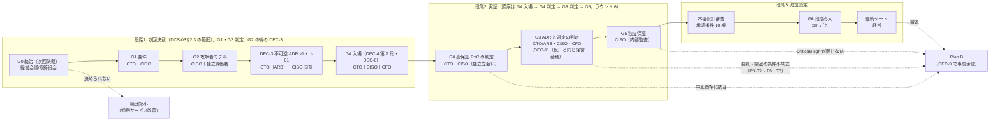

# ゲート計画と Plan B

> 文書ID: DCS-06 / 版: 0.8 / 状態: draft / 最終更新: 2026-10-15（ラウンド 10 cto 追補（ラウンド 10 cto 是正。DEC-4 第 1 段の予算・期間の上限の 2 択の伝播。模擬パネルは自己レビューであり実在の CTO/CISO の決裁ではない）: §3.1 総表の G4 行の注記「上限は変えず、超過は再決裁で扱う」を「上限の扱いは DEC-4 第 1 段の (i)/(ii) で決める」に改め、§5.2 の G4 行に (i)/(ii) それぞれの G4 の工程への帰結を書いた（DCS-03 版 0.12 §4.4、申し送り R9-6）。金額の幅（G4 約 0.4〜2.2 億円）は (ii) の値として残し、(i) の上端 約 2.5 億円を併記した。ゲートの順序は変えていない。§11 への追加（ラウンド 10）H11-1・H11-2、脚注 129、レビュー記録ラウンド 10 を加えた。0.8（ラウンド 9 cfo、High）: G4 の期間に、PoC 系統 1 の立会い下の再実行の感度（DCS-07 §6.4、NA-DCS07-6。k = 1.5 で 7 か月、k ≈ 2.2 で約 8.4 か月）の注記を §3.1・§5.2 の G4 行に加えた。§2・§5.3 の「G2 判定から G4 判定まで 4〜9 か月」に、高い側が 10〜約 11.4 か月になることを併記した。§5.3.1 に、G3 の期間上限を 10 か月以上で選ぶ推奨と、6〜9 か月を選ぶ場合は延長を見込んだ日程と延長時の継続費を決議に併記する規則（CP-7 と同型）を置いた。PoC 延長 1 か月あたりの G3 段の継続費（月 約 0.06〜0.23 億円）を §5.2.2 に、延長を承認した場合の累計支出の参考値を §5.2.3 に加えた。§5.3.1 の CP-3・CP-6 の時期を改め、PR7-2 に DCS-07 申し送り T7-16 の理由を加えた。承認を求める金額の幅（G0〜G3 約 1.5〜10.9 億円、G4 約 0.4〜2.2 億円）、期間上限の幅、ゲートの順序は変えていない。§11 に H10-1〜H10-4、脚注 127・128、末尾「レビュー記録」ラウンド 9 を加えた。0.7（ラウンド 8 ciso）: §7 #3 の RB-13 の期限を G3 から G2 に改め（旧値 G3）、閉じる成果物の「THR-02 §6.1（T-087 案）」を「THR-02 §6.1（RB-13 と T-088）」に改めた。正本は DEC-1 決議文案 12、OPS-01 版 0.6 残課題 14、THR-02 版 0.3 §6.1 である。表の下の注記と §11 H4-1・H4-4 を撤回の経緯として書き換え、脚注 82・83 の版を改め、脚注 125・126 を加え、§11 に H9-1〜H9-4、末尾「レビュー記録」ラウンド 8 を加えた。承認条件 3 の閉じるゲート（G3）、ゲートの順序、金額、期間は変えていない。0.6（PoC/R7反映）: §3.6 G4 の合格基準と §6.3 の表の TC の範囲を POC-01 版 0.5（系統 1 は TC-001〜TC-029、系統 2 は TC-101〜TC-133）に改めた（DCS-00 申し送り C7-5）。PoC 実測レポート POC-02 と独立再現ログ（POC-04（仮）。独立立会人ではない）が示した証拠の再現性の欠落（正式な不合格 5 件は凍結時のコードが残っておらず再現できない）と負荷依存を受け、§3.6 の入場条件と証拠の行に、凍結版のコードの保存・ホスト条件の凍結を加えた。ゲートの順序（§2）、金額、期間は変えていない。§11 に H8-1〜H8-2、末尾「レビュー記録」PoC/R7反映 を加えた。0.5 追補（ラウンド 6 cfo、要員確保）: §5.2.1 NA-DCS06-2・NA-DCS06-11 の確定責任者の欄と §5.3.1 CP-4・CP-5・CP-8 の律速要素に、先行作業の要員の確保の正本（DCS-07 §3.4.1）と確約の決議（DEC-10 決議文案 9）を加え、§5.3.1 の注記に配置率による継続審査を置いた。金額の値は変えていない。0.5: 模擬パネル ラウンド 6 の指摘（legal・cfo、いずれも High）により改めた。(1) ゲートの順序を「G4 入場 → G4 判定 → G3 判定（DEC-11（仮）と同じ会議）→ G5」に一本化し、§2 の mermaid と本文、§3.1 の G3 行、§5.2 の DEC-11（仮）行（期間「約 10〜18 か月（G4 4〜6 か月＋G5 6〜12 か月）」→「約 6〜12 か月（G5）＋G3 判定から G5 入場までの間隔」）、§5.2.3、§5.3、§9 DP42-1 を改めた。(2) §6.5 に「処理者連鎖・越境移転・所在地の約束の変更」の行を、§6.5.1 に顧客への変更通知の期間の行を、§6.6 手順 1・3 に法務の条件 PB-L1〜PB-L4 を加えた。金額の値は変えていない。末尾「レビュー記録」ラウンド 6。0.4: R4K-1（devlead）で NA-DCS06-11 の 2 行を §5.2.2 に追加し、G0〜G2・G3・計の値を改めた（G0〜G2 約 0.7〜5.7 → 約 0.9〜6.7 億円、G3 約 0.4〜2.9 → 約 0.6〜4.2 億円、計 約 1.2〜8.6 → 約 1.5〜10.9 億円。予備費を除く）。R4K-1 の改訂は版 0.3 のまま行われていたので、ラウンド 5（cto）で版を上げた。あわせてラウンド 5（cfo）で、§5.2.3 中止時の累計支出と残存資産、§6.5.1 Plan B の切替え費用の桁（NA-DCS06-12）、§6.4・§6.6 の移行予算の承認手続、§9 DP42-10 を加えた。0.3: ラウンド 4 cfo の指摘により、G3 判定後の継続費用を DEC-11（仮）（DCS-03 §4.11）に揃えた（§0 の範囲マーカー、§3.1 G6 行、§5.2 の構築期の行と DEC-11（仮）の行、§5.2.2 の先行採用 SRE の段落、§6.4 PB-T2 の付議先）。この cfo 是正では金額の値は変えていない。版 0.4 追補（ラウンド 5 cfo、DEC-10 の承認額の伝播）: §11 H4K-5 に反映状況を、H5F-5 に照合文字列の抽出方式を加えた。金額の値は変えていない。末尾「レビュー記録」）
> 対応要求: R-022, R-067, R-074, R-202, R-216, R-277（主）／R-266〜R-275（承認条件 10 項の状態表示）／G-027, G-028, G-036, G-143（関連: G-011, G-030, G-046）
> 依存文書: CONVENTIONS.md, traceability/deliverables.md（DL-42 行、§2.1、§6.1）, traceability/R-requirements.md, traceability/G-goal-criteria.md（§4.2）, 20年運用を前提とした認証・認可基盤提案のCTO CISOレビュー.md, マルチテナントSaaS認証・認可基盤の比較調査と設計指針.md（旧提案書）, 01_governance/assumptions-register.md（GOV-01）, 01_governance/risk-appetite-draft.md（GOV-02）, 01_governance/raci-governance.md（GOV-05）, 01_governance/stop-authority.md（GOV-06）, 01_governance/exception-risk-acceptance.md（GOV-07）, 01_governance/durability-charter-20y.md（GOV-09）, 04_architecture/product-evaluation-exit.md（ARC-14）, 05_adr/ADR-001, ADR-011, ADR-012, ADR-018, ADR-021, ADR-022, ADR-027, 08_operations/operating-model.md（OPS-02）, 08_operations/tco-vendor-lts.md（OPS-03）, 08_operations/phased-rollout.md（OPS-04）, 09_assurance/independent-assurance-plan.md（ASR-01）, 10_integration/README.md（INT-00）, 12_poc/preregistered-test-plan.md（POC-01）, research/RS-01, RS-07, RS-15, RS-16
> 作成方法: AI エージェント（Claude）が上記文書を通読し単独で起草した。承認者・合格基準・中止基準・予算と期間の上限はすべて決裁案であり、決定済みのものはない。本書の判断は自己レビューであり、実在の CTO/CISO の決裁ではない（CONVENTIONS §8）。Phase 4 の模擬パネルによる判定も自己レビューであり、実在の CTO/CISO の決裁にはならない [D]。
> 表の注記: 表のセルでタグのないものは、同じ行に示した R/G/ADR/規程からの設計推論 [D] または当該文書の記述の転記であり、この注記で個別タグに代える。事実を述べるセルには個別にタグと脚注を付けた。

---

## 0. 結論

1. **ゲートは前回レビューの Gate 0〜6 をそのまま正本とし、これに継続ゲートを加えた 8 段とする** [D][^1]。各ゲートに承認者、合格基準、中止・方針転換基準、予算上限、期間上限の 5 項目を置いた（§3）[D]。予算上限と期間上限は、G0〜G2、G3、G4、G5 の期間、構築期について、新規仮定 NA-DCS06-1〜NA-DCS06-9・NA-DCS06-11 による幅を置いた（§5.2）[D]。G0〜G2 には、DEC-3 の前提である Gate 2 の独立レビューの外部評価者の費用を上限キャップ（NA-DCS06-8）で含め、調達のリードタイムをクリティカルパス CP-7 に置いた（§5.2.2、§5.3.1）[D]。G0〜G3 には、G3 で連携側へ提供し DEC-8 第 1 段の前提になる契約試験キット（DL-120）、共有 sandbox（CON-11 K11-3）、BFF 参照実装と第 1 言語の SDK（INT-00 KD-INT00-2）、暫定の疑義窓口（KD-INT00-1）の先行要員と sandbox 基盤費も含め（NA-DCS06-11）、実装の経路を CP-8 に置いた（§5.2.2、§5.3.1、§8。ラウンド 4 R4K-1）[D]。残り 2 言語の SDK は DEC-10 に含めず、提供は G3 判定の後とした（§8）[D]。その和から、G0 から G6 開始までの年数 x を 3〜6 年と算出した（§5.3）[D]。幅は点推定ではなく、確定値でもない [D]。単一の点推定は意思決定に不十分であると GAO はしており、これに従って幅で示した [D][N][^9]（RS-15#69）。G5 の予算と継続ゲートの値は、見積りを取得する前で概算できないため TBD のままとした [D]。これらは次回決裁で承認を求めない [D]。
<!-- next-decision: DEC-1, DEC-2, DEC-4(第1段), DEC-5, DEC-7, DEC-9, DEC-10 / not-next: DEC-3(G2後), DEC-8(G2後), DEC-4(第2段, G4入場前), DEC-6(G4入場前), DEC-11(G3判定時) -->

2. **次回決裁で求める DEC の集合の正本は DCS-03 §2.3 とする。同節は DEC-1（統治規程と DP41-1 を含む）、DEC-2、DEC-5、DEC-7、DEC-9、DEC-10 と DEC-4 第 1 段を次回決裁で求め、不可逆の DEC-3（ADR v1 と U-01）と DEC-8 は次回決裁では求めない** [D][^25]。DEC の一覧と承認者の正本は DCS-03 §2.1 である [D][^25]。DEC-3 は、G1 の入力確定（A-013・A-114、NA-021-1 の標本調査）と Gate 2 の独立レビュー（DP-ASR-3 (b)）の報告・全所見への回答の後、G4 入場の前に付議する [D][^25][^60]。DEC-8 は、第 1 段（GA 候補要素の rc 固定と告知期間）を DEC-3 の後に G3 でキット・sandbox を提供する時点で、第 2 段（v1 凍結）を G4 での TC-119・TC-026 の実測報告の後に付議する [D][^25]。DEC-4 第 2 段と DEC-6 は G4 入場前の同じ会議に置く [D][^25]。G0〜G3 の段階予算は DEC-10（DCS-03 §4.10）で承認を求める [D][^25]。ラウンド 2 で DCS-03 と本書の食い違いを裁定し、DEC-10 を採った（§5.5 の裁定記録）[D]。G0 の判定は DEC-1・DEC-2・DEC-5・DEC-7・DEC-9・DEC-10 と DEC-4 第 1 段の決議によって行う [D]。G1 と G2 は次回決裁の後に、それぞれの承認者が G0〜G2 の期間上限の中で判定する [D]。G1・G2 の判定は DEC として扱わず、次回決裁でも求めない（§4.3）[D]。これはレビューの判定「本番基盤としては不承認、Phase 0 の高保証設計・実証だけ条件付き承認」と、意思決定マトリクスの「Phase 0〜高保証 PoC へ進める: 条件付き承認」に合わせた範囲である [D][^1]。不可逆な標準化・強制移行・対外的な安全性表明は、承認条件 10 項の充足判定（本番設計審査）まで凍結する（GOV-06 S6）[D][^1]。
3. **旧提案書の Phase 0〜3 は「作りながら高保証化する」順序であり、本計画はそれを「統治と攻撃者モデルを先に決め、実証と独立保証を通ってから作る」順序に組み替えた** [D]。旧提案書は高保証化（policy の property test、cross-tenant fuzzing、鍵 rotation 演習）を最後の Phase 3 に置き、Phase 1 で OIDC AS と最小基盤を実装していた [D][^2]。本計画では、旧 Phase 3 の試験群を Gate 4 の入場前に事前登録し、旧 Phase 1・2 の本番向け構築は Gate 5 の後にだけ行う（§4）[D]。旧提案書になかった Gate 0（統治）と Gate 5（独立保証）を新たに独立したゲートにした [D]。
4. **中止・方針転換の既定経路として Plan B（マネージド IdP＋サービス内認可ライブラリ＋共通契約）を定め、DEC-9 で事前に承認することを求める** [D]。Plan B に移っても、識別子（ADR-021）、連携契約 v1（ADR-022、DEC-8）、監査イベントの共通項目、脅威モデルと統治の規程は捨てずに使い続ける設計にした（§6.3）[D]。Plan B の主な代償は、テナント分離と権限剥奪の正しさが約 300 サービスそれぞれの実装に戻ること、managed IdP の出口と鍵の扱いを自社で検証できないことの 2 つであり、受容者を DEC-9 の決議に書く（§6.5）[D]。ただし、出口条件 M1〜M8 をすべて満たす managed 候補は、2026-10-03 時点で確認できていない（ADR-001 D9-2）[D]。そのため、M1〜M8 を満たす候補がない場合の既定経路も定めた（§6.7）[D]。既定経路は「M1・M2 を外し、JIT 移行で出口を作る managed」である [D]。出口不能のリスク（ADR-001 RR-10、RRG-057）は段2（CEO・経営会議）の受容票で受容する [D]。M1・M2 以外の条件も満たせない場合は範囲縮小とする [D]。SRE の下限は確約できても、定常要員の確約が 48 FTE に届かない場合は PB-T8 とする（§6.4.1）。その場合は、④ の部品縮小と ② への転換を、要員差と残余リスク行の増分で比べる。既定は確約 FTE の区間で決める [D]。Plan B も #3 失効配布と #7 PEP coverage 工具を持たないため、そのままでは承認条件 4・6 を満たせない（DCS-08 §3.7）[D]。DEC-9 の事前承認は経路への切替えの承認であり、本番の承認ではない [D]。Plan B を本番に進める場合も承認条件 10 項を退出基準とし、条件 4・6 はサービス内ライブラリ版の検査（B4・B6）で満たすか、満たせない範囲を段2 の受容票で受容する（§6.8）[D]。ゲートごとに中止した場合の累計支出の上限・回収不能分・引き継げる資産を §5.2.3 に、Plan B への切替え費用の桁を §6.5.1 に置いた [D]。Plan B に切り替えると人の認証データの処理者連鎖に managed IdP のベンダーが再処理者として入るので、GDPR 第 28 条第 2 項・第 4 項の承認と変更通知、support の遠隔アクセスによる移転、所在地の約束の維持を §6.5 の残余に載せ、製品選定に法務の条件 PB-L1〜PB-L4 を置いた（§6.6）[D]。顧客契約の変更通知の期間（TBD）は切替えの所要期間の下限になる [D]。発動時の移行予算は、付議先が経路を選んだ後に CFO＋CTO が付議し、CFO（付議基準額を超える場合は経営会議）が承認する手続を DEC-9 の決議文案 6 に置く案とした（§6.4、DCS-03 §4.9）[D][^89]。
5. **本書が応える要求のうち、本書だけで閉じたものはない** [D]。G-027 と G-036 は机上（A）で本書の範囲を満たす形にしたが、作成者以外の検証と模擬パネルの判定が残る [D]。R-022・R-067・R-074・R-202・R-216・R-277 と G-028 は経営・CTO・CISO の決議（E1）がなければ達成にならない [D]。G-143 は提供時期の割当案までで、日付は未定である [D]（§9）。

---

## 1. 位置付けと範囲

### 1.1 本書が決めること・決めないこと

| 本書が決めること | 本書が決めないこと（決める場所） |
|---|---|
| Gate 0〜6 と継続ゲートの承認者・合格基準・中止基準・予算と期間の上限の決め方 | DEC-1〜DEC-10 の決議文案（DL-39 00_decision/03-decision-items.md） |
| 旧提案書 Phase 0〜3・レビュー Gate 0〜6・本プログラム Phase 1〜6 の対応 | 停止の権限者・代行・手続（GOV-06） |
| Plan B の定義、発動条件、移行手順の骨格、残す資産と捨てる資産 | 代替案 4 案の同一基準での比較（DL-44 00_decision/08-alternatives-comparison.md） |
| ゲートごとに確定させる A-ID の範囲と、連携契約の機能ごとの提供ゲート | PoC の TC の合否基準（POC-01）、段階導入の段ごとの条件（OPS-04） |
| 承認条件 10 項の現状と閉じるゲート（G-036） | 残余リスクの受容票（DL-41、GOV-07） |

### 1.2 3 つの番号体系

本書では次の 3 つを区別する [D]。

| 体系 | 意味 | 正本 |
|---|---|---|
| 旧 Phase 0〜3 | 旧提案書の導入ロードマップ | 旧提案書「導入ロードマップ」[^2] |
| Gate 0〜6（G0〜G6）と継続 | 前回レビューが示した決裁の関門 | レビュー「進め方の再設計」[^1]。本書が承認者等を定める |
| 本プログラム Phase 1〜6 | 再提案文書を作る作業工程（準備・分解、一次資料調査、設計・起草、検証、実測・是正、凍結・提出準備） | deliverables.md §2.1[^3] |

- 本プログラムの Phase 1〜6 はすべて「次回決裁の資料を作る工程」であり、Gate を通過させる工程ではない [D][^3]。次回決裁は G-goal-criteria.md の段階1（決裁可能）に当たる [D][^4]。

---

## 2. ゲートの全体像

- **ゲートの順序（正本。ラウンド 6 で一本化）**: G4 入場（DEC-4 第 2 段・DEC-6）→ G4 判定 → G3 判定（DEC-11（仮）と同じ経営会議）→ G5 入場 → 本番設計審査（G5 の期間の末尾）とする [D]。G3 の判定は G4 の判定の後に行い、G4 の判定が G3 判定より前に来る [D]。§5.2 の DEC-11（仮）行の期間、§5.2.3 の中止列、§5.3 の x の算出、§9 DP42-1 はこの順序を前提にする [D]。版 0.4 までは、mermaid が段階2 を「G3 → G4 → G5」と描き、本文が「G3 は G4 入場の後」、§5.2 の DEC-11（仮）行が「G3 判定から本番設計審査まで G4 4〜6 か月＋G5 6〜12 か月」と書いており、3 通りに読めた（ラウンド 6 cfo）[D]。
- G3 を G4 判定の後に置く理由は 3 つある [D]。(1) 製品の最終選定には PoC の実測が要り（ADR-001 D17、ARC-14）、レビューも選定表に tail latency・障害モード・運用人員を含めるよう求めている [D][^1]。(2) G3 判定と同じ会議で決議する DEC-11（仮）は、定常 48〜66 FTE（年 約 4.8〜13.2 億円）の確約を扱う（DCS-03 §4.11）[D][^89]。G4 の結果を見る前に確約すると、その後に PB-T4（G4 中止）が起きた場合に、確約した継続費用が §5.2.3 の回収不能分に加わる [D]。(3) PB-T4 と PB-T2・PB-T8 の付議先を、G4 の結果が分かった時点の同じ経営会議で比べられる [D]。
- G4 の判定が G3 の期間上限（G2 判定から 6〜12 か月）までに出ない場合は、G3 を先に判定しない [D]。§5.1 の原則 3 により、G3 の承認者が延長・範囲縮小・Plan B のいずれかを決める [D]。G2 判定から G4 判定までは 4〜9 か月である。PoC 系統 1 の立会い下の再実行（DCS-07 §6.4）を含めると、高い側は 10 か月（k = 1.5）〜約 11.4 か月（k ≈ 2.2）になる（§5.3）[D][^127]。このため、G3 の期間上限は 10 か月以上で選ぶよう推奨する。6〜9 か月を選ぶ場合は、延長を見込んだ日程であることを決議に併記する（§5.3.1。ラウンド 9 cfo で改めた。版 0.7 までは「6〜8 か月を選ぶ場合」としていた）[D]。
- 不可逆決定の ADR v1（DEC-3）は次回決裁では求めない [D][^25]。DEC-3 は G1 の入力確定（A-013・A-114、NA-021-1 の標本調査）と G2 の独立レビューの報告・全所見への回答の後、G4 入場の前に、G3 の判定より先に決める [D][^25]。G3 では製品選定・TCO・要員確約を判定し、あわせて DEC-3 の前提が PoC の実測と製品評価で崩れていないかを点検する [D]。DEC-3 の関連ゲートは DCS-03 §2.1 のとおり「G2 の後〜G3」とする [D][^25]。版 0.2 の「次回決裁で先行し、G3 で点検」と申し送り H-2 は、DCS-03 §2.3・§4.3.4 に反するので撤回した [D]。
- DEC-3 を G4 入場の前に置くのは、PoC を本番の識別子の構成で試験するためである（DCS-03 §4.3.4 の (4) の帰結）[D][^25]。DEC-3 が G4 入場に間に合わない場合は、PoC の issuer・鍵構成が仮置きになり、PoC の結果を本番の識別子に使えない（同 (3) の帰結）[D][^25]。
- G1・G2 は、次回決裁で G0 が通過した後に判定する [D]。G1 の合格基準には As-Is 棚卸しの初回の置換（DQ-A の I-1）が含まれ、G2 の承認者には DEC-5 で任命される独立評価者が含まれる [D]。どちらも次回決裁より前にはそろわないためである [D]。
- 本番設計審査は、レビューが「本番設計審査へ進む最低条件」とした承認条件 10 項の充足判定であり、R-216 に従い G6 入場の退出基準として扱う [D][^1][^5]。
- 段階の区分は G-goal-criteria.md §4.2 に合わせた [D][^4]。

---

## 3. ゲート別の定義

### 3.1 総表

| ゲート | 承認者（案） | 合格基準（要約） | 中止・方針転換基準（要約） | 予算上限 | 期間上限 |
|---|---|---|---|---|---|
| G0 統治 | 経営会議または取締役会（起案: CISO・CTO・事業責任者の共同） | §3.2 | 決められない場合は共通基盤化をやめ個別サービス改善に縮小 | G0〜G2 の合計で約 0.9〜6.7 億円＋予備費（Gate 2 の独立レビューの上限キャップ 0.8 億円と、契約試験キット・共有 sandbox・暫定疑義窓口の先行要員（NA-DCS06-11）を含む。DEC-10 決議文案 1、§5.2） | G0〜G2 の合計で 6〜12 か月（§5.2） |
| G1 要件 | CTO＋CISO（プロダクトオーナー同席） | §3.3 | 入口を機械列挙できないなら PEP 整備を独立プロジェクト化 | G0 行に含む | G0 行に含む |
| G2 攻撃者モデル | CISO＋独立評価者。期限 G2 の段2・段3 受容票は、判定の前に経営会議・取締役会が決議する（§5.4.1） | §3.4 | 予防・封じ込めの候補がない Critical 脅威が残れば範囲縮小を付議 | G0 行に含む | G0 行に含む |
| G3 ADR と選定 | CTO（アーキテクチャ審査会経由）＋CISO＋CFO。期限 G3 の段2 受容票は、判定の前に経営会議が決議する（§5.4.1） | §3.5 | 要員確保不可なら OPS-02 PB-1〜PB-3、それも不成立なら Plan B。SRE 下限は確約できても定常確約が 48 FTE 未満なら PB-T8（§6.4.1 の順位表で ④ の部品縮小と ② への転換を比べる） | 約 0.6〜4.2 億円＋予備費（キット保守・sandbox 運用・BFF 参照実装と第 1 言語 SDK・暫定疑義窓口（NA-DCS06-11）を含む。DEC-10） | G2 判定から 6〜12 か月（判定は G4 判定の後。§2） |
| G4 高保証 PoC | 入場: CTO＋CISO＋CFO（DEC-4）／判定: CTO＋CISO（独立立会い） | §3.6 | テナント越境・剥奪・可用性目標を現実的構成で満たせない | 約 0.4〜2.2 億円＋予備費（DEC-4。第 1 段で (i) を選ぶ場合の上端は約 2.5 億円）。系統 1 の立会い下の再実行による増分は、高で＋約 0.31 億円（k = 1.5）〜＋約 0.74 億円（k ≈ 2.2）（DCS-07 §6.4）[^127] | 4〜6 か月（DEC-4、NA-DCS07-1）。注記: 系統 1 の立会い下の再実行を含めると、高い側は k = 1.5 で 7 か月、k ≈ 2.2 で約 8.4 か月（DCS-07 §6.4、NA-DCS07-6）。上限の扱いは DEC-4 第 1 段の (i)/(ii) で決める。(i) 期間上限〔7〕か月・予備費を除く上限 約 2.5 億円・総額 2.5 億円 ×（1＋予備費率）。(ii) 期間上限〔6〕か月・2.2 億円 ×（1＋予備費率）とし、〔6〕か月目の再決裁を予定された手順として決議に書く（推奨）[^129]。G3 への波及は §5.3.1 [^127] |
| G5 独立保証 | CISO（プロセス保証は内部監査） | §3.7 | Critical/High が閉じず経営承認付きの受容もない | TBD（見積り取得前のため概算できない。DEC-5） | 6〜12 か月（仮置き） |
| G6 段階導入 | cell ごとに事業オーナー＋SRE＋CISO（開始判定 M1 は CTO） | §3.8 | 新基盤の allow が旧より広い未登録差分で停止 | 構築期の一時増分 約 4.1〜15.8 億円（参考値。上限の候補は G3 判定時の DEC-11（仮）（経営会議＋CFO、DCS-03 §4.11）、確定は本番設計審査の後）[^89] | 構築期 1.5〜3 年（OM-N3 の仮置き） |
| 継続 | 経営会議（年次報告は取締役会） | §3.9 | 継続指標・独立評価・費用が代替案に劣れば置換または Plan B | 再決裁ごと | 再決裁周期（A-101） |

- 承認者の骨格は種資料 seed-03 §3 のゲート表を入力にした [D][^6]。種資料は構成の手掛かりとして使い、技術的主張の根拠には使っていない [D][^6]。
- リスク対応を承認できる権限の階層を役割単位で定めることを、NIST IR 8286B-upd1 は求めている（must）[N][^7]（RS-01#21）。G0 と G5 の例外受容を経営の承認にし、CTO・CISO の単独にしないのはこの考え方による [D]。
- 各ゲートの審査では、そのゲートを確定ゲートとする A-ID の状態一覧を示し、仮置きのまま進む場合は理由・期限・責任者を残課題台帳（DL-110）に記録する [D][^8]。

### 3.2 G0 統治

| 項目 | 内容 |
|---|---|
| 目的 | 「何をもって十分とするか」を経営が決める。レビューは G0 がなければ技術チームが判断基準を持てないとしている [D][^1] |
| 承認者 | 経営会議または取締役会。起案は CISO（リスク）、CTO（実現性・費用・可用性）、事業責任者（残余リスク受容）の共同 [D][^1] |
| 入場条件 | (1) DEC-1 の起案資料（GOV-02 リスク選好案、GOV-03 重大損失シナリオ、データ分類、対象法域の判定 DL-34）が揃う。(2) 対象法域の判定について、法務責任者が署名した CTL-02（版番号を明記）か、法務責任者の確認意見書がある（OI-L01、G-011。証拠 E2）。CTL-02 は、判定がすべて法務署名前の案であり、法的助言でも法務・経営の決定でもないと自ら述べている [D][^16]。G-011 は、法務署名（E2）を合格の条件にしている [D][^4]。(2) が揃わない場合、対象法域は G0 の承認範囲から外す。その場合は DEC-1 の「未完成部分」として、策定責任者（法務責任者）と期限だけを承認する [D] |
| 合格基準 | (1) リスク選好・許容度・キャパシティ、重大損失シナリオ、データ分類の承認と、法務責任者が署名した CTL-02 版〔　〕の判定による対象法域の承認（R-266、G-030、G-011、DEC-1）。判定保留の項目と未完成の部分は、策定責任者と期限を承認する。(2) RACI（GOV-05）、停止権限（GOV-06）、例外・受容手順（GOV-07）、四半期 KRI（GOV-08）の承認（DEC-1 決議文案 7・8。残余リスク台帳の採用 DP41-1 は決議文案 9）。(3) プログラム憲章と 20 年耐久性憲章（DEC-2、DL-40、GOV-09）。(4) 独立保証計画（DEC-5、ASR-01）。(5) Plan B の事前承認（DEC-9、本書 §6）。(6) 不可逆標準化の凍結（R-022、GOV-06 S6）の決議（DEC-1 決議文案 7）。(7) G0〜G3 の段階予算（DEC-10、§5.5） |
| 中止・方針転換 | リスク選好・キャパシティを期限内に決められない場合は、共通基盤化をやめ、個別サービスの改善（PEP の追加、資格情報の整理）に範囲を縮小する [D] |
| 証拠 | E1（決議と議事録）、E2（CTL-02 の法務責任者署名、または確認意見書） |
| 確定させる A-ID | 前提台帳で確定ゲートを G0 とする A-ID（GOV-01 §8 の規則による）[^8] |

### 3.3 G1 要件

| 項目 | 内容 |
|---|---|
| 承認者 | CTO＋CISO（プロダクトオーナー同席） |
| 合格基準 | (1) 主体カタログ（人・顧客管理者・support・service account・workload・外部連携・agent）とライフサイクル状態遷移（R-267）。(2) 業務操作ごとの IAL/AAL/FAL・step-up・SoD・session 上限・回復要件（REQ-03）。(3) 全入口・信頼境界・非同期経路・管理面・緊急経路の DFD（DL-10）。(4) As-Is 棚卸し（A-110〜A-115）の確定または期限付きの仮置き |
| 中止・方針転換 | 入口を機械列挙できない（IDL の静的抽出と実行時トレースの突合が成立しない）場合は、PEP 整備を独立プロジェクトにして先行させ、基盤の G3 を待たせる（ADR-012、A-055）[D] |
| 証拠 | E2（承認済み文書）、E3（要求から統制への追跡） |
| 注記 | A-110〜A-115 の確定ゲートは前提台帳では G1、G-050 では段階2 と食い違っている（02_requirements/as-is-inventory.md）。本書は「G1 で期限付きの仮置きを承認し、実データの棚卸し完了は G3 で判定する」を案とする [D] |

### 3.4 G2 攻撃者モデル

| 項目 | 内容 |
|---|---|
| 承認者 | CISO＋独立評価者（ASR-01 で任命される者） |
| 合格基準 | (1) 攻撃者類型（ATK-xx）ごと・脅威（T-xxx）ごとに、予防・検知・封じ込め・復旧・証拠が記載され、統制（C-xxx）と試験（TC-xxx）へ追跡できる [D][^1]。レビューが列挙した攻撃者（外部、悪意あるテナント管理者、侵害された顧客 IdP、CI/CD 侵害、クラウド管理者、内部 support、policy author ほか）に欠けがない [D][^1]。(2) 残余リスク台帳（DCS-05）で期限を G2 とする段2・段3 の受容票が、次のどちらかの状態にある。一つは、経営会議（段2）または取締役会（段3）で決議済みで、受容記録（E9）と議事録（E1）がある状態。もう一つは、不受容と決まり、是正計画（GOV-07 欄 3-3、是正追跡 E11）に載っている状態である。対象は RRG-008（RR21-01 を含む）、RRG-057、RRG-066（以上、段2・経営会議）と RRG-009（段3・取締役会）の 4 件である [D][^20]。付議の場は §5.4.1 の AC-G2a・AC-G2b とする |
| 合格基準 (2) の注記 | G2 の判定者（CISO＋独立評価者）は、(2) の決議記録があるかを確かめるだけで、受容はしない。CISO は受容権を持たないためである（GOV-07 §0-5）[D][^21]。G2 の判定を DEC として扱わないこと（§4.3）は変えない。受容票の決議は、DEC の番号体系の外にある GOV-07 §4.2 の段階 5（段2 は次回の経営会議、段3 は次回の取締役会）の手続による [D][^21]。(2) を置くのは、期限 G2 の段2・段3 の受容を決める会議が定まっていないと、期限の到来で受容が暗黙に成立してしまうためである。IR 8286B-upd1 §2.3 は、報告期間内に処置できない容認不可のリスクは暗黙に受容されたものになり、「無視」は選択肢にならないとしている [N][^7]（RS-01#22） |
| 中止・方針転換 | Critical の脅威に予防または封じ込めの統制候補が 1 つもない場合は、その脅威に関わる範囲（主体類型・事業領域）を憲章（DL-40）から外すか、G0 へ差し戻す [D]。(2) の受容票が経営会議・取締役会で決まらないまま期間上限に達した場合は、§5.1 の原則 3 の継続審査にかける。その場合、受容票は GOV-07 AT-8 により一段上へ上がる（§5.4.1）[D][^21] |
| 証拠 | E1（受容票の決議の議事録）、E2、E3、E9（受容記録）、E11（不受容とした票の是正追跡） |

### 3.5 G3 ADR と選定

| 項目 | 内容 |
|---|---|
| 承認者 | CTO（アーキテクチャ審査会経由）＋CISO＋CFO |
| 合格基準 | (1) ADR-001〜ADR-029 の採択（不可逆決定は DEC-3（G1 入力確定と G2 独立レビュー完了・回答の後）で先行して決め、G3 では前提が崩れていないかを点検する。G1 入力確定は A-013・A-114 の確定と NA-021-1 の標本調査、G2 独立レビューは DP-ASR-3 (b) の報告と全所見への回答（E6）を指す。DEC-3 は次回決裁では求めない（DCS-03 §2.3）[D][^25][^60]）。(2) 製品の評価表と出口条件 M1〜M8 の判定（ARC-14）。(3) TCO の幅（OPS-03。点推定だけを載せない）。(4) 要員の確約（OPS-02 §10 の PB-1〜PB-3 の判定。SRE 一次は単一拠点 8 名以上または 2 拠点各 6 名以上）。(5) root of trust と侵害 runbook（R-268）、token profile と FAPI 2.0 の採否（R-270）、版付けと rollback 方式（R-272）。(6) 移行の波と要員の平準化（OPS-04 §5.4）。(7) 残余リスク台帳（DCS-05）で期限を G3 とする段2 の受容票が、経営会議で決議済み（E9、E1）か、不受容と決まり是正計画（E11）に載っている。対象は RRG-019、RRG-022（AT-6 類型受容票）、RRG-031、RRG-049、RRG-053、RRG-054（法務の判断が必須）、RRG-055（法務・個人情報保護責任者の判断が必須）、RRG-059、RRG-060、RRG-067 の 10 件と、RRG-030 のうち影響が複数ドメインに及ぶサービスの適用分である [D][^20]。期限 G3 の段1 の行（RRG-018、RRG-030 の残り）は、事業責任者の受容記録（E9）があることを確かめる [D][^20]。付議の場は §5.4.1 の AC-G3 とする。(8) G-054（法域ごとの所在地・保持・削除の要件に基づく cell・保持期間・保存地域・削除方式の決定と法務の署名）と、CTL-02 の決裁案 L-03（保持期間の値）・L-04（データ所在地と越境アクセスの方針）・L-05（削除権と WORM の調停）・L-11（英国利用者の EU リージョン収容）の決定記録（E2）がある。あわせて、PIA-A・PIA-B の承認と DPIA の義務判定（DL-25 の KAP-2）の記録がある [D][^4][^16][^22] |
| 合格基準 (7)(8) の注記 | (7) は §3.4 の合格基準 (2) と同じ理由で置いた [D]。G3 の判定者は受容をせず、記録があるかを確かめるだけである [D]。(8) の 4 つの決裁案は、CTL-02 が期限を G3 としている（L-03 は「G0 で方式、G3 で値」、L-04 は「G0 で方針、G3 で ADR-013」）[D][^16]。KAP-2 の期限も G3 である（PIA-B の B5 に限り G1）[D][^22]。G-054 は法務の署名を合格の条件にしている [D][^4]。G3 で決めないと、G6 の P1 で実データを処理する前提（§3.8 入場条件 (4)）がそろわない [D] |
| 中止・方針転換 | SRE 一次の下限を確約できなければ ADR-001 D17-2 により案D（資格情報層を managed）へ切り替える（PB-1）。プラットフォーム定常要員が A-054 の下限 15 FTE を下回る場合は PB-2 として本書で再決裁する。managed 候補も出口条件 M1〜M8 を満たさず、self-host の要員も確約できない場合は Plan B（§6）を付議する。この場合の既定経路は §6.7 の (i) である [D]。SRE 一次の下限は確約できたが、プラットフォーム定常要員の確約が 48 FTE（OPS-02 DP-OM-2 (b) の下限）に届かない場合は PB-T8（§6.4）とし、経営会議に付議する。付議では、(i) ④ の部品縮小（§6.4.1 の順位表に従い OPS-02 §4.3 の #6・#14・#13・#3・#7 の順に削る）と、(ii) ② への転換（DCS-08 W-2f）を比べる。比べる尺度は、DCS-08 §3.3 の要員差と、§6.4.1 に示した残余リスク行（RRG）の増分である [D][^41][^42] |
| 根拠 | SRE の on-call を回す最少人数は単一拠点で 8 名、2 拠点で各 6 名とする目安が公表されている [V][^10]（RS-15#70）。多ベンダーの並行移行では、34,366 システムのうち 10,013（29.1%）が期限内に移行できなかった [M][^11]（RS-16#78）。要員と移行時期の平準化を G3 の条件にするのはこのためである [D] |
| 証拠 | E1（要員・予算の確約、受容票の決議の議事録）、E2（L-03・L-04・L-05・L-11・G-054 の法務署名、KAP-2 の承認）、E9、E11 |

### 3.6 G4 高保証 PoC

| 項目 | 内容 |
|---|---|
| 入場の承認者 | CTO＋CISO＋CFO（DEC-4） |
| 入場条件 | 予算上限、要員の氏名と稼働率、期間上限、事前登録（POC-01 の凍結）、合成データ限定、パイロット参加確約（G-052）、独立立会人の任命（KP-1）の 7 点。PoC/R7反映: 事前登録の凍結は、凍結版ごとのコードの保存（12_poc/code のコミットと署名付き tag、またはコードの byte 複写を立会人の手の届く場所に保管）と、時間・timeout に依存する TC のホスト条件・乱数源の seed の凍結を含む（DCS-03 DEC-4 第 1 段 決議文案 9、POA&M の OI-C35〜OI-C37）。独立再現（POC-04（仮））で、系統 1 の正式な不合格 5 件が凍結時のコードの消失により再現できず、並行負荷で結果の変わる TC があったためである [D] |
| 判定の承認者 | CTO＋CISO。独立立会人が測定と凍結ハッシュを確認する |
| 合格基準 | 凍結済みの TC がすべて事前登録の合否基準を満たす（POC-01）。系統 1（TC-001〜TC-029。PoC/R7反映 で POC-01 版 0.5 の範囲に改めた）は論理性質だけ、系統 2（TC-101〜TC-133）は性能・可用性を含む。PEP coverage の機械検証（R-269。判定は POC-01 TC-121 の合否基準 (1)〜(7)）[^84]、剥奪 SLO の実測（R-271）、侵害演習の一部（R-275）を含む |
| 中止・方針転換 | (1) テナント越境の漏えい、剥奪の上限超過、可用性目標の未達を、現実的な構成で解消できない [D][^6]。(2) C-1・C-7 に当たる事象は誰でも即時中止でき、再開は CISO が承認する（KP-6 案 c）。(3) 期間上限に達して未凍結・未判定の TC が残る。(1)(3) は Plan B または範囲縮小を CTO＋CISO＋CFO で再決裁する |
| 証拠 | E4（自動試験）、E5（実測生データ）、E8（演習記録）。PoC/R7反映: 立会人のいない系統 1 の自己実行記録（POC-02 の 50 件）と独立再現（`_repro/` の 37 件。実装者と別の AI エージェントによる同じ機械での再実行）は、いずれも E4・E5 に数えない。E5 は、立会人が凍結版のコードを復元して再実行できることを確かめたものに限る [D] |

### 3.7 G5 独立保証

| 項目 | 内容 |
|---|---|
| 承認者 | CISO。プロセス保証は内部監査が行う |
| 合格基準 | 実装チームと報告系統を分けた評価者による設計・コード・IaC・policy・鍵・CI/CD・runbook の評価、OIDF conformance、cross-tenant pentest、red team を実施し（ASR-01、ASR-03）、Critical/High がすべて閉じているか、経営承認付きの期限付き受容票（GOV-07）がある（R-273、R-074）[D][^1] |
| 中止・方針転換 | Critical/High が未解決で受容もない場合は本番移行を承認しない（GOV-06 S1）。受容期限を 2 回延長しても閉じない Critical は Plan B の付議事由とする [D] |
| 根拠 | レビューは「Critical/High の未解決事項は原則として本番移行を止める」とし、例外を期限・補完統制・影響範囲・責任者・失効条件を記した経営承認付きの受容に限っている [D][^1] |
| 証拠 | E6（第三者報告書）、E7（OIDF 試験ログ）、E9（受容記録）、E11（是正追跡） |

### 3.8 G6 段階導入

| 項目 | 内容 |
|---|---|
| 承認者 | 開始判定（GOV-06 M1）は CTO。各段・各 cell の前進は事業オーナー＋SRE＋CISO |
| 入場条件 | (1) 本番設計審査で承認条件 10 項（§7）がすべて「達成」。(2) OPS-04 §5.2 の P0 完了。(3) OPS-02 PB-4（R3・R4 の 24/365 体制、手順習熟率 100%）。(4) 実データ処理の前提（§7 の追加条件 L）。具体的には次の 5 点である。(a) PIA-A・PIA-B の承認と DPIA の義務判定の記録（KAP-2、G-064）。(b) パイロット対象者（従業員を含む）への利用目的の通知・公表（RGM-75）と、保有個人データに関する事項の公表（RGM-77）。(c) CTL-02 L-13 で選択肢 A（共同利用）を採った場合は、共同利用の事前通知事項を各ドメインのプライバシー通知に入れること。(d) 参加テナントとの DPA・委託契約の締結（OI-L05）。(e) shadow 判定の差分記録の保持期間の設定（L-03 の方式による。所有者: 法務責任者＋CISO）。(5) 可用性・容量の前提（§7 の追加条件 S）。具体的には次の 5 点である。(a) SLO-01 の判定系・認証系・control plane の SLO、RTO、RPO、リージョン切替時間の値の決裁（SLI-060〜SLI-067 と SLI-069。R-196、G-057）。(b) K58-5（待機 cell の稼働形態と容量予約）と KD18-2（日本の現用 cell の配置）の決定と、RRG-040-1 の受容票（段2）。(c) 本番相当の複数 cell 構成での順次切替演習の合格（同時に m 個の cell の切替と wave 間の干渉の測定を含み、canary の次の日本の標準 cell 1 つ（W1）より前に行う）。(d) 主・副両リージョンの cell アカウントでの KMS 署名枠の引上げの確認。(e) K58-2（容量見直し周期と k_g）の決定。所有者はいずれも SRE 責任者＋CTO（(a)(b) の決定者は §7 の追加条件 S の表による） |
| 入場条件 (4) の注記 | OPS-04 の P1 は、日本の canary cell の従業員テナントと、参加を申し出たテナントの read-sensitive の要求を対象にする [D][^24]。新系が実在の個人データを処理するのは、ここが最初になる [D]。G4 までは合成データに限っている（DEC-4 決議文案 4、DEC-6）[D][^25]。個人情報保護法 21 条は、取得した個人情報の利用目的を、あらかじめ公表している場合を除き、速やかに本人へ通知または公表することを求めている（第 21 条第 1 項。CTL-02 の写像では RGM-75）[N][^28][^23]。従業員と B2C について当社が取扱事業者になる場合に、この義務が生じる。B2B テナントの利用者については、委託元（顧客）が通知・公表する（RGM-75 の運用欄と、RGM-75〜RGM-78 の注記）[D][^23]。共同利用の事前通知の要否は L-13 の結論による [D][^16]。DPA を含む顧客契約の条項は OI-L05 で未着手である [D][^26]。shadow 差分記録の保持期間は OPS-04 に定めがない [D][^24]。このため (e) を入場条件に置いた |
| 入場条件 (5) の注記 | R-196 は、数値を BIA と実測で決め、空欄のまま本番承認してはならないとする [D][^100]。G-057 は、control plane・decision plane 別の SLO、RTO、RPO、リージョン切替時間、dependency budget が決裁されていることを合格とし、判定者を事業責任者と CTO としている [D][^101]。SLO-01 版 0.3 では値を置いた 27 件がすべて「仮置き」で、決裁済は 0 件である [D][^95]。承認条件 6（§7）は剥奪 SLO と認可エンジンの実測だけを扱い、可用性の SLO・RTO・RPO・切替時間の決裁を含まない [D]。ARC-13 §5.5.3 は、PoC（TC-106）は 1 cell 相当で、複数 cell の順次切替の総所要時間と wave 間の干渉（共有の DNS・配置表の配布・副リージョンの quota）は測れず、複数 cell の演習は「G6 で行う」としている [D][^94]。S2 以上の MU は新系に届かないとき旧系の判定へ落とさない（OPS-04 §5.1 の注記が引く D27-05）ので、新系で判定する cell が増えるほど、主リージョン喪失時に順次切替で戻す cell 数 n が増える [D][^96]。OPS-04 版 0.2 は §6.1A のリージョン切替関門 RX を、新系で判定する日本の標準 cell が 2 つ目になる時点に置いている [D][^96]。しかし canary の次の日本の標準 cell 1 つ（W1）には、テナントの約 21%（8,500 ÷ 4、ADR-013 D13-07）が載る [D][^99]。本書は、W1 の前に本番相当環境での複数 cell 演習（(c)）を置き、RX はその後の本番構成での確認として残す [D]。KMS の署名枠はアカウント×リージョン単位であり、既定は鍵種別ごとに 1,000 req/s（調整可）である [V][^102]（RS-05#44）。副リージョンで待機 cell が現用になれば、その署名は副リージョンの cell アカウントの枠で数えられるので、主リージョンだけの引上げでは足りない [D]。ARC-13 は日本の標準 cell 1 つの平常署名の設計値を 848〜1,272/秒とし、判定線 800/秒を超えるとしている [D][^94]。K58-2 は 18 か月周期のままでは Check を 14.5 か月しか覆えないとしている [D][^94]。K58-5・KD18-2・K58-2 の期限はいずれも G3、RRG-040-1 の受容期限も G3 である [D][^94][^97][^98] |
| 合格基準 | OPS-04 §6 の 10 条件（未登録の allow 拡大差分 0 件、誤 deny 率と評価不能率が予算内、経路網羅 100%、一致判定数、越境否定試験、rollback 演習、剥奪同期、allow cache 除去、告知）[D]。あわせて OPS-04 §6.1A のリージョン切替関門 RX（RX-a〜RX-d）を、日本の 2 つ目の標準 cell を新系で判定する前に満たす。満たさない場合は RRG-040-1 の期限付き受容票（段2、RA-0070）を要件とする（G6 内の判定点の条件であり、開始判定 M1 の条件ではない）[D][^96] |
| 中止・方針転換 | 新基盤の allow が旧より広い差分で停止する [D][^1]。後退（rollback）は自動、前進は人が承認する（OPS-04）。PB-7（移行要員が確約されない組織は後続の波へ） |
| 証拠 | E4、E5、E8、E10 |

### 3.9 継続ゲート

| 項目 | 内容 |
|---|---|
| 承認者 | 経営会議。四半期の KRI と年次の独立評価を取締役会へ報告する |
| 合格基準 | 年次独立評価、四半期 KRI、定期 red team、鍵・IdP・PDP 侵害演習、schema migration 演習、vendor exit 演習の記録があり [D][^1]、GOV-09 §7.2 の再決裁入力が揃う |
| 再決裁の周期 | 初回は G6 開始から 3 年以内、以後 5 年以内（規制強化シナリオは 3 年）[A-101] |
| 選択肢 | 継続／部分置換／全面置換／範囲の縮小／撤退（Plan B）（GOV-09 §7.3） |
| 臨時再決裁 | 標準・規制の事象、供給者の事象、性質の毀損、重大事故、統治の欠落（GOV-09 §7.4） |

---

## 4. 旧 Phase・Gate・本プログラム Phase の対応表

### 4.1 旧提案書 Phase 0〜3 と Gate の対応

| 旧 Phase | 旧提案書の内容[^2] | 対応する Gate | 本計画での扱い |
|---|---|---|---|
| 0 脅威モデルと契約 | DFD、resource/action 命名、token profile、error/reason code、監査 schema の確定。認可 SLO・RTO/RPO・最大 staleness・剥奪反映時間の決裁 | G1（DFD）、G2（脅威）、G3（token profile・監査）、DEC-8（契約 v1） | 経営リスク定義（G0）を前に足した（R-277）。数値の決裁は BIA と PoC 実測の後に行う（DL-20）[D][^1] |
| （旧提案書になし） | — | G0 統治 | 新設。リスク選好・停止権限・例外手順・独立保証計画 |
| 1 最小基盤 | OIDC AS、active tenant flow、BFF、service 別 audience の実装、共通 SDK の配布、File Service への ReBAC 導入、shadow 判定 | G3（AS の選定）、G4（PoC 基盤での実装）、G6（shadow・段階導入） | 本番向けの実装は G5 後に限る。PoC は合成データだけで行う [D] |
| 2 分散認可 | PDP の region/domain 分散、署名付き bundle 配布、workload identity・mTLS・token exchange、outbox・revision-aware cache・失効 channel、非サンプリングの判定監査 | G3（ADR-009・ADR-010・ADR-013・ADR-014）、G4（障害・剥奪の試験）、G6（cell 単位の拡大） | 単一 global PDP への集約を既定にしない（R-265）[D][^1] |
| 3 高保証化 | policy の property/mutation test・formal invariant、DPoP/mTLS 束縛、JIT support・二者承認、cross-tenant fuzzing・PDP 停止・stale ACL・鍵 rotation 演習 | G4（事前登録した攻撃・障害試験）、G5（独立評価）、継続（定期演習） | 最後の Phase から G4 入場前の事前登録へ前倒しした。高保証化は構築の後ではなく前に置く [D] |
| （旧提案書になし） | — | G5 独立保証 | 新設。報告系統を分けた評価者と Critical/High の停止規則 |

### 4.2 本プログラム Phase 1〜6 と Gate の対応

| 本プログラム Phase[^3] | 主な作業 | 寄与する Gate | その Gate で得られる状態 |
|---|---|---|---|
| 1 準備・分解 | 規約、R/G の原子化、成果物計画、前提台帳初版 | 全 Gate（追跡の土台） | 決裁対象と要求の特定（R-202、R-216 の前提） |
| 2 一次資料調査 | RS-01〜RS-18、標準ステータス台帳、主張台帳 | G0〜G3 の根拠 | 根拠の原典照合（E3） |
| 3 設計・起草 | 01〜11 の本体、ADR、PoC 試験計画案、決裁パッケージ初版 | G0・G1・G2 の起案資料、G3 の ADR 案、G4 入場資料 | 次回決裁（段階1）の起案資料 |
| 4 検証 | 自動検査、引用監査、独立反証レビュー、模擬パネル、PoC 事前登録の凍結 | G4 入場（凍結済みの事前登録） | 自己レビュー済み。実在の CTO/CISO の承認ではない |
| 5 実測・是正 | 系統 1 の PoC 実行、数値契約への反映、指摘の是正 | G4 の一部（系統 1 の論理性質のみ） | 系統 2（本番相当環境）と G5 は本プログラムの外で行う |
| 6 凍結・提出準備 | 決裁パッケージの凍結、残課題台帳の確定 | 次回決裁（DCS-03 §2.3 の範囲: DEC-1・DEC-2・DEC-5・DEC-7・DEC-9・DEC-10・DEC-4 第 1 段。G0 の判定と G4 入場の第 1 段。DEC-3・DEC-8 は含まない） | 提出可能な状態。決議（E1）は未取得 |

- 本プログラムの Phase 6 が終わっても、通過したゲートは 0 である [D]。ゲートの通過は、次回決裁で G0 の判定と G4 入場の第 1 段の承認を得たときに始まる [D]。G1・G2 はその後に判定し、DEC-3 は G2 の独立レビューの後に決める（§2）[D][^25]。

### 4.3 3 体系の横断表

| Gate | 旧 Phase | 本プログラム Phase | DEC | 段階 |
|---|---|---|---|---|
| G0 | （なし） | 3 起草 → 4 検証 → 6 提出 | DEC-1, DEC-2, DEC-5, DEC-7, DEC-9, DEC-10（G0〜G2 の予算） | 段階1（次回決裁で判定） |
| G1 | 0 の一部（DFD） | 3 → 4 → 6 | DEC-2, DEC-7（G1 の判定そのものは DEC ではない） | 段階1（次回決裁の後に判定） |
| G2 | 0 の一部（脅威モデル） | 3 → 4 → 6 | DEC-5（立会い範囲。G2 の判定そのものは DEC ではない） | 段階1（次回決裁の後に判定） |
| G3 | 0（契約）・1・2 の選定部分 | 3（ADR 案）、5（系統 1 の実測を入力） | DEC-3（不可逆決定は DEC-3（G1 入力確定と G2 独立レビュー完了・回答の後）で先行。G4 入場の前に決裁し、G3 で点検。次回決裁では求めない）、DEC-8 第 1 段（DEC-3 の後、G3 でのキット・sandbox 提供時の rc 固定）、DEC-10（G3 判定までの予算）、DEC-9（PB-T2・PB-T3・PB-T8） | 段階2 |
| G4 | 3 の試験群、1・2 の PoC 実装 | 3（計画）→ 4（凍結）→ 5（系統 1） | DEC-4（第 1 段は次回決裁、第 2 段は入場前）、DEC-6（入場前）、DEC-8 第 2 段（TC-119・TC-026 の実測報告の後） | 入場は段階1、判定は段階2 |
| G5 | （なし） | 3（RFP/SOW 案のみ） | DEC-5 | 段階2 |
| G6 | 1 の shadow、2 の分散展開 | 3（OPS-04 の計画のみ） | — | 段階3 |
| 継続 | 3 の定期演習 | 3（GOV-09 の計画のみ） | DEC-9（撤退時の既定経路） | 段階3 |

- DEC 欄は、DCS-03 §2.1 の「関連ゲート」欄に揃えた [D]。DEC の決裁内容・承認者・可逆性の正本は DCS-03 §2.1 であり、本表はその写しである [D]。本書と DCS-03 が食い違う場合は DCS-03 を正とする [D]。G0〜G3 の段階予算は DCS-03 §4.10 の DEC-10 に置く。版 0.2 の提案を DCS-03 版 0.3 が正本化し、ラウンド 2 の裁定（§5.5）で確認した [D][^50]。
- 版 0.1 の本表は、DEC-6 を G0 に置いていた [D]。DCS-03 §2.1 では DEC-6 の関連ゲートは G4 なので、G4 に移した [D]。
- G-goal-criteria §4.2 は、段階1 の対応ゲートを「Gate 0 の経営決裁、Gate 1・Gate 2 の机上成果物の承認、Gate 4 入場の決裁。DEC-1〜DEC-9」と書いている [D][^4]。本書は「G1・G2 の机上成果物の承認」を DEC に含めず、次回決裁でも求めない [D]。G-goal-criteria の文言の改訂は申し送る（§11 申し送り H-3）[D]。

---

## 5. 予算と期間の上限

### 5.1 原則

1. **予算は「次のゲートまで」だけを承認し、20 年分や本番構築の総額を先に承認しない** [D]。レビューの判定と退出基準に反するためである（GOV-09 §6）[D][^1]。
2. **金額は幅で示し、点推定だけを決裁に載せない** [D]。GAO-20-195G は、信頼できる見積りの特性に網羅性・文書化・正確性・信頼性を挙げ、信頼性には感度分析とリスク・不確実性分析の取込みが要るとしている [N][^9]（RS-15#69）。
3. **期間上限に達したら、自動的に継続審査にかける** [D]。上限超過の時点で、そのゲートの承認者が「延長（理由と新上限）／範囲縮小／Plan B」のいずれかを決める [D]。延長は 1 ゲートにつき 1 回までを案とする [D]。
4. **予算比率を上限（キャップ）として使わない** [D]。要員費が算出可能な TCO の 87〜90% を占め、比率に合わせて SRE を削ると G3 の要員ゲートを割るためである（OPS-03 §0、§6.2）[D]。

### 5.2 ゲート別の上限（仮置きの幅）

版 0.1 では、予算上限と期間上限を 8 段すべて TBD にしていた [D]。このままでは G-027 の合格条件（全ゲートで上限が埋まる）を満たせず、次回決裁で承認できる予算もなかった [D][^4]。そこで本版では、机上で概算できるゲートに幅を置いた [D]。値は新規仮定 NA-DCS06-1〜NA-DCS06-9・NA-DCS06-11（§5.2.1）と既存の仮定から積み上げた設計推論である [D]。いずれも見積りの点ではなく上限の候補であり、決定ではない [D]。

| ゲート | 予算上限の幅（予備費を除く） | 期間上限の幅 | 所有者 | 決める場 | 積上げ（§5.2.2） |
|---|---|---|---|---|---|
| G0〜G2 | 約 0.9〜6.7 億円 | 6〜12 か月（G0 の決議日から G2 判定まで）[NA-DCS06-1]。CP-7 により 8 か月以上を推奨（§5.3.1） | CTO＋CISO（起案）、CFO。Gate 2 の独立レビューの費目は CISO＋CFO | 次回決裁（DEC-10 決議文案 1[^62]） | As-Is 実データ棚卸し（DQ-A A1）、集計、法務判定と署名（DL-34、OI-L01）、契約管理 2 FTE、NR-2〜NR-4、SRE の先行採用（G2 判定までの在籍分）、Gate 2 の独立レビュー（外部評価者。上限キャップ 0.8 億円、NA-DCS06-8）、契約試験キット（DL-120）の実装・共有 sandbox の構築・暫定疑義窓口（NA-DCS06-11） |
| G3 | 約 0.6〜4.2 億円 | G2 判定から 6〜12 か月 [NA-DCS06-3] | CTO＋CFO | 次回決裁（DEC-10） | RFP・製品評価、SRE の先行採用（G2 判定から G3 判定までの在籍分）、managed の評価契約環境（ARC-14 K14-3）、キットの保守と版付け・共有 sandbox の運用・BFF 参照実装と第 1 言語の SDK・暫定疑義窓口（NA-DCS06-11） |
| G4 | 約 0.4〜2.2 億円（要員費 0.29〜1.26 億円＋非要員費 0.09〜0.91 億円） | 4〜6 か月 [NA-010-5、NA-DCS07-1]。注記（ラウンド 9）: 系統 1 の立会い下の再実行を含めると、高い側は k = 1.5 で 7 か月、k ≈ 2.2 で約 8.4 か月（DCS-07 §6.4、NA-DCS07-6）。PoC 開始から〔1〕か月以内に立会い下の再実行に入ること（NA-DCS07-7）を仮定する。これに入れない場合と、立会い下の実行の累計が TC 数の〔1.5〕倍を超える場合は、DEC-4 の承認者へ報告して再決裁にかける（DCS-07 §6.4 (c)）[^127]。上限の扱いは DEC-4 第 1 段の (i)/(ii) で決める（§3.1 の G4 行と同じ）。(i) を選んだ場合は、G4 の期間上限を〔7〕か月、予備費を除く上端を約 2.5 億円とし、PoC 期間限定の受容（DEC-6）の受容票の期限を同じ期間に合わせる（DCS-05 RRG-068 の期限は H11-2）。(ii) を選んだ場合は、PoC 開始から〔6〕か月目の再決裁（延長・範囲縮小・中止）を G4 の工程に置く [^129] | CTO＋CISO＋CFO | 次回決裁（DEC-4） | DCS-07 §6.2 の要員費と、§5.2.2 の非要員費 |
| G5 | TBD（理由: ASR-05 の RFP/SOW による見積りの取得前であり、評価の範囲・回数で桁が変わる） | 6〜12 か月（評価 3〜6 か月＋是正 3〜6 か月）[NA-DCS06-5] | CISO（DEC-5）＋調達責任者 | G4 入場前（見積り取得後） | ASR-05 の範囲（設計評価、OIDF conformance、cross-tenant pentest、red team） |
| 本番設計審査〜G6 開始（構築期） | 構築期の一時増分 約 4.1〜15.8 億円（参考値） | 1.5〜3 年 [NA-DCS06-6]（OM-N3） | CTO（OM-N3）＋CFO（起案）。上限の候補の承認は経営会議＋CFO | G3 判定時（DEC-11（仮）、DCS-03 §4.11）で上限の候補と構築期の長さの仮置き。確定は本番設計審査の後 [^89] | OPS-02 §4.4 の 41〜79 人年 × 単価 [NA-001-2]。定常要員費と移行専任チームは含まない |
| G3 判定後の要員確約と G3〜本番設計審査（DEC-11（仮）） | 参考: 定常要員 年 約 4.8〜13.2 億円（48〜66 FTE）、先行採用 SRE の G3 判定後の人件費 年 約 0.4〜1.6 億円（定常要員の内数なら重複して足さない）、G3〜本番設計審査の基盤要員費と契約管理費は未算定（式は「在籍する基盤要員 FTE ×（約 6〜12 か月＋g）× 単価」）[^89] | G3 判定から本番設計審査まで 約 6〜12 か月（G5 [NA-DCS06-5]）＋g。g は G3 判定から G5 入場までの間隔で、未定（G5 の RFP・契約の時期による）。G4 は G3 判定より前に終わるので含めない（§2）。定常要員は以後継続 | 経営会議＋CFO（起案 CTO・人事責任者）[^89] | G3 判定時（DEC-11（仮）。次回決裁では求めない）。確約は G4 の判定結果を見た後に行う [^89] | DCS-03 §4.11 の決裁内容 (1)〜(5)。G5 の独立評価（DEC-5）は重複して計上しない。G4 PoC の要員・非要員費（DEC-4）は G3 判定より前に使い終わるので、この期間に入らない |
| 継続 | 再決裁ごとに TBD | 再決裁周期 [A-101] | CFO（耐久性維持枠 T9）＋経営会議 | 各再決裁 | TCO の年次更新（OPS-03）と撤退費用の見積り（GOV-09 §5.5） |

- DEC-11（仮）行の期間は、版 0.4 まで「約 10〜18 か月（G4 4〜6 か月＋G5 6〜12 か月）」としていた [D]。これは G4 を G3 判定の後に数えており、§2 の順序（G4 判定 → G3 判定）と食い違っていた。基盤要員費の算定式の期間が最大 6 か月長くなっていたので、ラウンド 6（cfo）で G5 の期間と間隔 g に改めた [D]。g は G5 の評価者の調達（ASR-05 の RFP は G4 入場前に見積りを取る。§5.2 の G5 行）を G4 の期間中に進めれば 0 に近づく [D]。
- 次回決裁で承認を求める予算は、G0〜G3（DEC-10）と G4（DEC-4 第 1 段の決め方と要員費の上限、第 2 段の総額）だけである [D]。§5.1 の原則 1 により、G5 と構築期の値は承認対象に含めない [D]。G5 と構築期の値は、x の算出と日程リスクの評価にだけ使う [D]。DEC-11（仮）の行の値も次回決裁では承認せず、G3 判定時に経営会議＋CFO が承認する参考値である [D][^89]。
- G5 の予算と継続の値は、本版でも概算できない [D]。理由は表に書いたとおりである [D]。次回決裁ではこれらを承認しないことを、DCS-00 §2 に明記するよう申し送る（§11 申し送り H-5）[D]。
- 予備費率は、根拠のある値がないため置かず、CFO が決める（NA-DCS07-4）[D]。

#### 5.2.1 新規仮定（前提台帳へ登録を要する）

| ID | 内容 | 値 | 根拠・導出 | 確定責任者・期限 |
|---|---|---|---|---|
| NA-DCS06-1 | G0〜G2 の期間上限 | 6〜12 か月 | G1 で棚卸しの初回の置換を行う（DQ-A の I-1）。G0 で法務署名が要る（OI-L01）。この 2 つを並行して行う期間の仮置き [D] | CTO＋CISO、次回決裁 |
| NA-DCS06-2 | G0〜G2 の工数 | As-Is の回答はサービスあたり 2〜5 人日 × 300 サービス。集計は 2〜4 FTE、法務判定は 1〜2 FTE、NR-2〜NR-4 は 2〜4 FTE、契約管理は 2 FTE（NA-022-4）。1 人年は 240 人日 | 起草者の仮置き。サービス数は A-050 による [D]。G0〜G2 に同時に要る内部要員は、本行と NA-DCS06-11 を足して SRE を除き 10〜17 FTE、SRE の先行採用 4〜8 名（NA-DCS06-3）を含めて 14〜25 FTE になる [D]。要員の確保の方法・元の部署・確約者の正本は DCS-07 §3.4.1、確約の決議は DCS-03 §4.10 DEC-10 決議文案 9 とする（ラウンド 6 R6F-P）[D][^124] | CTO＋CFO＋人事責任者、次回決裁（DEC-10 決議文案 9 で各部門長が確約） |
| NA-DCS06-3 | G3 の期間と工数 | 期間は G2 判定から 6〜12 か月。RFP・評価は 2〜4 FTE。SRE の先行採用は 4〜8 名。在籍期間は NA-DCS06-7 の着任時期から G3 判定までとする | 起草者の仮置き。SRE の下限 8 名は NA-001-3 による。G4 と重なる期間の PoC 要員は G4 に計上する [D]。版 0.2 の「在籍 0.25〜0.5 年」は、採用開始を G0 の直後に置く CP-1 と矛盾していたため改めた（ラウンド 2 R2-3）[D] | CTO＋人事責任者＋CFO、次回決裁 |
| NA-DCS06-7 | SRE の先行採用者の着任時期 | G0 の決議日から 3〜6 か月後 | 起草者の仮置き。採用のリードタイムの実績値はない（OM-N4 と同じく最初の採用で実測）[D]。G2 判定（6〜12 か月）と G3 判定（12〜24 か月）までの在籍は、早い側で着任 3 か月・G3 判定 24 か月の 1.75 年、遅い側で着任 6 か月・G3 判定 12 か月の 0.5 年になる [D] | 人事責任者＋CTO、次回決裁 |
| NA-DCS06-4 | G4 の非要員費の幅 | 負荷環境 0.05〜0.5 億円、HSM 0.01〜0.1 億円、managed・RHBK・OEL の評価契約 0.01〜0.1 億円、独立立会人 0.02〜0.2 億円、KMS 0.02 億円未満 | 桁の仮置き。KMS だけは公開価格で確かめた（§5.2.2）。HSM の価格は未確認 | CFO＋CTO、G4 入場前 |
| NA-DCS06-5 | G5 の期間上限 | 6〜12 か月 | 評価 3〜6 か月と是正 3〜6 か月を足した仮置き [D] | CISO、G4 入場前 |
| NA-DCS06-6 | 構築期の長さ（OM-N3） | 1.5〜3 年 | 41〜79 人年を 21〜40 FTE 相当で行う例示（OPS-02 §4.4 は 2 年で換算）の前後に幅を取った [D] | CTO、G3 |
| NA-DCS06-8 | Gate 2 の独立レビュー（外部評価者）の工数と上限キャップ | 工数 1.43〜2.47 人年。内訳は、ASR-05 SOW-01 設計段のうち Gate 2 の範囲（THR-02・THR-03 と DEC-3 対象の ADR 5 本）が 6 役割 × 2〜3 か月 ＝ 1.0〜1.5 人年、SOW-07（独立反証、G-007）が 4 役割 × 1〜2 か月 ＝ 0.33〜0.67 人年、回答後の差分の再評価が 0.1〜0.3 人年。外部の人年単価は 1,000 万〜3,000 万円。費用は約 0.14〜0.74 億円で、上限キャップは高の側を切り上げた 0.8 億円 | 役割の数は ASR-05 §3.4（SOW-01 の体制 6 役割）と §9.1（SOW-07 の体制 4 役割）による [D][^61]。SOW-01 と SOW-07 は同じ法人に兼ねさせない（X-7）ので、2 者の並行とした [D][^61]。期間の月数と外部単価は起草者の仮置きである。外部単価の上限は NA-001-2 の高（2,000 万円）の 1.5 倍とした。評価者の市場単価の原典は確認していない [D]。ASR-05 は期間・人日・費用の値を置かず、RFI の見積りの幅で決めるとしている [D][^61]。キャップは RFI の幅が取れた時点で置き換える | CISO＋CFO。G0（DEC-10 決議文案 1・DEC-5）。RFI の幅による置換も G0 まで（ASR-01 §9） |
| NA-DCS06-9 | Gate 2 の独立評価者の調達のリードタイム | RFP の発出から契約・任命（IND-1〜IND-9 の確認と利益相反の申告を含む）まで 1〜3 か月。レビューは 2〜3 か月、全所見への回答は 1〜2 か月 | 起草者の仮置き。調達の実績値はない [D]。RFP の発出は DEC-5 の承認後にだけ行う（ASR-01 §5.1 の Gate 0 行、§7.2）[D][^60]。RFI は G0 までに行う（ASR-01 残課題 4）[D][^60] | CISO＋調達責任者。最初の RFP で実測し、G2 判定時に見直す |
| NA-DCS06-11 | G0〜G3 の開発者支援の先行要員と共有 sandbox の基盤費（ラウンド 4 R4K-1 で新設） | G0〜G2: キット（DL-120）の実装 2〜3 FTE、共有 sandbox の構築 0.5〜1 FTE、暫定疑義窓口 0.5〜1 FTE（計 3〜5 FTE）× 0.5〜1.0 年。G3: キットの保守と版付け 1〜2 FTE、sandbox の運用 0.5〜1 FTE、BFF 参照実装と第 1 言語の SDK 1〜2 FTE、暫定疑義窓口 0.5〜1 FTE（計 3〜6 FTE）× 0.5〜1.0 年。sandbox の基盤費は G0〜G2・G3 それぞれ 0.005〜0.05 億円。要員は常勤採用でなく、社内の配置換えか期間を限った委託で確保する | 起草者の仮置きであり、工数・単価の実績値はない [D]。作業の範囲は原典で確かめた。DL-120 は MK-01〜MK-08・ドライバ・負例ベクタ・制御 API の OpenAPI・起動仕様を実装し、所有者は PEP SDK・開発者支援チーム（案）、期限は G3 である[^88]。共有 sandbox は K11-3 (a)（常設、運用は SRE の内数、費用・要員は TBD）である[^91]。BFF 参照実装と SDK 3 言語は A-054 の PEP SDK・開発者支援 4 FTE の内側で作るとされ、推奨順は BFF → 第 1 言語 → 残り 2 言語である（KD-INT00-2 (a)）[^92]。暫定疑義窓口は KD-INT00-1 (a) で、P4 の工数を DEC-8 前から使う[^92]。一方、OPS-02 §5.1 の Gate 0〜Gate 3 の採用は PoC 要員と契約管理 2 FTE だけで、P4 の開発者支援を含まない[^93]。A-054 の 4 FTE は定常要員であり、確約は G3（DEC-11（仮））なので、G0〜G3 に着任している根拠はない [D]。sandbox の基盤費は NA-DCS06-4 の評価契約と同じ桁の仮置きで、価格は確認していない [D]。キット・sandbox の運用を SRE の先行採用者に負わせると、R1 の有資格化（OM-N4）が遅れるので、SRE とは別に積んだ [D] | CTO＋PEP SDK・開発者支援チーム（案）＋CFO＋人事責任者、次回決裁（DEC-10。配置元と確約は決議文案 9、確保表は DCS-07 §3.4.1[^124]）。G2 判定時にキットの進捗で見直す |

#### 5.2.2 積上げ

| 費目 | 低 | 高 | 式 |
|---|---|---|---|
| G0〜G2: As-Is の回答（DQ-A A1） | 2.5 人年 | 6.25 人年 | 300 × 2〜5 人日 ÷ 240 [NA-DCS06-2] |
| G0〜G2: 集計（プラットフォームチーム） | 1.0 人年 | 4.0 人年 | 2〜4 FTE × 0.5〜1.0 年 |
| G0〜G2: 法務判定・署名（DL-34、OI-L01） | 0.5 人年 | 2.0 人年 | 1〜2 FTE × 0.5〜1.0 年。外部弁護士の費用は同じ単価の内数とする仮置き |
| G0〜G2: 契約管理（OPS-02 §5.1、NA-022-4） | 1.0 人年 | 2.0 人年 | 2 FTE × 0.5〜1.0 年 |
| G0〜G2: NR-2〜NR-4（識別子の自社ドメイン固定、BOLA 負例の CI 常設、共有シークレットの rotation。DCS-08 K44-2） | 1.0 人年 | 4.0 人年 | 2〜4 FTE × 0.5〜1.0 年。NR-1 は As-Is の回答と同じ作業、NR-5 は契約管理の内数 |
| G0〜G2: SRE の先行採用（着任から G2 判定まで） | 0 人年 | 6.0 人年 | 低は 4 名 ×（G2 判定 6 か月 − 着任 6 か月 ＝ 0 年）、高は 8 名 ×（G2 判定 12 か月 − 着任 3 か月 ＝ 0.75 年）[NA-DCS06-3, NA-DCS06-7] |
| G0〜G2: Gate 2 の独立レビュー（外部評価者。THR-02・THR-03、DEC-3 対象の ADR 5 本、独立反証 G-007。ASR-05 SOW-01 設計段・SOW-07） | 約 0.14 億円 | 0.8 億円（上限キャップ） | 1.43〜2.47 人年 × 外部単価 1,000 万〜3,000 万円 ＝ 約 0.14〜0.74 億円。高の側はキャップ 0.8 億円で計上 [NA-DCS06-8] |
| G0〜G2: 契約試験キット（DL-120）の実装・共有 sandbox（K11-3）の構築・暫定疑義窓口（KD-INT00-1 (a)） | 1.5 人年＋約 0.005 億円 | 5.0 人年＋約 0.05 億円 | 3〜5 FTE × 0.5〜1.0 年。内訳はキット 2〜3、sandbox 0.5〜1、窓口 0.5〜1。sandbox の基盤費は別に計上 [NA-DCS06-11] |
| **G0〜G2 の合計** | **約 0.9 億円**（内部 7.5 人年 0.75 億円＋外部 約 0.14 億円＋sandbox 基盤 約 0.005 億円） | **約 6.7 億円**（内部 29.25 人年 5.85 億円＋外部キャップ 0.8 億円＋sandbox 基盤 約 0.05 億円） | 内部の単価は低 1,000 万円、高 2,000 万円 [NA-001-2]。0.895 億円・6.70 億円を丸めた。外部評価者の行を加える前は約 0.6〜4.9 億円（ラウンド 2 追補 2 R2-c）、キット等の行を加える前は約 0.7〜5.7 億円（ラウンド 4 R4K-1） |
| G3: RFP・製品評価 | 1.0 人年 | 4.0 人年 | 2〜4 FTE × 0.5〜1.0 年 [NA-DCS06-3] |
| G3: 契約管理（G4 と重ならない期間） | 1.0 人年 | 2.0 人年 | 2 FTE × 0.5〜1.0 年 |
| G3: SRE の先行採用（G2 判定から G3 判定まで） | 2.0 人年 | 8.0 人年 | 4〜8 名 × G3 の期間 0.5〜1.0 年 [NA-DCS06-3] |
| G3: managed の評価契約環境 | 0.01 億円 | 0.1 億円 | NA-DCS06-4 と同じ桁 |
| G3: キットの保守と版付け・共有 sandbox の運用・BFF 参照実装と第 1 言語の SDK（KD-INT00-2 (a)）・暫定疑義窓口 | 1.5 人年＋約 0.005 億円 | 6.0 人年＋約 0.05 億円 | 3〜6 FTE × 0.5〜1.0 年。内訳はキット 1〜2、sandbox 0.5〜1、BFF と第 1 言語の SDK 1〜2、窓口 0.5〜1。残り 2 言語の SDK は含まない（§8）[NA-DCS06-11] |
| **G3 の合計** | **約 0.6 億円** | **約 4.2 億円** | 5.5〜20 人年 × 単価 ＋ 評価契約 ＋ sandbox 基盤費。0.565 億円・4.15 億円を丸めた。キット等の行を加える前は約 0.4〜2.9 億円（R4K-1） |
| G4: 要員費 | 0.29 億円 | 1.26 億円 | DCS-07 §6.2 の表の値 |
| G4: 非要員費 | 約 0.09 億円 | 約 0.91 億円 | NA-DCS06-4 の各項目の和 |
| **G4 の合計** | **約 0.4 億円** | **約 2.2 億円** | 予備費を除く |
| **G0〜G3 の合計（DEC-10 決議文案 1・2）** | **約 1.5 億円** | **約 10.9 億円** | 予備費を除く。1.46 億円・10.85 億円を丸めた。外部評価者の行を加える前は約 1.0〜7.8 億円、キット等の行を加える前は約 1.2〜8.6 億円（R4K-1） |

- 低と高は、各項目の低どうし・高どうしを組み合わせた値である。信頼水準は持たない [D]。
- **PoC 延長 1 か月あたりの G3 段の継続費（ラウンド 9 cfo で追加）**: G4 判定は G3 判定より前に来るので（§2）、PoC が延びると G3 の期間もそのまま延びる [D]。G3 の費目のうち期間に比例して積み上がるのは、SRE の先行採用と開発者支援の先行要員である [D]。1 か月あたりの額は次のとおりである [D][NA-DCS06-3, NA-DCS06-11, NA-001-2]。
  - SRE の先行採用: 低 4 名 × 1,000 万円 ÷ 12 ≈ 0.033 億円、高 8 名 × 2,000 万円 ÷ 12 ≈ 0.133 億円。
  - キットの保守と版付け・sandbox の運用・BFF 参照実装と第 1 言語の SDK・暫定疑義窓口の先行要員: 低 3 FTE × 1,000 万円 ÷ 12 ＝ 0.025 億円、高 6 FTE × 2,000 万円 ÷ 12 ＝ 0.1 億円。
  - 計: 月 約 0.058〜0.233 億円（以下、約 0.06〜0.23 億円）。sandbox の基盤費（年 0.005〜0.05 億円）は月 0.005 億円未満なので含めない。RFP・製品評価（2〜4 FTE）と契約管理（2 FTE）は作業量で積んだ費目なので含めない。延長中もこれらの配置が続く場合は、月 約 0.033〜0.1 億円（4〜6 FTE × 単価 ÷ 12）が加わる。これは上側の参照である [D]。
  - 延長の月数 E は、max(0, G2 判定から G4 入場までの月数＋PoC の月数 − G3 の期間上限 L) とする [D]。G4 入場までを高い側の 3 か月とすると、E は次のようになる [D][^127]。L ＝ 6 か月なら k = 1.5 で 4 か月、k ≈ 2.2 で約 5.4 か月。L ＝ 8 か月なら 2 か月と約 3.4 か月。L ＝ 10 か月なら 0 と約 1.4 か月。L ＝ 12 か月ならどちらも 0。L ＝ 6 か月・k ≈ 2.2 のとき、G3 段の継続費は 約 0.31〜1.26 億円（約 5.4 か月 × 0.058〜0.233 億円）である [D]。
  - この継続費は、§5.1 の原則 3 で G3 の延長を承認したときに初めて支出できる [D]。G3 の期間（L＋E）が 12 か月以内に収まる限り、SRE と先行要員の分は上表の G3 の高（1.0 年分）の内側に入る [D]。L を短く選ぶほど、DEC-10 決議文案 2 で承認する額は小さくなり、延長時に追加で付議する額は大きくなる [D]。この額を DEC-10 決議文案 2 の判断材料に加えるよう、DCS-03 に申し送る（§11 H10-1）[D][^128]。
- SRE の先行採用は、G0〜G2 と G3 の 2 行に分けた [D]。着任から G3 判定までの在籍は 0.5〜1.75 年であり、4〜8 名で 2.0〜14.0 人年（0.2〜2.8 億円）になる [D][NA-DCS06-3, NA-DCS06-7, NA-001-2]。版 0.2 は G3 の行だけに「0.25〜0.5 年」で計上し、1.0〜4.0 人年としていた。これは CP-1（採用開始を G0 の直後に置く）と矛盾し、G0〜G3 の段階予算の上限を過小に見せていた（ラウンド 2 R2-3）[D]。
- Gate 2 の独立レビューの行は、ラウンド 2 追補 2 の R2-c（CFO）で加えた [D]。G2 の承認者には独立評価者が入る（§3.4）[D]。ASR-01 の DP-ASR-3 (b) は、DEC-3 対象の ADR 5 本をこのレビューの範囲に含めることを推奨している [D][^60]。DEC-3 は、このレビューの報告と全所見への回答の後に付議する（§0-2）[D][^25]。それにもかかわらず、それまでの G0〜G2 の積上げにはこの費用がなかった [D]。ASR-01 §9 も、版 0.1 では独立評価の費用の決定期限を一括して DEC-4（G4 入場前）としており、期限が G2 より後に来ていた [D][^60]。単価は RFP の前で分からないので、上限キャップ（NA-DCS06-8）を置き、DEC-10 決議文案 1 の上限に含める [D]。キャップは費目の上限であり、見積りではない [D]。RFI の幅がキャップを超えた場合は、§5.1 の原則 3 により G0〜G2 の承認者が継続審査で決める。選択肢は、上限の改定、範囲の縮小（DP-ASR-3 (a) への後退）、DEC-3 の延期である [D]。決議文案 1 への文言の追加は §11 H2-5 で DCS-03 に申し送る [D]。
- キット・sandbox・参照実装・暫定窓口の 2 行は、ラウンド 4 の devlead 指摘 R4K-1で加えた [D]。§8 と CP-3 は、キット（MK-01〜MK-08 を含む DL-120）と共有 sandbox を「G3 で提供」とし、DEC-8 第 1 段の前提にしていた [D][^88]。ところが、それまでの G3 の積上げは RFP・製品評価、契約管理、SRE の先行採用、managed の評価契約環境だけで、これらの実装・運用の工数がなかった [D]。A-054 の開発者支援 4 FTE は定常要員であり、OPS-02 §5.1 の Gate 0〜Gate 3 の採用にも入っていない [D][^92][^93]。DEC-8 第 1 段は DEC-3 の後、G2 判定から 0〜3 か月の時点に来るので（CP-3）、キットの実装は G0〜G2 の間に進める必要がある [D]。そこで実装を G0〜G2 に、保守・運用と BFF・第 1 言語の SDK を G3 に置いた [D]。値は上限の候補であり見積りではない [D]。G3 の高の側（6 FTE）は A-054 の 4 FTE を超える。これは定常の P4 の人数が足りるかの入力になるので、DEC-11（仮）での A-054 の改訂に渡す（§11 H4K-4）[D]。
- 先行要員は、SRE と違い常勤採用にしない（NA-DCS06-11）[D]。範囲縮小や Plan B に移った場合も、配置換えを戻すか委託を終えれば継続費用は残らない [D]。Plan B でも共通契約と契約試験は使い続けるので（§6.3）、キットは Plan B に移っても無駄にならない [D]。
- DEC-10 の決議でこの 2 行が承認されない、または減額された場合は、§8 のキット・sandbox・BFF 参照実装の「G3」は成り立たない [D]。その場合は、§8 の該当行を「DEC-10 の承認後〔　〕か月」に改め、DEC-8 第 1 段を延期する（CP-8）[D]。
- 常勤の採用は、ゲートで中止しても取り消せない継続費用である [D]。G3 判定の後の人件費は、DEC-11（仮）（DCS-03 §4.11、G3 判定時、経営会議＋CFO）で扱う [D][^89]。DEC-11（仮）が G3 判定と同時に決議できない場合のつなぎの予算は、DCS-03 §4.11 の候補 (i)〜(iii)（推奨は (i): DEC-10 の G3 の上限のうち SRE の人件費の月額分を最長〔3〕か月延長）による [D][^89]。各経路での扱いは次のとおりとする [D]。

| 経路 | 先行採用した SRE の扱い（案） | 根拠 |
|---|---|---|
| 本案のまま G3 を通過 | R1 SRE 一次（単一拠点 8 名以上、2 拠点各 6 名以上）の要員にする | DCS-07 §3.2 [^27] |
| PB-1（案D: 資格情報層を managed） | R1 SRE 一次に残す。managed でも、障害時の切替え、顧客連絡、設定変更、ベンダーへのエスカレーションのための on-call は残るため | DCS-07 §3.2「案 D でも SRE の補正は外さない」[^27]（RS-15#71） |
| Plan B（§6.7 (i) を含む） | managed IdP と、サービス内の認可ライブラリ・共通契約の on-call に振り替える | 同上。Plan B も人の認証層に managed を使う（§6.2） |
| 範囲縮小（G0 の中止、§6.7 (iii)） | 中央の実行時部品を持たないため、R1 としては不要になる。既存サービスの SRE 組織へ配置換えする。この経路に限り、後悔しない費用にはならない | §6.7 (iii) |

- 以上から、先行採用の費用は、範囲縮小を除くすべての経路で SRE として使い続ける「後悔しない費用」として扱う [D]。G0 で範囲縮小が決まった場合は、採用を始めない [D]。
- KMS の公開価格の例として、AWS KMS を挙げる。鍵 1 本の料金は月 1 ドル（時間で按分）で、月 20,000 要求までの無料枠がある [V][^17]。要求の単価は、同じ価格ページの計算例で 10,000 要求あたり 0.03 ドルである [V][^17]。鍵を 10^2〜10^3 本、要求を 10^8〜10^9 件として 6 か月使うと、約 0.09 万〜0.9 万ドル（1 ドル 150 円 [NA-001-1] で約 14 万〜135 万円、0.02 億円未満）になる [D]。これは製品の選定ではなく、桁を確かめるための例である [D]。
- CloudHSM の価格ページは HSM 1 台ごとの時間課金であると述べているが、リージョン別の単価は計算ツールか見積り依頼で示すとしている [V][^18]。このため本書では単価を確認できておらず、HSM の幅は未確認の仮置きである [D]。G4 入場前に CFO＋CTO が見積りを取る [D]。
- 合成 100 万人の負荷環境は、容量モデル（K58-4）の負荷段階が決まっていないため、桁の仮置きにとどまる [D]。

#### 5.2.3 中止時の累計支出と残存資産（ラウンド 5 cfo で追加）

各ゲートで中止・方針転換した場合に、それまでに支出し得る額の上限、取り消せない費用、Plan B または範囲縮小に引き継げる資産を示す [D]。累計支出の上限は、その時点までに承認される DEC-10・DEC-4 の上限の累積である [D]。上限は決議で幅の中から選ぶので、表の値は「選び得る上限の幅」であり、支出の見積りではない [D]。

| 項目 | G0 中止（PB-T1、範囲縮小） | G1〜G2 中止（G1・G2 の中止基準、範囲縮小または PEP 整備の独立プロジェクト化） | G4 中止（PB-T4。G4 の判定は G3 判定・DEC-11（仮）の確約より前に来る。§2） | G3 中止（PB-T2・PB-T8） |
|---|---|---|---|---|
| 累計支出の上限（予備費を除く） | DEC-10 による支出は 0。DEC-10 は DEC-1 の成立を条件にし（DCS-03 §4.10 決議文案 6）、G0 で範囲縮小が決まれば SRE の採用も始めない（§5.2.2）[D][^89]。次回決裁までの起草の費用は DEC の範囲外で、本書では算定していない [D] | DEC-10 決議文案 1 の上限まで: 約 0.9〜6.7 億円（§5.2.2 の G0〜G2 の合計）[D] | DEC-10 の G0〜G3 の上限と DEC-4 の上限の和まで: 約 1.9〜13.1 億円（G0〜G3 約 1.5〜10.9 億円＋G4 約 0.4〜2.2 億円）。G3 の期間の途中なので、G3 の上限の未使用分は G3 判定時に失効する [D] | 約 1.9〜13.1 億円（同左）。DEC-11（仮）が G3 判定と同時に決議できず、つなぎの予算 (i) を使う場合は、SRE の人件費の最長 3 か月分（4 名 × 1,000 万円 × 0.25 年 ＝ 0.1 億円〜8 名 × 2,000 万円 × 0.25 年 ＝ 0.4 億円）が加わる [D][^89] |
| 回収不能分（中止しても取り消せない費用） | なし [D] | (1) 先行採用した常勤 SRE（着任済みの者）の人件費 年 約 0.4〜1.6 億円（4 名 × 1,000 万円〜8 名 × 2,000 万円）。範囲縮小では既存サービスの SRE 組織へ配置換えするまで続き、後悔しない費用にならない（§5.2.2 の経路表）[D]。(2) Gate 2 の独立レビューの契約額（上限 0.8 億円、NA-DCS06-8）。解約条項は RFP 前で不明なので、締結済みの額を回収不能とみなす [D]。(3) NR-2 で取得したドメインの取得・維持費（ADR-021 で TBD）[D]。先行要員（NA-DCS06-11）は配置換えか委託なので、戻すか委託を終えれば継続費用は残らない [D] | 左の (1)〜(3) に加え、G4 の非要員費のうち契約済みの分（負荷環境、HSM、評価契約、独立立会人。最大 約 0.91 億円、NA-DCS06-4）[D]。SRE は Plan B に移る場合は Plan B の on-call に振り替えて使い続ける（§5.2.2）[D] | 左と同じ。managed の評価契約環境（0.01〜0.1 億円）も回収不能に含める [D]。PB-T2・PB-T8 で Plan B を選んだ場合、SRE は Plan B の on-call に振り替える（§5.2.2）[D] |
| Plan B・範囲縮小に引き継げる資産（§6.3） | 統治規程（GOV-01〜GOV-09）、脅威モデル、ADR と連携契約の draft（いずれも文書）[D] | 左に加え、As-Is の棚卸し（DQ-A）、攻撃者モデルと Gate 2 の独立レビューの報告、NR-2〜NR-4 の成果（自社所有ドメイン、BOLA 負例の CI、共有シークレットの rotation）、実装途中の契約試験キット（DL-120）と共有 sandbox [D] | 左に加え、PoC 系統 1 の試験（TC-001〜TC-028）と合成データの PoC 環境（§6.6 手順 2 で保存）、キット・sandbox・BFF 参照実装・第 1 言語の SDK（G3 の途中まで）[D] | 左に加え、製品の評価表と M1〜M8 の判定（ARC-14、TC-01-17 の export の実依頼の結果）。Plan B 用 ADR の製品選定（§6.6 手順 3）の入力になる [D] |

- 本表は §2 の順序（G4 入場 → G4 判定 → G3 判定・DEC-11（仮）→ G5）を前提にする [D]。PB-T4 は DEC-11（仮）の確約より前に起きるので、G4 中止の列の回収不能分には定常要員（年 約 4.8〜13.2 億円）が入らない [D]。G3 判定を G4 判定より先に行う日程に変えると、この列は成り立たない（ラウンド 6 cfo）[D]。
- G5 以降（PB-T5）と継続（PB-T7）の行は置かない [D]。G5 の予算は見積り取得前で TBD であり（§5.2）、構築期と定常要員の予算は DEC-11（仮）で決まるので、上限の累積を算定できない [D][^89]。DEC-11（仮）の起草（DCS-03 残課題 18）のときに、本表に G5 と構築期の列を加える [D]。
- 回収不能分の常勤 SRE は、範囲縮小を除く経路では Plan B または PB-1 で使い続ける（§5.2.2）[D]。表の (1) を「損失」と読むのは範囲縮小の場合だけである [D]。
- 値は §5.2.2 の上限の候補と NA-001-2・NA-DCS06-3・NA-DCS06-4・NA-DCS06-7・NA-DCS06-8・NA-DCS06-11 からの算術であり、新たな事実は加えていない [D]。
- **PoC が延びた場合（ラウンド 9 cfo で追加）**: G4 中止と G3 中止の列の約 1.9〜13.1 億円は、DEC-10 と DEC-4 で承認する上限の累積であり、延長を含まない [D]。PoC 系統 1 の立会い下の再実行で期間上限を超え、§5.1 の原則 3 で延長を承認した場合は、次の 2 つが加わる [D][^127]。
  - (1) G4 の増分: DCS-07 §6.4 の感度による要員費と独立立会人の費目の増分の和。高は k = 1.5 で＋約 0.31 億円、k ≈ 2.2 で＋約 0.74 億円。低は＋約 0.08 億円と＋約 0.19 億円。k = 1.5 の高の増分は、予備費率 15% 以上なら G4 の予備費の内側に入る（DCS-07 §6.4 (b)）[D][^127]。
  - (2) G3 段の継続費: 月 約 0.06〜0.23 億円 × E か月（§5.2.2）。L を 12 か月で選べば E は 0 である。L を短く選んだ場合も、L＋E が 12 か月以内なら、(2) を足した額は L ＝ 12 か月で選んだ上限を超えない [D]。
  - したがって、延長を承認した場合の累計支出の参考値（予備費を除く）は、低い側で約 2.0〜2.4 億円、高い側で約 13.4〜13.8 億円である [D]。低い側は、1.9 億円に (1) の低（0.08〜0.19 億円）と、L ＝ 6 か月での (2) の低（k = 1.5 で 4 か月 × 0.058 ≈ 0.23 億円、k ≈ 2.2 で約 0.31 億円）を足した。高い側は、13.1 億円に (1) の高（0.31〜0.74 億円）を足した。(2) は上の理由で上限の内側に入る [D]。この参考値は承認額ではなく、延長の継続審査の判断材料である [D]。

### 5.3 G0 から G6 開始までの年数 x

- 計画期間内の再決裁の最少回数 N は、G0 から G6 開始までの年数を x として N = 1 + ⌊(17 − x) ÷ 5⌋（規制強化は ÷ 3）である [D][A-100, A-101]（GOV-09 §7.1）。
- x は本書で決める値とされている（GOV-09 T11）[D]。本版では、§5.2 の期間上限の和から幅で算出する [D]。
  - G0〜G2 の 0.5〜1.0 年、G3 の 0.5〜1.0 年、G5 の 0.5〜1.0 年、構築期の 1.5〜3 年を足すと、x は 3〜6 年になる [D][NA-DCS06-1, NA-DCS06-3, NA-DCS06-5, NA-DCS06-6]。
  - G4 は G3 の期間の内側で行い、G4 の判定は G3 判定より前に来るので（§2）、別に足さない [D]。G2 判定から G4 入場まで 0〜3 か月、PoC が 4〜6 か月で、合わせて 4〜9 か月である（立会い下の再実行を含めると、高い側は 10 か月（k = 1.5）〜約 11.4 か月（k ≈ 2.2））[D]。PoC 系統 1 の立会い下の再実行を含めると、PoC の高い側は k = 1.5 で 7 か月、k ≈ 2.2 で約 8.4 か月になるためである（DCS-07 §6.4、NA-DCS07-6）[D][^127]。DEC-4 第 2 段は G4 入場の時点に置くので（§2）、0〜3 か月に含まれる。G4 の報告は、PoC の「凍結・立会い・報告」の期間に含まれる（DCS-07 §6.3）。G4 判定から G3 判定の会議までの間隔は含めていない [D]。合計は G3 の期間上限の高い側（12 か月）には収まる。低い側（6 か月）に収まるのは、G4 入場と PoC が短い側に近い場合だけである。k = 1.5 の PoC の高い側（7 か月）では、G4 入場が G2 判定の直後でも 6 か月には収まらない [D]。G3 の期間上限の選び方は §5.3.1 に置いた（ラウンド 9 cfo）[D]。収まらない場合は G3 を先に判定せず、§5.1 の原則 3 で G3 を延長する（§2）[D]。
  - 本番設計審査は G5 の期間の末尾で行うものとし、別に足さない [D]。
- x = 3〜6 年のとき、基準シナリオでは N = 3、規制強化シナリオでは N = 4〜5 である [D][A-100, A-101]。
- §5.1 の原則 3 では、延長を 1 ゲートにつき 1 回まで認める [D]。4 段（G0〜G2、G3、G5、構築期）のすべてで、上限と同じ長さの延長を使うと、x は最大 12 年になり、N は 2 に減る [D]。x が 8 年以上になると N が 1 回減るので、延長の承認時には x への影響を併記する [D]。
- G3 の期間上限を §5.3.1 の推奨どおり 10〜12 か月で選ぶと、x の低い側は 0.5＋約 0.83＋0.5＋1.5 ≈ 3.3 年になる [D]。N は基準シナリオで 3、規制強化シナリオで 4〜5 のままである（ラウンド 9 cfo）[D][A-100, A-101]。
- x の確定は、所有者 CTO＋CISO、期限 G4 入場前のままとする [D]。

#### 5.3.1 クリティカルパス（ガント相当）

月数は G0 の決議日を 0 とした相対値である [D]。幅の低い側と高い側を「低〜高」で示す [D]。

| 経路 | 開始 | 終了（判定点） | 使える期間 | 律速する要素 | 間に合わない場合 |
|---|---|---|---|---|---|
| CP-1 SRE 採用 → PB-1 判定 → G3 | G0（0 か月） | G3 判定（12〜24 か月） | 12〜24 か月 | 採用のリードタイムと、新任者が有資格者になるまでの期間（OM-N4。未知）。下限 8 名（NA-001-3） | PB-1 により案D（ADR-001 D17-2）。案D の候補も M1〜M8 を満たさなければ §6.7 |
| CP-2 RFP → 製品評価 → G3 | G2 判定（6〜12 か月） | G3 判定（12〜24 か月） | 6〜12 か月 | managed の評価契約環境（ARC-14 K14-3）、TC-01-17（export の実依頼）の所要日数 | G3 の期間を 1 回延長するか、範囲縮小 |
| CP-3 G1 入力確定・G2 独立レビュー → DEC-3 → DEC-8 | G1 の入力確定と G2 の独立レビューの報告・全所見への回答の後（G2 判定の 6〜12 か月以降） | DEC-3 は G4 入場（6〜15 か月）の前。DEC-8 第 1 段は G3 でのキット・sandbox 提供時。DEC-8 第 2 段は G4 での TC-119・TC-026 の実測報告の後（10〜21 か月に報告期間を足した時期。系統 1 の立会い下の再実行を含めると、高い側は k = 1.5 で 22 か月、k ≈ 2.2 で約 23.4 か月。DCS-07 §6.4。ラウンド 9 で追加）[^127] | DEC-3 まで: G2 判定から G4 入場までの 0〜3 か月。DEC-8 第 2 段まで: G2 判定から 4〜9 か月（立会い下の再実行を含めると、高い側は 10〜約 11.4 か月）| G2 の独立レビューへの回答（E6）、G1 での A-013・A-114 の確定と NA-021-1 の標本調査、DEC-3 の前置論点 3 件（ADR-018 K18-5、ADR-026 L26-2、CTL-02 L-13）。DEC-3 が延期されると DEC-8 も延期される（DCS-03 §5.1）。DEC-8 第 1 段は、キット（DL-120）と共有 sandbox の提供にも律速される（CP-8） | DEC-3 が G4 入場に間に合わなければ、PoC の issuer・鍵構成を仮置きで進めるか G4 入場を待つかを CTO＋CISO が選ぶ。DEC-8 は延期し、preview・rc の版で連携を続ける（DCS-03 §4.3.4 の遅延の式）|
| CP-4 法務署名（OI-L01）→ G0 | 起案時 | G0（0 か月） | 次回決裁まで | 法務の判定 32 行（OI-L01）。G0 の後は法務判定 1〜2 FTE の配置（DCS-07 §3.4.1、DEC-10 決議文案 9）[^124] | 対象法域を G0 の承認範囲から外し、期限付きの未完成部分にする（§3.2） |
| CP-5 As-Is の棚卸し（DQ-A）→ G1 → G3 | G0（0 か月） | G1（6〜12 か月）で初回の置換、G3 で完了判定 | 6〜24 か月 | 300 サービスの回答率（DQ-A の下限は TBD）。集計 2〜4 FTE の配置（DCS-07 §3.4.1、DEC-10 決議文案 9）[^124] | DP42-6 (a) により期限付きの仮置きで進め、G3 で完了を判定する |
| CP-6 G4 PoC → G5 → 構築 → G6 | G4 入場（6〜15 か月） | G6 開始（36〜72 か月）。ラウンド 9 で追加: G4 の期間は 4〜6 か月で、系統 1 の立会い下の再実行を含めると高い側は 7〜約 8.4 か月である（DCS-07 §6.4）[^127]。G4 判定は遅くとも 22 か月（k = 1.5）〜約 23.4 か月（k ≈ 2.2）に来る。G3 の期間上限を 12 か月で選べば、G3 判定（12〜24 か月）と G6 開始の幅は変わらない。G3 の期間上限を短く選ぶと、選んだ日程から最大 約 5.4 か月（L ＝ 6 か月、k ≈ 2.2）遅れる。遅れは上の幅の内側に収まる | 約 2.5〜4.75 年（30〜57 か月） | G5 の是正と構築期の要員の確保（OPS-02 §4.4）。G4 では、系統 1 の立会い下の再実行とその前提の改修（NA-DCS07-7） | x が 8 年以上になる延長は、§5.3 により N の減少を併記して再決裁する |
| CP-7 評価者の RFP → 任命 → G2 レビュー → 回答 → G2 判定・DEC-3 | G0（0 か月。RFI は G0 までに完了。RFP の発出は DEC-5 と DEC-10 決議文案 1 の承認後） | G2 判定（6〜12 か月）。DEC-3 は回答の後、G4 入場（6〜15 か月）の前 | 回答の完了まで 4〜8 か月（任命 1〜3 か月＋レビュー 2〜3 か月＋回答 1〜2 か月、NA-DCS06-9）。G1 の入力確定（A-013・A-114）で ADR を改版した場合は、差分の再評価に 1〜2 か月を足して 5〜10 か月 | 評価者の調達と任命（IND-1〜IND-9 の確認、利益相反の申告）。SOW-01 と SOW-07 は別法人（X-7）なので 2 件の調達になる[^61]。G2 の承認者に独立評価者が入るので、任命前は G2 を判定できない（§3.4） | G0〜G2 の期間上限を 1 回延長する（§5.1 の原則 3）。DEC-3 は CP-3 の規則で延期し、DEC-8 も延期する。予算が G0 で承認されない場合は、承認の会議まで CP-7 の起点がずれる |
| CP-8 キット（DL-120）・共有 sandbox の実装 → G3 での提供 → DEC-8 第 1 段（ラウンド 4 R4K-1 で追加） | G0（0 か月。要員の配置は DEC-10 決議文案 1 の承認後） | DEC-8 第 1 段（DEC-3 の後。G2 判定から 0〜3 か月、すなわち 6〜15 か月） | 6〜15 か月 | 先行要員 3〜5 FTE の配置（NA-DCS06-11。常勤採用を待たず配置換えか委託。配置元と確約は DEC-10 決議文案 9、確保表は DCS-07 §3.4.1[^124]）。DL-120 の受入れ基準（全モックの起動記録、G-121 の 4 種の負例の再現、CON-11 §10.1 の判定の再現）[^88]。DEC-3 で issuer の粒度などが決まった後の MK-01 の改修（CON-11 L11-1） | DEC-8 第 1 段を延期し、preview・rc の版とローカルのモックで連携を続ける（CP-3 と同じ）。DEC-10 で先行要員が承認されない場合は、§8 のキット・sandbox・BFF 参照実装の G3 を「DEC-10 の承認後〔　〕か月」に改める（§5.2.2 の注記） |

- CP-1 が最も短い余裕で効く [D]。OM-N4 が未知なので、SRE の採用開始を G0 の直後に置く [D]。これは OPS-02 §5.1 の「G3 まで」の採用開始を前倒しする提案である [D]。費用は、着任（G0 の 3〜6 か月後、NA-DCS06-7）から G3 判定までの在籍月数で積み上げ、§5.2.2 の G0〜G2 と G3 の「SRE の先行採用」の 2 行に分けて含めた。DEC-10 で承認を求める [D]。
- CP-7 は、G0〜G2 の期間上限の高い側（12 か月）には収まる [D]。回答の完了は 4〜8 か月（改版がある場合は 5〜10 か月）なので、2〜8 か月の余裕が残る [D][NA-DCS06-9]。低い側（6 か月）に収まるのは、任命・レビュー・回答のすべてが短い側に近い場合だけである。具体的には、改版がなく、合計が 6 か月以内に収まる組合せに限られる [D]。そこで、DEC-10 決議文案 1 の期間上限は 8 か月以上で選ぶよう推奨する [D]。8 か月は、改版のない場合の高い側に当たる [D]。6〜7 か月を選ぶ場合は、§5.1 の原則 3 による延長を見込んだ日程であることを決議に併記する [D]。
- **G3 の期間上限の選び方（ラウンド 9 cfo で追加。CP-7 と同型の規則）**: G2 判定から G4 判定までは、系統 1 の立会い下の再実行を含めると、高い側で 10 か月（k = 1.5）〜約 11.4 か月（k ≈ 2.2）になる（§5.3）[D][^127]。G4 判定は G3 判定より前に来るので（§2）、この期間が G3 の期間上限を超えると G3 の延長が確定する [D]。そこで、DEC-10 決議文案 2 の G3 の期間上限は 10 か月以上で選ぶよう推奨する [D][^128]。10 か月は k = 1.5（NA-DCS07-6）の高い側に当たる。12 か月なら k ≈ 2.2 の上側の参照まで収まる [D]。6〜9 か月を選ぶ場合は、次の 2 点を決議に併記する [D]。(1) §5.1 の原則 3 による延長を見込んだ日程であること。(2) 延長 1 か月あたりの G3 段の継続費（月 約 0.06〜0.23 億円。§5.2.2）。G3 の期間上限の幅（6〜12 か月、NA-DCS06-3）は変えない。G4 入場と PoC が短い側に近い場合は 6 か月でも成り立つからである [D]。
- CP-7 は CP-3 の前段に当たる [D]。CP-7 が遅れると、G2 判定、DEC-3、DEC-8（第 1 段は DEC-3 の後、第 2 段は G4 の実測報告の後）が順に遅れる [D][^25]。並行開発を始められるのは DEC-8 第 1 段の後なので、その開始も遅れる [D]。CP-1 と CP-7 はどちらも G0 の直後に着手し、どちらも G0 の予算の承認を要する [D]。
- CP-8 も CP-3 と並ぶ DEC-8 第 1 段の前段である [D]。版 0.3 までの CP 表は、キットと sandbox を「G3 で提供」とする前提だけを置き、実装の起点・要員・予算を置いていなかった（R4K-1）[D]。DEC-8 第 1 段は G2 判定から 0〜3 か月で来るので、G2 判定の後にキットの実装を始めると間に合わない [D]。CP-1・CP-7・CP-8 の 3 つは G0 の直後に着手し、いずれも DEC-10 決議文案 1 の承認を要する [D]。
- CP-1・CP-4・CP-5・CP-8 は、いずれも G0〜G3 の先行作業の要員が律速する（ラウンド 6 R6F-P）[D]。版 0.5 までの本書は予算（§5.2.2）だけを置き、要員を確保できなかった場合の扱いを持たなかった [D]。DEC-10 決議文案 9 は、役割別の配置率が閾値〔　〕% を下回った場合に、G2 判定を待たずに §5.1 の原則 3 の継続審査にかけるとした [D][^124]。継続審査では各 CP の「間に合わない場合」の経路を選ぶ [D]。SRE の採用が遅れた場合の G3 の遅延月数（約 max(0, 実際の着任月＋OM-N4 − G3 判定の予定月)）と、委託 SRE・PB-1・G3 の延長の 3 経路は DCS-07 §3.4.2 に置いた [D][^124]。

### 5.4 日付の決め方

- 固定するのは「次のゲートの日付」だけとし、その先は相対期間（期間上限）で示す [D]。
- G0 の日付は経営会議・取締役会の開催予定から決める（所有者: CISO＋CTO、期限: 次回決裁の起案時）[D]。損失シナリオ等で「期限: G0」としている項目は、この日付で確定する（GOV-03）[D]。

#### 5.4.1 G2・G3 の判定に先立つ受容票の付議枠

G1・G2 の判定は DEC として扱わない（§4.3）[D]。しかし、残余リスク台帳では期限を G2 とする段2・段3 の行が 4 件、期限を G3 とする段2 の行が 10 件（ほかに一部が段2 の RRG-030）ある [D][^20]。段2 の受容は経営会議、段3 の受容は取締役会が決める（GOV-07 §3.1、§4.2 の段階 5）[D][^21]。G2・G3 の承認者はどちらの会議体でもない [D]。そこで、G2・G3 の判定の前に、次の付議枠を経営会議・取締役会の開催予定に置く [D]。日付は、本節の規則（次のゲートの日付だけを固定する）により、G0 の決議の後に CISO＋CTO が会議の開催予定から決める [D]。

| 付議枠 | 時期 | 会議 | 付議する受容票（DCS-05） | 備考 |
|---|---|---|---|---|
| AC-G2a | G2 判定の前。RRG-008 は DEC-3 の決議と同じ経営会議か、それより前の経営会議 | 経営会議（段2） | RRG-008（RR21-01 を含む）、RRG-057、RRG-066 | DEC-3 は RR21-01 の受容票を前提にしている（DCS-03 §2.1 の DEC-3 行、§4.3 の決裁条件 1、決議文案 2）[D][^25]。RR21-01 は DCS-05 で RRG-008 に集約されている [D][^20]。RRG-066 は、M&A の決定を伴う場合も経営会議である [D][^20] |
| AC-G2b | G2 判定の前。AM-2 の決裁と同時 | 取締役会（段3） | RRG-009 | 段3 の唯一の行である [D][^20] |
| AC-G3 | G3 判定の前 | 経営会議（段2） | RRG-019、RRG-022（AT-6 類型受容票）、RRG-031、RRG-049、RRG-053、RRG-054、RRG-055、RRG-059、RRG-060、RRG-067、RRG-030 の段2 適用分 | RRG-054・RRG-055 は法務（RRG-055 は個人情報保護責任者も）の判断を付けて付議する [D][^20]。段1 の RRG-018、RRG-030 の残りは事業責任者が G3 判定までに決め、記録を AC-G3 に報告する [D] |
| AT-8 の上げ先 | 期限の到来時 | 段2 の票は次回の取締役会（段3）。段3 の票は取締役会への臨時報告 | 期限までに AC-G2a・AC-G2b・AC-G3 で決まらなかった票 | GOV-07 は、期限を過ぎた未処置のリスクを元の段の一段上へ自動で起票し、元が段3 なら段3 のまま臨時報告するとしている（AT-8、§4.4）[D][^21] |

- 「決議済み」には不受容の決議を含む [D]。不受容と決まった票は、是正計画（GOV-07 欄 3-3）と是正追跡（E11）に載せる [D][^21]。
- DEC-3 の時期は、DCS-03 §2.1・§2.3 のとおり「G2 の後〜G3」（G4 入場の前）である [D][^25]。版 0.2 の本書 §2・§4.3 の「次回決裁で先行し、G3 で点検」は、ラウンド 2（cto、Critical）の対応で DCS-03 に合わせ、H-2 は撤回した（残課題 15 は解消）[D]。AC-G2a の「DEC-3 と同じかそれより前の経営会議」は、この時期で成り立つ [D]。

### 5.5 G0〜G3 の段階予算の決裁（DEC-10）

- DCS-03 版 0.2 までの DEC の定義では、G0 から G4 入場までに行う作業の支出を承認する DEC がなかった [D]。DEC-4 は G4 PoC の予算だけを扱う（DCS-03 §4.4）[D][^50]。その作業とは、法務判定（DL-34）、As-Is の実データ棚卸し、RFP、製品評価の契約環境、契約管理 2 FTE、SRE の先行採用、NR-1〜NR-5 の先行着手である [D]。DCS-08 の K44-2 も、NR-1〜NR-5 を G0〜G1 で着手すれば案の選択前に費用が生じる、と書いている [D]。
- 本書の版 0.2 は DEC-10 の新設を推奨したが、DCS-03 版 0.2 は「DEC の番号体系は DEC-1〜DEC-9 のまま」としていた [D][^50]。正本（DCS-03）にない DEC を決裁パッケージ内で推奨する状態であった。そこでラウンド 2 で、DCS-03 と本書の両方の起草者の立場で次のとおり裁定した [D]。この裁定は起草者の案であり、実在の CFO・CTO・CISO の決定ではない [D]。

**裁定記録（DP42-7、ラウンド 2）**

| 案 | 内容 | 評価 |
|---|---|---|
| (a) DEC-10 を新設（**採用**） | DCS-03 に §4.10 を置き、CONVENTIONS §2 と deliverables §6.1 の DEC の範囲を DEC-1〜DEC-10 に改める | DCS-03 版 0.3 が §2.1・§2.3・§4.10 で正本化しており、DCS-00・DCS-01 も DEC-1〜DEC-10 に改められている [D][^50]。G0〜G3 の作業は G4 PoC の中止と独立に続ける「後悔しない施策」であり（DCS-08 K44-2）、PoC の決裁と束ねない方が、PoC の中止や DEC-4 第 2 段の不承認が予算に及ばない [D]。見直し日（G2・G3 判定時）も DEC-4（PoC の中間時点と期間上限の末日）と分けられる [D][^50] |
| (b) DEC-4 第 1 段に含める | DEC-4 第 1 段に G0〜G3 の段階予算の決議文を加える | DEC の番号体系（CONVENTIONS §2 の DEC-1〜DEC-9）と、それに依存する deliverables §6.1、DL-37・DL-39 の行を改めずに済む [D][^49]。承認者（CTO＋CISO＋CFO）と会議（次回決裁）も DEC-4 第 1 段と同じである [D][^50]。ただし、DEC-4 は DEC-1・DEC-5 を前提にしている（第 2 段は DEC-6 も前提）[D][^50]。このため、G0 直後の支出がそれらの前提に縛られる [D] |
| (c) 決裁しない | 各部門の既存予算で賄う | G4 入場までの作業に予算の裏付けがなく、G0 合格基準 (7) を満たせない [D] |

- 採らなかった (b) の論拠（番号体系と関連 5 文書以上を改めずに済むこと、承認者と会議が同じであること）を dissent-log に登録するよう申し送る（§11 申し送り H-1）[D]。
- 版 0.2 の本書は、(b) を推奨しない理由に「DEC-4 は DEC-1・DEC-5・DEC-6 の成立を前提にする」と書いていた [D]。DCS-03 §2.1 の前提欄では、DEC-6 を前提にするのは第 2 段だけである [D][^50]。この点は不正確だったので上表で改めた [D]。結論 (a) は変わらない [D]。
- 本ラウンドの途中で、本書の一部に「DEC-4 第 1 段 決議文案 8・9」とする表記が一時入った。上の裁定に合わせて、すべて DEC-10 に戻した [D]。
- DEC-10 の決裁内容、承認者（CFO＋CTO＋CISO。上限の合計が付議基準額を超える場合は経営会議）、前提（DEC-1。未了なら条件付き）、見直し日、決議文案の正本は DCS-03 §4.10 である [D][^50]。決議文の金額の範囲は §5.2 の表の値を正とし、DCS-03 §4.10 はそれを参照する [D]。

---

## 6. Plan B（中止・方針転換時の既定経路）

### 6.1 目的

- 中止を「失敗の後始末」ではなく「事前に承認された経路への切替え」にする [D]。ゲートで中止基準に当たったとき、代わりの経路の議論から始めると、止める判断そのものが遅れるためである [D]。
- Plan B は DEC-9（CTO＋CISO が承認し、経営へ報告）で次回決裁に事前承認を求める [D][^3]。G-028 はこの承認記録（E1）で閉じる [D][^4]。

### 6.2 構成

| 層 | Plan B の構成 | 本案（ADR 群）との違い |
|---|---|---|
| 人の認証 | managed IdP（CIAM）を地域ごとのテナントで使い、外部 client への token 発行も任せる。M1〜M8 を満たす候補がない場合は §6.7 による | 本案は cell ごとの self-host AS（ADR-001 案E）。Plan B は ADR-001 §3.1 の案A に近い |
| 識別子 | issuer・RP ID・entityID を可能な範囲で自社ドメインに置き、`sub` とテナント ID の正本を自社の主体台帳に残す（ADR-021、ADR-001 D2・D3） | 同じ（捨てない） |
| 内部 token | 従量課金の managed に載せない。クラウド基盤の workload identity と、audience 限定の短命 token に限る | 本案の self-host STS（ADR-009）を縮小。方式は Plan B 発動時の ADR で決める |
| 認可 | 各サービスの中で認可ライブラリ（policy を評価する組込み部品）を呼ぶ。中央 PDP と中央の関係ストアは持たない | 本案は cell ごとの PDP と関係ストア（ADR-010、ADR-013） |
| 共通契約 | token 検証、テナント context、理由コード、監査イベント、失効イベント、PEP の振る舞いを連携契約 v1 で揃える（ADR-022、DEC-8）。失効イベントは、外部連携アプリには SSF/CAEP（CON-09・CON-10）で、内部サービスにはライフサイクル事象（CON-12）で届ける。内部サービスは SSF の受信者にしない（ADR-006 D6-25）[D][^64] | 同じ。ただし認可 API（CON-03）と tuple 書込み（CON-04）は使わない |
| 監査 | 監査イベントの共通項目と独立経路（ADR-014）は維持する | 判定記録はサービスごとに出す |
| 統治 | GOV-01〜GOV-09 を維持する | 同じ |

- 「内部 token を従量課金の managed に載せない」を Plan B でも維持するのは、載せた場合の年額が token exchange だけで約 51.8 億円と試算され、算出可能な TCO の桁を変えるためである [D][A-043, A-045]（OPS-03 §0、RS-15#75）。
- 人の認証を managed にした場合の MAU 課金は年 0.08〜0.59 億円と試算され、要員費より 1 桁小さい [D][A-004, A-082]（OPS-03 §0、RS-15#73）。Plan B の費用上の効果は、課金額ではなく認証・IdP の要員と on-call の削減で決まる [D]。

### 6.3 Plan B に移っても使い続ける資産

| 資産 | 使い続ける理由 |
|---|---|
| 識別子（ADR-021） | 製品に依存しない形で設計しており、Plan B でも issuer・`sub`・テナント ID の正本は自社に残る [D] |
| 連携契約 v1（ADR-022、11_contracts） | 製品非依存の契約にしたため、背後を managed IdP と組込みライブラリに替えても依存サービスの改修が token 検証・監査送出の範囲に収まる [D]。製品ネイティブ API を契約にする案は棄却済みである（RH-178） |
| 負例ベクタと契約試験キット（CON-11） | ライブラリの組込み方をサービスごとに検査する手段になる [D] |
| PoC 系統 1 の試験（TC-001〜TC-029。PoC/R7反映 で POC-01 版 0.5 の範囲に改めた） | 論理性質（越境の拒否、状態遷移、差分）はライブラリの評価にも使える [D] |
| 統治・停止権限・残余リスク台帳 | 基盤の形に依存しない [D] |
| 段階導入と dual-run の手順（ADR-027、OPS-04） | 既存方式から Plan B への切替えにも同じ差分記録と rollback を使う [D] |

### 6.4 発動条件

| ID | 条件 | 判定時期 | 付議先 |
|---|---|---|---|
| PB-T1 | G0 で範囲縮小が決まり、共通の認証・認可基盤を持たないことになった | G0 | 経営会議（Plan B の一部である共通契約と managed IdP だけを使うかを決める） |
| PB-T2 | 要員: SRE 一次の下限が確約されず（PB-1 で案D）、さらにプラットフォーム定常要員が A-054 の下限 15 FTE を下回る（PB-2） | G3 | G3 判定と同じ経営会議（DEC-11（仮）と PB-T8 の比較を扱う会議。起案は CTO＋CFO）[^89] |
| PB-T3 | 製品: managed 候補も出口条件 M1〜M8 を満たさず、self-host の要員も確約できない（ARC-14）。この条件で発動した場合の既定経路は §6.2 の構成ではなく、§6.7 の (i) とする | G3 | 経営会議 |
| PB-T4 | PoC: テナント越境・剥奪・可用性目標を、期間上限内に現実的な構成で満たせない | G4 | CTO＋CISO＋CFO |
| PB-T5 | 独立保証: Critical が受容期限の 2 回延長後も閉じない | G5 | 経営会議 |
| PB-T6 | キャパシティ: リスクがキャパシティを超えた（GOV-02 §2.3、GOV-08 K-24(c)） | 随時 | 取締役会 |
| PB-T7 | 継続: 共通基盤そのものの継続が代替案（DL-44）より劣る（GOV-09 §7.3） | 再決裁 | 経営会議 |
| PB-T8 | 要員（部分確約）: SRE 一次の下限は確約された（PB-1 に当たらない）が、プラットフォーム定常要員の確約が 48 FTE（OPS-02 DP-OM-2 (b) の下限。§4.3 の 24＋23.5）に届かず、15 FTE 以上である（PB-2 に当たらない）。DCS-08 W-2f の区間 [D][^41][^42] | G3 | 経営会議（DP-OM-2 の決める人。起案は CTO＋CFO）。§6.4.1 の規則で (i) ④ の部品縮小と (ii) ② への転換を比べる |

- PB-T2 の付議先は、版 0.3 まで「CTO＋CFO（経営へ報告）」としていた [D]。PB-T2 に当たるかどうかは、SRE 一次の下限と定常要員の確約値で決まり、その確約は G3 判定時の DEC-11（仮）で経営会議＋CFO が行う（DCS-03 §4.11）[D][^89]。付議先を CTO＋CFO のままにすると、確約を決める会議（経営会議）と、その結果で Plan B に移るかを選ぶ会議が分かれ、確約を下げる判断と移行の判断を別の承認者が行うことになる [D]。PB-T8 も同じ確約値で判定し、経営会議に付議する [D]。このため PB-T2 の付議先を DEC-11（仮）と同じ経営会議に揃えた [D]。Plan B の構成そのものは DEC-9（CTO＋CISO、経営へ報告）で事前に承認するので、経営会議が決めるのは発動するかどうかと経路の選択である [D][^89]。
- **移行予算の承認（ラウンド 5 cfo で追加）**: DEC-9 の承認者は CTO＋CISO であり、CFO が入らない [D][^89]。DEC-9 が事前承認するのは経路であって、移行の支出ではない [D]。そこで、付議先が Plan B（§6.7 の (i)(ii) を含む）を選んだ後、CFO＋CTO が移行予算の上限（§6.5.1 の桁の幅を入力にする）を〔30〕日以内に付議し、CFO が承認する（付議基準額を超える場合は経営会議）手続を、DEC-9 の決議文案 6 に置く案とした（DCS-03 §4.9）[D][^89]。移行予算の承認までの支出は、Plan B 用 ADR の起草と製品・ライブラリの選定（§6.6 手順 1〜4）に限り、その時点で有効な DEC-10・DEC-4・DEC-11（仮）の上限の未使用分の範囲で行う [D]。managed IdP の本契約と依存サービスの改修の発注は、移行予算の承認の後に行う [D]。
- 発動条件に当たっても Plan B へ自動では移らない [D]。付議先が「Plan B／範囲縮小／条件付き継続」を選ぶ [D]。Plan B が既定であるとは、別の経路を選ぶ側に理由の説明を求めるという意味である [D]。

#### 6.4.1 PB-T8 の比較規則と、24〜47 FTE の区間で残す部品の順位表

- **何が欠けていたか**: OPS-02 §10 は、SRE 下限の不足（PB-1）と 15 FTE 未満（PB-2）、CAM・facade の要員不足（PB-3）の行き先を定めている [D][^41]。一方、DP-OM-2 の推奨 (b) は定常 48 FTE の確約であり、(a) 24 FTE のままなら「PB-1〜PB-3 に移る」とだけ書いている [D][^41]。DCS-08 §3.3 は、24〜47 FTE を確約した場合に ④ のどの部品を残し、どこから ② に寄せるかは定められていないとし、この区間を W-2f とした [D][^42]。版 0.2 の本書は、DCS-08 の申し送り 4・5 を反映していなかった [D]。
- **比べる 2 案**: (i) ④ の部品縮小は、下表の順に OPS-02 §4.3 の増分を削り、各 ADR がすでに持つ代替案へ移るものである。(ii) ② への転換は、DCS-08 ② の構成（本書 §6.2 の Plan B）に移るものである [D]。
- **尺度**: 第一の尺度は要員である。DCS-08 §3.3 は、② が持たない部品の増分（#2・#3・#6・#7・#13・#14）を計 ＋10〜17 FTE としている。② は ④ より少なくとも 10〜17 FTE 少ない要員で成り立つ [D][^42]。第二の尺度は、下表の「増える残余リスク行（RRG）」と、§6.5 の Plan B の残余リスクである [D][^48]。第三の尺度は、承認条件 10 項を満たせるかである（DCS-08 §3.7、本書 §6.8）[D][^42]。② も #3・#7 を持たないため、(ii) を選んでも承認条件 4・6 は自動では満たされない [D][^42]。版 0.3 の本書はこの点を比較に入れていなかった [D]。

**順位表（削る順。上ほど先に削る）**

| 順 | OPS-02 §4.3 の部品 | 移る先（各 ADR の既存の代替案） | 削れる定常 FTE（低〜高） | 失う G・承認条件 | 増える残余リスク行（DCS-05） | 判定 |
|---|---|---|---|---|---|---|
| 1 | #6 CAM 保守＋PDP facade 運用（＋2〜4） | ADR-011 案B（engine DSL の可搬サブセットを正本にする。K-2 の移行先と同じで、PB-3 と同じ扱い） | 1〜2（CAM の維持分 NA-011-1 だけが減る。案B でも facade の運用 NA-011-2 は残る）[D][^43] | 承認条件は失わない。engine 置換時の出口費用が後年に移る（案B は出口時に変換器作業 2〜3 FTE×6〜12 か月を見込む）[D][^43] | RRG-036（CAM 共通原因）は対象が縮む。出口の費用は継続ゲートの撤退費用の見積りに移る [D][^48] | 削ってよい |
| 2 | #14 非同期・長時間ジョブの委任（＋1〜2） | ADR-026 案D を write と利用者の名で動く処理に限る。public・read-sensitive の低リスク処理は案A、システム処理は案C に戻す | 約 0.5〜1.5（案D の運用 1〜2 FTE と案A・案C の 0.5 FTE 前後の差）[D][^44] | G-111（非同期経路を含む剥奪反映 SLO）は、案A に戻した処理では満たせない。G-111 の対象から外す処理の一覧を DEC-6 の受容票に載せる要がある [D][^44] | RRG-028（段1。enqueue 後の剥奪が反映されない範囲）と RRG-006（メッセージの値を信頼する範囲）が広がる [D][^48] | 処理の範囲を限れば削ってよい |
| 3 | #13 一覧の認可（＋2〜3） | ADR-025 案B（検索してから post-filter だけで行う） | 約 2〜3（案C の運用 2〜3 FTE を外し、案B は基盤 1〜2 人年の初期作業だけになる）[D][^45] | G-113（最大テナント規模での性能と漏えい負例）は、許可割合 p が低い資源型で PDP の負荷が数十倍になり得るため、満たせない恐れがある。案B が勝つのは全資源型で p ≥ 0.5 と実測された場合だけである [D][^45] | RRG-004（応答時間からの推測 RR-25-2 が大きくなる）、RRG-062 [D][^48] | p の実測（TC-025-01・03）で p ≥ 0.5 なら削ってよい。そうでなければ 4 と同じ扱い |
| 4 | #3 失効配布・接続ゲートウェイ・SSF 送受信（＋2〜3） | ADR-006 案A（全 token を自己完結の JWT にし、失効は寿命切れで反映する） | 約 1〜3（案A の増分は ＋0〜1 FTE）[D][^46] | 承認条件 6（R-271。剥奪 SLO の充足）と G-111 を満たせない。案A は FAPI 範囲の失効状態検証（shall）も満たさない [D][^46] | RRG-025（剥奪反映の予算窓。全テナントに及ぶ恒常受容）と RRG-026 が広がる [D][^48] | 削ると ④ は本番設計審査を通れない。削らずに (ii) と比べる |
| 5 | #7 PEP coverage 工具の維持（＋2〜3） | ADR-012 案C（SDK・規約だけ） | 2〜3（NA-012-1 の維持分）[D][^47] | 承認条件 4（R-269。全入口の PEP coverage の機械検証と DB/storage guardrail）と G-082 を満たせない。両方を満たすのは案A だけである [D][^47] | RRG-001（アプリ層だけでテナントを分離するサービスの構造上の弱点）が広がる [D][^48] | 削らない。(i) の対象外 |

**既定の規則（PB-T8）**

確約された定常 FTE を F とする。基準は、OPS-02 §4.3 の低の読み 47.5（約 48）FTE である。必要な削減量は 47.5 − F になる [D][^41]。

| F の区間（低の読み） | 必要な削減 | 既定 | 理由 |
|---|---|---|---|
| 約 44〜47 | 順 1〜3 の削減で足りる（順 1〜3 の低の和は約 3.5 FTE） | (i) ④ の部品縮小。順 1・2 を先に行い、順 3 は p の実測後に行う | 承認条件 4・6 を残したまま ④ を続けられる [D] |
| 約 41〜43 | 順 1〜3 の高の和（約 6.5 FTE）までで足りるかが、ADR の要員見積りの幅による | 比較。経営会議は、(i) の削減量と失う G を、(ii) の要員差（DCS-08 §3.3 の 10〜17 FTE）と §6.5 の残余リスクと並べて選ぶ | 順 1〜3 の削減幅は ADR 起草者の概算であり、TC-01-08 と PoC の実測までは確かめられない [D][^42] |
| 約 41 未満で、② に §6.8 の B4・B6 を加えた要員（約 31〜38 FTE ＋ NA-DCS06-10 の要員。上限の目安 4〜6 FTE）には届く | 順 4・5 まで削る必要がある | (ii) ② への転換（W-2f）。B4・B6 の要員を確約に含め、承認条件 4・6 を §6.8 の方法で満たす | ④ は順 4・5 を削ると承認条件 4・6 を欠く。② もそのままでは #3・#7 を持たないので、同じく 4・6 を欠く（DCS-08 §3.3・§3.7）。したがって比較は「両方が 4・6 を欠く状態」と「4・6 を取り戻すのに要る追加要員」で行う。(1) 両方が 4・6 を欠く状態では、② は ④ の順 1〜5 をすべて削った形より約 3.5〜4.5 FTE 少ない要員で成り立つ（④ の削減は低の和 6.5〜高の和 12.5 FTE、② の削減は 10〜17 FTE）。(2) 4・6 を取り戻すには、④ では #3・#7 を戻し（順 1〜3 だけを削った形。47.5 − 3.5〜6.5 ＝ 約 41〜44 FTE が要る）、② では B4・B6 を加える。B4・B6 の要員が #3・#7 の和を超えないかぎり、② の方が少ない要員で 4・6 に届く。(3) ④ は 4・6 を欠いたままでも、中央の AS・STS・PDP facade の運用と構築期の一時費（DCS-08 §3.2 C2）を負い続ける。④ が残す利点は鍵階層の自社管理（DCS-08 §3.1 R2）であり、(ii) を選ぶ代償として §6.5 の「鍵と上流事故」に載せる [D][^42] |
| ② に B4・B6 を加えた要員にも届かない（② の要員 約 31〜38 FTE だけなら届く場合を含む） | — | (ii) に加え、§6.7 の (iii) 範囲縮小を併せて付議する。(ii) を選ぶ場合は、承認条件 4・6 を満たせない範囲を §6.8 の段2 受容票で受容するかを G6 入場の前に決議する。受容しなければ Plan B も G6 に入らない | ④ と ② のどちらも 4・6 を欠き、追加要員で取り戻す道もない。② の方が要員は少なく、本番に進む場合の残余は段2 の受容者に明示される。② でも縮小された範囲の on-call と SRE の下限は残る（DCS-08 §3.3）[D][^42] |

- F は OPS-02 §4.3 の低の読みで比べる [D]。高の読み（66 FTE）で比べると、各区間の上端は約 18 FTE 上がる [D][^41]。DP-OM-3 で ADR の増分を内数とする読み（OPS-02 の最も有利な読み、約 40 FTE）を採った場合は、本表の区間を作り直す [D][^41]。
- 「既定」の意味は §6.4 と同じであり、付議先は理由を示せば別の経路を選べる [D]。順 1〜3 のどれかを削る場合は、該当する ADR の再検討トリガー（ADR-011 K-2 ほか）の発動として ADR を改版する [D]。
- 区間の境目と削減幅は、ADR の要員見積り（NA-011-1、NA-006-3、NA-012-1、ADR-025・ADR-026 の費用の桁）に依存する。これらは前提台帳に未登録か、根拠の弱い仮置きである [D][^43][^46][^47]。G3 の判定時に、TC-01-08 と PoC 系統 2 の実測で表を作り直す [D]。
- 本表は OPS-02 §10 の PB 表に置くべき内容であり、OPS-02 への追加を申し送る（§11 申し送り H2-2）[D]。

### 6.5 Plan B の残余リスクと代償

| 残余リスク | 内容 | 受容者（案） |
|---|---|---|
| テナント分離の分散 | 認可の正しさが約 300 サービスそれぞれの組込みに戻る。現行は、テナント分離をアプリ層の検索条件だけで行うサービスが 70% と仮置きされている [A-112]。承認条件 4 は §6.8 の B4（サービス内ライブラリ版の coverage 検査と storage guardrail）で満たす [D] | 自ドメインに閉じる範囲は事業責任者（段1）、基盤横断と B4 を満たせない範囲は段2（CEO、経営会議）[D][^63] |
| 階層・共有の判定 | Cedar の文書は、要求に関係する policy と entity データを決めるのはアプリケーションの責任だとしている [V][^12]（RS-07#44）。組込みライブラリでは、フォルダ階層や外部共有の祖先関係を呼出し側が都度用意することになり、サービス間で判定が食い違い得る [D] | CTO |
| 剥奪の伝播 | 中央の関係ストアと中央の強制点（ADR-006 の E1 edge・E2 PDP facade の G 段）がないため、剥奪の効力は managed IdP の session 失効、内部 token の寿命、各サービスのデータ更新で決まる。これは ADR-006 案A（短命 token だけで失効を表す）と同じ形である [D][^46]。失効イベントは外部連携アプリには SSF/CAEP、派生状態を持つ内部サービスにはライフサイクル事象（CON-12）で届けるが、反映時間の上限は各サービスの実装で決まる [D][^64]。承認条件 6 は §6.8 の B6（サービスごとの剥奪反映時間の実測と CR-9 の契約試験）で満たす [D] | 段2（CEO、経営会議）。CISO は意見を記録し、単独では受容しない（GOV-07 §7）[D][^63]。版 0.3 は受容者を CISO としていたが、GOV-07 の CISO 単独承認の禁止に反していたため改めた [D] |
| managed IdP の出口 | Auth0 は password hash の export を support ticket で受け付け、適格性を審査し、すべての依頼を対象にするわけではない [V][^13]（RS-15#44）。hash を出せない製品からは JIT 移行で出ることになる [D]（RS-15#60） | CTO＋調達責任者 |
| 退出条項 | EU Data Act 第 25 条は、データ処理サービスの乗換えに関する権利と義務を契約に明記しなければならない（shall）としている [N][^14]（RS-15#64）。EU の金融顧客には DORA 第 28 条(8) の出口計画が要る [N][^15] | 法務責任者 |
| 鍵と上流事故 | ベンダー側の鍵スコープの誤りや support 経路の侵害を、自社では予防も検証もできない（ADR-001 §3.1） | CISO（受容は経営会議） |
| 処理者連鎖・越境移転・所在地の約束の変更（ラウンド 6 legal で追加） | Plan B に切り替えると、約 1 万テナントの人の認証データの処理者連鎖に、managed IdP のベンダーとその再委託先が新しく入る [D]。これに伴い次の義務と制約が生じる。(1) GDPR 第 28 条第 2 項は、処理者が管理者の事前の書面による個別または一般の承認なしに他の処理者を使ってはならず（shall not）、一般承認の場合は追加・変更を管理者に通知して異議の機会を与えるとしている [N][^113]。同条第 4 項は、再処理者に同じデータ保護義務を契約で課し、再処理者の不履行について当初の処理者が管理者に責任を負うとしている [N][^113]。当社が顧客の処理者である B2B テナントでは、顧客（管理者）の承認か、一般承認に基づく変更通知と異議の機会を経なければ、ベンダーを再処理者にできない [D]。(2) 個人情報保護法第 25 条は、委託元が委託先を必要かつ適切に監督しなければならないとする [N][^114]（RS-02#10）。同法のガイドライン（通則編）3-4-4 は、再委託の事前報告または承認を「望ましい」としている [N][^115]。INT-05 の VC-12（再委託の事前承認と同等義務の承継）は、当社が連携ベンダーに課す同じ構造を、顧客側の契約で当社が負うものと整合させるとしている [D][^116]。(3) ベンダーの support が第三国から遠隔アクセスする場合、画面表示だけでも、GDPR の移転の 3 要件を満たせば移転に当たる [N][^117]（RS-10#71〜#73）。米国のベンダーで EU-US DPF を移転の根拠にすると、DPF の十分性認定に対する上訴（C-703/25 P）と、EDPB が欧州委員会に精査を求めた書簡（2026-07-31）に示された継続性のリスクに依存する [N][^118][^119]（RS-10#74〜#76）。(4) 外国事業者のクラウドを使う場合は、クラウド事業者とサーバの所在国名を明らかにし、講じた措置を本人の知り得る状態に置く必要があり、サーバが国内でも外国事業者が保存データを取り扱えば外国にある第三者への提供に当たる、と個人情報保護委員会の Q&A は述べている [N][^120]（RS-10#69）。(5) 所在地指定テナントに CTL-02 L-04 の選択肢 B（運用アクセス元も同じ国に限る）を約束している場合は、ベンダーの support 経路で約束を維持できるかが問題になる [D][^121]。EU の金融顧客との契約には、データの処理・保存場所とその変更の事前通知を含める必要がある（DORA 第 30 条第 2 項 (b)）[N][^122]（RS-02#58）。公共顧客に ISMAP 管理基準が適用される場合（CTL-02 J-03、条件付き）は、外国法適用のリスクを評価して外部委託先を選び、必要に応じて情報を取り扱う場所と準拠法・裁判管轄を指定する必要がある（15.1.1.16.B）[N][^123]（RS-02#19）。(6) 顧客契約（REQ-06、OI-L05）に再処理者・所在地の変更通知の期間を置くと、その期間が Plan B の切替えの所要期間の下限になる [D]。REQ-06 の契約条項案には再処理者の変更通知の条項がなく、期間は TBD である（§11 H6L-3）[D][^26] | 法務責任者＋事業責任者（案）。所在地の約束（L-04 B、DORA 第 30 条第 2 項 (b) の契約上の場所）を破る、または顧客の異議で当該テナントを Plan B に移せない範囲は、段2（CEO、経営会議）の受容票による [D][^63]。CTL-02 §3.8 は GDPR 第 28 条第 2 項・第 4 項を未反映と自ら開示しており（CTL-02 §11）、本行はその反映を前提にする [D][^121] |

- 処理者連鎖の行は、ラウンド 4 で Medium（MP-4-11）として出ていたが未是正だったものを、ラウンド 6（legal、High）で加えた [D]。本行の法的評価は起草者の整理であり、法務責任者の判定（CTL-02 の法務署名、OI-L01）を経ていない [D]。
- Plan B は本案より安全だとも危険だとも本書では判定しない [D]。リスク・費用・要員・可逆性・移行コストの同一基準での比較は DL-44 が行う [D]。

#### 6.5.1 Plan B への切替え費用の桁（ラウンド 5 cfo で追加）

DEC-9 は Plan B を事前承認するが、版 0.3 までの本書には切替えに要る費用の幅がなかった [D]。既存の値と新規仮定 NA-DCS06-12 から、桁の幅を置く [D]。見積りではなく、§6.4 の移行予算の付議の入力である [D]。

| 費目 | 区分 | 幅 | 式・出典 |
|---|---|---|---|
| managed IdP の MAU 課金 | 定常（年） | 約 0.08〜0.59 億円 | OPS-03 §5 の人の認証の行（MAU 57.7 万、定価による試算）[D][^110]（RS-15#73） |
| B4・B6 の中央要員（NA-DCS06-10） | 定常（年） | 約 0.4〜1.2 億円 | 4〜6 FTE × 1,000 万〜2,000 万円 [NA-DCS06-10, NA-001-2]（§6.8）[D] |
| 依存サービスへの組込みライブラリの組込み・token 移行の改修 | 一時 | 2.5〜5.0 億円 × m₂ | 1 サービスあたり 1 人月ごとに 2.5〜5.0 億円（300 サービス × 単価 ÷ 12）。m₂ は ② の 1 サービスあたりの改修人月で未実測（NA-DCS08-4、期限 G1、TC-130 で補正）[D][^110][^111]。m₂ ＝ 1 なら 2.5〜5.0 億円、m₂ ＝ 2 なら 5〜10 億円 |
| JIT 移行の受け口と回復手順の整備 | 一時 | 約 0.1〜0.6 億円 | 1〜3 人年 × 1,000 万〜2,000 万円 [NA-DCS06-12, NA-001-2] [D] |
| 小さな中央チーム（DCS-08 ② の前提 (c)）のうち B4・B6 以外 | 定常（年） | TBD | DCS-08 §3.2 C5 の ② の「中央要員（TBD）」[D][^111]。先行採用した SRE（年 約 0.4〜1.6 億円）は §5.2.2 の経路表により Plan B の on-call に振り替えるので、ここに重ねて足さない [D] |
| 移行中の dual-run と既存方式の並行運用 | 一時 | TBD | OPS-04・ADR-027 の手順を流用するが、期間と費用は算定していない [D] |
| 顧客への再処理者・所在地の変更通知と異議への対応（ラウンド 6 legal で追加） | 一時（期間） | 費用・期間とも TBD | 期間の下限は、顧客契約（REQ-06、OI-L05）に置く変更通知の期間〔　〕日である（値は TBD。§6.5 の処理者連鎖の行）[D]。EU の金融顧客は DORA 第 30 条第 2 項 (b) の所在地変更の事前通知の対象になる [N][^122]。異議を述べた顧客のテナントは、Plan B に移せないか、契約の再交渉か、個別の受容票の対象になる [D]。この期間は §6.6 手順 1 の〔30〕日（移行予算の付議）とは別に数える [D] |
| （参考）§6.7 (i) の出口時の回復手順による再設定の support | 将来の出口時の一時 | 約 0.31〜3.75 億円 | 約 24 万人（ARC-14 §8.4 の試算）[D][^112] × support を要する割合 10〜30% × 1 件 0.25〜0.5 人時 ÷ 1 人年 1,920 時間 × 1,000 万〜2,000 万円 [NA-DCS06-12, NA-001-2]。低は 6,000 時間 ＝ 約 3.1 人年、高は 36,000 時間 ＝ 18.75 人年。OPS-03 §4.8 はこの費目を「再設定件数 × 1 件の support 原価」とし TBD にしている [D][^110] |

- **合計の桁**: 切替え時の一時費は、受け口の 0.1〜0.6 億円と改修の 2.5〜5.0 億円 × m₂ の和で、m₂ ＝ 1 なら約 2.6〜5.6 億円、m₂ ＝ 2 なら約 5.1〜10.6 億円になる [D]。定常費は、MAU と B4・B6 の要員で年 約 0.48〜1.79 億円に、中央チームの TBD 分が加わる [D]。§6.7 (i) を採った場合は、将来の出口時に約 0.31〜3.75 億円の support 費が別に生じ得る [D]。
- **改修費は Plan B に固有ではない**: DCS-08 は、m を 4 案で同じとみなすと改修費は案の差にならないとし、② では一覧の認可・非同期委任・越境共有を需要のあるサービスがそれぞれ作るので m₂ が m₄ より小さいとは限らない、としている [D][^111]。G3 以前に中止して Plan B に移る場合、④ の改修はまだ発注されていないので、改修費は ④ から ② へ置き換わる支出であり、上乗せにはならない [D]。G6 の途中（継続ゲートの PB-T7 を含む）で移る場合は、④ に移った分の改修を ② に戻す費用が上乗せになる [D]。
- **入口の再設定**: 既存方式から managed IdP へ移る時点で、既存の password hash を managed に取り込めるかは、As-Is の hash 形式（A-110〜A-115、G1 の棚卸し）に依存し、未確認である [D]。取り込めない場合は、入口でも上表の (参考) 行と同じ式の再設定費が生じる [D]。
- **新規仮定（前提台帳へ登録を要する）NA-DCS06-12**: Plan B の移行の受け口と回復手順の工数、および再設定の support 原価。値は、受け口と回復手順の整備 1〜3 人年、再設定のうち support を要する割合 10〜30%、1 件 0.25〜0.5 人時、1 人年 1,920 時間（NA-DCS06-2 の 240 人日 × 1 日 8 時間）である [D]。いずれも起草者の仮置きであり、support 原価・問合せ率の実績値も原典も確認していない [D]。確定責任者（案）CTO＋CFO、期限は Plan B 発動時（事前の見積りは G3 まで。TC-01-17 と PoC 内の往復演習（ARC-14 K14-4）の実測で補正）[D]。

### 6.6 移行手順の骨格

1. 発動の決議（E1）と、凍結中の不可逆標準化（GOV-06 S6）の維持を確認する [D]。法務責任者は、移行を始める前に、手順 3 の法務の条件 PB-L1〜PB-L4 の確認方法と、顧客への再処理者・所在地の変更通知の要否・期間（§6.5 の処理者連鎖の行、§6.5.1）を確認する（DEC-9 決議文案 7）[D]。付議先が経路を選んだ後〔30〕日以内に、CFO＋CTO が移行予算の上限（§6.5.1 の桁の幅を入力にする）を付議し、CFO（付議基準額を超える場合は経営会議）の承認を得る（§6.4、DEC-9 決議文案 6）[D][^89]。承認までの支出は手順 1〜4 に限る [D]。
2. 進行中のゲートを閉じ、PoC 環境を合成データのまま保存する（再開の可能性を残す）[D]。
3. managed IdP の選定を ARC-14 の評価軸と出口条件 M1〜M8 で行う（Plan B 用の ADR を新設）[D]。M1〜M8 をすべて満たす候補がない場合は、発動条件が何であっても §6.7 の表に従う [D]。出口条件 M1〜M8 と並べて、次の法務の条件 PB-L1〜PB-L4 を選定の条件にする（ラウンド 6 legal で追加）[D]。§6.7 (i) で M1・M2 を外す場合も、PB-L1〜PB-L4 は外さない [D]。

| ID | 法務の条件 | 根拠 | 満たさない場合 |
|---|---|---|---|
| PB-L1 | 法域ごとに、データの保存リージョン、鍵の所在、support のアクセス元の国を契約で選べ、所在地指定テナント（L-04 B）には運用アクセス元を同じ国に限れる | DORA 第 30 条第 2 項 (b) [N][^122]、EDPB 05/2021 の遠隔アクセス [N][^117]、CTL-02 L-04 [D][^121] | 所在地指定テナントは Plan B に移さず、範囲縮小か段2 の受容票の対象にする |
| PB-L2 | EU から第三国への移転の根拠を、DPF に依存せず SCC 等の適切な保護措置で結べる | GDPR 第 46 条 [N][^113]（RS-10#70）、DPF の継続性リスク [N][^118][^119]、CTL-02 L-04 の「DPF に依存せず SCC への切替手順を用意する」[D][^121] | EU の cell は Plan B の範囲から外すか、移転を伴わない構成に限る |
| PB-L3 | 再処理者の追加・変更を事前に通知し、顧客（管理者）が異議を述べる機会を与える契約に応じ、再処理者に同等の義務を課す | GDPR 第 28 条第 2 項・第 4 項 [N][^113]、個人情報保護法第 25 条 [N][^114]、INT-05 VC-12 [D][^116] | 当社が顧客に負う変更通知義務を果たせないので、選定しない |
| PB-L4 | 公共顧客に ISMAP が適用される場合（CTL-02 J-03）、ISMAP 等クラウドサービスリストへの登録状況と、外国法適用リスクの評価に必要な情報（取り扱う場所、準拠法・裁判管轄）を示せる | ISMAP 管理基準 15.1.1.16.B [N][^123]。登録を顧客が調達要件にするかは契約ごとに異なり、本書では確認していない [D] | 当該公共顧客のテナントは Plan B の範囲から外す |

   - PB-L1〜PB-L4 は起草者の案であり、法務責任者の判定を経ていない [D]。条件の正本化は ARC-14 の評価軸への追加（§11 H6L-4）と OI-L05 で行う [D]。
4. 組込みライブラリの選定と、契約 v1 の負例ベクタによる組込み検査の要件を決める [D]。
5. 依存サービスの移行は OPS-04 の段（read-only → 低リスク tenant → 限定 resource type → cell 単位）と ADR-027 の dual-run を流用する [D]。
6. 残余リスク台帳（DL-41）に §6.5 を登録し、受容票（GOV-07）を発行する [D]。

### 6.7 M1〜M8 を満たす managed 候補がない場合

- **問題**: §6.2 の人の認証層は managed IdP であり、§6.6 の手順 3 はそれを出口条件 M1〜M8 で選ぶ [D]。しかし ADR-001 D9-2 は、2026-10-03 時点の公式文書で M1（password hash を API で export でき、期日が契約で保証される）と M2（passkey の公開鍵 credential 記録と MFA secret の export）を満たすと確認できた候補はない、としている [D][^19]（RS-15#44, #53, #60）。PB-T3 は「managed 候補も M1〜M8 を満たさない」ときに発動する [D]。したがって、PB-T3 で発動した時点では、§6.2 の構成を選ぶ製品がない [D]。このままでは事前承認が循環し、DEC-9 の「中止を予定された判断にする」という目的が成り立たない [D]。
- **対処**: M1〜M8 を満たす候補がない場合の経路を、次の 3 つから事前に選んでおく [D]。

| 経路 | 構成 | 満たす条件・要る資源 | 残余リスクと受容者（案） |
|---|---|---|---|
| (i) M1・M2 を外した managed＋JIT 移行の出口（**既定**） | §6.2 と同じ構成で、出口条件から M1・M2 を外す。M4 からも、hash・MFA secret・passkey 記録を export 可能データとして明記する部分を外す。M3、M4 の残り、M5〜M8 は必須とする。出口は JIT 移行（利用者のログイン時に移す）で作る。managed の session は自社の session と分ける | self-host の資格情報層の要員は要らない。JIT 移行の準備（移行先の受け口、回復手順）と、出口演習（C-075）は要る | 出口不能のリスク（ADR-001 RR-10、DCS-05 RRG-057）。JIT の初期窓 1 か月で移れるのは自社認証利用者（従業員を除く）約 44.5 万人のうち約 20.8 万人で、約 24 万人は回復手順での再設定になると試算されている（ARC-14 §8.4）[D][A-002, A-004, A-115, NA-001-5, NA-018-5]。passkey と MFA は出口時に再登録になる [D]。受容者は段2（CEO・経営会議）で、RRG-057 の受容票による [D][^20]。処置所有者は CTO＋法務責任者／CISO（ADR-001 RR-10）[D][^19] |
| (ii) ③ 連邦型＋少数の self-host OSS IdP | DCS-08 ③ の契約層に、少数（例: 法域ごとに 1 つ）の self-host OSS IdP を組み合わせる最小構成 | self-host の IdP の要員と on-call が要る。PB-T3 の前提（self-host の要員を確約できない）と両立しないため、既定にはしない [D] | ドメインごとの実装のずれ（DCS-08 §2.3 の多ベンダー検証の課題）、IdP の運用負荷。受容者は段2（経営会議） |
| (iii) 範囲縮小 | 共通の認証・認可基盤を持たず、共通契約（ADR-022）と個別サービスの改善だけを行う（G0 の中止基準と同じ縮小） | 中央の実行時部品を持たない | §6.5 のテナント分離の分散・剥奪の伝播が全面化する。受容者は経営会議 |

- **既定の規則**: PB-T3 で発動した場合、または他の発動条件で §6.6 の手順 3 に進み M1〜M8 を満たす候補がない場合は、(i) を既定にする [D]。(i) で必須とした条件（M3、M4 の残り、M5〜M8）も満たせない場合は (iii) を既定にする [D]。(ii) は、少数の self-host IdP を回す要員を経営会議が確約した場合にだけ選ぶ [D]。
- **(i) を既定にする理由**: PB-T3 の前提は「self-host の要員を確約できない」ことであり、要員を要しない経路は (i) と (iii) である [D]。(i) は (iii) と違い、中央の認証層と §6.3 の資産を残せる [D]。代償は、出口時に利用者の約半数が回復手順での再設定になり得ることである [D]。この代償は M1・M2 の欠落から来るものであり、受容は段2 に置く [D]。
- 「既定」の意味は §6.4 と同じである [D]。付議先（経営会議）は (ii)・(iii) や条件付き継続を選べるが、その場合は理由の説明を求める [D]。
- DEC-9 の決議文案 1・2 には、PB-T3 で発動した場合の既定経路を、他の発動条件の場合と書き分けて記載する必要がある（§11 申し送り H-4）[D]。

### 6.8 Plan B の本番設計審査の条件（承認条件 10 項への臨み方）

- **何が欠けていたか**: 版 0.3 の本書は、PB-T8 の区間規則で「約 41 FTE 未満では #3・#7 まで削る必要があり、承認条件 6・4 を満たせず、④ は本番設計審査を通れない」ことを (ii) の理由にしていた [D]。しかし ② も #3 失効配布・SSF と #7 PEP coverage 工具を持たない構成である（DCS-08 §3.3）[D][^42]。§6.5 も剥奪の反映を各サービスの実装に委ねている [D]。Plan B が承認条件 10 項（R-216 により G6 入場の退出基準）にどう臨むか、どの条件を誰が受容するかは、どの文書にも定めていなかった [D][^5]。このため、DEC-9 で事前承認する既定経路が本番に到達できるかどうか不明なまま承認される状態だった [D]。
- **原則**:
  1. DEC-9 の事前承認は、中止・方針転換時に「どの経路へ切り替えるか」の承認であり、本番の承認ではない [D]。Plan B（§6.7 の (i)(ii) を含む）を本番へ進める場合も、本番設計審査（G6 入場）の退出基準は承認条件 10 項とする [D][^5]。
  2. 承認条件 10 項は、レビューが本番設計審査へ進む最低条件とした項目である [D][^1]。本書は、条件そのものを免除・改変する権限を誰にも割り当てない [D]。満たせない部分は、サービス・処理・テナントの範囲を限った受容票（GOV-07）で扱う [D][^63]。受容票は条件の充足に数えない [D]。受容票のある範囲は、本番接続の対象から外すか、受容票の期限と失効条件の範囲でだけ接続する [D]。
  3. 受容者は段2（CEO、経営会議）以上とする [D]。許容度を下回る統制で運用する判断（AT-3 劣後判断）と、剥奪の反映遅延が全テナントに及び得る判断（AT-4・AT-5）は、GOV-07 で床が段2 だからである [D][^63]。CTO は基盤横断の受容の協議に入るが受容しない。CISO は意見を記録し、単独では承認しない [D][^63]。テナント間漏えいそのもの（U1）はどの段でも受容できない [D][^63]。

**承認条件 10 項の Plan B での満たし方**

| # | Plan B での形 | 満たす方法 | 満たせない場合 |
|---|---|---|---|
| 1 | 基盤の形に依存しない | §7 と同じ（DEC-1 と CTL-02 の法務署名） | 受容票の対象にしない。満たすまで G6 に入らない |
| 2 | managed IdP の機能で定義する | ユースケース別の定義（REQ 系）を、§6.6 手順 3 の製品選定の要件にする | 製品が満たさないユースケースは Plan B の範囲から外す |
| 3 | AS と JWKS の鍵はベンダー側に置かれる | 自社分（主体台帳、workload identity、CI/CD、KMS）の root of trust と侵害 runbook を置く。ベンダー側の事故は、通知の受領、自社側の失効、切替えの runbook で受ける | ベンダー側の鍵を自社で予防・検証できない残余は §6.5「鍵と上流事故」として段2 |
| 4 | **B4**: サービス内ライブラリ版の coverage 検査 | (a) entry point 台帳と、CI のカスタム静的ルール（ADR-012 §2.2・§2.3。NR-3）。(b) ライブラリが判定ごとに判定 ID を付けた判定記録を出し、enforcement 記録とサービスの中で計数・突合する。ADR-012 §2.3 の突合の相手を、facade の decision event からライブラリの判定記録に替える形である。(c) DB/storage の tenant guardrail（ADR-012 §2.4）。(d) CON-11 の CR-1 の必須ベクタ（CV-001〜CV-014）による契約試験 [D][^67][^64] | 検査に通らないサービスは本番に接続しない。期限付きで接続する場合は、サービスを列挙した段2 の受容票（AT-3）による。全体として満たせない場合、Plan B は G6 に入らず、§6.7 の (iii) 範囲縮小を付議する |
| 5 | 製品の対応範囲で決まる | OAuth BCP 準拠 profile と FAPI 2.0 の採否（ADR-020）を製品選定の要件にする（ARC-14） | 高価値 API の FAPI を製品が満たさない場合は、その API を Plan B の範囲から外すか、段2 で受容する |
| 6 | **B6**: engine はサービス内ライブラリ、store はサービスごとのデータ。中央の強制点 E1・E2 はない | (a) 剥奪反映時間を、SLO-01 §5.4 の SLI-050〜SLI-054 の方法（合成の剥奪事象と経路ごとの probe）でサービスごとに実測する [D][^65]。(b) 派生状態（独自 session、長時間接続、非同期ジョブ、署名付き URL、複製・索引）を持つ内部サービスは、CON-12 のライフサイクル事象を受け、CON-11 の CR-9 の契約試験（LC-CV 族）に合格する。内部サービスは SSF の受信者にしない。外部連携アプリは CR-6 の SSF 族で試験する [D][^64]。(c) ライブラリと store の整合性・障害モデルは、代表サービスで実測する [D] | 効力は session 失効と token の寿命で決まり、ADR-006 案A と同じ形になる。案A が勝つのは、BIA で全階層の分単位の R を受容し、FAPI 範囲がない場合だけである [D][^66]。SLO の決裁値（SLI-050〜SLI-052、期限 G4）がこれより短ければ、条件 6 は満たせない [D][^65]。その場合は、R の上限を段2 の恒常受容票（AT-5 相当）で受容するか、FAPI 範囲と該当階層を Plan B から外す。受容しなければ G6 に入らない |
| 7 | ベンダー API の版は自社で制御できない（DCS-08 §3.6 P3） | 連携契約 v1 を自社側の版の正本にし、ベンダー API との差は自社の層で吸収する | ベンダーの破壊的変更による残余は段2 |
| 8 | 評価の範囲は自社の組込みと契約層。ベンダーは第三者評価報告で受ける | ASR-01 の SOW を Plan B の範囲に合わせて改める | Critical/High が未解決のままの本番移行は AT-2（段2）であり、R-074 では停止が原則である |
| 9 | 範囲は縮小する | OPS-02 の Plan B 版で、B4・B6 の要員を含めて確約する | 受容票の対象にしない。確約がなければ G6 に入らない |
| 10 | PDP 隔離はない。代わりにライブラリの policy の版戻しとサービスの隔離を演習する | 演習の筋書きを Plan B 用に改める（OPS-01） | 全 session 失効をベンダーの API で行えない場合は段2 |

- 表の「満たす方法」と「満たせない場合」は、ADR-006・ADR-012・GOV-07・CON-11 からの設計推論であり、作成者以外の検証を経ていない [D]。
- **要員**: B4・B6 の工具と測定は、DCS-08 §2.2 の前提 (c)「小さな中央チーム」の役割に含める [D]。DCS-08 §3.3 の「② が持たない増分 計 ＋10〜17 FTE」は、#3・#7 をすべて外した値である [D][^42]。B4・B6 を維持する中央の要員は見積っていない [D]。上限の目安を ④ の #3（＋2〜3）と #7（＋2〜3）の和 4〜6 FTE とし、新規仮定 NA-DCS06-10 とする [D][^41]。値は Plan B 用の ADR（§6.6 手順 4）の起草時に見積もる [D]。
- **新規仮定（前提台帳へ登録を要する）NA-DCS06-10**: Plan B で承認条件 4・6 を満たすための中央の要員（B4 のライブラリ版 coverage 工具、B6 のライフサイクル事象の配送と剥奪反映時間の測定）。上限の目安は 4〜6 FTE（OPS-02 §4.3 #3・#7 の和）[D]。確定責任者（案）CTO、期限は Plan B 発動時（事前の見積りは G3 まで）[D]。
- DEC-9 の決議文案 2 に、Plan B に適用する本番設計審査の条件を加える（DCS-03 §4.9 で同時に是正した）[D]。

---

## 7. 承認条件 10 項の現状（G-036）

承認条件 10 項は、レビューが本番設計審査へ進む最低条件とした項目である [D][^1]。本書は R-216 に従い、これを G6 入場の退出基準とする [D][^5]。

| # | 承認条件（要約） | R | 閉じ方 | 閉じるゲート | 現状 | 閉じる成果物 |
|---|---|---|---|---|---|---|
| 1 | 経営承認済みのリスク選好・対象法域・データ分類・重大損失シナリオ | R-266（G-030、G-011） | B | G0（証拠: E1 の決議、E2 の CTL-02 法務署名） | 決裁待ち（法務署名も未取得。OI-L01 は未着手） | DL-39, GOV-02, CTL-02（法務署名版） |
| 2 | IAL/AAL/FAL、認証器、回復、federation、SCIM、session のユースケース別定義 | R-267 | B | G1 | 決裁待ち | REQ 系文書 |
| 3 | root of trust と侵害 runbook | R-268 | A | G3 | 未達（DCS-02 §2.1 の区分では「本書で閉じた（一部未了）」。RB-13 未作成。所有者 CISO、期限 G2。DEC-1 決議文案 12・OPS-01 残課題 14・THR-02 §6.1 による）[D][^81][^82][^83][^125] | ARC root-of-trust, OPS-01（RB-13）, THR-02 §6.1（RB-13 と T-088） |
| 4 | 全入口の PEP coverage の機械検証と DB/storage の guardrail | R-269 | C | G4（判定する試験は POC-01 TC-121） | 実測待ち（TC-121 は未凍結。未観測比率の上限、誤検知率の上限、property test の検出力の下限が TBD。所有者 CISO＋プラットフォームチーム長、期限 TC-121 の凍結前（G4 入場前）、決め方は POC-01 §5.3 の TC-121 (6)・(7)(c)）[^84] | pep-contract（DL-15）, DL-10, ADR-012（TC-012-01・TC-012-02・TC-012-10・TC-012-15。TC-121 の元の試験案）[^85], POC-01 TC-121（判定量: (a) 未宣言入口の検出率 100%、(b) DB 接続元ロールのうち台帳・列挙結果にないもの 0 件、(c) 事前登録した違反集合に対する静的ルールの検出率 100%）[^84] |
| 5 | OAuth BCP 準拠 profile と FAPI 2.0 の採否 | R-270 | B | G3 | 決裁待ち | token-profile, ADR-020 |
| 6 | 認可エンジン/ストアの整合性・分割・障害モデルの実測と剥奪 SLO | R-271 | C | G4 | 実測待ち | POC-01, SLO-01 |
| 7 | versioning と後方互換・rollback 方式 | R-272 | A | G3 | 準備済（作成者以外の検証待ち） | evolution-pqc, ADR-027 |
| 8 | 独立評価・conformance・pentest・red team で Critical/High が閉じている | R-273 | D | G5 | 第三者評価待ち | ASR-01, DL-110 |
| 9 | 24/365 運用責任・SRE 容量・on-call・教育・bus factor・vendor support・TCO の承認 | R-274 | B | G3（要員確約）／G6 入場（承認） | 決裁待ち | OPS-02, OPS-03, DL-43 |
| 10 | 顧客通知・全 session 失効・鍵交換・PDP 隔離・監査証拠保全を含む演習の合格 | R-275 | C | G4／G5 | 実測待ち | OPS-01 |

- 「達成」は 10 項中 0 項である [D]。「準備済」は文書があることを示すだけで、達成ではない [D]。
- 3 行目は、ラウンド 4 で「準備済（作成者以外の検証待ち）」から「未達」に改めた [D]。THR-02 版 0.3 §6.1 は承認条件 3 を「RB-13 と T-088（KMS 鍵の破壊）で受ける。いずれも未達」とし、RB-13 と T-088 の起票期限を G2 としている[^82] [D]。T-087 は PDP の照会 oracle 化（OI-X09）の番号であり、承認条件 3 の受け手ではない [D][^82]。OPS-01 版 0.6 は RB-13 を欠番のまま未作成とし、起票期限を G2、所有者を CISO としている[^83] [D]。DCS-02 版 0.2 は R-268 を「本書で閉じた（一部未了）」とし、DEC-7 の暫定クローズ候補から外した[^81] [D]。所有者は CISO、RB-13 の起票期限は G2 である。DEC-1 決議文案 12、DCS-05 RRG-071 の失効条件（G2 までに RB-13 などが起票されなければ RRG-071 を一段上の段で扱う）、OPS-01 版 0.6 の残課題 14、THR-02 版 0.3 §6.1 がいずれも G2 で揃っている [D][^82][^83][^125][^126]。承認条件 3 の閉じるゲートは G3 のままとし、G2 での RB-13 の起票をその前提とする [D][^83]。経緯: ラウンド 4 の当初の是正は DCS-02 §8 申し送り 6 の案（SRE 責任者＋CISO、G2）を写した。ラウンド 4 redteam 指摘で、当時の OPS-01 版 0.3 の残課題 14（CISO、G3）に揃えて期限を G3 とした [D]。その後、OPS-01 は版 0.5 で残課題 14 の期限を G2 に改めた（同書 R7-1。G3 のままでは G2 の時点で RRG-071 の段が自動で上がるため）[D][^83]。このため本書版 0.7 で、ラウンド 4 redteam で行った G3 への寄せを撤回し、G2 に戻した（ラウンド 8 R8C-1）[D]。所有者を CISO とした点は維持する [D]。
- 4 行目の TC の割当ては、POC-01 版 0.3 の対応表では済んでいる。R-269・R-058・R-059・R-061・R-062 の 5 行を TC-121 に割り当てた[^84] [D]。TC-121 の元になった試験案は ADR-012 の TC-012-01（3 集合の差分）、TC-012-02（計数による検査）、TC-012-10（DB ロールと表設定の監査）、TC-012-15（迂回試験）である[^85] [D]。一方、traceability-matrix 版 0.2 はこの 5 行をまだ「TC・RB・EX のいずれにも未割当」とし、OI-R23 は未割当を 41 行のまま数えている[^86][^87] [D]。追跡記録の上ではまだ解消していないので、台帳の更新を H4-2・H4-3 に申し送った [D]。
- 1 行目には、G-goal-criteria §7.1 の対応（承1 → G-030、G-011、G-080）に合わせて G-011 を加えた [D][^4]。G-011 は法務署名（E2）を合格の条件にしているので、経営の決議（E1）だけでは 1 行目は閉じない [D][^4]。
- 本表は ④ を前提にした状態である [D]。Plan B（§6）に移った場合も、本表の 10 項を G6 入場の退出基準とする [D][^5]。Plan B での満たし方（承認条件 4 は B4、承認条件 6 は B6）と、満たせない範囲の受容者（段2、CEO・経営会議）は §6.8 に置いた [D]。受容票は条件の充足に数えないので、Plan B で受容票を使った場合も本表の「達成」には数えない [D]。4 案それぞれが 10 項を満たし得るかの比較は DCS-08 §3.7 にある [D][^42]。

**法務・プライバシーの追加条件**（承認条件 10 項の外に置く。G6 入場の条件 (4)）

承認条件 10 項は、レビューが示した項目であり、本書では番号を変えない [D][^1]。10 項には、G6 の P1 で実在の個人データを処理する前提が含まれていない [D]。そこで次の 1 行を、10 項とは別に G6 の入場条件として置く [D]。

| # | 条件（要約） | 関連 | 閉じ方 | 閉じるゲート | 現状 | 閉じる成果物 |
|---|---|---|---|---|---|---|
| L | 実データ処理の前提がそろっている。(a) PIA-A・PIA-B の承認と DPIA の義務判定（KAP-2）。(b) 保持期間・所在地・削除方式・英国の収容の法務決定（L-03・L-04・L-05・L-11）と G-054 の法務署名。(c) パイロット対象者（従業員を含む）への利用目的の通知・公表と、保有個人データに関する事項の公表（RGM-75・RGM-77）。(d) L-13 で A を採った場合の共同利用の事前通知。(e) 参加テナントとの DPA・委託契約（OI-L05）。(f) shadow 差分記録の保持期間 | G-054、G-064（R-118、R-119、R-122） | B | (a)(b) は G3（§3.5 合格基準 (8)）、(c)〜(f) は G6 入場 | 決裁待ち（KAP-2 の承認署名は未。L-03〜L-05・L-11 は未決。OI-L05 は未着手。公表文は未作成）[D][^22][^16][^26][^23] | DL-25（PIA）、CTL-02（法務署名版）、プライバシー通知、DPA 様式（DL-26） |

**可用性・容量の追加条件**（承認条件 10 項の外に置く。G6 入場の条件 (5)。ラウンド 5 で追加）

10 項のうち承認条件 6 は剥奪 SLO を扱い、承認条件 9 は運用体制と SRE 容量（要員）を扱う [D][^1]。可用性の SLO・RTO・RPO・切替時間の値の決裁（R-196、G-057）と、主リージョン喪失時の容量確保は、10 項のどれにも含まれない [D][^100][^101]。そこで追加条件 L と同じ形式で、次の 1 行を G6 の入場条件として置く [D]。

| # | 条件（要約） | 関連 | 閉じ方 | 所有者 | 閉じるゲート | 現状 | 閉じる成果物 |
|---|---|---|---|---|---|---|---|
| S | 実顧客を新系の判定に載せる前に、可用性と容量の前提がそろっている。(a) SLO-01 の判定系（SLI-060）・認証系（SLI-061）・control plane（SLI-062）の SLO、RTO（SLI-063、復旧後の追随 SLI-069 を含む）、RPO（SLI-064〜SLI-066）、リージョン切替時間（SLI-067）の値が「決裁済」である。(b) K58-5（待機 cell の稼働形態と副リージョンの容量予約）と KD18-2（日本の現用 cell の配置）が決定され、RRG-040-1 の受容票（段2、RA-0070）が受容または不受容と是正計画で閉じている。(c) 本番相当の複数 cell 構成での順次切替演習に合格している。少なくとも m 個（K58-5 と同時に決める同時切替数）の cell の同時切替と、wave 間の干渉（共有の DNS・配置表の配布・副リージョンの quota）の測定を含み、T_total ≤ RTO 1 時間、T_write ≤ write の MTPD を確かめる。W1（canary の次の日本の標準 cell）の前に行う。(d) 主・副両リージョンの cell アカウントで、KMS 署名枠の引上げが設定済みであることを確認している（申請値は ARC-13 §10.3 の設計値による）。(e) K58-2（容量見直し周期と k_g）が決定されている | R-196、G-057（R-192.1〜R-192.4）、RRG-040-1、ARC-13 K58-2・K58-5、ARC-07 KD18-2、OPS-04 §6.1A RX | B・C | SRE 責任者＋CTO（全体の取りまとめ）。決定者は、(a) 事業責任者（BIA）＋CTO（SLI-062・SLI-065 は CISO も）、(b) K58-5 は CTO＋CFO＋事業責任者、KD18-2 は CTO＋事業責任者＋CFO、RRG-040-1 の受容は CEO・経営会議、(c)(d) SRE 責任者（実施・設定）、(e) CTO＋SRE 責任者 | (b)(e) は G3。(a) と (d) の申請値は G4（PoC 実測の後）。(c) と (d) の設定確認は G6 入場（W1 の前） | 未達。SLO-01 の値ありの 27 件はすべて仮置き、決裁済 0 件[^95]。K58-2・K58-5・KD18-2 は未決[^94][^97]。RRG-040-1 は受容票未起票[^98]。複数 cell 演習は未実施（PoC は 1 cell 相当）[^94][^96]。KMS 枠の引上げは未申請[^94] | DL-20（SLO-01 の決裁版）、ARC-13（K58-2・K58-5 の決定記録）、ARC-07（KD18-2 の決定記録）、DCS-05（RRG-040-1 の受容票）、OPS-01 EX-A01 の演習記録（独立立会人）、KMS 枠の設定記録 |

- S は承認条件 10 項の番号を変えずに置いた [D]。追加条件 L と同じく、受容票は条件の充足に数えない [D]。(b) の RRG-040-1 は、受容（段2）または不受容と是正計画のどちらかで閉じれば足りる。受容したことで (c) の演習を省けるわけではない [D]。
- (a) の値が「決裁済」になるには、GOV-04 の BIA の署名が先に要る。署名されていない BIA から導いた目標は「仮置き」より上の状態にしない（SLO-01 §2.2）[D][^95]。SLI-068（dependency budget）は G-057 に含まれるが、依存サービスの配分であり実顧客の受入れより後でも決められるので、S には入れず G6 の段判定（OPS-04 §6.2）に委ねる案とする [D][^101]。
- (c) は OPS-04 §6.1A の RX-a（日本の 2 つ目の標準 cell の前、本番構成）より前に置く [D][^96]。W1 で載るテナントは約 21% である [D][^99]。W1 の時点では新系で判定する日本の標準 cell は 1 つなので、主リージョン喪失時に戻す cell 数は少ない。それでも、新系の切替手順（T_prov・T_switch・T_warm・T_admit）と wave 間の干渉は、実顧客を載せる前に一度確かめておく [D][^94]。本番相当環境の cell 数は計画上の n（5）より少なくてよいが、少なくとも m 個の同時切替を含め、外挿したことを演習記録の「逸脱」欄に書く（OPS-04 §6.1A の RX-a の n の扱いと同じ）[D][^96]。
- (d) は、署名枠がアカウント×リージョン単位であること[V][^102]（RS-05#44）による。待機 cell が現用になれば副リージョンの枠で数えられるので、主リージョンだけの引上げでは副リージョンへの切替の直後に署名が throttle される [D]。申請値は ARC-13 §10.3（約 1,320〜1,990/秒）を初期値とし、s（N7-7）の確定（G4）で改める [D][^94]。
- S を置くことで、G6 の入場条件は (1)〜(5) になる。(1) の 10 項、(4) の L、(5) の S は別々に数え、どれかが未達なら G6 の開始判定（M1）を行わない [D]。

---

## 8. 連携契約の機能ごとの提供ゲート（G-143 の DL-42 分担）

INT-00 §7.1 が「未定」とした行に、本書でゲートを割り当てる案を示す [D]。日付は §5.4 の規則で決まるまで置かない [D]。INT-00 §7.1 はラウンド 2（2026-10-15）で本表の割当て案を写した [D]。契約欄は CON-00 §2.6・§3 の判定（2026-10-15）による [D][^80]。

| 機能 | 契約 | モック | 共有 sandbox | PoC 基盤 | 本番 |
|---|---|---|---|---|---|
| ライフサイクル事象（G-137。CON-12・CON-13） | draft 作成済み（2026-10-15。DL-117・DL-118。封筒・type 名・冪等と順序は GA、個別 data は preview）。独立レビューは DEC-8 前、凍結は DEC-8 | キット本体 DL-120 の配布後（G3。MK-08 の仕様は CON-11 版 0.3）[^88] | G3 | G4 | G6 |
| client 登録（CON-14、client-registration.openapi.yaml） | draft 作成済み（2026-10-15。DL-119。登録する内容は GA、sandbox のセルフ登録と本番の申請 API は preview）。承認者の決裁（INT-04 ONB-R2）と独立レビューは DEC-8 前、凍結は DEC-8 | キット本体 DL-120 の配布後（G3。MK-01 の登録 endpoint の仕様は CON-11 版 0.3） | G3 | G4 | G6 |
| Webhook 署名（I-15） | KD64-1 の決裁後 | 決裁後 | G3 | G4 | G6 |
| PEP SDK（3 言語） | — | — | 第 1 言語は言語確定後、G3（DEC-10 の NA-DCS06-11）。残り 2 言語は G3 判定の後（予算は DEC-11（仮）。KD-INT00-2 (a) の順）[^92] | G4（TC-119 で SDK なし適合を先に示す。第 1 言語以外は §5.2 の SDK なし手順） | G6 の P1 |
| BFF 参照実装 | — | — | G3（DEC-10 の NA-DCS06-11） | G4 | G6 |
| 一覧・検索（preview） | 今 | G3 | G3 | G4 | GA 昇格の別承認後、早くても G6 の P3 |
| Txn-Token（preview、draft 依存） | 今 | G3 | G3 | G4 | Transaction Tokens が RFC になり GA 昇格の別承認を得た後 |

- 表の「G3」のうち、キット（DL-120）によるモック、共有 sandbox、BFF 参照実装、第 1 言語の SDK は、DEC-10 決議文案 1・2 で NA-DCS06-11 の先行要員と sandbox の基盤費が承認されることを前提にする（§5.2.2、CP-8。ラウンド 4 R4K-1）[D]。承認されない、または減額された場合は、該当する欄を「DEC-10 の承認後〔　〕か月」に改め、DEC-8 第 1 段を延期する [D]。残り 2 言語の SDK は DEC-10 に含めないので、G3 では提供しない [D]。その言語のチームは、G3 判定の後に SDK が出るまで、INT-00 §5.2 の SDK なし手順で連携する（KD-INT00-2 (a) の帰結と同じ）[D][^92]。INT-00 §7.1 への同期は §11 H4K-2 で申し送る [D]。
- 基盤の本番提供より前に本番を迎える依存サービスは、OPS-04 §10.5 の暫定方式（T-a 既存方式の継続、T-b 契約互換のアダプタ、T-c 観測不能 MU の残置）を使い、例外票と残余リスク台帳に期限付きで登録する [D]。サービスごとの期限は G3 で決める（所有者: サービスの事業責任者）[D]。
- Plan B に移った場合、認可 API（CON-03）と tuple 書込み（CON-04）の本番提供はなくなる [D]。T-b のアダプタを使うサービスには、その時点で再設計の期間を与える [D]。
- 契約の所有者は、ライフサイクル事象が未決（CON-00 K-CON-3。案: プラットフォームチームと DL-49・DL-08 の所有者の共同）、client 登録が認証・IdP チーム（CON-00 §8 残課題 7）である [D][^80]。

---

## 9. 決裁案

| # | 決裁事項 | 選択肢 | 推奨 | 決める人（案） | 期限 |
|---|---|---|---|---|---|
| DP42-1 | ゲートの段数と順序 | (a) G0〜G6＋継続（段階2 の順序は G4 入場 → G4 判定 → G3 判定（DEC-11（仮）と同じ会議）→ G5。G4 判定は G3 判定より前、DEC-11（仮）の確約は G4 の結果を見た後。G4 判定が G3 の期間上限までに出なければ G3 を延長する（§2）。G1・G2 は次回決裁の後に判定。DEC-3 は G1 入力確定と G2 独立レビュー完了・回答の後、G4 入場の前に決裁し、G3 で点検。DEC-8 は第 1 段を G3、第 2 段を G4 の実測報告の後） (b) レビューの番号順に厳密に直列 | (a) | CTO＋CISO（経営へ報告） | 次回決裁 |
| DP42-2 | 予算の承認単位 | (a) 次のゲートまでの段階予算 (b) 計画期間の総額 | (a) | CFO＋経営会議 | G0 |
| DP42-3 | 期間上限の超過時の扱い | (a) 自動で継続審査。延長は 1 回まで (b) 承認者の裁量 | (a) | CTO＋CISO＋CFO | G0 |
| DP42-4 | Plan B の事前承認（DEC-9） | (a) §6 の構成で承認し、M1〜M8 を満たす候補がない場合（PB-T3 を含む）は §6.7 の (i)、それも不成立なら (iii) を既定とする。発動時は、法務責任者が法務の条件 PB-L1〜PB-L4 と顧客への再処理者・所在地の変更通知の要否を確認してから移行を始める（§6.6 手順 1・3、DEC-9 決議文案 7。ラウンド 6） (b) DL-44 の比較で選んだ別経路で承認 (c) 事前承認しない | (a)。DL-44 で別経路が勝つ条件が成り立てば (b) | CTO＋CISO（経営へ報告）。§6.7 (i) の RR-10 の受容は段2（経営会議） | 次回決裁 |
| DP42-5 | Plan B の発動条件 | §6.4 の PB-T1〜PB-T8 を採るか。PB-T8 は §6.4.1 の比較規則と順位表を含む | 採る | 経営会議 | G0 |
| DP42-6 | A-110〜A-115 の確定ゲート | (a) G1 で期限付き仮置き、G3 で実データ確定 (b) G1 で確定 | (a) | CTO＋CISO | G1 |
| DP42-7 | G0〜G3 の段階予算の決裁単位 | (a) DEC-10 を新設する（DCS-03 §4.10） (b) DEC-4 第 1 段に含める (c) 決裁しない（各部門の既存予算で賄う） | (a)（ラウンド 2 で DCS-03 版 0.3 と突き合わせて裁定。§5.5 の裁定記録）。(b) は番号体系を変えずに済むが、G0 直後の支出が DEC-4 の前提（DEC-1・DEC-5）に縛られ、PoC の決裁と束ねられる。(c) では G4 入場までの作業に予算の裏付けがない | CFO＋CTO＋CISO（額により経営会議） | 次回決裁 |
| DP42-8 | ゲート別の期間・予算上限の仮置き（§5.2） | (a) NA-DCS06-1〜9・11 の幅（NA-DCS06-8 は上限キャップ）を上限の候補として採る (b) 全段を TBD のまま次回決裁に出す | (a)。(b) では G-027 を満たせず、次回決裁で承認できる予算がない | CTO＋CISO＋CFO | 次回決裁 |
| DP42-9 | Plan B に適用する本番設計審査の条件（§6.8） | (a) Plan B も承認条件 10 項を G6 入場の退出基準とする。条件 4・6 は B4・B6 で満たし、満たせない範囲は範囲を限った段2 の受容票で扱い、充足には数えない (b) Plan B に移った時点で、Plan B 用に条件を読み替える（例: 条件 4・6 を外す） (c) 定めない（発動時に決める） | (a)。(b) は、レビューが本番設計審査の最低条件とした項目を、経路の切替えを理由に外すことになる。(c) では、事前承認する経路が本番に到達できるかが不明なまま DEC-9 を承認することになる | CTO＋CISO（DEC-9 の決議文案 2 で承認し、経営へ報告）。満たせない範囲の受容は段2（CEO、経営会議） | 次回決裁 |
| DP42-10 | Plan B の発動時の移行予算の承認（§6.4、§6.5.1。ラウンド 5 cfo で追加） | (a) 付議先が経路を選んだ後〔30〕日以内に CFO＋CTO が移行予算の上限を付議し、CFO（付議基準額超は経営会議）が承認する。承認までの支出は Plan B 用 ADR と選定に限る (b) DEC-9 の承認者に CFO を加え、移行予算の上限を事前承認する (c) 定めない（発動時に決める） | (a)。(b) は m₂ が未実測（NA-DCS08-4）で、事前に上限を置けない。(c) では、経路が選ばれても移行の支出を承認する者が決まっておらず、managed の契約と改修の発注が止まるか、根拠なく始まる | CTO＋CISO（DEC-9 の決議文案 6）。予算の承認者は CFO | 次回決裁 |

- いずれも決定済みではない [D]。

---

## 10. 対応表

### 10.1 R

| R | 要求（要約） | 本書の箇所 | 区分 | 状態 |
|---|---|---|---|---|
| R-022 | 退出基準充足まで不可逆な標準化・強制移行・対外表明を凍結 | §0-2、§3.2、§6.6 | B | 決裁案まで。決議（E1）は未取得 |
| R-067 | 独立保証のゲート化 | §3.7 | B | 決裁案まで |
| R-074 | Critical/High 未解決なら本番移行停止 | §3.7 | B | 決裁案まで（規程の正本は GOV-06） |
| R-202 | 決裁依頼を Phase 0〜高保証 PoC の条件付き承認に限定 | §0-2、§4.2 | B | 決裁案まで |
| R-216 | 退出基準の明文化と充足判定の記録 | §3、§7、§6.8（Plan B に適用する退出基準） | B | 基準は明文化。Plan B への適用は決裁案（DP42-9）まで。充足判定は未実施 |
| R-277 | Gate 0 を起点に順に進め、旧 Phase との対応を示す | §4 | B | 対応表は作成。決議は未取得 |
| R-266〜R-275 | 承認条件 10 項 | §7 | A〜D | 状態表示のみ。達成 0 項 |
| R-196 | 数値は BIA と実測で決め、空欄のまま本番承認しない | §3.8 入場条件 (5)、§7 追加条件 S (a) | B | G6 入場の条件にした（ラウンド 5）。値の決裁は 0 件 |

### 10.2 G

| G | 本書の箇所 | 区分 | 状態 |
|---|---|---|---|
| G-027 | §3、§4、§5 | A | 4 項目の枠と対応表は作成。予算・期間の上限は、G0〜G4・G5 の期間・構築期に仮置きの幅を置いた（§5.2）。G5 の予算と継続ゲートの値は、概算できない理由を付けて TBD のまま残した。作成者以外の検証待ち |
| G-028 | §6 | B | 未達（DEC-9 の承認記録なし） |
| G-036 | §7 | A | 10 項の状態とゲートを記載。作成者以外の検証待ち |
| G-057 | §3.8 入場条件 (5)、§7 追加条件 S (a) | C（B併用） | G6 入場の条件にした（ラウンド 5）。SLO-01 の値は全件仮置きで未達。SLI-068 は G6 の段判定に委ねる案 |
| G-143 | §8 | A | 提供ゲートの割当案まで（INT-00 §7.1 と同期済み）。日付とサービスごとの期限は未定 |

---

## 11. 他文書への申し送り

本書は並行作業の規則に従い、本ファイル以外を編集していない。次の修正を各文書の所有者に申し送る [D]。

| # | 対象文書・箇所 | 申し送る修正 | 理由（本書の箇所） |
|---|---|---|---|
| H-1 | traceability/dissent-log.md、CONVENTIONS.md §2（DEC-n の範囲）、traceability/deliverables.md §6.1・DL-37・DL-39 の行 | G0〜G3 の段階予算は DEC-10（DCS-03 §4.10）とする裁定（§5.5）に合わせ、CONVENTIONS §2 の DEC-n を「DEC-1〜DEC-10」に、deliverables §6.1 の DEC 表に DEC-10 の行を加える（DCS-03 TR-17、DCS-00 C-7 と同旨）。dissent-log には、採らなかった (b)「DEC-4 第 1 段に含める」の論拠（番号体系と関連文書を改めずに済む、承認者と会議が同じ）と、裁定者（DCS-03・DCS-06 の起草者。実在の決裁者ではない）、裁定日を登録する | §5.5、DP42-7 |
| H-2 | （撤回）00_decision/03-decision-items.md §2.1 の DEC-3 行 | **撤回**（ラウンド 2、cto Critical）。版 0.2 は関連ゲートを「次回決裁で先行し、G3 で点検」に改めるよう申し送ったが、DCS-03 §2.3・§4.3.4 は DEC-3 を G1 の入力確定と G2 の独立レビューの後に置いており、DCS-03 が正本である。本書側を DCS-03 に合わせた | §0-2、§2、§4.3 |
| H-3 | traceability/G-goal-criteria.md §4.2 の段階1 行 | 段階1 の対応ゲートを「次回決裁（DCS-03 §2.3 の範囲: DEC-1・DEC-2・DEC-5・DEC-7・DEC-9・DEC-10・DEC-4 第 1 段。G0 の判定と G4 入場の第 1 段）と、その後の G1・G2 の判定、G2 の後の DEC-3」に改める。「Gate 1・Gate 2 の机上成果物の承認」は DEC に含めない。00-cover・01-executive-summary への反映は DCS-00・DCS-01 版 0.2 で済んだ | §0-2、§4.3 |
| H-4 | 00_decision/03-decision-items.md §4.9（DEC-9）の決裁内容・発動条件・決議文案 1・2 | 決議文案 1 は、PB-T3 以外の発動条件の既定を「M1〜M8 を満たす managed IdP、サービス内認可ライブラリ及び共通契約」とする。決議文案 2 には、PB-T3 で発動した場合と、M1〜M8 を満たす候補がない場合の既定を加える。その既定は「M1・M2 を外し、M3、M4 の残り、M5〜M8 を必須とする managed＋JIT 移行の出口」とし、それも不成立なら範囲縮小とする。出口不能のリスク（ADR-001 RR-10、RRG-057）は段2（経営会議）の受容票で受容することを明記する | §6.7 |
| H-5 | 00_decision/00-cover.md §2 | 次回決裁で承認しない予算を明記する。対象は G5（見積り取得前）、構築期と定常要員（G3 以降）、継続、20 年分である | §5.2 |
| H-6 | 00_decision/03-decision-items.md §4.4（DEC-4）の決議文案 1、00_decision/07-organization-and-tco.md §6.2 | DEC-4 の決議文案 1 の予算上限に候補値を入れる。候補値は「〔約 0.4〜2.2 億円の範囲で〕〔　〕円＋予備費」とする。DCS-07 §6.2 には、非要員費の幅（NA-DCS06-4）と低・高の総額（約 0.4 億円・約 2.2 億円）を記載する | §5.2.2 |
| H-7 | 00_decision/03-decision-items.md §4.1（DEC-1）の依存・決議文案 3 | 依存に OI-L01（法務署名）を明記する。決議文案 3 を次の文に改める。「重大損失シナリオの上位と順位（GOV-03）、データ分類（REQ-04）を承認する。対象法域と適用性は、法務責任者が署名した CTL-02 版〔　〕の判定を承認する。判定保留の項目は、策定責任者と期限を承認する」 | §3.2、§7 |
| H-8 | 01_governance/assumptions-register.md、08_operations/operating-model.md（OM-N3、§5.1） | NA-DCS06-1〜NA-DCS06-6 を登録する。OM-N3 には仮置き 1.5〜3 年を記載する。SRE の採用開始を「G3 まで」から「G0 の直後」へ前倒しする案（§5.3.1 CP-1）を反映するかを決める | §5.2.1、§5.3.1 |
| H-9 | 00_decision/05-residual-risk-register.md §9.1（DCS-05） | §9.1 に「期限ゲートごとの付議先会議」の列（または表）を加える。期限 G2 は AC-G2a（経営会議: RRG-008・057・066）と AC-G2b（取締役会: RRG-009）、期限 G3 は AC-G3（経営会議: RRG-019・022・031・049・053・054・055・059・060・067 と RRG-030 の段2 適用分）とする。RRG-008（RR21-01 を含む）の受容は、DEC-3 の決議と同じ経営会議か、それより前の経営会議に置くことを明記する。AT-8 で上がった票の付議先（段2 → 次回の取締役会、段3 → 取締役会への臨時報告）も記す | §3.4 合格基準 (2)、§3.5 合格基準 (7)、§5.4.1（ラウンド 2 R2-1） |
| H-10 | 00_decision/04-program-charter.md §3.5・§5.2 の PS-4 | PoC までの範囲の「合成テナントと従業員テナント」と、PS-4 の「従業員テナント・合成テナント、または参加を申し出たテナントの要求を受ける」を改める。案は 2 つある。(a)「合成の従業員テナント」に改める。(b) 従業員テナントと参加テナントの実要求を PoC の範囲から外し、P1（G6 以降）に移す。現行の文言は、DEC-4 決議文案 4 と DEC-6 の「合成データだけを使う」と矛盾する | §3.6、§3.8 入場条件 (4)、§7 追加条件 L（ラウンド 2 R2-2） |
| H-11 | 08_operations/phased-rollout.md（OPS-04）§5.2 の P1 入場条件 | P1 の入場条件に、本書 §3.8 入場条件 (4) の (a)〜(e) を加える。shadow 判定の差分記録の保持期間を、L-03 の方式で定める欄を置く | §3.8（ラウンド 2 R2-2） |
| H-12 | 01_governance/assumptions-register.md、00_decision/07-organization-and-tco.md（DCS-07）、00_decision/03-decision-items.md §4.10（DEC-10） | NA-DCS06-7（SRE の先行採用者の着任 G0＋3〜6 か月）を登録し、NA-DCS06-3 の在籍期間の記述を改める。G0〜G3 の段階予算の幅を、G0〜G2 は約 0.6〜4.9 億円、G3 は約 0.4〜2.9 億円、合計は約 1.0〜7.8 億円に改める（G0〜G2 と合計は、Gate 2 の独立レビューの行を加えた H2-5 の値で上書きする）。先行採用した SRE を、中止・PB-1・Plan B・範囲縮小の各経路でどう扱うか（§5.2.2 の表）を記す | §5.2.1、§5.2.2、§5.3.1（ラウンド 2 R2-3） |
| H-13 | 06_controls/applicability.md（CTL-02）L-03・L-13、04_architecture/audit-privacy.md（DL-25）KAP-2 | L-03 の対象に「段階導入の shadow 差分記録」を加える。L-13 で A を採った場合は、共同利用の事前通知を G6 の P1 より前に出す期限を加える。KAP-2 は、G3 の承認を G6 入場（実データ処理）の前提とすることを注記する | §3.5 合格基準 (8)、§3.8 入場条件 (4)（ラウンド 2 R2-2） |
| H-14 | traceability/consistency-checks.md §3 | 機械検査を 1 行追加する。00_decision/00〜08 の各文書が「次回決裁で求める」とする DEC の集合（「DEC-4 第 1 段」のような段の表記を含む。`<!-- next-decision: ... / not-next: ... -->` マーカーがあればそれを優先する）が DCS-03 §2.3 の集合と一致するかを判定し、DEC-3・DEC-8・DEC-4 第 2 段・DEC-6 が「次回決裁で求める」「次回決裁で先行」の文脈に現れたら検出する。本書 §0-2 にマーカーを置いた（DCS-03 TR-R2-3、DCS-00 申し送り C-3 と同件） | §0-2（ラウンド 2 R2-4） |
| H-15 | traceability/consistency-checks.md（DL-111）§3 | 他文書が draft 済みと判定した契約・成果物（CON-00 §2.1・§2.6.1、deliverables.md §8 に載り実在するもの）を「未作成」「契約なし」と書く箇所を検出する規則を加える（INT-00「他文書への申し送り」S-1 と同件） | §8（ラウンド 2 R2-5。本書 §8 と INT-00 §7.1 が、CON-12・CON-13・client 登録の契約と DL-42 の作成後も「作成（案）」「未作成」のままだった） |
| H2-1 | 08_operations/operating-model.md（OPS-02）§10 の PB 表・図、§11 DP-OM-2 の帰結欄 | PB 表に「PB-9（仮番）: SRE 下限は確約、定常確約が 48 FTE 未満かつ 15 FTE 以上 → DL-42 §6.4 PB-T8 として経営会議で (i)(ii) を比べる」を加え、図の Q2 の後に分岐を足す。DP-OM-2 の (a) の帰結「PB-1〜PB-3 に移る」を「PB-1〜PB-3 または PB-T8 に移る」に改める | §6.4、§6.4.1 |
| H2-2 | 08_operations/operating-model.md（OPS-02）§10 | 本書 §6.4.1 の順位表（24〜47 FTE の区間で残す部品の順位。#6 → #14 → #13 → #3 → #7、#3・#7 は削ると承認条件 6・4 を失う）を PB 表の下に置く。OPS-02 が正本となった後は、本書 §6.4.1 は写しとする | §6.4.1 |
| H2-3 | 00_decision/08-alternatives-comparison.md（DCS-08）他文書への申し送り 4・5、§5 の判断図の W-2f の枝 | 申し送り 4・5 は本書 §6.4 PB-T8・§6.4.1 で受けたと記す。判断図の「② または ④ の部品縮小（PB-2・PB-3）を DL-42 で再決裁」を「DL-42 PB-T8（§6.4.1 の区間規則）で再決裁」に改める | §6.4.1（ラウンド 4 で DCS-08 版 0.3 が申し送り 4 を反映済みとし、判断図の枝を改めた） |
| H2-4 | 01_governance/assumptions-register.md | NA-011-1、NA-006-3、NA-012-1 と ADR-025・ADR-026 の要員の桁を登録する。§6.4.1 の区間の境目はこれらに依存する | §6.4.1 |
| H2-5 | 00_decision/03-decision-items.md §4.10（DEC-10）の金額の幅の表・決議文案 1、01_governance/assumptions-register.md、09_assurance/rfp-sow.md（ASR-05）§2.7、00_decision/00-cover.md・01-executive-summary.md の G0〜G3 の金額 | DEC-10 の G0〜G2 の幅を「約 0.7〜5.7 億円」、計を「約 1.2〜8.6 億円」に改める。決議文案 1 に次の文を加える。「うち Gate 2 の独立レビュー（外部評価者。DEC-3 対象の ADR 5 本と脅威モデル、独立反証）の費用は上限〔0.8 億円〕とし、RFI の見積りの幅が得られた時点で CISO 及び CFO が上限内で置き換える。上限を超える場合は継続審査に付す」。期間上限は〔8 か月以上〕を推奨と注記する。前提台帳に NA-DCS06-8・NA-DCS06-9 を登録する。ASR-05 §2.7 の RFI の回収期限を、SOW-01 設計段と SOW-07 について G3 から G0 に前倒しする（ASR-01 §13 H-3 と同じ）。00-cover・01-executive-summary の G0〜G3 の金額が約 1.0〜7.8 億円のままなら改める | §5.2、§5.2.1 NA-DCS06-8・9、§5.2.2、§5.3.1 CP-7（ラウンド 2 追補 2 R2-c） |
| H4-1 | 08_operations/compromise-runbooks.md（OPS-01）残課題 14、RB-13 | RB-13（破壊・恐喝）を G2 までに起票する（所有者 CISO）。起票と作成者以外の検証記録の後、§7 #3 を「準備済」に戻す [D][^81][^83]。（ラウンド 8 で改訂: 版 0.6 までの本行は、ラウンド 4 redteam で本書 §7 #3 を当時の OPS-01 残課題 14（CISO、G3）に揃えたとし、G3 より前倒しする場合の手順を求めていた。OPS-01 版 0.5 が期限を G2 に改め、本書も版 0.7 で G2 に戻したため、期限の部分は撤回する。OPS-01 申し送り 23 は本書版 0.7 で反映済み [D][^83]） | §7（ラウンド 4、DCS-03 R4D-2 と同件） |
| H4-2 | traceability/traceability-matrix.md（TRC-04）§3.5 の R-058・R-059・R-061・R-062・R-269 の行と PEP 網羅の注記、正方向表の R-059・R-269 の行 | 5 行の「TC・RB・EX のいずれにも未割当」を「TC-121（POC-01）」に改めて §3.5 から外し、§3.5 の件数を 41 行から 36 行に改める。注記「試験計画の対応表は R-205 だけを挙げている」を「POC-01 版 0.3 で対応表に追記済み」に改める（POC-01 H-POC-8 と同件） [D][^84][^86] | §7 #4（ラウンド 4 R4-3） |
| H4-3 | traceability/open-items.md（TRC-11）OI-R23 の行、traceability/R-requirements.md の R-058・R-059・R-061・R-062・R-269 の行、traceability/G-goal-criteria.md の G-082 の行 | OI-R23 の残件数を「41 行」から「36 行」に改め、TC-121 に割り当てた 5 行を処理済みと記す。R-requirements の 5 行の対応成果物に 12_poc/preregistered-test-plan.md（DL-22）を加え、G-082 の確認に TC-121 の実測（E4）を加える（POC-01 H-POC-9 と同件） [D][^84][^87] | §7 #4（ラウンド 4 R4-3） |
| H4-4 | 00_decision/02-prior-findings-crosswalk.md（DCS-02）§8 申し送り 6 | **期限の部分を撤回**（ラウンド 8）。版 0.6 までの本行は、DCS-02 申し送り 6 の期限を G2 から G3 に改めるよう求めていた。OPS-01 版 0.5 が残課題 14 の期限を G2 に改め、本書も版 0.7 で G2 に戻したため、DCS-02 申し送り 6 の「所有者 CISO、期限 G2」は改めない。所有者を SRE 責任者＋CISO から CISO に改めた部分は、DCS-02 側で反映済みである。閉じる成果物の「T-087 案」の改訂は H9-1 に申し送る [D][^81][^83] | §7 #3（ラウンド 4 redteam、DCS-03 R4D-2 と同件） |
| H4P-1 | 08_operations/operating-model.md（OPS-02）§10 の PB 表（H2-2 で申し送った順位表の写し） | H2-2 の「#3・#7 は削ると承認条件 6・4 を失う」に、「② も #3・#7 を持たないため、約 41 FTE 未満の比較は両方が 4・6 を欠く状態で行い、② は B4・B6 の要員（NA-DCS06-10）を加えて 4・6 を満たす」を加える。区間表の最下段を「② に B4・B6 を加えた要員にも届かない」に改める | §6.4.1、§6.8（ラウンド 4 R4P-1） |
| H4P-2 | 01_governance/assumptions-register.md | NA-DCS06-10（Plan B で承認条件 4・6 を満たすための中央の要員。上限の目安 4〜6 FTE）を登録する | §6.8 |
| H4P-3 | 00_decision/05-residual-risk-register.md（DCS-05） | Plan B に移った場合の残余として、承認条件 4 を満たせないサービスの範囲（AT-3、段2）と、剥奪反映時間の上限を token の寿命で受ける恒常受容（AT-5 相当、段2）の 2 行を、Plan B 発動時に起票する行として加える。§6.5「剥奪の伝播」の受容者を CISO から段2（CEO、経営会議）に改めたことを反映する | §6.5、§6.8 |
| H4P-4 | 09_assurance/independent-assurance-plan.md（ASR-01）、08_operations/compromise-runbooks.md（OPS-01） | Plan B に移った場合の評価範囲（自社の組込みと契約層。ベンダーは第三者評価報告で受ける）と、PDP 隔離に代わる演習（ライブラリの policy の版戻し、サービスの隔離、ベンダー API による全 session 失効）を、Plan B 発動時の改版項目として残課題に載せる | §6.8 の #8・#10 |
| H4P-5 | traceability/R-requirements.md の R-216 の行 | 備考の「承認条件10項（R-266〜R-275）を本番設計審査への退出基準とする」に、「Plan B（DCS-06 §6.8）にも同じ 10 項を適用し、満たせない範囲の受容票は充足に数えない」を加える | §6.8、§10.1 |
| H4F-1 | 00_decision/03-decision-items.md（DCS-03）§4.9（DEC-9）の発動条件・§4.11 の依存 | PB-T2 の付議先を「G3 判定と同じ経営会議（DEC-11（仮）・PB-T8 と同じ会議）」に改めたことを、DEC-9 の発動条件と §4.11 の「DEC-11（仮）と PB-T8 の比較は同じ経営会議で扱う」の項に PB-T2 として加える | §6.4 |
| H4F-2 | 08_operations/operating-model.md（OPS-02）§5.1・§10 PB-1・§11 DP-OM-2 | §5.1 の SRE 採用開始「G3 まで」を「G0 の直後（DEC-10、本書 §5.3.1 CP-1）」に、PB-1・DP-OM-2 の確約の場を「G3 判定時の DEC-11（仮）（DCS-03 §4.11）」に改める（H-8 の SRE 前倒しの判断と DCS-03 R3S-7 を同じ版で行う） | §5.2.2、§5.3.1 |
| H4F-3 | CONVENTIONS.md §2、traceability/deliverables.md §6.1、traceability/open-items.md | DEC の範囲（現状 DEC-1〜DEC-9）に DEC-10 と将来の決裁単位 DEC-11（仮）（G3 判定時、経営会議＋CFO）を加える改版を、POA&M に独立の OI 行として起票する（現状は OI-R17 の範囲と open-items 申し送り 9 にとどまる。DCS-03 R3S-6・R4S-3、H-1 と同件） | §5.2 |
| H4K-1 | 01_governance/assumptions-register.md | NA-DCS06-11（G0〜G3 の開発者支援の先行要員と共有 sandbox の基盤費。G0〜G2 3〜5 FTE、G3 3〜6 FTE、各 0.5〜1.0 年、基盤費 各 0.005〜0.05 億円。常勤採用でなく配置換え・委託）を登録する | §5.2.1、§5.2.2（ラウンド 4 R4K-1） |
| H4K-2 | 10_integration/README.md（INT-00）§7.1 の PEP SDK・BFF 参照実装・共有 sandbox の行、§10 KD-INT00-1・KD-INT00-2 の帰結欄 | §7.1 の PEP SDK の行を「第 1 言語は G3（DEC-10）、残り 2 言語は G3 判定の後（DEC-11（仮））」に改め、キット・sandbox・BFF 参照実装の G3 は DEC-10 で NA-DCS06-11 が承認されることを前提とする旨と、承認されない場合は「DEC-10 の承認後〔　〕か月」に改める旨を注記する（KD-INT00-3 (a) による同期）。KD-INT00-1 (a) と KD-INT00-2 (a) の帰結欄に、G0〜G3 の工数は DEC-10（NA-DCS06-11）で手当てし、A-054 の 4 FTE の内側ではないことを加える | §8、§5.2.2（ラウンド 4 R4K-1） |
| H4K-3 | 11_contracts/mock-contract-test-kit.md（CON-11）§13 K11-3、traceability/deliverables.md の DL-120 の行 | K11-3 (a) の「運用は SRE の内数」を「G0〜G3 は NA-DCS06-11 の先行要員（SRE の先行採用とは別）、G3 判定の後は DEC-11（仮）で確約する定常要員」に改め、費用の TBD に DCS-06 §5.2.2 の上限の候補を参照として加える。DL-120 の行に、G0〜G3 の要員と予算は DEC-10（DCS-03 §4.10、NA-DCS06-11）による旨を加える | §5.2.1、§5.2.2、CP-8（ラウンド 4 R4K-1） |
| H4K-4 | 08_operations/operating-model.md（OPS-02）§5.1 の Gate 0〜Gate 3 の行、01_governance/assumptions-register.md の A-054 の行、00_decision/03-decision-items.md §4.11（DEC-11（仮）） | OPS-02 §5.1 の Gate 0〜Gate 3 の確保対象に「キット・sandbox・参照実装・暫定窓口の先行要員（NA-DCS06-11。配置換え・委託）」を加える。A-054 の PEP SDK・開発者支援 4 FTE の改訂では、G3 の先行要員の実績（高の側 6 FTE）と残り 2 言語の SDK を入力にする。DEC-11（仮）の決裁内容に、先行要員から定常要員への引継ぎと残り 2 言語の SDK の予算を加える | §5.2.2 の注記（ラウンド 4 R4K-1） |
| H4K-5 | 00_decision/00-cover.md、00_decision/01-executive-summary.md、00_decision/07-organization-and-tco.md（DCS-07）§1、traceability/consistency-checks.md（DCS-03 R3-4 の機械検査） | DEC-10 の金額を「G0〜G2 約 0.9〜6.7 億円、G3 約 0.6〜4.2 億円、計 約 1.5〜10.9 億円（予備費を除く）」に改め、費目の列挙にキット・sandbox・参照実装・暫定疑義窓口を加える。機械検査の照合文字列も同じ値に改める。**ラウンド 5 で反映状況を確認**（2026-10-15、audit 指摘）: 表紙（DCS-00 版 0.5）§2・§5、要約（DCS-01 版 0.6）§3・§5、DCS-07 版 0.4 §1、open-items（TRC-11 版 0.6）OI-B45 は本書版 0.4 の値に改まった。consistency-checks の常設は未反映（DCS-00 C5-5、DCS-03 R5V-1）。**ラウンド 5 cfo で再確認**: 費目の列挙に、先行要員が常勤採用でないこと（§5.2.2 の先行要員の段落）を DCS-00 §2・§5、DCS-01 §3、OI-B45 に加えた（DCS-07 §1 は既に記載）。PEP SDK の残り 2 言語を含まないことは 4 文書とも記載済み。検査の照合文字列を定数にせず §5.2.2 から抽出する方式は H5F-5 | §5.2、§5.2.2（ラウンド 4 R4K-1） |
| H5-1 | 08_operations/phased-rollout.md（OPS-04）§6.1・§6.1A、他文書への申し送り 1 | §6.1 の P1・P4 の入場条件に、本書 §7 の追加条件 S (c)（本番相当の複数 cell 構成での順次切替演習。m 個の同時切替と wave 間の干渉の測定を含む）を「W1（canary の次の日本の標準 cell）の前」として加え、RX-a（日本の 2 つ目の標準 cell の前、本番構成）をその後の確認と位置付ける。RX-b の K58-5 決裁・quota と RX-d の SLI 決裁は、S (a)(b) により G6 入場時点で満たされることを注記する。RX-d の対象に SLI-062・SLI-064〜SLI-066・SLI-069 を加えるかを決める。申し送り 1 は本書 §3.8 の合格基準欄と S で受けたので閉じる | §3.8 入場条件 (5)・合格基準、§7 追加条件 S、ラウンド 5 |
| H5-2 | 04_architecture/capacity-model.md（ARC-13）§5.5.3 第 2 項、残課題 13、他文書への申し送り 4 | 「複数 cell の同時演習は G6 で行う」を「本番相当の複数 cell 構成で W1 の前に行い（DCS-06 §7 追加条件 S (c)）、本番構成では OPS-04 §6.1A の判定点で再確認する」に改める。§10.3・残課題 10 の KMS 枠の引上げ申請を「主・副両リージョンの cell アカウント」と明記する | §7 追加条件 S (c)(d) |
| H5-3 | 08_operations/compromise-runbooks.md（OPS-01）§5.2A EX-A01、§5.4 年間計画 | EX-A01 の複数 cell の実施時期に「W1 の前（本番相当環境）」を加え、記録様式に wave 間の干渉の実測欄と、計画上の n への外挿を書く「逸脱」欄を置く | §7 追加条件 S (c) |
| H5-4 | 07_slo/numeric-contracts.md（SLO-01）§5.5 の SLI-060〜SLI-067・SLI-069 の行 | 各行の期限に「G6 入場前に決裁済（DCS-06 §7 追加条件 S (a)）」を加える。SLI-067・SLI-069 の TC 未採番を、S (c) の演習で測る項目として採番する | §7 追加条件 S (a) |
| H5-5 | 00_decision/03-decision-items.md（DCS-03）「次回決裁で求めないが G3 で決める事項」 | K58-2（CTO＋SRE 責任者）、K58-5、KD18-2、RRG-040-1 の受容を、G6 入場の追加条件 S の前提として所有者・期限 G3 付きで載せる（DCS-05 §12.1 の申し送り 9 と同旨） | §7 追加条件 S (b)(e) |
| H5-6 | traceability/R-requirements.md の R-196 の行、traceability/G-goal-criteria.md の G-057 の行・§7.1、traceability/traceability-matrix.md | R-196・G-057 の対応成果物に DCS-06 §3.8 入場条件 (5)・§7 追加条件 S を加える。G-goal-criteria §7.1 の承認条件対応表に「追加条件 S → G-057」を追記する | §10.1、§10.2 |
| H5-7 | 00_decision/05-residual-risk-register.md（DCS-05）RRG-040-1 の行 | 失効条件に「DCS-06 §7 追加条件 S (c) の演習で T_total が RTO を超えた」を加え、受容票 RA-0070 の期限 G3 と G6 入場条件 S (b) の関係を注記する | §7 追加条件 S (b)(c) |
| H5C-1 | traceability/consistency-checks.md §3 | 規則を 1 行加える。「正本の金額・上限・件数の値を変える改版は、必ず版を上げ、ヘッダに変えた値と旧値を記す。参照側は値を版とともに引用し、機械検査は〈文書 ID・版・値〉の組で正本と照合する。同じ〈文書 ID・版〉に 2 組の値が引用されていたら検出する」。DCS-06 は R4K-1 で G0〜G3 の金額を改めながら版 0.3 のままだったので、「DCS-06 版 0.3」が約 1.2〜8.6 億円と約 1.5〜10.9 億円の 2 組を指していた（ラウンド 5 cto）。R3-4・R4K-S2（DCS-03）の照合文字列にも版を加える | ヘッダ、§5.2.2（ラウンド 5 R5C-1） |
| H5C-2 | 00_decision/00-cover.md（脚注 4・22、§「残課題」7、レビュー記録）、00_decision/01-executive-summary.md（§5 の本文、脚注 12・81）、00_decision/07-organization-and-tco.md（脚注 12・19・21）、00_decision/02-prior-findings-crosswalk.md（脚注 19）、traceability/open-items.md（脚注 50、OI-K05）、traceability/independent-challenge-review.md（脚注 8） | 「DCS-06 版 0.3」の参照のうち、§5.2・§5.2.2 の金額（G0〜G2・G3・計）を引くものを「版 0.4」と現行値（G0〜G2 約 0.9〜6.7 億円、G3 約 0.6〜4.2 億円、計 約 1.5〜10.9 億円）に改める。金額を引かない参照（§7、§6.4 など）も、照合の規則（H5C-1）に従って版 0.4 に改める。レビュー記録の中の経緯の記述は改めない | ヘッダ、§5.2.2（ラウンド 5 R5C-1） |
| H5F-1 | 01_governance/assumptions-register.md | NA-DCS06-12（Plan B の移行の受け口と回復手順の工数 1〜3 人年、再設定の support を要する割合 10〜30%、1 件 0.25〜0.5 人時、1 人年 1,920 時間）を登録する。NA-DCS06-10 の登録（H4P-2）と同時に行う | §6.5.1（ラウンド 5 R5F-1） |
| H5F-2 | traceability/open-items.md の OI-K05 | (e-1) Plan B の切替え費用は本書 §6.5.1、(e-2) ゲート別の中止時の累計支出・回収不能額・残存資産は §5.2.3 で起草したと記し、状態を「起草済み（作成者以外の検証待ち、G5・構築期の列と m₂ は未算定）」に改める。MP-1-33・MP-2-32・MP-2-33・MP-3-30 の処置先として本書版 0.4 と DCS-03 §4.9 決議文案 6 を記す | §5.2.3、§6.5.1、§6.4（ラウンド 5 R5F-1） |
| H5F-3 | 00_decision/00-cover.md、00_decision/01-executive-summary.md、00_decision/07-organization-and-tco.md（DCS-07） | 決裁者の入口に、中止時の累計支出の上限（G1〜G2 中止 約 0.9〜6.7 億円、G3・G4 中止 約 1.9〜13.1 億円）、回収不能分（常勤 SRE 年 約 0.4〜1.6 億円、Gate 2 の評価契約 上限 0.8 億円ほか）、Plan B の切替え費用の桁（一時 2.5〜5.0 億円 × m₂ ＋ 0.1〜0.6 億円、定常 年 約 0.48〜1.79 億円＋TBD）と、移行予算を CFO が承認する手続（DEC-9 決議文案 6）を要約して載せる | §5.2.3、§6.5.1（ラウンド 5 R5F-1） |
| H5F-4 | 00_decision/08-alternatives-comparison.md（DCS-08）§3.2 C5 の ② の列 | ② の一時費に「JIT 移行の受け口と回復手順 約 0.1〜0.6 億円（NA-DCS06-12）」を、定常費に「B4・B6 の中央要員 年 約 0.4〜1.2 億円（NA-DCS06-10）」を加え、本書 §6.5.1 を参照させる | §6.5.1（ラウンド 5 R5F-1） |
| H5F-5 | traceability/consistency-checks.md §3（DCS-00 C5-5・C5-12・C5-15 と同じ行）、traceability/ 配下の照合スクリプト | DEC-10 の金額の文字列一致の検査で、新値の照合文字列をスクリプトの定数にせず、実行のたびに本書 §5.2.2 の 3 つの合計行（「**G0〜G2 の合計**」「**G3 の合計**」「**G0〜G3 の合計（DEC-10 決議文案 1・2）**」）の第 2 列・第 3 列の太字「約 X 億円」から抽出する。抽出に失敗したら不合格とする。本書が値を改めるときは合計行の形を保ち、直前の値を禁止文字列に追記する。H5C-1（〈文書 ID・版・値〉の組での照合）と組み合わせる | §5.2.2（ラウンド 5 R5K-1） |
| H6C-1 | traceability/consistency-checks.md §3 | 機械検査を 1 行加える。ゲート順序の照合として、(1) 本書 §2 の mermaid の辺が G4E → G4 → G3 → G5 の順であること、(2) 本書 §2 本文・§5.3・§9 DP42-1・§5.2.3 の列見出しに「G4 の判定は G3 判定より前」の趣旨があること、(3) 本書 §5.2 の DEC-11（仮）行と DCS-03 §4.11 の期間に「G4 4〜6 か月＋G5」「10〜18 か月」の旧表記が経緯の記述以外で現れないことを判定する。OPS-02 §5.1 の mermaid（G3 → G4 → G5）も同じ検査の対象にする | §2、§5.2、§5.3、§9 DP42-1（ラウンド 6 R6F-1） |
| H6C-2 | 08_operations/operating-model.md（OPS-02）§5.1 の mermaid と表 | 「Gate 0〜2 → Gate 3 → Gate 4 → Gate 5」を、本書 §2 の順序（G4 入場 → G4 判定 → G3 判定（DEC-11（仮））→ G5）に描き直す。表の「Gate 4（PoC）」行は G3 判定より前に置く。PB-1〜PB-3 の要員ゲートは G3 判定（G4 判定の後）で判定することを注記する | §2（ラウンド 6 R6F-1） |
| H6C-3 | 00_decision/00-cover.md、00_decision/01-executive-summary.md、00_decision/07-organization-and-tco.md（DEC-11（仮）の期間を引く箇所があれば） | DEC-11（仮）の G3〜本番設計審査の期間を引く場合は「約 6〜12 か月（G5）＋G3 判定から G5 入場までの間隔」とし、「約 10〜18 か月」を使わない。2026-10-15 時点の検索では、両文書以外に「10〜18 か月」の表記はなかった | §5.2（ラウンド 6 R6F-1） |
| H6L-1 | 06_controls/applicability.md（CTL-02）§3.8、§11 の未反映行 | §3.8 に GDPR 第 28 条第 2 項・第 4 項（再処理者の事前承認、一般承認の場合の変更通知と異議の機会、同等義務の賦課）の行を加え、Plan B 発動時の再処理者の追加をその適用場面として注記する。L-04 の帰結に「Plan B（managed IdP）では support の遠隔アクセス元を PB-L1 で確認する」を加える | §6.5 処理者連鎖の行、§6.6 PB-L1〜PB-L3（ラウンド 6 R6L-1） |
| H6L-2 | traceability/open-items.md（TRC-11）OI-L05 | 顧客契約の条項に「再処理者・所在地の変更通知の期間〔　〕日と異議の扱い（Plan B 発動時の managed IdP ベンダーの追加を含む）」を加え、参照元に DCS-06 §6.5・§6.6 と DCS-03 §4.9 決議文案 7 を記す | §6.5、§6.5.1（ラウンド 6 R6L-1） |
| H6L-3 | 02_requirements/customer-admin-responsibility.md（REQ-06）§11 の契約条項案 | 再処理者の追加・変更の事前通知と異議の機会（GDPR 第 28 条第 2 項）、所在地変更の事前通知（DORA 第 30 条第 2 項 (b)、規制業種付属書の 13 と同じ）の条項を加え、通知期間を TBD（所有者: 法務責任者、期限: G0〜DEC-8 前、OI-L05 と同じ）として置く。この期間は Plan B の切替えの所要期間の下限になる旨を注記する | §6.5.1 の変更通知の行（ラウンド 6 R6L-1） |
| H6L-4 | 04_architecture/product-evaluation-exit.md（ARC-14）の評価軸と出口条件、05_adr/ADR-001（RR-10 の周辺） | PB-L1〜PB-L4 を、出口条件 M1〜M8 と並ぶ法務の選定条件として評価軸に加える。RS-02 §5 の ADR-001 への入力 (a)〜(e)（処理場所の契約明示と変更の事前通知、運用者のアクセス国、準拠法、第三国政府アクセス、EU データ法の切替義務）との対応を示す | §6.6 手順 3（ラウンド 6 R6L-1） |
| H6L-5 | 00_decision/05-residual-risk-register.md（DCS-05） | Plan B 発動時に起票する行として「処理者連鎖・越境移転・所在地の約束の変更」（受容者 法務責任者＋事業責任者、所在地の約束を破る範囲は段2）を加える（H4P-3 と同じ扱い） | §6.5（ラウンド 6 R6L-1） |
| H6L-6 | traceability/mock-panel-report.md の MP-4-11 | 処置先を DCS-06 版 0.5 §6.5・§6.5.1・§6.6 と DCS-03 §4.9 決議文案 7 と記す | §6.5（ラウンド 6 R6L-1） |

---

## 残課題

| # | 課題 | 所有者 | 期限 |
|---|---|---|---|
| 1 | 予算上限・期間上限は仮置きの幅にとどまる（§5.2）。G5 の予算と継続ゲートの値は TBD。HSM と負荷環境の価格は未確認 | CTO＋CISO＋CFO | 次回決裁（G0〜G4）、G4 入場前（G5・HSM・負荷環境） |
| 2 | G0 から G6 開始までの年数 x（GOV-09 T11）は 3〜6 年の幅まで。確定していない | CTO＋CISO | G4 入場前 |
| 3 | G0 の日付が未定。他文書の「期限: G0」がこれに依存する | CISO＋CTO | 次回決裁の起案時 |
| 4 | DEC-9（Plan B）の決議記録（E1）がない。G-028 は未達 | CTO＋CISO | 次回決裁 |
| 5 | Plan B の内部 token の方式と組込みライブラリの候補を ADR として未作成 | CTO | Plan B 発動時（事前調査は G3 まで） |
| 6 | DL-44（代替案比較）と Plan B の構成の整合確認。DL-44 は本書作成時点で未作成 | DL-44 の作成者 | Phase 4 |
| 7 | DL-39（DEC の正式定義）との文言の整合。DL-39 は本書作成時点で未作成 | DL-39 の作成者 | Phase 4 |
| 8 | （解消）INT-00 §7.1 に §8 の割当て案を反映した（ラウンド 2 R2-5、2026-10-15）。割当ての決裁と日付は残課題 3 と §5.4 による | — | — |
| 9 | A-110〜A-115 の確定ゲートの食い違い（DP42-6）の解消 | CTO＋CISO | G1 |
| 10 | 本書の承認者・中止基準の作成者以外による検証と、模擬パネル（自己レビュー）の判定 | 作成者以外のレビュアー | Phase 4 |
| 11 | ゲート判定記録の様式（判定日、承認者、証拠参照、未達項目の繰延べ先）が未作成 | CTO＋CISO | G0 |
| 12 | §11 の申し送り H-1・H-3〜H-14 が相手の文書に反映されていない（H-2 は撤回） | 各文書の所有者 | 次回決裁の起案時 |
| 13 | NA-DCS06-1〜NA-DCS06-12 が前提台帳に未登録 | 前提台帳の確定責任者 | 次回決裁の起案時 |
| 14 | §7 追加条件 S（可用性・容量）が未達。SLO-01 の値の決裁 0 件、K58-2・K58-5・KD18-2 未決、RRG-040-1 の受容票未起票、複数 cell 演習未実施、KMS 枠の引上げ未申請。H5-1〜H5-7 は相手の文書に未反映 | SRE 責任者＋CTO（取りまとめ）、決定者は §7 の S の表による | (b)(e) は G3、(a) は G4、(c)(d) は G6 入場（W1 の前） |
| 14 | §6.7 (i) で必須とした M3、M4 の残り、M5〜M8 を満たす managed 候補があるかが未確認 | CTO＋調達責任者 | G3（ARC-14 の評価） |
| 15 | （解消）DEC-3 の時期の食い違いは、ラウンド 2（cto、Critical）の対応で本書 §0-2・§2・§4.3・CP-3・DP42-1 を DCS-03 §2.3 に合わせ、H-2 を撤回して解消した | — | — |
| 16 | §5.4.1 の付議枠 AC-G2a・AC-G2b・AC-G3 の日付が未定。G0 の決議後に経営会議・取締役会の開催予定から決める | CISO＋CTO（第2線と協働） | G0 の決議後、最初の経営会議まで |
| 17 | SRE の先行採用者の着任時期（NA-DCS06-7）と採用のリードタイムは仮置き。最初の採用で実測する | 人事責任者＋SRE 責任者 | G2 判定 |
| 18 | （解消）G0〜G3 の段階予算の決裁単位の食い違いは、ラウンド 2（audit）の対応で DEC-10 に裁定し、§5.5・§9 DP42-7・§11 H-1 を DCS-03 §4.10 に合わせて解消した | — | — |
| 19 | §6.4.1 の区間の境目（約 44・41 FTE）は ADR 起草者の要員見積りの低の読みに依存し、実測がない | CTO＋CFO | G3（TC-01-08、PoC 系統 2 の実測後に作り直す） |
| 20 | Gate 2 の独立レビューの費用は上限キャップ（NA-DCS06-8、0.8 億円）にとどまる。外部単価と調達のリードタイム（NA-DCS06-9）は原典・実績で確かめていない。RFI の見積りの幅と最初の RFP の実績で置き換える | CISO＋CFO＋調達責任者 | G0（RFI の幅）、G2 判定（リードタイムの実測） |
| R4P-a | §6.8 の B4・B6 は設計推論であり、ライブラリ版の coverage 検査（判定記録と enforcement 記録の突合）が成り立つかを実測していない。B4・B6 の中央要員（NA-DCS06-10）も見積っていない | CTO | G3（Plan B 用 ADR の事前調査）、Plan B 発動時に確定 |
| R4P-b | Plan B で承認条件 6 を満たせるかは、SLI-050〜SLI-052 の決裁値（期限 G4）と BIA が分単位の R を受容するかで決まる。決裁値が出るまで判定できない | CTO＋CISO＋事業責任者 | G4 |
| R4K-a | キット（DL-120）・共有 sandbox・BFF 参照実装・第 1 言語の SDK・暫定疑義窓口の先行要員と sandbox の基盤費（NA-DCS06-11）は起草者の仮置きで、工数の実績も価格の確認もない。残り 2 言語の SDK の予算と時期は未定（DEC-11（仮））。先行要員を配置換え・委託で確保できるかも未確認 | CTO＋PEP SDK・開発者支援チーム（案）＋CFO＋人事責任者 | 次回決裁（DEC-10 の上限）、G2 判定（キットの進捗で見直し）、G3 判定（残り 2 言語） |
| R5F-a | §5.2.3 の中止時の表に G5・構築期の列がない。§6.5.1 の Plan B の切替え費用は、m₂（NA-DCS08-4）、中央チームの B4・B6 以外の要員、dual-run の費用が未算定で、NA-DCS06-12 は原典も実績もない仮置きである。Gate 2 の評価契約の解約条項も RFP 前で不明 | CTO＋CFO（Plan B の費用）、CISO＋調達責任者（解約条項） | G1（m₂）、G3（NA-DCS06-12 の補正と DEC-11（仮）起草時の G5・構築期の列）、RFP 発出時（解約条項） |
| R5C-a | 「DCS-06 版 0.3」を引く他文書の参照（H5C-2）が旧値のまま残る。版と値の組による機械検査（H5C-1）は未実装 | 各文書の所有者、TRC の担当 | 次回決裁の起案前 |
| R6F-a | G3 判定から G5 入場までの間隔 g は未定であり、DEC-11（仮）の G3〜本番設計審査の基盤要員費は「FTE ×（約 6〜12 か月＋g）× 単価」の式までで未算定。ゲート順序の機械検査（H6C-1）と OPS-02 の図の修正（H6C-2）は未反映 | CTO＋CFO（g と算定）、TRC の担当（H6C-1）、OPS-02 の担当（H6C-2） | G3 の前（DEC-11（仮）の起草時） |
| R6L-a | §6.5 の処理者連鎖の行と PB-L1〜PB-L4 は起草者の整理であり、法務責任者の判定を経ていない。顧客契約の変更通知の期間は TBD で、Plan B の切替えの所要期間の下限を数えられない。ISMAP 登録を公共顧客が調達要件にするかは未確認 | 法務責任者（OI-L05、CTL-02 の法務署名） | G0〜DEC-8 前（OI-L05 と同じ） |

---

### §11 への追加（PoC/R7反映）

本書は本ファイル以外を編集していない。次の修正を各文書の所有者に申し送る [D]。

| # | 対象文書・箇所 | 申し送る修正 | 理由（本書の箇所） |
|---|---|---|---|
| H8-1 | 12_poc/preregistered-test-plan.md（POC-01）§2.2・§3.4 | §3.6 の入場条件に加えた「凍結版のコードの保存」と「ホスト条件・乱数源の凍結」を、POC-01 の凍結手順と KP-3 の選択肢に書く（DCS-03 R8D-1・R8D-2、DCS-00 C8-2 と同件）[D] | §3.6（PoC/R7反映） |
| H8-2 | traceability/consistency-checks.md（TRC-12）§3 | 本書・DCS-00・DCS-01・POC-02 が引く POC-01 の TC の範囲（系統 1 TC-001〜TC-029、系統 2 TC-101〜TC-133）を POC-01 §3.4 から抽出して照合する検査を加える（C7S-1 の (2) の拡張）[D] | §3.6、§6.3（PoC/R7反映） |

### §11 への追加（ラウンド 8）

本書は本ファイル以外を編集していない。次の修正を各文書の所有者に申し送る [D]。

| # | 対象文書・箇所 | 申し送る修正 | 理由（本書の箇所） |
|---|---|---|---|
| H9-1 | 00_decision/02-prior-findings-crosswalk.md（DCS-02）§8 申し送り 6 | 閉じる成果物の「THR-02 §6.1 の T-087 案と OPS-01 RB-13 案」を「THR-02 §6.1 の RB-13 と T-088（版 0.3）」に改める。所有者 CISO・期限 G2 は改めない（H4-4 の期限の部分は撤回）[D][^82] | §7 #3（ラウンド 8 R8C-1。THR-02 §11 申し送り 11 と同件） |
| H9-2 | 03_threat-model/attacker-model.md（THR-02）§6.1「承認条件との対応」行 | 「OPS-01 残課題 14 は RB-13 の期限を G3 としており、文書間で一致していない」を、「OPS-01 版 0.5 で残課題 14 の期限を G2 に改め、文書間で一致した」に改める [D][^82][^83] | §7 #3 の表の下の注記（ラウンド 8 R8C-1） |
| H9-3 | traceability/consistency-checks.md（TRC-12）§3 | 機械検査を 1 行加える。RB-13 の起票期限の文書間照合として、DCS-03 DEC-1 決議文案 12、DCS-05 RRG-071、OPS-01 の冒頭の表記・§1.3・残課題 14、THR-02 §6.1「承認条件との対応」行、DCS-02 §8 申し送り 6、本書 §7 #3 から、「RB-13」と同じ文にあるゲート（G0〜G6）を抽出し、すべて一致することを確かめる。あわせて、承認条件 3 の受け手として「T-087」を書いている箇所（DCS-01・DCS-02・DCS-03・本書）を検出する [D] | §7 #3（ラウンド 8 R8C-1。ラウンド 5・7 で同じ食い違いが再発したため） |
| H9-4 | 00_decision/03-decision-items.md（DCS-03）§4.7 の R-268 の注記・脚注 193・194、00_decision/01-executive-summary.md（DCS-01）脚注 40 | 承認条件 3 の受け手の「RB-13 案と T-087 案」と OPS-01 版 0.3（残課題 14 の期限 G3）の参照を、THR-02 版 0.3（RB-13 と T-088）と OPS-01 版 0.6（期限 G2）に改める（THR-02 §11 申し送り 11 と同件）[D][^82][^83] | §7 #3（ラウンド 8 R8C-1） |

### §11 への追加（ラウンド 9）

本書は本ファイル以外を編集していない。次の修正を各文書の所有者に申し送る [D]。

| # | 対象文書・箇所 | 申し送る修正 | 理由（本書の箇所） |
|---|---|---|---|
| H10-1 | 00_decision/03-decision-items.md（DCS-03）§4.10 DEC-10 決議文案 2 と推奨の段落、§4.4 DEC-4 第 1 段 決議文案 1 の判断材料 | 決議文案 2 の期間上限に「〔10 か月以上〕を推奨する。6〜9 か月とする場合は、第 4 項による延長を見込んだ日程であることと、延長 1 か月あたりの G3 段の継続費（月 約 0.06〜0.23 億円）を併記する」を加える（決議文案 1 の 8 か月の推奨と同型）。判断材料に、本書 §5.2.2 の継続費と §5.2.3 の延長時の累計支出の参考値（約 2.0〜2.4 億円／約 13.4〜13.8 億円）を加える。§4.4 は DCS-07 T7-17 と同件 [D][^128] | §5.2.2、§5.2.3、§5.3.1（ラウンド 9 R9F-1） |
| H10-2 | 00_decision/07-organization-and-tco.md（DCS-07）§6.4 の冒頭と (c)、申し送り T7-16、脚注 30 | 冒頭の「DCS-06 版 0.7 の PR7-2 も…理由を置いていない」と T7-16 を、DCS-06 版 0.8 で反映済みに改める。§6.4 の感度は G4 の費用だけを数えているので、G4 の延長が G3 の期間と G3 段の継続費（月 約 0.06〜0.23 億円）に及ぶこと（DCS-06 §5.2.2・§5.3.1）を (c) の 3 に加える。脚注 30 の版を 0.8 に改める [D][^127] | §3.1・§5.2 の G4 行、PR7-2（ラウンド 9 R9F-1） |
| H10-3 | 00_decision/00-cover.md、00_decision/01-executive-summary.md、00_decision/03-decision-items.md §4.9 の「中止時の累計支出」の段落 | G3・G4 中止時の累計支出「約 1.9〜13.1 億円」を引く箇所に、「延長を含まない。PoC の延長を承認した場合の参考値は約 2.0〜2.4 億円／約 13.4〜13.8 億円（DCS-06 §5.2.3）」を併記する。「G2 判定から G4 判定まで 4〜9 か月」を引く箇所があれば、高い側 10〜約 11.4 か月を併記する [D] | §5.2.3、§5.3（ラウンド 9 R9F-1） |
| H10-4 | traceability/consistency-checks.md（TRC-12）§3 | 機械検査を 1 行加える。本書 §3.1・§5.2 の G4 行の注記の値（7 か月、約 8.4 か月、k = 1.5、k ≈ 2.2）と、DCS-07 §6.4 (b) の感度表と NA-DCS07-6 の値を照合する。あわせて、DCS-03 DEC-10 決議文案 2 の期間上限の推奨（10 か月以上）と本書 §5.3.1 の推奨の一致を照合する [D] | §3.1、§5.2、§5.3.1（ラウンド 9 R9F-1。T7-16 の未反映が 1 ラウンド残ったため） |

### §11 への追加（ラウンド 10）

本書は本ファイル以外を編集していない（同じ是正単位で DCS-00・DCS-01・DCS-07 はそれぞれの範囲で改めた）。次の修正を各文書の所有者に申し送る [D]。

| # | 対象文書・箇所 | 申し送る修正 | 理由（本書の箇所） |
|---|---|---|---|
| H11-1 | .workflows/checks/run_checks.py、traceability/consistency-checks.md（TRC-12）§3 | DEC-4 第 1 段の上限式と期間上限の照合を検査に加える。DCS-03 §4.4 の第 1 段 決議文案 1 から、選択肢 (i)・(ii) の予備費を除く上限（約 2.5 億円・2.2 億円）、総額の上限式（2.5 億円 ×（1＋予備費率）・2.2 億円 ×（1＋予備費率））、期間上限（〔7〕か月・〔6〕か月）、〔6〕か月目の予定された再決裁、推奨 (ii) を抽出する。照合先は入口文書（DCS-00 §2・§3・§5、DCS-01 §3 の DEC-4 第 1 段行・§5 の PoC 行・ゲート別表の G4 行・§5 の承認を求める予算の段落）と、DCS-06 §3.1・§5.2 の G4 行、DCS-07 §0 の 5・§8.1 #1・§8.3 の第 1 段決議文案とする。入口文書に「2.2 億円 ×（1＋予備費率）」があり「2.5 億円」「〔7〕」「(i)」のいずれかが 0 件の場合と、期間上限が DCS-03 と異なる場合を不一致とする（ラウンド 5 の Critical とラウンド 10 cto の同型の再発の防止）。H10-4 の G4 行の注記の照合と同じ検査にまとめてよい | §3.1・§5.2 の G4 行（ラウンド 10 cto）[^129] |
| H11-2 | 00_decision/05-residual-risk-register.md（DCS-05）RRG-068 の期限、00_decision/03-decision-items.md（DCS-03）申し送り R9-6 | DEC-4 第 1 段で (i) が選ばれた場合に、RRG-068 の受容票（DEC-6、PoC 期間限定）の期限を期間上限〔7〕か月に合わせる手順を書く。R9-6 の本書分（§3.1・§5.2 の G4 行）を「反映済み（DCS-06 版 0.8 追補）」とする | §5.2 の G4 行 [^129] |

## 参考文献

[^1]: 『20年運用を前提とした認証・認可基盤提案のCTO/CISOレビュー』. 20年運用を前提とした認証・認可基盤提案のCTO CISOレビュー.md （参照箇所: L5 判定, L9 退出基準と凍結, 進め方の再設計 Gate 0〜6（L143〜L202、L196 Critical/High の停止規則）, 意思決定マトリクス（L221〜L232）, 承認条件（L237〜L248）, L256、確認日: 2026-10-15）
[^2]: 『マルチテナントSaaS認証・認可基盤の比較調査と設計指針』（旧提案書）. マルチテナントSaaS認証・認可基盤の比較調査と設計指針.md （参照箇所: 導入ロードマップ Phase 0〜3（L407〜L433）、確認日: 2026-10-15）
[^3]: 本リポジトリ『成果物計画（マスターファイル計画）』版 0.1, 2026-10-03. traceability/deliverables.md （参照箇所: §2.1 作成 Phase, §4.1 DL-42 行, §6.1 DEC-1〜DEC-9、確認日: 2026-10-15）
[^4]: 本リポジトリ『/goal 受入基準（G-001〜G-151）』. traceability/G-goal-criteria.md （参照箇所: §3.4, §4.2 到達段階, §7.1 承認条件 10 項と G, G-011, G-027, G-028, G-030, G-036, G-143 の行、確認日: 2026-10-15）
[^5]: 本リポジトリ『原子要求追跡表（レビュー指摘の原子化）』. traceability/R-requirements.md （参照箇所: R-022, R-067, R-074, R-202, R-216, R-266〜R-277 の行、確認日: 2026-10-15）
[^6]: 計画エージェント（レッドチームレンズ）『種資料03: 決裁パッケージに対するレッドチーム分析』2026-10-03. traceability/seed/seed-03-redteam-decision.md （参照箇所: §3 段階的決裁とゲート表、確認日: 2026-10-15。構成の入力としてのみ使用）
[^7]: S. Quinn et al. (NIST)『Prioritizing Cybersecurity Risk for Enterprise Risk Management』NIST IR 8286B-upd1, 2025-02. https://doi.org/10.6028/NIST.IR.8286B-upd1 （参照箇所: §2.3、確認日: 2026-10-03。RS-01#21）
[^8]: 本リポジトリ『前提台帳』GOV-01 版 0.1. 01_governance/assumptions-register.md （参照箇所: 冒頭のゲートの注記, A-100〜A-115, 運用規則 8、確認日: 2026-10-15）
[^9]: U.S. Government Accountability Office『Cost Estimating and Assessment Guide: Best Practices for Developing and Managing Program Costs』GAO-20-195G, 2020-03-12. https://www.gao.gov/assets/gao-20-195g.pdf （参照箇所: 信頼できる見積りの 4 特性、感度分析とリスク・不確実性分析の章、確認日: 2026-10-03。RS-15#69）
[^10]: Google『Site Reliability Engineering』Chapter 11 "Being On-Call"（web 版）. https://sre.google/sre-book/being-on-call/ （参照箇所: on-call の最少人数、確認日: 2026-10-03。RS-15#70）
[^11]: デジタル庁『移行支援期間における特定移行支援システムの数について（令和8年（2026年）3月末時点）』2026-06-30 掲載. https://www.digital.go.jp/assets/contents/node/basic_page/field_ref_resources/c58162cb-92e5-4a43-9ad5-095b7c45100c/d70e8d19/20260630_policies_local_governments_doc_1.pdf （参照箇所: p.1 事由別の表と要因の説明、確認日: 2026-10-03。RS-16#78）
[^12]: Cedar Policy『Authorization』Cedar Policy Language Reference Guide（版表記なし）. https://docs.cedarpolicy.com/auth/authorization.html （参照箇所: 関連 policy と entity データの決定、確認日: 2026-10-03。RS-07#44）
[^13]: Okta (Auth0)『Export Password Hashes and MFA Secrets』Auth0 Docs. https://auth0.com/docs/manage-users/user-migration/export-password-hashes-and-mfa-secrets （参照箇所: 依頼手順、Wait for eligibility review、確認日: 2026-10-03。RS-15#44）
[^14]: European Union『Regulation (EU) 2023/2854 (Data Act)』OJ 掲載版. https://eur-lex.europa.eu/eli/reg/2023/2854/oj/eng （参照箇所: Article 25(1)、確認日: 2026-10-03。RS-15#64）
[^15]: European Union『Regulation (EU) 2022/2554 (DORA)』OJ L 333, 2022-12-27. https://eur-lex.europa.eu/legal-content/EN/TXT/HTML/?uri=CELEX:32022R2554 （参照箇所: Article 28(8)、確認日: 2026-10-03。RS-15 結論 10）
[^16]: 本リポジトリ『法域・規制・契約適用性判定表』CTL-02 版 0.1, 2026-10-03. 06_controls/applicability.md （参照箇所: 冒頭の作成方法の段落「判定はすべて法務署名（証拠 E2）前の案であり、法的助言でも法務・経営の決定でもない」、§9 の決裁案 L-03（期限: G0 で方式、G3 で値）・L-04（期限: G0 で方針、G3 で ADR-013）・L-05（期限: G3）・L-11（期限: G3）・L-13（選択肢 A〜C、共同利用の事前通知、期限: G0）、§4.4（G-054 の入力）、確認日: 2026-10-15）
[^17]: Amazon Web Services『AWS Key Management Service pricing』（版表記なし）. https://aws.amazon.com/kms/pricing/ （参照箇所: 鍵 1 本あたり月 1 ドル（時間按分）、月 20,000 要求の無料枠、計算例の 10,000 要求あたり 0.03 ドル、確認日: 2026-10-15）
[^18]: Amazon Web Services『AWS CloudHSM pricing』（版表記なし）. https://aws.amazon.com/cloudhsm/pricing/ （参照箇所: HSM ごとの時間課金、リージョン別単価は Pricing Calculator または見積り依頼による旨、確認日: 2026-10-15。単価そのものは確認できなかった）
[^19]: 本リポジトリ『ADR-001 認証基盤（IdP/AS）の build/buy/managed』版 0.1, 2026-10-03. 05_adr/ADR-001-build-buy-identity-provider.md （参照箇所: D9-2（M1〜M8 と 2026-10-03 時点の確認状況）、D17-2、残余リスク RR-10、確認日: 2026-10-15）
[^20]: 本リポジトリ『残余リスク台帳』DCS-05 版 0.1, 2026-10-15. 00_decision/05-residual-risk-register.md （参照箇所: 表記の注記（段1〜段3 の定義）、RRG-057 の行、ADR-001 の RR 対応表、確認日: 2026-10-15）
[^21]: 本リポジトリ『例外・リスク受容手順と受容票』GOV-07 版 0.1, 2026-10-03. 01_governance/exception-risk-acceptance.md （参照箇所: §0-5（CISO の単独承認の禁止）, §3.1 段1〜段3 の受容者, §3.2 AT-1〜AT-8（AT-8 期限超過の自動起票: 元の段＋1、元が段3 なら臨時報告）, §4.2 段階 5（段2 は次回の経営会議、段3 は次回の取締役会）, §4.4, §5.1 欄 3-3 是正計画、確認日: 2026-10-15）
[^22]: 本リポジトリ『監査ログ設計・PIA』ARC-10（DL-25）版 0.3. 04_architecture/audit-privacy.md （参照箇所: §14 PIA の範囲（PIA-A・PIA-B）, §14.7 承認署名「未」, 決裁案 KAP-2（承認者・DPIA 義務判定・期限 G3、PIA-B の B5 は G1）、確認日: 2026-10-15）
[^23]: 本リポジトリ『統制マッピング: 日本・EU/英国・米国・業界規制』CTL-06 版 0.2. 06_controls/mappings/regulations.md （参照箇所: RGM-75（個人情報保護法 21 条、状態「未設計（公表文未作成）」）, RGM-77（同 32 条）, RGM-75〜RGM-78 の注記（B2C・従業員で当社が取扱事業者になる場合、B2B 利用者は委託元が通知・公表）、確認日: 2026-10-15）
[^24]: 本リポジトリ『段階導入計画』OPS-04 版 0.1. 08_operations/phased-rollout.md （参照箇所: §5.1 段の定義の P1 の行（日本の canary cell の従業員テナント・合成テナントと参加を申し出たテナントの read-sensitive）, §5.2 の段ごとの入場条件、確認日: 2026-10-15。shadow 差分記録の保持期間の定めがないことは本文の「保持」の検索で確認）
[^25]: 本リポジトリ『決裁事項詳細』DCS-03 版 0.3. 00_decision/03-decision-items.md （参照箇所: §2.1 の DEC-3 行（時期「G2 の後〜G3」、依存に RR21-01 の受容票）, §4.3 の推奨 (b) の決裁条件 1 と決議文案 2（RR21-01 を段2 の受容票で受容）, §4.4 DEC-4 決議文案 4（合成データだけを使う）, DEC-6 決議文案 2、確認日: 2026-10-15）
[^26]: 本リポジトリ『残課題・是正追跡（POA&M）』TRC-11 版 0.2. traceability/open-items.md （参照箇所: OI-L05 の行（DPA 様式ほか顧客契約の条項、状態「未着手」、期限 G0〜DEC-8 前）、確認日: 2026-10-15）
[^27]: 本リポジトリ『体制と TCO（決裁要約）』DCS-07 版 0.2. 00_decision/07-organization-and-tco.md （参照箇所: §3.2 24/365 on-call（R1 SRE 一次の人数、「managed を選んでも…on-call は残るので、案 D でも SRE の補正は外さない」）、確認日: 2026-10-15）
[^28]: e-Gov 法令検索『個人情報の保護に関する法律』（平成 15 年法律第 57 号）現行版. https://laws.e-gov.go.jp/law/415AC0000000057 （参照箇所: 第 21 条第 1 項「個人情報取扱事業者は、個人情報を取得した場合は、あらかじめその利用目的を公表している場合を除き、速やかに、その利用目的を、本人に通知し、又は公表しなければならない。」。本書の起草者が e-Gov 法令 API（https://laws.e-gov.go.jp/api/1/articles;lawNum=平成十五年法律第五十七号;article=21）で本文を確認した。research 未登録で作成者以外の照合は未了、確認日: 2026-10-15）
[^41]: 本リポジトリ『運用・要員モデル』OPS-02. 08_operations/operating-model.md （参照箇所: §4.3 定常の増分 14 項目（#3 ＋2〜3、#6 ＋2〜4、#7 ＋2〜3、#13 ＋2〜3、#14 ＋1〜2、計 ＋23.5〜＋42、約 48〜66 FTE、最も有利な読み約 40 FTE）, §10 PB-1〜PB-8 と図, §11 DP-OM-2 (a)(b)、確認日: 2026-10-15）
[^42]: 本リポジトリ『代替案比較』DCS-08. 00_decision/08-alternatives-comparison.md （参照箇所: §2.2 ② の定義と前提 (c), §3.1 R2, §3.2 C2, §3.3 要員（② が持たない増分 計 ＋10〜17 FTE、24〜47 FTE の区間は未定義）, §3.6 P3, §3.7 承認条件 10 項の充足可否（案ごと。版 0.3 で新設）, §5.2 W-2f, 他文書への申し送り 4・5、確認日: 2026-10-15）
[^43]: 本リポジトリ『ADR-011 policy 言語・PEP/PDP API』. 05_adr/ADR-011-policy-language-pep-pdp-api.md （参照箇所: NA-011-1（CAM 維持 1〜2 FTE/年）, NA-011-2（facade 運用 1〜2 FTE）, §3 案B の費用・要員の桁, K-2、確認日: 2026-10-15）
[^44]: 本リポジトリ『ADR-026 非同期・長時間処理の委任』. 05_adr/ADR-026-async-long-running-delegation.md （参照箇所: §3 案A・案C・案D の費用・要員と勝つ条件、案D の利点（R-143、G-111）、確認日: 2026-10-15）
[^45]: 本リポジトリ『ADR-025 一覧・検索の認可』. 05_adr/ADR-025-list-search-authorization.md （参照箇所: §3 案B（p = 0.01 で PDP 負荷が数十倍、勝つ条件 p ≥ 0.5、RR-25-2）と案C の費用・要員の桁、対応表 G-113 の行、確認日: 2026-10-15）
[^46]: 本リポジトリ『ADR-006 失効と継続評価』. 05_adr/ADR-006-revocation-continuous-evaluation.md （参照箇所: NA-006-3（＋2〜3 FTE）, §3 案A（FAPI 範囲の失効状態検証を満たさない、増分 ＋0〜1 FTE）, 対応表 R-271 の行、確認日: 2026-10-15）
[^47]: 本リポジトリ『ADR-012 PEP coverage とストレージ guardrail』. 05_adr/ADR-012-pep-coverage-storage-guardrails.md （参照箇所: NA-012-1（維持 2〜3 FTE/年）, 承認条件 4（R-269）を満たすのは案A だけとする記述, 案C の棄却理由, 対応表 G-082 の行、確認日: 2026-10-15）
[^48]: 本リポジトリ『残余リスク台帳』DCS-05. 00_decision/05-residual-risk-register.md （参照箇所: RRG-001, RRG-004, RRG-006, RRG-025, RRG-026, RRG-028, RRG-036, RRG-062 の行と ADR 別の対応表（ADR-006・011・012・025・026）、確認日: 2026-10-15）
[^49]: 本リポジトリ『執筆規約』CONVENTIONS.md （参照箇所: §2 ID 体系の DEC-n 行「DEC-1〜DEC-9」）と『成果物計画』traceability/deliverables.md （参照箇所: DL-37・DL-39 の行, §6.1）、確認日: 2026-10-15
[^50]: 本リポジトリ『決裁事項詳細』DCS-03. 00_decision/03-decision-items.md 版 0.3（参照箇所: §2.1 DEC-4 行の前提条件（第 2 段のみ DEC-6）と DEC-10 行, §2.3, §4.1 直後の注記, §4.4 DEC-4, §4.9 DEC-9, §4.10 DEC-10、確認日: 2026-10-15）
[^60]: 本リポジトリ『独立保証計画』ASR-01 版 0.3. 09_assurance/independent-assurance-plan.md （参照箇所: DP-ASR-3（選択肢 (a)〜(c)、推奨 (b)「DEC-3 対象の ADR 5 本を Gate 2 の独立レビューの範囲に含める」、決める人 CISO（DEC-5）と CTO（DEC-3 の日程）、期限 Gate 0）, §5.1 の Gate 0 行（RFP の発出承認）と Gate 2 行（担い手は外部の独立評価者）, §7.2, §9 の費用の表（版 0.1 は独立評価の費用の期限を一括して DEC-4 としていた）, 残課題 4（Gate 2 分の RFI は G0 まで）、確認日: 2026-10-15）
[^80]: 本リポジトリ『連携契約 一覧・規約』CON-00 版 0.4. 11_contracts/README.md （参照箇所: 要旨 1、§2.1 の CON-12〜CON-14 の行（所有者 K-CON-3）、§2.5 の判定、§2.6.1、§3 の client 登録行、§8 残課題 7、確認日: 2026-10-15）
[^61]: 本リポジトリ『独立評価 RFP/SOW 群』ASR-05. 09_assurance/rfp-sow.md （参照箇所: 要旨 6（期間・人員・費用の値は置かず RFI の見積り比較で決める）, §2.7（期限 G3 の RFI）, §3.4 SOW-01 の体制 6 役割と X-7, §9.1 SOW-07 の体制 4 役割と時期「G3 の決裁（DEC-3）の前」、確認日: 2026-10-15）
[^62]: 本リポジトリ『決裁事項詳細（DEC-1〜DEC-11（仮））』DCS-03 版 0.7. 00_decision/03-decision-items.md （参照箇所: §4.10 DEC-10 の決裁内容、金額の幅の表（G0〜G2 約 0.9〜6.7 億円、G3 約 0.6〜4.2 億円、計 約 1.5〜10.9 億円。予備費を除く）、決議文案 1（G0 から G2 判定までの予算上限・期間上限）・6（DEC-1 の成立を条件とする）、確認日: 2026-10-15。版 0.3 の金額の幅の表は G0〜G2 約 0.6〜4.9 億円だった）
[^81]: 本リポジトリ『前回指摘対照表（CTO/CISO レビュー指摘 R 全件の閉じ方と状態）』DCS-02 版 0.2. 00_decision/02-prior-findings-crosswalk.md （参照箇所: §0 の 2・4, §2.1 状態別件数（閉じた 56／検証記録あり 34、一部未了 16、対応表なし 5、未解決 270）と一部未了の注記（R-268）, §2.4 クローズの段階（暫定 34 件）, §4 の R-268 行, §8 申し送り 2・4〜8, レビュー記録ラウンド 3・最終整合、確認日: 2026-10-15）
[^82]: 本リポジトリ『攻撃者モデル』THR-02 版 0.3, 2026-10-15. 03_threat-model/attacker-model.md （参照箇所: 冒頭の版 0.3 の改訂記録（仮番 T-087 案〜T-090 案を T-088〜T-091 に改めた）, §6.1 の DX-1〜DX-5 と T 番号の対応表（DX-3・DX-4→T-088）と注記（T-087 は PDP の照会 oracle 化で DX 型に当たらない）, §6.1 DX 型の表の「承認条件との対応」行（承認条件 3 は RB-13 と T-088 で受ける。起票期限 G2。いずれも未達。同行は OPS-01 残課題 14 を G3 と記すが、OPS-01 は版 0.5 以降 G2）, §11 申し送り 4（RB-13 案）・11、確認日: 2026-10-15。版 0.2 の参照（承認条件 3 は RB-13 案と T-087 案で受ける）は本書版 0.7 で置き換えた）
[^83]: 本リポジトリ『侵害別 runbook・演習計画』OPS-01 版 0.6, 2026-10-15. 08_operations/compromise-runbooks.md （参照箇所: 冒頭の表記（RB-13 は欠番、起票期限は G2。残課題 14）, §1.3 の注記（RB-13 は未作成。起票期限 G2、所有者 CISO。DEC-1 決議文案 12 と DCS-05 RRG-071 の失効条件に合わせた。R7-1）, 対応表の R-268 の行, 残課題 14（RB-13 未作成。期限は版 0.5 で G3 から G2 に改めた。所有者 CISO、期限 G2（起票）・G4（演習））, 他文書への申し送り 23（本書 §7 #3・注記・H4-1・H4-4・脚注 83 を G2 に改める）, レビュー記録 R7-1、確認日: 2026-10-15。版 0.3 の参照（残課題 14 の期限 G3）は本書版 0.7 で置き換えた）
[^84]: 本リポジトリ『高保証 PoC 試験計画（事前登録）』POC-01 版 0.3. 12_poc/preregistered-test-plan.md （参照箇所: §3.4 の TC-121 行、§5.3 の TC-121（合否基準 (1)〜(7)、(7)(c) の property test の検出力の下限 TBD の所有者・期限）、対応表の承認条件 4 の 5 行、残課題 12、確認日: 2026-10-15）
[^85]: 本リポジトリ『ADR-012 PEP coverage とストレージ guardrail』版 0.1. 05_adr/ADR-012-pep-coverage-storage-guardrails.md （参照箇所: §7.1 の TC-012-01・TC-012-02・TC-012-10・TC-012-15 の行、確認日: 2026-10-15）
[^86]: 本リポジトリ『R/G 追跡表（双方向トレーサビリティ）』TRC-04 版 0.2. traceability/traceability-matrix.md （参照箇所: §3.5 試験の未割当（41 行）の R-058・R-059・R-061・R-062・R-269 の行と PEP 網羅の注記、正方向表の R-059・R-269 の行（「未割当」）、確認日: 2026-10-15）
[^87]: 本リポジトリ『残課題・是正追跡（POA&M）』TRC-11 版 0.3. traceability/open-items.md （参照箇所: OI-R23 の行（区分 C の未割当 41 行への割当て、状態「未着手」）、確認日: 2026-10-15）
[^63]: 本リポジトリ『例外・リスク受容手順と受容票』GOV-07. 01_governance/exception-risk-acceptance.md （参照箇所: §3.2 類型と床（AT-2 Critical/High 未解決の本番移行の例外、AT-3 劣後判断、AT-4 fresh 判定からの逸脱、AT-5 恒常受容は床が段2）, §3.3 受容できないもの（U1 テナント間漏えい）, §3.4 の表（プラットフォームチームが申請者の場合は段2、CTO は協議に入るが受容しない）, §7 CISO 単独承認の禁止、確認日: 2026-10-15）
[^64]: 本リポジトリ『モック・契約試験キット仕様』CON-11 版 0.4. 11_contracts/mock-contract-test-kit.md （参照箇所: §3 の役割表（CR-1 の必須ベクタ CV-001〜CV-014、CR-6 SSF 受信者、CR-9 ライフサイクル事象の受信者と LC-CV 族）と、表の下の注記「内部サービスは SSF 受信者（CR-6）にせず、業務とデータの所有・存続の事象は CR-9 で受ける」）。および『ADR-006 失効と継続評価』05_adr/ADR-006-revocation-continuous-evaluation.md （参照箇所: D6-25 内部の依存サービスの受信義務）、確認日: 2026-10-15
[^65]: 本リポジトリ『数値契約台帳（SLI/SLO）』SLO-01 版 0.2. 07_slo/numeric-contracts.md （参照箇所: §5.4 剥奪（SLI-050〜SLI-057 の定義と測定方法、候補値はすべて TBD・期限 G4、R-271 は「実測して剥奪 SLO を満たしている」ことを求めるとの注記）、確認日: 2026-10-15）
[^66]: 本リポジトリ『ADR-006 失効と継続評価』05_adr/ADR-006-revocation-continuous-evaluation.md （参照箇所: §2.1 の強制点の表（E1 edge、E2 PDP facade の G 段、E3 PEP SDK）, §3 案A「短命 token だけで失効を表す」, 案A の棄却理由（FAPI 範囲の失効状態検証を満たさない。勝つ条件は全階層で分単位の R を受容し FAPI 範囲がないことが BIA で示される場合）、確認日: 2026-10-15）
[^67]: 本リポジトリ『ADR-012 PEP coverage とストレージ guardrail』05_adr/ADR-012-pep-coverage-storage-guardrails.md （参照箇所: §2.2 entry point の機械的棚卸し, §2.3 enforcement coverage の CI 自動検証（静的ルール・計数・decision_id による要求単位の突合）, §2.4 ストレージ側の tenant guardrail, §5.1 承認条件 4 を満たすのは案A だけとする記述、確認日: 2026-10-15）
[^88]: 本リポジトリ『モック・契約試験キット仕様』（CON-11、版 0.4 draft）2026-10-15. 11_contracts/mock-contract-test-kit.md （参照箇所: 要旨 7, §11 冒頭, §14.2 の 10_integration・11_contracts 行、確認日: 2026-10-15）。DL-120 の定義は本リポジトリ『成果物計画』（TRC-03、版 0.3）traceability/deliverables.md §4.6・§8（確認日: 2026-10-15）
[^89]: 本リポジトリ『決裁事項詳細（DEC-1〜DEC-11（仮））』DCS-03 版 0.7. 00_decision/03-decision-items.md （参照箇所: §2.1 の DEC-11（仮）行（承認者 経営会議＋CFO、起案 CTO・人事責任者、時点 G3 判定時）, §2.3 の「次回決裁で求めない（G3 判定時）」行, §4.9 DEC-9（承認者 CTO＋CISO、決議文案 6 の移行予算の承認手続。版 0.7 で追加）, §4.10 決議文案 6（DEC-1 の成立を条件とする）, §4.11 DEC-11（仮）（決裁内容 (1)〜(5)、承認しないもの、金額の幅（参考）、つなぎの予算 (i)〜(iii)、DEC-11（仮）と PB-T8 を同じ経営会議で扱う項）, 申し送り R3S-3・R4S-2、確認日: 2026-10-15。§4.11 の記述は版 0.5 から変わっていない）
[^91]: 本リポジトリ『モック・契約試験キット仕様』CON-11 版 0.4. 11_contracts/mock-contract-test-kit.md （参照箇所: 要旨 6（共有 sandbox の運用要員は TBD、決裁案 K11-3）, §5 (f), §13 K11-3（(a) 推奨: 常設、運用は契約管理 2 FTE とは別に SRE の内数、費用・要員は TBD。決める人 CTO、期限 DEC-8 前）、確認日: 2026-10-15）
[^92]: 本リポジトリ『連携ハンドブック総覧』INT-00 版 0.1. 10_integration/README.md （参照箇所: §8.2 体制の行（P4 は A-054 の 4 FTE の内側、ライン長の確約は未達）, §10 KD-INT00-1（推奨 (a) 今から暫定窓口、帰結「P4 の工数を DEC-8 前から使う」）, KD-INT00-2（「SDK 3 言語と BFF 参照実装は A-054 の PEP SDK・開発者支援 4 FTE の内側で作る」、推奨 (a) BFF → 第 1 言語 → 残り 2 言語、帰結「2・3 番目の言語のチームが当面 §5.2 の手順で自前実装する」「(b) は 4 FTE に収まらない恐れ」）、確認日: 2026-10-15）
[^93]: 本リポジトリ『運用・要員モデル』OPS-02 版 0.2. 08_operations/operating-model.md （参照箇所: §5.1 採用の順序の Gate 0〜Gate 3 の行（PoC 要員と P4 の契約管理 2 FTE だけ）, P4 の役割表（PEP SDK・開発者支援 4、契約・SDK・負例ベクタ・モック）, §8.1 S0（共有 sandbox、契約試験キット）・S1（疑義窓口、P4・P5））。および『前提台帳』GOV-01 01_governance/assumptions-register.md （参照箇所: A-054 の行（PEP SDK・開発者支援 4、確定 G3））、確認日: 2026-10-15
[^94]: 本リポジトリ『容量モデル（Capacity Model）』ARC-13 版 0.3, 2026-10-15. 04_architecture/capacity-model.md （参照箇所: 要旨 6・7, §5.5.1 の式と m, §5.5.3 検証の範囲と限界（「複数 cell の同時演習は G6（本番相当の複数 cell 構成）で行う」）, §10.2, §10.3 の KMS 行と設計値 848〜1,272/秒・申請値の初期値, §11 K58-2・K58-5（所有者・期限 G3）, 残課題 10・14、確認日: 2026-10-15）
[^95]: 本リポジトリ『数値契約台帳（SLI/SLO）』SLO-01 版 0.3, 2026-10-15. 07_slo/numeric-contracts.md （参照箇所: 要旨 1（値を置いたのは 27 件で、すべて仮置き。決裁済は 0 件）, §2.2 状態と昇格条件, §5.5 SLI-060〜SLI-069 の定義と候補値・所有者、確認日: 2026-10-15）
[^96]: 本リポジトリ『段階導入計画』OPS-04 版 0.2, 2026-10-15. 08_operations/phased-rollout.md （参照箇所: 要旨 6, §5.1 の P4 の行と注記（D27-05、可用性の露出）, §6.1 の P2〜P4 の入場条件, §6.1A リージョン切替関門 RX（RX-a〜RX-d、n の扱い、RX を満たさない場合）, 他文書への申し送り 1、確認日: 2026-10-15）
[^97]: 本リポジトリ『PDP topology・cell・blast radius 分析』ARC-07 版 0.2, 2026-10-15. 04_architecture/cell-blast-radius.md （参照箇所: 障害表 F-13, §11 KD18-2（CTO＋事業責任者＋CFO、G3）, 未決事項の KD18-2 の行、確認日: 2026-10-15）
[^98]: 本リポジトリ『残余リスク台帳』DCS-05. 00_decision/05-residual-risk-register.md （参照箇所: 要旨 1, RRG-040・RRG-040-1 の行と注記（受容者 段2、K58-5・KD18-2 の期限 G3）, §9 の受容票 ID（RRG-040-1 → RA-0070）、確認日: 2026-10-15）
[^99]: 本リポジトリ『ADR-013 cell 分割と fail-mode』. 05_adr/ADR-013-cell-partitioning-fail-mode.md （参照箇所: D13-07 の cell 寸法の表（日本の標準 cell 1 つ: 利用者 約 20.5%、テナント 約 21%（8,500 ÷ 4））、確認日: 2026-10-15）
[^100]: 本リポジトリ『原子要求追跡表（レビュー指摘の原子化）』. traceability/R-requirements.md （参照箇所: R-196 の行（「空欄のまま本番承認してはならない」、原典 L206）、確認日: 2026-10-15）
[^101]: 本リポジトリ『/goal 受入基準（G-001〜G-151）』. traceability/G-goal-criteria.md （参照箇所: G-057 の行（判定者 事業責任者と CTO、合格「全指標が値＋根拠＋状態＝決裁済」、R-192・R-196）、確認日: 2026-10-15）
[^102]: AWS『AWS KMS Developer Guide: Request quotas』（版日付の記載なし）. https://docs.aws.amazon.com/kms/latest/developerguide/requests-per-second.html （参照箇所: Request quotas for each AWS KMS API operation、Applying request quotas、Shared quotas for cryptographic operations、確認日: 2026-10-03。research/RS-05 の RS-05#44 で検証済み）
[^110]: 本リポジトリ『TCO・vendor support・LTS 評価』OPS-03 版 0.1. 08_operations/tco-vendor-lts.md （参照箇所: §4.8 構築期の一時費の表（依存サービスの改修「1 サービスあたり 1 人月ごとに 2.5〜5.0 億円」、利用者の認証器移行の support 原価「再設定件数 × 1 件の support 原価」TBD）、§5 の人の認証（案D の資格情報層）の行（MAU 57.7 万、約 0.08〜0.59 億円、年 5.4 万〜39.0 万ドル。RS-15#73）、NA-OPS03-6、確認日: 2026-10-15）
[^111]: 本リポジトリ『代替案比較』DCS-08 版 0.3. 00_decision/08-alternatives-comparison.md （参照箇所: §3.2 C5 の ② の列（MAU 0.08〜0.59 億円/年＋中央要員 TBD＋ドメイン側に移る定常費 TBD、一時は改修 2.5〜5.0 億円 × m₂）と表の下の注記（m を 4 案で同じとみなすと改修費は差にならない、m₂ は m₄ より小さいとは限らない）, NA-DCS08-4（期限 G1、TC-130 で補正）、確認日: 2026-10-15）
[^112]: 本リポジトリ『製品選定評価・出口戦略』ARC-14 版 0.2. 04_architecture/product-evaluation-exit.md （参照箇所: §8.4 撤退期間と費用の見積り（hash を移せない場合、JIT の初期窓 1 か月で移るのは自社認証利用者 44.5 万人の約 20.8 万人で、約 24 万人は回復手順での再設定）, §9 K14-4、確認日: 2026-10-15）
[^113]: European Parliament and Council『Regulation (EU) 2016/679 (General Data Protection Regulation)』OJ L 119, 4.5.2016, p.1. https://eur-lex.europa.eu/eli/reg/2016/679/oj/eng （参照箇所: Art. 28(2)（事前の個別又は一般の書面承認、一般承認の場合の追加・変更の通知と異議の機会）, Art. 28(4)（再処理者への同一義務の契約による賦課と当初の処理者の責任）, Art. 46（適切な保護措置）。Art. 28(2)・28(4) は INT-05 版 0.3 脚注 13 で官報本文（CELEX 32016R0679）と逐語確認、Art. 46 は RS-10#70、確認日: 2026-10-15）
[^114]: e-Gov 法令検索『個人情報の保護に関する法律』（平成 15 年法律第 57 号）現行版. https://laws.e-gov.go.jp/law/415AC0000000057 （参照箇所: 第 25 条（委託先の監督）。RS-02#10 で検証済み、確認日: 2026-10-03）
[^115]: 個人情報保護委員会『個人情報の保護に関する法律についてのガイドライン（通則編）』平成 28 年 11 月（令和 8 年 6 月一部改正）. https://www.ppc.go.jp/personalinfo/legal/guidelines_tsusoku/ （参照箇所: 3-4-4 委託先の監督（再委託の事前報告又は承認は「望ましい」）。INT-05 版 0.3 脚注 12 で原典を取得して確認、確認日: 2026-10-15）
[^116]: 本リポジトリ『連携ベンダーの Definition of Ready』INT-05 版 0.3. 10_integration/definition-of-ready.md （参照箇所: §7.2 VC-12（再委託の事前承認と同等義務の承継。顧客契約で当社が負う再委託の承認手続と整合させる）、確認日: 2026-10-15）
[^117]: European Data Protection Board『Guidelines 05/2021 on the Interplay between the application of Article 3 and the provisions on international transfers as per Chapter V of the GDPR』Version 2.0, Adopted 2023-02-14. https://www.edpb.europa.eu/system/files/documents/2023-02/edpb_guidelines_05-2021_interplay_between_the_application_of_art3-chapter_v_of_the_gdpr_v2_en_0.pdf （参照箇所: §2（3 つの累積要件）, §2.2（第三国からの遠隔アクセスは画面表示だけでも移転に当たり得る）, Example 11, §3。RS-10#71〜#73 で検証済み、確認日: 2026-10-03）
[^118]: European Commission『Adequacy decisions — How the EU determines if a non-EU country has an adequate level of data protection』. https://commission.europa.eu/law/law-topic/data-protection/international-dimension-data-protection/adequacy-decisions_en （参照箇所: United States（EU-US Data Privacy Framework, 2023-07-10。DPF 参加組織が対象）の項。RS-10#74・#75 で検証済み、確認日: 2026-10-03）。DPF の十分性認定に対する上訴 C-703/25 P（OJ C/2025/6610）は RS-10#76 で確認済みであり、2026-10-03 時点の判決の有無は未確認である
[^119]: European Data Protection Board『EDPB Letter to the European Commission on US Supreme Court judgment Trump v. Slaughter』2026-07-31. https://www.edpb.europa.eu/system/files/2026-08/edpb_letter_20260731_us_supremecourt_judgment_trump_v_slaughter_en.pdf （参照箇所: 本文（Implementing Decision (EU) 2023/1795 の機能への影響の精査要請）。RS-10#76 で検証済み、確認日: 2026-10-03。書簡は十分性認定を無効としたものではない）
[^120]: 個人情報保護委員会『「個人情報の保護に関する法律についてのガイドライン」に関するＱ＆Ａ』Web 版. https://www.ppc.go.jp/personalinfo/faq/APPI_QA/ （参照箇所: A10-25（外国事業者のクラウドを使う場合の所在国名の明示）, A12-3, A12-4（サーバが国内でも外国事業者が取り扱えば外国にある第三者への提供）。RS-10#69 で検証済み、確認日: 2026-10-03）
[^121]: 本リポジトリ『適用性判定』CTL-02 版 0.4. 06_controls/applicability.md （参照箇所: §3.8 第三者委託（個人情報保護法 25 条、GDPR 28 条 3 項、ISMAP 15.1.1.16.B の行）, §9 L-04（選択肢 B: 所在地指定テナントは運用アクセス元も同じ国に限る。推奨: A を既定、B を契約オプション。EU→米国は DPF に依存せず SCC への切替手順を用意）, J-03（ISMAP、条件付き）, §11 の「GDPR 28 条 2 項・4 項は §3.8 に未反映」の行、確認日: 2026-10-15）
[^122]: European Parliament and Council『Regulation (EU) 2022/2554 (DORA)』14 December 2022. https://eur-lex.europa.eu/legal-content/EN/TXT/?uri=CELEX:32022R2554 （参照箇所: Art. 30(2)(b)（データの処理・保存場所の明示と変更の事前通知）。RS-02#58 で検証済み、確認日: 2026-10-03）
[^123]: ISMAP 運営委員会『ISMAP 管理基準』令和 2 年 6 月 3 日（令和 6 年 7 月 1 日最終改定）. https://www.ismap.go.jp/csm/sys_attachment.do?sys_id=23f1a570c3f7825041e39551150131b1 （参照箇所: 15.1.1.16.B。RS-02#19 で検証済み、確認日: 2026-10-03）
[^124]: 本リポジトリ『体制と TCO（決裁要約）』DCS-07 版 0.6 および『決裁事項詳細（DEC-1〜DEC-10）』DCS-03 版 0.9（ラウンド 6 cfo の追補を含む）. 00_decision/07-organization-and-tco.md, 00_decision/03-decision-items.md （参照箇所: DCS-07 §3.4・§3.4.1（役割別の FTE・確保の方法・元の部署・確約者・配置率と継続審査）・§3.4.2（SRE の採用リスク、G3 の遅延月数の式、委託 SRE・PB-1・G3 の延長）, DCS-03 §4.10 DEC-10 決裁内容 (9)・決議文案 9、確認日: 2026-10-15）
[^125]: 本リポジトリ『決裁事項詳細（DEC-1〜DEC-10）』DCS-03 版 0.10, 2026-10-15. 00_decision/03-decision-items.md （参照箇所: §4.1 DEC-1 の決議文案 12（S-20、T-088〜T-091、DX 型の統制、RB-13（OPS-01）、TC-DX-01〜06、AM-N5 を〔G2〕までに起票する。G2 までに起票されない場合、RRG-071 は DCS-05 の失効条件により一段上の段で扱う）、確認日: 2026-10-15）
[^126]: 本リポジトリ『残余リスク台帳』DCS-05 版 0.12, 2026-10-15. 00_decision/05-residual-risk-register.md （参照箇所: §4 の RRG-071 の行と注記（S-20・T-088〜T-091・RB-13・TC-DX-01〜06・統制・AM-N5 は未起票。所有者は各文書の所有者、期限 G2。G2 までに起票されなければ失効条件により票は一段上へ上がる。攻撃者モデルの旧仮番 T-087 案〜T-090 案は T-088〜T-091 に読み替える）、確認日: 2026-10-15）
[^127]: 本リポジトリ『体制と TCO（決裁要約）』DCS-07 版 0.8, 2026-10-15. 00_decision/07-organization-and-tco.md （参照箇所: §6.3 の期間の上限の行（6 か月＝並行評価 4 か月＋凍結・立会い・報告 2 か月）, §6.4 (0) 実績, (a) 費用の帰属, (b) 反復係数と感度の表（k = 1.5（NA-DCS07-6）で PoC 期間（高）7 か月・予備費を除く計 約 2.48 億円・増分 約 0.31 億円、k ≈ 2.2 で約 8.4 か月・約 2.91 億円・増分 約 0.74 億円、低の増分 約 0.07＋0.01 億円・約 0.17＋0.024 億円）, (c) 上限を変えない理由と報告の規則, 新規仮定 NA-DCS07-6・NA-DCS07-7, 他文書への申し送り T7-16・T7-17、確認日: 2026-10-15）
[^128]: 本リポジトリ『決裁事項詳細（DEC-1〜DEC-10）』DCS-03 版 0.11, 2026-10-15. 00_decision/03-decision-items.md （参照箇所: §4.10 DEC-10 の決議文案 1（G0〜G2 の期間上限は〔8 か月以上〕を推奨し、6〜7 か月とする場合は延長を見込んだ日程であることを併記）・2（G3 の予算上限〔0.6〜4.2 億円〕・期間上限〔6〜12 か月〕、SRE の先行採用〔4〜8〕名、先行要員）・4（継続審査、延長は 1 回まで）、確認日: 2026-10-15）
[^129]: 本リポジトリ『決裁事項詳細（DEC-1〜DEC-10）』DCS-03 版 0.12（draft、2026-10-15T09:34Z（UTC）の作業ツリー、git HEAD d6af03e、未コミットの変更を含む、ファイルの SHA-256 先頭 16 桁 a5d1fef2d68f6d4b）. 00_decision/03-decision-items.md （参照箇所: §4.4 DEC-4 の決裁内容 (1a)・(3), 「系統 1 の立会い下の再実行の感度と費用の帰属」の感度表・「ベースで超過が見込まれることの扱い」の選択肢 (i)（期間上限〔7〕か月、予備費を除く上限 約 2.5 億円、総額の上限 2.5 億円 ×（1＋予備費率））・(ii)（2.2 億円・〔6〕か月を維持し、PoC 開始から〔6〕か月目の再決裁を予定された手順として決議に書く）・推奨 (ii), 第 1 段 決議文案 1（(i) では k ＝ 1.5 の要員費の増分 約 0.21 億円を加える）, 申し送り R9-5・R9-6、確認日: 2026-10-15）

---

## レビュー記録

### ラウンド 1（Phase 4 模擬パネル。自己レビューであり、実在の CTO/CISO/CFO/法務の決裁ではない）

| # | 重大度・観点 | 指摘（要旨） | 対応 | 本書の修正箇所 |
|---|---|---|---|---|
| R1-1 | High・CTO | Plan B の人の認証層は managed であり、M1〜M8 で選ぶことになっている。しかし PB-T3 は「M1〜M8 を満たす候補がない」ときに発動し、ADR-001 D9-2 も M1・M2 を満たす候補を確認できていない。事前承認が循環している | 対応した。M1〜M8 を満たす候補がない場合の 3 経路を定めた。既定は (i)「M1・M2 を外し、JIT 移行で出口を作る managed」で、RR-10（RRG-057）を段2 で受容する。それも不成立なら (iii) 範囲縮小とした。手順 3 と PB-T3 から §6.7 を参照させた。DEC-9 の決議文案の書き分けは H-4 で申し送った | §0-4、§6.4 PB-T3、§6.6 手順 3、§6.7（新設）、§9 DP42-4、§11 H-4 |
| R1-2 | High・CTO | 次回決裁で求める事項が DCS-00・DCS-01・DCS-03 と食い違っている。DEC-2・3・5・7・8 が抜け、定義のない「G1・G2 の机上成果物の承認」が加わっている。DEC-3 の関連ゲートも食い違っている | 対応した。DCS-03 §2.1 を正本とし、§0-2 と §4.3 を DEC-1〜DEC-9 の表記に揃えた。「G1・G2 の机上成果物の承認」は DEC に含めず、次回決裁でも求めないことにした。G1・G2 は次回決裁の後に判定する。DEC-3 は「次回決裁で先行し、G3 で点検」とした。DEC-6 を G0 から G4 に移した。DCS-03・G-goal-criteria の改訂は H-2・H-3 で申し送った | §0-2、§2、§4.2、§4.3、§9 DP42-1、§11 H-2・H-3 |
| R1-3 | High・CTO | 「次のゲートまでだけ承認する」原則なのに、G0〜G2 と DEC-4 の非要員費が TBD である。次回決裁で承認できる予算が 1 件もない | 対応した。G0〜G2 は、As-Is の棚卸し（DQ-A A1）・集計・法務判定・契約管理・NR-2〜NR-4 の人年の幅と単価 NA-001-2 で、約 0.6〜3.7 億円と概算した。G4 の非要員費は約 0.09〜0.91 億円とし、うち KMS は公開価格で確かめた。HSM の単価は公開ページで確認できず、未確認と明記した。DEC-4 の総額は約 0.4〜2.2 億円とした。DCS-07 §6.2 と DEC-4 決議文案への反映は H-6 で、承認しない費目の DCS-00 §2 への明記は H-5 で申し送った | §5.2、§5.2.1、§5.2.2、§11 H-5・H-6 |
| R1-4 | High・法務 | DEC-1 は対象法域（CTL-02）の承認を求めているが、CTL-02 は法務署名前の案である。G0 の入場条件にも合格基準にも法務署名がない。§7 の 1 行目には G-011 がない | 対応した。G0 の入場条件に「CTL-02 の法務責任者署名版（版番号を明記）か、確認意見書」を加え、署名がない場合は対象法域を未完成部分として扱うことにした。合格基準を「法務署名済み CTL-02 版の判定による承認」に改め、証拠に E2 を加えた。§7 の 1 行目に G-011・G-030 と E2 を加えた。DEC-1 の依存と決議文案 3 の改訂は H-7 で申し送った | §3.2、§7、§11 H-7 |
| R1-5 | High・CFO | G0 から G4 入場までの支出（法務判定、棚卸し、RFP、評価環境、契約管理、SRE の採用、NR-1〜NR-5）を承認する DEC がない | 対応した。G0〜G3 の段階予算を承認する DEC-10 の新設を提案し、承認者・費目別の幅・決議文案を置いた（推奨 (a)）。DEC-4 の拡張は (b) として併記した。DCS-03・00-cover・01・CONVENTIONS への反映は H-1・H-3 で申し送った | §0-2、§3.2 合格基準 (7)、§5.5（新設）、§9 DP42-7、§11 H-1 |
| R1-6 | High・CFO | G-027 は全ゲートの上限が埋まることを求めるのに、8 段すべて TBD で x も TBD である。日程の幅もクリティカルパスもない | 対応した。期間上限に仮置きの幅を置いた（G0〜G2 6〜12 か月、G3 6〜12 か月、G4 4〜6 か月、G5 6〜12 か月、構築期 1.5〜3 年）。予算上限にも幅を置いた。それぞれ NA-DCS06-1〜6 として登録を申し送った。x を 3〜6 年と算出し、N（基準 3、規制強化 4〜5、延長をすべて使えば 2）への影響を示した。クリティカルパス CP-1〜CP-6 を表にした。G5 の予算と継続の値は、概算できない理由を付けて TBD に残した | §0-1、§3.1、§5.2、§5.3、§5.3.1（新設）、§9 DP42-8、§10.2 G-027、§11 H-8 |

- 6 件すべてを本書の範囲で修正した [D]。他の文書の修正が要る部分は、§11 の H-1〜H-8 に申し送った [D]。本書のどの修正も、作成者以外の検証をまだ経ていない [D]。

### ラウンド 2（Phase 5 模擬パネル。自己レビューであり、実在の CTO/CISO/CFO/法務の決裁ではない）

| # | 重大度・観点 | 指摘（要旨） | 対応 | 本書の修正箇所 |
|---|---|---|---|---|
| R2-1 | High・CISO | 残余リスク台帳では期限 G2 の段2・段3 の行が 4 件（RRG-008・009・057・066）、期限 G3 の行が 12 件ある。しかし G2 の承認者は CISO＋独立評価者、G3 は CTO＋CISO＋CFO で、経営会議・取締役会が受容票を決める場が G2・G3 にない。DEC-3 が前提にする RR21-01（RRG-008）の受容の場も、AT-8 で上がった先の場も定まっていない。IR 8286B-upd1 §2.3 の暗黙の受容を構造として生む | 対応した。G2 の合格基準 (2) に、期限 G2 の段2・段3 の受容票 4 件が経営会議・取締役会で決議済み（E9・E1）か、不受容として是正計画（E11）に載っていることを加えた。G3 の合格基準 (7) にも、期限 G3 の段2 の 10 件と RRG-030 の段2 適用分について同じ条件を加えた。期限 G3 の 12 件のうち RRG-018 と RRG-030 の大半は段1 だと台帳で確かめたので、事業責任者の受容記録の確認として分けた。§5.4.1 を新設し、付議枠 AC-G2a（経営会議）・AC-G2b（取締役会）・AC-G3（経営会議）と、AT-8 で上がった票の付議先を定めた。RRG-008 は DEC-3 と同じかそれより前の経営会議に置いた。G2・G3 の判定者は受容をせず記録を確かめるだけであり、G1・G2 を DEC にしない扱いは変えていない。DCS-05 §9.1 の列の追加は H-9 で申し送った。確認の途中で、DEC-3 の時期が DCS-03 §2.1（G2 の後〜G3）と本書 §2・§4.3 で食い違うことを見つけ、残課題 15 とした | §3.1、§3.4、§3.5 合格基準 (7)・証拠、§5.4.1（新設）、§11 H-9、残課題 15・16、脚注 [^20][^21][^25] |
| R2-2 | High・法務 | G6 の P1 で初めて実在の個人データ（従業員テナントと参加テナントの実要求）を処理する。それなのに、G6 入場条件と承認条件 10 項は、PIA・DPIA 判定、保持・所在地・削除の法務確定、利用目的の通知・公表、共同利用の事前通知、DPA、shadow 差分記録の保持期間を前提にしていない。G3 の合格基準にも G-054 と L-03・L-04・L-05・L-11 がない。憲章 §3.5 の「従業員テナント」は、DEC-4・DEC-6 の合成データ限定と矛盾する | 対応した。G3 の合格基準 (8) に、G-054 の法務署名、L-03・L-04・L-05・L-11 の決定記録、KAP-2（PIA-A・PIA-B の承認と DPIA の義務判定）を加えた。期限が G3 であることは CTL-02 §9 と DL-25 の KAP-2 で確かめた。G6 入場条件 (4) に、実データ処理の前提 (a)〜(e) を加えた。§7 には、10 項とは別に「法務・プライバシーの追加条件 L」の行を置いた。個人情報保護法 21 条 1 項の文言は e-Gov 法令 API で確かめた。憲章 §3.5・PS-4 の改訂は H-10、OPS-04 の P1 入場条件は H-11、CTL-02 L-03・L-13 と KAP-2 の注記は H-13 で申し送った | §3.5 合格基準 (8)・証拠、§3.8 入場条件 (4)、§7 追加条件 L、§11 H-10・H-11・H-13、脚注 [^16][^22][^23][^24][^26][^28] |
| R2-3 | High・CFO | CP-1 は SRE の採用開始を G0 の直後に置くのに、G3 の行は「4〜8 名 × 0.25〜0.5 年 ＝ 1.0〜4.0 人年」しか計上していない。G0〜G2 の間に着任すれば G3 判定まで給与が発生し、段階予算の上限を過小に見せる。常勤採用は中止で取り消せず、PB-1・Plan B での扱いもない | 対応した。着任時期を NA-DCS06-7（G0＋3〜6 か月）として新設し、SRE の先行採用を G0〜G2（0〜6.0 人年）と G3（2.0〜8.0 人年）の 2 行に分けて、在籍月数で積み上げ直した（在籍 0.5〜1.75 年、計 2.0〜14.0 人年）。G0〜G2 は約 0.6〜4.9 億円、G3 は約 0.4〜2.9 億円、G0〜G3 の合計は約 1.0〜7.8 億円になった。総表と §5.2 の幅も改めた。§5.5 は決議文の金額の範囲を §5.2 の表の値を正とするので、DCS-03 の DEC-4 第 1 段 決議文案 8・9 にはこの値と SRE の扱いを入れるよう申し送った。本案・PB-1・Plan B・範囲縮小の各経路での SRE の扱いを表にした。DCS-07 §3.2 の「案 D でも SRE の補正は外さない」により、範囲縮小以外では後悔しない費用として扱う。範囲縮小では後悔しない費用にならないことも明記した。前提台帳・DCS-07・DCS-03 への反映は H-12 で申し送った | §3.1、§5.2、§5.2.1 NA-DCS06-3・NA-DCS06-7（新設）、§5.2.2、§5.3.1 の注記、§11 H-12、残課題 17、脚注 [^27] |
| R2-4 | Critical・CTO | 不可逆の DEC-3（ADR v1 と U-01）と DEC-8 を次回決裁で求めるかが決裁パッケージ内で正反対である。正本 DCS-03 §2.3 は求めないのに、本書 §0-2 は「次回決裁で求めるのは DEC-1〜DEC-9」、§2・§4.3・DP42-1 は「DEC-3 は次回決裁で先行し、G3 で点検」とし、H-2 で DCS-03 を本書に合わせるよう申し送っていた。CP-3 の起点（次回決裁＝0 か月）も DCS-03 と合わず、DEC-8 の最早時期の算出がずれていた | 対応した。DCS-03 §2.3 を唯一の正本とし、§0-2 を同節の集合に改めて DEC-3・DEC-8・DEC-4 第 2 段・DEC-6 の付議時点を書いた。§2 の図に「G2 → DEC-3 → G4 入場」を加え、本文を「DEC-3 は G2 の独立レビューの後、G4 入場の前。G3 で点検」に改めた。§3.2 合格基準 (2)(6) に対応する DEC-1 決議文案を、§3.5 合格基準 (1) に G2 独立レビューの後を記した（DCS-03 TR-3）。§4.2・§4.3 の DEC 欄、§5.3.1 CP-3（起点を G2 の独立レビューの後、DEC-8 第 2 段を G4 の実測報告の後＝10〜21 か月＋報告期間）、§5.4.1 の注記、DP42-1 を改め、H-2 を撤回し、H-3 を改め、残課題 15 を解消とした。x は G0〜G2・G3・G5・構築期の期間上限の和で、DEC-3 の位置に依らないので 3〜6 年のまま変わらない。根拠は DCS-03 §2.3・§4.3.4・§4.5・§4.8 と ASR-01 DP-ASR-3 で確認した [D][^25][^60]。G0〜G3 の段階予算の決裁単位（DEC-10 か DEC-4 第 1 段か）の食い違いは、本指摘の外として残課題 18 に記した。文書間の集合一致の機械検査は H-14 に申し送り、§0-2 にマーカーを置いた | §0-2、§2、§3.2、§3.5、§4.2、§4.3、§5.3.1 CP-3、§5.4.1、§9 DP42-1、§11 H-2（撤回）・H-3・H-14、残課題 12・15・18、脚注 [^60] |
| R2-5 | High・devlead | §8 のライフサイクル事象と client 登録の行が「G3 までに作成（案）」「契約作成後」のままで、ラウンド 1 で CON-12・CON-13 と client-registration.openapi.yaml が作成されたことを反映していない。INT-00 §7.1 も「DL-42 は未作成」とし、本書 §8 の割当て案を写していなかった（INT-02 ラウンド 1 の申し送り 6） | 対応した。2 行の契約欄を「draft 作成済み（2026-10-15）、凍結は DEC-8」に改め、DL（DL-117〜DL-119。是正中に CON-00 版 0.4 で割当て）、GA と preview の区分、残る決裁、モックの提供ゲート（G3、キット本体 DL-82 の配布後）を書いた。契約の所有者を注記した。INT-00 §7.1 は同じ指摘で割当て案を写したので、残課題 8 を解消とし、§10.2 G-143 に同期を記した。再発防止の機械検査は H-15 で申し送った。根拠は CON-00 §2.1・§2.6.1・§3・§8 残課題 7 で確認した [D][^80] | §8、§10.2 G-143、§11 H-15、残課題 8 |

- 4 件すべてを本書の範囲で修正した [D]。他の文書の修正が要る部分は、§11 の H-9〜H-14 に申し送った [D]。本書の修正中に、別の作業で DEC-10 を DEC-4 第 1 段の決議文案 8・9 に統合する変更が同じファイルに入った。本ラウンドの金額の修正は、その統合後の表記（§0-2、§5.2、§5.3.1、§5.5）に合わせて入れた [D]。本書のどの修正も、作成者以外の検証をまだ経ていない [D]。

### ラウンド 2 追補（Phase 5 模擬パネル。自己レビューであり、実在の CTO/CISO/CFO/監査の決裁ではない）

| # | 重大度・観点 | 指摘（要旨） | 対応 | 本書の修正箇所 |
|---|---|---|---|---|
| R2-a | High・CTO | 「SRE の下限は確約できるが、定常 48 FTE には届かない（24〜47 FTE）」場合（DCS-08 W-2f）の行き先が、ゲート条件にも Plan B の発動条件にもない。DCS-08 の申し送り 4・5 も反映されていない | 対応した。PB-T8（定常確約 48 FTE 未満、15 FTE 以上、SRE 下限は確約）を §6.4 に加え、§3.1・§3.5 の G3 の中止・方針転換基準から参照させた。§6.4.1 を新設し、(i) ④ の部品縮小と (ii) ② への転換を、DCS-08 §3.3 の要員差と RRG の増分で比べる規則を置いた。OPS-02 §4.3 の #6 → #14 → #13 → #3 → #7 の順位表には、各段で削れる FTE、移る先の ADR 案、失う G・承認条件、広がる RRG 行を記した。F の区間ごとの既定（約 44 以上は (i)、約 41 未満は (ii)、その間は比較）も置いた。数値は OPS-02 §4.3・§10・DP-OM-2、DCS-08 §3.3・W-2f、ADR-006・011・012・025・026 の費用・要員の行、DCS-05 の RRG 行で確認した [^41]〜[^48]。新たな外部原典は用いていない。DCS-03 §4.9 の発動条件と決議文案 2 は同じラウンドで DCS-03 側で改めた。OPS-02 と DCS-08 への反映は H2-1〜H2-3 で申し送った | §2 図、§3.1、§3.5、§4.3、§6.4 PB-T8、§6.4.1（新設）、§9 DP42-5、§11 H2-1〜H2-4、残課題 |
| R2-b | High・監査 | 本書（版 0.2）が DEC-10 の新設を推奨する一方、正本の DCS-03（版 0.2）は DEC-1〜DEC-9 のままとしており、G0〜G3 の段階予算を承認する DEC がどこにも定義されていない。裁定記録も dissent-log 登録もない | 対応した。DCS-03 と本書の起草者の立場で (a)(b)(c) を比べ、(a) DEC-10 を採った。DCS-03 版 0.3 が §2.1・§2.3・§4.10 で DEC-10 を正本化し、DCS-00・DCS-01 も合わせ済みであることを確かめた。また、G0〜G3 の作業は PoC の中止と独立に続ける施策であり、DEC-4 と束ねない方がよい。裁定記録を §5.5 に置いた。版 0.2 の (b) 不採用の理由のうち「DEC-6 を前提にする」は、DCS-03 §2.1 に照らして不正確だったので改めた。本ラウンドの途中で一時「DEC-4 第 1 段 決議文案 8・9」とした表記は、すべて DEC-10 に戻した。採らなかった (b) の論拠の dissent-log 登録と、CONVENTIONS §2・deliverables §6.1 の改訂は H-1 で申し送った。残課題 18 は解消とした。裁定は起草者の案であり、実在の決裁者の決定ではない | §0-2、§3.1、§3.2 (7)、§4.3、§5.2、§5.2.2、§5.3.1、§5.5（改稿）、§9 DP42-7、§11 H-1・H-12、残課題 18 |

- 2 件とも本書の範囲で修正した [D]。DCS-03 の対応箇所（§4.9 の発動条件と決議文案 2、§4.10 の裁定記録）は同じラウンドで改めた [D]。他の文書の修正が要る部分は H-1・H2-1〜H2-4 に申し送った [D]。本書のどの修正も、作成者以外の検証をまだ経ていない [D]。

### ラウンド 2 追補 2（Phase 5 模擬パネル、CFO 観点。自己レビューであり、実在の CTO/CISO/CFO の決裁ではない）

| # | 重大度・観点 | 指摘（要旨） | 対応 | 本書の修正箇所 |
|---|---|---|---|---|
| R2-c | High・CFO | Gate 2 の独立レビューには予算も調達経路もない。このレビューは DP-ASR-3 (b) により DEC-3 対象の ADR 5 本を範囲に含み、DEC-3 の前提になっている。それなのに、§5.2.2 の G0〜G2 の積上げに評価者の費用がない（立会人は G4 の非要員費にだけある）。ASR-01 §9 は独立評価の費用の期限を DEC-4（G4 入場前）とし、G2 より後になっている。CP-1〜CP-6 にも評価者の RFP・任命のリードタイムがない。G2 判定、DEC-3、DEC-8、並行開発の開始が、予算の未承認と調達待ちで遅れる経路が開示されていない | 対応した。§5.2.2 の G0〜G2 に「Gate 2 の独立レビュー（外部評価者）」の行を加えた。単価は RFP の前で分からないので、上限キャップ 0.8 億円を新規仮定 NA-DCS06-8 として置いた（指摘例の NA-DCS06-7 は SRE の着任時期で使用済みのため 8 とした）。工数は ASR-05 の SOW-01（6 役割）と SOW-07（4 役割）の体制から積み上げた。外部単価は原典で確かめていない仮置きであると明記した。G0〜G2 は約 0.7〜5.7 億円、G0〜G3 は約 1.2〜8.6 億円になり、総表と §5.2 も改めた。§5.3.1 に CP-7 を加えた。調達のリードタイムは NA-DCS06-9 として仮置きした。回答の完了は 4〜8 か月（改版があれば 5〜10 か月）で、期間上限の 12 か月には収まるが 6 か月には収まらない場合があることを示した。そのうえで、期間上限は 8 か月以上を推奨とした。CP-7 の遅れが DEC-3、DEC-8、並行開発の開始へ波及する経路も書いた。ASR-01 §9 の 1 行目は同じラウンドで Gate 2 分と Gate 4/5 分に分け、Gate 2 分の期限を G0（DEC-10・DEC-5）とした。DEC-10 決議文案 1 への追加と、前提台帳・ASR-05・00-cover・01 の金額の改訂は H2-5 で申し送った | §0-1、§3.1、§5.2、§5.2.1 NA-DCS06-8・9（新設）、§5.2.2、§5.3.1 CP-7 と注記、§9 DP42-8、§11 H2-5、残課題 13・20、脚注 [^60][^61][^62] |

- 1 件を本書の範囲で修正した [D]。ASR-01（09_assurance/independent-assurance-plan.md）は同じラウンドで是正した [D]。R2-c で置いた外部単価とリードタイムは、原典と実績のない仮置きである [D]。他の文書の修正が要る部分は H2-5 に申し送った [D]。本書のどの修正も、作成者以外の検証をまだ経ていない [D]。

### ラウンド 2 追補 3（Phase 5 模擬パネル cfo 指摘、次回決裁の範囲。自己レビューであり、実在の CTO/CISO/CFO の決裁ではない）

| # | 重大度・観点 | 指摘（要旨） | 対応 | 本書の修正箇所 |
|---|---|---|---|---|
| R2-d | High・CFO | 次回決裁で求める範囲が正本の DCS-03 §2.3 と食い違っている。§3.5 合格基準 (1) と §4.3 の G3 行の DEC 欄が「DEC-3 は次回決裁で先行し、G3 で点検」と書いており、DCS-03 の TR-3 が反映されていない。DCS-03 §2.3 は、DEC-3 を G1 の入力確定と G2 の独立レビューの後に置いている | 対応した。修正時点（2026-10-15）の本文では、§3.5 (1) と §4.3 の G3 行はすでに「G2 の独立レビューの後」に改まっていたが、DCS-03 §2.1 の DEC-3 の前提にある「G1 での A-013・A-114 の確定と NA-021-1 の標本調査」が欠けていた [D][^25]。§3.5 合格基準 (1) を「不可逆決定は DEC-3（G1 入力確定と G2 独立レビュー完了・回答の後）で先行」に改め、§4.3 の G3 行の DEC 欄も同じ文言にした。同じ前提を、§2 の注記、§5.3.1 CP-3 の起点、§9 DP42-1 にも入れた [D][^25][^60]。§1.1 の「DEC-1〜DEC-9 の決議文案」は、DCS-03 版 0.3 の DEC-10 に合わせて「DEC-1〜DEC-10」に改めた [D][^50]。範囲マーカー（§0 の 2）を DCS-00・DCS-01 の範囲マーカーと照合した。§3 表の時点区分の列と DCS-03 §2.3 の集合とも照合し、差は 0 件だった。「次回決裁で先行」の語は、§2・§5.4.1・H-2・レビュー記録で、撤回の経緯として現れるだけである。常設の機械検査は H-14 のとおり申し送り済みである [D] | §1.1、§2、§3.5 合格基準 (1)、§4.3 G3 行、§5.3.1 CP-3、§9 DP42-1 |

- 本書の範囲で修正した [D]。新たな他文書への申し送りはない（consistency-checks の機械検査は H-14 と同件）[D]。本書のどの修正も、作成者以外の検証をまだ経ていない [D]。
- R2-5（devlead）は本書 §8・§10.2・§11 H-15・残課題 8 で対応した [D]。本記録は模擬パネルによる自己レビューへの対応であり、実在の CTO/CISO の決裁ではない [D]。

### ラウンド 4（Phase 5 模擬パネル、CTO 観点。自己レビューであり、実在の CTO/CISO の決裁ではない）

| # | 重大度・観点 | 指摘（要旨） | 対応 | 本書の修正箇所 |
|---|---|---|---|---|
| R4D-1 | High・CTO | §7 の承認条件 #3 が「準備済（作成者以外の検証待ち）」のままである。DCS-02 版 0.2 は R-268 を RB-13 未作成のため DEC-7 の候補から外しており、DCS-02 申し送り 6 が未反映である。このまま決議すると、未達の承認条件 3 を経営決議でクローズすることになる | 対応した。DCS-02 版 0.2 の §2.1 の注記・R-268 行・§8 申し送り 6[^81]、THR-02 §6.1[^82]、OPS-01 版 0.3 の RB-13 欠番と残課題 14[^83] を確認した。#3 の現状を「未達（RB-13 未作成。所有者 SRE 責任者＋CISO、期限 G2）」に、閉じる成果物に RB-13 案と T-087 案を加え、表の下に理由を書いた。OPS-01 との所有者・期限の差は H4-1 に申し送った | §7 #3 と表の下の注記、§11 H4-1 |
| R4-2 | High・CTO | 承認条件 4（R-269）を判定する TC が事前登録計画に対応付けられていない。§7 #4 は「G4 実測待ち」とするが、閉じる成果物は pep-contract と DL-10 だけで TC がない。G4 で何を測れば承認条件 4 が閉じるかが事前登録されておらず、事後に基準を作れる | 対応した。POC-01 版 0.3 の TC-121 に R-269・R-058〜R-062 が対応付けられ、合否基準 (1)〜(7) が凍結対象として書かれたことを確認した（同じラウンドで POC-01 を修正）[^84]。§7 #4 の閉じるゲートと閉じる成果物に POC-01 TC-121 と 3 つの判定量を、現状に未凍結の理由（TBD 3 件）を書いた。§3 の G4 合格基準の R-269 にも TC-121 を付した。TC-121 が凍結されるまで #4 は「達成」にできない [D] | §3 G4 合格基準、§7 #4 |
| R4-3 | High・監査 | §7 の承認条件の状態表が追跡記録と食い違っている。行 3（R-268）は「準備済」だが、DCS-02 §2.1 は一部未了としている（THR-02 §6.1 が未達と明記し、RB-13 案が未作成）。行 4（R-269）は閉じる成果物が pep-contract・DL-10 だけで TC がない。TC-121 は POC-01 にあるが対応表は R-205 にしか割り当てておらず、traceability-matrix も R-269・R-059 を未割当としている | 対応した。行 3 は R4D-1 の修正（未達）を保ち、現状欄に DCS-02 §2.1 の区分（一部未了）と RB-13 案未作成を明記した[^81][^82][^83]。行 4 は、閉じる成果物に DL-15 と ADR-012 の TC-012-01・02・10・15 を加えた[^85]。POC-01 版 0.3 の対応表で 5 行が TC-121 に割り当て済みであることを確かめた[^84]。traceability-matrix §3.5 と OI-R23 が未更新であることを確かめ[^86][^87]、表の下に注記した。台帳の更新は本ファイル外のため H4-2・H4-3 に申し送った | §7 #3・#4 と表の下の注記、§11 H4-2・H4-3 |
| R4-4 | High・redteam | DEC-7 の暫定クローズ件数が文書間で食い違い、DCS-02 申し送り 4・6・8 が未反映である。§7 #3 は「準備済（作成者以外の検証待ち）」のままで、このまま決議すると RB-13 が未作成の承認条件 3（R-268）を暫定クローズすることになる。#3 の現状は「未達（RB-13 未作成。所有者 CISO、期限 G3）」とすべきである | 対応した。#3 は R4D-1 で「未達」に改めていたが、所有者・期限を DCS-02 申し送り 6 の案（SRE 責任者＋CISO、G2）としていた。RB-13 を作る OPS-01 の残課題 14（所有者 CISO、期限 G3）を原典で確認し[^83]、承認条件 3 の閉じるゲート（G3）とも合うため、#3 を「未達（RB-13 未作成。所有者 CISO、期限 G3）」に改めた。THR-02 §6.1 の未達[^82]と DCS-02 版 0.2 の R-268 行・§2.1 の注記[^81]も確認した。H4-1 を改め、DCS-02 申し送り 6 の文言の修正を H4-4 に申し送った。DCS-03 §4.7・DCS-00・DCS-01 の件数（34 件、56／16／5）と AI エージェント間の検証である旨の開示は、同じラウンドで確認した | §7 #3 と表の下の注記、§11 H4-1・H4-4 |
| R4-5 | High・devlead | DCS-02 ラウンド 3 は R-268（RB-13 未作成）を外し暫定クローズ候補を 34 件にしたが、§7 #3 は「準備済（作成者以外の検証待ち）」のままで、決議すると未達の承認条件 3 を経営決議で閉じることになる。#3 を「未達（RB-13 未作成。所有者 SRE 責任者＋CISO、期限 G2）」とすべきである | 対応済みを確認した（R4D-1・R4-3・R4-4 と同件）。§7 #3 は「未達」で、R-268 を外した理由（THR-02 §6.1 の未達、OPS-01 版 0.3 で RB-13 欠番）を表の下の注記に記している[^81][^82][^83] [D]。所有者・期限は指摘の「SRE 責任者＋CISO、G2」ではなく、RB-13 を持つ OPS-01 残課題 14 の「CISO、G3」に揃えた（ラウンド 4 redteam の判断を維持）。OPS-01 版 0.3 残課題 14 が「所有者 CISO、期限 G3」であることを再確認した[^83] [D]。前倒しの扱いと DCS-02 申し送り 6 の文言の修正は H4-1・H4-4 で申し送り済み | なし（§7 #3 と表の下の注記、§11 H4-1・H4-4 で反映済み） |
| R4-6 | High・devlead | PEP coverage を検証する TC-121 が R-205 にしか対応付けられておらず、承認条件 4（R-269）から TC-121 への対応が POC-01 の末尾対応表、DCS-02 の R-269 行、本書 §7 #4（閉じる成果物は pep-contract と DL-10 だけ）のいずれにもない。TC-121 の「未観測比率の上限」に所有者と期限がない | 対応した。§7 #4 の閉じるゲート（G4。判定する試験は POC-01 TC-121）と閉じる成果物の TC-121 は、R4-2・R4-3 の対応で入っていることを確認した。POC-01 版 0.3 の対応表に R-269→TC-121 の行があることも確認した[^84]。残っていた点として、#4 の現状欄の TBD 3 件に所有者（CISO＋プラットフォームチーム長）、期限（TC-121 の凍結前（G4 入場前））、決め方の参照先（POC-01 §5.3 の TC-121 (6)・(7)(c)）を加えた。POC-01 側の期限の表記も同じ担当が「G4」から「TC-121 の凍結前」に揃えた。DCS-02 の R-269 行の備考にも同じ担当が TC-121 を記した [D] | §7 #4 |

- 本書の範囲で修正した [D]。DCS-03 §4.7、DCS-00、DCS-01 の件数（34 件、56／16／5）は同じラウンドで是正した [D]。本記録は模擬パネルによる自己レビューへの対応であり、実在の CTO/CISO の決裁ではない [D]。

### ラウンド 4 追補（Phase 5 模擬パネル、CTO 観点、Plan B と承認条件 4・6。自己レビューであり、実在の CTO/CISO の決裁ではない）

| # | 重大度・観点 | 指摘（要旨） | 対応 | 本書の修正箇所 |
|---|---|---|---|---|
| R4P-1 | High・CTO | PB-T8 の規則は「約 41 FTE 未満では #3・#7 まで削る必要があり、承認条件 6・4 を満たせず、④ は本番設計審査を通れない」ことを理由に (ii) を既定にしている。しかし DCS-08 §3.3 では ② も #3・#7 を持たず、§6.5 も剥奪の反映を各サービスに委ねるので、② も承認条件 4・6 を満たせない。Plan B が承認条件 10 項（R-216）にどう臨むか、誰が何を受容するかがどこにも定義されておらず、DCS-08 の比較にも承認条件の列がない。DEC-9 で事前承認する既定経路が本番に到達できるか不明なまま承認される | 対応した。(1) §6.8 を新設した。DEC-9 は経路の承認であり本番の承認ではないこと、Plan B も承認条件 10 項を G6 入場の退出基準とすること、条件そのものは免除しないこと、満たせない範囲は範囲を限った段2 の受容票で扱い充足に数えないことを原則にした。10 項それぞれの Plan B での満たし方と、満たせない場合の扱いを表にした。承認条件 4 は B4（entry point 台帳と CI の静的ルール、ライブラリの判定記録と enforcement 記録の突合、storage guardrail、CR-1 の契約試験）、承認条件 6 は B6（SLI-050〜SLI-054 の方法によるサービスごとの実測、CR-9 の LC-CV 族の契約試験）とした。B4・B6 の中央要員を NA-DCS06-10（上限の目安 4〜6 FTE）とした。(2) §6.4.1 の区間規則の理由を「④ と ② のどちらも 4・6 を欠く場合の比較」に改めた。両方が 4・6 を欠く状態では ② は約 3.5〜4.5 FTE 少ない。4・6 を取り戻す要員（④ は #3・#7 の復元、② は B4・B6）でも比べる。最下段は「② に B4・B6 を加えた要員にも届かない」場合に改め、段2 受容の決議を G6 入場の前に置いた。尺度に承認条件の充足を加えた。(3) 指摘の修正案は「SSF 受信の契約試験」だったが、内部サービスは SSF の受信者にしない（ADR-006 D6-25、CON-11 §3）ことを原典で確認した。そのため、内部は CR-9（CON-12 のライフサイクル事象）、外部連携アプリは CR-6 とした。§6.2 の共通契約の行も同じ扱いに改めた [^64]。(4) 承認条件 6 は、Plan B では ADR-006 案A と同じ形になる。案A が勝つ条件（全階層で分単位の R を受容し、FAPI 範囲がない）を ADR-006 で確認し、SLO の決裁値次第で満たせないことを明記した [^65][^66]。(5) §6.5 の「剥奪の伝播」の受容者を CISO から段2（CEO、経営会議）に改めた。CISO 単独承認の禁止（GOV-07 §7）に反していたためである [^63]。(6) §7 に Plan B への適用の注記、§9 に DP42-9、§10.1 R-216 に §6.8 を加えた。DEC-9 の決議文案 2（DCS-03 §4.9）と DCS-08 §3.7（承認条件 10 項の充足可否の案ごとの表）は同じラウンドで是正した。他文書は H4P-1〜H4P-5 に申し送った。新たな外部原典は用いていない | §0-4、§6.2、§6.4.1、§6.5、§6.8（新設）、§7 注記、§9 DP42-9、§10.1 R-216、§11 H4P-1〜H4P-5、残課題 R4P-a・R4P-b、脚注 [^63]〜[^67] |

- 1 件を本書の範囲で修正した [D]。§6.8 の表は ADR-006・ADR-012・GOV-07・CON-11・SLO-01 からの設計推論であり、作成者以外の検証をまだ経ていない [D]。本記録は模擬パネルによる自己レビューへの対応であり、実在の CTO/CISO の決裁ではない [D]。

### ラウンド 4 追補（devlead 観点、契約試験キットの DL。Phase 5 模擬パネル。自己レビューであり、実在の CTO/CISO の決裁ではない）

| # | 重大度・観点 | 指摘（要旨） | 対応 | 本書の修正箇所 |
|---|---|---|---|---|
| R4-1 | High・devlead | CON-11 版 0.4 は契約試験キット本体を DL-82（PoC 基盤、納品済み）から分けて DL-120 案としたが、本書は「キット本体 DL-82 は未実装」と書き、納品済みの DL-82 と矛盾していた。キット本体を誰がいつ配布するかを追跡できない | **対応**。「キット本体（DL-82）は未実装」の類を「DL-82（PoC 基盤）は納品済み。キット本体 DL-120 は未実装（期限 G3）」に、「キット（DL-82）の配布後」の類を DL-120 に改めた。DL-120 は traceability/deliverables.md 版 0.3 で所有者案（PEP SDK・開発者支援チーム）・受入れ基準・期限 G3 とともに登録された。CON-11 の原文（要旨 7、§11 冒頭、§14.2）を 2026-10-15 に確認した[^88] [D] | §8 の表（ライフサイクル事象の行、client 登録の行）のモック欄 |

- 他文書への申し送り: 10_integration/onboarding.md（INT-04）にも同じ記載（「キット本体（DL-82）の配布は G3 の予定」、図の「キット配布（DL-82、G3）」）が残る。CON-11 §14.2 の申し送りに従い DL-120 に改める（本ラウンドの担当外）[D]。

### ラウンド 4 追補 3（Phase 5 模擬パネル、CFO 観点、継続費用の決裁単位 DEC-11（仮）。自己レビューであり、実在の CTO/CISO/CFO の決裁ではない）

| # | 重大度・観点 | 指摘（要旨） | 対応 | 本書の修正箇所 |
|---|---|---|---|---|
| R4F-1 | High・CFO | ラウンド 3 で CFO が差し戻した継続費用の決裁単位は DCS-03 §4.11 で DEC-11（仮）（G3 判定時、経営会議＋CFO）として定義されたが、本書に DEC-11 の語がない。§6.4 PB-T2 の付議先は CTO＋CFO で DEC-11（仮）の会議と合わず、§5.2 の構築期の行と §5.2.2 の先行採用 SRE の段落は「G3」「G3 以降に決める定常要員の予算」のままで、どの DEC で誰が承認するかが読めない | 対応した。DCS-03 版 0.5 §2.1・§2.3・§4.11 と申し送り R3S-3・R4S-2 で、DEC-11（仮）の承認者・時点・範囲・つなぎの予算を確認した [D][^89]。(1) §0 の範囲マーカーの not-next に DEC-11(G3判定時) を加えた。(2) §3.1 G6 行と §5.2 構築期の行の決める場を「G3 判定時の DEC-11（仮）で上限の候補、確定は本番設計審査の後」に改めた。(3) §5.2 に DEC-11（仮）の行（定常要員・先行採用 SRE の G3 後人件費・G3〜本番設計審査の基盤要員費）を加えた。金額は DCS-03 §4.11 の参考値の転記で、本書の承認対象（G0〜G3 と G4）は変えていない。(4) §5.2.2 の先行採用 SRE の段落を DEC-11（仮）とつなぎの予算 (i)〜(iii) に改めた。(5) §6.4 PB-T2 の付議先を DEC-11（仮）・PB-T8 と同じ経営会議に揃え、揃える理由を表の下に書いた。DCS-03・OPS-02・CONVENTIONS・deliverables・POA&M への反映は §11 H4F-1〜H4F-3 で申し送った | ヘッダ、§0、§3.1、§5.2、§5.2.2、§6.4、§11、脚注 89 |

- 1 件を本書の範囲で修正した [D]。新たな外部原典は用いていない [D]。本記録は模擬パネルによる自己レビューへの対応であり、実在の CTO/CISO の決裁ではない [D]。

### ラウンド 4 追補（devlead 観点、G3 のキット・sandbox の予算と要員。Phase 5 模擬パネル。自己レビューであり、実在の CTO/CISO/CFO の決裁ではない）

| # | 重大度・観点 | 指摘（要旨） | 対応 | 本書の修正箇所 |
|---|---|---|---|---|
| R4K-1 | High・devlead | §8 と CP-3 は、キット・MK-08・共有 sandbox を「G3 で提供」とし、DEC-8 第 1 段の前提にしている。しかし DEC-10 の G3 予算（約 0.4〜2.9 億円）の内訳は RFP・製品評価、契約管理、SRE の先行採用、managed の評価契約環境だけで、キットの実装（MK-01〜MK-08、ドライバ、ベクタ）、共有 sandbox（K11-3）、BFF 参照実装・SDK（KD-INT00-2）、暫定の疑義窓口（KD-INT00-1 (a)）の工数・費用がない。A-054 の開発者支援 4 FTE も定常要員で、G0〜G3 に着任する根拠がない。300 サービスの並行開発を支えるキットを、予算も要員もないまま G3 に約束している | 対応した（計上する案を採った）。原典で次を確認した。DL-120 は MK-01〜MK-08・ドライバ・ベクタ等を実装し、所有者は PEP SDK・開発者支援チーム（案）、期限は G3 である[^88]。K11-3 は運用要員・費用を TBD としている[^91]。KD-INT00-1・KD-INT00-2 は工数を A-054 の 4 FTE の内側に置いている[^92]。OPS-02 §5.1 の Gate 0〜Gate 3 の確保対象に P4 の開発者支援はない[^93]。そのうえで、新規仮定 NA-DCS06-11 を置き、§5.2.2 に G0〜G2（キットの実装・sandbox の構築・暫定窓口。1.5〜5.0 人年＋基盤費）と G3（キットの保守・sandbox の運用・BFF 参照実装と第 1 言語の SDK・暫定窓口。1.5〜6.0 人年＋基盤費）の 2 行を加えた。DEC-8 第 1 段は G2 判定から 0〜3 か月で来るので、実装は G0〜G2 に置いた。G0〜G2 は約 0.9〜6.7 億円、G3 は約 0.6〜4.2 億円、G0〜G3 は約 1.5〜10.9 億円になった（予備費を除く）。総表と §5.2 も改めた。先行要員は常勤採用にせず、配置換えか委託とした。残り 2 言語の SDK は DEC-10 に含めないことを開示し、§8 の PEP SDK の行を「第 1 言語は G3、残り 2 言語は G3 判定の後（DEC-11（仮））」に改めた。DEC-10 で承認されない場合に §8 の G3 を改める規則を §8 と §5.2.2 に置いた。CP-8 を加え、CP-3 から参照させた。値は工数の実績も価格の確認もない仮置きである。新たな外部原典は用いていない。DCS-03 §4.10 の表・決議文案 1・2・5 は同じラウンドで改めた | §0 の 1、§3.1 総表の G0・G3 行、§5.2 の表と前文、§5.2.1 NA-DCS06-11（新設）、§5.2.2 の 2 行・合計・注記、§5.3.1 CP-3・CP-8（新設）と注記、§8 の表と注記、§9 DP42-8、§11 H4K-1〜H4K-5、残課題 13・R4K-a、脚注 [^91][^92][^93] |

- 1 件を本書の範囲で修正した [D]。DCS-03 §4.10 は同じラウンドで是正した [D]。前提台帳、INT-00、CON-11、deliverables、OPS-02、表紙・要約・DCS-07 への反映は H4K-1〜H4K-5 に申し送った [D]。本書のどの修正も、作成者以外の検証をまだ経ていない [D]。本記録は模擬パネルによる自己レビューへの対応であり、実在の CTO/CISO/CFO の決裁ではない [D]。

### ラウンド 5（Phase 5 模擬パネル、SRE 観点、G6 の可用性・容量の関門。自己レビューであり、実在の CTO/CISO の決裁ではない）

| # | 重大度・観点 | 指摘（要旨） | 対応 | 本書の修正箇所 |
|---|---|---|---|---|
| R5-1 | High・sre | G6 の入場条件と §7 に可用性・容量の関門がない。R-196（空欄のまま本番承認不可）と G-057（plane 別の SLO・RTO・RPO・切替時間の決裁）が入場条件にも §7 にもなく、承認条件 6 は剥奪 SLO だけを扱う。法務には追加条件 L を置いたが、可用性・容量には同種の条件がない。SLO-01 の値の決裁、K58-5・KD18-2 の決定と RRG-040-1 の受容、複数 cell の順次切替演習（ARC-13 §5.5.3 は「G6 で行う」）が本番の前提になっておらず、canary の次の W1 で実顧客の約 21% が新系に乗る前に、RTO 1 時間を満たす見込みと主リージョン喪失時の容量を確かめる関門がない。ラウンド 3 の SRE の条件が決裁パッケージに反映されていない | 対応した。原典で次を確認した。R-196 の文言[^100]、G-057 の判定者と合格基準[^101]、SLO-01 の値ありの 27 件がすべて仮置きで決裁済 0 件[^95]、ARC-13 §5.5.3 の「G6 で行う」と K58-2・K58-5 の期限 G3[^94]、ARC-07 KD18-2 の期限 G3[^97]、RRG-040-1 の受容者 段2[^98]、標準 cell 1 つのテナント比率 約 21%[^99]、KMS の署名枠がアカウント×リージョン単位であること（RS-05#44）[^102]。OPS-04 版 0.2 がラウンド 3 の SRE 指摘に対応して §6.1A に RX を置き、本書への反映を申し送っていたこと（申し送り 1）も確かめた[^96]。そのうえで、§7 に追加条件 L と同じ形式の追加条件 S（(a) SLO-01 の判定系・認証系・control plane・RTO・RPO・切替時間の決裁、(b) K58-5・KD18-2 の決定と RRG-040-1 の受容票、(c) W1 の前の本番相当の複数 cell 順次切替演習（m 個の同時切替と wave 間の干渉の測定を含む）、(d) 主・副両リージョンの KMS 署名枠の引上げの確認、(e) K58-2 の決定）を置き、所有者（SRE 責任者＋CTO と各決定者）と閉じるゲート（G3・G4・G6 入場）を付けた。§3.8 に入場条件 (5) とその注記を加え、合格基準欄に OPS-04 の RX を加えた。SLI-068 は実顧客の受入れより後でも決められるので S に入れず、段判定に委ねる案とした（この判断は作成者以外の検証待ち）。R-196・G-057 を §10 に加えた。OPS-04・ARC-13・OPS-01・SLO-01・DCS-03・追跡台帳・DCS-05 への反映は H5-1〜H5-7 に申し送った | §3.8 入場条件 (5)・注記・合格基準、§7 追加条件 S（新設）と注記、§10.1 R-196、§10.2 G-057、§11 H5-1〜H5-7、残課題 14、脚注 [^94]〜[^102] |

- 1 件を本書の範囲で修正した [D]。外部原典は RS-05#44 で検証済みの AWS KMS の文書だけを用い、それ以外は本リポジトリの成果物で確認した [D]。S の各項目は未達であり、本書は関門の位置と所有者を定めただけである [D]。本書のどの修正も、作成者以外の検証をまだ経ていない [D]。本記録は模擬パネルによる自己レビューへの対応であり、実在の CTO/CISO の決裁ではない [D]。

### ラウンド 5（Phase 5 模擬パネル、CTO・CFO 観点、正本の版管理と中止・Plan B の費用。自己レビューであり、実在の CTO/CISO/CFO の決裁ではない）

| # | 重大度・観点 | 指摘（要旨） | 対応 | 本書の修正箇所 |
|---|---|---|---|---|
| R5C-1 | High・cto | 正本の版管理が破綻している。本書は R4K-1 で金額の値を変えたのに版 0.3 のままで、ヘッダには cfo 是正の「金額の値は変えていない」だけが残る。このため「DCS-06 版 0.3」という同じ参照が、文書によって計 約 1.2〜8.6 億円と約 1.5〜10.9 億円の 2 組を指す。DCS-03 §4.10 も、表は新値なのに直下の注記は旧値の算術を「現行値」とし、R3 申し送りの前文と脚注 135・154 も旧値を正本としている | 対応した。本書を版 0.4 に上げ、ヘッダに「R4K-1（devlead）で NA-DCS06-11 の 2 行を §5.2.2 に追加し、G0〜G2・G3・計の値を改めた」と新旧の値を記した。「金額の値は変えていない」は版 0.3 の cfo 是正だけの記述であると限定した。§5.2.2 の算術（G0〜G2 内部 7.5〜29.25 人年 0.75〜5.85 億円＋外部 0.14〜0.8 億円＋基盤費 0.005〜0.05 億円 ＝ 0.895〜6.70 億円、G3 0.565〜4.15 億円、計 1.46〜10.85 億円）を再計算して一致を確かめた [D]。DCS-03 §4.10 の注記、R3 申し送りの前文、脚注 135・154・309・341 は同じラウンドで DCS-03 側で改めた。本書の脚注 62（DCS-03 版 0.3 の G0〜G2 約 0.6〜4.9 億円を引いていた）と 89 も版 0.7 に揃えた。「正本の金額を変える改版は必ず版を上げ、参照側は版で照合する」規則を consistency-checks に加えることと、他文書の「DCS-06 版 0.3」の参照の更新は、本ファイル外なので H5C-1・H5C-2 に申し送った。新たな外部原典は用いていない | ヘッダ、§11 H5C-1・H5C-2、残課題 R5C-a、脚注 [^62][^89] |
| R5F-1 | High・cfo | DEC-9 は Plan B を次回決裁で事前承認するのに、(a) Plan B への切替え費用の幅、(b) ゲートごとに中止した場合の累計支出と回収不能額の一覧、(c) 移行予算を承認する主体（DEC-9 の承認者は CTO＋CISO で CFO がいない）がない。MP-1-33・MP-2-32・MP-2-33・MP-3-30 として 3 ラウンド続けて出ていたが、Medium のため是正ループに入らず未処理だった | 対応した。(b) §5.2.3 を新設し、G0 中止、G1〜G2 中止、G4 中止（PB-T4）、G3 中止（PB-T2・PB-T8）の各列に、累計支出の上限（DEC-10・DEC-4 の上限の累積。G0 中止は 0、G1〜G2 中止は約 0.9〜6.7 億円、G3・G4 中止は約 1.9〜13.1 億円）、回収不能分（常勤 SRE 年 約 0.4〜1.6 億円、Gate 2 の評価契約 上限 0.8 億円、G4 の契約済み非要員費 最大 約 0.91 億円ほか）、引き継げる資産（§6.3）を置いた。G4 の判定が G3 判定より前に来ること（§2）と、G5・構築期の列を置けない理由も記した。(a) §6.5.1 を新設し、OPS-03 §4.8・§5 の MAU 課金と改修費の係数[^110]、DCS-08 §3.2 C5 の m₂[^111]、ARC-14 §8.4 の約 24 万人[^112]、NA-DCS06-10 から、新規仮定 NA-DCS06-12 を置いて桁の幅（一時 0.1〜0.6 億円＋2.5〜5.0 億円 × m₂、定常 年 約 0.48〜1.79 億円＋TBD、(i) の出口時の support 約 0.31〜3.75 億円）を算出した。改修費が ④ から ② への置換えであって上乗せではない場合と、上乗せになる場合を分けた。NA-DCS06-12 は原典も実績もない仮置きであると明記した。(c) §6.4 と §6.6 手順 1 に、付議先が経路を選んだ後〔30〕日以内に CFO＋CTO が移行予算の上限を付議し、CFO（付議基準額超は経営会議）が承認する手続と、承認前の支出の範囲を置き、§9 に DP42-10 を加えた。DEC-9 の決議文案 6 は同じラウンドで DCS-03 §4.9 に加えた。前提台帳・open-items・表紙・要約・DCS-07・DCS-08 への反映は H5F-1〜H5F-4 に申し送った。新たな外部原典は用いていない（値はすべて本リポジトリの成果物で確認した） | ヘッダ、§0 の 4、§5.2.3（新設）、§6.4、§6.5.1（新設）、§6.6 手順 1、§9 DP42-10、§11 H5F-1〜H5F-4、残課題 13・R5F-a、脚注 [^110]〜[^112] |

- 2 件を本書の範囲で修正した [D]。DCS-03（§4.9 決議文案 6、§4.10 の注記、R3 申し送りの前文、脚注）は同じラウンドで是正した [D]。§5.2.3 と §6.5.1 の値は上限の候補と仮置きからの算術であり、作成者以外の検証をまだ経ていない [D]。本記録は模擬パネルによる自己レビューへの対応であり、実在の CTO/CISO/CFO の決裁ではない [D]。

### ラウンド 5（Phase 5 模擬パネル、audit 観点、DEC-10 の金額の伝播と版の特定。自己レビューであり、実在の CTO/CISO/CFO の決裁ではない）

| # | 重大度・観点 | 指摘（要旨） | 対応 | 本書の修正箇所 |
|---|---|---|---|---|
| R5A-1 | Critical・audit | ラウンド 4 の devlead 是正（R4K-1）で、本書 §5.2 と DCS-03 §4.10 の表・決議文案 1・2 は「G0〜G2 約 0.9〜6.7 億円、G3 約 0.6〜4.2 億円、計 約 1.5〜10.9 億円」に改まった。しかし表紙・要約・DCS-07・OI-B45 は旧値のままで、表紙 §8 の 7 は「正本 DCS-06 版 0.3 に揃った」と事実と異なる照合表を載せていた。本書は値を変えても版 0.3 のままで、DCS-03 は新しい値の根拠に旧値を記した脚注 154（DCS-06 版 0.3）を挙げていた。同じ版番号が 2 通りの金額を指し、証跡として特定できない | 対応した。(1) 版 0.4 への引上げとヘッダへの改訂内容（キット・sandbox・参照実装・暫定窓口 NA-DCS06-11 の追加による増額と新旧の値）の記載は、同じラウンドの cto 指摘（R5C-1）で済んでいたことを確かめた。(2) 表紙・要約・DCS-07・OI-B45 の金額と脚注の参照先を版 0.4 に揃えた（各文書のレビュー記録ラウンド 5）。(3) 表紙 §8 の 7 の照合表は、新旧の両方の文字列で数え直し、経緯の記述以外の旧値が 0 件になってから「揃った」と書いた。(4) 文字列一致の検査の常設は consistency-checks が担当外のため DCS-00 C5-5・DCS-03 R5V-1 に申し送った。本書では §11 H4K-5 に反映状況を記した。§5.2.2 の算術は R5C-1 の再計算と同じで、値は変えていない。新たな外部原典は用いていない | §11 H4K-5、本記録 |

- 1 件に対応した [D]。本書の金額の値は変えていない [D]。本書のどの修正も、作成者以外の検証をまだ経ていない [D]。本記録は模擬パネルによる自己レビューへの対応であり、実在の CTO/CISO/CFO の決裁ではない [D]。

### ラウンド 5（Phase 5 模擬パネル、CFO 観点、DEC-10 の承認額の伝播と照合の方式。自己レビューであり、実在の CTO/CISO/CFO の決裁ではない）

| # | 重大度・観点 | 指摘（要旨） | 対応 | 本書の修正箇所 |
|---|---|---|---|---|
| R5K-1 | Critical・cfo | ラウンド 3 の CFO 差戻しの主因（DEC-10 の承認額の不一致）が再発している。R4K-1 で本書 §5.2・§5.2.2 と DCS-03 §4.10 は G0〜G2 約 0.9〜6.7 億円、G3 約 0.6〜4.2 億円、計 約 1.5〜10.9 億円に改まったが、DCS-00・DCS-01・DCS-07・OI-B45 は旧値のままで、本書は値が変わっても版 0.3 のまま「金額の値は変えていない」と書いていた。「DCS-06 版 0.3」が 2 組の値を指し、DCS-00 §8 の 7 は誤った照合表で「揃った」としていた。H4K-5 は未反映。決裁者が表紙・要約の値で署名すると、キット・sandbox・参照実装・暫定窓口の先行要員（差額 約 0.3〜2.3 億円）が承認上限の外に出て CP-8 が崩れる | 対応した（2026-10-15T04:08Z の作業ツリー）。(1) 版 0.4 への引上げとヘッダの R4K-1 の記載は R5C-1 で、他文書の金額の是正は各文書のラウンド 5（sre・redteam・devlead・cto・ciso・legal・audit）で済んでいたことを、§5.2.2 の合計行（L290・L296・L300）を正として確かめた。本指摘の残りとして、費目の列挙に先行要員が常勤採用でないこと（§5.2.2 の先行要員の段落）を DCS-00 §2・§5、DCS-01 §3、OI-B45 に加え、DCS-07 脚注 21・open-items 脚注 66 を版 0.4 に改めた（各文書のレビュー記録ラウンド 5 cfo）。(2) §11 H4K-5 に反映状況を記した。(3) DCS-00 §8 の 7 の照合は、正本の値を §5.2.2 から抽出する一時スクリプトで取り直した（抽出値 0.9〜6.7／0.6〜4.2／1.5〜10.9、旧値 5 種で経緯以外 0 行）。(4) 検査の照合文字列を定数にしない方式を H5F-5 に申し送った（consistency-checks は担当外）。差額 約 0.3〜2.3 億円は 1.5−1.2、10.9−8.6 の算術である。新たな外部原典は用いていない | ヘッダ、§11 H4K-5・H5F-5、本記録 |

- 1 件に対応した [D]。本書の金額の値は変えていない [D]。本書のどの修正も、作成者以外の検証をまだ経ていない [D]。本記録は模擬パネルによる自己レビューへの対応であり、実在の CTO/CISO/CFO の決裁ではない [D]。

### ラウンド 6（Phase 5 模擬パネル、legal・CFO 観点、Plan B の処理者連鎖とゲートの順序。自己レビューであり、実在の CTO/CISO/CFO/法務責任者の決裁ではない）

| # | 重大度・観点 | 指摘（要旨） | 対応 | 本書の修正箇所 |
|---|---|---|---|---|
| R6L-1 | High・legal | DEC-9 で事前承認する Plan B（managed IdP＋サービス内の認可ライブラリ＋共通契約）について、§6.5 の法務上の残余が退出条項（EU データ法 25 条、DORA 28 条 (8)）だけである。切替えで約 1 万テナントの人の認証データの処理者連鎖に新しい再処理者が入るのに、GDPR 28 条 2 項・4 項の事前承認・変更通知と異議の機会、個人情報保護法 25 条の監督と再委託の承認、support の第三国からの遠隔アクセスによる移転（EDPB 05/2021）と DPF の継続性、外国事業者のクラウドの所在国の開示、L-04 B の所在地の約束・DORA 30 条 2 項 (b)・ISMAP が、残余にも切替えの前提条件にもない。顧客契約の変更通知の期間が切替えの所要期間の下限になるのに §6.5.1 にない。ラウンド 4 の MP-4-11（Medium）が未是正 | 対応した。原典の確認は次のとおり。GDPR 28 条 2 項・4 項は INT-05 版 0.3 で官報本文と逐語確認済みの記述[^113]、個人情報保護法 25 条（RS-02#10）[^114]、通則編 GL 3-4-4 の再委託の事前報告・承認が「望ましい」の強度[^115]、EDPB 05/2021 §2.2・Example 11（RS-10#71〜#73）[^117]、DPF の十分性認定と上訴 C-703/25 P・EDPB 書簡（RS-10#74〜#76）[^118][^119]、委員会 Q&A A10-25・A12-4（RS-10#69）[^120]、DORA 30 条 2 項 (b)（RS-02#58）[^122]、ISMAP 15.1.1.16.B（RS-02#19）[^123]。いずれも research で検証済みの原典で、新たな外部原典はない。そのうえで、(1) §6.5 に「処理者連鎖・越境移転・所在地の約束の変更」の行を加え、受容者案を法務責任者＋事業責任者、所在地の約束を破る範囲を段2 とした。(2) §6.5.1 に、顧客への変更通知と異議への対応の行（期間の下限は顧客契約の通知期間〔　〕日、TBD）を加えた。(3) §6.6 手順 3 に、M1〜M8 と並ぶ法務の条件 PB-L1（リージョン・鍵・support のアクセス元の選択）、PB-L2（DPF に依存しない移転根拠）、PB-L3（再処理者の変更通知への対応）、PB-L4（ISMAP の登録状況）を置き、§6.7 (i) でも外さないとした。手順 1 に、法務責任者が PB-L1〜PB-L4 と変更通知の要否を確認してから移行を始めることを加えた。(4) DCS-03 §4.9 に決議文案 7 を同じラウンドで加えた。(5) §0 の 4 と DP42-4 に反映した。CTL-02 §3.8（GDPR 28 条 2 項・4 項は CTL-02 §11 で未反映と開示済み）、OI-L05、REQ-06、ARC-14、DCS-05、MP-4-11 は本ファイル外なので H6L-1〜H6L-6 に申し送った。個人情報保護法 25 条は監督義務であり、再委託の承認そのものは GL 上「望ましい」にとどまるので、強度を原典どおりに書き分けた。ISMAP の登録を公共顧客が調達要件にするかは確認できておらず、未確認と明記した | ヘッダ、§0 の 4、§6.5（行と注記）、§6.5.1（行）、§6.6 手順 1・3（PB-L1〜PB-L4）、§9 DP42-4、§11 H6L-1〜H6L-6、残課題 R6L-a、脚注 [^113]〜[^123] |
| R6F-1 | High・cfo | G3 判定と G4 判定の前後関係が 3 通りに書かれている。§2 の mermaid は「G3 → G4 → G5」、§2 本文・DP42-1 は「G3 は G4 入場の後」、§5.3・§5.2.3 は「G4 は G3 の期間の内側」「G4 の判定は G3 判定より前」、DCS-03 §4.11 と §5.2 の DEC-11（仮）行は「G3 判定から本番設計審査まで約 10〜18 か月（G4 4〜6 か月＋G5 6〜12 か月）」として G4 を G3 判定の後に数える。DP42-1 が一意にならず、DEC-11（仮）で定常 48〜66 FTE を確約した後に PB-T4 が起こり得る読みが残り、算定式の期間が最大 6 か月ずれる | 対応した。順序を「G4 入場 → G4 判定 → G3 判定（DEC-11（仮）と同じ会議）→ G5」に一本化した。(1) §2 の mermaid を G4E → G4 → G3 → G5 に描き直し、本文の冒頭に順序の正本と、G3 を G4 判定の後に置く 3 つの理由（PoC の実測、DEC-11（仮）の確約を G4 の結果の後にする、PB-T4 と PB-T2・PB-T8 を同じ会議で比べる）と、G4 判定が G3 の期間上限までに出ない場合は G3 を延長する規則を置いた。(2) §5.2 の DEC-11（仮）行の期間を「約 6〜12 か月（G5）＋g（G3 判定から G5 入場までの間隔）」に改め、基盤要員費の算定式も同じ期間にした。G4 の費用がこの期間に入らないことも記した。DCS-03 §4.11 の「置く理由」の第 3 項と金額の幅の行も同じラウンドで改めた。(3) DP42-1 の選択肢 (a) に「G4 判定は G3 判定より前、DEC-11（仮）の確約は G4 の結果を見た後」を明記した。(4) §3.1 の G3 行、§5.2.3 の列見出しと注記（PB-T4 は DEC-11（仮）の確約より前に起きるので、定常要員は回収不能分に入らない）、§5.3 の G4 の扱い（G3 の期間上限の低い側に収まらない場合の延長）を合わせた。ゲート順序の機械検査は consistency-checks が担当外なので H6C-1 に、OPS-02 §5.1 の図（G3 → G4 → G5）の修正は H6C-2 に申し送った。金額の値は変えていない。値は既存の期間の仮置き（NA-DCS06-3・NA-DCS06-5、NA-DCS07-1）の算術であり、新たな外部原典は用いていない | ヘッダ、§2（mermaid と本文）、§3.1 G3 行、§5.2 DEC-11（仮）行と注記、§5.2.3、§5.3、§9 DP42-1、§11 H6C-1〜H6C-3、残課題 R6F-a |

- 2 件に対応した [D]。DCS-03（§4.9 決議文案 7、§4.11）は同じラウンドで是正した [D]。本書の金額の値は変えていない [D]。§6.5 の処理者連鎖の行と PB-L1〜PB-L4 の法的評価は起草者の整理であり、法務責任者の判定を経ていない [D]。本書のどの修正も、作成者以外の検証をまだ経ていない [D]。本記録は模擬パネルによる自己レビューへの対応であり、実在の CTO/CISO/CFO/法務責任者の決裁ではない [D]。

### ラウンド 6（Phase 5 模擬パネル、CFO 観点、G0〜G3 の先行作業の要員確保。自己レビューであり、実在の CTO/CISO/CFO の決裁ではない）

| # | 重大度・観点 | 指摘（要旨） | 対応 | 本書の修正箇所 |
|---|---|---|---|---|
| R6F-P | High・cfo | DEC-10 は G0〜G2 の内部工数として最大 29.25 人年（初年度に約 14〜25 FTE が同時に要る）を承認するが、NA-DCS06-2・NA-DCS06-11 の要員の確保の方法・確約の形・所有者がどこにもなく、DEC-10 の決議文案にも要員の確約の項がない。CP-4・CP-5・CP-8 の律速要素なのに、確保の失敗が中止・延長の基準につながっていない。MP-5-30（採用リスクの材料の不足）も未是正 | 対応した。§5.2.1・§5.2.2 の値から同時に要る人数（SRE を除き 10〜17 FTE、含めて 14〜25 FTE）を再計算し、NA-DCS06-2・NA-DCS06-11 の確定責任者の欄に人事責任者と確保の正本（DCS-07 §3.4.1）・確約の決議（DCS-03 §4.10 DEC-10 決議文案 9）を加えた。CP-4・CP-5・CP-8 の律速要素に要員の配置を加え、配置率が閾値を下回った場合に §5.1 原則 3 の継続審査にかける注記を置いた。役割別の確保表と SRE の採用リスク（MP-5-30）は DCS-07 版 0.6 §3.4.1・§3.4.2 に置いた（同じラウンドの是正）[^124] | §5.2.1 NA-DCS06-2・NA-DCS06-11、§5.3.1 CP-4・CP-5・CP-8 と注記 |

- 1 件に対応した [D]。本書の金額の値は変えていない [D]。新たな外部の事実は加えていない [D]。本記録は模擬パネルによる自己レビューへの対応であり、実在の CTO/CISO/CFO の決裁ではない [D]。
### PoC/R7反映（指摘ではない。作業担当の AI エージェントによる反映であり、模擬パネルの判定でも実在の CTO/CISO/CFO/法務の決裁でもない）

| # | 重大度・観点 | 指摘（要旨） | 対応 | 本書の修正箇所 |
|---|---|---|---|---|
| PR7-1 | —（DCS-00 申し送り C7-5） | §3.6 G4 の合格基準と §6.3 の表が、POC-01 版 0.3 までの TC の範囲（系統 1 TC-001〜TC-028、系統 2 TC-101〜TC-131）のままである | 対応した。POC-01 版 0.5 の範囲（TC-001〜TC-029、TC-101〜TC-133）に改めた [D] | §3.6、§6.3 |
| PR7-2 | —（独立再現ログ POC-04（仮）の反映） | 系統 1 の正式な不合格 5 件が凍結時のコードの消失で再現できず（RL-P1）、並行負荷で結果の変わる TC がある（RL-P13）。G4 の入場条件と証拠の定義に、凍結版のコードの保存とホスト条件の凍結がない | 対応した。§3.6 の入場条件と証拠の行に加え、POC-01 への記載を H8-1、機械検査を H8-2 として申し送った。ゲートの順序・金額・期間は変えていない。再現は立会人なしの自己実行であり、Gate 4 の証拠ではない [D]。理由（ラウンド 9 で追記。DCS-07 申し送り T7-16 による）: 系統 1 の立会い下の再実行と前提の改修は、DEC-4 要員費の内数（一部は別建て）とする。反復係数 k = 1.5（NA-DCS07-6）では期間 約 7 か月・予備費を除く計 約 2.48 億円、k ≈ 2.2 では約 8.4 か月・約 2.91 億円になる。上限は変えず、予備費率の選択と期間超過時の再決裁で扱う（DCS-07 §6.4）[D][^127]。G4 の延長が G3 の期間と費用に及ぶ分は、ラウンド 9（R9F-1）で §5.2.2・§5.2.3・§5.3・§5.3.1 に置いた [D] | §3.6、§11 H8-1・H8-2。ラウンド 9 で §3.1・§5.2 の G4 行の注記 |

- 2 件に対応した [D]。作成者以外の検証は経ていない [D]。

### ラウンド 8（Phase 5 模擬パネル、CISO 観点、承認条件 3 の RB-13 の期限と脅威番号。自己レビューであり、実在の CTO/CISO の決裁ではない）

| # | 重大度・観点 | 指摘（要旨） | 対応 | 本書の修正箇所 |
|---|---|---|---|---|
| R8C-1 | High・ciso | §7 #3 が「RB-13 案未作成。所有者 CISO、期限 G3。所有者・期限は OPS-01 残課題 14 による」「THR-02 §6.1（T-087 案）」のままである。OPS-01 版 0.6・THR-02 版 0.3・DEC-1 決議文案 12・RRG-071 はいずれも G2 で、THR-02 は仮番を T-088 に改めた。T-087 は PDP の oracle 化（OI-X09）の番号で、承認条件 3 の受け手として誤っている。ラウンド 5・7 の CISO 条件のうち本書だけが未是正である | 対応した。原典を確認した。OPS-01 版 0.6 の冒頭の表記・§1.3・残課題 14 は RB-13 の起票期限を G2（所有者 CISO）とし、版 0.5 で G3 から改めたと記す[^83]。THR-02 版 0.3 §6.1 は承認条件 3 を「RB-13 と T-088」で受け、T-087 は DX 型に当たらないとする[^82]。DCS-03 版 0.10 の DEC-1 決議文案 12 と DCS-05 版 0.12 の RRG-071 も G2 である[^125][^126]。#3 の現状を「未達（RB-13 未作成。所有者 CISO、期限 G2。DEC-1 決議文案 12・OPS-01 残課題 14・THR-02 §6.1 による）」に、閉じる成果物を「THR-02 §6.1（RB-13 と T-088）」に改めた。表の下の注記は、ラウンド 4 redteam の G3 への寄せを撤回した経緯として書き換えた。H4-1・H4-4 の期限の部分を撤回し、脚注 82・83 を THR-02 版 0.3・OPS-01 版 0.6 に改めた。承認条件 3 の閉じるゲート（G3）は変えていない。TRC-12 の RB-13 の期限の文書間照合を H9-3 に、DCS-02・THR-02・DCS-03・DCS-01 に残る旧記述の修正を H9-1・H9-2・H9-4 に申し送った。版を 0.7 に上げた | ヘッダ、§7 #3 と表の下の注記、§11 H4-1・H4-4・H9-1〜H9-4、脚注 82・83・125・126 |

- 1 件に対応した [D]。本書の金額・期間・ゲートの順序は変えていない [D]。新たな外部の事実は加えていない（参照したのは本リポジトリ内の文書だけ）[D]。作成者以外の検証は経ていない [D]。本記録は模擬パネルによる自己レビューへの対応であり、実在の CTO/CISO の決裁ではない [D]。

### ラウンド 9（Phase 5 模擬パネル、CFO 観点、PoC の延長の G3 への波及。自己レビューであり、実在の CTO/CISO/CFO の決裁ではない）

| # | 重大度・観点 | 指摘（要旨） | 対応 | 本書の修正箇所 |
|---|---|---|---|---|
| R9F-1 | High・cfo | G4 の期間は「4〜6 か月」のままで、§5.3 は G2 判定から G4 判定まで 4〜9 か月とする。DCS-07 §6.4 のベース 7 か月（上側 8.4 か月）を入れるとこの区間は延び、ゲートの順序（G4 判定 → G3 判定）により PoC の延長はそのまま G3 の延長になる。延長中の G3 段の費目（先行採用 SRE 4〜8 名、先行要員 3〜6 FTE）の積み上がりが、G3 の予算上限、§5.2.3 の累計支出、x、DEC-8 第 2 段の時期に反映されていない。DCS-07 T7-16 は未反映で、PR7-2 は理由を欠く | 対応した。DCS-07 版 0.8 §6.4 と NA-DCS07-6・NA-DCS07-7、T7-16 を原典で確認した[^127]。(1) §3.1・§5.2 の G4 行の期間欄に「k = 1.5 で 7 か月、k ≈ 2.2 で約 8.4 か月」の注記と報告の規則を加えた。(2) §2・§5.3 の「4〜9 か月」に、立会い下の再実行を含めた高い側 10〜約 11.4 か月を併記した。指摘の「7〜12.4 か月」は算術で再現できなかった。G4 入場までの高い側 3 か月＋8.4 か月＝11.4 か月なので、本書は 11.4 か月を採った。DEC-4 第 2 段は G4 入場の時点（0〜3 か月の内側）、G4 の報告は PoC の期間の内側なので、別に足していない。(3) §5.3.1 に、G3 の期間上限を 10 か月以上で選ぶ推奨と、6〜9 か月を選ぶ場合に延長の見込みと継続費を決議に併記する規則を置いた（CP-7 と同型）[^128]。(4) §5.2.2 に PoC 延長 1 か月あたりの G3 段の継続費（月 約 0.058〜0.233 億円）と延長月数 E の式を、§5.2.3 に延長を承認した場合の累計支出の参考値（約 2.0〜2.4 億円／約 13.4〜13.8 億円）を加えた。(5) CP-3 の DEC-8 第 2 段の時期と CP-6 を改め、§5.3 に x の低い側（約 3.3 年、N は不変）を加えた。(6) PR7-2 に T7-16 の文言で理由を加えた。DEC-10 決議文案 2 への反映は H10-1、DCS-07 の T7-16 の反映済みの記録は H10-2、累計支出を引く文書は H10-3、機械検査は H10-4 として申し送った。承認を求める金額の幅・期間上限の幅・ゲートの順序は変えていない。版を 0.8 に上げた | ヘッダ、§2、§3.1 G4 行、§5.2 G4 行、§5.2.2、§5.2.3、§5.3、§5.3.1 CP-3・CP-6 と G3 の期間上限の選び方、PR7-2、§11 H10-1〜H10-4、脚注 127・128 |

- 1 件に対応した [D]。新たな外部の事実は加えていない（参照したのは本リポジトリ内の文書だけで、値は既存の仮定からの算術である）[D]。作成者以外の検証は経ていない [D]。本記録は模擬パネルによる自己レビューへの対応であり、実在の CTO/CISO/CFO の決裁ではない [D]。

### ラウンド 10（Phase 5 模擬パネル、CTO 観点、DEC-4 第 1 段の上限の 2 択の伝播。自己レビューであり、実在の CTO/CISO/CFO の決裁ではない）

| # | 重大度・観点 | 指摘（要旨） | 対応 | 本書の修正箇所 |
|---|---|---|---|---|
| R10K-1 | High・cto | 正本の DCS-03 版 0.12 §4.4（ラウンド 9 cfo）は DEC-4 第 1 段 決議文案 1 の予算・期間の上限を 2 択（(i) k ＝ 1.5 を含め予備費を除く約 2.5 億円 ×（1＋予備費率）・〔7〕か月、(ii) 2.2 億円 ×（1＋予備費率）・〔6〕か月と〔6〕か月目の予定された再決裁を決議に書く。推奨 (ii)）にしたが、表紙・要約は 2.2 億円 ×（1＋予備費率）の単一案のままで、(i) と (ii) の予定された再決裁に触れていない。DCS-07 §8.3 の決議文案は「2.2 億円・6 か月」に固定され、DCS-06 §3.1 の G4 行は「上限は変えず、超過は再決裁で扱う」としていた。決裁者が要約で見る上限と署名する決議文案が一致しない（ラウンド 5 の Critical と同型の再発） | 対応した。DCS-03 版 0.12 §4.4 の選択肢と決議文案 1 を 2026-10-15T09:34Z の作業ツリーで確かめた [^129]。§3.1 の G4 行の注記を「上限の扱いは DEC-4 第 1 段の (i)/(ii) で決める」に改め、(i)・(ii) の値と推奨を書いた。§5.2 の G4 行に、(i) では期間上限〔7〕か月と DEC-6 の受容票の期限の合わせ、(ii) では〔6〕か月目の再決裁を G4 の工程に置くことを書いた（DCS-03 R9-6 の本書分）。TRC-12 の照合は H11-1、DCS-05 RRG-068 は H11-2 で申し送った | §3.1、§5.2 の G4 行、§11 への追加（ラウンド 10）、脚注 129 |

- 1 件に対応した [D]。金額の幅とゲートの順序は変えていない（(i) の上端 約 2.5 億円は DCS-03 の既存値の併記）[D]。新たな外部の事実は加えていない [D]。作成者以外の検証は経ていない [D]。本記録は模擬パネルによる自己レビューへの対応であり、実在の CTO/CISO/CFO の決裁ではない [D]。
