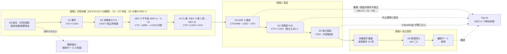

# ゲート計画と Plan B

> 文書ID: DCS-06 / 版: 0.3 / 状態: draft / 最終更新: 2026-10-15
> 対応要求: R-022, R-067, R-074, R-202, R-216, R-277（主）／R-266〜R-275（承認条件 10 項の状態表示）／G-027, G-028, G-036, G-143（関連: G-011, G-030, G-046）
> 依存文書: CONVENTIONS.md, traceability/deliverables.md（DL-42 行、§2.1、§6.1）, traceability/R-requirements.md, traceability/G-goal-criteria.md（§4.2）, 20年運用を前提とした認証・認可基盤提案のCTO CISOレビュー.md, マルチテナントSaaS認証・認可基盤の比較調査と設計指針.md（旧提案書）, 01_governance/assumptions-register.md（GOV-01）, 01_governance/risk-appetite-draft.md（GOV-02）, 01_governance/raci-governance.md（GOV-05）, 01_governance/stop-authority.md（GOV-06）, 01_governance/exception-risk-acceptance.md（GOV-07）, 01_governance/durability-charter-20y.md（GOV-09）, 04_architecture/product-evaluation-exit.md（ARC-14）, 05_adr/ADR-001, ADR-011, ADR-012, ADR-018, ADR-021, ADR-022, ADR-027, 08_operations/operating-model.md（OPS-02）, 08_operations/tco-vendor-lts.md（OPS-03）, 08_operations/phased-rollout.md（OPS-04）, 09_assurance/independent-assurance-plan.md（ASR-01）, 10_integration/README.md（INT-00）, 12_poc/preregistered-test-plan.md（POC-01）, research/RS-01, RS-07, RS-15, RS-16
> 作成方法: AI エージェント（Claude）が上記文書を通読し単独で起草した。承認者・合格基準・中止基準・予算と期間の上限はすべて決裁案であり、決定済みのものはない。本書の判断は自己レビューであり、実在の CTO/CISO の決裁ではない（CONVENTIONS §8）。Phase 4 の模擬パネルによる判定も自己レビューであり、実在の CTO/CISO の決裁にはならない [D]。
> 表の注記: 表のセルでタグのないものは、同じ行に示した R/G/ADR/規程からの設計推論 [D] または当該文書の記述の転記であり、この注記で個別タグに代える。事実を述べるセルには個別にタグと脚注を付けた。

---

## 0. 結論

1. **ゲートは前回レビューの Gate 0〜6 をそのまま正本とし、これに継続ゲートを加えた 8 段とする** [D][^1]。各ゲートに承認者、合格基準、中止・方針転換基準、予算上限、期間上限の 5 項目を置いた（§3）[D]。予算上限と期間上限は、G0〜G2、G3、G4、G5 の期間、構築期について、新規仮定 NA-DCS06-1〜NA-DCS06-9 による幅を置いた（§5.2）[D]。G0〜G2 には、DEC-3 の前提である Gate 2 の独立レビューの外部評価者の費用を上限キャップ（NA-DCS06-8）で含め、調達のリードタイムをクリティカルパス CP-7 に置いた（§5.2.2、§5.3.1）[D]。その和から、G0 から G6 開始までの年数 x を 3〜6 年と算出した（§5.3）[D]。幅は点推定ではなく、確定値でもない [D]。単一の点推定は意思決定に不十分であると GAO はしており、これに従って幅で示した [D][N][^9]（RS-15#69）。G5 の予算と継続ゲートの値は、見積りを取得する前で概算できないため TBD のままとした [D]。これらは次回決裁で承認を求めない [D]。
<!-- next-decision: DEC-1, DEC-2, DEC-4(第1段), DEC-5, DEC-7, DEC-9, DEC-10 / not-next: DEC-3(G2後), DEC-8(G2後), DEC-4(第2段, G4入場前), DEC-6(G4入場前) -->

2. **次回決裁で求める DEC の集合の正本は DCS-03 §2.3 とする。同節は DEC-1（統治規程と DP41-1 を含む）、DEC-2、DEC-5、DEC-7、DEC-9、DEC-10 と DEC-4 第 1 段を次回決裁で求め、不可逆の DEC-3（ADR v1 と U-01）と DEC-8 は次回決裁では求めない** [D][^25]。DEC の一覧と承認者の正本は DCS-03 §2.1 である [D][^25]。DEC-3 は、G1 の入力確定（A-013・A-114、NA-021-1 の標本調査）と Gate 2 の独立レビュー（DP-ASR-3 (b)）の報告・全所見への回答の後、G4 入場の前に付議する [D][^25][^60]。DEC-8 は、第 1 段（GA 候補要素の rc 固定と告知期間）を DEC-3 の後に G3 でキット・sandbox を提供する時点で、第 2 段（v1 凍結）を G4 での TC-119・TC-026 の実測報告の後に付議する [D][^25]。DEC-4 第 2 段と DEC-6 は G4 入場前の同じ会議に置く [D][^25]。G0〜G3 の段階予算は DEC-10（DCS-03 §4.10）で承認を求める [D][^25]。ラウンド 2 で DCS-03 と本書の食い違いを裁定し、DEC-10 を採った（§5.5 の裁定記録）[D]。G0 の判定は DEC-1・DEC-2・DEC-5・DEC-7・DEC-9・DEC-10 と DEC-4 第 1 段の決議によって行う [D]。G1 と G2 は次回決裁の後に、それぞれの承認者が G0〜G2 の期間上限の中で判定する [D]。G1・G2 の判定は DEC として扱わず、次回決裁でも求めない（§4.3）[D]。これはレビューの判定「本番基盤としては不承認、Phase 0 の高保証設計・実証だけ条件付き承認」と、意思決定マトリクスの「Phase 0〜高保証 PoC へ進める: 条件付き承認」に合わせた範囲である [D][^1]。不可逆な標準化・強制移行・対外的な安全性表明は、承認条件 10 項の充足判定（本番設計審査）まで凍結する（GOV-06 S6）[D][^1]。
3. **旧提案書の Phase 0〜3 は「作りながら高保証化する」順序であり、本計画はそれを「統治と攻撃者モデルを先に決め、実証と独立保証を通ってから作る」順序に組み替えた** [D]。旧提案書は高保証化（policy の property test、cross-tenant fuzzing、鍵 rotation 演習）を最後の Phase 3 に置き、Phase 1 で OIDC AS と最小基盤を実装していた [D][^2]。本計画では、旧 Phase 3 の試験群を Gate 4 の入場前に事前登録し、旧 Phase 1・2 の本番向け構築は Gate 5 の後にだけ行う（§4）[D]。旧提案書になかった Gate 0（統治）と Gate 5（独立保証）を新たに独立したゲートにした [D]。
4. **中止・方針転換の既定経路として Plan B（マネージド IdP＋サービス内認可ライブラリ＋共通契約）を定め、DEC-9 で事前に承認することを求める** [D]。Plan B に移っても、識別子（ADR-021）、連携契約 v1（ADR-022、DEC-8）、監査イベントの共通項目、脅威モデルと統治の規程は捨てずに使い続ける設計にした（§6.3）[D]。Plan B の主な代償は、テナント分離と権限剥奪の正しさが約 300 サービスそれぞれの実装に戻ること、managed IdP の出口と鍵の扱いを自社で検証できないことの 2 つであり、受容者を DEC-9 の決議に書く（§6.5）[D]。ただし、出口条件 M1〜M8 をすべて満たす managed 候補は、2026-10-03 時点で確認できていない（ADR-001 D9-2）[D]。そのため、M1〜M8 を満たす候補がない場合の既定経路も定めた（§6.7）[D]。既定経路は「M1・M2 を外し、JIT 移行で出口を作る managed」である [D]。出口不能のリスク（ADR-001 RR-10、RRG-057）は段2（CEO・経営会議）の受容票で受容する [D]。M1・M2 以外の条件も満たせない場合は範囲縮小とする [D]。SRE の下限は確約できても、定常要員の確約が 48 FTE に届かない場合は PB-T8 とする（§6.4.1）。その場合は、④ の部品縮小と ② への転換を、要員差と残余リスク行の増分で比べる。既定は確約 FTE の区間で決める [D]。
5. **本書が応える要求のうち、本書だけで閉じたものはない** [D]。G-027 と G-036 は机上（A）で本書の範囲を満たす形にしたが、作成者以外の検証と模擬パネルの判定が残る [D]。R-022・R-067・R-074・R-202・R-216・R-277 と G-028 は経営・CTO・CISO の決議（E1）がなければ達成にならない [D]。G-143 は提供時期の割当案までで、日付は未定である [D]（§9）。

---

## 1. 位置付けと範囲

### 1.1 本書が決めること・決めないこと

| 本書が決めること | 本書が決めないこと（決める場所） |
|---|---|
| Gate 0〜6 と継続ゲートの承認者・合格基準・中止基準・予算と期間の上限の決め方 | DEC-1〜DEC-10 の決議文案（DL-39 00_decision/03-decision-items.md） |
| 旧提案書 Phase 0〜3・レビュー Gate 0〜6・本プログラム Phase 1〜6 の対応 | 停止の権限者・代行・手続（GOV-06） |
| Plan B の定義、発動条件、移行手順の骨格、残す資産と捨てる資産 | 代替案 4 案の同一基準での比較（DL-44 00_decision/08-alternatives-comparison.md） |
| ゲートごとに確定させる A-ID の範囲と、連携契約の機能ごとの提供ゲート | PoC の TC の合否基準（POC-01）、段階導入の段ごとの条件（OPS-04） |
| 承認条件 10 項の現状と閉じるゲート（G-036） | 残余リスクの受容票（DL-41、GOV-07） |

### 1.2 3 つの番号体系

本書では次の 3 つを区別する [D]。

| 体系 | 意味 | 正本 |
|---|---|---|
| 旧 Phase 0〜3 | 旧提案書の導入ロードマップ | 旧提案書「導入ロードマップ」[^2] |
| Gate 0〜6（G0〜G6）と継続 | 前回レビューが示した決裁の関門 | レビュー「進め方の再設計」[^1]。本書が承認者等を定める |
| 本プログラム Phase 1〜6 | 再提案文書を作る作業工程（準備・分解、一次資料調査、設計・起草、検証、実測・是正、凍結・提出準備） | deliverables.md §2.1[^3] |

- 本プログラムの Phase 1〜6 はすべて「次回決裁の資料を作る工程」であり、Gate を通過させる工程ではない [D][^3]。次回決裁は G-goal-criteria.md の段階1（決裁可能）に当たる [D][^4]。

---

## 2. ゲートの全体像

- G3 は G4 入場（DEC-4）の後に判定する [D]。製品の最終選定には PoC の実測が要り（ADR-001 D17、ARC-14）、レビューも選定表に tail latency・障害モード・運用人員を含めるよう求めているためである [D][^1]。不可逆決定の ADR v1（DEC-3）は次回決裁では求めない [D][^25]。DEC-3 は G1 の入力確定（A-013・A-114、NA-021-1 の標本調査）と G2 の独立レビューの報告・全所見への回答の後、G4 入場の前に、G3 の判定より先に決める [D][^25]。G3 では製品選定・TCO・要員確約を判定し、あわせて DEC-3 の前提が PoC の実測と製品評価で崩れていないかを点検する [D]。DEC-3 の関連ゲートは DCS-03 §2.1 のとおり「G2 の後〜G3」とする [D][^25]。版 0.2 の「次回決裁で先行し、G3 で点検」と申し送り H-2 は、DCS-03 §2.3・§4.3.4 に反するので撤回した [D]。
- DEC-3 を G4 入場の前に置くのは、PoC を本番の識別子の構成で試験するためである（DCS-03 §4.3.4 の (4) の帰結）[D][^25]。DEC-3 が G4 入場に間に合わない場合は、PoC の issuer・鍵構成が仮置きになり、PoC の結果を本番の識別子に使えない（同 (3) の帰結）[D][^25]。
- G1・G2 は、次回決裁で G0 が通過した後に判定する [D]。G1 の合格基準には As-Is 棚卸しの初回の置換（DQ-A の I-1）が含まれ、G2 の承認者には DEC-5 で任命される独立評価者が含まれる [D]。どちらも次回決裁より前にはそろわないためである [D]。
- 本番設計審査は、レビューが「本番設計審査へ進む最低条件」とした承認条件 10 項の充足判定であり、R-216 に従い G6 入場の退出基準として扱う [D][^1][^5]。
- 段階の区分は G-goal-criteria.md §4.2 に合わせた [D][^4]。

---

## 3. ゲート別の定義

### 3.1 総表

| ゲート | 承認者（案） | 合格基準（要約） | 中止・方針転換基準（要約） | 予算上限 | 期間上限 |
|---|---|---|---|---|---|
| G0 統治 | 経営会議または取締役会（起案: CISO・CTO・事業責任者の共同） | §3.2 | 決められない場合は共通基盤化をやめ個別サービス改善に縮小 | G0〜G2 の合計で約 0.7〜5.7 億円＋予備費（Gate 2 の独立レビューの上限キャップ 0.8 億円を含む。DEC-10 決議文案 1、§5.2） | G0〜G2 の合計で 6〜12 か月（§5.2） |
| G1 要件 | CTO＋CISO（プロダクトオーナー同席） | §3.3 | 入口を機械列挙できないなら PEP 整備を独立プロジェクト化 | G0 行に含む | G0 行に含む |
| G2 攻撃者モデル | CISO＋独立評価者。期限 G2 の段2・段3 受容票は、判定の前に経営会議・取締役会が決議する（§5.4.1） | §3.4 | 予防・封じ込めの候補がない Critical 脅威が残れば範囲縮小を付議 | G0 行に含む | G0 行に含む |
| G3 ADR と選定 | CTO（アーキテクチャ審査会経由）＋CISO＋CFO。期限 G3 の段2 受容票は、判定の前に経営会議が決議する（§5.4.1） | §3.5 | 要員確保不可なら OPS-02 PB-1〜PB-3、それも不成立なら Plan B。SRE 下限は確約できても定常確約が 48 FTE 未満なら PB-T8（§6.4.1 の順位表で ④ の部品縮小と ② への転換を比べる） | 約 0.4〜2.9 億円＋予備費（DEC-10） | G2 判定から 6〜12 か月 |
| G4 高保証 PoC | 入場: CTO＋CISO＋CFO（DEC-4）／判定: CTO＋CISO（独立立会い） | §3.6 | テナント越境・剥奪・可用性目標を現実的構成で満たせない | 約 0.4〜2.2 億円＋予備費（DEC-4） | 4〜6 か月（DEC-4、NA-DCS07-1） |
| G5 独立保証 | CISO（プロセス保証は内部監査） | §3.7 | Critical/High が閉じず経営承認付きの受容もない | TBD（見積り取得前のため概算できない。DEC-5） | 6〜12 か月（仮置き） |
| G6 段階導入 | cell ごとに事業オーナー＋SRE＋CISO（開始判定 M1 は CTO） | §3.8 | 新基盤の allow が旧より広い未登録差分で停止 | 構築期の一時増分 約 4.1〜15.8 億円（参考値。承認は G3 以降） | 構築期 1.5〜3 年（OM-N3 の仮置き） |
| 継続 | 経営会議（年次報告は取締役会） | §3.9 | 継続指標・独立評価・費用が代替案に劣れば置換または Plan B | 再決裁ごと | 再決裁周期（A-101） |

- 承認者の骨格は種資料 seed-03 §3 のゲート表を入力にした [D][^6]。種資料は構成の手掛かりとして使い、技術的主張の根拠には使っていない [D][^6]。
- リスク対応を承認できる権限の階層を役割単位で定めることを、NIST IR 8286B-upd1 は求めている（must）[N][^7]（RS-01#21）。G0 と G5 の例外受容を経営の承認にし、CTO・CISO の単独にしないのはこの考え方による [D]。
- 各ゲートの審査では、そのゲートを確定ゲートとする A-ID の状態一覧を示し、仮置きのまま進む場合は理由・期限・責任者を残課題台帳（DL-110）に記録する [D][^8]。

### 3.2 G0 統治

| 項目 | 内容 |
|---|---|
| 目的 | 「何をもって十分とするか」を経営が決める。レビューは G0 がなければ技術チームが判断基準を持てないとしている [D][^1] |
| 承認者 | 経営会議または取締役会。起案は CISO（リスク）、CTO（実現性・費用・可用性）、事業責任者（残余リスク受容）の共同 [D][^1] |
| 入場条件 | (1) DEC-1 の起案資料（GOV-02 リスク選好案、GOV-03 重大損失シナリオ、データ分類、対象法域の判定 DL-34）が揃う。(2) 対象法域の判定について、法務責任者が署名した CTL-02（版番号を明記）か、法務責任者の確認意見書がある（OI-L01、G-011。証拠 E2）。CTL-02 は、判定がすべて法務署名前の案であり、法的助言でも法務・経営の決定でもないと自ら述べている [D][^16]。G-011 は、法務署名（E2）を合格の条件にしている [D][^4]。(2) が揃わない場合、対象法域は G0 の承認範囲から外す。その場合は DEC-1 の「未完成部分」として、策定責任者（法務責任者）と期限だけを承認する [D] |
| 合格基準 | (1) リスク選好・許容度・キャパシティ、重大損失シナリオ、データ分類の承認と、法務責任者が署名した CTL-02 版〔　〕の判定による対象法域の承認（R-266、G-030、G-011、DEC-1）。判定保留の項目と未完成の部分は、策定責任者と期限を承認する。(2) RACI（GOV-05）、停止権限（GOV-06）、例外・受容手順（GOV-07）、四半期 KRI（GOV-08）の承認（DEC-1 決議文案 7・8。残余リスク台帳の採用 DP41-1 は決議文案 9）。(3) プログラム憲章と 20 年耐久性憲章（DEC-2、DL-40、GOV-09）。(4) 独立保証計画（DEC-5、ASR-01）。(5) Plan B の事前承認（DEC-9、本書 §6）。(6) 不可逆標準化の凍結（R-022、GOV-06 S6）の決議（DEC-1 決議文案 7）。(7) G0〜G3 の段階予算（DEC-10、§5.5） |
| 中止・方針転換 | リスク選好・キャパシティを期限内に決められない場合は、共通基盤化をやめ、個別サービスの改善（PEP の追加、資格情報の整理）に範囲を縮小する [D] |
| 証拠 | E1（決議と議事録）、E2（CTL-02 の法務責任者署名、または確認意見書） |
| 確定させる A-ID | 前提台帳で確定ゲートを G0 とする A-ID（GOV-01 §8 の規則による）[^8] |

### 3.3 G1 要件

| 項目 | 内容 |
|---|---|
| 承認者 | CTO＋CISO（プロダクトオーナー同席） |
| 合格基準 | (1) 主体カタログ（人・顧客管理者・support・service account・workload・外部連携・agent）とライフサイクル状態遷移（R-267）。(2) 業務操作ごとの IAL/AAL/FAL・step-up・SoD・session 上限・回復要件（REQ-03）。(3) 全入口・信頼境界・非同期経路・管理面・緊急経路の DFD（DL-10）。(4) As-Is 棚卸し（A-110〜A-115）の確定または期限付きの仮置き |
| 中止・方針転換 | 入口を機械列挙できない（IDL の静的抽出と実行時トレースの突合が成立しない）場合は、PEP 整備を独立プロジェクトにして先行させ、基盤の G3 を待たせる（ADR-012、A-055）[D] |
| 証拠 | E2（承認済み文書）、E3（要求から統制への追跡） |
| 注記 | A-110〜A-115 の確定ゲートは前提台帳では G1、G-050 では段階2 と食い違っている（02_requirements/as-is-inventory.md）。本書は「G1 で期限付きの仮置きを承認し、実データの棚卸し完了は G3 で判定する」を案とする [D] |

### 3.4 G2 攻撃者モデル

| 項目 | 内容 |
|---|---|
| 承認者 | CISO＋独立評価者（ASR-01 で任命される者） |
| 合格基準 | (1) 攻撃者類型（ATK-xx）ごと・脅威（T-xxx）ごとに、予防・検知・封じ込め・復旧・証拠が記載され、統制（C-xxx）と試験（TC-xxx）へ追跡できる [D][^1]。レビューが列挙した攻撃者（外部、悪意あるテナント管理者、侵害された顧客 IdP、CI/CD 侵害、クラウド管理者、内部 support、policy author ほか）に欠けがない [D][^1]。(2) 残余リスク台帳（DCS-05）で期限を G2 とする段2・段3 の受容票が、次のどちらかの状態にある。一つは、経営会議（段2）または取締役会（段3）で決議済みで、受容記録（E9）と議事録（E1）がある状態。もう一つは、不受容と決まり、是正計画（GOV-07 欄 3-3、是正追跡 E11）に載っている状態である。対象は RRG-008（RR21-01 を含む）、RRG-057、RRG-066（以上、段2・経営会議）と RRG-009（段3・取締役会）の 4 件である [D][^20]。付議の場は §5.4.1 の AC-G2a・AC-G2b とする |
| 合格基準 (2) の注記 | G2 の判定者（CISO＋独立評価者）は、(2) の決議記録があるかを確かめるだけで、受容はしない。CISO は受容権を持たないためである（GOV-07 §0-5）[D][^21]。G2 の判定を DEC として扱わないこと（§4.3）は変えない。受容票の決議は、DEC の番号体系の外にある GOV-07 §4.2 の段階 5（段2 は次回の経営会議、段3 は次回の取締役会）の手続による [D][^21]。(2) を置くのは、期限 G2 の段2・段3 の受容を決める会議が定まっていないと、期限の到来で受容が暗黙に成立してしまうためである。IR 8286B-upd1 §2.3 は、報告期間内に処置できない容認不可のリスクは暗黙に受容されたものになり、「無視」は選択肢にならないとしている [N][^7]（RS-01#22） |
| 中止・方針転換 | Critical の脅威に予防または封じ込めの統制候補が 1 つもない場合は、その脅威に関わる範囲（主体類型・事業領域）を憲章（DL-40）から外すか、G0 へ差し戻す [D]。(2) の受容票が経営会議・取締役会で決まらないまま期間上限に達した場合は、§5.1 の原則 3 の継続審査にかける。その場合、受容票は GOV-07 AT-8 により一段上へ上がる（§5.4.1）[D][^21] |
| 証拠 | E1（受容票の決議の議事録）、E2、E3、E9（受容記録）、E11（不受容とした票の是正追跡） |

### 3.5 G3 ADR と選定

| 項目 | 内容 |
|---|---|
| 承認者 | CTO（アーキテクチャ審査会経由）＋CISO＋CFO |
| 合格基準 | (1) ADR-001〜ADR-029 の採択（不可逆決定は DEC-3（G1 入力確定と G2 独立レビュー完了・回答の後）で先行して決め、G3 では前提が崩れていないかを点検する。G1 入力確定は A-013・A-114 の確定と NA-021-1 の標本調査、G2 独立レビューは DP-ASR-3 (b) の報告と全所見への回答（E6）を指す。DEC-3 は次回決裁では求めない（DCS-03 §2.3）[D][^25][^60]）。(2) 製品の評価表と出口条件 M1〜M8 の判定（ARC-14）。(3) TCO の幅（OPS-03。点推定だけを載せない）。(4) 要員の確約（OPS-02 §10 の PB-1〜PB-3 の判定。SRE 一次は単一拠点 8 名以上または 2 拠点各 6 名以上）。(5) root of trust と侵害 runbook（R-268）、token profile と FAPI 2.0 の採否（R-270）、版付けと rollback 方式（R-272）。(6) 移行の波と要員の平準化（OPS-04 §5.4）。(7) 残余リスク台帳（DCS-05）で期限を G3 とする段2 の受容票が、経営会議で決議済み（E9、E1）か、不受容と決まり是正計画（E11）に載っている。対象は RRG-019、RRG-022（AT-6 類型受容票）、RRG-031、RRG-049、RRG-053、RRG-054（法務の判断が必須）、RRG-055（法務・個人情報保護責任者の判断が必須）、RRG-059、RRG-060、RRG-067 の 10 件と、RRG-030 のうち影響が複数ドメインに及ぶサービスの適用分である [D][^20]。期限 G3 の段1 の行（RRG-018、RRG-030 の残り）は、事業責任者の受容記録（E9）があることを確かめる [D][^20]。付議の場は §5.4.1 の AC-G3 とする。(8) G-054（法域ごとの所在地・保持・削除の要件に基づく cell・保持期間・保存地域・削除方式の決定と法務の署名）と、CTL-02 の決裁案 L-03（保持期間の値）・L-04（データ所在地と越境アクセスの方針）・L-05（削除権と WORM の調停）・L-11（英国利用者の EU リージョン収容）の決定記録（E2）がある。あわせて、PIA-A・PIA-B の承認と DPIA の義務判定（DL-25 の KAP-2）の記録がある [D][^4][^16][^22] |
| 合格基準 (7)(8) の注記 | (7) は §3.4 の合格基準 (2) と同じ理由で置いた [D]。G3 の判定者は受容をせず、記録があるかを確かめるだけである [D]。(8) の 4 つの決裁案は、CTL-02 が期限を G3 としている（L-03 は「G0 で方式、G3 で値」、L-04 は「G0 で方針、G3 で ADR-013」）[D][^16]。KAP-2 の期限も G3 である（PIA-B の B5 に限り G1）[D][^22]。G-054 は法務の署名を合格の条件にしている [D][^4]。G3 で決めないと、G6 の P1 で実データを処理する前提（§3.8 入場条件 (4)）がそろわない [D] |
| 中止・方針転換 | SRE 一次の下限を確約できなければ ADR-001 D17-2 により案D（資格情報層を managed）へ切り替える（PB-1）。プラットフォーム定常要員が A-054 の下限 15 FTE を下回る場合は PB-2 として本書で再決裁する。managed 候補も出口条件 M1〜M8 を満たさず、self-host の要員も確約できない場合は Plan B（§6）を付議する。この場合の既定経路は §6.7 の (i) である [D]。SRE 一次の下限は確約できたが、プラットフォーム定常要員の確約が 48 FTE（OPS-02 DP-OM-2 (b) の下限）に届かない場合は PB-T8（§6.4）とし、経営会議に付議する。付議では、(i) ④ の部品縮小（§6.4.1 の順位表に従い OPS-02 §4.3 の #6・#14・#13・#3・#7 の順に削る）と、(ii) ② への転換（DCS-08 W-2f）を比べる。比べる尺度は、DCS-08 §3.3 の要員差と、§6.4.1 に示した残余リスク行（RRG）の増分である [D][^41][^42] |
| 根拠 | SRE の on-call を回す最少人数は単一拠点で 8 名、2 拠点で各 6 名とする目安が公表されている [V][^10]（RS-15#70）。多ベンダーの並行移行では、34,366 システムのうち 10,013（29.1%）が期限内に移行できなかった [M][^11]（RS-16#78）。要員と移行時期の平準化を G3 の条件にするのはこのためである [D] |
| 証拠 | E1（要員・予算の確約、受容票の決議の議事録）、E2（L-03・L-04・L-05・L-11・G-054 の法務署名、KAP-2 の承認）、E9、E11 |

### 3.6 G4 高保証 PoC

| 項目 | 内容 |
|---|---|
| 入場の承認者 | CTO＋CISO＋CFO（DEC-4） |
| 入場条件 | 予算上限、要員の氏名と稼働率、期間上限、事前登録（POC-01 の凍結）、合成データ限定、パイロット参加確約（G-052）、独立立会人の任命（KP-1）の 7 点 |
| 判定の承認者 | CTO＋CISO。独立立会人が測定と凍結ハッシュを確認する |
| 合格基準 | 凍結済みの TC がすべて事前登録の合否基準を満たす（POC-01）。系統 1（TC-001〜TC-028）は論理性質だけ、系統 2（TC-101〜TC-131）は性能・可用性を含む。PEP coverage の機械検証（R-269）、剥奪 SLO の実測（R-271）、侵害演習の一部（R-275）を含む |
| 中止・方針転換 | (1) テナント越境の漏えい、剥奪の上限超過、可用性目標の未達を、現実的な構成で解消できない [D][^6]。(2) C-1・C-7 に当たる事象は誰でも即時中止でき、再開は CISO が承認する（KP-6 案 c）。(3) 期間上限に達して未凍結・未判定の TC が残る。(1)(3) は Plan B または範囲縮小を CTO＋CISO＋CFO で再決裁する |
| 証拠 | E4（自動試験）、E5（実測生データ）、E8（演習記録） |

### 3.7 G5 独立保証

| 項目 | 内容 |
|---|---|
| 承認者 | CISO。プロセス保証は内部監査が行う |
| 合格基準 | 実装チームと報告系統を分けた評価者による設計・コード・IaC・policy・鍵・CI/CD・runbook の評価、OIDF conformance、cross-tenant pentest、red team を実施し（ASR-01、ASR-03）、Critical/High がすべて閉じているか、経営承認付きの期限付き受容票（GOV-07）がある（R-273、R-074）[D][^1] |
| 中止・方針転換 | Critical/High が未解決で受容もない場合は本番移行を承認しない（GOV-06 S1）。受容期限を 2 回延長しても閉じない Critical は Plan B の付議事由とする [D] |
| 根拠 | レビューは「Critical/High の未解決事項は原則として本番移行を止める」とし、例外を期限・補完統制・影響範囲・責任者・失効条件を記した経営承認付きの受容に限っている [D][^1] |
| 証拠 | E6（第三者報告書）、E7（OIDF 試験ログ）、E9（受容記録）、E11（是正追跡） |

### 3.8 G6 段階導入

| 項目 | 内容 |
|---|---|
| 承認者 | 開始判定（GOV-06 M1）は CTO。各段・各 cell の前進は事業オーナー＋SRE＋CISO |
| 入場条件 | (1) 本番設計審査で承認条件 10 項（§7）がすべて「達成」。(2) OPS-04 §5.2 の P0 完了。(3) OPS-02 PB-4（R3・R4 の 24/365 体制、手順習熟率 100%）。(4) 実データ処理の前提（§7 の追加条件 L）。具体的には次の 5 点である。(a) PIA-A・PIA-B の承認と DPIA の義務判定の記録（KAP-2、G-064）。(b) パイロット対象者（従業員を含む）への利用目的の通知・公表（RGM-75）と、保有個人データに関する事項の公表（RGM-77）。(c) CTL-02 L-13 で選択肢 A（共同利用）を採った場合は、共同利用の事前通知事項を各ドメインのプライバシー通知に入れること。(d) 参加テナントとの DPA・委託契約の締結（OI-L05）。(e) shadow 判定の差分記録の保持期間の設定（L-03 の方式による。所有者: 法務責任者＋CISO） |
| 入場条件 (4) の注記 | OPS-04 の P1 は、日本の canary cell の従業員テナントと、参加を申し出たテナントの read-sensitive の要求を対象にする [D][^24]。新系が実在の個人データを処理するのは、ここが最初になる [D]。G4 までは合成データに限っている（DEC-4 決議文案 4、DEC-6）[D][^25]。個人情報保護法 21 条は、取得した個人情報の利用目的を、あらかじめ公表している場合を除き、速やかに本人へ通知または公表することを求めている（第 21 条第 1 項。CTL-02 の写像では RGM-75）[N][^28][^23]。従業員と B2C について当社が取扱事業者になる場合に、この義務が生じる。B2B テナントの利用者については、委託元（顧客）が通知・公表する（RGM-75 の運用欄と、RGM-75〜RGM-78 の注記）[D][^23]。共同利用の事前通知の要否は L-13 の結論による [D][^16]。DPA を含む顧客契約の条項は OI-L05 で未着手である [D][^26]。shadow 差分記録の保持期間は OPS-04 に定めがない [D][^24]。このため (e) を入場条件に置いた |
| 合格基準 | OPS-04 §6 の 10 条件（未登録の allow 拡大差分 0 件、誤 deny 率と評価不能率が予算内、経路網羅 100%、一致判定数、越境否定試験、rollback 演習、剥奪同期、allow cache 除去、告知）[D] |
| 中止・方針転換 | 新基盤の allow が旧より広い差分で停止する [D][^1]。後退（rollback）は自動、前進は人が承認する（OPS-04）。PB-7（移行要員が確約されない組織は後続の波へ） |
| 証拠 | E4、E5、E8、E10 |

### 3.9 継続ゲート

| 項目 | 内容 |
|---|---|
| 承認者 | 経営会議。四半期の KRI と年次の独立評価を取締役会へ報告する |
| 合格基準 | 年次独立評価、四半期 KRI、定期 red team、鍵・IdP・PDP 侵害演習、schema migration 演習、vendor exit 演習の記録があり [D][^1]、GOV-09 §7.2 の再決裁入力が揃う |
| 再決裁の周期 | 初回は G6 開始から 3 年以内、以後 5 年以内（規制強化シナリオは 3 年）[A-101] |
| 選択肢 | 継続／部分置換／全面置換／範囲の縮小／撤退（Plan B）（GOV-09 §7.3） |
| 臨時再決裁 | 標準・規制の事象、供給者の事象、性質の毀損、重大事故、統治の欠落（GOV-09 §7.4） |

---

## 4. 旧 Phase・Gate・本プログラム Phase の対応表

### 4.1 旧提案書 Phase 0〜3 と Gate の対応

| 旧 Phase | 旧提案書の内容[^2] | 対応する Gate | 本計画での扱い |
|---|---|---|---|
| 0 脅威モデルと契約 | DFD、resource/action 命名、token profile、error/reason code、監査 schema の確定。認可 SLO・RTO/RPO・最大 staleness・剥奪反映時間の決裁 | G1（DFD）、G2（脅威）、G3（token profile・監査）、DEC-8（契約 v1） | 経営リスク定義（G0）を前に足した（R-277）。数値の決裁は BIA と PoC 実測の後に行う（DL-20）[D][^1] |
| （旧提案書になし） | — | G0 統治 | 新設。リスク選好・停止権限・例外手順・独立保証計画 |
| 1 最小基盤 | OIDC AS、active tenant flow、BFF、service 別 audience の実装、共通 SDK の配布、File Service への ReBAC 導入、shadow 判定 | G3（AS の選定）、G4（PoC 基盤での実装）、G6（shadow・段階導入） | 本番向けの実装は G5 後に限る。PoC は合成データだけで行う [D] |
| 2 分散認可 | PDP の region/domain 分散、署名付き bundle 配布、workload identity・mTLS・token exchange、outbox・revision-aware cache・失効 channel、非サンプリングの判定監査 | G3（ADR-009・ADR-010・ADR-013・ADR-014）、G4（障害・剥奪の試験）、G6（cell 単位の拡大） | 単一 global PDP への集約を既定にしない（R-265）[D][^1] |
| 3 高保証化 | policy の property/mutation test・formal invariant、DPoP/mTLS 束縛、JIT support・二者承認、cross-tenant fuzzing・PDP 停止・stale ACL・鍵 rotation 演習 | G4（事前登録した攻撃・障害試験）、G5（独立評価）、継続（定期演習） | 最後の Phase から G4 入場前の事前登録へ前倒しした。高保証化は構築の後ではなく前に置く [D] |
| （旧提案書になし） | — | G5 独立保証 | 新設。報告系統を分けた評価者と Critical/High の停止規則 |

### 4.2 本プログラム Phase 1〜6 と Gate の対応

| 本プログラム Phase[^3] | 主な作業 | 寄与する Gate | その Gate で得られる状態 |
|---|---|---|---|
| 1 準備・分解 | 規約、R/G の原子化、成果物計画、前提台帳初版 | 全 Gate（追跡の土台） | 決裁対象と要求の特定（R-202、R-216 の前提） |
| 2 一次資料調査 | RS-01〜RS-18、標準ステータス台帳、主張台帳 | G0〜G3 の根拠 | 根拠の原典照合（E3） |
| 3 設計・起草 | 01〜11 の本体、ADR、PoC 試験計画案、決裁パッケージ初版 | G0・G1・G2 の起案資料、G3 の ADR 案、G4 入場資料 | 次回決裁（段階1）の起案資料 |
| 4 検証 | 自動検査、引用監査、独立反証レビュー、模擬パネル、PoC 事前登録の凍結 | G4 入場（凍結済みの事前登録） | 自己レビュー済み。実在の CTO/CISO の承認ではない |
| 5 実測・是正 | 系統 1 の PoC 実行、数値契約への反映、指摘の是正 | G4 の一部（系統 1 の論理性質のみ） | 系統 2（本番相当環境）と G5 は本プログラムの外で行う |
| 6 凍結・提出準備 | 決裁パッケージの凍結、残課題台帳の確定 | 次回決裁（DCS-03 §2.3 の範囲: DEC-1・DEC-2・DEC-5・DEC-7・DEC-9・DEC-10・DEC-4 第 1 段。G0 の判定と G4 入場の第 1 段。DEC-3・DEC-8 は含まない） | 提出可能な状態。決議（E1）は未取得 |

- 本プログラムの Phase 6 が終わっても、通過したゲートは 0 である [D]。ゲートの通過は、次回決裁で G0 の判定と G4 入場の第 1 段の承認を得たときに始まる [D]。G1・G2 はその後に判定し、DEC-3 は G2 の独立レビューの後に決める（§2）[D][^25]。

### 4.3 3 体系の横断表

| Gate | 旧 Phase | 本プログラム Phase | DEC | 段階 |
|---|---|---|---|---|
| G0 | （なし） | 3 起草 → 4 検証 → 6 提出 | DEC-1, DEC-2, DEC-5, DEC-7, DEC-9, DEC-10（G0〜G2 の予算） | 段階1（次回決裁で判定） |
| G1 | 0 の一部（DFD） | 3 → 4 → 6 | DEC-2, DEC-7（G1 の判定そのものは DEC ではない） | 段階1（次回決裁の後に判定） |
| G2 | 0 の一部（脅威モデル） | 3 → 4 → 6 | DEC-5（立会い範囲。G2 の判定そのものは DEC ではない） | 段階1（次回決裁の後に判定） |
| G3 | 0（契約）・1・2 の選定部分 | 3（ADR 案）、5（系統 1 の実測を入力） | DEC-3（不可逆決定は DEC-3（G1 入力確定と G2 独立レビュー完了・回答の後）で先行。G4 入場の前に決裁し、G3 で点検。次回決裁では求めない）、DEC-8 第 1 段（DEC-3 の後、G3 でのキット・sandbox 提供時の rc 固定）、DEC-10（G3 判定までの予算）、DEC-9（PB-T2・PB-T3・PB-T8） | 段階2 |
| G4 | 3 の試験群、1・2 の PoC 実装 | 3（計画）→ 4（凍結）→ 5（系統 1） | DEC-4（第 1 段は次回決裁、第 2 段は入場前）、DEC-6（入場前）、DEC-8 第 2 段（TC-119・TC-026 の実測報告の後） | 入場は段階1、判定は段階2 |
| G5 | （なし） | 3（RFP/SOW 案のみ） | DEC-5 | 段階2 |
| G6 | 1 の shadow、2 の分散展開 | 3（OPS-04 の計画のみ） | — | 段階3 |
| 継続 | 3 の定期演習 | 3（GOV-09 の計画のみ） | DEC-9（撤退時の既定経路） | 段階3 |

- DEC 欄は、DCS-03 §2.1 の「関連ゲート」欄に揃えた [D]。DEC の決裁内容・承認者・可逆性の正本は DCS-03 §2.1 であり、本表はその写しである [D]。本書と DCS-03 が食い違う場合は DCS-03 を正とする [D]。G0〜G3 の段階予算は DCS-03 §4.10 の DEC-10 に置く。版 0.2 の提案を DCS-03 版 0.3 が正本化し、ラウンド 2 の裁定（§5.5）で確認した [D][^50]。
- 版 0.1 の本表は、DEC-6 を G0 に置いていた [D]。DCS-03 §2.1 では DEC-6 の関連ゲートは G4 なので、G4 に移した [D]。
- G-goal-criteria §4.2 は、段階1 の対応ゲートを「Gate 0 の経営決裁、Gate 1・Gate 2 の机上成果物の承認、Gate 4 入場の決裁。DEC-1〜DEC-9」と書いている [D][^4]。本書は「G1・G2 の机上成果物の承認」を DEC に含めず、次回決裁でも求めない [D]。G-goal-criteria の文言の改訂は申し送る（§11 申し送り H-3）[D]。

---

## 5. 予算と期間の上限

### 5.1 原則

1. **予算は「次のゲートまで」だけを承認し、20 年分や本番構築の総額を先に承認しない** [D]。レビューの判定と退出基準に反するためである（GOV-09 §6）[D][^1]。
2. **金額は幅で示し、点推定だけを決裁に載せない** [D]。GAO-20-195G は、信頼できる見積りの特性に網羅性・文書化・正確性・信頼性を挙げ、信頼性には感度分析とリスク・不確実性分析の取込みが要るとしている [N][^9]（RS-15#69）。
3. **期間上限に達したら、自動的に継続審査にかける** [D]。上限超過の時点で、そのゲートの承認者が「延長（理由と新上限）／範囲縮小／Plan B」のいずれかを決める [D]。延長は 1 ゲートにつき 1 回までを案とする [D]。
4. **予算比率を上限（キャップ）として使わない** [D]。要員費が算出可能な TCO の 87〜90% を占め、比率に合わせて SRE を削ると G3 の要員ゲートを割るためである（OPS-03 §0、§6.2）[D]。

### 5.2 ゲート別の上限（仮置きの幅）

版 0.1 では、予算上限と期間上限を 8 段すべて TBD にしていた [D]。このままでは G-027 の合格条件（全ゲートで上限が埋まる）を満たせず、次回決裁で承認できる予算もなかった [D][^4]。そこで本版では、机上で概算できるゲートに幅を置いた [D]。値は新規仮定 NA-DCS06-1〜NA-DCS06-9（§5.2.1）と既存の仮定から積み上げた設計推論である [D]。いずれも見積りの点ではなく上限の候補であり、決定ではない [D]。

| ゲート | 予算上限の幅（予備費を除く） | 期間上限の幅 | 所有者 | 決める場 | 積上げ（§5.2.2） |
|---|---|---|---|---|---|
| G0〜G2 | 約 0.7〜5.7 億円 | 6〜12 か月（G0 の決議日から G2 判定まで）[NA-DCS06-1]。CP-7 により 8 か月以上を推奨（§5.3.1） | CTO＋CISO（起案）、CFO。Gate 2 の独立レビューの費目は CISO＋CFO | 次回決裁（DEC-10 決議文案 1[^62]） | As-Is 実データ棚卸し（DQ-A A1）、集計、法務判定と署名（DL-34、OI-L01）、契約管理 2 FTE、NR-2〜NR-4、SRE の先行採用（G2 判定までの在籍分）、Gate 2 の独立レビュー（外部評価者。上限キャップ 0.8 億円、NA-DCS06-8） |
| G3 | 約 0.4〜2.9 億円 | G2 判定から 6〜12 か月 [NA-DCS06-3] | CTO＋CFO | 次回決裁（DEC-10） | RFP・製品評価、SRE の先行採用（G2 判定から G3 判定までの在籍分）、managed の評価契約環境（ARC-14 K14-3） |
| G4 | 約 0.4〜2.2 億円（要員費 0.29〜1.26 億円＋非要員費 0.09〜0.91 億円） | 4〜6 か月 [NA-010-5、NA-DCS07-1] | CTO＋CISO＋CFO | 次回決裁（DEC-4） | DCS-07 §6.2 の要員費と、§5.2.2 の非要員費 |
| G5 | TBD（理由: ASR-05 の RFP/SOW による見積りの取得前であり、評価の範囲・回数で桁が変わる） | 6〜12 か月（評価 3〜6 か月＋是正 3〜6 か月）[NA-DCS06-5] | CISO（DEC-5）＋調達責任者 | G4 入場前（見積り取得後） | ASR-05 の範囲（設計評価、OIDF conformance、cross-tenant pentest、red team） |
| 本番設計審査〜G6 開始（構築期） | 構築期の一時増分 約 4.1〜15.8 億円（参考値） | 1.5〜3 年 [NA-DCS06-6]（OM-N3） | CTO（OM-N3）＋CFO | G3 | OPS-02 §4.4 の 41〜79 人年 × 単価 [NA-001-2]。定常要員費と移行専任チームは含まない |
| 継続 | 再決裁ごとに TBD | 再決裁周期 [A-101] | CFO（耐久性維持枠 T9）＋経営会議 | 各再決裁 | TCO の年次更新（OPS-03）と撤退費用の見積り（GOV-09 §5.5） |

- 次回決裁で承認を求める予算は、G0〜G3（DEC-10）と G4（DEC-4 第 1 段の決め方と要員費の上限、第 2 段の総額）だけである [D]。§5.1 の原則 1 により、G5 と構築期の値は承認対象に含めない [D]。G5 と構築期の値は、x の算出と日程リスクの評価にだけ使う [D]。
- G5 の予算と継続の値は、本版でも概算できない [D]。理由は表に書いたとおりである [D]。次回決裁ではこれらを承認しないことを、DCS-00 §2 に明記するよう申し送る（§11 申し送り H-5）[D]。
- 予備費率は、根拠のある値がないため置かず、CFO が決める（NA-DCS07-4）[D]。

#### 5.2.1 新規仮定（前提台帳へ登録を要する）

| ID | 内容 | 値 | 根拠・導出 | 確定責任者・期限 |
|---|---|---|---|---|
| NA-DCS06-1 | G0〜G2 の期間上限 | 6〜12 か月 | G1 で棚卸しの初回の置換を行う（DQ-A の I-1）。G0 で法務署名が要る（OI-L01）。この 2 つを並行して行う期間の仮置き [D] | CTO＋CISO、次回決裁 |
| NA-DCS06-2 | G0〜G2 の工数 | As-Is の回答はサービスあたり 2〜5 人日 × 300 サービス。集計は 2〜4 FTE、法務判定は 1〜2 FTE、NR-2〜NR-4 は 2〜4 FTE、契約管理は 2 FTE（NA-022-4）。1 人年は 240 人日 | 起草者の仮置き。サービス数は A-050 による [D] | CTO＋CFO、次回決裁 |
| NA-DCS06-3 | G3 の期間と工数 | 期間は G2 判定から 6〜12 か月。RFP・評価は 2〜4 FTE。SRE の先行採用は 4〜8 名。在籍期間は NA-DCS06-7 の着任時期から G3 判定までとする | 起草者の仮置き。SRE の下限 8 名は NA-001-3 による。G4 と重なる期間の PoC 要員は G4 に計上する [D]。版 0.2 の「在籍 0.25〜0.5 年」は、採用開始を G0 の直後に置く CP-1 と矛盾していたため改めた（ラウンド 2 R2-3）[D] | CTO＋人事責任者＋CFO、次回決裁 |
| NA-DCS06-7 | SRE の先行採用者の着任時期 | G0 の決議日から 3〜6 か月後 | 起草者の仮置き。採用のリードタイムの実績値はない（OM-N4 と同じく最初の採用で実測）[D]。G2 判定（6〜12 か月）と G3 判定（12〜24 か月）までの在籍は、早い側で着任 3 か月・G3 判定 24 か月の 1.75 年、遅い側で着任 6 か月・G3 判定 12 か月の 0.5 年になる [D] | 人事責任者＋CTO、次回決裁 |
| NA-DCS06-4 | G4 の非要員費の幅 | 負荷環境 0.05〜0.5 億円、HSM 0.01〜0.1 億円、managed・RHBK・OEL の評価契約 0.01〜0.1 億円、独立立会人 0.02〜0.2 億円、KMS 0.02 億円未満 | 桁の仮置き。KMS だけは公開価格で確かめた（§5.2.2）。HSM の価格は未確認 | CFO＋CTO、G4 入場前 |
| NA-DCS06-5 | G5 の期間上限 | 6〜12 か月 | 評価 3〜6 か月と是正 3〜6 か月を足した仮置き [D] | CISO、G4 入場前 |
| NA-DCS06-6 | 構築期の長さ（OM-N3） | 1.5〜3 年 | 41〜79 人年を 21〜40 FTE 相当で行う例示（OPS-02 §4.4 は 2 年で換算）の前後に幅を取った [D] | CTO、G3 |
| NA-DCS06-8 | Gate 2 の独立レビュー（外部評価者）の工数と上限キャップ | 工数 1.43〜2.47 人年。内訳は、ASR-05 SOW-01 設計段のうち Gate 2 の範囲（THR-02・THR-03 と DEC-3 対象の ADR 5 本）が 6 役割 × 2〜3 か月 ＝ 1.0〜1.5 人年、SOW-07（独立反証、G-007）が 4 役割 × 1〜2 か月 ＝ 0.33〜0.67 人年、回答後の差分の再評価が 0.1〜0.3 人年。外部の人年単価は 1,000 万〜3,000 万円。費用は約 0.14〜0.74 億円で、上限キャップは高の側を切り上げた 0.8 億円 | 役割の数は ASR-05 §3.4（SOW-01 の体制 6 役割）と §9.1（SOW-07 の体制 4 役割）による [D][^61]。SOW-01 と SOW-07 は同じ法人に兼ねさせない（X-7）ので、2 者の並行とした [D][^61]。期間の月数と外部単価は起草者の仮置きである。外部単価の上限は NA-001-2 の高（2,000 万円）の 1.5 倍とした。評価者の市場単価の原典は確認していない [D]。ASR-05 は期間・人日・費用の値を置かず、RFI の見積りの幅で決めるとしている [D][^61]。キャップは RFI の幅が取れた時点で置き換える | CISO＋CFO。G0（DEC-10 決議文案 1・DEC-5）。RFI の幅による置換も G0 まで（ASR-01 §9） |
| NA-DCS06-9 | Gate 2 の独立評価者の調達のリードタイム | RFP の発出から契約・任命（IND-1〜IND-9 の確認と利益相反の申告を含む）まで 1〜3 か月。レビューは 2〜3 か月、全所見への回答は 1〜2 か月 | 起草者の仮置き。調達の実績値はない [D]。RFP の発出は DEC-5 の承認後にだけ行う（ASR-01 §5.1 の Gate 0 行、§7.2）[D][^60]。RFI は G0 までに行う（ASR-01 残課題 4）[D][^60] | CISO＋調達責任者。最初の RFP で実測し、G2 判定時に見直す |

#### 5.2.2 積上げ

| 費目 | 低 | 高 | 式 |
|---|---|---|---|
| G0〜G2: As-Is の回答（DQ-A A1） | 2.5 人年 | 6.25 人年 | 300 × 2〜5 人日 ÷ 240 [NA-DCS06-2] |
| G0〜G2: 集計（プラットフォームチーム） | 1.0 人年 | 4.0 人年 | 2〜4 FTE × 0.5〜1.0 年 |
| G0〜G2: 法務判定・署名（DL-34、OI-L01） | 0.5 人年 | 2.0 人年 | 1〜2 FTE × 0.5〜1.0 年。外部弁護士の費用は同じ単価の内数とする仮置き |
| G0〜G2: 契約管理（OPS-02 §5.1、NA-022-4） | 1.0 人年 | 2.0 人年 | 2 FTE × 0.5〜1.0 年 |
| G0〜G2: NR-2〜NR-4（識別子の自社ドメイン固定、BOLA 負例の CI 常設、共有シークレットの rotation。DCS-08 K44-2） | 1.0 人年 | 4.0 人年 | 2〜4 FTE × 0.5〜1.0 年。NR-1 は As-Is の回答と同じ作業、NR-5 は契約管理の内数 |
| G0〜G2: SRE の先行採用（着任から G2 判定まで） | 0 人年 | 6.0 人年 | 低は 4 名 ×（G2 判定 6 か月 − 着任 6 か月 ＝ 0 年）、高は 8 名 ×（G2 判定 12 か月 − 着任 3 か月 ＝ 0.75 年）[NA-DCS06-3, NA-DCS06-7] |
| G0〜G2: Gate 2 の独立レビュー（外部評価者。THR-02・THR-03、DEC-3 対象の ADR 5 本、独立反証 G-007。ASR-05 SOW-01 設計段・SOW-07） | 約 0.14 億円 | 0.8 億円（上限キャップ） | 1.43〜2.47 人年 × 外部単価 1,000 万〜3,000 万円 ＝ 約 0.14〜0.74 億円。高の側はキャップ 0.8 億円で計上 [NA-DCS06-8] |
| **G0〜G2 の合計** | **約 0.7 億円**（内部 6.0 人年 0.6 億円＋外部 約 0.14 億円） | **約 5.7 億円**（内部 24.25 人年 4.85 億円＋外部キャップ 0.8 億円） | 内部の単価は低 1,000 万円、高 2,000 万円 [NA-001-2]。0.74 億円・5.65 億円を丸めた。外部評価者の行を加える前は約 0.6〜4.9 億円（ラウンド 2 追補 2 R2-c） |
| G3: RFP・製品評価 | 1.0 人年 | 4.0 人年 | 2〜4 FTE × 0.5〜1.0 年 [NA-DCS06-3] |
| G3: 契約管理（G4 と重ならない期間） | 1.0 人年 | 2.0 人年 | 2 FTE × 0.5〜1.0 年 |
| G3: SRE の先行採用（G2 判定から G3 判定まで） | 2.0 人年 | 8.0 人年 | 4〜8 名 × G3 の期間 0.5〜1.0 年 [NA-DCS06-3] |
| G3: managed の評価契約環境 | 0.01 億円 | 0.1 億円 | NA-DCS06-4 と同じ桁 |
| **G3 の合計** | **約 0.4 億円** | **約 2.9 億円** | 4〜14 人年 × 単価 ＋ 評価契約 |
| G4: 要員費 | 0.29 億円 | 1.26 億円 | DCS-07 §6.2 の表の値 |
| G4: 非要員費 | 約 0.09 億円 | 約 0.91 億円 | NA-DCS06-4 の各項目の和 |
| **G4 の合計** | **約 0.4 億円** | **約 2.2 億円** | 予備費を除く |
| **G0〜G3 の合計（DEC-10 決議文案 1・2）** | **約 1.2 億円** | **約 8.6 億円** | 予備費を除く。1.15 億円・8.55 億円を丸めた。外部評価者の行を加える前は約 1.0〜7.8 億円 |

- 低と高は、各項目の低どうし・高どうしを組み合わせた値である。信頼水準は持たない [D]。
- SRE の先行採用は、G0〜G2 と G3 の 2 行に分けた [D]。着任から G3 判定までの在籍は 0.5〜1.75 年であり、4〜8 名で 2.0〜14.0 人年（0.2〜2.8 億円）になる [D][NA-DCS06-3, NA-DCS06-7, NA-001-2]。版 0.2 は G3 の行だけに「0.25〜0.5 年」で計上し、1.0〜4.0 人年としていた。これは CP-1（採用開始を G0 の直後に置く）と矛盾し、G0〜G3 の段階予算の上限を過小に見せていた（ラウンド 2 R2-3）[D]。
- Gate 2 の独立レビューの行は、ラウンド 2 追補 2 の R2-c（CFO）で加えた [D]。G2 の承認者には独立評価者が入る（§3.4）[D]。ASR-01 の DP-ASR-3 (b) は、DEC-3 対象の ADR 5 本をこのレビューの範囲に含めることを推奨している [D][^60]。DEC-3 は、このレビューの報告と全所見への回答の後に付議する（§0-2）[D][^25]。それにもかかわらず、それまでの G0〜G2 の積上げにはこの費用がなかった [D]。ASR-01 §9 も、版 0.1 では独立評価の費用の決定期限を一括して DEC-4（G4 入場前）としており、期限が G2 より後に来ていた [D][^60]。単価は RFP の前で分からないので、上限キャップ（NA-DCS06-8）を置き、DEC-10 決議文案 1 の上限に含める [D]。キャップは費目の上限であり、見積りではない [D]。RFI の幅がキャップを超えた場合は、§5.1 の原則 3 により G0〜G2 の承認者が継続審査で決める。選択肢は、上限の改定、範囲の縮小（DP-ASR-3 (a) への後退）、DEC-3 の延期である [D]。決議文案 1 への文言の追加は §11 H2-5 で DCS-03 に申し送る [D]。
- 常勤の採用は、ゲートで中止しても取り消せない継続費用である [D]。G3 判定の後の人件費は、G3 以降に決める定常要員の予算で扱う [D]。各経路での扱いは次のとおりとする [D]。

| 経路 | 先行採用した SRE の扱い（案） | 根拠 |
|---|---|---|
| 本案のまま G3 を通過 | R1 SRE 一次（単一拠点 8 名以上、2 拠点各 6 名以上）の要員にする | DCS-07 §3.2 [^27] |
| PB-1（案D: 資格情報層を managed） | R1 SRE 一次に残す。managed でも、障害時の切替え、顧客連絡、設定変更、ベンダーへのエスカレーションのための on-call は残るため | DCS-07 §3.2「案 D でも SRE の補正は外さない」[^27]（RS-15#71） |
| Plan B（§6.7 (i) を含む） | managed IdP と、サービス内の認可ライブラリ・共通契約の on-call に振り替える | 同上。Plan B も人の認証層に managed を使う（§6.2） |
| 範囲縮小（G0 の中止、§6.7 (iii)） | 中央の実行時部品を持たないため、R1 としては不要になる。既存サービスの SRE 組織へ配置換えする。この経路に限り、後悔しない費用にはならない | §6.7 (iii) |

- 以上から、先行採用の費用は、範囲縮小を除くすべての経路で SRE として使い続ける「後悔しない費用」として扱う [D]。G0 で範囲縮小が決まった場合は、採用を始めない [D]。
- KMS の公開価格の例として、AWS KMS を挙げる。鍵 1 本の料金は月 1 ドル（時間で按分）で、月 20,000 要求までの無料枠がある [V][^17]。要求の単価は、同じ価格ページの計算例で 10,000 要求あたり 0.03 ドルである [V][^17]。鍵を 10^2〜10^3 本、要求を 10^8〜10^9 件として 6 か月使うと、約 0.09 万〜0.9 万ドル（1 ドル 150 円 [NA-001-1] で約 14 万〜135 万円、0.02 億円未満）になる [D]。これは製品の選定ではなく、桁を確かめるための例である [D]。
- CloudHSM の価格ページは HSM 1 台ごとの時間課金であると述べているが、リージョン別の単価は計算ツールか見積り依頼で示すとしている [V][^18]。このため本書では単価を確認できておらず、HSM の幅は未確認の仮置きである [D]。G4 入場前に CFO＋CTO が見積りを取る [D]。
- 合成 100 万人の負荷環境は、容量モデル（K58-4）の負荷段階が決まっていないため、桁の仮置きにとどまる [D]。

### 5.3 G0 から G6 開始までの年数 x

- 計画期間内の再決裁の最少回数 N は、G0 から G6 開始までの年数を x として N = 1 + ⌊(17 − x) ÷ 5⌋（規制強化は ÷ 3）である [D][A-100, A-101]（GOV-09 §7.1）。
- x は本書で決める値とされている（GOV-09 T11）[D]。本版では、§5.2 の期間上限の和から幅で算出する [D]。
  - G0〜G2 の 0.5〜1.0 年、G3 の 0.5〜1.0 年、G5 の 0.5〜1.0 年、構築期の 1.5〜3 年を足すと、x は 3〜6 年になる [D][NA-DCS06-1, NA-DCS06-3, NA-DCS06-5, NA-DCS06-6]。
  - G4 は G3 の期間の内側で行うので、別に足さない [D]。G2 判定から G4 入場まで 0〜3 か月、PoC が 4〜6 か月で、合わせて 4〜9 か月である。これは G3 の期間上限 6〜12 か月に収まる [D]。
  - 本番設計審査は G5 の期間の末尾で行うものとし、別に足さない [D]。
- x = 3〜6 年のとき、基準シナリオでは N = 3、規制強化シナリオでは N = 4〜5 である [D][A-100, A-101]。
- §5.1 の原則 3 では、延長を 1 ゲートにつき 1 回まで認める [D]。4 段（G0〜G2、G3、G5、構築期）のすべてで、上限と同じ長さの延長を使うと、x は最大 12 年になり、N は 2 に減る [D]。x が 8 年以上になると N が 1 回減るので、延長の承認時には x への影響を併記する [D]。
- x の確定は、所有者 CTO＋CISO、期限 G4 入場前のままとする [D]。

#### 5.3.1 クリティカルパス（ガント相当）

月数は G0 の決議日を 0 とした相対値である [D]。幅の低い側と高い側を「低〜高」で示す [D]。

| 経路 | 開始 | 終了（判定点） | 使える期間 | 律速する要素 | 間に合わない場合 |
|---|---|---|---|---|---|
| CP-1 SRE 採用 → PB-1 判定 → G3 | G0（0 か月） | G3 判定（12〜24 か月） | 12〜24 か月 | 採用のリードタイムと、新任者が有資格者になるまでの期間（OM-N4。未知）。下限 8 名（NA-001-3） | PB-1 により案D（ADR-001 D17-2）。案D の候補も M1〜M8 を満たさなければ §6.7 |
| CP-2 RFP → 製品評価 → G3 | G2 判定（6〜12 か月） | G3 判定（12〜24 か月） | 6〜12 か月 | managed の評価契約環境（ARC-14 K14-3）、TC-01-17（export の実依頼）の所要日数 | G3 の期間を 1 回延長するか、範囲縮小 |
| CP-3 G1 入力確定・G2 独立レビュー → DEC-3 → DEC-8 | G1 の入力確定と G2 の独立レビューの報告・全所見への回答の後（G2 判定の 6〜12 か月以降） | DEC-3 は G4 入場（6〜15 か月）の前。DEC-8 第 1 段は G3 でのキット・sandbox 提供時。DEC-8 第 2 段は G4 での TC-119・TC-026 の実測報告の後（10〜21 か月に報告期間を足した時期） | DEC-3 まで: G2 判定から G4 入場までの 0〜3 か月。DEC-8 第 2 段まで: G2 判定から 4〜9 か月 | G2 の独立レビューへの回答（E6）、G1 での A-013・A-114 の確定と NA-021-1 の標本調査、DEC-3 の前置論点 3 件（ADR-018 K18-5、ADR-026 L26-2、CTL-02 L-13）。DEC-3 が延期されると DEC-8 も延期される（DCS-03 §5.1） | DEC-3 が G4 入場に間に合わなければ、PoC の issuer・鍵構成を仮置きで進めるか G4 入場を待つかを CTO＋CISO が選ぶ。DEC-8 は延期し、preview・rc の版で連携を続ける（DCS-03 §4.3.4 の遅延の式）|
| CP-4 法務署名（OI-L01）→ G0 | 起案時 | G0（0 か月） | 次回決裁まで | 法務の判定 32 行（OI-L01） | 対象法域を G0 の承認範囲から外し、期限付きの未完成部分にする（§3.2） |
| CP-5 As-Is の棚卸し（DQ-A）→ G1 → G3 | G0（0 か月） | G1（6〜12 か月）で初回の置換、G3 で完了判定 | 6〜24 か月 | 300 サービスの回答率（DQ-A の下限は TBD） | DP42-6 (a) により期限付きの仮置きで進め、G3 で完了を判定する |
| CP-6 G4 PoC → G5 → 構築 → G6 | G4 入場（6〜15 か月） | G6 開始（36〜72 か月） | 約 2.5〜4.75 年（30〜57 か月） | G5 の是正と構築期の要員の確保（OPS-02 §4.4） | x が 8 年以上になる延長は、§5.3 により N の減少を併記して再決裁する |
| CP-7 評価者の RFP → 任命 → G2 レビュー → 回答 → G2 判定・DEC-3 | G0（0 か月。RFI は G0 までに完了。RFP の発出は DEC-5 と DEC-10 決議文案 1 の承認後） | G2 判定（6〜12 か月）。DEC-3 は回答の後、G4 入場（6〜15 か月）の前 | 回答の完了まで 4〜8 か月（任命 1〜3 か月＋レビュー 2〜3 か月＋回答 1〜2 か月、NA-DCS06-9）。G1 の入力確定（A-013・A-114）で ADR を改版した場合は、差分の再評価に 1〜2 か月を足して 5〜10 か月 | 評価者の調達と任命（IND-1〜IND-9 の確認、利益相反の申告）。SOW-01 と SOW-07 は別法人（X-7）なので 2 件の調達になる[^61]。G2 の承認者に独立評価者が入るので、任命前は G2 を判定できない（§3.4） | G0〜G2 の期間上限を 1 回延長する（§5.1 の原則 3）。DEC-3 は CP-3 の規則で延期し、DEC-8 も延期する。予算が G0 で承認されない場合は、承認の会議まで CP-7 の起点がずれる |

- CP-1 が最も短い余裕で効く [D]。OM-N4 が未知なので、SRE の採用開始を G0 の直後に置く [D]。これは OPS-02 §5.1 の「G3 まで」の採用開始を前倒しする提案である [D]。費用は、着任（G0 の 3〜6 か月後、NA-DCS06-7）から G3 判定までの在籍月数で積み上げ、§5.2.2 の G0〜G2 と G3 の「SRE の先行採用」の 2 行に分けて含めた。DEC-10 で承認を求める [D]。
- CP-7 は、G0〜G2 の期間上限の高い側（12 か月）には収まる [D]。回答の完了は 4〜8 か月（改版がある場合は 5〜10 か月）なので、2〜8 か月の余裕が残る [D][NA-DCS06-9]。低い側（6 か月）に収まるのは、任命・レビュー・回答のすべてが短い側に近い場合だけである。具体的には、改版がなく、合計が 6 か月以内に収まる組合せに限られる [D]。そこで、DEC-10 決議文案 1 の期間上限は 8 か月以上で選ぶよう推奨する [D]。8 か月は、改版のない場合の高い側に当たる [D]。6〜7 か月を選ぶ場合は、§5.1 の原則 3 による延長を見込んだ日程であることを決議に併記する [D]。
- CP-7 は CP-3 の前段に当たる [D]。CP-7 が遅れると、G2 判定、DEC-3、DEC-8（第 1 段は DEC-3 の後、第 2 段は G4 の実測報告の後）が順に遅れる [D][^25]。並行開発を始められるのは DEC-8 第 1 段の後なので、その開始も遅れる [D]。CP-1 と CP-7 はどちらも G0 の直後に着手し、どちらも G0 の予算の承認を要する [D]。

### 5.4 日付の決め方

- 固定するのは「次のゲートの日付」だけとし、その先は相対期間（期間上限）で示す [D]。
- G0 の日付は経営会議・取締役会の開催予定から決める（所有者: CISO＋CTO、期限: 次回決裁の起案時）[D]。損失シナリオ等で「期限: G0」としている項目は、この日付で確定する（GOV-03）[D]。

#### 5.4.1 G2・G3 の判定に先立つ受容票の付議枠

G1・G2 の判定は DEC として扱わない（§4.3）[D]。しかし、残余リスク台帳では期限を G2 とする段2・段3 の行が 4 件、期限を G3 とする段2 の行が 10 件（ほかに一部が段2 の RRG-030）ある [D][^20]。段2 の受容は経営会議、段3 の受容は取締役会が決める（GOV-07 §3.1、§4.2 の段階 5）[D][^21]。G2・G3 の承認者はどちらの会議体でもない [D]。そこで、G2・G3 の判定の前に、次の付議枠を経営会議・取締役会の開催予定に置く [D]。日付は、本節の規則（次のゲートの日付だけを固定する）により、G0 の決議の後に CISO＋CTO が会議の開催予定から決める [D]。

| 付議枠 | 時期 | 会議 | 付議する受容票（DCS-05） | 備考 |
|---|---|---|---|---|
| AC-G2a | G2 判定の前。RRG-008 は DEC-3 の決議と同じ経営会議か、それより前の経営会議 | 経営会議（段2） | RRG-008（RR21-01 を含む）、RRG-057、RRG-066 | DEC-3 は RR21-01 の受容票を前提にしている（DCS-03 §2.1 の DEC-3 行、§4.3 の決裁条件 1、決議文案 2）[D][^25]。RR21-01 は DCS-05 で RRG-008 に集約されている [D][^20]。RRG-066 は、M&A の決定を伴う場合も経営会議である [D][^20] |
| AC-G2b | G2 判定の前。AM-2 の決裁と同時 | 取締役会（段3） | RRG-009 | 段3 の唯一の行である [D][^20] |
| AC-G3 | G3 判定の前 | 経営会議（段2） | RRG-019、RRG-022（AT-6 類型受容票）、RRG-031、RRG-049、RRG-053、RRG-054、RRG-055、RRG-059、RRG-060、RRG-067、RRG-030 の段2 適用分 | RRG-054・RRG-055 は法務（RRG-055 は個人情報保護責任者も）の判断を付けて付議する [D][^20]。段1 の RRG-018、RRG-030 の残りは事業責任者が G3 判定までに決め、記録を AC-G3 に報告する [D] |
| AT-8 の上げ先 | 期限の到来時 | 段2 の票は次回の取締役会（段3）。段3 の票は取締役会への臨時報告 | 期限までに AC-G2a・AC-G2b・AC-G3 で決まらなかった票 | GOV-07 は、期限を過ぎた未処置のリスクを元の段の一段上へ自動で起票し、元が段3 なら段3 のまま臨時報告するとしている（AT-8、§4.4）[D][^21] |

- 「決議済み」には不受容の決議を含む [D]。不受容と決まった票は、是正計画（GOV-07 欄 3-3）と是正追跡（E11）に載せる [D][^21]。
- DEC-3 の時期は、DCS-03 §2.1・§2.3 のとおり「G2 の後〜G3」（G4 入場の前）である [D][^25]。版 0.2 の本書 §2・§4.3 の「次回決裁で先行し、G3 で点検」は、ラウンド 2（cto、Critical）の対応で DCS-03 に合わせ、H-2 は撤回した（残課題 15 は解消）[D]。AC-G2a の「DEC-3 と同じかそれより前の経営会議」は、この時期で成り立つ [D]。

### 5.5 G0〜G3 の段階予算の決裁（DEC-10）

- DCS-03 版 0.2 までの DEC の定義では、G0 から G4 入場までに行う作業の支出を承認する DEC がなかった [D]。DEC-4 は G4 PoC の予算だけを扱う（DCS-03 §4.4）[D][^50]。その作業とは、法務判定（DL-34）、As-Is の実データ棚卸し、RFP、製品評価の契約環境、契約管理 2 FTE、SRE の先行採用、NR-1〜NR-5 の先行着手である [D]。DCS-08 の K44-2 も、NR-1〜NR-5 を G0〜G1 で着手すれば案の選択前に費用が生じる、と書いている [D]。
- 本書の版 0.2 は DEC-10 の新設を推奨したが、DCS-03 版 0.2 は「DEC の番号体系は DEC-1〜DEC-9 のまま」としていた [D][^50]。正本（DCS-03）にない DEC を決裁パッケージ内で推奨する状態であった。そこでラウンド 2 で、DCS-03 と本書の両方の起草者の立場で次のとおり裁定した [D]。この裁定は起草者の案であり、実在の CFO・CTO・CISO の決定ではない [D]。

**裁定記録（DP42-7、ラウンド 2）**

| 案 | 内容 | 評価 |
|---|---|---|
| (a) DEC-10 を新設（**採用**） | DCS-03 に §4.10 を置き、CONVENTIONS §2 と deliverables §6.1 の DEC の範囲を DEC-1〜DEC-10 に改める | DCS-03 版 0.3 が §2.1・§2.3・§4.10 で正本化しており、DCS-00・DCS-01 も DEC-1〜DEC-10 に改められている [D][^50]。G0〜G3 の作業は G4 PoC の中止と独立に続ける「後悔しない施策」であり（DCS-08 K44-2）、PoC の決裁と束ねない方が、PoC の中止や DEC-4 第 2 段の不承認が予算に及ばない [D]。見直し日（G2・G3 判定時）も DEC-4（PoC の中間時点と期間上限の末日）と分けられる [D][^50] |
| (b) DEC-4 第 1 段に含める | DEC-4 第 1 段に G0〜G3 の段階予算の決議文を加える | DEC の番号体系（CONVENTIONS §2 の DEC-1〜DEC-9）と、それに依存する deliverables §6.1、DL-37・DL-39 の行を改めずに済む [D][^49]。承認者（CTO＋CISO＋CFO）と会議（次回決裁）も DEC-4 第 1 段と同じである [D][^50]。ただし、DEC-4 は DEC-1・DEC-5 を前提にしている（第 2 段は DEC-6 も前提）[D][^50]。このため、G0 直後の支出がそれらの前提に縛られる [D] |
| (c) 決裁しない | 各部門の既存予算で賄う | G4 入場までの作業に予算の裏付けがなく、G0 合格基準 (7) を満たせない [D] |

- 採らなかった (b) の論拠（番号体系と関連 5 文書以上を改めずに済むこと、承認者と会議が同じであること）を dissent-log に登録するよう申し送る（§11 申し送り H-1）[D]。
- 版 0.2 の本書は、(b) を推奨しない理由に「DEC-4 は DEC-1・DEC-5・DEC-6 の成立を前提にする」と書いていた [D]。DCS-03 §2.1 の前提欄では、DEC-6 を前提にするのは第 2 段だけである [D][^50]。この点は不正確だったので上表で改めた [D]。結論 (a) は変わらない [D]。
- 本ラウンドの途中で、本書の一部に「DEC-4 第 1 段 決議文案 8・9」とする表記が一時入った。上の裁定に合わせて、すべて DEC-10 に戻した [D]。
- DEC-10 の決裁内容、承認者（CFO＋CTO＋CISO。上限の合計が付議基準額を超える場合は経営会議）、前提（DEC-1。未了なら条件付き）、見直し日、決議文案の正本は DCS-03 §4.10 である [D][^50]。決議文の金額の範囲は §5.2 の表の値を正とし、DCS-03 §4.10 はそれを参照する [D]。

---

## 6. Plan B（中止・方針転換時の既定経路）

### 6.1 目的

- 中止を「失敗の後始末」ではなく「事前に承認された経路への切替え」にする [D]。ゲートで中止基準に当たったとき、代わりの経路の議論から始めると、止める判断そのものが遅れるためである [D]。
- Plan B は DEC-9（CTO＋CISO が承認し、経営へ報告）で次回決裁に事前承認を求める [D][^3]。G-028 はこの承認記録（E1）で閉じる [D][^4]。

### 6.2 構成

| 層 | Plan B の構成 | 本案（ADR 群）との違い |
|---|---|---|
| 人の認証 | managed IdP（CIAM）を地域ごとのテナントで使い、外部 client への token 発行も任せる。M1〜M8 を満たす候補がない場合は §6.7 による | 本案は cell ごとの self-host AS（ADR-001 案E）。Plan B は ADR-001 §3.1 の案A に近い |
| 識別子 | issuer・RP ID・entityID を可能な範囲で自社ドメインに置き、`sub` とテナント ID の正本を自社の主体台帳に残す（ADR-021、ADR-001 D2・D3） | 同じ（捨てない） |
| 内部 token | 従量課金の managed に載せない。クラウド基盤の workload identity と、audience 限定の短命 token に限る | 本案の self-host STS（ADR-009）を縮小。方式は Plan B 発動時の ADR で決める |
| 認可 | 各サービスの中で認可ライブラリ（policy を評価する組込み部品）を呼ぶ。中央 PDP と中央の関係ストアは持たない | 本案は cell ごとの PDP と関係ストア（ADR-010、ADR-013） |
| 共通契約 | token 検証、テナント context、理由コード、監査イベント、失効イベント（SSF/CAEP）、PEP の振る舞いを連携契約 v1 で揃える（ADR-022、DEC-8） | 同じ。ただし認可 API（CON-03）と tuple 書込み（CON-04）は使わない |
| 監査 | 監査イベントの共通項目と独立経路（ADR-014）は維持する | 判定記録はサービスごとに出す |
| 統治 | GOV-01〜GOV-09 を維持する | 同じ |

- 「内部 token を従量課金の managed に載せない」を Plan B でも維持するのは、載せた場合の年額が token exchange だけで約 51.8 億円と試算され、算出可能な TCO の桁を変えるためである [D][A-043, A-045]（OPS-03 §0、RS-15#75）。
- 人の認証を managed にした場合の MAU 課金は年 0.08〜0.59 億円と試算され、要員費より 1 桁小さい [D][A-004, A-082]（OPS-03 §0、RS-15#73）。Plan B の費用上の効果は、課金額ではなく認証・IdP の要員と on-call の削減で決まる [D]。

### 6.3 Plan B に移っても使い続ける資産

| 資産 | 使い続ける理由 |
|---|---|
| 識別子（ADR-021） | 製品に依存しない形で設計しており、Plan B でも issuer・`sub`・テナント ID の正本は自社に残る [D] |
| 連携契約 v1（ADR-022、11_contracts） | 製品非依存の契約にしたため、背後を managed IdP と組込みライブラリに替えても依存サービスの改修が token 検証・監査送出の範囲に収まる [D]。製品ネイティブ API を契約にする案は棄却済みである（RH-178） |
| 負例ベクタと契約試験キット（CON-11） | ライブラリの組込み方をサービスごとに検査する手段になる [D] |
| PoC 系統 1 の試験（TC-001〜TC-028） | 論理性質（越境の拒否、状態遷移、差分）はライブラリの評価にも使える [D] |
| 統治・停止権限・残余リスク台帳 | 基盤の形に依存しない [D] |
| 段階導入と dual-run の手順（ADR-027、OPS-04） | 既存方式から Plan B への切替えにも同じ差分記録と rollback を使う [D] |

### 6.4 発動条件

| ID | 条件 | 判定時期 | 付議先 |
|---|---|---|---|
| PB-T1 | G0 で範囲縮小が決まり、共通の認証・認可基盤を持たないことになった | G0 | 経営会議（Plan B の一部である共通契約と managed IdP だけを使うかを決める） |
| PB-T2 | 要員: SRE 一次の下限が確約されず（PB-1 で案D）、さらにプラットフォーム定常要員が A-054 の下限 15 FTE を下回る（PB-2） | G3 | CTO＋CFO（経営へ報告） |
| PB-T3 | 製品: managed 候補も出口条件 M1〜M8 を満たさず、self-host の要員も確約できない（ARC-14）。この条件で発動した場合の既定経路は §6.2 の構成ではなく、§6.7 の (i) とする | G3 | 経営会議 |
| PB-T4 | PoC: テナント越境・剥奪・可用性目標を、期間上限内に現実的な構成で満たせない | G4 | CTO＋CISO＋CFO |
| PB-T5 | 独立保証: Critical が受容期限の 2 回延長後も閉じない | G5 | 経営会議 |
| PB-T6 | キャパシティ: リスクがキャパシティを超えた（GOV-02 §2.3、GOV-08 K-24(c)） | 随時 | 取締役会 |
| PB-T7 | 継続: 共通基盤そのものの継続が代替案（DL-44）より劣る（GOV-09 §7.3） | 再決裁 | 経営会議 |
| PB-T8 | 要員（部分確約）: SRE 一次の下限は確約された（PB-1 に当たらない）が、プラットフォーム定常要員の確約が 48 FTE（OPS-02 DP-OM-2 (b) の下限。§4.3 の 24＋23.5）に届かず、15 FTE 以上である（PB-2 に当たらない）。DCS-08 W-2f の区間 [D][^41][^42] | G3 | 経営会議（DP-OM-2 の決める人。起案は CTO＋CFO）。§6.4.1 の規則で (i) ④ の部品縮小と (ii) ② への転換を比べる |

- 発動条件に当たっても Plan B へ自動では移らない [D]。付議先が「Plan B／範囲縮小／条件付き継続」を選ぶ [D]。Plan B が既定であるとは、別の経路を選ぶ側に理由の説明を求めるという意味である [D]。

#### 6.4.1 PB-T8 の比較規則と、24〜47 FTE の区間で残す部品の順位表

- **何が欠けていたか**: OPS-02 §10 は、SRE 下限の不足（PB-1）と 15 FTE 未満（PB-2）、CAM・facade の要員不足（PB-3）の行き先を定めている [D][^41]。一方、DP-OM-2 の推奨 (b) は定常 48 FTE の確約であり、(a) 24 FTE のままなら「PB-1〜PB-3 に移る」とだけ書いている [D][^41]。DCS-08 §3.3 は、24〜47 FTE を確約した場合に ④ のどの部品を残し、どこから ② に寄せるかは定められていないとし、この区間を W-2f とした [D][^42]。版 0.2 の本書は、DCS-08 の申し送り 4・5 を反映していなかった [D]。
- **比べる 2 案**: (i) ④ の部品縮小は、下表の順に OPS-02 §4.3 の増分を削り、各 ADR がすでに持つ代替案へ移るものである。(ii) ② への転換は、DCS-08 ② の構成（本書 §6.2 の Plan B）に移るものである [D]。
- **尺度**: 第一の尺度は要員である。DCS-08 §3.3 は、② が持たない部品の増分（#2・#3・#6・#7・#13・#14）を計 ＋10〜17 FTE としている。② は ④ より少なくとも 10〜17 FTE 少ない要員で成り立つ [D][^42]。第二の尺度は、下表の「増える残余リスク行（RRG）」と、§6.5 の Plan B の残余リスクである [D][^48]。

**順位表（削る順。上ほど先に削る）**

| 順 | OPS-02 §4.3 の部品 | 移る先（各 ADR の既存の代替案） | 削れる定常 FTE（低〜高） | 失う G・承認条件 | 増える残余リスク行（DCS-05） | 判定 |
|---|---|---|---|---|---|---|
| 1 | #6 CAM 保守＋PDP facade 運用（＋2〜4） | ADR-011 案B（engine DSL の可搬サブセットを正本にする。K-2 の移行先と同じで、PB-3 と同じ扱い） | 1〜2（CAM の維持分 NA-011-1 だけが減る。案B でも facade の運用 NA-011-2 は残る）[D][^43] | 承認条件は失わない。engine 置換時の出口費用が後年に移る（案B は出口時に変換器作業 2〜3 FTE×6〜12 か月を見込む）[D][^43] | RRG-036（CAM 共通原因）は対象が縮む。出口の費用は継続ゲートの撤退費用の見積りに移る [D][^48] | 削ってよい |
| 2 | #14 非同期・長時間ジョブの委任（＋1〜2） | ADR-026 案D を write と利用者の名で動く処理に限る。public・read-sensitive の低リスク処理は案A、システム処理は案C に戻す | 約 0.5〜1.5（案D の運用 1〜2 FTE と案A・案C の 0.5 FTE 前後の差）[D][^44] | G-111（非同期経路を含む剥奪反映 SLO）は、案A に戻した処理では満たせない。G-111 の対象から外す処理の一覧を DEC-6 の受容票に載せる要がある [D][^44] | RRG-028（段1。enqueue 後の剥奪が反映されない範囲）と RRG-006（メッセージの値を信頼する範囲）が広がる [D][^48] | 処理の範囲を限れば削ってよい |
| 3 | #13 一覧の認可（＋2〜3） | ADR-025 案B（検索してから post-filter だけで行う） | 約 2〜3（案C の運用 2〜3 FTE を外し、案B は基盤 1〜2 人年の初期作業だけになる）[D][^45] | G-113（最大テナント規模での性能と漏えい負例）は、許可割合 p が低い資源型で PDP の負荷が数十倍になり得るため、満たせない恐れがある。案B が勝つのは全資源型で p ≥ 0.5 と実測された場合だけである [D][^45] | RRG-004（応答時間からの推測 RR-25-2 が大きくなる）、RRG-062 [D][^48] | p の実測（TC-025-01・03）で p ≥ 0.5 なら削ってよい。そうでなければ 4 と同じ扱い |
| 4 | #3 失効配布・接続ゲートウェイ・SSF 送受信（＋2〜3） | ADR-006 案A（全 token を自己完結の JWT にし、失効は寿命切れで反映する） | 約 1〜3（案A の増分は ＋0〜1 FTE）[D][^46] | 承認条件 6（R-271。剥奪 SLO の充足）と G-111 を満たせない。案A は FAPI 範囲の失効状態検証（shall）も満たさない [D][^46] | RRG-025（剥奪反映の予算窓。全テナントに及ぶ恒常受容）と RRG-026 が広がる [D][^48] | 削ると ④ は本番設計審査を通れない。削らずに (ii) と比べる |
| 5 | #7 PEP coverage 工具の維持（＋2〜3） | ADR-012 案C（SDK・規約だけ） | 2〜3（NA-012-1 の維持分）[D][^47] | 承認条件 4（R-269。全入口の PEP coverage の機械検証と DB/storage guardrail）と G-082 を満たせない。両方を満たすのは案A だけである [D][^47] | RRG-001（アプリ層だけでテナントを分離するサービスの構造上の弱点）が広がる [D][^48] | 削らない。(i) の対象外 |

**既定の規則（PB-T8）**

確約された定常 FTE を F とする。基準は、OPS-02 §4.3 の低の読み 47.5（約 48）FTE である。必要な削減量は 47.5 − F になる [D][^41]。

| F の区間（低の読み） | 必要な削減 | 既定 | 理由 |
|---|---|---|---|
| 約 44〜47 | 順 1〜3 の削減で足りる（順 1〜3 の低の和は約 3.5 FTE） | (i) ④ の部品縮小。順 1・2 を先に行い、順 3 は p の実測後に行う | 承認条件 4・6 を残したまま ④ を続けられる [D] |
| 約 41〜43 | 順 1〜3 の高の和（約 6.5 FTE）までで足りるかが、ADR の要員見積りの幅による | 比較。経営会議は、(i) の削減量と失う G を、(ii) の要員差（DCS-08 §3.3 の 10〜17 FTE）と §6.5 の残余リスクと並べて選ぶ | 順 1〜3 の削減幅は ADR 起草者の概算であり、TC-01-08 と PoC の実測までは確かめられない [D][^42] |
| 約 41 未満 | 順 4・5 まで削る必要がある | (ii) ② への転換（W-2f） | 順 4・5 を削ると承認条件 4・6 を満たせず、④ は本番設計審査を通れない。④ を続ける理由がなくなる [D] |
| ② の要員（約 48 − 10〜17 ＝ 31〜38 FTE）にも届かない | — | (ii) に加え、§6.7 の (iii) 範囲縮小を併せて付議する | ② でも縮小された範囲の on-call と SRE の下限は残る（DCS-08 §3.3）[D][^42] |

- F は OPS-02 §4.3 の低の読みで比べる [D]。高の読み（66 FTE）で比べると、各区間の上端は約 18 FTE 上がる [D][^41]。DP-OM-3 で ADR の増分を内数とする読み（OPS-02 の最も有利な読み、約 40 FTE）を採った場合は、本表の区間を作り直す [D][^41]。
- 「既定」の意味は §6.4 と同じであり、付議先は理由を示せば別の経路を選べる [D]。順 1〜3 のどれかを削る場合は、該当する ADR の再検討トリガー（ADR-011 K-2 ほか）の発動として ADR を改版する [D]。
- 区間の境目と削減幅は、ADR の要員見積り（NA-011-1、NA-006-3、NA-012-1、ADR-025・ADR-026 の費用の桁）に依存する。これらは前提台帳に未登録か、根拠の弱い仮置きである [D][^43][^46][^47]。G3 の判定時に、TC-01-08 と PoC 系統 2 の実測で表を作り直す [D]。
- 本表は OPS-02 §10 の PB 表に置くべき内容であり、OPS-02 への追加を申し送る（§11 申し送り H2-2）[D]。

### 6.5 Plan B の残余リスクと代償

| 残余リスク | 内容 | 受容者（案） |
|---|---|---|
| テナント分離の分散 | 認可の正しさが約 300 サービスそれぞれの組込みに戻る。現行は、テナント分離をアプリ層の検索条件だけで行うサービスが 70% と仮置きされている [A-112] | 事業責任者（サービス単位）、全体は経営会議 |
| 階層・共有の判定 | Cedar の文書は、要求に関係する policy と entity データを決めるのはアプリケーションの責任だとしている [V][^12]（RS-07#44）。組込みライブラリでは、フォルダ階層や外部共有の祖先関係を呼出し側が都度用意することになり、サービス間で判定が食い違い得る [D] | CTO |
| 剥奪の伝播 | 中央の関係ストアがないため、剥奪の反映は各サービスのデータ更新に依存する。SSF/CAEP の失効イベントを契約で揃えるが、反映時間の上限は各サービスの実装で決まる [D] | CISO |
| managed IdP の出口 | Auth0 は password hash の export を support ticket で受け付け、適格性を審査し、すべての依頼を対象にするわけではない [V][^13]（RS-15#44）。hash を出せない製品からは JIT 移行で出ることになる [D]（RS-15#60） | CTO＋調達責任者 |
| 退出条項 | EU Data Act 第 25 条は、データ処理サービスの乗換えに関する権利と義務を契約に明記しなければならない（shall）としている [N][^14]（RS-15#64）。EU の金融顧客には DORA 第 28 条(8) の出口計画が要る [N][^15] | 法務責任者 |
| 鍵と上流事故 | ベンダー側の鍵スコープの誤りや support 経路の侵害を、自社では予防も検証もできない（ADR-001 §3.1） | CISO（受容は経営会議） |

- Plan B は本案より安全だとも危険だとも本書では判定しない [D]。リスク・費用・要員・可逆性・移行コストの同一基準での比較は DL-44 が行う [D]。

### 6.6 移行手順の骨格

1. 発動の決議（E1）と、凍結中の不可逆標準化（GOV-06 S6）の維持を確認する [D]。
2. 進行中のゲートを閉じ、PoC 環境を合成データのまま保存する（再開の可能性を残す）[D]。
3. managed IdP の選定を ARC-14 の評価軸と出口条件 M1〜M8 で行う（Plan B 用の ADR を新設）[D]。M1〜M8 をすべて満たす候補がない場合は、発動条件が何であっても §6.7 の表に従う [D]。
4. 組込みライブラリの選定と、契約 v1 の負例ベクタによる組込み検査の要件を決める [D]。
5. 依存サービスの移行は OPS-04 の段（read-only → 低リスク tenant → 限定 resource type → cell 単位）と ADR-027 の dual-run を流用する [D]。
6. 残余リスク台帳（DL-41）に §6.5 を登録し、受容票（GOV-07）を発行する [D]。

### 6.7 M1〜M8 を満たす managed 候補がない場合

- **問題**: §6.2 の人の認証層は managed IdP であり、§6.6 の手順 3 はそれを出口条件 M1〜M8 で選ぶ [D]。しかし ADR-001 D9-2 は、2026-10-03 時点の公式文書で M1（password hash を API で export でき、期日が契約で保証される）と M2（passkey の公開鍵 credential 記録と MFA secret の export）を満たすと確認できた候補はない、としている [D][^19]（RS-15#44, #53, #60）。PB-T3 は「managed 候補も M1〜M8 を満たさない」ときに発動する [D]。したがって、PB-T3 で発動した時点では、§6.2 の構成を選ぶ製品がない [D]。このままでは事前承認が循環し、DEC-9 の「中止を予定された判断にする」という目的が成り立たない [D]。
- **対処**: M1〜M8 を満たす候補がない場合の経路を、次の 3 つから事前に選んでおく [D]。

| 経路 | 構成 | 満たす条件・要る資源 | 残余リスクと受容者（案） |
|---|---|---|---|
| (i) M1・M2 を外した managed＋JIT 移行の出口（**既定**） | §6.2 と同じ構成で、出口条件から M1・M2 を外す。M4 からも、hash・MFA secret・passkey 記録を export 可能データとして明記する部分を外す。M3、M4 の残り、M5〜M8 は必須とする。出口は JIT 移行（利用者のログイン時に移す）で作る。managed の session は自社の session と分ける | self-host の資格情報層の要員は要らない。JIT 移行の準備（移行先の受け口、回復手順）と、出口演習（C-075）は要る | 出口不能のリスク（ADR-001 RR-10、DCS-05 RRG-057）。JIT の初期窓 1 か月で移れるのは自社認証利用者（従業員を除く）約 44.5 万人のうち約 20.8 万人で、約 24 万人は回復手順での再設定になると試算されている（ARC-14 §8.4）[D][A-002, A-004, A-115, NA-001-5, NA-018-5]。passkey と MFA は出口時に再登録になる [D]。受容者は段2（CEO・経営会議）で、RRG-057 の受容票による [D][^20]。処置所有者は CTO＋法務責任者／CISO（ADR-001 RR-10）[D][^19] |
| (ii) ③ 連邦型＋少数の self-host OSS IdP | DCS-08 ③ の契約層に、少数（例: 法域ごとに 1 つ）の self-host OSS IdP を組み合わせる最小構成 | self-host の IdP の要員と on-call が要る。PB-T3 の前提（self-host の要員を確約できない）と両立しないため、既定にはしない [D] | ドメインごとの実装のずれ（DCS-08 §2.3 の多ベンダー検証の課題）、IdP の運用負荷。受容者は段2（経営会議） |
| (iii) 範囲縮小 | 共通の認証・認可基盤を持たず、共通契約（ADR-022）と個別サービスの改善だけを行う（G0 の中止基準と同じ縮小） | 中央の実行時部品を持たない | §6.5 のテナント分離の分散・剥奪の伝播が全面化する。受容者は経営会議 |

- **既定の規則**: PB-T3 で発動した場合、または他の発動条件で §6.6 の手順 3 に進み M1〜M8 を満たす候補がない場合は、(i) を既定にする [D]。(i) で必須とした条件（M3、M4 の残り、M5〜M8）も満たせない場合は (iii) を既定にする [D]。(ii) は、少数の self-host IdP を回す要員を経営会議が確約した場合にだけ選ぶ [D]。
- **(i) を既定にする理由**: PB-T3 の前提は「self-host の要員を確約できない」ことであり、要員を要しない経路は (i) と (iii) である [D]。(i) は (iii) と違い、中央の認証層と §6.3 の資産を残せる [D]。代償は、出口時に利用者の約半数が回復手順での再設定になり得ることである [D]。この代償は M1・M2 の欠落から来るものであり、受容は段2 に置く [D]。
- 「既定」の意味は §6.4 と同じである [D]。付議先（経営会議）は (ii)・(iii) や条件付き継続を選べるが、その場合は理由の説明を求める [D]。
- DEC-9 の決議文案 1・2 には、PB-T3 で発動した場合の既定経路を、他の発動条件の場合と書き分けて記載する必要がある（§11 申し送り H-4）[D]。

---

## 7. 承認条件 10 項の現状（G-036）

承認条件 10 項は、レビューが本番設計審査へ進む最低条件とした項目である [D][^1]。本書は R-216 に従い、これを G6 入場の退出基準とする [D][^5]。

| # | 承認条件（要約） | R | 閉じ方 | 閉じるゲート | 現状 | 閉じる成果物 |
|---|---|---|---|---|---|---|
| 1 | 経営承認済みのリスク選好・対象法域・データ分類・重大損失シナリオ | R-266（G-030、G-011） | B | G0（証拠: E1 の決議、E2 の CTL-02 法務署名） | 決裁待ち（法務署名も未取得。OI-L01 は未着手） | DL-39, GOV-02, CTL-02（法務署名版） |
| 2 | IAL/AAL/FAL、認証器、回復、federation、SCIM、session のユースケース別定義 | R-267 | B | G1 | 決裁待ち | REQ 系文書 |
| 3 | root of trust と侵害 runbook | R-268 | A | G3 | 準備済（作成者以外の検証待ち） | ARC root-of-trust, OPS-01 |
| 4 | 全入口の PEP coverage の機械検証と DB/storage の guardrail | R-269 | C | G4 | 実測待ち | pep-contract, DL-10 |
| 5 | OAuth BCP 準拠 profile と FAPI 2.0 の採否 | R-270 | B | G3 | 決裁待ち | token-profile, ADR-020 |
| 6 | 認可エンジン/ストアの整合性・分割・障害モデルの実測と剥奪 SLO | R-271 | C | G4 | 実測待ち | POC-01, SLO-01 |
| 7 | versioning と後方互換・rollback 方式 | R-272 | A | G3 | 準備済（作成者以外の検証待ち） | evolution-pqc, ADR-027 |
| 8 | 独立評価・conformance・pentest・red team で Critical/High が閉じている | R-273 | D | G5 | 第三者評価待ち | ASR-01, DL-110 |
| 9 | 24/365 運用責任・SRE 容量・on-call・教育・bus factor・vendor support・TCO の承認 | R-274 | B | G3（要員確約）／G6 入場（承認） | 決裁待ち | OPS-02, OPS-03, DL-43 |
| 10 | 顧客通知・全 session 失効・鍵交換・PDP 隔離・監査証拠保全を含む演習の合格 | R-275 | C | G4／G5 | 実測待ち | OPS-01 |

- 「達成」は 10 項中 0 項である [D]。「準備済」は文書があることを示すだけで、達成ではない [D]。
- 1 行目には、G-goal-criteria §7.1 の対応（承1 → G-030、G-011、G-080）に合わせて G-011 を加えた [D][^4]。G-011 は法務署名（E2）を合格の条件にしているので、経営の決議（E1）だけでは 1 行目は閉じない [D][^4]。

**法務・プライバシーの追加条件**（承認条件 10 項の外に置く。G6 入場の条件 (4)）

承認条件 10 項は、レビューが示した項目であり、本書では番号を変えない [D][^1]。10 項には、G6 の P1 で実在の個人データを処理する前提が含まれていない [D]。そこで次の 1 行を、10 項とは別に G6 の入場条件として置く [D]。

| # | 条件（要約） | 関連 | 閉じ方 | 閉じるゲート | 現状 | 閉じる成果物 |
|---|---|---|---|---|---|---|
| L | 実データ処理の前提がそろっている。(a) PIA-A・PIA-B の承認と DPIA の義務判定（KAP-2）。(b) 保持期間・所在地・削除方式・英国の収容の法務決定（L-03・L-04・L-05・L-11）と G-054 の法務署名。(c) パイロット対象者（従業員を含む）への利用目的の通知・公表と、保有個人データに関する事項の公表（RGM-75・RGM-77）。(d) L-13 で A を採った場合の共同利用の事前通知。(e) 参加テナントとの DPA・委託契約（OI-L05）。(f) shadow 差分記録の保持期間 | G-054、G-064（R-118、R-119、R-122） | B | (a)(b) は G3（§3.5 合格基準 (8)）、(c)〜(f) は G6 入場 | 決裁待ち（KAP-2 の承認署名は未。L-03〜L-05・L-11 は未決。OI-L05 は未着手。公表文は未作成）[D][^22][^16][^26][^23] | DL-25（PIA）、CTL-02（法務署名版）、プライバシー通知、DPA 様式（DL-26） |

---

## 8. 連携契約の機能ごとの提供ゲート（G-143 の DL-42 分担）

INT-00 §7.1 が「未定」とした行に、本書でゲートを割り当てる案を示す [D]。日付は §5.4 の規則で決まるまで置かない [D]。INT-00 §7.1 はラウンド 2（2026-10-15）で本表の割当て案を写した [D]。契約欄は CON-00 §2.6・§3 の判定（2026-10-15）による [D][^80]。

| 機能 | 契約 | モック | 共有 sandbox | PoC 基盤 | 本番 |
|---|---|---|---|---|---|
| ライフサイクル事象（G-137。CON-12・CON-13） | draft 作成済み（2026-10-15。DL-117・DL-118。封筒・type 名・冪等と順序は GA、個別 data は preview）。独立レビューは DEC-8 前、凍結は DEC-8 | キット本体 DL-82 の配布後（G3。MK-08 の仕様は CON-11 版 0.3） | G3 | G4 | G6 |
| client 登録（CON-14、client-registration.openapi.yaml） | draft 作成済み（2026-10-15。DL-119。登録する内容は GA、sandbox のセルフ登録と本番の申請 API は preview）。承認者の決裁（INT-04 ONB-R2）と独立レビューは DEC-8 前、凍結は DEC-8 | キット本体 DL-82 の配布後（G3。MK-01 の登録 endpoint の仕様は CON-11 版 0.3） | G3 | G4 | G6 |
| Webhook 署名（I-15） | KD64-1 の決裁後 | 決裁後 | G3 | G4 | G6 |
| PEP SDK（3 言語） | — | — | 言語確定後、G3 | G4（TC-119 で SDK なし適合を先に示す） | G6 の P1 |
| BFF 参照実装 | — | — | G3 | G4 | G6 |
| 一覧・検索（preview） | 今 | G3 | G3 | G4 | GA 昇格の別承認後、早くても G6 の P3 |
| Txn-Token（preview、draft 依存） | 今 | G3 | G3 | G4 | Transaction Tokens が RFC になり GA 昇格の別承認を得た後 |

- 基盤の本番提供より前に本番を迎える依存サービスは、OPS-04 §10.5 の暫定方式（T-a 既存方式の継続、T-b 契約互換のアダプタ、T-c 観測不能 MU の残置）を使い、例外票と残余リスク台帳に期限付きで登録する [D]。サービスごとの期限は G3 で決める（所有者: サービスの事業責任者）[D]。
- Plan B に移った場合、認可 API（CON-03）と tuple 書込み（CON-04）の本番提供はなくなる [D]。T-b のアダプタを使うサービスには、その時点で再設計の期間を与える [D]。
- 契約の所有者は、ライフサイクル事象が未決（CON-00 K-CON-3。案: プラットフォームチームと DL-49・DL-08 の所有者の共同）、client 登録が認証・IdP チーム（CON-00 §8 残課題 7）である [D][^80]。

---

## 9. 決裁案

| # | 決裁事項 | 選択肢 | 推奨 | 決める人（案） | 期限 |
|---|---|---|---|---|---|
| DP42-1 | ゲートの段数と順序 | (a) G0〜G6＋継続（G3 判定は G4 入場の後。G1・G2 は次回決裁の後に判定。DEC-3 は G1 入力確定と G2 独立レビュー完了・回答の後、G4 入場の前に決裁し、G3 で点検。DEC-8 は第 1 段を G3、第 2 段を G4 の実測報告の後） (b) レビューの番号順に厳密に直列 | (a) | CTO＋CISO（経営へ報告） | 次回決裁 |
| DP42-2 | 予算の承認単位 | (a) 次のゲートまでの段階予算 (b) 計画期間の総額 | (a) | CFO＋経営会議 | G0 |
| DP42-3 | 期間上限の超過時の扱い | (a) 自動で継続審査。延長は 1 回まで (b) 承認者の裁量 | (a) | CTO＋CISO＋CFO | G0 |
| DP42-4 | Plan B の事前承認（DEC-9） | (a) §6 の構成で承認し、M1〜M8 を満たす候補がない場合（PB-T3 を含む）は §6.7 の (i)、それも不成立なら (iii) を既定とする (b) DL-44 の比較で選んだ別経路で承認 (c) 事前承認しない | (a)。DL-44 で別経路が勝つ条件が成り立てば (b) | CTO＋CISO（経営へ報告）。§6.7 (i) の RR-10 の受容は段2（経営会議） | 次回決裁 |
| DP42-5 | Plan B の発動条件 | §6.4 の PB-T1〜PB-T8 を採るか。PB-T8 は §6.4.1 の比較規則と順位表を含む | 採る | 経営会議 | G0 |
| DP42-6 | A-110〜A-115 の確定ゲート | (a) G1 で期限付き仮置き、G3 で実データ確定 (b) G1 で確定 | (a) | CTO＋CISO | G1 |
| DP42-7 | G0〜G3 の段階予算の決裁単位 | (a) DEC-10 を新設する（DCS-03 §4.10） (b) DEC-4 第 1 段に含める (c) 決裁しない（各部門の既存予算で賄う） | (a)（ラウンド 2 で DCS-03 版 0.3 と突き合わせて裁定。§5.5 の裁定記録）。(b) は番号体系を変えずに済むが、G0 直後の支出が DEC-4 の前提（DEC-1・DEC-5）に縛られ、PoC の決裁と束ねられる。(c) では G4 入場までの作業に予算の裏付けがない | CFO＋CTO＋CISO（額により経営会議） | 次回決裁 |
| DP42-8 | ゲート別の期間・予算上限の仮置き（§5.2） | (a) NA-DCS06-1〜9 の幅（NA-DCS06-8 は上限キャップ）を上限の候補として採る (b) 全段を TBD のまま次回決裁に出す | (a)。(b) では G-027 を満たせず、次回決裁で承認できる予算がない | CTO＋CISO＋CFO | 次回決裁 |

- いずれも決定済みではない [D]。

---

## 10. 対応表

### 10.1 R

| R | 要求（要約） | 本書の箇所 | 区分 | 状態 |
|---|---|---|---|---|
| R-022 | 退出基準充足まで不可逆な標準化・強制移行・対外表明を凍結 | §0-2、§3.2、§6.6 | B | 決裁案まで。決議（E1）は未取得 |
| R-067 | 独立保証のゲート化 | §3.7 | B | 決裁案まで |
| R-074 | Critical/High 未解決なら本番移行停止 | §3.7 | B | 決裁案まで（規程の正本は GOV-06） |
| R-202 | 決裁依頼を Phase 0〜高保証 PoC の条件付き承認に限定 | §0-2、§4.2 | B | 決裁案まで |
| R-216 | 退出基準の明文化と充足判定の記録 | §3、§7 | B | 基準は明文化。充足判定は未実施 |
| R-277 | Gate 0 を起点に順に進め、旧 Phase との対応を示す | §4 | B | 対応表は作成。決議は未取得 |
| R-266〜R-275 | 承認条件 10 項 | §7 | A〜D | 状態表示のみ。達成 0 項 |

### 10.2 G

| G | 本書の箇所 | 区分 | 状態 |
|---|---|---|---|
| G-027 | §3、§4、§5 | A | 4 項目の枠と対応表は作成。予算・期間の上限は、G0〜G4・G5 の期間・構築期に仮置きの幅を置いた（§5.2）。G5 の予算と継続ゲートの値は、概算できない理由を付けて TBD のまま残した。作成者以外の検証待ち |
| G-028 | §6 | B | 未達（DEC-9 の承認記録なし） |
| G-036 | §7 | A | 10 項の状態とゲートを記載。作成者以外の検証待ち |
| G-143 | §8 | A | 提供ゲートの割当案まで（INT-00 §7.1 と同期済み）。日付とサービスごとの期限は未定 |

---

## 11. 他文書への申し送り

本書は並行作業の規則に従い、本ファイル以外を編集していない。次の修正を各文書の所有者に申し送る [D]。

| # | 対象文書・箇所 | 申し送る修正 | 理由（本書の箇所） |
|---|---|---|---|
| H-1 | traceability/dissent-log.md、CONVENTIONS.md §2（DEC-n の範囲）、traceability/deliverables.md §6.1・DL-37・DL-39 の行 | G0〜G3 の段階予算は DEC-10（DCS-03 §4.10）とする裁定（§5.5）に合わせ、CONVENTIONS §2 の DEC-n を「DEC-1〜DEC-10」に、deliverables §6.1 の DEC 表に DEC-10 の行を加える（DCS-03 TR-17、DCS-00 C-7 と同旨）。dissent-log には、採らなかった (b)「DEC-4 第 1 段に含める」の論拠（番号体系と関連文書を改めずに済む、承認者と会議が同じ）と、裁定者（DCS-03・DCS-06 の起草者。実在の決裁者ではない）、裁定日を登録する | §5.5、DP42-7 |
| H-2 | （撤回）00_decision/03-decision-items.md §2.1 の DEC-3 行 | **撤回**（ラウンド 2、cto Critical）。版 0.2 は関連ゲートを「次回決裁で先行し、G3 で点検」に改めるよう申し送ったが、DCS-03 §2.3・§4.3.4 は DEC-3 を G1 の入力確定と G2 の独立レビューの後に置いており、DCS-03 が正本である。本書側を DCS-03 に合わせた | §0-2、§2、§4.3 |
| H-3 | traceability/G-goal-criteria.md §4.2 の段階1 行 | 段階1 の対応ゲートを「次回決裁（DCS-03 §2.3 の範囲: DEC-1・DEC-2・DEC-5・DEC-7・DEC-9・DEC-10・DEC-4 第 1 段。G0 の判定と G4 入場の第 1 段）と、その後の G1・G2 の判定、G2 の後の DEC-3」に改める。「Gate 1・Gate 2 の机上成果物の承認」は DEC に含めない。00-cover・01-executive-summary への反映は DCS-00・DCS-01 版 0.2 で済んだ | §0-2、§4.3 |
| H-4 | 00_decision/03-decision-items.md §4.9（DEC-9）の決裁内容・発動条件・決議文案 1・2 | 決議文案 1 は、PB-T3 以外の発動条件の既定を「M1〜M8 を満たす managed IdP、サービス内認可ライブラリ及び共通契約」とする。決議文案 2 には、PB-T3 で発動した場合と、M1〜M8 を満たす候補がない場合の既定を加える。その既定は「M1・M2 を外し、M3、M4 の残り、M5〜M8 を必須とする managed＋JIT 移行の出口」とし、それも不成立なら範囲縮小とする。出口不能のリスク（ADR-001 RR-10、RRG-057）は段2（経営会議）の受容票で受容することを明記する | §6.7 |
| H-5 | 00_decision/00-cover.md §2 | 次回決裁で承認しない予算を明記する。対象は G5（見積り取得前）、構築期と定常要員（G3 以降）、継続、20 年分である | §5.2 |
| H-6 | 00_decision/03-decision-items.md §4.4（DEC-4）の決議文案 1、00_decision/07-organization-and-tco.md §6.2 | DEC-4 の決議文案 1 の予算上限に候補値を入れる。候補値は「〔約 0.4〜2.2 億円の範囲で〕〔　〕円＋予備費」とする。DCS-07 §6.2 には、非要員費の幅（NA-DCS06-4）と低・高の総額（約 0.4 億円・約 2.2 億円）を記載する | §5.2.2 |
| H-7 | 00_decision/03-decision-items.md §4.1（DEC-1）の依存・決議文案 3 | 依存に OI-L01（法務署名）を明記する。決議文案 3 を次の文に改める。「重大損失シナリオの上位と順位（GOV-03）、データ分類（REQ-04）を承認する。対象法域と適用性は、法務責任者が署名した CTL-02 版〔　〕の判定を承認する。判定保留の項目は、策定責任者と期限を承認する」 | §3.2、§7 |
| H-8 | 01_governance/assumptions-register.md、08_operations/operating-model.md（OM-N3、§5.1） | NA-DCS06-1〜NA-DCS06-6 を登録する。OM-N3 には仮置き 1.5〜3 年を記載する。SRE の採用開始を「G3 まで」から「G0 の直後」へ前倒しする案（§5.3.1 CP-1）を反映するかを決める | §5.2.1、§5.3.1 |
| H-9 | 00_decision/05-residual-risk-register.md §9.1（DCS-05） | §9.1 に「期限ゲートごとの付議先会議」の列（または表）を加える。期限 G2 は AC-G2a（経営会議: RRG-008・057・066）と AC-G2b（取締役会: RRG-009）、期限 G3 は AC-G3（経営会議: RRG-019・022・031・049・053・054・055・059・060・067 と RRG-030 の段2 適用分）とする。RRG-008（RR21-01 を含む）の受容は、DEC-3 の決議と同じ経営会議か、それより前の経営会議に置くことを明記する。AT-8 で上がった票の付議先（段2 → 次回の取締役会、段3 → 取締役会への臨時報告）も記す | §3.4 合格基準 (2)、§3.5 合格基準 (7)、§5.4.1（ラウンド 2 R2-1） |
| H-10 | 00_decision/04-program-charter.md §3.5・§5.2 の PS-4 | PoC までの範囲の「合成テナントと従業員テナント」と、PS-4 の「従業員テナント・合成テナント、または参加を申し出たテナントの要求を受ける」を改める。案は 2 つある。(a)「合成の従業員テナント」に改める。(b) 従業員テナントと参加テナントの実要求を PoC の範囲から外し、P1（G6 以降）に移す。現行の文言は、DEC-4 決議文案 4 と DEC-6 の「合成データだけを使う」と矛盾する | §3.6、§3.8 入場条件 (4)、§7 追加条件 L（ラウンド 2 R2-2） |
| H-11 | 08_operations/phased-rollout.md（OPS-04）§5.2 の P1 入場条件 | P1 の入場条件に、本書 §3.8 入場条件 (4) の (a)〜(e) を加える。shadow 判定の差分記録の保持期間を、L-03 の方式で定める欄を置く | §3.8（ラウンド 2 R2-2） |
| H-12 | 01_governance/assumptions-register.md、00_decision/07-organization-and-tco.md（DCS-07）、00_decision/03-decision-items.md §4.10（DEC-10） | NA-DCS06-7（SRE の先行採用者の着任 G0＋3〜6 か月）を登録し、NA-DCS06-3 の在籍期間の記述を改める。G0〜G3 の段階予算の幅を、G0〜G2 は約 0.6〜4.9 億円、G3 は約 0.4〜2.9 億円、合計は約 1.0〜7.8 億円に改める（G0〜G2 と合計は、Gate 2 の独立レビューの行を加えた H2-5 の値で上書きする）。先行採用した SRE を、中止・PB-1・Plan B・範囲縮小の各経路でどう扱うか（§5.2.2 の表）を記す | §5.2.1、§5.2.2、§5.3.1（ラウンド 2 R2-3） |
| H-13 | 06_controls/applicability.md（CTL-02）L-03・L-13、04_architecture/audit-privacy.md（DL-25）KAP-2 | L-03 の対象に「段階導入の shadow 差分記録」を加える。L-13 で A を採った場合は、共同利用の事前通知を G6 の P1 より前に出す期限を加える。KAP-2 は、G3 の承認を G6 入場（実データ処理）の前提とすることを注記する | §3.5 合格基準 (8)、§3.8 入場条件 (4)（ラウンド 2 R2-2） |
| H-14 | traceability/consistency-checks.md §3 | 機械検査を 1 行追加する。00_decision/00〜08 の各文書が「次回決裁で求める」とする DEC の集合（「DEC-4 第 1 段」のような段の表記を含む。`<!-- next-decision: ... / not-next: ... -->` マーカーがあればそれを優先する）が DCS-03 §2.3 の集合と一致するかを判定し、DEC-3・DEC-8・DEC-4 第 2 段・DEC-6 が「次回決裁で求める」「次回決裁で先行」の文脈に現れたら検出する。本書 §0-2 にマーカーを置いた（DCS-03 TR-R2-3、DCS-00 申し送り C-3 と同件） | §0-2（ラウンド 2 R2-4） |
| H-15 | traceability/consistency-checks.md（DL-111）§3 | 他文書が draft 済みと判定した契約・成果物（CON-00 §2.1・§2.6.1、deliverables.md §8 に載り実在するもの）を「未作成」「契約なし」と書く箇所を検出する規則を加える（INT-00「他文書への申し送り」S-1 と同件） | §8（ラウンド 2 R2-5。本書 §8 と INT-00 §7.1 が、CON-12・CON-13・client 登録の契約と DL-42 の作成後も「作成（案）」「未作成」のままだった） |
| H2-1 | 08_operations/operating-model.md（OPS-02）§10 の PB 表・図、§11 DP-OM-2 の帰結欄 | PB 表に「PB-9（仮番）: SRE 下限は確約、定常確約が 48 FTE 未満かつ 15 FTE 以上 → DL-42 §6.4 PB-T8 として経営会議で (i)(ii) を比べる」を加え、図の Q2 の後に分岐を足す。DP-OM-2 の (a) の帰結「PB-1〜PB-3 に移る」を「PB-1〜PB-3 または PB-T8 に移る」に改める | §6.4、§6.4.1 |
| H2-2 | 08_operations/operating-model.md（OPS-02）§10 | 本書 §6.4.1 の順位表（24〜47 FTE の区間で残す部品の順位。#6 → #14 → #13 → #3 → #7、#3・#7 は削ると承認条件 6・4 を失う）を PB 表の下に置く。OPS-02 が正本となった後は、本書 §6.4.1 は写しとする | §6.4.1 |
| H2-3 | 00_decision/08-alternatives-comparison.md（DCS-08）他文書への申し送り 4・5、§5 の判断図の W-2f の枝 | 申し送り 4・5 は本書 §6.4 PB-T8・§6.4.1 で受けたと記す。判断図の「② または ④ の部品縮小（PB-2・PB-3）を DL-42 で再決裁」を「DL-42 PB-T8（§6.4.1 の区間規則）で再決裁」に改める | §6.4.1 |
| H2-4 | 01_governance/assumptions-register.md | NA-011-1、NA-006-3、NA-012-1 と ADR-025・ADR-026 の要員の桁を登録する。§6.4.1 の区間の境目はこれらに依存する | §6.4.1 |
| H2-5 | 00_decision/03-decision-items.md §4.10（DEC-10）の金額の幅の表・決議文案 1、01_governance/assumptions-register.md、09_assurance/rfp-sow.md（ASR-05）§2.7、00_decision/00-cover.md・01-executive-summary.md の G0〜G3 の金額 | DEC-10 の G0〜G2 の幅を「約 0.7〜5.7 億円」、計を「約 1.2〜8.6 億円」に改める。決議文案 1 に次の文を加える。「うち Gate 2 の独立レビュー（外部評価者。DEC-3 対象の ADR 5 本と脅威モデル、独立反証）の費用は上限〔0.8 億円〕とし、RFI の見積りの幅が得られた時点で CISO 及び CFO が上限内で置き換える。上限を超える場合は継続審査に付す」。期間上限は〔8 か月以上〕を推奨と注記する。前提台帳に NA-DCS06-8・NA-DCS06-9 を登録する。ASR-05 §2.7 の RFI の回収期限を、SOW-01 設計段と SOW-07 について G3 から G0 に前倒しする（ASR-01 §13 H-3 と同じ）。00-cover・01-executive-summary の G0〜G3 の金額が約 1.0〜7.8 億円のままなら改める | §5.2、§5.2.1 NA-DCS06-8・9、§5.2.2、§5.3.1 CP-7（ラウンド 2 追補 2 R2-c） |

---

## 残課題

| # | 課題 | 所有者 | 期限 |
|---|---|---|---|
| 1 | 予算上限・期間上限は仮置きの幅にとどまる（§5.2）。G5 の予算と継続ゲートの値は TBD。HSM と負荷環境の価格は未確認 | CTO＋CISO＋CFO | 次回決裁（G0〜G4）、G4 入場前（G5・HSM・負荷環境） |
| 2 | G0 から G6 開始までの年数 x（GOV-09 T11）は 3〜6 年の幅まで。確定していない | CTO＋CISO | G4 入場前 |
| 3 | G0 の日付が未定。他文書の「期限: G0」がこれに依存する | CISO＋CTO | 次回決裁の起案時 |
| 4 | DEC-9（Plan B）の決議記録（E1）がない。G-028 は未達 | CTO＋CISO | 次回決裁 |
| 5 | Plan B の内部 token の方式と組込みライブラリの候補を ADR として未作成 | CTO | Plan B 発動時（事前調査は G3 まで） |
| 6 | DL-44（代替案比較）と Plan B の構成の整合確認。DL-44 は本書作成時点で未作成 | DL-44 の作成者 | Phase 4 |
| 7 | DL-39（DEC の正式定義）との文言の整合。DL-39 は本書作成時点で未作成 | DL-39 の作成者 | Phase 4 |
| 8 | （解消）INT-00 §7.1 に §8 の割当て案を反映した（ラウンド 2 R2-5、2026-10-15）。割当ての決裁と日付は残課題 3 と §5.4 による | — | — |
| 9 | A-110〜A-115 の確定ゲートの食い違い（DP42-6）の解消 | CTO＋CISO | G1 |
| 10 | 本書の承認者・中止基準の作成者以外による検証と、模擬パネル（自己レビュー）の判定 | 作成者以外のレビュアー | Phase 4 |
| 11 | ゲート判定記録の様式（判定日、承認者、証拠参照、未達項目の繰延べ先）が未作成 | CTO＋CISO | G0 |
| 12 | §11 の申し送り H-1・H-3〜H-14 が相手の文書に反映されていない（H-2 は撤回） | 各文書の所有者 | 次回決裁の起案時 |
| 13 | NA-DCS06-1〜NA-DCS06-9 が前提台帳に未登録 | 前提台帳の確定責任者 | 次回決裁の起案時 |
| 14 | §6.7 (i) で必須とした M3、M4 の残り、M5〜M8 を満たす managed 候補があるかが未確認 | CTO＋調達責任者 | G3（ARC-14 の評価） |
| 15 | （解消）DEC-3 の時期の食い違いは、ラウンド 2（cto、Critical）の対応で本書 §0-2・§2・§4.3・CP-3・DP42-1 を DCS-03 §2.3 に合わせ、H-2 を撤回して解消した | — | — |
| 16 | §5.4.1 の付議枠 AC-G2a・AC-G2b・AC-G3 の日付が未定。G0 の決議後に経営会議・取締役会の開催予定から決める | CISO＋CTO（第2線と協働） | G0 の決議後、最初の経営会議まで |
| 17 | SRE の先行採用者の着任時期（NA-DCS06-7）と採用のリードタイムは仮置き。最初の採用で実測する | 人事責任者＋SRE 責任者 | G2 判定 |
| 18 | （解消）G0〜G3 の段階予算の決裁単位の食い違いは、ラウンド 2（audit）の対応で DEC-10 に裁定し、§5.5・§9 DP42-7・§11 H-1 を DCS-03 §4.10 に合わせて解消した | — | — |
| 19 | §6.4.1 の区間の境目（約 44・41 FTE）は ADR 起草者の要員見積りの低の読みに依存し、実測がない | CTO＋CFO | G3（TC-01-08、PoC 系統 2 の実測後に作り直す） |
| 20 | Gate 2 の独立レビューの費用は上限キャップ（NA-DCS06-8、0.8 億円）にとどまる。外部単価と調達のリードタイム（NA-DCS06-9）は原典・実績で確かめていない。RFI の見積りの幅と最初の RFP の実績で置き換える | CISO＋CFO＋調達責任者 | G0（RFI の幅）、G2 判定（リードタイムの実測） |

---

## 参考文献

[^1]: 『20年運用を前提とした認証・認可基盤提案のCTO/CISOレビュー』. 20年運用を前提とした認証・認可基盤提案のCTO CISOレビュー.md （参照箇所: L5 判定, L9 退出基準と凍結, 進め方の再設計 Gate 0〜6（L143〜L202、L196 Critical/High の停止規則）, 意思決定マトリクス（L221〜L232）, 承認条件（L237〜L248）, L256、確認日: 2026-10-15）
[^2]: 『マルチテナントSaaS認証・認可基盤の比較調査と設計指針』（旧提案書）. マルチテナントSaaS認証・認可基盤の比較調査と設計指針.md （参照箇所: 導入ロードマップ Phase 0〜3（L407〜L433）、確認日: 2026-10-15）
[^3]: 本リポジトリ『成果物計画（マスターファイル計画）』版 0.1, 2026-10-03. traceability/deliverables.md （参照箇所: §2.1 作成 Phase, §4.1 DL-42 行, §6.1 DEC-1〜DEC-9、確認日: 2026-10-15）
[^4]: 本リポジトリ『/goal 受入基準（G-001〜G-151）』. traceability/G-goal-criteria.md （参照箇所: §3.4, §4.2 到達段階, §7.1 承認条件 10 項と G, G-011, G-027, G-028, G-030, G-036, G-143 の行、確認日: 2026-10-15）
[^5]: 本リポジトリ『原子要求追跡表（レビュー指摘の原子化）』. traceability/R-requirements.md （参照箇所: R-022, R-067, R-074, R-202, R-216, R-266〜R-277 の行、確認日: 2026-10-15）
[^6]: 計画エージェント（レッドチームレンズ）『種資料03: 決裁パッケージに対するレッドチーム分析』2026-10-03. traceability/seed/seed-03-redteam-decision.md （参照箇所: §3 段階的決裁とゲート表、確認日: 2026-10-15。構成の入力としてのみ使用）
[^7]: S. Quinn et al. (NIST)『Prioritizing Cybersecurity Risk for Enterprise Risk Management』NIST IR 8286B-upd1, 2025-02. https://doi.org/10.6028/NIST.IR.8286B-upd1 （参照箇所: §2.3、確認日: 2026-10-03。RS-01#21）
[^8]: 本リポジトリ『前提台帳』GOV-01 版 0.1. 01_governance/assumptions-register.md （参照箇所: 冒頭のゲートの注記, A-100〜A-115, 運用規則 8、確認日: 2026-10-15）
[^9]: U.S. Government Accountability Office『Cost Estimating and Assessment Guide: Best Practices for Developing and Managing Program Costs』GAO-20-195G, 2020-03-12. https://www.gao.gov/assets/gao-20-195g.pdf （参照箇所: 信頼できる見積りの 4 特性、感度分析とリスク・不確実性分析の章、確認日: 2026-10-03。RS-15#69）
[^10]: Google『Site Reliability Engineering』Chapter 11 "Being On-Call"（web 版）. https://sre.google/sre-book/being-on-call/ （参照箇所: on-call の最少人数、確認日: 2026-10-03。RS-15#70）
[^11]: デジタル庁『移行支援期間における特定移行支援システムの数について（令和8年（2026年）3月末時点）』2026-06-30 掲載. https://www.digital.go.jp/assets/contents/node/basic_page/field_ref_resources/c58162cb-92e5-4a43-9ad5-095b7c45100c/d70e8d19/20260630_policies_local_governments_doc_1.pdf （参照箇所: p.1 事由別の表と要因の説明、確認日: 2026-10-03。RS-16#78）
[^12]: Cedar Policy『Authorization』Cedar Policy Language Reference Guide（版表記なし）. https://docs.cedarpolicy.com/auth/authorization.html （参照箇所: 関連 policy と entity データの決定、確認日: 2026-10-03。RS-07#44）
[^13]: Okta (Auth0)『Export Password Hashes and MFA Secrets』Auth0 Docs. https://auth0.com/docs/manage-users/user-migration/export-password-hashes-and-mfa-secrets （参照箇所: 依頼手順、Wait for eligibility review、確認日: 2026-10-03。RS-15#44）
[^14]: European Union『Regulation (EU) 2023/2854 (Data Act)』OJ 掲載版. https://eur-lex.europa.eu/eli/reg/2023/2854/oj/eng （参照箇所: Article 25(1)、確認日: 2026-10-03。RS-15#64）
[^15]: European Union『Regulation (EU) 2022/2554 (DORA)』OJ L 333, 2022-12-27. https://eur-lex.europa.eu/legal-content/EN/TXT/HTML/?uri=CELEX:32022R2554 （参照箇所: Article 28(8)、確認日: 2026-10-03。RS-15 結論 10）
[^16]: 本リポジトリ『法域・規制・契約適用性判定表』CTL-02 版 0.1, 2026-10-03. 06_controls/applicability.md （参照箇所: 冒頭の作成方法の段落「判定はすべて法務署名（証拠 E2）前の案であり、法的助言でも法務・経営の決定でもない」、§9 の決裁案 L-03（期限: G0 で方式、G3 で値）・L-04（期限: G0 で方針、G3 で ADR-013）・L-05（期限: G3）・L-11（期限: G3）・L-13（選択肢 A〜C、共同利用の事前通知、期限: G0）、§4.4（G-054 の入力）、確認日: 2026-10-15）
[^17]: Amazon Web Services『AWS Key Management Service pricing』（版表記なし）. https://aws.amazon.com/kms/pricing/ （参照箇所: 鍵 1 本あたり月 1 ドル（時間按分）、月 20,000 要求の無料枠、計算例の 10,000 要求あたり 0.03 ドル、確認日: 2026-10-15）
[^18]: Amazon Web Services『AWS CloudHSM pricing』（版表記なし）. https://aws.amazon.com/cloudhsm/pricing/ （参照箇所: HSM ごとの時間課金、リージョン別単価は Pricing Calculator または見積り依頼による旨、確認日: 2026-10-15。単価そのものは確認できなかった）
[^19]: 本リポジトリ『ADR-001 認証基盤（IdP/AS）の build/buy/managed』版 0.1, 2026-10-03. 05_adr/ADR-001-build-buy-identity-provider.md （参照箇所: D9-2（M1〜M8 と 2026-10-03 時点の確認状況）、D17-2、残余リスク RR-10、確認日: 2026-10-15）
[^20]: 本リポジトリ『残余リスク台帳』DCS-05 版 0.1, 2026-10-15. 00_decision/05-residual-risk-register.md （参照箇所: 表記の注記（段1〜段3 の定義）、RRG-057 の行、ADR-001 の RR 対応表、確認日: 2026-10-15）
[^21]: 本リポジトリ『例外・リスク受容手順と受容票』GOV-07 版 0.1, 2026-10-03. 01_governance/exception-risk-acceptance.md （参照箇所: §0-5（CISO の単独承認の禁止）, §3.1 段1〜段3 の受容者, §3.2 AT-1〜AT-8（AT-8 期限超過の自動起票: 元の段＋1、元が段3 なら臨時報告）, §4.2 段階 5（段2 は次回の経営会議、段3 は次回の取締役会）, §4.4, §5.1 欄 3-3 是正計画、確認日: 2026-10-15）
[^22]: 本リポジトリ『監査ログ設計・PIA』ARC-10（DL-25）版 0.3. 04_architecture/audit-privacy.md （参照箇所: §14 PIA の範囲（PIA-A・PIA-B）, §14.7 承認署名「未」, 決裁案 KAP-2（承認者・DPIA 義務判定・期限 G3、PIA-B の B5 は G1）、確認日: 2026-10-15）
[^23]: 本リポジトリ『統制マッピング: 日本・EU/英国・米国・業界規制』CTL-06 版 0.2. 06_controls/mappings/regulations.md （参照箇所: RGM-75（個人情報保護法 21 条、状態「未設計（公表文未作成）」）, RGM-77（同 32 条）, RGM-75〜RGM-78 の注記（B2C・従業員で当社が取扱事業者になる場合、B2B 利用者は委託元が通知・公表）、確認日: 2026-10-15）
[^24]: 本リポジトリ『段階導入計画』OPS-04 版 0.1. 08_operations/phased-rollout.md （参照箇所: §5.1 段の定義の P1 の行（日本の canary cell の従業員テナント・合成テナントと参加を申し出たテナントの read-sensitive）, §5.2 の段ごとの入場条件、確認日: 2026-10-15。shadow 差分記録の保持期間の定めがないことは本文の「保持」の検索で確認）
[^25]: 本リポジトリ『決裁事項詳細』DCS-03 版 0.3. 00_decision/03-decision-items.md （参照箇所: §2.1 の DEC-3 行（時期「G2 の後〜G3」、依存に RR21-01 の受容票）, §4.3 の推奨 (b) の決裁条件 1 と決議文案 2（RR21-01 を段2 の受容票で受容）, §4.4 DEC-4 決議文案 4（合成データだけを使う）, DEC-6 決議文案 2、確認日: 2026-10-15）
[^26]: 本リポジトリ『残課題・是正追跡（POA&M）』TRC-11 版 0.2. traceability/open-items.md （参照箇所: OI-L05 の行（DPA 様式ほか顧客契約の条項、状態「未着手」、期限 G0〜DEC-8 前）、確認日: 2026-10-15）
[^27]: 本リポジトリ『体制と TCO（決裁要約）』DCS-07 版 0.2. 00_decision/07-organization-and-tco.md （参照箇所: §3.2 24/365 on-call（R1 SRE 一次の人数、「managed を選んでも…on-call は残るので、案 D でも SRE の補正は外さない」）、確認日: 2026-10-15）
[^28]: e-Gov 法令検索『個人情報の保護に関する法律』（平成 15 年法律第 57 号）現行版. https://laws.e-gov.go.jp/law/415AC0000000057 （参照箇所: 第 21 条第 1 項「個人情報取扱事業者は、個人情報を取得した場合は、あらかじめその利用目的を公表している場合を除き、速やかに、その利用目的を、本人に通知し、又は公表しなければならない。」。本書の起草者が e-Gov 法令 API（https://laws.e-gov.go.jp/api/1/articles;lawNum=平成十五年法律第五十七号;article=21）で本文を確認した。research 未登録で作成者以外の照合は未了、確認日: 2026-10-15）
[^41]: 本リポジトリ『運用・要員モデル』OPS-02. 08_operations/operating-model.md （参照箇所: §4.3 定常の増分 14 項目（#3 ＋2〜3、#6 ＋2〜4、#7 ＋2〜3、#13 ＋2〜3、#14 ＋1〜2、計 ＋23.5〜＋42、約 48〜66 FTE、最も有利な読み約 40 FTE）, §10 PB-1〜PB-8 と図, §11 DP-OM-2 (a)(b)、確認日: 2026-10-15）
[^42]: 本リポジトリ『代替案比較』DCS-08. 00_decision/08-alternatives-comparison.md （参照箇所: §3.3 要員（② が持たない増分 計 ＋10〜17 FTE、24〜47 FTE の区間は未定義）, §5.2 W-2f, 他文書への申し送り 4・5、確認日: 2026-10-15）
[^43]: 本リポジトリ『ADR-011 policy 言語・PEP/PDP API』. 05_adr/ADR-011-policy-language-pep-pdp-api.md （参照箇所: NA-011-1（CAM 維持 1〜2 FTE/年）, NA-011-2（facade 運用 1〜2 FTE）, §3 案B の費用・要員の桁, K-2、確認日: 2026-10-15）
[^44]: 本リポジトリ『ADR-026 非同期・長時間処理の委任』. 05_adr/ADR-026-async-long-running-delegation.md （参照箇所: §3 案A・案C・案D の費用・要員と勝つ条件、案D の利点（R-143、G-111）、確認日: 2026-10-15）
[^45]: 本リポジトリ『ADR-025 一覧・検索の認可』. 05_adr/ADR-025-list-search-authorization.md （参照箇所: §3 案B（p = 0.01 で PDP 負荷が数十倍、勝つ条件 p ≥ 0.5、RR-25-2）と案C の費用・要員の桁、対応表 G-113 の行、確認日: 2026-10-15）
[^46]: 本リポジトリ『ADR-006 失効と継続評価』. 05_adr/ADR-006-revocation-continuous-evaluation.md （参照箇所: NA-006-3（＋2〜3 FTE）, §3 案A（FAPI 範囲の失効状態検証を満たさない、増分 ＋0〜1 FTE）, 対応表 R-271 の行、確認日: 2026-10-15）
[^47]: 本リポジトリ『ADR-012 PEP coverage とストレージ guardrail』. 05_adr/ADR-012-pep-coverage-storage-guardrails.md （参照箇所: NA-012-1（維持 2〜3 FTE/年）, 承認条件 4（R-269）を満たすのは案A だけとする記述, 案C の棄却理由, 対応表 G-082 の行、確認日: 2026-10-15）
[^48]: 本リポジトリ『残余リスク台帳』DCS-05. 00_decision/05-residual-risk-register.md （参照箇所: RRG-001, RRG-004, RRG-006, RRG-025, RRG-026, RRG-028, RRG-036, RRG-062 の行と ADR 別の対応表（ADR-006・011・012・025・026）、確認日: 2026-10-15）
[^49]: 本リポジトリ『執筆規約』CONVENTIONS.md （参照箇所: §2 ID 体系の DEC-n 行「DEC-1〜DEC-9」）と『成果物計画』traceability/deliverables.md （参照箇所: DL-37・DL-39 の行, §6.1）、確認日: 2026-10-15
[^50]: 本リポジトリ『決裁事項詳細』DCS-03. 00_decision/03-decision-items.md 版 0.3（参照箇所: §2.1 DEC-4 行の前提条件（第 2 段のみ DEC-6）と DEC-10 行, §2.3, §4.1 直後の注記, §4.4 DEC-4, §4.9 DEC-9, §4.10 DEC-10、確認日: 2026-10-15）
[^60]: 本リポジトリ『独立保証計画』ASR-01 版 0.3. 09_assurance/independent-assurance-plan.md （参照箇所: DP-ASR-3（選択肢 (a)〜(c)、推奨 (b)「DEC-3 対象の ADR 5 本を Gate 2 の独立レビューの範囲に含める」、決める人 CISO（DEC-5）と CTO（DEC-3 の日程）、期限 Gate 0）, §5.1 の Gate 0 行（RFP の発出承認）と Gate 2 行（担い手は外部の独立評価者）, §7.2, §9 の費用の表（版 0.1 は独立評価の費用の期限を一括して DEC-4 としていた）, 残課題 4（Gate 2 分の RFI は G0 まで）、確認日: 2026-10-15）
[^80]: 本リポジトリ『連携契約 一覧・規約』CON-00 版 0.4. 11_contracts/README.md （参照箇所: 要旨 1、§2.1 の CON-12〜CON-14 の行（所有者 K-CON-3）、§2.5 の判定、§2.6.1、§3 の client 登録行、§8 残課題 7、確認日: 2026-10-15）
[^61]: 本リポジトリ『独立評価 RFP/SOW 群』ASR-05. 09_assurance/rfp-sow.md （参照箇所: 要旨 6（期間・人員・費用の値は置かず RFI の見積り比較で決める）, §2.7（期限 G3 の RFI）, §3.4 SOW-01 の体制 6 役割と X-7, §9.1 SOW-07 の体制 4 役割と時期「G3 の決裁（DEC-3）の前」、確認日: 2026-10-15）
[^62]: 本リポジトリ『決裁事項詳細（DEC-1〜DEC-10）』DCS-03 版 0.3. 00_decision/03-decision-items.md （参照箇所: §4.10 DEC-10 の決裁内容、金額の幅の表（G0〜G2 約 0.6〜4.9 億円）、決議文案 1（G0 から G2 判定までの予算上限・期間上限）、確認日: 2026-10-15）

---

## レビュー記録

### ラウンド 1（Phase 4 模擬パネル。自己レビューであり、実在の CTO/CISO/CFO/法務の決裁ではない）

| # | 重大度・観点 | 指摘（要旨） | 対応 | 本書の修正箇所 |
|---|---|---|---|---|
| R1-1 | High・CTO | Plan B の人の認証層は managed であり、M1〜M8 で選ぶことになっている。しかし PB-T3 は「M1〜M8 を満たす候補がない」ときに発動し、ADR-001 D9-2 も M1・M2 を満たす候補を確認できていない。事前承認が循環している | 対応した。M1〜M8 を満たす候補がない場合の 3 経路を定めた。既定は (i)「M1・M2 を外し、JIT 移行で出口を作る managed」で、RR-10（RRG-057）を段2 で受容する。それも不成立なら (iii) 範囲縮小とした。手順 3 と PB-T3 から §6.7 を参照させた。DEC-9 の決議文案の書き分けは H-4 で申し送った | §0-4、§6.4 PB-T3、§6.6 手順 3、§6.7（新設）、§9 DP42-4、§11 H-4 |
| R1-2 | High・CTO | 次回決裁で求める事項が DCS-00・DCS-01・DCS-03 と食い違っている。DEC-2・3・5・7・8 が抜け、定義のない「G1・G2 の机上成果物の承認」が加わっている。DEC-3 の関連ゲートも食い違っている | 対応した。DCS-03 §2.1 を正本とし、§0-2 と §4.3 を DEC-1〜DEC-9 の表記に揃えた。「G1・G2 の机上成果物の承認」は DEC に含めず、次回決裁でも求めないことにした。G1・G2 は次回決裁の後に判定する。DEC-3 は「次回決裁で先行し、G3 で点検」とした。DEC-6 を G0 から G4 に移した。DCS-03・G-goal-criteria の改訂は H-2・H-3 で申し送った | §0-2、§2、§4.2、§4.3、§9 DP42-1、§11 H-2・H-3 |
| R1-3 | High・CTO | 「次のゲートまでだけ承認する」原則なのに、G0〜G2 と DEC-4 の非要員費が TBD である。次回決裁で承認できる予算が 1 件もない | 対応した。G0〜G2 は、As-Is の棚卸し（DQ-A A1）・集計・法務判定・契約管理・NR-2〜NR-4 の人年の幅と単価 NA-001-2 で、約 0.6〜3.7 億円と概算した。G4 の非要員費は約 0.09〜0.91 億円とし、うち KMS は公開価格で確かめた。HSM の単価は公開ページで確認できず、未確認と明記した。DEC-4 の総額は約 0.4〜2.2 億円とした。DCS-07 §6.2 と DEC-4 決議文案への反映は H-6 で、承認しない費目の DCS-00 §2 への明記は H-5 で申し送った | §5.2、§5.2.1、§5.2.2、§11 H-5・H-6 |
| R1-4 | High・法務 | DEC-1 は対象法域（CTL-02）の承認を求めているが、CTL-02 は法務署名前の案である。G0 の入場条件にも合格基準にも法務署名がない。§7 の 1 行目には G-011 がない | 対応した。G0 の入場条件に「CTL-02 の法務責任者署名版（版番号を明記）か、確認意見書」を加え、署名がない場合は対象法域を未完成部分として扱うことにした。合格基準を「法務署名済み CTL-02 版の判定による承認」に改め、証拠に E2 を加えた。§7 の 1 行目に G-011・G-030 と E2 を加えた。DEC-1 の依存と決議文案 3 の改訂は H-7 で申し送った | §3.2、§7、§11 H-7 |
| R1-5 | High・CFO | G0 から G4 入場までの支出（法務判定、棚卸し、RFP、評価環境、契約管理、SRE の採用、NR-1〜NR-5）を承認する DEC がない | 対応した。G0〜G3 の段階予算を承認する DEC-10 の新設を提案し、承認者・費目別の幅・決議文案を置いた（推奨 (a)）。DEC-4 の拡張は (b) として併記した。DCS-03・00-cover・01・CONVENTIONS への反映は H-1・H-3 で申し送った | §0-2、§3.2 合格基準 (7)、§5.5（新設）、§9 DP42-7、§11 H-1 |
| R1-6 | High・CFO | G-027 は全ゲートの上限が埋まることを求めるのに、8 段すべて TBD で x も TBD である。日程の幅もクリティカルパスもない | 対応した。期間上限に仮置きの幅を置いた（G0〜G2 6〜12 か月、G3 6〜12 か月、G4 4〜6 か月、G5 6〜12 か月、構築期 1.5〜3 年）。予算上限にも幅を置いた。それぞれ NA-DCS06-1〜6 として登録を申し送った。x を 3〜6 年と算出し、N（基準 3、規制強化 4〜5、延長をすべて使えば 2）への影響を示した。クリティカルパス CP-1〜CP-6 を表にした。G5 の予算と継続の値は、概算できない理由を付けて TBD に残した | §0-1、§3.1、§5.2、§5.3、§5.3.1（新設）、§9 DP42-8、§10.2 G-027、§11 H-8 |

- 6 件すべてを本書の範囲で修正した [D]。他の文書の修正が要る部分は、§11 の H-1〜H-8 に申し送った [D]。本書のどの修正も、作成者以外の検証をまだ経ていない [D]。

### ラウンド 2（Phase 5 模擬パネル。自己レビューであり、実在の CTO/CISO/CFO/法務の決裁ではない）

| # | 重大度・観点 | 指摘（要旨） | 対応 | 本書の修正箇所 |
|---|---|---|---|---|
| R2-1 | High・CISO | 残余リスク台帳では期限 G2 の段2・段3 の行が 4 件（RRG-008・009・057・066）、期限 G3 の行が 12 件ある。しかし G2 の承認者は CISO＋独立評価者、G3 は CTO＋CISO＋CFO で、経営会議・取締役会が受容票を決める場が G2・G3 にない。DEC-3 が前提にする RR21-01（RRG-008）の受容の場も、AT-8 で上がった先の場も定まっていない。IR 8286B-upd1 §2.3 の暗黙の受容を構造として生む | 対応した。G2 の合格基準 (2) に、期限 G2 の段2・段3 の受容票 4 件が経営会議・取締役会で決議済み（E9・E1）か、不受容として是正計画（E11）に載っていることを加えた。G3 の合格基準 (7) にも、期限 G3 の段2 の 10 件と RRG-030 の段2 適用分について同じ条件を加えた。期限 G3 の 12 件のうち RRG-018 と RRG-030 の大半は段1 だと台帳で確かめたので、事業責任者の受容記録の確認として分けた。§5.4.1 を新設し、付議枠 AC-G2a（経営会議）・AC-G2b（取締役会）・AC-G3（経営会議）と、AT-8 で上がった票の付議先を定めた。RRG-008 は DEC-3 と同じかそれより前の経営会議に置いた。G2・G3 の判定者は受容をせず記録を確かめるだけであり、G1・G2 を DEC にしない扱いは変えていない。DCS-05 §9.1 の列の追加は H-9 で申し送った。確認の途中で、DEC-3 の時期が DCS-03 §2.1（G2 の後〜G3）と本書 §2・§4.3 で食い違うことを見つけ、残課題 15 とした | §3.1、§3.4、§3.5 合格基準 (7)・証拠、§5.4.1（新設）、§11 H-9、残課題 15・16、脚注 [^20][^21][^25] |
| R2-2 | High・法務 | G6 の P1 で初めて実在の個人データ（従業員テナントと参加テナントの実要求）を処理する。それなのに、G6 入場条件と承認条件 10 項は、PIA・DPIA 判定、保持・所在地・削除の法務確定、利用目的の通知・公表、共同利用の事前通知、DPA、shadow 差分記録の保持期間を前提にしていない。G3 の合格基準にも G-054 と L-03・L-04・L-05・L-11 がない。憲章 §3.5 の「従業員テナント」は、DEC-4・DEC-6 の合成データ限定と矛盾する | 対応した。G3 の合格基準 (8) に、G-054 の法務署名、L-03・L-04・L-05・L-11 の決定記録、KAP-2（PIA-A・PIA-B の承認と DPIA の義務判定）を加えた。期限が G3 であることは CTL-02 §9 と DL-25 の KAP-2 で確かめた。G6 入場条件 (4) に、実データ処理の前提 (a)〜(e) を加えた。§7 には、10 項とは別に「法務・プライバシーの追加条件 L」の行を置いた。個人情報保護法 21 条 1 項の文言は e-Gov 法令 API で確かめた。憲章 §3.5・PS-4 の改訂は H-10、OPS-04 の P1 入場条件は H-11、CTL-02 L-03・L-13 と KAP-2 の注記は H-13 で申し送った | §3.5 合格基準 (8)・証拠、§3.8 入場条件 (4)、§7 追加条件 L、§11 H-10・H-11・H-13、脚注 [^16][^22][^23][^24][^26][^28] |
| R2-3 | High・CFO | CP-1 は SRE の採用開始を G0 の直後に置くのに、G3 の行は「4〜8 名 × 0.25〜0.5 年 ＝ 1.0〜4.0 人年」しか計上していない。G0〜G2 の間に着任すれば G3 判定まで給与が発生し、段階予算の上限を過小に見せる。常勤採用は中止で取り消せず、PB-1・Plan B での扱いもない | 対応した。着任時期を NA-DCS06-7（G0＋3〜6 か月）として新設し、SRE の先行採用を G0〜G2（0〜6.0 人年）と G3（2.0〜8.0 人年）の 2 行に分けて、在籍月数で積み上げ直した（在籍 0.5〜1.75 年、計 2.0〜14.0 人年）。G0〜G2 は約 0.6〜4.9 億円、G3 は約 0.4〜2.9 億円、G0〜G3 の合計は約 1.0〜7.8 億円になった。総表と §5.2 の幅も改めた。§5.5 は決議文の金額の範囲を §5.2 の表の値を正とするので、DCS-03 の DEC-4 第 1 段 決議文案 8・9 にはこの値と SRE の扱いを入れるよう申し送った。本案・PB-1・Plan B・範囲縮小の各経路での SRE の扱いを表にした。DCS-07 §3.2 の「案 D でも SRE の補正は外さない」により、範囲縮小以外では後悔しない費用として扱う。範囲縮小では後悔しない費用にならないことも明記した。前提台帳・DCS-07・DCS-03 への反映は H-12 で申し送った | §3.1、§5.2、§5.2.1 NA-DCS06-3・NA-DCS06-7（新設）、§5.2.2、§5.3.1 の注記、§11 H-12、残課題 17、脚注 [^27] |
| R2-4 | Critical・CTO | 不可逆の DEC-3（ADR v1 と U-01）と DEC-8 を次回決裁で求めるかが決裁パッケージ内で正反対である。正本 DCS-03 §2.3 は求めないのに、本書 §0-2 は「次回決裁で求めるのは DEC-1〜DEC-9」、§2・§4.3・DP42-1 は「DEC-3 は次回決裁で先行し、G3 で点検」とし、H-2 で DCS-03 を本書に合わせるよう申し送っていた。CP-3 の起点（次回決裁＝0 か月）も DCS-03 と合わず、DEC-8 の最早時期の算出がずれていた | 対応した。DCS-03 §2.3 を唯一の正本とし、§0-2 を同節の集合に改めて DEC-3・DEC-8・DEC-4 第 2 段・DEC-6 の付議時点を書いた。§2 の図に「G2 → DEC-3 → G4 入場」を加え、本文を「DEC-3 は G2 の独立レビューの後、G4 入場の前。G3 で点検」に改めた。§3.2 合格基準 (2)(6) に対応する DEC-1 決議文案を、§3.5 合格基準 (1) に G2 独立レビューの後を記した（DCS-03 TR-3）。§4.2・§4.3 の DEC 欄、§5.3.1 CP-3（起点を G2 の独立レビューの後、DEC-8 第 2 段を G4 の実測報告の後＝10〜21 か月＋報告期間）、§5.4.1 の注記、DP42-1 を改め、H-2 を撤回し、H-3 を改め、残課題 15 を解消とした。x は G0〜G2・G3・G5・構築期の期間上限の和で、DEC-3 の位置に依らないので 3〜6 年のまま変わらない。根拠は DCS-03 §2.3・§4.3.4・§4.5・§4.8 と ASR-01 DP-ASR-3 で確認した [D][^25][^60]。G0〜G3 の段階予算の決裁単位（DEC-10 か DEC-4 第 1 段か）の食い違いは、本指摘の外として残課題 18 に記した。文書間の集合一致の機械検査は H-14 に申し送り、§0-2 にマーカーを置いた | §0-2、§2、§3.2、§3.5、§4.2、§4.3、§5.3.1 CP-3、§5.4.1、§9 DP42-1、§11 H-2（撤回）・H-3・H-14、残課題 12・15・18、脚注 [^60] |
| R2-5 | High・devlead | §8 のライフサイクル事象と client 登録の行が「G3 までに作成（案）」「契約作成後」のままで、ラウンド 1 で CON-12・CON-13 と client-registration.openapi.yaml が作成されたことを反映していない。INT-00 §7.1 も「DL-42 は未作成」とし、本書 §8 の割当て案を写していなかった（INT-02 ラウンド 1 の申し送り 6） | 対応した。2 行の契約欄を「draft 作成済み（2026-10-15）、凍結は DEC-8」に改め、DL（DL-117〜DL-119。是正中に CON-00 版 0.4 で割当て）、GA と preview の区分、残る決裁、モックの提供ゲート（G3、キット本体 DL-82 の配布後）を書いた。契約の所有者を注記した。INT-00 §7.1 は同じ指摘で割当て案を写したので、残課題 8 を解消とし、§10.2 G-143 に同期を記した。再発防止の機械検査は H-15 で申し送った。根拠は CON-00 §2.1・§2.6.1・§3・§8 残課題 7 で確認した [D][^80] | §8、§10.2 G-143、§11 H-15、残課題 8 |

- 4 件すべてを本書の範囲で修正した [D]。他の文書の修正が要る部分は、§11 の H-9〜H-14 に申し送った [D]。本書の修正中に、別の作業で DEC-10 を DEC-4 第 1 段の決議文案 8・9 に統合する変更が同じファイルに入った。本ラウンドの金額の修正は、その統合後の表記（§0-2、§5.2、§5.3.1、§5.5）に合わせて入れた [D]。本書のどの修正も、作成者以外の検証をまだ経ていない [D]。

### ラウンド 2 追補（Phase 5 模擬パネル。自己レビューであり、実在の CTO/CISO/CFO/監査の決裁ではない）

| # | 重大度・観点 | 指摘（要旨） | 対応 | 本書の修正箇所 |
|---|---|---|---|---|
| R2-a | High・CTO | 「SRE の下限は確約できるが、定常 48 FTE には届かない（24〜47 FTE）」場合（DCS-08 W-2f）の行き先が、ゲート条件にも Plan B の発動条件にもない。DCS-08 の申し送り 4・5 も反映されていない | 対応した。PB-T8（定常確約 48 FTE 未満、15 FTE 以上、SRE 下限は確約）を §6.4 に加え、§3.1・§3.5 の G3 の中止・方針転換基準から参照させた。§6.4.1 を新設し、(i) ④ の部品縮小と (ii) ② への転換を、DCS-08 §3.3 の要員差と RRG の増分で比べる規則を置いた。OPS-02 §4.3 の #6 → #14 → #13 → #3 → #7 の順位表には、各段で削れる FTE、移る先の ADR 案、失う G・承認条件、広がる RRG 行を記した。F の区間ごとの既定（約 44 以上は (i)、約 41 未満は (ii)、その間は比較）も置いた。数値は OPS-02 §4.3・§10・DP-OM-2、DCS-08 §3.3・W-2f、ADR-006・011・012・025・026 の費用・要員の行、DCS-05 の RRG 行で確認した [^41]〜[^48]。新たな外部原典は用いていない。DCS-03 §4.9 の発動条件と決議文案 2 は同じラウンドで DCS-03 側で改めた。OPS-02 と DCS-08 への反映は H2-1〜H2-3 で申し送った | §2 図、§3.1、§3.5、§4.3、§6.4 PB-T8、§6.4.1（新設）、§9 DP42-5、§11 H2-1〜H2-4、残課題 |
| R2-b | High・監査 | 本書（版 0.2）が DEC-10 の新設を推奨する一方、正本の DCS-03（版 0.2）は DEC-1〜DEC-9 のままとしており、G0〜G3 の段階予算を承認する DEC がどこにも定義されていない。裁定記録も dissent-log 登録もない | 対応した。DCS-03 と本書の起草者の立場で (a)(b)(c) を比べ、(a) DEC-10 を採った。DCS-03 版 0.3 が §2.1・§2.3・§4.10 で DEC-10 を正本化し、DCS-00・DCS-01 も合わせ済みであることを確かめた。また、G0〜G3 の作業は PoC の中止と独立に続ける施策であり、DEC-4 と束ねない方がよい。裁定記録を §5.5 に置いた。版 0.2 の (b) 不採用の理由のうち「DEC-6 を前提にする」は、DCS-03 §2.1 に照らして不正確だったので改めた。本ラウンドの途中で一時「DEC-4 第 1 段 決議文案 8・9」とした表記は、すべて DEC-10 に戻した。採らなかった (b) の論拠の dissent-log 登録と、CONVENTIONS §2・deliverables §6.1 の改訂は H-1 で申し送った。残課題 18 は解消とした。裁定は起草者の案であり、実在の決裁者の決定ではない | §0-2、§3.1、§3.2 (7)、§4.3、§5.2、§5.2.2、§5.3.1、§5.5（改稿）、§9 DP42-7、§11 H-1・H-12、残課題 18 |

- 2 件とも本書の範囲で修正した [D]。DCS-03 の対応箇所（§4.9 の発動条件と決議文案 2、§4.10 の裁定記録）は同じラウンドで改めた [D]。他の文書の修正が要る部分は H-1・H2-1〜H2-4 に申し送った [D]。本書のどの修正も、作成者以外の検証をまだ経ていない [D]。

### ラウンド 2 追補 2（Phase 5 模擬パネル、CFO 観点。自己レビューであり、実在の CTO/CISO/CFO の決裁ではない）

| # | 重大度・観点 | 指摘（要旨） | 対応 | 本書の修正箇所 |
|---|---|---|---|---|
| R2-c | High・CFO | Gate 2 の独立レビューには予算も調達経路もない。このレビューは DP-ASR-3 (b) により DEC-3 対象の ADR 5 本を範囲に含み、DEC-3 の前提になっている。それなのに、§5.2.2 の G0〜G2 の積上げに評価者の費用がない（立会人は G4 の非要員費にだけある）。ASR-01 §9 は独立評価の費用の期限を DEC-4（G4 入場前）とし、G2 より後になっている。CP-1〜CP-6 にも評価者の RFP・任命のリードタイムがない。G2 判定、DEC-3、DEC-8、並行開発の開始が、予算の未承認と調達待ちで遅れる経路が開示されていない | 対応した。§5.2.2 の G0〜G2 に「Gate 2 の独立レビュー（外部評価者）」の行を加えた。単価は RFP の前で分からないので、上限キャップ 0.8 億円を新規仮定 NA-DCS06-8 として置いた（指摘例の NA-DCS06-7 は SRE の着任時期で使用済みのため 8 とした）。工数は ASR-05 の SOW-01（6 役割）と SOW-07（4 役割）の体制から積み上げた。外部単価は原典で確かめていない仮置きであると明記した。G0〜G2 は約 0.7〜5.7 億円、G0〜G3 は約 1.2〜8.6 億円になり、総表と §5.2 も改めた。§5.3.1 に CP-7 を加えた。調達のリードタイムは NA-DCS06-9 として仮置きした。回答の完了は 4〜8 か月（改版があれば 5〜10 か月）で、期間上限の 12 か月には収まるが 6 か月には収まらない場合があることを示した。そのうえで、期間上限は 8 か月以上を推奨とした。CP-7 の遅れが DEC-3、DEC-8、並行開発の開始へ波及する経路も書いた。ASR-01 §9 の 1 行目は同じラウンドで Gate 2 分と Gate 4/5 分に分け、Gate 2 分の期限を G0（DEC-10・DEC-5）とした。DEC-10 決議文案 1 への追加と、前提台帳・ASR-05・00-cover・01 の金額の改訂は H2-5 で申し送った | §0-1、§3.1、§5.2、§5.2.1 NA-DCS06-8・9（新設）、§5.2.2、§5.3.1 CP-7 と注記、§9 DP42-8、§11 H2-5、残課題 13・20、脚注 [^60][^61][^62] |

- 1 件を本書の範囲で修正した [D]。ASR-01（09_assurance/independent-assurance-plan.md）は同じラウンドで是正した [D]。R2-c で置いた外部単価とリードタイムは、原典と実績のない仮置きである [D]。他の文書の修正が要る部分は H2-5 に申し送った [D]。本書のどの修正も、作成者以外の検証をまだ経ていない [D]。

### ラウンド 2 追補 3（Phase 5 模擬パネル cfo 指摘、次回決裁の範囲。自己レビューであり、実在の CTO/CISO/CFO の決裁ではない）

| # | 重大度・観点 | 指摘（要旨） | 対応 | 本書の修正箇所 |
|---|---|---|---|---|
| R2-d | High・CFO | 次回決裁で求める範囲が正本の DCS-03 §2.3 と食い違っている。§3.5 合格基準 (1) と §4.3 の G3 行の DEC 欄が「DEC-3 は次回決裁で先行し、G3 で点検」と書いており、DCS-03 の TR-3 が反映されていない。DCS-03 §2.3 は、DEC-3 を G1 の入力確定と G2 の独立レビューの後に置いている | 対応した。修正時点（2026-10-15）の本文では、§3.5 (1) と §4.3 の G3 行はすでに「G2 の独立レビューの後」に改まっていたが、DCS-03 §2.1 の DEC-3 の前提にある「G1 での A-013・A-114 の確定と NA-021-1 の標本調査」が欠けていた [D][^25]。§3.5 合格基準 (1) を「不可逆決定は DEC-3（G1 入力確定と G2 独立レビュー完了・回答の後）で先行」に改め、§4.3 の G3 行の DEC 欄も同じ文言にした。同じ前提を、§2 の注記、§5.3.1 CP-3 の起点、§9 DP42-1 にも入れた [D][^25][^60]。§1.1 の「DEC-1〜DEC-9 の決議文案」は、DCS-03 版 0.3 の DEC-10 に合わせて「DEC-1〜DEC-10」に改めた [D][^50]。範囲マーカー（§0 の 2）を DCS-00・DCS-01 の範囲マーカーと照合した。§3 表の時点区分の列と DCS-03 §2.3 の集合とも照合し、差は 0 件だった。「次回決裁で先行」の語は、§2・§5.4.1・H-2・レビュー記録で、撤回の経緯として現れるだけである。常設の機械検査は H-14 のとおり申し送り済みである [D] | §1.1、§2、§3.5 合格基準 (1)、§4.3 G3 行、§5.3.1 CP-3、§9 DP42-1 |

- 本書の範囲で修正した [D]。新たな他文書への申し送りはない（consistency-checks の機械検査は H-14 と同件）[D]。本書のどの修正も、作成者以外の検証をまだ経ていない [D]。
- R2-5（devlead）は本書 §8・§10.2・§11 H-15・残課題 8 で対応した [D]。本記録は模擬パネルによる自己レビューへの対応であり、実在の CTO/CISO の決裁ではない [D]。
