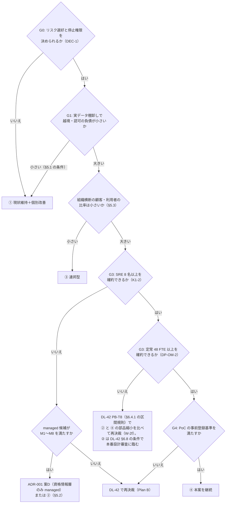

# 代替案比較（現状維持・マネージド IdP＋サービス内認可・連邦型・本案）

> 文書ID: DCS-08 / 版: 提出版 v1.0（自己レビュー済み・未決裁） / 状態: review / 最終更新: 2026-10-15（v1.0 凍結（.workflows/phase4d.js の Freeze 段。2026-10-15T11:10Z（UTC）、git HEAD 3228df6 の作業ツリー。凍結前是正・凍結前の同期の改訂は未コミット）: 作業版 0.4 の内容を、提出版 v1.0 として凍結した。本文は変えていない。他文書が引く「DCS-08 版 0.4」は本版と同じ内容を指す。状態「review」は、AI エージェント（Claude）による模擬パネル（自己レビュー）の固定リストの確認ラウンドで 8 役が「承認可（条件付き含む）」・未解消 0 件と判定したことを示すだけである。実在の CTO/CISO の決裁、第三者評価、立会い付きの実測、経営の承認はいずれも未達である（traceability/mock-panel-report.md §8、traceability/change-log.md §1.7）[D]。以下は作業版の履歴。0.4（PoC/R7反映）: §5.4 の注記に、PoC 系統 1 の不利な兆候（TC-002 K2 の X-C、TC-021 の X-D。独立再現でも再び観測された）が ④ に固有の共有部品（関係書込 API・façade）で起きたことと、勝つ条件 (3) の判定への扱いを加えた（独立反証 SM-1d、POA&M の OI-J06）。K44-3 の (a) にゲートの判定の順（G1 → G4 → G3。DCS-06 版 0.5 §2）を注記した。PoC の結果は立会人なしの自己実行であり、比較の採点は変えていない。残課題 12、末尾「レビュー記録」PoC/R7反映、脚注 41・42 を加えた。ラウンド 4 cfo の指摘により、W-1d・W-2a・W-2f、§4 総括表、残課題 9 の要員確約の決裁を DEC-11（仮）（DCS-03 §4.11、G3 判定時、経営会議＋CFO）に改めた。0.3: 模擬パネル ラウンド 4 の指摘により、§3.7 承認条件 10 項の充足可否（案ごと）を新設し、§3.3・§4・§5.2・K44-1 に ② が承認条件 4・6 をそのままでは満たせないことを反映した。0.2: 模擬パネル ラウンド 1 の指摘により、④ の定常費用と要員を DCS-07 §4.2 の 48〜66 FTE 前提の値に差し替えた。末尾「レビュー記録」）
> 対応要求: R-088, R-208, G-005（本書を対応成果物とする行）／G-028（DL-42 と共同）。関連: R-022, R-202, R-094, G-140〜G-146（並行開発）
> 依存文書: CONVENTIONS.md, traceability/deliverables.md（DL-44 行、§6.1 DEC-9）, traceability/G-goal-criteria.md（G-005, G-028）, traceability/rejected-hypotheses.md（RH-021）, traceability/claims-ledger.md（CL-0243）, 01_governance/assumptions-register.md（A-050〜A-054, A-081, A-091, A-100〜A-104, A-110〜A-115）, 01_governance/durability-charter-20y.md, 02_requirements/as-is-inventory.md（REQ-07）, 04_architecture/reference-architecture-v2.md（ARC-01）, 04_architecture/product-evaluation-exit.md（ARC-14）, 05_adr/ADR-001-build-buy-identity-provider.md, 05_adr/ADR-018-exit-strategy.md, 05_adr/ADR-022-integration-contract-standards.md, 00_decision/07-organization-and-tco.md（DCS-07）, 08_operations/operating-model.md（OPS-02）, 08_operations/tco-vendor-lts.md（OPS-03）, 08_operations/phased-rollout.md（OPS-04）, research/RS-07, RS-08, RS-12, RS-15, RS-16（各 research/verification/ の検証記録を含む）
> 作成方法: AI エージェント（Claude）が上記文書を通読して単独で起草した。新たに取得した原典はなく、脚注の外部原典はすべて research/ で作成者以外のエージェントが照合済みの記録に依る。本書の評価・推奨・決裁案は自己レビューであり、実在の CTO/CISO/CFO の決裁ではない（CONVENTIONS §8）[D]。Phase 4 の模擬パネルが本書を判定しても、それは自己レビューであり実在の CTO/CISO の決裁ではない [D]。
> 表記: 決裁案は K44-x、新規仮定は NA-DCS08-x（前提台帳へ追加要。本書は前提台帳を編集しない）と書く。表のセルのうちタグのないものは、同じ行に示した A-ID・RS 項目・ADR から導いた設計推論 [D] であり、この注記で個別のタグに代える。事実を述べるセルには個別にタグを付けた。金額は OPS-03・DCS-07 と RS-15 の試算の転記であり、税抜・定価・割引なし・1 ドル 150 円（OPS-03 の NA-001-1）・1 人年 1,000 万〜2,000 万円（NA-001-2）である。④ の定常年額と要員は、DCS-07 が決裁の基準値として推奨する 48〜66 FTE 前提の値（DCS-07 §4.2）を主に置き、OPS-03 §4.10 の 26〜30 FTE 前提の値は「A-054 を改訂しない場合の下限」として併記する [D][^21]。

## 0. 結論（要旨）

1. **4 案を、リスク・費用・要員・可逆性・移行コスト・並行開発への影響の 6 基準（下位 24 項目）で同じ表に載せた。4 案 × 6 基準の空欄は 0 であり、値を置けないセルには TBD の所有者・期限・決め方を付けた** [D]（§3、§4、G-005）。比較は前提台帳の仮置き値と、実データでない As-Is（REQ-07 §0 の 1）に依っており、結論はすべて仮定依存である [D][A-110, A-112]。
2. **費用の主項目はどの案でも要員であり、製品の課金ではない** [D][A-054]。本案の算出可能な定常年額は、ADR 群の運用に要る定常要員 48〜66 FTE（OPS-02 §4.3）で計算すると低 5.07 億・中 9.10 億・高 14.00 億円で、その 94〜95% が要員費である [D][^21][^22]（DCS-07 §4.2）。前提台帳の 24 FTE（A-054）に SRE の補正だけを加えた 26〜30 FTE で計算した低 2.87 億・中 4.45 億・高 6.80 億円（OPS-03 §4.10）は、A-054 を改訂しない場合の下限であり、その要員数では ADR 群の運用が成り立たない [D][A-054][^21][^22]。マネージド IdP の MAU 課金は年 0.08 億〜0.59 億円で、本案の定常年額より 1〜2 桁小さい [D][A-004, A-082]（RS-15#73）。したがって ② の費用上の利点は「料金の安さ」ではなく「運用と on-call の範囲の縮小」である [D]。48〜66 FTE の入力では、その範囲は認証だけでなく、② が持たない共有部品（共有 PDP の facade と CAM、失効配布、PEP coverage 工具、一覧レーン、非同期委任、状態ストア）の定常増分 計 10〜17 FTE（年約 1.0〜3.4 億円）に及ぶ [D][^22]（§3.3）。ただしその機能の一部は ② でもサービスごとに作ることになり、費用はドメイン側へ移る（§3.2 C5）[D]。
3. **どの案でも self-host から逃れられない部品がある** [D]。内部の token 交換と認可 Check を従量課金の managed に載せると、年額は token exchange で約 51.8 億円、Check で約 2.4〜44.1 億円となり、本案の算出可能な定常 TCO（中 9.10 億円）の 0.3〜5.7 倍になる（26〜30 FTE 前提の中 4.45 億円と比べれば 0.5〜12 倍）[D][A-043, A-045][^21]（OPS-03 §5、RS-15#63, #75）。② と ③ も、サービス間の資格情報とサービス内の判定を自社側で運用することになる [D]。
4. **現状維持（①）は、費用と移行コストが最小である一方、レビューが Critical とした PEP 完全性の欠如をそのまま残す** [D]。前提台帳の仮置きでは、300 サービスのうち 240 が認可を自前実装し、テナント分離をアプリ層の検索条件だけで行うサービスが 70% である [A-112]。OWASP API Security Top 10 2023 は BOLA を API1 に置き、session の利用者 ID と要求中の ID の比較だけでは BOLA の対策として足りないとしている [N][^12]（RS-08#8）。① が勝つのは、実データの棚卸し（G1）でこの仮置きが大きく外れた場合などに限られる（§5.1）[D]。
5. **マネージド IdP＋サービス内認可ライブラリ（②）は、要員を確約できない場合に本案に勝つ** [D][A-054]。ADR-001 の感度分析では、要員の重みを 35 にした設定で managed 全面の案が首位になる [D]（ADR-001 §4.3）。この感度分析は IdP の選択だけを比べ、要員を A-054 の範囲で評価したものである [D]。プログラム全体で要員が 48〜66 FTE になると、② と ④ の要員差は ADR-001 の採点が想定したより大きくなる [D][^22]。そのため、② が勝つ条件には「SRE の下限は確約できるが、定常 48 FTE（OPS-02 の推奨の読みの下限）は確約できない」場合を加えた（W-2f）[D]（§5.2）。この場合、資格情報層だけを managed にする案D では要員不足を解消できない。不足の大半は認証以外の共有部品から生じているためである [D][^22]。ただし ② は #3 失効配布と #7 PEP coverage 工具を持たないため、そのままでは承認条件 4（PEP coverage の機械検証と storage guardrail）と 6（剥奪 SLO の実測と充足）を満たせない（§3.7）[D][^1]。② が本番に進むには、サービス内ライブラリ版の検査とその中央要員を加えるか、満たせない範囲を段2 で受容する必要がある（DL-42 §6.8）[D][^24]。一方で ② は、ベンダー側の鍵スコープの誤りやサポート経路の侵害を自社で予防も検証もできない残余として負う [D]。その実例として、CSRB の Storm-0558 報告 [I][^8]、Okta のサポートケース管理システム侵害の事後報告 [I][^9]、CVE-2025-55241（Critical）[I][^10] がある（RS-12 §2 の 1・6・10）。
6. **共通契約だけの連邦型（③）は、並行開発の立上りが最も速いが、仕様だけでは多組織の実装がそろわない** [D]。デジタル庁の多ベンダー検証（20 社参加）は、仕様書の解釈がベンダーごとにずれる可能性と、未定義部分の仕様がベンダーごとに異なる可能性を課題に挙げた [M][^17]（RS-16 §2 の 14）。③ が勝つのは、ドメインをまたいで同じ顧客テナント・利用者が使う比率が小さい場合である（§5.3。比率は TBD、G1 で実測）[D]。
7. **本案（④）が勝つ条件は、要員の確約（SRE 単一系統 8 名以上または 2 系統各 6 名以上、かつ定常 48 FTE 以上（DCS-07 §4.2、OPS-02 DP-OM-2 の (b)））、識別子外皮の前提の成立（TC-01-01・TC-01-02）、PoC の事前登録基準の達成の 3 つが同時に成り立つことである** [D][A-054]（ADR-001 D17、§5.4）。Google SRE 本は、単一拠点で on-call を回す最少人数を 8 名、2 拠点なら各拠点 6 名としている [V][^4]（RS-15#70）。
8. **どの案を選んでも先に行う「後悔しない施策」が 5 つある**（§6）[D]。実データの As-Is 棚卸し、識別子（issuer・RP ID・SAML entityID）の自社ドメイン固定、BOLA の負例試験の CI 常設、共有シークレットの rotation、連携契約 v1 の版付き公開である [D]。これらは ②・③ に転じても資産として残る [D]。
9. **Plan B（DEC-9）の中身として、② に ③ の契約層と上記の後悔しない施策を加えた構成を推奨する（決裁案 K44-1。決定済みではない）** [D]。本案から Plan B に転じた場合も、連携契約 v1（11_contracts/）と識別子・主体台帳は捨てずに使える [D]（§7）。④ の定常費用を 48〜66 FTE 前提（年 5.07〜14.00 億円）に改めると、Plan B へ転じる確率は 26〜30 FTE 前提で見たときより高くなる。このため、Plan B の構成を G0 で事前承認しておく理由は強まる [D][^21]。推奨 (b) は変えていない [D]。
10. **未達**: 費用のうちライセンス・インフラ・保証は TBD であり、依存サービスの改修費を含む全社総額（K44-4 (a)）はサービスあたりの改修人月が未実測のため式までしか置けない（§3.2 C5）。As-Is は実データでなく、② の要員削減幅と ③ の組織横断比率は実測していない [D]。比較表の評価は作成者以外の検証も経営の決裁も経ていない [D]（§9）。

---

## 1. 本書の位置付けと読み方

### 1.1 目的

- 本書は、旧提案の代替案が「万能 JWT」「中央 PDP のみ」「サービス完全自治」という両極端の 3 案だったこと（棄却仮説 RH-021、主張台帳 CL-0243 の処置「修正」）を受け、実際に選び得る 4 案を同じ基準で比べる [D][^2]。
- レビューは「特定製品、特定クラウド、少数の専門家、独自ポリシー言語へ過度に依存しないか」を問い（L21）、製品・運用モデルの未決定を High とし build/buy/managed の比較を求めた（L92）[D][^1]。本書はこの 2 点（R-208、R-088）を、製品単位ではなくプログラムの構成単位で受ける [D]。製品単位の比較は ADR-001（IdP）、ADR-010（認可エンジン）、ARC-14（製品評価・出口）が担う [D]。
- 4 案の定義は再提案計画の作業指示による [D][^3]。種資料（seed-03）は問いの入力としてだけ使い、根拠には使わない [D]。

### 1.2 決めること・決めないこと

| 区分 | 内容 |
|---|---|
| 本書が示す | 4 案の定義（藁人形にしない形）、6 基準の比較表、各代替案が本案に勝つ条件と観測点、どの案でも行う施策、Plan B の推奨構成（決裁案） |
| 本書が決めない（正本は別） | DEC の文言と承認者（DL-39）、ゲートの合格・中止基準と Plan B の手順（DL-42）、FTE と TCO の確定値（DL-43、OPS-03）、製品の選定（ADR-001、ADR-010、Gate 3） |

### 1.3 読み手別の入口

- 決裁者（CTO・CISO・CFO）は §0、§4（総括表）、§5（勝つ条件）、§7（決裁案）を読む [D]。
- 連携開発者（依存サービスのチーム・ベンダー）は §3.6（並行開発への影響）と §6（どの案でも行う施策）を読む [D]。

---

## 2. 比較する 4 案の定義

各案は、その案の支持者が「最も良い形」と認める形で定義した [D]。弱い形（例: 現状維持＝何もしない、連邦型＝契約も試験もない）では比べない [D]。

### 2.1 ① 現状維持（個別改善を含む）

| 項目 | 内容 |
|---|---|
| 構成 | 300 サービスが現行の認証・認可を続ける。共通の新基盤は作らない。既存の共通 SSO（120 サービスが利用）はそのまま運用する [A-110] |
| 含める改善 | 各サービスでの ASVS V8 の自己点検、BOLA の負例試験の導入、共有シークレットの棚卸しと rotation、既存 SSO への寄せ（任意） |
| 含めない | 共通 PEP SDK、共有 PDP、cell、識別子外皮、主体台帳、連携契約の全社凍結 |
| 費用の負担先 | 各ドメインの予算（基盤の TCO には現れない） |
| 位置付け | ゲート計画で「G0 で統治を決められない場合に共通基盤化をやめ個別サービス改善に縮小する」ときの行き先（DL-42 で確定） |

### 2.2 ② マネージド IdP＋サービス内認可ライブラリ

| 項目 | 内容 |
|---|---|
| 構成 | 人の利用者の認証と外部 client への token 発行を managed CIAM（地域ごとの独立テナント）に任せる（ADR-001 §3.1 の案A に相当）。各サービスは認可ライブラリ（Cedar、OPA、Casbin 等の組込み評価）をプロセス内で使い、policy と関係データをサービスごとに持つ |
| 強い形にするための前提 | (a) issuer・RP ID を自社 custom domain に置ける候補に限る（ADR-001 §3.6 の案A「自社 custom domain は可」）。(b) サービス間の資格情報は、token 単位課金の managed に載せず、workload identity（ADR-009）で賄う。(c) 認可ライブラリの選定と使い方の規約、負例試験の雛形は小さな中央チームが提供する |
| 含めない | 共有 PDP、cell 内 STS の token exchange（必要なら各サービスが個別に作る）、識別子外皮、主体台帳 |
| 位置付け | 再提案計画が Plan B の中核として挙げた構成 [D][^3]。ADR-001 の案A と案D の中間ではなく、AS も managed にする点で案A 側 |

### 2.3 ③ 共通契約だけの連邦型

| 項目 | 内容 |
|---|---|
| 構成 | 中央は実行時の部品を持たず、契約だけを版付きで凍結・公開する。契約は token profile と claim、PEP–PDP API（AuthZEN 1.0 の evaluation 層）、監査イベントの共通項目、エラー形式、SDK の公開インタフェース、非推奨方針である（ADR-022、11_contracts/）。約 30 の事業ドメイン（A-051）は、IdP・PDP の実装（managed、OSS、既存）をドメインごとに選ぶ |
| 強い形にするための前提 | (a) 契約に参照実装・適合確認ツール・負例ベクタ・疑義窓口・正誤表を含める（RS-16 §2 の 14 の含意）。(b) ドメインの実装は適合試験の合格を本番入場の条件にする。(c) 顧客 IdP との federation はドメイン間で共有する取り決めを契約に含める |
| 含めない | 共有の AS・STS・PDP・失効配布・cell、中央の on-call |
| 位置付け | 契約層は本案の DEC-8（連携契約 v1 の凍結）と同じ資産を使う |

### 2.4 ④ 本案（参照アーキテクチャ v2）

| 項目 | 内容 |
|---|---|
| 構成 | 識別子外皮＋主体台帳＋cell 内で self-host する AS・資格情報層・STS（ADR-001 案E）、サービス内 PEP（PEP SDK）＋cell 内の共有 PDP façade（AuthZEN 1.0）、失効の 6 強制点、法域ごとの control plane、連携契約 v1（ARC-01 §0）。要員が確約されなければ資格情報層だけ managed にする案D に切り替える（ADR-001 D17-2） |
| 不可逆とする決定 | 自作しない原則、外部に見える識別子の自社ドメイン固定、主体台帳の正本、信頼する issuer の範囲（ADR-001 D1〜D4、DEC-3） |
| 位置付け | 全ゲート（G0〜G6）を通る前提の推奨案。本番化・全社標準化・移行強制は今回の決裁で求めない（DL-39） |

### 2.5 4 案の構成要素の対照

| 構成要素 | ① 現状維持 | ② managed＋ライブラリ | ③ 連邦型 | ④ 本案 |
|---|---|---|---|---|
| 人の認証（AS・資格情報） | 各サービス・既存 SSO | managed（ベンダー） | ドメインごと | 自社 self-host（fallback で資格情報層のみ managed） |
| 外部向け issuer | サービスごと・既存 SSO | ベンダー（custom domain） | ドメインごと（約 30） | 自社ドメインの外皮（粒度は ADR-021、U-01） |
| サービス間の資格情報 | 共有シークレット中心（A-113） | workload identity | ドメインごと | cell 内 STS・workload identity（ADR-009） |
| 認可の判定 | 各サービスの自前実装 | 各サービスの組込みライブラリ | ドメインの PDP（契約準拠） | サービス内 PEP＋cell 内共有 PDP |
| 失効の伝播 | サービスごと | ベンダーの session 失効＋サービスごと | ドメインごと（契約で形式のみ統一） | 6 強制点で中央強制（ADR-006） |
| 監査 | サービスごと（形式不統一の仮定、REQ-07 N-4） | ベンダーのログ＋サービスごと | 契約の共通項目でドメインごと | cell 内ジャーナル 100%＋WORM（ADR-014） |
| 契約の凍結 | なし | ベンダーの API が事実上の契約 | あり（中核） | あり（DEC-8） |

---

## 3. 基準ごとの比較

基準は G-005 の 5 基準（リスク・費用・要員・可逆性・移行コスト）に、作業指示による「並行開発への影響」を加えた 6 つである [D][^3]。各基準は下位項目に分け、同じ下位項目で 4 案を見る [D]。評価記号は、4 案の中での相対的な位置を ◎（最も有利）・○・△・×（最も不利）で示す [D]。記号は自己評価であり、作成者以外の検証を経ていない [D]。

### 3.1 リスク

| 下位項目 | ① 現状維持 | ② managed＋ライブラリ | ③ 連邦型 | ④ 本案 |
|---|---|---|---|---|
| R1 テナント越境・PEP の漏れ | × 自前認可 240 サービス、アプリ層だけのテナント分離 70%（A-112）。BOLA は API1:2023 [N][^12]。coverage の証拠はサービスごとに無い | △ ライブラリで判定の記述はそろうが、entity データは呼出側が渡す。Cedar は評価が error になった policy を skip する [V][^14]（RS-07 §2 の 8）ので、entity の欠落で forbid のガードレールが働かなくなり得る。300 実装の正しさをサービスごとに示す必要 | △ ドメインの PDP は契約準拠でも、ドメイン間で解釈がずれ得る [M][^17]（RS-16 §2 の 14）。coverage の証拠はドメインごと | ○ PEP SDK＋共有 PDP＋decision_id による実行時 coverage 突合（RS-08 §2 の 4、ADR-012）。ただし実証は PoC と第三者評価待ち（R-205・R-206 は未達） |
| R2 鍵・IdP 侵害の封じ込め | × 鍵・資格情報がサービスごとに分散し、rotation 記録のない共有シークレット 1,500 件（A-113 の 50%） | △ ベンダー側の鍵スコープの誤りとサポート経路の漏えいを自社で予防・検証できない（Storm-0558 [I][^8]、Okta [I][^9]、CVE-2025-55241 [I][^10]） | △ 約 30 の鍵階層が並ぶ。鍵の寿命・スコープ・検証側の issuer 結合の誤りがドメインごとに起こり得る（RS-12 §2 の 1） | ○ L0→L1→L2 の鍵階層、cell 別 KMS、(iss, typ, kid) の許可鍵集合（ADR-007）。上流 IdP の侵害は broker の統制で封じ込める（ADR-001 §3.5）。自社運用の誤りは自社が負う |
| R3 可用性の波及 | ○ 障害はサービスごとに局所化（共通 SSO 利用分を除く） | △ 1 ベンダーの障害で全利用者の新規ログインが止まる。Google OAuth は 2020-12-14 に 47 分間使えなくなった [I][^11]（RS-12 §2 の 13）。SLA の救済はクレジットで上限あり（RS-15 §2 の 7） | ○ ドメイン単位で局所化 | ○ cell 分割と静的安定性（ADR-013）。cell 化しなければ外皮・主体台帳が全テナントに効く単一障害点になる（ADR-001 §3.5 の欠点） |
| R4 単一製品・少数専門家・独自言語への依存（R-208） | △ 依存は分散するが、サービスごとの少数の担当者に知識が偏る | × 1 ベンダーへの依存。password hash の export は Auth0 が審査付きで期日の保証なし [V][^6]、Cognito と Entra は手段を確認できず（RS-15#44）。policy はライブラリごとの DSL で書かれ、DSL 間をつなぐ標準はなく AuthZEN も policy language を範囲外とする [N][^15]（RS-07 §2 の 13） | ○ 製品の選択がドメインに分散する。契約は標準（OAuth/OIDC、AuthZEN）に寄せる | ○ 識別子・主体台帳・鍵を自社が持ち、製品はテナント単位で置換できる設計（ADR-001 §3.6、ADR-018）。運用対象が最も多く、専門家の需要は最大 |
| R5 計画の遂行リスク | ◎ 新規の計画がない | ○ 中央の構築が小さい | ○ 中央の構築が小さいが、30 ドメインの適合をそろえる必要 | × 構築範囲が最大。多組織の並行移行は、デジタル庁の標準化で 34,366 システム中 10,013（29.1%）が期限内に移行できなかった公表例がある [M][^18]（RS-16 §2 の 13） |

- R1 の ① と ④ の差は、レビューが Critical とした「PEP 完全性の証明がない」に対して証拠を作れる仕組みがあるかどうかである [D][^1]。ASVS 5.0.0 は機能・データ単位の明示許可（8.2.1・8.2.2、L1）とマルチテナントの cross-tenant 統制（8.4.1、L2）を求める [N][^13]（RS-08 §2 の 1）。① でも各サービスがこれを満たすことはできるが、300 サービス分の証拠を集める仕組みがない [D][A-050]。
- R2 の ② の残余は、ベンダーが侵害されたときの封じ込め手段が契約と影響範囲の限定に限られることである [D]。CSRB は、Microsoft が自社の基準に合わない偽造 token を検知する仕組みを持っていれば、自力で阻止または検知できた可能性が高いと述べている [I][^8]（RS-12 §2 の 11）。② ではこの検知を顧客側（本基盤）が持てない [D]。
- 「検証ライブラリがすべて検証してくれる」という開発者の前提が破られた事例がある [I][^20]（RS-12 §2 の 3）。② と ③ はこの前提を 300 サービス・30 ドメインで個別に負い、④ は共通 SDK と PEP の既定で負う [D]。

### 3.2 費用

| 下位項目 | ① 現状維持 | ② managed＋ライブラリ | ③ 連邦型 | ④ 本案 |
|---|---|---|---|---|
| C1 基盤の定常年額 | ◎ 追加 0（改善の工数は各ドメイン負担、TBD） | ○ MAU 課金 年 0.08 億〜0.59 億円（RS-15#73）＋小さな中央チーム（SDK・規約・試験雛形）＋workload identity の運用。要員費は TBD（TC-01-08 で managed が減らす on-call を実測） | ○ 中央は契約チームと適合試験の運用だけ。ドメイン側の IdP・PDP の運用費は 30 ドメインに分散し、合計は TBD（ドメインごとの選択で決まる） | × 算出可能分で低 5.07 億・中 9.10 億・高 14.00 億円/年（要員 48〜66 FTE、DCS-07 §4.2）[^21]。A-054 を改訂しない場合の下限は低 2.87 億・中 4.45 億・高 6.80 億円/年（26〜30 FTE、OPS-03 §4.10）。ライセンス・インフラ・検索基盤と SIEM・保証は TBD |
| C2 構築期の一時費 | ◎ 0 | ○ 300 サービスへの認可ライブラリ組込みと IdP 連携の改修（1 サービス 1 人月ごとに 2.5〜5.0 億円の桁、OPS-03 §4.8 の式を準用） | ○ 各ドメインの適合改修（同じ式）＋契約・適合ツールの整備 | × 構築期の一時要員 41〜79 人年で約 4.1〜15.8 億円（cell 化の工具 0.45〜1.5 億円を内数に含む、DCS-07 §4.3）[^21]＋300 サービスの PEP SDK 改修（同じ式） |
| C3 従量課金の暴露 | ◎ なし | △ M2M を managed に載せると年約 2.7 億円（Cognito、ピーク継続の上限）[D][A-029]（RS-15#75）。前提 (b) で回避するが、回避の工数が残る | ○ ドメインの選択次第 | ○ 内部 token と Check は self-host（ADR-001 D10、ADR-010）。KMS 署名 年 0.21〜0.25 億円（OPS-03 §4.2） |
| C4 事故時の財務影響 | × 越境事故の確率を下げる仕組みがない。金額は OPS-03 §7 の枠で未算出 | △ 上流のクレジットは月額料金の一定割合で頭打ち（Auth0・Google は 50%）、AWS は返金しない（RS-15 §2 の 7）。自社顧客へのクレジットは自社負担 | △ ドメインごと | △ 認証停止について回収できる上流のクレジットはない（OPS-03 §0 の 3） |
| C5 全社総額（K44-4 (a)。基盤の定常年額＋構築期の一時費＋依存サービスの改修費＋ドメイン側に移る定常費） | ○ 基盤 0 ＋ 改修 0（任意の改善は各ドメイン、TBD）。ただし移行は先送りで、後で ② や ④ に移るときに改修費が生じる（§3.5） | ○ 定常: MAU 0.08〜0.59 億円/年 ＋ 中央要員（TBD）＋ ドメイン側に移る定常費（一覧の認可・非同期委任・失効の伝播をサービスごとに作る分、TBD）。一時: 改修 2.5〜5.0 億円 × m₂ | △ 定常: 中央の契約・適合試験チーム（TBD）＋ 30 ドメインの IdP・PDP 運用（TBD）。一時: 改修 2.5〜5.0 億円 × m₃ ＋ 適合ツール整備 | × 定常: 5.07〜14.00 億円/年（下限 2.87〜6.80）。一時: 構築期 約 4.1〜15.8 億円 ＋ 改修 2.5〜5.0 億円 × m₄ |

- C5 の m₂・m₃・m₄ は、各案で依存サービス 1 つあたりに要る改修の人月である（新規仮定 NA-DCS08-4、OPS-03 の NA-OPS03-6 を 4 案に広げたもの）[D][^23]。係数「1 サービスあたり 1 人月ごとに 2.5〜5.0 億円」は 300 サービス × 1 人年 1,000 万〜2,000 万円 ÷ 12 であり、m＝2 なら 5〜10 億円になる [D][A-050][^23]（OPS-03 §4.8）。
- m を 4 案で同じとみなすと、改修費は 4 案の差にならない [D]。差を決めるのは、④ の基盤定常年額（年 5.07〜14.00 億円）と、② と ③ でドメイン側に移る定常費（TBD）の大小である [D]。② では、④ が基盤として提供する一覧の認可（ADR-025）、非同期委任（ADR-026）、越境共有（ADR-024）を、需要のあるサービスがそれぞれ作る [D]。そのため m₂ は m₄ より小さいとは限らない [D]。値は G1 の棚卸しとパイロットの工数記録（TC-130）で決める [D][^21]。
- C1 の ④ は、旧版（0.1）の △（2.9〜6.8 億円/年）から × に改めた [D]。48〜66 FTE の入力では、4 案の中で基盤の定常年額が最も大きいのは明らかに ④ である [D][^21]。
- 4 案とも費用の主項目は要員である [D][A-054]。A-054 の 24 FTE に 1 人年 1,000 万〜2,000 万円を掛けると年 2.4 億〜4.8 億円で、managed の MAU 課金より 1 桁大きい [D][A-054]（RS-15#76）。OPS-02 の 48〜66 FTE では要員費だけで年 4.80 億〜13.20 億円になり、MAU 課金より 1〜2 桁大きい [D][^21][^22]。
- 依存サービスの改修費（C2）は、各ドメインの予算に計上するか基盤の TCO に入れるかで見え方が大きく変わる（OPS-03 §4.8、決裁案 K33-1）[D]。② と ③ は改修費が各ドメインに分散するため、基盤の TCO だけを比べると本案より安く見える [D]。比較は改修費を含めた全社の総額で行うべきである [D]。
- 費用の幅は GAO の方法（費目の網羅、前提の文書化、感度分析、リスク・不確実性分析）で示す必要がある [N][^5]（RS-15#69）。GAO は、点推定だけでは見積りの不確実性について何も分からず、意思決定に不十分だとしている [N][^5]。本表の値は感度計算であり、信頼水準付きの範囲ではない [D]。

### 3.3 要員

| 下位項目 | ① 現状維持 | ② managed＋ライブラリ | ③ 連邦型 | ④ 本案 |
|---|---|---|---|---|
| S1 プラットフォームチーム | ◎ 新設なし | ○ 認証・IdP 5 名分の一部と on-call の範囲が減る（RS-15#76）。障害時の切替え、顧客連絡、設定変更、ベンダーへのエスカレーションの on-call は残る（RS-15#71） | ○ 契約・適合試験・SDK の小チーム（A-054 の PEP SDK・開発者支援 4、プロダクト・統制 2 の規模を仮の目安とする） | × 約 48〜66 FTE（A-054 の 24 に ADR 14 件の定常増分 ＋23.5〜＋42 を加えた値。重複控除前。最も有利な読みでも約 40、OPS-02 §4.3）[^22]。A-054 を改訂しない場合の下限は 26〜30 FTE（SRE の最少人数の補正だけを加えた値、OPS-03 §4.1）で、その人数では ADR 群の運用が成り立たない |
| S2 on-call の成立 | △ サービスごと（認証障害の専任なし） | ○ 自社分は縮小。ただし SRE を 0 にはできない | × ドメインが IdP・PDP を自営すると、各ドメインに on-call が要る。30 ドメインがそれぞれ単一拠点の最少人数 8 名 [V][^4] を専任で置けば、上限で延べ 240 名になる [D][A-051]。共有すれば ④ に近づく | △ SRE 単一系統 8 名以上または 2 系統各 6 名以上が成立条件（ADR-001 D17） |
| S3 ドメイン側の専門家需要 | × 300 サービスが認可と認証の専門性をそれぞれ持つ必要 | △ 認可ライブラリの使い方と policy の正しさを各サービスが負う | △ 30 ドメインが IdP・PDP の専門性を持つ | ○ 専門性を基盤に集め、依存側は PEP SDK の規約に従う |

- ② の要員削減幅は、ADR-001 の TC-01-08（系統別の on-call 負荷と更新追随の実測）で決まる [D]。差が 1 名分未満なら案E、2 名分以上なら案D を強めるという判定規則を ADR-001 が定めている [D]（ADR-001 §7.1）。本書はこの判定規則を ② の評価にも使う [D]。
- 前提台帳 A-054 の SRE 6 名・2 系統は、Google SRE 本の目安（単一拠点 8 名、2 拠点各 6 名）[V][^4] を下回る [D][A-054]（RS-15#71）。この不足は ④ に固有ではなく、② でも縮小された範囲の on-call について残る [D]。
- OPS-02 §4.3 の定常増分 14 項目を、② の定義（§2.2 の「含めない」）に当てはめた [D][^22]。② が持たない部品の増分は、#2 状態ストア・edge 照会系（＋1〜2）、#3 失効配布・SSF（＋2〜3）、#6 CAM・PDP facade（＋2〜4）、#7 PEP coverage 工具（＋2〜3）、#13 一覧レーン（＋2〜3）、#14 非同期委任（＋1〜2）であり、計 ＋10〜17 FTE になる [D][^22]。② でも縮小した形で残る増分は、#1 SRE の下限（RS-15#71）、#4 管理用 IdP・署名系、#5 workload ID（§2.2 前提 (b)）、#8 監査経路、#9 版台帳、#10 非人間 ID である [D][^22]。K44-1 (b) で ③ の契約層を加える場合は #12 契約管理（＋2）も残る [D][^22]。#11 出口は、② ではベンダーからの出口として形を変えて残る [D]。
- したがって 48〜66 FTE の入力では、④ と ② の要員差は少なくとも 10〜17 FTE（年約 1.0〜3.4 億円）に、認証・IdP 5 名分のうち managed が減らす分（TC-01-08 で実測）を加えたものになる [D][^22]。この差は 26〜30 FTE 前提では見えなかった [D]。ただし #3・#13・#14 の機能はサービスごとの実装としてドメイン側に移るため、全社の要員が同じだけ減るわけではない（§3.2 C5）[D]。
- 資格情報層だけを managed にする案D（ADR-001 D17-2、OPS-02 PB-1）は、上の 14 項目のうち SRE の on-call 範囲の一部しか減らさない [D][^22]。案D は SRE 下限の不足に対する fallback であり、48 FTE 全体の不足に対する fallback ではない [D]。全体の不足について、OPS-02 DP-OM-2 は「(a) 24 FTE のままなら PB-1〜PB-3 に移る」とする。PB-2 は A-054 の下限 15 FTE を下回る場合、PB-3 は CAM・facade の要員を確約できない場合の定めで、いずれも ④ の部品単位の縮小である [D][^22]。24〜47 FTE を確約した場合に、④ のどの部品を残し、どこから ② に寄せるかは定められていない [D][^22]。本書はこの区間を ② が勝ち得る条件 W-2f として扱う（§5.2）[D]。この区間の行き先は、DL-42 §6.4.1 の PB-T8 の区間規則で定めた [D][^24]。
- ② が持たない部品のうち、#3 失効配布・SSF と #7 PEP coverage 工具は、④ が承認条件 6（R-271）と 4（R-269）を満たすための部品である [D][^22][^27][^28]。したがって ② は、要員が 10〜17 FTE 少ない代わりに、そのままでは承認条件 4・6 を満たせない（§3.7）[D]。② で 4・6 を満たすには、サービス内ライブラリ版の coverage 検査（B4）と、サービスごとの剥奪反映時間の実測とライフサイクル事象の受信の契約試験（B6）を加える（DL-42 §6.8）[D][^24]。その中央要員は未見積りで、上限の目安は #3 と #7 の和 4〜6 FTE（DL-42 の NA-DCS06-10）である [D][^24]。そのため、承認条件 4・6 を満たす形で比べた ② と ④ の要員差は、10〜17 FTE からこの分を差し引いた値になる [D]。

### 3.4 可逆性

| 下位項目 | ① 現状維持 | ② managed＋ライブラリ | ③ 連邦型 | ④ 本案 |
|---|---|---|---|---|
| V1 今回の決裁で生じる不可逆な決定 | ◎ なし | △ ベンダーの選定は可逆に見えるが、利用者の資格情報が managed に入った時点で出口が契約に依存する | ○ 契約 v1 の識別子部分だけ | △ D1〜D4 を意図して不可逆にする（ADR-001、DEC-3） |
| V2 時間とともに積み上がる不可逆性 | × 新規サービスが独自セッション・独自識別子を増やし、後の統合の費用が年ごとに増える | × password hash を出せない製品からは JIT 移行で出るしかなく、全員が一度サインインするまで旧系を止められない（RS-15#60）。DSL 間の変換標準がない（RS-07 §2 の 13） | △ 約 30 の issuer と識別子体系が固定され、後で統合すると W1・W3・W9 型の顧客作業が生じる | ○ 製品の選択と managed の配分はテナント単位で戻せる（ADR-001 §3.6）。D2・D3 が成り立つことが前提（TC-01-01・TC-01-02） |
| V3 中止・転換のしやすさ | ◎ いつでも ④ や ② に移れる（ただし V2 の費用は増える） | ○ ④ への転換は、識別子が自社 custom domain にあれば AS の上流化で行える（ADR-001 の案D の構成） | ○ ドメイン単位で ② や ④ に寄せられる | ○ Plan B へ転じても契約・識別子・主体台帳を引き継げる（§7） |

- EU Data Act 第 25 条(2) は、データ処理サービスの契約に、最大 30 暦日の移行期間、2 か月以下の予告期間、移せるデータ分類の網羅的特定、最低 30 暦日のデータ取得期間などを含めなければならない（shall）とする [N][^7]（RS-15#64）。ただし前文 (82) はサービスの完全性とセキュリティに関わるデータを export 可能データから除くべき（should）としており、password hash や MFA secret は契約で明示しなければ除外扱いにされ得る [D]（RS-15#66, #68）。② の可逆性は、この契約条項を取れるかに依存する [D]。
- 不可逆の決定を「少なくする」ことと「選んで固定する」ことは別の戦略である [D]。① は前者だが、識別子の散在という形で不可逆性が時間とともに増える [D][A-110]。④ は後者で、不可逆にするものを識別子・台帳・鍵の 4 点に絞り、それ以外を可逆にする [D]（ADR-001 §3.6）。

### 3.5 移行コスト

移行作業 W1〜W10 と見積りの枠は REQ-07 §6 に従う [D]。件数は前提台帳の仮置きである [D][A-013, A-082, A-114, A-115]。

| 下位項目 | ① 現状維持 | ② managed＋ライブラリ | ③ 連邦型 | ④ 本案 |
|---|---|---|---|---|
| M1 顧客側の作業（W1〜W5, W9） | ◎ 0 件 | △ issuer・ACS URL を引き継げなければ SAML 1,800・OIDC 200 接続の再設定（W1・W3）、grant 3 万の再同意（W5） | × 顧客テナントが複数ドメインを使う場合、ドメインごとに federation 接続が要り、W1 の件数が「接続数 × 利用ドメイン数」に増え得る（倍率は TBD） | ○ 識別子の維持（REQ-07 DQ-B の B1）で W1・W3・W9 を避ける計画。維持できるかは N-3（現行識別子が自社ドメインか）に依存 |
| M2 利用者側の作業（W6〜W8） | ◎ 0 人 | × RP ID が変われば passkey 3.325 万人の再登録（W6）、hash を移送できなければ password 保持者 44.175 万人の再設定または移行期間内のサインイン（W7） | △ ドメインが新 IdP に移る範囲だけ | △ 現行 RP ID・hash を移せるかに依存（N-3、N-8）。移せなければ ② と同じ件数 |
| M3 サービス側の改修 | ◎ 0（改善は任意） | △ 300 サービスで IdP 連携と認可ライブラリの組込み | △ 各ドメインの適合改修 | △ 300 サービスで PEP SDK の組込みと token 移行。dual-run と自動 rollback の運用（OPS-04）が加わる |
| M4 並行稼働の期間 | ◎ なし | △ JIT 移行の期間は旧系を止められない | △ ドメインごとにばらつく | △ dual-run と段階導入（P0〜P4）の期間。bake 時間等は TBD（OPS-04 要旨 5） |

- 移行の総額は、REQ-07 §6.2 の式（顧客・支援・利用者・改修・並行・一時の 6 項）で見積もるが、対象件数以外の単価がすべて TBD のため、本書も総額を置かない [D]。
- ① の移行コスト 0 は、現状の負債（R1・R2 の残余）を移行しないという意味である [D]。後で ② や ④ に移る場合、M1〜M3 の作業は消えずに先送りされ、その間に増えたサービス分だけ大きくなる [D][A-102]。

### 3.6 並行開発への影響

20〜30 の開発組織（A-052）が、基盤の完成を待たずに開発を進められるかを見る [D]。

| 下位項目 | ① 現状維持 | ② managed＋ライブラリ | ③ 連邦型 | ④ 本案 |
|---|---|---|---|---|
| P1 開発の着手を妨げないか | ◎ 現行のまま進められる | ○ ベンダーの SDK と sandbox ですぐ着手できる | ◎ 契約の凍結とモックで着手できる | ○ 契約 v1 の凍結（DEC-8）とモック・契約試験キット（11_contracts/）で着手できる。基盤の提供時期（G-143）に合わせる必要 |
| P2 組織間の結合（境界をまたぐ機能） | × サービス間の認可・共有・委任が二者間の個別取り決めになる | △ 越境共有・一覧検索の認可（ADR-024、ADR-025）をサービスごとに作る | △ ドメイン間の結合は契約で定めるが、実装の解釈ずれが残る [M][^17] | ○ 越境共有・一覧検索・非同期委任を基盤の契約として提供（ADR-024〜ADR-026） |
| P3 契約の安定性 | × 契約がない | △ ベンダーの API が事実上の契約になり、製品の変化がそのまま依存側に及ぶ（RH-178 で棄却した「製品ネイティブ API を契約にする」と同じ構造、ADR-022 §3 案F） | ○ 契約が中核 | ○ 契約 v1 は版付き・非推奨期間付き・強制移行なし（RS-16 §2 の 2） |
| P4 中央が律速になるか | ◎ 中央なし | ○ 中央は小さい | ○ 中央は契約と適合試験だけ | △ オンボーディングと審査が律速になり得る。リードタイムの数値契約と実測が要る（G-144、RS-16 §2 の 12） |

- JWT は理解できない claim を無視しなければならない（MUST）[N][^16]（RS-16 §2 の 4）。そのため新しいセキュリティ制約を claim の追加で表しても、旧版の PEP は黙って無視する [D]。この性質は ③ と ④ の両方に効くが、③ では強制点がドメインに分散しているため、制約の強化が全ドメインに行き渡ったことを確かめる手段が契約試験だけになる [D]。
- CNCF の Platforms 白書は、platform の属性に self-service、任意かつ組合せ可能、secure by default を挙げ、トップダウンの強制だけで採用を進める platform チームは利用者の抵抗に遭うと警告する [V][^19]（RS-16 §2 の 11）。④ が P4 で律速にならないためには、強制する範囲（認証、token 検証、PEP、監査イベント）と pull で採用される範囲を分けて宣言する必要がある [D]（RS-16 §2 の 11）。

### 3.7 承認条件 10 項の充足可否（案ごと）

レビューは承認条件 10 項を「本番設計審査へ進む最低条件」とした [D][^1]。DL-42 は R-216 に従い、これを G6 入場の退出基準とし、Plan B にも同じ 10 項を適用する（DL-42 §6.8）[D][^24]。版 0.2 の本書は 6 基準の比較だけで、案ごとに 10 項を満たし得るかの列を持たなかった [D]。そのため、Plan B（②）を事前承認しても本番に到達できるかが表から読めなかった [D]。本節はそれを補う [D]。

記号は、○ 構造上満たし得る（達成ではない）、△ 追加の仕組み・要員または製品の対応次第で満たし得る、× 構造上満たせない（満たせない範囲を段2 で受容するか、範囲を外す必要がある）を表す [D]。① と ③ は新しい共通基盤を作らない案だが、レビューが求めた最低水準を満たすかを同じ表で見る [D]。

| # | 承認条件（要約） | ① 現状維持 | ② managed＋ライブラリ | ③ 連邦型 | ④ 本案 |
|---|---|---|---|---|---|
| 1 | 経営承認済みのリスク選好・対象法域・データ分類・重大損失シナリオ | ○ 基盤の形に依存しない | ○ 同左 | ○ 同左 | ○ 同左（DEC-1、CTL-02 の法務署名） |
| 2 | IAL/AAL/FAL、認証器、回復、federation、SCIM、session のユースケース別定義 | △ 300 サービスと既存 SSO ごとに定義が散る | △ 製品の機能範囲で決まる（ARC-14 で確認） | △ ドメインごと（約 30） | ○ REQ 系で定義（決裁待ち） |
| 3 | root of trust と侵害 runbook | × 鍵・資格情報がサービスごとに分散し（A-113）、全体の root of trust を描けない | △ 自社分は置ける。AS・JWKS の鍵はベンダー側にあり、自社で予防も検証もできない（§3.1 R2） | △ 約 30 の鍵階層ごと | ○ ADR-007 と root of trust 文書（未達。RB-13 未作成） |
| 4 | 全入口の PEP coverage の機械検証と DB/storage の guardrail | × 300 サービス分の証拠を集める仕組みがない（§3.1 R1） | そのままでは ×（#7 を持たない）。B4（ライブラリ版の coverage 検査と storage guardrail）とその中央要員（NA-DCS06-10）を加えれば △ [D][^24][^28] | △ ドメインごと。証拠は契約試験に限られる（§3.6） | ○ ADR-012 案A（#7 ＋2〜3 FTE）。実測は G4 [D][^28] |
| 5 | OAuth BCP 準拠 profile と FAPI 2.0 の採否 | △ profile を書いても強制点がない | △ 製品の対応範囲次第（ADR-020、ARC-14） | ○ token profile は契約の中核 | ○ token-profile と ADR-020（決裁待ち） |
| 6 | 認可エンジン/ストアの整合性・分割・障害モデルの実測と剥奪 SLO | × 剥奪の伝播がサービスごと（§2.5） | そのままでは ×（#3 を持たない）。効力は session 失効と token の寿命で決まり、ADR-006 案A と同じ形になる。B6（サービスごとの実測と CR-9 の契約試験）を加え、かつ SLO の決裁値が分単位の R を許し FAPI 範囲がない場合に限り △ [D][^24][^27] | △ ドメインごと（形式だけ統一） | ○ ADR-006 の失効配布（#3 ＋2〜3 FTE）。実測は G4 [D][^27] |
| 7 | versioning と後方互換・rollback 方式 | × 契約がない（§3.6 P3） | △ ベンダー API の変化が依存側に及ぶ（P3）。自社の契約層で吸収する | ○ 契約が中核 | ○ ADR-016・ADR-027 |
| 8 | 独立評価・conformance・pentest・red team で Critical/High が閉じている | △ 評価対象が 300 サービスに分散 | △ ベンダー部分は第三者評価報告で受ける | △ 30 ドメイン分 | ○ ASR-01（第三者評価待ち） |
| 9 | 24/365 運用・SRE 容量・on-call・TCO の承認 | △ 新基盤はないが on-call はサービスごと | ○ 範囲は縮小（B4・B6 の要員を含めて確約） | × 30 ドメインの on-call（§3.3 S2） | △ 48〜66 FTE の確約が要る（§3.3） |
| 10 | 顧客通知・全 session 失効・鍵交換・PDP 隔離・監査証拠保全の演習 | × 全 session 失効を全社で行う手段がない | △ 全 session 失効はベンダー API 次第。PDP 隔離はライブラリの policy の版戻しで代える | △ ドメインごと | ○ OPS-01（G4・G5 で実測） |

- 表は本書の設計推論であり、作成者以外の検証を経ていない [D]。どの案も、2026-10-15 時点で達成した条件は 0 項である（DL-42 §7）[D][^24]。
- 10 項すべてが構造上 ○ になり得るのは ④ だけである [D]。ただし ④ でも、DL-42 §6.4.1 の順 4・5（#3・#7）を削ると条件 6・4 は × になる [D][^24]。
- ② は条件 4・6 が、そのままでは × である [D]。PB-T8 の約 41 FTE 未満の区間では、④ と ② のどちらも 4・6 を欠き得る。DL-42 §6.4.1 は、その場合の比較と既定を「両方が 4・6 を欠く状態」と「4・6 を取り戻す追加要員」で定めた [D][^24]。
- 満たせない条件は免除しない。範囲を限った段2（CEO、経営会議）の受容票で扱い、受容票は充足に数えない（DL-42 §6.8、GOV-07 §3.2 の AT-3〜AT-5）[D][^24][^29]。

---

## 4. 総括表（4 案 × 6 基準）

下位項目の記号を基準ごとにまとめた [D]。費用は、基盤の TCO と全社総額（K44-4 (a)）の 2 行に分けた [D]。重み付けの合計点は示さない [D]。理由は、重みの置き方で首位が入れ替わることが ADR-001 §4.3 の感度分析で確認されており、合計点が判断の根拠を隠すためである [D]。

| 基準 | ① 現状維持 | ② managed＋ライブラリ | ③ 連邦型 | ④ 本案 | 4 案の差を決める観測点 |
|---|---|---|---|---|---|
| リスク | ×（R1・R2 が最も不利。R5 は最も有利） | △（R2・R4 にベンダー依存の残余） | △（R1・R2 がドメインに分散） | ○（R1〜R4 は有利、R5 が最も不利） | G1 の As-Is 実データ（A-112、A-113）、G4 の PoC、G5 の独立評価 |
| 費用（基盤） | ◎（基盤の追加 0。事故時の影響は未算出） | ○（MAU 0.08〜0.59 億円/年＋縮小した要員） | ○（中央は小、ドメイン合計は TBD） | ×（算出可能分 5.07〜14.00 億円/年（中 9.10、48〜66 FTE）＋TBD 費目。A-054 を改訂しない場合の下限 2.87〜6.80 億円/年） | RFP の同一条件見積り（G3）、PoC の実測（G4）、G3 判定時の DEC-11（仮）の要員確約（DP-OM-2。経営会議＋CFO）[^40] |
| 費用（全社総額、K44-4 (a)） | ○（基盤 0＋改修 0。移行は先送り） | ○（MAU＋中央要員 TBD＋ドメインに移る定常費 TBD＋改修 2.5〜5.0 億円 × m₂） | △（中央 TBD＋30 ドメインの運用 TBD＋改修 2.5〜5.0 億円 × m₃） | ×（定常 5.07〜14.00 億円/年＋構築期 4.1〜15.8 億円＋改修 2.5〜5.0 億円 × m₄） | 改修費の計上先（K33-1）、m₂〜m₄ の実測（NA-DCS08-4、G1・TC-130） |
| 要員 | ◎（新設なし） | ○（on-call の範囲縮小。④ より少なくとも 10〜17 FTE 少ない） | ×（ドメインごとの on-call） | ×（約 48〜66 FTE、最も有利な読みで約 40。SRE 8 名以上と定常 48 FTE 以上が成立条件。A-054 を改訂しない場合の下限 26〜30 FTE） | K1-2 と DP-OM-2 の要員確約（G3 判定時、DEC-11（仮）、経営会議＋CFO）[^40]、TC-01-08 |
| 可逆性 | △（今は可逆、時間とともに不可逆性が増える） | ×（資格情報の出口が契約に依存） | △（約 30 の識別子体系が固定） | ○（4 点を選んで固定、他は可逆） | TC-01-01・TC-01-02、TC-01-17、契約の退出条項 |
| 移行コスト | ◎（0。ただし先送り） | ×（識別子・hash を移せなければ最大） | △（ドメイン数倍の接続の恐れ） | △（識別子の維持に依存） | REQ-07 の N-3・N-8（G1）、単価の実測（G4） |
| 並行開発 | △（着手は容易、結合は個別） | ○（着手は容易、契約が製品依存） | ○（着手は最も容易、解釈ずれ） | ○（契約凍結で着手、中央が律速の恐れ） | DEC-8、G-144 のリードタイム実測、G-146 のパイロット |
| 承認条件 10 項の充足可否（§3.7。参考行で、6 基準には数えない） | ×（3・4・6・7・10 が構造上満たせない） | △（4・6 はそのままでは ×。B4・B6 の追加で △） | △（多くがドメインごと。9 は ×） | ○（10 項とも構造上満たし得る。順 4・5 を削れば 4・6 は ×。達成は 0 項） | G4 の TC-121 と剥奪の実測、SLI-050〜SLI-052 の決裁値、NA-DCS06-10 の見積り |

- ④ が他の 3 案に対して明確に有利なのは、リスク（R1・R2・R4）と可逆性（V2）である [D]。④ が明確に不利なのは、費用（C1・C2）、要員（S1）、遂行リスク（R5）である [D]。
- 版 0.1 では、費用（基盤）を △、要員を △ としていた。これは 26〜30 FTE 前提の値に基づく評価であり、④ を約半分の費用と要員で見ていた [D][^21]。48〜66 FTE の値に差し替えたため、どちらも × に改めた [D]。要員の × は ③ と並ぶ。ただし ③ の × は、30 ドメインが on-call を専任で置いた場合の上限（延べ 240 名）に基づく。④ の × は、確約の対象となる単一組織の人数（48〜66 FTE）に基づく [D]。
- したがって、④ を選ぶ判断は「越境事故と鍵・IdP 侵害の封じ込めの価値が、追加の要員費（48〜66 FTE、年 4.80 億〜13.20 億円）と遂行リスクを上回る」という判断と同じである [D][^21]。この価値の大きさは、リスク選好（DEC-1）と BIA（GOV-04）で決まり、本書だけでは決まらない [D]。

---

## 5. 各代替案が本案に勝つ条件

各条件は、どのゲートで、何を観測して判定するかを付けた [D]。値に TBD があるものは、所有者・期限・決め方を付けた [D]。

図は判断の順序の要約であり、正式な合格・中止基準は DL-42 が持つ [D]。

### 5.1 ① 現状維持が勝つ条件

| ID | 条件 | 観測点・ゲート | 備考 |
|---|---|---|---|
| W-1a | G0 でリスク選好・停止権限・例外手順を決められない | G0（DEC-1） | 共通基盤の統治が成り立たないため、共通化は損失を集中させるだけになる |
| W-1b | 実データの棚卸しで、アプリ層だけのテナント分離（A-112 の 70%）と共通 SSO を経由しないサービス（A-110 の 180）が仮置きより大幅に少ないと判明する | G1（REQ-07 §7 の I-1） | 閾値は TBD（所有者 CTO＋CISO、期限 G1、決め方: 越境の損失シナリオ（GOV-03）の発生可能性がリスク選好（DEC-1）の範囲に収まる比率を逆算する） |
| W-1c | 主要サービスの多くが再決裁周期（初回 3 年以内）の間に退役・置換される予定である | G1（各ドメインのロードマップ） | 新基盤の投資を回収する期間がない [D][A-101] |
| W-1d | 要員も Plan B の予算も確保できない | G3（DEC-11（仮）、G3 判定時、経営会議＋CFO）[^40] | ② も ④ も成立しない場合の残る選択肢 |

- ① が勝つ場合でも、§6 の後悔しない施策は行うべきである [D]。特に BOLA の負例試験と共有シークレットの rotation は、① の R1・R2 の残余を下げる最小の手段である [D]。

### 5.2 ② マネージド IdP＋サービス内認可ライブラリが勝つ条件

| ID | 条件 | 観測点・ゲート | 備考 |
|---|---|---|---|
| W-2a | SRE 単一系統 8 名以上（または 2 系統各 6 名以上）を G3 までに確約できない | G3（K1-2、DEC-11（仮）、G3 判定時、経営会議＋CFO）[^40] | ADR-001 の感度で、要員の重みが高い設定では managed 全面が首位になる（ADR-001 §4.3） |
| W-2b | FAPI 2.0・顧客管理鍵・専用 cell を契約で求める高保証テナントがほぼない | G1（A-081 の実値。仮置きは基準 50、低 10） | 高保証の要件がなければ、② の R2 の残余を受容しやすい |
| W-2c | managed 候補が M1〜M8（hash の API export と期日の契約保証、自社ドメインの識別子、テナント別鍵スコープ等）を契約と実測で満たす | G3（TC-01-17、契約の法務確認） | 2026-10-03 時点で M1・M2 を満たすと確認できた候補はない（ADR-001 D9-2） |
| W-2d | 実データで、認可モデルが単純（role モデルが少なく）、越境共有・一覧検索・非同期委任の需要が小さい | G1（A-112 の role モデル数、REQ-07 §3.5） | サービス内ライブラリで足り、共有 PDP の価値が小さくなる |
| W-2e | TC-01-08 で、managed が減らす on-call と運用作業が 2 名分以上 | G4 | ADR-001 の判定規則を準用 |
| W-2f | SRE の下限（W-2a）は確約できるが、定常 48 FTE（OPS-02 の推奨の読みの下限、DP-OM-2 (b)）を G3 までに確約できない | G3（DEC-11（仮）、G3 判定時、経営会議＋CFO。DP-OM-2）[^40] | ② は ④ より少なくとも 10〜17 FTE（年約 1.0〜3.4 億円）少ない要員で成り立つ（§3.3）。案D では解消しない不足である。24〜47 FTE の区間の行き先は DL-42 §6.4.1 の PB-T8 の区間規則で決める [D][^22][^24]。ただし ② もそのままでは承認条件 4・6 を満たせない（§3.7）。② が勝つのは、B4・B6 の中央要員（NA-DCS06-10）を含めても ② の要員が確約に収まる場合、または満たせない範囲を段2 で受容する場合である [D][^24] |

- ADR-001 §4.3 の「要員の重み 35 で managed 全面が首位」は、IdP の選択肢だけを A-054 の要員の範囲で採点した結果である [D]。プログラム全体の要員が 48〜66 FTE になっても、ADR-001 の採点（E7 の点）は変わらない。しかし ② と ④ の要員差は、IdP の運用だけでなく、② が持たない共有部品の 10〜17 FTE にまで広がる [D][^22]。そのため、プログラム単位で比べると、② が首位に立つ要員の重みは 35 より低くなる方向に動くと本書は推論する [D]。どこまで下がるかは、プログラム単位の再採点を行っていないため示せない（残課題 9）[D]。
- 版 0.1 では、最も起こりやすい勝ち方を W-2a と W-2c の同時成立としていた。48〜66 FTE の入力では、W-2f も同じ程度に起こりやすいと本書は評価する [D]。A-054 の 24 FTE から 48 FTE への倍増を G3 までに確約することは、SRE の ＋2〜＋6 名より大きな決定になるためである [D][A-054][^21]。
- 最も起こりやすい勝ち方は、W-2a と W-2c の同時成立、または W-2f である [D]。W-2a だけが成り立ち W-2c が成り立たない場合は、② ではなく ADR-001 の案D（資格情報層だけ managed、AS・STS・識別子・主体台帳は自社）が行き先になり、それもなければ DL-42 で再決裁する [D]（ADR-001 D17-2）。
- ② を選ぶ場合も、内部の token 交換と認可 Check は token・check 単位課金の managed に載せない [D]（§0 の 3）。

### 5.3 ③ 共通契約だけの連邦型が勝つ条件

| ID | 条件 | 観測点・ゲート | 備考 |
|---|---|---|---|
| W-3a | 複数ドメインのサービスを同じ顧客テナント・同じ利用者が使う比率が小さい | G1（新規仮定 NA-DCS08-1 として測る） | 組織横断の SSO・失効・越境共有の価値が小さくなる。閾値は TBD（所有者 事業責任者（B2B）＋CTO、期限 G1、決め方: ドメインをまたぐテナントの事業価値と、M1 の接続数増の費用の比較） |
| W-3b | 主要ドメインが既に IdP・PDP の運用能力と on-call を持っている | G1（ドメインごとの体制調査） | S2 の延べ人数の問題が既存体制で吸収される |
| W-3c | 事業の分離・売却・M&A が計画期間中に複数回見込まれる | G0（経営計画） | ドメイン単位で切り離せることの価値が高い |
| W-3d | 契約の適合試験キットで、ドメイン間の解釈ずれを検出・是正できることがパイロットで示される | G4（G-142、G-146） | デジタル庁の検証が挙げた解釈ずれ [M][^17] を自社の仕組みで抑えられることの実証 |

- W-3a が成り立たない場合、③ は顧客の federation 接続をドメインの数だけ増やし（M1）、失効と監査をドメインごとに分ける（R1・R2）ため、④ より不利になる [D]。

### 5.4 本案（④）が勝つ条件と、負けを認める条件

| 区分 | 条件 | 観測点・ゲート |
|---|---|---|
| 勝つ条件 | (1) K1-2 の要員確約（SRE の下限）と DP-OM-2 (b) の定常 48 FTE 以上の確約、(2) TC-01-01・TC-01-02 で識別子外皮の前提が成立、(3) PoC の事前登録基準（越境・剥奪・可用性）を現実的構成で満たす、(4) 組織横断のテナント比率（NA-DCS08-1）が W-3a の閾値を上回る | G3、G4 |
| 負けを認める条件 | (1) の SRE 下限が不承認で M1〜M8 を満たす候補がある → ② または案D。(1) の 48 FTE が不承認（W-2f）→ DL-42 で ② と ④ の部品縮小を比べて再決裁。(2) が不成立 → ADR-001 の案B 寄りに修正。(3) が不成立 → DL-42 で Plan B。W-1a〜W-1d のいずれか → ① | G0〜G4 |

- 負けを認める条件は、中止を危機ではなく予定された判断にするために、Plan B と合わせて事前に承認しておく [D]（DEC-9、durability-charter 設計原則 5）。
- **勝つ条件 (3) に関わる PoC の兆候（PoC/R7反映）**: PoC 系統 1 では、TC-002 K2 でゲストの閉じ込めが R 段だけに依存する越境 allow（X-C）と、TC-021 で façade の関係書込 API が他テナントの role を subject として受理した昇格 1 件（X-D）が観測され、独立再現でも同じコードで再び観測された[^41][^42] [D]。どちらも ④ に固有の共有部品（共通の関係書込 API・façade）で起きており、共有部品の欠陥は同じ部品を使う全テナントに同時に及ぶ（独立反証の SM-1d。② の強い形では同じ種類の欠陥がサービスごとのライブラリの使い方に分散する）[D]。立会人のいない自己実行であり [M] の証拠ではないので、§3〜§4 の採点は変えない [D]。勝つ条件 (3) の判定（G4）では、立会い下の再実行で X-C・X-D が是正されたか（DCS-03 §4.3.2 の論点 5、POA&M の OI-C23・OI-C24・OI-J06）を確かめ、是正されなければ負けを認める条件の「(3) が不成立」に当たるかを DL-42 で判断する [D]。

---

## 6. どの案でも行う施策（後悔しない施策）

| ID | 施策 | ① | ② | ③ | ④ | 根拠 |
|---|---|---|---|---|---|---|
| NR-1 | 実データの As-Is 棚卸し（A-110〜A-115 の置換、entry point の機械抽出） | 要 | 要 | 要 | 要 | どの案の移行コストも未確定のまま比較している（REQ-07 DQ-A の A3 の帰結） |
| NR-2 | issuer・RP ID・SAML entityID を自社所有ドメインに固定する | 要 | 要 | 要 | 要 | passkey は RP ID に束縛され、RP ID がベンダーのドメインなら移せない（RS-15#60）。識別子の維持が W1・W3・W6・W9 を避ける（REQ-07 §6.3） |
| NR-3 | BOLA・越境の負例試験を CI の必須ゲートにする | 要 | 要 | 要 | 要 | 既製 SAST が検出できる認可欠落の範囲は狭く、自社規約に合わせたカスタムルールが要る（RS-08 §2 の 3） |
| NR-4 | 共有シークレットの棚卸しと rotation | 要 | 要 | 要 | 要 | rotation 記録なし 1,500 件の仮置き（A-113）。回転されない資格情報が大量侵害の主因になった一次報告がある（RS-12 §2 の 8） |
| NR-5 | 連携契約 v1（claim profile、エラー形式、監査イベントの共通項目、非推奨方針）を版付きで公開する | 任意 | 要 | 要 | 要 | 契約として凍結すべきは識別子と境界である（RS-16 §2 の 1） |

- 本書は、NR-1〜NR-5 を G0〜G1 の間に、選ぶ案と独立に着手することを推奨する（決裁案 K44-2）[D]。これらは ④ の準備であると同時に、①〜③ に転じた場合の損失を小さくする [D]。

---

## 7. 決裁案（経営・事業・法務の決定が要る点。決定済みではない）

| ID | 論点 | 選択肢 | 推奨 | 帰結 | 承認者（案） | 期限 |
|---|---|---|---|---|---|---|
| K44-1 | Plan B（DEC-9）の構成 | (a) ② 単独 (b) ② ＋ ③ の契約層 ＋ NR-1〜NR-5 (c) ADR-001 の案D を Plan B とする | (b) | (b) なら本案の契約・識別子の資産を Plan B に引き継げる。(c) は SRE 下限の不足時の fallback（ADR-001 D17-2）であり、プログラム中止時の既定経路とは役割が違う。48〜66 FTE の入力で再評価しても推奨は変わらない。理由は 3 つある。第一に、(c) は 48 FTE 全体の不足を解消しない（§3.3）。第二に、W-2f が起こりやすくなり、Plan B へ転じる確率が上がる。第三に、(b) は ② の要員差 10〜17 FTE を得ながら、契約層（#12 の ＋2 FTE）で ③ の解釈ずれを抑えられる [D][^21][^22]。ただし (a)(b) とも、そのままでは承認条件 4・6 を満たせない（§3.7）。Plan B を本番へ進める場合は、DL-42 §6.8 の B4・B6 を加えるか、満たせない範囲を段2 で受容する。DEC-9 の事前承認は本番の承認ではない [D][^24] | CTO＋CISO（経営へ報告） | G0 |
| K44-2 | 後悔しない施策の先行着手 | (a) G0〜G1 で着手 (b) G3 の選定後に着手 | (a) | (a) は案の選択前に費用が生じる（NR-1 の工数は REQ-07 DQ-A の A1） | CTO＋CISO＋各事業責任者 | G0 |
| K44-3 | 代替案比較の再実施の時期 | (a) G1・G3・G4 の各ゲートで更新（PoC/R7反映: 判定の順は G1 → G4 → G3。DCS-06 版 0.5 §2） (b) G3 だけ | (a) | (a) なら G1 の実データで ① と ③ の勝つ条件（W-1b、W-3a）を判定できる | CTO | G1 |
| K44-4 | 費用比較の範囲 | (a) 依存サービスの改修費を含む全社総額 (b) 基盤の TCO のみ | (a) | (b) では ② と ③ が改修費とドメイン側に移る定常費の分散により安く見える。(a) を 4 案に当てはめた式は §3.2 C5 と §4 の「費用（全社総額）」行に置いた。m₂〜m₄（NA-DCS08-4）が未実測のため、総額の値は G3 までに置く | CFO | G3 |

---

## 8. 新規仮定（前提台帳へ追加要）

| 仮番号 | 内容 | 本書での扱い | 確定責任者（案） | ゲート |
|---|---|---|---|---|
| NA-DCS08-1 | 複数ドメインのサービスを同じ顧客テナント・同じ利用者が使う比率 | W-3a と §5.4 の判定に使う。値は TBD | 事業責任者（B2B）＋CTO | G1 |
| NA-DCS08-2 | 顧客テナントが利用するドメイン数の分布（③ の M1 の倍率） | TBD | 営業・顧客成功責任者 | G1 |
| NA-DCS08-3 | 主要ドメインが既に持つ IdP・PDP の運用体制と on-call | W-3b の判定に使う。TBD | 各ドメイン責任者 | G1 |
| NA-DCS08-4 | 依存サービス 1 つあたりの改修人月を案ごとに置いた値（m₂・m₃・m₄。④ は OPS-03 の NA-OPS03-6 と同じ） | §3.2 C5 と K44-4 (a) の全社総額に使う。TBD | プラットフォームチーム長＋各ドメイン責任者 | G1（パイロットの工数記録 TC-130 で補正） |

---

## 9. 対応表

| ID | 本書での対応 | 閉じ方 | 状態 |
|---|---|---|---|
| R-088 | §2〜§5 でプログラム単位の build/buy/managed を比較（製品単位は ADR-001・ARC-14） | A | 机上の比較を作成。作成者以外の検証は未実施 |
| R-208 | §3.1 R4 と §3.4 で、単一製品・少数専門家・独自言語への依存を 4 案で比較 | A | 同上 |
| G-005 | §4 の 4 案 × 6 基準（G-005 の 5 基準＋並行開発）に空欄 0、§5 で全代替案に勝つ条件 | A | 合否判定は作成者以外のレビュアーと模擬パネル（自己レビュー）が行う。未判定 |
| G-028 | §7 K44-1 で Plan B の構成を推奨 | B | 未達（DEC-9 の承認記録が要る） |

---

## 残課題

1. **作成者以外の検証が未実施である**。G-005 の判定者（作成者以外のレビュアー、模擬パネル）による確認を受けていない。模擬パネルの判定も自己レビューであり、実在の CTO/CISO の決裁ではない。
2. **As-Is が実データでない**。A-110〜A-115 は仮置きであり、① と ③ の勝つ条件（W-1b、W-3a）は G1 の実データ棚卸しまで判定できない（所有者 CTO、期限 G1）。
3. **費用の TBD 費目**。本案のライセンス・インフラ・保証、② の中央チームとドメイン側の要員、③ のドメイン合計の運用費、移行の単価は未算出である（所有者 CFO＋CTO、期限 G3、決め方: RFP の同一条件見積りと PoC 実測）。費用の幅は感度計算であり、GAO のいう信頼水準付きの範囲ではない。
4. **閾値の未設定**。W-1b の負債の閾値、W-3a の組織横断比率の閾値は TBD である（§5.1、§5.3 に所有者・期限・決め方を記載）。
5. **② の要員削減幅は未実測**。TC-01-08 の結果を待つ（期限 G4）。
6. **事故時の財務影響は未算出**。OPS-03 §7 の枠は単価未決のため金額がなく、C4 は定性比較にとどまる（財務レビュー E2 は未達）。
7. **Plan B の承認は未達**。K44-1 は決裁案であり、DEC-9 の承認記録（E1）がない。
8. **新規仮定 NA-DCS08-1〜4 を前提台帳へ追加する必要がある**（本書は前提台帳を編集しない）。
9. **プログラム単位の再採点は未実施である**。ADR-001 §4.3 の感度分析は IdP の選択肢だけを比べている。48〜66 FTE の要員差を反映して、② と ④ をプログラム単位で採点し直す作業は行っていない（所有者 CTO、期限 G3（G3 判定時の DEC-11（仮）の要員確約の前）[^40]、決め方: ADR-001 §4.1 の軸を 4 案に当て、E7 を OPS-02 §4.3 の増分の対応付け（§3.3）で採点する）。
10. **② の中央要員は未算出である**。§3.3 の「少なくとも 10〜17 FTE 少ない」は増分項目の対応付けによる設計推論であり、② の中央要員の値ではない（所有者 CTO、期限 G3、決め方: TC-01-08 の実測と、§3.3 で「残る」とした増分の縮小幅の見積り）。
11. **§3.7 の承認条件 10 項の充足可否は設計推論である**。② の B4（ライブラリ版の coverage 検査）が成り立つかは実測しておらず、B6 で条件 6 を満たせるかは SLI-050〜SLI-052 の決裁値（期限 G4）に依存する（所有者 CTO＋CISO、期限 G3（B4 の事前調査）・G4（SLO の決裁値）、決め方: Plan B 用 ADR の事前調査と SLO-01 の決裁）。
12. **PoC の不利な兆候の比較への取込み（PoC/R7反映）**。X-C・X-D が ④ の共有部品の欠陥か設計上の弱点かは未確定で、② の強い形で同じ種類の欠陥がどの程度分散するかも見積もっていない（SM-1d）。立会い下の再実行（G4）の結果で §3.1 R1 と §5.4 の勝つ条件 (3) を再評価する。所有者 CTO＋CISO、期限 G4 [D][^41][^42]。

---

## 他文書への申し送り

本書の編集範囲外のため、次の修正を各文書の所有者に申し送る [D]。

| # | 文書 | 申し送り内容 | 所有者 |
|---|---|---|---|
| 1 | 00_decision/01-executive-summary.md（DCS-01）§8 の表「費用」行の ④ | 「最も高い」を「年 5.07〜14.00 億円（中 9.10、48〜66 FTE、DCS-07 §4.2）。A-054 を改訂しない場合の下限 2.87〜6.80 億円」に改める。「要員」行の ④ に「約 48〜66 FTE、定常 48 FTE 以上の確約も成立条件」を加える。「本案に勝つ条件」行の ② に「または、SRE は確約できるが定常 48 FTE を確約できない（W-2f）」を加える [D][^21] | DCS-01 の所有者 |
| 2 | 00_decision/01-executive-summary.md（DCS-01）§5 末尾 | 「代替案比較（DCS-08）は TCO を 26〜30 FTE 前提の値で比べており、48〜66 FTE の値との照合は未了である」を、「DCS-08 版 0.2 で 48〜66 FTE 前提の値に差し替えた」に改める。照合が閉じたことを記す | DCS-01 の所有者 |
| 3 | 01_governance/assumptions-register.md | NA-DCS08-4（案ごとの依存サービス 1 つあたりの改修人月）を追加する。NA-DCS08-1〜3 とあわせて登録する | 前提台帳（DL-45）の確定責任者 |
| 4 | 00_decision/06-gate-plan-and-plan-b.md（DL-42） | 「SRE の下限は確約できるが、定常 48 FTE を確約できない」場合（W-2f）の行き先を、ゲート条件に加えるかどうかを検討する。行き先は、② への転換と、④ の部品縮小（OPS-02 PB-2・PB-3）の比較である [D][^22]。**反映済み**: DL-42 §6.4 PB-T8・§6.4.1 で受け、ラウンド 4 で §6.8 と区間規則の理由を改めた [D][^24] | DL-42 の所有者 |
| 5 | 08_operations/operating-model.md（OPS-02）§10 | 24〜47 FTE を確約した場合に ④ のどの部品を残すかの定めを、PB 表に加えるかどうかを検討する（本書 §3.3）[D][^22] | 運用責任者 |
| 6 | 08_operations/operating-model.md（OPS-02）§11 DP-OM-2、01_governance/assumptions-register.md A-054 | 本書 W-1d・W-2a・W-2f の観測点を「G3（DEC-11（仮）、G3 判定時、経営会議＋CFO）」に改めた。OPS-02 DP-OM-2 の「G3、DEC-4」と A-054 の「要員は DEC-4 の確約対象」を同じく改める（DCS-03 申し送り R3S-7 と同件）[D][^40] | 運用責任者、前提台帳の所有者 |
| 7 | traceability/open-items.md（POA&M）、CONVENTIONS.md §2、traceability/deliverables.md §6.1 | DEC の範囲（現状 DEC-1〜DEC-9）に DEC-10 と DEC-11（仮）を加える改版を独立の OI 行として起票する（DCS-03 申し送り R3S-6・R4S-3、DCS-06 H4F-3 と同件）。DCS-01 §11 の OI-P12 の期限「G3（DEC-4 の要員確約の前）」も「G3（DEC-11（仮）の要員確約の前）」に揃える [D][^40] | POA&M の担当、規約の所有者、TRC-03 の担当 |

---

## レビュー記録

| ラウンド | 指摘者 | 重大度 | 指摘 | 対応 |
|---|---|---|---|---|
| 1（模擬パネル。自己レビューであり実在の CTO/CISO の決裁ではない） | cto | High | 本案 ④ の定常費用と要員の入力が古い。比較では、26〜30 FTE 前提の算出可能 TCO（低 2.9／中 4.5／高 6.8 億円/年、OPS-03 §4.10）を使っている。一方、DCS-07 §4.2 は 48〜66 FTE に置き換えた 5.07〜14.00 億円/年を決裁の基準値として推奨している。結果として、比較は ④ を約半分の費用と要員で見ていた。② と ④ の優劣、W 条件、DEC-9 の判断が、過小評価された ④ の上に立っていた（§0 の 2、§3.2 C1、§3.3 S1、§4、§5.2） | 修正済み。(1) §3.2 C1 と §3.3 S1 の ④ を、DCS-07 §4.2 の値（5.07〜14.00 億円/年、中 9.10）と OPS-02 §4.3 の要員（約 48〜66 FTE）に差し替えた。26〜30 FTE の値は「A-054 を改訂しない場合の下限」として併記した。記号は C1 を △ から × に改めた[^21][^22]。(2) §0 の 2・3・5・7・9・10、§4 総括表（費用と要員を × に改め、費用を基盤と全社総額の 2 行に分けた）、§5 の判断図、§5.2（W-2f を新設し、要員の重みによる首位逆転を再評価）、§5.4、K44-1 の推奨理由を再評価した。K44-1 の推奨 (b) は維持した。(3) OPS-02 §4.3 の定常増分 14 項目を ② の定義に当てはめ、② が持たない部品の増分 10〜17 FTE を示した（§3.3）。案D では 48 FTE の不足を解消しないことも示した[^22]。(4) K44-4 (a) の全社総額を 4 案に当てはめた C5 行と総括表の行を追加した。式には依存サービスの改修費（1 サービス 1 人月ごとに 2.5〜5.0 億円）を含め、未実測の改修人月を NA-DCS08-4 とした[^23]。(5) DCS-01 §5・§8 の修正は「他文書への申し送り」1・2 に記載した。数値は DCS-07 §4.1・§4.2・§4.3、OPS-02 §4.3・§10・DP-OM-2、OPS-03 §4.8 と照合した。新たな外部原典は用いていない。あわせて、§0 の 1 の下位項目数の誤り（15 → 24）を訂正した |
| 4（模擬パネル。自己レビューであり実在の CTO/CISO の決裁ではない） | cto | High | PB-T8 の区間規則（DL-42 §6.4.1）は「約 41 FTE 未満では #3・#7 まで削る必要があり、承認条件 6・4 を満たせず、④ は本番設計審査を通れない」を理由に (ii) ② への転換を既定にしている。しかし本書 §3.3 では ② も #3（失効配布・SSF）と #7（PEP coverage 工具）を持たず、② も承認条件 4・6 を満たせない。本書の 4 案比較にも承認条件 10 項の充足可否の列がなく、DEC-9 で事前承認する既定経路が本番に到達できるか不明なまま承認される | 修正済み。(1) §3.7 を新設し、承認条件 10 項それぞれについて 4 案の充足可否（○ 構造上満たし得る、△ 追加の仕組み・要員か製品次第、× 構造上満たせない）を表にした。② の条件 4・6 は「そのままでは ×。B4・B6 を加えれば △」とした。条件 6 は、② では ADR-006 案A と同じ形になり、SLO の決裁値が分単位の R を許し FAPI 範囲がない場合に限り満たし得ることを、ADR-006 の案A の勝つ条件で確認した[^27]。条件 4 は、ADR-012 §5.1 の「両方を満たすのは案A だけ」で確認した[^28]。(2) §4 の総括表に承認条件 10 項の参考行を加えた（6 基準の比較には数えない）。(3) §0 の 5、§3.3、§5 の判断図、§5.2 W-2f、K44-1 の帰結に、② がそのままでは条件 4・6 を満たせないことと、DL-42 §6.8 の B4・B6 または段2 の受容が要ることを書いた[^24]。判断図の W-2f の枝は DCS-06 H2-3 の申し送りに従って改めた。(4) 申し送り 4 を反映済みとし、残課題 11 を加えた。承認条件の原文は前回レビューの L235〜L248 で確認した[^1]。受容の段は GOV-07 §3.2 で確認した[^29]。DL-42 §6.8 と DEC-9 決議文案 2 は同じラウンドで是正した。新たな外部原典は用いていない |
| 4（模擬パネル。自己レビューであり実在の CTO/CISO の決裁ではない） | cfo | High | ラウンド 3 で CFO が差し戻した継続費用の決裁単位は、DCS-03 §4.11 で DEC-11（仮）（定常要員 48〜66 FTE、先行採用 SRE の G3 後人件費、G3〜本番設計審査の基盤要員費。承認者 経営会議＋CFO、時点 G3 判定時）として定義された。しかし本書の W-1d・W-2a・W-2f は観測点を「G3（DEC-4）」のままにしている。DEC-4 は PoC 入場の決裁で、G3 の決裁ではない | 修正済み。DCS-03 版 0.5 §2.1・§2.3・§4.11 で、DEC-11（仮）の範囲・承認者・時点を確認した[^40]。§4 総括表の費用（基盤）・要員の行、§5.1 W-1d、§5.2 W-2a・W-2f の観測点、残課題 9 の期限を「DEC-11（仮）、G3 判定時、経営会議＋CFO」に改めた。観測点・期限に「DEC-4」が残っていないことを検索で確かめた（残るのは申し送り 6・7、本行、脚注 40 の旧表記の引用と DEC-4 の定義の参照だけ）。OPS-02・前提台帳・POA&M・CONVENTIONS・deliverables への反映は申し送り 6・7 に記載した。新たな外部原典は用いていない |
| PoC/R7反映（指摘ではない。作業担当の AI エージェントによる反映で、模擬パネルの判定でも実在の CTO/CISO の決裁でもない） | — | — | PoC 実測レポート POC-02 と独立再現ログ（POC-04（仮））の不利な兆候 X-C・X-D、独立反証 SM-1d（POA&M OI-J06）、ゲートの順序の一本化（ラウンド 6）の比較文書への伝播 | §5.4 の注記、K44-3 の判定の順の注記、残課題 12 を加えた。採点・総括表は変えていない。PoC の結果は立会人なしの自己実行であり、[M] の証拠にしない。作成者以外の確認は未実施 [D] |

- 本記録は模擬パネルによる自己レビューへの対応であり、実在の CTO/CISO の決裁ではない [D]。

---

## 参考文献

[^1]: 本リポジトリ『20年運用を前提とした認証・認可基盤提案のCTO CISOレビュー.md』（baseline コミット a218f24）.（参照箇所: L21「特定製品、特定クラウド、少数の専門家、独自ポリシー言語へ過度に依存しないか」、L88「PEP完全性の証明がない」、L92「製品・運用モデル未決定」、L235〜L248「承認条件」（本番設計審査へ進む最低条件 10 項。PEP coverage の機械検証と tenant guardrail、authorization engine/store の実測と権限剥奪 SLO を含む）、確認日: 2026-10-15）
[^2]: 本リポジトリ『棄却仮説ログ』traceability/rejected-hypotheses.md（参照箇所: RH-021）および『主張台帳』traceability/claims-ledger.md（参照箇所: CL-0243）、確認日: 2026-10-15
[^3]: 本リポジトリ『成果物計画（マスターファイル計画）』traceability/deliverables.md（参照箇所: §4.1 DL-44 行、§6.1 DEC-9 行）。4 案の定義の出所である種資料 traceability/seed/seed-03-redteam-decision.md（A5、§3 Plan B）は問いの入力としてだけ参照し、根拠には使わない。確認日: 2026-10-15
[^4]: Google『Site Reliability Engineering』Chapter 11 "Being On-Call"（web 版）. https://sre.google/sre-book/being-on-call/ （参照箇所: on-call の最少人数、確認日: 2026-10-03。RS-15#70、RS-15 の脚注 [^72]）
[^5]: U.S. Government Accountability Office『Cost Estimating and Assessment Guide: Best Practices for Developing and Managing Program Costs』GAO-20-195G, 2020-03-12. https://www.gao.gov/assets/gao-20-195g.pdf （参照箇所: 信頼できる見積りの 4 特性、Chapter 3 の 12 手順（p.35）、感度分析とリスク・不確実性分析の章の記述、確認日: 2026-10-03。RS-15#69、RS-15 の脚注 [^71]）
[^6]: Okta (Auth0)『Export Password Hashes and MFA Secrets』Auth0 Docs. https://auth0.com/docs/manage-users/user-migration/export-password-hashes-and-mfa-secrets （参照箇所: 依頼手順、Wait for eligibility review（ETA）、Provide the required documentation、確認日: 2026-10-03。RS-15#44、RS-15 の脚注 [^47]）
[^7]: European Union『Regulation (EU) 2023/2854 (Data Act)』OJ 掲載版. https://eur-lex.europa.eu/eli/reg/2023/2854/oj/eng （参照箇所: Article 25(1), (2)(a)(d)(e)(f)(g)(h), (4)、確認日: 2026-10-03。RS-15#64、RS-15 の脚注 [^65]）
[^8]: Cyber Safety Review Board (CISA/DHS)『Review of the Summer 2023 Microsoft Exchange Online Intrusion』2024-03-20. https://www.cisa.gov/sites/default/files/2025-03/CSRBReviewOfTheSummer2023MEOIntrusion508.pdf （参照箇所: Executive Summary p.iii–iv、§1.2.3.1 p.5、§2.1 p.17–18、確認日: 2026-10-03。RS-12 §2 の 1・11、RS-12 の脚注 [^1]）
[^9]: Okta Security (D. Bradbury)『Unauthorized Access to Okta's Support Case Management System: Root Cause and Remediation』2023-11-03. https://sec.okta.com/articles/2023/11/unauthorized-access-oktas-support-case-management-system-root-cause/ （参照箇所: 冒頭 3 段落、Investigation Timeline、確認日: 2026-10-03。RS-12 §2 の 6、RS-12 の脚注 [^10]）
[^10]: Microsoft Security Response Center『CVE-2025-55241 Azure Entra ID Elevation of Privilege Vulnerability』Security Update Guide、2025-09-04（最終改訂 2025-09-18）. https://msrc.microsoft.com/update-guide/vulnerability/CVE-2025-55241 （参照箇所: impact、severity、baseScore、確認日: 2026-10-03。RS-12 §2 の 10、RS-12 の脚注 [^26]）
[^11]: Google Cloud『Google Cloud Infrastructure Components Incident #20013（2020-12-14 User ID Service）』. https://status.cloud.google.com/incident/zall/20013 （参照箇所: ISSUE SUMMARY、DETAILED DESCRIPTION OF IMPACT、確認日: 2026-10-03。RS-12 §2 の 13、RS-12 の脚注 [^30]）
[^12]: OWASP『API1:2023 Broken Object Level Authorization』API Security Top 10 2023. https://github.com/OWASP/API-Security/blob/master/editions/2023/en/0xa1-broken-object-level-authorization.md （参照箇所: Is the API Vulnerable?, How To Prevent、確認日: 2026-10-03。RS-08#8、RS-08 の脚注 [^8]）
[^13]: OWASP『ASVS 5.0.0 — V8 Authorization』v5.0.0, 2025-05-30. https://github.com/OWASP/ASVS/blob/v5.0.0_release/5.0/en/0x17-V8-Authorization.md （参照箇所: 8.2.1〜8.2.3, 8.4.1、確認日: 2026-10-03。RS-08 §2 の 1、RS-08 の脚注 [^2]）
[^14]: Cedar Policy『Authorization』Cedar Policy Language Reference Guide（版表記なし）. https://docs.cedarpolicy.com/auth/authorization.html （参照箇所: 判定規則（default deny / forbid overrides permit / skip on error）, 関連 policy と entity データの決定、確認日: 2026-10-03。RS-07 §2 の 8、RS-07 の脚注 [^34]）
[^15]: O. Gazitt, D. Brossard, A. Tulshibagwale (Eds.), OpenID AuthZEN WG『Authorization API 1.0』Final, 2026-01-11. https://openid.net/specs/authorization-api-1_0.html （参照箇所: §1 Introduction, §2 Model、確認日: 2026-10-03。RS-07 §2 の 6・13、RS-07 の脚注 [^52]）
[^16]: M. Jones, J. Bradley, N. Sakimura『JSON Web Token (JWT)』RFC 7519, 2015-05. https://www.rfc-editor.org/rfc/rfc7519 （参照箇所: §4 JWT Claims、確認日: 2026-10-03。RS-16 §2 の 4、RS-16 の脚注 [^13]）
[^17]: デジタル庁『令和6年度 共同利用方式の推進及びマルチベンダーにおけるシステム間連携の検証事業 報告書（本紙）』2026-03-27（表紙の日付は令和8年3月。2026-03-27 はファイル名による）. https://www.digital.go.jp/assets/contents/node/basic_page/field_ref_resources/92d70acb-8407-4f60-8b45-363d9a2d358d/c71cd4d5/20260327_policies_local_governments_government-cloud-vendor-verification_01.pdf （参照箇所: p.2（20社）, p.7 オ・カ・キ（PDF の 8 枚目）、確認日: 2026-10-03。RS-16 §2 の 14、RS-16 の脚注 [^69]）
[^18]: デジタル庁『移行支援期間における特定移行支援システムの数について（令和8年（2026年）3月末時点）』2026-06-30 掲載. https://www.digital.go.jp/assets/contents/node/basic_page/field_ref_resources/c58162cb-92e5-4a43-9ad5-095b7c45100c/d70e8d19/20260630_policies_local_governments_doc_1.pdf （参照箇所: p.1 事由別の表と要因の説明、確認日: 2026-10-03。RS-16 §2 の 13、RS-16 の脚注 [^68]）
[^19]: CNCF TAG App Delivery『CNCF Platforms White Paper』（latest 版）. https://tag-app-delivery.cncf.io/whitepapers/platforms/ （参照箇所: Attributes of platforms, Challenges with platforms、確認日: 2026-10-03。RS-16 §2 の 11、RS-16 の脚注 [^58]）
[^20]: Microsoft Security Response Center『Results of Major Technical Investigations for Storm-0558 Key Acquisition』2023-09-06（2024-03-12 追記）. https://www.microsoft.com/en-us/msrc/blog/2023/09/results-of-major-technical-investigations-for-storm-0558-key-acquisition （参照箇所: 「Why a consumer key was able to access enterprise mail」、確認日: 2026-10-03。RS-12 §2 の 3、RS-12 の脚注 [^4]）
[^21]: 本リポジトリ『体制と TCO（決裁要約）』DCS-07 版 0.1. 00_decision/07-organization-and-tco.md （参照箇所: §0 の 1・2、§4.1、§4.2（要員 48〜66 FTE に置き換えた算出可能分 低 5.07・中 9.10・高 14.00 億円、§4.2 を決裁の基準値、§4.1 を A-054 を改訂しない場合の下限とする記述）、§4.3（構築期の一時費 約 4.1〜15.8 億円、依存サービスの改修費）、確認日: 2026-10-15）
[^22]: 本リポジトリ『運用モデル』OPS-02（DL-27）. 08_operations/operating-model.md （参照箇所: §4.3 の定常増分 14 項目と計 ＋23.5〜＋42 FTE、§10 の PB-1〜PB-3、DP-OM-2、確認日: 2026-10-15）
[^23]: 本リポジトリ『TCO・vendor support・LTS』OPS-03（DL-33）. 08_operations/tco-vendor-lts.md （参照箇所: §4.8 の依存サービスの改修（1 サービスあたり 1 人月ごとに 2.5〜5.0 億円）、NA-OPS03-6、§4.10、確認日: 2026-10-15）
[^24]: 本リポジトリ『ゲート計画と Plan B』DCS-06（DL-42）. 00_decision/06-gate-plan-and-plan-b.md （参照箇所: §6.4 PB-T8, §6.4.1 PB-T8 の比較規則・順位表・区間規則, §6.8 Plan B の本番設計審査の条件（原則、承認条件 10 項の Plan B での満たし方、B4・B6、NA-DCS06-10）, §7 承認条件 10 項の現状（達成 0 項）、確認日: 2026-10-15）
[^27]: 本リポジトリ『ADR-006 失効と継続評価』05_adr/ADR-006-revocation-continuous-evaluation.md （参照箇所: §2.1 の強制点の表（E1〜E3）, D6-25, §3 案A と案A の棄却理由（勝つ条件: 全階層で分単位の R を受容し FAPI 範囲がない）, 対応表 R-271 の行、確認日: 2026-10-15）
[^28]: 本リポジトリ『ADR-012 PEP coverage とストレージ guardrail』05_adr/ADR-012-pep-coverage-storage-guardrails.md （参照箇所: §2.3 enforcement coverage の CI 自動検証, §2.4 ストレージ側の tenant guardrail, §5.1「承認条件 4（R-269）……両方を満たすのは案A だけ」, NA-012-1、確認日: 2026-10-15）
[^29]: 本リポジトリ『例外・リスク受容手順と受容票』GOV-07. 01_governance/exception-risk-acceptance.md （参照箇所: §3.2 類型と床（AT-3 劣後判断、AT-4、AT-5 恒常受容は床が段2）, §3.3 受容できないもの（U1）, §7 CISO 単独承認の禁止、確認日: 2026-10-15）
[^40]: 本リポジトリ『決裁事項詳細（DEC-1〜DEC-10）』DCS-03 版 0.5. 00_decision/03-decision-items.md （参照箇所: §2.1 の DEC-11（仮）行（承認者 経営会議＋CFO、起案 CTO・人事責任者、時点 G3 判定時）, §2.3 の「次回決裁で求めない（G3 判定時）」行, §4.4 DEC-4（第 1 段 G0・第 2 段 G4 入場前）, §4.11 DEC-11（仮）（決裁内容 (1)〜(5)、PB-T8 と同じ経営会議で扱う項）, 申し送り R3S-7・R4S-3、確認日: 2026-10-15）
[^41]: 本リポジトリ『高保証 PoC 実測レポート（系統 1）』POC-02（DL-81）版 0.1（draft、作成者以外の確認未実施）. 12_poc/measurement-report.md （参照箇所: §6.2 X-C・X-D, §9 MR-4、確認日: 2026-10-15）
[^42]: 本リポジトリ『高保証 PoC 系統 1 独立再現ログ』POC-04（仮）版 0.1（draft、実装者と別の AI エージェントによる再実行。独立立会人ではない）. 12_poc/reproduction-log.md （参照箇所: §3 の TC-002・TC-021 の行、確認日: 2026-10-15）
