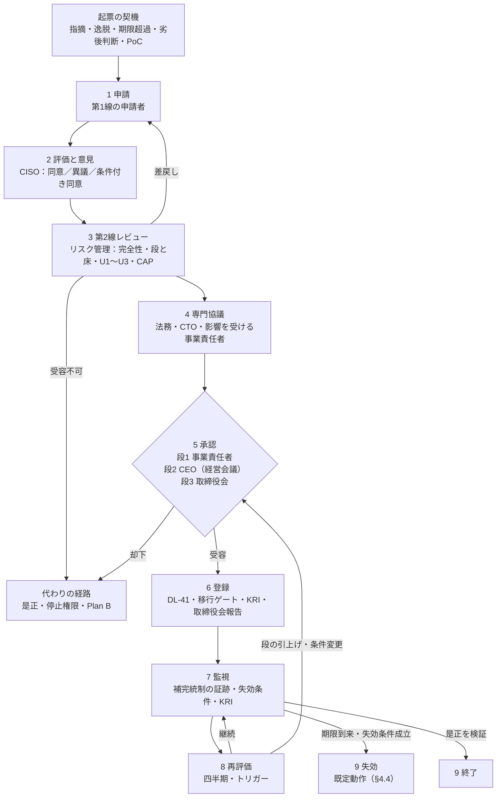
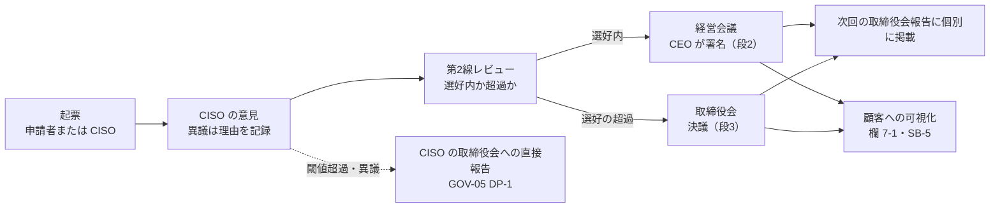

# 例外・リスク受容手順と受容票

> 文書ID: GOV-07 / 版: 0.1 / 状態: draft / 最終更新: 2026-10-03
> 対応要求: R-007, R-016, R-021, R-075, R-086, G-031, G-032
> 依存文書: CONVENTIONS.md, traceability/deliverables.md（DL-05、DEC-6）, traceability/R-requirements.md, traceability/G-goal-criteria.md, traceability/dissent-log.md（DS-04, DS-05）, 01_governance/raci-governance.md（GOV-05）, 01_governance/assumptions-register.md（A-007, A-051, A-081, A-101, A-114）, research/RS-01-governance-risk.md, research/RS-03-identity-lifecycle.md（RS-03#8, #17 のみ）。関連: 01_governance/risk-appetite-draft.md（GOV-02）, 01_governance/stop-authority.md（GOV-06）, 01_governance/loss-scenarios.md（GOV-03）, 01_governance/business-impact-analysis.md（GOV-04）, 02_requirements/operation-risk-tiers-assurance.md（REQ-03）, 02_requirements/customer-admin-responsibility.md（REQ-06）, 02_requirements/data-classification.md（REQ-04）, 00_decision/05-residual-risk-register.md（DL-41、未作成）, 01_governance/kri.md（DL-06、未作成）

本書は AI エージェント（Claude）が 2026-10-03 に起草した手順と様式の案であり、経営会議・取締役会の承認を経ていない [D][^1]。決裁案（§12）はすべて未決定である [D]。値を置けない項目は「TBD（所有者・期限・決め方）」とした [D]。規範・事実の記述は research/ の検証済み項目（research/verification/ に照合記録がある）から引き、本書の作成時に新たに取得した原典はない [D]。

---

## 0. 結論

1. **例外とリスク受容は、申請 → CISO の評価と意見 → 第2線（リスク管理）のレビュー → 第1線の受容者の承認 → 登録・監視 → 再評価または失効、という 1 本の経路で扱い、受容者は事業責任者・CEO（経営会議）・取締役会に限る**（§3、§4）[D]。CISO・CTO・内部監査・第2線の責任者は受容者にならず、これらが受容者欄に署名した票は登録できない（検証規則 RV-1・RV-2）[D]。NIST IR 8286B-upd1 は、リスク対応の決定を承認できる権限の階層を、役割単位で ERM の方針と手順に定めなければならない（must）としている [N][^18]（RS-01#21）。内部監査責任者はリスク対応を決定してはならず、その説明責任も負ってはならない（must not）[N][^22]（RS-01#58）。
2. **受容者の段は GOV-05 §4.2 の 3 段を使い、類型ごとに最低の段（床）を置く**（§3.2）[D]。Critical/High が未解決のままの本番移行の例外（R-075）、セキュリティを劣後させる判断（R-021）、write 以上の操作で fresh 判定を外す例外（R-086）は、影響が単一ドメインに閉じていても CEO（段2）以上とする [D]。read-sensitive に bounded 判定を認める設計上の判断も、段2 の受容票（恒常受容票）で明示する [D]。テナント間漏えい・判定済みの法令/契約義務の不遵守・特権の故意の濫用（GOV-02 の U1〜U3）とキャパシティの超過は、どの段でも受容できない [D][^8]。
3. **受容票は「期限・補完統制・影響範囲・責任者・失効条件・再評価」の 6 項目に、CISO の意見、影響を受け得る顧客への可視性、判断時点の情報・選択肢・理由を加えた様式とし、必須欄が欠けた票は登録できない**（§5）[D]。期限の到来や失効条件の成立で、本番移行の例外は移行ゲートが自動で再停止し（GOV-06 S1）、その他の受容は一段上の受容者へ自動で上がる（§4.4）[D]。IR 8286B-upd1 は、報告期間内に処置できない容認不可のリスクは暗黙に受容されたものとなり、「無視」は選択肢にならないとしている [N][^18]（RS-01#22）。
4. **セキュリティを費用・機能・速度より劣後させる判断は「劣後判断票」で起票し、選好内なら CEO、選好を超えるなら取締役会が署名して所有する**（§6）[D]。全件を次回の取締役会報告に個別に載せる案を推奨する（DP05-4）[D]。IIA の Three Lines Model は、第1線の経営がリスクを所有・管理し、最終的に CEO が取締役会に説明責任を負うとしている [N][^21]（RS-01#57）。同じ考え方を述べた CISA 長官（当時）のブログ（2025-01-08、現在はアーカイブ扱い）は、DS-04 に従い規範の根拠にしない [D][^28][^6]。
5. **CISO の単独承認は禁止し、CISO の権限は「意見（同意・異議）の記録」「劣後判断票の起票」「取締役会への直接報告」に置く**（§7）[D]。CISO が異議を出した段1 の受容は段2 へ上げる案を推奨する（DP05-2）[D]。他文書で「CISO の承認」「CISO が例外受容を決める」と書かれた箇所（REQ-06 決裁案 1、REQ-03 J11）は、CISO の同意と第1線の受容に読み替えるよう申し送る（§7.4）[D]。
6. **PoC 期間限定の受容（DEC-6）は、パイロット事業の事業責任者が段1 で受容する様式例を示す**（§9.1）[D]。前提は合成データ限定と本番からの分離であり、どちらかが破れた時点で失効する [D]。期間の上限は DEC-4 で決める TBD である [D][^2]。
7. **本書が応える 7 件（R 5 件、G 2 件）のうち、本書だけで閉じたものはない**（§13）[D]。決裁案まで 7 件、要実測 0 件、要第三者 0 件である [D]。

---

## 1. 範囲・位置付け・前提

### 1.1 扱う範囲

| 本書（GOV-07、DL-05）で扱う | 他文書で扱う（本書は参照だけ） |
|---|---|
| 例外・リスク受容の手順（申請、評価、第2線レビュー、承認、登録、監視、再評価、失効、終了） | 受容権限の段の原則と RACI（GOV-05 §4.2、RACI-07〜10） |
| 類型ごとの最低の段（床）と、受容できないものの一覧 | 段の境目の金額・停止時間・影響テナント数（GOV-02、GOV-03） |
| 受容票・劣後判断票・類型受容票の様式と検証規則 | 残余リスクの台帳と上位 5 件の抽出（DL-41） |
| 劣後判断を CEO／取締役会が透明に所有する経路 | 停止・凍結の権限、移行ゲート、本番移行停止の例外承認者（GOV-06 S1、DP46-2） |
| CISO 単独承認の禁止と CISO 異議の扱い | KRI の採番と閾値（DL-06） |
| fresh／bounded の判断を受容票で明示する方法（R-086） | 操作 5 分類と fresh／bounded の定義（REQ-03 §3.6）、障害時の既定動作（DL-19） |
| PoC 期間限定受容（DEC-6）の様式例 | PoC の予算・期間上限・合成データ限定の決定（DEC-4、DL-22） |

- 表の分担は成果物計画[^2]と各文書の範囲から導いた設計推論である [D]。成果物計画は本書に、例外申請→第2線レビュー→経営承認の手順、受容票の様式、劣後判断を CEO／取締役会が所有する経路、CISO 単独承認の禁止を求めている[^2] [D]。
- 本書の「経営承認」は、第1線の受容者（事業責任者・CEO（経営会議）・取締役会）による承認をいう [D]。ただし R-075 の対象（Critical/High が未解決の本番移行の例外）では CEO（経営会議）以上に限る（§3.2 AT-2）[D]。レビュー原文は、事業責任者が残余リスクを受容するとし（L145）、Critical/High の例外は経営承認付きの risk acceptance だけとしている（L196）[^5] [D]。

### 1.2 用語

| 用語 | 本書での定義 |
|---|---|
| 例外 | 承認済みの要求・統制・標準（R、C-xxx、ADR、REQ の規則、ゲート基準）を満たさない状態を、期限を区切って続けること。例外は必ず残余リスクの受容を伴う |
| リスク受容 | 処置の後に残るリスクを、受容者が期限と条件を付けて負うと決めること |
| 受容票 | 受容の決定を記録する様式（証拠種別 E9）。ID は RA-nnnn（§5.1） |
| 劣後判断票 | 受容票のうち、費用・機能・速度をセキュリティより優先する判断を記録するもの。§5.3 の追加欄を持つ |
| 類型受容票 | 多数のテナント・接続に同じ条件で生じる例外を、条件と上限を付けて一度に受容する票。個々の適用は適用記録として類型受容票にひも付ける（§5.4） |
| 恒常受容票 | 設計上の既定動作（read-sensitive の bounded 判定、障害時の既定動作など）に伴う残余リスクを受容する票。「恒常」でも期限と再評価を持つ |
| 床 | 類型ごとに定める受容者の最低の段。影響範囲から決まる段がこれより低い場合は床を使う |
| 失効条件 | 期限の前でも受容を無効にする、観測可能な条件 |
| 暗黙の受容 | 処置の期限を過ぎても有効な受容票がないまま残っているリスク |

- 用語の定義は本書の設計推論である [D]。NIST CSF 2.0 は、負のリスクへの対応として軽減・移転・回避・受容を挙げている [N][^32]（RS-01#8）。本書の「処置」は前 3 者を指す [D]。

### 1.3 前提と新規仮定

- 前提台帳[^15]の A-007（B2B テナント 1 万）、A-051（事業ドメイン 30）、A-081（高保証要求テナント 50）、A-101（継続・置換の再決裁周期）、A-114（IdP 起点 SAML 540 接続）を使う [A-007][A-051][A-081][A-101][A-114]。
- GOV-05 の新規仮定①（上場区分・SEC 登録の有無・NIS2 対象性、取締役会の機関設計）と②（CISO・第2線・内部監査の現状の報告ラインと人員）をそのまま使う[^7] [D]。
- 本書は次の 2 点を追加で必要とする [D]。いずれも **新規仮定（前提台帳へ追加要）** である [D]。

| 番号 | 新規仮定（前提台帳へ追加要） | 本書で効く箇所 |
|---|---|---|
| 新規仮定 GOV07-① | 受容票の想定起票件数（四半期あたり、段別・類型別） | 第2線のレビュー要員、経営会議の議題量、§4.2 の目標期間 |
| 新規仮定 GOV07-② | 経営会議・取締役会の定例開催の頻度と、臨時開催に要する日数 | 段2・段3 の承認までの所要期間、§4.5 の緊急時の扱い |

### 1.4 レビュー側の補正（dissent-log）の反映

| DS | 補正の要旨 | 本書での扱い |
|---|---|---|
| DS-04 | CISA の文書は当時の長官名義のブログでアーカイブ扱い。原文にある「影響を受け得る顧客への可視性」がレビューの要約で落ちている[^6] | 劣後判断の CEO／取締役会所有は本書の設計判断 [D] として採る。受容票に「影響を受け得る顧客への可視性」欄（欄 7-1）を必須で置く |
| DS-05 | 選好（appetite）は取締役会が経営と協働して定義・承認する。許容度の設定主体は原典に書かれていない[^6] | 段1 と段2 の境目「許容度内／超過」は、許容度の設定主体の決定（GOV-05 DP-3）に従う |

---

## 2. 原則

| ID | 原則 | 根拠 |
|---|---|---|
| EP-1 | 受容者は第1線（事業責任者・CEO・取締役会）に限る。CISO・CTO・第2線・内部監査は受容者にならない | RS-01#57, #58、GOV-05 規則 1、G-032 |
| EP-2 | 受容は指名代理人へ委任しない。代行者が担えるのは意見の記入と起票まで | RS-01#32, #33（類推） |
| EP-3 | 期限のない受容はない。恒常受容票も期限と再評価を持つ | RS-01#22, #24 |
| EP-4 | 暗黙の受容を作らない。期限を過ぎた未処置は自動で再停止または一段上へ上げる | RS-01#22 |
| EP-5 | 受容したリスクも測り続ける | RS-01#20, #24 |
| EP-6 | 是正予定の将来の緩和は、緩和の日まで「受容」として記録する | RS-01#23 |
| EP-7 | 受容できないもの（U1〜U3、キャパシティの超過）は受容票の対象外 | GOV-02 §2.3 |
| EP-8 | 判断時点の情報・選択肢・理由・承認者を記録し、後から判断過程を再構成できるようにする | RS-01#62、RS-03#8 |
| EP-9 | 劣後判断は CEO／取締役会が署名し、取締役会と影響を受け得る顧客に見える形にする | RS-01#57、DS-04 |
| EP-10 | 選好・許容度を超える受容を内部監査が見つけた場合のエスカレーションは、RACI の記号によらず常に有効 | RS-01#58 |

- 表の原則は右端列から導いた設計推論である [D]。主な根拠の原文は次のとおりである [D]。
- IR 8286B-upd1 は、受容とはリスクが無視できるという意味ではなく、報告・監視・管理を続けなければならない（must）としている [N][^18]（RS-01#24）。資源不足による先送りなどの暗黙の受容は、期限と活動をリスク登録簿とリスク詳細記録に記録すべき（should）としている [N][^18]（RS-01#24）。
- 同書は、連邦機関は将来の緩和を POA&M に記録できるが民間ではその扱いは認められず、すべてのリスクを開示・処置・伝達しなければならない（must）としている [N][^18]（RS-01#23）。将来の緩和計画は、緩和の日付に応じて登録簿では「受容」として読み替える必要があるとしている [N][^18]（RS-01#23）。EP-6 はこれに従う [D]。
- 同書は、上級経営層が知らないまま下位の管理者が重大なリスクを受容していたことで知られるようになったインシデントが多いと指摘している [N][^18]（RS-01#22）。EP-1・EP-9 で受容を経営の可視範囲に置く理由である [D]。
- IR 8286r1 は、受容済みと記録したリスクも許容度内に留まっていることを確かめるために測定する必要があるとしている [N][^17]（RS-01#20）。
- NIST SP 800-37 Rev.2 は、リスクの明示的な受容は Authorizing Official（AO）の責務であり、組織内の他の役職者へ委任できないとしている [N][^20]（RS-01#32）。同書は、上級情報セキュリティ責任者（CISO とも呼ぶ）が AO の指名代理人を務め得るとしつつ、指名代理人に委任できない唯一の活動は認可の決定と文書への署名（すなわちリスク受容）だとしている [N][^20]（RS-01#33）。この規定は連邦機関向けであり、本書への適用は類推である [D]。
- NIST SP 800-63-4 は、補償統制について逸脱の理由、代替策との比較、残余リスクを文書化しなければならない（SHALL）としている [N][^29]（RS-03#8）。同書は認証の保証水準の文脈の規定だが、本書は受容票の欄 3（処置の選択肢と理由）と欄 4（補完統制）の雛形に使う [D]。
- コーポレートガバナンス・コード（2026年7月版）基本原則4の解釈指針は、意思決定が結果として損害を生じさせた場合の責任の判断で、意思決定時点の意思決定過程の合理性が重要な考慮要素の一つになるとしている [N][^27]（RS-01#62）。法的効果の評価は法務の所管であり、本書では行わない [D]。

---

## 3. 受容権限

### 3.1 段（GOV-05 §4.2 の再掲）

| 段 | 条件 | 受容者 | 必須の協議 | 上位への報告 |
|---|---|---|---|---|
| 段1 | 影響が単一ドメインに閉じ、許容度内 | 事業責任者 | CISO の意見、第2線レビュー | 四半期報告で集計 |
| 段2 | 複数ドメイン・基盤横断・全テナント波及、または許容度を超えるが選好内 | CEO（経営会議） | 段1 に加え CTO、影響を受ける事業責任者、法務 | 次回の取締役会報告で個別に報告 |
| 段3 | 選好の超過 | 取締役会 | 段2 に加え内部監査の所見 | — |

- 段の定義は GOV-05 の決裁案であり、本書は変更しない[^7] [D]。段の境目（許容度・選好の金額、停止時間、影響テナント数）は GOV-02・GOV-03 で決める TBD である（所有者: CFO＋事業責任者＋CISO、期限: Gate 0、決め方: BIA と損失シナリオの定量化）[D][^7]。
- IR 8286r1 は、上級経営層（企業の取締役会を含む）が影響と発生可能性に見合う形で、すべてのリスク種別について受容水準と資源配分を決めるとしている [N][^17]（RS-01#15）。段の境目を経営が決める理由である [D]。
- 損失シナリオ登録簿の決裁案 D は、全テナント・全サービスに及ぶシナリオ（S-02・S-05・S-06・S-08）を経営会議、テナント・アカウント単位のシナリオを該当する事業責任者に割り当てる選択肢を推奨している[^10] [D]。本書の段はこの推奨と同じ分け方である [D]。

### 3.2 類型と最低の段（床）

| 類型 | 内容と例 | 床 | 受容者 | 床を置く理由 |
|---|---|---|---|---|
| AT-1 一般の例外・残余リスク | ADR・REQ の規則からの逸脱、任意 script の例外承認（CL-0254）、操作階層の引下げ（REQ-03 J11）、データ分類の既定値からの逸脱（REQ-04）、BIA の許容値を満たせない状態（GOV-04 §6.1-5(c)） | 段1 | 影響範囲による（段1〜3） | GOV-05 §4.2 のとおり |
| AT-2 Critical/High 未解決の本番移行の例外 | 独立評価者が Critical/High と格付けした指摘の是正前に、GOV-06 S1 の M1〜M4（G6 開始、段階導入の拡大、依存サービスの本番接続、主要版の展開）を進める | 段2 | CEO（選好の超過は取締役会） | レビュー L196 の「経営承認付き」[^5]。GOV-06 DP46-2 の推奨 (a)[^9] |
| AT-3 劣後判断 | 費用・機能・市場投入の速度をセキュリティより優先し、許容度を下回る統制で運用する判断（§6.1） | 段2 | 選好内は CEO、選好の超過は取締役会 | GOV-05 RACI-09・10[^7]。レビュー L29[^5] |
| AT-4 fresh 判定からの逸脱 | write・privileged・break-glass の操作で、allow の再利用・既知良好 decision・レプリカ読取など bounded の判定を使う（§8.2） | 段2 | CEO | 剥奪の反映遅延が利用者・顧客から見えないまま全テナントに及び得るため |
| AT-5 恒常受容 | read-sensitive の bounded 判定（§8.1）、障害時の既定動作（DL-19）、事前に定めた緊急動作（§4.5） | 段2 | CEO | 基盤の既定動作であり、GOV-05 §4.2 の段2 の条件（基盤横断）に当たるため |
| AT-6 類型受容（テナント選択型の例外） | SMS・音声の明示許可、低リスク階層での MFA 無効化、IdP 起点 SAML の移行期間（REQ-06 決裁案 1・3） | 段2（類型の承認） | CEO。個々の適用はテナント管理者の明示許可を記録 | 同じ条件が多数のテナントに及ぶため（A-007、A-114） |
| AT-7 PoC 期間限定（DEC-6） | PoC 環境に残る残余リスク（§9.1） | 段1 | パイロット事業の事業責任者 | DEC-6 の暫定の承認者[^2]。合成データ限定と本番からの分離が条件 |
| AT-8 期限超過の自動起票 | 是正期限・受容期限を過ぎた未処置のリスク | 元の段＋1（元が段3 なら段3 のまま臨時報告） | 一段上の受容者（段3 は取締役会） | RS-01#22 |

- 表の類型・床・理由は右端列から導いた設計推論である [D]。受容者の段は「影響範囲から決まる段」と「床」の高い方とする [D]。
- AT-1 のうち BIA の許容値を基盤が満たせない場合に受容票で期限付きで受け入れる経路は、GOV-04 §6.1 が定めている[^11] [D]。任意 script の例外承認制は、主張台帳で「維持」と処置された旧提案の方針である（CL-0254）[^16] [D]。
- AT-2 の床は GOV-06 の DP46-2（本番移行停止の例外の承認者）と同時に決める[^9] [D]。DP46-2 が (b)（RACI の受容階層をそのまま使う）に決まった場合は、AT-2 の床を段1 に下げる [D]。
- AT-4 で、テナント境界の照合（resource から導いた tenant と主体の tenant の一致）を外す例外は U1 に当たり、受容できない（§3.3）[D]。
- AT-6 の SMS・音声について、SP 800-63B-4 は PSTN を restricted authenticator に分類し、RP がリスクを受容できない場合は使ってはならない（SHALL NOT）としている [N][^30]（RS-03#17）。同書は CSP に、制限のない代替手段の提供、リスクの告知、将来使えなくなる場合に備えた移行計画の DIAS への記載を求めている（SHALL）[N][^30]（RS-03#17）。本書はこれを類型受容票の追加欄（§5.4 TA-3・TA-4）に写す [D]。

### 3.3 受容できないもの

| ID | 受容できないもの | 代わりの経路 | 定義元 |
|---|---|---|---|
| U1 | テナント間漏えい（GOV-02 §3.4 の運用定義による） | 封じ込めと是正。期限内に終わらなければ停止権限（GOV-06） | GOV-02 §2.3[^8] |
| U2 | 判定済みの法令・契約義務の既知の不遵守 | 同上 | GOV-02 §2.3、§3.7 L1[^8] |
| U3 | 特権の故意の濫用と虚偽（GOV-05 §5.2 の区分 W） | 懲戒・法的措置（GOV-05 §5） | GOV-02 §2.3[^8] |
| CAP | キャパシティの超過 | 計画の中止または変更（DL-42 の Plan B）。段3 でも受容しない | GOV-02 §2.3、GOV-05 §4.2[^8][^7] |

- 表の扱いは GOV-02・GOV-05 の決裁案をそのまま写したものであり、本書では変更しない [D]。IR 8286Cr1 は、キャパシティを組織が耐えられる最大のリスク量とし、その超過は組織の存続を脅かし得るとしている [N][^19]（RS-01#28）。
- 第2線は、申請された受容が上の 4 つに当たらないことを欄 2-6 で確認する [D]。当たると判断した票は受容票として登録せず、代わりの経路へ回す [D]。

### 3.4 委任・代行・利益相反

| 状況 | 規則 |
|---|---|
| 受容者の不在 | 受容は保留する。代行者は受容しない（EP-2）。AT-2 の移行は止めたままにする。緊急性があるものは一段上の受容者が決める |
| 事業責任者の受容範囲 | 自ドメインの範囲に限る。他ドメインの利用者・データ・操作に影響する受容は段2 以上 |
| 申請者と受容者が同じ | 許す。第1線がリスクを所有するためである。その代わり、CISO の意見と第2線レビューを省略しない |
| CISO 組織が申請者（CISO 所管の監視・評価基盤の例外など） | 受容者は CEO（段2）。欄 6-3 の CISO 意見に代えて、第2線（リスク管理）の評価を記す。CISO 組織の運用は第1線の活動であり（GOV-05 §2.2 注）、CISO は自らの運用を評価しない |
| プラットフォームチーム（CTO 所管）が申請者 | 基盤横断のため段2（CEO）。CTO は協議に入るが受容しない（G-032） |
| 同じ人が複数の役割を兼ねる | 受容者欄には、兼務する役割のうち第1線の役割で署名する。CISO・CTO・内部監査責任者・第2線の責任者その人は、兼務があっても受容者欄に署名しない |

- 表の規則は EP-1・EP-2 と GOV-05 §2.2・§3.1 から導いた設計推論である [D][^7]。
- IR 8286r1 は、登録簿の各リスクに説明責任を負うリスクオーナーを割り当て、責任（responsibility）と説明責任（accountability）は分かれ得るとし、各階層のリスク判断で誰が責任を負い誰が説明責任を負うかをリスク戦略で明確に記述すべき（should）としている [N][^17]（RS-01#17）。受容票で「受容者」（説明責任）と「是正責任者・補完統制の運用責任者」（実行責任）を別の欄にするのはこのためである [D]。

---

## 4. 手順

### 4.1 流れ



### 4.2 各段階

| 段階 | 実施者 | すること | 出力 | 目標期間 |
|---|---|---|---|---|
| 0 起票の契機 | 誰でも。自動検出を含む | 次のいずれかで起票する。独立評価・pentest・red team の指摘を是正する前に先へ進む必要がある。ADR・REQ・統制の規則から逸脱する。BIA の許容値を満たせない。是正期限・受容期限を過ぎた（AT-8 は自動起票）。劣後判断がある。PoC に入場する | 受容票の下書き | — |
| 1 申請 | 申請者（対象を所有するドメイン責任者、プラットフォームチーム長、事業責任者） | 欄 1〜5 と欄 8 を書く。是正・回避・移転と受容の選択肢を、費用・期間・影響とともに並べる | 申請済みの票 | TBD |
| 2 評価と意見 | CISO（第2線の専門機能） | リスクの評価、補完統制の有効性の評価、床の判定への意見、同意・異議・条件付き同意と理由 | 欄 6-3 | TBD |
| 3 第2線レビュー | 第2線（リスク管理） | §4.3 の観点で確認する。段と床を確定し、選好・許容度と照合し、異議を申し立て、差し戻す。受容はしない | 欄 2-5・2-6・6-2・6-4 | TBD |
| 4 専門協議 | 法務（法令・契約・通知が関わる場合）、CTO（実現性・費用・可用性）、影響を受ける事業責任者 | U2 の判定、顧客への通知と開示の要否、代替案の実現性 | 欄 6-5・6-7・7-3 | TBD |
| 5 承認 | 受容者（段1・段2・段3） | 受容、却下、条件付き受容（補完統制の追加、期限の短縮、範囲の縮小）を決める | 欄 6-1・6-8。段2・段3 は議事録（E1） | 段2 は次回の経営会議、段3 は次回の取締役会（臨時開催の要否は新規仮定 GOV07-②） |
| 6 登録 | 第2線 | DL-41 への登録、移行ゲート（GOV-06 S1）への反映、KRI の対象化、取締役会報告への掲載 | 状態「有効」の受容票 | 承認の当日 |
| 7 監視 | 補完統制の運用責任者、第2線 | 補完統制が動いている証跡の取得、失効条件の監視、KRI の計測 | 監視記録 | 継続 |
| 8 再評価 | 第2線が起動し、受容者が判断 | 定期とトリガー時に、継続・縮小・終了・段の引上げを決める | 再評価記録（版を上げる） | 四半期ごと（候補）とトリガー時 |
| 9 失効・終了 | 第2線 | 是正の完了を証跡（E4・E6・E11）で確かめて終了する。期限の到来・失効条件の成立で失効させ、§4.4 の既定動作を起動する | 終了記録・失効記録 | 期限当日 |

- 表の手順は §2 の原則と GOV-05 の RACI-07〜12[^7] から導いた設計推論である [D]。
- 段階 1〜5 の目標期間は TBD とする（所有者: 第2線、期限: Gate 0、決め方: 机上演習で起票から承認までの所要時間を測り、AT-2 の移行計画と経営会議の開催頻度（新規仮定 GOV07-②）に合わせて決める）[D]。RS-01 は、受容票の起票から承認までの所要時間を机上演習で計測することを PoC で実測すべき事項に挙げている（RS-01 §5.4）[D]。
- 再評価の周期の候補を四半期とするのは、取締役会への報告を少なくとも四半期ごとに行う指針に合わせ、有効な受容票が報告のたびに評価済みの状態で載るようにするためである [D]。NACD・ISA のハンドブック（第5版、非拘束）は、報告を少なくとも四半期ごと、および重大インシデントやリスク水準の大きな変化の直後に行うとしている [N][^24]（RS-01#41）。英国の Cyber Governance Code of Practice は、少なくとも四半期ごとの正式報告と、指標ごとの許容度の合意を取締役会の行動に挙げている [N][^25]（RS-01#63。法的拘束力の記載はない）。周期の決定は DP05-1 で行う [D]。
- IR 8286Cr1 は、統制を組み合わせてもリスクを許容度内に収められない場合や統制の費用が不合理な場合には、意思決定者との協議が必要だとしている [N][^19]（RS-01#26）。段階 4 の専門協議と段階 5 の承認はこの協議にあたる [D]。

### 4.3 第2線レビューの観点

| ID | 観点 | 不備の例 |
|---|---|---|
| RQ-1 | 是正・回避・移転・受容の選択肢が、費用・期間・影響とともに比較されているか | 受容だけが書かれ、是正の見積りがない |
| RQ-2 | 影響範囲が封じ込めの単位（cell、テナント数、ドメイン、データ分類、操作階層、法域、主体種別）で書かれているか | 「一部の利用者」とだけ書かれている |
| RQ-3 | 補完統制が残余リスクのどの部分を減らし、効いていることを何で示すか。証拠がなければ「未検証」と書かれているか | 統制名だけで、証跡の所在がない |
| RQ-4 | 期限が是正計画の予定日と合い、上限（DP05-1）以下か | 是正予定日より期限が長い |
| RQ-5 | 失効条件が観測可能で、検知の手段と担当があるか | 「状況が変わったら」とだけ書かれている |
| RQ-6 | 段が「影響範囲による段」と「床」の高い方になっているか | AT-2 を段1 で申請している |
| RQ-7 | U1〜U3・CAP に当たらないか | テナント境界の照合を外す例外を AT-4 で申請している |
| RQ-8 | 同じ対象の過去の受容票と更新回数 | 同じ内容の更新が上限を超えている |
| RQ-9 | 劣後判断に当たらないか。受容の理由が費用・期限・機能であれば AT-3 に分類し直す | 「スケジュール上の理由」で AT-1 として申請している |
| RQ-10 | 影響を受け得る顧客への可視性の判断と、その理由があるか | 欄 7-1 が空欄 |

- 表の観点は §2 の原則と §5 の必須欄から導いた設計推論である [D]。RQ-1 は、補償統制に代替策との比較を求める SP 800-63-4 の規定（SHALL）を雛形にした [N][^29]（RS-03#8）。
- IR 8286r1 は、残余リスクが受容可能な水準を超える場合はリスクオーナーが追加対応を検討し、企業リスク担当者が残余リスクを記録して選好・許容度と照らして分析するとしている [N][^17]（RS-01#19）。第2線が RQ-6・RQ-7 で照合を担うのはこの分担に従う [D]。
- 第2線の機能（CRO 機能）が組織にない場合の代替は、GOV-05 新規仮定②の確定まで TBD とする（所有者: CEO、期限: Gate 0、決め方: 現状の報告ラインの調査）[D]。CISO が第2線レビューを兼ねると、CISO の意見と第2線の確認が同じ人になり、異議申立ての二重性が失われる [D]。

### 4.4 期限・失効時の既定動作と更新

| 類型 | 期限到来・失効条件成立時の既定動作 | 根拠 |
|---|---|---|
| AT-2 | 移行ゲートが自動で再停止する（GOV-06 S1 発動条件 (b)）。臨時報告（RACI-06）の対象 | GOV-06[^9]、RS-01#22 |
| AT-1・AT-3・AT-4・AT-5・AT-6 | 一段上の受容者へ自動で上げる（AT-8 の自動起票）。上げた先の受容者が TBD 日以内に決めない場合は、AT-4 は fresh 判定へ、AT-6 は新規の適用停止へ、その他は票に書いた既定動作へ移る | RS-01#22 |
| 段3 の受容 | 取締役会への臨時報告 | RS-01#41 |
| AT-7 | PoC 環境の停止と、PoC 用の鍵・資格情報の破棄 | §9.1 |

- 表の既定動作は右端列から導いた設計推論である [D]。上げた先の受容者が決めるまでの日数は TBD とする（所有者: 第2線、期限: Gate 0、決め方: 経営会議の開催頻度（新規仮定 GOV07-②）から設定）[D]。
- 既定動作を「自動で止める」ではなく「一段上へ上げる」を基本にしたのは、AT-4・AT-5 のように止めると可用性の損失が先に生じる類型があるためである [D]。止めるか続けるかの判断を、上位の受容者が見える場所で行わせる [D]。
- 同じ内容の更新には回数の上限を置き、上限を超える更新は一段上の受容者が決める [D]。上限の値は TBD とする（所有者: 第2線、期限: Gate 0、決め方: DP05-1 と同時に決める）[D]。更新を重ねて期限のない受容と同じ状態になることを防ぐためである [D]。

### 4.5 緊急時の扱い

| 状況 | 扱い |
|---|---|
| 権限を縮める封じ込め（剥奪、session 失効、IdP の遮断、アカウント停止、kill switch） | 受容を要しない。REQ-03 の規則 J8（事前の二者承認を課さず、即時の通知と事後レビューで統制）[^12] と GOV-06 の権限者に従う |
| リスクを増やす緊急の逸脱で、事前に恒常受容票（AT-5）に列挙した動作 | 当番が実行できる。実行の記録を恒常受容票にひも付け、事後に第2線がレビューする |
| リスクを増やす緊急の逸脱で、列挙されていない動作 | 段に応じた受容者の承認を要する。承認は口頭でもよいが、TBD 時間以内に受容票を起こす。有効期間は TBD 時間を上限とし、自動で失効する |

- 表の扱いは本書の設計推論であり、DP05-6 の推奨 (b) を描いた [D]。時間の値は TBD とする（所有者: SRE 責任者＋第2線、期限: Gate 3、決め方: DL-24 の runbook 演習で受容者への到達時間を測る）[D]。
- 事前の受容（AT-5）を推奨するのは、受容を第1線に保ったまま、緊急時に受容者の応答を待たずに済むためである [D]。

---

## 5. 受容票の様式

### 5.1 項目

| 欄 | 項目 | 必須 | 記入者 | 内容 |
|---|---|---|---|---|
| **1 識別** | | | | |
| 1-1 | 受容票 ID | 必須 | 第2線 | RA-nnnn。末尾採番で、欠番は再利用しない |
| 1-2 | 版と変更履歴 | 必須 | 第2線 | 条件の変更・更新・再評価のたびに版を上げる |
| 1-3 | 類型 | 必須 | 申請者（第2線が確定） | AT-1〜AT-8 |
| 1-4 | 状態 | 必須 | 第2線 | 下書き／申請済／レビュー済／有効／再評価中／失効／終了／却下 |
| 1-5 | 関連 ID | 必須 | 申請者 | S-xx、T-xxx、ATK-xx、R-xxx、C-xxx、ADR-0xx、指摘 ID、DEC-n、TC-xxx |
| **2 リスクと影響範囲** | | | | |
| 2-1 | 逸脱する要求・統制 | AT-1〜AT-4・AT-6 は必須 | 申請者 | 満たさない要求の原文と強度（MUST/SHALL/should 等）、出典 |
| 2-2 | リスクの記述 | 必須 | 申請者 | 脅威主体（ATK-xx）×手法×資産×影響（GOV-03 の形式） |
| 2-3 | 影響範囲 | 必須 | 申請者 | cell、影響し得るテナント数（A-007 の全 1 万のうち何件か）、ドメイン、データ分類（REQ-04）、操作階層（REQ-03）、法域、主体種別 |
| 2-4 | 推定 | 必須 | 申請者＋CISO | GOV-03 の三点推定（定量）または定性評価。どちらかを明記する |
| 2-5 | 許容度・選好との照合 | 必須 | 第2線 | GOV-02 の T1〜T7 のどれに当たるか。許容度内／許容度超過・選好内／選好超過 |
| 2-6 | 受容不可の非該当確認 | 必須 | 第2線 | U1〜U3・CAP に当たらないことと、その理由 |
| **3 処置の選択肢と理由** | | | | |
| 3-1 | 選択肢の比較 | 必須 | 申請者 | 是正・回避・移転・受容のそれぞれの費用・期間・影響 |
| 3-2 | 受容を選ぶ理由 | 必須 | 申請者 | なぜ今は是正しないか。理由が費用・期限・機能であれば AT-3 |
| 3-3 | 是正計画 | AT-1〜AT-4・AT-6・AT-8 は必須 | 申請者 | 是正の内容、予定日、是正責任者、是正追跡（E11）の ID |
| **4 補完統制** | | | | |
| 4-1 | 補完統制 | 必須（なしの場合は理由） | 申請者 | 統制の内容と C-ID |
| 4-2 | 減らす部分 | 必須 | 申請者 | 残余リスクのどの部分（発生頻度、影響の大きさ、検知までの時間、影響範囲）を減らすか |
| 4-3 | 有効性の証拠 | 必須 | 運用責任者 | E4・E8・E10 などの証跡の所在。なければ「未検証」 |
| 4-4 | 運用責任者 | 必須 | 申請者 | 役割と氏名 |
| **5 期限・失効・再評価** | | | | |
| 5-1 | 有効期限 | 必須 | 受容者 | 日付。上限（DP05-1）以下で、次の継続・置換の再決裁（A-101）を越えない |
| 5-2 | 失効条件 | 必須（1 つ以上） | 申請者＋CISO | 観測可能な条件、検知の手段、検知の担当 |
| 5-3 | 再評価トリガー | 必須 | 第2線 | 定期（DP05-1）と事象（関連する指摘・インシデント・規範改訂・KRI 超過など） |
| 5-4 | 期限・失効時の既定動作 | 必須 | 第2線 | §4.4 から選ぶ |
| 5-5 | 更新回数 | 必須 | 第2線 | 同じ内容での更新の回数 |
| **6 責任者・意見・承認** | | | | |
| 6-1 | 受容者 | 必須 | — | 段に応じた役割と氏名（説明責任） |
| 6-2 | 段 | 必須 | 第2線 | 影響範囲による段と床（§3.2）の高い方 |
| 6-3 | CISO の意見 | 必須 | CISO | 同意／異議／条件付き同意と理由。CISO 組織が申請者の場合は第2線の評価（§3.4） |
| 6-4 | 第2線レビュー | 必須 | 第2線 | RQ-1〜RQ-10 の結果、差戻しの履歴 |
| 6-5 | 法務の判断 | 法令・契約・通知が関わる場合は必須 | 法務 | U2 の非該当、通知・開示の要否 |
| 6-6 | 内部監査の所見 | 段3 は必須 | 内部監査 | 所見だけを記す。承認はしない |
| 6-7 | 協議記録 | 段2 以上は必須 | 第2線 | CTO、影響を受ける事業責任者、法務の意見 |
| 6-8 | 署名 | 必須 | 受容者 | 日時と署名の方法。段2・段3 は議事録（E1）の参照 |
| **7 透明性** | | | | |
| 7-1 | 影響を受け得る顧客への可視性 | 必須 | 受容者（法務の助言） | 通知する／契約に従う／通知しない、の別と理由、方法、時期（DP05-5） |
| 7-2 | 取締役会報告 | 必須 | 第2線 | 四半期の集計に含める／個別に載せる |
| 7-3 | 外部開示の要否 | 新規仮定①で開示義務がある場合は必須 | 法務 | SEC・NIS2 等の判断 |
| **8 判断時点の記録** | | | | |
| 8-1 | 参照した情報と版 | 必須 | 申請者 | 評価報告書、試験結果、BIA、KRI の値と版・日付 |
| 8-2 | 未確認の事項 | 必須 | 申請者 | 判断の時点で分かっていなかったこと |

- 表の項目は本書の設計推論である [D]。レビューが求める 5 項目（L196）[^5] のうち、期限は欄 5-1、補完統制は欄 4、影響範囲は欄 2-3、責任者は欄 6-1（受容者）・3-3（是正責任者）・4-4（運用責任者）、失効条件は欄 5-2 に当たる [D]。成果物計画が加える再評価[^2] は欄 5-3 に当たる [D]。
- 欄 6-3 の CISO 意見は RS-01 の DL-05 への入力（受容票の必須項目に CISO 意見を含める）に従う（RS-01 §5.1）[D]。欄 7-1 は DS-04 の申し送りに従う[^6] [D]。欄 8 は EP-8 に従う [D]。
- 受容票 ID の接頭辞 RA- は CONVENTIONS §2 の ID 体系に未登録である[^1] [D]。登録を残課題とする（§14）[D]。

### 5.2 検証規則

登録の前に次の規則を機械的に検査し、1 つでも満たさない票は状態を「有効」にしない [D]。

| ID | 規則 |
|---|---|
| RV-1 | 欄 6-1 の役割が、事業責任者・CEO（経営会議）・取締役会のいずれかである |
| RV-2 | 欄 6-1 の氏名が、CISO・CTO・内部監査責任者・第2線の責任者のいずれでもない |
| RV-3 | 欄 5-1 が空でなく、上限（DP05-1）以下で、次の継続・置換の再決裁（A-101）を越えない |
| RV-4 | 欄 5-2 に条件が 1 つ以上あり、各条件に検知の手段と担当がある |
| RV-5 | 欄 4-1 に統制が 1 つ以上ある。ない場合は理由があり、欄 6-2 の段が影響範囲による段より一つ上である |
| RV-6 | 欄 6-3 が記入されている |
| RV-7 | 欄 6-2 が §3.2 の床以上である |
| RV-8 | 欄 2-6 が「非該当」で、理由がある |
| RV-9 | AT-3 は §5.3 の追加欄があり、欄 7-1 が記入されている |
| RV-10 | 段3 は欄 6-6 がある |
| RV-11 | AT-1〜AT-4・AT-6・AT-8 は欄 3-3 に是正追跡（E11）の ID がある |
| RV-12 | 欄 6-3 が異議の場合、DP05-2 の決定に従って段と取締役会報告（欄 7-2）が設定されている |
| RV-13 | 欄 5-5 が上限を超える場合、欄 6-2 の段が前の版より一つ上である |
| RV-14 | AT-6 は §5.4 の追加欄がある |

- 表の規則は §2・§3・§5.1 から導いた設計推論である [D]。RV-5 で統制のない受容の段を上げるのは、残余リスクを減らす手段がない受容ほど上位の監督に置くためである [D]。IR 8286B-upd1 は、影響度が大きくなるほど調整と監督の水準が上がるのが通例だとしている [N][^18]（RS-01#21）。
- RV-1・RV-2 は G-032 の合格基準（CTO・CISO 単独の受容 0 件）を、票の登録時点で機械的に満たすための規則である[^4] [D]。

### 5.3 劣後判断票の追加欄（AT-3）

| 欄 | 項目 | 内容 |
|---|---|---|
| SB-1 | 優先した事業価値 | 費用・機能・市場投入の速度のどれか。削減額・短縮期間・得られる機能 |
| SB-2 | 劣後させたセキュリティ要求 | 要求の原文と強度、その要求が守る損失シナリオ（S-xx） |
| SB-3 | 劣後させない場合 | 同じ事業価値を、セキュリティを劣後させずに得る代替案と、その費用・期間 |
| SB-4 | 増える残余リスク | 欄 2-4 の推定の、劣後させない場合との差 |
| SB-5 | 影響を受け得る顧客 | 対象の顧客群（高保証要求テナント（A-081）・規制業種の顧客を含むか）と、可視化の方法・時期 |
| SB-6 | 取締役会報告 | 次回の定期報告で個別に載せる（DP05-4） |
| SB-7 | CISO の意見 | 必須。異議の場合は理由を議事録（E1）に残す |

- 表の欄は本書の設計推論である [D]。SB-5 を置くのは、DS-04 が、CISA 長官（当時）のブログの原文に「影響を受け得る顧客への可視性」があり、レビューの要約で落ちていると指摘したためである[^6] [D]。

### 5.4 類型受容票の追加欄（AT-6）

| 欄 | 項目 | 内容 |
|---|---|---|
| TA-1 | 適用条件 | どのテナント・接続・利用者群が対象になり得るか。新規の適用を認めるか |
| TA-2 | 適用上限 | 件数と期間の上限 |
| TA-3 | テナント側の明示許可 | 顧客管理者の許可操作の記録、告知したリスクの文面と版 |
| TA-4 | 代替手段 | 制限のない代替手段の提供と、移行計画 |
| TA-5 | 適用記録 | 個々の適用（テナント ID、許可者、許可日時、失効予定日）の一覧。自動で記録する |
| TA-6 | 類型全体の失効条件 | 規範の改訂、悪用事例の公表、適用件数の上限超過など |

- 表の欄は本書の設計推論である [D]。TA-3・TA-4 は SP 800-63B-4 の restricted authenticator の規定（代替手段・リスクの告知・移行計画、SHALL）を写した [N][^30]（RS-03#17）。
- 類型受容票を推奨するのは、テナントごとに受容票を起こすと、1 万テナント（A-007）や 540 接続（A-114）の規模で段2 の承認件数が経営会議の処理能力を超え得るためである [D][A-007][A-114]。

### 5.5 記入用テンプレート

開発者・運用者が機械的に検査できるよう、受容票は次の形で版管理する [D]。

```yaml
# 受容票（GOV-07 §5）。値は記入例ではなく、記入欄の型を示す。
id: RA-nnnn                 # 1-1
version: 1                  # 1-2
type: AT-1                  # 1-3 AT-1..AT-8
status: draft               # 1-4 draft|submitted|reviewed|active|re-evaluating|expired|closed|rejected
related: [S-xx, T-xxx, R-xxx, C-xxx, ADR-0xx, finding-id]   # 1-5
risk:
  deviated_requirement: {text: "", strength: "SHALL|MUST|should|...", source: ""}  # 2-1
  description: ""           # 2-2 ATK-xx x 手法 x 資産 x 影響
  scope: {cells: [], tenants_affected: "", domains: [], data_classes: [], operation_tiers: [], jurisdictions: [], principal_types: []}  # 2-3
  estimate: {method: "quantitative|qualitative", value: ""}  # 2-4
  appetite_check: {tolerance_item: "T1..T7", position: "within-tolerance|over-tolerance-within-appetite|over-appetite"}  # 2-5
  unacceptable_check: {u1_u3_cap: "not-applicable", reason: ""}  # 2-6
treatment:
  options: [{option: "remediate|avoid|transfer|accept", cost: "", duration: "", impact: ""}]  # 3-1
  reason_for_acceptance: "" # 3-2
  remediation_plan: {content: "", due: "YYYY-MM-DD", owner: "", poam_id: ""}  # 3-3
compensating_controls:
  - {control: "", c_id: "", reduces: "frequency|magnitude|time-to-detect|scope", evidence: "E4|E8|E10|unverified", operator: ""}  # 4-1..4-4
validity:
  expires: "YYYY-MM-DD"     # 5-1
  expiry_conditions: [{condition: "", detection: "", detector: ""}]  # 5-2
  re_evaluation: {periodic: "TBD (DP05-1)", triggers: []}  # 5-3
  on_expiry: ""             # 5-4 §4.4
  renewals: 0               # 5-5
approval:
  acceptor: {role: "business-owner|CEO|board", name: ""}  # 6-1
  tier: 1                   # 6-2
  ciso_opinion: {position: "concur|object|conditional", reason: ""}  # 6-3
  second_line_review: {result: "", rq_findings: []}  # 6-4
  legal: {required: false, opinion: ""}   # 6-5
  internal_audit_note: ""   # 6-6 tier 3 only
  consultations: []         # 6-7
  signature: {datetime: "", method: "", minutes_ref: ""}  # 6-8
transparency:
  customer_visibility: {decision: "notify|per-contract|no-notice", reason: "", method: "", timing: ""}  # 7-1
  board_report: "aggregate|individual"  # 7-2
  external_disclosure: {required: false, basis: ""}  # 7-3
decision_record:
  inputs: [{doc: "", version: "", date: ""}]  # 8-1
  unknowns: []              # 8-2
```

---

## 6. 劣後判断を CEO／取締役会が所有する経路（R-021）

### 6.1 劣後判断に当たるもの

費用・機能・市場投入の速度を理由に、承認済みのセキュリティ要求・統制・保証活動を許容度より下の水準で運用する判断を、劣後判断とする [D]。次は劣後判断の例である [D]。

| 例 | 劣後させるもの |
|---|---|
| 予算を理由に、独立保証計画（DL-07）から cross-tenant pentest や red team を外す | 独立評価（レビュー L194[^5]） |
| 期日を守るために、Gate の合格基準や PoC の事前登録の合否基準を事後に緩める | 受入基準。G の受入基準を緩める変更には別に CTO・CISO の承認と記録が要る（G-goal-criteria §4.5[^4]）。理由が期日・費用であれば、それに加えて劣後判断票を要する |
| 顧客離脱の懸念から、フィッシング耐性 MFA を必須とする範囲を縮める | 保証の床（REQ-03 REQ03-D1[^12]） |
| 保管費を理由に、監査記録の保持を短縮する | 証跡 |
| 開発速度を理由に、CI の自動ゲート（テナント越え否定試験など）を無効にする | 中央ガードレール（GOV-05 §6.5[^7]） |

- 表の例は本書の設計推論である [D]。劣後判断の例を挙げたのは、受容の理由欄（欄 3-2）が費用・期限・機能である票を第2線が AT-3 に分類し直す（RQ-9）ための目安にするためである [D]。

### 6.2 経路



| 段階 | 規則 |
|---|---|
| 起票 | 申請者が起票する。CISO は、事実上の劣後判断が受容票なしに進んでいると判断した場合、自ら劣後判断票を起票できる |
| 承認 | 選好内は CEO（経営会議）、選好の超過は取締役会。CTO・ARB・CISO の判断として処理しない |
| 記録 | 経営会議・取締役会の議事録（E1）に、SB-1〜SB-7 と CISO の意見を残す |
| 取締役会への報告 | 全件を次回の取締役会報告に個別に載せる（DP05-4 推奨 (a)） |
| 顧客への可視化 | 欄 7-1 と SB-5 の判断に従い、影響を受け得る顧客へ知らせる（DP05-5） |
| 内部監査 | 選好・許容度を超える受容を内部監査責任者が見つけた場合は、上級経営層と協議し、必要に応じて取締役会へエスカレーションする（EP-10） |

- 表の規則は GOV-05 の RACI-09・10[^7] と §2 の原則から導いた設計推論である [D]。

### 6.3 透明性を支える根拠

- IIA の Three Lines Model は、取締役会が目的とリスク選好を定めて監督し、第1線の経営がリスクを所有・管理し、最終的に CEO が取締役会に説明責任を負うとしている [N][^21]（RS-01#57）。劣後判断の署名者を CEO と取締役会に固定する根拠である [D]。
- NACD・ISA のハンドブック（第5版、非拘束）は、取締役会が経営と協働して選好を定め、承認し、定期的に見直すとしている [N][^24]（RS-01#39）。選好を超える劣後判断を取締役会の決議とする根拠である [D]。
- IR 8286B-upd1 の「上級経営層が知らないまま下位の管理者が重大なリスクを受容していた」という指摘 [N][^18]（RS-01#22）は、劣後判断を全件個別に取締役会へ報告する案（DP05-4 (a)）の根拠である [D]。
- NIS2 指令第20条1項は、essential / important 主体の経営機関が第21条のリスク管理措置を承認し、その実施を監督し、違反について責任を問われ得ることを、加盟国が確保しなければならない（shall）としている [N][^26]（RS-01#64）。当社への適用は GOV-05 新規仮定①による [D]。
- コーポレートガバナンス・コード（2026年7月版）の原則4-4は、取締役会が全社的リスク管理体制を適切に整備すべきだとし、その解釈指針はサイバーセキュリティリスクへの対応を体制整備の考慮事項に含め得るとしている [N][^27]（RS-01#60）。当社への適用は上場区分による（GOV-05 新規仮定①）[D]。
- Regulation S-K Item 106(c) は、取締役会によるサイバー脅威リスクの監督を開示書類に記述させる（開示義務）[N][^31]（RS-01#46）。SEC 登録企業である場合、劣後判断の取締役会への報告記録は、この記述の裏付けになる [D]（GOV-05 新規仮定①）。
- CISA 長官（当時）のブログは、費用・機能・市場投入の速度をセキュリティより優先する判断を、CEO と取締役会が明確に所有し、影響を受け得る顧客にも見える形で透明に行うべきだと述べている [D][^28]。同ブログはアーカイブ扱いであり、DS-04 に従い規範の根拠にせず、同旨の参考として示すにとどめる [D][^6]。

### 6.4 禁止事項

| 禁止 | 区分（GOV-05 §5.2）の目安 |
|---|---|
| 劣後判断を CTO・ARB の技術判断、または CISO の受容として処理する | 経路の誤り。第2線が差し戻す |
| 受容票なしに、予算・期限を理由に統制や保証活動を外す | 区分 G（重大な管理不履行）の候補 |
| 劣後判断の残余リスクの推定を、根拠なく小さく書き換えて段を下げる | 意図的であれば区分 W（虚偽）の候補 |

- 区分の判定は GOV-05 §5.4 の区分判定会が行う[^7] [D]。表は判定の目安であり、判定そのものではない [D]。

---

## 7. CISO 単独承認の禁止（R-075）

### 7.1 規則

| ID | 規則 |
|---|---|
| CS-1 | CISO は受容者にならない。受容票の CISO の欄は「意見」であり、承認ではない（RV-1・RV-2） |
| CS-2 | CISO と CTO の合議も受容にならない。G-032 の「CTO・CISO 単独の受容 0 件」は合議にも適用する |
| CS-3 | CISO の指名代行者が担えるのは意見の記入までとする |
| CS-4 | CISO は意見を省略されない。CISO の意見のない票は登録しない（RV-6） |
| CS-5 | CISO は、受容票なしに進む事実上の劣後判断について、劣後判断票を起票できる（§6.2） |
| CS-6 | CISO の異議は議事録と取締役会報告に残る。異議を理由に CISO を不利益に扱わない（GOV-05 §5.5） |

- 表の規則は本書の設計推論である [D]。CS-2 は GOV-06 の DP46-2 が (c)「CTO と CISO の合議」を R-075 と G-032 に反するとした判断と同じである[^9] [D]。
- レビュー原文は、Critical/High の例外を経営承認付きの risk acceptance だけとし、CISO 単独へ押し付けないとしている（L196）[^5] [D]。サイバーリスクの最終所有者を CISO 個人へ押し付けてはならないとも述べている（L29）[^5] [D]。
- SP 800-37 Rev.2 は、CISO が AO の指名代理人を務め得る場合でも、リスク受容にあたる認可の決定と署名は委任できないとしている [N][^20]（RS-01#33）。CISO の欄を意見に限る根拠の類推である [D]。
- IIA の Three Lines Model は、サイバーセキュリティ等の第2線の専門機能が第1線を指導・支援し、異議を申し立てる（challenge）としている [N][^21]（RS-01#57）。CISO の権限を同意・異議に置くのはこの位置付けに従う [D]。

### 7.2 CISO の異議の扱い

| CISO の意見 | 扱い（DP05-2 推奨案） |
|---|---|
| 同意 | 段は影響範囲と床で決まる |
| 条件付き同意 | 条件を欄 4（補完統制）または欄 5（期限・失効条件）に取り込んだ場合に同意とみなす。取り込まない場合は異議として扱う |
| 異議（段1 の票） | 段2（CEO）へ上げる |
| 異議（段2 の票） | 段は上げず、CEO が決める。次回の取締役会報告に個別に載せ、CISO は取締役会への直接報告権（GOV-05 DP-1）を使える |
| 異議（段3 の票） | 取締役会が CISO の意見を聞いて決める |

- 表の扱いは DP05-2 の推奨案であり、未決定である [D]。CEO が CISO の異議に反して受容し、それが選好を超える場合は、段3（取締役会）の決定とする（GOV-06 §4.1 の S1 の注と同じ）[D][^9]。
- NACD の Tool J は、CISO が取締役会への直接の報告ラインを持つか、直接連絡を発動する閾値は何かを、取締役会が確認すべき点に挙げている [N][^24]（RS-01#43。非拘束）。

### 7.3 CISO の権限の対

| CISO が負うもの | 対になる権限 |
|---|---|
| リスクの評価と提示（RACI-03）[^7] | 受容票の意見欄（必須）、劣後判断票の起票 |
| 統制基準の制定（RACI-11）[^7] | 補完統制の妥当性への異議 |
| 停止の宣言（GOV-06 S1 発動条件 (c)）[^9] | 受容票が無効になった場合の移行ゲートの自動再停止 |
| 取締役会への報告 | 閾値超過時と異議時の直接報告（GOV-05 DP-1） |

- 表は GOV-05 §4.1 の「責任と対になる権限」のうち、受容に関わる部分を抜き出したものである [D][^7]。

### 7.4 他文書への読み替えの申し送り

| 文書と箇所 | 現在の記述 | 本書の規則に合わせた読み替え |
|---|---|---|
| REQ-06 §12 決裁案 1（IdP 起点 SAML） | 「決める人: CISO（例外受容と FAL の判断）」[^13] | 例外受容は AT-6 の類型受容票として CEO（段2）が受容する。CISO は FAL の判断と意見を担う |
| REQ-03 §2.2 規則 J11（階層の引下げ） | 「CISO の承認と受容票（DL-05）を要する」[^12] | CISO の同意（GOV-05 の C+）と、第1線の受容者による受容票（AT-1） |

- 表の読み替えは本書の規則（CS-1）から導いた申し送りであり、各文書の改訂は所有者が行う [D]。本書は他文書を編集しない [D]。

---

## 8. fresh／bounded の判断の明示（R-086）

### 8.1 read-sensitive の bounded 判定を恒常受容票にする

- REQ-03 は、write・privileged・break-glass を fresh（最新の認可状態で評価し、allow を再利用しない）、read-sensitive だけを bounded（古さの上限 B 付き）、public を判定不要としている[^12] [D]。これはレビューの「高リスク操作は fresh decision 必須、低リスク read のみ短い署名済み既知良好 decision を認める」（L131）を階層の定義に組み込んだものである[^5][^12] [D]。
- bounded を認める判断は、剥奪・変更された権限で上限 B の間は読取りが許され得ることを受容する判断である [D]。本書はこれを、恒常受容票（AT-5、段2、受容者 CEO）として明示する [D]。レビューが「明示的なリスク判断が必要」とした要求（L131）を、受容者・期限・失効条件の付いた記録にするためである[^5] [D]。
- B の値は数値契約（DL-20）で決める TBD であり[^12]、B が決まるまでは恒常受容票を下書きのままにする [D]。恒常受容票の主な欄は次のとおりとする [D]。

| 欄 | 記入方針 |
|---|---|
| 2-1 逸脱する要求 | 「認可判定は常に最新の状態で行う」という理想からの、read-sensitive に限った逸脱 |
| 2-3 影響範囲 | read-sensitive の操作を持つ全ドメイン・全テナント |
| 4-1 補完統制 | B の上限、剥奪時のキャッシュ無効化（push）、テナント境界の照合は fresh のまま行うこと、読取りの監査記録 |
| 5-1 有効期限 | TBD（DP05-1）。次の継続・置換の再決裁（A-101）を越えない |
| 5-2 失効条件 | B の実測（PT-4 等の試験）が契約値を超える。bounded の判定が他テナントの資源への allow を生んだ事例が見つかる（U1 に当たるため受容を止めて封じ込める） |
| 5-3 再評価トリガー | 認可エンジン・datastore の変更、B の変更、関連インシデント |

- 表の記入方針は本書の設計推論である [D]。

### 8.2 fresh 判定からの逸脱（AT-4）

- write・privileged・break-glass で bounded の判定を使う例外は AT-4 とし、床を段2（CEO）とする（§3.2）[D]。
- AT-4 の受容票には、補完統制として逸脱する操作の列挙、古さの上限、剥奪時の即時無効化、監査記録を必須とする [D]。期限の到来で fresh へ戻すことを既定動作とする（§4.4）[D]。
- PDP に到達できない場合の既定動作（DL-19）と break-glass の経路（GOV-06）は、DL-19 の確定時に動作ごとに恒常受容票（AT-5）で受容する [D]。

---

## 9. 様式例

### 9.1 PoC 期間限定受容（DEC-6）

次は様式例であり、受容の決定ではない [D]。値の多くは DEC-4 と DL-22 の決定を待つ TBD である [D]。

| 欄 | 記入例 |
|---|---|
| 1-1 ID | RA-例-01 |
| 1-3 類型 | AT-7 PoC 期間限定 |
| 1-5 関連 | DEC-4、DEC-6、DL-22（事前登録試験計画）、DL-81（実測レポート）、DL-82（PoC コード）、DL-110（残課題） |
| 2-2 リスクの記述 | (1) PoC の構成は独立評価の前であり、未発見の Critical/High が残り得る。(2) PoC で使う OSS・評価版サービスの脆弱性や設定不備が残り得る。(3) 合成データに実データ（個人情報・顧客データ）が混入し得る。(4) PoC 用の鍵・token が本番系で受理され得る（issuer・audience の混同）。(5) PoC 要員の権限が本番へ流用され得る |
| 2-3 影響範囲 | PoC 環境に閉じる。本番 cell・実テナント・実利用者・実データを含まない（前提）。法域: 該当なし（実データを扱わないため） |
| 2-4 推定 | 定性。前提が守られる限り、影響は PoC 環境と PoC 用の鍵に限られる |
| 2-5 照合 | 許容度内（前提が守られる場合）。GOV-02 の T1〜T7 のどれにも実データの影響が及ばない |
| 2-6 受容不可の確認 | 非該当。実テナントがないため U1 は生じない。前提が破れた時点で失効する（欄 5-2） |
| 3-1 選択肢 | (a) 独立評価を終えてから PoC に入る: 期間が延びる（DEC-4 の期間上限と比べる）。(b) 本受容票で期間と範囲を区切って入る。(c) PoC を行わない: Gate 4 の実測が得られない |
| 3-2 受容の理由 | Gate 4 の判断に必要な実測（DL-22 の仮説）を、本番に影響しない範囲で先に得るため |
| 4-1 補完統制 | ① 合成データだけを使う（DEC-4）。投入前にデータ検査を行い、検査方法は DL-82 に書く。② 本番のネットワーク・IdP・鍵から分離する。PoC 専用の issuer・鍵・テナント ID 空間を使い、本番の resource server は PoC の issuer を信頼しない。③ PoC 環境の操作権限を PoC 要員に限り、本番の権限と分ける。④ 期間終了時に環境を破棄し、PoC 用の鍵・資格情報の破棄を記録する。⑤ PoC 中に見つかった Critical/High は DL-110 に登録する |
| 4-3 証拠 | 未検証（PoC 開始時に、②の分離を設定スナップショット（E10）と負例試験（E4）で示す計画） |
| 4-4 運用責任者 | プラットフォームチーム長（②〜④）、PoC 責任者（①⑤）。氏名は TBD |
| 5-1 有効期限 | PoC 期間の上限（DEC-4 で決める TBD）の末日 |
| 5-2 失効条件 | ① 実データの投入を検知した。② 本番系との接続（ネットワーク・信頼関係・鍵の共用）を検知した。③ PoC 期間の上限を超えた。④ PoC の環境・鍵・成果物を本番や段階導入（G6）に流用した。⑤ DEC-4 の条件（予算・期間・データ区分）が変わった。⑥ PoC の結果を根拠に対外的な安全性表明を行った（GOV-06 の凍結対象[^9]） |
| 5-3 再評価トリガー | 事前登録計画（DL-22）の変更、独立評価者の立会い所見、PoC 中の Critical/High の発見、PoC 期間の中間時点（日付は DEC-4 の期間から設定） |
| 5-4 既定動作 | PoC 環境の停止と、PoC 用の鍵・資格情報の破棄（§4.4） |
| 6-1 受容者 | パイロット事業の事業責任者（DEC-6）。氏名は TBD |
| 6-2 段 | 段1。前提が破れた後の継続には、新たな受容票（段2 以上）を要する |
| 6-3 CISO の意見 | TBD（PoC 入場前に記入） |
| 6-4 第2線レビュー | TBD |
| 7-1 顧客への可視性 | 通知しない案。実テナント・実利用者・実データを含まない前提のため。パイロットに顧客が参加する場合は、法務が通知・契約上の開示を判断する |
| 7-2 取締役会報告 | 四半期の集計に含める |
| 8-2 未確認の事項 | PoC で使う製品・版の脆弱性の有無（PoC 開始時点で確認） |

- 表の記入例は本書の設計推論である [D]。CTO と CISO は受容者にならず、CTO は欄 6-7 の協議に、CISO は欄 6-3 の意見に入る（CS-1・CS-2）[D]。G-032 は段階1 で PoC 期間の残余リスク（DEC-6）を判定の対象とし、受容者・期限の欠落 0 件と CTO・CISO 単独の受容 0 件を合格としている[^4] [D]。
- 段1 とするのは、影響が PoC 環境に閉じることが前提で、その前提を失効条件①②④で監視するためである [D]。

### 9.2 Critical/High 未解決の本番移行の例外（AT-2）の要点

| 欄 | 記入例 |
|---|---|
| 2-1 | 独立評価者が High と格付けした指摘（例: 管理 API の一部で privileged/T の step-up が欠ける）の是正前に、段階導入の拡大（GOV-06 S1 の M2）を read-only の段階だけ進める |
| 2-3 | 対象 cell と対象テナント数。該当する管理 API の利用者 |
| 4-1 | 該当 API を feature flag で無効にしたまま移行する。管理操作の監査と異常検知を強める |
| 5-1 | 是正予定日（E11）以内。上限は DP05-1 |
| 5-2 | 再試験で不合格。該当指摘の悪用の兆候。feature flag の有効化 |
| 5-4 | 移行ゲートの自動再停止（GOV-06 S1 発動条件 (b)） |
| 6-1・6-2 | CEO（経営会議）、段2（床）。選好の超過なら取締役会 |

- 表は様式の使い方を示す例であり、実在の指摘ではない [D]。

### 9.3 劣後判断票（AT-3）の要点

| 欄 | 記入例 |
|---|---|
| SB-1 | 費用。独立保証計画（DL-07）から red team を外す |
| SB-2 | レビュー L194 の red team[^5]。守る損失シナリオは GOV-03 の該当 S-xx |
| SB-3 | red team の範囲を縮めて残す案、時期をずらす案と、それぞれの費用 |
| SB-5 | 高保証要求テナント（A-081 の 50）の契約が第三者評価を求めるかを法務が確認し、求める場合は通知する |
| 6-1・6-2 | 選好内なら CEO（段2）、選好の超過なら取締役会（段3） |
| 7-2 | 次回の取締役会報告に個別に載せる |

- 表は様式の使い方を示す例であり、推奨する判断ではない [D]。

### 9.4 類型受容票（AT-6）の要点: IdP 起点 SAML の移行期間

| 欄 | 記入例 |
|---|---|
| 2-1 | REQ-06 決裁案 1 (b) の移行期間中、既存の IdP 起点接続を第三者起点ログインへ変換して受け付ける[^13] |
| TA-1 | 既存接続だけ。新規接続には適用しない |
| TA-2 | 540 接続（A-114）を上限とする。期間は REQ-06 の移行期限（TBD） |
| TA-3 | 顧客管理者の確認操作の記録と、告知したリスクの文面の版 |
| TA-4 | RP 起点への移行手順と、移行支援の窓口 |
| TA-6 | 移行期限の到来、assertion injection の悪用兆候の公表、規範の改訂 |
| 6-1・6-2 | CEO（経営会議）、段2（床）。CISO は FAL の判断と意見を記す（§7.4） |

- 表は様式の使い方を示す例であり、REQ-06 の決裁を先取りするものではない [D][A-114]。

---

## 10. 監視・報告

| 対象 | KRI 候補（K-xx は DL-06 で採番） | 区分 |
|---|---|---|
| 期限管理 | 期限超過の受容票の件数と、暗黙の受容（AT-8 の自動起票）の件数 | leading |
| 受容の総量 | 有効な受容票の件数（段別・類型別） | leading |
| CISO 異議 | CISO の異議に反して承認された受容票の件数 | leading |
| 劣後判断 | 有効な劣後判断票の件数 | leading |
| 更新 | 更新回数の上限に達した受容票の件数 | leading |
| 補完統制 | 欄 4-3 が「未検証」のままの受容票の件数 | leading |
| 手続 | 起票から承認までの所要時間 | lagging |

- 表の候補は本書の設計推論である [D]。期限超過の受容票と暗黙の受容の件数は、RS-01 §5.3 が DL-05 の KRI 候補に挙げ、GOV-02 §5 も T1 の KRI 候補（目標 0）としている[^8] [D]。閾値は DL-06 で決める TBD である（所有者: CISO＋第2線、期限: Gate 0、決め方: 机上演習と初期の運用実績）[D]。
- IR 8286Cr1 は、leading KRI の超過は通常の定期報告で報告してよく（may）、lagging KRI の超過は何らかの中間的な連絡で伝えるべき（should）としている [N][^19]（RS-01#27）。
- 有効な受容票の一覧は四半期ごとに取締役会報告に載せる（RACI-05）[D][^7]。段2 の受容と劣後判断は個別に、段1 の受容は集計で載せる案とする [D]。失効による再停止と段3 の期限切れは臨時報告（RACI-06）とする [D][^7]。
- IIA の Cybersecurity Topical Requirement は、容認できない水準に達したリスクを迅速にエスカレーションする仕組みの有無を、内部監査が評価しなければならない事項に挙げている [N][^23]（RS-01#56）。本書の手順・検証規則・既定動作は、その評価の対象証跡になる [D]。G-032 の判定者は内部監査（第2線と協働）である[^4] [D]。

---

## 11. 記録と証拠

| 証拠 | 内容 | 所在 |
|---|---|---|
| E9 | 受容票（全版） | 版管理されたリポジトリ。DL-41 から ID で参照する |
| E1 | 段2・段3 の承認の議事録、劣後判断の議事録 | 経営会議・取締役会の議事録 |
| E11 | 是正計画と是正の追跡 | DL-110 |
| E4・E10 | 補完統制が動いている証跡 | CI ログ、署名付き設定スナップショット |
| E2 | 本書の承認記録 | 経営会議 |

- 表の対応は成果物計画の証拠種別[^2] から導いた設計推論である [D]。
- 受容票は変更のたびに版を上げ、過去の版を消さない [D]。欄 8 と過去の版から、判断時点の情報・選択肢・承認者を後から再構成できるようにするためである（EP-8）[D]。
- 移行ゲート（GOV-06 S1）は受容票の状態（欄 1-4）と期限（欄 5-1）を機械的に読み、失効した票に依存する移行を拒否する [D]。この連動は GOV-06 の試験 SA-1 で確かめる[^9] [D]。
- 受容票の保存期間は TBD とする（所有者: 法務、期限: Gate 0、決め方: 法域・契約の適用判定（DL-34）と、説明責任の判定（GOV-05 §5）に必要な期間から決める）[D]。

---

## 12. 決裁案

決裁案はすべて未決定である [D]。DP05-n は DL-05 の決裁案の番号であり、GOV-05 の DP-n とは別である [D]。期限のゲートはレビューの Gate 0〜6 による [D]。

### DP05-1 受容票の有効期間の上限と再評価の周期

| 選択肢 | 帰結 |
|---|---|
| (a) 段と類型ごとに上限を置き、再評価は四半期ごと | 上位の段ほど監督の頻度が上がる [D]。上限の値の設計に手間がかかる [D] |
| (b) 全票に一律の上限を置き、再評価は四半期ごと | 運用は単純になる [D]。影響の小さい段1 の受容にも同じ負荷がかかる [D] |
| (c) 上限を置かず、再評価だけを行う | 期限のない受容が生じ、IR 8286B-upd1 の「無視は選択肢にならない」[N][^18]（RS-01#22）と緊張する [D] |

- 推奨: (a) [D]。上限の値は TBD とする（所有者: 第2線が起案、期限: Gate 0、決め方: 是正計画の典型的な所要期間（DL-110 の初期データ）と、取締役会の報告周期から決める）[D]。どの選択肢でも、次の継続・置換の再決裁（A-101）を越えない [D][A-101]。
- 決める人: CEO（経営会議）[D]。期限: Gate 0 [D]。

### DP05-2 CISO の異議の扱い

| 選択肢 | 帰結 |
|---|---|
| (a) 段1 の異議は段2 へ上げ、段2 の異議は CEO が決めて取締役会へ個別に報告する（§7.2） | 異議のある受容が必ず CEO 以上の目に入る [D]。段2 の判断が取締役会の議題を増やしすぎない [D] |
| (b) 異議があれば常に一段上げる（段2 の異議は段3） | 透明性は最も高い [D]。基盤横断の判断の多くが取締役会に上がり、決定が遅れる [D] |
| (c) 段は変えず、異議を記録するだけ | 運用は軽い [D]。CISO の異議が経営の目に入らないまま段1 で受容され得る [D] |
| (d) CISO の異議で受容できないことにする | CISO が事実上の受容者（拒否権者）になり、CS-1 と EP-1 に反する [D] |

- 推奨: (a) [D]。
- 決める人: CEO（取締役会が確認）[D]。期限: Gate 0 [D]。

### DP05-3 テナント選択型の例外の扱い

| 選択肢 | 帰結 |
|---|---|
| (a) 類型受容票（AT-6）を段2 で承認し、個々の適用はテナント管理者の明示許可と適用記録で管理する | 承認件数を抑えられる [D][A-007]。類型の条件の設計を誤ると、多数のテナントに同じ誤りが及ぶ [D] |
| (b) テナントごとに受容票を起こす | 個別の判断ができる [D]。540 接続（A-114）規模の承認が経営会議の処理能力を超え得る [D] |
| (c) テナント選択型の例外を認めない | 最低基準は単純になる [D]。REQ-06 決裁案 1 (b) と決裁案 3 (b) の推奨と食い違う[^13] [D] |

- 推奨: (a) [D]。
- 決める人: CEO（経営会議）[D]。期限: Gate 1（REQ-06 決裁案 3 の期限 G1 に合わせる）[D][^13]。

### DP05-4 劣後判断の取締役会への報告の粒度

| 選択肢 | 帰結 |
|---|---|
| (a) 全件を個別に報告する | 取締役会が劣後判断の全体を把握できる [D]。件数が多いと報告が重くなる（新規仮定 GOV07-①）[D] |
| (b) 件数と影響の大きいものだけを報告する | 報告は軽い [D]。どれを載せるかの選別が経営側の裁量になる [D] |
| (c) 選好を超えるもの（段3）だけを報告する | 選好内の劣後判断が取締役会の目に入らない [D] |

- 推奨: (a) [D]。IR 8286B-upd1 が指摘する「上級経営層が知らないままの受容」[N][^18]（RS-01#22）を、取締役会の水準でも避けるためである [D]。
- 決める人: 取締役会 [D]。期限: Gate 0 [D]。

### DP05-5 影響を受け得る顧客への可視性の既定

| 選択肢 | 帰結 |
|---|---|
| (a) 影響を受け得る顧客へ常に通知する | 透明性は最も高い [D]。是正前の脆弱性の情報が広く出回り、悪用の手掛かりになり得る [D] |
| (b) 既定は通知とし、契約・規制・悪用の危険を踏まえて法務と事業責任者が例外を判断する。高保証要求テナント（A-081）と規制業種の顧客は契約の定めに従う | 透明性と情報管理を両立できる [D]。判断基準の整備が要る [D] |
| (c) 通知しない | 顧客が自らのリスクを判断できない [D]。DS-04 の申し送り（顧客への可視性）に応えない[^6] [D] |

- 推奨: (b) [D]。判断基準は TBD とする（所有者: 法務＋事業責任者、期限: Gate 0、決め方: 顧客契約の通知条項（REQ-06）と DL-24 の顧客通知判断に合わせる）[D]。
- 決める人: 事業責任者と法務（CEO が確認）[D]。期限: Gate 0 [D]。

### DP05-6 緊急時の逸脱

| 選択肢 | 帰結 |
|---|---|
| (a) 受容者本人の事前承認がなければ逸脱しない | 受容の所在は明確 [D]。受容者に連絡がつかない間、復旧が止まる [D] |
| (b) 事前に恒常受容票（AT-5）に列挙した緊急動作だけを当番が実行し、それ以外は受容者の承認を要する（§4.5） | 受容を第1線に保ったまま、列挙した動作は待たずに実行できる [D]。列挙の作成と維持が要る [D] |
| (c) 当番の判断で実行し、事後に承認を得る | 復旧は速い [D]。受容者が第1線でなくなり、EP-1 に反する [D] |

- 推奨: (b) [D]。
- 決める人: CEO（経営会議）[D]。期限: Gate 3（DL-19・DL-24 の確定に合わせる）[D]。

### DP05-7 PoC 期間限定受容（DEC-6）の受容者と条件

| 選択肢 | 帰結 |
|---|---|
| (a) パイロット事業の事業責任者が段1 で受容する。合成データ限定と本番からの分離を条件とし、条件が破れたら失効する（§9.1） | DEC-6 の暫定の承認者と一致する[^2] [D]。条件の監視（失効条件①②④）が要る [D] |
| (b) CEO（経営会議）が段2 で受容する | 監督は厚くなる [D]。影響が PoC 環境に閉じる受容に経営会議の時間を使う [D] |
| (c) CTO と CISO が受容する | G-032 と CS-2 に反する[^4] [D] |

- 推奨: (a) [D]。前提として、DEC-4（CTO＋CISO＋CFO）で合成データ限定と期間の上限が決まっている必要がある[^2] [D]。
- 決める人: DEC-6 の承認者（事業責任者）[D]。期限: Gate 4 の入場前 [D]。

### 関連する決裁（他文書）

- AT-2 の床は GOV-06 の DP46-2（本番移行停止の例外の承認者）と同時に決める[^9] [D]。段1 と段2 の境目は GOV-05 の DP-3（許容度の設定主体）と GOV-02・GOV-03 の金額の決定に従う[^7][^8] [D]。

---

## 13. 対応表

| ID | 要求（要旨） | 本文の節 | 閉じ方 | 状態 | 閉じるために残ること |
|---|---|---|---|---|---|
| R-007 | 残余リスク受容者の指名 | §3（段・床・受容できないもの・委任の規則）、§5.1 欄 6-1、RV-1・RV-2 | B | 決裁案まで | 経営会議による本書と GOV-05 §4.2 の承認（E1）。受容者の氏名の指名と、受容票の運用開始（E9） |
| R-016 | 例外承認手順 | §4（申請→CISO 意見→第2線レビュー→承認→登録→監視→再評価→失効）、§5（様式）、DP05-1・DP05-6 | B | 決裁案まで | 経営会議による本書の承認（E1）、DP05-1・DP05-6 の決定、目標期間の設定（机上演習） |
| R-021 | セキュリティを劣後させる判断は CEO／取締役会が透明に所有 | §6、§5.3、§9.3、DP05-4・DP05-5 | B | 決裁案まで | 取締役会による DP05-4 の決定と、経営会議による本書の承認（E1）。劣後判断票の運用記録（E9） |
| R-075 | 例外は期限・補完統制・影響範囲・責任者・失効条件付きの経営承認のみ（CISO 単独不可） | §3.2 AT-2、§5.1（欄 2-3・3-3・4・5-1・5-2・6-1）、§5.2、§7、§9.2、DP05-2 | B | 決裁案まで | GOV-06 DP46-2 と DP05-2 の決定、経営会議による本書の承認（E1） |
| R-086 | 高リスクは fresh 必須、低リスク read のみ既知良好 decision 許容の判断明示 | §8、§3.2 AT-4・AT-5 | B | 決裁案まで | CEO による恒常受容票（AT-5）の承認（E9）。B の値の確定（DL-20、実測は REQ-03 の PT-4）と DL-19 の確定 |
| G-031 | 役割分担・決裁権・停止権限・独立監査経路の規程承認と、劣後判断を CEO／取締役会が所有する経路 | 本書の担当: 劣後判断の経路（§6）と例外手順（§4）。役割分担と権限は GOV-05、停止権限は GOV-06 | B | 決裁案まで | 経営会議による GOV-05・GOV-06・本書の承認記録（E1） |
| G-032 | 全残余リスクに受容者・期限・補完統制・失効条件・受容票 ID があり、CTO・CISO 単独の受容が 0 件（段階1 は DEC-6） | §5.1、§5.2（RV-1〜RV-4・RV-11）、§7.1 CS-1・CS-2、§9.1、DP05-7 | B | 決裁案まで | DEC-6 の受容票の起票と承認（E9）、DL-41 への登録、内部監査による判定 |

**件数**: 本書で閉じた 0 件／決裁案まで 7 件／要実測 0 件／要第三者 0 件（計 7 件。R 5 件、G 2 件）[D]。

- 抽出は traceability/R-requirements.md と traceability/G-goal-criteria.md の対応成果物欄に、本書のパスまたは DL-05 を含む行を全件検索して行った[^3][^4] [D]。

### 13.1 関連要求（他成果物が所管。本書は入力を渡すだけで、件数に含めない）

| ID | 所管 | 本書が渡す入力 |
|---|---|---|
| R-023 残余リスクの受容理由と検証可能性の記録 | DL-41、DL-11 | 受容票の欄 3・4-3・8 |
| R-074 Critical/High 未解決なら本番移行停止 | GOV-06（DL-46） | AT-2 の様式と、失効時の自動再停止（§4.4） |
| R-085 操作ごとの安全な失敗モードと限定 grace | DL-19、ADR-013 | 障害時の既定動作を恒常受容票（AT-5）で受容する方法（§8.2） |
| R-226 サイバーリスクの最終所有者を CISO 個人に帰属させない | GOV-05（DL-04） | CS-1〜CS-6 |
| G-033 評価者の独立と、例外を経営承認に限る規則 | DL-07、DL-46 | AT-2 の床と受容票の必須欄 |
| G-039 第2線・内部監査の事前閲読 | DL-109、DL-07 | 本書も閲読対象 |

---

## 14. 残課題

| # | 本書で閉じないもの | 担当 | 閉じるゲート |
|---|---|---|---|
| 1 | 本書の経営会議承認と取締役会への報告（E1） | 経営会議（起案: 第2線） | Gate 0 |
| 2 | DP05-1〜DP05-5 の決定 | §12 の各「決める人」 | Gate 0（DP05-3 は Gate 1） |
| 3 | DP05-6 の決定と、緊急動作の列挙（恒常受容票） | CEO、SRE 責任者＋第2線（DL-19、DL-24） | Gate 3 |
| 4 | DP05-7 の決定と DEC-6 の受容票の起票・承認（E9） | パイロット事業の事業責任者 | Gate 4 の入場前 |
| 5 | 段の境目（金額・停止時間・影響テナント数） | CFO＋事業責任者＋CISO（GOV-02、GOV-03） | Gate 0 |
| 6 | 手続の目標期間、上位の受容者が決めるまでの日数、更新回数の上限、緊急時の時間の値 | 第2線（緊急時は SRE 責任者と共同） | Gate 0（緊急時は Gate 3） |
| 7 | 起票から承認までの机上演習（所要時間の計測、判断過程の再構成の確認） | 第2線 | Gate 0 |
| 8 | 受容票の登録基盤（検証規則 RV-1〜RV-14 の自動化）と、移行ゲートとの連動の試験（GOV-06 SA-1） | プラットフォームチーム＋第2線 | Gate 4 |
| 9 | read-sensitive の bounded 判定の恒常受容票（§8.1）の承認。B の値の確定 | CEO（起案: CTO・CISO 意見）、DL-20 の所有者 | Gate 4（B の実測後） |
| 10 | 他文書の読み替え（REQ-06 決裁案 1、REQ-03 J11。§7.4） | 各文書の所有者 | Gate 1 |
| 11 | 起票待ちの受容票（REQ-04 §5.3 の残余リスク 3 件[^14] など） | 該当する事業責任者 | Gate 0 |
| 12 | 受容票 ID の接頭辞 RA- の CONVENTIONS §2 への登録 | 規約の所有者（自動検査 DL-111 と合わせる） | Phase 4 |
| 13 | 新規仮定 GOV07-①・② の前提台帳への登録 | 前提台帳（DL-45）の確定責任者 | Gate 0 |
| 14 | KRI の採番と閾値（§10） | CISO＋第2線（DL-06） | Gate 0 |
| 15 | 受容票の保存期間と外部開示の判断基準 | 法務（DL-34） | Gate 0 |
| 16 | DL-41（残余リスク台帳）への様式の取込み | DL-41 の所有者 | Gate 0 |
| 17 | 第2線（リスク管理）機能がない場合の代替（§4.3） | CEO | Gate 0 |
| 18 | 第2線と内部監査による本書の事前閲読と所見（G-039） | 内部監査責任者 | 決裁パッケージ提出前 |

- 上表の未達項目は DL-110（traceability/open-items.md）で追跡する [D]。

---

## 参考文献

[^1]: 本リポジトリ『執筆規約（全成果物共通）』. CONVENTIONS.md （参照箇所: §1 メタ情報, §2 ID 体系, §3 主張タグ, §5 禁止表現, §6 閉じ方の区分, §8 誠実性、確認日: 2026-10-03）
[^2]: 本リポジトリ『成果物計画（マスターファイル計画）』版 0.1・2026-10-03. traceability/deliverables.md （参照箇所: §2.2 証拠種別 E1〜E11, §3 DL-05・DL-41, §6.1 DEC-4・DEC-6, §8 01_governance、確認日: 2026-10-03）
[^3]: 本リポジトリ『原子要求追跡表』版 0.2・2026-10-03. traceability/R-requirements.md （参照箇所: R-007, R-016, R-021, R-075, R-086 の各行と §3 表の読み方、確認日: 2026-10-03）
[^4]: 本リポジトリ『/goal 受入基準』版 0.2・2026-10-03. traceability/G-goal-criteria.md （参照箇所: §4.5 本書の変更規則, G-031, G-032 の各行、確認日: 2026-10-03）
[^5]: 『20年運用を前提とした認証・認可基盤提案のCTO/CISOレビュー』. 20年運用を前提とした認証・認可基盤提案のCTO CISOレビュー.md （参照箇所: L29・L31 CISOの責務, L85 不足表, L131 fail-closedの扱い, L145・L147 Gate 0, L194・L196 Gate 5、確認日: 2026-10-03）
[^6]: 本リポジトリ『レビュー側の誤り・相違の記録』. traceability/dissent-log.md （参照箇所: §2 一覧, DS-04, DS-05、確認日: 2026-10-03）
[^7]: 本リポジトリ『ガバナンス規程・RACI』GOV-05 版 0.1・2026-10-03. 01_governance/raci-governance.md （参照箇所: §1.2 新規仮定①②, §2.1, §2.2 注, §3.1 規則1・2, §3.2 RACI-03〜12, §4.1, §4.2, §5.2, §5.4, §5.5, §6.5, DP-1, DP-3, DP-4、確認日: 2026-10-03）
[^8]: 本リポジトリ『リスク選好・許容度ステートメント（決裁案）』GOV-02 版 0.1・2026-10-03. 01_governance/risk-appetite-draft.md （参照箇所: §0, §2.3 受容しないリスク U1〜U3 と超過時の経路, §3.7 L1, §5 KRI への接続、確認日: 2026-10-03）
[^9]: 本リポジトリ『停止権限・凍結規程』GOV-06 版 0.1・2026-10-03. 01_governance/stop-authority.md （参照箇所: §0-2, §4.1 S1 本番移行停止（発動条件 (a)〜(c)、解除条件、例外の承認者、注）, DP46-2, SA-1、確認日: 2026-10-03）
[^10]: 本リポジトリ『重大損失シナリオ登録簿（FAIR 形式）』GOV-03 版 0.1・2026-10-03. 01_governance/loss-scenarios.md （参照箇所: 決裁案 D 残余リスク受容者の割当、確認日: 2026-10-03）
[^11]: 本リポジトリ『BIA（事業影響分析）票』GOV-04 版 0.1・2026-10-03. 01_governance/business-impact-analysis.md （参照箇所: §6.1-5(c) 受容票による期限付きの受入れ、確認日: 2026-10-03）
[^12]: 本リポジトリ『操作リスク階層×保証レベル割当表』REQ-03 版 0.1・2026-10-03. 02_requirements/operation-risk-tiers-assurance.md （参照箇所: §0-3, §1.2 fresh・bounded の定義, §2.2 判定規則 J8・J11, §3.6, REQ03-D1, PT-4、確認日: 2026-10-03）
[^13]: 本リポジトリ『顧客管理機能設計・責任分界条項案』REQ-06 版 0.1・2026-10-03. 02_requirements/customer-admin-responsibility.md （参照箇所: §8.1 最低基準と設定範囲, §12 決裁案 1・3、確認日: 2026-10-03）
[^14]: 本リポジトリ『資産・データ分類台帳』REQ-04 版 0.1・2026-10-03. 02_requirements/data-classification.md （参照箇所: §5.3 残余リスク 3 件, 残課題 17、確認日: 2026-10-03）
[^15]: 本リポジトリ『前提台帳』GOV-01 版 0.1・2026-10-03. 01_governance/assumptions-register.md （参照箇所: §2.3 ゲート, A-007, A-051, A-081, A-101, A-114、確認日: 2026-10-03）
[^16]: 本リポジトリ『主張台帳』. traceability/claims-ledger.md （参照箇所: CL-0254（任意 script の例外承認制）、確認日: 2026-10-03）
[^17]: S. Quinn et al. (NIST)『Integrating Cybersecurity and Enterprise Risk Management (ERM)』NIST IR 8286r1, 2025-12. https://doi.org/10.6028/NIST.IR.8286r1 （参照箇所: §3.5.2, §3.6.1, §3.6.2, §4.3（Step 1）、確認日: 2026-10-03。RS-01#15, #17, #19, #20。原典照合は research/verification/RS-01-verification.md）
[^18]: S. Quinn et al. (NIST)『Prioritizing Cybersecurity Risk for Enterprise Risk Management』NIST IR 8286B-upd1, 2025-02. https://doi.org/10.6028/NIST.IR.8286B-upd1 （参照箇所: §2.3, §2.3.1, §2.3.6、確認日: 2026-10-03。RS-01#21〜#24。原典照合は research/verification/RS-01-verification.md）
[^19]: S. Quinn et al. (NIST)『Staging Cybersecurity Risks for Enterprise Risk Management and Governance Oversight』NIST IR 8286Cr1, 2025-12. https://doi.org/10.6028/NIST.IR.8286Cr1 （参照箇所: §4.2.2, §5（risk capacity）, §5.2、確認日: 2026-10-03。RS-01#26〜#28）
[^20]: Joint Task Force (NIST)『Risk Management Framework for Information Systems and Organizations』SP 800-37 Rev.2, 2018-12. https://doi.org/10.6028/NIST.SP.800-37r2 （参照箇所: Task R-4 Discussion, Appendix D（Authorizing Official, Authorizing Official Designated Representative, Senior Agency Information Security Officer）、確認日: 2026-10-03。RS-01#32, #33。連邦機関向けの規定）
[^21]: The Institute of Internal Auditors『Statement of Position: Three Lines Model』2026. https://www.theiia.org/globalassets/site/resources/statements-of-position/tlm_assurance_advice_support_effective_gov_en.pdf （参照箇所: Principles 1–5, 「The Distinct Value of the First / Second / Third Line」pp.17–18、確認日: 2026-10-03。RS-01#57）
[^22]: The Institute of Internal Auditors『Statement of Position: The Internal Audit Function's Role in Enterprise Risk Management』2026. https://www.theiia.org/globalassets/site/resources/statements-of-position/role_of_ia_function_enterprise_risk_mgmt_en.pdf （参照箇所: Executive Summary（safeguards）, 「Internal Audit Assurance」末尾, 「Safeguards to Preserve Independence and Objectivity」、確認日: 2026-10-03。RS-01#58）
[^23]: The Institute of Internal Auditors『Cybersecurity Topical Requirement』2025-02（2026-02-05 発効）. https://www.theiia.org/globalassets/site/standards/topical-requirements/cybersecurity/cybersecurity_topical_requirement.pdf （参照箇所: RISK MANAGEMENT A–F、確認日: 2026-10-03。RS-01#56）
[^24]: NACD / Internet Security Alliance『Director's Handbook on Cyber-Risk Oversight』Fifth Edition, 2026. https://www.nacdonline.org/globalassets/public-pdfs/2026_directors-handbook-cyber-risk_accessible.pdf （参照箇所: Principle Four pp.21–23, Principle Five pp.24–27, Tool J pp.63–65、確認日: 2026-10-03。RS-01#39, #41, #43。非拘束の業界指針。正式公表日は未確認）
[^25]: Department for Science, Innovation and Technology (UK)『Cyber Governance Code of Practice』2025-04-08. https://www.gov.uk/government/publications/cyber-governance-code-of-practice/cyber-governance-code-of-practice （参照箇所: Principle E の Action 2、確認日: 2026-10-03。RS-01#63。gov.uk 上の分類は Guidance）
[^26]: European Parliament and Council『Directive (EU) 2022/2555 (NIS 2 Directive)』OJ L 333, 2022-12-27. https://eur-lex.europa.eu/legal-content/EN/TXT/HTML/?uri=CELEX:32022L2555 （参照箇所: Article 20(1)、確認日: 2026-10-03。RS-01#64。RS-01 の検証時は同一 CELEX 番号の官報本文を EU 出版局から取得して照合）
[^27]: 株式会社東京証券取引所『コーポレートガバナンス・コード』2026年7月版（2026-07-21）. https://www.jpx.co.jp/equities/listing/cg/tvdivq0000008jdy-att/nlsgeu000005lnul.pdf （参照箇所: 基本原則4 解釈指針, 原則4-4 及び解釈指針、確認日: 2026-10-03。RS-01#60, #62）
[^28]: J. Easterly (CISA)『Corporate Cyber Governance: Owning Cyber Risk at the Board Level』2025-01-08. https://www.cisa.gov/news-events/news/corporate-cyber-governance-owning-cyber-risk-board-level （参照箇所: 本文第1〜5段落, 「Archived Content」表示、確認日: 2026-10-03。RS-01#45。当時の長官名義のブログでアーカイブ扱い。dissent-log DS-04 に従い規範の根拠にしない）
[^29]: NIST『SP 800-63-4 Digital Identity Guidelines』Final, 2025-07. https://pages.nist.gov/800-63-4/sp800-63.html （参照箇所: §3.4.2, §3.4.3, §3.4.4、確認日: 2026-10-03。RS-03#8。原典照合は research/verification/RS-03-verification.md）
[^30]: NIST『SP 800-63B-4 Authentication and Authenticator Management』Final, 2025-07. https://pages.nist.gov/800-63-4/sp800-63b.html （参照箇所: §3.1.3.3, §3.2.9、確認日: 2026-10-03。RS-03#17）
[^31]: U.S. eCFR『17 CFR §229.106 (Item 106) Cybersecurity』current. https://www.ecfr.gov/current/title-17/section-229.106 （参照箇所: (c)(1)、確認日: 2026-10-03。RS-01#46。登録企業への開示義務）
[^32]: NIST『The NIST Cybersecurity Framework (CSF) 2.0』CSWP 29, 2024-02-26. https://doi.org/10.6028/NIST.CSWP.29 （参照箇所: §5、確認日: 2026-10-03。RS-01#8）
