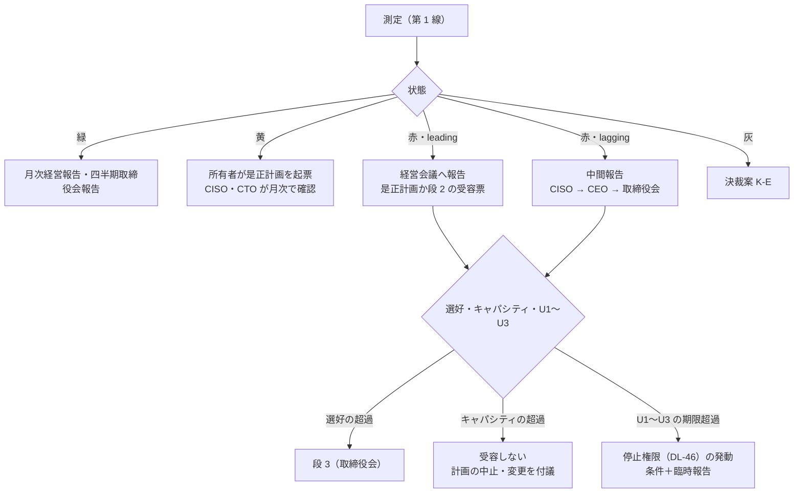

# KRI 定義・四半期報告様式

> 文書ID: GOV-08 / 版: 0.1 / 状態: draft / 最終更新: 2026-10-03
> 対応要求: R-006, R-181, R-223, G-072, G-144（関連: R-005, R-011, R-012, R-062, R-074, R-140, R-190.5, R-191.1〜R-191.3, R-193.1, R-193.2, R-196, G-076, G-080）
> 依存文書: CONVENTIONS.md, traceability/deliverables.md（DL-06）, traceability/R-requirements.md, traceability/G-goal-criteria.md, traceability/dissent-log.md（DS-03, DS-04, DS-05）, 01_governance/assumptions-register.md, 01_governance/loss-scenarios.md（GOV-03）, 01_governance/risk-appetite-draft.md（GOV-02）, research/RS-01-governance-risk.md, research/RS-12-incident-casebook.md, research/RS-05-root-of-trust-keys-supply-chain.md, research/RS-07-authz-engines-consistency.md, research/RS-08-pep-completeness-tenant-isolation.md。参照: 01_governance/raci-governance.md（GOV-05）, 01_governance/stop-authority.md（GOV-06）, 01_governance/exception-risk-acceptance.md（GOV-07）, 01_governance/business-impact-analysis.md（GOV-04）, 01_governance/durability-charter-20y.md（GOV-09）, 03_threat-model/incident-casebook.md（THR-05）, 03_threat-model/fraud-abuse-controls.md（THR-04）, 03_threat-model/attacker-model.md（THR-02）, 02_requirements/operation-risk-tiers-assurance.md（REQ-03）, 02_requirements/tenant-lifecycle.md（REQ-05）, 02_requirements/identity-lifecycle.md（REQ-02）, 02_requirements/data-classification.md（REQ-04）, 02_requirements/as-is-inventory.md（REQ-07）, research/RS-09-resilience-cell-failmode.md（RS-09#66, #67, #69 のみ）, research/RS-13-fraud-abuse.md（RS-13#19 のみ）

本書は AI エージェント（Claude）が 2026-10-03 に起草した KRI の定義と取締役会報告の様式の案であり、経営会議・取締役会の承認を経ていない [D]。KRI の選定・閾値・報告経路・周期はすべて決裁案であり、決定済みのものはない [D]。閾値は、許容度（GOV-02）・規範・前提台帳から導けるものだけを置き、それ以外は TBD（所有者・期限・決め方）とした [D]。本基盤は未構築であり、本書の KRI はまだ 1 件も測定されていない [D]。規範・事故の記述は research/ の検証済み項目（RS-xx#n）を引いた [D]。本書の作成時に新たに原典を取得した事項はない [D]。

---

## 0. 結論

1. **KRI を 32 件（K-01〜K-32）定義した** [D]。**各 K は、GOV-03 の損失シナリオ（S-xx）と GOV-02 の許容度項目（T1〜T7、Z1〜Z7、P1〜P6、L1〜L4）の少なくとも一方に紐づく**（§3、§4）[D]。取締役会には 16 件（層 B）を毎四半期に報告し、残る 16 件（層 M）は経営会議への月次報告とする案である（決裁案 K-A）[D]。層 M の KRI も、限度を超えたときは取締役会へ上げる [D]。NACD のハンドブック（非拘束）は、少数の重大シナリオに絞って取締役会へ報告するよう促している [N][^26]（RS-01#41）。
2. **閾値は「目標・注意・限度」の三段とし、限度を許容度の境界に一致させる**（§2.2、§5）[D]。IR 8286r1 は、許容度の境界への接近を警告する KRI を作るべき（should）としている [N][^22]（RS-01#16）。許容度が 0 件と定まっている項目（Z1・Z4・Z6、P1〜P4、可変属性による連結）は、限度を 0 件として置いた [D]。それ以外の閾値は TBD（所有者・期限・決め方）とした [D]。推定値で暫定閾値を置く案は採らない [D]。根拠のない数値を置かないという要求（R-196）に反するためである [D][^3]。
3. **超過時の経路を KRI の区分で分ける**（§6）[D]。leading の限度超過は定期報告に載せる [D]。lagging の限度超過は、定期報告を待たずに中間報告で経営会議と取締役会へ伝える [D]。IR 8286Cr1 は、前者を定期報告で報告してよい（may）とし、後者を中間的な連絡で伝えるべき（should）としている [N][^25]（RS-01#27）。テナント間漏えい（U1）など受容しないリスクに当たる KRI で期限を超えた場合は、受容に回さず、停止権限（DL-46）の発動条件にする [D]（GOV-02 §2.3[^8]）。
4. **四半期報告様式（§7）は、選好の 8 領域ごとの露出、上位損失シナリオ、KRI、受容、未解決 Critical/High、停止、演習を 1 冊にまとめる**[D]。R-223 が求める 3 点（リスク許容度・脅威規模・緩和費用）は、様式の独立した部（第 2 部）に置く [D][^3]。3 点の出典は ISACA Journal の個人著者の記事であり（DS-03）[^13]、本書は規範ではなく設計判断としてこの 3 点を採る [D]。
5. **測定できない KRI は採用しない**（§2.1）[D]（RS-01 §5.4 から導出）。各 K に、基準値を取る時点（As-Is 棚卸し、PoC、段階導入の shadow）を付けた [D]。テナント分離と監査の KRI（K-01〜K-04、K-21）では、測定不能を限度超過として扱う案とする（決裁案 K-E）[D]。
6. **本書が応える 5 件（R 3 件、G 2 件）のうち、本書だけで閉じたものはない**（§11）[D]。内訳は、決裁案まで 3 件（R-006、R-181、R-223）、要実測 2 件（G-072、G-144）、要第三者 0 件である [D]。

---

## 1. 位置付け・範囲・用語

### 1.1 本書が決めること・決めないこと

| 本書（GOV-08、DL-06）で扱う | 他文書で扱う |
|---|---|
| K-xx の採番、定義（式・単位・内訳）、区分、データ源、測定方法、測定頻度 | 許容度の項目と値（GOV-02、DL-01）、損失シナリオ（GOV-03、DL-02） |
| 閾値の三段（目標・注意・限度）と、TBD の所有者・期限・決め方 | SLI の定義と SLO の値（DL-20）。本書は SLO との比で KRI を定める |
| 超過時のエスカレーション、中間報告・臨時報告・CISO の直接報告の発動条件 | 停止の権限者と手続（GOV-06、DL-46）、受容票と受容の段（GOV-07、DL-05）、RACI（GOV-05、DL-04） |
| 取締役会向け四半期報告と経営会議向け月次報告の様式 | 継続保証の周期と所有（DL-32）、エグゼクティブ要約（00_decision/01） |
| 他文書から申し送られた KRI 候補の処置（§8） | 統制（C-xxx、DL-28）、試験（TC-xxx、DL-22）、runbook（RB-xx、DL-24）の採番 |

- 表の分担は、成果物計画の DL-06 の要点（K-xx を閾値「TBD＋所有者＋期限」で定義し、取締役会向け四半期報告の様式を付す）[^2]と、各文書の範囲から導いた設計推論である [D]。

### 1.2 用語

| 用語 | 本書での定義 | 根拠 |
|---|---|---|
| KRI | 許容度の境界への接近や超過を示す指標 | IR 8286r1 §3.1.2 [N][^22]（RS-01#16） |
| KPI | 統制の実施度・成果を示す指標（例: 研修完了率、検知規則の網羅率）。本書では KRI と分け、各文書で扱う | IR 8286Cr1 §5.1 は許容度を統制・KPI・KRI の三つ組に翻訳するとしている [N][^25]（RS-01#27） |
| leading / lagging | leading は損失事象の前に動く指標（構成・露出・準備度）。lagging は事象や統制の失敗が起きた後に動く指標 | RS-01#27、GOV-02 §5[^8] |
| 目標・注意・限度 | §2.2 の三段。限度は許容度の境界 | 本書の定義 [D] |
| 層 B／層 M | 層 B は取締役会へ毎四半期に報告する KRI。層 M は経営会議へ月次に報告し、限度超過時に取締役会へ上げる KRI | 本書の定義 [D]（決裁案 K-A） |
| 基準値 | 閾値を決める前に実測する、現状の値の分布 | 本書の定義 [D] |
| 中間報告 | lagging KRI の限度超過を、定期報告を待たずに経営会議と取締役会へ伝える報告（GOV-05 の RACI-06 の臨時報告に含まれる） | RS-01#27、GOV-05[^9] |
| 臨時報告 | 財務影響・顧客影響・業務中断の閾値を超えた事象を取締役会へ伝える報告（§6.3） | RS-01#41 |

### 1.3 ID の区別

- K-xx は、CONVENTIONS §2 が KRI の ID として 01_governance に定義場所を置いた番号である [D][^1]。本書が K-xx の唯一の定義場所である [D][^2]。
- GOV-06 の K1〜K4（kill switch の範囲の段）[^10]、REQ-05 の K-7（決裁項目）[^17]、THR-05 の CB-KRI-01〜16（KRI 候補の仮番号）[^14]は、K-xx とは別の番号体系である [D]。
- 本書の SRC-01〜SRC-22（データ源）、K-A〜K-E（決裁案）、KA-1〜KA-3（新規仮定）は、本書の中だけで使う番号である [D]。
- 各 K の内訳（(a)、(b) など）は、同じ K の中の部分指標である [D]。報告では K-07(a) のように書く [D]。

### 1.4 前提

- 規模と構成は前提台帳 GOV-01 v0.1 の値を使う[^5] [D]。主に使うのは次の値である [D]。
  - A-011（社内 service account 1,200）、A-013（外部連携 client 800・grant 3万）、A-014（AI エージェント ID 1万）[A-011][A-013][A-014]
  - A-048（攻撃時のログイン試行 5,115/秒）、A-049（decision event 9.07億/日）[A-048][A-049]
  - A-050（依存サービス 300）、A-054（プラットフォームチーム 24 FTE、うち SRE 6 で on-call を 2 系統）、A-055（entry point 1.2万）[A-050][A-054][A-055]
  - A-090〜A-093（可用性帯、RTO・RPO）[A-090][A-091][A-092][A-093]
  - A-110〜A-115（As-Is の認証方式、認可実装、静的資格情報、認証器）[A-110][A-112][A-113][A-115]
- 閾値のうち GOV-02 の値に依存するものは、GOV-02 決裁案 1 で選ぶ選択肢の値に従う [D]。GOV-02 の推奨（B を既定とし、規制業種・高保証テナントの区画には A を適用）が採られた場合、区画ごとに別の限度を持つ [D][^8]。§5 では B の値を示し、A の値が異なるものは括弧で併記した [D]。
- GOV-02 の時間・率の値の多くは、他文書の新規仮定（GOV-03 NA-01〜NA-24、GOV-04 NA-01 など）に依存する [A]（GOV-02 §1.4[^8]）。
- 本書が新たに置く仮定は §10 の KA-1〜KA-3 である（前提台帳へ追加要）[D]。

### 1.5 原典が KRI と報告に求めること

| 原典 | 求めること | 強度 | 本書での扱い |
|---|---|---|---|
| NIST IR 8286r1 §3.1.2 | 許容度には可能な限り明確で測定可能な境界を持たせ、その境界への接近を警告する KPI・KRI を作る [N][^22]（RS-01#16） | should | 三段の閾値（§2.2） |
| NIST IR 8286r1 §3.6.2 | 受容済みと記録したリスクも、許容度内に留まっていることを測定する必要がある。KRI には正の指標と負の指標があり得る。規制の変更を含む環境の変化は KRI の定期的な見直しを要し得る [N][^22]（RS-01#20） | 説明文（need to be measured、may require） | 受容中のリスクの KRI（K-26）、正の指標（K-11）、定義の改訂手続（§2.1 規則 7） |
| NIST IR 8286Cr1 §5.1〜§5.2 | 許容度は統制・KPI・KRI の三つ組に翻訳される。leading KRI の超過は定期報告で報告してよく、lagging KRI の超過は中間的な連絡で伝えるべき [N][^25]（RS-01#27） | leading は may、lagging は should | 区分別の経路（§6.1） |
| NIST IR 8286Cr1 §4.2.2 | 統制を組み合わせても許容度内に収められない場合や、統制の費用が不合理な場合は、意思決定者との協議が必要 [N][^25]（RS-01#26） | 説明文（is necessary） | 様式の「緩和費用」（§7.2 第 2 部） |
| NIST IR 8286B-upd1 §2.3・§2.3.1 | 報告期間内に処置できない容認不可のリスクは暗黙に受容されたものになる。受容したリスクも報告・監視・管理を続けなければならない [N][^24]（RS-01#22, #24） | must | K-26 |
| NIST IR 8286Ar1 Table 2 | 医療機関の例で、許容度を「重要な医療業務アプリケーションの 100% は多要素認証を使わなければならない」と置いている [N][^23]（RS-01#14） | 例示（notional） | K-11(a) の形 |
| NACD ハンドブック 原則 5 | 報告は少なくとも四半期ごと、重大インシデントやリスク水準の大きな変化の直後にも行う。財務影響・顧客影響・業務中断の閾値を臨時報告の発動条件として形式化する。取締役会承認の選好に対する現在の露出をダッシュボードで示す。少数の重大シナリオに絞る [N][^26]（RS-01#41） | 推奨（非拘束） | 周期（決裁案 K-D）、臨時報告（§6.3）、様式第 3 部 |
| NACD ハンドブック 原則 5 | KRI の例として、事業単位別の定量化露出、インシデントの件数と深刻度、検知・封じ込めの平均時間、重要システムのパッチ適合率、第三者リスクの集中度、研修完了率を挙げる [N][^26]（RS-01#42） | 例示（非拘束） | K-22、K-14、K-24 |
| NACD ハンドブック Tool J・Tool K | CISO の取締役会への直接の報告ライン、情報の濾過の有無、直接連絡を発動する閾値を取締役会が確認する。定量化モデルの独立検証と、選好の金額表現を経営に問う [N][^26]（RS-01#43, #44） | 推奨（非拘束） | CISO の直接報告（§6.4）、K-24 |
| 英国 Cyber Governance Code E2 | 少なくとも四半期ごとの正式報告を求め、追跡する指標を定め、指標ごとに許容度を合意する [N][^27]（RS-01#63） | 政府のガイダンス（法的拘束力の記載なし） | 周期（決裁案 K-D）、指標ごとの限度（§5） |
| IIA Cybersecurity Topical Requirement | 内部監査は、監視と報告を担う者の特定と、容認できない水準に達したリスクを迅速にエスカレーションする仕組みの有無を評価しなければならない [N][^28]（RS-01#56） | must（内部監査人が評価する事項） | §6 の経路は内部監査の評価対象の証跡になる |
| NIST SP 800-63-4 §3.5 | 継続的な評価・改善プログラムの実施と文書化を SHALL とし、推奨指標に認証失敗率、回復試行数、不正アクセス率、認証方式別の不正件数、ヘルプデスク呼量を挙げる [N][^49]（RS-13#19） | SHALL（プログラム）、SHOULD（指標） | K-12、K-28(c) |

- 表の各行は、原典欄の記述を要約したものである [N]。「本書での扱い」欄は本書の設計推論である [D]。
- NACD・英国 Code・IIA の文書は、当社への適用が法令で決まるものではない [D]。適用の判定は法務が行う（CTL-02、DL-34）[D]。本書は、適用の有無にかかわらず上表の要求を満たせる様式にした [D]。

---

## 2. KRI の設計規則

### 2.1 採用基準

| # | 規則 | 理由 |
|---|---|---|
| 1 | 各 K は S-xx（GOV-03）と許容度項目（GOV-02）の少なくとも一方に紐づける | 許容度への接近を示さない指標は KRI ではなく KPI である（RS-01#16, #27 から導出） |
| 2 | 式・単位・データ源・頻度を定め、基準値を取る時点を決めてから採用する。測定できない候補は採用しない | RS-01 §5.4。測れない KRI は許容度内であることを示せない（RS-01#20 から導出） |
| 3 | 向き（増えると悪い／減ると悪い）を一意にする。正の指標（例: K-11）は向きを明記する | RS-01#20 は正・負の両方の指標があり得るとしている |
| 4 | データ源を、測る対象と同じ系に依存させない（例: 監査の欠損を、その監査基盤だけで数えない） | OPA の decision log は、バッファ上限やレート上限を設定するとイベントを捨てる [V][^41]（RS-07#56）。Cloudflare 2025-06-12 では、WARP の緊急切断機能が障害を起こした Workers KV への依存のため使えなかった [I][^48]（RS-09#69） |
| 5 | 測定の所有者（第 1 線）、閾値案の起案者（CISO と第 2 線）、承認者（経営会議）を分ける | GOV-05 の RACI-02（経営会議が A）[^9] |
| 6 | 統制の実施度は KPI として各文書で扱い、KRI の数を増やさない | RS-01#27 の三つ組。NACD は少数への集中を促している（RS-01#41） |
| 7 | 定義を変えたら版を上げ、四半期報告で開示する。閾値を緩める変更は個別に報告する | GOV-02 §4.2（許容度を緩める変更は取締役会へ個別に報告）[^8]、RS-01#20 |

- 表の規則は右端列から導いた設計推論である [D]。

### 2.2 閾値の三段と状態

| 段 | 意味 | 決め方 | 状態 |
|---|---|---|---|
| 目標 | 望ましい値。許容度より厳しい側に置く | 統制の設計値、または許容度が 0 の項目では 0 | 目標を満たす間は緑 |
| 注意 | 許容度への接近を警告する線。IR 8286r1 の「境界への接近の警告」に当たる | 基準値の分布と、是正に要する時間から逆算する | 注意以上・限度以下は黄 |
| 限度 | 許容度の境界。超えたら許容度の超過として §6 の経路に乗せる | GOV-02 の許容度、数値契約（DL-20）の SLO、規範から導く | 限度超過は赤 |
| — | 測定不能・データ欠損 | 決裁案 K-E | 灰 |

- 比で表す KRI は「実測値 ÷ 許容値」とし、限度を 1.0 とする [D]。許容値が TBD の間、その KRI は「閾値未設定」と表示し、値と推移だけを報告する [D]。
- 「0 件」を限度とする KRI では、1 件目で限度超過になるため注意の段を置かない [D]。
- 表の段と状態は、RS-01#16 の「境界への接近を警告する」から導いた本書の定義である [D]。

### 2.3 測定の健全性

- 第 2 線（リスク管理）は、四半期報告の前に、報告値を生データと抜取りで照合する [D]。照合の方法と件数は TBD とする（所有者: 第 2 線、期限: G4、決め方: PoC で生データの量と照合の工数を測って決める）[D]。
- KRI・試験結果・監査ログの虚偽記載・改ざん・隠蔽は、GOV-05 の説明責任条項の区分 W（故意・虚偽）に当たる [D][^9]。
- 生データ（E5）は報告ごとにハッシュを残す [D]。保存期間は TBD とする（所有者: CISO＋法務責任者、期限: G3、決め方: ADR-014 と DL-34 の保持要件に合わせる）[D]。
- KRI の定義・計測手順・報告の仕組みは、内部監査の評価対象になる [D]。IIA の Topical Requirement は、監視と報告を担う者の特定とエスカレーションの仕組みの有無を内部監査が評価する事項に挙げている [N][^28]（RS-01#56）。評価の周期は DL-07（独立保証計画）で決める [D]。

---

## 3. KRI 総覧

選好の領域は GOV-02 §3.1 の 8 領域である[^8]。番号は、1 テナント間の機密性、2 規制・契約の遵守、3 特権の故意の濫用、4 特権の残余リスク、5 テナント内の不正アクセス、6 可用性、7 変更速度・機能提供、8 供給者依存・技術の陳腐化、を指す [D]。「横断」は統治・監査など複数の領域にかかるものを指す [D]。

| K | 名称 | 区分 | 層 | 領域 | 主な S | 許容度項目 |
|---|---|---|---|---|---|---|
| K-01 | PEP 未網羅 entry point 数 | lagging | B | 1 | S-01, S-09 | T3（Z5） |
| K-02 | 封じ込め期限超過のテナント間経路数 | lagging | B | 1 | S-01, S-02, S-03, S-05, S-15 | T3（Z1〜Z3）、U1 |
| K-03 | cross-tenant 負例試験の失敗件数と検出力 | lagging | M | 1 | S-01 | T3（Z4） |
| K-04 | 誤 allow 件数（differential・shadow） | lagging | M | 1, 5 | S-01, S-05 | T3（Z6）、T4 |
| K-05 | PEP 外データ経路の統制未付与件数 | leading | M | 1 | S-09, S-01 | T3 |
| K-06 | アーキテクチャ性質の CI 違反件数 | leading／lagging | M | 1, 6 | S-01, S-02, S-06 | T3（G-072） |
| K-07 | 最長稼働署名鍵年齢と rotation 期限超過 | leading | B | 1 | S-02 | T3 |
| K-08 | 未 rotation 資格情報数 | leading／lagging | B | 4 | S-08, S-02, S-18 | T5 |
| K-09 | 常設特権と二者統制の逸脱 | leading／lagging | M | 3, 4 | S-08, S-09, S-11 | T5（P1, P2）、U3 |
| K-10 | break-glass の使用と検証 | lagging | M | 3, 4 | S-11 | T5（P5） |
| K-11 | フィッシング耐性 MFA 率と弱い認証の残存 | leading | B | 5, 4 | S-18, S-04, S-03, S-08 | T5（P3） |
| K-12 | サポート・ヘルプデスク経路 | leading／lagging | M | 5 | S-04 | — |
| K-13 | 可変属性による連結と IdP 信頼変更の逸脱 | leading | M | 5 | S-03 | T6、T5（P2） |
| K-14 | 高権限第三者 app・grant 数 | leading | B | 1 | S-15, S-14 | T3 |
| K-15 | 第三者 token の寿命・送信者拘束・大量 export 検知 | leading／lagging | M | 1 | S-15 | T3 |
| K-16 | AI エージェントの委任 | leading／lagging | M | 5 | S-14 | — |
| K-17 | stale allow 継続時間 | lagging | B | 5 | S-07, S-05 | R-191.1〜R-191.3 |
| K-18 | plane 別停止時間と許容度の比 | lagging | B | 6 | S-06, S-05, S-19 | T2 |
| K-19 | cell 間依存違反数 | leading | B | 6 | S-06, S-05, S-02 | T2 |
| K-20 | 段階展開・安全装置を経ない変更 | leading／lagging | M | 6, 1 | S-05, S-02, S-06, S-19 | T2、T3 |
| K-21 | 監査欠損率 | lagging／leading | B | 横断 | S-10（全上位 S の二次損失） | T5（P4）、T7 |
| K-22 | 検知・封じ込め・影響範囲確定・通知の時間 | lagging | M | 2, 横断 | S-01, S-16 ほか | T3（Z2, Z3）、T7（L2） |
| K-23 | 規制適用の再確認と判定保留 | leading | M | 2 | S-16, S-17 | T7（L3） |
| K-24 | 選好に対する露出 | leading | B | 横断 | 上位 10 件 | T1 |
| K-25 | 未解決 Critical/High | lagging | B | 横断 | 全 S | U1〜U3、R-074 |
| K-26 | 期限超過の受容票と暗黙の受容 | leading | B | 横断 | 全 S | T1 |
| K-27 | 停止権限の運用 | leading／lagging | M | 横断 | S-01, S-02, S-06 ほか | — |
| K-28 | 脅威規模 | leading | B | 5, 横断 | S-18, S-04 | R-223 |
| K-29 | 未移行 consumer 数 | leading | B | 8, 1 | S-12, S-01, S-08 | T3（Z5） |
| K-30 | 統治の継続性（属人化指標） | leading | B | 8 | 全 S（対応能力） | — |
| K-31 | 中央チームの審査待ち（オンボーディング・モデル変更） | leading | M | 7 | — | G-144 |
| K-32 | 置換・撤退・暗号移行の準備度 | leading | M | 8 | S-12, S-13 | — |

- 層 B は 16 件（K-01, 02, 07, 08, 11, 14, 17, 18, 19, 21, 24, 25, 26, 28, 29, 30）、層 M は 16 件である [D]。
- 層 B には、DL-06 の要点が例示する 5 指標（PEP 未網羅、最長鍵年齢、stale allow、未解決 Critical/High、属人化）[^2]と、損失規模の大きい上位シナリオ（S-01、S-02、S-18、S-06）の指標、受容と露出の指標、R-223 の脅威規模を入れた [D]。
- 表の区分・層・領域・紐付けは、§4 の各行の根拠から導いた設計推論である [D]。セルごとのタグは本注記で代える [D]。
- 上位 10 件の S と横断・次点の S のうち、KRI を持たないのは S-17（データ所在地・越境移転の違反）だけである [D]。S-17 は、法務の適用判定（DL-34）の後に再評価すると GOV-03 が定めているため[^7]、K-23 で判定状況を追い、KRI の追加は DL-34 の確定後に判断する [D]。

---

## 4. 定義と測定

### 4.1 データ源

| SRC | データ源 | 所有（第 1 線） | 依存する成果物 | 独立性の要件 |
|---|---|---|---|---|
| SRC-01 | entry point の機械列挙（静的宣言: OpenAPI・proto・GraphQL schema・ルート表・consumer 購読・cron。実行時観測: SERVER/CONSUMER span。DB の接続元ロール） | プラットフォームチーム長＋各ドメイン責任者 | DL-10, DL-50 | 実行時観測は PEP SDK とは別の計装から取る |
| SRC-02 | PEP の認可判断イベント（decision_id、発行連番）と監査基盤の受理記録 | プラットフォームチーム長 | DL-15, ADR-014, DL-25 | 突合は監査基盤の外の集計系で行う |
| SRC-03 | CI ログ（負例試験、カスタム SAST、性質検査、混入試験） | 各ドメイン責任者、プラットフォームチーム長 | DL-15, DL-80, DL-22 | E4 として保存し、CI の設定変更を二者レビューにする |
| SRC-04 | 鍵台帳（KMS/HSM のメタデータ、JWKS 公開履歴、ceremony 記録） | CISO（鍵管理） | DL-14, ADR-007 | 鍵の操作系と別の照会経路で読む |
| SRC-05 | 資格情報・secret 台帳（service account、静的資格情報、CI secret、顧客機密、rotation 記録） | CISO＋プラットフォームチーム長 | ADR-007, ADR-009 | — |
| SRC-06 | IdP/AS の主体・認証器・認証ログ、特権アクセスの記録（JIT 付与、二者承認、break-glass、impersonation） | プラットフォームチーム長、CISO | ADR-002, ADR-029, DL-48 | 特権操作の記録は操作系と別の経路で保存する |
| SRC-07 | OAuth client・grant・agent の台帳と発行ログ | プロダクト責任者 | ADR-005, ADR-017 | — |
| SRC-08 | support・ヘルプデスクの案件記録と添付の走査結果 | 営業・顧客成功責任者 | DL-52, REQ-06 | — |
| SRC-09 | differential・shadow 試験の判定差分 | CTO | DL-31, R-175 | 比較の基準（参照実装・旧実装）を判定対象と分ける |
| SRC-10 | SLI 計測（可用性、剥奪反映、監査記録率）と合成の剥奪事象（canary） | SRE 責任者 | DL-20, DL-56 | 計測系は本基盤の IdP・PDP に依存させない（KA-3） |
| SRC-11 | 構成・依存の台帳（cell 構成、依存グラフ、変更の展開段階の記録、例外台帳） | SRE 責任者 | DL-18, DL-63, ADR-013 | — |
| SRC-12 | POA&M・脆弱性台帳（独立評価、pentest、red team、適合試験、CI、インシデント由来） | CISO | DL-110, DL-59, DL-30 | — |
| SRC-13 | 受容票台帳 | 第 2 線（リスク管理） | DL-05, DL-41 | — |
| SRC-14 | 停止記録票 | CISO | DL-46 §6 | 停止経路と同じく本基盤に依存させない |
| SRC-15 | 演習記録（E8）とインシデント記録（最初の兆候・認知・重大分類・重要性判断の時刻） | CISO、SRE 責任者 | DL-24 | 時刻の記録手段を本基盤の停止中も使えるようにする（GOV-04 X8） |
| SRC-16 | 連携契約レジストリ（consumer、契約版、非推奨期限）と移行計画 | CTO | DL-70, DL-31, DL-62〜DL-80 | — |
| SRC-17 | 要員・資格台帳と on-call 表 | CTO＋人事責任者 | DL-27 | — |
| SRC-18 | オンボーディング審査キュー | プラットフォームチーム長 | DL-66 | — |
| SRC-19 | 定量化モデル（校正後の推定、MP 単価） | CISO 配下のリスク機能＋CFO | DL-02 | 独立検証は DL-07 の範囲 |
| SRC-20 | 法域・規制の適用判定の記録 | 法務責任者 | DL-34 | — |
| SRC-21 | 攻撃・不正の検知記録（edge・AS の試行率、検知規則の発報、不正の確定） | CISO | DL-52 | — |
| SRC-22 | 製品・依存・CBOM の台帳と標準ステータス台帳 | CTO | DL-33, DL-84 | — |

- 表の割当は本書の設計推論である [D]。独立性の要件は §2.1 規則 4 から導いた [D]。

### 4.2 テナント分離・PEP（K-01〜K-06）

| K | 定義（式・単位・内訳） | データ源 | 測定方法 | 頻度 | 基準値を取る時点 | 根拠 |
|---|---|---|---|---|---|---|
| K-01 | (a) 機械列挙した入口（静的宣言 ∪ 実行時観測 ∪ DB 接続元）のうち、entry point 台帳にないもの、または PEP を経由しないものの件数。(b) 認可判断イベントなしで処理を完了した入口の件数（例外台帳に登録した公開 endpoint を除く）。いずれも移行済み／未移行のサービス別。単位: 件 | SRC-01, SRC-02, SRC-03 | (a) 静的宣言と実行時観測の差分。DB 直接接続は DB 側の接続元ロールで別に数える。(b) span と decision_id の突合 | (a) 変更ごと＋日次。(b) 連続（日次集計） | As-Is は DL-50（REQ-07 の S7）。移行済みは PoC（RS-08 §5.2 の M-01・M-03。TC 未採番） | RS-08#21, #27, #34, #35、A-055、A-112 |
| K-02 | 既知のテナント間経路（GOV-02 §3.4.1 の定義）のうち、Z2 の期限を過ぎても封じ込めていないものの件数（Z1）。内訳: 当期に認知した経路数、封じ込め済み・緩和済みの件数、未緩和の各経路の認知からの経過時間。単位: 件 | SRC-12, SRC-15 | 認知時刻と、負例試験の再実行による封じ込め確認時刻を記録票から集計 | 連続（事象ごと） | 定義上 0 から始まる。Z2・Z3 の時間は演習で測る（TC 未採番） | GOV-02 §3.4[^8]、RS-08 §2 結論 15 |
| K-03 | (a) 本番に配備する成果物の cross-tenant 負例試験（別 issuer・別 cell・tid の書換え・他テナント ID）の失敗件数。(b) 試験の検出力 ＝ PEP 呼出しや tenant scope を外した変異体のうち試験が検出した割合 | SRC-03 | (a) CI の必須ゲート。(b) 変異体の埋込み試験 | (a) 変更ごと。(b) 四半期 | PoC（RS-08 §5.2 の M-02・M-10） | RS-08#5、RS-12 §5.2 の 1、GOV-02 Z4 |
| K-04 | 比較の基準（参照実装または旧実装）が deny とし、照合で誤りと確定した allow の件数。cross-tenant と操作階層別（privileged・break-glass、write、read-sensitive）に分ける。テナントの境界変更（REQ-05 の T08〜T10）前後の想定外差分と、分割後の残余越境を含む。単位: 件 | SRC-09 | dual-run の差分を原因分析して確定する | 連続（日次集計） | PoC と段階導入の shadow | GOV-02 §3.4.3、R-190.5、REQ-05[^17] |
| K-05 | (a) export・署名付き URL・copy/extract ジョブ・バックアップ復元・検索・DWH・RAG の経路のうち、発行記録・TTL 上限・承認・テナント分離のいずれかを欠く経路の件数。(b) RLS 無効表・FORCE 未設定表・BYPASSRLS ロールや owner でのアプリ接続・security_invoker 未設定 view の件数。(c) 待機期間を過ぎた削除済みテナントの KEK で復号できるコピーの件数。(d) 署名付き URL・export の発行件数と最大 TTL | SRC-01, SRC-11 | DB カタログとストレージ設定の走査、発行ログの集計 | 日次 | As-Is（DL-50）と PoC（RS-08 §5.2 の M-06・M-11） | RS-08 §2 結論 5・13・15、REQ-04 X3[^19]、REQ-05[^17] |
| K-06 | 5 性質（PEP 網羅、共通 audience の禁止、token 寿命の上限、DB 直アクセスの検出、スキーマ互換）ごとに、(a) CI が検出して阻止した違反件数（leading）、(b) CI を通って本番に到達した違反件数（lagging）、(c) 意図的に混入させた違反の検出率、(d) 検出から是正までの時間 | SRC-03, SRC-01, SRC-16 | DL-15・DL-80 の検査を CI の必須ゲートで実行する。(b) は本番構成の定期走査で数える。(c) は混入試験 | (a) 変更ごと。(b) 走査ごと（周期は GOV-09 T6）。(c) 四半期 | PoC（G-072 の判定。CI ログ E4） | G-072[^4]、R-062、RS-08 §2 結論 3、GOV-09 §5.8[^12] |

- K-01 の計測方式は、RS-08 が示した「静的宣言と実行時観測の差分」と「span と認可判断イベントの突合」による [D]（RS-08#27, #35 から導出）。OWASP API9:2023 は、API ホストと連携サービス・データフローの棚卸しと、文書の自動生成を CI/CD に組み込むことを予防策に挙げている [N][^44]（RS-08#21）。
- ASVS v5.0.0-16.3.2 は、L3 で全認可判断のログ記録を求めている [N][^43]（RS-08#34）。K-01(b) の判断イベントは、この記録と兼用できる [D]（RS-08#35 から導出）。
- ASVS の V8 には、entry point の棚卸しや enforcement coverage の自動検証を直接求める要件がない [N][^42]（RS-08#6）。NIST SP 800-53 の AC-25（参照モニタ）は、常に呼び出され迂回されない機構を求めるが [N][^45]（RS-08#13）、SP 800-53B の LOW・MODERATE・HIGH のどのベースラインにも含まれていない [N][^46]（RS-08#14）。したがって K-01 を許容度の指標にするのは、規範の写しではなく当社の設計判断である [D]。
- K-01 の母数は、仮置きで 1.2 万の entry point である [A-055]。As-Is では、テナント分離をアプリ層の検索条件だけで行うサービスが 70% と置かれている [A-112]。GOV-02 は、この構造上の弱点を具体的な経路が識別されるまで「既知の経路」に数えず、Z5（K-01）で測るとしている[^8] [D]。
- K-03(a) は、ASVS v5.0.0-8.4.1（L2）の「マルチテナントのアプリケーションは cross-tenant 統制を使い、consumer の操作が権限のないテナントに決して影響しないことを確保する」[N][^42]（RS-08#5）を、配備の条件として測るものである [D]。
- K-06 の 5 性質は G-072 の列挙をそのまま採った [D][^4]。既製の SAST が検出できる認可欠落の範囲は狭いため、PEP SDK の呼出し規約に合わせたカスタムルールが前提になる [D]（RS-08 §2 結論 3 から導出）。

### 4.3 鍵・資格情報・特権（K-07〜K-10）

| K | 定義（式・単位・内訳） | データ源 | 測定方法 | 頻度 | 基準値を取る時点 | 根拠 |
|---|---|---|---|---|---|---|
| K-07 | (a) 稼働中（署名に使用中、または JWKS に掲載中）の署名鍵の最長年齢 ÷ その鍵種別の cryptoperiod。(b) rotation 期限を過ぎた鍵の件数。(c) JWKS 掲載鍵数と最古鍵の年齢。(d) rotation の失敗回数。鍵種別（issuer 署名鍵、内部 token、policy bundle 署名、CI 署名、オフライン root）別 | SRC-04 | 鍵台帳のメタデータ（作成日・状態）と JWKS 公開履歴の照合 | 日次 | PoC（RS-05 §5.2 の計画 rotation 試験・鍵年齢アラート試験。TC 未採番） | RS-05#3, #20, #22、RS-12#4, #10、RS-05 §5.1 |
| K-08 | (a) rotation 期限を過ぎた静的資格情報（共有シークレット、API key、service account の資格情報、CI secret、顧客機密）の件数。(b) rotation 記録のない件数。(c) 侵害通知（自社・取引先・供給者）から関連資格情報の回転完了までの時間と、未回転の件数（lagging） | SRC-05, SRC-15 | (a)(b) 台帳の日次照合。(c) 全件回転の演習と実事象の記録 | (a)(b) 日次。(c) 演習・事象ごと | As-Is は DL-50。(c) は PoC の全件回転演習 | RS-12#28, #34、A-011、A-113 |
| K-09 | (a) JIT でない常設の本番特権の保持者数（選択肢 B では break-glass と on-call の読取専用を除く）。(b) 二者統制なしで実行された最上位保護操作（鍵の ceremony、issuer 鍵の rotation、全域の policy 配布、IdP の追加と linking 規則の変更、監査の停止）と impersonation の件数（lagging） | SRC-06 | 権限台帳の日次照合。操作ログの二者承認記録の有無 | (a) 日次。(b) 連続 | PoC と As-Is | GOV-02 P1・P2[^8]、THR-05 CB-KRI-16[^14]、THR-04 §11[^15] |
| K-10 | (a) 演習以外での break-glass の使用件数。(b) 事後レビューの期限超過件数。(c) 緊急経路ごとの最終検証からの経過日数。(d) SSO・federated IdP など本基盤に資格情報や経路を依存する緊急経路の数 | SRC-06, SRC-14 | 使用記録と検証記録の照合、緊急経路の依存の棚卸し | 連続、(c) 日次 | PoC（GOV-06 §8 の演習） | GOV-02 P5、GOV-06 §4.8[^10]、RS-05#74 |

- CSRB によれば、Microsoft の consumer MSA 系には署名鍵の自動 rotation がなく、手動 rotation は 2021 年の障害の後に全面停止され、稼働中の署名鍵の年齢を通知する警報もなかった [I][^29]（RS-12#4）。CSRB は、自動 rotation への移行が完了し鍵年齢の警報があれば、2016 年に作られた鍵は 2023 年に有効ではなかったと認定している [I][^29]（RS-12#10）。K-07 はこの「鍵年齢の警報」を経営の指標に引き上げたものである [D]。
- NIST SP 800-57 Part 1 Rev5 は、私有署名鍵の最大 cryptoperiod を約 1〜3 年と推奨（recommended）し、cryptoperiod の終了時に破棄することを shall としている [N][^36]（RS-05#3）。K-07(a) の分母（鍵種別ごとの cryptoperiod）は、R-189.3（鍵 rotation 周期）として DL-20 と DL-14（ADR-007）で決める TBD である [D][^3]。
- Mandiant は、Snowflake 顧客環境の侵害の主因の一つに、infostealer で盗まれた資格情報が場合によっては最長 4 年回転されないまま有効だったことを挙げている [I][^30]（RS-12#34）。Cloudflare は、2023 年 10 月の Okta 侵害で取られた access token 1 件と service account の資格情報 3 件を、未使用だと誤って判断して回転していなかった [I][^31]（RS-12#28）。K-08(c) は、侵害通知から全件回転までを、未使用判定に頼らず数える [D]（RS-12 §5.1 から導出）。
- K-08 の As-Is の母数は、静的資格情報 3,000 件、rotation 記録のない比率 50%（1,500 件）、社内 service account 1,200 件の仮置きである [D][A-011][A-113]。

### 4.4 認証・連携・委任（K-11〜K-16）

| K | 定義（式・単位・内訳） | データ源 | 測定方法 | 頻度 | 基準値を取る時点 | 根拠 |
|---|---|---|---|---|---|---|
| K-11 | (a) 特権操作のうちフィッシング耐性認証で保護された割合（正の指標）。(b) 必須化の対象（人事 ID、support、顧客管理者、基盤運用者。REQ-03 案 B）のフィッシング耐性認証器の登録率。(c) 自社で認証する人間利用者の区分別の登録率。(d) 弱い方式（SMS・音声・手入力 OTP・承認型 push）を有効にしている利用者の比率と、例外を許可したテナントの数（device code・利用者同意の例外を含む）。(e) MFA を強制していない人間アカウント数（非本番テナントを含む）と、password 認証の service user 数 | SRC-06 | 認証器の登録台帳と、特権操作ログの認証方式の集計 | 日次 | (c) As-Is は 7% の仮置き [A-115]。PoC とパイロット（REQ-03 の PT-11） | RS-01#14, #20、RS-12#16, #34、REQ-03 §4.1[^16]、THR-04 §11[^15]、GOV-02 P3 |
| K-12 | (a) ヘルプデスク経由の要素リセット・移転の件数。(b) 本人確認手順の遵守率と拒否率。(c) 不正回復の確定件数と、不正回復検知時間（R-188.7）の目標超過件数（lagging）。(d) サポート添付・ケース本文から検出した秘密情報の件数と、無害化までの時間 | SRC-08, SRC-06 | 案件記録と認証ログの突合、添付の自動走査 | 日次（月次集計） | As-Is の案件統計と helpdesk SE 演習（DL-59） | RS-12#48、RS-13#19、THR-05 CB-KRI-09・15[^14]、THR-04 §11[^15] |
| K-13 | (a) email など可変属性で連結したアカウントの件数。(b) IdP の追加・自動連結の有効化・linking 規則の変更のうち、二者承認・待機・顧客通知のいずれかを欠いた件数 | SRC-06 | 連結規則の設定走査、管理操作ログの照合 | 日次 | PoC（nOAuth 再現、悪意ある IdP 追加試験） | RS-12#45, #49、GOV-02 P2・T6 |
| K-14 | (a) app-only 権限または高権限 scope を持つ OAuth client（第三者・顧客自作）の数と、その有効 grant の数（非本番テナントを含む）。(b) うち所有者・審査記録・期限のいずれかを欠く client の数。(c) 一定期間使われていない高権限 grant の数 | SRC-07 | client・grant 台帳の日次集計 | 日次 | As-Is（DL-50）。母数は client 800・grant 3万の仮置き [A-013] | RS-12#16, #37、RS-01#42、RS-01 §5.3 |
| K-15 | (a) 第三者連携の token の最大寿命。(b) 送信者拘束された token の比率。(c) 大量 export の開始から検知までの時間（演習・実事象）。(d) 連携事業者単位の一括失効の完了時間（演習） | SRC-07, SRC-15, SRC-21 | (a)(b) 発行ログの集計。(c)(d) 演習の記録 | (a)(b) 日次。(c)(d) 演習ごと | PoC（一括失効試験、大量取得の検知試験） | RS-12#37、THR-05 CB-KRI-06・07、GOV-06 の K1[^10] |
| K-16 | (a) agent grant の最大寿命。(b) 所有者のいない agent の数。(c) step-up を経ない高リスク tool 実行の件数（lagging）。(d) 他 resource 宛ての token を受理した件数（負例試験） | SRC-07, SRC-03 | 台帳と実行ログの集計、CI の負例試験 | 日次、(d) 変更ごと | PoC（MCP 適合・負例試験）。母数は agent 1万の仮置き [A-014] | GOV-03 §5.10・§7 の S-14[^7] |

- IR 8286Ar1 の Table 2 は、許容度の例として「重要な医療業務アプリケーションの 100% は多要素認証を使わなければならない（must）」を置いている [N][^23]（RS-01#14）。K-11(a) は同じ形で特権操作の保護率を測る [D]。IR 8286r1 は、KRI に正の指標（強い認証を備えた重要システムの数など）があり得るとしている [N][^22]（RS-01#20）。
- Midnight Blizzard の事案では、侵害されたテストテナントのアカウントに MFA が設定されておらず、攻撃者は corporate 環境で高い権限を持つ旧テスト OAuth アプリを特定して侵害した [I][^32]（RS-12#16）。K-11(e) と K-14 が非本番テナントを含むのはこのためである [D]。
- K-11(c) の As-Is は、自社で認証する人間利用者 47.5 万人のうちフィッシング耐性あり 7%、password のみ 55%（約 26.1 万人）の仮置きである [D][A-115]。
- CISA/FBI の勧告 AA23-320A は、Scattered Spider が IT ヘルプデスクの担当者を電話で騙してパスワードのリセットや MFA token の移転を行わせると述べている [I][^34]（RS-12#48）。SP 800-63-4 は、回復試行数やヘルプデスク呼量などを推奨指標（SHOULD）に挙げている [N][^49]（RS-13#19）。K-12 はこの 2 点から組んだ [D]。
- OpenID Connect Core 1.0 §5.7 は、iss と sub の組だけを利用者の安定した識別子とし、email・phone_number・preferred_username・name などの他の claim を一意識別子として使ってはならない（MUST NOT）としている [N][^35]（RS-12#45）。K-13(a) の限度 0 件はこの規範による [D]。
- GTIG によれば、UNC6395 は Salesloft Drift アプリに紐付く侵害済みの OAuth token を使い、多数の企業の Salesforce インスタンスから大量のデータを export した [I][^33]（RS-12#37）。Salesloft は 2025-08-20 に Drift アプリの全 access token と refresh token を失効させた [I][^33]（RS-12#37）。K-14・K-15 は、高権限の第三者 grant の量と、その窃取を検知・遮断する速さを分けて測る [D]。

### 4.5 剥奪・可用性・封じ込め（K-17〜K-20）

| K | 定義（式・単位・内訳） | データ源 | 測定方法 | 頻度 | 基準値を取る時点 | 根拠 |
|---|---|---|---|---|---|---|
| K-17 | (a) 剥奪の書込から、全 PEP（非同期 consumer、export、長時間ジョブを含む）が拒否するまでの時間の p99 と最大を、剥奪の区分（通常・高権限・tenant 停止）ごとに許容値（R-191.1・R-191.2 の SLO）で割った比。(b) cache invalidation の失敗件数（R-191.3）と、非同期処理の停止漏れ・dead letter に残る事象の件数と滞留時間。(c) rollback の後に剥奪済みの権限が復活した件数 | SRC-10, SRC-02, SRC-09 | 合成の剥奪事象（canary）を定期に投入して全 PEP の拒否時刻を測る。本番の剥奪イベントと decision log を突合する | 連続（日次集計） | PoC（RS-07 §5.2 の 1、RS-08 §5.2 の M-07） | RS-07#15, #28, #49, #55、RS-08 §2 結論 8、REQ-02[^18]、REQ-05[^17]、GOV-03 S-05[^7] |
| K-18 | (a) 判定系・認証系・管理系の 30 日停止分 ÷ 許容度（GOV-02 §3.3）。(b) 操作階層別の MTPD を超えた停止事象の件数。(c) control plane の停止中に判定系が継続できた時間（演習） | SRC-10, SRC-15 | SLI 計測と障害記録、障害注入演習 | 連続（日次集計）、(c) 演習ごと | PoC（障害注入）と段階導入の shadow | GOV-02 §3.3[^8]、A-090〜A-093、GOV-03 S-06[^7] |
| K-19 | (a) cell 境界を越える同期依存のうち、例外台帳にないものの件数。(b) 全域依存（global control plane、全域に複製されるデータ・設定、全域鍵）の件数と、そのうち例外台帳にないものの件数。(c) 本基盤と依存を共有する停止経路・break-glass・連絡経路の数。(d) 単一障害の影響テナント割合（設計値と演習値） | SRC-11, SRC-14 | 依存グラフ（トレースと構成）の走査と例外台帳の照合 | 日次、(d) 演習ごと | 設計時（DL-18）と PoC | RS-09#66, #67, #69、GOV-09 §5.6[^12]、GOV-06 §5.3[^10] |
| K-20 | (a) 段階展開（cell canary）を経ずに全域へ適用された変更（鍵 metadata、policy、model、設定、quota）の件数。GOV-06 の手続で承認された緊急変更は別掲。(b) 既知良好版への復帰時間と、鍵・metadata の変更後に依存側が回復するまでの時間の最遅値（演習・実事象）。(c) 型の検証・論理削除を経ない破壊的管理操作の経路数 | SRC-11, SRC-15 | 変更管理記録の展開段階の照合、演習の記録、管理 API の棚卸し | (a) 変更ごと。(b) 演習・事象ごと。(c) 日次 | PoC（不良 bundle 投入、自動 rollback、鍵の誤削除注入） | RS-09#67、RS-12#57、THR-05 CB-KRI-02・13・14[^14]、GOV-03 S-05・S-19[^7] |

- 調べた認可エンジンの公式文書には、剥奪から拒否までの上限を保証する記述がない [D]（RS-07 §2 結論 2）。手掛かりは構成の既定値だけである [D]。
  - OpenFGA の設定リファレンス（v1.20.0 の表示）では、Check と ListObjects のキャッシュ TTL の既定は 10 秒である [V][^38]（RS-07#15）。
  - SpiceDB の `minimize_latency` で古い snapshot が選ばれる窓は、主に `--datastore-revision-quantization-interval`（既定 5 秒）で決まる [V][^39]（RS-07#28）。
  - Amazon Verified Permissions は、新規・変更した要素が他の操作から見えるまで数秒かかり得るとしている [V][^40]（RS-07#49）。
  - OPA の bundle のポーリング間隔の既定は、最小 60 秒・最大 120 秒である [V][^41]（RS-07#55）。
- このため K-17 の許容値（SLO）は公開値から転用せず、PoC の実測と BIA から DL-20 で決める [D]（RS-07 §5.1 の DL-20 行から導出）。非同期経路では enqueue 時の判断だけで実行すると剥奪後に処理が実行され得るため、K-17(a) は非同期 consumer を含める [D]（RS-08 §2 結論 8 から導出）。
- Google の Service Control の障害では、空欄を含む policy 変更が regional Spanner table に挿入され、このメタデータが数秒で全域に複製され、各リージョンの Service Control が crash した [I][^47]（RS-09#67）。red-button の展開は約 40 分で終わったが、us-central1 の完全回復には最長約 2 時間 40 分かかった [I][^47]（RS-09#66）。K-19(b) と K-20(a) は、この「全域に一度に届く経路」の数を測る [D]。
- Azure AD の 2021-03-15 の障害では、使われていない署名鍵を削除する自動処理が「retain」指定を無視して鍵を削除し、依存アプリがその鍵で署名された token を信頼しなくなった [I][^51]（RS-12#57）。K-20(b) の「鍵・metadata の変更後の依存側の回復時間」はこの事例から採った [D]。
- Cloudflare 2025-06-12 では、WARP の緊急切断機能が Workers KV への依存のため使えず、管理画面の SSO login も Access への全面依存で失敗した [I][^48]（RS-09#69）。K-19(c) はこの種の依存の共有を数える [D]。

### 4.6 監査・検知・報告（K-21〜K-23）

| K | 定義（式・単位・内訳） | データ源 | 測定方法 | 頻度 | 基準値を取る時点 | 根拠 |
|---|---|---|---|---|---|---|
| K-21 | (a) 認可判断イベントの欠損率 ＝ 1 −（監査基盤が受理した decision event 数 ÷ PEP が発行した decision_id 数）。重要 decision（privileged・write・cross-tenant 関連）は別掲し、率と件数を併記する。(b) 記録されなかった特権操作・鍵系操作の件数。(c) 欠損の検知時間（R-193.2）。(d) 保持期間またはイベント種別が要件を満たさない鍵・管理面・発行系システムの件数 | SRC-02（独立経路で突合）、SRC-04、SRC-06 | PEP 側の発行連番と監査基盤の受理記録を、監査基盤の外の集計系で突合する | 連続（時間ごとの集計） | PoC（DL-22 の特権・監査改ざん試験） | RS-12#2, #8, #12、RS-07#56、RS-08#34、A-049、GOV-02 P4 |
| K-22 | 演習と実事象での (a) 検知までの時間（MTTD、R-195.1）、(b) 認知から封じ込めまで（Z2）、(c) 認知から影響範囲確定まで（Z3）、(d) 認知から各規制・契約期限までの余裕時間と期限超過件数（L2）、(e) 検知から全失効完了までの時間の目標超過件数、(f) 自力検知率（検知のうち自社の検知が起点になった割合） | SRC-15 | 演習記録とインシデント記録の時刻の集計 | 演習・事象ごと | 演習（GOV-02 §3.4.2 の候補値の確認。TC 未採番） | RS-01#42、RS-12 §2 結論 11、GOV-02 §3.4.2・§3.7[^8]、GOV-03 S-16[^7]、THR-04 §11[^15] |
| K-23 | (a) 「条件付き」「監視」「判定保留」の規制項目のうち、当四半期の再確認が未了の件数。(b) 判定保留の件数と最長の保留期間 | SRC-20 | 適用判定記録の照合 | 四半期 | DL-34 の初版 | GOV-02 §3.7 L3[^8] |

- CSRB によれば、Storm-0558 で最初に侵入を検知したのは被害組織の米国務省で、検知に使ったログは上位の有償ライセンスがなければ利用できなかった [I][^29]（RS-12#2）。CSRB は、標準のログ保持期間が 30 日だったことを理由に、侵害期間の起点が公表日より前だった可能性を指摘している [I][^29]（RS-12#8）。
- CSRB の Recommendation 5 は、ID 基盤と root 鍵素材へのアクセスをすべて記録し、保持期間を鍵の使用期間全体に加えて失効後少なくとも 2 年とするよう求めている [I][^29]（RS-12#12）。K-21(d) の「要件」は ADR-014・DL-34 で決める保持期間であり、CSRB の勧告はその検討の入力である [D]。
- OPA の decision log は、バッファの上限やレートの上限を設定すると古いイベントや超過分のイベントを捨てる [V][^41]（RS-07#56）。このため K-21(a) は PDP・PEP の自己申告に頼らず、発行側の連番と受理側の記録を別の系で突合する [D]（§2.1 規則 4）。
- decision event は基準シナリオで 1 日 9.07 億件と置かれている [A-049]。欠損率が百万分の 1 でも、1 日に約 907 件が欠ける [D][A-049]。このため K-21(a) は率と件数を併記する [D]。
- NACD は KRI の例に「検知・封じ込めの平均時間」を挙げている [N][^26]（RS-01#42）。K-22(f) の自力検知率は、RS-12 が「検知の多くは自社ではなく顧客・取引先・第三者が起点だった」とした整理から採った [D]（RS-12 §2 結論 11）。

### 4.7 統治・是正・露出・脅威（K-24〜K-28）

| K | 定義（式・単位・内訳） | データ源 | 測定方法 | 頻度 | 基準値を取る時点 | 根拠 |
|---|---|---|---|---|---|---|
| K-24 | (a) 上位 10 シナリオの ALE 合計（校正後。GOV-02 の選択肢 B では最頻値 M で計算）÷ 選好の金額表現。(b) 1 事象の損失（M）がシナリオ別の許容度 T_s を超えるシナリオの数。(c) 1 事象の損失の上限推定（P）がキャパシティ C を超えるシナリオの数 | SRC-19 | GOV-03 の式（LEF ×（一次損失＋SLEF × 二次損失））で計算する | 四半期（推定の更新時） | MP-01〜MP-09 の決定と推定の校正の後（G0） | RS-01#41, #44、GOV-02 §3.2[^8]、GOV-03 §5.1[^7] |
| K-25 | (a) 未解決の Critical/High の件数（出所別: 独立評価、pentest、red team、適合試験、CI、インシデント、監査）。(b) 是正期限を過ぎた件数と最長の経過日数。(c) 有効な受容票なしで、本番、または本番移行の対象に残る件数 | SRC-12, SRC-13 | POA&M と受容票台帳の照合 | 日次（月次集計） | Gate 4 の PoC と Gate 5 の独立評価 | レビュー L196[^6]、R-074、GOV-06 S1[^10] |
| K-26 | (a) 期限を過ぎた受容票の件数。(b) 処置期限を過ぎ、受容票も処置計画もないリスクの件数（暗黙の受容。GOV-07 の自動起票を含む）。(c) 有効な受容票の件数（段別・類型別）と、次の四半期に期限が来る件数。(d) CISO の異議に反して承認された受容票の件数。(e) 有効な劣後判断票の件数。(f) 更新回数の上限に達した受容票と、補完統制が未検証のままの受容票の件数。(g) 再決裁（A-101）と定期見直しの期限超過件数 | SRC-13 | 受容票台帳の集計 | 日次（月次集計） | 運用開始時（0 から始まる） | RS-01#22, #24、GOV-02 §2.3・§5[^8]、GOV-07 §10[^53] |
| K-27 | GOV-06 §7 の 9 候補: (a) 停止の発動件数（種類別、自動・手動別）、(b) 検知から発動までの時間、(c) 発動から効果の確認（全 PEP・全 cell）までの時間、(d) 解除までの時間、(e) 誤発動の件数、(f) S1 の例外件数、(g) freeze 中の例外変更の件数、(h) 代行者による発動の件数、(i) 発動条件を満たしたのに発動しなかった件数（ニアミス） | SRC-14 | 停止記録票の集計 | 事象ごと（月次集計） | GOV-06 §8 の演習 | GOV-06 §7[^10] |
| K-28 | (a) 認証への攻撃試行のピーク率（/秒）÷ 設計前提（A-048 の攻撃時ログイン試行 5,115/秒）。(b) 検知したキャンペーンの件数（手口別: credential stuffing、password spray、AiTM、device code phishing、consent phishing、ヘルプデスクへのソーシャルエンジニアリング）。(c) 確定・疑い・申告に基づく不正アクセス率（認証方式別）。(d) 攻撃者モデル（THR-02）の能力段を超える事象の件数 | SRC-21 | edge・AS の計測、検知規則の発報、不正の確定記録の集計 | 連続（日次集計） | As-Is のテレメトリと PoC | A-034、A-048、RS-13#19、THR-02[^21] |

- NACD は、取締役会承認の選好に対する現在の露出をダッシュボードで示すことと、主要シナリオの選好を金額で表しているか、使っている定量化モデルは独立検証されているかを経営に問うことを促している [N][^26]（RS-01#41, #44）。K-24 はこの「露出」を数値にしたものである [D]。GOV-03 の推定枠は未校正の作業仮説であり[^7] [A]、K-24 は校正（GOV-03 決裁案 C）と単価の決定（同 決裁案 B）の後でなければ計算できない [D]。
- IR 8286B-upd1 は、報告期間内に処置できない容認不可のリスクは暗黙に受容されたものになるとし [N][^24]（RS-01#22）、受容したリスクも報告・監視・管理を続けなければならない（must）としている [N][^24]（RS-01#24）。K-26 はこの 2 点を数える [D]。
- K-25(c) は、レビューの「Critical/High の未解決事項は原則として本番移行を止める」（L196）[^6]を、GOV-06 の S1（本番移行停止）[^10]と同じ条件で数える [D]。
- K-28 は R-223 の「脅威規模」を報告するための KRI である [D][^3]。A-034 は、攻撃時の試行量に上限がないため、edge で拒否すべき量の設計目安としてだけ置いた仮置きである [A-034]。K-28(a) が 1.0 を超えることは、容量設計の前提が破れたことを意味する [D][A-048]。

### 4.8 移行・持続性・組織（K-29〜K-32）

| K | 定義（式・単位・内訳） | データ源 | 測定方法 | 頻度 | 基準値を取る時点 | 根拠 |
|---|---|---|---|---|---|---|
| K-29 | (a) 基盤へ未移行のサービス数（現行の認証方式別）と、非推奨の契約版を使う consumer の数。(b) 移行期限・廃止期限を過ぎた件数。(c) 台帳にない token 種別・内部 API・レガシー API の件数 | SRC-16, SRC-01 | 連携契約レジストリと移行計画の照合、内部 token・API の棚卸し | 週次（月次集計） | As-Is（DL-50）。300 サービスがすべて未移行の状態から始まる [A-050] | RS-12#53, #18、GOV-02 Z5、DL-70、THR-05 CB-KRI-12[^14] |
| K-30 | (a) 有資格者が 1 名以下の重要手順の数（鍵 ceremony、緊急 rotation、全 session 失効、policy rollback、break-glass、cell 退避、監査の復元、顧客通知の判断など。一覧は DL-27 で確定）。(b) 重要役割（CISO、CTO、プラットフォームチーム長、SRE 責任者、鍵管理者、停止権限者と代行者）の空席日数。(c) on-call 1 系統あたりの人数。(d) 単一ベンダーの要員だけが実行できる重要手順の数。(e) 重要手順の演習の合格率 | SRC-17, SRC-15 | 要員・資格台帳と on-call 表、演習記録の照合 | 月次、(e) 演習ごと | DL-27 の初版 | レビュー L21・L97[^6]、R-140、GOV-09 §5.7[^12]、A-054 |
| K-31 | オンボーディングの段階（登録、sandbox の資格情報の発行、モデル・resource type の審査、契約試験の判定、shadow 期間、本番切替）ごとの、(a) 中央チームの審査待ちの件数、(b) 待ち時間の p50・p90・最大 ÷ 目標値（SLI-xxx、DL-20）。(c) 認可モデル変更の M1 レビューの待ち時間（p50・p90）と未処理件数（GOV-05 §6.6） | SRC-18 | 審査キューの集計 | 日次（月次集計） | パイロット（G-144）と、モデル登録の所要時間の PoC 実測（GOV-05 §6.6） | G-144[^4]、R-140、GOV-05 §6.6[^9] |
| K-32 | (a) 契約外依存の検出件数と、製品固有機能への依存の数（置換可能性）。(b) 識別子の変更に起因して顧客・連携先に作業が生じた件数と、自社所有ドメイン外の識別子の件数（識別子の永続性）。(c) alg 切替の所要時間（演習）、CBOM の網羅率、PQC 未対応ライブラリの数（暗号の俊敏性）。(d) 演習で移出入できなかったデータ種別の数と、退出条項に欠落がある契約の数（撤退可能性）。(e) 代替手段がない重要機能の数（単一ベンダー集中）。(f) テナント ID の再利用件数 | SRC-22, SRC-15, SRC-16 | 台帳の照合と演習の記録 | 四半期、演習ごと | GOV-09 の初回演習 | GOV-09 §5.2〜§5.5[^12]、RS-01#44、REQ-05[^17] |

- 発見者の一次開示によれば、CVE-2025-55241 は、未文書化のなりすまし用 Actor token と、送信元テナントを正しく検証しなかったレガシーの Azure AD Graph API の組合せで、他の任意のテナントの任意の利用者になりすませた脆弱性である [I][^50]（RS-12#53）。K-29(c) は、台帳にない内部 token とレガシー API を数える [D]。
- Microsoft は Midnight Blizzard の事案の後、既存の業務を妨げる場合でも現行のセキュリティ基準を自社のレガシーシステムに直ちに適用するとしている [I][^52]（RS-12#18）。K-29(b) の「期限を過ぎた未移行」は、この現行基準の遡及適用の遅れを測る [D]。
- K-29(a) の As-Is の内訳は、共通 SSO 経由 120、独自セッション 105、LDAP 直結 30、共有シークレット・API key のみ 45 の仮置きである [A-110]。
- レビューは、CTO が重視すべき問いに「少数の専門家への過度な依存」を挙げ（L21）、人材・所有権モデルについて bus factor の定義を求めている（L97）[^6] [D]。K-30 はこれを測る [D]。A-054 は、SRE 6 名で 24 時間 365 日の on-call を 2 系統回す想定である [A-054]。
- NACD は、単一ベンダーへの集中リスクがあるかを経営に問うよう促している [N][^26]（RS-01#44）。K-32(e) はこれに当たる [D]。

---

## 5. 閾値

- 表の値は、根拠列の許容度・規範・前提から導いた設計推論である [D]。セルごとのタグは本注記で代える [D]。
- 「TBD」の行は、所有者・期限・決め方を同じ行に置いた [D]。所有者は閾値案の起案者であり、承認は経営会議が行う（GOV-05 の RACI-02）[D][^9]。
- 期限のゲートは前提台帳 §2.3 の G0〜G6 による[^5] [D]。

| K | 目標 | 注意 | 限度 | TBD（所有者・期限・決め方） | 根拠 |
|---|---|---|---|---|---|
| K-01 | 移行済みサービスで 0 件 | 未移行サービス分が移行計画（DL-31）の計画線を上回る | 移行済みサービスで 1 件以上、または移行期限を過ぎた未移行サービスで 1 件以上（A 区画は本番の全 entry point で 1 件以上） | 移行期限と計画線: CTO＋各ドメイン責任者、G3、DL-31 の移行計画から決める | GOV-02 Z5 |
| K-02 | 0 件 | 置かない（認知した時点で §6.2 の経路） | 1 件以上 | Z2 の時間値の確定（B の候補 4 時間、A の候補 1 時間）: SRE 責任者＋CISO、G4、演習の実測で確認する | GOV-02 Z1・Z2 |
| K-03 | (a) 0 件。(b) TBD | (b) TBD | (a) 1 件以上（失敗した成果物は配備しない）。(b) TBD | (b) 検出力の注意・限度: CISO、G4、変異体試験（RS-08 M-10）の実測から決める | GOV-02 Z4 |
| K-04 | 0 件 | 置かない | cross-tenant、privileged・break-glass、write で 1 件以上。read-sensitive は TBD（A 区画は 1 件以上） | read-sensitive の率の上限（B）: CISO、G4、shadow・differential 試験の実測分布と GOV-04 の影響度から決める | GOV-02 §3.4.3 |
| K-05 | 0 件 | TBD | (c) 1 件以上。(a)(b) は TBD | (a)(b) の注意・限度: CISO＋プラットフォームチーム長、G4、RS-08 M-06・M-11 の基準値から決める。(d) は値と推移だけを報告する | RS-08 §2 結論 15、REQ-05 |
| K-06 | (b) 0 件。(c) 100% | (a)(d) TBD | (b) 1 件以上。(c) 100% 未満 | (a)(d) の注意・限度と、(b) の走査周期: CISO＋プラットフォームチーム長、G4、PoC の実測と GOV-09 T6 から決める | G-072（意図的に混入させた違反をすべて検出する） |
| K-07 | (a) TBD | (a) 残余期間が rotation の所要期間を下回る（所要期間は TBD） | (a) 1.0 超。(b) 1 件以上 | cryptoperiod（R-189.3）: CISO＋CTO、G0（方針）／G3（値）、SP 800-57 Rev5 の推奨（私有署名鍵は約 1〜3 年）を上限の参照にして ADR-007 で決める。rotation の所要期間: 同、G4、計画 rotation 試験の実測 | RS-05#3、RS-12#10 |
| K-08 | (a) 0 件 | TBD | (a) 本番移行後の資格情報で 1 件以上 | As-Is の削減計画: CISO＋プラットフォームチーム長、G1、DL-50 の実データから決める。(c) の時間: 同、G4、全件回転演習の実測 | RS-12#28, #34、A-113 |
| K-09 | 0 件 | 置かない | (a)(b) 1 件以上（A 区画は全ての特権操作で二者承認がないもの 1 件以上） | — | GOV-02 P1・P2 |
| K-10 | (b) 0 件。(d) 0 件 | (c) TBD | (b) 1 件以上。(c) 最終検証から 90 日超（候補）。(d) 1 件以上 | (c) の周期の確定: CISO、DL-46 の確定時（GOV-06 の DP46-6、GOV-09 T10）、Microsoft の指針（少なくとも 90 日ごとの検証）を参考値として採否を決める。(a) は件数に閾値を置かず全件を報告する | GOV-02 P5、RS-05#74 |
| K-11 | (a) 100% | (c)(d) TBD | (a) 100% 未満。(b) 必須化の期限後に 100% 未満。(e) 管理者・特権アカウントの MFA 未強制、または password 認証の service user が 1 件以上 | (b) の期限: プロダクト責任者＋CISO、G3、REQ-03 の決裁案で決める。(c)(d) と一般利用者の (e): 同、G4 で基準線、G6 で本番値、REQ-03 の PT-11 と THR-04 §11 の実測から決める | GOV-02 P3、RS-01#14、RS-12 §2 結論 8 |
| K-12 | TBD | TBD | TBD | 全項目: CISO、G4、As-Is の案件統計とヘルプデスクへのソーシャルエンジニアリング演習（DL-59）から決める | RS-12#48、RS-13#19 |
| K-13 | 0 件 | 置かない | (a)(b) 1 件以上 | — | RS-12#45（MUST NOT）、GOV-02 P2 |
| K-14 | (b) 0 件 | (a)(c) 前四半期から増えた場合は理由を付して報告する | (b) 1 件以上 | (c) の「未使用」と判定する期間: プロダクト責任者＋CISO、G3、grant の利用実績の分布から決める | RS-12#16, #37 |
| K-15 | TBD | TBD | (a) ADR-005 の寿命上限（R-189.1）を超える token が 1 件以上 | (b)(c)(d): CISO＋プロダクト責任者、G4、一括失効試験と大量取得の検知試験（GOV-03 S-15）から決める | GOV-03 §7 |
| K-16 | (b)(c)(d) 0 件 | (a) TBD | (b)(c)(d) 1 件以上 | (a) の上限: CTO＋CISO、G3、GOV-03 §7 の S-14 の grant 寿命の決定と同時に決める | GOV-03 §7 |
| K-17 | (c) 0 件 | (a) TBD | (a) 1.0 超。(c) 1 件以上 | (a) の許容値（R-191.1・R-191.2 の SLO）: CTO＋CISO、G4、DL-20 で PoC の実測と BIA から決める。(a) の注意と (b): 同、G4 | GOV-03 S-05（rollback 後の剥奪済み権限の復活 0 件）、RS-07 §2 結論 2 |
| K-18 | TBD | TBD | (a) 1.0 超（B の許容度は 30 日あたり判定系 21.6 分・認証系 43.2 分・管理系 216 分。A 区画は 4.3 分・21.6 分・43.2 分）。(b) 1 件以上 | 目標と注意: SRE 責任者＋事業責任者、G4、PoC と BIA から決める。MTPD の値は GOV-04 の新規仮定 NA-01 に依存する | GOV-02 §3.3、A-090〜A-092 |
| K-19 | (a)(c) 0 件 | (d) TBD | (a)(c) 1 件以上。(b) のうち例外台帳にないもの 1 件以上 | (d) の上限: 事業責任者＋CTO、G3、BIA（DL-21）と cell 設計（DL-18）から決める（GOV-09 T4） | RS-09#67, #69、GOV-09 §5.6 |
| K-20 | (a)(c) 0 件 | (b) TBD | (a) GOV-06 の手続で承認された緊急変更を除き 1 件以上。(c) 1 件以上 | (b) の上限: SRE 責任者、G4、不良 bundle 投入と鍵の誤削除注入の演習から決める（GOV-03 S-05） | RS-09#67、RS-12#57 |
| K-21 | (b) 0 件。(d) 0 件 | (a)(c) TBD | (a) 記録率の SLO（R-193.1）を下回る。(b) 1 件以上。(d) 1 件以上 | (a) の SLO と (c) の上限（R-193.2）: CISO＋法務責任者、G4、DL-20・ADR-014 で決める。(d) の保持要件: 法務責任者＋CISO、G3、DL-34・ADR-014 で決める | GOV-02 P4、RS-12#12 |
| K-22 | TBD | TBD | (b)(c) Z2・Z3 を超えた演習・事象が 1 件以上（B の候補 4 時間・24 時間、A の候補 1 時間・4 時間）。(d) 期限超過 1 件以上 | (a)(e)(f): CISO＋SRE 責任者、G4、演習の実測から決める | GOV-02 §3.4.2・L2 |
| K-23 | (a) 0 件 | (b) TBD | (a) 1 件以上 | (b) の上限: 法務責任者、G0、DL-34 の判定の進め方と同時に決める | GOV-02 L3 |
| K-24 | TBD | TBD | (a) 1.0 超（選好の超過）。(b) 1 以上（許容度の超過）。(c) 1 以上（キャパシティの超過） | 注意と目標: CFO＋CISO、G0、選好の金額表現と MP 単価の決定後に決める | GOV-02 §2.3・§3.2 |
| K-25 | (b)(c) 0 件 | (a) TBD | (b) 1 件以上。(c) 1 件以上（S1 の発動条件） | 重大度別の是正期限: CISO、DEC-4（Gate 4 入場）、GOV-06 の DP46-1 と DL-110 の運用から決める | レビュー L196、GOV-06 S1 |
| K-26 | (a)(b)(g) 0 件 | (c)〜(f) TBD | (a)(b)(g) 1 件以上 | (c)〜(f) の注意: CISO＋第 2 線、G0、机上演習と初期の運用実績から決める（GOV-07 §10 と同じ） | RS-01#22、GOV-02 §5（目標 0） |
| K-27 | (e)(i) 0 件 | TBD | TBD | 全項目: CISO、G3、GOV-06 §8 の演習から決める。(i) は件数によらず全件を報告する | GOV-06 §7・§8 |
| K-28 | — | TBD | (a) 1.0 超 | (a) の注意: CISO＋SRE 責任者、G2、A-034 の見直しと同時に決める。(b)(c)(d) は閾値を置かず推移を報告する | A-034、A-048 |
| K-29 | (b)(c) 0 件 | (a) 移行計画の計画線を上回る | (b)(c) 1 件以上 | 計画線と廃止期限: CTO＋各ドメイン責任者、G3、DL-31・DL-70 から決める | DL-70、RS-12#53 |
| K-30 | (a) 0 件 | (c) A-054 の想定（1 系統 3 名）を下回る | (a) 停止・復旧に必須の手順（GOV-06・DL-24 の手順）で 1 件以上 | (b)(d)(e) の注意・限度: CTO＋人事責任者、G3、DL-27 で決める | レビュー L97、A-054 |
| K-31 | TBD | TBD | (b) 1.0 超。(c) M1 審査 SLA の超過 | (a)(b) の目標値（SLI）: CTO、G3（決裁）／G4（パイロット実測）、DL-66・DL-20 で決める。(c) の SLA: プラットフォームチーム長、G3、GOV-05 §6.6 の PoC 実測で決める | G-144、GOV-05 §6.6 |
| K-32 | (f) 0 件 | TBD | (f) 1 件以上 | 他の項目: CISO＋CTO、GOV-09 T3・T8 の期限、PoC 実測と DL-01 から決める。(b) の識別子起因の顧客作業は許容件数を置かず、発生したら全件を臨時再決裁の入力にする（GOV-09 §5.3） | REQ-05、GOV-09 §5.3 |

- 限度に置いた数値のうち、GOV-02 の候補値（Z2・Z3 の時間、停止分）は GOV-02 決裁案 1・3 が承認されるまで確定しない [D]。演習で到達できることを確かめてから確定するとした GOV-02 の条件[^8]も引き継ぐ [D]。
- K-10(c) の 90 日は、Microsoft が Entra ID の緊急アクセス用アカウントについて少なくとも 90 日ごとの検証を求めている [V][^37]（RS-05#74）ことに基づく候補値である [D]。特定製品の指針であり、本基盤への適用は DP46-6 で決める [D]。

---

## 6. エスカレーション

### 6.1 状態ごとの経路

| 状態 | 経路 | 受ける人 | 期限 | 根拠 |
|---|---|---|---|---|
| 緑 | 月次の経営報告と四半期の取締役会報告に載せる | 経営会議、取締役会 | 定期 | GOV-05 RACI-05、RS-01#41 |
| 黄 | 所有者が是正計画を起票し、CISO・CTO が月次で確認する | CISO、CTO | 次の月次報告 | 本書の設計推論 |
| 赤（leading） | 経営会議へ報告し、是正計画か段 2 の受容票を起票する。取締役会へは次の四半期報告に載せる | 経営会議 | 次の月次報告 | RS-01#27（may）、GOV-02 §2.3 |
| 赤（lagging） | 定期報告を待たず、所有者 → CISO → CEO（経営会議）→ 取締役会（または委任委員会）へ中間報告する | CEO、取締役会 | KRI ごとに TBD（§6.2） | RS-01#27（should）、GOV-05 RACI-06 |
| 選好の超過（K-24(a) など） | 段 3 の受容か是正を取締役会が判断する | 取締役会 | 中間報告と同じ | GOV-02 §2.3 |
| キャパシティの超過（K-24(c)） | 受容しない。計画の中止または変更（DL-42 の Plan B）を付議する | 取締役会 | 中間報告と同じ | GOV-02 §2.3、RS-01#28 |
| 受容しないリスク（U1〜U3）の期限超過 | 停止権限（DL-46）の発動条件とし、あわせて臨時報告する | DL-46 の権限者、取締役会 | 即時 | GOV-02 §2.3 |
| 是正期限を過ぎた未処置のリスク | 一段上の受容者へ自動でエスカレーションする | 一段上の受容者 | 即時 | GOV-02 §2.3、RS-01#22 |
| 灰（測定不能） | 決裁案 K-E による | CISO | 次の月次報告 | 本書の設計推論 |

- 表の経路は右端列から導いた設計推論である [D]。leading の限度超過も、選好・キャパシティ・U1〜U3 に当たる場合は lagging と同じく中間報告に乗せる [D]。
- lagging KRI の超過から中間報告までの記録は、GOV-05 §5.3 の判定基準（エスカレーションは期限内に行われたか）の証拠になる [D][^9]。

### 6.2 KRI ごとの特別経路と中間報告の期限

| K | 限度超過時の特別経路 | 中間報告の期限 |
|---|---|---|
| K-02 | U1 に当たる。封じ込めのための kill switch 等の発動判断を DL-46 の権限者へ回す。期限（Z2）を過ぎたら停止権限の発動条件とする | 候補: CEO へ Z2 以内、取締役会（議長または委任委員会）へ Z3 以内（B の候補 4 時間・24 時間）[D] |
| K-03(a) | 配備ゲートが自動で拒否する。本番に既に配備されていた場合は K-02 の経路 | K-02 と同じ |
| K-04（cross-tenant） | 既知のテナント間経路として K-02 の経路に乗せる | K-02 と同じ |
| K-09(b) | GOV-05 §5.4 の区分判定会に付す。故意が疑われる場合は U3 として停止権限（S8 特権経路の停止）の発動判断に回す | TBD |
| K-13 | 当該 IdP 信頼の遮断の要否を DL-46 の権限者が判断する（GOV-06 の K2） | TBD |
| K-21(b) | 監査経路の停止中の特権操作を拒否する設定（GOV-02 P4）の運用状況を確認し、CISO から CEO へ報告する | TBD |
| K-22(d) | 法務責任者と CISO が顧客通知・規制報告の判断（DL-24）を行う | 即時 |
| K-24 | (a) は段 3、(c) は計画の中止・変更の付議 | TBD |
| K-25(c) | GOV-06 の S1（本番移行停止）。例外は経営承認付きの受容票だけ | 即時（S1 は移行ゲートが既定で拒否） |
| K-26(a)(b) | 一段上の受容者へ自動でエスカレーションする | 即時 |
| K-28(a) | CTO が容量の前提（A-034・A-048）を見直し、CISO が攻撃者モデル（THR-02）の見直しトリガー T8 を起こす | TBD |
| 上記以外の lagging | §6.1 の一般経路 | TBD |

- 「TBD」の期限は、所有者を第 2 線＋CISO、期限を G0、決め方を「KRI ごとの影響の進み方から設定する」とする [D]。これは GOV-05 が DL-06 に求めた「lagging KRI ごとの報告期限」の申し送り[^9]に応えるものである [D]。
- K-02 の候補は、GOV-02 §3.4.2 の Z2・Z3 の候補値[^8]から導いた [D]。顧客への通知で影響範囲と封じ込めの状況を示せるように Z2・Z3 を置いた GOV-02 の考え方を、取締役会への報告にも当てた [D]。

### 6.3 取締役会への臨時報告の発動条件

NACD は、財務影響・顧客影響・業務中断の閾値を臨時報告の発動条件として形式化するよう促している [N][^26]（RS-01#41）。

| 区分 | 発動条件 | 値 | TBD（所有者・期限・決め方） |
|---|---|---|---|
| 顧客影響 | テナント間漏えい事象（GOV-02 §3.4.1 の定義）の確認 | 1 件 | — |
| 顧客影響 | 1 事象の影響テナント数 | TBD | 事業責任者＋CISO、G0、BIA の X4（同時に生じる二次損失）と契約条項から決める |
| 業務中断 | 操作階層 write の MTPD を超える停止 | B の候補 2 時間（A 区画 0.5 時間） | MTPD は GOV-04 の新規仮定 NA-01 に依存し、BIA の署名で確定する（事業責任者、G0→G4） |
| 財務影響 | 1 事象の推定損失（BIA の X3＋X4） | TBD | CFO、G0、BIA の X6 とシナリオ別の許容度 T_s から決める |
| 統治 | 選好の超過、キャパシティの超過、U1〜U3 の期限超過、lagging KRI の限度超過 | — | §6.1 |
| 開示 | 法定開示・規制報告の判断が要る事象（法務が判定） | — | 法務責任者、DL-34 |

- 表の条件は、NACD の 3 区分（RS-01#41）と GOV-02・GOV-04 の値から導いた設計推論である [D]。業務中断の値は GOV-02 §3.3 の write の MTPD の候補値[^8]による [D]。BIA は、X3・X4 の閾値を KRI の臨時報告の発動条件の入力にするとしている[^11] [D]。

### 6.4 CISO の直接報告の発動条件（案）

GOV-05 は、CISO が閾値を超えたときに経営を経由せず取締役会（または委任委員会）へ直接報告できる経路を置き、その閾値を DL-06 で定めるとしている[^9] [D]。NACD の Tool J は、CISO の直接連絡を発動する閾値は何かを取締役会が確認すべき点に挙げている [N][^26]（RS-01#43）。本書は次の条件を案とする [D]。

1. 受容しないリスク（U1〜U3）に当たる KRI の限度超過（K-02、K-09(b) で故意が疑われる場合）[D]。
2. lagging KRI の限度超過について、経営による中間報告が §6.2 の期限内に行われない場合 [D]。
3. 選好の超過（K-24(a)）[D]。
4. KRI の測定が妨げられた場合、または報告値と生データが一致しない疑いがある場合 [D]。
5. CISO が異議を記録した段 2 の受容（K-26(d)）について、関係する KRI が限度を超えた場合 [D]。

### 6.5 他文書への通知

- lagging KRI の限度超過は、攻撃者モデル（THR-02）の見直しトリガー T8 になる[^21] [D]。THR-02 は四半期の見直しを DL-06 の四半期 KRI 報告に同期させるとしている[^21] [D]。
- 限度超過に伴う是正は DL-110（POA&M）に、受容は DL-41（残余リスク台帳）と GOV-07 の受容票に記録する [D]。
- 四半期報告の周期と所有は、継続保証計画（DL-32）と共有する [D][^2]。

---

## 7. 取締役会向け四半期報告様式

### 7.1 作成・承認の流れ

| 段階 | 実施者 | 内容 | 時期 |
|---|---|---|---|
| 1 データ締め | 各 KRI の測定所有者（第 1 線） | 四半期末の値と生データのハッシュを保存する | 四半期末 |
| 2 検証 | 第 2 線（リスク管理） | 報告値を生データと抜取りで照合し、定義の変更を確認する | TBD |
| 3 起草 | CISO（CTO・事業責任者が協議） | §7.2 の様式で起草し、CISO 所見を付す | TBD |
| 4 審議 | 経営会議 | 是正・受容の判断と、取締役会への付議事項を確定する | TBD |
| 5 報告 | CEO（経営）→ 取締役会（または委任委員会） | 報告、質疑、決議 | 取締役会の開催日 |
| 6 記録 | 取締役会事務局 | 議事録（E1）を作り、指示事項を DL-110 に登録する | TBD |

- 段階 2〜4 と 6 の時期は TBD とする（所有者: 第 2 線＋CISO、期限: G0、決め方: 取締役会の年間日程から逆算する）[D]。
- 報告者を CEO（経営）としたのは、GOV-05 の RACI-05 が取締役会への定期報告の A を経営に置いているためである [D][^9]。CISO 所見（§7.2 の 19）は経営の見解と異なる点を含めて CISO が書き、経営が削ったり書き換えたりしない [D]。NACD の Tool J は、CISO の報告が CIO 等を経由して濾過されていないかを取締役会が確認すべき点に挙げている [N][^26]（RS-01#43）。

### 7.2 様式

本節は空欄の様式であるため、記入欄に主張タグを付けない [D]。＜ ＞は記入欄である [D]。

---

**共通認証・認可基盤 リスク報告（四半期）**

| 項目 | 記入 |
|---|---|
| 報告期間 | ＜YYYY-Qn（YYYY-MM-DD〜YYYY-MM-DD）＞ |
| 版・作成日 | ＜版＞・＜日付＞ |
| 起草 | CISO ＜氏名＞ |
| 第 2 線の検証 | ＜氏名＞・＜照合した KRI と件数＞ |
| 承認（経営） | CEO ＜氏名＞・経営会議 ＜開催日＞ |
| 報告先 | 取締役会／＜委任委員会名＞ ＜開催日＞ |
| 機密区分 | ＜区分＞ |
| 適用中の選好・許容度の版 | DEC-1 ＜決議日＞、GOV-02 ＜版＞、本書 ＜版＞ |

**第 1 部 要旨（1 頁以内）**

1. 総括

| 選好の領域 | 選好の水準（承認値） | 状態（緑・黄・赤・灰） | 前期の状態 | 主な理由（関連 K・S） |
|---|---|---|---|---|
| 1 テナント間の機密性 | ＜＞ | ＜＞ | ＜＞ | ＜＞ |
| 2 規制・契約の遵守 | ＜＞ | ＜＞ | ＜＞ | ＜＞ |
| 3 特権の故意の濫用 | ＜＞ | ＜＞ | ＜＞ | ＜＞ |
| 4 特権の残余リスク | ＜＞ | ＜＞ | ＜＞ | ＜＞ |
| 5 テナント内の不正アクセス | ＜＞ | ＜＞ | ＜＞ | ＜＞ |
| 6 可用性 | ＜＞ | ＜＞ | ＜＞ | ＜＞ |
| 7 変更速度・機能提供 | ＜＞ | ＜＞ | ＜＞ | ＜＞ |
| 8 供給者依存・技術の陳腐化 | ＜＞ | ＜＞ | ＜＞ | ＜＞ |

領域の状態は、その領域に属する KRI のうち最も悪い状態とする。

2. 決裁・指示を求める事項（選択肢・推奨・帰結・期限）
3. 当期の中間報告・臨時報告・CISO 直接報告の一覧（日時、K、内容、対応）

**第 2 部 リスク許容度・脅威規模・緩和費用（R-223）**

4. リスク許容度

| 許容度項目 | 承認された許容度 | 当期の値 | 状態 | 関連 K |
|---|---|---|---|---|
| T1 最大許容損失 | ＜＞ | ＜K-24 の値＞ | ＜＞ | K-24, K-26 |
| T2 最大停止時間 | ＜＞ | ＜＞ | ＜＞ | K-18, K-19 |
| T3 テナント間漏えいゼロ（Z1〜Z7） | ＜＞ | ＜＞ | ＜＞ | K-01〜K-05, K-22 |
| T4 誤 allow 許容値 | ＜＞ | ＜＞ | ＜＞ | K-04 |
| T5 特権濫用（P1〜P6） | ＜＞ | ＜＞ | ＜＞ | K-09〜K-11, K-21 |
| T6 顧客 IdP 侵害時の責任境界 | ＜＞ | ＜＞ | ＜＞ | K-13 |
| T7 規制違反ゼロ（L1〜L4） | ＜＞ | ＜＞ | ＜＞ | K-22, K-23 |

5. 脅威規模

| 指標 | 当期 | 前期 | 設計前提との比 | 所見 |
|---|---|---|---|---|
| 攻撃試行のピーク率（K-28(a)） | ＜＞ | ＜＞ | ＜÷ A-048＞ | ＜＞ |
| 検知したキャンペーン（K-28(b)、手口別） | ＜＞ | ＜＞ | — | ＜＞ |
| 不正アクセス率（K-28(c)、認証方式別） | ＜＞ | ＜＞ | — | ＜＞ |
| 攻撃者モデルの能力段を超える事象（K-28(d)） | ＜＞ | ＜＞ | — | ＜THR-02 の見直しの要否＞ |
| 業界の主要事案（一次報告があるものだけ） | ＜事案名・一次報告の URL・当社への含意＞ | | | |

6. 緩和費用

| 処置計画 | 対象（S・K） | 当期予算 | 当期実績 | 追加要求 | 追加しない場合の帰結（許容度に収まるか） | 決める人 |
|---|---|---|---|---|---|---|
| ＜＞ | ＜＞ | ＜＞ | ＜＞ | ＜＞ | ＜＞ | ＜＞ |

統制を組み合わせても許容度内に収められない場合、または統制の費用が不合理と判断した場合は、その旨と選択肢をここに書く。

**第 3 部 露出と損失シナリオ**

7. 選好に対する露出（K-24(a)〜(c)。計算前は「未計算」とし、理由と予定を書く）
8. 上位損失シナリオ

| S | 順位 | 推定（O・M・P）と前期からの変化 | 主な統制の状態 | 関連 K の状態 | 受容者 | 受容の状態 |
|---|---|---|---|---|---|---|
| ＜＞ | ＜＞ | ＜＞ | ＜＞ | ＜＞ | ＜＞ | ＜＞ |

**第 4 部 KRI**

9. 取締役会 KRI（層 B の 16 件）

| K | 名称 | 区分 | 当期の値 | 目標 | 注意 | 限度 | 状態 | 前期 | 2 期前 | 3 期前 | 測定所有者 | 所見 |
|---|---|---|---|---|---|---|---|---|---|---|---|---|
| K-01 | PEP 未網羅 entry point 数 | lagging | ＜＞ | ＜＞ | ＜＞ | ＜＞ | ＜＞ | ＜＞ | ＜＞ | ＜＞ | ＜＞ | ＜＞ |
| … | | | | | | | | | | | | |

閾値が TBD の KRI は「閾値未設定」と書き、値と推移だけを示す。

10. 層 M の KRI のうち、当期に限度を超えたもの（K、値、限度、超過の期間、対応）

**第 5 部 受容・是正・停止**

11. リスク受容

| 区分 | 件数 | うち当期新規 | うち次期に期限 | 期限超過 | 備考 |
|---|---|---|---|---|---|
| 段 1（集計） | ＜＞ | ＜＞ | ＜＞ | ＜＞ | |
| 段 2（個別に列挙） | ＜＞ | ＜＞ | ＜＞ | ＜＞ | ＜受容票番号・受容者・CISO 異議の有無＞ |
| 段 3（個別に列挙） | ＜＞ | ＜＞ | ＜＞ | ＜＞ | ＜＞ |
| 劣後判断（個別に列挙） | ＜＞ | ＜＞ | ＜＞ | ＜＞ | ＜所有者（CEO／取締役会）・影響を受け得る顧客への通知の要否と実施状況＞ |
| 暗黙の受容（K-26(b)） | ＜＞ | ＜＞ | — | — | ＜一段上へのエスカレーションの状況＞ |

12. 未解決 Critical/High と是正（K-25。出所別の件数、期限超過、本番移行への影響）
13. 停止・freeze・break-glass（K-27、K-10。発動、誤発動、ニアミス、事後レビューの状況）

**第 6 部 事象と演習**

14. インシデント・ニアミス（認知・封じ込め・影響範囲確定の時刻、K-22 の値、顧客通知と規制報告の状況）
15. 演習・独立評価の結果（DL-32 の計画に対する実施状況、合否、是正）

**第 7 部 変化と健全性**

16. 規制・標準の変化（K-23、標準ステータス台帳 DL-84 の当期の事象、許容度・KRI への影響）
17. 許容度・閾値・KRI 定義の変更（変更前後、理由、承認者。緩める変更は 1 件ずつ記載）
18. 測定の健全性（灰の KRI、データ源の障害、第 2 線の照合結果、内部監査の指摘）
19. CISO 所見（経営の見解と異なる点、資源の不足、直接報告の有無）

**付録**: 全 KRI 表（32 件）、KRI 定義の変更履歴、用語

---

### 7.3 経営会議への月次報告

- 月次報告は §7.2 の第 1 部（総括）、第 4 部（層 B と層 M の全 KRI）、第 5 部（受容・是正・停止）で構成する案とする [D]。周期は決裁案 K-D で決める [D]。
- 黄の KRI について、所有者の是正計画と期限を月次報告に載せる [D]。

---

## 8. 申し送りの処置

他文書が DL-06 に申し送った KRI 候補と依頼事項を、すべて次の表で処置した [D]。「採用」は K-xx に取り込んだもの、「KPI」は KRI にせず元の文書で運用するもの、「様式」は §6・§7 の様式に取り込んだものを指す [D]。

| 申し送り元 | 候補・依頼 | 処置 |
|---|---|---|
| GOV-02 §5[^8] | T1 の ALE と選好の比、期限超過の受容票と暗黙の受容 | 採用: K-24、K-26 |
| GOV-02 §5 | T2 の停止分と許容度の比、cell 封じ込め率 | 採用: K-18、K-19(d) |
| GOV-02 §5 | T3 の Z1、負例試験の失敗、PEP 網羅率、演習での Z2・Z3 の時間 | 採用: K-02、K-03、K-01、K-22(b)(c) |
| GOV-02 §5 | T4 の誤 allow、T5 の常設特権・二者統制・フィッシング耐性 MFA・break-glass、T6 の可変属性連結・IdP 追加の逸脱、T7 の余裕時間・判定保留 | 採用: K-04、K-09、K-11(a)、K-10、K-13、K-22(d)、K-23 |
| GOV-02 §5 | 閾値（所有者 CISO、期限 G0、G4 で実測値に置換）と採番・報告様式 | 様式: §5（所有者と期限は KRI ごとに具体化した）、§7 |
| GOV-03 §5・§6[^7] | S-01〜S-03、S-04〜S-08、S-10、S-11、S-14〜S-16、S-18、S-19 の KRI 候補 | 採用: K-01〜K-03、K-07、K-08、K-11〜K-17、K-19〜K-22。S-09 は K-05、S-17 は K-23 で追い、KRI の追加は DL-34 の後に判断 |
| GOV-04（BIA）[^11] | X3・X4 の閾値を臨時報告の発動条件の入力にする | 様式: §6.3 |
| GOV-05[^9] | lagging KRI ごとの報告期限、CISO の直接報告の発動閾値 | 様式: §6.2、§6.4。決裁案 K-C |
| GOV-06 §7[^10] | 停止の 9 候補、break-glass の使用と事後レビュー | 採用: K-27、K-10 |
| GOV-07 §10[^53] | 期限超過・暗黙の受容、有効な受容票、CISO 異議、劣後判断、更新上限、補完統制の未検証、起票から承認までの時間 | 採用: K-26(a)〜(f)。起票から承認までの時間は KPI（GOV-07 で運用） |
| GOV-09 §5[^12] | 7 性質の継続指標、T6（走査周期と検出までの許容時間）、T8（継続指標の閾値） | 採用: K-32（置換・識別子・暗号・撤退）、K-19・K-20（封じ込め）、K-30・K-26(g)（統治の継続性）、K-06・K-07・K-29（劣化の検知）。T6・T8 は §5 の TBD に所有者付きで記載 |
| THR-05[^14] | CB-KRI-01〜16 | 採用: 01→K-07、02→K-20(a)、03→K-08(c)、04→K-14、05→K-11(e)、06→K-15(a)(b)、07→K-15(c)、08→K-13(a)、09→K-12(a)(b)、10→K-22(f)、11→K-21(d)、12→K-29(c)、13→K-20(b)、14→K-20(c)、15→K-12(d)、16→K-09(a) |
| THR-04 §11[^15] | 16 候補 | 採用: フィッシング耐性登録率・弱い方式の残存率・device code と利用者同意の例外→K-11(c)(d)、回復の試行と不正→K-12(c)、ヘルプデスク経由のリセット→K-12(a)(b)、不正アクセス率→K-28(c)、不正回復検知時間→K-12(c)、全失効完了時間→K-22(e)、自力検知率→K-22(f)、高リスク grant→K-14、大量 export→K-15(c)、break-glass→K-10、二者承認なしの特権操作・impersonation→K-09(b)。KPI: 摩擦率と誤ブロック、ATT&CK 検知カバレッジ、招待のバウンス率・苦情率（統制の実施度・利用者負担を示す指標であり、許容度への接近を示さないため） |
| THR-02[^21] | T8（lagging KRI の超過）と四半期の同期 | 様式: §6.5 |
| REQ-03[^16] | passkey 登録率と弱い方式の残存率 | 採用: K-11(b)〜(d) |
| REQ-05[^17] | 境界変更の想定外差分、分割後の残余越境、停止中の許可、削除後の復号可能コピー、テナント ID の再利用、事象の未処理 | 採用: K-04、K-04、K-17(a)（tenant 停止）、K-05(c)、K-32(f)、K-17(b) |
| REQ-02[^18] | キャッシュの破棄漏れ、非同期処理の停止漏れ | 採用: K-17(b) |
| REQ-04 X3[^19] | 署名付き URL・export の発行件数 | 採用: K-05(d) |
| REQ-07 S7[^20] | 棚卸し差分件数、判断イベントのない入口の件数 | 採用: K-01(a)(b) |
| RS-01 §5.3 | 10 候補 | 採用: K-01、K-03、K-17、K-07、K-11(a)、K-26、K-14、K-21、K-22、K-32(e) |
| RS-05 §5.1 | 最長稼働署名鍵年齢、JWKS 掲載鍵数と最古鍵の年齢、rotation 失敗回数、鍵系アクセスの監査欠損率 | 採用: K-07(a)〜(d)、K-21(a)(d) |
| RS-08 §2 結論 15 | 棚卸し差分、PEP 未経由 handler、RLS 無効・owner 接続、cross-tenant 負例試験の失敗、PEP 外データ経路の統制付与率 | 採用: K-01、K-01(b)・K-06、K-05(b)、K-03、K-05(a) |
| RS-12 §5.1 | KRI 候補 1〜11 | 採用: THR-05 の CB-KRI-01〜11 と同じ対応 |
| G-072[^4] | アーキテクチャ性質の違反件数を KRI として報告 | 採用: K-06 |
| G-144[^4] | 中央チームの審査待ちの件数と待ち時間 | 採用: K-31(a)(b) |
| GOV-05 §6.6[^9] | M1 レビューの待ち時間（p50・p90）、未処理件数、全変更に占める M0 の比率、ゲート別の拒否件数、本番展開後に見つかった認可の誤りの件数 | 採用: 待ち時間と未処理件数→K-31(c)、本番展開後の認可の誤り→K-04・K-06(b)。KPI: M0 の比率とゲート別の拒否件数（審査の運用の指標であり、許容度への接近を示さないため。GOV-05 で運用） |

- 表の処置は本書の設計推論である [D]。KPI とした指標は、元の文書（THR-04、GOV-07）で運用を続け、本書の KRI 一覧からは外した [D]。

---

## 9. 決裁案

本節の決裁案はすべて未決定である [D]。期限のゲートは前提台帳 §2.3 の G0〜G6 による[^5] [D]。

### 決裁案 K-A: KRI の選定と取締役会 KRI の範囲

| 項目 | 内容 |
|---|---|
| 決める人 | 経営会議（許容度の設定主体が GOV-05 DP-3 (a) の場合）[D]。取締役会へ報告する [D]。起案: CISO（第 2 線と協働）[D] |
| 選択肢 | (1) 32 件すべてを取締役会へ毎四半期に報告する [D]。(2) 層 B の 16 件を毎四半期に報告し、層 M は限度超過時だけ取締役会へ上げる [D]。(3) 選好の 8 領域ごとの集約指標だけを取締役会へ報告する [D] |
| 推奨 | (2) [D] |
| 帰結 | (1) 取締役会の審議が個別の値の確認に費やされ、少数の重大シナリオに絞る NACD の推奨（RS-01#41）と両立しにくい [D]。(2) 層 M の黄の段階は取締役会に届かない [D]。層 M の赤は届く [D]。(3) 集約の方法（重み）を別に決める必要があり、個別の KRI の限度超過が集約値に埋もれ得る [D] |
| 期限 | G0 [D] |

### 決裁案 K-B: 閾値の決め方と時期

| 項目 | 内容 |
|---|---|
| 決める人 | 経営会議（GOV-05 の RACI-02）[D]。取締役会は四半期報告で KRI ごとの許容度を確認する（GOV-02 §4.2）[D] |
| 選択肢 | (1) G0 で構造（三段、比の限度 1.0、0 件の限度）を承認し、TBD の閾値は §5 の所有者・期限どおり実測の後に設定する [D]。(2) すべての閾値を G4 の実測後にまとめて決める [D]。(3) G0 で推定による暫定値を全項目に置く [D] |
| 推奨 | (1) [D] |
| 帰結 | (1) 0 件を限度とする KRI（K-02 など）は G0 から運用できる [D]。TBD が残る間、該当 KRI は「閾値未設定」と表示される [D]。(2) G0 から G4 まで、受容しないリスク（U1）を KRI で監視できない [D]。(3) 根拠のない数値を置くことになり、R-196 に反する [D][^3] |
| 期限 | G0（構造）[D]。各 TBD は §5 の期限 [D] |

### 決裁案 K-C: 中間報告・臨時報告・CISO の直接報告の条件と期限

| 項目 | 内容 |
|---|---|
| 決める人 | 取締役会（CISO の直接報告の条件と臨時報告の条件）、経営会議（中間報告の期限）[D]。起案: CISO＋第 2 線 [D] |
| 選択肢 | (1) §6.2〜§6.4 の条件を承認し、lagging KRI ごとの中間報告の期限を G0 で設定する（K-02 は Z2・Z3 に連動させる）[D]。(2) インシデントの重大度区分だけに連動させる [D]。(3) 中間報告を置かず、四半期報告だけにする [D] |
| 推奨 | (1) [D] |
| 帰結 | (1) 中間報告の件数が増え、経営会議の臨時開催の運用が要る [D]。(2) 事象にならない KRI の悪化（例: 監査欠損率や未 rotation 資格情報の増加）が中間報告に乗らない [D]。(3) lagging KRI の超過を中間的な連絡で伝えるべきとする IR 8286Cr1（RS-01#27）に沿わない [D]。内部監査が評価する「迅速なエスカレーションの仕組み」（RS-01#56）を示せない [D] |
| 期限 | G0 [D] |

### 決裁案 K-D: 報告の周期と様式（R-181、R-223）

| 項目 | 内容 |
|---|---|
| 決める人 | 取締役会（報告を受ける周期）、経営会議（様式）[D] |
| 選択肢 | (1) 取締役会へ四半期、経営会議へ月次とし、§7.2 の様式を使う [D]。(2) 取締役会・経営会議とも四半期とする [D]。(3) 取締役会へ半期とする [D] |
| 推奨 | (1) [D] |
| 帰結 | (1) 四半期の推移を月次の 3 点で示せ、黄の段階で是正を始められる [D]。測定と照合の工数が増える [D]。(2) 黄から赤への遷移を四半期の途中で見落とし得る [D]。(3) 少なくとも四半期ごとの報告を挙げる NACD（RS-01#41）と英国 Code E2（RS-01#63）の頻度を満たさず、レビューの「四半期ごとに KRI」（L202、R-181）[^6]も満たさない [D] |
| 期限 | G0（様式と周期）、G6（本番後の運用開始）[D] |

### 決裁案 K-E: 測定不能時の扱い

| 項目 | 内容 |
|---|---|
| 決める人 | CISO（第 2 線と協働）[D]。経営会議へ報告する [D] |
| 選択肢 | (1) K-01〜K-04 と K-21 では測定不能を赤（限度超過）として扱い、その他は灰として別掲する [D]。(2) すべて灰として別掲する [D]。(3) 前回の値を据え置く [D] |
| 推奨 | (1) [D] |
| 帰結 | (1) 計装の不備がそのまま中間報告になり、計装の整備が優先される [D]。計装の不具合による誤警報が増え得る [D]。(2) テナント分離と監査について、測れない状態が取締役会から見て許容度内と区別しにくくなる [D]。(3) 欠損が長く見えなくなり、報告値と生データの不一致を生む（GOV-05 §5.3 の判定基準）[D][^9] |
| 期限 | G0 [D] |

---

## 10. 新規仮定（前提台帳へ追加要）

以下は前提台帳（GOV-01）に未登録の新規仮定である（前提台帳へ追加要）[D]。KA-n は本書内の仮番号であり、前提台帳の所有者が A-ID を採番した時点で置き換える [D]。

| KA | 新規仮定 | 依存する K | 所有者 | ゲート | 決め方・確かめ方 |
|---|---|---|---|---|---|
| KA-1 | 依存サービスは、PEP SDK の導入と同時に、SERVER/CONSUMER span を出す計装（OpenTelemetry 相当）を導入できる | K-01, K-17, K-21 | プラットフォームチーム長＋各ドメイン責任者 | G1 | DL-50 の As-Is 棚卸しで計装率を測る。導入できないサービスは K-01(b) を測れないため、決裁案 K-E の扱いになる |
| KA-2 | 重要手順ごとの有資格者を記録した要員・資格台帳を、人事部門と CTO 組織が維持できる | K-30 | CTO＋人事責任者 | G3 | DL-27 で台帳の様式と更新手順を決める |
| KA-3 | 監視・計測の系（メトリクス、ログの集計、KRI の集計）は、本基盤の IdP・PDP に認証・認可を依存しない別系統で運用できる | 全 K（特に K-18、K-21、K-27） | SRE 責任者＋CISO | G3 | DL-63・ADR-014 の設計で依存を棚卸しし、本基盤の停止演習で計測が続くかを確かめる |

- KA-3 を置く理由は、停止の経路・連絡を止める対象である本基盤に依存させないとした GOV-06 §0 の 4[^10]と同じであり、Cloudflare の事例（RS-09#69）による [D]。

---

## 11. 対応表

R-requirements.md と G-goal-criteria.md から、対応成果物欄に本書のパス（01_governance/kri.md）または DL-06 を含む行を全件抽出した [D][^3][^4]。R が 3 件、G が 2 件である [D]。閉じ方の区分は各台帳の区分欄の値を写した [D]。

| ID | 要求の要旨 | 本書の節 | 閉じ方 | 状態 | 残る作業 |
|---|---|---|---|---|---|
| R-006 | KRI 定義と四半期報告 | §2〜§7、§9 決裁案 K-A〜K-E | B | 決裁案まで | 決裁案の決定、TBD 閾値の設定、四半期報告の実施と記録（E2、取締役会議事録 E1） |
| R-181 | 本番後の四半期 KRI | §6、§7、§9 決裁案 K-D | B | 決裁案まで | 本番後（G6）の四半期報告の実施記録。周期と所有は DL-32 と共有 |
| R-223 | 経営への報告にリスク許容度・脅威規模・緩和費用の 3 点を含める | §7.2 第 2 部、§4.7 の K-28、§1.5 | B | 決裁案まで | 様式の承認（決裁案 K-D）。00_decision/01-executive-summary.md との整合。出典の扱いは DS-03 による |
| G-072 | アーキテクチャの性質を CI で常時検査し、違反件数を KRI として報告する仕組みが PoC 環境で動いている | §4.2 の K-06、§5、§6.1 | C | 要実測 | 検査の実装（DL-15、DL-80）、意図的に混入させた違反の検出試験（PoC、CI ログ E4）、CISO と独立立会人の判定 |
| G-144 | 中央チームの審査待ちの件数と待ち時間が KRI として報告される（オンボーディングの SLI の実測を含む） | §4.8 の K-31、§5 | C（B 併用） | 要実測 | 目標値の決裁（CTO）、パイロットでの実測（DL-66、DL-20） |

**集計** [D]

| 状態 | R | G | 計 |
|---|---|---|---|
| 本書で閉じた | 0 | 0 | 0 |
| 決裁案まで | 3 | 0 | 3 |
| 要実測 | 0 | 2 | 2 |
| 要第三者 | 0 | 0 | 0 |
| 計 | 3 | 2 | 5 |

**参考: 本書が寄与するが主担当が他文書の要求（上の集計に含めない）** [D]

| ID | 要旨 | 主担当 | 本書の寄与 |
|---|---|---|---|
| R-011、G-080 | テナント間漏えいゼロの運用定義と承認 | GOV-02 | Z1〜Z6 の測定（K-01〜K-05、K-22） |
| R-012 | 特権濫用の許容方針 | GOV-02 | P1〜P5 の測定（K-09〜K-11、K-21(b)） |
| R-074 | Critical/High 未解決時の本番移行停止 | GOV-06 | K-25(c) |
| R-140 | bus factor と変更承認 | DL-27、DL-66 | K-30、K-31 |
| R-190.5、R-191.1〜R-191.3、R-193.1、R-193.2 | 誤 allow、剥奪反映、監査記録率・欠損検知時間の数値契約 | DL-20 | SLO との比を KRI にする（K-04、K-17、K-21） |
| G-076 | 本番後の四半期 KRI を含む継続保証の計画と実施記録 | DL-32 | 四半期報告の様式（§7） |

---

## 12. 残課題

本書の中では閉じられないものを挙げる [D]。すべて traceability/open-items.md（DL-110）で追跡する [D]。

| # | 残課題 | 担当 | 閉じるゲート |
|---|---|---|---|
| 1 | 決裁案 K-A〜K-E の決定と記録 | 経営会議・取締役会（起案: CISO＋第 2 線） | G0 |
| 2 | §5 の TBD の閾値の設定（各行の所有者・期限による） | 各所有者（承認: 経営会議） | G0〜G6 |
| 3 | 各 K の基準値の実測（TC の採番と事前登録、PoC と演習の実施） | プラットフォームチーム長、SRE 責任者、CISO（DL-22、DL-81） | G4 |
| 4 | K-24 の計算（MP-01〜MP-09 の決定、推定の校正、定量化モデルの独立検証） | CFO、CISO 配下のリスク機能（独立検証は DL-07） | G0（独立検証は G5） |
| 5 | GOV-02 の選択肢（決裁案 1）と Z2・Z3 の時間値の確定。§5 の限度のうち GOV-02 の候補値に依存するものの確定 | 取締役会・経営会議、SRE 責任者＋CISO | G0（時間値は G4） |
| 6 | SLI の採番（DL-20）と、K-17・K-21・K-31 の分母への SLI-ID の記入 | DL-20 の作成者 | G3〜G4 |
| 7 | データ源 SRC-01〜SRC-22 の構築（DL-10、DL-15、DL-18、DL-24、DL-27、DL-31、DL-66、DL-70、ADR-014 ほか） | 各成果物の作成者 | G3〜G4 |
| 8 | G-072 の CI 検査の実装と、意図的に混入させた違反の検出試験 | プラットフォームチーム長（判定: CISO と独立立会人） | G4 |
| 9 | G-144 の目標値の決裁とパイロットでの実測 | CTO、独立立会人 | G3（決裁）／G4〜G6（実測） |
| 10 | 新規仮定 KA-1〜KA-3 の前提台帳への登録 | 前提台帳（GOV-01）の所有者 | G1〜G3 |
| 11 | 四半期報告の実施記録（取締役会議事録 E1）と、本番後の継続運用 | CEO（経営）、CISO、取締役会事務局 | G6 |
| 12 | 内部監査による KRI の計測・報告・エスカレーションの仕組みの評価 | 内部監査（DL-07） | G5 |
| 13 | §8 の処置について、申し送り元の文書の所有者による確認 | GOV-02〜GOV-09、THR-02・04・05、REQ-02〜05・07 の作成者 | Phase 4 |
| 14 | K-xx と T-xxx・C-xxx・TC-xxx・RB-xx の対応の記入（DL-104） | DL-104 の作成者 | Phase 4 |
| 15 | 00_decision/01-executive-summary.md（R-223 の共同担当）との様式の整合 | 同書の作成者 | Phase 4 |
| 16 | S-17 の KRI の要否の判断（DL-34 の適用判定の後） | 法務責任者＋CISO | G0 |
| 17 | 作成者以外による本書のレビューと引用の照合（CONVENTIONS §4） | 作成者以外のレビュアー、引用監査（DL-29） | Phase 4 |

---

## 参考文献

[^1]: 本リポジトリ『執筆規約（全成果物共通）』. CONVENTIONS.md （参照箇所: §1, §2（K-xx）, §3, §4, §5, §6, §7、確認日: 2026-10-03）
[^2]: 本リポジトリ『成果物計画（マスターファイル計画）』TRC-03 版 0.1, 2026-10-03. traceability/deliverables.md （参照箇所: §3 DL-06 の行, DL-05・DL-10・DL-15・DL-20・DL-22・DL-24・DL-31・DL-32・DL-46・DL-66・DL-70・DL-80・DL-110 の行, §6.1 DEC-1〜DEC-9, §8 の 01_governance/kri.md の行（GOV-08）、確認日: 2026-10-03）
[^3]: 本リポジトリ『原子要求追跡表』TRC-01 版 0.2, 2026-10-03. traceability/R-requirements.md （参照箇所: R-006, R-074, R-140, R-181, R-189.1, R-189.3, R-190.5, R-191.1〜R-191.3, R-193.1, R-193.2, R-195.1, R-196, R-223 の行、確認日: 2026-10-03）
[^4]: 本リポジトリ『/goal 受入基準』TRC-02 版 0.2, 2026-10-03. traceability/G-goal-criteria.md （参照箇所: G-072, G-076, G-080, G-144 の行、確認日: 2026-10-03）
[^5]: 本リポジトリ『前提台帳』GOV-01 版 0.1, 2026-10-03. 01_governance/assumptions-register.md （参照箇所: §2.3（G0〜G6）, A-011, A-013, A-014, A-034, A-048, A-049, A-050, A-054, A-055, A-090〜A-093, A-101, A-110, A-112, A-113, A-115、確認日: 2026-10-03）
[^6]: 『20年運用を前提とした認証・認可基盤提案のCTO/CISOレビュー』. 20年運用を前提とした認証・認可基盤提案のCTO CISOレビュー.md （参照箇所: L21, L27, L85, L97, L147, L196, L202, L206〜L217、確認日: 2026-10-03）
[^7]: 本リポジトリ『重大損失シナリオ登録簿（FAIR 形式）』GOV-03 版 0.1, 2026-10-03. 01_governance/loss-scenarios.md （参照箇所: §3, §5.1, §5.2〜§5.11 の各「KRI 候補」, §6.1, §6.2, §7, §8, §9 決裁案 B・C、確認日: 2026-10-03）
[^8]: 本リポジトリ『リスク選好・許容度ステートメント（決裁案）』GOV-02 版 0.1, 2026-10-03. 01_governance/risk-appetite-draft.md （参照箇所: §1.4, §2.3（U1〜U3、超過時の経路）, §3.1, §3.2, §3.3, §3.4（Z1〜Z7）, §3.4.3, §3.5（P1〜P6）, §3.7（L1〜L4）, §4.2, §5, §6 決裁案 1・3、確認日: 2026-10-03）
[^9]: 本リポジトリ『ガバナンス規程・RACI』GOV-05 版 0.1, 2026-10-03. 01_governance/raci-governance.md （参照箇所: §3.2 RACI-02・05・06, §4.3, §5.2（区分 W）, §5.3, §5.4, §6.6, §12 の残課題 5、確認日: 2026-10-03）
[^10]: 本リポジトリ『停止権限・凍結規程』GOV-06 版 0.1, 2026-10-03. 01_governance/stop-authority.md （参照箇所: §0, §2.1（S1〜S8）, §4.3（K1〜K4）, §4.8, §5.3, §7（KRI の候補）, §8, §9 DP46-1・DP46-6、確認日: 2026-10-03）
[^11]: 本リポジトリ『BIA（事業影響分析）票』GOV-04 版 0.1, 2026-10-03. 01_governance/business-impact-analysis.md （参照箇所: §5.2 の X1〜X9 と X3・X4 の臨時報告への入力、確認日: 2026-10-03）
[^12]: 本リポジトリ『20 年耐久性憲章』GOV-09 版 0.1, 2026-10-03. 01_governance/durability-charter-20y.md （参照箇所: §5.2〜§5.8 の継続指標, §5.10 T3・T4・T6・T8・T10、確認日: 2026-10-03）
[^13]: 本リポジトリ『異論・補正記録』. traceability/dissent-log.md （参照箇所: DS-03, DS-04, DS-05、確認日: 2026-10-03）
[^14]: 本リポジトリ『実事故ケースブック』THR-05 版 0.1, 2026-10-03. 03_threat-model/incident-casebook.md （参照箇所: §6.2 CB-KRI-01〜16、確認日: 2026-10-03）
[^15]: 本リポジトリ『不正・濫用対策』THR-04 版 0.1, 2026-10-03. 03_threat-model/fraud-abuse-controls.md （参照箇所: §11 KRI 候補、確認日: 2026-10-03）
[^16]: 本リポジトリ『操作リスク階層×保証レベル割当表』REQ-03 版 0.1, 2026-10-03. 02_requirements/operation-risk-tiers-assurance.md （参照箇所: §4.1, 案 B, PT-11, 申し送り表の DL-06 行、確認日: 2026-10-03）
[^17]: 本リポジトリ『テナントライフサイクル』REQ-05 版 0.1, 2026-10-03. 02_requirements/tenant-lifecycle.md （参照箇所: tenant.suspended の行, 配送失敗の行, R-011 の KRI 候補の表、確認日: 2026-10-03）
[^18]: 本リポジトリ『ID ライフサイクル』REQ-02 版 0.1, 2026-10-03. 02_requirements/identity-lifecycle.md （参照箇所: membership.changed・user.suspended の行、確認日: 2026-10-03）
[^19]: 本リポジトリ『データ分類』REQ-04 版 0.1, 2026-10-03. 02_requirements/data-classification.md （参照箇所: X3 の行、確認日: 2026-10-03）
[^20]: 本リポジトリ『As-Is 棚卸し』REQ-07 版 0.1, 2026-10-03. 02_requirements/as-is-inventory.md （参照箇所: S7 継続実行の行、確認日: 2026-10-03）
[^21]: 本リポジトリ『攻撃者モデル』THR-02 版 0.1, 2026-10-03. 03_threat-model/attacker-model.md （参照箇所: §8.1 のトリガー T8, §8.2 の四半期の周期、確認日: 2026-10-03）
[^22]: S. Quinn et al. (NIST)『Integrating Cybersecurity and Enterprise Risk Management (ERM)』NIST IR 8286r1, 2025-12. https://doi.org/10.6028/NIST.IR.8286r1 （参照箇所: §3.1.2, §3.6.2、確認日: 2026-10-03。RS-01#16, #20）
[^23]: S. Quinn et al. (NIST)『Identifying and Estimating Cybersecurity Risk for Enterprise Risk Management』NIST IR 8286Ar1, 2025-12. https://doi.org/10.6028/NIST.IR.8286Ar1 （参照箇所: §2.1.2・Table 2、確認日: 2026-10-03。RS-01#14）
[^24]: S. Quinn et al. (NIST)『Prioritizing Cybersecurity Risk for Enterprise Risk Management』NIST IR 8286B-upd1, 2025-02. https://doi.org/10.6028/NIST.IR.8286B-upd1 （参照箇所: §2.3, §2.3.1、確認日: 2026-10-03。RS-01#22, #24）
[^25]: S. Quinn et al. (NIST)『Staging Cybersecurity Risks for Enterprise Risk Management and Governance Oversight』NIST IR 8286Cr1, 2025-12. https://doi.org/10.6028/NIST.IR.8286Cr1 （参照箇所: §4.2.2, §5（risk capacity）, §5.1, §5.2、確認日: 2026-10-03。RS-01#26, #27, #28）
[^26]: NACD / Internet Security Alliance『Director's Handbook on Cyber-Risk Oversight』Fifth Edition, 2026. https://www.nacdonline.org/globalassets/public-pdfs/2026_directors-handbook-cyber-risk_accessible.pdf （参照箇所: Principle Three pp.17–20, Principle Five pp.24–27, Tool J pp.63–65, Tool K pp.66–68、確認日: 2026-10-03。RS-01#41〜#44。非拘束の業界指針。正式公表日は未確認）
[^27]: Department for Science, Innovation and Technology (UK)『Cyber Governance Code of Practice』2025-04-08. https://www.gov.uk/government/publications/cyber-governance-code-of-practice/cyber-governance-code-of-practice （参照箇所: Principle E Action 2、確認日: 2026-10-03。RS-01#63。gov.uk 上の分類は Guidance）
[^28]: The Institute of Internal Auditors『Cybersecurity Topical Requirement』2025-02. https://www.theiia.org/globalassets/site/standards/topical-requirements/cybersecurity/cybersecurity_topical_requirement.pdf （参照箇所: RISK MANAGEMENT の評価事項、確認日: 2026-10-03。RS-01#56。2026-02-05 発効）
[^29]: Cyber Safety Review Board (CISA/DHS)『Review of the Summer 2023 Microsoft Exchange Online Intrusion』2024-03-20. https://www.cisa.gov/sites/default/files/2025-03/CSRBReviewOfTheSummer2023MEOIntrusion508.pdf （参照箇所: §1.1 p.1, §1.2.1 p.3, §1.2.3.2 p.6, §2.1 p.17, §2.1.2 p.20（Recommendation 5）、確認日: 2026-10-03。RS-12#2, #4, #8, #10, #12）
[^30]: Mandiant (Google Cloud)『UNC5537 Targets Snowflake Customer Instances for Data Theft and Extortion』2024-06-10（2024-06-17 更新）. https://cloud.google.com/blog/topics/threat-intelligence/unc5537-snowflake-data-theft-extortion （参照箇所: Campaign Overview（three primary factors）、確認日: 2026-10-03。RS-12#34）
[^31]: Cloudflare (M. Prince, J. Graham-Cumming, G. Bourzikas)『Thanksgiving 2023 security incident』2024-02-01. https://blog.cloudflare.com/thanksgiving-2023-security-incident/ （参照箇所: 冒頭 5 段落、確認日: 2026-10-03。RS-12#28）
[^32]: Microsoft Threat Intelligence『Midnight Blizzard: Guidance for responders on nation-state attack』2024-01-25（2024-02-13 微修正）. https://www.microsoft.com/en-us/security/blog/2024/01/25/midnight-blizzard-guidance-for-responders-on-nation-state-attack/ （参照箇所: 「Initial access through password spray」「Malicious use of OAuth applications」、確認日: 2026-10-03。RS-12#16）
[^33]: Google Threat Intelligence Group (A. Larsen ほか)『Widespread Data Theft Targets Salesforce Instances via Salesloft Drift』2025-08-26（2025-08-28 追記）. https://cloud.google.com/blog/topics/threat-intelligence/data-theft-salesforce-instances-via-salesloft-drift （参照箇所: 冒頭の Update 段落、Overview、確認日: 2026-10-03。RS-12#37）
[^34]: CISA / FBI ほか『Scattered Spider』Cybersecurity Advisory AA23-320A, 2023-11-16（2025-07-29 改訂）. https://www.cisa.gov/news-events/cybersecurity-advisories/aa23-320a （参照箇所: Technical Details（Reconnaissance, Resource Development, and Initial Access の 2025-07-29 追記）、確認日: 2026-10-03。RS-12#48）
[^35]: OpenID Foundation (N. Sakimura ほか)『OpenID Connect Core 1.0 incorporating errata set 2』2023-12-15. https://openid.net/specs/openid-connect-core-1_0.html （参照箇所: §5.7 Claim Stability and Uniqueness、確認日: 2026-10-03。RS-12#45）
[^36]: NIST (E. Barker)『SP 800-57 Part 1 Rev. 5: Recommendation for Key Management: Part 1 – General』final, 2020-05. https://nvlpubs.nist.gov/nistpubs/SpecialPublications/NIST.SP.800-57pt1r5.pdf （参照箇所: §5.3.6 p.38–39、Table 1 p.45、確認日: 2026-10-03。RS-05#3）
[^37]: Microsoft Learn『Manage emergency access admin accounts - Microsoft Entra ID』ms.date 2026-06-04. https://learn.microsoft.com/en-us/entra/identity/role-based-access-control/security-emergency-access （参照箇所: Configuration requirements、Validate accounts regularly、確認日: 2026-10-03。RS-05#74）
[^38]: OpenFGA『Configuration』（ページ表示 v1.20.0）. https://openfga.dev/docs/getting-started/setup-openfga/configuration （参照箇所: check query cache TTL、確認日: 2026-10-03。RS-07#15）
[^39]: AuthZed『SpiceDB Commands & Parameters』SpiceDB 文書（版表記なし）. https://authzed.com/docs/spicedb/concepts/commands （参照箇所: spicedb serve の --datastore-revision-quantization-interval、確認日: 2026-10-03。RS-07#28）
[^40]: Amazon Web Services『CreatePolicy』Amazon Verified Permissions API Reference. https://docs.aws.amazon.com/verifiedpermissions/latest/apireference/API_CreatePolicy.html （参照箇所: 冒頭の Note（eventually consistent）、確認日: 2026-10-03。RS-07#49）
[^41]: Open Policy Agent『Configuration』OPA 文書（版表記なし）. https://www.openpolicyagent.org/docs/configuration （参照箇所: Bundles（polling.min_delay_seconds / max_delay_seconds）, Decision Logs（reporting.buffer_*、max_decisions_per_second）、確認日: 2026-10-03。RS-07#55, #56）
[^42]: OWASP『ASVS 5.0.0 — V8 Authorization』v5.0.0, 2025-05-30. https://github.com/OWASP/ASVS/blob/v5.0.0_release/5.0/en/0x17-V8-Authorization.md （参照箇所: 8.1.1〜8.4.2（8.4.1）、確認日: 2026-10-03。RS-08#5, #6）
[^43]: OWASP『ASVS 5.0.0 — V16 Security Logging and Error Handling』v5.0.0, 2025-05-30. https://github.com/OWASP/ASVS/blob/v5.0.0_release/5.0/en/0x25-V16-Security-Logging-and-Error-Handling.md （参照箇所: 16.3.2、確認日: 2026-10-03。RS-08#34）
[^44]: OWASP『API9:2023 Improper Inventory Management』API Security Top 10 2023. https://github.com/OWASP/API-Security/blob/master/editions/2023/en/0xa9-improper-inventory-management.md （参照箇所: How To Prevent、確認日: 2026-10-03。RS-08#21。awareness document であり、規範語は小文字の should）
[^45]: NIST『Electronic (OSCAL) Version of NIST SP 800-53 Rev 5.2.0 Controls and SP 800-53A Rev 5.2.0 Assessment Procedures』version 5.2.0. https://github.com/usnistgov/oscal-content/blob/main/nist.gov/SP800-53/rev5/json/NIST_SP-800-53_rev5_catalog.json （参照箇所: AC-25 の statement / discussion、確認日: 2026-10-03。RS-08#13）
[^46]: NIST『SP 800-53B Control Baselines（OSCAL profiles: LOW / MODERATE / HIGH）』version 5.2.0. https://github.com/usnistgov/oscal-content/tree/main/nist.gov/SP800-53/rev5/json （参照箇所: NIST_SP-800-53_rev5_{LOW,MODERATE,HIGH}-baseline_profile.json の include-controls、確認日: 2026-10-03。RS-08#14）
[^47]: Google Cloud『Incident details（Service Control, 2025-06-12）』Google Cloud Service Health, Incident Report 2025-06-13 16:45 PDT. https://status.cloud.google.com/incidents/ow5i3PPK96RduMcb1SsW （参照箇所: Incident Report の Summary / What happened?、確認日: 2026-10-03。RS-09#66, #67）
[^48]: Cloudflare『Cloudflare service outage June 12, 2025』The Cloudflare Blog, 2025-06-12. https://blog.cloudflare.com/cloudflare-service-outage-june-12-2025/ （参照箇所: 影響表の Access・WARP・Dashboard 行、確認日: 2026-10-03。RS-09#69）
[^49]: NIST『SP 800-63-4 Digital Identity Guidelines』Final, 2025-07. https://pages.nist.gov/800-63-4/sp800-63.html （参照箇所: §3.5, §3.5.1, §3.5.2 Table 4、確認日: 2026-10-03。RS-13#19）
[^50]: Dirk-jan Mollema『One Token to rule them all - obtaining Global Admin in every Entra ID tenant via Actor tokens』2025-09-17. https://dirkjanm.io/obtaining-global-admin-in-every-entra-id-tenant-with-actor-tokens/ （参照箇所: 冒頭 4 段落、「The fatal flaw leading to cross-tenant compromise」、確認日: 2026-10-03。RS-12#53。発見者の一次開示）
[^51]: Microsoft Azure『Azure status history: RCA - Authentication errors across multiple Microsoft services (Tracking ID LN01-P8Z)』2021-03. Wayback Machine 2021-04-02 取得版 https://web.archive.org/web/20210402023547/https://status.azure.com/en-us/status/history/ （参照箇所: Summary of Impact、Root Cause and Mitigation、確認日: 2026-10-03。RS-12#57。RS-12 の独立検証では Wayback の取得制限のため抽出ツールで本文を取得）
[^52]: Microsoft Security Response Center『Microsoft Actions Following Attack by Nation State Actor Midnight Blizzard』2024-01-19. https://www.microsoft.com/en-us/msrc/blog/2024/01/microsoft-actions-following-attack-by-nation-state-actor-midnight-blizzard （参照箇所: 本文第 1〜5 段落、確認日: 2026-10-03。RS-12#18）
[^53]: 本リポジトリ『例外・リスク受容手順と受容票』GOV-07 版 0.1, 2026-10-03. 01_governance/exception-risk-acceptance.md （参照箇所: §10 監視・報告（KRI 候補）、確認日: 2026-10-03）
