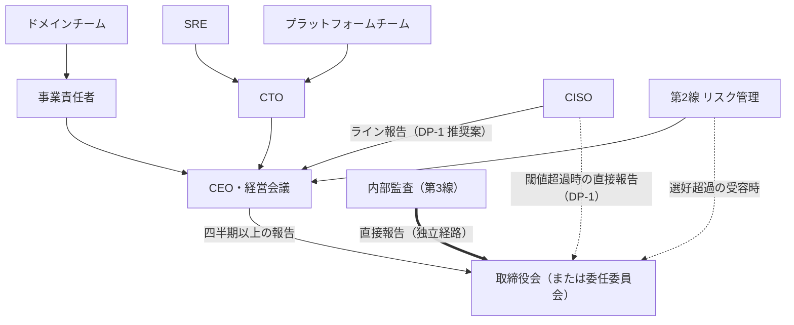

# ガバナンス規程・RACI

> 文書ID: GOV-05 / 版: 0.1 / 状態: draft / 最終更新: 2026-10-03
> 対応要求: R-007, R-014, R-015, R-019, R-020, R-054, R-218, R-224, R-226, R-227, G-031
> 依存文書: CONVENTIONS.md, traceability/deliverables.md（DL-04）, traceability/R-requirements.md, traceability/G-goal-criteria.md, traceability/dissent-log.md（DS-02〜DS-05）, 01_governance/assumptions-register.md（A-050〜A-054）, research/RS-01-governance-risk.md, research/RS-16-parallel-development-governance.md, research/RS-17-integration-patterns-modeling.md（§3.15）, research/RS-07-authz-engines-consistency.md（RS-07#18, #39〜#41）, research/RS-05-root-of-trust-keys-supply-chain.md（RS-05#12, #51, #53, #78）, research/RS-12-incident-casebook.md（RS-12#13）。関連: 01_governance/stop-authority.md（DL-46）, 01_governance/exception-risk-acceptance.md（DL-05）, 01_governance/risk-appetite-draft.md（DL-01）, 01_governance/kri.md（DL-06）, 08_operations/operating-model.md（DL-27）, 09_assurance/independent-assurance-plan.md（DL-07）, 10_integration/authz-modeling-guide.md（DL-65）, 00_decision/05-residual-risk-register.md（DL-41）

本書は AI エージェント（Claude）が起草した規程案であり、経営会議・取締役会の承認を経ていない [D][^1]。RACI、決裁権、説明責任条項はすべて決裁案であり、決定済みのものはない [D]。値を置けない項目は「TBD（所有者・期限・決め方）」とした [D]。

---

## 0. 結論

1. **リスクの所有者は第1線（経営・事業責任者）に置き、CISO と内部監査を残余リスクの受容者にしない** [D]。IIA の Three Lines Model は、第1線の経営がリスクを所有・管理して最終的に CEO が取締役会に説明責任を負い、サイバーセキュリティ等の第2線の専門機能は指導・支援・異議申立てを担うとする [N][^17]（RS-01#57）。内部監査責任者はリスク対応を決定してはならず、その説明責任も負ってはならない（must not）[N][^18]（RS-01#58）。
2. **受容権限は影響範囲で 3 段に分ける**（§4.2）[D]。単一ドメインに閉じて許容度内なら事業責任者、基盤横断・全テナント波及または許容度超過なら CEO（経営会議）、選好の超過は取締役会とする [D]。NIST IR 8286B-upd1 は、リスク対応の決定を承認できる権限階層を役割単位で ERM 方針に定めなければならない（must）とし、影響が大きいほど調整と監督の水準が上がるのが通例だとしている [N][^10]（RS-01#21）。段の境目の金額・停止時間は DL-01・DL-02 の確定まで TBD とする [D]。
3. **責任には決裁権・予算・人員・独立経路を対で付ける**（§4.1）[D]。CISO には受容権を与えない代わりに、ガードレール級変更と不可逆決定への同意権、受容票への異議記録権、取締役会（または委任委員会）への直接報告権、独立した予算枠を与える案を推奨する（DP-1・DP-2）[D]。
4. **説明責任は辞任ではなく、事象ごとの 4 区分の判定で問う**（§5）[D]。区分は「合理的統制後の残余」「過誤」「重大な管理不履行」「故意・虚偽」とし、前 2 区分では個人の処分も CTO/CISO の辞任も求めない [D]。線引きは EU の民間航空事故等報告規則の just culture 定義（経験と訓練に見合う行為は罰せず、重大な過失・故意の違反・破壊的行為は容認しない）[N][^24]を類推の雛形にする [D]。受容時点の判断過程の記録（E9）を合理性の証拠にする [D]。意思決定過程の合理性が責任判断の重要な考慮要素の一つになるという考え方は、コーポレートガバナンス・コード基本原則4の解釈指針にある [N][^19]（RS-01#62）。
5. **認可モデル（スキーマ）の変更は「ドメイン所有＋中央ガードレール」で分権する**（§6）[D]。ドメインの名前空間内の変更は、CI の自動ゲート（関係テスト、テナント越え否定テスト、破壊的変更の拒否、権限拡大の差分検査）とドメイン内 peer review で通す [D]。中央の審査は、横断型・テナント境界・ガードレールの変更と、権限拡大を検出した変更に限る [D]（RS-17#85〜#92、RS-16#57〜#60 から導出）。DORA の 2019 年調査は、より正式な外部レビューが変更失敗率の低さと関連するという仮説を支持する証拠は見つからなかったと報告している [M][^27]（RS-16#59。測定条件は §6.2）。
6. **本書が応える要求 11 件（R 10 件、G 1 件）のうち、本書だけで閉じたものはない** [D]。決裁案まで 10 件、要実測 1 件（R-054 二者統制）、要第三者 0 件である（§11）[D]。

---

## 1. 範囲・位置付け・前提

### 1.1 扱う範囲と扱わない範囲

| 本書で扱う | 他文書で扱う（本書は参照だけ） |
|---|---|
| 12 役割の責任分担（RACI）、3線モデルへの割当 | 停止権限・凍結・kill switch の権限者と発動条件（DL-46 01_governance/stop-authority.md） |
| 責任と対になる決裁権・予算・人員・独立経路 | 例外・リスク受容の手順と受容票の様式（DL-05 01_governance/exception-risk-acceptance.md） |
| 受容権限の階層の原則（段の数と受容者） | 段の境目の金額・停止時間（DL-01、DL-02） |
| 説明責任条項（4 区分、判定手続、報告者保護） | KRI と取締役会報告の様式（DL-06） |
| 認可モデル変更の決裁権の分権（所有境界、変更区分、承認者） | モデリング手順・命名規約・レビュー手順の詳細（DL-65）、オンボーディング各段階（DL-66） |
| 二者統制の担い手の指名（R-054 のうち組織決定の部分） | 鍵階層と ceremony 手順（DL-14）、管理面の設計（ADR-008、ADR-029）、実測（12_poc/） |
| 会議体と決裁経路 | on-call、FTE、採用計画、bus factor（DL-27）、独立保証の範囲と評価者（DL-07） |

- 停止権限は Gate 0 で単独の決裁対象にするため DL-46 に分離されている [D][^2]。本書の RACI は停止権限の行を持たず、DL-46 を参照する [D]。

### 1.2 前提

- 組織規模は前提台帳の A-050（依存サービス 300）、A-051（事業ドメイン 30）、A-052（開発組織 25・開発チーム 60）、A-053（開発者 1,500）、A-054（認証・認可プラットフォームチーム 24 FTE）を使う [A-050][A-051][A-052][A-053][A-054]。
- 前提台帳にない次の 4 点を本書は必要とする [D]。いずれも **新規仮定（前提台帳へ追加要）** である [D]。

| 番号 | 新規仮定（前提台帳へ追加要） | 本書で効く箇所 | 登録候補の出所 |
|---|---|---|---|
| 新規仮定① | 上場区分・SEC 登録の有無・NIS2 対象性と、取締役会の機関設計（監査等委員会・リスク委員会の有無） | 取締役会側の監督機関（DP-7）、内部監査の報告先、開示判断（RACI-29） | RS-01 §6 の登録候補①②③⑤ |
| 新規仮定② | CISO・第2線（リスク管理）・内部監査の現状の報告ラインと人員（As-Is） | DP-1、DP-2、§4.1 の人員欄 | 本書で追加 |
| 新規仮定③ | ドメインあたりの認可モデル変更の頻度（週あたり件数）と、そのうち権限拡大を伴う比率 | §6.2 の審査負荷、§6.6 の SLA | A-051 の感度欄が「中央での schema 審査の件数」に効くと記す[^5] |
| 新規仮定④ | 金融機関顧客の委託先になる範囲（金融庁ガイドラインの期待が契約で及ぶか） | §4.3 の CISO 任命 | RS-01 §6 の登録候補④ |

### 1.3 レビュー側の補正（dissent-log）の反映

| DS | 補正の要旨 | 本書での扱い |
|---|---|---|
| DS-02 | CTO の責務の出典（EY 調査）は方向が逆で、列挙も原文にない。CTO の責務を規範として定めた原典は性質上ない[^6] | CTO の責務は組織決定（閉じ方 B）として本書で定義する [D] |
| DS-03 | CISO の責務の出典は ISACA Journal の個人著者記事で、ISACA の公式見解ではない[^6] | CISO の責務範囲（R-224）は組織決定として §2.3 で定義する [D] |
| DS-04 | CISA の文書は当時の長官名義のブログで、アーカイブ扱い。[N]・[I] の根拠にしない[^6] | 「セキュリティを劣後させる判断は CEO・取締役会が所有する」は本書の設計判断 [D] として採り、ブログは同旨の参考として引くに留める |
| DS-05 | NACD は「取締役会が経営と協働して選好（appetite）を定義・承認する」と書いており、レビューの「取締役会が許容度を定め」は原典とずれる[^6] | 選好は取締役会承認（RACI-01）、許容度の設定主体は決裁案（DP-3）とする [D] |

---

## 2. 役割と3線モデル

### 2.1 役割の定義

表中の略号は §3 の RACI の列名に使う [D]。各行の割当は右端の根拠から導いた設計推論 [D] であり、セルごとのタグは本注記で代える。

| 略号 | 役割 | 線 | 中核の責任 | してはならないこと | 根拠 |
|---|---|---|---|---|---|
| 取 | 取締役会（または委任を受けた委員会。機関設計は新規仮定①） | 統治機関 | 選好の承認と定期見直し、四半期以上の報告の受領、経営の説明責任の追及、統治体制の年次評価の指示 | 個別統制の設計・運用 | RS-01#39〜#41, #57, #25 |
| 経 | 経営（CEO と経営会議） | 第1線の最上位 | 選好を統制・投資・手順へ翻訳、基盤横断リスクの所有、セキュリティを劣後させる判断の所有、予算と要員の確約 | リスクの所有を CISO 個人へ移すこと | RS-01#40, #57、DS-04 |
| IS | CISO | 第2線（評価・異議申立て）。CISO 組織のセキュリティ運用は第1線の活動（§2.2 注） | リスクの識別・評価と損失シナリオへの翻訳、セキュリティ要求基準の制定、監視・対応、独立保証の計画 | 残余リスクの受容、例外の単独承認（R-075） | RS-01#57, #43、review L27・L29 |
| TO | CTO | 第1線 | 実現性・費用・可用性の提示、技術リスク（R-218）の処置の所有、技術選定と不可逆 ADR | 残余リスクの単独受容（G-032） | review L15・L145、DS-02 |
| 事 | 事業責任者 | 第1線 | 自事業の残余リスクの受容、ドメイン側の移行要員と費用の確保 | 受容を指名代理人へ委任すること | review L145、RS-01#32〜#33（類推） |
| PF | プラットフォームチーム（認証・認可。チーム長を含む） | 第1線 | 基盤の設計・実装・運用、連携契約、横断型とガードレールの所有、自動ゲートの提供 | ドメインの業務上の意味論を決めること | RS-16#62〜#67、RS-17#96 |
| DM | ドメインチーム（ドメイン責任者を含む） | 第1線 | 自ドメインの認可モデル、PEP の組込み、関係テストと否定テスト | 横断型・テナント境界の変更 | RS-17#85, #96 |
| SRE | SRE | 第1線 | 可用性、on-call、本番変更の安全な実施、break-glass の実行 | 特権操作の単独実行 | A-054、RS-05#12 |
| RM | 第2線（リスク管理。CRO 機能） | 第2線 | ERM の枠組みと方法論、受容票の第2線レビュー、選好・許容度との照合、異議申立て | 受容の決定 | RS-01#19, #25, #57 |
| IA | 内部監査 | 第3線 | 独立保証（IIA Cybersecurity Topical Requirement の評価項目）、選好を超えた受容の取締役会へのエスカレーション | リスク対応の決定と、その説明責任を負うこと | RS-01#55, #56, #58 |
| 法 | 法務 | 第2線の専門機能 | 法域・規制・契約の適用性判定、開示・通知の法的判断、契約条項 | 技術選定の決定 | DL-34 |
| 調 | 調達 | 第1線の支援機能 | ベンダー契約への監査権・通知義務・出口条項・連携契約遵守の義務の組込み | 技術選定の決定 | RS-16 §2 結論6（契約試験の義務付け） |

- CFO と人事責任者は 12 役割に含めないが、予算と要員の行（RACI-30〜34）で実行者（R）になる [D]。前提台帳 §2.5 も両者を確定責任者の役割に挙げている[^5] [D]。
- 法務と調達の線の割当は、参照した原典に明記がなく、本書の設計推論である [D]。
- プラットフォームチームを「製品」として提供し、強制する範囲を絞る [D]。CNCF の Platforms White Paper は、利用者の feedback なしに機能を出したりトップダウンの強制で採用を進めたりする platform チームは利用者の抵抗と反発に遭うとしている [V][^28]（RS-16#65）。本書が強制するのは §6.5 のガードレールと §3 の受容経路に限る [D]。

### 2.2 3線モデルへの割当と報告経路

- 矢印は報告の向きを示す [D]。実線はライン、二重線は独立経路、点線は条件付きの直接経路である [D]。CISO のライン報告先は DP-1 の推奨案を描いた [D]。
- Three Lines Model は、取締役会が目的とリスク選好を定めて監督し、第1線の経営がリスクを所有・管理し、第2線の専門機能が指導・支援・異議申立てを行い、第3線の内部監査が独立した保証を提供するとしている [N][^17]（RS-01#57）。
- コーポレートガバナンス・コード（2026年7月版）の原則4-4は、取締役会が全社的リスク管理体制を整備すべきだとし、その解釈指針は内部監査部門を活用して運用状況を監督すべきだとしている [N][^19]（RS-01#60）。当社への適用は上場区分による（新規仮定①）[D]。
- **注（CISO 組織の二面性）**: CISO 組織が担う監視・インシデント対応は統制の運用であり、第1線の活動である [D]。CISO が自組織の運用を自ら評価すると自己評価になるため、CISO 組織の運用の有効性は第2線（RM）と第3線（IA）が評価する [D]。

### 2.3 CISO の責務範囲の RACI への写像（R-224）

レビューは CISO の責務をセキュリティアーキテクチャ・運用・ガバナンス・リスク・コンプライアンスにまたがるものとしている[^7] [D]。この範囲は出典が個人著者の記事であるため（DS-03）、本書の組織決定として採る [D]。

| 責務領域 | 対応する RACI 行 | CISO の記号 |
|---|---|---|
| セキュリティアーキテクチャ | RACI-17 不可逆 ADR、RACI-18 契約凍結、RACI-21 横断型・ガードレール | C+（同意） |
| 運用 | RACI-27 鍵 ceremony、RACI-28 特権操作・break-glass、RACI-29 侵害時の通知・開示 | R |
| ガバナンス | RACI-11 セキュリティ要求基準の制定、RACI-15 統治体制の年次評価 | A／C |
| リスク | RACI-03 重大損失シナリオの提示、RACI-05・06 報告、RACI-07〜10 受容への意見 | A／R／C（受容は A にしない） |
| コンプライアンス | RACI-13 独立保証計画、RACI-38 適用性判定 | A／C |

---

## 3. RACI

### 3.1 凡例と規則

| 記号 | 意味 |
|---|---|
| A | 説明責任（最終決定者）。1 行に 1 つだけ置く |
| R | 実行責任。複数可 |
| C | 協議（意見を求める。拒否権はない） |
| C+ | 同意を要する協議。同意がなければ実行しない。拒否された場合は §6.7・§8 の経路で A の上位者が決め、拒否理由を記録する |
| I | 報告を受ける |
| — | 関与しない |

- 規則 1: 残余リスク・例外の受容の行（RACI-07〜10）で、IS・TO・IA・RM を A にしない [D]（R-226、G-032、RS-01#57・#58 から導出）。
- 規則 2: 受容の A を指名代理人へ委任しない [D]。NIST SP 800-37 Rev.2 は、リスクの明示的な受容は Authorizing Official の責務であり組織内の他の役職者へ委任できないとしている [N][^12]（RS-01#32。連邦機関向けの規定で、民間への適用は類推）。
- 規則 3: 表のセルはすべて設計推論 [D] であり、根拠列の RS・A・DS の ID から導いた。セルごとのタグは本注記で代える [D]。

### 3.2 リスク統治

| ID | 決定・活動 | 取 | 経 | IS | TO | 事 | PF | DM | SRE | RM | IA | 法 | 調 | 根拠 |
|---|---|---|---|---|---|---|---|---|---|---|---|---|---|---|
| RACI-01 | リスク選好の策定・承認と年1回以上の見直し（DL-01、DEC-1） | A | R | R | C | C | — | — | — | R | I | C | — | RS-01#39, #57、DS-05 |
| RACI-02 | 許容度と KRI 閾値の設定（DL-01、DL-06。設定主体は DP-3） | I | A | R | C | C | — | — | C | R | I | C | — | RS-01#13, #16, #27 |
| RACI-03 | 重大損失シナリオの定量化と経営への提示（DL-02） | I | I | A | C | R | C | — | — | R | I | C | — | review L145、RS-01#41, #44 |
| RACI-04 | 技術リスク（可用性・変更容易性・運用能力・供給者依存・TCO・人材継続性）のリスク台帳への登録と処置計画（R-218、DL-41） | I | I | C | A | I | R | — | R | C | I | — | C | review L15、RS-01#17 |
| RACI-05 | 取締役会への定期報告（選好に対する露出、KRI、受容の状況） | I | A | R | R | C | — | — | — | R | I | — | — | RS-01#41, #63 |
| RACI-06 | 臨時報告（lagging KRI 超過、重大インシデント、受容期限の超過） | I | A | R | R | R | — | — | C | R | I | C | — | RS-01#27, #41 |
| RACI-07 | 残余リスク・例外の受容（段1: 単一ドメイン、許容度内） | — | I | C | C | A | C | R | — | C | I | — | — | §4.2、RS-01#21 |
| RACI-08 | 残余リスク・例外の受容（段2: 基盤横断・全テナント波及、または許容度超過で選好内） | I | A | C | C | C | R | — | C | C | I | C | — | §4.2、RS-01#21, #22、DP-4 |
| RACI-09 | 残余リスクの受容（段3: 選好の超過。選好を超えるセキュリティ劣後判断を含む） | A | R | C | C | R | — | — | — | C | I | C | — | §4.2、RS-01#58、DS-04 |
| RACI-10 | 選好内でのセキュリティ劣後判断（費用・機能・速度をセキュリティより優先する判断） | I | A | C | C | R | — | — | — | C | I | C | — | DS-04、DL-05 |
| RACI-11 | セキュリティ要求基準（統制基準・ガードレール方針）の制定 | I | I | A | C | C | R | C | C | C | I | C | — | review L27、RS-01#5 |
| RACI-12 | 第2線のモニタリングと異議申立て（受容票レビュー、選好・許容度との照合） | I | I | R | C | C | C | C | C | A | I | — | — | RS-01#19, #57 |
| RACI-13 | 独立保証計画の承認と評価者の任命（DL-07、DEC-5） | I | I | A | C | I | C | — | — | C | C | — | R | DEC-5[^2]、G-007 |
| RACI-14 | 内部監査計画（サイバー領域）の承認と実施 | A | I | C | C | I | — | — | — | C | R | — | — | RS-01#55, #56, #60 |
| RACI-15 | 統治体制（保証機能の独立性を含む）の年次評価 | A | C | C | C | C | — | — | — | R | R | C | — | RS-01#40 |
| RACI-16 | 本書（GOV-05）の制定・改定 | I | A | C | C | C | I | I | I | R | C | C | I | G-031 |

- RACI-09・10 の IA は I だが、経営が選好・許容度を超えるリスクを受容したと内部監査責任者が判断した場合、上級経営層と協議し、必要に応じて取締役会へエスカレーションしなければならない（must）[N][^18]（RS-01#58）。この義務は RACI の記号によらず常に有効とする [D]。
- RACI-10 の受容票には、影響を受け得る顧客への可視性（通知の要否）を記載項目として持たせる（DL-05 で様式化）[D]（DS-04）。
- RACI-13 の評価者の独立性は内部監査が確認する（G-007 の判定方法）[D][^4]。

### 3.3 技術判断・変更

| ID | 決定・活動 | 取 | 経 | IS | TO | 事 | PF | DM | SRE | RM | IA | 法 | 調 | 根拠 |
|---|---|---|---|---|---|---|---|---|---|---|---|---|---|---|
| RACI-17 | 不可逆決定の ADR（DEC-3: ADR-001/007/013/021/022） | — | I | C+ | A | I | R | C | C | I | — | C | C | DEC-3[^2] |
| RACI-18 | 連携契約 v1 の凍結（DEC-8） | — | I | C+ | A | I | R | C | C | — | — | C | C | DEC-8[^2]、RS-16 §2 結論2 |
| RACI-19 | 契約の互換な変更、正誤表、疑義への回答 | — | — | I | I | — | A | C | I | — | — | — | — | RS-16#74 |
| RACI-20 | 契約の破壊的変更・非推奨・凍結日（契約変更審査会） | — | I | C | A | I | R | C | C | — | — | — | I | RS-16#57, #58, #73 |
| RACI-21 | 横断型（user・tenant・group）、テナント境界・越境共有の forbid ガードレールの変更（区分 M3） | — | — | C+ | I | — | A | C | I | I | — | — | — | RS-17#90, #96、RS-07#41 |
| RACI-22 | ドメイン名前空間内の追加的変更（自動ゲート合格、権限拡大の検出なし。区分 M0） | — | — | — | — | I | I | A・R | — | — | — | — | — | RS-17#85、RS-16#60 |
| RACI-23 | ドメイン名前空間内の変更で権限拡大を検出、または高リスク操作階層に関わるもの（区分 M1） | — | — | C | — | I | C | A・R | — | — | — | — | — | RS-17#92 |
| RACI-24 | 破壊的なモデル変更（データのある relation の削除、意味の変更、他ドメイン型の拡張。区分 M2） | — | — | I | C | I | R | A | C | — | — | — | — | RS-17#85, #88、RS-07#18 |
| RACI-25 | 名前空間の新設と所有者の変更 | — | — | I | — | C | A | R | — | — | — | — | — | RS-16 §5.1（ADR-021） |
| RACI-26 | 基盤の実装変更の本番展開 | — | — | I | A | — | R | I | R | — | — | — | — | RS-16#59, #60 |
| RACI-27 | オフライン root 鍵の ceremony、issuer 署名鍵の rotation（二者統制、§7） | — | — | R | A | — | R | — | C | I | I | — | — | RS-05#12, #78、DL-14 |
| RACI-28 | 管理面の特権操作・break-glass（二者承認、§7） | — | — | R | A | — | R | — | R | I | I | — | — | RS-05#12 |
| RACI-29 | 侵害時の顧客通知・規制報告・開示の判断 | I | A | R | C | R | C | — | C | I | I | R | — | RS-01#46, #48, #64、RS-12#13 |

- RACI-17・18 の IS の C+ は、deliverables の DEC-3「CTO（アーキテクチャ審査会経由）＋CISO 同意」と DEC-8「CTO＋CISO」の承認者構成に合わせた [D][^2]。
- RACI-22〜24 の DM の A はドメイン責任者を指す [D]。他ドメインの型を拡張する変更（RACI-24）は、拡張される側のドメインの code owners も C とする [D]。
- RACI-27・28 の IA は承認者にならず、記録の確認だけを行う [D]。承認者になると後の保証で自らの関与を評価することになるためである [D]（RS-01#58 の独立性の考え方から導出）。

### 3.4 資源・調達・法務

| ID | 決定・活動 | 取 | 経 | IS | TO | 事 | PF | DM | SRE | RM | IA | 法 | 調 | 根拠 |
|---|---|---|---|---|---|---|---|---|---|---|---|---|---|---|
| RACI-30 | PoC 期間の予算上限と要員稼働率（DEC-4） | — | I | C+ | A | C | R | C | C | C | — | — | C | DEC-4[^2] |
| RACI-31 | 本番化以降の基盤の年次予算 | I | A | C | R | C | C | — | C | C | — | — | C | RS-01#5（GV.RR-03） |
| RACI-32 | セキュリティ予算（CISO 所管の監視・評価・保証。DP-2） | I | A | R | C | — | — | — | — | C | — | — | C | RS-01#5, #43 |
| RACI-33 | 内部監査の予算と要員 | A | C | — | — | — | — | — | — | — | R | — | — | RS-01#57 |
| RACI-34 | 基盤要員の確保（A-054）と bus factor 対策（詳細は DL-27） | I | A | C | R | — | C | — | C | — | — | — | — | A-054 |
| RACI-35 | ドメイン側の移行要員と移行時期 | — | I | — | C | A | C | R | — | — | — | — | C | RS-16#78 |
| RACI-36 | 製品・ベンダーの技術選定（ADR-001 等） | — | I | C | A | C | R | — | C | C | — | C | R | DEC-3[^2] |
| RACI-37 | 契約締結（監査権、通知義務、出口条項、連携契約と契約試験の遵守義務） | — | I | C | C | C | C | — | — | — | — | R | A | RS-16 §2 結論6 |
| RACI-38 | 法域・規制・契約の適用性判定（DL-34） | — | I | C | I | C | — | — | — | C | — | A | — | RS-01 §5.1 |
| RACI-39 | 顧客契約上の責任境界（顧客 IdP 侵害時、テナント管理者の誤操作時） | — | I | C | C | A | C | — | — | — | — | R | — | review L145 |

- CFO は RACI-30〜32 で R、人事責任者は RACI-34 で R とする [D]。
- RACI-30 の承認者構成は deliverables の DEC-4（CTO＋CISO＋CFO）に合わせた [D][^2]。
- RACI-35 を事業責任者の A にした理由は、多ベンダーの並行移行が要員不足で遅れた公表例があるためである [D]。デジタル庁の公表では、標準化対象 34,366 システムのうち 10,013（29.1%）が移行期限の 2025 年度末までに移行できず、主な要因は事業者のリソースひっ迫とされた [M][^31]（RS-16#78。測定条件: 総務省の標準化 PMO ツールによる集計、2026 年 3 月末時点）。

---

## 4. 責任と対になる権限（決裁権・予算・人員・独立経路）

### 4.1 対応表

レビューは、責任だけでなく決裁権・予算・人員・停止権限・リスク受容権者・独立監査経路を明文化するよう求めている[^7]（L31）[D]。下表は役割ごとにその対を示す [D]。停止権限は DL-46 で定める [D]。

| 役割 | 負う責任（A の行） | 決裁権 | 予算 | 人員 | 独立した報告・監査経路 |
|---|---|---|---|---|---|
| 取締役会 | RACI-01, 09, 14, 15, 33 | 選好の承認、選好超過の受容、内部監査計画の承認 | 内部監査予算の承認。額は TBD（所有者: 取締役会、期限: Gate 0、決め方: 内部監査責任者の計画から積上げ） | — | 内部監査から直接報告を受ける。CISO から閾値超過時に直接報告を受ける |
| 経営（CEO） | RACI-02, 05, 06, 08, 10, 16, 29, 31, 32, 34 | 段2の受容、選好内の劣後判断、年次予算と要員の確約 | 全社予算 | 全社要員 | 取締役会へ四半期以上の報告 |
| CISO | RACI-03, 11, 13 | セキュリティ要求基準の制定。RACI-17, 18, 21, 30 への同意権（C+）。受容票への異議の記録。**受容権なし** | 独立した予算枠（DP-2）。額は TBD（所有者: CFO＋CISO、期限: DEC-4、決め方: DL-07 と DL-27 の所要から積上げ） | CISO 組織の要員は TBD（所有者: CISO＋人事責任者、期限: Gate 0、決め方: DL-27。現状は新規仮定②） | 取締役会（または委任委員会）への直接報告権。発動閾値は TBD（所有者: CISO＋第2線、期限: Gate 0、決め方: DL-06 の KRI 閾値と連動）。報復禁止（§5.5） |
| CTO | RACI-04, 17, 18, 20, 26〜28, 30, 36 | 技術選定、不可逆 ADR（CISO 同意）、契約凍結、基盤の本番展開。**単独の受容権なし** | 基盤予算の執行 | 基盤チーム 24 FTE の確保責任 [A-054] | 経営会議へ報告。技術リスクは DL-41 に登録して可視化 |
| 事業責任者 | RACI-07, 35, 39 | 段1の受容と例外、移行時期 | ドメイン側の移行費用（配賦方式は DL-66・DL-43） | ドメインの移行要員 | 経営会議へ受容状況を報告 |
| プラットフォームチーム | RACI-19, 21, 25 | 横断型・ガードレール・名前空間、契約の互換な変更 | CTO から配分 | 24 FTE（内訳: 認証・IdP 5、認可・PDP 5、PEP SDK・開発者支援 4、SRE 6、鍵管理・セキュリティ 2、プロダクト・統制 2）[A-054] | ガードレールの安全性に関する懸念は CISO へ直接通報できる |
| ドメインチーム | RACI-22〜24 | 自名前空間内の M0〜M2 の変更 | 事業責任者から | 開発組織 25・開発チーム 60・開発者 1,500 の一部 [A-052][A-053] | 疑義窓口（DL-68）と §6.7 のエスカレーション |
| SRE | （R: RACI-26〜28） | 本番変更の中止・ロールバックの判断（権限の詳細は DL-46） | CTO から配分 | 6 FTE（基盤チームの内数）[A-054] | 事後レビューを第2線へ提出 |
| 第2線（RM） | RACI-12 | 受容票の差戻し（受容はしない） | TBD（所有者: CFO、期限: Gate 0、決め方: DL-27） | TBD（新規仮定②） | CRO 経由で経営へ、選好超過時は取締役会へ |
| 内部監査（IA） | （R: RACI-14, 15） | 監査の範囲・方法の決定 | 取締役会が承認（RACI-33） | TBD（新規仮定②） | 取締役会（または監査を所管する委員会）へ直接報告 |
| 法務 | RACI-38 | 法的解釈と開示要否の判断（RACI-29 の R） | — | — | 経営 |
| 調達 | RACI-37 | 契約締結 | — | — | 経営 |

- NIST CSF 2.0 は、役割・責任・権限が確立・伝達・理解・強制されること（GV.RR-02）と、リスク戦略に見合う資源配分（GV.RR-03）を成果として挙げている [N][^13]（RS-01#5）。上表はこの 2 つを役割単位で対にしたものである [D]。

### 4.2 受容権限の階層（原則）

| 段 | 条件 | 受容者（A） | 必須の協議 | 上位への報告 |
|---|---|---|---|---|
| 段1 | 影響が単一ドメインに閉じ、許容度内 | 事業責任者 | CISO の意見（異議の有無）、第2線レビュー | 四半期報告で集計 |
| 段2 | 複数ドメイン・基盤横断・全テナント波及、または許容度を超えるが選好内 | CEO（経営会議） | 段1に加え CTO、影響を受ける事業責任者、法務 | 次回の取締役会報告で個別に報告 |
| 段3 | 選好の超過（選好を超えるセキュリティ劣後判断を含む） | 取締役会 | 段2に加え内部監査の所見 | — |

- 段の境目（許容度・選好の金額、停止時間、影響テナント数）は DL-01・DL-02 で決める TBD である（所有者: CFO＋事業責任者＋CISO、期限: Gate 0、決め方: BIA（DL-21）と損失シナリオの定量化）[D]。
- 影響が大きいほど監督の水準を上げる構造は、IR 8286B-upd1 §2.3 に従う [N][^10]（RS-01#21）。同節は、上級経営層が知らないまま下位の管理者が重大なリスクを受容していたことで知られるようになったインシデントが多いと指摘している [N][^10]（RS-01#22）。
- 報告期間内に処置できない容認不可のリスクは暗黙に受容されたものとなり、「無視」は選択肢にならない [N][^10]（RS-01#22）。このため、期限を過ぎた未処置リスクは自動で一段上の受容者へ上げる [D]（手順は DL-05）。
- CTO・CISO の単独受容を 0 件にする（G-032）[D][^4]。
- 選好・許容度・キャパシティの区別は DL-01 で行う [D]。IR 8286Cr1 はキャパシティを組織が耐えられる最大のリスク量とし、選好・許容度に続く第三の要素としている [N][^11]（RS-01#28）。キャパシティを超える受容は段3でも行わず、計画の中止または変更（DL-42 の Plan B）に回す案を DL-01 に申し送る [D]。

### 4.3 CISO の独立した経路

- NACD・ISA のハンドブック（第5版、2026）は、取締役会と CISO の間の報告ラインの確立・維持を原則3の成功指標とし、Tool J で、CISO が取締役会への直接の報告ラインを持つか、CIO 等を経由して情報が濾過されていないか、必要な資源があるか、直接連絡を発動する閾値は何かを取締役会が確認すべき点として挙げている [N][^14]（RS-01#43。非拘束の業界指針）。
- 英国の Cyber Governance Code of Practice は、少なくとも四半期ごとの正式報告と指標ごとの許容度の合意（E2）、CISO 等との定期的な双方向の対話（E3）を取締役会の行動として挙げている [N][^20]（RS-01#63。法的拘束力の記載はない）。
- 金融庁の「金融分野におけるサイバーセキュリティに関するガイドライン」は、CISO 等を経営陣の責任において任命することを基本的な対応事項に挙げている [N][^21]（RS-01#65）。当社がこの期待を契約で受けるかは新規仮定④による [D]。
- 以上から、CISO には (a) 経営陣が任命し、(b) 閾値を超えたときは経営を経由せず取締役会（または委任委員会）へ直接報告でき、(c) 報告によって不利益を受けない経路を与える [D]。ライン報告先は DP-1 で決める [D]。

### 4.4 内部監査の独立経路

- IIA の Cybersecurity Topical Requirement（2026-02-05 発効）は、内部監査が、サイバーリスク管理の説明責任と責任の確立、容認できない水準に達したリスクを迅速にエスカレーションする仕組みの有無などを必ず評価するとしている [N][^16]（RS-01#55, #56）。本書の RACI・受容階層・エスカレーション経路は、この評価の対象証跡になる [D]。
- 内部監査は受容者・承認者にならない（RACI 規則 1、RACI-27・28 の注）[D]。経営が選好・許容度を超えて受容したと判断した場合のエスカレーション義務は RS-01#58 のとおりとする [N][^18]。
- NACD は、保証機能の独立性を含む統治体制を少なくとも年1回評価させることを挙げている [N][^14]（RS-01#40）。本書では RACI-15 で取締役会を A とした [D]。

---

## 5. 説明責任条項

### 5.1 原則

1. 説明責任は、事象が起きたことではなく、事象に至る判断と行動が 4 区分のどれに当たるかで問う [D]。
2. 「瑕疵があれば CTO/CISO が辞任」を前提にしない [D]。レビューも、辞任の覚悟は良い統治モデルではないとし、意図的な無視・虚偽報告・重大な管理不履行と、合理的統制を尽くしても残るリスクを区別するよう求めている[^7]（L31）[D]。
3. 区分の基準は役職によらず同じに適用する [D]。CTO・CISO・事業責任者・開発者・ベンダー要員に同じ区分を使う [D]。
4. 受容されたリスクも、許容度内に留まっていることを測り続ける [D]。IR 8286r1 §3.6.2 は、受容済みと記録したリスクも許容度内に留まっていることを確かめるため測定する必要があるとしている [N][^8]（RS-01#20）。

### 5.2 4 区分

| 区分 | 定義 | 認証・認可基盤での例（仮置き） | 組織上の帰結 |
|---|---|---|---|
| R 合理的統制後の残余 | 承認済みの受容票（E9）の範囲内で、統制が設計どおり運用されていたのに生じた事象 | 受容した失効伝播の最大遅延の範囲内で起きた不正利用 | 個人の処分なし。受容者は判断を説明する責任を負う。受容の再評価と統制の改善を行う |
| E 過誤 | 経験と訓練に見合う判断・行動のなかで生じた誤り。手順は守られていた | CI の検査範囲外だったモデルの過剰許可。レビューでの見落とし | 個人の処分なし。事実に基づく事後レビューと手順・自動ゲートの改善 |
| G 重大な管理不履行 | 明白なリスクを著しく無視し、状況上明らかに必要な注意を払う職責を深刻に怠ったもの | lagging KRI の超過を定めた期限を過ぎても報告しない。期限切れの受容票を放置する。二者統制を恒常的に迂回する。既知の Critical を台帳に載せないまま本番化する | 人事上の措置の対象。権限の見直し。経営と取締役会へ報告 |
| W 故意・虚偽 | 統制の意図的な回避・無視。KRI・試験結果・受容票・監査ログ・対外表明の虚偽記載・改ざん・隠蔽。報告者への報復 | 試験結果の改ざん。誤りと認識した公表内容を定めた期限内に訂正しない | 懲戒・法的措置の対象。法務が開示・届出の要否を判断（RACI-29） |

- 区分 G と W の線引きは、EU 規則 376/2014 の定義を雛形にした [D]。同規則は just culture を「第一線の運用者その他の者が、その経験と訓練に見合う行為・不作為・判断について罰せられないが、重大な過失、故意の違反、破壊的行為は容認されない文化」と定義している（Art. 2(12)）[N][^24]。同規則は、報告者保護の適用除外として、故意の不正行為と、明白なリスクの明白かつ深刻な無視および状況上明らかに必要な注意を払う職業上の責任の重大な不履行を挙げている（Art. 16(10)）[N][^24]。さらに、各組織に just culture の原則をどう保証・実施するかを記した内部規則を、従業員代表と協議したうえで定めるよう求めている（shall、Art. 16(11)）[N][^24]。
- 同規則は EU の民間航空の事故等報告制度に適用されるもので、本基盤に適用されるものではない [D]。本書は、職責の不履行の重さで線を引く既存の規範の例として類推に使う [D]。
- 区分 W に「誤りと認識した公表の訂正の放置」を入れたのは、CSRB が、Microsoft が 2023-09-06 のブログの根本原因の記述の誤りを 2023 年 11 月に CSRB に認めながら 2024-03-12 まで訂正しなかったことを問題視したためである [I][^41]（RS-12#13）。訂正の期限は DL-24 で TBD とする（所有者: 法務＋CISO、期限: Gate 0、決め方: 顧客通知・規制報告の期限から逆算）[D]。
- 区分 W に「対外表明の虚偽」を入れたのは、統制状態の表示の正確さが個人の責任追及の焦点になった事例があるためである [D]。SEC は 2023-10-30、SolarWinds とその CISO 個人を、サイバーセキュリティ実務を誇張し既知のリスクを過小に示すか開示しなかったことで投資家を欺いたとして提訴した [I][^23]。SEC は 2025-11-20 に共同申立てで訴訟を with prejudice で取り下げ、この取下げが他の事件に対する立場を必ずしも反映しないとしている [I][^22]（RS-01#50）。訴えの内容は申立て段階の主張であり、事実認定ではない [D]。

### 5.3 判定基準と証拠

| 判定の問い | 区分 R・E を支える証拠 | 区分 G・W を示す兆候 |
|---|---|---|
| リスクは知られていたか、受容されていたか | 受容票（E9）に受容時点の情報・選択肢・理由・承認者・CISO の意見がある | 台帳・KRI に載っていたのに受容票も処置計画もない |
| 統制は設計どおり運用されていたか | CI ログ（E4）、署名付き policy スナップショット（E10）、二者統制の記録 | 必須ゲートの迂回記録、二者統制の単独実行 |
| エスカレーションは期限内に行われたか | KRI 超過から中間報告までの記録 | 期限超過の放置、報告経路の不使用 |
| 報告は正確だったか | 報告値と生データ（E5）の一致 | 報告値と生データの不一致、訂正の放置 |

- 判断過程の記録を合理性の証拠にするのは、コーポレートガバナンス・コード基本原則4の解釈指針が、意思決定が結果として損害を生じさせた場合の責任判断について、意思決定時点の意思決定過程の合理性が重要な考慮要素の一つになるとしているためである [N][^19]（RS-01#62）。法的効果の評価は法務の所管であり、本書では行わない [D]。
- IR 8286Cr1 は、leading KRI の超過は通常の定期報告で報告してよく（may）、lagging KRI の超過は何らかの中間的な連絡で伝えるべきだ（should）としている [N][^11]（RS-01#27）。区分 G の「期限内の報告」の期限は、lagging KRI ごとに DL-06 で TBD とする（所有者: 第2線＋CISO、期限: Gate 0、決め方: KRI ごとの影響の進み方から設定）[D]。

### 5.4 判定手続

1. 事実の確定: 事後レビューで事実関係を確定する [D]。この段階では区分を判定しない [D]。
2. 区分の判定: 区分判定会（§8）が §5.3 の証拠で判定する [D]。当事者と、当事者の指揮系統にある者は判定に加わらない [D]。
3. 異議: 当事者は判定に異議を申し立てられる [D]。申立て先は取締役会側の監督機関（DP-7）とする案を推奨する [D]。
4. 報告: 区分 G・W の判定は経営会議と取締役会へ報告する [D]。内部監査は手続の適正をレビューする [D]。
5. 整合: 本条項と就業規則・委託契約・役員の責任規定との整合は、法務と人事責任者が確認する TBD である（所有者: 法務＋人事責任者、期限: Gate 0、決め方: 規程・契約の条文照合）[D]。

### 5.5 報告者保護

- IR 8286r1 §3.6.1 は、従業員とパートナーが報復を恐れずにリスク状況を報告できる環境を育てることを Risk Transparency の要素に挙げている [N][^8]（RS-01#18）。NACD の Tool J も、エスカレーションを罰せず建設的に扱う文化を強調している [N][^14]（RS-01#43）。
- 本書では、区分 R・E に当たる事象とニアミスの自己報告を、それを理由に不利益に扱わない [D]。報告者への報復は区分 W とする [D]。ニアミスも報告させる考え方は CISA 長官（当時）のブログ[^15]と同旨だが、同ブログはアーカイブ扱いであり規範の根拠にはしない（DS-04）[D]。

---

## 6. 認可モデル（スキーマ）変更の分権統治

### 6.1 結論

- ドメインの resource type・relation・permission はドメインチームが所有し、名前空間内の変更はドメイン内で承認する [D]。
- 横断型、テナント境界、越境共有、ガードレール、名前空間の登録簿はプラットフォームチームが所有する [D]。
- 中央の関与は「自動ゲートの提供」「権限拡大の非同期レビュー」「横断・ガードレール変更の審査」に限り、全変更を通す中央審査会は置かない [D]（RS-17#96、RS-16#59〜#60 から導出）。
- 審査 SLA の値は PoC の実測で決め、決裁は CTO が行う（G-116 の判定者は CTO）[D][^4]。値の決め方は DP-6 に置く [D]。

### 6.2 中央一括審査にしない理由

1. 規模: 事業ドメイン 30・開発チーム 60 に対し、認可・PDP の要員は 5 FTE と仮置きしている [A-051][A-052][A-054]。全変更を中央で審査すると、1 人あたり 6 ドメイン・12 チームを受け持つ [D][A-051, A-052, A-054]。審査件数を見積もるための変更頻度は前提台帳にない（新規仮定③）[D]。
2. 先行事例の課題認識: OpenFGA の modular models の文書は、モデルが大きくなり多くのチームが関わると所有の境界が不明確になり、コードレビューの手順がスケールしないという課題を挙げ、モデルを複数のモジュールに分けて code owners でレビューの所有を表す機能を提供している [V][^32]（RS-17#85）。
3. 変更承認の調査結果: DORA は、変更承認は開発過程での peer review と、悪い変更を早期に検出・防止・是正する自動化で行うのが最もよいとし、チーム外の CAB 等による重い承認はソフトウェアのデリバリー性能に負の影響を与えたとしている [M][^26]（RS-16#59）。2019 年の報告本体は、より正式な外部レビューが変更失敗率の低さと関連するという仮説を支持する証拠は見つからなかったとしている [M][^27]（測定条件: 2019 年の質問票調査、回答者約 1,000 人、報告 p.7 の注記による誤差 3%。統計手法の詳細と効果量の信頼区間は RS-16 で未確認）。同じ文書は、職務分離の要求をチームの開発基盤に記録される peer review で満たすよう勧めている [M][^26]（RS-16#60）。
4. 規範上の要求は自動化と記録で満たせる: NIST SP 800-53 Rev.5 の CM-3 は、提案された変更をセキュリティとプライバシーの影響分析を明示的に考慮して承認または却下し、決定を文書化することを求めている [N][^25]（RS-16#57）。CM-3(4) は、組織が定めるセキュリティとプライバシーの代表者を変更管理の構成員にすることを求めている [N][^25]（RS-16#58）。本書では、影響分析を自動ゲート（§6.5）に、承認と記録を peer review の記録（E4）に、CM-3(4) の代表者を M1 のセキュリティレビュアーと契約変更審査会の CISO 代表に割り当てる [D]。
5. 疑義を律速にしない先例: デジタル庁の「標準仕様書の改定・運用について（基本的な考え方）」は、開発過程で事業者から出る解釈の確認や疑義について、開発のボトルネックとなることのないよう、改定プロセスを待たずに随時対応するとしている [N][^29]（RS-16#74）。

### 6.3 所有境界

| 対象 | 所有者 | レビューの所有（code owners） | 根拠 |
|---|---|---|---|
| 横断型（user、tenant、group）、テナント境界の forbid、越境共有（ADR-024） | プラットフォームチーム | プラットフォームチーム＋CISO が指名するレビュアー（2 名以上の合意） | RS-17#96、RS-05#78 |
| 名前空間の登録簿（命名、所有ドメイン） | プラットフォームチーム | プラットフォームチーム | RS-16 §5.1（ADR-021） |
| ドメインの resource type・relation・permission | ドメインチーム | 当該ドメインの code owners | RS-17#85 |
| 他ドメインの型の拡張（type extension） | 拡張する側のドメインチーム | 拡張する側と拡張される側の双方の code owners | RS-17#85 |
| 共有の意味論（除外・limited access に相当する型） | プラットフォームチーム | プラットフォームチーム | RS-17#96 |
| 自動ゲートの規則そのもの | プラットフォームチーム | プラットフォームチーム＋CISO 指名レビュアー | §6.5 |

- OpenFGA の type extension では、追加する関係が既存の関係や他の拡張と重複してはならない [V][^32]（RS-17#85）。他ドメインの型の拡張に双方の code owners を置くのは、この制約の違反を両側で見るためである [D]。

### 6.4 変更区分と承認

| 区分 | 条件（自動判定） | 承認 | 中央の関与 | 記録 |
|---|---|---|---|---|
| M0 追加的 | type・relation・permission の追加。全ゲート合格。権限拡大の検出なし | 作成者以外のドメイン内 peer review | なし（通知だけ） | CI ログ（E4） |
| M1 権限拡大 | 差分検査が新しいアクセス経路を検出、または高リスク操作階層（DL-09）の permission に関わる | M0 に加え、プラットフォームチームのセキュリティレビュアーの非同期レビュー | SLA 付きの非同期レビュー | CI ログとレビュー記録 |
| M2 破壊的 | データのある relation の削除、参照中の relation・permission の削除、意味の変更、他ドメイン型の拡張 | 多段階の移行手順と新旧モデルの shadow check を経て、プラットフォームチームが手順を確認 | 移行手順の確認 | 移行記録、shadow 差分 |
| M3 横断・ガードレール | 横断型、テナント境界、越境共有、ガードレール、自動ゲート規則の変更 | プラットフォームチーム 2 名以上の合意＋CISO の同意（C+）。契約に影響するものは契約変更審査会 | 審査 | 二者合意の記録、署名付きスナップショット（E10） |

- M2 の多段階手順は SpiceDB の文書に倣う [D]。SpiceDB は、データがある relation の削除や、他の relation・permission から参照されている relation・permission の削除を拒否し、relation を移す場合は新しい relation の追加、二重書込み、backfill、旧 relation の参照削除、旧 relation の削除という手順を示している [V][^34]（RS-17#88）。
- M2 の shadow check は、OpenFGA が認可モデルを不変とし、本番では `authorization_model_id` を渡すことを強く推奨（"strongly recommend"）し、新旧モデルの shadow check と段階的な rollout の考え方を示していることに倣う [V][^38]（RS-07#18）。
- M3 の 2 名以上の合意は、SLSA v1.2 の Source Track L4 が保護ブランチへの変更に提出前の 2 名以上の信頼された者の合意を MUST とすることに倣う [N][^40]（RS-05#78）。
- CISO は M0・M1 を直接止めない [D]。止めたい類型があれば、自動ゲートの規則の変更（M3）として提案する [D]。個々の変更を CISO の承認待ちにすると、中央一括審査と同じ律速が生じるためである [D]（§6.2 から導出）。

### 6.5 中央ガードレール（CI の必須ゲート）

| ゲート | 内容 | 根拠 |
|---|---|---|
| 1 スキーマ検証と entity 完全性 | 要求が参照する entity・属性の欠落を検出する。error になった policy を判定から外すエンジンでは、forbid ガードレールが黙って無効になり得るため | RS-07#39〜#41 |
| 2 関係テスト | 全 relation の肯定・否定テストと、テナント越えの否定テストを合格条件にする | RS-17#86, #87 |
| 3 破壊的変更の拒否 | データのある relation の削除など M2 の類型を検出し、移行手順なしの適用を拒否する | RS-17#88 |
| 4 権限拡大の差分検査 | 変更前後で新しいアクセスが生じるかを検査し、検出したら M1 に回す | RS-17#92 |
| 5 deny 優先 | プラットフォーム所有の forbid を先に評価し、条件を評価できない場合は deny にする | RS-17#90 |
| 6 版の固定 | モデル ID を固定し、新旧の shadow 比較を行う | RS-07#18 |

- ゲート 1 の根拠: Cedar は、評価が error になった policy は判定に関与しない（skip される）としている [V][^37]（RS-07#39）。RS-07 は、forbid ガードレールが参照する entity や属性が要求に含まれていないと、その forbid が skip され、ほかの permit で許可になり得ると推論している [D]（RS-07#41）。
- ゲート 2 の根拠: OpenFGA は、すべてのモデルはデプロイ前にテストすべきだとし、良いテストは全ての関係を検証すると述べている [V][^33]（RS-17#86）。
- ゲート 4 の根拠: AWS IAM Access Analyzer の custom policy check は、更新後のポリシーが既存版に比べて新しいアクセスを許すかを検査できる（CheckNoNewAccess）[V][^36]（RS-17#92）。本書はこの考え方を自社のモデル差分検査に適用する [D]。
- ゲート 5 の根拠: Google Cloud IAM は関係する deny policy を allow policy より先に必ず評価し、deny rule の条件が true になるか評価できない場合は deny rule を適用する [V][^35]（RS-17#90）。
- ゲートの実装方式と製品の選択は ADR-010・ADR-011・DL-65 で決める [D]。

### 6.6 審査 SLA とボトルネックの監視

- 監視する指標の候補は、M1 レビューの待ち時間（p50・p90）、未処理件数、全変更に占める M0 の比率、ゲート別の拒否件数、本番展開後に見つかった認可の誤りの件数である [D]。K-xx の採番と閾値は DL-06 で行う [D]。
- SLA の値は TBD である（所有者: プラットフォームチーム長、期限: Gate 3、決め方: パイロット 2〜3 サービスの PoC でモデル登録の所要時間を実測し、SLI-xxx として DL-20 に置く。RS-16 §5.2 の実測項目7と同じ）[D]。
- SLA 違反が続いた場合の是正の順序は、(1) 検査の自動化を増やして M1 の対象を狭める、(2) M0 の条件を広げる（CISO の同意を要する M3 変更）、(3) レビュアーを増やす、とする [D]。人を増やすことを最後に置くのは、要員が A-054 の仮置き内で固定されているためである [D][A-054]。

### 6.7 不一致時のエスカレーション

| 不一致 | 一次判断 | エスカレーション先 | 記録 |
|---|---|---|---|
| M1・M2 でドメインチームとプラットフォームチームの見解が分かれる | プラットフォームチームはゲート規則に基づく理由がある場合だけ差し戻せる | アーキテクチャ審査会（A: CTO）。期限は TBD（所有者: CTO、期限: Gate 3、決め方: §6.6 の SLA と同時に設定） | 差戻し理由と裁定 |
| M3 で CISO が同意しない | — | CTO が進める場合は経営（RACI-10 の経路）が CISO の異議を記録したうえで決める。選好を超える場合は取締役会（RACI-09） | CISO の異議、決定理由 |
| ドメインの業務上の要件とガードレールが衝突する | プラットフォームチーム | 例外として受容階層（§4.2）で扱う | 受容票（DL-05） |

---

## 7. 二者統制の担い手（R-054）

NIST SP 800-53 Rev.5 には、特権コマンドの二者承認（AC-3(2)）と、変更実施の二者承認（CM-5(4)）の統制がある [N][^39]（RS-05#12）。本書は、二者統制の 2 人を別々の報告系統から指名する [D]。技術的な実現（HSM の quorum、承認フロー）は DL-14・ADR-008・ADR-029 で定める [D]。

| 操作 | 承認者1 | 承認者2（別の報告系統） | 禁止する組合せ | 記録 |
|---|---|---|---|---|
| オフライン root 鍵の生成・署名・破棄（ceremony） | プラットフォームチームの鍵管理担当 | CISO 組織の鍵管理担当 | 同じ報告系統の 2 人 | ceremony 記録。第三者の立会いは DL-14 |
| issuer 署名鍵の rotation、JWKS 公開経路の変更 | プラットフォームチーム | SRE | 変更の作成者による自己承認 | 変更記録（E10） |
| ガードレール・横断型のリポジトリへの merge（M3） | プラットフォームチームのレビュアー | CISO が指名するレビュアー | 作成者自身の承認 | SLSA Source L4 相当の二者合意の記録 |
| 管理面の特権操作・break-glass | SRE の on-call | CISO 組織の当番 | 同一人物による連続した承認 | セッション記録。事後に第2線がレビュー |

- HSM の quorum には製品機能がある [D]。AWS CloudHSM の quorum 認証は承認者数を 2〜8 で設定できる [V][^42]（RS-05#51）。Azure Key Vault Managed HSM の security domain は、顧客が提供する 3 つ以上の RSA 鍵対と quorum で暗号化される [V][^43]（RS-05#53）。採用する製品と quorum の値は DL-14 で TBD とする（所有者: CTO＋CISO、期限: Gate 3、決め方: ADR-007 の選定と ceremony 設計）[D]。
- 内部監査は承認者にならず、記録の確認だけを行う（§3.3 の注）[D]。
- R-054 は、鍵操作を 1 名では実行できないことを試験または ceremony 記録で示すまで閉じない（閉じ方 C。担い手の指名は B）[D][^3]。試験の TC は未採番であり、12_poc/preregistered-test-plan.md で採番する [D]。

---

## 8. 会議体と決裁経路

| 会議体 | 議長 | 構成 | 開催 | 決めるもの | 上位への報告 |
|---|---|---|---|---|---|
| 取締役会（または委任委員会。DP-7） | 取締役会議長（または委員長） | 取締役。内部監査責任者と CISO は報告者 | 四半期以上、重大事象の後は臨時 | RACI-01, 09, 14, 15, 33 | — |
| 経営会議（サイバーリスク審議） | CEO | 経営陣、CISO、CTO、事業責任者、第2線、法務 | 取締役会報告の前に四半期以上 | 段2の受容、劣後判断、予算・要員、本書の改定 | 取締役会 |
| アーキテクチャ審査会（ARB） | CTO | プラットフォームチーム長、SRE 責任者、CISO 代表、ドメイン代表 | TBD（所有者: CTO、期限: Gate 0、決め方: 不可逆 ADR の予定数から設定） | 不可逆 ADR（DEC-3）、M1・M2 の裁定 | 経営会議 |
| 契約変更審査会 | プラットフォームチーム長 | CISO 代表、SRE、consumer 側の開発組織の代表 | 年 2 回の固定日（案）と緊急時 | 契約の破壊的変更・非推奨・凍結日（RACI-20 の R） | ARB |
| 区分判定会（§5.4） | 第2線の責任者 | 第2線、法務、人事責任者。当事者の指揮系統の者は除く | 事案ごと | 説明責任の区分 | 経営会議・取締役会（区分 G・W） |

- 取締役会への報告を四半期以上とするのは、NACD が少なくとも四半期ごとの報告と重大インシデント直後の報告を挙げ [N][^14]（RS-01#41）、英国 Code が少なくとも四半期ごとの正式報告を挙げている [N][^20]（RS-01#63）ためである [D]。
- 契約変更審査会の構成に CISO 代表と consumer 側の代表を入れるのは、CM-3(4) がセキュリティ・プライバシーの代表者を構成員にすることを求め、CM-3 の discussion が新規システムや大規模更新では開発組織の代表を入れることを検討するとしている [N][^25]（RS-16#58）ためである [D]。
- 年 2 回の固定日は、自治体の標準仕様書の改定時期を原則として毎年 8 月 31 日または 1 月 31 日とする先例に倣った案である [N][^30][^29]（RS-16#73）。値は DL-70 の非推奨期間と合わせて DEC-8 で決める [D]。

---

## 9. 決裁案

決裁案はすべて未決定である [D]。期限のゲートは DL-42 の Gate 番号による [D]。

### DP-1 CISO のライン報告先

| 選択肢 | 帰結 |
|---|---|
| (a) CEO 直属、取締役会への直接報告権つき | CTO の判断（RACI-17, 18, 30）への同意権と異議が、CTO の評価系統の外から行われる [D]。CEO の管理範囲が広がる [D] |
| (b) CTO（または CIO）配下、取締役会への直接報告権つき | 組織変更が小さい [D]。NACD Tool J が確認点に挙げる「CIO 等を経由した情報の濾過」の懸念が残る [N][^14][D] |
| (c) CRO（第2線）配下 | 第2線としての位置付けは明確になる [D]。CISO 組織の運用（第1線の活動）との距離が開く [D] |

- 推奨: (a) [D]。CISO が同意・異議を行う相手（CTO）の評価系統に属さないためである [D]。
- 決める人: CEO（取締役会が確認）[D]。期限: Gate 0 [D]。現状の報告ラインは新規仮定②である [D]。

### DP-2 セキュリティ予算の独立枠

| 選択肢 | 帰結 |
|---|---|
| (a) CISO 所管の独立した予算枠（監視・評価・独立保証） | 独立保証（DL-07）と監視の費用が基盤の費用削減と競合しない [D] |
| (b) CTO の基盤予算内で用途を固定（ring-fence） | 予算管理は単純になる [D]。削減の判断が CTO の系統で行われる [D] |

- 推奨: (a) [D]。CSF 2.0 GV.RR-03 は、リスク戦略に見合う資源配分を成果として挙げている [N][^13]（RS-01#5）。
- 決める人: CEO と CFO [D]。額は §4.1 の TBD [D]。期限: DEC-4 [D]。

### DP-3 許容度の設定主体（DS-05）

| 選択肢 | 帰結 |
|---|---|
| (a) 経営（CEO）が選好の範囲内で設定し、取締役会へ報告 | IR 8286Ar1 の「許容度は上級経営層が定めた境界内に留まるべき」（should）[N][^9]（RS-01#13）と整合する [D] |
| (b) 取締役会が選好と同時に承認 | 取締役会の負担が増え、閾値の改定が遅くなる [D] |

- 推奨: (a) [D]。ただし、許容度を緩める変更は取締役会へ個別に報告する [D]。
- 決める人: 取締役会 [D]。期限: Gate 0（DEC-1）[D]。

### DP-4 基盤横断の残余リスクの受容者（段2）

| 選択肢 | 帰結 |
|---|---|
| (a) CEO（経営会議）が受容 | 影響の大きさに応じて監督水準を上げる IR 8286B の構造と整合する [D]。経営会議の議題が増える [D] |
| (b) 共通基盤を担当する執行役員（CTO 以外）を指名 | 判断は速くなる [D]。全事業への影響を一人が受容することになる [D] |
| (c) 利用する事業責任者の合議 | 合意形成に時間がかかり、一社でも反対すると決まらない [D] |

- 推奨: (a) [D]。CTO を受容者にしないのは G-032 による [D][^4]。
- 決める人: CEO [D]。期限: Gate 0 [D]。

### DP-5 説明責任条項（§5）の採否と区分判定会

- 選択肢: (a) §5 の 4 区分と区分判定会を採用、(b) 区分を採用し判定を人事部門の通常手続に委ねる、(c) 採用しない [D]。
- 推奨: (a) [D]。(b) では §5.3 の技術的証拠（E4・E9・E10）の評価者がいない [D]。(c) ではレビュー L31 の要求（R-020）が閉じない [D]。
- 帰結: 区分判定会の運営負荷が生じる [D]。就業規則・委託契約との整合作業が要る（§5.4-5）[D]。
- 決める人: CEO（取締役会が確認）[D]。期限: Gate 0 [D]。

### DP-6 認可モデル変更の分権（§6）と審査 SLA の決め方

- 選択肢: (a) §6 の M0〜M3 と自動ゲートを採用し、SLA は PoC 実測で決める、(b) 全変更を中央の審査会で承認する、(c) 中央の審査を置かずドメインに全面委任する [D]。
- 推奨: (a) [D]。(b) は §6.2 の理由で律速になる [D]。(c) ではテナント境界と横断型の所有者がいなくなる [D]（RS-17#96 から導出）。
- 帰結: 自動ゲートの構築がプラットフォームチームの作業になり、A-054 の PEP SDK・開発者支援 4 FTE と認可・PDP 5 FTE の配分に効く [D][A-054]。
- 決める人: CTO（CISO 同意）[D]。期限: Gate 3（G-116 は段階3）[D][^4]。

### DP-7 取締役会側の監督機関

- 選択肢: (a) 取締役会全体、(b) 監査を所管する委員会、(c) リスク委員会 [D]。
- 推奨: 機関設計（新規仮定①）が決まるまで推奨を置かない [D]。
- 帰結: 内部監査の報告先と CISO の直接報告先がこの選択で決まる [D]。
- 決める人: 取締役会 [D]。期限: Gate 0 [D]。

---

## 10. 本書の運用

- 本書の制定・改定は経営会議が承認し（RACI-16）、取締役会へ報告する [D]。承認記録は E1、版管理された承認記録は E2 とする（G-133）[D][^4]。
- 次の場合に見直す [D]。組織変更、重大インシデント、規制の変更、選好・許容度の改定、統治体制の年次評価（RACI-15）の所見である [D]。IR 8286r1 は、規制の変更を含むリスク環境の変化が選好・許容度・KPI・KRI の定期的な見直しを要し得る（may require）としている [N][^8]（RS-01#20）。
- 本書の起草は AI エージェントが行った [D]。第2線と内部監査による事前閲読と所見（G-039）は未実施である [D][^4]。

---

## 11. 対応表

### 11.1 本書が対応成果物に指定された要求

| ID | 要求（要旨） | 本文の節 | 閉じ方 | 状態 | 閉じるために残ること |
|---|---|---|---|---|---|
| R-007 | 残余リスク受容者の指名 | §3.2 RACI-07〜09、§4.2、DP-4 | B | 決裁案まで | 経営会議の承認（E1）。受容票の運用は DL-05、台帳は DL-41 |
| R-014 | CISO＝リスク提示、CTO＝実現性・費用・可用性、事業責任者＝残余リスク受容 | §0、§2.1、§3.2 RACI-03・07〜10、§3.4 RACI-30 | B | 決裁案まで | 経営会議の承認（E1） |
| R-015 | RACI | §3 | B | 決裁案まで | 経営会議の承認（E1） |
| R-019 | 責任と対になる決裁権・予算・人員・独立監査経路 | §4、DP-1、DP-2 | B | 決裁案まで | 予算額・人員数の確定（TBD）、DP-1・DP-2 の決定 |
| R-020 | 故意・虚偽・重大な管理不履行と合理的統制後の残余リスクの区別（辞任型にしない） | §5、DP-5 | B | 決裁案まで | DP-5 の決定、就業規則等との整合（§5.4-5） |
| R-054 | 二者統制 | §7、§3.3 RACI-27・28 | C（担い手の指名は B） | 要実測 | 鍵操作を 1 名で実行できないことの試験または ceremony 記録（TC 未採番） |
| R-218 | CTO が引き受ける技術リスクをリスク台帳に登録し所有者を明示 | §3.2 RACI-04、§4.1 | B | 決裁案まで | 経営会議の承認と DL-41 への登録 |
| R-224 | CISO の責務範囲を RACI に反映 | §2.3 | B | 決裁案まで | 経営会議の承認（E1） |
| R-226 | サイバーリスクの最終所有者を CISO 個人に帰属させない | §0-1、§2.1、§3.1 規則1、§4.2 | B | 決裁案まで | 経営会議の承認（E1） |
| R-227 | 取締役会が選好を定め、経営がリスクベースのプログラムを実行する分担の規程化 | §1.3（DS-05）、§2.1、§3.2 RACI-01・02・05、DP-3 | B | 決裁案まで | 取締役会による DP-3 の決定 |
| G-031 | 役割分担、決裁権・予算・人員・停止権限・独立監査経路、区別の規程承認と、劣後判断を CEO/取締役会が所有する経路 | 本書全体。停止権限は DL-46、劣後判断の経路は RACI-09・10 と DL-05 | B | 決裁案まで | 経営会議による本書・DL-46・DL-05 の承認記録（E1） |

**件数**: 本書で閉じた 0 件／決裁案まで 10 件／要実測 1 件／要第三者 0 件（計 11 件。R 10 件、G 1 件）[D]。

### 11.2 関連要求（他成果物が所管。本書は入力を渡すだけで、件数に含めない）

| ID | 所管 | 本書が渡す入力 |
|---|---|---|
| R-017 停止権限 | DL-46 | 停止を発動・解除する役割の候補（RACI の A・R） |
| R-021 劣後判断の CEO/取締役会所有 | DL-05 | RACI-09・10、§4.2 段3 |
| R-075 例外は経営承認のみ（CISO 単独不可） | DL-05 | §3.1 規則1、§4.2 |
| R-136・R-140 責任分界・変更承認 | DL-27、DL-66 | §3.3、§6.4 の変更区分 |
| G-032 CTO・CISO 単独受容 0 件 | DL-41、DL-05 | §3.1 規則1 |
| G-033 評価者の独立と停止規則 | DL-07、DL-46 | RACI-13、§4.4 |
| G-039 第2線・内部監査の事前閲読 | DL-109、DL-07 | §10（本書も閲読対象） |
| G-053 中央チームが律速にならない審査 SLA | DL-66、DL-43 | §6.6 |
| G-116 ドメイン名前空間での設計と中央審査の限定 | DL-65、DL-66 | §6.3〜§6.6、DP-6 |

---

## 12. 残課題

| # | 本書で閉じないもの | 担当 | 閉じるゲート |
|---|---|---|---|
| 1 | 本書の経営会議承認と取締役会への報告（E1） | 経営会議（起案: 第2線） | Gate 0 |
| 2 | DP-1〜DP-5、DP-7 の決定 | §9 の各「決める人」 | Gate 0 |
| 3 | DP-6 の決定と M1 審査 SLA の値（PoC 実測） | CTO（CISO 同意）、プラットフォームチーム長 | Gate 3 |
| 4 | 受容階層の段の境目（金額・停止時間・影響テナント数） | CFO＋事業責任者＋CISO（DL-01・DL-02） | Gate 0 |
| 5 | CISO の直接報告の発動閾値、lagging KRI ごとの報告期限 | CISO＋第2線（DL-06） | Gate 0 |
| 6 | CISO 組織・第2線・内部監査の予算額と人員数 | CFO＋人事責任者 | Gate 0／DEC-4 |
| 7 | 新規仮定①〜④の前提台帳への登録 | 前提台帳（DL-45）の確定責任者 | Gate 0 |
| 8 | 説明責任条項と就業規則・委託契約・役員の責任規定の整合 | 法務＋人事責任者 | Gate 0 |
| 9 | 誤った公表・報告の訂正期限 | 法務＋CISO（DL-24） | Gate 0 |
| 10 | 二者統制の試験または ceremony 記録（R-054） | プラットフォームチーム＋CISO（DL-14、12_poc/） | Gate 4 |
| 11 | 区分判定会の机上演習（判定に要する証拠を監査データから取り出せるか） | 第2線 | Gate 4 |
| 12 | 第2線と内部監査による本書の事前閲読と所見（G-039） | 内部監査責任者 | 決裁パッケージ提出前 |

- 上表の未達項目は DL-110（traceability/open-items.md）で追跡する [D]。

---

## 参考文献

[^1]: 本リポジトリ『執筆規約（全成果物共通）』. CONVENTIONS.md （参照箇所: §1 メタ情報, §3 主張タグ, §5 禁止表現, §6 閉じ方の区分, §8 誠実性、確認日: 2026-10-03）
[^2]: 本リポジトリ『成果物計画（マスターファイル計画）』版 0.1・2026-10-03. traceability/deliverables.md （参照箇所: §3 DL-04・DL-05・DL-07・DL-27・DL-46, §6.1 DEC-3・DEC-4・DEC-5・DEC-8, §8 01_governance、確認日: 2026-10-03）
[^3]: 本リポジトリ『原子要求追跡表』版 0.2・2026-10-03. traceability/R-requirements.md （参照箇所: R-007, R-014, R-015, R-019, R-020, R-054（critic修正）, R-218, R-224, R-226, R-227 の各行、確認日: 2026-10-03）
[^4]: 本リポジトリ『/goal 受入基準』版 0.2・2026-10-03. traceability/G-goal-criteria.md （参照箇所: G-007, G-031, G-032, G-033, G-039, G-053, G-116, G-133 の各行、確認日: 2026-10-03）
[^5]: 本リポジトリ『前提台帳』版 0.1・2026-10-03. 01_governance/assumptions-register.md （参照箇所: §2.5 確定責任者として使う役割, §5 A-050〜A-054 の値と根拠・感度、確認日: 2026-10-03）
[^6]: 本リポジトリ『レビュー側の誤り・相違の記録』. traceability/dissent-log.md （参照箇所: §2 一覧, DS-02, DS-03, DS-04, DS-05、確認日: 2026-10-03）
[^7]: 『20年運用を前提とした認証・認可基盤提案のCTO/CISOレビュー』. 20年運用を前提とした認証・認可基盤提案のCTO CISOレビュー.md （参照箇所: L15 CTOの責務, L27・L29・L31 CISOの責務, L85・L87 不足表, L145・L147 Gate 0、確認日: 2026-10-03）
[^8]: S. Quinn et al. (NIST)『Integrating Cybersecurity and Enterprise Risk Management (ERM)』NIST IR 8286r1, 2025-12. https://doi.org/10.6028/NIST.IR.8286r1 （参照箇所: §3.6.1（Risk Transparency）, §3.6.2、確認日: 2026-10-03。RS-01#18, #20）
[^9]: S. Quinn et al. (NIST)『Identifying and Estimating Cybersecurity Risk for Enterprise Risk Management』NIST IR 8286Ar1, 2025-12. https://doi.org/10.6028/NIST.IR.8286Ar1 （参照箇所: §2.1.2、確認日: 2026-10-03。RS-01#13）
[^10]: S. Quinn et al. (NIST)『Prioritizing Cybersecurity Risk for Enterprise Risk Management』NIST IR 8286B-upd1, 2025-02. https://doi.org/10.6028/NIST.IR.8286B-upd1 （参照箇所: §2.3、確認日: 2026-10-03。RS-01#21, #22）
[^11]: S. Quinn et al. (NIST)『Staging Cybersecurity Risks for Enterprise Risk Management and Governance Oversight』NIST IR 8286Cr1, 2025-12. https://doi.org/10.6028/NIST.IR.8286Cr1 （参照箇所: §5（risk capacity）, §5.2、確認日: 2026-10-03。RS-01#27, #28）
[^12]: Joint Task Force (NIST)『Risk Management Framework for Information Systems and Organizations』SP 800-37 Rev.2, 2018-12. https://doi.org/10.6028/NIST.SP.800-37r2 （参照箇所: Task R-4 Discussion, Appendix D、確認日: 2026-10-03。RS-01#32）
[^13]: NIST『The NIST Cybersecurity Framework (CSF) 2.0』CSWP 29, 2024-02-26. https://doi.org/10.6028/NIST.CSWP.29 （参照箇所: Appendix A GV.RR-01〜03、確認日: 2026-10-03。RS-01#5）
[^14]: NACD / Internet Security Alliance『Director's Handbook on Cyber-Risk Oversight』Fifth Edition, 2026. https://www.nacdonline.org/globalassets/public-pdfs/2026_directors-handbook-cyber-risk_accessible.pdf （参照箇所: Principle Three pp.17–20, Principle Four pp.21–23, Principle Five pp.24–27, Tool J pp.63–65、確認日: 2026-10-03。RS-01#39〜#41, #43。正式公表日は未確認）
[^15]: J. Easterly (CISA)『Corporate Cyber Governance: Owning Cyber Risk at the Board Level』2025-01-08. https://www.cisa.gov/news-events/news/corporate-cyber-governance-owning-cyber-risk-board-level （参照箇所: 本文第1〜5段落, 「Archived Content」表示、確認日: 2026-10-03。RS-01#45。当時の長官名義のブログでアーカイブ扱い。dissent-log DS-04 に従い規範の根拠にしない）
[^16]: The Institute of Internal Auditors『Cybersecurity Topical Requirement』2025-02. https://www.theiia.org/globalassets/site/standards/topical-requirements/cybersecurity/cybersecurity_topical_requirement.pdf （参照箇所: 前文（適用・必須性）, GOVERNANCE A–D, RISK MANAGEMENT A–F、確認日: 2026-10-03。RS-01#55, #56）
[^17]: The Institute of Internal Auditors『Statement of Position: Three Lines Model』2026. https://www.theiia.org/globalassets/site/resources/statements-of-position/tlm_assurance_advice_support_effective_gov_en.pdf （参照箇所: Principles 1–5, 「The Distinct Value of the First / Second / Third Line」pp.17–18、確認日: 2026-10-03。RS-01#57）
[^18]: The Institute of Internal Auditors『Statement of Position: The Internal Audit Function's Role in Enterprise Risk Management』2026. https://www.theiia.org/globalassets/site/resources/statements-of-position/role_of_ia_function_enterprise_risk_mgmt_en.pdf （参照箇所: Executive Summary（safeguards）, 「Internal Audit Assurance」末尾, 「Safeguards to Preserve Independence and Objectivity」、確認日: 2026-10-03。RS-01#58）
[^19]: 株式会社東京証券取引所『コーポレートガバナンス・コード』2026年7月版（2026-07-21）. https://www.jpx.co.jp/equities/listing/cg/tvdivq0000008jdy-att/nlsgeu000005lnul.pdf （参照箇所: 基本原則4 解釈指針, 原則4-4 及び解釈指針、確認日: 2026-10-03。RS-01#60, #62）
[^20]: Department for Science, Innovation and Technology (UK)『Cyber Governance Code of Practice』2025-04-08. https://www.gov.uk/government/publications/cyber-governance-code-of-practice/cyber-governance-code-of-practice （参照箇所: Principle E の Action 1〜3、確認日: 2026-10-03。RS-01#63）
[^21]: 金融庁『金融分野におけるサイバーセキュリティに関するガイドライン』2024-10-04（2025-07-04 一部改正後の掲載版）. https://www.fsa.go.jp/common/law/cybersecurity_guideline.pdf （参照箇所: 2.1.1【基本的な対応事項】⑦、確認日: 2026-10-03。RS-01#65）
[^22]: U.S. Securities and Exchange Commission『SolarWinds Corp. and Timothy G. Brown』Litigation Release No. 26423, 2025-11-20. https://www.sec.gov/enforcement-litigation/litigation-releases/lr-26423 （参照箇所: 本文、確認日: 2026-10-03。RS-01#50）
[^23]: U.S. Securities and Exchange Commission『SEC Charges SolarWinds and Chief Information Security Officer with Fraud, Internal Control Failures』Press Release 2023-227, 2023-10-30. https://www.sec.gov/newsroom/press-releases/2023-227 （参照箇所: 本文第1〜2段落、確認日: 2026-10-03。RS-01#50）
[^24]: European Parliament and Council『Regulation (EU) No 376/2014 on the reporting, analysis and follow-up of occurrences in civil aviation』OJ L 122, 2014-04-24, p.18. https://publications.europa.eu/resource/celex/32014R0376 （参照箇所: Article 2(12)「just culture」, Article 16(9)〜(11), 前文 (37)。EUR-Lex が自動応答（HTTP 202）を返したため、同一 CELEX 番号の官報本文を EU 出版局から取得して照合した。Regulation (EU) 2018/1139 による改正を反映した統合版 https://publications.europa.eu/resource/celex/02014R0376-20180911 でも Art. 2(12) と Art. 16(10) の同文を確認した。それより後の改正の有無は未確認、確認日: 2026-10-03。research ノートにない原典であり、本書の作成者が取得・確認した）
[^25]: NIST『Electronic (OSCAL) Version of NIST SP 800-53 Rev 5.2.0 Controls』5.2.0. https://github.com/usnistgov/oscal-content/blob/main/nist.gov/SP800-53/rev5/json/NIST_SP-800-53_rev5_catalog.json （参照箇所: CM-3 の statement と guidance, CM-3(4)、確認日: 2026-10-03。RS-16#57, #58）
[^26]: DORA (Google Cloud)『Capabilities: Streamlining change approval』. https://dora.dev/capabilities/streamlining-change-approval/ （参照箇所: 冒頭, How to implement a change approval process, Common pitfalls、確認日: 2026-10-03。RS-16#59, #60）
[^27]: N. Forsgren, D. Smith, J. Humble, J. Frazelle (DORA / Google Cloud)『Accelerate: State of DevOps 2019』2019. https://services.google.com/fh/files/misc/state-of-devops-2019.pdf （参照箇所: p.7 注2（回答者約 1,000 人、誤差 3%）, pp.50–51 Heavyweight change process、確認日: 2026-10-03。RS-16#59）
[^28]: CNCF TAG App Delivery『CNCF Platforms White Paper』（latest 版）. https://tag-app-delivery.cncf.io/whitepapers/platforms/ （参照箇所: Attributes of platforms, Challenges with platforms、確認日: 2026-10-03。RS-16#62〜#65。§2.1 の PF 行の根拠 RS-16#62〜#67 に含む）
[^29]: デジタル庁 地方業務システム基盤チーム『標準仕様書の改定・運用について（基本的な考え方）』2025-01-29. https://www.digital.go.jp/assets/contents/node/basic_page/field_ref_resources/c58162cb-92e5-4a43-9ad5-095b7c45100c/394352a4/20250129_policies_local_governments_outline_01.pdf （参照箇所: p.1〜p.4、確認日: 2026-10-03。RS-16#73, #74）
[^30]: 内閣（閣議決定）『地方公共団体情報システム標準化基本方針』2024-12-24 改定. https://www.digital.go.jp/assets/contents/node/basic_page/field_ref_resources/c58162cb-92e5-4a43-9ad5-095b7c45100c/6a6cf2e1/20241224_policies_local_governments_doc_04.pdf （参照箇所: 5.1.2 機能標準化基準の変更方針、確認日: 2026-10-03。RS-16#73）
[^31]: デジタル庁『移行支援期間における特定移行支援システムの数について（令和8年（2026年）3月末時点）』2026-06-30 掲載. https://www.digital.go.jp/assets/contents/node/basic_page/field_ref_resources/c58162cb-92e5-4a43-9ad5-095b7c45100c/d70e8d19/20260630_policies_local_governments_doc_1.pdf （参照箇所: p.1 事由別の表と要因の説明、確認日: 2026-10-03。RS-16#78）
[^32]: OpenFGA『Modular Models』web 文書（版表記なし）. https://openfga.dev/docs/modeling/modular-models （参照箇所: 冒頭の課題記述, code owners, Type extensions の制約、確認日: 2026-10-03。RS-17#85）
[^33]: OpenFGA『Testing Models』web 文書（版表記なし）. https://openfga.dev/docs/modeling/testing （参照箇所: 冒頭, Write tests, CI/CD integration、確認日: 2026-10-03。RS-17#86）
[^34]: AuthZed『Updating and Migrating Schema in SpiceDB』SpiceDB 文書（版表記なし）. https://authzed.com/docs/spicedb/modeling/migrating-schema （参照箇所: 許される変更と拒否される変更, 複数段階の移行手順、確認日: 2026-10-03。RS-17#88）
[^35]: Google Cloud『Deny policies』IAM 文書, 2026-09-30 更新. https://docs.cloud.google.com/iam/docs/deny-overview （参照箇所: Policy evaluation, Deny rules、確認日: 2026-10-03。RS-17#90）
[^36]: Amazon Web Services『Validate policies with IAM Access Analyzer custom policy checks』IAM User Guide. https://docs.aws.amazon.com/IAM/latest/UserGuide/access-analyzer-custom-policy-checks.html （参照箇所: 冒頭, CLI / API の 3 種のチェック、確認日: 2026-10-03。RS-17#92）
[^37]: Cedar Policy『Authorization』Cedar Policy Language Reference Guide（版表記なし）. https://docs.cedarpolicy.com/auth/authorization.html （参照箇所: 判定規則（default deny / forbid overrides permit / skip on error）、確認日: 2026-10-03。RS-07#39）
[^38]: OpenFGA『Immutable Authorization Models』web 文書（版表記なし）. https://openfga.dev/docs/getting-started/immutable-models （参照箇所: How to target a particular model, Benefits of passing in an authorization model ID, Progressively rollout changes、確認日: 2026-10-03。RS-07#18）
[^39]: NIST Joint Task Force『SP 800-53 Rev. 5: Security and Privacy Controls for Information Systems and Organizations』final, 2020-09（2020-12-10 更新版 PDF）. https://nvlpubs.nist.gov/nistpubs/SpecialPublications/NIST.SP.800-53r5.pdf （参照箇所: AC-3(2) p.23、CM-5(4) p.102、確認日: 2026-10-03。RS-05#12）
[^40]: SLSA (OpenSSF)『SLSA v1.2: Source Track requirements』. https://slsa.dev/spec/v1.2/source-requirements （参照箇所: Source levels, Two-party review、確認日: 2026-10-03。RS-05#78）
[^41]: Cyber Safety Review Board (CISA/DHS)『Review of the Summer 2023 Microsoft Exchange Online Intrusion』2024-03-20. https://www.cisa.gov/sites/default/files/2025-03/CSRBReviewOfTheSummer2023MEOIntrusion508.pdf （参照箇所: Executive Summary p.iii, §2.1 p.18、確認日: 2026-10-03。RS-12#13）
[^42]: AWS『AWS CloudHSM User Guide: Using CMU to manage quorum authentication (M of N access control)』（版日付の記載なし）. https://docs.aws.amazon.com/cloudhsm/latest/userguide/quorum-authentication.html （参照箇所: 統制対象操作、承認者数 2〜8、確認日: 2026-10-03。RS-05#51）
[^43]: Microsoft Learn『About the security domain in Azure Key Vault Managed HSM』ms.date 2026-04-02. https://learn.microsoft.com/en-us/azure/key-vault/managed-hsm/security-domain （参照箇所: 冒頭、Establishing a security domain quorum、確認日: 2026-10-03。RS-05#53）
