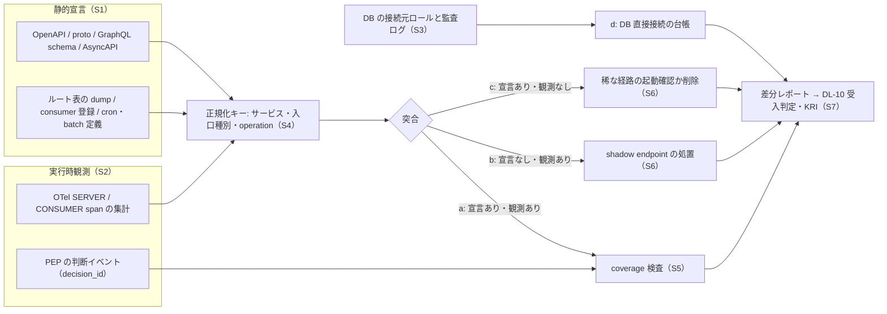

# As-Is 棚卸し（様式と仮置き）

> 文書ID: REQ-07 / 版: 0.1 / 状態: draft / 最終更新: 2026-10-03
> 対応要求: R-058, G-050（主なもの）。関連: R-177（新旧差分の基準点。主担当は DL-31）、CL-0266
> 依存文書: CONVENTIONS.md, traceability/deliverables.md, traceability/R-requirements.md, traceability/G-goal-criteria.md, 01_governance/assumptions-register.md, research/RS-08-pep-completeness-tenant-isolation.md, research/RS-16-parallel-development-governance.md, research/RS-17-integration-patterns-modeling.md, research/RS-03-identity-lifecycle.md, research/RS-14-b2b-customer-identity.md, research/RS-15-build-buy-tco.md, traceability/claims-ledger.md, traceability/dissent-log.md, traceability/seed/seed-03-redteam-decision.md（問いの入力としてのみ使用）

## 0. 要約（結論）

1. 本書が用意するのは、As-Is 棚卸しの様式（8 領域）、entry point の機械抽出手順、前提台帳の値による仮置き、移行コストの見積り枠までである [D]。**実データでの棚卸しは未達であり、本書の値はいずれも実測値ではない** [D]。
2. 実データの棚卸しは 2 段で行う案とする [D]。Gate 1（以下 G1。受入基準 G-xxx とは別）で全サービスの回答と設定 export により A-110〜A-115・A-055 を置き換え、Gate 4（G4）でパイロット 2〜3 サービスの機械抽出により回答の確度を測る [D]。G-050 の完了は段階2 で CTO と対象サービスオーナーが判定する [D][^4][^5]。
3. 前提台帳の仮置き（基準シナリオ、GOV-01 v0.1）で見ると、移行の対象は次の規模になる [D][A-050, A-110, A-113, A-114, A-115, A-013, A-055]。
   - 共通 SSO を経由しないサービス 180（300 の 60%）
   - 顧客側の再設定が起こり得る federation 接続 2,000（SAML 1,800・OIDC 200。うち IdP 起点 SAML 540）
   - WebAuthn RP ID を変えた場合に passkey の再登録が要る利用者 約 3.3 万人
   - 再同意が起こり得る第三者・顧客自作アプリの grant 3 万
   - 共有シークレット 3,000（rotation 記録なし 1,500）、entry point 1.2 万
4. 顧客側・利用者側の作業のうち SAML/OIDC 再設定と passkey 再登録は、新基盤が既存の識別子（SAML SP entityID・ACS URL、OIDC redirect_uri・issuer、WebAuthn RP ID）を引き継げるかで発生の有無が決まる [D]。WebAuthn の credential は登録時と同じ RP ID でしか認証に使えない [N]（RS-15#59）[^35]。識別子を維持するかは ADR-021 の判断事項であり、本書では決めない [D]。
5. 移行コストは「対象件数（A-ID）× 1 件あたり工数 × 単価」に、並行稼働費と一時費用を加える枠で積み上げる [D]。1 件あたり工数・単価・問合せ率には根拠がないため値を置かず、TBD（所有者・期限・決め方）とした [D]。
6. entry point は、静的宣言（OpenAPI・proto・GraphQL schema・AsyncAPI・ルート表・consumer 登録・cron 定義）と実行時観測（OpenTelemetry の SERVER / CONSUMER span）の差分で列挙する [D]。どちらの集合も単独では完全でなく、DB 直接接続は DB 側の別系統で棚卸しする [D]（RS-08#27）。
7. 経営・事業・法務の決定を要する点は 2 つあり、どちらも決裁案の段階である（§6.4）[D]。DQ-A は棚卸しの回答義務と体制、DQ-B は顧客側作業の扱い（識別子の維持、告知期間、費用負担）である [D]。

## 1. 本書の位置付けと範囲

- 本書は成果物 DL-50（文書ID REQ-07）である[^1] [D]。現行の認証方式・ユーザーストア・顧客側 federation 設定・セッション・認可実装・入口について、棚卸しの様式と汎用前提による仮置き値を示す[^1] [D]。
- 本書の棚卸しは 3 つの用途の基準点になる [D]。
  - 移行コスト: TCO（DL-33）、体制と TCO の決裁要約（DL-43）、代替案比較（DL-44）の移行費用の入力。
  - 新旧差分: 段階導入（DL-31）と ADR-027 の dual-run で比べる「旧判定」の所在（R-177、CL-0266）[^3][^8]。
  - 前提の置換: 前提台帳の想定 As-Is（A-110〜A-115）と entry point 数（A-055）を実データで置き換える入口[^5]。
- 対象は 8 領域とする [D]。認証方式、ユーザーストア、顧客側 federation 設定、セッション方式、認可実装、共有シークレット・静的資格情報、entry point、監査ログである [D]。
- 業務データの分類（DL-03）、テナントの状態遷移（DL-49）、DFD と trust boundary の図（DL-10）は対象外とする [D]。entry point の台帳は DL-10 と共有し、本書は様式と抽出手順を、DL-10 は DFD と受入条件を持つ[^1] [D]。
- 種資料 seed-03 の C4（移行コスト未評価）と §7-2（As-Is がない）は、問いの入力としてだけ使い、根拠には使わない[^7] [D]。
- 本書は AI エージェント（Claude）が起草した [D]。原典の照合は research/verification/ の記録に依っており、本書のために新しく取得した原典はない [D]。作成者以外による検証は Phase 4 で行う [D]。

## 2. 棚卸しの設計

### 2.1 領域・記録単位・責任者

回答責任者の列は、前提台帳で当該 A-ID の確定責任者とされている役割を写した[^5]。A-ID のない監査ログの行は本書の提案である [D]。機械取得の列は、設定や台帳の export、実行時観測で値を取れるかどうかを示す [D]。表のセルはいずれも本書の設計推論である [D]。

| 領域 | 記録単位 | 主な情報源 | 回答責任者 | 機械取得 | 仮置き A-ID | 主な利用先 |
|---|---|---|---|---|---|---|
| 認証方式 | サービス×クライアント種別 | 回答、IdP の client 登録一覧、gateway 設定 | プラットフォームチーム長＋各ドメイン責任者 | 一部 | A-110 | DL-31, ADR-027, DL-43 |
| ユーザーストア | ストア | ストアの設定・件数の export | プラットフォームチーム長＋個人情報保護責任者 | 可（件数・hash 方式） | A-111, A-115 | ADR-004, ADR-018, ADR-021 |
| 顧客側 federation 設定 | テナント×接続 | 既存 SSO 基盤の接続設定の export | 営業・顧客成功責任者＋プロダクト責任者 | 可 | A-114, A-082, A-073 | DL-26, ADR-004 |
| セッション方式 | サービス×クライアント種別 | 回答、cookie と session store の設定 | プラットフォームチーム長＋各ドメイン責任者 | 一部 | A-110（独自セッション数のみ）、A-006 | ADR-005, ADR-006, ADR-019 |
| 認可実装 | サービス×resource type | 回答、コード検索、DB ロール一覧、mesh 設定 | CTO＋各ドメイン責任者 | 一部 | A-112 | ADR-011, ADR-012, DL-31 |
| 共有シークレット・静的資格情報 | 資格情報 | secret manager の一覧、リポジトリ走査、IdP の client secret 一覧 | CISO＋プラットフォームチーム長 | 一部 | A-113, A-011, A-073 | ADR-007, ADR-009, ADR-019 |
| entry point | 入口 | §4 の機械抽出 | プラットフォームチーム長＋各ドメイン責任者 | 可（§4） | A-055 | DL-10, DL-15 |
| 監査ログ | ログ源 | ログ在庫、SIEM 連携設定 | CISO＋SRE 責任者 | 一部 | なし（§5.2 N-4） | DL-25, ADR-014 |

### 2.2 共通項目

全領域の記録に次の項目を持たせる [D]。

| 項目 | 内容 |
|---|---|
| 記録ID | 台帳内の通番。CONVENTIONS §2 の ID 体系には加えない |
| 対象 | サービス ID（サービス台帳の ID）と所有ドメイン（A-051 の事業ドメイン） |
| 回答者・承認者 | 回答した担当者と、承認したドメイン責任者 |
| 情報源区分 | S（回答）／X（設定・台帳の export）／O（実行時観測）。複数可 |
| 状態 | §2.3 |
| 証跡の所在 | export ファイル、クエリ、span 集計の保存場所とハッシュ値 |
| 機密区分 | DL-03 の区分（§2.4） |

### 2.3 記録の状態と前提台帳への反映

| 状態 | 条件 |
|---|---|
| 未回答 | 記録がない |
| 回答のみ | 情報源が S だけ |
| 機械取得 | X または O がある |
| 突合済 | S と X/O の差分が 0、または全差分に説明と処置がある |

- 領域の全記録が「突合済」になった時点で、集計値を前提台帳の変更手順（GOV-01 §13-3）に従って提案する [D]。状態を「実測済」へ上げる判定は作成者以外が行い、値には [M] と証跡の所在を付ける[^5] [D]。
- 回答だけの集計値で A-ID を置き換える場合は、状態を「仮置き」のまま残し、情報源が回答であることを記す [D]。

### 2.4 棚卸し台帳そのものの取扱い

- 棚卸し台帳は、入口の一覧、資格情報の所在、顧客 IdP の設定を一か所に集めるため、攻撃者にとって価値が高い [D]。前提台帳は、顧客 IdP の設定や SCIM token を顧客機密として数えている（A-073）[^5]。
- 資格情報の値は記録しない [D]。識別子、fingerprint、保管場所だけを記録する [D]。
- 閲覧権限は棚卸しの担当とドメイン責任者に限り、閲覧を監査記録の対象にする [D]。

## 3. 棚卸し様式

各表の「記録内容」は本書の設計推論である [D]。セルごとのタグは省き、規範・公式文書に依る根拠は「根拠・用途」列に RS 番号と脚注で示す [D]。

### 3.1 認証方式（サービス×クライアント種別ごと）

| 項目 | 記録内容 | 根拠・用途 |
|---|---|---|
| 主体類型 | DL-48 の 8 類型（ユーザー、人事 ID、顧客管理者、support、service account、workload、外部 integration、agent/AI）から選ぶ。複数可 | レビュー Gate 1 の主体列挙[^6]。主体ごとの移行先を DL-48 で決める |
| クライアント種別 | サーバー描画の Web／SPA／ネイティブ／CLI／入力制約デバイス／サーバー間／batch | 移行先パターン（P-01〜P-05）の割当（DL-64） |
| 認証方式区分 | 共通 SSO（SAML）／共通 SSO（OIDC）／独自ログイン・独自セッション／LDAP 直結／ヘッダ認証（前段の proxy・gateway が付けるヘッダで識別）／共有シークレット・API key のみ／その他 | A-110 の 4 区分にヘッダ認証を加えた（§5.2 N-1） |
| 多要素 | なし／OTP・out-of-band／フィッシング耐性あり（passkey 等） | SP 800-63B-4 は、手入力の OTP と out-of-band をフィッシング耐性ありと見なしてはならない（SHALL NOT）としている [N]（RS-03#16）[^37] |
| ブラウザでの token 保持 | BFF（サーバー側）／ブラウザ内 | RFC 10017 は、業務アプリ・機微なアプリ・個人データを扱うアプリに BFF を "strongly recommended" としている（小文字で BCP 14 キーワードではない）[N]（RS-17#4）[^20] |
| ネイティブ・CLI の認可画面 | 外部ブラウザ／埋込み WebView／独自のログイン画面 | RFC 8252 は、ネイティブアプリが embedded user-agent で認可要求を行うことを MUST NOT としている [N]（RS-17#6）[^21] |
| アプリ同梱の秘密 | 有／無 | RFC 8252 は、複数の利用者に配布するアプリに静的に含めた秘密を、機密な秘密として扱うべきでないとしている [N]（RS-17#9）[^21] |
| LDAP 直結の条件 | unauthenticated Bind を拒否しているか、TLS の有無、Bind の成功を認可の根拠にしているか | RFC 4513 は、サーバーが unauthenticated Bind を既定で失敗させるべき（SHOULD）とし、Bind の成功だけを根拠にディレクトリ外の情報へのアクセスを許す誤用が運用上しばしば起きると述べている [N]（RS-17#82）[^31] |
| ヘッダ認証の条件 | 署名付きヘッダを検証しているか、前段を迂回して到達できるか | Google IAP は、迂回されると未署名の ID ヘッダを偽造され得るとして、署名付きヘッダの検証を求めている [V]（RS-17#79）[^29]。Entra application proxy は、ヘッダ認証アプリへの到達を connector など許可した経路に限るべきとしている [V]（RS-17#81）[^30] |
| 移行先パターン候補 | P-01／P-02／P-03／P-05／P-12、レガシーは RS-17 §5.1 の「P-12 派生」 | DL-64 |
| サービス側改修の見積り | 区分ごとの改修工数（人日） | §6.2 の e_k。回答者の見積りであり実測ではない |

### 3.2 ユーザーストア（ストアごと）

| 項目 | 記録内容 | 根拠・用途 |
|---|---|---|
| 種別・製品・版 | 製品名と版／自前 DB／LDAP ディレクトリ | 移送方式の選択（ADR-018） |
| 所在地 | リージョン | 所在地の前提（A-062、A-063）との照合 |
| 件数 | 登録件数、MAU、主体類型別の件数、最終ログイン日の分布 | A-001〜A-004 の置換。休眠アカウントを移送対象から外すかの判断材料 |
| 主キーと照合キー | 不変の内部 ID の有無、email・userName を照合に使っているか | Keycloak の公式文書は、同じメールアドレスの既存アカウントへの自動リンクを潜在的なセキュリティホールとしている [V]（RS-17#78）[^28]。統合時の linking 規則（ADR-004、ADR-021） |
| password hash | 方式、パラメータ（cost 等）、salt の有無、export の可否 | SP 800-63B-4 は、salt 付きの適切な hash 方式での保存を SHALL とし、cost の引上げを SHOULD としている [N]（RS-15#58）[^37]。export できない製品から出るには JIT 移行が要り、全利用者が一度サインインするまで旧 IdP を止められない [D]（RS-15#60） |
| 認証器の内訳 | password のみ／password＋OTP／フィッシング耐性あり。passkey は登録数と RP ID | A-115 の置換。WebAuthn の credential は登録時と同じ RP ID でしか使えない [N]（RS-15#59）[^35] |
| 公開鍵 credential の export | credential ID・公開鍵・署名カウンタ等を出せるか | RP ID が同じであれば、移行先でその記録を使える可能性がある [D]（RS-15#60） |
| OTP seed・回復コードの移送 | 可／不可／不明 | 製品に依存し、原典は未確認（§5.2 N-8） |
| 重複アカウント | 同一人物の判定方法と件数 | A-111 の置換 |
| 無効化済みで未削除の件数 | 件数と保持の理由 | 移送対象の絞込み（DL-08） |

### 3.3 顧客側 federation 設定（テナント×接続ごと）

| 項目 | 記録内容 | 根拠・用途 |
|---|---|---|
| テナントと契約区分 | テナント ID、高保証要求（A-081）の有無 | 移行順序（DL-31） |
| プロトコル | SAML 2.0／OIDC | A-114 の置換 |
| 起点 | SP 起点のみ／IdP 起点のみ／両方 | SP 800-63C-4 は FAL2 で、federation transaction を RP が開始することを SHALL としている [N]（RS-14#18）[^32]。SAML の unsolicited response は InResponseTo 属性を持ってはならない（MUST NOT）[N]（RS-14#19）[^33]。一方、CSA SSCF は SAML を使う場合に IdP 起点と SP 起点の両方への対応を must としている [N]（RS-14#20）[^34] |
| 顧客側に登録された自社の識別子 | SAML SP entityID・ACS URL・SLO URL、OIDC redirect_uri・client_id。それぞれのドメインが自社所有か製品提供者のものか | §6.1 の W1・W3 の発生条件。ADR-021 |
| 鍵と証明書 | 顧客 IdP の署名証明書の有効期限、更新方法（手作業受付／metadata URL の定期取得）、並行登録できる枚数。自社 SP の署名・暗号化証明書 | SP 800-63C-4 は、識別子と鍵の更新手順を trust agreement で定め、認証された保護チャネルで実行することを SHALL としている [N]（RS-14#15）[^32] |
| 主体の対応付け | NameID の形式または sub、照合に使う属性 | 結合キーを（テナント、IdP 識別子、subject）に固定する案（RS-14 §5 の ADR-004 への入力）[D] |
| provisioning | JIT／SCIM（endpoint URL、token の発行日と方式） | A-082 の置換。§6.1 の W4 |
| 利用実績 | 直近の月間ログイン件数 | 休眠接続の扱いの判断材料 |
| 顧客側の連絡先と契約条項 | 技術連絡先、変更通知条項の有無と日数 | DQ-B の告知期間（§6.4） |

### 3.4 セッション方式（サービス×クライアント種別ごと）

| 項目 | 記録内容 | 根拠・用途 |
|---|---|---|
| 方式 | サーバー側 session（store の種別）／cookie 内に状態を持つ session／ブラウザに保存した token／BFF | A-110 の独自セッション 105 の内訳（§5.2 N-2） |
| cookie 属性 | Secure、HttpOnly、SameSite、Domain、名前の接頭辞 | RFC 10017 は BFF の cookie について、Secure と HttpOnly を MUST、SameSite=Strict を SHOULD とし、Domain 属性は付けるべきでない（SHOULD NOT）とし、`__Host-Http-` などの接頭辞を SHOULD としている [N]（RS-17#2）[^20] |
| 寿命 | 絶対寿命、アイドル timeout、再認証の間隔 | 現行値の把握。目標値は DL-09・DL-20 で決める |
| 外部からの失効 | 特定の利用者・全利用者の session を外部から失効できるか、その所要時間 | 全 session 失効（ADR-019）と再ログイン集中（A-033、A-048）の前提 |
| refresh token | 保持の有無、rotation または sender constraint の有無、最大寿命 | RFC 10017 は、ブラウザ内 client の refresh token について、使用ごとの rotate か sender constraint を MUST とし、最大寿命か未使用期限を設けることを MUST としている [N]（RS-17#5）[^20] |
| 長寿命接続 | WebSocket／SSE／gRPC streaming の有無、接続中の再認可の有無 | 接続確立時の認可だけでは剥奪が反映されない前提で設計する [D]（RS-17 結論 10） |
| 移行時の扱いの候補 | 既存 session を移す／期限まで旧方式と併存させる／一斉に再ログインさせる | 一斉の再ログインは、A-048 の再ログイン集中（基準 556/秒）と同じ型の負荷を移行時に生み得る [D][A-048] |

### 3.5 認可実装（サービス×resource type ごと）

| 項目 | 記録内容 | 根拠・用途 |
|---|---|---|
| 実装場所 | gateway／service mesh／アプリのコード／DB（RLS 等）／なし。複数可 | A-112 の置換。PEP の配置（ADR-011、ADR-012） |
| mesh の既定 | workload ごとの ALLOW ポリシーの有無 | Istio は、ALLOW ポリシーが 1 つもない workload への要求を許可する [V]（RS-08#36）[^18]。mesh を coverage の根拠に数えてよいかの確認に使う |
| モデル | role 名の一覧と数、custom role の可否、テナント越えの共有の有無 | A-112 の role モデル数、A-016。typed ReBAC へ写す工数（ADR-011） |
| テナント分離 | アプリ層の検索条件のみ／RLS／スキーマ・DB の分離 | A-112 の「アプリ層の検索条件だけで分離」の置換 |
| RLS の条件 | テナント表の ENABLE と FORCE、アプリ実行ロールが非 owner かつ NOBYPASSRLS か、view の security_invoker | PostgreSQL では、superuser と BYPASSRLS 属性のロールは常に RLS を迂回し、table owner は FORCE しない限り迂回する [V]（RS-08#40）[^17] |
| PEP の外に出る経路 | export、署名付き URL（最大有効期限）、DWH 連携、検索インデックス、バックアップを復元できる権限者 | S3 の presigned URL は保持者にアクセスを与えるベアラトークンであり、CLI・SDK では最長 7 日に設定できる [V]（RS-08#81）[^19]。P-10、P-15 |
| 旧判定の取得点 | 判定結果（allow/deny）・主体・テナント・resource・操作がログに残るか。shadow 呼出しを挿む位置（middleware／gateway）。判定に副作用があるか | dual-run で比べる「旧判定」の基準点（R-177、CL-0266）[^3][^8]。差分の扱いは DL-31・ADR-027 が決める |
| 権限データの所在 | role 割当表・ACL の所在と件数 | 新しいストアへの初期投入量。A-032 の bulk 投入条件と照合する |

### 3.6 共有シークレット・静的資格情報（資格情報ごと）

資格情報の値は記録しない（§2.4）[D]。

| 項目 | 記録内容 | 根拠・用途 |
|---|---|---|
| 種別 | OAuth client secret／API key／DB password／webhook secret／SCIM token／SAML 署名鍵／クラウドの access key／個人の access token／SSH 鍵 | A-113 の置換 |
| 保有者と所有者 | 利用するサービス、発行した人、所有者（人／service account／顧客） | 作成者個人の資格情報で動くジョブも含める（§5.2 N-9）。Databricks は、ジョブの Run as を service principal に変える理由の一つに、所有者が去ったときにジョブが壊れないことを挙げている [V]（RS-17#27）[^24]。Power Automate は、所有者のいない flow がその利用者に結び付いた接続を使っていると失敗し得るとしている [V]（RS-17#28）[^25] |
| 保管場所 | secret manager／環境変数／設定ファイル／リポジトリ／アプリ同梱 | GitHub Actions の OIDC は、ジョブごとに短命の token を得ることで、長寿命の秘密をリポジトリに置かずに済むとしている [V]（RS-17#30）[^26] |
| 日付 | 発行日、最終 rotation、最終使用、有効期限 | rotation 記録のない比率（A-113）の置換 |
| 共有範囲 | 同じ値を使うサービス数・人数 | 侵害時の全件 rotation の所要時間（ADR-019） |
| 置換先の候補 | private_key_jwt／mTLS／workload ID／CI の OIDC federation | RFC 9700 は、非対称暗号によるクライアント認証（mTLS または private_key_jwt）を RECOMMENDED としている [N]（RS-17#19）[^22] |
| 失効手順 | 手順の有無、所要時間、依存先への影響 | ADR-007、ADR-019 |

### 3.7 entry point（入口ごと）

| 項目 | 記録内容 | 根拠・用途 |
|---|---|---|
| 入口種別 | HTTP／gRPC／GraphQL／webhook 受信／queue consumer／batch・cron／管理画面／support tool／export／ETL／DB 直接接続／監視 endpoint／緊急経路 | DL-10 の対象種別[^1]。ASVS v5.0.0-13.4.5（L2）は、内部 API の文書や監視 endpoint を意図せず公開しないことを求めている [N]（RS-08#22）[^14] |
| 宣言キー | OpenAPI の path＋method（operationId）／proto の service と rpc／GraphQL の type と field／AsyncAPI の channel と operation／cron・batch 定義名／ルート表の項目 | §4 の S1 |
| 宣言上の認証 | OpenAPI の security の有無、operation 単位の空 requirement `{}` と空配列 | OpenAPI 3.2.1 では、`{}` を含めるとセキュリティが任意になり、空配列にすると top-level の宣言が外れる [N]（RS-08#23）[^11] |
| 観測 | span 名と属性、最終観測日時、1 日あたりの観測件数 | §4 の S2 |
| 認可判断イベント | decision_id が付いている要求の比率 | §4 の S5（RS-08#35） |
| 操作階層 | DL-09 の 5 分類 | 処置の優先順位 |
| テナント文脈の取得元 | token の claim／path／header／body | ASVS v5.0.0-4.1.3（L2）は、中間層が設定する HTTP ヘッダを利用者が上書きできないことを求めている [N]（RS-08#22）[^13]。テナント文脈のヘッダも同じ類型として扱う [D] |
| 公開の意図 | 例外台帳の ID（意図して認証・認可なしで公開する入口） | §4 の S5 |
| 差分区分 | §4 の a〜d | DL-10 の受入条件（自動発見との差分 0 件）[^1] |

### 3.8 監査ログ（ログ源ごと）

本様式は、ASVS v5.0.0-16.1.1 のログ在庫の初版を兼ねる [D]。

| 項目 | 記録内容 | 根拠・用途 |
|---|---|---|
| ログ源 | サービス・製品・基盤（IdP、gateway、アプリ、DB） | — |
| 記録するイベント | 認証の成功・失敗、認可の deny・allow、管理操作、鍵操作、export・署名付き URL の発行 | ASVS v5.0.0-16.3.2 は、失敗した認可試行の記録を L2 で求め、L3 では全認可判断の記録を求めている [N]（RS-08#34）[^15] |
| 項目 | 主体 ID、テナント ID、resource、判断結果、decision_id・trace_id、時刻とその時刻源 | 新旧差分の突合（§3.5）と coverage 検査（§4）の入力 |
| 宛先と所在地 | 保存先、リージョン、在庫にない宛先への送出の有無 | ASVS v5.0.0-16.1.1（L2）はアクセス統制を含むログ在庫を求め、16.2.3（L2）は在庫にない宛先へ出力しないことを求めている [N]（RS-08#80）[^15] |
| 保護 | アクセス統制、改ざん防止、論理的に分離した系への送出 | ASVS v5.0.0-16.4.2・16.4.3（L2）は、不正アクセス・改ざんからの保護と、論理的に分離した系への送出を求めている [N]（RS-08#80）[^15]。NIST SP 800-53 Rev.5 の AU-9 は、監査情報と監査ツールの保護を求めている [N]（RS-08#80）[^16] |
| 保持と削除 | 保持期間、削除方法 | A-074 は容量計算用の仮置きであり法定期間ではない[^5]。決定は DL-34・ADR-014 で行う |
| 連携と欠損 | SIEM 連携、連携停止時の挙動、欠損検知の有無 | DL-25 |

## 4. entry point の機械抽出手順（IDL 静的抽出×実行時トレース突合）

### 4.1 原理

- 前提台帳は entry point を 1.2 万（範囲 4,500〜3 万）と置いており、手作業の棚卸しでは追随できない件数と見て、IDL の静的抽出と実行時トレースの突合による機械列挙を前提にしている [D][A-055]。
- OWASP API9:2023 は予防策として、API ホストと連携サービス・データフローの棚卸しと、オープン標準による文書の自動生成を CI/CD に組み込むことを挙げている [N]（RS-08#21）[^10]。
- OpenTelemetry の Trace API（Stable）は、SpanKind の SERVER と CONSUMER を「外部から開始された入来要求の処理」と定義し、PRODUCER と CONSUMER は遅延実行（非同期）を表すとしている [N]（RS-08#26）[^12]。
- 静的宣言と実行時観測の 2 集合を突き合わせ、差分を入口の候補として扱う [D]。実行時観測は稀にしか動かない経路を逃し、静的宣言は未登録の handler や DB 直接接続を逃すため、どちらの集合も単独では完全でない [D]（RS-08#27）。

### 4.2 手順



| 手順 | 内容 | 出力 | 根拠 |
|---|---|---|---|
| S1 静的宣言の抽出 | 各リポジトリから OpenAPI・proto・GraphQL schema・AsyncAPI の文書を CI で収集し、operation 単位に正規化する。フレームワークのルート表を起動時に dump する。consumer の購読登録と cron・batch の定義を集める。OpenAPI の空 requirement `{}` と空配列を lint で検出し、例外登録制にする。GraphQL は本番の introspection に頼らず、リポジトリの schema から取る | 宣言集合 | RS-08#23[^11]。AsyncAPI の最新版は 3.1.0 [N]（RS-16#6）[^40]。ASVS v5.0.0-4.3.2（L2）は、GraphQL API を他者に使わせる意図がない限り本番の introspection を無効化することを求めている [N]（RS-08#22）[^13] |
| S2 実行時観測の集計 | SERVER / CONSUMER span を観測期間（TBD）にわたり集計し、サービス名と route・rpc・宛先で正規化する。trace の sampling で稀な経路が落ちないよう、観測期間中は入口ごとの計数を sampling と独立に取る。計装のないサービスは観測に現れないため、計装率を併記する（§5.2 N-7） | 観測集合、計装率 | RS-08#26[^12]。観測期間は TBD（所有者: SRE 責任者／期限: G4 の事前登録／決め方: batch・cron の実行周期の最大値を覆う長さを、S1 の cron 定義から求める）[D] |
| S3 DB 直接接続の棚卸し | アプリの trace に現れない ETL・support tool・手作業 SQL を、DB 側の接続元ロールと監査ログで別に集計する。BYPASSRLS・superuser・table owner での接続を抽出する | DB 接続台帳 | RS-08#27、RS-08#40・#43[^17] |
| S4 突合 | 正規化キーで結合し、a（宣言あり・観測あり）、b（宣言なし・観測あり）、c（宣言あり・観測なし）、d（DB 直接接続）に分ける | 差分区分付きの入口台帳 | RS-08#27 |
| S5 coverage の付加 | a と b の入口ごとに decision_id の有無を突合し、「認可判断イベントのない入口」を数える。意図して公開する入口は例外台帳に登録して除外する。mesh は allow-nothing ポリシーがない限り coverage の根拠に数えない。gateway の認可が最初の要求にしか効かない構成は、アプリ内の判定を別に確認する | 判断イベントのない入口の一覧 | RS-08#35、RS-08#36[^18]。Entra application proxy では、アプリの認可ポリシーは最初の認証要求にだけ適用される [V]（RS-17#81）[^30] |
| S6 差分の処置 | b は宣言を追加するか遮断する。c は合成試験で起動を確かめるか削除する。d は DB 側の guardrail（DL-15）の対象にする。処置ごとに所有者と期限を付ける | 処置台帳 | 全差分に処置が付くまで、DL-10 の受入条件（自動発見との差分 0 件）を満たさない[^1] [D] |
| S7 継続実行 | CI と定期ジョブで再実行し、差分件数と「判断イベントのない入口」の件数を KRI の候補として DL-06 へ渡す | KRI の時系列 | RS-08 結論 15 |

### 4.3 手順の限界

- 宣言があることは保護の証拠にならない [D]。S1 が検出するのは、宣言の欠落と緩和だけである [D]（RS-08#23）。
- 区分 c の入口（batch、break-glass など）は、合成試験で起動しない限り「観測なし」のまま残る [D]（RS-08#27）。
- PEP の外に出るデータの経路（export、署名付き URL、バックアップ）は、入口の台帳だけでは捕捉できない [D]。§3.5 の様式で別に列挙する [D]（RS-08#79、#82）。
- 本手順の検出率は測っていない [D]。パイロットで RS-08 §5.2 の M-01（棚卸し差分件数）として測り、TC は 12_poc の試験計画（DL-22）で採番する [D]。

## 5. 仮置き As-Is

### 5.1 前提台帳の値と本書の導出（GOV-01 v0.1）

値はすべて前提台帳の仮置きであり、事業計画値・実測値・決裁値のいずれでもない[^5] [A-110]。想定 As-Is（A-110〜A-115）のうち、規制強化シナリオで値が変わるのは顧客構成に依存する A-114・A-115 だけである[^5] [D]。表のそれ以外の行（A-073、A-082、A-013、A-006 など）は、前提台帳の規模・顧客構成の節の値を写した [D]。「本書の導出」列の計算は [D] であり、入力の A-ID を列に示す。

| 領域 | A-ID | 前提台帳の値（基準） | 規制強化 | 範囲（低/高） | 本書の導出 |
|---|---|---|---|---|---|
| 認証方式 | A-110 | 共通 SSO（SAML/OIDC）120・独自セッション 105・LDAP 直結 30・共有シークレット/API key のみ 45 | 同 | 独自セッション 20% / 60% | 共通 SSO を経由しない 105＋30＋45＝180（300 の 60%）[D][A-050, A-110] |
| ユーザーストア | A-111 | 12 ストア・同一人物の重複 15% | 同 | 6〜25 ストア・5〜30% | 重複率の母数が定義されていないため件数は導出しない（N-5） |
| 認証器 | A-115 | 自社で認証する人間 47.5 万人。password のみ 55%・password＋OTP 38%・フィッシング耐性あり 7% | 32.5 万人。40%・50%・10% | フィッシング耐性 2% / 20% | 基準: 26.125 万・18.05 万・3.325 万。password 保持者 44.175 万。規制強化: 13 万・16.25 万・3.25 万、password 保持者 29.25 万 [D][A-115] |
| 顧客側 federation | A-114 | SAML 1,800・OIDC 200 接続。IdP 起点 SAML 30%（540）。IdP 証明書の更新は手作業で受付 | SAML 2,700・OIDC 300。IdP 起点 810 | IdP 起点 10% / 60% | 接続の計 2,000（規制強化 3,000）[D][A-114] |
| 連携テナント | A-082 | 顧客 IdP 連携テナント 2,000（B2B 利用者の 75%）・SCIM 800 | 3,000（90%）・1,800 | 連携 10% / 40% | 顧客 IdP で認証する B2B 利用者 70 万×75%＝52.5 万（規制強化 75 万×90%＝67.5 万）[D][A-002, A-082] |
| 認可実装 | A-112 | 自前実装 240（80%）・role モデル 20 種・アプリ層の検索条件だけでテナントを分離するサービス 70% | 同 | 自前実装 50〜100%・role モデル 10〜50 種 | 70% の母数を A-050 の 300 とすると 210 サービス（母数の確認は N-6）[D][A-050, A-112] |
| 共有シークレット | A-113 | 3,000 件・rotation 記録なし 50% | 同 | 1,000〜10,000 件・20〜80% | rotation 記録なし 1,500 件 [D][A-113] |
| 顧客機密 | A-073 | 約 4,000（顧客 IdP 連携 2,000＋SCIM 800＋外部 client 800＋webhook 400） | 約 5,600 | — | §6.1 の W1〜W4・W9 の対象件数の照合に使う |
| 外部連携アプリ | A-013 | client 800（第三者 150＋顧客自作 650）・grant 3 万 | client 500・grant 1.5 万 | client 300 / 3,000・grant 1 万 / 10 万 | §6.1 の W5・W9 の対象 |
| service account | A-011 | 1,200 | 1,200 | 600 / 3,000 | §3.6 の保有者の置換対象 |
| 有効 session | A-006 | 86.5 万 | 88.7 万 | 69.2 万 / 173.0 万 | 移行時の session の扱い（§3.4）の対象件数 |
| entry point | A-055 | 1.2 万 | 1.2 万 | 4,500 / 3 万 | §4 の対象規模 |

### 5.2 前提台帳にない仮定（新規仮定（前提台帳へ追加要））

本書の様式には、前提台帳にない As-Is の項目が含まれる [D]。次の N-1〜N-10 は**新規仮定（前提台帳へ追加要）**である [D]。本書は前提台帳を編集しない [D]。数値には根拠がないため置かず、TBD とした [D]。

| 仮番号 | 内容 | 本書での扱い | 確定責任者（案） | ゲート |
|---|---|---|---|---|
| N-1 | ヘッダ認証（前段の proxy・gateway が付けるヘッダで利用者を識別）のサービス数。A-110 の 4 区分にない | TBD。G1 の回答で数える | プラットフォームチーム長 | G1 |
| N-2 | 独自セッション（A-110 の 105）の方式・寿命・外部失効の可否の内訳 | TBD | プラットフォームチーム長＋各ドメイン責任者 | G1 |
| N-3 | 現行の WebAuthn RP ID、SAML SP entityID・ACS URL、OIDC redirect_uri・issuer が自社所有のドメインにあるか | TBD。W1・W3・W6・W9 の発生を左右する（§6.3） | CTO | G1 |
| N-4 | 監査ログの現状（ログ源の数、認可判断との相関 ID の有無、保持期間） | 定性の仮定として「サービスごとに形式と保存先が異なり、共通の decision_id を持たない」と保守側に置く。数値は TBD | CISO＋SRE 責任者 | G1 |
| N-5 | A-111 の重複率の母数（登録総数か、全ストアのアカウント総数か） | 定義の追加を要する | プラットフォームチーム長＋個人情報保護責任者 | G1 |
| N-6 | A-112 の「70%」の母数（全 300 サービスか、自前実装の 240 か） | 定義の追加を要する | CTO＋各ドメイン責任者 | G1 |
| N-7 | OpenTelemetry の SERVER / CONSUMER span を出しているサービスの比率（計装率） | TBD。§4 の機械抽出の前提 | SRE 責任者 | G1 |
| N-8 | OTP seed と回復コードを現行のストアから移送できるか | TBD（製品に依存し、原典は未確認） | プラットフォームチーム長 | G3 |
| N-9 | 作成者個人の資格情報で動く定期ジョブの数 | TBD | 各ドメイン責任者 | G1 |
| N-10 | 顧客側で自社の送信元 IP・ドメインを許可リストに登録している件数 | TBD（§6.1 の W10） | 営業・顧客成功責任者 | G1 |

## 6. 移行時に顧客側・利用者側で発生する作業と移行コストの見積り枠

### 6.1 作業の一覧

対象件数は §5.1 の値と導出である [D][A-013, A-073, A-082, A-111, A-114, A-115]。「根拠」列以外のセルは本書の設計推論である [D]。

| ID | 作業 | 発生条件 | 実施者 | 対象（仮置き・基準） | 自社側の付随作業 | 回避・軽減の手段 | 根拠 |
|---|---|---|---|---|---|---|---|
| W1 | SAML 接続の SP 設定の更新（entityID・ACS URL・SP 証明書） | 新基盤で SP の識別子・endpoint・証明書が変わる | 顧客の IdP 管理者 | 1,800 接続 | 新しい metadata の提供、接続試験、切替日の調整 | 識別子と URL の引継ぎ（§6.3） | 識別子と鍵の更新手順は trust agreement で定め、保護チャネルで行う（SHALL）[N]（RS-14#15）[^32] |
| W2 | IdP 起点 SAML から RP 起点（第三者起点ログイン）への切替 | FAL2 を割り当てた連携で IdP 起点を既定で無効にする（DS-14） | 顧客の IdP 管理者、利用者 | 540 接続 | 利用者のブックマークや社内ポータルのリンク変更の案内 | 受信した unsolicited response を session 確立に使わず、RP 起点へやり直させる案（RS-14 §5 の ADR-004 案②） | RS-14#18〜#20[^32][^33][^34]、DS-14[^9] |
| W3 | OIDC 接続の RP 設定の更新（redirect_uri、client 登録） | redirect_uri、client_id、client の資格情報のいずれかが変わる | 顧客の IdP 管理者 | 200 接続 | W1 と同じ | W1 と同じ | [D] |
| W4 | SCIM 連携の再設定（endpoint URL、token） | SCIM の endpoint または資格情報が変わる | 顧客の IdP 管理者 | 800 テナント | token の再発行、初回同期の結果の照合 | endpoint の引継ぎ、旧 token の並行受理期間 | [D] |
| W5 | 第三者・顧客自作アプリの再認可（再同意） | 旧 AS の grant と refresh token を新 AS へ移さない | 利用者、テナント管理者、アプリ開発者 | client 800・grant 3 万 | client の再登録、通知 | grant の移送（移送する場合も既存 grant の棚卸しを兼ねる） | OIDC Core は、offline access を要求する場合は別の条件がない限り prompt=consent を使わなければならず（MUST）、OP は offline access を可能にする refresh token を返すことへの同意を常に得なければならない（MUST）としている [N]（RS-17#24）[^23]。Entra は、同意設定を変えても既存の grant は残るとしている [V]（RS-17#62）[^27] |
| W6 | passkey の再登録 | WebAuthn RP ID が変わる | 利用者 | 3.325 万人 | 回復手続の受付増（ADR-003） | RP ID の維持と公開鍵 credential の移送 | RP ID 単位の credential [N]（RS-15#59）[^35]。Auth0 は、RP ID を変えると他ドメインの passkey は使えなくなり、利用者は再登録が必要としている [V]（RS-15#46）[^36] |
| W7 | password の再設定、または移行期間内のサインイン | hash を移送できない、または方式・パラメータが移行先の上限を超える | 利用者 | password 保持者 44.175 万人 | JIT 移行の期間中の旧 IdP の並行稼働 | hash の移送 | RS-15#60 [D] |
| W8 | 重複アカウントの統合 | 複数のストアを統合する | 利用者（両方のアカウントでの認証） | A-111 の 15%（母数が未定義のため件数は置かない） | linking 手続の提供、問合せ対応 | 不変識別子による linking。メールアドレスによる自動リンクはしない | RS-17#78[^28] |
| W9 | 顧客側の連携設定の更新（webhook の検証鍵、API client の資格情報、issuer） | 署名鍵・endpoint・資格情報・issuer のいずれかが変わる | 顧客の連携担当 | webhook 400・顧客自作 client 650 | 旧値の並行受理期間 | issuer の維持 | OIDC Discovery は、OP metadata の issuer を ID Token の iss と同一にすることを MUST とし、RP に完全一致の確認を MUST としている [N]（RS-16#17）[^38]。RFC 8414 は、一致しない metadata の内容を使ってはならない（MUST NOT）としている [N]（RS-16#18）[^39] |
| W10 | 顧客側の許可リスト等の更新 | 自社の送信元 IP・ドメインが変わる | 顧客のネットワーク管理者 | TBD（N-10） | 変更の告知 | 送信元の維持 | [D] |

- W1〜W3 の切替は、顧客 IdP で認証する B2B 利用者 52.5 万人のログイン経路に影響する [D][A-002, A-082]。
- デジタル庁の多ベンダー検証事業（20 社参加）は、他ベンダーの認証基盤を使う場合は認証プロトコルだけでなく認証フローの確認も要ること、本番切替時に短期間に多数の調整が進むことを課題に挙げた [M]（RS-16#79）[^46]。測定条件は、推奨構成と技術仕様に準拠した検証環境でのテストデータによる検証である [M]。接続ごとの切替試験と切替日の分散を、W1〜W4 の付随作業に含める [D]。

### 6.2 見積りの枠

```
C_移行   = C_顧客 + C_支援 + C_利用者 + C_改修 + C_並行 + C_一時
C_顧客   = Σ_w  N_w × h_w × r_c                 顧客側の作業（顧客の負担）
C_支援   = Σ_w  N_w × (s_w + f_w × s'_w) × r_s   自社の顧客支援（f_w は再対応率）
C_利用者 = Σ_u  U_u × q_u × c_h                 利用者の問合せ・回復手続
C_改修   = Σ_k  S_k × e_k × r_d                 サービス側の改修（k は §3.1 の認証方式区分）
C_並行   = Σ_j  T_j × m_j                       旧基盤の並行稼働（j は JIT 移行、IdP 起点の切替待ち、dual-run 等）
C_一時   = 告知文書、移行ツール、試験用 IdP 環境、契約改定などの一時費用
```

本書は総額を置かない [D]。対象件数以外の値には根拠がないためである [D]。

| 記号 | 意味 | 値 | 所有者 | 期限 | 決め方 |
|---|---|---|---|---|---|
| N_w | 作業 w の対象件数 | §6.1（A-ID の仮置き） | 各 A-ID の確定責任者 | G1 | 実データの棚卸し（§7 の I-1）で置き換える |
| h_w | 顧客 1 件あたりの作業時間 | TBD | 営業・顧客成功責任者 | G4 | 主要な IdP 製品の試験テナントで W1〜W4 の再設定作業を計時する（TC 未採番、DL-22 で採番）。G6 の最初の wave で協力顧客の実績に更新する |
| r_c | 顧客側工数の単価 | TBD | CFO | G3 | 顧客の負担を費用として扱うかを DQ-B で決めた後に設定する |
| s_w, s'_w, f_w | 自社の支援工数（初回・再対応）と再対応率 | TBD | プロダクト責任者 | G4 | h_w と同じ試験で計時する。再対応率は G6 の最初の wave で実測する |
| U_u, q_u, c_h | 対象利用者数、問合せ率、1 件あたりの対応費 | U_u は §5.1。他は TBD | プロダクト責任者＋SRE 責任者 | G6 開始前 | 最初の wave（低リスクテナント）の実測 |
| S_k, e_k, r_d | 区分別のサービス数、1 サービスあたりの改修工数、単価 | S_k は A-110。他は TBD | 各ドメイン責任者 | G1 | 棚卸しの回答に改修見積りを含める（§3.1）。パイロットの実績で補正する（G4） |
| T_j, m_j | 並行稼働の期間と月額 | TBD | CTO（期間）、CFO（月額） | G3 | 期間は ADR-027 と JIT 移行の完了率の実測から、月額は現行の契約と運用費の実データから決める |
| C_一時 | 一時費用 | TBD | CTO＋法務責任者 | G3 | 見積り依頼 |
| 遅延幅 | 計画からの遅延の幅 | TBD | CTO | G3 | パイロットの移行実績と、開発組織ごとの要員確約（DL-27）から決める |

- 遅延幅を見積りに含める理由は 2 つの公表例である [D]。デジタル庁の公表では、標準化対象の 34,366 システムのうち 10,013（29.1%）が移行期限の 2025 年度末までに移行できず、事由の大半は事業者のリソースひっ迫による遅延であった [M]（RS-16#78）[^45]。測定条件は、総務省の標準化 PMO ツールによる 2026 年 3 月末時点の集計である [M]。
- Microsoft の文書では、Azure AD Graph の退役日は当初 2023-06-30 とされ、完全退役の予定日は 2025-08-31 と記載されている [V]（RS-16#40）[^47]。予定日どおりに停止したかは原典で確認されていない [D]。
- これらは本基盤の遅延率の根拠にはしない [D]。見積りに遅延の場合を含める理由としてだけ使う [D]。
- 未移行の顧客・連携を数える仕組みを、見積りの補正に使う [D]。Kubernetes は、非推奨の API への要求に Warning header を返し、監査イベントに注記を付け、提供を止めるリリースのラベル付きメトリクスを出す [V]（RS-16#38）[^41]。RFC 9745 の Deprecation header は、client にとってヒントであり保証ではない [N]（RS-16#34）[^42]。同様の計測を client_id・接続ごとに行い、W1〜W5・W9 の進捗を追う [D]。

### 6.3 コストを左右する設計判断

| 判断 | 影響する作業 | 判断の場所 | 本書の見立て |
|---|---|---|---|
| 識別子の維持（SAML SP entityID・ACS URL、OIDC redirect_uri・issuer、WebAuthn RP ID） | W1, W3, W6, W9 | ADR-021、ADR-018 | 維持できれば、顧客側・利用者側の作業のうち件数の大きい W1（1,800 接続）と W6（3.3 万人）を避けられる [D][A-114, A-115]。passkey の公開鍵 credential の記録は RP ID が同じなら移行先で使える可能性がある [D]（RS-15#60） |
| IdP 起点 SAML の扱い | W2 | ADR-004、DL-26 | SP 800-63C-4 の FAL2（RP 起点を SHALL）と CSA SSCF（IdP 起点への対応を must）の間で方式を選ぶ必要がある [D]（RS-14#18〜#20） |
| grant・refresh token の移送 | W5 | ADR-027、ADR-001 | 移送しない場合、offline access の再同意が要る [D]（RS-17#24） |
| password hash・公開鍵 credential の export の可否 | W6, W7 | ADR-001、ADR-018 | export できない場合、全利用者が一度サインインするまで旧 IdP を止められない [D]（RS-15#60） |
| SCIM endpoint の維持 | W4 | ADR-004 | 維持できれば W4 は token の更新だけになる [D] |
| 送信元の維持 | W10 | ADR-013 | cell・リージョン構成の変更と同時に起こる [D] |
| ストアの統合方針 | W8 | ADR-004、ADR-021 | 不変識別子での linking を採る限り、利用者の操作が要る [D]（RS-17#78） |

### 6.4 決裁案

以下は決裁案であり、決定済みではない [D]。

**DQ-A 実データ棚卸しの回答義務と体制**

| 選択肢 | 内容 | 帰結 |
|---|---|---|
| A1 | 全ドメイン責任者に回答を義務づけ、開発ベンダーとの契約に棚卸しへの回答と計装（OpenTelemetry）の義務を加える | 各ドメインの工数（TBD）と調達契約の変更が要る。G1 で全サービスの置換に必要な入力がそろう見込みが高い [D][A-052] |
| A2 | 任意の協力とし、不足分をプラットフォームチームが代わりに調べる | プラットフォームチームの工数が増える（A-054 の 24 FTE の内訳に棚卸しの工数は含まれていない）。回答のない範囲は仮置きのまま残る [D][A-054] |
| A3 | パイロットだけ実施し、残りは各サービスのオンボーディング時（DL-66）に行う | G1 時点で移行コストの全体像を示せず、代替案比較（DL-44）の移行コストが未確定のまま残る [D] |

- 推奨は A1 である [D]。理由は 2 つある [D]。第一に、entry point 1.2 万は手作業で追随できない見込みであり、各サービスへの計装が要る [D][A-055]。第二に、多ベンダーの並行移行が事業者の要員ひっ迫で期限内に終わらなかった公表例がある [M]（RS-16#78）[^45]。
- 回答率の下限は TBD である（所有者: CTO／期限: G1 開始前／決め方: A-110〜A-115 の置換に必要な網羅率を、確定責任者と合意する）[D]。
- 決める人: CTO（体制）、調達責任者（契約条項）、各事業責任者（ドメインの工数の割当）[D]。期限: G1 開始前 [D]。

**DQ-B 顧客側作業の扱い（識別子の維持、告知期間、費用負担）**

| 選択肢 | 内容 | 帰結 |
|---|---|---|
| B1 | 識別子を維持し、顧客側作業を維持できない項目に限る | 製品選定で custom domain と識別子の指定ができることが必須条件になり、選択肢が狭まる [D]（RS-15#60）。自社側の技術費用は TBD |
| B2 | 顧客に再設定を求め、告知期間・手順書・試験環境・支援窓口を用意する | 2,000 接続と SCIM 800 テナント規模の顧客作業と、告知期間ぶんの並行稼働が生じる [D][A-114, A-082]。顧客離反への影響は TBD（所有者: 営業・顧客成功責任者） |
| B3 | 新規テナントだけ新基盤に載せ、既存テナントは契約更新時に移す | 顧客作業は時間的に分散するが、旧基盤の並行稼働が長期化し、旧基盤の脆弱性対応と監査が二重に続く [D] |

- 推奨は、B1 を基本とし、維持できない項目（IdP 起点 SAML の切替など）に B2 を適用することである [D]。理由は、件数の大きい W1・W3・W6・W9 が自社側で制御できる識別子の維持で避けられるためである [D][A-114, A-115]。
- 告知期間は TBD である（所有者: 法務責任者＋営業・顧客成功責任者／期限: G3／決め方: §3.3 で集める既存契約の変更通知条項と、BIA（DL-21）から決める）[D]。先例として、Google Cloud の利用規約は顧客向け API を後方互換でない形で大きく変える前に少なくとも 12 か月前の通知を定め（Cloud Identity Services と GA 前の機能は対象外）[V]（RS-16#41）[^43]、GビズID のサービス連携利用規約は、サービスの休廃止や性質に大きな影響を及ぼす重大な変更を、90 日前までにウェブサイトで公表するか利用者に通知して行うとしている [V]（RS-16#45）[^44]。先例は比較の参考であり、値の根拠にはしない [D]。
- 費用負担は TBD である（所有者: 事業責任者（B2B）＋CFO／期限: G3／決め方: B1〜B3 の選択と §6.2 の見積りの後に決める）[D]。
- 決める人: 事業責任者（B2B）（方針と費用負担）、法務責任者（告知期間と契約条項）、CTO（識別子維持の実現性、ADR-021）、営業・顧客成功責任者（顧客対応の計画）[D]。期限: G3 [D]。

## 7. 実データ棚卸しの実施計画（未達）

- **実データでの棚卸しは未達である** [D]。残課題台帳（DL-110、traceability/open-items.md）への登録を要する [D]。本書は DL-110 を編集しない[^1] [D]。
- ゲートの割当には不一致がある [D]。前提台帳は A-110〜A-115 の確定ゲートを G1 としている[^5]。一方、G-050 は実データ棚卸しの完了を段階2（Gate 3〜5）で判定するとしている[^4]。本書は「G1 で初回の置換、段階2 で完了判定」と読み替える案を示す [D]。確定は DL-42（ゲート計画）で行う [D]。
- 次の表のセルは本書の提案（設計推論）であり、セルごとのタグを省く [D]。

| 段 | ゲート | 内容 | 実施 | 承認・判定 | 証跡 | 完了条件（案） |
|---|---|---|---|---|---|---|
| I-0 | Phase 3（現在） | 様式・手順・仮置き（本書） | 本書の作成者（AI エージェント） | 作成者以外のレビュー（Phase 4） | E2 | 本書が review 状態になる |
| I-1 | G1（要件） | 全サービスの回答（§3 の様式）と設定 export（IdP の client・接続一覧、secret manager の一覧、DB ロール一覧）で A-110〜A-115・A-055 を置き換える | 各ドメイン責任者（回答）、プラットフォームチーム長（集計）、営業・顧客成功責任者（§3.3）、CISO（§3.6）、個人情報保護責任者（§3.2） | CTO | E2（回答の承認記録）、export の保存先 | 回答率が DQ-A で決める下限以上。全記録が「回答のみ」以上 |
| I-2 | G4（高保証 PoC） | パイロット 2〜3 サービスで §4 の機械抽出を行う。旧判定の取得点（§3.5）を実証する。W1〜W4 を試験 IdP で計時する | プラットフォームチーム長、SRE 責任者、プロダクト責任者 | CTO＋対象サービスオーナー | E4（CI ログ）、E5（生データ） | パイロットの記録が「突合済」。M-01 の差分件数を実測 |
| I-3 | 段階2 の判定（Gate 3〜5） | G-050 の完了判定 | — | CTO と対象サービスオーナー（G-050 の判定者）[^4] | E2・E4・E5 | 機械取得できる項目は全記録が「機械取得」以上、それ以外は承認者の署名付き回答。§6.2 の h_w・s_w・e_k が実測または見積りで置換済み |
| I-4 | G6（段階導入） | 各 wave の開始前に、対象サービスの棚卸しを再突合する | 各ドメイン責任者＋SRE 責任者 | CTO | E4 | 対象 wave の差分が 0 件 |

- 期限の日付は DL-42 でゲートの日程が決まった後に置く [D]。
- パイロットの候補とその参加確約は、プログラム憲章（DL-40）で決める[^1] [D]。

## 8. 他文書への引継ぎ

表の割当は、成果物計画の各 DL の内容[^1]から導いた本書の提案である [D]。

| 引継ぎ先 | 内容 |
|---|---|
| DL-10 03_threat-model/dfd-entry-points.md | §3.7 の様式と §4 の手順。受入条件（差分 0 件）の判定 |
| DL-15 04_architecture/pep-contract.md | §4 S5 の coverage 検査、§3.5 の RLS 条件の CI 検査 |
| DL-31 08_operations/phased-rollout.md、ADR-027 | §3.5 の旧判定の取得点、§6.1 の顧客側作業、W2 の切替順序 |
| DL-26 02_requirements/customer-admin-responsibility.md、ADR-004 | §3.3 の様式、W1〜W4、IdP 起点 SAML の扱い |
| ADR-021、ADR-018 | 識別子維持の判断（§6.3）、N-3 |
| DL-33、DL-43、DL-44 | §6.2 の見積りの枠とパラメータ |
| DL-58 04_architecture/capacity-model.md | A-055・A-006 などの置換結果 |
| DL-45 01_governance/assumptions-register.md | §5.2 の新規仮定 N-1〜N-10 の登録提案 |
| DL-22 12_poc/preregistered-test-plan.md | M-01 と W1〜W4 の計時の TC 採番 |
| DL-06 01_governance/kri.md | 棚卸し差分件数、判断イベントのない入口の件数 |
| DL-25 04_architecture/audit-privacy.md、ADR-014 | §3.8 のログ在庫 |
| DL-110 traceability/open-items.md | §7 の未達と §10 の残課題 |

## 9. 対応表

- traceability/R-requirements.md と traceability/G-goal-criteria.md の対応成果物欄から、本書のパスまたは DL-50 を含む行を抽出した [D]。該当は R-058 と G-050 の 2 件である[^3][^4] [D]。
- 成果物計画の DL-50 の行と G-050 の関連 R が挙げる R-177 を、関連として加えた[^1][^4] [D]。
- 閉じ方は R/G 台帳の区分（CONVENTIONS §6 の A 机上／B 組織決定／C 実測／D 第三者）[^2]を写した [D]。状態（本書で閉じた／決裁案まで／要実測／要第三者）は作成者による自己評価であり、作成者以外の確認を要する [D]。

| ID | 要求の要旨 | 抽出元 | 本文の節 | 閉じ方 | 状態 | 本書で用意したもの／残るもの |
|---|---|---|---|---|---|---|
| R-058 | 全 entry point の inventory（batch／queue／内部 API／データ直アクセスを含む） | R-requirements の対応成果物欄 | §3.7, §4, §7, §10 | C | 要実測 | 様式と機械抽出の手順を用意した。パイロットでの実測（G4）と全サービスの差分 0 件（DL-10）が残る |
| G-050 | As-Is の実データ棚卸しと、顧客側作業を含む移行コストの見積り | G-goal-criteria の対応成果物欄 | §3, §5, §6, §7, §10 | C | 要実測 | 段階1 の準備（様式、仮置き値、見積りの枠、決裁案 DQ-A・DQ-B）を用意した。DL-110 への登録は未実施（依頼）。実データの棚卸しと工数の実測が残る（段階2） |
| R-177 | 新旧認可の dual-run と差分記録 | 関連（DL-50 の行、G-050 の関連 R） | §3.5, §8 | C | 要実測 | 旧判定の取得点の様式だけを用意した。主担当は DL-31・ADR-027 |

- 件数は 3 件（抽出 2 件＋関連 1 件）で、本書で閉じた 0、決裁案まで 0、要実測 3、要第三者 0 である [D]。
- G-050 に含まれる組織決定（DQ-A、DQ-B）は決裁案まで用意した [D]。G-050 自体の閉じ方は C のままとした [D]。
- 主張台帳の CL-0266（要前提登録）が求める A-112 は、前提台帳に仮置きとして登録済みである[^5] [D]。実データでの置換は §7 の I-1 で行う[^5][^8] [D]。
- 見解相違記録の DS-14（IdP 起点 SAML を既定で無効にし、顧客側の再設定を移行コストに計上する）は、§6.1 の W2 で扱った[^9] [D]。
- seed-03 の C4 と §7-2 の論点は、G-050 と R-177 の行で扱った[^7] [D]。

## 10. 残課題

表の担当とゲートは本書の提案であり、確定は DL-42 と DL-110 で行う [D]。

| # | 残課題（本書で閉じないもの） | 区分 | 担当 | 閉じるゲート |
|---|---|---|---|---|
| 1 | 実データでの棚卸し（8 領域・全サービス）は未達 | C | 各ドメイン責任者（回答）、プラットフォームチーム長（集計）。承認は CTO | G1（初回の置換）、段階2（完了判定） |
| 2 | entry point の機械抽出の実測（M-01）と、全サービスでの差分 0 件 | C | プラットフォームチーム長＋SRE 責任者 | G4（パイロット）、G6（wave ごと） |
| 3 | 顧客側作業の 1 件あたり工数・再対応率・問合せ率の実測 | C | 営業・顧客成功責任者＋プロダクト責任者 | G4（試験 IdP）、G6（最初の wave） |
| 4 | 移行コストの幅の算出（§6.2 の TBD の置換） | B・C | CTO＋CFO | G3 |
| 5 | DQ-A（回答義務と体制）の決定 | B | CTO、調達責任者、各事業責任者 | G1 開始前 |
| 6 | DQ-B（顧客側作業の扱い）の決定 | B | 事業責任者（B2B）、法務責任者、CTO、営業・顧客成功責任者 | G3 |
| 7 | 新規仮定 N-1〜N-10 の前提台帳への登録 | A | 前提台帳（DL-45）の管理者 | G1 |
| 8 | DL-110 への未達の登録 | A | DL-110 の管理者 | Phase 4 |
| 9 | ゲート割当の不一致（前提台帳は G1、G-050 は段階2）の確定 | A | DL-42 の作成者 | Phase 4 |
| 10 | 識別子を維持できるかの判断 | A・C | CTO（ARB） | G3 |
| 11 | 本書の作成者以外による検証（引用と仮置き値の照合） | A | 作成者以外のレビュア | Phase 4 |

## 参考文献

[^1]: 本リポジトリ『成果物計画（マスターファイル計画）』版 0.1・2026-10-03. traceability/deliverables.md （参照箇所: §2.2 証拠種別, §3 DL-06・DL-10・DL-15・DL-22・DL-25・DL-26・DL-31・DL-33, §4.1 DL-40・DL-42・DL-43・DL-44, §4.2 DL-45・DL-48・DL-50, §4.3 DL-58, §4.8 DL-110, §5 ADR 一覧, §6.3 P-01〜P-17, §8 ファイル一覧、確認日: 2026-10-03）
[^2]: 本リポジトリ『執筆規約（全成果物共通）』. CONVENTIONS.md （参照箇所: §1 メタ情報, §3 主張タグ, §4 引用形式, §6 閉じ方の区分, §8 誠実性、確認日: 2026-10-03）
[^3]: 本リポジトリ『原子要求追跡表（レビュー指摘の原子化）』版 0.2・2026-10-03. traceability/R-requirements.md （参照箇所: §4.4 R-058, §4.13 R-177、確認日: 2026-10-03）
[^4]: 本リポジトリ『/goal 受入基準（G-001〜G-151）』版 0.2・2026-10-03. traceability/G-goal-criteria.md （参照箇所: §4.2 到達段階, §6.6 G-050、確認日: 2026-10-03）
[^5]: 本リポジトリ『前提台帳（Assumptions Register）』GOV-01 版 0.1・2026-10-03. 01_governance/assumptions-register.md （参照箇所: §2.3 ゲート, §3 A-002・A-006・A-011・A-013, §4.1 A-033, §4.3 A-048, §5 A-050・A-052・A-054・A-055, §7 A-073・A-074, §8 A-082, §11 A-110〜A-115, §13 使い方、確認日: 2026-10-03）
[^6]: 『20年運用を前提とした認証・認可基盤提案のCTO/CISOレビュー』. 20年運用を前提とした認証・認可基盤提案のCTO CISOレビュー.md （参照箇所: 重大な不足（Critical: PEP 完全性の証明がない）, 進め方の再設計 Gate 1・Gate 6、確認日: 2026-10-03）
[^7]: 計画エージェント『種資料03: 決裁パッケージに対するレッドチーム分析』2026-10-03. traceability/seed/seed-03-redteam-decision.md （参照箇所: §1 C4, §7 項目 2。問いの入力としてのみ参照、確認日: 2026-10-03）
[^8]: 本リポジトリ『主張台帳』. traceability/claims-ledger.md （参照箇所: CL-0266、確認日: 2026-10-03）
[^9]: 本リポジトリ『見解相違記録』. traceability/dissent-log.md （参照箇所: DS-14 FAL2 要件の強度、確認日: 2026-10-03）
[^10]: OWASP『API9:2023 Improper Inventory Management』API Security Top 10 2023. https://github.com/OWASP/API-Security/blob/master/editions/2023/en/0xa9-improper-inventory-management.md （参照箇所: Is the API Vulnerable?, How To Prevent、確認日: 2026-10-03）
[^11]: OpenAPI Initiative『OpenAPI Specification v3.2.1』2026-09-10. https://spec.openapis.org/oas/v3.2.1.html （参照箇所: §4.10 Operation Object の security フィールド, §4.30 Security Requirement Object、確認日: 2026-10-03）
[^12]: OpenTelemetry Authors『OpenTelemetry Specification — Tracing API』v1.61.0, 2026-09-14. https://github.com/open-telemetry/opentelemetry-specification/blob/v1.61.0/specification/trace/api.md （参照箇所: SpanKind（Status: Stable）、確認日: 2026-10-03）
[^13]: OWASP『ASVS 5.0.0 — V4 API and Web Service』v5.0.0, 2025-05-30. https://github.com/OWASP/ASVS/blob/v5.0.0_release/5.0/en/0x13-V4-API-and-Web-Service.md （参照箇所: 4.1.3, 4.3.2、確認日: 2026-10-03）
[^14]: OWASP『ASVS 5.0.0 — V13 Configuration』v5.0.0, 2025-05-30. https://github.com/OWASP/ASVS/blob/v5.0.0_release/5.0/en/0x22-V13-Configuration.md （参照箇所: 13.4.5、確認日: 2026-10-03）
[^15]: OWASP『ASVS 5.0.0 — V16 Security Logging and Error Handling』v5.0.0, 2025-05-30. https://github.com/OWASP/ASVS/blob/v5.0.0_release/5.0/en/0x25-V16-Security-Logging-and-Error-Handling.md （参照箇所: 16.1.1, 16.2.3, 16.3.2, 16.4.2, 16.4.3、確認日: 2026-10-03）
[^16]: NIST『Electronic (OSCAL) Version of NIST SP 800-53 Rev 5.2.0 Controls and SP 800-53A Rev 5.2.0 Assessment Procedures』version 5.2.0. https://github.com/usnistgov/oscal-content/blob/main/nist.gov/SP800-53/rev5/json/NIST_SP-800-53_rev5_catalog.json （参照箇所: AU-9 の statement、確認日: 2026-10-03）
[^17]: PostgreSQL Global Development Group『PostgreSQL 18 Documentation §5.9 Row Security Policies』18. https://www.postgresql.org/docs/18/ddl-rowsecurity.html （参照箇所: 冒頭の概説（BYPASSRLS、table owner、FORCE）、確認日: 2026-10-03）
[^18]: Istio Authors『Authorization Policy（reference）』latest（確認日時点の最新リリース 1.31.1）. https://istio.io/latest/docs/reference/config/security/authorization-policy/ （参照箇所: 評価規則（CUSTOM / DENY / ALLOW）、確認日: 2026-10-03）
[^19]: Amazon Web Services『Amazon S3 User Guide — Download and upload objects with presigned URLs』. https://docs.aws.amazon.com/AmazonS3/latest/userguide/using-presigned-url.html （参照箇所: Who can create a presigned URL, Expiration time for presigned URLs、確認日: 2026-10-03）
[^20]: IETF (A. Parecki, P. De Ryck, D. Waite)『RFC 10017: OAuth 2.0 for Browser-Based Applications』BCP 212, 2026-08. https://www.rfc-editor.org/rfc/rfc10017 （参照箇所: §6.1.3.2, §6.1.4.3, §6.3.2.3、確認日: 2026-10-03）
[^21]: IETF (W. Denniss, J. Bradley)『RFC 8252: OAuth 2.0 for Native Apps』BCP 212, 2017-10. https://www.rfc-editor.org/rfc/rfc8252 （参照箇所: §8.5, §8.12、確認日: 2026-10-03）
[^22]: IETF (T. Lodderstedt, J. Bradley, A. Labunets, D. Fett)『RFC 9700: Best Current Practice for OAuth 2.0 Security』BCP 240, 2025-01. https://www.rfc-editor.org/rfc/rfc9700 （参照箇所: §2.5、確認日: 2026-10-03）
[^23]: OpenID Foundation (N. Sakimura, J. Bradley, M. Jones, B. de Medeiros, C. Mortimore)『OpenID Connect Core 1.0 incorporating errata set 2』Final, 2023-12-15. https://openid.net/specs/openid-connect-core-1_0.html （参照箇所: §11 Offline Access、確認日: 2026-10-03）
[^24]: Databricks『Manage identities, permissions, and privileges for Lakeflow Jobs』Databricks on AWS 文書, 2026-09-11 更新. https://docs.databricks.com/aws/en/jobs/privileges （参照箇所: 既定の所有者と Run as、Run as を service principal に変える推奨、確認日: 2026-10-03）
[^25]: Microsoft『Manage orphaned flows when owner leaves organization』Microsoft Learn（KB 4556130）, ms.date 2026-06-11. https://learn.microsoft.com/en-us/troubleshoot/power-platform/power-automate/flow-management/manage-orphan-flow-when-owner-leaves-org （参照箇所: Summary、確認日: 2026-10-03）
[^26]: GitHub『OpenID Connect』GitHub Docs（Actions, Concepts, Security）. https://docs.github.com/en/actions/concepts/security/openid-connect （参照箇所: 仕組み, Benefits of using OIDC、確認日: 2026-10-03）
[^27]: Microsoft『Configure how users consent to applications』Microsoft Entra ID, Microsoft Learn, ms.date 2025-06-15. https://learn.microsoft.com/en-us/entra/identity/enterprise-apps/configure-user-consent （参照箇所: 既存の同意に関する注記、確認日: 2026-10-03）
[^28]: Keycloak『Server Administration Guide』Version 26.8.0. https://www.keycloak.org/docs/latest/server_admin/index.html （参照箇所: First login flow（Automatically link existing first login flow）、確認日: 2026-10-03）
[^29]: Google Cloud『Securing your app with signed headers』Identity-Aware Proxy 文書, 2026-09-30 更新. https://docs.cloud.google.com/iap/docs/signed-headers-howto （参照箇所: 冒頭（secondary security）、確認日: 2026-10-03）
[^30]: Microsoft『Header-based single sign-on (SSO) for on-premises apps with Microsoft Entra application proxy』Microsoft Learn, ms.date 2026-03-25. https://learn.microsoft.com/en-us/entra/identity/app-proxy/application-proxy-configure-single-sign-on-with-headers （参照箇所: Supported capabilities, Considerations、確認日: 2026-10-03）
[^31]: IETF (R. Harrison, Ed.)『RFC 4513: Lightweight Directory Access Protocol (LDAP): Authentication Methods and Security Mechanisms』2006-06. https://www.rfc-editor.org/rfc/rfc4513 （参照箇所: §5.1.2, §6.3.1、確認日: 2026-10-03）
[^32]: NIST (D. Temoshok ほか)『SP 800-63C-4 Digital Identity Guidelines: Federation and Assertions』Final, 2025-07（CSRC 公表 2025-07-31, DOI 10.6028/NIST.SP.800-63c-4）. https://pages.nist.gov/800-63-4/sp800-63c.html （参照箇所: §2.3, §3.6.1, §3.11.1、確認日: 2026-10-03）
[^33]: OASIS『Profiles for the OASIS Security Assertion Markup Language (SAML) V2.0』OASIS Standard, 2005-03-15. http://docs.oasis-open.org/security/saml/v2.0/saml-profiles-2.0-os.pdf （参照箇所: §4.1.5、確認日: 2026-10-03）
[^34]: Cloud Security Alliance『SaaS Security Capability Framework (SSCF)』v1.0.1, 2026-04-09. https://cloudsecurityalliance.org/artifacts/saas-security-capability-framework-sscf （参照箇所: IAM-SaaS-04、確認日: 2026-10-03）
[^35]: W3C『Web Authentication: An API for accessing Public Key Credentials - Level 3』W3C Recommendation, 2026-08-25. https://www.w3.org/TR/webauthn-3/ （参照箇所: §1 の RP ID scope の説明, §4 Terminology「Relying Party Identifier」, §5.5 rpId メンバ、確認日: 2026-10-03）
[^36]: Okta (Auth0)『Enable and Configure Passkey Authentication for Database Connections』Auth0 Docs. https://auth0.com/docs/authenticate/database-connections/passkeys/configure-passkey-policy （参照箇所: custom domain と RP ID の注意、確認日: 2026-10-03）
[^37]: NIST『SP 800-63B-4 Digital Identity Guidelines: Authentication and Authenticator Management』Final, 2025-07-31. https://pages.nist.gov/800-63-4/sp800-63b.html （参照箇所: §3.1.1.2 Password Verifiers, §3.2.5 Phishing Resistance、確認日: 2026-10-03）
[^38]: N. Sakimura, J. Bradley, M. Jones, E. Jay『OpenID Connect Discovery 1.0 incorporating errata set 2』Final, 2023-12-15. https://openid.net/specs/openid-connect-discovery-1_0.html （参照箇所: §3 OpenID Provider Metadata の issuer, §7 Security Considerations、確認日: 2026-10-03）
[^39]: M. Jones, N. Sakimura, J. Bradley『OAuth 2.0 Authorization Server Metadata』RFC 8414, 2018-06. https://www.rfc-editor.org/rfc/rfc8414 （参照箇所: §3.3 Authorization Server Metadata Validation、確認日: 2026-10-03）
[^40]: AsyncAPI Initiative『AsyncAPI Specification 3.1.0』. https://www.asyncapi.com/docs/reference/specification/v3.1.0 （参照箇所: Versions 節、確認日: 2026-10-03）
[^41]: The Kubernetes Authors『Kubernetes Deprecation Policy』kubernetes.io, 最終更新 2026-08-21. https://kubernetes.io/docs/reference/deprecation-policy/ （参照箇所: Deprecating parts of the API（REST resources の Warning header と metric）、確認日: 2026-10-03）
[^42]: S. Dalal, E. Wilde『The Deprecation HTTP Response Header Field』RFC 9745, Standards Track, 2025-03. https://www.rfc-editor.org/rfc/rfc9745 （参照箇所: §4 Sunset, §7 Security Considerations、確認日: 2026-10-03）
[^43]: Google『Google Cloud Terms of Service』最終更新 2026-09-02. https://cloud.google.com/terms （参照箇所: §1.4(e) Discontinuation of Services、確認日: 2026-10-03）
[^44]: デジタル庁『G ビズ ID サービス連携 利用規約』version1.3, 2026-07-09 制定. https://gbiz-id.go.jp/top/manual/pdf/rules_for_RP.pdf （参照箇所: 第14条 本サービスの休廃止等、確認日: 2026-10-03）
[^45]: デジタル庁『移行支援期間における特定移行支援システムの数について（令和8年（2026年）3月末時点）』2026-06-30 掲載. https://www.digital.go.jp/assets/contents/node/basic_page/field_ref_resources/c58162cb-92e5-4a43-9ad5-095b7c45100c/d70e8d19/20260630_policies_local_governments_doc_1.pdf （参照箇所: p.1 事由別の表と要因の説明、確認日: 2026-10-03）
[^46]: デジタル庁『令和6年度 共同利用方式の推進及びマルチベンダーにおけるシステム間連携の検証事業 報告書（本紙）』2026-03-27（表紙の日付は令和8年3月。2026-03-27 はファイル名による）. https://www.digital.go.jp/assets/contents/node/basic_page/field_ref_resources/92d70acb-8407-4f60-8b45-363d9a2d358d/c71cd4d5/20260327_policies_local_governments_government-cloud-vendor-verification_01.pdf （参照箇所: p.2 令和６年度のガバメントクラウドに係る検証事業について（20社）, p.7 各検証項目の検証内容・検証結果・総括（2/5）のオ・カ・キ、確認日: 2026-10-03）
[^47]: Microsoft『Migrate from Azure Active Directory (Azure AD) Graph to Microsoft Graph』Microsoft Learn, ms.date 2025-09-29. https://learn.microsoft.com/en-us/graph/migrate-azure-ad-graph-overview （参照箇所: Key timelines in the retirement of Azure AD Graph、確認日: 2026-10-03）
