# ID ライフサイクル仕様（状態機械）

> 文書ID: REQ-02 / 版: 0.2 / 状態: draft / 最終更新: 2026-10-15（0.2: 模擬パネル ラウンド 5 の redteam 指摘により、管理者が 1 名のテナントの回復経路（§11.5.1）、IL-N7、IL-T34、IL-TC25、IL-D9 を追加。末尾の「レビュー記録」）
> 対応要求: R-028, R-032, R-033, R-034, R-035, R-036, R-037, R-038, R-039, R-040, R-041, R-042, R-043, R-044, R-045, R-047, R-048, R-188.6, R-260, R-267, R-279, R-282, R-283, G-061, G-086, G-137, G-149（対応成果物欄に本書のパスまたは DL-08 を含む全件）／関連: R-027, R-029, R-046, R-131, R-132、DS-13, DS-14（traceability/dissent-log.md）、CL-0152, CL-0232（traceability/claims-ledger.md）
> 依存文書: CONVENTIONS.md, traceability/deliverables.md, traceability/R-requirements.md, traceability/G-goal-criteria.md, traceability/dissent-log.md, traceability/claims-ledger.md, 01_governance/assumptions-register.md, 02_requirements/principal-catalog.md（DL-48）, 02_requirements/operation-risk-tiers-assurance.md（DL-09）, 02_requirements/customer-admin-responsibility.md（DL-26）, 02_requirements/tenant-lifecycle.md（DL-49）, 03_threat-model/fraud-abuse-controls.md（DL-52）, 03_threat-model/incident-casebook.md（DL-53）, research/RS-03-identity-lifecycle.md, research/RS-13-fraud-abuse.md, research/RS-14-b2b-customer-identity.md, research/RS-06-workload-identity-delegation-agents.md, research/RS-09-resilience-cell-failmode.md, research/RS-10-audit-privacy-residency.md（各 research/verification/RS-xx-verification.md を含む）
> 注記: 本書の調査・起草には AI エージェント（Claude）を用いた。research ノートにない原典（NIST SP 800-63A-4 の §2.1.1、§3.4、§3.10、§4.1.12、§4.2.1、§4.2.12、§4.3.10、§5.4、§5.6、§8.2.1）は、本書の作成時に原文 HTML を取得して照合した。作成者以外による照合はまだ済んでいない。本書が「推奨」と書く箇所は起案者の推奨であり、決定ではない。

## 0. 結論

1. ID ライフサイクルは 1 つの状態機械ではなく、直交する 11 個の状態機械に分けて定義する（主体 SM-P、所属 SM-M、連携 ID SM-F、認証器 SM-A、session SM-S、回復 SM-R、招待 SM-I、IdP 接続 SM-K、プロビジョニング照合 SM-Y、非人間主体 SM-N、非人間の資格情報 SM-C）[D]。1 人の利用者が複数のテナントに所属し（基準で 2.1万人 [A-015]）、1 つの所属が連携 ID と認証器を別々に持つため、主体の状態にすべてを載せると、あるテナントでの退職が別テナントの所属まで止める、認証器 1 個の紛失が主体全体を止める、といった過剰な遷移や過少な遷移が生じるからである [D][A-015]。DL-48 の主体類型（PC-01〜PC-19）ごとに、適用する状態機械、登録の起点、回復区分、退職・削除の起点を §3 で対応付けた [D]。各遷移に保証要件、監査イベント、失敗時挙動、脅威候補（IL-Txx）、試験候補（IL-TCxx）を付けた（§4〜§17）[D]。
2. 主体と外部 IdP の結合は（テナント、IdP、外部 subject）の 3 つ組に限る [D]。email、電話番号、userName の一致では結合も認可もしない [D]。OIDC は email 等を一意の識別子に使うことを MUST NOT とし、発行者が email を別人に再利用してよい（MAY）としている（RS-03#58）[N][^22]。account linking は認証済み session の中で行い（SHALL）、既存の連携 ID で認証させ（SHOULD）、追加と削除を利用者に通知する（SHALL）（RS-03#59）[N][^18]。本基盤は SHOULD の部分も必須にする [D]。
3. AAL2 のアカウント回復は、SP 800-63B-4 §4.2.2.2 の三択（(a) 異なる方法で得た回復コード 2 つ、(b) 回復コード 1 つと既存の単要素認証器、(c) 本人確認済みアカウントに限る再本人確認）を状態機械の分岐として持つ（SHALL、RS-03#39）[N][^17]。helpdesk を介した回復は三択の手続を補助する経路に限り、顧客管理者・support・特権運用者・break-glass 保有者の回復は helpdesk 単独では完了できず、二者承認を要する（決裁案 IL-D2）[D]。Scattered Spider は IT helpdesk に電話してパスワードの再設定と MFA の移し替えをさせた（RS-03#42）[I][^43]。
4. 回復の待機時間と回復後の権限制限の期間は、SP 800-63B-4 に数値の規定がない（RS-03#36）[N][^17]。本書は値を置かず、TBD（所有者・期限・決め方）として決裁案 IL-D1 に載せた [D]。
5. 失敗時挙動は 2 つの原則で決める [D]。権限を増やす遷移（登録、結合、回復、再開、昇格）は、条件の確認・通知・記録のどれかが失敗したら実行しない [D]。権限を減らす遷移（停止、失効、解除、削除）は、一部が失敗しても元に戻さず、再試行と警報を続ける [D]。停止理由は積み上げて管理し、SCIM の `active=true` がセキュリティ保留を解除することはない [D]。Microsoft Entra のテナント間同期は、target 側で手動停止した利用者を source 側の変更検出で再有効化する（RS-14#39）[V][^34]。本基盤はこの意味論をとらない [D]。
6. 顧客 IdP が停止したときは、新規ログインを止め、既存 session は本基盤の上限まで継続し、顧客管理者は break-glass アカウントでだけ入る [D]。停止中に既定で一般利用者の代替ログインを開くかは決裁案 IL-D4 とした [D]。侵害が疑われるときは IdP 単位で遮断し、その IdP 由来の連携 ID を凍結して session を失効させる [D]。SAML 署名鍵は新旧 2 枚を並行登録して切り替え、更新は保護操作として扱う [D]。
7. 非人間主体（PC-12〜PC-17）は、DL-48 §5.1 の 6 状態に遷移条件と失敗時挙動を加えて定義した [D]。所有者不在は、人の主体の停止・退職イベントからの逆引きと定期照合の 2 系統で検知する [D]。token exchange は入力 token と出力 token を強く結び付けず、失効の伝播は STS の一般的性質ではない（RS-06#44）[N][^55]。このため、廃止から拒否までの時間は派生 token の最大寿命で上限が決まる [D]。
8. 決裁案は 8 件である（§21）[D]。いずれも決定済みではない [D]。待機時間、猶予期間、期限、反映時間などの数値は、根拠となる BIA・実測がないため TBD とし、実測の試験候補を 24 件置いた（§20）[D]。対応表の 27 件（R 23 件・G 4 件）の内訳は、本書で閉じた 4 件、決裁案まで 3 件、要実測 18 件、要第三者 2 件である（§23）[D]。

## 1. 位置付け・範囲・記法

### 1.1 位置付けと範囲

- 本書は DL-08（ID ライフサイクル仕様）である[^2] [D]。主体カタログは DL-48 に分離されており[^2]、DL-48 は「遷移条件・失敗時挙動・保証要件は DL-08 で定める」としている[^8] [D]。
- レビューは、登録、本人確認、IdP 連携、account linking、回復、認証器変更、退職・削除が設計されていないことを Critical とし、全イベントの状態機械化を求めた（L86）[^14] [D]。認証局面の未定義項目として、ユーザー登録、招待、所属変更、IdP 発見、複数 IdP、メールアドレス再利用、account linking、SAML 署名鍵更新、IdP 停止時の回復、SCIM 競合、認証器紛失、support による回復、passkey 同期、step-up の鮮度を挙げている（L105）[^14] [D]。
- 主張台帳の CL-0232（Human identity は enterprise federation・MFA・SCIM を IdP の責務とする）は「修正」と判定され、本書が持込み先である[^6] [D]。本書は、IdP の責務とされていた事項のうち本基盤（RP・federation proxy）が負う遷移を §8〜§15 で定める [D]。CL-0152（組織横断ユーザーに active tenant の選択を求める）は「維持」であり、§7.3 で状態機械に組み込んだ[^6] [D]。
- 見解相違ログの DS-13（回復の 3 条件の写し）は §11.3 で、DS-14（FAL2 での RP 起点の必須化）は §2.2 の INV-4 と §8.1 で反映した[^5] [D]。

| 本書で定めるもの | 本書で定めないもの（定義場所） |
|---|---|
| 状態機械（状態、遷移、遷移条件、保証要件、監査イベント名、失敗時挙動） | 主体類型の定義・識別子の構成要素・所有者（DL-48）、識別子の形式（ADR-021） |
| 登録・本人確認・招待・所属・linking・認証器・回復・session・退職・削除の手順 | 操作階層ごとの IAL/AAL/FAL と session の数値（DL-09、DL-20） |
| 顧客 IdP 接続の運用状態（鍵更新、停止、侵害時の遮断） | 顧客 IdP の onboarding・offboarding、ドメイン検証、保護操作の一覧（DL-26） |
| SCIM と JIT の照合規則 | SCIM API の定義（DL-76） |
| 利用者単位のライフサイクル事象と受信側の義務（G-137 の利用者部分） | テナント単位の事象（DL-49 §7）、大規模な権限剥奪と失効の伝播経路（DL-56） |
| 非人間主体の遷移と失敗時挙動 | エージェントの方式（ADR-017）、workload ID の方式（ADR-009、DL-55） |
| 脅威候補・試験候補の列挙 | T-xxx の採番と残余リスク（DL-11）、TC-xxx の採番と事前登録（DL-22） |

### 1.2 記法

- 状態機械は Mermaid の `stateDiagram-v2` で示し、遷移表で詳細を定める [D]。遷移 ID は状態機械の接頭辞と番号で表す（例: SM-P の遷移 P-05）[D]。
- 遷移表の列は次のとおりである [D]。「保証要件」は、遷移を実行する主体に求める認証強度（DL-09 の AAL2、AAL2-PR、AAL3、束縛認証器）と承認の条件である[^9] [D]。「監査イベント」は DL-77（監査イベントスキーマ）で正式な名前と型を決めるまでの仮の名前である[^2] [D]。「失敗時挙動」は、遷移の途中で条件の確認・外部連携・通知・記録が失敗した場合の扱いである [D]。
- 「T 候補」は本書内の番号 IL-Txx で、DL-11 が T-xxx として採番する際の持込み候補である（§19）[D]。「TC 候補」は本書内の番号 IL-TCxx で、DL-22 が TC-xxx として採番し事前登録する際の持込み候補である（§20）[D]。DL-52 の FA-xx、DL-26 の AS-x・P-x、DL-09 の PT-x、DL-49 の TL-x、DL-53 の CB-TC-xx は各文書の番号をそのまま引く[^9][^10][^11][^12][^13] [D]。
- 遷移表・規則表のセルは、特記がない限り、各表の「根拠」列または表の直後に示した RS 項目・A-ID・既存成果物から導いた設計推論である [D]。規範要求・ベンダー事実・事故報告を写したセルには個別にタグを付けた [D]。
- 「束縛認証器」は、本基盤自身に登録した認証器（RP 側の bound authenticator）をいう [D]。FAL3 は RP が assertion に加えて利用者による認証器の保持を確かめることを求め（SHALL）、侵害された IdP への対策と位置付けられている（RS-14#16）[N][^18]。
- 数値を置けない箇所は「TBD（所有者、期限、決め方）」と書く[^1] [D]。期限はゲート G0〜G6（前提台帳 §2.3）で示す[^7] [D]。

### 1.3 前提（A-ID）と新規仮定

| A-ID | 値（基準シナリオ、仮置き） | 本書での使い方 |
|---|---|---|
| A-001, A-002 | 登録 100万人（B2B 70万／B2C 27万／従業員・委託先 3万） | 類型別の手順の規模 [A-001, A-002] |
| A-007 | B2B テナント 1万 | 顧客管理者の回復・二者承認の対象テナント数 [A-007] |
| A-011〜A-014 | service account 1,200、workload ID 5,400、外部 client 800・grant 3万、AI エージェント 1万 | 非人間主体の所有者管理の規模（§17）[A-011, A-012, A-013, A-014] |
| A-015 | 複数テナント所属 3%（2.1万） | 複数所属とテナント文脈（§7.3）[A-015] |
| A-016 | 越境付与を受ける利用者 5%（3.5万） | ゲストの外部付与（§7.1）[A-016] |
| A-048 | 全 session 失効後の再ログイン集中 556/秒 | 一斉失効を伴う遷移の段階化（§14）[A-048] |
| A-070 | 基盤は本人確認書類を保持しない（規制強化シナリオでは本人確認の結果記録と証跡への参照を持つ） | 本人確認は外部の本人確認事業者に委ね、基盤は結果だけを記録する（§5.2）[A-070] |
| A-082, A-114 | 顧客 IdP 連携 2,000 テナント（B2B 利用者の 75%）、SCIM 800 テナント。SAML 1,800・OIDC 200 接続、うち IdP 起点 SAML 540。IdP 証明書の更新は手作業で受付 | 連携利用者 52.5万人（70万×0.75）、鍵更新の運用量（§13）[D][A-002, A-082, A-114] |
| A-073 | 顧客機密（顧客 IdP 設定、SAML 証明書・metadata、SCIM token 等）約 4,000 件 | 顧客 IdP 証明書の更新の自動化（§13）[A-073] |
| A-091 | 認証系（ログイン、token 発行、refresh）の可用性帯 99.9〜99.95% | 基盤の AS の停止は範囲外であることの確認（§14）[A-091] |
| A-092 | 管理系（登録、回復、管理コンソール）の可用性帯 99.5〜99.9% | 回復経路の停止許容（§11.7）[A-092] |
| A-100 | 計画期間 20 年 | 識別子の墓石の保持期間（§16.2）[A-100] |
| A-111 | 既存 12 ストア、同一人物の重複アカウント率 15% | 移行時の linking（§9.2 L-6）[A-111] |
| A-113 | 共有シークレット・静的資格情報 3,000 件、うち rotation 記録なし 50% | service account の登録条件（§17.3）[A-113] |
| A-115 | 自社認証の利用者 47.5万人。password のみ 55%、password＋OTP 38%、フィッシング耐性あり 7% | 回復と helpdesk 経路の負荷、弱い fallback の残存（§10、§11）[A-115] |

前提台帳にない仮定は次のとおりである [D]。いずれも**新規仮定（前提台帳へ追加要）**であり、値は置かない [D]。前提台帳は本書から編集しない [D]。

| 新規仮定 | 内容 | 所有者（案） | 確定ゲート | 決め方 |
|---|---|---|---|---|
| IL-N1 | 回復要求の発生率（主体類型別、自己回復と helpdesk 経由の別） | support 部門長＋プロダクト責任者 | G1 | As-Is の問合せ・回復統計（DL-50） |
| IL-N2 | 顧客 IdP の署名証明書の更新頻度と、metadata URL を提供する接続の比率 | 営業・顧客成功責任者＋プロダクト責任者 | G1 | As-Is の連携設定台帳（DL-50） |
| IL-N3 | 顧客 IdP の停止の発生頻度と継続時間の分布 | 営業・顧客成功責任者＋SRE 責任者 | G1→G4 | As-Is の障害記録、パイロットの観測 |
| IL-N4 | 退職・異動・契約終了の発生率（従業員・委託先、B2B 利用者） | 人事責任者＋調達責任者＋プロダクト責任者 | G1 | 人事・契約台帳、As-Is の SCIM 変更量 |
| IL-N5 | B2C 利用者の休眠率（最終利用からの経過の分布） | プロダクト責任者（B2C） | G1 | As-Is のログイン履歴 |
| IL-N6 | 本人確認（IAL2）を要する取引の有無と対象利用者数 | 事業責任者 | G1 | 業務ドメインの DIRM（ADR-002） |
| IL-N7 | B2B テナント約 1 万（A-007）のうち、顧客管理者が 1 名だけで、かつテナントの break-glass アカウント（PC-08(b)）も持たないテナントの比率。あわせて、契約上の署名者・請求先の連絡先が契約記録に登録されているテナントの比率（§11.5.1 の SA-3 を使えるか） | 事業責任者（B2B）＋営業・顧客成功責任者 | G1 | As-Is のテナント設定と契約台帳（DL-50）。ADR-003 の NA-003-1、DL-26 §1 の新規仮定（管理者 1 名のテナントの比率）と同じ量であり、前提台帳には 1 件として登録する |

- DL-52 の新規仮定 1（テナント管理者以外も招待でき、招待メールは本基盤が送る）と新規仮定 2（顧客サポートと社内 IT ヘルプデスクが要素リセットと回復の依頼を受け付ける）は、本書も前提とする[^12] [D]。前提台帳への登録は DL-52 の申請に合わせる [D]。

## 2. 全状態機械に共通の規則

### 2.1 状態機械の分割

| SM | 対象（1 インスタンスの単位） | 主な状態 | 節 |
|---|---|---|---|
| SM-P | 人間の主体（subject） | 未確認、有効、停止、削除猶予、削除済 | §4 |
| SM-M | 所属（主体×テナント）とゲストの外部付与 | 有効、停止、除去 | §7 |
| SM-F | 連携 ID（テナント、IdP、外部 subject） | 結合、凍結、解除 | §9 |
| SM-A | 認証器（主体に束縛した 1 個） | 束縛中、有効、停止、失効 | §10 |
| SM-S | 認証 session とテナント文脈 | 認証済、鮮度内、無操作期限切れ、終了、失効 | §12 |
| SM-R | 回復の案件（1 回の回復要求） | 受付、検証中、待機、承認待ち、実行、回復後制限、完了、取消、却下 | §11 |
| SM-I | 招待（1 通） | 作成、送付済、保留、受諾済、期限切れ、取消 | §6 |
| SM-K | 顧客 IdP 接続（テナントの IdP 1 件） | K1: 鍵の現行・併存・切替後。K2: 正常、障害疑い、停止、遮断、復旧中 | §13、§14 |
| SM-Y | プロビジョニング記録（SCIM 資源 1 件） | 受信、結合済、結合待ち、要照合、無効化、削除 | §15 |
| SM-N | 非人間主体 | 申請、審査中、有効、所有者不在、停止、廃止、削除 | §17 |
| SM-C | 非人間主体の資格情報（1 個） | 発行、有効、併存、失効 | §17.2 |

- 状態機械の分け方は、DL-48 §4.4 の「類型固有の状態・遷移」と §5.1 の共通状態[^8]、DL-26 §5.1 のテナント単位の連携の状態[^10]、DL-49 §2 のテナントの主状態[^11]を入力にした設計推論である [D]。テナント自体の状態（申込中、有効、停止、解約、削除）は DL-49 が持ち、本書はテナント状態の変化を SM-M と SM-S の遷移の契機として受ける [D]。

### 2.2 不変条件

| # | 不変条件 | 根拠 |
|---|---|---|
| INV-1 | 主体の subject、連携 ID の 3 つ組、SCIM の id、client_id、SPIFFE ID は、削除後も別の主体に再割当てしない。削除後は墓石として残す | SCIM の id は再割当てしてはならない（MUST、RS-03#75）[N][^25]。workload 識別子は意図した場合を除き再割当てすべきでない（SHOULD NOT、RS-06#25）[N][^58]。DL-48 §3.2 の規則[^8] |
| INV-2 | email、電話番号、preferred_username、UPN、SCIM の userName・externalId は、結合キー・識別子・認可に使わない。表示と配送経路にだけ使う | OIDC Core §5.7（MUST NOT、RS-03#58）[N][^22]。Microsoft は email・preferred_username を認可にもデータ保存のキーにも使わないよう示す（RS-03#64）[V][^30] |
| INV-3 | assertion で認証済み session を作れるのは、assertion がその transaction で期待した IdP から来ており、かつ連携 ID に示された IdP が発行者である場合に限る | SP 800-63C-4 §3.9（SHALL、RS-03#51）[N][^18] |
| INV-4 | federation transaction は RP が開始する。IdP 起点の unsolicited response は session の確立に使わない | FAL2 の SHALL（RS-03#49）[N][^18]。DS-14 の補正[^5]。IdP 起点の扱いは DL-26 決裁案 1[^10] |
| INV-5 | 認証器の追加・回復・連携 ID の追加と削除・回復情報の変更は、その操作とは独立した経路で、郵便以外の全通知先へ通知する | 63B-4 §4.1.2.1、§4.2.3、§4.6（SHALL、RS-03#32, #34, #36）[N][^17]。63C-4 §3.8.1（SHALL、RS-03#59）[N][^18] |
| INV-6 | 主体・所属の停止と削除では、web session、refresh token、access token（失効状態の確認で拒否）、PAT、API 鍵、SSH 鍵、端末の資格情報、委任ジョブ、利用者が与えた OAuth grant とエージェントへの委任をまとめて失効させる | IPSIE AL SCIM 草案（Draft 00）の MUST（RS-14#37）[N][^49]。草案のため失効対象の一覧の参照に限る [D]。SSCF は session の real-time 失効と停止時の session 失効を求める（must、RS-14#40）[N][^50] |
| INV-7 | 権限を減らす遷移は、権限を増やす遷移と競合したときに優先する | §2.4 の原則による [D] |
| INV-8 | 停止理由は積み上げて記録し、すべての理由が解除されるまで有効に戻さない | §2.3 による [D] |
| INV-9 | 遷移を行う主体と、その遷移を承認する主体を同一にしない（承認を要する遷移） | DL-09 §3.1 の SoD（自己承認の禁止）[^9] |

### 2.3 停止理由と優先順位

停止は理由ごとに設定者と解除者を分ける [D]。複数の理由が重なった場合、すべてが解除されるまで停止を続ける（INV-8）[D]。

| 理由 | 意味 | 設定できる者 | 解除できる者 | 優先 |
|---|---|---|---|---|
| SEC | セキュリティ保留（侵害の疑い、不正回復の疑い、IdP 遮断） | 自動検知、基盤のセキュリティ運用、テナント管理者（自テナントの所属に限る） | 設定した側の承認者。基盤が設定したものは CISO が指名した者 | 1 |
| LEG | 法的・契約上の停止（法的命令、契約違反、死亡の通知） | 法務責任者が指名した者 | 同左 | 2 |
| TEN | テナントの停止（DL-49 の一時停止・強制停止） | DL-49 の承認者 | DL-49 の再開手続 | 3 |
| ADM | 管理者による停止 | テナント管理者（利用者管理者以上）、社内の場合は人事・スポンサー | 同左 | 4 |
| SRC | 発行元による停止（SCIM の `active=false`、IdP の終了通知、人事の休職） | 発行元 | 発行元（ただし 1〜4 の理由は解除しない） | 5 |
| DOR | 休眠 | 自動（最終利用からの期間、TBD） | 本人の再認証（アカウントで使える最高の AAL） | 6 |

- 理由の区分は、63A-4 §5.4 が CSP にアカウントを速やかに停止または終了させることを求める場合（本人の選択、侵害の判定、規約違反、規定による非活動、権威ある情報源からの死亡の通知、法的文書、事業の終了）（SHALL）[N][^16] と、SCIM の無効化（RS-14#34）[N][^25]、DL-49 のテナント停止[^11] を対応させた設計推論である [D]。
- 63A-4 §5.4 は、停止・終了したときに、理由、再開・更新の方法、誤りと考える場合の救済の方法を含む通知を送ることを求めている（SHALL）[N][^16]。本基盤は SEC 以外の理由で停止を通知する [D]。SEC の場合は、攻撃者に検知を知らせないため、通知の時期を調査担当が決める [D]。この例外は 63A-4 §5.4 の通知義務からの逸脱になり得るため、ADR-003 で tailoring として記録する [D]。

### 2.4 失敗時挙動の原則

| 遷移の種類 | 例 | 原則 | 理由 |
|---|---|---|---|
| 権限を増やす | 登録の有効化、連携 ID の結合、認証器の追加、回復の実行、停止の解除、管理者ロールの付与 | fail-closed。条件の確認、通知の送信、監査の記録のいずれかが失敗したら実行しない。失敗は要求者に再試行できる形で返す | 通知と記録が欠けた権限付与は、事後に利用者・顧客が気付く手段を失わせる [D] |
| 権限を減らす | 停止、失効、連携 ID の解除、所属の除去、削除 | 先に「拒否の印」（停止状態、失効リスト、拒否する連携 ID）を記録し、その後に下流への失効を伝播する。伝播の一部が失敗しても状態を戻さず、上限付きの再試行と警報を続ける | 侵害された認証器を無効化しない帰結は、誤って無効化したときのサービス拒否より通常大きい（63B-4 §4.3 の注記、RS-13#14）[N][^17] |
| 照合・判定ができない | SCIM と JIT の衝突、宛先不一致の招待、紛失届の真正性 | 隔離（要照合・保留）に置き、人の判断を待つ。自動で結合・承認しない | INV-2、INV-3 [D] |

### 2.5 通知

- 通知先は 1 アカウントにつき 2 つ以上を持てるようにし（SHALL）、通知が必要な事象では郵便以外の全通知先へ送る（SHALL）（RS-03#34）[N][^17]。通知には、身に覚えがない場合の連絡先を含む明確な指示を記載する（SHALL）（RS-03#34）[N][^17]。
- 通知は操作の経路と独立した経路で送る（SHALL、RS-03#32）[N][^17]。たとえば、新しい電話番号を束縛する操作の通知は、その新しい番号ではなく既存の通知先へ送る [D]。
- 顧客企業に影響する遷移（管理者の回復、IdP の遮断、保護操作）は、テナントの全管理者とセキュリティ連絡先へも送る（DL-26 §4）[^10] [D]。
- 通知の文面、言語、到達時間は §18 と §20 の IL-TC22 で扱う [D]。

### 2.6 監査イベントの共通項目

- 全イベントに DL-48 §3.5 の共通属性（主体、テナント、client と行為者、認証の文脈、session と経路、操作と判定、相関 ID）を記録する[^8] [D]。
- ライフサイクルのイベントには、加えて、遷移 ID、前状態と後状態、停止理由（§2.3）、契機（本人・管理者・SCIM・IdP・人事・自動）、承認者（承認を要する遷移）、通知の送付先と送付結果を記録する [D]。
- CSP は認証器のライフサイクルイベント（binding、renewal、update、expiration）の日時を記録しなければならず（SHALL）、binding 元の IP アドレスや端末識別子を記録すべきである（SHOULD）（RS-03#31）[N][^17]。
- token、session cookie、回復コード、束縛コードそのものは記録しない [D]。Okta の support 系では、顧客が添付した HAR ファイル内の session token で 5 社の session が乗っ取られた（RS-14#48）[I][^65]。

## 3. 主体類型と状態機械の対応

PC-xx は DL-48 の主体類型である[^8] [D]。下表の「回復区分」は DL-09 §3.5 の R-A〜R-D である[^9] [D]。

| PC | 類型 | 適用する状態機械 | 登録の起点（§5.1） | 回復区分 | 退職・削除の起点（§16.1） |
|---|---|---|---|---|---|
| PC-01 | 一般利用者（B2C） | SM-P、SM-A、SM-S、SM-R。外部 IdP を使う場合は SM-F | 本人の登録 | R-A | 本人の削除請求、休眠期限 |
| PC-02 | 顧客企業ユーザー（B2B） | SM-P、SM-M（複数可）、SM-S、SM-I。顧客 IdP 連携時は SM-F・SM-Y、本基盤で認証する場合は SM-A・SM-R | SCIM、JIT、招待 | R-A（顧客 IdP で認証する場合の回復は顧客 IdP 側） | SCIM の無効化・削除、IdP の終了通知、テナント解約 |
| PC-03 | 顧客管理者 | PC-02 に加えて SM-A（束縛認証器） | 管理者ロールの付与（DL-26 P-6） | R-B | ロールの剥奪、PC-02 の無効化 |
| PC-04 | 社内従業員 | SM-P、SM-M（社内テナント）、SM-F（workforce IdP の構成による）、SM-A、SM-S、SM-R | 人事の入社イベント | R-A（PR 必須） | 人事の退職イベント |
| PC-05 | 委託先・開発ベンダー要員 | PC-04 と同じ。有効期限を持つ | スポンサーの申請と契約 ID | R-A（PR 必須） | 契約終了、有効期限、スポンサー不在 |
| PC-06 | support 担当 | PC-04・PC-05 に JIT 昇格の役割を重ねる | 役割の資格付与 | R-C | 期間満了、資格の剥奪、PC-04・PC-05 の無効化 |
| PC-07 | 社内特権運用者 | SM-P、SM-A（device-bound）、SM-S、SM-R。日常アカウントとは別の主体 | 二者承認による発行 | R-C | 職務変更、PC-04・PC-05 の無効化 |
| PC-08 | break-glass | SM-P（封緘）、SM-A、SM-R | 事前作成と封緘 | R-D | 管理面の廃止 |
| PC-09 | ゲスト・外部共同作業者 | (a) 資源側は SM-M の外部付与だけ。(b) SM-P、SM-A、SM-S、SM-R | (a) 資源側の付与、(b) 招待 | (a) home 側、(b) R-A | 付与の取消・期限、信頼リストからの除外 |
| PC-10 | 代理人 | 代理人自身の類型の状態機械に、代理 grant を重ねる | 委任元の代理 grant | 代理人の類型に従う | 委任元の取消、期限、いずれかの主体の無効化 |
| PC-11 | 匿名の利用者 | 対象外（匿名 session の期限だけ） | — | — | — |
| PC-12〜PC-17 | 非人間主体 | SM-N、SM-C | 所有者の申請と審査 | 対象外（資格情報の再発行で代える） | 所有者の申請、有効期限、未使用期限、所有者不在の猶予切れ |
| PC-18 | 共有端末・入力制約デバイス | 端末台帳（SM-N の端末向けの扱い、§17.3） | 端末登録 | — | 廃棄、紛失届 |
| PC-19 | ネイティブアプリ・CLI | 対象外（client 登録は DL-16、ADR-005） | — | — | — |

- 回復区分の割当は、アカウントが実行できる最上位の階層で回復の強さを決めるという DL-09 §3.5 の規則による[^9] [D]。
- SP 800-63-4 は machine-to-machine 認証、IoT、主体に代わる API アクセスを明示的には扱っていない（RS-03#2）[N][^15]。PC-12〜PC-17 に xAL を当てず、SM-N と SM-C で扱うのはこのためである [D]。

## 4. 人間主体の状態機械（SM-P）

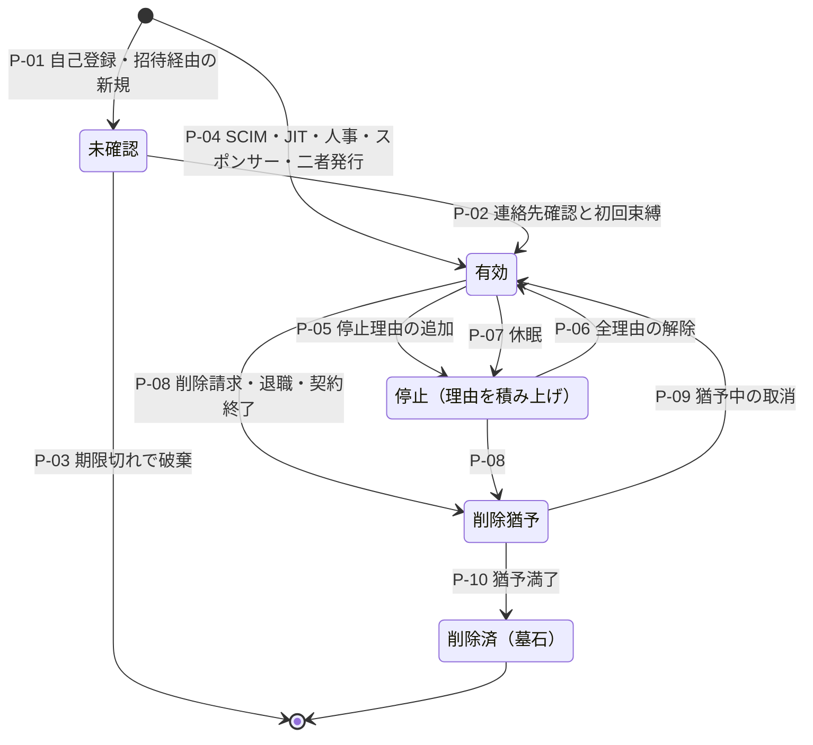

| ID | 遷移 | 契機・実行者 | 保証要件 | 監査イベント | 失敗時挙動 | T 候補 | TC 候補 |
|---|---|---|---|---|---|---|---|
| P-01 | [*]→未確認 | 本人の登録開始（PC-01、PC-09(b)）、招待の受諾で新規主体を作る場合（§6） | bot 対策と rate limit（DL-52 FA-11）。この時点の連絡先は未確認であり、linking・招待の受諾・回復・通知の宛先に使わない | user.registration.started | 入力した連絡先の既存登録の有無を応答から推測させない | IL-T01, IL-T02 | IL-TC01 |
| P-02 | 未確認→有効 | 連絡先の確認と初回の認証器の束縛の完了 | 確認コードは認証ではない（63B-4 §3.1.3.1、RS-13#7）[N][^17]。初回束縛は §5.3 | user.activated、authenticator.bound | 期限内に完了しなければ P-03。確認コードは単回・期限付き | IL-T01 | IL-TC01 |
| P-03 | 未確認→破棄 | 期限切れ（期間は TBD: 所有者 プロダクト責任者、期限 G1、決め方 As-Is の登録完了時間の分布） | — | user.registration.expired | 破棄に失敗しても有効化しない。subject は払い出し済みなら墓石にする（INV-1） | IL-T01 | IL-TC01 |
| P-04 | [*]→有効 | SCIM 作成、JIT（初回の連携ログイン）、人事の入社イベント（開始日に有効化）、スポンサー承認（PC-05、有効期限付き）、二者承認による発行（PC-07）、事前作成（PC-08、封緘） | 類型別（§5.1）。SCIM 作成は作成時に連携 ID を結合する（§15） | user.created（source を記録） | 連携 ID を結合できない SCIM 作成は SM-Y の「結合待ち」に置き、ログインを許さない | IL-T15, IL-T16 | IL-TC12 |
| P-05 | 有効→停止 | §2.3 の理由（SEC・LEG・ADM・SRC）の設定 | 理由ごとの設定者（§2.3）。ADM は利用者管理者以上、SEC の手動設定は基盤のセキュリティ運用またはテナント管理者 | user.suspended（理由） | INV-6 の全手段を失効させる。失効の伝播が一部失敗しても停止は維持し、再試行と警報を続ける（§2.4） | IL-T17, IL-T18 | IL-TC13, IL-TC23 |
| P-06 | 停止→有効 | 全理由の解除 | 理由ごとの解除者（§2.3）。SEC の解除前に、認証器と回復情報の健全性を確認する（攻撃者が追加した認証器の除去） | user.resumed（解除した理由） | 1 つでも理由が残れば停止のまま（INV-8） | IL-T18, IL-T21 | IL-TC23 |
| P-07 | 有効→停止（DOR） | 最終利用からの期間の経過（期間は決裁案 IL-D5） | 自動。事前に通知する | user.dormant | 通知が届かなくても休眠は実行し、通知先の再確認を次回ログインで求める | IL-T17 | IL-TC19 |
| P-08 | 有効・停止→削除猶予 | 本人の削除請求、退職、契約終了、最後の所属の除去、休眠期限 | 本人の請求は +SEC の step-up（DL-09 §6.7）[^9]。管理者の請求は利用者管理者以上 | user.deletion.requested（期限） | P-05 と同じく全手段を失効させる。法的保全（DL-49 の H）がある場合は削除猶予に留める | IL-T17 | IL-TC19 |
| P-09 | 削除猶予→有効 | 猶予期間内の取消（本人または請求した管理者） | 本人はアカウントで使える最高の AAL で再認証する | user.deletion.cancelled | 猶予期間を過ぎた取消は受け付けない | IL-T20 | IL-TC19 |
| P-10 | 削除猶予→削除済 | 猶予期間の満了 | — | user.deleted（仮名 ID で記録） | §16.2 の除去を行う。一部の除去が失敗したら再試行し、未完了を削除証明に記載する（DL-49 §10.4 と同じ扱い）[^11] | IL-T27 | IL-TC19 |

- 削除済は終端である [D]。同じ人が再び登録した場合は新しい subject を払い出し、旧 subject を再利用しない（INV-1）[D]。
- 63A-4 §5.4 は、CSP が本人の選択・侵害・規約違反・非活動・死亡の通知・法的文書・事業終了のいずれかに当たるとき、アカウントを速やかに停止または終了しなければならないとしている（SHALL）[N][^16]。P-05・P-07・P-08 の契機はこの列挙を含むように置いた [D]。

## 5. 登録と本人確認（R-279、R-033）

### 5.1 登録経路

| 経路 | 対象 | 手順 | 保証要件 | 失敗時挙動 | T 候補 | TC 候補 |
|---|---|---|---|---|---|---|
| E-1 自己登録 | PC-01、PC-09(b) | P-01→連絡先確認→初回束縛（§5.3）→P-02 | bot 対策（DL-52）。未確認の連絡先は他の経路と結び付けない | 未完了は P-03 で破棄 | IL-T01, IL-T02 | IL-TC01 |
| E-2 招待 | PC-02（本基盤で認証）、PC-03 の初期管理者、PC-09(b) | §6 の I-03 で受諾者が認証し、新規なら E-1 の手順で主体を作る | §6 | §6 | IL-T03 | IL-TC02 |
| E-3 SCIM 事前作成 | PC-02 | SCIM の作成要求を受け、作成時に連携 ID を結合して P-04 | SCIM client の資格情報からテナントを導く（DL-26 §7）[^10] | 結合できなければ SM-Y の結合待ち（§15） | IL-T15, IL-T16 | IL-TC12 |
| E-4 JIT | PC-02 | テナントの allowlist にある IdP から初回の連携ログイン→trust agreement の対象母集団に入るか判定→主体・所属・連携 ID を同時に作る | INV-3、INV-4。JIT は既存アカウントを email・userName で探さない（INV-2） | 対象母集団外なら作成しない。同じテナントで SCIM 管理下の利用者に一致すれば JIT では作成しない（§15） | IL-T05, IL-T16 | IL-TC12 |
| E-5 人事 | PC-04 | 入社イベントで無効状態の主体を作り、開始日に有効化する。初回束縛は監督付きで行う（§5.3） | 人事システムを正本とする（DL-48 §4.4）[^8] | 人事イベントの欠落は定期照合（§16.1）で検出する | IL-T17 | IL-TC19 |
| E-6 スポンサー | PC-05 | スポンサーの申請、契約 ID、有効期限→承認→P-04 | スポンサー≠承認者（INV-9） | 有効期限のない申請は受け付けない | IL-T28 | IL-TC19 |
| E-7 二者発行 | PC-07 | 申請→二者承認→対面または監督付きで device-bound 認証器を交付 | DL-48 §4.4、ADR-029[^8] | 承認が揃わなければ発行しない | IL-T33 | IL-TC17 |
| E-8 事前作成・封緘 | PC-08 | 作成→device-bound 認証器の登録→封緘 | DL-48 決裁案 4[^8] | 封緘の記録が残らなければ有効化しない | IL-T14 | IL-TC10 |

- E-1 で未確認の連絡先を他の経路と結び付けないのは、`email_verified` が「検証した時点で」利用者がその email を制御していたことを意味するにとどまり（RS-03#58）[N][^22]、未確認の値ではそれも示さないためである [D]。他人の email で先に登録しておき、正規の利用者が後から連携ログインしたときに結合させる手口（事前乗っ取り）を、連絡先の未確認と自動 linking の禁止の 2 段で止める [D]。
- Okta の外部 IdP 連携で自動 linking を選ぶと、IdP から渡された username（email）と既存利用者の username の一致で結合される（RS-14#5）[V][^37]。E-4 で email・userName による照合をしないのは、この結合方式をとらないためである [D]。

### 5.2 本人確認（IAL）

本基盤は本人確認書類を保持しない [A-070]。本人確認が必要な場合は外部の本人確認事業者（CSP）または顧客組織に委ね、基盤は結果（IAL、方式、経路、実施日、実施者）だけを記録する [D][A-070]。

| PC | 本人確認の初期案 | 実施者 | 根拠 |
|---|---|---|---|
| PC-01 | 既定は「本人確認なし」。取引が求める場合だけ IAL2 に引き上げる（IL-N6） | 外部の本人確認事業者 | SP 800-63-4 は IAL・AAL・FAL が異なる値でもよく、本人確認が不要という判断もあり得るとする（RS-03#6）[N][^15] |
| PC-02、PC-03 | 顧客組織が実施し、trust agreement で IAL を定める。assertion に IAL の申告がなければ「IAL なし」として扱い、IAL1 とみなさない | 顧客組織（顧客 IdP） | 63C-4 §2.5（RS-03#9）[N][^18]。顧客管理者の IAL は DL-09 REQ03-D4[^9] |
| PC-04 | 人事の雇用手続を正本とし、基盤は人事記録への参照だけを持つ | 人事責任者 | DL-48 §4.4[^8] |
| PC-05 | スポンサーと契約による確認。IAL は ADR-002 で決める | 調達責任者とスポンサー | DL-48 決裁案 6[^8] |
| PC-07、PC-08 の保有者 | 監督付きの本人確認。IAL3 とするかは ADR-002 で決める。IAL3 は対面（on-site attended）に限られる | CISO が指名した確認者 | 63A-4 §4.3.1（SHALL、RS-03#11）[N][^16]。DL-09 §3.1 は privileged/P の初期対応を IAL3 としている[^9] |
| PC-09(a) | home 側に従う | home テナント | DL-48 §4.2[^8] |
| PC-10 | 代理権の確認。法域ごとの要件は未調査 | — | DL-48 決裁案 2[^8] |
| PC-12〜PC-17 | 対象外 | — | RS-03#2 [N][^15] |

本人確認を行う場合の遷移は次のとおりである [D]。

| ID | 遷移 | 保証要件 | 監査イベント | 失敗時挙動 |
|---|---|---|---|---|
| V-1 | 開始 | アカウントで使える最高の AAL で認証してから始める（63A-4 §3.16 の SHALL、RS-03#11）[N][^16] | proofing.started | 認証できなければ開始しない |
| V-2 | 証拠の収集・検証・照合 | 外部事業者の手順に従う。63A-4 は resolution、validation、verification の 3 段階を例示している（§2.1.1、informative）[N][^16]。遠隔の本人確認では、正規センサーからの入力であることを確かめる統制と媒体の改ざん検出が SHALL である（RS-03#12）[N][^16] | proofing.completed（結果、IAL、経路） | 不成立なら IAL を変えない。例外対応は trusted referee 相当の手順に限り、全セッションを記録する（63A-4 §3.15.1 の SHALL、RS-03#13）[N][^16] |
| V-3 | 本人確認の通知 | 確認済みの郵便住所または電話番号へ送る（全 IAL で SHALL。IAL1 では確認済みの email でもよい MAY）。実施した事業者名と完了日、身に覚えがない場合の連絡先を含める（SHALL）（63A-4 §3.10）[N][^16] | proofing.notified | 送付できなければ IAL の引上げを確定しない（§2.4） |
| V-4 | IAL の記録 | 実施経路を記録する。63A-4 は、複数の照合経路を提供する CSP に、IAL2 に至った経路を記録し、assertion・API・trust agreement のいずれかで RP に示すことを求めている（SHALL、§4.2.6）[N][^16] | proofing.recorded | — |

- 外部事業者を使う場合、RP は利用する CSP の DIAS を確認しなければならない（SHALL、RS-03#8）[N][^15]。事業者の選定と DIAS の確認は ADR-002 で行う [D]。
- IAL2 はどの本人確認の方式でも提供してよく（MAY）、方式を組み合わせる場合はその手順を文書化しなければならない（SHALL）（63A-4 §4.2.1）[N][^16]。
- 日本の DS-511 は身元確認保証レベルを 3 段階で定めるが、適用対象は国の行政機関の手続である（RS-03#3, #10）[N][^19]。日本の民間の本人確認規制（犯罪収益移転防止法の eKYC など）と EU・英国の保証レベル体系は RS-03 で調べていない（RS-03 §6-1）[D]。金融等の規制業種の顧客向けの要件は DL-34 の判定を待つ（§24）[D]。

### 5.3 初回の認証器束縛

- AAL2 の verifier は、フィッシング耐性のある選択肢を少なくとも 1 つ提供しなければならない（SHALL、RS-03#14）[N][^17]。初回束縛の画面では passkey またはセキュリティキーを最初に提示する [D]。
- 63A-4 は、本人確認済みの利用者に、回復の必要を減らすため 2 つ以上の認証手段を束縛するよう勧めるべきとしている（SHOULD、§4.1.12、§4.2.12）[N][^16]。本基盤は本人確認をしない利用者にもこれを準用し、2 つ目の認証器か回復コードの登録を初回束縛の直後に案内する [D]。
- 単一の保護された session の外で認証器を束縛する場合、CSP は continuation code の返送か本人確認時に採取した生体情報との照合で本人の在席を確かめなければならない（SHALL、63A-4 §4.1.12、§4.2.12）[N][^16]。IAL3 では初回の認証器を対面で交付または登録しなければならない（SHALL、§4.3.10）[N][^16]。E-5（人事）と E-7（PC-07）の監督付き束縛はこの規定に合わせる [D]。

## 6. 招待（SM-I、R-034）

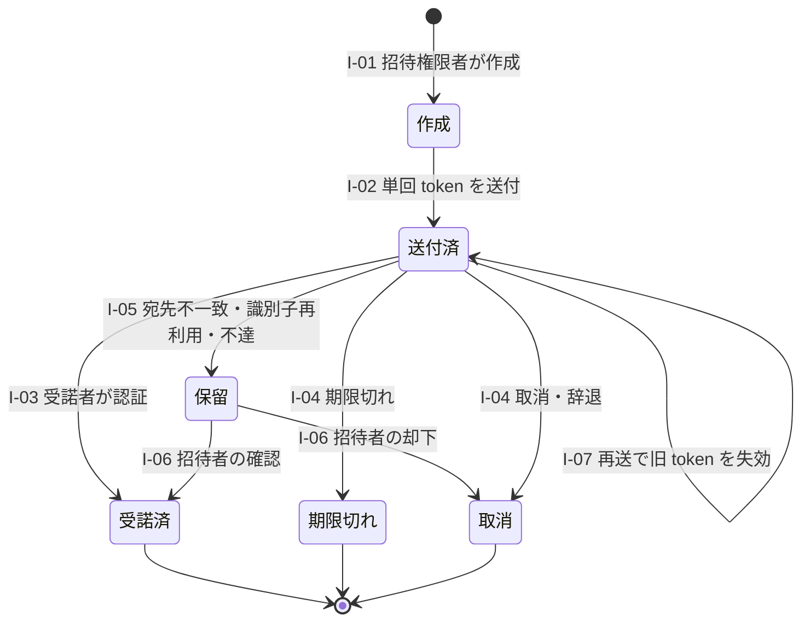

| ID | 遷移 | 契機・実行者 | 保証要件 | 監査イベント | 失敗時挙動 | T 候補 | TC 候補 |
|---|---|---|---|---|---|---|---|
| I-01 | [*]→作成 | 招待権限を持つ者（テナント設定。既定の案は決裁案 IL-D7） | 宛先、所属先、付与するロール、有効期限を指定する。管理者ロールを付与する招待は DL-26 の P-6 と同じ保証にする。招待者と招待先テナントごとの発行数に上限を置く | invitation.created | 上限超過・ロールの範囲外は作成しない | IL-T03 | IL-TC02 |
| I-02 | 作成→送付済 | 本基盤 | 受諾 token は単回・推測不能・有効期限付き。email は配送経路にすぎず、受諾者の識別に使わない（INV-2） | invitation.sent | 送付に失敗したら招待者に返す | IL-T03 | IL-TC02 |
| I-03 | 送付済→受諾済 | 受諾者 | 受諾者が認証する。既存の主体は付与するロールの階層が要する AAL で、新規は E-1 で主体を作る。招待先テナントが検証済みドメインを持ち SSO を強制している場合、そのドメインの宛先はテナントの IdP 経由でしか受諾できない | invitation.accepted → membership.added（M-01） | 受諾 token の再利用・期限後の使用は拒否する | IL-T03, IL-T26 | IL-TC02 |
| I-04 | 送付済→期限切れ・取消 | 期限の経過、招待者・管理者の取消、受諾者の辞退 | — | invitation.expired、invitation.revoked | 取消後の受諾は拒否する | IL-T03 | IL-TC02 |
| I-05 | 送付済→保留 | 受諾者の確認済み連絡先が宛先と異なる、宛先の識別子再利用の通知（RISC identifier-recycled）を受けた、不達 | 自動で受諾させない | invitation.held（理由） | 招待者の判断を待つ | IL-T03, IL-T04 | IL-TC02 |
| I-06 | 保留→受諾済・取消 | 招待者（不在なら管理者） | 判断の理由を記録する | invitation.resolved | 期限内に判断がなければ取消 | IL-T03 | IL-TC02 |
| I-07 | 再送 | 招待者 | 新しい token を発行し、旧 token を失効させる | invitation.resent | — | IL-T03 | IL-TC02 |

- 招待の有効期限は TBD とする（所有者: プロダクト責任者、期限: G1、決め方: As-Is の招待の受諾までの時間の分布と、DL-52 の招待スパムの検知指標）[D]。
- 招待権限をロールで制限できる仕組みは SSCF の要求である（IAM-SaaS-21、must、RS-14#50）[N][^50]。DL-52 は招待スパム（FA-13）を正規機能の濫用として扱い、発行数の上限と検知を定めている[^12] [D]。
- RISC 1.0 は email・電話番号が別人に再割当てされたことを通知する `identifier-recycled` を定義している（RS-03#66、RS-14#9）[N][^23]。受信したら、その宛先の未受諾の招待を保留にする（RS-14 §5.1 の ADR-006 への入力）[D]。
- 宛先と受諾者の連絡先の不一致を保留にするのは、転送された招待で意図しない者が所属することを防ぐためである [D]。email を識別子として使わない原則（INV-2）とは矛盾しない [D]。一致を「結合」の根拠にはせず、不一致を「人の確認」の契機にだけ使うためである [D]。
- 越境のゲスト（PC-09(a)）の招待は、資源側テナントの外部付与（§7.1 の M-01x）として扱う [D]。Microsoft Entra では、招待の自動受諾は home 側の outbound と資源側の inbound の両方で設定した場合だけ有効になる（RS-14#69）[V][^35]。本基盤も home 側と資源側の双方の許可を外部付与の条件にする（RS-14 §5.1 の ADR-010 への入力）[D]。

## 7. 所属・所属変更・複数所属（SM-M、R-035、R-283）

### 7.1 状態機械

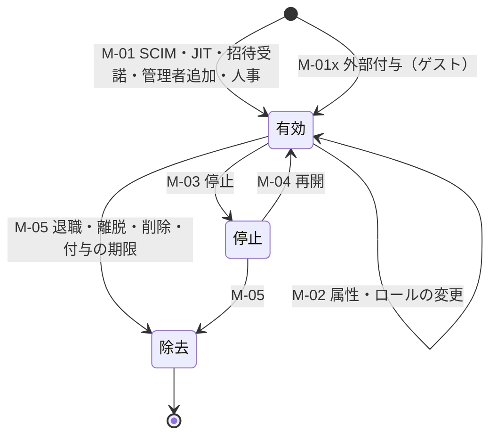

| ID | 遷移 | 契機・実行者 | 保証要件 | 監査イベント | 失敗時挙動 | T 候補 | TC 候補 |
|---|---|---|---|---|---|---|---|
| M-01 | [*]→有効 | SCIM 作成、JIT、招待の受諾（I-03）、管理者の追加、人事の配属 | trust agreement の対象母集団に入ること（JIT・SCIM）。管理者による追加は利用者管理者以上 | membership.added | 対象母集団外なら作成しない | IL-T03, IL-T26 | IL-TC02, IL-TC04 |
| M-01x | [*]→有効（外部付与） | 資源側テナントの管理者または付与権限者 | home 側 outbound と資源側 inbound の双方の許可。外部主体には管理者ロールを付与できない（DL-26 B-4）[^10] | membership.external.granted | 双方の許可がなければ付与しない | IL-T26 | IL-TC04 |
| M-02 | 有効→有効（変更） | SCIM の更新、人事の異動、管理者 | 権限を減らす変更は即時に反映する。管理者ロールの付与は DL-26 の P-6（束縛認証器での再認証、通知、監査）とし、束縛認証器の登録が済むまで保護操作を不可にする（DL-48 §4.4）[^8][^10] | membership.changed（前後値） | 旧権限の除去が失敗したら所属を停止して照合する（§7.2） | IL-T32 | IL-TC03 |
| M-03 | 有効→停止 | 管理者、SCIM の `active=false`、テナントの停止（DL-49 の T05・T06） | 当該テナント文脈の session・token・委任だけを失効させ、他テナントの所属に影響させない | membership.suspended（理由） | INV-6 と §2.4 | IL-T17, IL-T26 | IL-TC04, IL-TC13 |
| M-04 | 停止→有効 | 理由ごとの解除者（§2.3） | — | membership.resumed | 理由が残れば停止のまま | IL-T18 | IL-TC23 |
| M-05 | 有効・停止→除去 | 退職、離脱、SCIM の削除、テナントの削除、外部付与の期限・取消、資源側の信頼リストからの home テナントの除外 | 当該テナントの連携 ID を解除し（F-04）、所属に由来する付与（relation）を除去する。最後の所属を除去した主体は類型とテナントの方針により P-08 へ送る | membership.removed | 付与の除去が失敗しても所属は除去済みとし、PEP の所属確認で拒否する。除去は再試行する | IL-T17 | IL-TC19 |

- 資源側の信頼リストから home テナントを外したときは、外部付与を一括で失効させる（RS-14 §5.1 の ADR-010 への入力）[D]。本基盤は失効させたうえで資源側の管理者に通知する [D]。

### 7.2 所属変更（mover）

| 場面 | 規則 | 根拠 |
|---|---|---|
| テナント内の異動（グループ・属性の変更） | 旧グループに由来する付与を除去してから新グループの付与を加える。除去と追加の間に両方を持つ状態を作らない | 権限の蓄積の防止 [D] |
| 社内の異動（PC-04） | 人事の異動イベントで旧組織に由来する付与を除去する。移行期間に旧権限を残す場合は、期限付きの例外として受容票（DL-05）を付ける | DL-48 §4.4[^8] |
| 所有者の異動 | 異動した主体が所有する非人間主体を逆引きし、所有者の再確認を求める。所有者が異動先で所有を続けない場合は SM-N の所有者不在へ送る | DL-48 §5.1（所有者の無効化・異動を検知）[^8] |
| テナント間の異動（子会社の再編など） | 主体を「移動」させない。移動先テナントで所属を追加し（M-01）、移動元の所属を除去する（M-05）。業務データの所有はテナントに残す | テナントの統合・分割は DL-49 §8・§9 が扱う[^11] |
| 顧客管理者への昇格・降格 | 昇格は M-02 の P-6。降格は即時に反映し、privileged の判定は fresh で行うため次の操作から拒否される | DL-09 §3.6[^9] |
| SCIM の順序の逆転 | ETag による版の比較で古い更新を拒否する。IdP が If-Match を送らない場合は後勝ちになるため、IdP が管理する属性はアプリ側から変更不可にする | RFC 7644 §3.14（MAY、RS-14#32）[N][^26]。DL-26 §7[^10] |

### 7.3 複数所属とテナント文脈

| # | 規則 | 根拠 |
|---|---|---|
| MT-1 | 同じ類型の中では、1 人の利用者は 1 つの主体に複数の所属を持つ。テナントごとに主体を作らない | 63A-4 §5.6 は、1 人が異なる役割で利用する場合に、複数のアカウントを作らずに複数の persona を管理できる手段を提供すべきとしている（SHOULD）[N][^16] |
| MT-2 | token と session のテナント文脈は常に 1 つ（active tenant）とする。テナントの切替は token の書換えではなく新しい認可要求で行う | CL-0152（維持）[^6]。claim は ADR-005・DL-16 で決める [D] |
| MT-3 | 初期のテナント文脈は利用者が選ぶ。最後に使ったテナントを記憶してよいが、email のドメインだけからは推定しない | INV-2 [D] |
| MT-4 | テナント文脈の認証要件は、そのテナントの方針で判定する。テナント B が SSO を強制している場合、テナント A の IdP で得た認証ではテナント B の文脈に入れない | Microsoft Entra のテナント間アクセス設定は、既定で外部組織の MFA と端末の claim を信頼しない（RS-14#69）[V][^35]。INV-3 [D] |
| MT-5 | PEP は token のテナントと資源の所有テナントの一致を検査する | Microsoft は token の tid がデータ保存先テナントの ID と一致することを常に確認するよう求めている（RS-14#3）[V][^30]。DL-26 B-5[^10] |
| MT-6 | 1 つの所属の停止・除去（M-03・M-05）は、そのテナント文脈の session だけを失効させる。主体の停止（P-05）は全文脈を失効させる | §2.1 の分割 [D] |
| MT-7 | 類型をまたぐ同一人物の複数の主体（従業員と B2C 利用者、日常アカウントと PC-07）は別の主体とし、自動で linking しない | DL-48 §3.1[^8] |

- 本人確認済み（IAL1 以上）の主体について同一人物の複数アカウントを許す場合、CSP は不正の点検手順を文書化し、共通の属性に結び付くアカウントの対応表を持ち、本人にアカウントの一覧を示さなければならない（SHALL、63A-4 §5.6）[N][^16]。MT-7 の別主体がこれに当たるか、対応表を持つことのプライバシー影響をどう評価するかは、ADR-021 と DL-25 で判断する（§24）[D]。
- 複数テナント所属の利用者は基準で 2.1万人である [A-015]。前提台帳は A-015 の感度として、tenant confusion の試験範囲（DL-22）を挙げている[^7] [D]。

## 8. IdP 発見・複数 IdP・保証元の結合（R-036、R-047）

### 8.1 home realm discovery

HRD は利用者を正しい IdP へ案内する機能であり、セキュリティ統制ではない [D]。Okta は、IdP routing rules が利用者のサインイン体験を改善するが、セキュリティを強化しないと明記している（RS-03#69）[V][^36]。安全性は HRD の後の検証（INV-3）で担保する [D]。

| 順 | 判定の入力 | 規則 | 根拠 |
|---|---|---|---|
| H-1 | 明示されたテナント（テナント固有の URL、依存サービスが渡すテナントの指定） | 指定されたテナントの IdP 一覧から選ぶ。指定値は利用者が書き換えられる入力として扱い、後段の検証を省かない | INV-3 [D] |
| H-2 | 利用者が入力した識別子のドメイン | ドメイン検証済みのテナントだけを対象にする。消費者向けのメールドメインはどのテナントにも振り分けない。Google Workspace の利用者は email のドメインではなく `hd` claim で判定する | ドメイン検証の方式は DL-26 §6[^10]。Google はメールのドメインで Workspace 利用者を判定できず `hd` を使う必要があるとしている（RS-03#65）[V][^39] |
| H-3 | 記憶した選択 | 記憶することを利用者に示し、取り消せるようにする | 63C-4 §4.6.2 は、選択を記憶する場合の開示と取消を SHALL としている（RS-03#68）[N][^18] |
| H-4 | 選択画面 | テナント名の一覧を表示しない。入力した識別子からテナントや利用者の存在を推測させない | [D] |

- HRD の後の認証要求は RP が開始する（INV-4）[D]。FAL2 では federation transaction を RP が開始しなければならない（SHALL、RS-03#49）[N][^18]。
- RP が IdP を allowlist に入れる場合、ワイルドカードのドメインを使ってはならない（SHALL NOT、RS-03#68）[N][^18]。allowlist はテナントごとに持つ（DL-26 §5）[^10] [D]。
- assertion の検証項目（署名、発行者、audience、時刻、nonce、`InResponseTo`、再送でないこと、RFC 9207 の `iss`）は DL-26 §5.3 と DL-16 で定める[^10] [D]。
- H-2 の振分けはドメインの検証状態に従い、検証が失効したら猶予期間の後に振分けを止める（DL-26 §6.3）[^10] [D]。IETF の草案は、別の利用者によるドメインの再検証を旧所有者の状態の「再有効化」として扱わないよう注意している（§9.13、RS-14#27）[N][^42]。Atlassian は検証後も TXT レコードを定期的に確認し、削除・変更から 14 日以内に再検証しないと未検証に戻す（RS-03#71）[V][^41]。

### 8.2 テナントあたり複数 IdP

| # | 規則 | 根拠 |
|---|---|---|
| MI-1 | テナントは複数の IdP を登録できる。IdP ごとに trust agreement で対象母集団（ドメイン、グループ）を定める | trust agreement は対象母集団を定義しなければならない（SHALL、RS-14#11, #12）[N][^18] |
| MI-2 | 1 つの連携 ID は 1 つの IdP に属する。同じ利用者が同じテナントの別の IdP から来た場合、自動で既存の主体に結合しない。対象母集団に入っていれば新しい主体を作るか、§9.2 の linking を案内する | INV-2、INV-3 [D] |
| MI-3 | 既存の連携 ID を持つ主体の session は、その連携 ID の IdP の assertion でしか作れない | 63C-4 §3.9（SHALL、RS-03#51）[N][^18] |
| MI-4 | IdP の追加・変更・削除、linking 規則の変更は保護操作（DL-26 の P-1、P-3）とする | DL-26 §4[^10]。Scattered Spider は標的組織の SSO テナントへ federated IdP を追加し、自動 account linking を有効化していた（RS-14#6。勧告は現行の TTP としては確認されていないと付記）[I][^43] |
| MI-5 | テナント内で IdP を移行する（旧 IdP から新 IdP へ）場合の連携 ID の付替えは §9.2 の L-3〜L-5 による | R-260 [D] |

### 8.3 「どのテナントのどの IdP がこの主体を保証したか」の結合（R-047）

レビューは、B2B マルチテナントで「どのテナントの、どの IdP が、この主体を保証したか」を誤ると、ReBAC 以前に境界が崩れると指摘した（L107）[^14] [D]。本基盤は次の 3 か所でこの結合を保持する [D]。

| 保持する場所 | 記録・表現する内容 | 規則 |
|---|---|---|
| 連携 ID（SM-F） | テナント ID、IdP 識別子（OIDC issuer／SAML entityID）、外部 subject | 3 つ組で一意。外部 subject を IdP をまたいで一意とみなさない（SHALL NOT、RS-03#57）[N][^18] |
| session（SM-S） | 認証したテナント文脈、IdP 接続 ID、FAL、IdP が示した `acr`・`amr`・`auth_time`、本基盤での step-up の有無 | session のテナント文脈は、(a) 認証した IdP が属するテナント、または (b) その IdP を信頼する設定を持つ資源側テナント（ゲスト）のどちらかに限る |
| 依存サービスへの token | 内部 subject、テナント文脈、保証元を示す属性（IdP 接続の参照、`acr`、`auth_time`）。外部 subject と email は載せない | claim 名と型は ADR-005・DL-75 で決める。保証元の参照を token に載せるか、introspection や監査からだけ引けるようにするかは ADR-005 で比較する |

- 本基盤は顧客 IdP に対しては RP、約 300 の依存サービスに対しては IdP として振る舞う federation proxy である [D]。proxy には、それぞれの役割について IdP・RP の全規範要求が適用される（SHALL、RS-14#17）[N][^18]。IdP の役割では、要求を満たせなかった場合も結果の xAL を assertion に示さなければならない（SHALL、RS-03#9）[N][^18]。依存サービスへの token に `acr` を載せるのはこのためである [D]。
- テナント A の IdP が発行した assertion をテナント B の受信口に提示する負例は、RS-03 §5.2 の第 4 項で PoC の対象に挙がっている [D]。本書では IL-TC06 とした（§20）[D]。

## 9. 連携 ID と account linking（SM-F、R-037、R-260）

### 9.1 状態機械

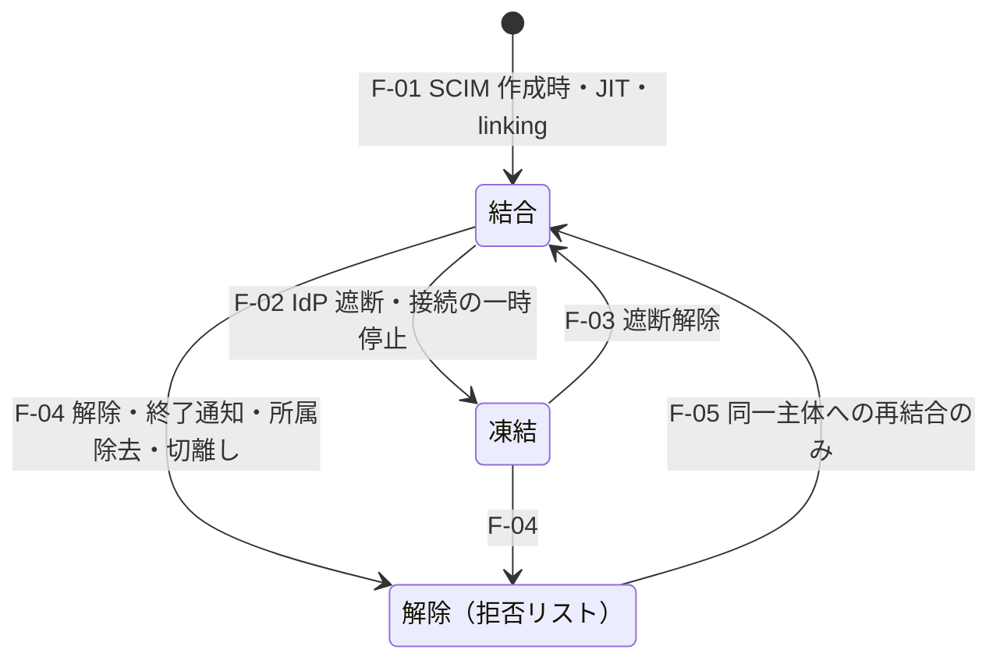

| ID | 遷移 | 契機・実行者 | 保証要件 | 監査イベント | 失敗時挙動 | T 候補 | TC 候補 |
|---|---|---|---|---|---|---|---|
| F-01 | [*]→結合 | SCIM の事前作成（E-3）、JIT（E-4）、利用者による linking（§9.2） | INV-3、INV-4。linking の場合は §9.2 の条件 | fid.bound（テナント、IdP、外部 subject のハッシュ） | 条件を満たさなければ結合せず、ログインを拒否する | IL-T05, IL-T06, IL-T08, IL-T09, IL-T10 | IL-TC05, IL-TC06, IL-TC07 |
| F-02 | 結合→凍結 | IdP の遮断（§14 の K2-4）、IdP 接続の一時停止 | 基盤のセキュリティ運用、またはテナントの IdP 管理者（P-1） | fid.frozen | 凍結の記録を先に行い、その IdP 由来の session を失効させる（§2.4） | IL-T13 | IL-TC11 |
| F-03 | 凍結→結合 | 遮断の解除 | 顧客の是正報告と基盤の承認（DL-26 決裁案 6）[^10] | fid.unfrozen | 承認がなければ凍結のまま | IL-T13 | IL-TC11 |
| F-04 | 結合・凍結→解除 | 利用者による解除、IdP からの終了通知、所属の除去（M-05）、IdP の切離し（DL-26 §5.4） | 利用者による解除は +SEC の step-up とし、他の認証手段が残る場合に限る。解除した連携 ID からのアクセスは拒否する（SHALL）。追加・削除を通知する（SHALL）（RS-03#59）[N][^18]。状態変化の通知を受けた RP は連携 ID の結合を外す（SHALL、RS-03#78）[N][^18] | fid.unbound（契機） | 拒否リストへの登録を先に行い、属性の除去は後で再試行する | IL-T07, IL-T17 | IL-TC08, IL-TC19 |
| F-05 | 解除→結合 | linking の手続（§9.2 L-1） | 同じ主体への再結合に限る。別の主体への結合は行わない | fid.rebound | 別主体への結合要求は拒否し、SEC の検知対象にする | IL-T07 | IL-TC08 |

### 9.2 linking の場面別規則

| # | 場面 | 規則 | 根拠 |
|---|---|---|---|
| L-1 | 利用者が既存の主体に新しい連携 ID を加える | 認証済み session の中で行い、既存の連携 ID（または既存の認証器）での再認証と、新しい IdP での認証の両方を経る。管理者は自動 linking の対象にしない | 63C-4 §3.8.1（認証済み session は SHALL、既存の連携 ID での認証は SHOULD、RS-03#59）[N][^18]。Auth0 は手動でも自動でも linking の前に両方のアカウントの認証を要求すべきとしている（RS-03#60）[V][^38]。管理者の除外は DL-26 B-7[^10] |
| L-2 | 利用者が連携 ID を解除する | F-04。最後の認証手段は解除できない | INV-5 [D] |
| L-3 | IdP の付替え（利用者主導、旧 IdP をまだ使える） | 旧 IdP で認証済みの session の中で新 IdP を linking し（L-1）、その後に旧連携 ID を解除する | DL-26 §5.4[^10] |
| L-4 | IdP の付替え（管理者主導の一括対応表、旧 IdP の退役） | 旧 subject と新 subject の対応表の登録を保護操作 P-3 とし、対象の利用者全員に通知する。対応表は email の一致から作らない。二者承認と発効遅延の要否は DL-26 決裁案 2 | DL-26 §5.4、決裁案 2[^10] |
| L-5 | 旧 IdP を使えない状態での付替え（IdP の喪失、利用者が旧 IdP の資格情報を失った） | 連携利用者の「回復」として SM-R で扱う。テナント管理者の確認、新 IdP での認証、待機、通知を経る。対象が管理者なら R-B の二者承認 | R-260 [D]。付替えは乗っ取りの主要経路である（レビュー L99）[^14] |
| L-6 | As-Is の 12 ストアの統合 | 同一人物の重複（15% と仮置き）を email の一致で自動統合しない。利用者が移行後に L-1 で linking する | DL-48 §3.2[^8][A-111] |
| L-7 | email・username の一致による自動 linking | 提供しない（決裁案 IL-D6） | INV-2 [D] |

- MSRC は 2023-06-20 の勧告（nOAuth の公表に対応したもの）で、email claim は改ざんされ得るため認可に使ってはならないとし、ドメイン所有者が未検証の email claim を大半のアプリケーションで token から省く緩和策を展開した（RS-03#62）[I][^45]。
- Okta の報告では、奪取した Super Administrator 権限で 2 つ目の IdP を構成し、source 側 IdP の username を target 側の実在利用者に一致させてなりすました（RS-14#7）[I][^44]。L-1 で両方の IdP での認証を要求し、L-7 を提供しないのはこの手口を止めるためである [D]。

### 9.3 email の再利用

| 事象 | 本基盤の挙動 | 根拠 |
|---|---|---|
| RISC `identifier-recycled` の受信 | その email・電話番号に結び付いた回復先・通知先・未受諾の招待を凍結し、利用者に別経路で再確認を求める | RISC 1.0 §2.6（RS-03#66）[N][^23]。RS-03 §5.1 の ADR-006 への入力 [D] |
| IdP で利用者の email が変わった | 表示用の属性を更新するだけで、結合と識別子は変えない | INV-2 [D]。OIDC は利用者の email が時期によって変わってよい（MAY）としている（RS-03#58）[N][^22] |
| 削除済みの利用者と同じ email で新規登録 | 新しい subject を払い出す。旧主体の付与・履歴を引き継がない | INV-1 [D] |
| SCIM で削除済みと同じ userName が作られた | 新しい内部 ID を割り当てる（§15 の C5） | RFC 7644 §3.6（SHOULD NOT で 409 にしない、RS-03#75）[N][^26] |

## 10. 認証器（SM-A、R-041、R-043）

### 10.1 状態機械

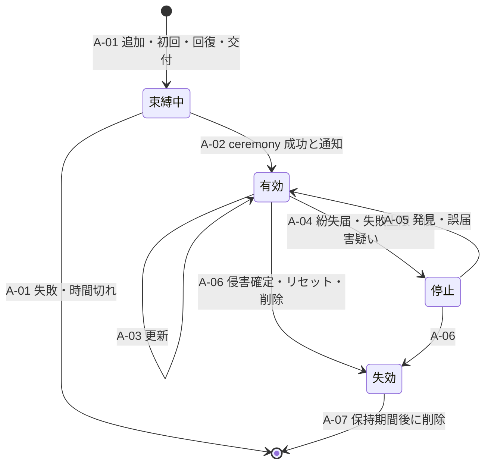

| ID | 遷移 | 契機・実行者 | 保証要件 | 監査イベント | 失敗時挙動 | T 候補 | TC 候補 |
|---|---|---|---|---|---|---|---|
| A-01 | [*]→束縛中 | 本人の追加、初回束縛（§5.3）、回復（SM-R の R-07）、管理者による交付（PC-07・PC-08） | 追加は、アカウントで使える最高の AAL と新しい認証器を使う最高の AAL のうち低いほうで認証させる（SHALL、RS-03#32）[N][^17]。PR 認証器を持つアカウントでは PR で認証し、弱い方式へ fallback しない（DL-09 +SEC）[^9]。別端末からの束縛コードは、識別子と組み合わせるなら 40 ビット以上、組み合わせないなら 112 ビット以上、単回、最大 10 分、email で送らない（SHALL、RS-03#32）[N][^17]。FAL3 用の束縛認証器を利用者が持ち込む場合、binding の session は 5 分以内に時間切れにする（SHALL、RS-14#16）[N][^18] | authenticator.binding.started | 時間切れ・失敗は破棄し、試行回数を数える | IL-T21 | IL-TC14 |
| A-02 | 束縛中→有効 | ceremony の成功 | 認証器の特性（単要素か多要素か、PR か、BE・BS、attestation の有無）を判定して記録する（SHALL、RS-03#31）[N][^17]。WebAuthn では UV を preferred とし応答の UV を確認する。UV がなければ単要素として扱う（SHALL、RS-03#22）[N][^17]。追加を独立した経路で通知する（SHALL、RS-03#32）[N][^17] | authenticator.bound | 通知を送れない場合は束縛を確定しない（§2.4） | IL-T21 | IL-TC14 |
| A-03 | 有効→有効（更新） | renewal、update、BE・BS の変化 | BE・BS の最新値を保存する（RECOMMENDED）。BS が 1 から 0 に変わった場合は他の要素を確認させる（SHOULD）（RS-03#24）[N][^21] | authenticator.updated | — | IL-T24 | IL-TC14 |
| A-04 | 有効→停止 | 紛失届（本人、管理者による他者の届出は DL-26 の P-12）、連続失敗の上限、侵害の疑いの検知 | 利用者からの無効化要求の真正性はリスクに基づいて判断する（SHALL、RS-03#33）[N][^17]。紛失届の受付時は、第三者のなりすましを想定して届出者の本人確認を行う必要がある（DS-511、RS-03#35）[N][^19]。連続失敗は認証器ごとに 100 回以下に制限し、超えたら当該認証器を無効にする（SHALL、RS-13#8）[N][^17] | authenticator.suspended（理由） | 真正性を判断できない届出でも停止を優先し、他の認証器と回復で利用を継続させる（下記注） | IL-T21, IL-T22 | IL-TC14 |
| A-05 | 停止→有効 | 発見、誤届 | 他の有効な認証器（アカウントで使える最高の AAL）で認証してから解除する。他に認証器がなければ SM-R | authenticator.resumed | 認証できなければ停止のまま | IL-T22 | IL-TC14 |
| A-06 | 有効・停止→失効 | 侵害の確定、本人による削除、管理者による他者の MFA リセット（P-12）、主体の削除、電話番号の変更（旧番号の out-of-band 認証器） | 侵害された認証器は検知後速やかに停止・無効化・破棄する（SHALL）。期限を定めるべきである（SHOULD）（RS-03#33）[N][^17]。失効した認証器で確立した session を失効させる | authenticator.revoked（理由） | 失効の記録を先に行い、session の失効を再試行する | IL-T21, IL-T23 | IL-TC14 |
| A-07 | 失効→削除 | 保持期間の満了 | — | authenticator.purged | — | — | — |

- A-04 の失敗時挙動の根拠は、63B-4 §4.3 が「侵害された認証器を無効化しない帰結は、誤って無効化したときのサービス拒否より通常大きい」と述べていることである（RS-13#14）[N][^17]。紛失届の偽装による無効化（IL-T22）はサービス拒否になり得るため、届出の頻度と届出者の監視を DL-52 の検知に加える [D]。
- 侵害された認証器を停止するまでの期限は TBD とする（所有者: CISO、期限: G3、決め方: DL-20 の数値契約、DL-52 の検知から失効までの時間の実測と合わせる）[D]。

### 10.2 追加規則

| # | 規則 | 根拠 |
|---|---|---|
| AR-1 | 複数の認証器の登録を許可する | 複数の認証器の登録を許可しなければならない（SHALL、RS-03#32）[N][^17] |
| AR-2 | 最後の 1 個の認証器は、他の認証器か回復手段（回復コード等）が登録されていない限り削除できない | BE=0 の credential では、追加の認証器か回復手段を確保すべきとされる（SHOULD、RS-03#24）[N][^21] から導いた [D] |
| AR-3 | 登録済み電話番号の設定・変更は、新しい認証器の束縛として A-01 の条件で行う | 63B-4 §3.1.3.3（SHALL、RS-03#17）[N][^17] |
| AR-4 | PR 認証器を登録した利用者には、SMS の認証器の削除を案内する。+SEC の操作では SMS へ fallback しない | CISA は、authenticator ベースの MFA を登録しても SMS は自動では解除されず、悪用可能な弱い fallback になると注意している（RS-13#25）[I][^48]。DL-09 +SEC[^9] |
| AR-5 | PSTN（SMS・音声）を受け入れる場合は、制限のない代替手段の提供、リスクの告知、移行計画を行う | 63B-4 §3.2.9（SHALL、RS-03#17）[N][^17] |
| AR-6 | 認証器の失効の正本は本基盤の認証器台帳とする。passkey を削除したら、WebAuthn L3 の signal メソッド（`signalUnknownCredential` 等）で認証器に通知する。ブラウザの対応は未調査のため通知の到達は前提にしない | WebAuthn の credential は RP ごとの鍵であり、CRL のように一か所でまとめて失効させる手段がない（RS-03#23）[N][^17]。signal メソッドは WebAuthn L3 に含まれる（RS-03#28）[N][^21]。実装状況は未調査（RS-03 §6-10）[D] |
| AR-7 | passkey の RP ID は本基盤が保有する registrable domain にする | credential は登録した RP ID の RP でしか使えない（RS-03#29）[N][^21]。IdP 製品の置換で passkey を失わないため（ADR-018）[D] |
| AR-8 | 攻撃者による認証器の追加（侵入後の MFA 登録）を検知対象にする。新しい端末・場所からの追加、追加直後の他の認証器の削除・回復情報の変更を組み合わせて SEC 保留の候補にする | Scattered Spider は侵害後に自分の MFA トークンを登録した（RS-13#26）[I][^43]。検知の規則は DL-52 [D] |

### 10.3 同期 passkey（R-043）

- 同期型の認証器は AAL3 で使ってはならない（SHALL NOT、RS-03#15）[N][^17]。AAL2 では、sync fabric の鍵の暗号化保存と、sync fabric へのアクセスの AAL2 相当の保護などを条件に使える（RS-03#21）[N][^17]。
- DS-512 は、同期 passkey の場合、同期に使うアカウントを攻撃者に奪われたときの耐性はないと明記している（RS-03#25）[N][^20]。同期アカウントの回復手続は本基盤の統制の外にある [D]。
- Microsoft Entra の amr は、同期 passkey と device-bound passkey のどちらも `fido, mfa` と表す（RS-03#27）[V][^31]。外部 IdP の amr だけでは AAL3 に使える認証器かを判別できない場合がある [D]。
- 本書のライフサイクル上の扱いは、(1) BE・BS を記録する（A-02、A-03）、(2) AAL3 を要する操作では本基盤に束縛した device-bound の認証器を求める、(3) BS が 1 から 0 に変わったときに他の要素を確認する（A-03）、の 3 点である [D]。同期 passkey をどの階層まで受け入れるかは DL-09 REQ03-D2 で決め[^9]、本書の決裁案 IL-D3 はその決裁の帰結（回復と helpdesk の負荷）を補う [D]。

## 11. アカウント回復（SM-R、R-032、R-042、R-188.6、G-061）

### 11.1 状態機械

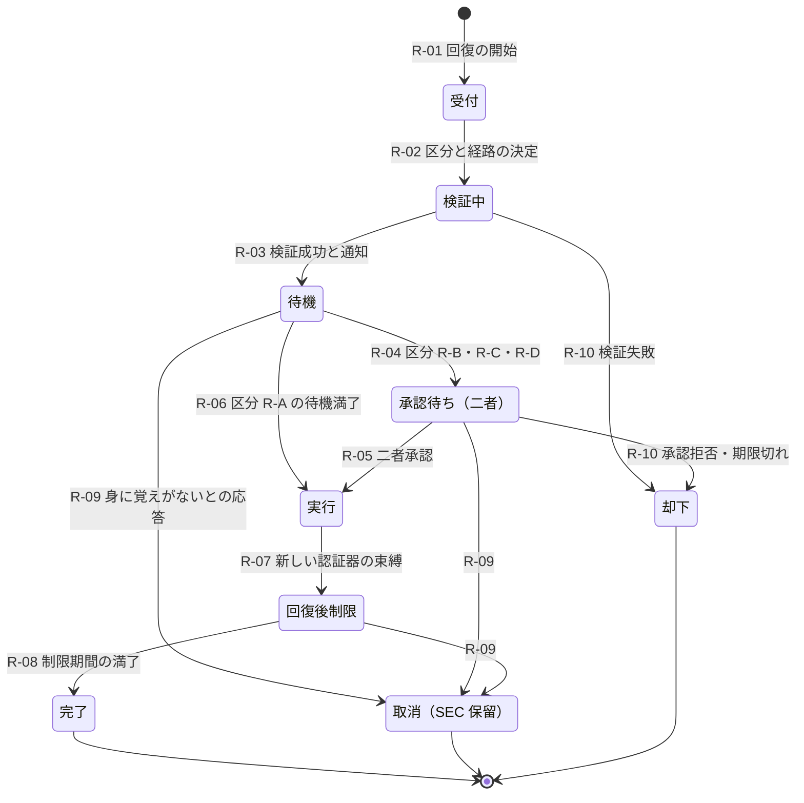

| ID | 遷移 | 契機・実行者 | 保証要件 | 監査イベント | 失敗時挙動 | T 候補 | TC 候補 |
|---|---|---|---|---|---|---|---|
| R-01 | [*]→受付 | 利用者（認証前）、helpdesk への依頼 | 開始の応答から利用者の存在を推測させない（DL-09 §6.7）[^9]。rate limit（DL-52 FA-18）[^12] | recovery.requested（経路） | 上限超過は受け付けない | IL-T19, IL-T20 | IL-TC15 |
| R-02 | 受付→検証中 | 本基盤 | アカウントの回復区分（§11.2）と本人確認の有無から、使える経路を絞る。区分を利用者の申告で選ばせない | recovery.path.selected | — | IL-T20 | IL-TC15 |
| R-03 | 検証中→待機 | 経路ごとの検証の成功（§11.3、§11.4） | 回復は必ず通知を発生させる（SHALL、RS-13#12）[N][^17]。本基盤は待機の開始時に、郵便以外の全通知先へ取消の手段付きで通知する | recovery.verified、recovery.notified | 通知を送れなければ先へ進めない（§2.4）。検証の失敗回数を数え、上限で当該アカウントの回復経路を一時停止して SEC の検知対象にする | IL-T19, IL-T20 | IL-TC15 |
| R-04 | 待機→承認待ち | 区分 R-B・R-C・R-D | §11.5 | recovery.approval.requested | — | IL-T33 | IL-TC17 |
| R-05 | 承認待ち→実行 | 承認者 2 名（申請者・helpdesk 担当者と異なる者） | INV-9。承認者は束縛認証器で再認証する | recovery.approved（承認者） | 期限内に揃わなければ R-10 | IL-T33 | IL-TC17 |
| R-06 | 待機→実行 | 区分 R-A の待機期間の満了 | — | recovery.wait.elapsed | — | IL-T20 | IL-TC15 |
| R-07 | 実行→回復後制限 | 本基盤 | 新しい認証器を A-01・A-02 で束縛する。回復コードを使った場合は無効化して再発行する（SHALL、RS-03#38）[N][^17]。他の session を失効させる。trust agreement で合意した RP へ RISC `recovery-activated` を送る | recovery.executed、authenticator.bound | 束縛に失敗したら実行前の状態に戻し、案件は待機に残す | IL-T20 | IL-TC15 |
| R-08 | 回復後制限→完了 | 制限期間の満了 | — | recovery.completed | — | — | IL-TC15 |
| R-09 | 待機・承認待ち・回復後制限→取消 | 通知への「身に覚えがない」応答、本人の取消 | 応答は既存の通知先からの経路に限る | recovery.cancelled → user.suspended（SEC） | 取消を受けたら主体を SEC で停止し（P-05）、調査を始める。回復後制限の段階なら新しい認証器を失効させる | IL-T19, IL-T20 | IL-TC15 |
| R-10 | 検証中・承認待ち→却下 | 検証の失敗、承認の拒否、期限切れ | — | recovery.rejected（理由） | 却下を利用者の既存の通知先へ通知する | IL-T19 | IL-TC15 |

- RISC 1.0 は `recovery-activated` と `recovery-information-changed` のイベントを定義している（RS-13#70）[N][^23]。送信の範囲と受信側の処理は trust agreement に記載しなければならない（63C-4 §4.8 の SHALL、RS-14#61）[N][^18]。

### 11.2 回復区分と経路

| 区分（DL-09 §3.5） | 対象 | 自己回復の経路 | helpdesk の関与 | 二者承認 |
|---|---|---|---|---|
| R-A | 最上位が read-sensitive・write のアカウント（PC-01、本基盤で認証する PC-02、PC-04、PC-05、PC-09(b)） | §11.3 の (a)〜(c) | 三択の手続を補助する経路に限る（§11.4） | 不要 |
| R-B | 顧客管理者（PC-03） | R-A の経路に加え、同じテナントの別の管理者の承認 | helpdesk 単独では完了できない | 要（テナントの別管理者） |
| R-C | 基盤の運用者・support（PC-06、PC-07） | 監督付きの再本人確認と device-bound 認証器の再登録 | helpdesk 単独では完了できない | 要（CISO が指名した承認者と所属長） |
| R-D | break-glass の保有者と資格情報（PC-08） | 封緘した資格情報の再発行を二者統制の手順で行う（DL-14、DL-46） | 不可 | 要（DL-46 の権限者） |

- 区分と対象は DL-09 §3.5 の表をそのまま使った[^9] [D]。顧客 IdP で認証する PC-02・PC-03 の認証器の回復は顧客 IdP 側の手続であり、本基盤の回復は本基盤に束縛した認証器（PC-03 の束縛認証器）と連携 ID の付替え（L-5）に限る [D]。責任分界は DL-26 §11 に記す[^10] [D]。

### 11.3 AAL2 の三択（DS-13）

| 分岐 | 条件（63B-4 §4.2.2.2、SHALL） | 本基盤での実装 | 使えない場合 |
|---|---|---|---|
| (a) | 異なる方法で得た回復コード 2 つ | 保存型回復コード（初回束縛時に発行）と、発行型回復コード（登録済みの回復用アドレスへ送付）の組 | 回復コードを事前に持たない利用者は (b) か (c) |
| (b) | 回復コード 1 つと、アカウントに結び付いた単要素認証器での認証 | 発行型回復コードと、残っている単要素の認証器（例: パスワード） | — |
| (c) | 再本人確認（本人確認済みのアカウントに限る） | §5.2 の V-1〜V-4 を外部事業者で再実施する | 本人確認をしていないアカウントは、回復コードか recovery contact によらなければならない（SHALL）（RS-03#39）[N][^17] |

- 三択と条件は SP 800-63B-4 §4.2.2.2 による（SHALL、RS-03#39）[N][^17]。見解相違ログ DS-13 は、レビューが (b) の「回復コード 1 つ」と (c) の「本人確認済みのアカウントに限る」を落としていることを補正し、DL-08 の回復の状態遷移に (a)〜(c) を分岐として持たせるよう求めた[^5] [D]。
- 保存型回復コードは 64 ビット以上とし、ハッシュで保存し、使用後は無効化して再発行しなければならない（SHALL）[N][^17]。発行型回復コードは 10 進 6 桁以上で、有効期限の上限は SMS・音声で 10 分、email で 24 時間である（SHALL）[N][^17]。回復用アドレスは 2 つ以上登録できるようにしなければならない（SHALL）（RS-03#38）[N][^17]。
- 他の認証器で認証できる状態でのパスワードの再設定は、回復ではなく認証器の追加として扱う（RS-03#36）[N][^17]。その場合は SM-R ではなく SM-A の A-01 で処理する [D]。
- DS-511 は、回復手段に採用している当人認証手法と同等以上の強度を求めている（RS-03#41）[N][^19]。PR 認証器を持つアカウントを、PR でない経路だけで回復できる状態は、この要求と緊張関係にある [D]。待機と回復後の制限（§11.6）でその差を補う案を IL-D1 に置く [D]。

### 11.4 helpdesk 経由の回復（R-042）

63B-4 §4.2.1 は、CSP 担当者とのやり取りなどアプリケーション固有の回復方法を使ってもよい（MAY）が、その場合はリスク分析に基づき文書化しなければならない（SHALL）としている（RS-03#37）[N][^17]。AAL2 まで認証できるアカウントの回復には §4.2.2.2 の三択が SHALL とされており、アプリケーション固有の方法が三択に代わり得るかは原文から明確でない（RS-13#11, #12 からの推論）[D]。このため本基盤は helpdesk を三択の手続を補助する経路に限る案をとる（決裁案 IL-D2）[D]。

| 手順 | 内容 | 根拠 |
|---|---|---|
| HD-1 受付 | チケットを起票し、依頼者が名乗るアカウントの回復区分を表示する。区分 R-B〜R-D の依頼は二者承認の手順へ回す | 管理者の helpdesk 単独回復の禁止（DL-26 §3.3）[^10] |
| HD-2 依頼者の確認 | 依頼者が電話・チャットで示す連絡先は使わず、登録済みの連絡先へ折り返す | FFIEC は資格情報の再設定時の強化認証として、事前登録端末への OTP、事前登録番号へのコールバック、ビデオでの確認等を例示している（RS-13#31）[N][^47] |
| HD-3 回復コードの送付 | 発行型回復コードを登録済みの回復用アドレスへ送る。helpdesk 担当者がコードを読み上げたり、依頼者が指定する宛先へ送ったりしない | (a)・(b) の条件を満たすため [D] |
| HD-4 利用者による完了 | 利用者が自分で (a) または (b) を完了する。helpdesk 担当者は認証器をリセットしない | 63B-4 §6.3 は、ある要素を使って別の要素の認証器を入手できてはならないと述べる（RS-13#18）[N][^17] |
| HD-5 記録 | 依頼者、確認の方法、判断と理由、担当者を記録する。担当者にはソーシャルエンジニアリングの兆候の研修を課す | trusted referee の記録と研修の要件（63A-4 §3.15.1 の SHALL、RS-03#13）を helpdesk の設計に準用する [D][^16] |
| HD-6 監視 | 同じアカウント・同じ依頼者からの複数回の接触、特権者への依頼、依頼直後の認証器追加を検知の対象にする | Scattered Spider は複数回の電話で再設定の手順を探った（RS-13#26）[I][^43]。英国 NCSC は、特に権限の高い者のヘルプデスクの再設定手順の見直しを推奨した（RS-13#28）[I][^46] |

- helpdesk 経由の回復の安全性は、机上の設計では確かめられない [D]。ソーシャルエンジニアリングを含む red team による検証（DL-59）と、作成者以外の評価者による判定が要る（R-042 の区分 D、G-061）[^3][^4] [D]。

### 11.5 管理者・特権者の回復（二者承認）

| 対象 | 承認者 1 | 承認者 2 | 追加条件 | 承認者が揃わない場合 |
|---|---|---|---|---|
| PC-03（顧客管理者） | 同じテナントの別の管理者（利用者管理者以上） | テナントのセキュリティ連絡先、またはテナント所有者 | 束縛認証器の再登録。回復の完了を全管理者とセキュリティ連絡先へ通知する | 管理者が 1 名のテナントは、§11.5.1 の SA-1〜SA-8 による（break-glass アカウント PC-08(b) を第一の経路とし、ない場合は契約手続。遠隔の映像による本人確認だけでは成立させない）。事業者要員をテナント設定の承認者にしない |
| PC-06（support） | 所属長 | CISO が指名した承認者 | 監督付きの再本人確認、device-bound 認証器の再登録、JIT 付与の一時停止 | 回復しない（業務は他の担当者が引き継ぐ） |
| PC-07（特権運用者） | プラットフォームチーム長 | CISO が指名した承認者 | 同上。全 session を失効させる | 同上 |
| PC-08（break-glass） | DL-46 の権限者 | DL-46 の権限者（別人） | 封緘した資格情報の再発行。全保有者へ通知する | 他の break-glass アカウントで運用を継続する（DL-48 決裁案 4 の 2 個以上） |

- 事業者要員を顧客管理者の回復の承認者にしないのは、事業者に顧客テナントの管理権限を与えることになるためである（DL-26 §4 の注）[^10] [D]。Okta の報告では、service desk が高権限利用者の全 MFA をリセットするよう誘導された（RS-14#7）[I][^44]。
- IAL3 で本人確認した AAL3 のアカウントを回復するには、初回の対面本人確認で採取した生体情報と照合しなければならない（SHALL）（RS-03#40）[N][^17]。AAL3 の回復通知は郵便の住所にも送らなければならない（SHALL）（RS-03#40）[N][^17]。PC-07・PC-08 を IAL3 とするかは ADR-002 で決めるため（§5.2）、この要件の適用は ADR-002 の決定に従う [D]。

#### 11.5.1 管理者が 1 名のテナントの回復（R-B の代替経路）

管理者が 1 名で break-glass アカウント（PC-08(b)）もないテナントでは、二者承認が成立しない [D]。この場合の回復は契約で定めた本人確認手続に落ち、その手続を実行するのは事実上、事業者の要員である [D]。攻撃者がこの本人確認を突破すると、テナント管理者を新しく作れる [D]。Okta の報告にある service desk の誘導（RS-14#7）と同じ型の攻撃であり[^44] [I]、この経路では二者承認の歯止めもない [D]。さらに、回復の通知先である「全管理者とセキュリティ連絡先」は、管理者が 1 名のテナントでは乗っ取られる本人か未登録になり得る [D]。このため次の SA-1〜SA-8 を要件とする（模擬パネル ラウンド 5 の redteam 指摘で追加）[D]。

| ID | 要件 | 根拠 |
|---|---|---|
| SA-1 経路の順序 | テナントの break-glass アカウント（PC-08(b)）があれば、それで別の管理者を作る経路を第一とする。SA-2〜SA-8 の契約手続は、break-glass アカウントがない場合に限る | ADR-029 D29-35 の「緊急管理者を第一の経路とする」と同じ順序[^67] [D] |
| SA-2 遠隔映像だけでは成立させない | 映像通話・自撮り映像・書類画像など、遠隔で取得した映像・画像による本人確認だけでは回復を成立させない。映像確認は SA-3 の折返し確認に加える補助の材料にとどめる。映像を使う場合は、外部の本人確認事業者（A-070）に 63A-4 §3.14 の統制（正規のセンサーからの入力であることを確かめる技術的統制と、媒体の改ざん解析）を求める | 63A-4 §3.14 は、遠隔の本人確認（attended・unattended の両方）に対する新しい攻撃が、digital injection と生成 AI を組み合わせ、本人確認担当者の目視の比較も破ると述べている[^16] [N]。同節は、仮想カメラ・端末エミュレータ等の検出を含め、正規のセンサーからの入力であることを確かめる技術的統制を求めている（SHALL、RS-03#12）[^16] [N]。FinCEN は、deepfake による偽造の身分証明書で本人確認と認証を迂回する詐欺の報告が 2023 年から増えたとし、本人確認の映像確認中に第三者の webcam プラグインを使うことを警戒すべき兆候に挙げている[^68] [I] |
| SA-3 帯域外の折返し確認 | 契約の締結時に記録した連絡先（契約上の署名者、請求先）へ、本基盤の記録から引いた番号・宛先で事業者側から折り返し、回復の依頼を確かめる。依頼者が示した連絡先は使わない。契約記録の連絡先を回復の手続の中で変更することは認めない（連絡先の変更は契約変更の手続で行い、変更後は待機を置く） | FFIEC は、資格情報を再設定するときの強化認証として、事前登録した番号へのコールバックを例示している（RS-13#31）[^47] [N]。依頼者側の経路を使わないのは HD-2 と同じ理由である [D] |
| SA-4 発効遅延の下限 | 回復の検証が成功してから新しい管理者が発効するまでに、発効遅延 W_B1 を置く。W_B1 は R-B の待機 W_B を下回らず、SA-6 の通知先への到達時間の p99 と否認できるまでの応答時間の和（ADR-003 NA-003-3）を下回らない。区分（一般テナント、規制業種・高保証要求テナント（A-081））ごとに下限を定める | 値は TBD（IL-D1 で決める。所有者: CISO＋事業責任者（B2B）、期限: G1 で候補、G4 で確定、決め方: BIA と IL-TC15・IL-TC25 の実測）[D] |
| SA-5 テナント設定の凍結 | 回復の受付（R-01）から回復後の制限期間の満了（R-08）まで、そのテナントの次の設定変更を止める。IdP 連携の追加・変更・linking 規則（DL-26 P-1〜P-3）、ドメインの追加・検証（H-2）、SCIM の資格情報の発行・変更（P-5）、越境付与（ゲストの外部付与、ADR-024）、新しい管理者の追加（回復で作る 1 名を除く）、break-glass アカウントの作成・変更、テナント全体のエクスポート | 攻撃者が回復で得た管理者権限を、信頼の起点の書換え（AA23-320A の IdP 追加と自動連結、RS-13#26）[^43] [I] と持続化に使う時間を与えないため [D]。§11.6 の回復後の制限（主体単位）を、管理者 1 名のテナントではテナント単位に広げる [D] |
| SA-6 通知 | §11.6 の通知に加え、SA-3 の契約記録の連絡先（署名者、請求先）とテナントのセキュリティ連絡先へ、操作の経路と独立した経路で、取消の手段を付けて通知する。既存の唯一の管理者の通知先にも送る（正規の管理者であれば否認できる） | 回復の通知は SHALL（RS-13#12）[^17] [N]。乗っ取られる本人だけに届く通知では取消の機会にならない [D] |
| SA-7 実行者 | 契約手続を実行する事業者の要員は、テナントの設定を承認しない。SA-2〜SA-6 の条件が揃ったことの確認は、別の報告系統に属する 2 名が行い、それぞれ束縛認証器で再認証して記録する | 事業者要員を顧客管理者の回復の承認者にしない原則（DL-26 §4 の注）[^10] と、ADR-029 D29-35 の「社内の別報告系統の二者」[^67] に合わせる [D] |
| SA-8 適用範囲 | SA-1〜SA-7 は、管理者が 2 名以上いるが他の管理者が全員応答できない場合（退職・停止中など）にも適用する | 二者承認が実際には成立しない点で管理者 1 名と同じため [D] |

- SA-2 は、映像による確認の効果を否定するものではない [D]。FFIEC はビデオでの確認も強化認証の例に挙げている（RS-13#31）[^47] [N]。ただし 63A-4 §3.14 が述べるとおり、遠隔の映像は注入と生成 AI による偽造の対象であり、事業者の要員の目視はそれを見分ける統制として扱えない[^16] [N]。このため映像だけで成立する経路を作らない [D]。
- 管理者が 1 名のテナントをオンボーディングの段階で減らす案を、決裁案 IL-D9 に置いた [D]。IL-N7 の比率が大きいほど、SA-1〜SA-8 の手続の件数と要員の負荷が増える [D]。
- この経路の脅威は IL-T34、試験は IL-TC25 とする [D]。

### 11.6 待機・通知・回復後の制限

| 項目 | 規則 | 値 |
|---|---|---|
| 待機 | 検証の成功から実行までの間、全通知先に取消の手段付きで通知し、応答を待つ | 区分別に TBD（決裁案 IL-D1） |
| 通知 | 郵便以外の全通知先へ送る（SHALL）。AAL3 は郵便にも送る（SHALL）（RS-03#34, #40）[N][^17]。顧客管理者の回復は全管理者とセキュリティ連絡先にも送る。管理者が 1 名のテナントは契約記録の連絡先にも送る（§11.5.1 SA-6） | — |
| テナント設定の凍結 | 管理者が 1 名のテナントの回復では、受付から制限期間の満了まで、IdP 連携・ドメイン・SCIM・越境付与などのテナント設定を止める（§11.5.1 SA-5） | 期間は回復後の制限期間に従う |
| 回復後の制限 | 制限期間中は、回復情報・通知先・連携 ID の変更、他の認証器の削除、privileged の操作、+FIN の操作を止める。新しい認証器の追加は許す | 期間は区分別に TBD（決裁案 IL-D1） |
| 他の session | 実行時（R-07）に失効させる | — |
| 下流への通知 | trust agreement で合意した RP へ RISC `recovery-activated` を送る | — |

- 回復には長い待機時間が伴うことがあると 63B-4 は記すが、具体的な時間は規定していない（RS-03#36）[N][^17]。数値は BIA と実測で決める（RS-03 §6-11）[D]。DL-09 §3.5 も待機時間を TBD とし、状態遷移を DL-08 と ADR-003 で定めるとしている[^9] [D]。

### 11.7 回復の数値契約候補（R-188.6）

レビューは認証の数値契約に「回復完了SLO」と「不正回復検知時間」を挙げている（L210）[^14] [D]。不正回復検知時間（R-188.7）は DL-52 の担当である[^12] [D]。本書は回復完了の指標を次のように定義し、値は置かない [D]。

| 指標候補 | 定義 | 値 |
|---|---|---|
| 回復の処理時間 | R-01 から R-07 までの時間から、意図的な待機（R-03〜R-06）と承認待ち（R-04〜R-05）を除いた時間。区分・経路別に p50・p95 | TBD（所有者: CISO＋プロダクト責任者、期限: G1 で候補、G4 の IL-TC15 の実測後に DL-20 で確定、決め方: BIA と実測） |
| 回復の総所要時間 | R-01 から R-07 までの時間（待機と承認待ちを含む）。区分別 | 同上。待機時間（IL-D1）の決定に従属する |
| 回復通知の到達時間 | R-03 の通知の送信から到達まで | 同上 |
| helpdesk 経由の回復の拒否率 | 演習の依頼のうち、手順どおり拒否された割合 | 合否基準は DL-59 で事前登録する |

- 回復完了の目標を短くするほど待機時間と矛盾する [D]。このため「処理時間」と「総所要時間」を分け、待機は統制として別に決める [D]。
- 管理系（登録、回復）の可用性帯は 99.5〜99.9% と仮置きされている [A-092]。回復経路の停止中に利用者が業務を続けられるかは、2 つ以上の認証器の登録率（§5.3）に依存する [D][A-092]。

## 12. step-up と session（SM-S、R-045、R-048）

### 12.1 状態機械

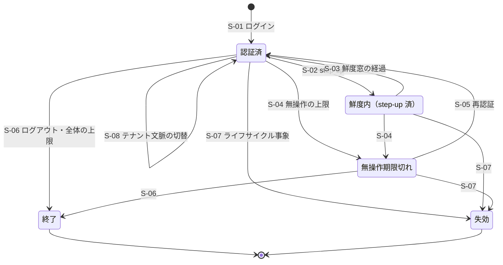

| ID | 遷移 | 契機 | 保証要件 | 監査イベント | 失敗時挙動 | T 候補 | TC 候補 |
|---|---|---|---|---|---|---|---|
| S-01 | [*]→認証済 | ローカル認証、連携ログイン | 階層別の AAL・FAL（DL-09 §3.1）[^9]。§8.3 の保証元を session に記録する | session.established | 保証元を記録できなければ session を作らない | IL-T09 | IL-TC06 |
| S-02 | 認証済→鮮度内 | RS の RFC 9470 challenge（`insufficient_user_authentication`、`acr_values`、`max_age`）、+SEC・+FIN・+XT・privileged の操作 | step-up のたびに新しい認可要求を送る。JWT access token の `acr`・`auth_time` は token を更新しても変わらない（RS-03#48）[N][^28]。外部 IdP に `max_age` を送った場合、経過時間が超えていれば OP は再認証を試みなければならず（MUST）、`auth_time` は REQUIRED になる（RS-03#47）[N][^22] | session.stepped_up（acr、auth_time） | step-up が成立しなければ操作を拒否する。refresh で鮮度を回復させない | IL-T25 | IL-TC18 |
| S-03 | 鮮度内→認証済 | 鮮度窓（max_age）の経過 | 窓の長さは DL-09 REQ03-D6 で決める（TBD）[^9] | — | — | IL-T25 | IL-TC18 |
| S-04 | 認証済・鮮度内→無操作期限切れ | 無操作の上限 | AAL2 は 1h 以内、AAL3 は 15min 以内にすべき（SHOULD）（RS-03#43）[N][^17] | session.idle_expired | — | — | IL-TC18 |
| S-05 | 無操作期限切れ→認証済 | 再認証 | AAL2 で無操作の上限だけを超えた場合は、パスワードか生体照合と session 秘密で再認証してよい（MAY、RS-03#43）[N][^17] | session.reauthenticated | 失敗回数は A-04 の上限に数える | — | IL-TC18 |
| S-06 | →終了 | ログアウト、全体の上限 | 全体の上限を設けなければならない（SHALL）。AAL2 は 24h 以内にすべき（SHOULD）、AAL3 は 12h 以内（SHALL）（RS-03#43）[N][^17]。設定値は DL-09 §3.3 で TBD[^9] | session.ended | — | — | IL-TC18 |
| S-07 | →失効 | P-05、P-07、P-08、M-03、M-05、F-02、F-04、A-06（その認証器で確立した session）、R-07（他の session）、K2-4（IdP の遮断）、侵害の証拠によるパスワードの強制変更 | 失効の記録を先に行う。trust agreement で合意した RP へ CAEP `session-revoked` を送る | session.revoked（原因の遷移 ID） | 伝播の失敗は再試行する。伝播経路と遅延予算は DL-56 | IL-T17 | IL-TC13 |
| S-08 | 認証済→認証済（文脈の切替） | 利用者のテナント切替 | 新しい認可要求を送り、切替先テナントの方針（MT-4）で判定する | session.tenant_switched | 切替先の方針を満たさなければ、切替元の文脈に留める | IL-T26 | IL-TC04 |

- federation では、IdP と RP の session は独立しており、再認証の要件を満たしたかを判断する権限は RP にある（SHALL、RS-03#45）[N][^17]。IdP は直近の認証の時刻を RP に伝えなければならず（SHALL）、identity API にアクセスできることを根拠に RP の session を確立・延長してはならない（SHALL NOT）（RS-03#46）[N][^18]。
- session の AAL を、元になった認証イベントの AAL より高く扱ってはならない（SHALL NOT、RS-03#44）[N][^17]。S-02 で得た鮮度は、step-up で使った認証器の AAL を上限とする [D]。
- 侵害の証拠がある場合はパスワードの変更を強制しなければならない（SHALL、RS-13#9）[N][^17]。強制変更の後は S-07 で他の session を失効させる [D]。
- CAEP 1.0 は `session-revoked` を定義している（RS-03#66）[N][^24]。S-07 で送る事象の範囲と受信側の処理は trust agreement に記載する（63C-4 §4.8 の SHALL、RS-14#61）[N][^18]。
- Microsoft Entra ID Protection は、Attacker in the Middle と漏えい資格情報の検知を offline（事後）に分類している（RS-13#69）[V][^63]。検知は session の確立より後に届き得るため、S-07 は検知の時点で有効なすべての session を対象にし、確立の時刻で絞らない [D]。

### 12.2 ユースケース別の federation・provisioning・session（R-048）

レビューは承認条件の 1 つに「IAL/AAL/FAL、認証器、account recovery、federation、SCIM、session lifecycle がユースケース別に定義されている」ことを挙げた（L240）[^14] [D]。IAL/AAL/FAL の階層別の割当は DL-09 が持ち[^9]、本書はライフサイクル側の定義を次の表に置く [D]。表中の「上限」は DL-09 §3.3 の階層別の値（TBD）を指す [D]。

| UC | ユースケース | 主体 | federation | provisioning | 認証器と回復 | session の失効の契機 | 退職・削除 |
|---|---|---|---|---|---|---|---|
| UC-1 | 一般利用者の自社認証 | PC-01 | なし | 自己登録（E-1） | passkey 推奨、SM-A、回復 R-A | P-05、A-06、R-07 | 削除請求、休眠（IL-D5） |
| UC-2 | 一般利用者の外部 IdP（ソーシャルログイン等） | PC-01 | RP 起点、外部 IdP の連携 ID（SM-F） | 自己登録＋linking（L-1） | 外部 IdP 側。本基盤の認証器を追加できる | F-04、P-05 | 同上。連携 ID は削除時に除去 |
| UC-3 | 顧客 IdP＋SCIM | PC-02 | RP 起点、テナントの IdP allowlist、FAL2 | SCIM 事前作成（E-3）、作成時に結合 | 顧客 IdP 側 | SCIM 無効化（M-03）、IdP の終了通知（F-04）、CAEP 受信 | SCIM 削除（M-05） |
| UC-4 | 顧客 IdP＋JIT のみ | PC-02 | 同上 | JIT（E-4） | 顧客 IdP 側 | IdP の終了通知、CAEP 受信。通知がない場合は未使用期間による終了（§15.3） | 未使用期間による終了（事前通知） |
| UC-5 | 本基盤で認証する B2B 利用者 | PC-02 | なし | 招待（E-2）、管理者の追加 | SM-A、回復 R-A | M-03、P-05、A-06 | 管理者の除去（M-05） |
| UC-6 | 顧客管理者 | PC-03 | UC-3〜UC-5 のいずれか＋保護操作は本基盤の束縛認証器（FAL3 相当の範囲は DL-09 REQ03-D3） | 管理者ロールの付与（P-6） | 束縛認証器、回復 R-B | ロール剥奪、M-03 | ロール剥奪と PC-02 の経路 |
| UC-7 | ゲスト（他テナントの利用者） | PC-09(a) | home 側の IdP。資源側は home の MFA claim を既定で信頼しない | 外部付与（M-01x） | home 側 | 外部付与の取消・期限、信頼リストからの除外 | 付与の除去 |
| UC-8 | 外部共同作業者 | PC-09(b) | 外部共同作業者 realm | 招待（E-2） | SM-A、回復 R-A | スポンサーの取消、期限 | 期限、スポンサー不在 |
| UC-9 | 社内従業員・委託先 | PC-04、PC-05 | workforce IdP（本基盤が担うか federation するかは DEC-2・ADR-001） | 人事（E-5）、スポンサー（E-6） | PR 必須、回復 R-A | 人事の退職・休職、契約終了 | 退職イベント、契約終了 |
| UC-10 | support・特権運用者 | PC-06、PC-07 | PC-07 は本基盤の AS に依存しない別系統 | 資格付与、二者発行（E-7） | device-bound、回復 R-C | JIT 窓の満了、職務変更 | 職務変更、退職 |
| UC-11 | break-glass | PC-08 | 連携しない | 事前作成・封緘（E-8） | device-bound、回復 R-D | 使用ごとに事後レビュー後に資格情報を更新 | 管理面の廃止 |

- 本表の割当は、DL-48 §4.1・§4.2・§4.4 の類型別の初期案[^8]と DL-09 §3.1・§3.5[^9] を組み合わせた設計推論である [D]。

## 13. SAML 署名鍵の更新（SM-K1、R-038）

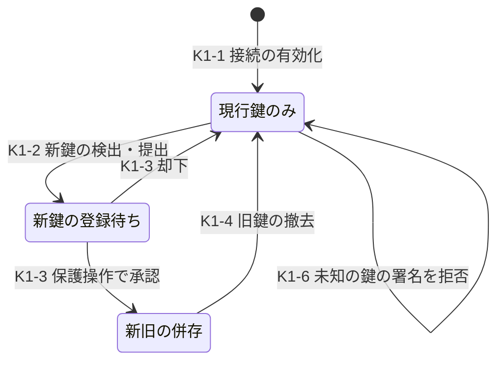

| ID | 遷移 | 契機・実行者 | 保証要件 | 監査イベント | 失敗時挙動 | T 候補 | TC 候補 |
|---|---|---|---|---|---|---|---|
| K1-1 | [*]→現行鍵のみ | 接続の有効化（DL-26 §5.1） | DL-26 §5.1 の接続試験[^10] | idp.key.activated | — | IL-T11 | IL-TC09 |
| K1-2 | 現行鍵のみ→登録待ち | 顧客の IdP 管理者による新鍵の提出、または登録済みの metadata URL からの取得で新鍵を検出 | 鍵の更新手順は trust agreement で定め、認証された保護チャネルで実行しなければならない（SHALL、RS-03#68、RS-14#15）[N][^18]。metadata URL は接続時に登録した HTTPS の URL に限る | idp.key.proposed | 検出しただけでは使わない | IL-T11 | IL-TC09 |
| K1-3 | 登録待ち→併存 | テナントの IdP 管理者の承認（DL-26 の P-2） | P-2（フィッシング耐性での再認証、通知、監査）[^10] | idp.key.approved | 承認がなければ登録待ちのまま。期限までに承認がなければ破棄して通知する | IL-T11 | IL-TC09 |
| K1-4 | 併存→現行鍵のみ（新鍵） | 新鍵での署名を観測した後の旧鍵の撤去（IdP 管理者または期限による自動撤去） | 撤去は通知する | idp.key.retired | 撤去後に旧鍵で署名された assertion は拒否する | IL-T12 | IL-TC09 |
| K1-5 | 期限の警告 | 証明書の有効期限の接近 | 期限前の通知の時期は TBD（所有者: プロダクト責任者、期限: G3、決め方: IL-N2 と顧客の変更手続の所要時間） | idp.key.expiring | 期限切れの証明書の扱い（拒否か警告か）は ADR-004 で決める。起案者の推奨は拒否 | IL-T12 | IL-TC09 |
| K1-6 | 未知の鍵での署名 | 登録されていない鍵で署名された assertion の到着 | 拒否し、テナントの IdP 管理者とセキュリティ連絡先に通知する。同じ接続で繰り返す場合は K2-4（遮断）の判断材料にする | idp.assertion.unknown_key | 未署名や登録外の鍵へ fallback しない | IL-T11, IL-T13 | IL-TC09 |

- 新旧 2 枚の並行登録は、Google Workspace が SAML profile ごとに IdP 証明書を 2 枚まで登録でき、証明書の rotation に使えるとしていること（RS-14#22）[V][^40] を参照した設計推論である [D]。DL-26 §5.3 も同じ既定を置いている[^10] [D]。
- SAML の POST binding では assertion に署名しなければならない（MUST、RS-14#19）[N][^29]。K1-6 で未署名の assertion を受け入れないのはこの要求と INV-3 による [D]。
- 前提台帳は SAML 接続を 1,800 件、IdP 証明書の更新を現状は手作業の受付と置いている [A-114]。更新頻度は未知のため新規仮定 IL-N2 とした [D]。顧客機密（SAML 証明書・metadata を含む）は約 4,000 件と仮置きされており、顧客 IdP 証明書の更新の自動化が感度に挙がっている [A-073]。
- 本基盤自身の SP 署名鍵・復号鍵の更新は、鍵管理（DL-14、ADR-007）で扱い、顧客への事前通知の手順を DL-26 の trust agreement 様式に載せる [D]。

## 14. 顧客 IdP の停止・侵害（SM-K2、R-039）

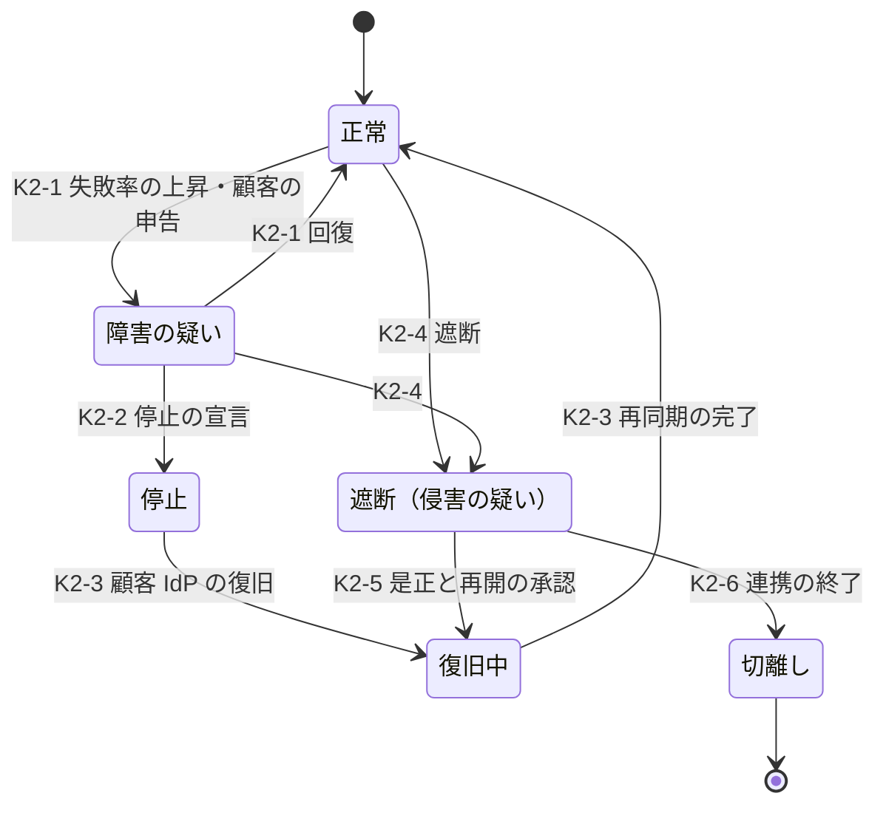

| ID | 遷移 | 契機・実行者 | 保証要件 | 監査イベント | 失敗時挙動 | T 候補 | TC 候補 |
|---|---|---|---|---|---|---|---|
| K2-1 | 正常→障害の疑い | 連携ログインの失敗率の上昇（閾値は TBD: 所有者 SRE 責任者、期限 G4、決め方 IL-N3 と PoC の観測）、顧客の申告 | 自動検知。テナントの管理者とセキュリティ連絡先に通知する | idp.health.degraded | 誤検知でも利用者の状態は変えない | IL-T12 | IL-TC10 |
| K2-2 | 障害の疑い→停止 | テナントの管理者による宣言、または基盤の SRE による宣言 | 宣言者を記録する | idp.health.down | — | IL-T14 | IL-TC10 |
| K2-3 | 停止→復旧中→正常 | 顧客 IdP の復旧 | 停止中に届かなかった SCIM の変更と停止・終了の通知を再同期してから正常に戻す | idp.health.recovered | 再同期が終わるまで、停止中に有効だった session の延長をしない | IL-T17 | IL-TC10 |
| K2-4 | 正常・障害の疑い→遮断 | 顧客からの IdP 侵害の通知、基盤の検知（K1-6 の繰り返し等）、公的機関・IdP 事業者の公表 | 発動条件は DL-26 決裁案 6 で決める[^10]。遮断は IdP 単位で行い（blocklist は MAY、RS-03#68）[N][^18]、その IdP の連携 ID を凍結し（F-02）、その IdP 由来の session を失効させる（S-07） | idp.blocked（理由） | 一斉失効の後の再ログインの集中に上限を設ける。基準の全 session 失効後の再ログイン集中は 556/秒と仮置きされている [A-048] | IL-T13 | IL-TC11 |
| K2-5 | 遮断→復旧中 | 顧客の是正報告（署名鍵の交換を含む）と基盤の承認 | 再開は保護操作（P-1）として扱う。凍結した連携 ID を F-03 で戻す前に、遮断中の管理操作の監査を顧客と確認する | idp.unblocked | 承認がなければ遮断のまま | IL-T13 | IL-TC11 |
| K2-6 | 遮断→切離し | 連携の終了 | DL-26 §5.4 の切離し手順[^10] | idp.detached | — | IL-T13 | IL-TC11 |

停止中（K2-2〜K2-3）の挙動は次のとおりとする [D]。

| 項目 | 挙動 | 根拠 |
|---|---|---|
| 新規の連携ログイン | 失敗させ、IdP が停止中であることを示す。本基盤のローカル認証へ自動で切り替えない（既定）。テナントの選択による代替ログインは決裁案 IL-D4 | 顧客 IdP は利用者の停止・退職の正本であり、停止中は終了の通知も届かないため [D] |
| 既存の session | 本基盤の session の上限（DL-09 §3.3）まで継続する。IdP の停止を理由に延長しない | IdP と RP の session は独立している（RS-03#45）[N][^17]。identity API への到達で RP の session を延長してはならない（SHALL NOT、RS-03#46）[N][^18] |
| step-up | 顧客 IdP での step-up はできない。step-up を要する操作は停止中は実行できない。本基盤の束縛認証器を持つ顧客管理者は束縛認証器で step-up できる | INV-3 [D] |
| 顧客管理者 | テナントの break-glass アカウント（PC-08(b)）でローカル認証して入る | SSCF は SSO 強制から特定の利用者を除外できることを求め、実装ガイドは除外対象に break-glass アカウントを想定している（must、RS-14#21）[N][^50]。緊急用の資格情報は SSO や federated IdP から導出してはならない（RS-09#41）[V][^52]。Microsoft は緊急アクセス用アカウントについて、2 個以上、federate しないこと、通常の管理者と異なる方式、全 sign-in の警報、少なくとも 90 日ごとの検証を求めている（RS-09#44）[V][^51] |
| SCIM | 届かない。K2-3 で再同期する | — |

- 基盤自身の AS の停止は本書の範囲外であり、DL-19 と ADR-013 で扱う [D]。前提台帳は認証系の可用性帯を 99.9〜99.95% と仮置きし、AS 停止中に既存 session をどこまで継続させるかを感度に挙げている [A-091]。
- SP 800-63C-4 の脅威表は、侵害された IdP が適切に認証していない者を主張することを挙げ、RP は独自の監視能力を持つ必要があるとしている（RS-03#73）[N][^18]。侵害の疑いを受けた IdP は自身の行動を調べなければならず、確認できたらその期間に使われた他の RP にも知らせなければならない（SHALL、RS-03#72）[N][^18]。K2-4 の発動条件と通知の様式は DL-26 §11.3 の shared signaling の記載事項に載せる[^10] [D]。

## 15. SCIM 同期と JIT の衝突（SM-Y、R-040）

### 15.1 状態機械

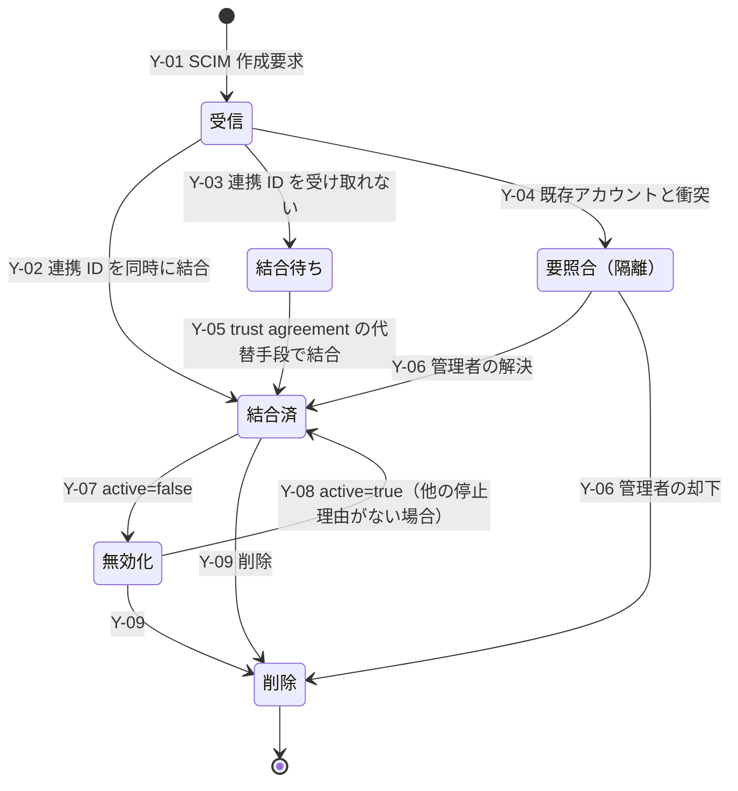

| ID | 遷移 | 保証要件 | 監査イベント | 失敗時挙動 | T 候補 | TC 候補 |
|---|---|---|---|---|---|---|
| Y-01 | [*]→受信 | テナントは SCIM client の資格情報から導き、URL・header のテナントと食い違えば拒否する（DL-26 §7）[^10]。provisioning API は相互認証された経路で使う（SHALL、RS-03#78）[N][^18] | scim.received | 資格情報とテナントの不一致は拒否し、SEC の検知対象にする | IL-T15 | IL-TC12 |
| Y-02 | 受信→結合済 | 事前プロビジョニングした account は、trust agreement に別の定めがない限り、作成時に連携 ID と結合しなければならない（SHALL、RS-03#77）[N][^18]。SCIM の要求に、assertion の subject と同じ IdP の不変 ID を含めることを trust agreement で定める | scim.bound → user.created、membership.added | — | IL-T16 | IL-TC12 |
| Y-03 | 受信→結合待ち | IdP が不変 ID を送れない場合 | scim.unbound | ログインを許さない | IL-T16 | IL-TC12 |
| Y-04 | 受信→要照合 | §15.2 の衝突 | scim.conflict | 自動で結合・統合しない。テナント管理者に通知する | IL-T16 | IL-TC12 |
| Y-05 | 結合待ち→結合済 | trust agreement が定めた代替手段（初回ログイン時に、trust agreement で指定した不変の属性が一致し、かつその連携 ID が他の主体に結合していないこと）。email・userName は代替手段に使わない | scim.bound（方法） | 条件を満たさなければ結合待ちのまま | IL-T05, IL-T16 | IL-TC12 |
| Y-06 | 要照合→結合済・削除 | テナント管理者の判断（利用者管理者以上） | scim.conflict.resolved | 期限内に判断がなければ要照合のまま、警報する | IL-T16 | IL-TC12 |
| Y-07 | 結合済→無効化 | `active=false` を受けたら M-03（SRC）で当該所属を停止し、INV-6 の全手段を失効させる | scim.disabled | §2.4 | IL-T17 | IL-TC13 |
| Y-08 | 無効化→結合済 | `active=true` は SRC の理由だけを解除する。SEC・LEG・TEN・ADM の理由は解除しない（§2.3） | scim.enabled | 他の理由が残れば停止のまま | IL-T18 | IL-TC23 |
| Y-09 | →削除 | M-05 で所属を除去する。最後の所属なら P-08 | scim.deleted | §2.4 | IL-T17 | IL-TC19 |

- `active` 属性の最終的な意味は service provider が決める（RS-14#34）[N][^25]。本基盤は Y-07 の失効範囲と Y-08 の解除範囲でその意味を定める [D]。

### 15.2 衝突の場面と解決規則

| # | 場面 | 解決規則 | 根拠 |
|---|---|---|---|
| C1 | JIT で作成済みの利用者に、後から同じ連携 ID の SCIM 作成が届く | 既存の主体に SCIM の id を結び付ける。重複を作らない | DL-26 §7（SCIM 管理下の利用者に一致したら JIT は作成しない）[^10] |
| C2 | SCIM で作成済みの利用者が初めて連携ログインする | 連携 ID で照合する（作成時に結合済み） | Y-02 |
| C3 | SCIM 作成に連携 ID がない | Y-03（結合待ち）。trust agreement で代替手段を定めないテナントでは、SCIM ではなく JIT のモデルを使う | 63C-4 §4.6.3（RS-03#77）[N][^18] |
| C4 | SCIM 作成の userName が、別の連携 ID を持つ既存の利用者の userName と同じ | 409（`scimType`=uniqueness）を返し、要照合（Y-04）にする。自動で統合しない | 重複する resource の作成には 409 と `uniqueness` を返さなければならない（MUST、RS-03#76）[N][^26]。INV-2 |
| C5 | 削除済みの利用者と同じ userName での作成 | 新しい主体・新しい内部 ID を割り当てる。409 にしない | 削除済みの resource と同じ userName の作成を 409 で失敗させるべきでない（SHOULD NOT、RS-03#75）[N][^26]。RS-14 §5.1 の ADR-004 への入力 [D] |
| C6 | 同じ資源への同時の更新 | If-Match があれば ETag で判定し、不一致は 412 または 409。If-Match がなければ後勝ち。IdP が管理する属性はアプリ側から変更不可 | RFC 7644 §3.14（MAY、RS-14#32）[N][^26] |
| C7 | 停止中（SEC など）の利用者に `active=true` が届く | Y-08 により SEC 等は解除しない。テナント管理者に通知する | §2.3。Entra のテナント間同期は target 側の手動停止を source 側の変更で再有効化する（RS-14#39）[V][^34]。本基盤はこの意味論をとらない [D] |
| C8 | SCIM で無効化・削除済みの利用者が、IdP 側の反映遅れで連携ログインする | SCIM を使うテナントでは、プロビジョニングの状態をアクセスの正本とし、有効な assertion でも拒否する | provisioning API への到達は利用者の認証を意味しない（RS-14#38）[N][^18]。その逆に、認証の成功はプロビジョニングの状態を上書きしない [D] |
| C9 | 同じ利用者が同じテナントの 2 つの IdP から来る（IdP の移行中） | 別の連携 ID として扱い、§9.2 の L-3〜L-5 で付け替える | MI-2 |
| C10 | テナント A の SCIM client がテナント B の資源を操作しようとする | 拒否し、SEC の検知対象にする | Y-01 |

- `externalId` は provisioning client が定義し、一意であるのはテナント内だけである（RS-03#76）[N][^26]。照合キーに使う場合もテナントで修飾する [D]。Microsoft Entra の SCIM の対応例では `mailNickname` を `externalId` に割り当てており（RS-03#79）[V][^33]、この値は変更可能である [D]。そのため Y-02 の結合には `externalId` ではなく IdP の不変 ID を使う [D]。

### 15.3 遅延

| 区間 | 内容 | 本基盤の統制 |
|---|---|---|
| 顧客 IdP 側の送信周期 | IdP が変更を送るまでの時間。Microsoft Entra の非ギャラリー SCIM アプリは約 40 分ごとに同期し、ギャラリーアプリの増分サイクルの間隔はアプリ別に定められる（RS-03#79）[V][^32][^33] | 統制の外。trust agreement に記載し、顧客に SSF/CAEP の送信を求める |
| 受信から全手段の失効まで | Y-07 の受信から INV-6 の全手段が失効するまで | 数値契約の対象。値は TBD（所有者: CISO、期限: G4、決め方: IL-TC13 の実測と DL-20）。IPSIE AL SCIM 草案は受信後 5 分以内の失効を SHOULD とする（RS-14#37）[N][^49] |
| 派生 token の残存 | token exchange で得た下流の token が上流の失効後も残る時間 | 派生 token の最大寿命で上限が決まる（RS-06#44）[N][^55]。DL-56 と ADR-006 |

- 送信周期による遅れを補う手段は 3 つある [D]。(1) 顧客 IdP からの SSF/CAEP・RISC の受信（account-disabled、session-revoked）、(2) 本基盤の session の上限（DL-09 §3.3）、(3) write・privileged の操作での step-up である [D]。(3) は顧客 IdP での再認証を要するため、IdP 側で停止済みの利用者は step-up に失敗する [D]。
- JIT だけで IdP から終了の通知がない場合、RP は一定期間使われていない account を削除してもよく（MAY、例は 120 日）、その場合は事前に通知しなければならない（SHALL）（RS-03#77）[N][^18]。期間は TBD とする（所有者: プロダクト責任者、期限: G3、決め方: 顧客の利用実態の調査、DL-26 §5.4 と同じ）[^10] [D]。
- RFC 9967 の SET を受ける場合、受信側は確認応答の前に event を永続化しなければならない（MUST、RS-14#35）[N][^27]。

## 16. 退職・削除（R-044）と利用者事象の契約（G-137）

### 16.1 類型別の退職（leaver）

| PC | 契機 | 遷移 | 規則 |
|---|---|---|---|
| PC-01 | 本人の削除請求、休眠期限 | P-08→P-10 | 猶予期間は IL-D5 |
| PC-02 | SCIM の無効化・削除、IdP の終了通知、管理者の除去、テナントの解約 | Y-07・Y-09、F-04、M-03・M-05、DL-49 | 最後の所属の除去で P-08。他テナントの所属は残す（MT-6） |
| PC-03 | 管理者ロールの剥奪、PC-02 の経路 | M-02、M-05 | 管理者の退職では、その管理者が承認者になっている二者承認の待ちを無効にする |
| PC-04 | 人事の退職イベント（効力発生時刻） | P-05（SRC）→P-08 | 効力発生時刻に停止する。即時の退職（懲戒など）は人事責任者が ADM で、侵害の疑いがあれば CISO が SEC で、効力発生時刻を待たずに停止する。所有する非人間主体を逆引きして所有者不在へ送る（N-04） |
| PC-05 | 契約終了、有効期限、スポンサー不在 | P-05→P-08 | 有効期限の到来で自動停止する。スポンサーの退職ではスポンサーの交代を求め、期限内に交代がなければ停止する |
| PC-06 | 期間の満了、資格の剥奪、PC-04・PC-05 の退職 | 役割の失効 | 退職では進行中の JIT 付与を即時に失効させる |
| PC-07 | 職務変更、退職 | P-05→P-08 | 本人が参照できた共有の秘密（あれば）の rotation を ADR-008 の手順で行う |
| PC-08 | 保有者の退職・交代 | 資格情報の更新 | 封緘した資格情報を DL-46 の手順で更新し、再封緘する |
| PC-09 | 外部付与の取消・期限、スポンサー不在 | M-05、P-08 | (b) のスポンサーが退職したら交代を求める |

- 人事・契約のイベントの欠落に備え、人事・契約台帳と本基盤の主体を定期に照合する [D]。照合の周期は TBD とする（所有者: 人事責任者＋プラットフォームチーム長、期限: G1、決め方: IL-N4 と照合の処理量）[D]。
- 退職者が作成した未受諾の招待は取り消す（I-04）[D]。退職者が利用者として与えた OAuth grant とエージェントへの委任は INV-6 で失効させる [D]。退職者が所有していた PC-14 のジョブの扱いは DL-48 決裁案 3 による[^8] [D]。

### 16.2 削除

| 対象 | 削除時の扱い | 根拠 |
|---|---|---|
| 連携 ID、束縛した認証器、属性、身元情報 | すべて除去する | RP 側アカウントの終了時に連携 ID、束縛認証器、属性、身元情報をすべて除去しなければならない（SHALL、RS-14#41）[N][^18] |
| 個人情報（登録情報、連絡先） | 保持・廃棄の規程に従って削除する | 63A-4 §5.4 は、アカウントの終了後に個人情報をすべて削除することを、記録の保持・廃棄の要件に従う形で求めている（SHALL）[N][^16] |
| subject、連携 ID の 3 つ組のハッシュ | 墓石として残し、再割当てしない。保持は計画期間を通じて行う | INV-1 [D][A-100] |
| 監査記録 | 仮名 ID で残す。保持期間・仮名化・crypto-shredding は ADR-014・DL-33 | 63C-4 は監査ログ・アクセスログに連携 ID を残す例を示している（RS-14#41）[N][^18]。RS-10 §5 の 3 層構成[D] |
| 依存サービスが持つデータ | §16.3 の user.deletion.requested で削除を求め、完了の報告を受ける | G-137 [D] |

- GDPR 第 17 条第 1 項は、目的に照らして不要になった場合等に、controller が個人データを不当な遅滞なく消去する義務を定め、同条第 3 項は、法的義務の履行や法的請求の立証・行使・防御に必要な範囲ではこれを適用しないとしている（RS-10#49）[N][^54]。削除の期限と、監査記録・墓石の保持が第 3 項の例外に当たるかは法務の判定事項であり、DL-34 と DL-49 の決裁案 K-2・K-3 に合わせる[^11] [D]。
- 削除猶予の期間と休眠の期限は決裁案 IL-D5 とした [D]。DL-09 §6.7 もアカウント削除の待機期間を TBD とし、決め方を DL-08 に委ねている[^9] [D]。

### 16.3 利用者ライフサイクル事象の契約（G-137）

G-137 は、依存サービスが基盤から受け取るライフサイクル事象の契約（スキーマ、配送の保証、順序、再送、replay、冪等キー、配送失敗時の扱い）と、受信側の義務の定義を求めている[^4] [D]。テナント単位の事象は DL-49 §7 が定め、利用者単位の事象は DL-08 で定義するとしている[^11] [D]。本書は利用者単位の事象を DL-49 §7.2 と同じ封筒・配送の保証で定める [D]。

| 事象 | 意味 | 受信側の義務 | 期限 | 完了報告 | 受信できない場合 |
|---|---|---|---|---|---|
| user.created | 主体の作成 | 必要なサービスだけ区画を準備する | 義務なし | 不要 | replay で後追いする |
| membership.added | 所属の追加（テナント、所属の種別） | 同上 | 義務なし | 不要 | 同上 |
| membership.changed | 所属の属性・ロールの変更（変更の種別だけを載せ、値は API で引く） | キャッシュした権限・属性を破棄する | T_user_chg（TBD） | 不要 | 認可判定は中央で行うため判定には影響しない。キャッシュの破棄漏れは KRI 候補 |
| user.suspended／membership.suspended | 停止（理由の区分だけ。SEC の詳細は載せない） | 当該主体（当該テナント文脈）の非同期ジョブ、外部送信、キャッシュ済みデータの提供を止める | T_user_susp（TBD） | 不要 | 対話的なアクセスは中央強制（token の失効状態の確認）で止まる。非同期処理の停止漏れは KRI 候補 |
| user.resumed／membership.resumed | 再開 | 止めた処理を再開する | 義務なし | 不要 | replay |
| membership.removed | 所属の除去 | 当該テナント文脈で主体に結び付いた処理を止め、テナントの方針に従ってデータを扱う | T_user_rm（TBD） | 要（扱った件数） | 未報告を所有者へエスカレーションする |
| user.deletion.requested | 削除の要求（期限付き） | 主体の個人データを削除し、完了を報告する | T_user_del（法域別。DL-49 の K-3、G-054 と整合させる） | 要（削除件数、範囲、時刻、例外と根拠） | 削除証明に「未報告」と記載し、サービス所有者へエスカレーションする |
| user.deleted | 墓石化の完了 | 主体の識別子を再利用しない | — | 不要 | — |
| user.legal_hold.set／released | 法的保全の設定・解除 | 削除を止める・再開する | 受信後すぐ | 要 | 保全の未反映は法務へ報告する |

- 配送の保証（封筒、冪等、at-least-once、順序、再送、replay、永続化、版、配送失敗、認証）は DL-49 §7.2 をそのまま適用する[^11] [D]。順序は主体単位の単調増加番号で示し、主体をまたぐ順序は保証しない [D]。
- 停止の効力は事象の受信に依存させない [D]。停止は token の失効状態の確認と主体・所属の状態の中央判定で強制し、事象は非同期処理の停止とキャッシュの破棄に使う（DL-49 §7.1 と同じ考え方）[^11] [D]。
- 事象には主体 ID・テナント ID・事象の種別だけを載せ、email などの属性を載せない [D]。SP 800-63C-4 は、shared signal に対象アカウントの特定に必要な範囲を超える個人情報を含めないこと（SHALL NOT）を求めている（RS-14#61）[N][^18]。本契約は組織内の事象であるが、同じ最小化を準用する [D]。
- SSF/CAEP/RISC との分担は DL-49 §7.3 と同じとする[^11] [D]。セキュリティ事象（CAEP `session-revoked`、RISC `account-disabled`・`identifier-recycled`・`recovery-activated`）は trust agreement で合意した組織外の IdP・RP との送受信に使い、組織内の依存サービスへの業務上の義務は本節の事象で伝える [D]。SEC による停止は両方に出す [D]。
- DL-49 §7.1 は、利用者単位の事象と大規模な権限剥奪を DL-08 と DL-56 で定義するとしている[^11] [D]。本書は利用者単位の事象を定め、大規模な権限剥奪の事象は失効の伝播経路と合わせて DL-56 に委ねる [D]。機械可読の契約（AsyncAPI、JSON Schema）は 11_contracts に置くが、成果物計画に DL がまだない（DL-49 §7.4 と同じ申し送り）[^11] [D]。
- 期限 T_user_chg、T_user_susp、T_user_rm、T_user_del は TBD とする（所有者: CISO＋個人情報保護責任者、期限: G3（T_user_del は DL-34 の法域判定の後）、決め方: IL-TC19・IL-TC20 の実測、BIA、法域ごとの要件）[D]。

## 17. 非人間主体（SM-N、SM-C、R-282）

### 17.1 状態機械

DL-48 §5.1 の共通状態（申請、有効、所有者不在、停止、廃止、削除）[^8] に、審査中の状態を加えた [D]。

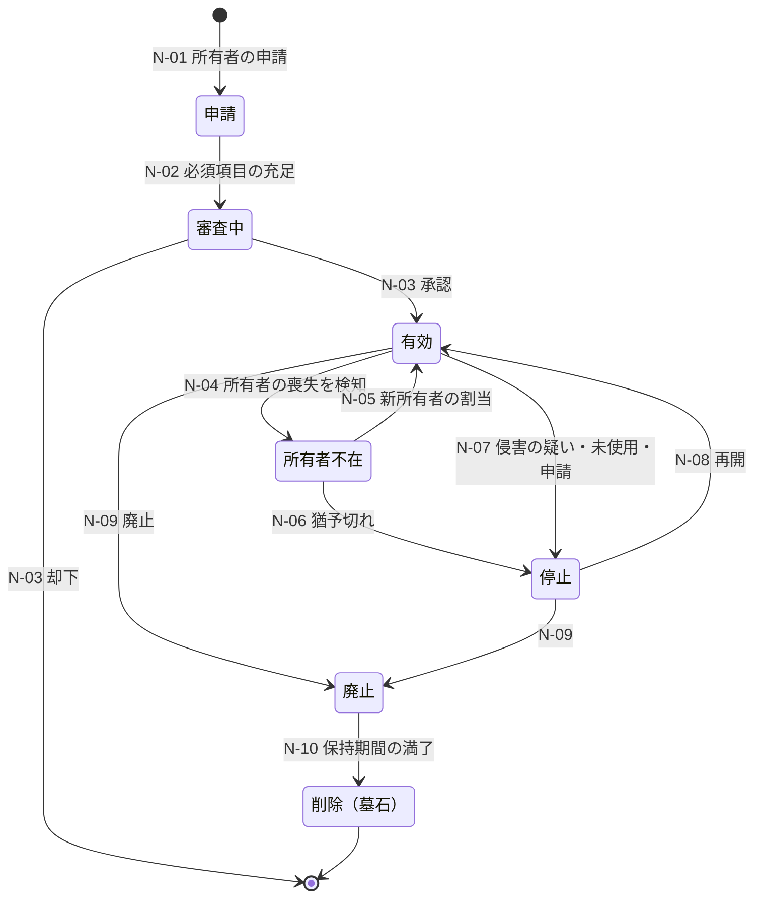

| ID | 遷移 | 契機・実行者 | 保証要件 | 監査イベント | 失敗時挙動 | T 候補 | TC 候補 |
|---|---|---|---|---|---|---|---|
| N-01 | [*]→申請 | 主所有者（人の主体） | 所有者は PR で認証する。用途、類型、必要な権限、有効期限、副所有者を記入する | nhi.requested | 必須項目が欠ければ受け付けない | IL-T28 | IL-TC21 |
| N-02 | 申請→審査中 | 本基盤 | 主所有者と副所有者が有効な人の主体であることを確認する | nhi.review.started | 確認できなければ申請に戻す | IL-T28 | IL-TC21 |
| N-03 | 審査中→有効 | 所属ドメインの責任者。PC-15 は登録審査、PC-16 は自律度区分の審査 | 申請者≠承認者（INV-9）。privileged に達する権限は ADR-008 の承認を経る（DL-48 §4.2）[^8] | nhi.approved（承認者） | 承認がなければ有効化しない | IL-T29, IL-T30 | IL-TC21 |
| N-04 | 有効→所有者不在 | 主所有者と副所有者がともに停止・退職・異動した（P-05、P-08、M-05、§7.2）、または定期照合で所有者の不在を検出した | 人の主体のイベントから所有者欄を逆引きする。イベントの欠落に備えて定期照合を併用する | nhi.orphaned | 新規の資格情報の発行を止める。既発行分は寿命で失効させる（DL-48 §5.1）[^8] | IL-T28 | IL-TC21 |
| N-05 | 所有者不在→有効 | 新しい所有者の割当 | 新所有者が承認する（自分が引き受けることを確認する）。所属ドメインの責任者が承認する | nhi.owner.assigned | 承認がなければ所有者不在のまま | IL-T28 | IL-TC21 |
| N-06 | 所有者不在→停止 | 猶予期間の満了（TBD、DL-48 §5.2） | 自動 | nhi.suspended（所有者不在） | §2.4（全資格情報と grant を失効させ、伝播は再試行する） | IL-T28 | IL-TC21 |
| N-07 | 有効→停止 | 侵害の疑い（所有者の判断を待たずに停止できる。停止権限は DL-46）、未使用期限、所有者の申請 | SEC の手動停止は基盤のセキュリティ運用 | nhi.suspended（理由） | 同上 | IL-T29 | IL-TC21 |
| N-08 | 停止→有効 | 所有者の再開申請と承認 | 侵害の疑いによる停止は、資格情報を全部更新してから再開する | nhi.resumed | 理由が残れば停止のまま | IL-T29 | IL-TC21 |
| N-09 | 有効・停止→廃止 | 所有者の申請、有効期限、契約の終了、停止の期限切れ | 資格情報、grant、認可の付与（relation）、所有するジョブ、配下のエージェントを止める・除去する（DL-48 §5.4）[^8]。鍵・証明書の信頼を外す | nhi.retired | 除去の失敗は再試行し、廃止の状態は戻さない | IL-T29 | IL-TC21 |
| N-10 | 廃止→削除 | 保持期間の満了（ADR-014） | 識別子を墓石として残す（INV-1） | nhi.deleted | — | IL-T27 | IL-TC21 |

- 所有者は主所有者と副所有者の 2 名を置く（DL-48 §5.2）[^8] [D]。副所有者を置くのは、主所有者の退職から新所有者の割当までの間に所有者不在へ落ちる頻度を下げるためである（同）[^8] [D]。
- 所有者不在の猶予期間と未使用期限の値は TBD である（所有者: CISO、期限: G3、決め方: 操作階層ごとに ADR-017・ADR-026 で決め、数値契約は DL-20 に登録する、DL-48 §5.2 と同じ）[^8] [D]。NIST SP 800-53 AC-2(2) は、一時アカウントと緊急アカウントを組織が定めた期間の後に自動で削除または無効化することを求めている（RS-09#45）[N][^53]。未使用期限はこの統制の考え方を準用する（DL-48 §5.2）[^8] [D]。
- 成長シナリオでは AI エージェントが非人間主体 ID の約 93% を占めると DL-48 は試算している（A-011〜A-014 から導出）[^8] [D][A-014]。N-04 の検知を手作業で行うことは前提にしない [D]。

### 17.2 資格情報（SM-C）

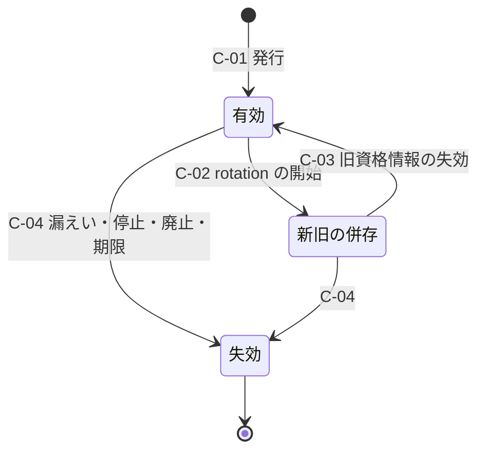

| ID | 遷移 | 規則 | 失敗時挙動 | 根拠 |
|---|---|---|---|---|
| C-01 | 発行 | 有効な主体（N-03 以降の有効）にだけ発行する。明示的な有効期限を付ける。静的な共有秘密を使わない | 所有者不在・停止の主体には発行しない | エージェントの資格情報は識別子に暗号学的に結び付け（MUST）、短命にし（SHOULD）、明示的な有効期限を持たせる（MUST）（AIMS 草案 -00、RS-06#69）[N][^59]。NIST IR 8587 は workload identity に短命で範囲を絞った token を MUST とする（政策・契約で拘束されない限り任意適合、RS-06#11）[N][^66] |
| C-02 | rotation の開始 | 新しい資格情報を発行し、旧資格情報と併存させる | 発行に失敗したら旧資格情報を使い続け、警報する。旧資格情報の有効期限は延長しない | DL-48 §5.3[^8] |
| C-03 | 旧資格情報の失効 | 新資格情報の使用を確認してから旧資格情報を失効させる | — | DL-48 §5.3[^8] |
| C-04 | 失効 | 漏えい、主体の停止・廃止、有効期限で失効させる。workload の資格情報は、インスタンスの停止時に発行元が無効化する | 失効の伝播は再試行する。派生 token は最大寿命まで残り得るため、廃止から拒否までの時間は最大寿命で上限が決まる | workload の資格情報の寿命はインスタンスの寿命を超えてはならず（MUST NOT、発行基盤が寿命を判定できない場合を除く）、インスタンスの停止時に発行元は無効化しなければならない（MUST、残余期間が十分短い場合を除く）（WIMSE practices 草案 -07、RS-06#26）[N][^57]。RFC 8693 は失効の伝播を STS の一般的性質としない（RS-06#44）[N][^55] |

### 17.3 類型別の追加規則

| PC | 追加規則 | 根拠 |
|---|---|---|
| PC-12 service account | 鍵・証明書の寿命は TBD（DL-48 §5.3）。As-Is の共有シークレット（3,000 件、うち rotation 記録なし 50% と仮置き）は非対称の資格情報への置換を N-03 の条件にする。利用者になり代わる権限は与えない | DL-48 §4.3・§5.3[^8][A-113] |
| PC-13 workload | 登録（N-03）はサービスの ID 発行条件の定義で行う。サービスの廃止で N-09。識別子は再割当てしない | WIMSE identifier 草案 -03（SHOULD NOT、RS-06#25）[N][^58] |
| PC-14 ジョブ | 登録時に所有者・実行主体・代理される利用者・同意記録を記録する。実行ごとに代理される利用者の状態を再評価し、停止・削除済みなら実行しない。所有者の退職時の既定は DL-48 決裁案 3 | DL-48 §4.4[^8]。Transaction Tokens 草案は、内部から開始する取引で workload が特定の利用者になり代わって Txn-Token を要求することを認め、発行方針の定義は範囲外としている（RS-06#39）[N][^60] |
| PC-15 外部連携アプリ | 登録審査→公開→テナントごとの grant（承認待ち→有効→失効）。異常の検知時は grant を一括で失効させる。アプリを無効化しても既存の access token は期限まで残り得るため、access token の最大寿命を短く保つ | Microsoft は、悪性アプリを無効化すると新しい token と refresh token の要求は拒否されるが、既存の access token は期限まで有効のままと記載している（RS-13#61）[V][^64] |
| PC-16 AI エージェント | 1 エージェントに 1 つの識別子を割り当てる。自律動作と委任動作には別の client_id を払い出し、自律度区分の変更は再審査（N-03 と同じ）にする。委任元の利用者の停止・削除で、その利用者からの委任を失効させる。失効・格下げの通知を受けた受信者は無効になった判定や token を使い続けない | AIMS 草案 -00 は、エージェントを一意に識別し、ちょうど 1 つの WIMSE 識別子を割り当てなければならない（MUST）とし（RS-06#69）、失効・格下げの通知を受けた受信者が無効になった判定や token を使い続けてはならない（MUST NOT）とする（RS-06#73）[N][^59]。WIMSE arch 草案 -08 は自律動作を委任動作と明確に区別しなければならない（MUST）とする（RS-06#20）[N][^56] |
| PC-17 IoT・自律デバイス | 登録は attestation を伴う。紛失届で N-07、所有者の移転は新しい所有者による再登録として扱う（旧登録は N-09） | DL-48 §4.4[^8] |
| PC-18 共有端末 | 端末台帳で登録・紛失・廃棄を管理する。端末は主体ではなく、操作する人を個別に認証する | DL-48 §3.1、§4.4[^8] |

- Microsoft Entra Agent ID は、Copilot Studio で作成したエージェントに作成者を sponsor として記録する（RS-06#75）[V][^61]。PC-16 の所有者（sponsor）を N-01 の必須項目にする初期案はこれを参照した [D]。
- SCIM でエージェントを表す草案（所有者を表す owners 属性を定義）は個人提出の -00 であり（RS-06#74）[N][^62]、本書の状態機械はこの草案に依存させない [D]。

## 18. 利用者向け画面とアクセシビリティ（G-149 の DL-08 担当分）

G-149 は、認証・登録・回復・同意の利用者向け画面について、適用するアクセシビリティ基準と適合目標、提供言語、特定の認証器を使えない利用者の代替経路とその保証レベルを決め、パイロットで適合試験と利用者試験を行うことを求めている[^4] [D]。DL-09 は、代替経路とその保証レベルを DL-09 §7 が、適用基準の判定・適合目標・提供言語を DL-34 が、画面と状態遷移を DL-08 が担うとしている[^9] [D]。本書は、状態機械のどの遷移に利用者向け画面があるかと、各画面に課す要件を定める [D]。

| 画面 | 遷移 | 要件 |
|---|---|---|
| 登録・連絡先確認 | P-01、P-02 | 確認コードの入力を唯一の手段にしない（リンクでの確認を併設する）。bot 対策は DL-52 の範囲で、認知機能テストだけに頼らない手段を用意する |
| 本人確認 | V-1〜V-3 | 外部事業者の手順に、自動化された手順を完了できない利用者の代替（対面・遠隔の担当者付き）があることを選定条件にする |
| 初回束縛・認証器の管理 | A-01〜A-06 | passkey、セキュリティキー（PIN で UV）、複数の認証器の登録を提供する（DL-09 §7.2）。束縛コードの有効期限（最大 10 分）を延長する代わりに再発行を容易にする |
| 招待の受諾 | I-03 | 受諾の手順に時間制限を設けない（招待の有効期限は別に管理する） |
| HRD・ログイン・テナント切替 | H-1〜H-4、S-01、S-08 | テナントの選択を記憶でき、取り消せる（H-3） |
| step-up | S-02 | step-up の理由を表示する。失敗時に操作を失わない（再試行できる） |
| 回復 | R-01〜R-10 | 自己回復の経路と helpdesk の経路の両方を案内する。待機中の状態と残り時間を表示する |
| linking | L-1〜L-5 | 何と何を結合するかを表示し、確認を求める |
| 削除請求 | P-08、P-09 | 猶予期間と取消の方法を表示する |
| 通知の文面 | INV-5、§2.5 | 身に覚えがない場合の連絡先を含める（SHALL、RS-03#34）[N][^17]。提供言語は DL-34 の判定による |

- 認証での認知機能テストの扱いと代替手段の例（パスワードマネージャ、コピー＆ペースト、物体の認識）は DL-09 §7.1 が原典で確認している[^9] [D]。適用する基準と適合目標の確定は DL-34 が行う [D]。
- 63A-4 §3.4 は、CSP が本人確認の手順を評価して利用者の体験上の課題を特定し、緩和策を文書化し、定期的に再評価しなければならないとしている（SHALL）[N][^16]。同 §8.2.1（informative）は、自動化された手順を完了できない利用者（障害のある利用者を含む）のために複数の本人確認の方式を用意することを挙げている[N][^16]。
- 上表の画面で全経路を完了できるかは、支援技術の利用者を含む利用者試験で確かめる（IL-TC22、DL-09 の PT-12 と合同で行う）[^9] [D]。

## 19. 脅威候補（DL-11 への持込み）

T-xxx の採番、攻撃者類型（ATK-xx）との対応、残余リスクの記録は DL-11 が行う[^2] [D]。下表は本書の遷移から導いた持込み候補である [D]。

| IL-T | 脅威 | 主な遷移 | 主な統制（本書） | 関連（他文書の番号） |
|---|---|---|---|---|
| IL-T01 | 偽装登録・事前乗っ取り（他人の連絡先で先に登録し、後の連携ログインで結合させる） | P-01、P-02、E-4 | 未確認の連絡先を他経路と結び付けない、INV-2 | DL-52 FA-12 |
| IL-T02 | bot による大量登録 | P-01 | bot 対策、rate limit | DL-52 FA-11 |
| IL-T03 | 招待の転送・再利用・招待スパム | I-01〜I-07 | 単回 token、宛先不一致の保留、発行数の上限 | DL-52 FA-13 |
| IL-T04 | email・電話番号の再割当てによる回復先・招待の乗っ取り | I-05、§9.3 | identifier-recycled での凍結、INV-2 | RS-03#66 |
| IL-T05 | email 一致による自動 linking（nOAuth 型） | F-01、E-4、Y-05 | INV-2、L-7 | DL-26 AS-3、DL-53 CB-TC-11 |
| IL-T06 | 不正な IdP の追加と自動 linking の有効化 | MI-4、F-01 | 保護操作 P-1・P-3、L-1 の両認証 | DL-26 AS-1、DL-53 CB-TC-12 |
| IL-T07 | 連携 ID の付替え（IdP 再連携）による既存アカウントの奪取 | F-04、F-05、L-3〜L-5 | 旧連携 ID での認証、P-3、回復としての扱い | R-260 |
| IL-T08 | HRD の誘導（利用者を攻撃者の IdP へ振り分ける） | H-1〜H-4 | HRD を統制とみなさない、INV-3 | — |
| IL-T09 | 保証元の取り違え（他テナントの IdP の assertion でテナント文脈を得る） | S-01、F-01 | INV-3、§8.3、MT-4 | R-047 |
| IL-T10 | IdP 起点の unsolicited assertion の注入 | F-01 | INV-4 | DL-26 AS-7、DS-14 |
| IL-T11 | SAML 署名鍵の不正な差替え | K1-2〜K1-6 | 保護チャネル、P-2、未知の鍵の拒否 | DL-26 AS-8 |
| IL-T12 | 鍵更新の失敗・証明書の期限切れによる認証停止 | K1-4、K1-5、K2-1 | 併存期間、期限の警告 | — |
| IL-T13 | 顧客 IdP の侵害の波及 | K2-4〜K2-6、F-02 | IdP 単位の遮断、session の失効、FAL3 相当の束縛認証器 | RS-14#60 |
| IL-T14 | 顧客 IdP の停止を口実にした break-glass の濫用 | K2-2、E-8 | break-glass の利用の即時通知と事後レビュー | DL-52 FA-16 |
| IL-T15 | SCIM 資格情報の窃取による利用者の作成・再有効化 | Y-01、Y-08 | 資格情報の保護操作化（P-5）、テナントと資格情報の一致、Y-08 の解除範囲 | DL-26 AS-6 |
| IL-T16 | SCIM と JIT の衝突による重複・誤結合 | Y-02〜Y-06、E-4 | §15.2 の C1〜C10 | — |
| IL-T17 | 退職・停止の反映遅延中のアクセス（SCIM 遅延、派生 token の残存） | P-05、M-03、Y-07、S-07 | INV-6、§15.3 の補完手段 | DL-49 TL-5 |
| IL-T18 | 同期による停止の上書き（再有効化） | P-06、M-04、Y-08 | 停止理由の積み上げ（§2.3） | RS-14#39 |
| IL-T19 | helpdesk へのソーシャルエンジニアリング | R-01〜R-05、HD-1〜HD-6 | 登録済み連絡先への折返し、helpdesk 単独回復の禁止、二者承認 | DL-52 FA-06、DL-26 AS-2、DL-53 CB-TC-13 |
| IL-T20 | セルフサービス回復の濫用（SIM swap、回復コードの窃取） | R-01〜R-07 | 三択の条件、待機と通知、回復後の制限 | DL-52 FA-05、FA-07 |
| IL-T21 | 侵入後の攻撃者による認証器の追加 | A-01、A-02、P-06 | 低いほうの AAL での認証、独立経路の通知、AR-8 の検知 | RS-13#26 |
| IL-T22 | 偽の紛失届による認証器の無効化（サービス拒否） | A-04 | 真正性の判断、届出の監視 | RS-03#33, #35 |
| IL-T23 | 弱い fallback（SMS）の残存 | A-06、AR-4 | +SEC での fallback の禁止、SMS の削除の案内 | RS-13#25 |
| IL-T24 | 同期 passkey の同期アカウントの乗っ取り | A-03、§10.3 | AAL3 での不受理、BS の変化の確認 | RS-03#25 |
| IL-T25 | step-up の鮮度の偽装・refresh による鮮度の延長 | S-02、S-03 | 新しい認可要求、`auth_time` の検証 | RS-03#48 |
| IL-T26 | 複数所属でのテナント文脈の取り違え | S-08、M-01、M-03 | MT-2〜MT-6 | R-283 |
| IL-T27 | 削除済みの識別子の再割当て | P-10、N-10 | INV-1 | — |
| IL-T28 | 所有者不在の非人間主体の残存 | N-04〜N-06 | 逆引きと定期照合、猶予切れの停止 | R-282 |
| IL-T29 | 非人間主体の資格情報の漏えい・長寿命化 | C-01〜C-04、N-07 | 明示的な有効期限、rotation、停止権限 | — |
| IL-T30 | エージェントの自律動作と委任動作の混同 | N-03、§17.3 PC-16 | 別の client_id、自律度区分の再審査 | RS-06#20 |
| IL-T31 | ドメイン失効後の再検証による旧資源への到達 | H-2 | DL-26 §6.3 の再検証規則 | DL-26 AS-5、DL-49 TL-10 |
| IL-T32 | 所属変更後の旧権限の残存（権限の蓄積） | M-02、§7.2 | 除去してから追加 | — |
| IL-T33 | 管理者・特権者の回復の単独承認（内部不正を含む） | R-04、R-05、E-7 | 二者承認、承認者≠申請者 | DL-52 FA-17 |
| IL-T34 | deepfake・映像注入による遠隔本人確認の突破（管理者が 1 名のテナントの契約手続、helpdesk の映像確認、(c) の再本人確認、R-C の監督付き再本人確認）。特に管理者 1 名のテナントでは、二者承認がないまま新しいテナント管理者を作られ、テナント設定を書き換えられる | R-01〜R-07、§11.5.1 | 映像だけで成立させない（SA-2）、契約記録の連絡先への帯域外の折返し（SA-3）、発効遅延（SA-4）、テナント設定の凍結（SA-5）、独立経路の通知（SA-6）、63A-4 §3.14 の統制を本人確認事業者に求める | DL-52 FA-19、THR-03 T-003 |

## 20. PoC 試験候補（DL-22 への持込み）

TC-xxx の採番、仮説、合否基準の数値、中止基準の事前登録は DL-22 が行う[^2] [D]。G-086 が列挙するシナリオ（招待、所属変更、IdP 発見・複数 IdP、メール再利用と account linking、SAML 署名鍵の更新、IdP 停止時の回復、SCIM の競合・遅延、認証器の紛失、退職・削除、step-up の鮮度）[^4] は、下表の右端の列で対応を示す [D]。

| IL-TC | 試験 | 合否基準の案 | 対応 R/G | 他文書の候補 |
|---|---|---|---|---|
| IL-TC01 | 登録（bot、未確認の連絡先での事前登録→正規利用者の連携ログイン） | 未確認の主体への結合 0 件。応答から既存登録の有無を判別できない | R-279 | — |
| IL-TC02 | 招待（転送、期限後・取消後・再送後の旧 token、宛先不一致、identifier-recycled、SSO 強制テナントでの受諾経路） | 全負例が拒否または保留される | R-034、G-086（招待） | — |
| IL-TC03 | 所属変更（グループ変更、人事の異動、SCIM の順序逆転） | 変更後の旧権限での allow 0 件。除去から拒否までの時間を測る | R-035、G-086（所属変更） | — |
| IL-TC04 | 複数所属（テナント切替、token のテナント不一致、テナント B の SSO 強制、1 所属の停止） | 不一致の token の受理 0 件。他テナントの文脈への影響 0 件 | R-283 | — |
| IL-TC05 | HRD と複数 IdP（期待しない IdP の assertion、他テナントの IdP、記憶した選択の取消、同テナントの別 IdP からの同一人物） | 全負例が拒否される。別 IdP からの自動結合 0 件 | R-036、G-086（IdP 発見・複数 IdP） | DL-26 §13 |
| IL-TC06 | 保証元の結合（テナント A の IdP の assertion をテナント B の受信口に提示、監査の 3 つ組の記録） | 拒否される。全 session の監査に保証元が記録される | R-047 | RS-03 §5.2-4 |
| IL-TC07 | email 再利用と linking（nOAuth の再現、email・username の一致、identifier-recycled の受信） | 結合の成立 0 件。受信後に回復先・通知先・招待が凍結される | R-037、G-086（メール再利用と account linking） | DL-53 CB-TC-11、RS-03 §5.2-3 |
| IL-TC08 | IdP 再連携（旧連携 ID の認証なしの付替え、管理者の一括対応表、旧 IdP 喪失時の付替え） | 認証なしの付替えの成立 0 件。一括対応表で全対象者に通知が届く | R-260 | DL-49 TL-9、DL-53 CB-TC-12 |
| IL-TC09 | SAML 署名鍵の更新（2 枚の併存での切替、未知の鍵、期限切れ、metadata の改ざん） | 未知の鍵・改ざんの受理 0 件。切替中のログイン失敗率を測る（合否値は DL-22） | R-038、G-086（SAML 署名鍵の更新） | DL-26 §13 |
| IL-TC10 | 顧客 IdP の停止（新規ログイン、既存 session、step-up、break-glass、復旧後の再同期） | 停止中のローカル認証への自動切替 0 件。break-glass で管理できる。復旧後に停止中の無効化が反映される | R-039、G-086（IdP 停止時の回復） | RS-14 §5.3 |
| IL-TC11 | 顧客 IdP の侵害（遮断から全 session 失効までの時間、凍結した連携 ID の解除手順） | 時間の分布（p50・p99・最大）を記録する（閾値は DL-20）。遮断後の受理 0 件 | R-039 | RS-03 §5.2-9 |
| IL-TC12 | SCIM と JIT の衝突（§15.2 の C1〜C10） | 重複アカウント 0 件。誤結合 0 件。C7 で SEC が解除されない | R-040、G-086（SCIM の競合） | DL-26 §13 |
| IL-TC13 | SCIM の遅延と deprovision（受信から全手段の失効まで、step-up による捕捉） | 時間の分布を記録する（閾値は DL-20）。INV-6 の全手段が失効している | R-040、R-044、G-086（SCIM の遅延） | RS-14 §5.3 |
| IL-TC14 | 認証器の紛失・変更（紛失届、偽の届出、失敗回数の上限、電話番号の変更、最後の認証器の削除、BS の変化） | 停止後の認証の成立 0 件。最後の認証器の削除が拒否される | R-041、G-086（認証器の紛失） | — |
| IL-TC15 | AAL2 の回復（(a)〜(c) の分岐、本人確認していないアカウントでの (c) の拒否、通知、待機中の取消、回復後の制限、処理時間） | 条件を満たさない回復の成立 0 件。取消で SEC 停止に入る。処理時間を測る（R-188.6） | R-032、R-188.6 | DL-09 PT-10 |
| IL-TC16 | helpdesk へのソーシャルエンジニアリングの red team（複数回の接触、公開情報の利用、特権者の再設定の依頼） | 手順どおりの拒否の割合と所要時間を測る。合否基準は DL-59 で事前登録する。評価者は作成者以外 | R-042、G-061 | DL-09 PT-10、DL-53 CB-TC-13 |
| IL-TC17 | 管理者・特権者の回復の二者承認（単独承認、申請者と承認者の同一、事業者要員による承認） | 単独での回復の成立 0 件 | G-061 | — |
| IL-TC18 | step-up の鮮度（refresh で鮮度が戻らない、`max_age=0` で外部 IdP が再認証する、無操作・全体の上限） | refresh での鮮度の回復 0 件。外部 IdP ごとの挙動を記録する | R-045、G-086（step-up の鮮度） | DL-09 PT-1・PT-2 |
| IL-TC19 | 退職・削除（全手段の失効、委任ジョブとエージェント委任の失効、墓石、識別子の再利用の拒否、依存サービスの削除報告） | 退職後の allow 0 件。再利用 0 件。削除報告の欠落を検知できる | R-044、G-137、G-086（退職・削除） | DL-49 TL-6 |
| IL-TC20 | 利用者事象の配送（重複、順序の逆転、受信側の停止、replay、dead letter） | 重複処理 0 件。欠番の検知と replay による回復 | G-137 | DL-49 TL-8 |
| IL-TC21 | 非人間主体（所有者の退職→所有者不在→停止、rotation の失敗、自律と委任の区別、インスタンス停止での失効） | 所有者不在の主体への新規発行 0 件。猶予切れで停止される | R-282 | — |
| IL-TC22 | 利用者向け画面の利用者試験（§18） | 全経路の完了率を記録する。未完了のすべてに是正計画がある | G-149 | DL-09 PT-12 |
| IL-TC23 | 停止理由の優先（SCIM の `active=true`、管理者の解除による SEC の解除の試み） | SEC・LEG の解除 0 件 | R-040 | — |
| IL-TC24 | 本人確認（IAL の引上げ前の認証、通知、IAL の申告のない assertion） | IAL の申告のない assertion を IAL1 として扱う件数 0 件 | R-033 | — |
| IL-TC25 | 管理者が 1 名のテナントの回復（§11.5.1）。事前に生成した映像・仮想カメラによる映像の注入、依頼者が示す連絡先への誘導、回復中の IdP 追加・ドメイン追加・SCIM 資格情報の発行・越境付与・管理者の追加、発効遅延中の否認 | 遠隔映像だけで回復が成立する件数 0 件。依頼者が示した連絡先での確認の成立 0 件。凍結中のテナント設定変更の成立 0 件。否認後の発効 0 件。本人確認事業者による注入の検出の可否は記録する（合否値は DL-22・DL-59） | R-042、G-061 | DL-52 試験案 23、DL-59 |

## 21. 決裁案

以下はすべて案であり、決定済みではない [D]。決裁は表の「決める人」が行い、本書の起草者は決めない [D]。

### 21.1 IL-D1: 回復の待機時間と回復後の制限（R-032、R-042）

| 選択肢 | 帰結 |
|---|---|
| (a) 待機を置かず、通知だけを行う | 回復が早く完了する。利用者が通知に気付く前に攻撃者が回復を完了し得る [D] |
| (b) 回復区分（R-A〜R-D）ごとに固定の待機と回復後の制限を置き、通知に取消の手段を付ける | 正規の利用者の回復が遅れる。待機中に通知への応答で不正な回復を止められる [D] |
| (c) リスク判定（新しい端末・場所、helpdesk 経由、直前の連絡先変更）で待機を伸縮させる | 利便性と抑止の釣り合いをとれるが、判定の誤りと判定系の障害時の挙動（DL-19）を決める必要がある [D] |

- 推奨: (b) を基本とし、helpdesk 経由と直前の連絡先変更がある場合だけ (c) で延長する [D]。
- 値: 区分ごとの待機と制限期間は TBD（所有者: CISO＋プロダクト責任者、期限: G1 で候補、G4 で確定、決め方: BIA（回復できないことの業務影響）と IL-TC15・IL-TC16 の実測）[D]。
- 管理者が 1 名のテナントの発効遅延 W_B1（§11.5.1 SA-4）も本決裁で決める [D]。W_B1 ≥ W_B とし、一般テナントと規制業種・高保証要求テナント（A-081）で別の下限を置く [D][A-081]。決め方は上と同じで、IL-TC25 の実測を加える [D]。
- 決める人: CISO（統制水準）、プロダクト責任者（B2C・B2B の利便性）、事業責任者（回復できないことの事業影響）[D]。

### 21.2 IL-D2: helpdesk 経由の回復を提供する範囲（R-042、G-061）

| 選択肢 | 帰結 |
|---|---|
| (a) 提供しない（自己回復だけ） | ソーシャルエンジニアリングの経路はなくなる。回復コードを持たない利用者（password のみ 55% と仮置き）は再本人確認か新規登録しか手段がない [D][A-115] |
| (b) R-A では三択の手続を補助する経路として提供し（§11.4）、R-B〜R-D では helpdesk 単独での完了を禁止する | 回復の手段を残しつつ、特権者への攻撃経路を二者承認で狭める。担当者の研修と演習が要る [D] |
| (c) helpdesk が本人確認のうえで認証器をリセットできる | AAL2 の三択（SHALL）を満たさない手続になり得る（§11.4）[D]。Scattered Spider の手口に開いた経路になる（RS-03#42）[I][^43] |

- 推奨: (b) [D]。
- 決める人: CISO、support 部門長、事業責任者 [D]。期限: G1 [D]。

### 21.3 IL-D3: 同期 passkey の受入れの帰結（R-043）

- 受け入れる階層の決定は DL-09 REQ03-D2 で行う[^9] [D]。本書は、その決定がライフサイクルに与える帰結を補う [D]。

| 選択肢（DL-09 REQ03-D2 に対応） | ライフサイクル上の帰結 |
|---|---|
| (a) AAL2 の箇所で同期 passkey を受け入れ、AAL3 の箇所では受け入れない | 端末の紛失で passkey を失いにくく、回復の件数が減ると見込む [D]。同期アカウントの乗っ取りは本基盤の統制外であり（RS-03#25）[N][^20]、BS の変化の確認（A-03）と新しい端末からの使用の検知で補う [D] |
| (b) 全階層で device-bound だけを受け入れる | 端末の紛失のたびに回復か 2 つ目の認証器が要る。helpdesk 経由の回復の需要が増える [D] |
| (c) 全階層で同期 passkey を受け入れる | AAL3 での同期型の使用の禁止（SHALL NOT、RS-03#15）[N][^17] に反する [D] |

- 推奨: (a)（DL-09 の推奨と同じ）[D]。
- 決める人: CISO、事業責任者（DL-09 REQ03-D2 と同じ）[D]。期限: G1 [D]。

### 21.4 IL-D4: 顧客 IdP の停止中の代替ログイン（R-039）

| 選択肢 | 帰結 |
|---|---|
| (a) 代替ログインを提供しない（顧客管理者は break-glass だけ） | 停止中は一般利用者の新規ログインができない [D]。顧客 IdP が正本である停止・退職の扱いを迂回しない [D] |
| (b) テナントが事前に選択した場合だけ、本基盤に登録した認証器での代替ログインを、停止の宣言中に限って許す | 一般利用者にも本基盤の認証器の登録と回復が要る [D]。停止中は IdP からの退職の通知が届かないため、退職者が代替ログインできる窓が生じる [D]。SCIM を使うテナントでも、停止中に IdP 側で行われた無効化は反映されない [D] |
| (c) 停止を検知したら自動で代替ログインに切り替える | (b) の帰結に加え、障害の誤検知や攻撃者による IdP の妨害で代替経路が開く [D] |

- 推奨: (a) を既定とし、(b) は顧客が受容票（DL-05）と trust agreement の追記で明示的に選ぶ場合に限る [D]。
- 決める人: 事業責任者（B2B）、CISO、顧客（trust agreement の当事者として）[D]。期限: G3 [D]。

### 21.5 IL-D5: B2C の削除猶予と休眠の期限（R-044）

| 選択肢 | 帰結 |
|---|---|
| (a) 削除請求を即時に実行する | 誤操作・乗っ取りによる削除を取り消せない [D] |
| (b) 猶予期間を置き、期間中は取消できる。休眠は最終利用からの期間で停止し、さらに期間を置いて削除する（いずれも事前通知） | 取消の機会を残す。猶予中のデータ保持は消去義務（GDPR 第 17 条第 1 項の「不当な遅滞なく」）との関係を法務が判断する（RS-10#49）[N][^54] |
| (c) 休眠処理をしない | 使われないアカウントが攻撃対象として残る。63A-4 §5.4 は規定による非活動を停止・終了の契機の 1 つに挙げている（SHALL）[N][^16] |

- 推奨: (b) [D]。
- 値: 猶予期間、休眠の期限、休眠からの削除までの期間は TBD（所有者: プロダクト責任者、期限: G1、決め方: IL-N5 と DL-34 の法域判定）[D]。
- 決める人: プロダクト責任者（B2C）、個人情報保護責任者、法務責任者 [D]。

### 21.6 IL-D6: 自動 linking の例外（R-037、R-260）

| 選択肢 | 帰結 |
|---|---|
| (a) 自動 linking を一切提供しない | 移行時の重複（15% と仮置き）の解消に利用者の操作が要る [D][A-111] |
| (b) 利用者による linking（L-1）と管理者の一括対応表（L-4、保護操作・全員への通知）だけを提供し、email・username の一致による自動 linking は提供しない | 移行の工数は (a) より減る。一括対応表が攻撃の到達点になるため、P-3 の二者承認と発効遅延（DL-26 決裁案 2）の決定に依存する [D] |
| (c) テナントの選択で email の一致による自動 linking を許す | Okta の報告の手口（username の一致によるなりすまし、RS-14#7）[I][^44] と nOAuth（RS-03#62）[I][^45] の経路を顧客の設定で開くことになる [D] |

- 推奨: (b) [D]。
- 決める人: CISO、プロダクト責任者 [D]。期限: G3（ADR-004 と同時）[D]。

### 21.7 IL-D7: 招待できる者の既定（R-034）

| 選択肢 | 帰結 |
|---|---|
| (a) 管理者だけ | 招待スパムの面は小さい。業務部門の招待の依頼が管理者に集中する [D] |
| (b) 管理者と、テナントが招待ロールを与えた者 | テナントが範囲を決められる。SSCF IAM-SaaS-21 の「管理者以外による招待をロール単位で制限する仕組み」（must）に沿う（RS-14#50）[N][^50] |
| (c) 全利用者 | 招待スパム（DL-52 FA-13）の面が広がる [D] |

- 推奨: (b) を既定にし、外部ドメイン宛ての招待はテナント設定で禁止できるようにする [D]。
- 決める人: プロダクト責任者、CISO [D]。期限: G1 [D]。

### 21.8 IL-D8: 本人確認（IAL2）の提供方式（R-033）

| 選択肢 | 帰結 |
|---|---|
| (a) 本人確認を提供しない（顧客組織・各サービスに任せる） | IAL2 を要する取引を持つサービスが個別に事業者と契約し、記録と DIAS の確認が分散する [D] |
| (b) 外部の本人確認事業者を基盤に統合し、結果だけを記録する（本人確認書類は保持しない） | 前提台帳の A-070 と整合する [A-070]。事業者の DIAS の確認（SHALL、RS-03#8）[N][^15] と、法域ごとの本人確認規制の判定（未調査）が要る [D] |
| (c) 基盤が本人確認を自ら行い、書類を保持する | 保持するデータの分類が上がり、漏えい時の影響が大きくなる（A-070 の感度）[A-070] |

- 推奨: (b) [D]。IL-N6 の結果、IAL2 を要する取引がない場合は (a) を再評価する [D]。
- 決める人: 事業責任者、法務責任者、個人情報保護責任者、CISO [D]。期限: G1 [D]。

### 21.9 IL-D9: 管理者が 1 名のテナントをオンボーディングで減らすか（R-042、G-061）

| 選択肢 | 帰結 |
|---|---|
| (a) オンボーディングで、顧客管理者 2 名以上の登録か、テナントの break-glass アカウント（PC-08(b)）の作成を必須にする（既存テナントは移行期限を置いて求める） | 管理者の回復は二者承認か break-glass で完了し、§11.5.1 の契約手続（事業者要員が本人確認を行う経路）がほぼ不要になる [D]。小規模の顧客には 2 人目の管理者を置けない場合があり、契約の成立と導入が遅れ得る [D]。break-glass アカウントの封緘と定期確認の負担が顧客側に生じる（Microsoft は緊急アクセスアカウントを 2 個以上とし、定期的に検証するよう求めている、RS-09#44）[^51] [V] |
| (b) 必須にはせず、2 名以上または break-glass を推奨し、管理者 1 名のテナントは §11.5.1 の契約手続で回復する | 導入の摩擦はない [D]。IL-N7 の比率の分だけ、事業者要員が遠隔で本人確認する経路（IL-T34）が残る [D] |
| (c) 区分で分ける。規制業種・高保証要求テナント（A-081）と、IdP 連携・SCIM・越境付与を使うテナントには (a) を必須にし、それ以外は (b) とする | 信頼の起点を書き換えられる設定（DL-26 の顧客管理者の権限の整理）を持つテナントで経路を閉じ、小規模テナントの導入の摩擦を抑える [D][A-081]。区分の判定と、設定の変化（IdP 連携の追加など）に応じた要件の切替えが要る [D] |

- 推奨: (c) [D]。IL-N7 の比率が小さければ (a) への一本化を検討する [D]。
- 決める人: 事業責任者（B2B）、CISO、営業・顧客成功責任者、法務責任者（契約条項）[D]。期限: G1（方針）、G3（契約様式とオンボーディング手順、DL-49）[D]。

## 22. 他文書への申し送り

| 宛先 | 申し送る内容 |
|---|---|
| DL-11（脅威カタログ） | §19 の IL-T01〜IL-T33 の登録と残余リスクの記録 [D] |
| DL-22（PoC 試験計画） | §20 の IL-TC01〜IL-TC25 の採番、仮説、合否基準の数値、事前登録 [D] |
| DL-20（数値契約） | 回復の処理時間・総所要時間・通知の到達時間（§11.7）、受信から全手段の失効まで（§15.3）、侵害された認証器の停止期限（§10.1）、利用者事象の期限 T_user_*（§16.3）[D] |
| DL-09（操作リスク階層） | REQ03-D2 の決定と IL-D3 の帰結の整合、§6.7 のアカウント削除の待機期間（IL-D5）[D] |
| DL-26（顧客管理機能） | P-2 と K1-3、P-3 と L-4、決裁案 6 と K2-4 の発動条件、§11.3 の shared signaling の記載事項に K2-4 と回復の RISC イベントを追加 [D] |
| DL-49（テナントライフサイクル） | §16.3 の利用者事象の封筒・配送の共用、DL-49 §14 の残課題（DL-08 との整合）への回答 [D] |
| DL-52（不正・濫用対策） | AR-8、HD-6、A-04 の偽の紛失届の検知、R-03 の検証失敗の上限 [D] |
| DL-56（失効・継続評価） | S-07 の失効の契機の一覧、派生 token の最大寿命（§15.3、C-04）、大規模な権限剥奪の事象 [D] |
| ADR-003（回復と認証器） | §10、§11、IL-D1〜IL-D3、§2.3 の SEC 停止時の通知の例外の tailoring 記録 [D] |
| ADR-004（B2B federation・linking・SCIM） | §8、§9、§13〜§15、IL-D4、IL-D6、K1-5 の期限切れ証明書の扱い [D] |
| ADR-005・DL-16・DL-75（token profile） | §8.3 の保証元の claim、MT-2 のテナント文脈の claim [D] |
| ADR-014・DL-25・DL-33（監査・PIA） | §2.6 の追加属性、§16.2 の墓石と監査記録の保持、MT-7 の対応表のプライバシー影響 [D] |
| ADR-017・ADR-009・DL-55（非人間主体） | §17 の遷移、所有者不在の猶予、資格情報の寿命 [D] |
| ADR-021（識別子） | INV-1 の墓石の対象、MT-7 の対応表の要否 [D] |
| DL-34（法域判定） | 民間の本人確認規制（日本の eKYC、EU・英国の保証レベル体系）、削除の期限、休眠処理の法的要件、提供言語 [D] |
| DL-59（pentest・red team） | IL-TC16 の範囲（電話・チャット、複数回の接触、特権者の再設定）と、IL-TC25 の映像注入・deepfake を使う演習 [D] |
| DL-24（侵害別 runbook） | 顧客 IdP 侵害（K2-4〜K2-6）、helpdesk 経由の乗っ取り（R-09 の後の調査）[D] |
| DL-76（SCIM API profile） | Y-02 の不変 ID の属性、C4・C5 の応答、Y-08 の解除範囲 [D] |
| DL-77・DL-79（イベントスキーマ） | 本書の監査イベント名と、§16.3 の利用者事象の型 [D] |
| DL-11・THR-03（脅威カタログ） | IL-T34（deepfake・映像注入による遠隔本人確認の突破）を T-xxx として起票し、T-003（helpdesk 経由の要素リセット）の予防欄に §11.5.1 SA-2〜SA-5 を加える。管理者 1 名のテナントで二者承認がない点を残余リスクに書く [D] |
| DCS-05（残余リスク台帳、RRG） | IL-T34 の残余リスク（本人確認事業者の注入検出が破られ、SA-3 の契約記録の連絡先も乗っ取られている場合）を RRG に追加する。受容者案は事業責任者（B2B）、IL-D9 で (a) を採れば対象テナントが減る [D] |
| DL-26（顧客管理機能） | 決裁案 2 の「管理者 1 名のテナントの代替（発効遅延と取消窓口）」に §11.5.1 SA-2〜SA-6 を加える。契約様式に、契約上の署名者・請求先の連絡先の登録と、その変更手続（回復の手続の中では変えない）を加える [D] |
| DL-49（テナントライフサイクル） | IL-D9 のオンボーディング要件（管理者 2 名以上または break-glass）と既存テナントの移行期限 [D] |
| ADR-029（特権・support アクセス） | D29-35 の「契約手続による代行」に SA-2（遠隔映像だけで成立させない）と SA-5（テナント設定の凍結）を加え、§11.5.1 と揃える [D] |
| ADR-003（回復と認証器） | RC5-2 の管理者 1 名のテナントの規則を §11.5.1 に揃える（本ラウンドで同時に反映済み）[D] |
| DL-52（不正・濫用対策） | FA-19（deepfake・映像注入による遠隔本人確認の突破）と試験案 23（本ラウンドで同時に反映済み）[D] |
| GOV-01（前提台帳） | 新規仮定 IL-N1〜IL-N7 の登録。IL-N7 は ADR-003 NA-003-1・DL-26 の新規仮定と同じ量なので 1 件にまとめる [D] |

## 23. 対応表

R-requirements.md と G-goal-criteria.md のうち、対応成果物欄に本書のパスまたは DL-08 を含む行を Grep で抽出した結果は、R 23 件、G 4 件である[^3][^4] [D]。閉じ方は各台帳の区分欄による [D]。状態「本書で閉じた」は本書の担当範囲の記述が揃ったことを示し、合否は作成者以外が判定する [D]。

| ID | 要旨 | 本文の節 | 閉じ方 | 状態 | 備考 |
|---|---|---|---|---|---|
| R-028 | 認証全イベント（登録〜削除）の状態機械 | §2〜§17 | A | 本書で閉じた | 11 個の状態機械と遷移表。作成者以外の検証待ち |
| R-032 | AAL2 回復要件（三択） | §11.1〜§11.3、§11.6、IL-D1 | C | 要実測 | IL-TC15。待機・制限の値は IL-D1 |
| R-033 | 本人確認（identity proofing）手順 | §5.2、IL-D8 | A | 本書で閉じた | 手順と類型別の実施者を定義。提供方式は IL-D8、規制業種の要件は DL-34 |
| R-034 | 招待 | §6、IL-D7 | C | 要実測 | IL-TC02 |
| R-035 | 所属変更 | §7.1、§7.2 | C | 要実測 | IL-TC03 |
| R-036 | IdP 発見・複数 IdP | §8.1、§8.2 | C | 要実測 | IL-TC05 |
| R-037 | メール再利用と account linking | §9、IL-D6 | C | 要実測 | IL-TC07 |
| R-038 | SAML 署名鍵更新 | §13 | C | 要実測 | IL-TC09 |
| R-039 | IdP 停止時の回復 | §14、IL-D4 | C | 要実測 | IL-TC10、IL-TC11 |
| R-040 | SCIM 競合・遅延 | §15 | C | 要実測 | IL-TC12、IL-TC13、IL-TC23 |
| R-041 | 認証器の紛失・変更 | §10.1、§10.2 | C | 要実測 | IL-TC14 |
| R-042 | support 経由の回復（ソーシャルエンジニアリング対策） | §11.4、§11.5、§11.5.1、IL-D2、IL-D9 | D | 要第三者 | IL-TC16（red team、DL-59）、IL-TC25（映像注入・deepfake） |
| R-043 | passkey 同期の扱い | §10.3、IL-D3 | B | 決裁案まで | DL-09 REQ03-D2 と同じ決裁 |
| R-044 | 退職・削除 | §16.1、§16.2、IL-D5 | C | 要実測 | IL-TC13、IL-TC19 |
| R-045 | step-up の鮮度 | §12.1 | C | 要実測 | IL-TC18。鮮度窓の値は DL-09 REQ03-D6 |
| R-047 | どのテナントのどの IdP が保証したかの結合 | §8.3 | C | 要実測 | IL-TC06 |
| R-048 | federation・SCIM・session lifecycle のユースケース別定義 | §12.2 | A | 本書で閉じた | 数値は DL-09 §3.3 の TBD に従属 |
| R-260 | IdP 再連携の統制 | §9.2（L-3〜L-5）、IL-D6 | C | 要実測 | IL-TC08 |
| R-188.6 | 回復完了 SLO | §11.7 | C | 要実測 | 指標の定義まで。値は IL-TC15 の実測後に DL-20 |
| R-267 | 承認条件 2（IAL/AAL/FAL、認証器、回復、federation、SCIM、session のユースケース別定義） | §5.2、§10〜§15、§12.2 | B | 決裁案まで | DL-09 の REQ03-D1〜D6 と本書の IL-D1〜IL-D8 の決裁が要る |
| R-279 | ユーザー登録の手順と統制 | §4、§5.1、§5.3 | C | 要実測 | IL-TC01 |
| R-282 | 非人間主体の登録から削除までの状態遷移 | §17 | A | 本書で閉じた | DL-48 §5 の共通状態に遷移と失敗時挙動を追加。値は TBD |
| R-283 | 複数所属 | §7.3 | C | 要実測 | IL-TC04。claim は ADR-005・DL-16 |
| G-061 | 回復手順の保証レベル別の定義と red team での検証 | §11、IL-D1、IL-D2、IL-D9 | D | 要第三者 | 定義は本書。red team（IL-TC16）と第三者報告書（E6）が要る |
| G-086 | 全イベントの主体類型別の状態機械と、列挙シナリオの PoC 検証 | §3〜§17、§20 | C | 要実測 | 列挙 10 シナリオを IL-TC に対応付けた（§20） |
| G-137 | 依存サービスが受け取るライフサイクル事象の契約と受信側の義務 | §16.3 | A | 決裁案まで | 利用者事象の契約と義務は定義した。削除の期限は DL-49 K-3・G-054 と DL-34 の判定待ち。テナント事象は DL-49 |
| G-149 | 利用者向け画面のアクセシビリティ・代替経路 | §18 | C | 要実測 | 画面と状態遷移の担当分。基準の判定は DL-34、代替経路の保証は DL-09 §7、試験は IL-TC22 |

集計: 本書で閉じた 4 件（R-028、R-033、R-048、R-282）、決裁案まで 3 件（R-043、R-267、G-137）、要実測 18 件（R-032、R-034〜R-041、R-044、R-045、R-047、R-188.6、R-260、R-279、R-283、G-086、G-149）、要第三者 2 件（R-042、G-061）[D]。
R と G の別では、R は本書で閉じた 4・決裁案まで 2・要実測 16・要第三者 1、G は本書で閉じた 0・決裁案まで 1・要実測 2・要第三者 1 である [D]。

- R-046（IdP 起点 assertion の注入）は対応成果物欄に本書を含まないが、INV-4 と IL-T10 で前提にした[^3] [D]。R-027（IAL/AAL/FAL のユースケース別割当）は DL-09 の担当である[^9] [D]。

## 24. 残課題

| # | 本書で閉じないもの | 担当 | 閉じるゲート | 閉じ方 |
|---|---|---|---|---|
| 1 | 決裁案 IL-D1〜IL-D9 の決定 | §21 の各「決める人」 | G1〜G3 | B |
| 2 | 待機時間、回復後の制限期間、削除猶予、休眠期限、招待の有効期限、未確認登録の破棄期限、照合の周期、所有者不在の猶予、未使用期限の値 | 各 TBD の所有者 | G1〜G3 | B・C |
| 3 | §20 の試験の事前登録と実測（IL-TC01〜IL-TC15、IL-TC17〜IL-TC24） | DL-22 作成者、CISO と独立立会人 | G4 | C |
| 4 | helpdesk 経由の回復の red team（IL-TC16）と第三者報告書 | DL-59、作成者以外の評価者 | G5 | D |
| 5 | 数値契約（回復、deprovision、利用者事象の期限、認証器の停止期限）の確定 | DL-20 作成者 | G4 | B・C |
| 6 | 民間の本人確認規制（日本の eKYC、EU・英国の保証レベル体系）と、規制業種の顧客向けの本人確認要件 | DL-34、法務責任者 | G1 | B |
| 7 | 削除の期限と、墓石・監査記録の保持が消去義務の例外に当たるかの法的判定 | 法務責任者、個人情報保護責任者（DL-34、DL-49 K-2・K-3） | G3 | B |
| 8 | MT-7（類型をまたぐ別主体）に 63A-4 §5.6 の対応表要件が及ぶかの判断とプライバシー影響評価 | ADR-021、DL-25 の作成者 | G3 | A・B |
| 9 | §2.3 の SEC 停止時の通知の例外を 63A-4 §5.4 からの tailoring として記録 | ADR-003 の作成者 | G3 | A |
| 10 | 期限切れの SAML 証明書の扱い（K1-5）と metadata URL からの自動取得の採否 | ADR-004 の作成者 | G3 | A・C |
| 11 | 監査イベント名の正式化と利用者事象のスキーマ（11_contracts。成果物計画に DL がない） | DL-77、DL-79 の作成者、成果物計画（TRC-03）の管理者 | G3 | A |
| 12 | 新規仮定 IL-N1〜IL-N7 の前提台帳への登録と値の設定 | §1.3 の各所有者、前提台帳の管理者 | G1 | B・C |
| 13 | WebAuthn L3 の signal メソッドのブラウザ対応の確認（AR-6） | プラットフォームチーム長 | G4 | C |
| 14 | IPSIE AL SCIM、AIMS、WIMSE、Transaction Tokens、SCIM エージェント拡張など草案の状態変化の監視 | プラットフォームチーム長 | 定期（ADR-016 の再検討トリガー） | A |
| 15 | 本書の作成者以外による原典照合（特に本書で直接取得した 63A-4 の各節）と本文・脚注の一致確認 | Phase 4 の引用監査 | Phase 4 | A |
| 16 | §11.5.1 の SA-1〜SA-8 を DL-26 決裁案 2・ADR-029 D29-35・THR-03・RRG に反映すること（§22）、IL-T34 の T-xxx 採番、IL-TC25 の事前登録と実測 | 各文書の作成者、DL-22 の作成者、DL-59 | G3（文書）、G4〜G5（実測・演習） | A・C・D |
| 17 | 本人確認事業者が 63A-4 §3.14 の統制（正規センサーの確認、改ざん解析）を実装しているかの確認と、その有効性の第三者評価 | ADR-001 の調達、DL-59 | G3〜G5 | C・D |
| 18 | 本ラウンドで新たに引いた FinCEN の警告（[^68]）の作成者以外による照合 | Phase 4 の引用監査 | Phase 4 | A |

## 変更履歴

| 版 | 日付 | 内容 |
|---|---|---|
| 0.2 | 2026-10-15 | 模擬パネル ラウンド 5 の redteam 指摘への対応。§11.5.1（管理者が 1 名のテナントの回復 SA-1〜SA-8）、IL-N7、IL-T34、IL-TC25、IL-D9 を追加し、§11.5・§11.6・IL-D1・§22・§24 を改めた。脚注 [^16] に 63A-4 §3.14 を加え、[^67]・[^68] を追加 |
| 0.1 | 2026-10-03 | 初版。11 個の状態機械、登録・本人確認・招待・所属・HRD・linking・認証器・回復・session・鍵更新・IdP 停止・SCIM/JIT・退職・削除・利用者事象・非人間主体の遷移表、脅威候補 33 件、試験候補 24 件、決裁案 8 件を記載 |

## 参考文献

[^1]: 本リポジトリ『執筆規約（全成果物共通）』. CONVENTIONS.md （参照箇所: §1 メタ情報、§2 ID 体系、§3 主張タグ、§4 引用形式、§6 閉じ方の区分、確認日: 2026-10-03）
[^2]: 本リポジトリ『成果物計画（マスターファイル計画）』TRC-03 版 0.1, 2026-10-03. traceability/deliverables.md （参照箇所: DL-08、DL-09、DL-11、DL-22、DL-26、DL-48、DL-49、DL-52、DL-56、DL-77、DL-79 の各行、§3 の分割表（D08→DL-08＋DL-48）、§8 の文書 ID、確認日: 2026-10-03）
[^3]: 本リポジトリ『原子要求追跡表（レビュー指摘の原子化）』TRC-01 版 0.2, 2026-10-03. traceability/R-requirements.md （参照箇所: R-028、R-032〜R-045、R-046、R-047、R-048、R-188.6、R-260、R-267、R-279、R-282、R-283 の各行、確認日: 2026-10-03）
[^4]: 本リポジトリ『/goal 受入基準（G-001〜G-151）』TRC-02 版 0.2, 2026-10-03. traceability/G-goal-criteria.md （参照箇所: G-061、G-086、G-137、G-149 の各行、確認日: 2026-10-03）
[^5]: 本リポジトリ『見解相違ログ』. traceability/dissent-log.md （参照箇所: DS-13、DS-14、確認日: 2026-10-03）
[^6]: 本リポジトリ『主張台帳』. traceability/claims-ledger.md （参照箇所: CL-0152、CL-0232、確認日: 2026-10-03）
[^7]: 本リポジトリ『前提台帳（Assumptions Register）』GOV-01 版 0.1, 2026-10-03. 01_governance/assumptions-register.md （参照箇所: §2.3 ゲート、A-001、A-002、A-007、A-011〜A-016、A-048、A-070、A-073、A-082、A-091、A-092、A-100、A-111、A-113〜A-115、§13 使い方、確認日: 2026-10-03）
[^8]: 本リポジトリ『主体カタログ』REQ-01 版 0.1, 2026-10-03. 02_requirements/principal-catalog.md （参照箇所: §3.1、§3.2、§3.5、§4.1〜§4.4、§5.1〜§5.4、§6、§7 決裁案 2〜6、確認日: 2026-10-03）
[^9]: 本リポジトリ『操作リスク階層×保証レベル割当表』REQ-03 版 0.1, 2026-10-03. 02_requirements/operation-risk-tiers-assurance.md （参照箇所: §1.2 用語、§2.3 修飾子、§3.1、§3.3、§3.5、§3.6、§6.7、§7.1、§7.2、§8.2 REQ03-D2、§8.3 REQ03-D3、§8.4 REQ03-D4、§8.6 REQ03-D6、§9 の PT-1〜PT-13、確認日: 2026-10-03）
[^10]: 本リポジトリ『顧客管理機能設計・責任分界条項案』REQ-06 版 0.1, 2026-10-03. 02_requirements/customer-admin-responsibility.md （参照箇所: §2.2 AS-1〜AS-12、§3.2 B-4〜B-7、§3.3、§4 P-1〜P-13、§5.1〜§5.4、§6、§7、§11、§12 決裁案 1・2・6、§13、確認日: 2026-10-03）
[^11]: 本リポジトリ『テナントライフサイクル』REQ-05 版 0.1, 2026-10-03. 02_requirements/tenant-lifecycle.md （参照箇所: §2.1、§3.8、§7.1〜§7.4、§8、§9、§10.4、§11 K-2・K-3、TL-1〜TL-10、確認日: 2026-10-03）
[^12]: 本リポジトリ『不正・濫用対策』THR-04 版 0.1, 2026-10-03. 03_threat-model/fraud-abuse-controls.md （参照箇所: §1.2 FA-01〜FA-18、§1.3 新規仮定 1・2、確認日: 2026-10-03）
[^13]: 本リポジトリ『実事故ケースブック』THR-05 版 0.1, 2026-10-03. 03_threat-model/incident-casebook.md （参照箇所: CB-TC-11、CB-TC-12、CB-TC-13、確認日: 2026-10-03）
[^14]: 著者表記なし『20年運用を前提とした認証・認可基盤提案のCTO/CISOレビュー』2026-10-03 時点の版. 20年運用を前提とした認証・認可基盤提案のCTO CISOレビュー.md （参照箇所: L86、L99、L105、L107、L151、L182、L210、L240、確認日: 2026-10-03）
[^15]: NIST『SP 800-63-4 Digital Identity Guidelines』Final, 2025-07（CSRC 公表 2025-07-31）. https://pages.nist.gov/800-63-4/sp800-63.html （参照箇所: §1.1、§3.3.3、§3.4.3、§3.4.4、確認日: 2026-10-03。RS-03#2, #6, #8 で検証済み）
[^16]: NIST『SP 800-63A-4 Digital Identity Guidelines: Identity Proofing and Enrollment』Final, 2025-07（CSRC 公表 2025-07-31）. https://pages.nist.gov/800-63-4/sp800-63a.html （参照箇所: §2.1.1 Process Flow（informative）、§3.4、§3.10、§3.14（Digital Injection Prevention and Forged Media Detection の冒頭説明と要件 1）、§3.15.1、§3.16、§4.1.12、§4.2.1、§4.2.6、§4.2.12、§4.3.1、§4.3.10、§5.4、§5.6、§8.2.1（informative）、確認日: 2026-10-03。§3.14、§3.15.1、§3.16、§4.3.1 は RS-03#11〜#13 で検証済み。それ以外の節は本書の作成時に原文 HTML を取得して照合し、節番号は見出しの data-section 属性と階層から再構成した）
[^17]: NIST『SP 800-63B-4 Digital Identity Guidelines: Authentication and Authenticator Management』Final, 2025-07（CSRC 公表 2025-07-31）. https://pages.nist.gov/800-63-4/sp800-63b.html （参照箇所: §2.1.3、§2.2.2、§2.2.3、§2.3.2、§2.3.3、§3.1.1.2、§3.1.3.1、§3.1.3.3、§3.2.2、§3.2.9、§4.1、§4.1.2.1、§4.1.2.2、§4.2、§4.2.1、§4.2.2.2、§4.2.2.3、§4.2.3、§4.3、§4.5、§4.6、§5.1、§5.1.2、§5.2、§6.3、Appendix B.2、B.3、B.6、確認日: 2026-10-03。RS-03 と RS-13 で検証済み）
[^18]: NIST『SP 800-63C-4 Digital Identity Guidelines: Federation and Assertions』Final, 2025-07（CSRC 公表 2025-07-31）. https://pages.nist.gov/800-63-4/sp800-63c.html （参照箇所: §2.3、§2.4、§2.5、§3.3.3、§3.4、§3.5、§3.6.1、§3.8、§3.8.1、§3.9、§3.16、§3.16.2、§4.3.1、§4.6.2.1〜§4.6.2.3、§4.6.3、§4.6.5、§4.6.7、§4.7、§4.8、§4.9、§6.1 Table 3、確認日: 2026-10-03。RS-03 と RS-14 で検証済み）
[^19]: デジタル庁『DS-511 行政手続等での本人確認におけるデジタルアイデンティティの取扱いに関するガイドライン』2025-09-30 デジタル社会推進会議幹事会決定. https://www.digital.go.jp/assets/contents/node/basic_page/field_ref_resources/e2a06143-ed29-4f1d-9c31-0f06fca67afc/12cb1a6c/20250930_resources_standard_guideline_identityverification_01.pdf （参照箇所: §1.2、§3.1 4) p.22、§3.2 5) ア〜ウ、表3-11 p.34-35、§4.1 3) 表4-4 と補足 p.44、確認日: 2026-10-03。RS-03#3, #10, #35, #41 で検証済み）
[^20]: デジタル庁『DS-512 行政手続等での本人確認におけるデジタルアイデンティティの取扱いに関するガイドライン 解説書』2026-02-24（Informative）. https://www.digital.go.jp/assets/contents/node/basic_page/field_ref_resources/e2a06143-ed29-4f1d-9c31-0f06fca67afc/c7edc43c/20260224_resources_standard_guideline_identityverification_1.pdf （参照箇所: 別紙2 1.1 3) パスキー イ c) p.81-82、確認日: 2026-10-03。RS-03#25 で検証済み）
[^21]: W3C『Web Authentication: An API for accessing Public Key Credentials Level 3』W3C Recommendation, 2026-08-25. https://www.w3.org/TR/webauthn-3/ （参照箇所: §4 Terminology「Relying Party Identifier」、§5.1.10 Signal Credential Changes to the Authenticator、§6.1.3 Credential Backup State、確認日: 2026-10-03。RS-03#24, #28, #29 で検証済み）
[^22]: OpenID Foundation『OpenID Connect Core 1.0 incorporating errata set 2』Final, 2023-12-15. https://openid.net/specs/openid-connect-core-1_0.html （参照箇所: §2 ID Token（sub、auth_time）、§3.1.2.1（max_age）、§5.1（email_verified）、§5.7 Claim Stability and Uniqueness、確認日: 2026-10-03。RS-03#47, #58 で検証済み）
[^23]: OpenID Foundation『OpenID RISC Profile Specification 1.0』Final, 2025-08-29. https://openid.net/specs/openid-risc-1_0-final.html （参照箇所: §2 Event Types（§2.6 Identifier Recycled、recovery-activated、recovery-information-changed、account-disabled）、確認日: 2026-10-03。RS-03#66、RS-13#70 で検証済み）
[^24]: OpenID Foundation『OpenID Continuous Access Evaluation Profile 1.0』Final, 2025-08-29. https://openid.net/specs/openid-caep-1_0-final.html （参照箇所: §3.1 Session Revoked、確認日: 2026-10-03。RS-03#66 で検証済み）
[^25]: IETF『RFC 7643 System for Cross-domain Identity Management: Core Schema』Proposed Standard, 2015-09. https://www.rfc-editor.org/rfc/rfc7643 （参照箇所: §3.1 Common Attributes（id、externalId）、§4.1.1（userName、active）、確認日: 2026-10-03。RS-03#75、RS-14#34 で検証済み）
[^26]: IETF『RFC 7644 System for Cross-domain Identity Management: Protocol』Proposed Standard, 2015-09. https://www.rfc-editor.org/rfc/rfc7644 （参照箇所: §3.3、§3.6、§3.14、§6.2、確認日: 2026-10-03。RS-03#75, #76、RS-14#32 で検証済み）
[^27]: IETF『RFC 9967 System for Cross-Domain Identity Management (SCIM) Profile for Security Event Tokens (SETs)』Proposed Standard, 2026-05. https://www.rfc-editor.org/rfc/rfc9967 （参照箇所: §5、確認日: 2026-10-03。RS-14#35 で検証済み）
[^28]: IETF『RFC 9470 OAuth 2.0 Step Up Authentication Challenge Protocol』2023-09. https://www.rfc-editor.org/rfc/rfc9470 （参照箇所: §3、§6.1、確認日: 2026-10-03。RS-03#48 で検証済み）
[^29]: OASIS『Profiles for the OASIS Security Assertion Markup Language (SAML) V2.0』OASIS Standard, 2005-03-15. https://docs.oasis-open.org/security/saml/v2.0/saml-profiles-2.0-os.pdf （参照箇所: §4.1.4.5、§4.1.5、確認日: 2026-10-03。RS-14#19 で検証済み）
[^30]: Microsoft Learn『Secure applications and APIs by validating claims』ms.date 2025-03-21. https://learn.microsoft.com/en-us/entra/identity-platform/claims-validation （参照箇所: Validate the tenant、Validate the subject、Warning、確認日: 2026-10-03。RS-03#64、RS-14#3 で検証済み）
[^31]: Microsoft Learn『Optional claims reference』ms.date 2026-07-22. https://learn.microsoft.com/en-us/entra/identity-platform/optional-claims-reference （参照箇所: amr（authnmethodsreferences）の対応表、確認日: 2026-10-03。RS-03#27 で検証済み）
[^32]: Microsoft Learn『Understand how Application Provisioning in Microsoft Entra ID』ms.date 2025-03-04. https://learn.microsoft.com/en-us/entra/identity/app-provisioning/how-provisioning-works （参照箇所: Provisioning cycles、Deprovisioning、確認日: 2026-10-03。RS-03#79 で検証済み）
[^33]: Microsoft Learn『Tutorial - Develop a SCIM endpoint for user provisioning to apps from Microsoft Entra ID』ms.date 2026-09-15. https://learn.microsoft.com/en-us/entra/identity/app-provisioning/use-scim-to-provision-users-and-groups （参照箇所: 属性の対応表、非ギャラリーアプリの同期間隔、確認日: 2026-10-03。RS-03#79 で検証済み）
[^34]: Microsoft Learn『What is cross-tenant synchronization in Microsoft Entra ID?』ms.date 2026-05-29. https://learn.microsoft.com/en-us/entra/identity/multi-tenant-organizations/cross-tenant-synchronization-overview （参照箇所: FAQ（Synchronization frequency、Deprovisioning）、確認日: 2026-10-03。RS-14#39 で検証済み）
[^35]: Microsoft Learn『Cross-tenant access overview - Microsoft Entra External ID』ms.date 2025-03-28. https://learn.microsoft.com/en-us/entra/external-id/cross-tenant-access-overview （参照箇所: Default settings、Automatic redemption setting、確認日: 2026-10-03。RS-14#69 で検証済み）
[^36]: Okta『Identity Provider routing rules』Classic Engine publication（版日付の表示なし）. https://help.okta.com/en-us/content/topics/security/identity_provider_discovery.htm （参照箇所: 注意書き、確認日: 2026-10-03。RS-03#69 で検証済み）
[^37]: Okta『Enterprise identity provider（Okta-to-Okta）』Okta Developer, 版の記載なし. https://developer.okta.com/docs/guides/add-an-external-idp/oktatookta/main （参照箇所: Account link、Auto-link filters、確認日: 2026-10-03。RS-14#5 で検証済み）
[^38]: Auth0 (Okta)『User Account Linking』dateModified 2026-09-25. https://auth0.com/docs/manage-users/user-accounts/user-account-linking （参照箇所: Precautions、確認日: 2026-10-03。RS-03#60 で検証済み）
[^39]: Google『OpenID Connect | Sign in with Google』Last updated 2026-06-15. https://developers.google.com/identity/openid-connect/openid-connect （参照箇所: ID token の sub、email、hd の説明、確認日: 2026-10-03。RS-03#65 で検証済み）
[^40]: Google『Setting up SSO』Google Workspace Admin Help, 版の記載なし. https://support.google.com/a/answer/12032922?hl=en （参照箇所: Create a SAML SSO profile（証明書 2 枚）、確認日: 2026-10-03。RS-14#22 で検証済み）
[^41]: Atlassian Support『Verify a domain to manage accounts』（版日付の表示なし）. https://support.atlassian.com/user-management/docs/verify-a-domain-to-manage-accounts/ （参照箇所: 定期確認、14 日の猶予、確認日: 2026-10-03。RS-03#71 で検証済み）
[^42]: S. Sahib ほか / IETF『Domain Control Validation using DNS』draft-ietf-dnsop-domain-verification-techniques-13（Internet-Draft、BCP 予定、未 RFC）, 2026-06-22. https://datatracker.ietf.org/doc/draft-ietf-dnsop-domain-verification-techniques/ （参照箇所: §3、§6.3、§9.11、§9.13、確認日: 2026-10-03。RS-14#24〜#27 で検証済み）
[^43]: CISA, FBI ほか『Scattered Spider（AA23-320A）』初版 2023-11-16, 更新 2025-07-29. https://www.cisa.gov/news-events/cybersecurity-advisories/aa23-320a （参照箇所: Technical Details（Social Engineering、Execution, Persistence, and Privilege Escalation）、Mitigations、確認日: 2026-10-03。RS-03#42、RS-13#26、RS-14#6 で検証済み）
[^44]: Okta Defensive Cyber Operations『Cross-Tenant Impersonation: Prevention and Detection』2023-08-31（改訂 1.2 2024-03-08）. https://sec.okta.com/articles/2023/08/cross-tenant-impersonation-prevention-and-detection （参照箇所: 攻撃の記述、Prevention、確認日: 2026-10-03。RS-14#7 で検証済み）
[^45]: Microsoft Security Response Center『Potential Risk of Privilege Escalation in Azure AD Applications』2023-06-20. https://www.microsoft.com/en-us/msrc/blog/2023/06/potential-risk-of-privilege-escalation-in-azure-ad-applications （参照箇所: 問題の説明、緩和策、開発者向けガイダンス、確認日: 2026-10-03。RS-03#62 で検証済み）
[^46]: UK NCSC『Incidents impacting retailers – recommendations from the NCSC』2025-05-04. https://www.ncsc.gov.uk/blog-post/incidents-impacting-retailers （参照箇所: 推奨事項の箇条書き、確認日: 2026-10-03。RS-13#28 で検証済み）
[^47]: FFIEC『Authentication and Access to Financial Institution Services and Systems』2021-08-11（Federal Reserve SR 21-14 添付版）. https://www.federalreserve.gov/supervisionreg/srletters/sr2114.pdf （参照箇所: Section 8 Call Center and IT Help Desk Authentication、Appendix（Customer Call Centers and IT Help Desks Controls）、確認日: 2026-10-03。RS-13#31 で検証済み）
[^48]: CISA『Mobile Communications Best Practice Guidance』2024-12-18. https://www.cisa.gov/sites/default/files/2024-12/guidance-mobile-communications-best-practices.pdf （参照箇所: 項目 3「Migrate away from SMS-based MFA」、確認日: 2026-10-03。RS-13#25 で検証済み）
[^49]: OpenID Foundation IPSIE WG (J. Schreiber, D. Zollner)『IPSIE AL SCIM 2.0 Profile Draft 00』2026-09-08（WG 草案）. https://openid.net/specs/ipsie-al-scim-profile-1_0.html （参照箇所: §5.1、§5.2、確認日: 2026-10-03。RS-14#37 で検証済み）
[^50]: Cloud Security Alliance『SaaS Security Capability Framework (SSCF)』v1.0.1, 2026-04-09. https://cloudsecurityalliance.org/artifacts/saas-security-capability-framework-sscf （参照箇所: IAM-SaaS-05、IAM-SaaS-15、IAM-SaaS-17、IAM-SaaS-21 と Implementation Guidelines、確認日: 2026-10-03。RS-14#21, #40, #50 で検証済み）
[^51]: Microsoft Learn『Manage emergency access admin accounts - Microsoft Entra ID』ms.date 2026-06-04. https://learn.microsoft.com/en-us/entra/identity/role-based-access-control/security-emergency-access （参照箇所: Create、Configuration requirements、Validate accounts regularly、確認日: 2026-10-03。RS-09#44 で検証済み）
[^52]: Google『Building Secure and Reliable Systems』Chapter 9 "Design for Recovery", 2020. https://google.github.io/building-secure-and-reliable-systems/raw/ch09.html （参照箇所: Emergency Access（Access Controls）、確認日: 2026-10-03。RS-09#41 で検証済み）
[^53]: NIST『SP 800-53 Rev. 5 Security and Privacy Controls for Information Systems and Organizations』final, Release 5.2.0（2025-08-27）. https://csrc.nist.gov/pubs/sp/800/53/r5/upd1/final （参照箇所: AC-2(2)、確認日: 2026-10-03。RS-09#45 で検証済み）
[^54]: European Parliament and Council『Regulation (EU) 2016/679 (General Data Protection Regulation)』OJ L 119, 2016-05-04. https://eur-lex.europa.eu/eli/reg/2016/679/oj （参照箇所: Art.17(1)、Art.17(3)、確認日: 2026-10-03。RS-10#49 で検証済み）
[^55]: M. Jones ほか / IETF『RFC 8693: OAuth 2.0 Token Exchange』Standards Track, 2020-01. https://www.rfc-editor.org/rfc/rfc8693 （参照箇所: §2.1、確認日: 2026-10-03。RS-06#44 で検証済み）
[^56]: J. Salowey, Y. Rosomakho, H. Tschofenig / IETF『Workload Identity in a Multi System Environment (WIMSE) Architecture』draft-ietf-wimse-arch-08（WG Document）, 2026-07-06. https://datatracker.ietf.org/doc/html/draft-ietf-wimse-arch-08 （参照箇所: §3.4.11、確認日: 2026-10-03。RS-06#20 で検証済み）
[^57]: A. Schwenkschuster, Y. Rosomakho / IETF『Workload Identity Practices』draft-ietf-wimse-workload-identity-practices-07（Submitted to IESG、AD Evaluation）, 2026-09-22. https://datatracker.ietf.org/doc/html/draft-ietf-wimse-workload-identity-practices-07 （参照箇所: §5.4、§5.5、確認日: 2026-10-03。RS-06#26 で検証済み）
[^58]: Y. Rosomakho, J. Salowey / IETF『Workload Identifier』draft-ietf-wimse-identifier-03（WG Document）, 2026-07-06. https://datatracker.ietf.org/doc/html/draft-ietf-wimse-identifier-03 （参照箇所: §4.5、確認日: 2026-10-03。RS-06#25 で検証済み）
[^59]: P. Kasselman ほか / IETF『AI Identity Management System』draft-ietf-wimse-aims-00（WG Document、Informational）, 2026-09-15. https://datatracker.ietf.org/doc/html/draft-ietf-wimse-aims-00 （参照箇所: §6、§7、§11、確認日: 2026-10-03。RS-06#69, #73 で検証済み）
[^60]: A. Tulshibagwale, G. Fletcher, P. Kasselman / IETF『Transaction Tokens』draft-ietf-oauth-transaction-tokens-11（WG Consensus: Waiting for Write-Up、IESG 未提出）, 2026-07-30. https://datatracker.ietf.org/doc/html/draft-ietf-oauth-transaction-tokens-11 （参照箇所: §8.2、§13.10、確認日: 2026-10-03。RS-06#39 で検証済み）
[^61]: Microsoft『What are agent identities? - Microsoft Entra Agent ID』Microsoft Learn（updated_at 2026-06-15）. https://learn.microsoft.com/en-us/entra/agent-id/what-are-agent-identities （参照箇所: Agent identities in practice、確認日: 2026-10-03。RS-06#75 で検証済み）
[^62]: M. Wahl, D. Zollner, P. Dingle, I. Kazzouzi / IETF『AI Agent Resource Extension for the System for Cross-domain Identity Management (SCIM)』draft-wzdk-scim-agent-resource-00（個人提出、Informational）, 2026-06-05. https://datatracker.ietf.org/doc/html/draft-wzdk-scim-agent-resource-00 （参照箇所: §3、§4.2、確認日: 2026-10-03。RS-06#74 で検証済み）
[^63]: Microsoft Learn『What are risk detections?（Microsoft Entra ID Protection）』ms.date 2026-04-22. https://learn.microsoft.com/en-us/entra/id-protection/concept-identity-protection-risks （参照箇所: Sign-in risk detections 表、User risk detections 表、確認日: 2026-10-03。RS-13#69 で検証済み）
[^64]: Microsoft Learn『Protect against consent phishing』ms.date 2023-12-11. https://learn.microsoft.com/en-us/entra/identity/enterprise-apps/protect-against-consent-phishing （参照箇所: Mitigating consent phishing attacks、確認日: 2026-10-03。RS-13#61 で検証済み）
[^65]: Okta Security『Unauthorized Access to Okta's Support Case Management System: Root Cause and Remediation』2023-11-03. https://sec.okta.com/articles/2023/11/unauthorized-access-oktas-support-case-management-system-root-cause/ （参照箇所: 影響範囲、根本原因、是正策、確認日: 2026-10-03。RS-14#48 で検証済み）
[^66]: R. Galluzzo, A. Regenscheid, S. Nelson, C. Lazcano / NIST・CISA『NIST IR 8587: Protecting Tokens and Assertions from Forgery, Theft, and Misuse』Final, 2026-09. https://doi.org/10.6028/NIST.IR.8587 （参照箇所: §1.2、§5.3.1.6（p.32）、確認日: 2026-10-03。RS-06#11 で検証済み）
[^67]: 本リポジトリ『ADR-029 特権・support アクセス』. 05_adr/ADR-029-privileged-support-access.md （参照箇所: D29-35 顧客承認者がいないテナント、確認日: 2026-10-15）
[^68]: U.S. Department of the Treasury, Financial Crimes Enforcement Network『FinCEN Alert on Fraud Schemes Involving Deepfake Media Targeting Financial Institutions』FIN-2024-Alert004, 2024-11-13. https://www.fincen.gov/sites/default/files/shared/FinCEN-Alert-DeepFakes-Alert508FINAL.pdf （参照箇所: 冒頭（2023 年からの SAR の増加、本人確認・認証の迂回）、p.5（live verification check と第三者 webcam プラグイン）、p.6 の red flag 指標、確認日: 2026-10-15。research ノートにない原典であり、本書の改訂時に取得して照合した）

## レビュー記録

> 模擬パネル（Phase 4）は AI エージェント（Claude）による自己レビューであり、実在の CTO/CISO の決裁・第三者評価ではない（CONVENTIONS §8）[D]。

### ラウンド 5（模擬パネル）の指摘と対応

> 実施: 2026-10-15 / 指摘者: 模擬パネル（redteam 役）。対象: 本書 §11.5 PC-03 行「管理者が 1 名のテナント」、§11.6 の待機（IL-D1 TBD）、THR-04（fraud-abuse-controls）全体、ADR-003 RC5-2。
> 方法: 63A-4 §3.14（RS-03#12 で検証済み）を pages.nist.gov から 2026-10-15 に再取得し、冒頭の説明（attended・unattended の遠隔本人確認に対する注入と生成 AI の組合せ、担当者の目視の比較も対象）と要件の文言を確かめた。FinCEN FIN-2024-Alert004 は原典 PDF を 2026-10-15 に取得して照合した。FFIEC（RS-13#31）、Okta DCO（RS-14#7）、AA23-320A（RS-13#26）、ADR-029 D29-35 は既存の検証済み項目と本文で確かめた。

| # | 重大度 | 指摘 | 対応 | 箇所 |
|---|---|---|---|---|
| 1 | High | 管理者が 1 名で break-glass のないテナントでは、顧客管理者の回復が「契約で定めた本人確認手続と発効遅延」に落ち、実行者は事実上事業者の要員である。映像通話の deepfake・注入でこれを突破されると、二者承認のないままテナント管理者を作られる。通知先は乗っ取られる本人か未登録になり得、待機も TBD であり、deepfake への統制はどの文書にもない。管理者 1 名のテナントの比率も前提台帳にない | (1) §11.5.1 を新設し、SA-1〜SA-8 を要件にした。遠隔映像だけで成立させない（SA-2、63A-4 §3.14 [N] と FinCEN [I]）、契約記録の連絡先（署名者・請求先）への帯域外の折返し（SA-3、FFIEC [N]）、発効遅延 W_B1 の区分別の下限（SA-4、値は IL-D1）、回復中のテナント設定（IdP 連携・ドメイン・SCIM・越境付与・管理者追加・break-glass・エクスポート）の凍結（SA-5）、契約記録の連絡先への独立経路の通知（SA-6）、実行者の別報告系統の二者確認（SA-7）、他の管理者が応答できない場合への適用（SA-8）。(2) 決裁案 IL-D9（管理者 2 名以上か break-glass の必須化、推奨は区分別の (c)）を追加した。(3) 脅威候補 IL-T34、試験候補 IL-TC25 を追加し、DL-52 に FA-19 と試験案 23 を起票した（同ラウンドで THR-04 を修正）。THR-03 と RRG への起票は §22 で申し送った。(4) 新規仮定 IL-N7（管理者 1 名かつ break-glass なしのテナントの比率、契約記録の連絡先の登録率）を追加し、ADR-003 NA-003-1 と 1 件にまとめて前提台帳へ登録するよう申し送った | §1.3、§11.5、§11.5.1、§11.6、§19、§20、§21.1、§21.9、§22、§24、変更履歴、[^16]・[^67]・[^68] |

- 対応件数: 1 件（指摘 1 件のすべての修正項目 (1)〜(4) に対応した）[D]。
- 他文書側の修正（THR-03 の T-xxx 起票、RRG への追加、DL-26 決裁案 2・ADR-029 D29-35 の改訂、前提台帳への IL-N7 登録）は未了であり、§22 の申し送りとして残る [D]。
- 残る論点: SA-2 の「映像は補助」は、本人確認事業者の注入検出の有効性（§24 #17）を測るまで、検出の性能に依存しない設計にするための判断である [D]。SA-3 は契約記録の連絡先自体が乗っ取られている場合に効かず、その残余リスクは RRG での受容を要する [D]。
