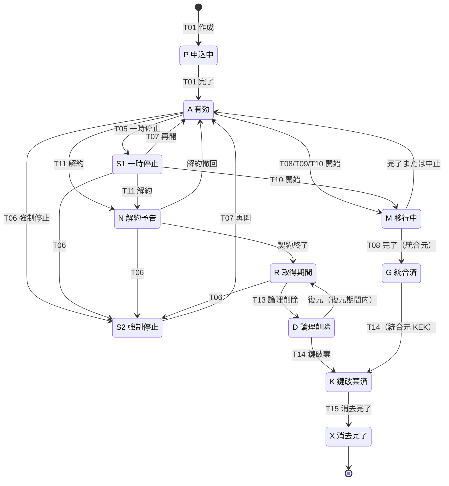
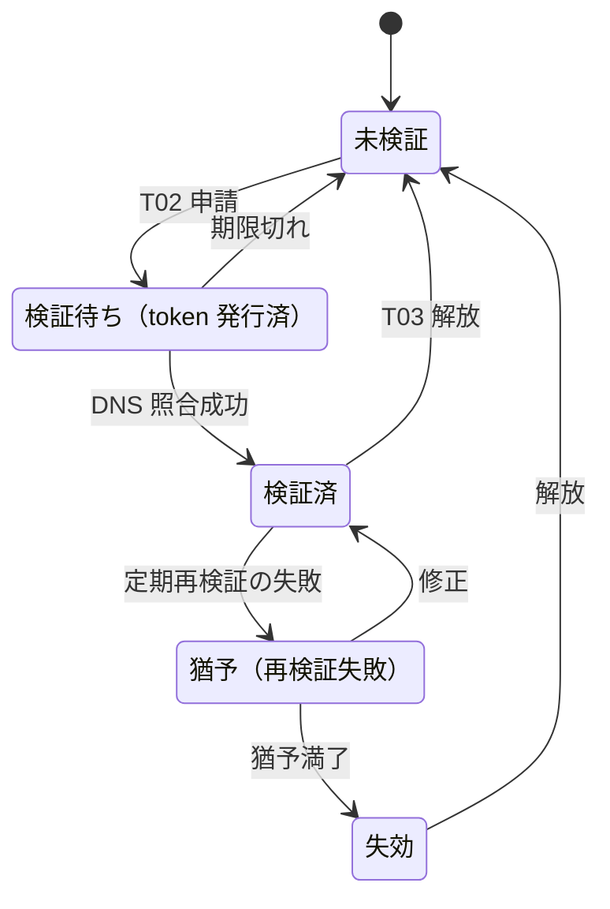
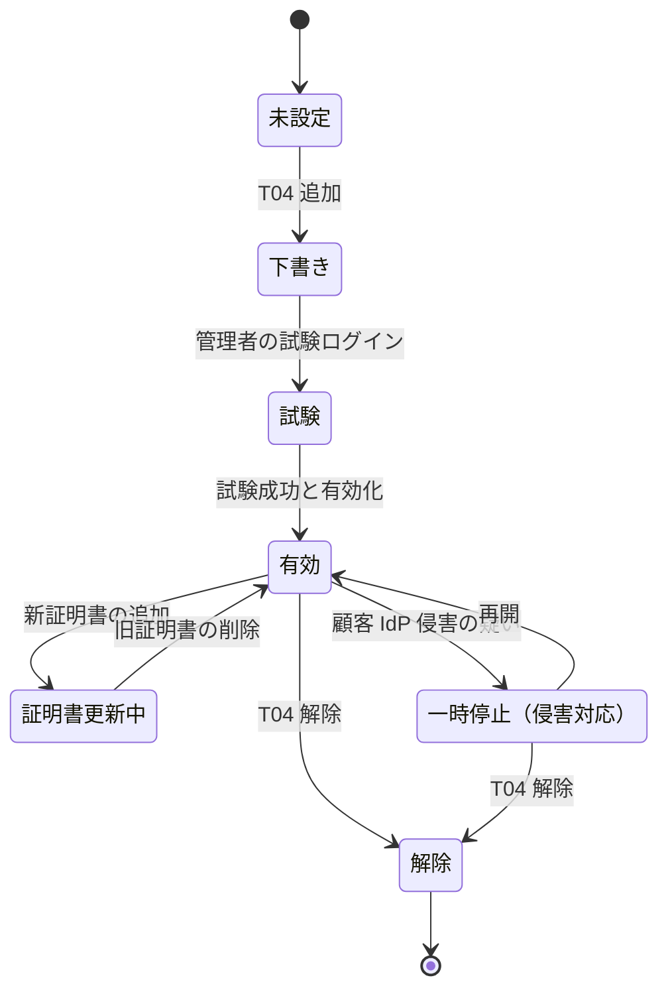

# テナントライフサイクル

> 文書ID: REQ-05 / 版: 0.1 / 状態: draft / 最終更新: 2026-10-03
> 対応要求: G-075, G-137, R-011, R-150（主なもの）／関連: R-209, R-191.1, R-124, R-044
> 依存文書: CONVENTIONS.md, traceability/deliverables.md, traceability/R-requirements.md, traceability/G-goal-criteria.md, traceability/dissent-log.md, 01_governance/assumptions-register.md, research/RS-07-authz-engines-consistency.md, research/RS-09-resilience-cell-failmode.md, research/RS-10-audit-privacy-residency.md, research/RS-14-b2b-customer-identity.md, research/RS-05-root-of-trust-keys-supply-chain.md, research/RS-15-build-buy-tco.md, research/RS-16-parallel-development-governance.md／計画中（未作成）: 02_requirements/identity-lifecycle.md（DL-08）, 02_requirements/customer-admin-responsibility.md（DL-26）, 05_adr/ADR-028-tenant-lifecycle-operations.md, 05_adr/ADR-021-irreversible-identifiers.md, 05_adr/ADR-024-cross-tenant-sharing.md, 05_adr/ADR-007-key-hierarchy-kms-hsm.md, 05_adr/ADR-013-cell-partitioning-fail-mode.md, 05_adr/ADR-014-audit-data.md, 01_governance/stop-authority.md（DL-46）, 04_architecture/audit-privacy.md（DL-25）, 04_architecture/revocation-continuous-evaluation.md（DL-56）, 12_poc/preregistered-test-plan.md（DL-22）

本書は AI エージェント（Claude）が起草した [D]。決裁・承認・第三者評価を経ていない draft であり、本文の「推奨」は決定ではない [D]。研究ノート（research/）の検証済み項目は「RS-xx#n」で示し、原典を脚注で引く [D]。

---

## 0. 結論

1. テナントを 11 の主状態と 4 つの副状態（ドメイン検証、IdP 連携、操作ロック、法的保全）で定義し、遷移 T01〜T15 ごとに識別子・鍵・tuple・policy・監査記録・SCIM・外部共有・session の扱いを §3 で固定する [D]。旧提案書はテナントの統合・分割・移動・解約を扱っていない（旧提案書全文の文字列検索、2026-10-03）[D]。
2. 統合・分割の費用は識別子設計でほぼ決まる [D]。テナント ID を資源 ID・issuer URL・cell 名に埋め込まない（不透明・不変・再利用禁止）ことを、ADR-021（DEC-3 の不可逆決定）への必須入力とする [D]。OIDC Core は利用者の安定識別子を iss と sub の組に限っている [N][^2]（RS-14#1）。テナント ID や cell を issuer・資源 ID に埋め込むと、統合・分割・移動のたびに約 300 サービスが保持する参照の書換えが必要になる [D][A-050]。
3. cell 間移動と統合は、AWS が示す cell 移動の 4 段階（非正本として複製→新側を正本化→旧側から転送→旧側を忘れる）[V][^31]（RS-09#6）に、整合性 token の扱いと剥奪の単調性を加えた手順で行う [D]。最大テナントの tuple は約 7,550 万件と仮置きされており [D][A-009, A-035]、停止を短くするにはオンライン複製と差分だけの凍結が前提になる [D]。所要時間は PoC で実測するまで値を置かない [D]。
4. M&A による統合は、(a) 顧客の書面指示、(b) 同一 cell 内での実行（異なる cell なら先に移動）、(c) 第三者テナントとの越境信頼を暗黙に広げない、(d) 利用者の再結合を email ではなく認証済みの linking で行う、の 4 条件で実行する [D]。個人情報保護法は、合併その他の事由による事業の承継に伴って個人データが提供される場合、提供を受ける者を第三者に該当しないものとする [N][^21] が、統合がこれに当たるかの判断は顧客（委託元）が行う [D]。GDPR 第 28 条第 3 項 (a) は、処理者が管理者の文書化された指示に基づいてだけ個人データを処理することを契約で定めるよう求めており [N][^18]、本基盤が処理者に当たる場合は統合もこの指示に基づいて行う [D]。
5. 削除は「論理削除→鍵破棄（crypto-shredding）→消去完了の証明」の 3 段で行い、crypto-shredding を消去の代替とは主張しない [D]。EDPB は意見募集版のガイドラインで暗号化された個人データも個人データだとしている [N][^23]（RS-10#55）。NIST SP 800-88r2 は鍵の全コピーを消去できることを Cryptographic Erase の前提にしている [N][^24]（RS-10#57）。法的な扱いは決裁案 K-2 として法務・個人情報保護責任者に回す [D]。
6. 解約時のエクスポートは、EU Data Act の切替条項（予告 2 か月以内、移行 30 暦日以内、移行後の取得期間 30 暦日以上、2027-01-12 以降の切替料金の禁止）[N][^20]（RS-15#64, #65）を全顧客の最低線にする案を推奨する（K-3）[D]。
7. 依存サービス向けのテナント事象契約（G-137）は、at-least-once 配送、テナント単位の順序番号、(source, id) による冪等、replay を持つ封筒で定義する [D]。停止の効力は事象の受信に依存させず、token 検証と PDP のテナント状態ガードで中央強制する [D]。データ削除は受信側の義務とし、受信側の完了報告を削除証明に含める [D]。
8. 本書で閉じるのは机上の要件定義（区分 A）までである [D]。G-075 の合否（統合と cell 間移動を PoC で実施し、意図した差分を除き認可判定の差分 0 件）は実測待ちであり、停止中のアクセス範囲・削除期限・crypto-shredding の扱いは決裁待ちである [D]。

---

## 1. 範囲・用語・設計不変条件

### 1.1 範囲

- 対象は B2B 顧客テナント（基準 1 万、成長シナリオ 2.5 万）である [A-007]。B2C realm（基準 6 realm）[A-010] は事業者が作成・運用する区画なので、作成・cell 間移動・削除の遷移だけを準用する [D]。
- 利用者単位のライフサイクル（作成・停止・削除・所属変更）は DL-08、顧客管理機能と責任分界条項は DL-26、方式の比較は ADR-028 が扱う [D]。本書は要件（状態、遷移、遷移ごとの扱い、承認、監査、事象契約）を定める [D]。

### 1.2 用語

| 用語 | 本書での意味 |
|---|---|
| テナント | B2B 顧客組織 1 つに対応する論理区画。テナント ID で識別する |
| cell | 他の cell と状態を共有せず、要求の一部を処理する独立単位（AWS の定義[^31]、RS-09#1） |
| 所在地群 | データ所在地要件が同じ cell の集合。基準は日本（主・副）、EU、米国の 4 リージョン（英国は EU に収容）[A-063] |
| テナント KEK | テナントのデータ鍵（DEK）を包む鍵。cell が属する所在地群の KMS に置く |
| tuple | 認可の関係データ（relation tuple） |
| tenant policy | テナント固有の policy・role 定義と、その model 版 |
| global guardrail | 全テナントに適用する禁止規則。テナント状態ガード（停止中の判定拒否）を含み、テナント管理者は外せない |
| 操作 | 遷移を実行する 1 件の作業。operation_id で識別し、開始・切替・完了・中止を監査する |
| 墓標（tombstone） | 統合・削除の後も残す最小記録（テナント ID、最終状態、日付、統合先 ID）。テナント ID の再利用を防ぐ |
| 意図した差分 | 統合・分割の前に顧客と事業者が承認した、判定が変わってよい組の一覧（§12.2） |

### 1.3 規模の目安

| 量 | 値 | 導出 |
|---|---|---|
| テナント数の純増 | 年平均約 3,000 | (2.5 万 − 1 万) ÷ 5 年 [D][A-007, A-102]。解約による減少は含まない（§13 の新規仮定） |
| 小規模テナント（100 人未満） | 9,215、平均約 13.6 人、tuple 約 1 万件/テナント | 12.5 万人 ÷ 9,215、1 人あたり 300 × 2.5 ＋ 5 = 755 tuple [D][A-008, A-035] |
| 超大規模テナント（1 万人以上） | 5 | [A-008] |
| 最大テナント | 10 万人、tuple 約 7,550 万件 | 100,000 × 755 [D][A-009, A-035] |
| 所在地指定を受けるテナント | 500 | [A-062] |
| 高保証要求テナント（専用 cell・顧客管理鍵等） | 50 | [A-081] |
| 顧客 IdP 連携・SCIM 利用テナント | 2,000・800 | [A-082] |
| IdP 起点 SAML を使う既存接続 | 540 | [A-114] |
| 複数テナントに所属する利用者 | 2.1 万 | [A-015] |
| 越境共有を受ける利用者 | 3.5 万 | [A-016] |

- 小規模テナントが 9 割超を占めるため、作成・停止・解約・削除はセルフサービスと自動実行を既定にする必要がある [D][A-008]。
- 超大規模テナントの統合・分割・移動は、個別の計画作業（§8, §9）として扱う [D][A-008, A-009]。

### 1.4 設計不変条件

全遷移に適用する [D]。各条件は右列の根拠からの設計推論 [D] である。

| ID | 不変条件 | 根拠 |
|---|---|---|
| INV-1 | テナント ID は不透明・不変で、再利用しない。資源 ID、issuer URL、cell 名、署名鍵 ID にテナント ID を埋め込まない | OIDC Core は安定識別子を iss と sub の組に限る [N][^2]（RS-14#1）。埋め込むと統合・分割で参照の書換えが全サービスに及ぶ [D][A-050] |
| INV-2 | issuer と sub は cell・リージョンに依存させない。cell 間移動の前後で (iss, sub) を変えない | RFC 8725 は JWT の鍵が issuer に属することの検証を MUST とする [N][^42]（RS-05#36）。移動中は issuer の鍵集合に新旧 cell の鍵を併載する（§3.2） |
| INV-3 | 境界を変える操作（T08〜T10、T13、T14）は 1 テナントに同時に 1 件だけ実行する（操作ロック） | 同時実行すると写像と照合の前提が崩れる [D] |
| INV-4 | 操作は 1 テナント単位で実行する。複数テナントへの一括実行は canary→wave の段階展開と別承認を要する | 削除 API に誤った種類の ID が渡され 883 サイトが削除された事故がある [I][^34]（RS-09#60, #61） |
| INV-5 | 剥奪の単調性。操作の中止・rollback で、操作中に行われた剥奪・停止・削除を元に戻さない | rollback は脆弱性を再導入し得るため、戻せる範囲を制御すべきとされる [V][^32]（RS-09#35） |
| INV-6 | 越境信頼を暗黙に広げない。統合・分割で、第三者テナントが信頼する主体の集合を、その第三者の明示的な同意なしに増やさない | 越境共有は home 側と resource 側の双方の許可を要件にする設計（RS-14 §5.1 の ADR-010/011 入力）[D] |
| INV-7 | 所在地群をまたぐ移動・統合は、顧客の書面指示と法務の判定を要する（K-6） | EDPB は第三国からの遠隔アクセスも 3 要件を満たせば移転とする [N][^22]（RS-10#72）。個人情報保護法第 28 条は外国にある第三者への提供に要件を課す [N][^21]（RS-10#68） |
| INV-8 | ライフサイクル操作は、当該テナントの IdP・SCIM・顧客側システムの稼働に依存せずに実行できる | 緊急アクセスの資格情報を SSO や federated IdP から導いてはならないとされる（低依存の代替がある場合を除く）[V][^32]（RS-09#41） |
| INV-9 | すべての遷移は開始と終了（統合・分割・移動は切替も）で監査イベントを出し、事業者側の実行者も顧客監査 API に出す | SSCF は impersonation の実行者 ID を顧客側・事業者側を問わず記録することを求める [N][^13]（RS-14#51）。CSRB は事業者自身のアクセスを含むログの顧客提供を勧告した [I][^14]（RS-14#53） |
| INV-10 | 削除系の操作は、型付きの ID と名称の二重照合を要し、論理削除の後に復元期間を置く | 上記事故の教訓として soft delete の全面化が挙げられている [I][^34]（RS-09#62） |

---

## 2. 状態と遷移

### 2.1 主状態

| ID | 状態 | 利用者のアクセス | 顧客管理者のアクセス | データ | テナント KEK |
|---|---|---|---|---|---|
| P | 申込中 | 不可 | 初期管理者のみ | 初期化中 | 生成済み |
| A | 有効 | 可 | 可 | 保持 | 有効 |
| S1 | 一時停止 | 不可 | K-1 で決める | 保持 | 有効 |
| S2 | 強制停止 | 不可 | 不可（事業者のインシデント対応だけ） | 保持・証拠保全 | 有効（テナントの秘密情報は無効化） |
| M | 移行中 | 操作の段階による（§4） | 境界を変える設定は凍結 | 複製中 | 新旧併存 |
| N | 解約予告 | 可（契約期間内） | 可 | 保持 | 有効 |
| R | 取得期間 | 不可 | エクスポートだけ | 保持（読取専用） | 有効 |
| D | 論理削除 | 不可 | 不可 | オンラインの store から除去。バックアップと WORM に残る | 有効（復元期間中） |
| K | 鍵破棄済 | — | — | 残存コピーは判読不能化（法的扱いは K-2） | 破棄（待機期間の後） |
| X | 消去完了 | — | — | 墓標だけ | — |
| G | 統合済 | — | — | 統合先へ移管済み。墓標だけ | 統合元 KEK は復号専用→破棄 |

- 副状態は、ドメイン検証（§2.4）、IdP 連携（§2.5）、操作ロック（INV-3）、法的保全 H の 4 つである [D]。
- 法的保全 H は D→K→X の進行を止める重ね合わせの状態であり、法務責任者だけが設定・解除する [D]。S3 Object Lock の legal hold には期限がない [V][^28]（RS-10#44）ため、解除の手続を明示しない限り削除が止まり続ける [D]。

### 2.2 状態遷移図

- T12 エクスポートは状態を変えない操作であり、A・S1（K-1 による）・N・R で実行できる [D]。
- 分割先テナントは P から始まり、M を経て A になる [D]。分割元は A のまま操作ロックを持つ [D]。
- 統合先テナントは A のまま操作ロックを持つ [D]。

### 2.3 遷移一覧

| T | 遷移 | 状態の変化 | 起点 | 可逆性 |
|---|---|---|---|---|
| T01 | 作成 | P→A | 契約成立（セルフサービス申込または営業） | T11→T13 で終了 |
| T02 | ドメイン検証 | 副状態: 未検証→検証済 | 顧客管理者 | T03 で解放 |
| T03 | ドメイン失効・解放 | 副状態: 検証済→猶予→失効、または解放 | 再検証の失敗、顧客の解放、統合・解約 | 再検証で回復 |
| T04 | IdP 連携の設定・変更・解除 | 副状態（§2.5） | 顧客管理者 | 可逆 |
| T05 | 一時停止 | A→S1 | 顧客の要請、契約上の理由 | T07 |
| T06 | 強制停止 | A/S1/N/R→S2 | 侵害、濫用、法令に基づく命令 | T07 |
| T07 | 再開 | S1/S2→A（解約予告中の停止は N へ戻す） | 停止理由の解消 | — |
| T08 | 統合 | 統合元: A→M→G、統合先: A（操作ロック） | 顧客の書面指示 | 統合元の G 到達と統合元 KEK の破棄までは可逆（§8.4） |
| T09 | 分割 | 分割元: A（操作ロック）、分割先: P→M→A | 顧客の書面指示 | 移る利用者の再結合が始まるまでは可逆 |
| T10 | cell 間移動 | A/S1→M→A/S1 | 事業者（容量、隔離、所在地、cell の廃止）または顧客の要請 | 旧 cell の忘却までは可逆 |
| T11 | 解約 | A/S1→N→R | 顧客または事業者 | N の間は撤回可（契約で定める） |
| T12 | エクスポート | 変化なし | 顧客管理者 | — |
| T13 | 論理削除 | R→D | 取得期間の満了かつ保全なし | 復元期間内は可逆 |
| T14 | 鍵破棄（crypto-shredding） | D→K、G の統合元 KEK | 復元期間の満了かつ保全なし | 不可逆 |
| T15 | 消去完了 | K→X | バックアップ保持期間の満了 | 不可逆 |

### 2.4 副状態: ドメイン検証

- 検証方式は persistent 型とし、検証をテナントと検証した管理者に結び付ける [D]（RS-14 §5.1 の ADR-004 入力）。IETF の草案（draft-13、未 RFC、確認日 2026-10-03）は、persistent 型で取消手順と再検証の頻度を明示することを MUST とする [N][^6]（RS-14#25）。再検証の頻度は TBD（所有者: CISO、期限: G3、決め方: ADR-004 で DNS 照合の費用とドメイン移転の検知遅延を比較）とする [D]。
- 同草案は、信頼できる DNSSEC 検証リゾルバの使用を MUST とし、ICANN の public suffix の所有者検証を許可しないこと（SHOULD NOT）を定める [N][^6]（RS-14#26）。
- 同草案は、利用者に結び付かない検証で、別の利用者による再検証を「再有効化」として扱わないよう注意を求めている [N][^6]（RS-14#27）。本基盤では、解放後の他テナントによる検証を新規の検証として扱い、旧テナントの資源へのアクセスを与えない [D]。
- 猶予の満了後は、ドメインに基づく機能（home realm discovery の振分け、自動参加、ドメイン一致の JIT）だけを止め、既存の利用者は止めない [D]（RS-14 §5.1）。
- ドメイン検証で得る権限は、当該ドメインの新規利用者の振分けと JIT の範囲に限る [D]。Microsoft Entra では、ドメインの所有権証明に成功すると利用者・サブスクリプション・ライセンス割当ても管理者のディレクトリへ移る [V][^7]（RS-14#30）。本基盤では、他テナントに存在する同ドメインの既存アカウントを、通知と移管元の同意なしに移さない [D]。
- ドメインの申請・解放は保護操作（§2.5 の再認証・通知・監査）とする [D]。

### 2.5 副状態: IdP 連携

- IdP の追加・変更・証明書更新・linking 規則の変更は保護操作とし、実行時の phishing-resistant 再認証、全テナント管理者とセキュリティ連絡先への即時通知、監査を必須にする [D]（RS-14 結論 3）。Microsoft Entra の protected actions は、権限に Conditional Access を割り当て、ログイン時ではなく操作の実行時に強制する [V][^10]（RS-14#44）。
- 保護操作にする理由は、攻撃者が標的の SSO テナントに federated IdP を追加し自動 account linking を有効化した事例（勧告は過去の手口であり現行の TTP としては確認されていないと付記）[I][^12]（RS-14#6）と、奪取した管理者権限で 2 つ目の IdP を構成してなりすました事例 [I][^11]（RS-14#7）があるためである [D]。Okta は検知手段として IdP 作成イベントの監視を挙げている [V][^11]（RS-14#8）。
- trust agreement の SHALL 項目（対象母集団、許容する xAL、provisioning model、shared signaling のトリガと受信側の期待挙動、redress、データ保持）を、IdP 連携の申請様式に写す [N][^1][D]（RS-14#11, #12）。識別子と鍵の更新手順は trust agreement で定め、認証された保護チャネルで実行することが SHALL である [N][^1]（RS-14#15）。
- FAL2 を割り当てた連携では、federation transaction を RP が開始することが SHALL である [N][^1]（RS-14#18）。このため IdP 起点 SAML は既定で無効にする（DS-14）[D]。現行で IdP 起点を使う接続は 540 と仮置きされており、その再設定は顧客側の作業として移行計画に載せる [D][A-114]。
- SAML 署名証明書は新旧 2 枚を並行させて切り替える [D]。Google Workspace は SAML profile ごとに IdP 証明書を 2 枚まで登録でき、rotation に使えるとしている [V][^46]（RS-14#22）。
- 「試験」状態では、管理者自身の試験ログインが成功するまで有効化しない [D]。SSO を強制する場合も、SSO の強制から除外する利用者（break-glass）を残す [D]。SSCF は特定の利用者をこの強制から除外できることを求めている（must）[N][^13]（RS-14#21）。
- 解除したら、その IdP の federated identifier による結合を外し、当該 IdP からの assertion を拒否する [D]。SP 800-63C-4 は、除去された federated identifier からのアクセスを拒否することを SHALL とする [N][^1]（RS-14#4）。

### 2.6 状態ごとの許可操作

| 状態 | 利用者ログイン | 管理者ログイン | 設定変更 | SCIM 書込み | T12 エクスポート | T08〜T10 の開始 | T11 解約 |
|---|---|---|---|---|---|---|---|
| P | × | 初期管理者 | 初期設定だけ | × | × | × | ○（申込取消） |
| A | ○ | ○ | ○ | ○ | ○ | ○ | ○ |
| S1 | × | K-1 | × | 無効化・削除だけ（推奨案） | K-1 | T10 だけ | ○ |
| S2 | × | × | × | × | × | × | 事業者起点だけ |
| M | 段階による | ○ | 境界を変える設定は × | 段階による（§4.2） | × | × | × |
| N | ○ | ○ | ○ | ○ | ○ | × | 撤回 |
| R | × | エクスポートだけ | × | × | ○ | × | — |
| D〜X、G | × | × | × | × | × | × | — |

本表は §2.1 の状態定義からの設計推論 [D] である。

---

## 3. 遷移ごとの扱い

§3 の各表のセルは、根拠欄の原典・RS 項目・A-ID からの設計推論 [D] である。原典の事実を写したセルには [N]・[V]・[I] を付けた [D]。

### 3.1 識別子

| T | テナント ID | 利用者 ID（sub）と federated identifier の結合 | 資源 ID・client ID・ドメイン |
|---|---|---|---|
| T01 | 新規に発番する。不透明・全所在地群で一意・再利用しない | 初期管理者を作成する | ドメインは未検証 |
| T02/T03 | 不変 | 不変 | ドメインとテナントの結合を作成・失効・解放する |
| T04 | 不変 | 結合を（テナント ID、IdP 識別子［OIDC issuer／SAML entityID］、subject）の 3 つ組で作成・除去する（RS-14 §5.1）。email・userName・externalId で自動結合しない | 不変 |
| T05〜T07 | 不変 | 不変（S2 では結合を凍結） | 不変 |
| T08 | 統合元 ID を墓標化し、統合先 ID への参照だけを残す。統合元 ID を含む token は切替後に拒否する | sub は維持し、所属を統合先へ付け替える。結合は統合先で作り直す（§8.3 の linking 規則） | 資源 ID は不変で、所有テナント属性だけを変える。client ID は不変で所属を移す。ドメインは統合元で解放し統合先で再検証する |
| T09 | 分割先に新 ID を発番する。分割元 ID は不変 | 移る利用者の sub は維持し、所属を移す | 資源 ID は不変で、所有テナント属性を変える |
| T10 | 不変 | 不変（issuer も不変: INV-2） | 不変。cell 対応表（router の override）だけを更新する |
| T11/T12 | 不変。エクスポートには版付き形式で含める | 同左 | 同左 |
| T13 | 墓標として残す | 結合を除去する。SP 800-63C-4 はアカウント終了時に federated identifier、bound authenticator、属性、身元情報の全除去を SHALL とする [N][^1]（RS-14#41） | ドメインの結合を解放する。client ID は無効化し再利用しない |
| T14/T15 | 墓標だけ | — | — |

- SCIM の userName は削除後に再利用され得る（同じ userName での作成を 409 で拒否すべきでない: SHOULD NOT）[N][^3]（RS-14#10）。再利用された userName には新しい内部 ID を割り当てる [D]。
- 識別子の固定方式（issuer の粒度を含む）は K-8 と ADR-021 で決める [D]。

### 3.2 鍵

| T | テナント KEK・DEK | テナントの秘密情報（SCIM 資格情報、client secret、顧客 IdP 用の秘密、webhook secret） | token 署名鍵 |
|---|---|---|---|
| T01 | cell が属する所在地群の KMS に KEK を作る。高保証テナントの顧客管理鍵は ADR-007 で決める [A-081] | KEK で包んで保管する | cell の署名鍵で発行する |
| T04 | — | 顧客 IdP 用の秘密を KEK で包む。SAML 証明書は公開情報として版管理する | — |
| T05 | 不変 | 不変 | 不変 |
| T06 | 不変（証拠保全のため破棄しない） | 全て無効化する | テナントの token を失効させる（§3.8）。署名鍵の侵害が疑われる場合は ADR-019 の鍵切替に移る |
| T07 | 不変 | S2 からの再開では全て再発行する | — |
| T08 | 統合元の DEK を統合先 KEK で包み直す。統合元 KEK は復号専用にし、統合元のバックアップの保持満了後に T14 で破棄する | 統合元の秘密情報は切替時に無効化する | 統合元 ID の token は切替で失効する |
| T09 | 分割先 KEK を新規に作る。移るデータは分割先の鍵で再暗号化する（DEK を分割元と共有している場合は DEK ごと作り直す） | 分割先で新規発行する | — |
| T10 | 移動先 cell の KEK で包み直す。旧 KEK は、旧 cell のバックアップと WORM 記録の保持満了まで復号専用にする | 移動先で包み直す | 当該テナントの許可鍵集合を「旧 cell ∪ 新 cell」にし、最大 token 寿命と clock skew を過ぎてから旧 cell の鍵を外す |
| T11 | 不変 | 不変 | 不変 |
| T12 | エクスポートは顧客が登録した公開鍵で暗号化して渡す | 秘密情報の平文は含めない（範囲は K-3） | — |
| T13 | 不変（復元期間） | 無効化する | — |
| T14 | KEK の全コピーの破棄を予約し、待機期間の後に完了する | — | — |
| T15 | 破棄の証跡を削除証明に添付する（§10.4） | — | — |

- T10 で旧 cell の鍵を外す時期は、access token の寿命（容量計算用の仮置き 10 分）に依存する [D][A-027]。使用中の署名鍵が自動化の不具合で削除されて公開 metadata から外れ、利用側が token を信頼しなくなり、metadata を戻した後も利用側キャッシュの扱いの差で一部の回復が翌日まで遅れた事故がある [I][^33]（RS-09#53, #54）。このため鍵の除去は canary cell から段階的に行う [D]。
- AWS KMS の鍵削除は不可逆で、7〜30 日（既定 30 日）の待機期間が必須である [V][^25]（RS-10#58）。multi-Region replica key と imported key material の一部は例外とされ、CloudHSM key store では cluster のバックアップから鍵材料が削除されない [V][^25]（RS-10#58）。このため crypto-shredding 用の KEK ではこれらの鍵種別を避けるか、全 replica と鍵材料の原本の消去を手順に含める [D]（RS-10#58）。
- 鍵の粒度（テナント KEK だけか、分割可能な単位や主体ごとの DEK を持つか）は K-5 で決める [D]。分割後に分割先だけを crypto-shredding するには、分割元のバックアップに残る分割先データが分割元の鍵で包まれている問題を解く必要がある [D]。

### 3.3 tuple（関係データ）

| T | 扱い | 整合性の要点 |
|---|---|---|
| T01 | テナントの名前空間（または per-tenant store）を作り、初期管理者の tuple を書く | model 版を固定する。OpenFGA は本番で authorization model ID を渡すことを強く推奨している [V][^39]（RS-07#18） |
| T05/T06 | 変更しない。global guardrail のテナント状態ガードで判定を拒否する | 停止中の剥奪書込みは受け付け、再開後も戻さない（INV-5） |
| T07 | 状態ガードを外す | 停止中に入った剥奪を保持する |
| T08 | 統合元の tuple を写像表（主体・group・資源の対応）で統合先へ複製する | 統合元の書込みを凍結し、差分を適用してから切り替える。tuple 集合の件数と順序に依存しない digest を前後で照合する |
| T09 | 移る主体・資源の tuple を分割先へ移す。分割元と分割先をまたぐ tuple を列挙し、削除するか期限付きの越境付与（ADR-024）に変換する | 承認済みの越境付与を除き、残余の越境 tuple を 0 件にする |
| T10 | 非正本として複製→差分追従→切替→旧側の忘却 [V][^31]（RS-09#6） | 旧 store が発行した整合性 token は移動先で使えない前提で扱う（§4.3） |
| T12 | 全件をエクスポートする | OpenFGA の CLI の `fga store export` は tuple を既定で 100 件までしか書き出さない [V][^38]（RS-07#24）。SpiceDB の ExportBulkRelationships は途中から再開でき、consistency を指定できる [V][^37]（RS-07#36）。全件取得の方式は PoC で確認する [D] |
| T13 | オンラインの store から削除する | 復元はバックアップからだけ行い、墓標との照合を経る（§10.3） |
| T14 | バックアップ中の tuple を鍵破棄で判読不能にする | — |

### 3.4 policy・model

| T | 扱い | 根拠 |
|---|---|---|
| T01 | テンプレートから tenant policy を作り、global guardrail を継承する | per-tenant store では global policy を全 store に複製する必要がある [V][^41]（RS-07#51） |
| T05/T06 | tenant policy は変更しない。状態ガードは global guardrail 側に置き、テナント管理者が外せないようにする | 停止の効力をテナント側の設定に依存させないため [D] |
| T08 | 統合元の tenant policy を統合先へ合併（union）しない。統合元の role・group を統合先の名前空間に別名で写し、主体の集合を保つ。新旧の判定を shadow 評価し、差分を「意図した差分」と照合する | OpenFGA は新旧 model の shadow check と段階的な rollout を記述している [V][^39]（RS-07#18）。合併すると「全従業員」等の group が統合先の全従業員へ広がり得る [D] |
| T09 | 分割先は分割元の tenant policy の複製から始め、分割先の管理者が見直す | [D] |
| T10 | policy store と model を同一版で複製し、版 ID の一致を照合する | [D] |
| T13 | tenant policy を削除する（per-tenant store なら store ごと削除する） | AWS の文書は、per-tenant store の off-boarding を store の削除で済むと比較している [V][^41]（RS-07#51） |

- per-tenant store の作成には速度上限がある [D]。Amazon Verified Permissions では CreatePolicyStore がアカウント・リージョンあたり 1 RPS（引上げ不可）であり [V][^44]、1 万 store の一括作成には少なくとも約 2.8 時間かかる [D]（RS-07#53）。この値は DR での再構築時間の下限に効くため、採否は ADR-010 で比較する [D]。

### 3.5 監査記録

| T | 扱い |
|---|---|
| T01 | テナントの監査 chain を開始する（genesis レコード）。顧客監査 API の配信を構成する |
| T05/T06 | 停止中も記録を続ける。S2 では当該テナントの監査記録に法的保全を設定できる |
| T08 | 統合元の chain を「統合済」レコードで閉じ、統合先の chain に統合元の最終 head の hash を記録する。既存レコードは書き換えない。承継先管理者への開示範囲は K-4 で決める |
| T09 | 分割元の chain は継続し、分割先は新しい chain を開始する。分割前の履歴の分割先への提供範囲は K-4 を準用する |
| T10 | 既存の監査記録は所在地群の中に置いたままにし、切替後のレコードを移動先 cell で書く。旧 cell の WORM 記録は保持期間の満了まで残る |
| T12 | 開かれた形式（OCSF・CADF への写像）で、検証用の chain・receipt と一緒に渡す（RS-10 §5.1 の ADR-018 入力） |
| T13/T14 | 事業者が自らの法的義務のために保持する記録と、顧客のための記録を分ける（K-2）。顧客のための記録の個人属性は、主体別・テナント別の鍵で暗号化して WORM に置き、鍵破棄で判読不能にする（RS-10 §5.1 の 3 層方式） |

- OCSF 1.9.0 の record_integrity profile は、直前イベントの fingerprint を prev_event として持たせ、chain の途中のイベントを削除・改変すると参照側の fingerprint と署名が壊れる構造を定義している [N][^29]（RS-10#42）。T08 で統合元の chain を書き換えずに閉じるのは、この性質を保つためである [D]。
- S3 Object Lock の compliance mode では、root を含む誰も保持期間中のオブジェクトを削除できない [V][^28]（RS-10#44）。監査の保持期間は容量計算用にオンライン 13 か月＋アーカイブ 7 年と仮置きされており [A-074]、テナントの削除後も WORM に記録が残る期間が生じる [D]。
- 監査の保存地域を移す必要がある所在地群をまたぐ移動は、INV-7 と K-6 に従う [D]。

### 3.6 SCIM・federation

| T | 扱い | 根拠 |
|---|---|---|
| T01 | SCIM は無効で始め、顧客管理者が SCIM client を作ると有効になる。テナントは SCIM client の資格情報から導き、HTTP header や path では決めない | SCIM のマルチテナンシーは OPTIONAL で、方式は規定されていない [N][^3]（RS-14#33） |
| T04 | IdP ごとに provisioning domain を分ける | externalId は provisioning domain に閉じた値として解釈することが MUST である [N][^4]（RS-14#33） |
| T05 | 推奨案: 無効化（active=false）と削除だけを受け付け、作成・更新は文書化したエラーで拒否する（K-1 に含める） | 停止中も顧客が退職者を無効化できるようにするため [D] |
| T06 | SCIM 資格情報を無効化する。無効化・削除が必要なら、顧客の依頼で事業者が代行し記録する | SCIM 資格情報の窃取自体が侵害経路になり得る（RS-14 §5.1 の DL-11 入力）[D] |
| T07 | S2 からの再開では SCIM 資格情報を再発行する | [D] |
| T08 | 統合元と統合先の SCIM client を別の provisioning domain として併存させる。userName の衝突は 409（scimType uniqueness）で検出し、写像表で解く。統合元 IdP を廃止する時に統合元 client を無効化する | 作成要求が既存資源と衝突した場合は 409 uniqueness を返すことが MUST である [N][^3]（RS-14#31） |
| T09 | 移る利用者を分割元 IdP の provisioning 対象から外してから切り替える | Microsoft Entra のテナント間同期では、target 側で手動でサインインを止めても、source 側で変更が検出されると再有効化される [V][^8]（RS-14#39）。外さないと同種の再投入が起きる [D] |
| T10 | SCIM endpoint は cell に依存しない URL にし、切替中の書込みは一時エラーで再試行させる | [D] |
| T11（N→R） | SCIM 資格情報を失効させる | SP 800-63C-4 は trust agreement の終了時に provisioning API へのアクセスを取り消すことを SHALL とする（同文書が想定するのは IdP 側の API）[N][^1]（RS-14#38）。本基盤は逆向き（顧客 IdP が本基盤の SCIM API に書く）なので、同じ趣旨で資格情報を失効させる [D] |
| T13 | SCIM client と externalId の対応を削除する | [D] |

- active 属性の最終的な意味は service provider が決める [N][^4]（RS-14#34）。停止と無効化で何を止めるか（session、token、API 鍵、委任ジョブ）は §3.8 と DL-08 で定める [D]。

### 3.7 外部共有（テナント越境）

| T | 当該テナントが付与した共有（自テナントの資源を他テナントの主体へ） | 当該テナントの利用者が受けている共有（他テナントの資源へ） |
|---|---|---|
| T01 | 越境共有は既定で無効にし、有効化は保護操作とする（既定値は ADR-024 で確定） | 同左 |
| T05 | K-1 で決める（推奨案: 停止中は受領側からのアクセスも止め、受領テナントへ通知する） | 利用者が認証できないため使えない |
| T06 | 全て凍結し、受領テナントへ通知する | 全て凍結する |
| T07 | 凍結を解除する。停止中に取り消された付与は戻さない（INV-5） | 同左 |
| T08 | 第三者テナントとの信頼関係は統合元テナントを名指しして結ばれている。統合後も統合元から来た主体にだけ適用し、統合先の他の主体へ自動では広げない（INV-6）。第三者テナントへ通知し、同意を得てから統合先との関係に張り替える | 同左 |
| T09 | 分割元と分割先の間の共有は越境になる。移行期間の業務継続が必要なら、期限付きの越境付与として明示的に作る | 第三者テナントとの共有は資源の所有者に従う |
| T10 | 論理関係は変えない。cell をまたぐ越境判定の経路は ADR-013 と ADR-024 で定める | 同左 |
| T11（N→R） | 全て失効させ、受領テナントへ通知する | 本テナントの主体を指す他テナントの付与を一覧にし、資源側テナントへ失効の事象を送る |
| T13 | 参照を削除する | 同左 |

- Google Workspace では、allowlist からドメインを外すとそのドメインの利用者は共有ファイルへのアクセスを失い、通知はされない [V][^9]（RS-14#72）。本基盤では受領側の業務停止を避けるため、失効・凍結の前後に受領テナントへ通知する [D]。
- Microsoft Entra のテナント間同期は、関係を切断してもそれまで同期した外部利用者に変更を加えない [V][^8]（RS-14#39）。本基盤では関係の終了時に、他テナント側に残る付与を明示的に失効させる [D]。

### 3.8 session・token

| T | 扱い |
|---|---|
| T05 | 利用者の session と refresh token を失効させる（管理者の扱いは K-1） |
| T06 | テナントの全 session、refresh token、access token（introspection で拒否）、API client の資格情報、委任ジョブを失効させる |
| T07 | 再認証を求める |
| T08 | 統合元 ID の session を切替時に失効させ、統合先へ再ログインさせる |
| T09 | 移る利用者の session を切替時に失効させる |
| T10 | session と refresh token の状態（hash）を移動先へ複製し、再ログインを不要にする案を推奨する。不要にできない場合は停止区分 D2（§4.1）になる |
| T11（N→R） | 全て失効させる |

- IPSIE AL SCIM 2.0 Profile（Draft 00、WG 草案、確認日 2026-10-03）は、アカウントの無効化時に web session、API token、refresh token、PAT、SSH 鍵、端末認証資格情報を含む全アクセス手段の無効化を MUST とする [N][^17]（RS-14#37）。SSCF は session の programmatic かつ real-time の失効と、session 失効を伴うアカウントの一時停止を求めている（must）[N][^13]（RS-14#40）。T05・T06 の失効範囲はこれに揃える [D]。
- T08 の再ログイン集中は、全 session 失効時と同じく admission control で上限を設ける [D]。基準シナリオの再ログイン集中は全体で 556/秒と仮置きされている [D][A-048]。

---

## 4. 整合性と停止時間

### 4.1 停止区分

| 区分 | 意味 |
|---|---|
| D0 | 無停止 |
| D1 | 書込み凍結。読取りと認可判定は続く |
| D2 | 再認証が必要（session・token の失効を伴う） |
| D3 | 意図した停止（利用者のアクセスを止める） |

本区分は本書による定義 [D] である。

### 4.2 遷移ごとの整合性・停止・rollback

| T | 原子性の単位と切替点 | 停止区分（利用者／管理者／依存サービス） | 照合 | rollback |
|---|---|---|---|---|
| T01 | テナント単位。全資源の作成完了で P→A | —／—／— | 作成した資源の一覧と期待値の一致 | 作成途中は全資源を破棄して再実行 |
| T02〜T04 | 副状態ごと | D0／D0／D0 | DNS 照合、試験ログイン | 旧設定へ戻す（証明書は 2 枚併存） |
| T05 | テナント状態の書込みが切替点 | D3／K-1／事象の受信で非同期処理を止める | 全 PEP の拒否を確認（TL-5） | T07 |
| T06 | 同上 | D3＋D2／D3／同上 | 同上 | T07（INV-5） |
| T07 | 同上 | D2（S2 から）／D0／再開の事象 | 判定の復帰を確認 | — |
| T08 | 統合元テナント単位。所有テナント属性の切替が切替点 | 統合元: D1 の後 D2、統合先: D0／統合元の管理面は D1／統合切替の事象で参照を付け替え | tuple digest、判定 replay、越境の負例試験（TL-1） | 統合元の G 到達前なら所有属性を戻す。切替後の剥奪は戻した側にも適用する（INV-5） |
| T09 | 移る集合単位 | 移る利用者: D2、それ以外: D0／分割元の管理面は D1 | 残余越境 0 件（TL-4） | 再結合の開始前なら戻せる |
| T10 | テナント単位。router 対応表の切替が切替点 | D0（session を複製する場合）または D2／D1（差分適用の間）／cell を意識するサービスだけ事象を受ける | tuple digest、model 版 ID、判定 replay（TL-2） | 旧 cell の忘却前なら戻せる。切替後の剥奪は旧側にも適用する（TL-3） |
| T11 | 契約終了日時が切替点 | N: D0、R: D3／R: エクスポートだけ | — | N の間は撤回 |
| T12 | エクスポート単位 | D0／D0 | 件数と digest をエクスポートに添付する | 再実行 |
| T13 | テナント単位 | D3（既に停止）／— | 全 store で件数 0 | 復元期間内は復元（墓標照合を経る） |
| T14 | 鍵単位 | — | 全コピーの破棄の確認 | 不可 |
| T15 | テナント単位 | — | バックアップの満了確認 | 不可 |

本表は §3 と §4.3 からの設計推論 [D] である。

### 4.3 整合性 token と剥奪の単調性

- Zanzibar は、内容を保存する前に最新のスナップショットで評価して zookie を受け取り、内容と一緒に保存し、後続の check に「少なくともそれと同じだけ新しい」スナップショットでの評価を求める方式で new enemy 問題を防ぐ [V][^35]（RS-07#4, #5）。SpiceDB は ZedToken を Zanzibar の zookie に相当するものとし、既定の minimize_latency だけを使うと new enemy 問題が起き得る時間窓が生じると書いている [V][^36]（RS-07#26, #27）。
- 移動や統合で store が変わると、旧 store が発行した token が新 store で意味を持つ保証はない [D]。このため切替から一定時間 T_c の間、当該テナントの判定を最新強制（SpiceDB の fully_consistent または新しい token による at_least_as_fresh、OpenFGA の HIGHER_CONSISTENCY）で行う [D]。OpenFGA の HIGHER_CONSISTENCY はキャッシュを使わず DB を直接読む [V][^40]（RS-07#13）。
- SpiceDB の Consistency の文書は、CockroachDB 上では fully_consistent でも read-after-write を保証しないと明記している [V][^36]（RS-07#29）。同じ文書群の別ページの比較表は datastore の条件なしに保証すると書いており、文書の間で前提が食い違っている [D]（RS-07#29）。datastore と consistency mode の組は ADR-010 で決め、T_c の間の挙動を TL-2 で確認する [D]。
- 前提台帳は、RPO の範囲内で失われた剥奪が復旧後に権限を復活させることを論点に挙げている [D][A-093]。移動・統合の rollback でも同じ現象が起きるため、切替後に入った剥奪を、戻す側に再適用してから戻す（INV-5）[D]。

### 4.4 所要時間の式と未確定値

- 複製時間 ≈ tuple 数 ÷ 一括書込み速度 [D]。最大テナントの tuple は約 7,550 万件と仮置きされている [D][A-009, A-035]。
- 一括書込み速度は未測定である [D]。前提台帳の bulk レーン 278/秒は「1 人 20 tuple を 2 時間で」という初期投入の条件から導いた値であり [D][A-009, A-032, A-047]、移行の処理能力ではない [D]。仮にこの速度で全件を複製すると、75,500,000 ÷ 278 ≈ 271,600 秒（約 75 時間）になる [D]。凍結時間をこれに比例させないため、オンライン複製と差分追従を必須にする [D]。
- 凍結時間 ≈ 切替時点の未適用差分 ÷ 差分の適用速度 ＋ 照合時間 [D]。差分量は当該テナントの対話的な書込み量に比例し、全体の対話的な書込みは基準でピーク 354/秒と仮置きされている [D][A-047]。

| 未確定値 | 所有者 | 期限 | 決め方 |
|---|---|---|---|
| T_c（切替後の最新強制期間） | プラットフォームチーム長 | G4 | TL-2 で整合性 token の扱いと遅延を実測し、ADR-010 で決める |
| T10・T08 の凍結時間の上限 | 事業責任者（B2B）＋SRE 責任者 | G4 | BIA（DL-21）の許容停止と TL-1・TL-2 の実測値から DL-20 で決める |
| 停止の反映時間（R-191.1） | CISO＋SRE 責任者 | G4 | TL-5 で実測し、DL-56 の遅延予算と DL-20 で決める |
| 計画移動の事前通知期間 | 営業・顧客成功責任者＋法務責任者 | G3 | 顧客契約（DL-26）で決める |
| 復元期間（T13→T14） | CISO＋個人情報保護責任者 | G3 | 誤削除の検知に要する時間と K-3 の削除期限から決める |

---

## 5. 承認者

| T | 起案 | 顧客側の承認 | 事業者側の承認 | 実行 | 二者承認 | 通知 |
|---|---|---|---|---|---|---|
| T01 | 顧客の申込、営業 | 契約者 | 自動審査。専用 cell・顧客管理鍵（A-081）はプラットフォームチーム長、所在地指定（A-062）は法務責任者の定型確認 | 自動 | 専用 cell の場合は要 | 初期管理者 |
| T02/T03 | 顧客管理者 | 顧客管理者（保護操作） | 不要。他テナントが検証済みのドメインの申請は support を経て既存テナントへ通知 | 自動 | — | 全テナント管理者、セキュリティ連絡先 |
| T04 | 顧客管理者 | 顧客管理者（保護操作）。二者承認と発効遅延の要否は TBD（所有者: 事業責任者、期限: G3、決め方: ADR-008） | 不要 | 自動 | TBD | 全テナント管理者、セキュリティ連絡先 |
| T05 | 契約者の要請、または営業・顧客成功（契約上の理由） | 契約者（要請の場合） | 事業責任者（B2B） | 事業者運用 | 契約上の理由の場合は要 | 事前通知（期間は契約） |
| T06 | SOC、インシデント指揮者、法務（命令） | 不要（事後通知。K-7） | CISO または DL-46 で委任された者 | 事業者運用（JIT） | 要（緊急時は事後承認。期限は DL-46） | セキュリティ連絡先へ事後通知 |
| T07 | 停止の起案者 | S2 からは顧客セキュリティ連絡先の確認 | T05 の停止は事業責任者、T06 の停止は CISO | 事業者運用 | 要 | 全テナント管理者 |
| T08 | 顧客（承継会社） | 両テナントの契約者の書面指示 | プロダクト責任者、法務責任者（K-6 該当・規制顧客）、CISO（越境信頼の変更） | プラットフォームチーム（JIT） | 要 | 第三者テナント、利用者 |
| T09 | 顧客 | 分割元と分割先の契約者 | T08 と同じ | 同左 | 要 | 同左 |
| T10 | SRE（容量、隔離、cell の廃止）、顧客の要請 | 所在地群内: 通知だけ。所在地群をまたぐ: 契約者の書面同意 | SRE 責任者＋プラットフォームチーム長。所在地群をまたぐ場合は法務責任者 | SRE（JIT） | 要 | 事前通知 |
| T11 | 契約者、または事業者（契約終了・解除） | 契約者 | 営業・顧客成功責任者。事業者起点は法務責任者も | 自動 | 事業者起点は要 | 全テナント管理者 |
| T12 | 顧客管理者 | 顧客管理者（保護操作）。2 人目の顧客管理者の承認は K-3 で選ぶ | 事業者が支援する場合だけ JIT の承認 | 自動 | 選択 | 全テナント管理者 |
| T13 | 自動（取得期間の満了） | — | 事前条件の自動確認と顧客成功責任者の確認 | 自動 | 要 | 削除予告 |
| T14 | 自動（復元期間の満了） | — | 鍵管理担当と CISO の委任者（DL-14 の手順） | 自動 | 要 | — |
| T15 | 自動 | — | 個人情報保護責任者（削除証明に署名） | — | — | 削除証明を顧客へ |

- 本表は承認者の案であり、役割名と権限は RACI（DL-04）と停止権限規程（DL-46）で確定する [D]。
- 境界を変える操作（T08〜T10、T13、T14）は実行者と承認者を分け、事業者側の実行者は JIT の特権アクセス（ADR-029）で作業する [D]。
- 事業者の要員が顧客テナントに入る全ての操作は、顧客監査 API に事業者側の実行者 ID 付きで出す（INV-9）[D]。

---

## 6. 監査イベント

### 6.1 イベント一覧

| イベント種別 | 発生点 | 顧客監査 API への開示 | 即時警報 |
|---|---|---|---|
| tenant.created | T01 完了 | ○ | — |
| tenant.domain.requested / verified / lapsed / released | T02、T03 | ○ | released、lapsed |
| tenant.idp.added / updated / cert_rotated / suspended / removed | T04 | ○ | added、removed（テナント管理者と事業者 SOC） |
| tenant.suspended（mode: temporary / forced） | T05、T06 | ○ | forced |
| tenant.resumed | T07 | ○ | — |
| tenant.merge.planned / started / cutover / completed / rolled_back | T08 | ○（両テナント） | rolled_back |
| tenant.split.planned / started / cutover / completed / rolled_back | T09 | ○（両テナント） | rolled_back |
| tenant.cell_move.planned / started / cutover / completed / rolled_back | T10 | ○ | rolled_back |
| tenant.termination.requested / withdrawn / effective | T11 | ○ | — |
| tenant.export.requested / approved / ready / downloaded / expired | T12 | ○ | requested（全テナント管理者） |
| tenant.deletion.logical / restored / key_destruction_scheduled / key_destroyed / purge_completed / certificate_issued | T13〜T15 | ○（certificate_issued まで） | restored |
| tenant.legal_hold.set / released | H | 法務の判断による | — |
| tenant.lifecycle.operation_failed | 全操作 | ○ | ○ |

### 6.2 必須フィールド

| フィールド | 内容 |
|---|---|
| event_id、schema_version、sequence | 一意 ID、スキーマ版、テナント単位の連番（欠損検知用） |
| tenant_id、related_tenant_ids | 当該テナントと、統合・分割の相手テナント |
| operation_id | 遷移の操作 ID。開始・切替・完了を束ねる |
| from_state、to_state | 主状態または副状態 |
| actor_chain | 実行者（顧客側か事業者側か、impersonation の有無、JIT 申請 ID） |
| approvals | 承認者 ID、承認日時、二者承認の組 |
| reason_code、legal_basis_ref | 理由の区分と、書面指示・命令・契約条項への参照 |
| counts | 利用者数、tuple 数、policy 数、削除件数 |
| digests | 前後の tuple 集合の digest、監査 chain の head の hash |
| key_refs | KEK・署名鍵の ID（鍵材料は含めない）と状態の変化 |
| cell_refs | 移動前後の cell と所在地群 |
| timestamps | 開始、切替、完了の時刻（UTC） |

§6.1 と §6.2 の表は本書による定義 [D] であり、機械可読のスキーマは DL-77（監査イベントスキーマ）で確定する [D]。

### 6.3 記録・開示・警報の規則

- ライフサイクルイベントは全件記録の対象とし、集約しない [D]。PCI DSS v4.0 の 10.2.1.x は、管理者権限を持つ個人の全操作、識別・認証情報の全変更、システムレベルのオブジェクトの作成・削除を全件記録の対象に挙げている [N][^30]（RS-10#23。文言は v4.0 の SAQ から引いたもので、v4.0.1 本体との文言差は未確認）。
- 各レコードは OCSF の record_integrity の考え方（prev_event による chain）で連結する [D]（RS-10#42）。metadata.tenant_uid は OCSF で recommended、sequence は optional とされており [N][^29]（RS-10#8）、本書では両方を必須にする [D]。
- SSCF の LOG-SaaS-01 は、一括エクスポート、アカウントと権限の作成・変更、user impersonation 等の記録を求めている（must）[N][^13]（RS-14#51）。T12 の各イベントはこの要件に対応させる [D]。
- tenant.idp.added は、テナント管理者全員とセキュリティ連絡先に即時通知し、事業者の SOC でも監視する [D]（RS-14#8）。
- 統合元・削除済みテナントのイベントを事業者が保持する期間は K-2 で決める [D]。

---

## 7. 依存サービス向けのテナント事象契約（G-137）

### 7.1 事象と受信側の義務

| 事象 | 意味 | 受信側の義務 | 期限 | 完了報告 | 受信できない場合 |
|---|---|---|---|---|---|
| tenant.created | テナントの作成 | 必要なサービスだけ区画を準備する | 義務なし | 不要 | replay で後追いする |
| tenant.suspended（mode） | 一時停止・強制停止 | 当該テナントの非同期ジョブ、外部送信、キャッシュ済みデータの提供を止める | T_susp（TBD、R-191.1） | 不要 | 対話的なアクセスは中央強制で止まる。非同期処理の停止漏れは KRI 候補にする |
| tenant.resumed | 再開 | 止めた処理を再開する | 義務なし | 不要 | replay |
| tenant.merge.cutover | 統合の切替（統合元 ID→統合先 ID、写像表への参照） | 保存しているテナント参照と所有属性を付け替える | 移行期間内（TBD） | 要（付け替え件数） | 付け替えが済むまで統合元の墓標化を保留する |
| tenant.split.cutover | 分割の切替（移る集合への参照） | 同上 | 同上 | 要 | 同上 |
| tenant.cell_move.cutover | cell の切替 | cell を意識するサービス（routing、キャッシュ）だけ対応する | 切替前（計画事象で予告） | 不要 | 旧側からの転送で吸収する |
| tenant.termination.effective | 契約終了 | 新規処理を止め、エクスポートの支援をする | 契約終了時刻 | 不要 | 中央強制で止まる |
| tenant.deletion.requested | 削除の要求（期限付き） | 当該テナントのデータを削除し、完了を報告する | T_del（法域別。K-3、G-054 と整合させる） | 要（削除件数、範囲、時刻、例外と根拠） | 削除証明に「未報告」として記載し、サービス所有者へエスカレーションする |
| tenant.legal_hold.set / released | 法的保全の設定・解除 | 削除を止める・再開する | 受信後すぐ | 要 | 保全の未反映は法務へ報告する |

- 停止の効力は事象の受信に依存させない [D]。停止はテナント状態ガード（global guardrail）と token 検証・introspection で中央強制し、事象は非同期処理の停止とキャッシュの破棄に使う [D]。
- データ削除は受信側の義務であり、依存サービスが持つテナントのデータ（検索インデックス、DWH、エクスポート済みファイル等）の削除は DL-57 の統制と組み合わせる [D]。
- 利用者単位の事象（作成・停止・削除・所属変更）と大規模な権限剥奪は、同じ封筒と配送の保証を使い、DL-08 と DL-56 で定義する [D]。

### 7.2 配送の保証

| 項目 | 要件 | 根拠 |
|---|---|---|
| 封筒 | CloudEvents 1.0 を候補にする。必須属性は id、source、specversion、type である [N][^43]（RS-16#9） | 形式の最終決定は RS-16（DL-100）の結果に基づき 11_contracts で行う（G 台帳 §8 の申し送り）[D] |
| 冪等 | 重複は (source, id) で除去する。CloudEvents は producer が source と id の組を事象ごとに一意にすることを MUST とする [N][^43] | 受信側は同じ (source, id) を 2 回処理しない [D] |
| 配送 | at-least-once。push を基本にし、pull と replay を併設する | [D] |
| 順序 | テナント単位の単調増加番号（tenant_seq）で順序を示す。テナントをまたぐ全体の順序は保証しない。受信側は欠番を検知したら replay で取り直す | [D] |
| 再送 | ランダム化した指数 backoff を使い、再試行回数に上限を置く | SRE 本は再試行にランダム化した指数 backoff を必ず使い、request ごとの再試行回数を制限することを求める [V][^45]（RS-09#38） |
| replay | 番号を指定して再取得できる保持期間を持つ（TBD、§13）。期間を過ぎた受信側は「テナントの現在状態」照会 API で復元する | [D] |
| 永続化 | 受信側は確認応答の前に事象を永続化する | RFC 9967 は SCIM の SET の受信側に、確認応答の前の永続化を MUST とする [N][^5]（RS-14#35）。本契約はこれを準用する [D] |
| 版 | data のスキーマに互換でない変更を加えたら、dataschema の URI を変える | CloudEvents は非互換の変更を別の URI で表すことを SHOULD とする [N][^43]（RS-16#10） |
| 配送失敗 | 再試行の上限を超えたら dead letter に移し、サービス所有者と基盤チームへ警報する。未処理件数を KRI 候補にする | [D] |
| 認証 | 送信側と受信側は workload ID で相互に認証する（DL-55） | [D] |

### 7.3 SSF/CAEP との役割分担

| 観点 | SSF/CAEP/RISC | テナント事象契約 |
|---|---|---|
| 目的 | セキュリティ事象（session 失効、資格情報の変更、アカウント無効化等）の伝達 | 業務・データの所有と存続（作成、統合、分割、移動、削除）の伝達 |
| 受信者 | 組織外を含む（顧客 IdP、外部の RP） | 組織内の依存サービス |
| 主体 | 利用者、端末、テナント。SSF は顧客テナントやテナント内の組織単位も signal の主体に含め、complex subject の tenant メンバーを定義している [N][^15]（RS-14#62） | テナント（利用者事象は DL-08） |
| 事象の種類 | CAEP は session 失効、資格情報の変更、保証レベルの変更などを定義している [N][^16]（RS-14#62）。確認した範囲（RS-14#62）に、テナントの統合・分割・削除に当たる種類はない [D] | §7.1 |
| 文書化 | SP 800-63C-4 は shared signaling の全用途を trust agreement に記載することを SHALL とし、signal に対象アカウントの特定に必要な範囲を超える個人情報を含めないこと（SHALL NOT）を求める [N][^1]（RS-14#61） | 連携契約（11_contracts）と DL-62 |

- T06（強制停止）は両方に出す [D]。SSF/CAEP ではテナントを主体とする session 失効を、テナント事象契約では tenant.suspended（mode: forced）を送る [D]。

### 7.4 申し送り

- 機械可読の契約（AsyncAPI と JSON Schema）は 11_contracts に置く [D]。G 台帳 §8 は 11_contracts/lifecycle-events.asyncapi.yaml と 11_contracts/schemas/lifecycle-event.schema.json を例として挙げているが、成果物計画（deliverables.md）にはまだ DL がない [D]。本書はその追加を残課題に載せ、成果物計画は編集しない [D]。

---

## 8. M&A での統合の手順

### 8.1 前提条件

| 条件 | 内容 | 根拠 |
|---|---|---|
| 顧客の書面指示 | 両テナントの契約者（または承継会社）の書面指示と、承継の効力発生を示す書面を受ける。効力発生前の相互アクセスは、期限付きの越境付与（ADR-024）として扱い、その可否は顧客側の判断とする | GDPR 第 28 条第 3 項 (a) は、処理者が管理者の文書化された指示に基づいてだけ個人データを処理することを契約で定めるよう求める [N][^18]。同項は、指示が規則に違反すると処理者が考える場合に直ちに管理者へ伝えることも求める [N][^18] |
| 法的根拠の判断主体 | 統合が第三者提供に当たるかの判断は顧客（委託元）が行う。本基盤は判断の結果と根拠の参照を記録する | 個人情報保護法第 27 条第 5 項は、委託に伴う提供（第 1 号）と、合併その他の事由による事業の承継に伴う提供（第 2 号）の場合、提供を受ける者を第三者に該当しないとする（2026-10-01 施行版。令和 8 年法律第 56 号を反映した未施行版でも同文、確認日 2026-10-03）[N][^21]。同法第 25 条は委託元に委託先の監督を義務付ける [N][^21]（RS-14#65） |
| 同一 cell での実行 | 統合元と統合先が別の cell にある場合、先に T10 で統合元を統合先の cell へ移す。所在地群をまたぐ場合は K-6 に従う | 統合と移動を分けると、照合と rollback の単位が 1 つずつになる [D]。所在地群をまたぐ移動の根拠は INV-7 |
| 規制顧客 | 金融顧客の場合、DORA の契約要件（終了権と最低通知期間、移行期間を伴う出口戦略）と矛盾しないことを法務が確認する | DORA 第 30 条 [N][^19]（RS-14#43） |
| 操作ロック | 両テナントで T08 以外の境界変更を実行していない | INV-3 |
| 意図した差分の事前登録 | 統合で判定が変わってよい組を一覧にし、両テナントの承認を得る | §12.2、G-075 |

### 8.2 手順

| 段階 | 作業 | 停止区分 | 完了条件 |
|---|---|---|---|
| M0 受付 | 書面指示の受領、法的根拠の記録、K-6・規制顧客の該当判定、操作ロックの取得 | D0 | 法務確認の記録 |
| M1 棚卸し | 利用者、重複所属、IdP、ドメイン、SCIM client、OAuth client と grant、第三者テナントとの信頼関係、tenant policy と model、鍵、監査量を両テナントで数える | D0 | 棚卸し表に両テナントが承認 |
| M2 写像設計 | 主体・group・role・資源の写像表と、意図した差分の一覧を作る。統合元の role・group は統合先の名前空間に別名で写す（§3.4） | D0 | 両テナントが承認 |
| M3 ID 連携の準備 | 統合元の IdP を統合先の 2 つ目の IdP として登録する（保護操作）。ドメインは統合元で解放し、統合先で新しい token によって再検証する。home realm discovery をドメインで振り分ける | D0 | 試験ログインの成功 |
| M4 shadow 評価 | 統合先で写像後の判定を shadow 実行し、差分を意図した差分の一覧と照合する | D0 | 想定外の差分 0 件 |
| M5 複製 | 統合元の tuple、属性、tenant policy を統合先へオンラインで複製し、統合元の管理面を凍結する | 統合元の管理面 D1 | 件数と digest の一致 |
| M6 切替 | 所有テナント属性を切り替え、統合元 ID の session を失効させ、tenant.merge.cutover を送る | 統合元の利用者 D2 | 全 PEP が統合元 ID の token を拒否 |
| M7 検証 | 判定の replay、越境の負例試験、第三者テナントの信頼の非拡大、監査 chain の照合 | D0 | TL-1 の合格 |
| M8 収束 | 利用者の linking（統合元 IdP→統合先 IdP）、統合元 IdP と SCIM client の廃止、DEK の包み直し、依存サービスの付け替え完了、統合元を G へ | D0 | linking の完了、依存サービスの完了報告 |
| M9 鍵の破棄 | 統合元 KEK を、統合元のバックアップの保持満了後に T14 で破棄する | — | 破棄の証跡 |

本表の段階・停止区分・完了条件は §3・§4 からの設計推論 [D] である。M1〜M9 の所要時間は TL-1 で実測するまで置かない [D]。

### 8.3 利用者の再結合（linking）の規則

- email、preferred_username、userName による自動結合はしない [D]。OIDC Core は email 等を一意識別子に使うことを MUST NOT とし、発行者が同じ email 値を別の利用者に再割当てし得ることを明示している [N][^2]（RS-14#1）。SCIM の userName も削除後に再利用され得る [N][^3]（RS-14#10）。
- 既定の方式は、利用者が統合元の IdP で認証した session の中で、統合先の IdP の認証を行って結合する方式とする [D]。SP 800-63C-4 は、全ての linking 機能に認証済み session を要求すること（SHALL）と、既存の federated identifier による認証を経ること（SHOULD）を定める [N][^1]（RS-14#4）。
- 顧客が署名した対応表で一括結合する場合は、要求する属性が利用者を一意に解決できることを確認する [D]。SP 800-63C-4 は、federated identifier を持たない既存情報との account resolution で、属性による一意の解決の確認（SHALL）と、別人の federated identifier と結び付けない設計（SHALL）を求める [N][^1]（RS-14#4）。一括結合の対象からテナント管理者を除き、管理者は個別に結合する [D]。
- 複数テナントに所属している利用者（基準 2.1 万人）[A-015] は、統合元と統合先の 2 つの所属を 1 つにまとめる [D]。同一人物が持つ 2 つのアカウントの統合は自動では行わず、DL-08 の手続による [D]。

### 8.4 rollback 点

- M6 の切替前: 統合元の凍結を解き、統合先に複製したデータを削除して中止できる [D]。
- M6〜M8: 所有テナント属性を戻して統合元を再開できる [D]。切替後に入った剥奪・削除は統合元にも適用してから戻す（INV-5）[D]。利用者の linking が始まった後は、linking の取消しを利用者ごとに行う必要がある [D]。
- G 到達と統合元 KEK の破棄の後は戻せない [D]。必要なら分割（T09）として新たに実行する [D]。

### 8.5 統合でやってはならないこと

1. 統合元の tenant policy と統合先の tenant policy を合併（union）すること [D]（§3.4）。
2. 第三者テナントとの越境信頼を、統合先の全主体に自動で広げること [D]（INV-6）。
3. email 一致で利用者を自動結合すること [D]（§8.3）。
4. 統合元の監査記録を書き換えて統合先の chain に混ぜること [D]（§3.5）。
5. 所在地群をまたぐ統合を、移動と同時に 1 つの操作として行うこと [D]（§8.1）。
6. 統合元のテナント ID を別のテナントに再利用すること [D]（INV-1）。

---

## 9. 分割と cell 間移動の手順

### 9.1 分割（事業売却・カーブアウト）

| 段階 | 作業 | 完了条件 |
|---|---|---|
| S0 受付 | 分割元と分割先の契約者の書面指示、法的根拠の記録、分割先の所在地群の確認（K-6） | 法務確認の記録 |
| S1 分割先の作成 | T01 で分割先テナントを作る（新しい ID と KEK） | 作成完了 |
| S2 移る集合の確定 | 移る利用者・group・資源の一覧と、分割元と分割先をまたぐ tuple の一覧を作る | 両契約者の承認 |
| S3 越境の整理 | またぐ tuple を、削除するか期限付きの越境付与（ADR-024）に変換する | 残余の越境 tuple 0 件（承認済みを除く） |
| S4 provisioning の切離し | 移る利用者を分割元 IdP の provisioning 対象から外す | 分割元 IdP の同期で再投入されないことを確認 |
| S5 複製と切替 | 移る集合の tuple と属性を分割先へ複製し、所有テナント属性を切り替え、移る利用者の session を失効させる | 件数と digest の一致 |
| S6 検証 | 判定の replay、残余越境の負例試験（TL-4） | 想定外の差分 0 件 |
| S7 収束 | 分割先の IdP と SCIM への移行、分割元からの移るデータの削除、分割元のバックアップに残るデータの扱いの記録（K-5） | 完了報告 |

本表は §3 と RS-14#39 からの設計推論 [D] である。

### 9.2 cell 間移動

- 移動の理由は、容量の再配分、noisy neighbor の隔離（R-150）、高保証テナントの専用 cell（基準 50 テナント）への収容、所在地の変更、cell の廃止である [D][A-081]。
- AWS の cell の白書は、初日から cell 移動の仕組みを持つことをベストプラクティスに挙げている [V][^31]（RS-09#6）。同白書は、cell の作成・廃止・顧客の移動を control plane の仕事とし、特定のキーを特定の cell に固定する override table の併用を勧めている [V][^31]（RS-09#2, #5）。

| 段階 | 作業 | 停止区分 | 完了条件 |
|---|---|---|---|
| C0 判断 | 理由、所在地群の内外、事前通知 | D0 | 承認（§5） |
| C1 移動先の準備 | 移動先 cell に KEK、store、署名鍵の許可集合を用意する | D0 | 準備完了 |
| C2 非正本の複製 | 一括 export と変更の追従で移動先へ複製する | D0 | 差分が閾値以下（閾値は TL-2 で決める） |
| C3 鍵集合の併載 | 当該テナントの許可鍵集合を旧 cell ∪ 新 cell にする（§3.2） | D0 | 全検証側で新鍵を受理 |
| C4 差分凍結と切替 | 書込みを凍結し、残りの差分を適用し、digest を照合し、router の対応表を切り替える | D1 | digest と model 版 ID の一致 |
| C5 最新強制期間 | T_c の間、当該テナントの判定を最新強制で行う（§4.3） | D0 | T_c の経過 |
| C6 旧側からの転送 | 旧 cell に届いた要求を移動先へ転送する | D0 | 旧 cell への要求 0 件 |
| C7 旧側の忘却 | 旧 cell のオンラインデータを削除し、旧 cell の署名鍵を許可集合から外し、旧 KEK を復号専用にする | D0 | 完了 |

- 本表の段階は、AWS の白書が示す「非正本として複製→新側を正本化→旧側から転送→旧側を忘れる」[V][^31]（RS-09#6）に、鍵と整合性の段階を加えた設計推論 [D] である。
- C7 より前なら旧 cell へ戻せる [D]。戻す場合は、切替後に移動先で入った剥奪を旧 cell に適用してから戻す（INV-5、TL-3）[D]。

---

## 10. 解約・エクスポート・削除

### 10.1 時系列

| 段階 | 期間 | 顧客の権利 | 事業者の義務 | 根拠 |
|---|---|---|---|---|
| N 解約予告 | 予告期間（契約で定める。EU Data Act の切替では 2 か月以下） | 利用継続、エクスポート、撤回 | 移行の支援 | Data Act 第 25 条第 2 項 (d) [N][^20]（RS-15#64） |
| 移行期間 | 最大 30 暦日。技術的に不可能な場合、事業者は要求から 14 営業日以内に理由を通知し、7 か月以下の代替期間を示す | 他事業者またはオンプレミスへの移転 | 合理的な支援と事業継続 | Data Act 第 25 条第 2 項 (a)、第 4 項 [N][^20]（RS-15#64） |
| R 取得期間 | 移行期間の後、最低 30 暦日 | エクスポート | 読取専用での保持 | Data Act 第 25 条第 2 項 (g) [N][^20]（RS-15#64） |
| D 論理削除 | 取得期間の満了かつ保全なし。復元期間は TBD（§4.4） | 削除証明の請求 | オンラインからの除去、依存サービスへの削除要求 | GDPR 第 28 条第 3 項 (g) [N][^18]、Data Act 第 25 条第 2 項 (h) [N][^20] |
| K 鍵破棄 | 復元期間の満了後。KMS の待機期間（AWS KMS は 7〜30 日）を含む | — | 全コピーの破棄 | [V][^25]（RS-10#58） |
| X 消去完了 | バックアップの保持満了（TBD、§13） | 削除証明 | 削除証明の発行 | §10.4 |

- EU Data Act は 2025-09-12 から適用されている [N][^20]（RS-15#65）。2027-01-12 以降、データ処理サービスの事業者は切替に費用を課してはならない（shall not）[N][^20]（RS-02#62, RS-15#65）。
- GDPR 第 28 条第 3 項 (g) は、役務終了後に管理者の選択で個人データを削除または返却し、EU 法・加盟国法が保存を求める場合を除き既存のコピーを削除することを、処理者との契約に定めるよう求める [N][^18]（RS-14#42）。
- DORA 第 28 条第 8 項は、金融機関に重要・重大な機能を支える ICT サービスの出口戦略を求め、第 30 条第 3 項 (f) は義務的な移行期間を伴う出口戦略を契約に入れるよう求める [N][^19]（RS-15#67）。本基盤が EU の金融顧客に ICT サービスを提供する場合、本基盤の側がこれらの条項を求められる [D]（RS-15#68）。
- 本基盤の顧客契約に Data Act が適用されるかは、契約主体と提供地による法務判断が要る [D]（RS-15#68）。本書は適用の有無にかかわらず、上表を全顧客の最低線にする案を推奨する（K-3）[D]。

### 10.2 エクスポートの内容と保護

| データ分類 | 含めるか | 形式・注記 |
|---|---|---|
| 利用者、属性、所属、group | 含める | 版付きの JSON スキーマ |
| 関係データ（tuple） | 含める | 正規のモデル定義と一緒に渡す（RS-07 結論 13 の出口方針）|
| tenant policy と model | 含める | 版 ID 付き |
| IdP 連携の設定 | 秘密以外を含める | 証明書・metadata、linking 規則 |
| 監査記録 | 含める | OCSF・CADF への写像と、検証用の chain・receipt |
| 認証器の情報（password hash 等） | K-3 で決める | 含める場合はアルゴリズムとパラメータを開示する（RS-15#68） |
| 事業者の内部セキュリティデータ | 含めない | Data Act の前文 (82) は、export が事業者をサイバーセキュリティ上の脆弱性にさらすデータを export 可能データから除くべき（should）とし、その除外が乗換えを妨げ遅らせるべきでない（should not）としている [N][^20]（RS-15#66） |

- Data Act 第 25 条第 2 項 (e) は、乗換えで移せるデータとデジタル資産の全分類を網羅的に特定することを契約に含めるよう求める [N][^20]（RS-15#64）。上表を顧客契約の別表（DL-26）に写す [D]。
- エクスポートは保護操作とし、顧客が登録した公開鍵で暗号化し、取得用の URL に有効期限を置き、全テナント管理者に通知する [D]。事業者が支援するエクスポートは JIT の承認と顧客の承認を要する [D]。

### 10.3 削除（crypto-shredding）の要件

1. 物理削除を原則にし、物理的に消せない残存コピー（バックアップ、WORM、replica）を crypto-shredding で判読不能にする [D]。
2. crypto-shredding を消去の代替とは主張しない [D]。EDPB の意見募集版ガイドラインは、暗号化された個人データも個人データであり、復号鍵を消しても「少なくともアルゴリズムが破られるまで」判読できなくなるだけだとしている [N][^23]（RS-10#55）。CJEU は、追加情報を持つ controller にとって仮名化データは個人データの性格を保つと判示している [N][^27]（RS-10#53）。法的な扱いは K-2 で決める [D]。
3. 鍵の全コピーを消去できる構成にする [D]。SP 800-88r2 は、対象の暗号鍵の全コピーを消去できることを Cryptographic Erase の前提として引用している [N][^24]（RS-10#57）。
4. 長期の機密性が要るデータを crypto-shredding だけに頼らない [D]。SP 800-88r2 は、数十年にわたり機密性が要る情報では、将来の暗号解読や計算能力の向上（量子計算を含む）により Cryptographic Erase が許容されない場合があるとしている [N][^24]（RS-10#57）。計画期間は 20 年と仮置きされている [A-100]。
5. 削除の完了時刻は、削除操作の時刻ではなく、待機期間・キャッシュ・バックアップを含む全コピーが消えた時刻で定義する [D]（RS-10#58）。
6. バックアップから復元する手順に、墓標（削除済みテナントの一覧）との照合を必須の手順として入れ、復元したシステムで削除済みテナントのデータを再削除する [D]。EDPB の消去権の協調執行報告書は、復元したシステムで消去要求を追跡し遵守する手順と、消去を検証し示せることを推奨している（法的拘束力はない）[N][^26]（RS-10#59）。
7. 削除 API は型付きのテナント ID とテナント名の二重照合を要し、1 回の操作で削除できるテナント数に上限を置く（INV-4、INV-10）[D]。顧客の連絡先と契約情報は削除対象のデータと別に保管し、削除の通知と削除証明の送付に使う [D]。事故では、削除スクリプトが連絡先も消したため当初は顧客を特定・連絡できなかった [I][^34]（RS-09#62）。
8. 事業者が自らの法的義務のために保持する記録は、目的・項目・期間を K-2 で限定する [D]。GDPR の消去権は、法的義務の遵守と法的請求の立証・行使・防御に必要な範囲には適用されない（第 17 条第 3 項 (b)(e)）[N][^18]（RS-10#49）。前文 49 は、厳密に必要かつ比例的な範囲でのネットワーク・情報セキュリティのための処理を正当な利益としている [N][^18]（RS-10#51）。一方、識別できる形での保存は目的に必要な期間に限られる（第 5 条第 1 項 (e)）[N][^18]（RS-10#50）。個人情報保護法第 22 条は、利用する必要がなくなった個人データの遅滞ない消去を努力義務としている [N][^21]（RS-10#63）。

### 10.4 削除証明

削除証明には次を含める [D]。

| 項目 | 内容 |
|---|---|
| 対象 | テナント ID、データ分類ごとの範囲 |
| 方式 | 物理削除か Cryptographic Erase か（分類ごと） |
| 鍵 | 破棄した KEK の ID、破棄の予約時刻と完了時刻、待機期間、replica と鍵材料の原本の扱い |
| 残存コピー | 所在と保持満了の予定日、満了までの保護方式 |
| 依存サービス | tenant.deletion.requested への完了報告の一覧（未報告を含む） |
| 例外 | 法的保全や法的義務で保持する記録と、その根拠 |
| 署名 | 個人情報保護責任者 |

- SP 800-88r2 は、Cryptographic Erase を実施した証跡に含める項目（鍵のエスクロー・注入の有無、エラー時の扱い等）を列挙している [N][^24]（RS-10#57）。上表の「鍵」の行にそれらの項目を含める [D]。

---

## 11. 決裁案

本節の各案は起案であり、決定ではない [D]。

### K-1 一時停止（契約上の理由）の間のアクセス範囲

| 項目 | 内容 |
|---|---|
| 論点 | 未払い等で一時停止した間、誰が何にアクセスできるか |
| 選択肢 | (a) 全面停止 (b) 顧客管理者だけ（支払い・エクスポート・利用者の無効化）(c) 全利用者が読取専用 |
| 推奨 | (b)。付与した越境共有は受領側からのアクセスも止め、受領テナントへ通知する。SCIM は無効化と削除だけ受け付ける |
| 帰結 | (a) はエクスポートと退職者の無効化ができず、GDPR 第 28 条第 3 項 (g) の返却や Data Act の取得期間と衝突し得る [D]。(c) は未払いのまま利用が続く [D]。(b) は管理者の認証経路だけを残すため、テナント状態ガードに管理者の例外が要る [D] |
| 決める人 | 事業責任者（B2B）＋法務責任者 |
| 期限 | G3 |
| 関連 | DL-26（契約条項） |

### K-2 削除後に事業者が保持する記録と crypto-shredding の法的な扱い

| 項目 | 内容 |
|---|---|
| 論点 | WORM・バックアップに残るテナントのデータを crypto-shredding で判読不能にしたことを、消去義務の履行として扱えるか。事業者が自らのために何をいつまで保持するか |
| 選択肢 | (a) crypto-shredding を消去とみなす (b) 物理削除を原則とし、残存コピーだけ crypto-shredding で補い、満了までの残余リスクを受容者付きで記録する (c) 顧客のための監査記録を WORM に置かず、削除可能な store に置いてハッシュだけを外部にアンカーする |
| 推奨 | (b) に、個人属性について (c) の考え方（WORM には仮名 ID と暗号化した属性とハッシュだけを置く。RS-10 §5.1 の 3 層方式）を組み合わせる |
| 帰結 | (a) は、crypto-shredding で GDPR の消去を満たすと明言した一次資料が確認されていない（RS-10 §6-5）ため、規制当局への説明が難しい [D]。(b) は残存期間中の残余リスク（鍵の漏えい、将来の暗号解読）が残る [D]。(c) は改ざん検知を外部アンカーに依存する [D] |
| 決める人 | 法務責任者＋個人情報保護責任者（CISO が技術面を答申） |
| 期限 | G0 で方針、G3 で ADR-014 に反映 |
| 関連 | DEC-1（データ分類・法域）、R-124、DL-25 |

### K-3 解約後の期間・削除の期限・エクスポートの範囲

| 項目 | 内容 |
|---|---|
| 論点 | 予告・移行・取得の各期間、削除完了の期限（法域別）、エクスポートに認証器の情報を含めるか、2 人目の顧客管理者の承認を要するか |
| 選択肢 | (a) EU Data Act の値を全顧客の最低線にする (b) 法域ごとに変える (c) 契約ごとに個別に決める |
| 推奨 | (a)。削除完了の期限は法域ごとに法務が決め、G-054 の要件と整合させる。認証器の情報は顧客の選択で含め、含める場合はアルゴリズムとパラメータを開示する。エクスポートの 2 人目の承認は顧客が選べる設定にする |
| 帰結 | (a) は手順が 1 つで済み、EU 顧客への個別対応が不要になる [D]。(b)(c) は手順と試験の組合せが増える [D] |
| 決める人 | 法務責任者＋事業責任者（B2B） |
| 期限 | G0（期間の方針）、G3（契約条項） |
| 関連 | DL-26、DL-34、G-054、G-137 |

### K-4 統合・分割の際の履歴の開示

| 項目 | 内容 |
|---|---|
| 論点 | 統合元の監査記録（利用者個人の行為履歴を含む）を統合先の管理者が顧客監査 API で見られるか |
| 選択肢 | (a) 全て開示 (b) 管理操作の履歴だけ開示し、利用者個人の行為履歴は顧客が承継の法的根拠を示した場合に限る (c) 開示せず、法務経由の個別請求にする |
| 推奨 | (b) |
| 帰結 | (a) は承継の範囲を超えた開示になり得る [D]。(c) は承継先の内部調査を遅らせる [D] |
| 決める人 | 法務責任者＋個人情報保護責任者 |
| 期限 | G3 |
| 関連 | ADR-014、DL-26 |

### K-5 鍵の粒度

| 項目 | 内容 |
|---|---|
| 論点 | テナント KEK だけにするか、分割可能な単位や主体ごとの DEK を持つか |
| 選択肢 | (a) テナント KEK だけ (b) テナント KEK＋分割可能な単位（組織単位・データ区画）の DEK (c) 主体ごとの DEK |
| 推奨 | (b)。監査記録の個人属性には主体別の鍵を使う（RS-10 §5.1） |
| 帰結 | (a) は分割先だけの crypto-shredding ができない [D]。(c) は登録 100 万人に対応する鍵数と KMS の費用が増える [D][A-001]。鍵数と費用の上限は PoC で測る（RS-10 §5.2-7） |
| 決める人 | CISO＋CTO（費用は CFO） |
| 期限 | G3 |
| 関連 | DEC-3（ADR-007 の鍵階層の原則）、DL-14 |

### K-6 所在地群をまたぐ cell 間移動・統合

| 項目 | 内容 |
|---|---|
| 論点 | 日本・EU・米国の所在地群をまたいでテナントを動かしてよいか |
| 選択肢 | (a) 禁止 (b) 顧客の書面指示と法務の判定がある場合に限る (c) 事業者の判断で可 |
| 推奨 | (b) |
| 帰結 | (a) は M&A で所在地群の異なるテナントを統合できない [D]。(c) は越境移転の根拠（EDPB の移転の 3 要件 [N][^22]、個人情報保護法第 28 条 [N][^21]）を事業者が単独で判断することになる [D] |
| 決める人 | 法務責任者（個人情報保護責任者が協議） |
| 期限 | G0 |
| 関連 | DEC-1（対象法域）、DL-34、A-062、A-063 |

### K-7 強制停止の発動条件と通知

| 項目 | 内容 |
|---|---|
| 論点 | 事業者が顧客の同意なしにテナントを強制停止できる条件と、通知の時期 |
| 選択肢 | (a) 事業者の単独判断で即時停止し事後通知 (b) 顧客セキュリティ連絡先の同意を要する (c) 列挙した発動条件（侵害の進行、法令に基づく命令、他テナントへの害を伴う濫用）では即時停止と事後通知、それ以外は事前通知 |
| 推奨 | (c)。事後通知の期限は TBD（所有者: CISO、期限: G3、決め方: DL-24 の runbook と DL-26 の契約条項で決める） |
| 帰結 | (a) は顧客業務への影響が予見できない [D]。(b) は侵害の拡大を止められない [D]。(c) は発動条件の判定記録が必要になる [D] |
| 決める人 | CISO＋法務責任者 |
| 期限 | G0（停止権限は DL-46） |
| 関連 | DL-46、RS-14 §5.2 の条項案 4 |

### K-8 issuer の粒度

| 項目 | 内容 |
|---|---|
| 論点 | issuer をテナントごとにするか、共通（または事業ブランド単位）にしてテナントを tid claim で示すか |
| 選択肢 | (a) テナントごとの issuer (b) 共通 issuer＋tid＋cell 別の署名鍵と鍵のスコープ結合 |
| 推奨 | (b) |
| 帰結 | (a) は統合・分割で利用者の (iss, sub) が変わり、依存サービスが保持する利用者参照の付け替えが要る [D]（OIDC Core [N][^2]）。(b) は鍵とテナント・cell の結合を検証側で必ず確かめる必要がある [D]（RFC 8725 §3.8 [N][^42]、RS-05 結論 1） |
| 決める人 | CTO＋CISO（アーキテクチャ審査会経由） |
| 期限 | G3 |
| 関連 | DEC-3（ADR-021、ADR-007） |

---

## 12. 検証計画

### 12.1 試験候補

TL-n は本書内の仮番号であり、TC-ID は 12_poc（DL-22）で採番する [D]。合否の数値のうち、本書が置くのは G-075 と不変条件から直接決まる「0 件」の基準だけであり、時間の閾値は BIA と実測の後に DL-20 で決める [D]。

| ID | 対象 | 手順の要点 | 合否基準 | 関連 |
|---|---|---|---|---|
| TL-1 | 統合（T08） | 合成データの 2 テナントを §8.2 の手順で統合する | 意図した差分を除き判定差分 0 件。切替後に統合元 ID の token の受理 0 件。第三者テナントの信頼の拡大 0 件。監査 chain の照合が通る。各段階の所要時間を記録する | G-075、R-011 |
| TL-2 | cell 間移動（T10） | 規模を変えた複数のテナント（最大は DEC-4 の PoC 範囲で決める）を §9.2 で移動する | 判定差分 0 件。移動中に入った剥奪の後の stale allow 0 件。複製速度、凍結時間、T_c の候補値を記録する | G-075、R-150 |
| TL-3 | rollback の単調性 | 切替後に剥奪を入れてから、移動・統合を rollback する | 戻した後に剥奪済みの権限の復活 0 件 | INV-5 |
| TL-4 | 分割（T09） | 分割元と分割先をまたぐ tuple を含むテナントを分割する | 承認済みの付与を除き残余の越境アクセス 0 件。分割元 IdP の同期による再投入 0 件 | R-011 |
| TL-5 | 停止の反映（T05/T06） | 停止を指示し、全 PEP と依存サービスの挙動を測る | 時間は p50・p99・最大を記録する（閾値は DL-20）。反映時間の経過後に停止テナントへの allow 判定 0 件（許可した管理・エクスポート操作を除く） | R-191.1 |
| TL-6 | crypto-shredding（T14） | テナント KEK を破棄し、全 replica・キャッシュ・バックアップで復号を試みる | 待機期間の経過後に復号できるコピー 0 件。完了時間と CE 証跡を記録する | R-124、RS-10 §5.2-7 |
| TL-7 | 復元時の再削除 | 削除済みテナントを含むバックアップを復元する | 墓標との照合で当該テナントのデータが再削除される | RS-10#59 |
| TL-8 | テナント事象の配送 | 重複、順序の逆転、受信側の停止を注入する | 重複処理 0 件。欠番の検知と replay による回復。dead letter への移動と警報 | G-137 |
| TL-9 | IdP 追加の保護 | 2 つ目の IdP を追加し、email を一致させてなりすましを試みる | 結合の成立 0 件。保護操作として再認証・通知・監査が発生する | RS-14 §5.3 |
| TL-10 | ドメインの失効と再投入 | TXT の削除、ドメインの移転、旧 token の再投入を行う | 再投入の受理 0 件。猶予後のドメイン機能の停止 | RS-14 §5.3 |

### 12.2 「意図した差分」と判定差分の数え方

G-075 の合格基準「意図した差分を除き認可判定の差分 0 件」を判定可能にするため、母集団と方法を事前に登録する [D]。

1. 静的照合: 写像後の tuple 集合と移行先の tuple 集合を、件数と順序に依存しない digest で照合する [D]。
2. 版の照合: 移動では model・policy の版 ID の一致を確かめ、統合・分割では写像表に基づく model の対応を確かめる [D]。
3. 動的照合: 切替前の一定期間に記録した当該テナントの decision（decision_id と入力）を移行先で再評価し、判定差分を「意図した差分」の一覧と突き合わせる [D]。合成データでは、全主体×全資源×全 permission の組を網羅して評価する [D]。
4. 負例: 越境の property test（R-172）を移行の前後で実行する [D]。

「意図した差分」の一覧は、TL の実行前に顧客役と事業者役の双方が承認して凍結する [D]。判定者は CTO と独立立会人である（G-075）[D]。

### 12.3 R-011 に対する本書の範囲の測定指標

R-011 の「テナント間漏えい許容ゼロ」は、文書でも有限回の試験でも証明できない [D]（RS-08 結論 15）。本書の範囲では、次の指標を KRI 候補として DL-06 に渡す [D]。

| 指標 | 定義 | 目標 |
|---|---|---|
| 境界変更の想定外差分 | T08〜T10 の前後で、意図した差分を除く判定差分の件数 | 0 |
| 分割後の残余越境 | 承認済みの越境付与を除き、分割元と分割先の間で成立するアクセスの件数 | 0 |
| 停止中の許可 | 停止の反映時間の経過後に、停止テナントへの allow 判定の件数（許可した管理・エクスポート操作を除く） | 0 |
| 削除後の復号可能コピー | 待機期間の経過後に、削除済みテナントの KEK で復号できるコピーの数 | 0 |
| テナント ID の再利用 | 墓標と同じテナント ID の発番件数 | 0 |
| 事象の未処理 | dead letter に残るテナント事象の件数と滞留時間 | 閾値は DL-06 で決める |

---

## 13. 新規仮定（前提台帳へ追加要）

次の値は前提台帳にないため、本書では値を置かない [D]。いずれも新規仮定（前提台帳へ追加要）である [D]。

| 仮定 | 本書で必要な理由 | 値 | 所有者 | 期限 | 決め方 |
|---|---|---|---|---|---|
| 年間の統合・分割・cell 間移動の件数 | 自動化の範囲と要員（DL-27） | TBD | 事業責任者（B2B）＋SRE 責任者 | G1 | As-Is の契約変更・組織再編の実績 |
| 年間の解約テナント数 | 削除の処理量、監査・バックアップの残存量 | TBD | 営業・顧客成功責任者 | G1 | 契約台帳の実績 |
| バックアップの保持期間 | T15 までの期間、crypto-shredding の残存期間 | TBD | SRE 責任者＋法務責任者 | G3 | BIA（DL-21）と法域ごとの要件（DL-34） |
| 移行用の一括書込み速度 | 複製時間の見積り（§4.4） | TBD | プラットフォームチーム長 | G4 | TL-2 の実測 |
| テナント事象の replay 保持期間 | 受信側の停止許容時間（§7.2） | TBD | プラットフォームチーム長 | G3 | 依存サービスの最長停止時間の調査 |
| 統合元利用者の linking 完了までの期間 | 統合元 IdP の廃止時期（§8.2 M8） | TBD | プロダクト責任者 | G3 | 顧客との合意と TL-1 の結果 |

---

## 14. 対応表

- R-requirements.md の対応成果物欄に、本書のパスまたは DL-49 を含む行は 0 件だった（2026-10-03 の Grep）[D]。G-goal-criteria.md では G-075 と G-137 の 2 件が該当した [D]。
- 成果物計画が DL-49 の主な対応要求とする R-011・R-150 は、R 台帳の対応成果物欄に DL-49 がないが、本書で応えるため表に載せる [D]。R 台帳への DL-49 の追記は残課題とする [D]。
- 「関連」は、本書が一部に寄与する R である [D]。

| ID | 区別 | 本書の節 | 閉じ方 | 状態 | 注記 |
|---|---|---|---|---|---|
| G-075 | Grep 抽出 | §2, §3, §4, §8, §9, §12.1（TL-1, TL-2）, §12.2 | C | 要実測 | 状態遷移と方式は本書で定義した。合否は PoC での統合と cell 間移動の実施と、CTO・独立立会人の判定を待つ |
| G-137 | Grep 抽出 | §7, §3, §10 | A | 決裁案まで | テナント事象の契約と受信側の義務は定義した。停止の反映期限は実測（TL-5）、削除完了の期限は K-3 の決裁を待つ。利用者事象は DL-08、機械可読の契約は 11_contracts（DL 未登録） |
| R-011 | DL-49 主要 | §1.4, §3.7, §8.5, §12.3 | B | 決裁案まで | 本書の範囲の測定指標を提案した。許容度ゼロの承認は DL-01 と DEC-1 による |
| R-150 | DL-49 主要 | §1.4（INV-4）, §4, §9.2 | C | 要実測 | テナント単位の操作と cell 間移動による隔離を定義した。封じ込めの実証は TL-2 と DL-18 |
| R-209 | 関連 | §8, §11 K-6, K-8 | A | 本書で閉じた | M&A とデータ所在地のうち、テナント操作の部分に限る。他の要素は DL-23・DL-47 |
| R-191.1 | 関連 | §4.4, §7.1, §12.1（TL-5） | C | 要実測 | テナント停止の最大反映時間は TL-5 と DL-20 で決める |
| R-124 | 関連 | §10.3, §11 K-2, K-3 | B | 決裁案まで | 削除の方式と期限は法務の決裁を待つ |
| R-044 | 関連 | §10, §12.1（TL-6） | C | 要実測 | テナント単位の削除に限る。利用者単位の削除は DL-08 |

集計: 本書で閉じた 1 件（R-209）、決裁案まで 3 件（G-137、R-011、R-124）、要実測 4 件（G-075、R-150、R-191.1、R-044）、要第三者 0 件 [D]。

---

## 15. 残課題

| 項目 | 本書で閉じない理由 | 担当 | 閉じるゲート |
|---|---|---|---|
| 統合と cell 間移動の PoC（TL-1、TL-2）と独立立会人の判定 | 実測が必要（G-075） | 12_poc（DL-22・DL-81）、CTO、独立立会人 | G4 |
| 停止の反映時間・凍結時間・T_c の値 | 実測と BIA が必要 | SRE 責任者、プラットフォームチーム長、DL-20 | G4 |
| 決裁案 K-1〜K-8 | 経営・法務・技術の決定が必要 | §11 の各決める人 | G0〜G3 |
| テナント事象の機械可読契約と DL の追加 | 成果物計画に DL がない | 成果物計画の管理者（TRC-03）、11_contracts の担当 | G3（DEC-8 の前） |
| R-011・R-150 の R 台帳への DL-49 の追記 | R 台帳の対応成果物欄に DL-49 がない | R 台帳の管理者（DL-101） | Phase 4 の追跡表（DL-104） |
| ADR-028 での方式の比較（複製方式、整合性 token、per-tenant store の採否） | 本書は要件まで | ADR-028 の作成者 | G3 |
| ADR-021 の識別子固定（INV-1、INV-2、K-8） | 不可逆決定（DEC-3） | CTO、アーキテクチャ審査会 | G3 |
| §13 の新規仮定の前提台帳への登録 | 本書は前提台帳を編集しない | 前提台帳の管理者（DL-45） | G1 |
| 利用者単位の事象と削除（DL-08）との整合 | DL-08 が未作成 | DL-08 の作成者 | G1 |
| 顧客契約の条項（K-1、K-3、K-7、§10.2 の別表） | 法務の確認が必要 | 法務責任者、DL-26 | G3 |
| crypto-shredding の法的評価 | 一次資料で確認できていない（RS-10 §6-5） | 法務責任者、個人情報保護責任者 | G0→G3 |
| 本書の主張と脚注の照合 | 作成者以外の検証が未実施 | Phase 4 の引用監査（DL-29） | Phase 4 |

---

## 参考文献

[^1]: NIST (D. Temoshok ほか)『SP 800-63C-4 Digital Identity Guidelines: Federation and Assertions』Final, 2025-07（CSRC 公表 2025-07-31, DOI 10.6028/NIST.SP.800-63c-4）. https://pages.nist.gov/800-63-4/sp800-63c.html （参照箇所: §2.3, §3.5, §3.6.1, §3.8, §3.8.1, §3.8.2, §4.3.1, §4.6.5, §4.8、確認日: 2026-10-03。RS-14#4, #11, #12, #15, #18, #38, #41, #61）
[^2]: OpenID Foundation『OpenID Connect Core 1.0 incorporating errata set 2』2023-12-15. https://openid.net/specs/openid-connect-core-1_0.html （参照箇所: §5.1, §5.7、確認日: 2026-10-03。RS-14#1）
[^3]: P. Hunt ほか『RFC 7644 System for Cross-domain Identity Management: Protocol』Proposed Standard, 2015-09. https://www.rfc-editor.org/rfc/rfc7644 （参照箇所: §3.3, §3.6, §6、確認日: 2026-10-03。RS-14#10, #31, #33）
[^4]: P. Hunt ほか『RFC 7643 System for Cross-domain Identity Management: Core Schema』Proposed Standard, 2015-09. https://www.rfc-editor.org/rfc/rfc7643 （参照箇所: §3.1 externalId, §4.1.1 active、確認日: 2026-10-03。RS-14#33, #34）
[^5]: P. Hunt ほか『RFC 9967 System for Cross-Domain Identity Management (SCIM) Profile for Security Event Tokens (SETs)』Proposed Standard, 2026-05. https://www.rfc-editor.org/rfc/rfc9967 （参照箇所: §5、確認日: 2026-10-03。RS-14#35）
[^6]: S. Sahib ほか『Domain Control Validation using DNS（draft-ietf-dnsop-domain-verification-techniques-13）』Internet-Draft（未 RFC、BCP 予定、状態 draft）, 2026-06-22. https://datatracker.ietf.org/doc/draft-ietf-dnsop-domain-verification-techniques/ （参照箇所: §3, §6.3, §9.7, §9.9, §9.13、確認日: 2026-10-03。RS-14#24〜#27）
[^7]: Microsoft『Admin takeover of an unmanaged directory』Microsoft Learn, ms.date 2026-06-18. https://learn.microsoft.com/en-us/entra/identity/users/domains-admin-takeover （参照箇所: External admin takeover, forceTakeover の注記、確認日: 2026-10-03。RS-14#30）
[^8]: Microsoft『What is cross-tenant synchronization in Microsoft Entra ID?』Microsoft Learn, ms.date 2026-05-29. https://learn.microsoft.com/en-us/entra/identity/multi-tenant-organizations/cross-tenant-synchronization-overview （参照箇所: Properties, FAQ（Synchronization frequency, Deprovisioning）、確認日: 2026-10-03。RS-14#39）
[^9]: Google『Allow external sharing with only trusted domains』Google Workspace Admin Help, 版の記載なし. https://knowledge.workspace.google.com/admin/domains/allow-external-sharing-with-only-trusted-domains （参照箇所: Remove a domain from your allowlist、確認日: 2026-10-03。RS-14#72）
[^10]: Microsoft『What are protected actions in Microsoft Entra ID?』Microsoft Learn, ms.date 2025-11-03. https://learn.microsoft.com/en-us/entra/identity/role-based-access-control/protected-actions-overview （参照箇所: 冒頭, Why use protected actions?, What permissions can be used、確認日: 2026-10-03。RS-14#44）
[^11]: Okta Defensive Cyber Operations『Cross-Tenant Impersonation: Prevention and Detection』2023-08-31（改訂 1.2 2024-03-08）. https://sec.okta.com/articles/2023/08/cross-tenant-impersonation-prevention-and-detection （参照箇所: 攻撃の記述, Prevention, Detection, Change Log、確認日: 2026-10-03。RS-14#7, #8）
[^12]: CISA, FBI ほか『Scattered Spider（AA23-320A）』初版 2023-11-16, 更新 2025-07-29. https://www.cisa.gov/news-events/cybersecurity-advisories/aa23-320a （参照箇所: Execution, Persistence, and Privilege Escalation、確認日: 2026-10-03。RS-14#6）
[^13]: Cloud Security Alliance『SaaS Security Capability Framework (SSCF)』v1.0.1, 2026-04-09（公開版、拘束力なし）. https://cloudsecurityalliance.org/artifacts/saas-security-capability-framework-sscf （参照箇所: IAM-SaaS-05, IAM-SaaS-13, IAM-SaaS-14, IAM-SaaS-15, LOG-SaaS-01, LOG-SaaS-02、確認日: 2026-10-03。RS-14#21, #40, #51, #59）
[^14]: Cyber Safety Review Board『Review of the Summer 2023 Microsoft Exchange Online Intrusion』2024-03-20. https://www.cisa.gov/sites/default/files/2025-03/CSRBReviewOfTheSummer2023MEOIntrusion508.pdf （参照箇所: §2.1.3 Audit Logging Norms（Recommendation 10）、確認日: 2026-10-03。RS-14#53）
[^15]: OpenID Foundation (A. Tulshibagwale ほか)『OpenID Shared Signals Framework Specification 1.0』Final, 2025-08-29. https://openid.net/specs/openid-sharedsignals-framework-1_0-final.html （参照箇所: §2 Subject Principals, §3.3 Complex Subject Members、確認日: 2026-10-03。RS-14#62）
[^16]: OpenID Foundation (T. Cappalli, A. Tulshibagwale)『OpenID Continuous Access Evaluation Profile 1.0』Final, 2025-08-29. https://openid.net/specs/openid-caep-1_0-final.html （参照箇所: Abstract, §3.1〜§3.8 のイベント種別、確認日: 2026-10-03。RS-14#62）
[^17]: OpenID Foundation IPSIE WG (J. Schreiber, D. Zollner)『IPSIE AL SCIM 2.0 Profile Draft 00』2026-09-08（WG 草案、Implementer's Draft・Final ではない）. https://openid.net/specs/ipsie-al-scim-profile-1_0.html （参照箇所: §5.1、確認日: 2026-10-03。RS-14#37）
[^18]: European Parliament and Council『Regulation (EU) 2016/679 (General Data Protection Regulation)』OJ L 119, 2016-05-04. https://eur-lex.europa.eu/eli/reg/2016/679/oj （参照箇所: Recital 49, Art.5(1)(e), Art.17(3)(b)(e), Art.28(3)(a)(g)(h) と同項第 2 文。Art.28(3)(a) と同項第 2 文は本書作成時に EU 出版局 Cellar の XHTML（CELEX 32016R0679）で照合、確認日: 2026-10-03。RS-10#49〜#51, RS-14#42）
[^19]: European Parliament and Council『Regulation (EU) 2022/2554 (Digital Operational Resilience Act)』2022-12-14, OJ L 333, 2022-12-27. https://eur-lex.europa.eu/legal-content/EN/TXT/HTML/?uri=CELEX:32022R2554 （参照箇所: Art.28(8), Art.30(2)(h), Art.30(3)(f), Art.64、確認日: 2026-10-03。RS-14#43, RS-15#67）
[^20]: European Parliament and Council『Regulation (EU) 2023/2854 (Data Act)』2023-12-13, OJ 2023-12-22. https://eur-lex.europa.eu/eli/reg/2023/2854/oj/eng （参照箇所: Art.2(38), Art.25(1), (2)(a)(d)(e)(g)(h), (4), Art.29(1), Art.50, recital (82)、確認日: 2026-10-03。RS-02#62, RS-15#64〜#66）
[^21]: 日本国『個人情報の保護に関する法律（平成十五年法律第五十七号）』e-Gov 法令検索（改正履歴 ID 415AC0000000057_20261001_507AC0000000070、2026-10-01 施行版）. https://laws.e-gov.go.jp/law/415AC0000000057 （参照箇所: 第 22 条, 第 25 条, 第 27 条第 5 項第 1 号・第 2 号, 第 28 条。第 27 条第 5 項は本書作成時に e-Gov 法令 API v2 で照合し、令和 8 年法律第 56 号を反映した未施行版（415AC0000000057_20270117_508AC0000000056、415AC0000000057_20280716_508AC0000000056）でも同項第 1 号・第 2 号の文言が同一であることを確認した、確認日: 2026-10-03。RS-10#63, #68, RS-14#65）
[^22]: European Data Protection Board『Guidelines 05/2021 on the Interplay between the application of Article 3 and the provisions on international transfers as per Chapter V of the GDPR』Version 2.0, Adopted 2023-02-14. https://www.edpb.europa.eu/system/files/documents/2023-02/edpb_guidelines_05-2021_interplay_between_the_application_of_art3-chapter_v_of_the_gdpr_v2_en_0.pdf （参照箇所: §2（three cumulative criteria）, §2.2, Example 11、確認日: 2026-10-03。RS-10#71, #72）
[^23]: European Data Protection Board『Guidelines 02/2025 on processing of personal data through blockchain technologies』Version 1.1, Adopted 2025-04-08（意見募集版、final 版は未確認）. https://www.edpb.europa.eu/system/files/2025-04/edpb_guidelines_202502_blockchain_en.pdf （参照箇所: §4.2 pp.12〜13、確認日: 2026-10-03。RS-10#55）
[^24]: NIST『SP 800-88 Rev. 2 Guidelines for Media Sanitization』Final, 2025-09. https://csrc.nist.gov/pubs/sp/800/88/r2/final （参照箇所: §3, §3.2, §3.2.2, §3.2.3, §3.2.5 pp.11〜16、確認日: 2026-10-03。RS-10#56, #57）
[^25]: Amazon Web Services『Delete an AWS KMS key』AWS KMS Developer Guide, 版の記載なし. https://docs.aws.amazon.com/kms/latest/developerguide/deleting-keys.html （参照箇所: 冒頭（例外: multi-Region replica keys、imported key material）, About the waiting period, Deleting KMS keys from an AWS CloudHSM key store、確認日: 2026-10-03。RS-10#58）
[^26]: European Data Protection Board『2025 Coordinated Enforcement Action: Implementation of the right to erasure by controllers』Adopted 2026-02-10（公表 2026-02-18、非拘束）. https://www.edpb.europa.eu/system/files/documents/2026-02/edpb_cef-report_2025_right-to-erasure_en.pdf （参照箇所: §4.2.6 Issue 6（back-ups）pp.20〜21、確認日: 2026-10-03。RS-10#59）
[^27]: Court of Justice of the European Union『Judgment of 4 September 2025, EDPS v SRB, Case C-413/23 P, ECLI:EU:C:2025:645』. https://eur-lex.europa.eu/legal-content/EN/TXT/?uri=CELEX:62023CJ0413 （参照箇所: paras 76〜77, 85〜86、確認日: 2026-10-03。RS-10#53）
[^28]: Amazon Web Services『Locking objects with Object Lock』Amazon S3 User Guide, 版の記載なし. https://docs.aws.amazon.com/AmazonS3/latest/userguide/object-lock.html （参照箇所: Retention modes, Legal holds、確認日: 2026-10-03。RS-10#44）
[^29]: Open Cybersecurity Schema Framework『ocsf-schema（tag 1.9.0 のスキーマ定義）』2026-08-03. https://github.com/ocsf/ocsf-schema/tree/1.9.0 （参照箇所: objects/metadata.json, profiles/record_integrity.json, objects/attestation.json, objects/prev_event.json、確認日: 2026-10-03。RS-10#8, #42）
[^30]: PCI Security Standards Council『Payment Card Industry Data Security Standard Self-Assessment Questionnaire D for Service Providers — For use with PCI DSS Version 4.0』2022-04（v4.0 は 2024-12-31 に退役。v4.0.1 本体の文言は未確認）. https://listings.pcisecuritystandards.org/documents/PCI-DSS-v4-0-SAQ-D-Service-Provider.pdf （参照箇所: Requirement 10.2.1.1〜10.2.1.7、確認日: 2026-10-03。RS-10#23, #27）
[^31]: Amazon Web Services『Reducing the Scope of Impact with Cell-Based Architecture』AWS Well-Architected whitepaper, 2023-09-20. https://docs.aws.amazon.com/wellarchitected/latest/reducing-scope-of-impact-with-cell-based-architecture/reducing-scope-of-impact-with-cell-based-architecture.html （参照箇所: What is a cell-based architecture?, Control plane and data plane, A warning for all mapping approaches, Cell migration, Best practices、確認日: 2026-10-03。RS-09#1, #2, #5, #6）
[^32]: Google『Building Secure and Reliable Systems』Chapter 9 "Design for Recovery", 2020. https://google.github.io/building-secure-and-reliable-systems/raw/ch09.html （参照箇所: Rollbacks Represent a Tradeoff Between Security and Reliability, Emergency Access、確認日: 2026-10-03。RS-09#35, #41）
[^33]: Microsoft Azure『RCA - Authentication errors across multiple Microsoft services (Tracking ID LN01-P8Z)』Azure status history, 2021-03-15 事象（Wayback Machine 2021-04-02 取得）. https://web.archive.org/web/20210402023547/https://status.azure.com/en-us/status/history/ （参照箇所: Root Cause and Mitigation, Next Steps、確認日: 2026-10-03。RS-09#53〜#55）
[^34]: Atlassian『Post-Incident Review on the Atlassian April 2022 outage』2022-04-30（2024-11-18 更新）. https://www.atlassian.com/blog/how-we-build/post-incident-review-april-2022-outage （参照箇所: Executive summary, What happened, Support experience & customer outreach, Learning 1〜4、確認日: 2026-10-03。RS-09#60〜#62）
[^35]: R. Pang et al. (Google)『Zanzibar: Google's Consistent, Global Authorization System』USENIX ATC 2019. https://www.usenix.org/system/files/atc19-pang.pdf （参照箇所: §2.2 Consistency Model、確認日: 2026-10-03。RS-07#4, #5）
[^36]: AuthZed『Consistency』SpiceDB 文書, 版表記なし. https://authzed.com/docs/spicedb/concepts/consistency （参照箇所: Defaults, Levels（Fully Consistent と CockroachDB の注記）, ZedTokens, Storing ZedTokens、確認日: 2026-10-03。RS-07#26, #27, #29）
[^37]: AuthZed『authzed/api: authzed/api/v1/permission_service.proto』GitHub（main ブランチ）. https://github.com/authzed/api/blob/main/authzed/api/v1/permission_service.proto （参照箇所: rpc ExportBulkRelationships のコメント, message ExportBulkRelationshipsRequest、確認日: 2026-10-03。RS-07#36）
[^38]: OpenFGA『openfga/cli README』GitHub（main ブランチ、最新リリース v0.8.1, 2026-09-24）. https://github.com/openfga/cli （参照箇所: Stores — Export Store（--max-tuples の既定 100）、確認日: 2026-10-03。RS-07#24）
[^39]: OpenFGA『Immutable Authorization Models』web 文書, 版表記なし. https://openfga.dev/docs/getting-started/immutable-models （参照箇所: How to target a particular model, Benefits of passing in an authorization model ID, Progressively rollout changes、確認日: 2026-10-03。RS-07#18）
[^40]: OpenFGA『Query Consistency Modes』web 文書, 版表記なし. https://openfga.dev/docs/interacting/consistency （参照箇所: Background, When to use higher consistency, Future work、確認日: 2026-10-03。RS-07#13, #14）
[^41]: Amazon Web Services『Best practices for designing an authorization model — Multi-tenancy considerations』Amazon Verified Permissions User Guide. https://docs.aws.amazon.com/verifiedpermissions/latest/userguide/design-authz-strategy.html#design-multi-tenancy-considerations （参照箇所: Comparing shared policy stores and per-tenant policy stores, How to choose、確認日: 2026-10-03。RS-07#51）
[^42]: Y. Sheffer, D. Hardt, M. Jones『RFC 8725 (BCP 225): JSON Web Token Best Current Practices』2020-02. https://www.rfc-editor.org/rfc/rfc8725.html （参照箇所: §3.8、確認日: 2026-10-03。RS-05#36）
[^43]: CloudEvents『CloudEvents - Version 1.0.2』（タグ ce@v1.0.2, 2022-02-06）. https://github.com/cloudevents/spec/blob/v1.0.2/cloudevents/spec.md （参照箇所: Context Attributes の id, source, specversion, type, dataschema、確認日: 2026-10-03。RS-16#9, #10）
[^44]: Amazon Web Services『Quotas for Amazon Verified Permissions』Verified Permissions User Guide. https://docs.aws.amazon.com/verifiedpermissions/latest/userguide/quotas.html （参照箇所: Quotas for operations per second（CreatePolicyStore）、確認日: 2026-10-03。RS-07#53）
[^45]: Mike Ulrich（Google）『Site Reliability Engineering』Chapter 22 "Addressing Cascading Failures", 2016. https://sre.google/sre-book/addressing-cascading-failures/ （参照箇所: Retries、確認日: 2026-10-03。RS-09#38）
[^46]: Google『Setting up SSO』Google Workspace Admin Help, 版の記載なし. https://knowledge.workspace.google.com/admin/apps/setting-up-sso （参照箇所: Create a SAML SSO profile（証明書 2 枚の登録）、確認日: 2026-10-03。RS-14#22）
