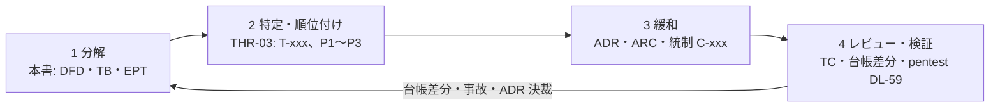
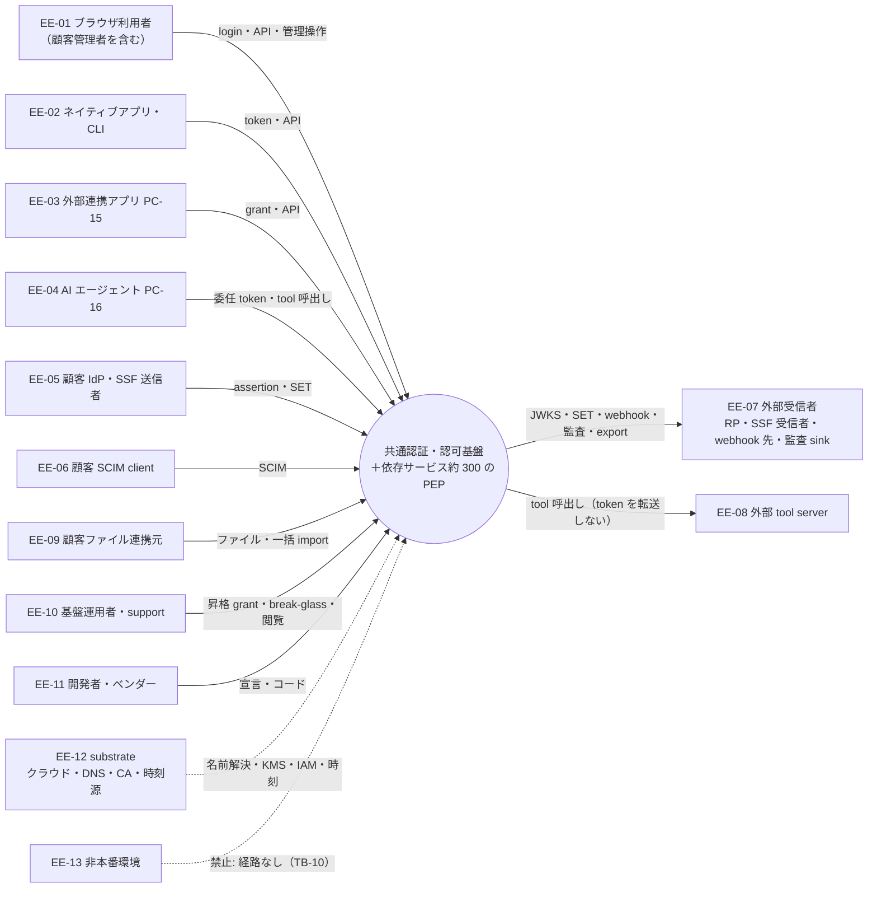
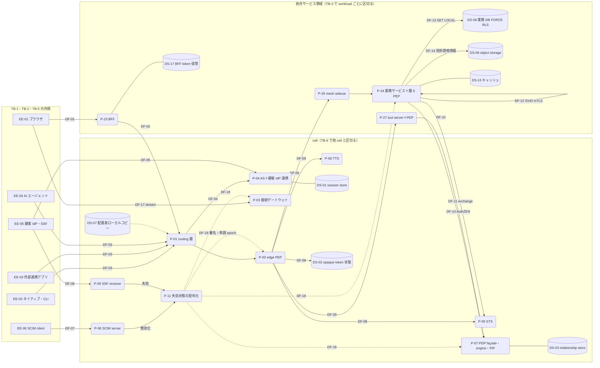
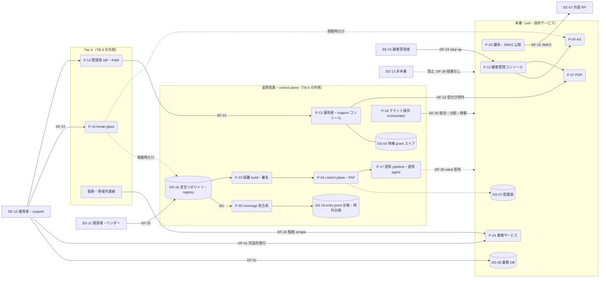
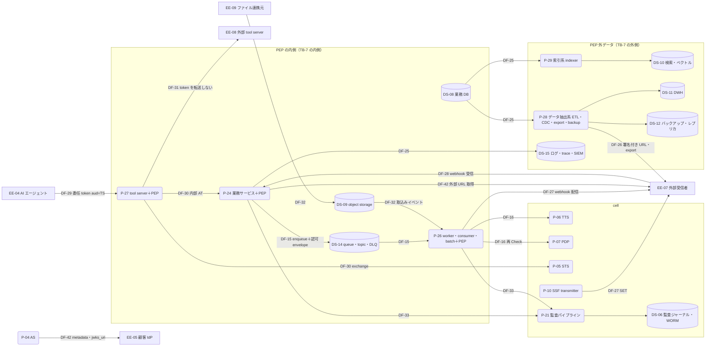
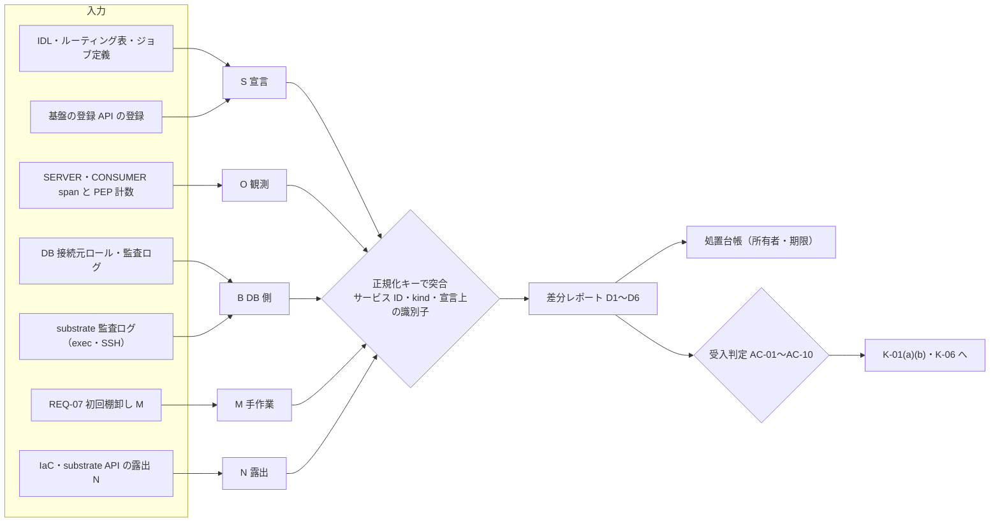

# DFD・entry point inventory

> 文書ID: THR-01 / 版: 0.1 / 状態: draft / 最終更新: 2026-10-15
> 対応要求: R-058, R-164, R-215, R-269, G-004, G-082（DL-10。全件と閉じ方は末尾「対応表」）。関連: CL-0110, CL-0260, DS-11
> 依存文書: CONVENTIONS.md, traceability/deliverables.md（DL-10 行）, traceability/R-requirements.md, traceability/G-goal-criteria.md, traceability/claims-ledger.md（CL-0110, CL-0260）, traceability/dissent-log.md（DS-11）, traceability/rejected-hypotheses.md（RH-011）, 01_governance/assumptions-register.md（A-013, A-014, A-050, A-055, A-110, A-112）, 01_governance/kri.md（K-01, K-03, K-05, K-06, K-10, KA-1）, 02_requirements/operation-risk-tiers-assurance.md（REQ-03 J1・J2・J8・J10）, 02_requirements/as-is-inventory.md（REQ-07 §3.7・§4）, 03_threat-model/threat-catalog.md（THR-03 §2・§3・§10）, 03_threat-model/attacker-model.md, 03_threat-model/incident-casebook.md, 04_architecture/ 全文書（とくに reference-architecture-v2.md（ARC-01）, pep-contract.md（ARC-06）, data-outside-pep.md（ARC-11）, revocation-continuous-evaluation.md（ARC-09）, root-of-trust.md（ARC-03）, workload-identity-delegation.md（ARC-04）, audit-privacy.md（ARC-10）, cell-blast-radius.md（ARC-07）, architecture-reconciliation-notes.md）, 05_adr/ADR-005, ADR-006, ADR-008, ADR-009, ADR-011, ADR-012, ADR-013, ADR-017, ADR-022, ADR-024, ADR-026, ADR-029, 05_adr/reconciliation-notes.md, research/RS-04, RS-06, RS-08, RS-10, RS-12, RS-16, research/standards-status.md

本書は、共通認証・認可基盤の DFD（レベル 0・レベル 1）と信頼境界、全 entry point の類型と各類型の PEP、entry point の機械抽出と受入条件（自動発見との差分 0 件）を定める DL-10 の正本である [D]。調査・起草には AI エージェント（Claude）を用いた [D]。本書の判定は自己レビューであり、実在の CTO/CISO の決裁ではない（CONVENTIONS §8）[D]。

- 表記: 本書で新たに置く ID は、DFD 要素 EE-xx（外部主体）・P-xx（処理）・DS-xx（データストア）・DF-xx（データフロー）、entry point 類型 EPT-xx、受入条件 AC-xx、追加脅威候補 NT-THR01-xx、決裁案 KD-THR01-x、新規仮定 NA-THR01-x、試験案 TC-THR01-xx（仮番。DL-22 で採番）、残余リスク RR-THR01-xx とする [D]。他文書の ID との衝突を避けるため、文書 ID を接頭辞に含めた [D]。信頼境界 TB-1〜TB-6 は threat-catalog §3 の定義を引き継ぎ、TB-7〜TB-10 を本書で追加する [D]。
- 表のセルのうちタグのないものは設計推論 [D] であり、この注記で個別のタグに代える [D]。事実を述べるセルには個別にタグと脚注を付けた [D]。

---

## 0. 結論（要旨）

1. **DFD は「ARC-01 の構成要素 29 個」を処理・データストアに写し、外部主体 13・処理 30・データストア 19・主要データフロー 43・信頼境界 10 で描いた**（§3〜§5）[D]。threat-catalog の仮の分解（CE-01〜CE-16）に対応しない要素が 14 ある（SSF 受信・送信、失効状態の配布元、配布 pipeline、テナント操作 orchestrator、workload ID 発行系、coverage 突合系、テナント配置表、queue・デッドレター、entry point 台帳そのもの、失効状態の局所コピー、ファイル連携元、substrate、非本番環境）[D]。これらを含めた CE→DFD の対応表を §9.1 に置いた [D]。
2. **entry point は 19 類型（EPT-01〜EPT-19）とし、G-082 が列挙する 12 類型に、ストリーム、基盤自身の入口、監視・運用 endpoint、ファイル連携、本番の対話的実行環境を加えた**（§6）[D]。object 単位の判定を担うのはサービス内の層 S の PEP だけであり、edge・mesh は object 単位の coverage に数えない（ADR-012 D12-01）[D]。break-glass/P と基盤自身の入口は、ADR-012 の配置区分（層 S／sidecar 例外／public の静的規則）のどれにも当たらないので、台帳上の配置は **未決（ADR-012／ADR-029）** とし、暫定の扱いを §6.3 に置いた [D]。
3. **「自動発見との差分 0 件」を 10 個の受入条件（AC-01〜AC-10）に分解した**（§7.5）[D]。中心は ADR-012 D12-11 の 3 集合（宣言 S、観測 O、DB 側 B）の差分で、O∖S と台帳未登録の B を K-01(a) として 0 件にする [D]。本書はこれに、手作業棚卸し M（REQ-07 の初回棚卸しと登録 API の対象）との突合と、ネットワーク露出の集合 N（未計装のサービスや監視 endpoint は O に現れないため）を加えることを提案する [D]。N を K-01(a) に数えるかは決裁案 KD-THR01-3 とした [D]。
4. **threat-catalog §10 の 25 件をすべて DFD 要素・経路と照合した**（§8）[D]。25 件とも対応する要素・経路・境界を特定でき、そのうち 10 件で threat-catalog の記述または統制の追記が要る点を見つけた [D]。
5. **DFD から、threat-catalog にない脅威候補を 12 件見つけた**（NT-THR01-01〜12、§9.2）[D]。代表は、顧客・第三者が登録した URL へ基盤が取りに行く経路の SSRF（NT-THR01-01）、workload ID 発行の詐称（NT-THR01-07）、本番の対話的実行環境からの PEP 迂回（NT-THR01-08）、entry point 台帳・例外台帳そのものの改ざん（NT-THR01-11）である [D]。T-ID の採番は threat-catalog の改版で行う [D]。
6. **経営・統制上の判断が要る点を 3 件の決裁案にした**（§10）[D]。受入条件「差分 0 件」をどの範囲・時期に課すか（KD-THR01-1）、依存サービスの本番業務 DB への人の直接接続を認めるか（KD-THR01-2）、ネットワーク露出を K-01(a) に数えるか（KD-THR01-3）である [D]。いずれも決定していない [D]。
7. **閉じ方**: DFD と信頼境界（R-164）は机上（A）で本書が担う範囲を書き終えたが、作成者以外の検証は未了である [D]。全 entry point の棚卸しと差分 0 件（R-058、R-269、G-082）は実測（C）が要り、パイロットでの抽出・CI での継続実行の証跡はまだない [D]。G-004 の第三者による再導出は未実施である [D]。対応表（末尾）の 6 件のうち、本書で机上の範囲を閉じたものは 2 件、部分が 1 件、要実測が 3 件である [D]。

---

## 1. 範囲・前提・読み方

### 1.1 本書が決めること・決めないこと

| 論点 | 正本 | 本書の扱い |
|---|---|---|
| PEP の配置・coverage 検証の方式・storage guardrail | ADR-012、ARC-06 | 写して使う。変えない |
| entry point 台帳の欄（schema）と静的規則 SR-01〜SR-20 | ARC-06 §6 | 写して使う。類型の追加は提案として §6.4 に置く |
| As-Is 棚卸しの様式と抽出手順 S1〜S7 | REQ-07 §3.7・§4 | 写して使う。受入判定は本書が決める |
| DFD（レベル 0・1）、信頼境界、要素 ID | 本書 | 決める |
| entry point 類型と類型ごとの PEP の対応 | 本書（台帳の値の割当） | 決める |
| 受入条件「自動発見との差分 0 件」の定義と判定手順 | 本書 | 決める（数値は TBD） |
| 脅威 T-ID の採番 | THR-03 | 追加候補 NT-THR01-xx を示すだけで、採番しない |

- 依存サービス約 300 [A-050] の内部構造は描かない [D]。依存サービスはレベル 1 で「業務サービス＋層 S PEP」（P-24）として 1 つにまとめ、サービスごとの入口は台帳（DS-18）で列挙する [D]。サービス単位の DFD を台帳から生成する案は残課題 5 とする [D]。

### 1.2 前提（A-ID）

| A-ID | 値（基準） | 本書での使い方 |
|---|---|---|
| A-050 | 依存サービス 300 | 台帳の対象数、計装率の分母 |
| A-055 | entry point 総数 1.2 万（範囲 4,500〜3 万）。300 サービス × 平均 40 入口の仮置き | 手作業では追随できない件数と見て、機械抽出を前提にする [D][A-055] |
| A-110 | 現行認証方式: 共通 SSO 120・独自セッション 105・LDAP 直結 30・共有シークレットのみ 45 | sidecar 例外（PP-3）と TB-3 の未成熟区間の見積り |
| A-112 | 自前の認可実装 80%、アプリ層の検索条件だけでテナント分離 70% | DB 直接接続（EPT-13）と storage guardrail の後付け範囲 |
| A-013 | 外部連携アプリ client 800・grant 3 万 | EE-03 の規模 |
| A-014 | AI エージェント ID 1 万（範囲 1,000〜10 万） | EE-04・EPT-15 の規模 |

- 01_governance/kri.md の KA-1（依存サービスは PEP SDK の導入と同時に SERVER/CONSUMER span を出す計装を導入できる）にも依存する [D]。
- 類型ごとの入口数の内訳は置かない [D]。根拠となる値がないためであり、TBD（所有者: プラットフォームチーム長＋各ドメイン責任者、期限: G1、決め方: REQ-07 §4 のパイロット抽出の実測で A-055 を類型別に置き換える）とする [D]。

### 1.3 新規仮定（前提台帳へ追加要）

- **NA-THR01-1**: 本番の対話的実行（コンテナへの exec、SSH、port-forward、DB コンソール）は、substrate（クラウド事業者・コンテナ基盤）の監査ログから機械的に列挙できる [D]。TC-THR01-03 で確かめる [D]。
- **NA-THR01-2**: ネットワーク露出（ロードバランサの listener、Ingress、公開 IP、Service、DNS レコード）は、IaC と substrate API から機械的に列挙できる [D]。AC-03 の前提であり、TC-THR01-02 で確かめる [D]。
- **NA-THR01-3**: 依存サービスの入口は §6 の 19 類型に収まり、新しい類型の出現はまれである [D]。台帳の `kind` に当たらない入口が見つかった場合は §2.3 の反復で類型を追加する [D]。

### 1.4 R/G の抽出結果

R-requirements.md と G-goal-criteria.md から、対応成果物欄に `03_threat-model/dfd-entry-points.md` または `DL-10` を含む行を全件抽出した [D]。R は R-058、R-164、R-215、R-269 の 4 件、G は G-004、G-082 の 2 件、計 6 件である [D]。各件への応答は末尾の対応表に示す [D]。

### 1.5 読み手別の入口

| 読み手 | 最初に読む節 |
|---|---|
| CTO・CISO | §0、§7.5（受入条件）、§10（決裁案） |
| 連携開発者（依存サービス） | §6（自分の入口の類型と PEP）、§7.3（差分が出たときの処置） |
| 脅威モデルの担当者・レビュアー | §2（再導出の手順）、§3〜§5（DFD）、§8・§9（照合と追加脅威） |

---

## 2. DFD の作り方（G-004、R-215）

### 2.1 要素の種類と記法

| 種類 | ID | 意味 | STRIDE の最低適用（THR-03 §2.2 手順 2） |
|---|---|---|---|
| 外部主体 | EE-xx | 本基盤が統制しない主体・系 | S・R |
| 処理 | P-xx | 入力を受けて処理する要素 | S・T・R・I・D・E |
| データストア | DS-xx | 保存する要素 | T・R・I・D |
| データフロー | DF-xx | 要素間の流れ。越える信頼境界を記す | T・I・D |
| 信頼境界 | TB-x | 信頼の程度が変わる線 | 越える DF ごとに入口（EPT）と PEP を割り当てる |

- 図の記法は Mermaid の flowchart とし、要素の形を次のように分ける [D]。外部主体は四角、処理は角丸、データストアは円筒、信頼境界は subgraph で表す [D]。

### 2.2 作成手順（第三者が同じ入力から同じ DFD を作るための手順）

| 手順 | 入力 | 作業 | 出力 | 判断規則 |
|---|---|---|---|---|
| 1 | ARC-01 §5.1 の構成要素 C01〜C29 | 構成要素を処理またはデータストアに写す。状態を持ち要求を受けないものはデータストア、要求を受けて判定・発行・変換するものは処理 | P-xx、DS-xx | 1 つの構成要素が処理と状態の両方を持つ場合は分ける（例: AS は P-04、session store は DS-01） |
| 2 | ARC-01 §2.1 の外部、PC-xx（principal-catalog）、ARC-07 §3.3 の H-1〜H-10 | 本基盤が統制しない主体・系を外部主体にする | EE-xx | 統制できない系は、信頼していても外部主体にする |
| 3 | ARC-11 §1.2 の PX-01〜PX-11 | 正本から複製・派生したデータの所在をデータストアに加える | DS-08〜DS-15 | PEP の外にあるものは TB-7 の外側に置く |
| 4 | ARC-01 §6 の主要フロー 6.1〜6.9、ARC-09 §2.2 の経路 P1〜P11、ARC-04 §8・§9 | 要求・配布・複製・監査の流れを DF にする | DF-xx | 信頼境界を越える流れは必ず 1 本の DF にする。越えない流れは主要なものだけ描く |
| 5 | threat-catalog §3 の TB-1〜TB-6、ARC-01 §7、ARC-03 §10 | 信頼境界を引く | TB-1〜TB-10 | 「暗黙の信頼を置かない」の実装位置（ARC-01 §7.1）ごとに線を引く |
| 6 | 手順 4・5 の結果 | TB を内向きに越える DF ごとに、入口の類型（EPT）と PEP を割り当てる | §6 | 入口類型が割り当たらない DF が残ったら手順 4 に戻る（AC-08） |
| 7 | 台帳 DS-18 の `kind` の値 | 台帳の各類型が DFD のどの DF に当たるかを確かめる | §7.6 | 当たらない類型が出たら手順 4 に戻る（AC-08） |

### 2.3 反復の工程（R-215）

脅威モデリングを、対象の分解 → 脅威の特定・順位付け → 緩和 → レビュー・検証の 4 段で繰り返す [D]。本書は第 1 段（分解）と、第 2 段の一部（DFD で見つけた追加脅威）を担う [D]。

| 再実施の契機 | 再実施する範囲 | 所有者案 |
|---|---|---|
| 台帳に DFD のどの DF にも当たらない入口類型が現れた（AC-08 の違反） | 手順 4〜7、THR-03 の該当 CE の STRIDE | CISO（脅威モデル）＋プラットフォームチーム長（台帳） |
| 信頼境界を越える新しい DF（新しい外部主体、新しい法域パーティション、新しい substrate）が設計に入る | 手順 2〜6 | CTO |
| ADR の決裁で §11 の未決が解消される | 該当する要素・DF・EPT の配置 | CTO |
| 自社・他社の一次報告で、本書の DFD にない経路からの侵害が報告される | 該当経路の追加と THR-03 の改版 | CISO |
| 定期 | 全体。Gate 4 前と、段階導入開始後は年 1 回（ADR-012 §8 の見直し周期に揃える案） | CISO |

- DFD 自体を版管理された Mermaid として本リポジトリに置き、台帳（DS-18）の `kind` の一覧と要素一覧（§5.4）との差分を CI で検査する案とする [D]。検査器の作成は残課題 4 とする [D]。

---

## 3. 信頼境界

| TB | 境界 | 内側 | 外側 | 境界を越えるときに置く統制 | 正本 |
|---|---|---|---|---|---|
| TB-1 | 利用者端末と基盤 | BFF・edge・AS | ブラウザ、ネイティブアプリ・CLI | ブラウザに token を置かない（BFF）、sender constraint、session 上限 | ADR-005、THR-03 |
| TB-2 | 外部ネットワークと edge | routing 層・edge・AS の公開 endpoint | インターネット | 外部 token の照会、信頼ヘッダの除去、台帳外 route の 404 | ADR-012 D12-02、ADR-005 D1-1〜D1-4 |
| TB-3 | 依存サービス群と共通基盤、および workload 間 | 各 workload | 他の workload、edge | SVID mTLS、mesh の allow-nothing、hop ごとの aud 限定 token、層 S の PEP | ADR-009、ADR-012 D12-01〜D12-04 |
| TB-4 | 本番と管理面・変更経路 | 本番の data・decision plane | control plane、CI/CD、運用者・support | 宣言→二者レビュー→隔離 build・署名→wave 配布の単一経路、常設特権 0 | ADR-008 D8-20・D8-21、ADR-013 D13-30 |
| TB-5 | 自社と顧客 IdP・外部連携事業者・外部 tool | 本基盤 | 顧客 IdP、SCIM client、外部連携アプリ、AI エージェント、外部 tool server、外部受信者 | テナントごとの trust agreement、assertion・SET の署名検証、aud 限定 token、token の非転送 | ADR-004、ADR-006、ADR-017 |
| TB-6 | cell 間・リージョン間 | 1 つの cell | 他の cell | cell 間の同期呼出しと共有状態を持たない（不可逆）。配置表は署名付き静的 artifact | ADR-013 D13-10・D13-13 |
| TB-7 | PEP の内側と PEP 外データ | 業務データの正本（業務 DB、object storage） | 検索索引、ベクトルストア、DWH、バックアップ、ログ、キャッシュ、export | 「どこへ流れてよいか」の規則、経路台帳と配備ゲート、テナント単位の区画分離 | ADR-012 D12-30、ARC-11 §2 |
| TB-8 | 法域パーティション間 | 1 つの法域パーティション | 他の法域パーティション | identity chaining（越境許可台帳と移転判定）、Txn-Token を越境させない | ARC-04 §9、ADR-009 D09-37、ADR-013 D13-02 |
| TB-9 | 本基盤と Tier X | 本基盤（AS・PDP・control plane） | 管理用 IdP・PAW、break-glass、監視・帯域外連絡 | 管理者認証を本基盤の AS に依存させない、break-glass は PDP に依存しない | ADR-008 D8-10〜D8-14、ADR-023、ADR-029 D29-70〜D29-83 |
| TB-10 | 非本番と本番 | 本番 | 非本番の主体・資格情報・trust anchor | 信頼の経路を作らない（DF が 0 本であることを検査する） | ADR-008 D8-50〜D8-55、ARC-03 §10.2 |

- threat-catalog の TB-4 は「本番と管理面・開発面」をまとめていた [D]。本書は、本基盤に依存しない管理系（TB-9）と、信頼の経路を一切持たない非本番（TB-10）を分けた [D]。TB-9 は「依存させない」こと、TB-10 は「流れが存在しない」ことを検査の対象にするため、統制の形が TB-4 と異なるからである [D]。
- TB-10 を独立させる理由の一つは事故の一次報告である [D]。Microsoft は、Midnight Blizzard が 2023 年 11 月下旬から password spray で旧来の非本番テストテナントのアカウントを侵害して足場を得たと報告した [I][^16]（RS-12#15）。そのアカウントには MFA がなく、攻撃者は corporate 環境で高い権限を持つ旧テスト OAuth アプリを特定して侵害した [I][^17]（RS-12#16）。
- PDP/PEP はトラフィック上の自らの位置より先では追加の方針を適用できず、暗黙の信頼ゾーンはできる限り小さくしなければならない（must）[N][^1]（RS-08#19）。TB-7 の外側（PEP 外データ）は PEP の位置より先にあるので、PEP ではなく流れの規則で統制する [D]（ARC-11 §1.1）。

---

## 4. レベル 0 DFD（コンテキスト）

- 図の実線は要求・データの流れ、点線は基盤が依存する substrate、「禁止」と書いた線は存在してはならない流れを表す [D]。
- レベル 0 で基盤に入る流れは 9 種、基盤から出る流れは 2 種、依存は 1 種、禁止は 1 種である [D]。基盤から外部へ出る流れのうち、基盤が外部の URL へ取りに行くもの（EE-05 の metadata・jwks_uri、EE-07 の webhook 先、EE-08 の tool server）は、応答が入力として戻るので入口と同じく扱う（NT-THR01-01）[D]。

---

## 5. レベル 1 DFD

### 5.1 同期の要求経路（data plane と decision plane）

- edge（P-02）は外部 token の照会・信頼ヘッダの除去・台帳外 route の 404 を行い、object 単位の判定はしない [D]（ADR-012 D12-01・D12-02）。下流の P-24 は署名付き内部 JWT（aud は呼出し先 1 サービス）と Txn-Token を自ら検証し、未署名ヘッダを判定の根拠にしない [D]（ADR-005 D1-5、ADR-012 D12-02）。
- 中間層が設定する HTTP ヘッダをエンドユーザーが上書きできないこと（ASVS v5.0.0-4.1.3、L2）が DF-02・DF-03 の境界で効く [N][^3]（RS-08#22）。テナント文脈のヘッダも同じ類型として扱う [D]。
- BFF→edge（DF-02）の token 形式は **未決（ADR-005 K-1）** である [D]。どちらに決まっても DF-02 が TB-2 を越える点と P-02 が入口になる点は変わらない [D]。
- P-24 のテナント照合（L0）の「三者」の定義は ADR-012 D12-04 と ADR-024 D24-07 で異なり、**未決（ADR-012／ADR-024。architecture-reconciliation-notes XR-07）** である [D]。DFD 上は、照合点が P-02（route テナント）と P-24（資源の正本から導いたテナント）と P-07（G 段）の 3 か所にあることだけを描いた [D]。

### 5.2 管理面・変更経路・緊急経路

- 人がコンソール・管理 API・DB から本番の管理面資産に直接書き込む権限は平常時には誰にも与えず、例外は break-glass と縮小方向の専用 API だけである [D]（ADR-008 D8-20）。人に与える JIT の権限は、調査用の読取り、pipeline の手動 gate の承認、縮小方向の操作の 3 種に限る [D]（ADR-008 D8-21）。
- DF-41（本番の対話的実行）は、ADR-008 の「管理面資産」ではなく依存サービスの業務 DB・業務 workload に向かう流れを含む [D]。依存サービスの業務 DB への人の直接接続を認めるかは ADR-008・ADR-029 のどちらも直接は定めておらず、決裁案 KD-THR01-2 とした [D]。
- support の顧客テナントへのアクセスは、チケットに結び付いた昇格 grant と、データ区分に応じた顧客承認でだけ許す [D]（ADR-029）。特権 grant の評価位置（façade の型付き例外か）は **未決（ADR-029 KD29-5）** である [D]。
- break-glass/P は本基盤の PDP に依存させず、テナント内の業務上の緊急アクセス（break-glass/B）は本基盤の PDP 上の型付き例外として扱う [D]（ADR-029 D29-80〜D29-83）。管理用 IdP の形態は **未決（ADR-008 KD8-1）** である [D]。
- P-30（coverage 突合系）と DS-18（台帳・例外台帳）は、統制の証拠を作る要素そのものである [D]。これらの改ざんは「検査が 0 件を返す」形で統制を無効にするので、DFD に要素として描き、脅威候補 NT-THR01-11 の対象にした [D]。

### 5.3 非同期・PEP 外データ・AI エージェント・外部への流れ

- queue consumer・batch の各実行単位・webhook 配信は独立した entry point として層 S の PEP を持ち、実行直前に起点主体の権限で再 Check する [D]（ADR-012 D12-32）。中継サービスではなく起点主体の権限で判断することは ASVS v5.0.0-8.3.3（L3）の要求である [N][^10]（RS-08#57）。
- AI エージェントの tool 呼出し（DF-29）は、tool server 内の PEP が呼出しごとに判定する [D]（ARC-04 §8.2 AG-3）。MCP server は自分宛てに発行された access token だけを受け入れなければならず（MUST）、他の token を受け入れたり中継したりしてはならない（MUST NOT）[N][^13]（RS-06#60。MCP は SDO 外の仕様で、版は 2026-07-28、standards-status SS-I28）。
- tool server の PEP は、エージェントの自己申告や MCP の tool annotation を判定の入力にしない [D]（ARC-04 AG-3）。MCP の tools 仕様は、client は信頼できる server から得たもの以外の annotation を信頼してはならない（MUST）とする [N][^14]（RS-06#66）。
- 検索索引やその写しを、資源のテナントの解決や三者一致の照合に使ってはならない [D]（ARC-11 §1.2）。DFD では DS-10 から P-24 の L0 照合への流れを描かないことで表した [D]。

### 5.4 要素一覧

**外部主体**

| ID | 要素 | 対応（ARC-01／PC） | 越える TB |
|---|---|---|---|
| EE-01 | ブラウザ利用者（一般利用者・B2B 利用者・顧客管理者） | PC-01 等、PC-03 | TB-1、TB-2 |
| EE-02 | ネイティブアプリ・CLI | — | TB-1、TB-2 |
| EE-03 | 外部連携アプリ（第三者・顧客自作の OAuth client） | PC-15 | TB-5、TB-2 |
| EE-04 | AI エージェント（自社運用・第三者） | PC-16 | TB-5、TB-2 |
| EE-05 | 顧客 IdP（SAML/OIDC）・SSF 送信者 | — | TB-5 |
| EE-06 | 顧客 SCIM client | — | TB-5 |
| EE-07 | 外部受信者（外部 RP、外部 SSF 受信者、webhook 配信先、顧客監査 sink、export の受取先） | — | TB-5 |
| EE-08 | 外部 tool server（第三者の MCP server） | — | TB-5 |
| EE-09 | 顧客ファイル連携元（SFTP、object storage への投入、一括 import） | — | TB-5 |
| EE-10 | 基盤運用者・support 担当 | PC-07 等 | TB-4、TB-9 |
| EE-11 | 開発者・ベンダー（宣言・コードの提出） | — | TB-4 |
| EE-12 | substrate（クラウド事業者 API・IAM、DNS、CA、時刻源、container registry） | ARC-07 H-1〜H-10 | TB-4（依存） |
| EE-13 | 非本番環境 | — | TB-10（流れ 0 本） |

**処理**

| ID | 要素 | ARC-01 | plane／範囲 |
|---|---|---|---|
| P-01 | routing 層 | C27 | global（G2） |
| P-02 | edge PEP（API gateway 型） | C07 | data／cell |
| P-03 | 接続ゲートウェイ | C10 | data／cell |
| P-04 | AS（顧客 IdP 連携を含む） | C01、C21 | decision／cell（配置は **未決（ADR-013 KD13-3）**） |
| P-05 | STS | C04 | decision／cell |
| P-06 | TTS | C05 | decision／cell |
| P-07 | PDP façade・engine・PIP | C11、C14 | decision／cell |
| P-08 | SCIM server | C20 | data／cell |
| P-09 | SSF receiver | C16 | decision／cell |
| P-10 | SSF transmitter | C17 | data／cell |
| P-11 | 失効状態の配布元 | C15 | decision／cell |
| P-12 | 顧客管理コンソール | C22 | data／cell |
| P-13 | 運用者・support コンソール（support tool を含む） | C23 | control／法域 |
| P-14 | 管理用 IdP・PAW | C24 | Tier X |
| P-15 | break-glass 経路 | C25 | Tier X |
| P-16 | control plane・model registry/PAP | C13 ほか | control／法域 |
| P-17 | 配布 pipeline・適用 agent | C26 | control／data |
| P-18 | テナント操作 orchestrator | C29 | control／法域 |
| P-19 | workload ID 発行系（SPIRE） | C28 | 法域（trust domain 数は **未決（ADR-009 P09-1）**） |
| P-20 | 鍵系（KMS 署名、鍵台帳、マニフェスト、JWKS 公開） | C18 | L1 法域／L2 cell |
| P-21 | 監査パイプライン（producer・spool・sealer） | C19 | data／cell・法域 |
| P-22 | 隔離 build・署名 | — | 変更経路 |
| P-23 | BFF | C06 | data／依存サービス側 |
| P-24 | 業務サービス＋層 S PEP（SDK または契約適合の自前実装） | C08 | data／依存サービス側 |
| P-25 | mesh sidecar | C09 | data／依存サービス側 |
| P-26 | 非同期 worker・consumer・batch＋PEP | — | data／依存サービス側 |
| P-27 | tool server（MCP server を含む）＋PEP | — | data／依存サービス側 |
| P-28 | データ抽出系（ETL、CDC、export ジョブ、バックアップ取得） | — | PEP 外 |
| P-29 | 索引系（検索・ベクトルの indexer） | — | PEP 外 |
| P-30 | coverage 突合系（台帳生成、3 集合突合、本番走査） | — | 変更経路（基盤所有） |

**データストア**

| ID | 要素 | ARC-01／ARC-11 | 位置 |
|---|---|---|---|
| DS-01 | session store | C02 | cell |
| DS-02 | opaque token 状態ストア | C03 | cell |
| DS-03 | relationship store・tenant 設定 | C12 | cell |
| DS-04 | 特権 grant ストア | ADR-029 | 法域 |
| DS-05 | 鍵台帳・L2 鍵・JWKS | C18 | 法域・cell |
| DS-06 | 監査ジャーナル・WORM・透明性ログ | C19 | cell・法域・外部 |
| DS-07 | テナント配置表（署名付き artifact とローカルコピー） | G1 | global・各所 |
| DS-08 | 業務 DB（FORCE RLS） | — | PEP の内側（正本） |
| DS-09 | object storage | — | PEP の内側（正本） |
| DS-10 | 検索 index・ベクトルストア | PX-01、PX-02 | PEP 外 |
| DS-11 | DWH・データレイク | PX-03 | PEP 外 |
| DS-12 | バックアップ・スナップショット・レプリカ | PX-07 | PEP 外 |
| DS-13 | キャッシュ | PX-09 | PEP 外 |
| DS-14 | queue・topic・デッドレター | — | PEP の内側（envelope 付き） |
| DS-15 | ログ・trace・メトリクス・SIEM | PX-08 | PEP 外 |
| DS-16 | 宣言リポジトリ・artifact registry | — | 変更経路 |
| DS-17 | BFF のサーバ側 token 保管 | — | 依存サービス側 |
| DS-18 | entry point 台帳・例外台帳 | ADR-012 D12-08・D12-40 | 変更経路（基盤所有） |
| DS-19 | 失効状態（配布物の局所コピー） | C15 の配布先 | 各強制点 |

### 5.5 データフロー一覧（信頼境界を越えるもの）

| DF | 流れ | 越える TB | 運ぶもの・保護 | 入口類型 |
|---|---|---|---|---|
| DF-01 | EE-01 → P-23 | TB-1、TB-2 | cookie session | EPT-01 |
| DF-02 | P-23 → P-01 → P-02 | TB-2 | token（形式は **未決（ADR-005 K-1）**） | EPT-01〜03 |
| DF-03 | EE-02・EE-03・EE-04 → P-01 → P-02 | TB-1／TB-5、TB-2 | opaque token＋sender constraint | EPT-01〜03 |
| DF-04 | EE-01〜EE-04 → P-04 | TB-1／TB-5、TB-2 | 認可要求、token 要求、PAR、revocation | EPT-16 |
| DF-05 | EE-05 → P-04 | TB-5 | SAML assertion・ID token（RP 起点） | EPT-16 |
| DF-06 | EE-05 → P-09 | TB-5 | SET（push・poll） | EPT-16 |
| DF-07 | EE-06 → P-08 | TB-5 | SCIM 要求 | EPT-16 |
| DF-08 | P-02 → DS-02・P-05・P-06 | cell 内 | 照会、exchange、Txn-Token 発行 | EPT-16（基盤内） |
| DF-09 | P-02 → P-25 → P-24 | TB-3 | 内部 JWT（aud＝1 サービス）、Txn-Token（write 以上）、SVID mTLS | EPT-01〜03 |
| DF-10 | P-24・P-26・P-27 → P-07 | TB-3 | AuthZEN 要求（decision_id 応答） | EPT-16 |
| DF-11 | P-24 → P-05 | TB-3 | token exchange（act 連鎖） | EPT-16 |
| DF-12 | P-24 → P-24（他サービス） | TB-3 | 内部 JWT、SVID mTLS | EPT-01〜03 |
| DF-13 | P-24 → DS-08 | サービス内 | `SET LOCAL` のテナント文脈 | — |
| DF-14 | P-24 → DS-09 | サービス内 | 区画限定の短命資格情報 | — |
| DF-15 | P-24 → DS-14 → P-26 | TB-3 | 認可 envelope（起点主体・tid・一貫性トークン） | EPT-07、EPT-08 |
| DF-16 | P-26 → P-07・P-06 | TB-3 | 再 Check、内部開始 Txn-Token | EPT-16 |
| DF-17 | EE-01・EE-02 → P-03 | TB-1、TB-2 | stream 接続・購読 | EPT-04 |
| DF-18 | P-11 → 各強制点 | cell 内 | 署名・単調 epoch の失効状態 | — |
| DF-19 | P-20 → EE-07 | TB-5（外向き） | JWKS・issuer metadata | EPT-16 |
| DF-20 | EE-11 → DS-16 → P-22 → P-16 | TB-4 | 宣言・コード（二者レビュー、署名、provenance） | EPT-09 |
| DF-21 | EE-10 → P-14 → P-13 | TB-9、TB-4 | 管理 session（PAW 束縛） | EPT-09、EPT-11 |
| DF-22 | P-13 → P-07（DS-04） | TB-4 | 昇格 grant の評価 | EPT-11 |
| DF-23 | EE-10 → P-15 → 本番 | TB-9、TB-4 | 封緘資格情報、同時二者 | EPT-14 |
| DF-24 | EE-01 → P-12 → P-07・P-04 | TB-1、TB-2 | 管理操作、step-up | EPT-09 |
| DF-25 | DS-08・P-24 → P-28・P-29・DS-15 | TB-7 | 複製・派生データ | EPT-12、EPT-13 |
| DF-26 | P-28 → EE-07 | TB-7、TB-5 | 署名付き URL、export | EPT-10 |
| DF-27 | P-26・P-10 → EE-07 | TB-5（外向き） | webhook 配信、SET | EPT-06 |
| DF-28 | EE-07 → P-02 → P-24 | TB-5、TB-2 | webhook 受信（署名付き） | EPT-05 |
| DF-29 | EE-04 → P-02 → P-27 | TB-5、TB-2、TB-3 | 委任 token（aud＝tool server） | EPT-15 |
| DF-30 | P-27 → P-05 → P-24 | TB-3 | 内部 AT（sub＝利用者、act 連鎖） | EPT-01〜03 |
| DF-31 | P-27 → EE-08 | TB-5（外向き） | tool 呼出し（基盤の token を転送しない） | NT-THR01-01 |
| DF-32 | EE-09 → DS-09 → P-26 | TB-5 | ファイル、取込みイベント | EPT-18 |
| DF-33 | 全 producer → P-21 → DS-06 | trace と別経路 | 監査イベント（producer_seq） | — |
| DF-34 | DS-16・DS-15・DS-08 の監査ログ・計数 → P-30 → DS-18 | TB-4 | IDL、span、DB 接続元、計数 | — |
| DF-35 | P-18 → cell | TB-4、TB-6 | テナントの統合・分割・cell 間移動 | EPT-09 |
| DF-36 | P-16・P-17 → 本番（DS-07 を含む） | TB-4、TB-6 | 署名付き配布物（wave） | — |
| DF-37 | P-19 → P-25・P-24 | TB-3 | SVID | EPT-16 |
| DF-38 | P-05（法域 A）→ P-04（法域 B） | TB-8 | JWT authorization grant（RFC 7523） | EPT-16 |
| DF-39 | EE-13 → 本番 | TB-10 | なし（存在してはならない） | — |
| DF-40 | EE-12 → 全要素 | 依存 | DNS、KMS API、IAM、時刻 | — |
| DF-41 | EE-10 → P-24・DS-08 | TB-4 | 対話的実行（exec・SSH・DB コンソール） | EPT-19 |
| DF-42 | P-24・P-04 → EE-07・EE-05 | TB-5（外向き、応答は内向き） | webhook 先、metadata URL、jwks_uri の取得 | NT-THR01-01 |
| DF-43 | 監視（Tier X）→ P-24 等 | TB-9、TB-3 | metrics・health の取得 | EPT-17 |

- 越境共有（ADR-024）は新しい DF を作らない [D]。ゲストに資源側テナントの token を発行する形で表すので、DF-03・DF-09 の上で扱える [D]（ARC-06 要旨 2、ADR-024 D24-01）。
- 委任ジョブ（ADR-026 の A2 型）は DF-15・DF-16 の上にあり、内部開始の Txn-Token の `txn` の意味は **未決（ADR-026 L26-1、claims-catalog §7.2）** である [D]。
- claims-ledger CL-0260 は、DFD に tenant crossing・外部共有・support・委任・async job を含めることを求めている [D]。それぞれ DF-35・DF-03（ADR-024）・DF-21〜DF-22・DF-11／DF-30・DF-15〜DF-16 に当たる [D]。

---

## 6. entry point 類型と PEP

### 6.1 類型一覧

`placement` の PP-1〜PP-7 は ARC-06 §5 の配置パターンである [D]。

| EPT | 類型 | 例 | 宣言の正本 | 実行時の観測源 | PEP（placement） | 判定の時点 | 主な TB | 主な脅威 |
|---|---|---|---|---|---|---|---|---|
| EPT-01 | HTTP（REST） | 業務 API、BFF の API | OpenAPI 3.2.1 の operation と拡張属性 [N][^5] | SERVER span、PEP の計数 | PP-1／PP-2（例外 PP-3、public は PP-4） | 毎要求 | TB-2、TB-3 | T-016、T-018、T-020 |
| EPT-02 | gRPC（unary） | サービス間 API | proto の method option | SERVER span、PEP の計数 | PP-1／PP-2 | 毎要求 | TB-3 | T-020、T-025 |
| EPT-03 | GraphQL operation | 集約 API | schema の directive（operation と field） | SERVER span、PEP の計数 | PP-1／PP-2。resolver 内でなく業務層で判定（ADR-012 D12-05） | 毎 operation、field 単位の分類を含む | TB-2、TB-3 | T-020、T-026、NT-THR01-03 |
| EPT-04 | ストリーム（WebSocket・SSE・gRPC streaming） | 通知、共同編集、長時間 download | gRPC は proto、WebSocket・SSE は AsyncAPI 3.1.0 [N][^8]（割当は §6.4） | 接続ゲートウェイの接続記録、SERVER span | PP-7。接続確立と購読を別々の入口に数える | 接続時・購読時・失効イベント時（ADR-006 D6-14、ARC-09 §6.3） | TB-1、TB-2 | T-019 |
| EPT-05 | webhook 受信 | 決済・外部 SaaS からの通知 | AsyncAPI の operation と拡張属性 | SERVER span、PEP の計数 | 署名検証の後に PP-1（ADR-012 D12-36） | 毎要求 | TB-5、TB-2 | T-016、T-018 |
| EPT-06 | webhook 配信・SSF 送信 | 購読者へのイベント送出 | AsyncAPI | 配信 worker の CONSUMER span、配信記録 | PP-5。購読の所有者が配信時点で受け取る権限を持つかを再 Check（D12-36） | 配信直前 | TB-5（外向き） | T-024、T-069、NT-THR01-01 |
| EPT-07 | queue consumer・イベント | 他ドメインへの反映、通知、索引更新（A4） | AsyncAPI と `async_type` | CONSUMER span、PEP の計数 | PP-5（ADR-012 D12-32） | 実行直前。一貫性は階層別（D12-32 の表） | TB-3 | T-021、T-024、NT-THR01-04 |
| EPT-08 | cron・batch・長時間ジョブ | 定期レポート（A2）、索引再構築（A3） | ジョブ基盤のジョブ定義（PC-14 の登録）、`async_type` A1〜A4（ADR-026 D26-01） | ジョブ実行記録、CONSUMER span | PP-5 | write 以上は処理項目ごと、read-sensitive は処理単位ごと（D12-35） | TB-3 | T-024、T-039 |
| EPT-09 | 管理画面・管理 API | 顧客管理コンソール、テナント操作、運用者コンソール | 基盤の登録 API | SERVER span、管理イベント（AU 族） | PP-1。顧客管理者の privileged/T は fresh 判定と step-up | 毎要求 | TB-1、TB-2、TB-4 | T-046、T-048、T-050 |
| EPT-10 | export・署名付き URL・共有リンク | テナント全体 export、利用者 export | 登録 API と発行 operation（OpenAPI） | 発行記録（認可イベント） | 発行時に PP-1（D12-25）。URL 自体は bearer | 発行時だけ。TTL 上限で残り寿命を限る | TB-7、TB-5 | T-077、T-079 |
| EPT-11 | support tool | 顧客テナントの調査・代行操作 | 基盤の登録 API | SERVER span、昇格 grant の記録 | PP-1＋façade の型付き例外（評価位置は **未決（ADR-029 KD29-5）**） | 毎要求＋昇格 grant の有効期間 | TB-4、TB-9 | T-049、T-081 |
| EPT-12 | ETL・CDC・DWH 抽出・バックアップ取得 | 分析基盤への抽出、DR レプリカ | 基盤の登録 API（`db_role` 必須） | DB 側の接続元ロール・監査ログ（集合 B） | 特権データ経路として台帳登録（D12-30）。持出し条件は ARC-11 | 実行ごと | TB-7 | T-034、T-077 |
| EPT-13 | DB 直接接続 | 手作業 SQL、運用スクリプト | 基盤の登録 API（`db_role` 必須） | 集合 B | privileged 以上に分類（REQ-03 J1・J2）。強制点は DB 側 guardrail と接続ロール | 接続ごと | TB-4、TB-7 | T-033、NT-THR01-08 |
| EPT-14 | 緊急経路 | break-glass/P、break-glass/B、縮小方向の専用 API | 基盤の登録 API | 独立経路の記録（ADR-029）、K-10 | /P: Tier X の独立統制（台帳上の placement は **未決（ADR-012／ADR-029）**）。/B: façade の型付き例外。縮小方向 API: privileged（J8） | 発動ごと | TB-9、TB-4 | T-047 |
| EPT-15 | AI エージェント tool | tool server、MCP server | OpenAPI または tool 定義＋RFC 9728 の Protected Resource Metadata | SERVER span、PEP の計数 | PP-6（tool server 内 PEP。ARC-04 AG-1〜AG-9） | tool 呼出しごと。write 以上は fresh（ARC-09 P7） | TB-5、TB-3 | T-072〜T-075 |
| EPT-16 | 基盤自身の入口 | AS の authorize・token・PAR・revocation、SAML ACS、SCIM、SSF 受信、STS、TTS、PDP façade、JWKS | 基盤部品の OpenAPI・製品設定 | SERVER span、発行記録・判定記録 | 構成要素内の検証（client 認証、sender constraint、SVID）。placement は **未決（ADR-012）** | 毎要求 | TB-2、TB-3、TB-5 | T-001〜T-010、T-037、T-058、T-061〜T-065 |
| EPT-17 | 監視・運用 endpoint | health、metrics、debug、管理ポート | IaC・登録 API | ネットワーク露出の集合 N、SERVER span | 外部非公開と mesh の allow-nothing。公開する場合は認証付き | 毎要求 | TB-9、TB-3 | NT-THR01-02 |
| EPT-18 | ファイル連携 | SFTP、object storage への投入、一括 import | 登録 API と取込みイベントの AsyncAPI | CONSUMER span、取込み記録 | PP-5（取込み処理を consumer として扱う） | 取込み単位と行単位のテナント照合 | TB-5 | NT-THR01-10 |
| EPT-19 | 本番の対話的実行 | コンテナへの exec、SSH、DB コンソール、DLQ の手動再投入 | 登録 API（JIT 付与の記録） | substrate の監査ログ（NA-THR01-1）、集合 B | JIT（読取り・gate 承認・縮小方向。ADR-008 D8-21）か break-glass | 付与ごと | TB-4 | NT-THR01-04、NT-THR01-08 |

- G-082 が列挙する 12 類型との対応は、HTTP＝EPT-01、gRPC＝EPT-02、GraphQL＝EPT-03、webhook＝EPT-05・06、queue＝EPT-07、batch＝EPT-08、管理面＝EPT-09、export＝EPT-10、support tool＝EPT-11、ETL＝EPT-12、DB 直＝EPT-13、緊急経路＝EPT-14 である [D]。本書の担当範囲で求められた AI エージェント tool は EPT-15 である [D]。
- EPT-04（ストリーム）は ADR-012 D12-08 の種別に含まれる [D]。EPT-16〜EPT-19 は本書の追加である [D]。EPT-17 は REQ-07 §3.7 の「監視 endpoint」に当たり、ASVS v5.0.0-13.4.5（L2）は内部 API の文書や監視 endpoint を意図せず公開しないことを求める [N][^4]（RS-08#22）。EPT-19 は ARC-09 §2.2 の P5（SSH・端末資格情報）に当たる [D]。

### 6.2 類型を問わない PEP の義務

- 全 entry point は、token 検証 → テナント照合（L0）→ PDP 呼出し → 判定の適用 → enforcement 記録の順を守り、decision_id 付きの記録を残す [D]（ARC-06 要旨 1、ADR-012 D12-14）。
- 判定は SDK の使用ではなく契約上の enforcement 記録で定義し、SDK を提供しない言語のサービスにも同じ検査を課す [D]（ADR-012 D12-14、ADR-022 G-140）。
- 機能・データ単位の明示許可（ASVS v5.0.0-8.2.2、L1）は IDOR・BOLA の緩和を目的とする [N][^10]（RS-08#3）。そのため層 E・層 M の判定は object 単位の coverage に数えない [D]（ADR-012 D12-01）。
- PEP が出す判定記録（decision event）は、ASVS v5.0.0-16.3.2 が L3 で求める全認可判断の記録を兼ねる [N][^11]（RS-08#34）[D]（ADR-011 D8-4）。K-01(b) の計数はこの記録と別経路にする [D]（ADR-012 D12-17）。
- NIST SP 800-53 の AC-25（参照モニタ）は「常に呼び出され（always invoked）」る機構を求め、この性質が迂回を防ぐと説明している [N][^12]（RS-08#13）。AC-25 は SP 800-53B のどのベースラインにも含まれないので、採るかは当社の tailoring 判断である [D]（ADR-012 N-11）。本書の受入条件は「always invoked」を測る手段の一つであり、性質の証明ではない [D]。
- mesh を使う workload の既定拒否は allow-nothing の AuthorizationPolicy で作る [D]（ADR-012 D12-03）。Istio は ALLOW ポリシーが 1 つもない workload への要求を許可するからである [V][^9]（RS-08#36。Istio 1.31.1、確認日 2026-10-03）。

### 6.3 配置区分に当たらない類型の暫定の扱い

| 類型 | ADR-012 の区分に当たらない理由 | 本書の暫定の扱い | 帰属 |
|---|---|---|---|
| EPT-14 の break-glass/P | 本基盤の PDP に依存させないため、層 S の PEP も decision_id もない（ADR-029 D29-80〜D29-83、ADR-013 D13-25 の break-glass 行） | 台帳には登録する。K-01(b) の計数からは外し、独立経路の記録と K-10 で発動の全件を突き合わせる。発動時刻と記録の差分を K-01(a) と同じ扱いで 0 件にする | **未決（ADR-012／ADR-029）** |
| EPT-16 の基盤自身の入口 | 認証・発行の入口は PDP の認可判断を伴わない | 台帳には登録する。AS の発行記録・STS の判定記録・façade の decision event を、K-01(b) の「認可判断を伴った要求」と同等に数える | **未決（ADR-012）** |
| EPT-17 の監視・運用 endpoint | 業務の要求ではなく、操作階層の分類がない | 外部非公開を既定とし、公開が要る場合は public として例外台帳に登録する | 本書の提案（ARC-06 §6.6 の例外区分の追加が要る） |
| EPT-19 の本番の対話的実行 | アプリの handler ではなく、IDL がない | JIT 付与を登録 API に記録させ、substrate の監査ログと突き合わせる | 本書の提案（KD-THR01-2 と連動） |

### 6.4 台帳への追加提案

| 提案 | 内容 | 理由 | 反映先 |
|---|---|---|---|
| `kind` の値の追加 | EPT-16〜EPT-19 の 4 類型を `kind` に加える | §6.3 の 4 類型は G-082 の列挙外だが、§5.5 の DF が TB を越えて入る経路である | ARC-06 §6.1、ADR-012 D12-08 |
| ストリームの宣言の正本 | gRPC streaming は proto、WebSocket・SSE は AsyncAPI に割り当てる | ADR-012 D12-09 の宣言の正本の表にストリームの行がない | ADR-012 D12-09、DL-70 |
| `egress_targets` 欄 | 外部 URL を取りに行く処理（webhook 配信、metadata 取得、tool 呼出し）の取得先の区分 | NT-THR01-01 の統制の入力にする | ARC-06 §6.1 |

- 台帳の欄の追加は、ADR-012 が不可逆側に置く「entry point 台帳の宣言形式」の変更に当たる可能性がある [D]（ADR-012 可逆性 (1)）。採否は ADR-012 の改訂として扱い、本書では提案にとどめる（残課題 2）[D]。

---

## 7. entry point の機械抽出と受入条件

### 7.1 突き合わせる集合

| 集合 | 作り方 | 正本 | 単独では逃すもの |
|---|---|---|---|
| S（宣言） | IDL（OpenAPI・proto・GraphQL・AsyncAPI・ジョブ定義）から抽出した entry point ∪ ルーティング表・consumer 登録・ジョブ定義のビルド時列挙 ∪ 基盤の登録 API の登録 | ADR-012 D12-11、ARC-06 §6.2 | 未登録の handler、DB 直接接続 |
| O（観測） | 本番と本番相当環境の SERVER・CONSUMER span と、PEP の sampling 非依存の計数 | ADR-012 D12-11・D12-12 | 稀な経路、計装のない workload |
| B（DB 側） | DB の接続元ロールと監査ログから得た、アプリ経由でない接続 | ADR-012 D12-11 | DB 以外への直接到達 |
| M（手作業棚卸し） | REQ-07 の初回棚卸し（聞取り・既存文書）と、§6 の類型のうち IDL を持たないもの（EPT-09・11〜14・17〜19）の届出 | 本書 | 届け出られなかったもの |
| N（ネットワーク露出） | IaC と substrate API から列挙した listener・Ingress・公開 IP・Service・DNS レコード（NA-THR01-2） | 本書の提案 | アプリ層の operation の粒度 |

- OpenTelemetry の Trace API（Stable、v1.61.0）は、SpanKind の SERVER と CONSUMER を「外部から開始された入来要求の処理」と定義している [N][^6]（RS-08#26）。Sampler が DROP を返すと span は記録されないので、計数は sampling から独立させる [N][^7]（RS-10#22）[D]（ADR-012 D12-12）。
- OpenAPI 3.2.1 では、operation の `security` に空 requirement `{}` を含めるとセキュリティが任意になり、空配列にすると top-level の宣言が外れる [N][^5]（RS-08#23）。これらは lint で禁止し、public に限り例外台帳で許す [D]（ADR-012 D12-10）。宣言があることは保護の証拠にしない [D]。
- OWASP API9:2023 は、API ホストと連携サービス・データフローの棚卸しと、オープン標準による文書の自動生成を CI/CD に組み込むことを予防策に挙げている [N][^2]（RS-08#21）。OWASP の文書はコミュニティ文書であり、ISO・RFC・NIST と同等の規範ではない [D]（RS-08 §6-2）。
- 集合 N を加える理由は、O が計装（KA-1）に依存し、計装のない workload の入口は O に現れないことである [D]（REQ-07 §4.2 S2 の計装率）。mesh の外から到達できる Service は ADR-012 の静的規則 R-06 でも検出するが、R-06 は mesh を使う基盤が対象である [D]（ADR-012 D12-03）。N は VM・PaaS・managed function を含む全 substrate の露出を対象にする [D]。

### 7.2 抽出と突合の流れ

- 正規化キーは、サービス ID・`kind`・宣言上の識別子（HTTP は method＋path template、gRPC は service＋rpc、GraphQL は type＋field、AsyncAPI は channel＋operation、ジョブは定義名）とする [D]（REQ-07 §4.2 S4）。名前空間は ADR-021 に従う [D]。
- 集合 N の要素（listener・Service）は operation の粒度を持たないので、N はサービス ID と露出先（ポート・ホスト名）で S・O と突き合わせ、「台帳のどのサービスにも属さない露出」と「台帳上は非公開なのに外部から到達できる露出」を差分にする [D]。

### 7.3 差分区分と処置

| 区分 | 定義 | 意味 | 処置 | KRI |
|---|---|---|---|---|
| D1 | O∖S | 未宣言で観測された入口（shadow endpoint） | 配備ゲートで拒否。本番は検知から封じ込め（S3 kill switch の entry point 単位、または edge・mesh での遮断）まで runbook | K-01(a) |
| D2 | B のうち台帳未登録 | 台帳にない DB 直接接続 | `kind`＝DB 直接接続として登録し privileged 以上に分類するまで違反 | K-01(a) |
| D3 | S∖O | 宣言済みで未観測 | 期限内に合成試験で観測を作るか、廃止するか、例外台帳に登録する | 別掲（RR12-01） |
| D4 | M∖S | 手作業で見つかったが宣言・登録がない | 登録するか、廃止を確認する | K-01(a) に準じて計上（本書の提案） |
| D5 | N∖(S∪M) | 台帳のどのサービスにも属さない露出、または非公開宣言に反する露出 | 遮断するか、所有者を特定して登録する | KD-THR01-3 で決める |
| D6 | S のうち PEP の記録がない入口 | 認可判断なしで処理を完了した入口（public を除く） | ADR-012 D12-18 の階層別の扱い | K-01(b) |

- D1〜D3・D6 の定義と処置は ADR-012 D12-11・D12-17・D12-18 と ARC-06 §6.2・§6.4 の写しである [D]。D4・D5 は本書の追加である [D]。
- 宣言済みで未観測（D3）を K-01(a) に数えないのは、未網羅ではなく観測の欠落だからである [D]（ADR-012 D12-11）。D3 の期限は TBD（所有者: プラットフォームチーム長、期限: G4、決め方: TC-012-01 で測る未観測比率（NA-012-5）と合成試験の作成工数）とする [D]。

### 7.4 手作業棚卸しとの差分管理手順

| 段 | 作業 | 出力 | 完了条件 |
|---|---|---|---|
| H1 初回棚卸し | REQ-07 §3.7 の様式で、サービスごとに入口を手作業で列挙する。§6 の 19 類型を質問票の項目にする | M の初版 | 全サービスの回答（未回答は差分として扱う） |
| H2 機械抽出 | REQ-07 §4.2 の S1〜S3 と、本書の N の列挙を実行する | S・O・B・N | 計装率と抽出対象サービス数を併記 |
| H3 突合 | §7.2 の正規化キーで 5 集合を結合し、D1〜D6 に分ける | 差分レポート | 全差分に区分が付く |
| H4 処置 | 差分ごとに所有者・期限・処置（登録・遮断・廃止・例外）を付ける | 処置台帳 | 全差分に処置が付く |
| H5 正本の移行 | 処置が済んだサービスから、M を廃止して S（IDL と登録 API）を正本にする | 台帳 DS-18 | 当該サービスの D1〜D5 が 0 件 |
| H6 継続 | CI（変更ごと）と本番の日次走査で H2〜H4 を繰り返す | KRI の時系列 | AC-09 |

- 手作業の M は初回と、IDL を持たない類型の届出にだけ使い、正本は S に移す [D]。300 サービス × 平均 40 入口 [A-055] の規模では、手作業の台帳を正本にすると変更に追随できないからである [D][A-055]。
- 処置台帳の変更と例外台帳への登録は、基盤所有のリポジトリで二者レビューを必須にする [D]（ADR-012 D12-19、ADR-008）。

### 7.5 受入条件（自動発見との差分 0 件）

判定者は CISO と独立立会人（G-082）、証拠は CI と本番走査のログ（E4）と本書・台帳（E2）とする [D]。

| AC | 条件 | 測定 | 合格 | 帰属・根拠 |
|---|---|---|---|---|
| AC-01 | 未宣言で観測された入口 | D1 の件数（本番と本番相当環境） | 0 件 | ADR-012 D12-11・D12-13、K-01(a) |
| AC-02 | 台帳にない DB 直接接続 | D2 の件数 | 0 件 | ADR-012 D12-11、K-01(a) |
| AC-03 | 台帳に属さない露出・非公開宣言に反する露出 | D5 の件数 | 0 件 | 本書の提案（KD-THR01-3） |
| AC-04 | 手作業で見つかり未登録の入口 | D4 の件数 | 0 件 | 本書（DL-10 行の「手作業棚卸しとの差分管理」） |
| AC-05 | 宣言済みで未観測の入口のうち期限超過 | D3 のうち期限を過ぎたもの | 0 件 | ADR-012 D12-11（RR12-01 の監視） |
| AC-06 | 認可判断なしで完了した入口（public を除く） | D6 の件数 | 0 件 | ADR-012 D12-17、K-01(b) |
| AC-07 | 計装率 | 対象サービスのうち SERVER・CONSUMER span と PEP 計数を出すものの比率 | 100%（下回る間は AC-01 を合格としない） | KA-1、REQ-07 §4.2 S2 |
| AC-08 | DFD と台帳の整合 | TB を内向きに越える DF のうち入口類型のないもの、台帳の `kind` のうち DFD に当たらないもの | 双方 0 件 | 本書 §2.2 手順 6・7 |
| AC-09 | 継続実行 | CI ゲートと本番日次走査の実行欠測日数（連続観測期間内） | 0 日 | G-082「CI で継続実行」 |
| AC-10 | 検出力 | 事前登録した混入（TC-THR01-01）の検出率 | 100% | ADR-012 TC-012-01、K-06(c) |

- 「差分 0 件」は、ある測定時点で AC-01〜AC-06 と AC-08 がすべて 0 件であり、その前提として AC-07 と AC-10 が合格し、AC-09 の連続観測期間を満たすことと定義する [D]。
- 連続観測期間は TBD（所有者: CISO、期限: G4 の事前登録、決め方: S1 の cron 定義から求めた最長の実行周期（REQ-07 §4.2 S2 の観測期間の決め方）と、移行 wave の周期の長い方）とする [D]。
- 対象範囲と適用時期は決裁案 KD-THR01-1 で決める [D]。決まるまでの暫定は「移行済みと宣言したサービスには AC-01〜AC-10 を課し、未移行サービスは件数を K-01 の未移行分として報告する」とする（KD-THR01-1 の推奨案 (b)）[D]。
- 本書の受入条件が満たされても、「bypass 不能」とは書かない [D]。この主張は証明のない性質の主張として棄却済みであり（CL-0110、RH-011）、受入条件が示すのは「既知の未網羅の入口 0 件」という測定値までである [D]（ADR-012 D12-42）。

### 7.6 DFD と台帳の整合検査（AC-08）

| 向き | 検査 | 違反の例 | 処置 |
|---|---|---|---|
| DFD → 台帳 | §5.5 の DF のうち TB を内向きに越えるものすべてに、1 つ以上の EPT が割り当たり、その EPT の入口が台帳に 1 件以上ある | DF-28（webhook 受信）に当たる入口が台帳に 0 件なのに、edge のログに webhook の受信がある | 台帳への登録、または DF の削除（設計変更として） |
| 台帳 → DFD | 台帳の各 `kind` が §6.1 の EPT に当たり、その EPT が §5.5 のいずれかの DF に当たる | 台帳に `kind` 未定義の入口（例: メール受信）が現れる | §2.3 の反復で類型と DF を追加 |

### 7.7 試験案（TC 番号は DL-22 で採番。ここでは仮番号）

| TC | 仮説 | 方法 | 合否基準 | 対応 |
|---|---|---|---|---|
| TC-THR01-01 | 5 集合の突合で、事前登録した混入をすべて検出できる | パイロット 2〜3 サービスに、未宣言 handler、未登録 consumer、未登録 DB 直接接続、計装のない Service、外部に露出した監視 endpoint、未登録の SFTP 取込みを混入する | 混入をすべて D1〜D6 のいずれかで検出 | AC-10、R-058、G-082。ADR-012 TC-012-01 を拡張 |
| TC-THR01-02 | ネットワーク露出を IaC と substrate API から列挙できる（NA-THR01-2） | IaC 外で作成した listener・公開 IP・DNS レコードを混入する | すべて D5 で検出 | AC-03 |
| TC-THR01-03 | 本番の対話的実行を substrate の監査ログから列挙できる（NA-THR01-1） | JIT 付与のない exec・SSH・port-forward を本番相当環境で試す | すべて検出し、JIT 付与記録との差分になる | EPT-19、NT-THR01-08 |
| TC-THR01-04 | DFD と台帳の整合検査（AC-08）が機能する | 台帳に `kind` 未定義の入口を、DFD に入口類型のない DF を、それぞれ注入する | 双方を検出 | AC-08、R-164 |
| TC-THR01-05 | 基盤からの外部 URL 取得が内部アドレス・メタデータ endpoint に到達しない | webhook 先・metadata URL・jwks_uri に内部アドレス、リダイレクト、DNS rebinding を登録する | すべて拒否され、監査に残る | NT-THR01-01 |

---

## 8. threat-catalog §10 の照合結果

threat-catalog §10 が「DFD で再確認を要する」とした 25 件を、本書の要素・経路・境界と照合した [D]。

| T-ID | 再確認する点（THR-03） | 照合した要素・経路 | 結果 | THR-03 への反映 |
|---|---|---|---|---|
| T-009 | 表に出ない全域依存 | EE-12（DF-40）、DS-07、P-17 | ARC-07 §3.3 の H-1〜H-10 を EE-12 にまとめた。配置表（DS-07）と配布 pipeline（P-17）は CE に含まれていなかった | 要。CE に DS-07・P-17 を加える（NT-THR01-06） |
| T-013 | BFF のサーバ側 token 保管の配置 | P-23、DS-17 | BFF は依存サービス側に置かれ（ARC-01 C06）、保管は BFF ごとになる。BFF 経路の token 形式は **未決（ADR-005 K-1）** | 不要（未決の注記だけ） |
| T-016 | 信頼ヘッダを付与・除去する境界 | P-02（DF-02・DF-03・DF-28）、P-25 | 除去と付け直しは edge（P-02）だけで行い（D12-02）、後段は未署名ヘッダを判定に使わない（SR-09） | 不要 |
| T-017 | trace context が外部から内部へ渡る境界 | DF-02・DF-03、DF-33 | trace id は token に入れず、監査経路と OpenTelemetry が共有するのは decision_id の値だけ（ARC-10 §5.1）。外部から来た traceparent を edge で受け入れるか付け直すかを DFD 上で決める規則がない | 要。edge（P-02）での扱いを THR-03 の統制に追記（残課題 6） |
| T-018 | 宣言済みと実在の差分、gateway を通らない経路 | §7（D1〜D5）、DF-12、DF-41、DF-43 | gateway を通らない経路は DF-12（サービス間）、DF-15（queue）、DF-41（対話的実行）、DF-43（監視）、DF-32（ファイル連携）。後の 3 つは THR-03 の CE-03 の入口に含まれていなかった | 要。EPT-17〜19 の経路を T-018 の範囲に加える |
| T-019 | 長時間接続の終端と失効イベントの受信経路 | P-03（DF-17）、DF-18 | 終端は接続ゲートウェイ（P-03）で、失効状態を DF-18 で受ける。P-03 を通らずに依存サービスが直接 stream を終端する構成は ARC-09 P4 の「SDK」側で扱う | 不要 |
| T-022 | mesh が PEP に数えられる経路と mesh 外 | P-25、DF-09、DF-12、AC-03 | mesh は object 単位の coverage に数えない（D12-01）。mesh 外は VM・PaaS・managed function で、集合 N で露出を捕捉する | 要。mesh 外の検出に集合 N を使うことを T-022 の検知に追記 |
| T-023 | PEP→PDP、PEP→JWKS の依存と失敗時の分岐 | DF-10、DF-19、DS-19 | PEP→PDP は DF-10、JWKS は P-20 から SDK へのマニフェスト配布（ARC-03 §10.1）。失敗時の分岐は ADR-013 D13-25 | 不要 |
| T-024 | queue・consumer の経路と consumer 側の PEP | DF-15・DF-16、P-26、DS-14 | consumer は PP-5 の PEP を持つ（D12-32）。DLQ の手動再投入が別の入口になる | 要。DLQ 再投入を T-024 に加えるか別脅威にする（NT-THR01-04） |
| T-025 | 内部 context を発行・検証する要素と hop の数 | P-06（TTS）、P-05、DF-09〜DF-12 | 内部 context は TTS が署名する Txn-Token（ARC-01 T7）。発行範囲を全要求に広げるかは **未決（U-02）** | 不要（未決の注記だけ） |
| T-033 | 関係データへの書込経路の全数 | DS-03 への流れ: P-07 の書込 API、P-18（DF-35）、P-15（DF-23）、P-16（model・policy） | 書込経路は 4 つ。DB 直接書込は DF-41 にだけ現れ、平常時は権限を与えない（ADR-008 D8-20） | 要。P-18（orchestrator）の書込を T-033 の経路に加える |
| T-034 | relationship store の複製・バックアップの所在 | DS-03 → DS-12（DF-25）、PX-10 | 複製は DS-12 と、認可グラフの写し（ARC-11 PX-10）にある | 不要 |
| T-039 | 長時間ジョブの起動経路と再認可の点 | EPT-08、DF-15・DF-16 | 起動はジョブ定義の登録（PC-14）、再認可は処理項目・処理単位ごと（D12-35） | 不要 |
| T-040 | 内部 token を発行する全要素とレガシー経路 | P-05、P-06、P-04、P-25（A-110 の共有シークレット） | 発行は P-04・P-05・P-06 の 3 要素。A-110 の共有シークレットだけのサービス 45 は sidecar 例外（PP-3）の対象 | 不要 |
| T-042 | JWKS 公開パイプラインの要素と変更権限 | P-20（DF-19）、DS-05、P-22 | ARC-03 §10.1 の鍵系・公開・配布の要素に対応。変更権限は管理用 IdP だけが認証する（ARC-03 §10.2） | 不要 |
| T-047 | break-glass が本基盤の IdP に依存しない経路 | P-15（DF-23）、TB-9 | P-15 は TB-9 の外側にあり、本基盤の AS・PDP を経由しない | 不要 |
| T-049 | support ツールから顧客テナントへ到達する経路と法域 | P-13（DF-21・DF-22）、TB-4、TB-8 | P-13 は法域パーティションの control plane にある（ARC-01 C23）。他法域のテナントへの到達は TB-8 を越える | 要。support 経路の法域越え（TB-8）を T-049・T-081 に明記 |
| T-054 | 監査イベントの収集経路と sampling の位置 | DF-33、P-21、DS-06 | 監査は trace と別経路で 100% 記録し、sampling は OpenTelemetry 側だけにある（ARC-10 §5.1） | 不要 |
| T-055 | 監査記録の記録前の経路 | DF-33 の producer → spool → ジャーナル | 改ざん可能な区間は producer から 2 AZ 受理までの間（ARC-10 §5.1）。producer_seq と prev_fp で検知する | 不要 |
| T-057 | ログ・トレース・エラー出力の出口の全数 | DS-15（DF-25）、DF-33、EPT-17 | 出口は DS-15（ログ・trace・SIEM）、DS-06、監視 endpoint（EPT-17）、エラー応答 | 要。監視 endpoint（EPT-17）を出口に加える（NT-THR01-02） |
| T-071 | 非本番から本番への経路 | EE-13（DF-39）、TB-10 | 流れが 0 本であることを検査する対象として TB-10 を独立させた | 要。TB-10 の検査（DF-39 が 0 本）を T-071 の検知に追記 |
| T-076 | 検索 index の共有範囲 | DS-10、P-29 | テナント間は index の分離（D12-26）。物理構成は **未決（ARC-11 K57-1）** | 不要 |
| T-077 | PEP 外のデータ経路の全数 | DF-25・DF-26、DS-10〜DS-15、P-28 | ARC-11 の PX-01〜PX-11 に対応。顧客ファイル連携（DF-32）は取込み方向で PX にない | 不要（取込みは NT-THR01-10） |
| T-078 | RAG・ベクトルストアの配置と共有範囲 | DS-10、P-27（DF-29〜DF-31） | ベクトルストアは DS-10 に含め、tool server がリトリーバ段の PEP を持つ（D12-28） | 不要 |
| T-081 | cell・リージョンをまたぐデータの流れ | DF-35、DF-36、DF-38、DS-06 の法域内集約 | cell 間は同期呼出しを持たず、越えるのは配布物（DF-36）と orchestrator（DF-35）だけ。法域越えは DF-38 | 要。DF-35（テナントの cell 間移動）の所在地判定を T-081 の経路に加える |

- 25 件のうち、THR-03 の記述・統制への追記が要るもの（表の「要」）は 10 件（T-009、T-017、T-018、T-022、T-024、T-033、T-049、T-057、T-071、T-081）、不要は 15 件である [D]。

---

## 9. DFD で見つかった追加脅威

### 9.1 CE（threat-catalog の仮分解）と DFD 要素の対応

| CE | 構成要素（THR-03） | DFD 要素 |
|---|---|---|
| CE-01 | IdP / AS | P-04、DS-01、DS-02 |
| CE-02 | BFF | P-23、DS-17 |
| CE-03 | gateway | P-01、P-02、P-03 |
| CE-04 | PEP | P-24、P-25、P-26、P-27 |
| CE-05 | PDP | P-07 |
| CE-06 | relationship store | DS-03 |
| CE-07 | token exchange / STS | P-05、P-06 |
| CE-08 | 鍵 / KMS / HSM と JWKS 公開 | P-20、DS-05 |
| CE-09 | 管理面 / PAP | P-12、P-13、P-14、P-15、P-16、DS-04 |
| CE-10 | CI/CD | P-22、DS-16 |
| CE-11 | 監査基盤 | P-21、DS-06 |
| CE-12 | SCIM | P-08 |
| CE-13 | 顧客 IdP 連携 | P-04（C21）、EE-05 |
| CE-14 | 外部連携アプリ | EE-03 |
| CE-15 | AI エージェント | EE-04、EE-08、P-27 |
| CE-16 | データ基盤 | DS-08〜DS-15、P-28、P-29 |
| （なし） | — | P-09、P-10、P-11、P-17、P-18、P-19、P-30、DS-07、DS-14、DS-18、DS-19、EE-09、EE-12、EE-13 |

- CE に対応しない DFD 要素は 14 個ある [D]。このうち P-18（orchestrator）は T-036、EE-12 は T-009、EE-13 は T-071 が既に扱っている [D]。残りに対して §9.2 の脅威候補を置いた [D]。THR-03 の網羅表（§4）は、本表の DFD 要素 ID で作り直す（THR-03 §10 末尾の手順）[D]。

### 9.2 追加脅威候補

| ID | 脅威候補 | DFD 要素・経路 | 既存 T との関係 | 到達し得る ATK | 統制の候補（既存の決定） | 検証 |
|---|---|---|---|---|---|---|
| NT-THR01-01 | 顧客・第三者が登録した URL（webhook 配信先、顧客 IdP の metadata URL・jwks_uri、SSF 受信 endpoint、顧客監査 sink、外部 tool server）へ基盤が取りに行く経路の SSRF。内部アドレスやクラウドのメタデータ endpoint に到達させる | DF-27、DF-31、DF-42、TB-5（外向き） | T-062（悪意ある IdP の追加）、T-069 と隣接するが SSRF は扱っていない | ATK-02（悪意あるテナント管理者）、ATK-15 | 取得先を登録制にし、egress proxy で内部アドレス・リダイレクト・DNS rebinding を拒否する。JWT の jku・x5u を盲目的に辿ると SSRF の危険があるという RFC 8725 §3.10 の指摘を、登録 URL 一般に広げた [N][^15]（RS-04#62）[D] | TC-THR01-05 |
| NT-THR01-02 | 監視・debug・管理ポートの意図しない公開による内部情報・token・個人データの露出 | EPT-17、DF-43 | T-057（出口）と隣接 | ATK-01、ATK-06 | 外部非公開を既定にし、集合 N で露出を検出する。ASVS v5.0.0-13.4.5（L2）が求める監視 endpoint の非公開 [N][^4]（RS-08#22） | TC-THR01-01、TC-THR01-02 |
| NT-THR01-03 | GraphQL の introspection・batching・alias による、operation 単位の台帳と実際に解決される field の不一致（台帳上は read の operation で write 相当の field を解決させる等） | EPT-03 | T-026 と隣接 | ATK-03 | 業務層の認可関数への収束（D12-05）、field 単位の分類（D12-09）。本番の introspection の無効化は ASVS v5.0.0-4.3.2（L2）の要求 [N][^3]（RS-08#22） | cross-tenant property test（D12-41）に GraphQL の batching・alias を加える |
| NT-THR01-04 | デッドレターの手動再投入・再処理ツールでの envelope 改変による再認可の迂回 | DS-14、EPT-19、DF-15 | T-024 の封じ込め（D12-34）の後段 | ATK-17、ATK-19 | 再投入ツールを EPT-19 として台帳に登録し、再投入でも consumer の再 Check を省かない（D12-32）。envelope の改変を検知する | 迂回試験（D12-38）に再投入を加える |
| NT-THR01-05 | SSF receiver への偽造・再生 SET による誤失効（大量の誤 deny）、または失効の抑止 | P-09、DF-06 | CE なし | ATK-02、ATK-04 | 検証できない SET は処理しない（ARC-01 C16）。受信元ごとの量の上限 | ADR-006 の試験に偽造・再生を加える |
| NT-THR01-06 | 配布物（失効状態・テナント配置表）のロールバック・差替えによる剥奪の取消し、または別 cell への誘導 | P-11、P-17、DS-07、DS-19、DF-18、DF-36 | T-027（policy rollback）の類型だが対象外 | ATK-07、ATK-19 | 署名・単調 epoch（ADR-006）、適用 agent の検証（ADR-013 D13-31・D13-33）、edge の収容検証（D13-11） | ADR-013 の障害注入に epoch 逆行・配置表差替えを加える |
| NT-THR01-07 | workload ID 発行（attestation）の詐称による他 workload の SVID 取得。mesh の相互認証と STS の呼出し元束縛を同時に破る | P-19、DF-37 | CE なし | ATK-06、ATK-17 | ADR-009 の attestation、短命 SVID。trust domain の数は **未決（ADR-009 P09-1）** | ADR-009 の試験に attestation 詐称を加える |
| NT-THR01-08 | 本番の対話的実行（exec・SSH・DB コンソール）からの PEP 迂回と全テナントデータの閲覧 | EPT-13、EPT-19、DF-41 | T-049（support の越権）と隣接するが経路が異なる | ATK-08、ATK-17 | JIT の 3 種限定（ADR-008 D8-21）、DB 側 guardrail、substrate 監査ログとの突合。業務 DB への人の接続は KD-THR01-2 | TC-THR01-03 |
| NT-THR01-09 | feature flag・動的設定による認可の無効化（静的規則と台帳の外で判定分岐を切り替える） | P-24、P-17、DS-16 | T-028 と隣接 | ATK-17、ATK-19 | 認可の挙動を変える設定は配布物として wave で配る（ADR-013 D13-30）。SR-02 の対象を設定の分岐に広げる | 静的規則の変異体（TC-012-03）に設定分岐を加える |
| NT-THR01-10 | ファイル連携・一括 import での行単位のテナント照合の欠落による他テナントへの書込 | EPT-18、DF-32 | T-021 の一括版 | ATK-02、ATK-03 | 取込み処理を consumer として PEP を通し（PP-5）、行ごとに三者一致を照合する（D12-33 と同じ） | cross-tenant property test に一括 import を加える |
| NT-THR01-11 | entry point 台帳・例外台帳・突合系の改ざんによる検査の無効化（例外登録、計数の改変） | P-30、DS-18、DF-34 | CE なし | ATK-17 | 二者レビュー（D12-19）、例外の期限切れを違反に戻す（D12-40）、計測の操作されにくさの第三者監査（ADR-012 §7.2） | 第三者評価（DL-59） |
| NT-THR01-12 | 計装のない workload・mesh 外の基盤（VM・PaaS・managed function）の入口が観測集合 O に現れない盲点 | P-24、AC-07 | T-018・T-022 の検知の前提 | ATK-06、ATK-17 | 計装率 100% を AC-07 の条件にし、集合 N で補う | TC-THR01-01（計装のない Service の混入） |

- 本表の脅威候補は、DFD の要素・経路から STRIDE-per-element の手順（THR-03 §2.2 手順 2）で導いた設計推論である [D]。一次報告で裏付けたものではない [D]。THR-03 の改版で T-ID を採番し、5 統制・残余・受容者案を付ける（残課題 1）[D]。

---

## 10. 決裁案

### KD-THR01-1 受入条件「差分 0 件」の対象範囲と適用時期

| 選択肢 | 内容 | 帰結 |
|---|---|---|
| (a) 一斉 | 段階導入の開始（G6）前に、300 サービス全件で AC-01〜AC-10 を満たす | 既存サービスの 70% はテナント分離をアプリ層の検索条件だけで行っている [A-112] ので、開始が後ろへずれる可能性が高い |
| (b) wave ごと（推奨） | 移行済みと宣言したサービスには AC-01〜AC-10 を課し、未移行サービスは差分件数を K-01 の未移行分として報告し、移行計画（DL-31）の期限で 0 にする | 移行の順序（データ分類と操作階層の高い順。ADR-012 D12-23）に沿って証拠が積み上がる。未移行の間の差分は残余として受容票が要る |
| (c) 新規だけ | 新規サービスにだけ課す | 既存サービスの shadow endpoint が残る。承認条件 4（R-269）を満たさない |

- **推奨**: (b) [D]。G-082 の合格条件「未網羅の entry point 0 件」を、移行済みの範囲から段階的に満たす形にできるからである [D]。
- **決める人**: CISO（受入判定の基準）と CTO（移行計画）[D]。未移行分の残余の受容は DL-05 の受容権限の段に従い、全テナント波及に当たるので段 2（CEO・経営会議）とする案である [D]。
- **期限**: G2 [D]。

### KD-THR01-2 依存サービスの本番業務 DB への人の直接接続

| 選択肢 | 内容 | 帰結 |
|---|---|---|
| (a) 禁止 | 人の接続は break-glass だけ。調査は台帳に登録した support tool（PEP 経由）で行う | 迂回経路（NT-THR01-08）を最も小さくできる。障害調査の速度が落ち、support tool の整備が前提になる |
| (b) JIT 読取り（推奨） | 調査用の読取りだけを JIT で許し、テナント文脈を `SET LOCAL` で設定する接続ロール（非 owner・NOBYPASSRLS）に限る。全接続を EPT-13 として台帳に載せ、substrate 監査ログと突き合わせる | ADR-008 D8-21 の JIT 3 種と整合する。テナントを越える調査は break-glass になる |
| (c) 現状維持 | 各サービスの運用に任せる | 集合 B の差分が 0 にならず、AC-02 を満たせない |

- **推奨**: (b) [D]。要配慮個人情報・決済関連情報を持つ DB は (a) とする [D]。
- **決める人**: CISO と CTO、各ドメイン責任者の意見を聞く [D]。ADR-008（管理面資産）と ADR-029（support）のどちらの範囲かは **未決（ADR-008／ADR-029）** であり、決裁後にいずれかの ADR に記録する [D]。
- **期限**: G3 [D]。

### KD-THR01-3 ネットワーク露出（集合 N）を K-01(a) に数えるか

| 選択肢 | 内容 | 帰結 |
|---|---|---|
| (a) K-01(a) に加える（推奨） | D5 を K-01(a) に数える。kri.md の K-01(a) の定義（静的宣言 ∪ 実行時観測 ∪ DB 接続元）に「ネットワーク露出」を加える | 計装のない workload の入口も取締役会報告（層 B）に乗る |
| (b) 別の KRI | D5 を層 M の別 KRI にする | K-01 の比較可能性は保てるが、盲点（NT-THR01-12）が層 B に出ない |
| (c) 加えない | 集合 N を使わない | 未計装の入口を検出できない |

- **推奨**: (a) [D]。
- **決める人**: CISO（K-01 の定義の変更は kri.md の改版を要する）[D]。
- **期限**: G2 [D]。

---

## 11. ADR で未決の点（本書への影響）

| 未決 | 帰属 | 本書への影響 | 暫定 |
|---|---|---|---|
| L0 の「三者」の定義 | ADR-012／ADR-024（XR-07） | P-24 の照合点の描き方 | 照合点 3 か所（P-02、P-24、P-07）を描くだけにした |
| break-glass/P の台帳上の placement | ADR-012／ADR-029 | EPT-14 の K-01(b) の数え方 | §6.3 の暫定 |
| 基盤自身の入口の placement | ADR-012 | EPT-16 の K-01(b) の数え方 | §6.3 の暫定 |
| ストリームの宣言の正本 | ADR-012 D12-09 | EPT-04 の S の作り方 | §6.4 の提案 |
| BFF 経路の token 形式 | ADR-005 K-1 | DF-02 の運ぶもの | DF は変わらない |
| AS の配置（cell か所在地群か） | ADR-013 KD13-3 | P-04 の範囲 | cell 内に描いた |
| SPIRE の trust domain 数 | ADR-009 P09-1 | P-19 と TB-8 の関係 | 法域ごとに描いた |
| Txn-Token の発行範囲 | U-02 | DF-09 の運ぶもの | write 以上として描いた |
| 自律エージェントを許す範囲 | ADR-017 K17-1 | EPT-15 の主体の区分 | 委任と自律の両方を描いた |
| 特権 grant の評価位置 | ADR-029 KD29-5 | DF-22 | façade の型付き例外として描いた |
| 管理用 IdP の形態 | ADR-008 KD8-1 | P-14 | Tier X に置いた |
| 依存サービスの業務 DB への人の接続 | ADR-008／ADR-029 | EPT-13・EPT-19 | KD-THR01-2 |
| 内部開始取引の `txn` の意味 | ADR-026 L26-1 | DF-15・DF-16 | 描くだけにした |

---

## 12. 残余リスク

| ID | 残余リスク | 理由 | 受容者案 |
|---|---|---|---|
| RR-THR01-01 | 合成試験でも観測を作れない稀な経路（年次 batch、break-glass）の実在は、宣言と登録に依存する | O は稀な経路を逃し（RS-08#27）、S は登録されなかったものを逃す | 段 2（全テナント波及。DL-05） |
| RR-THR01-02 | substrate の管理経路（クラウド事業者のコンソールからの storage 直接閲覧など）はアプリの台帳にも DB 監査にも現れない | 集合 B と N は業務 DB とネットワークだけを見る | 段 2。ATK-08(b) の扱いは attacker-model AM-2 に従う |
| RR-THR01-03 | 台帳の入口が PEP を通ることは、判定が正しいことを意味しない | coverage は経由の有無だけを測る | 段 1〜2（BOLA の検出は cross-tenant property test と DL-59 に依存） |
| RR-THR01-04 | DFD は依存サービスの内部を 1 要素にまとめており、サービス内の経路（内部ジョブ、共有ライブラリ）の脅威は描かれない | §1.1 の範囲 | 各ドメイン責任者（サービス単位の DFD は残課題 5） |

---

## 対応表

| R/G-ID | 要求の要点 | 本書の節 | 閉じ方 | 状態 |
|---|---|---|---|---|
| R-058 | 全 entry point の inventory（batch・queue・内部 API・データ直アクセスを含む） | §6（19 類型と PEP）、§7（5 集合の突合、D1〜D6、AC-01〜AC-10、H1〜H6） | C（実測） | 要実測。方式・様式・受入条件は用意したが、パイロット抽出（TC-THR01-01）は未実施 |
| R-164 | DFD（全 entry point、trust boundary、非同期経路、管理面、緊急経路） | §3（TB-1〜TB-10）、§4（レベル 0）、§5（レベル 1 の 3 図、要素一覧、DF-01〜DF-43） | A（机上） | 本書で机上の範囲を閉じた。作成者以外の検証は未了 |
| R-215 | 脅威モデリングを反復可能な工程にする | §2.2（作成手順）、§2.3（反復の工程と契機）、§8（THR-03 §10 の照合）、§9（追加脅威） | A（机上） | 本書の担当分（分解と再確認）を閉じた。外部レビュー（R-063、DL-59）は残課題 |
| R-269 | 承認条件 4: 全 entry point の PEP coverage を機械的に検証でき、DB/storage にも tenant guardrail がある | §6.2、§7.5（AC-06 等）。guardrail の本体は ADR-012 D12-20〜D12-30・ARC-06 §7 | C（実測） | 要実測。CI の継続実行と guardrail の負例の実測なし |
| G-004 | 第三者が同じ入力から同じ脅威一覧を再導出できる | §2.1〜§2.2（要素の種類と作成手順）、§5.4（要素一覧）、§9.1（CE→DFD 対応） | A（机上） | 部分。DFD 要素の無作為 3 件での再導出（THR-03 §2.2 手順 8）は未実施 |
| G-082 | 全 entry point の棚卸し（差分 0 件）、coverage の機械検証、guardrail、CI での継続実行 | §6、§7.5（AC-01〜AC-10）、§10 KD-THR01-1・KD-THR01-3 | C（実測） | 要実測。判定者（CISO と独立立会人）による判定の証跡（E4）はない |

- 件数: 6 件（R 4 件、G 2 件）[D]。机上の範囲を閉じたもの 2 件（R-164、R-215）、部分 1 件（G-004）、要実測 3 件（R-058、R-269、G-082）である [D]。
- 関連: DS-11（受入基準を ASVS 5.0.0 の要件 ID で書く）には、§6〜§9 で ASVS の要件 ID（4.1.3、4.3.2、8.2.2、8.3.3、13.4.5）を明記して応えた [D]。CL-0260 には §5.5 の末尾で応えた [D]。

---

## 残課題

1. NT-THR01-01〜12 を threat-catalog（THR-03）の改版で T-ID に採番し、5 統制・残余・受容者案を付ける。§8 の「要」10 件の追記と、網羅表（THR-03 §4）の DFD 要素 ID での作り直しも同時に行う（所有者: CISO、期限: G2）[D]。
2. 台帳への追加提案（§6.4: `kind` の 4 類型、ストリームの宣言の正本、`egress_targets`）を ADR-012・ARC-06 の改訂として審査する（所有者: CTO、期限: DEC-8 前）[D]。
3. 新規仮定 NA-THR01-1〜3 を前提台帳へ追加する（所有者: プラットフォームチーム長、期限: G1）[D]。
4. DFD と台帳の整合検査（AC-08）の検査器を作り、CI に組み込む（所有者: プラットフォームチーム長、期限: G4）[D]。
5. 依存サービスごとの DFD を台帳から生成する方式を決める（RR-THR01-04。所有者: 各ドメイン責任者＋プラットフォームチーム長、期限: G4）[D]。
6. T-017 の外部 traceparent の扱い（edge で受け入れるか付け直すか）を決め、THR-03 と ARC-10 に記す（所有者: CISO＋SRE 責任者、期限: G3）[D]。
7. 受入条件のうち TBD の値（連続観測期間、D3 の期限、類型別の入口数）を事前登録（DL-22）と実測で決める（所有者: CISO、プラットフォームチーム長、SRE 責任者、期限: G4）[D]。
8. 決裁案 KD-THR01-1〜3 の決裁（未決）[D]。
9. TC-THR01-01〜05 の実施と、G-082 の判定（CISO と独立立会人）。G-004 の第三者再導出（作成者以外による DFD 要素 3 件）の実施 [D]。いずれも未達である [D]。
10. 作成者以外による本書の検証と、引用の照合（traceability の照合ログへの記録）[D]。

---

## 参考文献

[^1]: NIST『SP 800-207 Zero Trust Architecture』2020-08. https://doi.org/10.6028/NIST.SP.800-207 （参照箇所: §2 p.5（implicit trust zone）, §3 p.10（PEP の定義）、確認日: 2026-10-03。RS-08#19）
[^2]: OWASP『API9:2023 Improper Inventory Management』API Security Top 10 2023. https://github.com/OWASP/API-Security/blob/master/editions/2023/en/0xa9-improper-inventory-management.md （参照箇所: How To Prevent、確認日: 2026-10-03。RS-08#21）
[^3]: OWASP『ASVS 5.0.0 — V4 API and Web Service』v5.0.0, 2025-05-30. https://github.com/OWASP/ASVS/blob/v5.0.0_release/5.0/en/0x13-V4-API-and-Web-Service.md （参照箇所: 4.1.3, 4.3.2、確認日: 2026-10-03。RS-08#22）
[^4]: OWASP『ASVS 5.0.0 — V13 Configuration』v5.0.0, 2025-05-30. https://github.com/OWASP/ASVS/blob/v5.0.0_release/5.0/en/0x22-V13-Configuration.md （参照箇所: 13.4.5、確認日: 2026-10-03。RS-08#22）
[^5]: OpenAPI Initiative『OpenAPI Specification v3.2.1』2026-09-10. https://spec.openapis.org/oas/v3.2.1.html （参照箇所: §4.10 Operation Object の security フィールド, §4.30 Security Requirement Object、確認日: 2026-10-03。RS-08#23、standards-status SS-I14）
[^6]: OpenTelemetry Authors『OpenTelemetry Specification — Tracing API』v1.61.0, 2026-09-14. https://github.com/open-telemetry/opentelemetry-specification/blob/v1.61.0/specification/trace/api.md （参照箇所: SpanKind（Status: Stable）、確認日: 2026-10-03。RS-08#26）
[^7]: OpenTelemetry『OpenTelemetry Specification — Tracing SDK』v1.61.0, 2026-09-14. https://github.com/open-telemetry/opentelemetry-specification/blob/v1.61.0/specification/trace/sdk.md （参照箇所: Sampler — ShouldSample — SamplingResult の Decision（DROP）、確認日: 2026-10-03。RS-10#22）
[^8]: AsyncAPI Initiative『AsyncAPI Specification 3.1.0』. https://www.asyncapi.com/docs/reference/specification/v3.1.0 （参照箇所: Versions 節、確認日: 2026-10-03。RS-16#6）
[^9]: Istio Authors『Authorization Policy（reference）』latest（確認日時点の最新リリース 1.31.1）. https://istio.io/latest/docs/reference/config/security/authorization-policy/ （参照箇所: 評価規則（CUSTOM / DENY / ALLOW）、確認日: 2026-10-03。RS-08#36）
[^10]: OWASP『ASVS 5.0.0 — V8 Authorization』v5.0.0, 2025-05-30. https://github.com/OWASP/ASVS/blob/v5.0.0_release/5.0/en/0x17-V8-Authorization.md （参照箇所: 8.2.2, 8.3.3、確認日: 2026-10-03。RS-08#3, RS-08#57）
[^11]: OWASP『ASVS 5.0.0 — V16 Security Logging and Error Handling』v5.0.0, 2025-05-30. https://github.com/OWASP/ASVS/blob/v5.0.0_release/5.0/en/0x25-V16-Security-Logging-and-Error-Handling.md （参照箇所: 16.3.2、確認日: 2026-10-03。RS-08#34）
[^12]: NIST『Electronic (OSCAL) Version of NIST SP 800-53 Rev 5.2.0 Controls and SP 800-53A Rev 5.2.0 Assessment Procedures』version 5.2.0. https://github.com/usnistgov/oscal-content/blob/main/nist.gov/SP800-53/rev5/json/NIST_SP-800-53_rev5_catalog.json （参照箇所: AC-25 の statement / discussion、確認日: 2026-10-03。RS-08#13）
[^13]: Model Context Protocol『Authorization』Specification 2026-07-28（basic/authorization）. https://modelcontextprotocol.io/specification/2026-07-28/basic/authorization （参照箇所: Token Handling、確認日: 2026-10-03。SDO 外の仕様。RS-06#60、standards-status SS-I28）
[^14]: Model Context Protocol『Tools』Specification 2026-07-28（server/tools）. https://modelcontextprotocol.io/specification/2026-07-28/server/tools （参照箇所: Tool の annotations に関する Warning、確認日: 2026-10-03。SDO 外の仕様。RS-06#66）
[^15]: IETF (Y. Sheffer, D. Hardt, M. Jones)『RFC 8725: JSON Web Token Best Current Practices』BCP 225, 2020-02. https://www.rfc-editor.org/rfc/rfc8725 （参照箇所: §3.10、確認日: 2026-10-03。RS-04#62。後継の draft-ietf-oauth-rfc8725bis-10 は Internet-Draft で RFC Ed Queue（RS-04#63））
[^16]: Microsoft Security Response Center『Microsoft Actions Following Attack by Nation State Actor Midnight Blizzard』2024-01-19. https://www.microsoft.com/en-us/msrc/blog/2024/01/microsoft-actions-following-attack-by-nation-state-actor-midnight-blizzard （参照箇所: 本文第 1〜5 段落、確認日: 2026-10-03。RS-12#15）
[^17]: Microsoft Threat Intelligence『Midnight Blizzard: Guidance for responders on nation-state attack』2024-01-25（2024-02-13 微修正）. https://www.microsoft.com/en-us/security/blog/2024/01/25/midnight-blizzard-guidance-for-responders-on-nation-state-attack/ （参照箇所: 冒頭段落、「Initial access through password spray」「Malicious use of OAuth applications」、確認日: 2026-10-03。RS-12#16）
