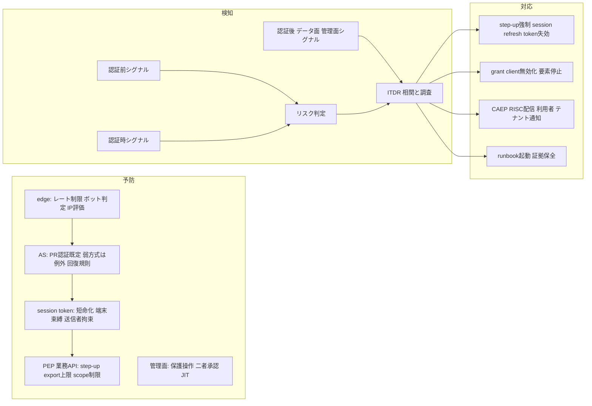

# 不正・濫用対策

> 文書ID: THR-04 / 版: 0.2 / 状態: draft / 最終更新: 2026-10-15（0.2: 模擬パネル ラウンド 5 の redteam 指摘により、FA-19（deepfake・映像注入による遠隔本人確認の突破）、§4.4、試験案 23、新規仮定 6 を追加。末尾の「レビュー記録」）
> 対応要求: G-062, R-176, R-188.7（対応成果物欄に本書のパスまたは DL-52 を含む全件）／関連: R-012, R-042（traceability/deliverables.md の DL-52 行が挙げる R）／入力供給のみ: R-006, R-030, R-031, R-045, R-114, R-135, R-166〜R-168, R-188, R-258
> 依存文書: CONVENTIONS.md, traceability/deliverables.md, traceability/R-requirements.md, traceability/G-goal-criteria.md, traceability/dissent-log.md（DS-13）, traceability/claims-ledger.md（CL-0183, CL-0205, CL-0273）, 01_governance/assumptions-register.md, research/RS-13-fraud-abuse.md, research/RS-03-identity-lifecycle.md, research/RS-12-incident-casebook.md, research/RS-14-b2b-customer-identity.md（各 research/verification/RS-xx-verification.md を含む）, 03_threat-model/attacker-model.md（DL-51）, 03_threat-model/threat-catalog.md（DL-11）, 02_requirements/operation-risk-tiers-assurance.md（DL-09）, 04_architecture/fail-mode-matrix.md（DL-19）, 05_adr/ADR-003-account-recovery-authenticators.md, 05_adr/ADR-029-privileged-support-access.md, 07_slo/numeric-contracts.md（DL-20）, 08_operations/compromise-runbooks.md（DL-24）, 12_poc/preregistered-test-plan.md（DL-22）

## 0. 結論

1. 不正・濫用対策は三層で組む。予防層はフィッシング耐性認証の既定化、弱い経路の封鎖、session と token の束縛である。検知層は認証前・認証時・認証後に加えてデータ面と管理面を見る。対応層は失効・停止・通知・runbook を一連にする [D]（RS-13#1〜#6、#17、#69 から導出）。
2. 攻撃者は、残っている最も弱い経路を使う。回復、ヘルプデスク、SMS の fallback、device code、利用者同意がその経路である。これらは既定で閉じ、テナントが明示的に許可したときだけ開く例外にする [D]（RS-13#6、#25、#29、#48、#57 から導出）。前提台帳の仮置きでは、自社で認証する 47.5万人のうち約 44.2万人がフィッシング耐性認証器を持たない。このため、移行期間中に弱い方式をどう扱うかを決裁案 2 とした [D][A-115]。
3. 大量 export、第三者 grant、break-glass、support・運用者の操作は、正規の資格情報で行われるためログイン時のシグナルでは見分けにくい [D]（RS-12#37、#41、#65 から導出）。LastPass は、警報とログが有効だったにもかかわらず、攻撃者が正規の資格情報を使っていたため正当な活動と区別するのが難しかったと報告している [I]（RS-12#65）[^58]。本書では、主体ごとの読取量、grant の利用状況、管理操作の承認経路をデータ面と管理面で監視する [D]。
4. 主要な検知の一部（AiTM、漏えい資格情報、移動の不可能性など）は事後（offline）判定である [V]（RS-13#69）[^44]。そのため、検知から全 session・refresh token・grant の失効、CAEP/RISC の配信、通知までにかかる時間を数値契約の候補にし、PoC で分布を測る [D]。目標値は TBD である [D]。
5. 誤検知と利便性の釣り合いは、公開されている実測値からは決められない [D]（RS-13#74〜#76 から導出）。推奨案は、操作 5 分類（public/read-sensitive/write/privileged/break-glass）ごとに、摩擦と見逃しのどちらを許容するかを配分する方式である。決めるのは事業責任者（残余リスクの受容）と CISO である [D]（決裁案 1）。
6. ITDR は製品の分類ではなく、運用機能として定義した。中身は session 監視、継続評価、IdP 構成の改変検知、自動対応である [D]（RS-13#72 から導出）。§12 に、MITRE ATT&CK v19.2 の 27 技術と 19 の濫用シナリオの対応表を置いた [V][^69]。
7. 本書が机上で定めたのは、G-062・R-176・R-188.7 に対する統制、検知指標、試験案である。PoC による検知の確認（C）、ヘルプデスクへのソーシャルエンジニアリング演習の第三者評価（D）、特権濫用を許容する方針の経営決定（B）は、いずれも未達である [D]。

## 1. 位置付けと範囲

### 1.1 本書が扱うもの・扱わないもの

- 本書は DL-52 にあたる。対象は脆弱性ではない濫用経路で、正規の機能、正規の資格情報、人が介在する手続を使うものである。これに対する抑止・検知・対応の統制と検知指標を定める [D]。
- 脆弱性に起因する脅威（token 検証漏れ、tenant confusion、BOLA など）は DL-11（threat-catalog）で扱う。本書の FA-xx は本書の中だけで使う番号である。T-xxx（DL-11）、C-xxx（DL-28）、K-xx（DL-06）、SLI-xxx（DL-20）、TC-xxx（DL-22）、RB-xx（DL-24）との対応付けは、各成果物が採番するときに行う [D]。
- 本書の中で閉じるのは、閉じ方 A（机上）の部分だけである。B は決裁案まで、C は試験案まで、D は第三者評価の範囲を指定するところまでを置く [D]。
- 本書の起草には AI エージェント（Claude）を用いた [D]。根拠は二種類ある。一つは research/ の検証済みノートである。もう一つは本書の作成時に原典を直接取得して確かめた資料で、ATT&CK の技術ページ（RS-13#44 にない 11 技術、および全 27 技術の戦術欄）、OWASP OAT 4 件、Microsoft の緊急アクセスアカウント文書、Entra の既定ユーザー権限の文書（「Guests can invite」の記述）、OpenID Foundation の承認告知がこれにあたる。後者は、作成者以外による照合がまだ済んでいない [D]。

### 1.2 濫用シナリオ（FA-01〜FA-19）

ATK-xx の番号は、DL-51 の対象欄に並んだ順（外部攻撃者＝ATK-01 …… リージョン障害＝ATK-12）を仮に当てはめたものである。DL-51 が確定した時点で照合する [D]。

| FA | 濫用シナリオ | 主な攻撃者類型 | 主な到達点 | G-062 の列挙との対応 |
|---|---|---|---|---|
| FA-01 | credential stuffing | ATK-01 | 自社認証利用者の ATO | 漏えいした資格情報の大量試行 |
| FA-02 | password spraying | ATK-01 | 同上（低速・分散） | 同上 |
| FA-03 | AiTM フィッシング | ATK-01→ATK-05 | session cookie・token の窃取 | （R-168 フィッシング耐性） |
| FA-04 | MFA 疲労（push bombing） | ATK-01 | ATO | — |
| FA-05 | SIM スワップ | ATK-01 | SMS OTP・回復の乗っ取り | 回復の濫用 |
| FA-06 | ヘルプデスクへのソーシャルエンジニアリング | ATK-01（ATK-09 を欺く） | 要素リセット→ATO・特権奪取 | 回復の濫用 |
| FA-07 | セルフサービス回復の濫用 | ATK-01、ATK-03 | ATO | 回復の濫用 |
| FA-08 | device code phishing | ATK-01→ATK-05 | access/refresh token | — |
| FA-09 | consent phishing（悪性 OAuth アプリ） | ATK-01、追加類型候補「侵害された第三者連携アプリ」 | grant・データ | 第三者 grant の過剰権限 |
| FA-10 | session・cookie の窃取（infostealer、HAR 等） | ATK-01、ATK-05、ATK-09 | session | — |
| FA-11 | bot による大量登録・自動化 | ATK-01 | 偽アカウント群 | bot による大量登録 |
| FA-12 | 偽装登録（他人・他組織を装う登録、自動 linking の悪用） | ATK-01、ATK-02 | 事前乗っ取り、テナント越境 | 偽装登録 |
| FA-13 | 招待スパム | ATK-02、ATK-03、FA-11 の偽アカウント | 基盤を踏み台にしたフィッシング・スパム | 招待スパム |
| FA-14 | 正規資格情報による大量 export | ATK-03、ATK-05、ATK-09、内部者 | 顧客データ | 大量 export |
| FA-15 | 第三者 grant の過剰権限 | 追加類型候補「侵害された第三者連携アプリ」、ATK-02 | 顧客データ・テナント設定 | 第三者 grant の過剰権限 |
| FA-16 | break-glass の濫用 | ATK-08、ATK-09、ATK-02（テナント側） | 管理面の全権 | break-glass の濫用 |
| FA-17 | 内部不正（support・運用者・委託先） | ATK-09、ATK-08（ATK-10・ATK-11 は DL-11） | 顧客データ・特権操作 | （R-012 特権濫用） |
| FA-18 | 認証・回復エンドポイントへの過負荷 | ATK-01 | 可用性、悪意あるロックアウト | 認証・回復エンドポイントへの過負荷攻撃 |
| FA-19 | deepfake・映像注入による遠隔本人確認の突破（helpdesk の映像確認、再本人確認、管理者が 1 名のテナントの回復の契約手続） | ATK-01（ATK-09 を欺く） | テナント管理者の新設→テナント設定の書換え・ATO | 回復の濫用（模擬パネル ラウンド 5 で追加） |

- 上表の割当は、RS-13・RS-12・RS-14 の事例と規範から導いた設計推論である [D]。

### 1.3 前提と新規仮定

| A-ID | 値（基準シナリオ、仮置き） | 本書での使い方 |
|---|---|---|
| A-001, A-002 | 登録 100万人（B2B 70万／B2C 27万／従業員・委託先 3万） | 規模。B2C の比率が高いほど回復と bot 対策の負荷が増える [A-002] |
| A-082 | 顧客 IdP 連携テナント 2,000（B2B 利用者の 75%） | federation 利用者は 70万 × 0.75 = 52.5万人 [D][A-002, A-082] |
| A-115 | 自社認証の人間利用者 47.5万人。password のみ 55%、password＋OTP 38%、フィッシング耐性あり 7% | フィッシング耐性のない利用者は 47.5万 × 0.93 ≒ 44.2万人 [D][A-115] |
| A-041, A-048 | 平常ログイン 51/秒、攻撃時ログイン試行 5,115/秒、全 session 失効後の再ログイン集中 556/秒 | edge が受け止める容量の設計目安、一斉失効の段階化 [A-048] |
| A-034, A-033 | 攻撃時の上乗せ 100 倍（設計目安のみ）、全 session 失効後 60 秒間に再ログインする比率 30% | 同上 [A-034, A-033] |
| A-013 | 外部 client 800、有効 grant 3万 | grant の棚卸しと一括失効の規模 [A-013] |
| A-011 | 社内 service account 1,200 | 内部の非人間主体の監視対象 [A-011] |
| A-007 | B2B テナント 1万 | テナント通知の宛先数 [A-007] |
| A-060, A-080 | 法域は日本・EU・英国・米国。B2B の業界構成は一般 75／金融 10／医療 7／公共 5／決済 3% | 規制プロファイル（§7.5）[A-060, A-080] |
| A-054 | 認証・認可プラットフォームチーム 24 FTE（うち鍵管理・セキュリティ 2） | ITDR 要員の過不足（新規仮定 5）[A-054] |

前提台帳にない仮定は次のとおりである。いずれも**新規仮定（前提台帳へ追加要）**であり、値は置かない [D]。

| 新規仮定 | 内容 | 値 | 所有者・期限・決め方 |
|---|---|---|---|
| 新規仮定 1 | テナント管理者以外の利用者も招待でき、招待メールは本基盤が送る | 招待数の分布は TBD | プロダクト責任者／G1／As-Is（DL-50）の送信実績 |
| 新規仮定 2 | 顧客サポートと社内 IT ヘルプデスクが、要素リセットと回復の依頼を受け付ける | 依頼件数は TBD | サポート責任者＋CISO／G1／As-Is の問合せ統計 |
| 新規仮定 3 | 業務サービスが一括 export や Bulk API 相当の機能を提供し、正規の一括取得が存在する | 量の分布は TBD | CTO＋各ドメイン責任者／G3／As-Is と PoC |
| 新規仮定 4 | 通信事業者の SIM 変更・番号ポータビリティの信号は、一般には取得できない前提で設計する。取得できる法域・事業者では追加のシグナルとして使う | — | CISO／G3／調達・法務が取得可否を確認 |
| 新規仮定 5 | ITDR の 24/365 監視は A-054 の内訳に含まれておらず、社内または委託の SOC と分担する | 要員は TBD | CISO／G3／DL-43・DL-27 と合わせて決める |
| 新規仮定 6 | B2B テナント約 1 万（A-007）のうち、顧客管理者が 1 名で break-glass アカウント（PC-08(b)）を持たないテナントの比率。FA-19 の攻撃面の大きさを決める | 比率は TBD | 事業責任者（B2B）／G1／As-Is のテナント設定（DL-50）。DL-08 の IL-N7、ADR-003 の NA-003-1 と同じ量であり、前提台帳には 1 件として登録する |

## 2. 層構造（予防・検知・対応）

### 2.1 設計原則

1. **最弱経路の原則。** 63B-4 は PSTN（SMS・音声）を restricted authenticator としている。これを受け入れる CSP には、制限のない代替方式の提供、リスクの通知、移行計画を SHALL として課している [N]（RS-13#6）[^1]。CISA は、authenticator app を登録しても SMS は自動では解除されず、悪用可能な弱い fallback になると注意している [I]（RS-13#25）[^7]。したがって、主体の認証強度は、回復・fallback・ヘルプデスク・device code・同意を含めて残っている全経路のうち最も弱いもので評価する [D]（RS-13#6、#25 から導出）。
2. **フィッシング耐性を既定にする。** 63B-4 は、AAL2 でフィッシング耐性のある選択肢を少なくとも一つ提供することを SHALL とし、手入力の OTP と out-of-band をフィッシング耐性とみなすことを SHALL NOT としている [N]（RS-13#2、#4）[^1]。CISA は、広く使えるフィッシング耐性方式は FIDO/WebAuthn だけだとしている [I]（RS-13#23）[^5]。金融庁の監督指針（金融商品取引業者等向け、保険会社向け）と日本証券業協会のガイドラインは、ログイン・出金・出金先変更などの重要操作で、フィッシング耐性 MFA を実装し既定設定にすることを挙げている [N]（RS-13#33、#33a、#35）[^14][^15][^16]。本基盤は全テナントでフィッシング耐性方式を既定にする [D]。
3. **回復を独立した統制として扱う。** 63B-4 は、人手による回復にはソーシャルエンジニアリングのリスクがあると述べている（informative）[N]（RS-13#18）[^1]。DS-511 は、回復手段を当人認証手法と同等以上の強度で選ぶよう求めている [N]（RS-03#41）[^68]。DS-511 は行政手続向けのガイドラインであるため、本基盤では参照基準として扱う [D]。
4. **MFA を通過した後の窃取を前提にする。** ATT&CK は、窃取した session cookie で一部の MFA を迂回できると記載している [V]（RS-13#47）[^80]。DBSC の W3C 公表版は 2025-08-21 の First Public Working Draft だけで、状態は draft である [N]（RS-13#63）[^41]。仕様自身も、端末に常駐するマルウェアは防げないと明記している [N]（RS-13#64）[^42]。Google は、ソフトウェアだけで cookie の持ち出しを確実に防ぐ方法はどの OS にもないと述べている [V]（RS-13#66）[^43]。そのため、短い session 寿命、再認証、送信者拘束、異常検知、即時失効を重ね、DBSC は対応ブラウザで有効にする追加の層と位置付ける [D]（RS-13#16、#63〜#67 から導出）。
5. **検知の多くは事後判定だと前提する。** Microsoft Entra ID Protection は、AiTM と漏えい資格情報の検知を offline に分類している [V]（RS-13#69）[^44]。63B-4 は、session 中に不正の可能性を検知した RP が、再認証・session 終了・担当者への通知を行うことを SHOULD としている [N]（RS-13#17）[^1]。本基盤では、検知から失効と通知までを一連の手順にし、その所要時間を数値契約にする [D]。
6. **正規資格情報の濫用はデータ面と管理面で見る。** 大量 export・grant・break-glass・内部不正は、ログイン時には正常に見える [D]（RS-12#37、#41、#65 から導出）。
7. **濫用対策の障害範囲を閉じ込める。** ATT&CK は、厳しすぎるロックアウトがサービス妨害を招くと記載している [V]（RS-13#46）[^75]。レート制限・ボット判定・リスク判定は cell とテナントの単位で動かし、一つのテナントへの攻撃が他のテナントのログインを止めないようにする [D]（RS-13#8、#46、#51 から導出）。
8. **プライバシー・アクセシビリティ・説明責任を守る。** シグナルの収集はプライバシーリスク評価の対象とし、AI/ML を使う場合は依拠する RP に開示する（§6.3）[N]（RS-13#17、#20）[^1][^2]。
9. **継続的に評価する。** SP 800-63-4 は、脅威と不正手口を監視し、不正検知能力の有効性を定期的に評価し、指標に基づく継続改善プログラムを実施することを SHALL としている [N]（RS-13#19）[^2]。

### 2.2 層と配置

| 層 | 位置 | 予防 | 検知 | 対応 |
|---|---|---|---|---|
| 層 1 edge | AS の前段（cell 単位） | レート制限、ボット判定、匿名化サービスの評価 [D] | 送信元別・アカウント横断の失敗集計 [D] | 段階的な遅延、challenge、一時遮断 [D] |
| 層 2 認証 | AS・IdP | フィッシング耐性方式の既定化、弱い方式の例外化、漏えい照合、回復規則 [D] | 認証時のリスク判定 [D] | step-up、拒否、通知 [D] |
| 層 3 session・token | AS・BFF・PEP | 寿命、cookie 属性、送信者拘束、refresh token rotation [D] | 再利用、ASN・端末の変化 [D] | 失効、CAEP 配信 [D] |
| 層 4 業務 API・データ面 | PEP・業務サービス | step-up、export の上限、scope の制限 [D] | 主体ごとの読取量・速度 [D] | 抑制、grant の失効 [D] |
| 層 5 管理面 | 管理コンソール・support ツール | 保護操作、二者承認、JIT [D] | 管理イベントの監視 [D] | 取消、停止 [D] |
| 層 6 ITDR | SOC・ITDR | — | 相関と調査 [D] | runbook、通知、自動対応（§10.3）[D] |

### 2.3 自社認証の利用者と federation 利用者の違い

- 自社で認証する 47.5万人には、層 2 の統制をすべて適用できる [D][A-115]。
- federation 利用者 52.5万人の認証器と回復は顧客 IdP が管理する。基盤が関与できるのは、assertion の acr/amr と FAL の検証、認証後の検知、顧客 IdP 単位の遮断である [D][A-002, A-082]（RS-03 結論 12、RS-14 結論 4 から導出）。
- 63C-4 は、IdP が結果の xAL を assertion に示すことを SHALL としている [N]（RS-13#22）[^4]。ただし Entra ID の amr は、同期 passkey と device-bound passkey をどちらも `fido, mfa` と表すため区別できない [V]（RS-03#27）[^49]。そこで、高リスク操作で RP 側の束縛認証器（FAL3 相当）を求めるかどうかを ADR-002 で比較する [D]（RS-14 結論 4 から導出）。
- 責任分界の案は「顧客 IdP の運用と一次対応は顧客、異常の検知・通知・封じ込め支援・証跡の提供は事業者」である。これは RS-14 §5.2 の起案骨子であり、採否は法務が決める [D]（RS-14#60〜#66 から導出）。

## 3. 認証経路の乗っ取り（ATO）系の統制

### 3.1 フィッシング・窃取・疲労攻撃（FA-01〜FA-05、FA-08〜FA-10）

| FA | 予防 | 検知 | 対応 | 根拠 |
|---|---|---|---|---|
| FA-01 credential stuffing | パスワードの設定・変更時に、漏えいコーパスを含む blocklist と照合する（63B-4 SHALL）[N]。フィッシング耐性方式を既定にして password への依存を減らす [D]。edge で、アカウント・送信元・ASN 単位に段階的な遅延をかける [D]。失敗時の応答から、有効な利用者を推測させない（ASVS 6.3.8、L3）[N]。 | 登録・ログオン・リセット・再認証のすべての機能とチャネルで成否を記録し、平常時との比で監視する（OAT Handbook の対策例、非規範）[N]。漏えいリストに一致したアカウントのログイン成功や、新しい端末・匿名化サービスからのログイン成功を高リスクとして扱う [D]。 | 漏えい資格情報に含まれるアカウントを事前にリセットする（ATT&CK M1018）[V]。侵害の証拠があればパスワードの変更を強制する（63B-4 SHALL）[N]。正しいパスワードの後に MFA で失敗した利用者には通知する（OWASP の例、非規範）[N]。 | RS-13#9、#46、#51〜#54 [^1][^75][^33][^34][^31] |
| FA-02 password spraying | FA-01 と同じ [D]。非本番や旧来のものを含め、すべてのテナントに同じ認証要件を課す [D]（RS-12#15〜#18 から導出）。 | 複数アカウントにまたがる失敗を、短期と長期の両方の時間窓で集計する [D]。IP の遮断を単独の主防御にしない（OWASP、原文は小文字の should）[N]。 | 標的になったアカウント群にフィッシング耐性方式での step-up を強制する [D]。送信元の遮断は一時的なものにする [D]。 | RS-13#46、#51、#62 [^74][^33][^54] |
| FA-03 AiTM | origin に束縛される WebAuthn/passkey と PKI を既定にする [D]。手入力の OTP と承認型 push はフィッシング耐性とみなさない（63B-4 SHALL NOT）[N]。session cookie には HttpOnly、`__Host-` 接頭辞、SameSite を付ける（SHOULD）[N]。 | 同じ session や refresh token が別の ASN・端末から使われた場合と、ログイン直後に要素の追加や回復情報の変更があった場合を高リスクとして扱う [D]。 | 全 session と refresh token を失効させ、追加された要素を停止し、CAEP の session-revoked を配信する [D]。 | RS-13#4、#16、#27、#47、#80 [^1][^9][^78][^84][^61] |
| FA-04 MFA 疲労 | 承認するだけの push は使わない（63B-4 は、一次経路の秘密を二次経路へ転記させることを SHALL としている）[N]。push の送信回数・送信率に上限を設ける（SHOULD）[N]。number matching は、フィッシング耐性方式へ移るまでの暫定策と位置付ける（CISA）[I]。 | 短時間に push が多発する、拒否が続く、不審な MFA 承認がある、といった状態を検知する（Entra は不審な MFA 承認を real-time の検知に分類している）[V]。 | push を止めてフィッシング耐性方式での step-up に切り替え、否認時の連絡先を記した通知を送る [D]。 | RS-13#5、#24、#45、#69、#79 [^1][^6][^83][^44][^60] |
| FA-05 SIM スワップ | SMS と音声は restricted authenticator として扱い、テナントが明示的に許可した場合に限って使える例外にする [D]。これには 63B-4 の SHALL 義務（代替方式の提供、リスクの通知、移行計画）が伴う [N]。特権者の認証と回復には使わない [D]。電話番号の設定・変更は、新しい認証器の binding として扱う（SHALL）[N]。より強い方式が登録された時点で SMS を自動的に無効にする [D]（CISA の注意から導出）。 | PSTN で秘密を送る前に、端末の交換・SIM 変更・番号ポータビリティなどのリスク指標を考慮する（SHOULD）[N]。番号の変更直後に行われた回復は高リスクとして扱う [D]。 | PSTN 経路を一時停止し、回復を保留する [D]。 | RS-13#6、#25、#32 [^1][^7][^13][^98] |
| FA-08 device code | device code フローは既定で無効にする [D]。許可する場合の条件は、実装前のリスク評価（MUST）、§6.1 から緩和策を選ぶこと（MUST）、近接性の確認（SHOULD）であり、機微な資源や高価値の資源には使わない（RFC 10027）[N]。代替手段として、FIDO のクロスデバイス認証と authorization code＋PKCE の組合せを優先する [D]。認可の画面では端末の情報を表示する（RFC 8628 SHOULD）[N]。 | テナントが例外を許可していないのに device code が開始された場合、user code の入力元と polling 元とで地理や ASN が一致しない場合、新しい device code grant から大量のアクセスがある場合を検知する [D]。 | 悪用されたコードで発行した token をすべて無効にし、CAEP などで resource server に通知する（RFC 10027 §6.1.6 の MAY を採用する）[N][D]。 | RS-13#29、#50、#56〜#59 [^11][^22][^23][^46][^71] |
| FA-09 consent phishing | 利用者による同意は、検証済みの発行元と低リスクの scope に限り、それ以外は管理者による同意にする [D]（ATT&CK M1021 と Microsoft の推奨から導出）。自動でリダイレクトするのは信頼済みの redirect URI だけにする（RFC 9700 SHOULD）[N]。連携を作成した者を検証して表示し、利用者が接続できる第三者連携を管理者が制御できるようにする（SSCF IPY-SaaS-02、IAM-SaaS-19、must）[N]。 | 新しい client への同意の急増、高い scope への同意、同意の直後に起きる大量読取り（FA-14）を検知する [D]。 | client を無効にし、既に発行済みの access token も失効させる [D]。Microsoft の文書は、悪性アプリを無効にした後も既存の access token は期限まで有効だと記載している [V]。本基盤では、access token の短寿命化か introspection での拒否によって、この残存期間をなくす [D]。 | RS-13#48、#60〜#62、RS-14#50 [^77][^85][^24][^45][^65] |
| FA-10 session・cookie の窃取 | bearer として使う session 秘密は永続化しない（SHOULD NOT）。AAL ごとの再認証の上限を守る [N]。管理者の session はネットワーク位置または端末に束縛する [D]（Okta の是正策から導出）。support に添付された HAR などのファイルからは、受領時に資格情報と cookie を取り除く [D]。public client の refresh token は、送信者拘束するか rotation を使う（RFC 9700 MUST）[N]。 | 同じ session が別の ASN や端末から使われた場合と、refresh token が再利用された場合を検知する [D]。 | session と refresh token を失効させ、再認証を求める [D]。 | RS-13#16、#47、#63〜#68、RS-12#22、#25、#46、#62 [^1][^78][^80][^52][^59][^24] |

上表の根拠となった事実を、事故の一次報告から補う。

- Star Blizzard はオープンソースの EvilGinx を使って資格情報と session cookie を収集し、二要素認証を迂回した [I]（RS-13#27）[^9]。Cloudflare では、1 分足らずの間に 76 人の従業員へ偽のログインページに誘導する SMS が届き、3 人が資格情報を入力した。それでも、全従業員に origin binding を持つ FIDO2 キーを必須にしていたため、攻撃者はログインできなかった [I]（RS-13#80）[^61]。
- Uber の事後報告によると、攻撃者がログインを繰り返して二要素の承認要求を送り続け、最終的に委託者が承認した [I]（RS-13#79）[^60]。
- Midnight Blizzard は、少数のアカウントに絞って試行回数を抑え、住宅用プロキシ網を経由した。Microsoft は、これによって従来型の IOC ベースの検知が実行不能（infeasible）になったと記している [I]（RS-13#62）[^54]。
- Okta では、サポートシステム内の HAR ファイルに含まれていた session token が使われ、5 顧客の session が乗っ取られた [I]（RS-12#22）[^52]。CircleCI では、マルウェアが 2FA 済みの SSO session を盗んだ [I]（RS-12#46）[^59]。
- FBI は、device code を悪用する PhaaS「Kali365」について警告し、device code フローを業務上必要な例外を除いて全利用者に対して遮断するよう推奨した [I]（RS-13#29）[^11]。Microsoft も、device code フローは可能な限り遮断するよう推奨している [V]（RS-13#59）[^46]。
- 米国の 47 CFR 64.2010(h)（SIM 変更前の顧客認証）は、eCFR（2026-10-01 時点の版）上で遵守日が定まっていない [N]（RS-13#32）[^13]。したがって、SIM スワップへの対策を通信事業者の規制に依存することはできない [D]。

### 3.2 自動化と過負荷（FA-11、FA-18）

| FA | 予防 | 検知 | 対応 | 根拠 |
|---|---|---|---|---|
| FA-11 bot による大量登録 | 送信元・端末・メールドメインの単位で登録の速度を制限し、非対話型の手法を優先してボットを判定する [D]。CAPTCHA は障害のある人の手続を妨げることが多いため、既定の手段にはしない（W3C Note、非規範）[N]。Privacy Pass は、ボットでないことを示す低品質のシグナルとして扱う（RFC 9576、Informational）[N]。上位の保証階層では、63A-4 の不正チェック（SIM スワップの検知、端末・アカウントの保有期間、端末指紋など。SHOULD）を本人確認に組み込む [N][D]。 | OAT-019 は Account Creation を「後で悪用するために複数のアカウントを作ること」と定義している（非規範）[N]。登録の速度と、登録後の行動（招待・投稿・export）を併せて監視する [D]。 | 確認が済んでいないアカウントの機能を制限し、同じ起点からの登録をまとめて停止する [D]。 | OAT-019、RS-13#8、#21、#51、#77、#78 [^35][^1][^3][^33][^40][^39] |
| FA-18 認証・回復エンドポイントへの過負荷 | edge の admission control は、攻撃時のログイン試行 5,115/秒を設計目安として設計し、password hash の計算資源を守る [D][A-034, A-048]。ハードなロックアウトよりも段階的なスロットリングを優先し、悪意あるロックアウトの防止策を文書化する（ASVS 6.1.1、L1）[N]。回復エンドポイントにも同じ制限を置く [D]。 | エンドポイントごとの要求率とロックアウト件数を、平常時と比べて監視する [D]。FFIEC は、ロックアウト件数の変化を見る異常検知を例示している [N]。 | ボット判定を要求する、負荷を制限する、cell 単位で隔離する、という手段で縮退させ、アカウントの一斉ロックは避ける [D]。 | OAT-015、T1499.003、RS-13#31、#46、#54 [^37][^97][^12][^31][^75] |

- OAT-015 は、Denial of Service の別名に「Account lockout」を含めている（非規範）[N][^37]。ロックアウトを強めると、それ自体が攻撃者の道具になる [D]。

## 4. 回復・サポート・登録経路の濫用

### 4.1 セルフサービス回復の濫用（FA-07）

規範上の要求は次のとおりである。

| 要求 | 強度 | 根拠 |
|---|---|---|
| AAL2 の回復では、次のいずれかを求める。(a) 異なる方法で得た回復コード 2 つ、(b) 回復コード 1 つと、アカウントに紐づく単一要素認証器での認証、(c) 本人確認のやり直し（本人確認済みのアカウントに限る） | SHALL | 63B-4 §4.2.2.2 [N]（RS-13#12、RS-03#39、DS-13）[^1] |
| 回復を行ったら、必ず利用者またはその代理人へ通知する | SHALL | 63B-4 §4.2.3 [N]（RS-13#12）[^1] |
| 通知は郵便を除く全通知先へ送り、否認する場合の連絡先を記載する | SHALL | 63B-4 §4.6 [N]（RS-13#13）[^1] |
| 発行型回復コードの有効期間は、SMS・音声で最大 10 分、電子メールで最大 24 時間 | SHALL | 63B-4 §4.2.1 [N]（RS-13#11）[^1] |
| アプリ固有の回復方式（担当者とのやり取りなど）を使ってよいが、リスク分析に基づいて文書化する | MAY／SHALL | 63B-4 §4.2.1 [N]（RS-13#11、RS-03#37）[^1] |
| パスワードのリセットで有効な MFA を迂回させない | Verify（L2） | ASVS 6.4.3 [N]（RS-13#54）[^31] |
| 認証に影響する属性（メール、電話番号、MFA 設定、回復情報）を変更する前に、完全な再認証を求める | Verify（L2） | ASVS 7.5.1 [N]（RS-13#55）[^32] |

本基盤の設計（案）は次のとおりである。

- **回復後の保留。** 回復を終えた主体は、保留期間のあいだ、privileged と break-glass の操作、大量 export、回復情報・通知先の変更、新しい第三者同意を行えないようにする [D]（RS-13 §5.1 の ADR-003 行「回復後の一定期間の権限制限」から導出）。保留期間の長さは TBD とする（所有者: CISO＋プロダクト責任者、期限: G4、決め方: §13.3 で測る不正回復検知時間の分布を上回る長さを候補とし、正規の利用者の作業が止まる影響を BIA で評価する）[D]。
- **回復時のリスク判定。** 新しい端末、新しい ASN、直近の電話番号変更、直近の通知先変更、同じ起点からの多数の回復を高リスクとして扱う。高リスクの回復は、待機時間と追加の確認に回す [D]（RS-13#6、#17 から導出）。
- **否認への自動対応。** 回復の通知に対して否認を受けたら、回復を取り消し、追加された要素を停止し、全 session を失効させる。これらは自動で行う [D]。
- **federation 利用者。** federation 利用者の回復は顧客 IdP 側で行う。本基盤には回復の経路を置かず、基盤側にローカルの資格情報も作らない [D]（RS-14 §5.2 の分界案から導出）。
- **検知。** 回復の試行数（SP 800-63-4 の推奨指標、SHOULD）、回復直後の要素追加・export・同意、回復の起点の集中を監視する [N][D]（RS-13#19）[^2]。

### 4.2 ヘルプデスクへのソーシャルエンジニアリング（FA-06）

事実（一次報告と規範）:

- CISA・FBI などの共同勧告 AA23-320A は 2025-07-29 に改訂された。その Technical Details は、IT ヘルプデスク担当者を電話で欺いてパスワードを再設定させ、MFA トークンを移させる手口を、勧告自身の記述として述べている [I]（RS-13#26、RS-12#48）[^8]。
- Okta の Defensive Cyber Operations の報告によれば、複数の顧客で、service desk が高権限の利用者の全 MFA をリセットするよう誘導された。攻撃者は 2 つ目の IdP を「impersonation app」として構成していた [I]（RS-14#7）[^51]。同報告は、検知の手段として、IdP の作成イベントと全 factor リセットの監視を挙げている [V]（RS-14#8）[^51]。
- Okta は、特権アカウントのパスワードや要素をリセットする前に、ヘルプデスクでの本人確認（視覚的な確認など）を見直すよう推奨した [I]（RS-12#26）[^53]。英国 NCSC も、ヘルプデスクのパスワード再設定手順を見直すよう推奨している。特に、高い権限を持つ要員をどう本人確認するかを挙げている [I]（RS-13#28）[^10]。
- FFIEC のガイダンスは、資格情報を再設定するときの強化認証の例として、事前登録した端末への OTP、事前登録した番号へのコールバック、ビデオによる確認を挙げている [N]（RS-13#31）[^12]。ただし、FFIEC のサイト上での現行性は確認していない（RS-13 §6）[D]。
- 63B-4 の脅威の節（informative）は、ソーシャルエンジニアリングへの対策として、顧客サービス担当者などの第三者にソーシャルエンジニアリングのリスクを生じさせる認証器を避けることを挙げている [N]（RS-13#18）[^1]。
- MGM の侵入がヘルプデスク経由だったことは、一次報告では確認できていないため、根拠に使わない [D]（RS-12#52）。ヘルプデスクの本人確認手段について、その効果を定量化した一次資料は見つかっていない [D]（RS-13 §6）。

ヘルプデスクでの要素リセット手順（案）:

| 段階 | 一般利用者 | テナント管理者・特権者・従業員の管理者 |
|---|---|---|
| 受付 | 氏名・生年月日・社員番号などの知識情報だけで本人と判断しない [D] | 同左 [D] |
| 本人確認 | 事前登録した番号へのコールバック、または事前登録した端末への確認要求で確かめる [D] | 左の確認に加えて、テナントの別の管理者による確認（二者）を行う。映像による確認は補助の材料にとどめ、遠隔の映像だけでは本人と判断しない（§4.4）。別の管理者がいないテナントは DL-08 §11.5.1 の手続による [D] |
| 実行 | 新しい要素の登録はセルフサービス経路で利用者本人に行わせ、担当者は要素を代わりに登録しない [D] | 同左。加えて待機時間を置く（長さは TBD）[D] |
| 通知 | 全通知先へすぐに通知する（否認の窓口を記載する）[D] | 左に加えて、テナントのセキュリティ連絡先へも通知する [D] |
| 記録 | 通話やチケットと結びつけて記録する [D] | 左に加えて、ITDR へ高リスクのイベントとして送る [D] |
| 事後 | 回復後の保留（§4.1）を適用する [D] | 同左 [D] |

- **検知。** 次の三つを検知する。一つ目は、ヘルプデスクを起点とする要素リセットに続いて、新しい端末からのログインや、要素・IdP の追加が連鎖する場合である（T1556.006、T1484.002）。二つ目は、同じ対象について問合せが複数回ある場合である。三つ目は、担当者ごとのリセット件数に偏りがある場合である [D]（RS-13#26、RS-14#8 から導出）。
- **ヘルプデスクのツール。** ヘルプデスクのツールでは session token と秘密情報を参照できないようにする [D]（RS-12#27 から導出）。
- **独立評価。** 手順の有効性は、独立した red team によるソーシャルエンジニアリング演習で評価する（R-042、閉じ方 D、DL-59）[D]。
- 決裁案 3（§14）で、ヘルプデスクがリセットできる範囲を決める [D]。

### 4.3 偽装登録（FA-12）

- OIDC Core §5.7 は、iss と sub の組だけを安定した識別子としている。email などの claim を一意の識別子に使うことは MUST NOT である [N]（RS-12#45）[^30]。そこで、利用者の識別は iss＋sub（Entra では tid＋oid に相当）に限り、email の一致による自動 linking は禁止する [D]（RS-03 結論 7・8 から導出）。
- 63C-4 §3.8.1 は、すべての linking 機能に認証済みの session を求め（SHALL）、既存の federated identifier による認証を経ることを SHOULD としている [N]（RS-14#4）[^4]。
- Scattered Spider は、過去に標的組織の SSO テナントへ federated IdP を追加し、自動のアカウント連結を有効にしていた [I]（RS-12#49）[^8]。同勧告は、この手口を現在の TTP としては確認していないとも記している [I]（RS-12#49）[^8]。本基盤では、IdP の追加と自動 linking の有効化を保護操作として扱う（§7.3）[D]。
- 登録時にはメールアドレスの確認を求める。確認が済むまでは、linking、招待の受諾、権限付与を受けられないようにする [D]。63B-4 はメールアドレスを out-of-band 認証に使うことを SHALL NOT としている。ただし、アドレス確認のための確認コードは認証ではないため、この禁止の対象外とされている [N]（RS-13#7）[^1]。
- テナントがドメインの所有を主張する場合は、DNS TXT で検証し、定期的に検証し直す [D]（RS-03 結論 11、RS-14 結論 6 から導出）。
- 上位の保証階層では、63A-4 の不正管理プログラム（SHALL）と不正チェック（SHOULD）を本人確認に組み込む [N]（RS-13#21）[^3]。
- **検知。** 同じ端末や送信元からの多数の登録、検証済みドメインに属するメールアドレスでの外部からの登録、テナント管理者の表示名に似せた登録を検知する [D]。
- **対応。** 確認が済んでいないアカウントを停止し、そのドメインを所有するテナントへ通知する [D]。

### 4.4 deepfake・映像注入による遠隔本人確認の突破（FA-19）

事実（規範と一次報告）:

- 63A-4 §3.14 は、attended・unattended の両方の遠隔本人確認に対する新しい攻撃が、digital injection と生成 AI のツールを組み合わせていると述べる [N][^3]。その AI は申請者や証拠書類の画像・映像（deepfake）を作り変え、書類の自動検証、生体照合、本人確認担当者による目視の比較を破るために使われる [N][^3]。注入攻撃は、取得点（端末）と比較を行う要素（サーバや担当者の端末）の間に、改変・偽造した媒体を差し込む [N][^3]。
- 同節は、本人確認の過程で媒体が正規のセンサーから得られたことの確からしさを高める技術的統制を、CSP に求めている（SHALL）[N]（RS-03#12）[^3]。例として、仮想カメラ、端末エミュレータ、jailbreak された端末の検出を挙げている [N][^3]。
- FinCEN は、2023 年から 2024 年にかけて、deepfake を使う詐欺の疑わしい取引の届出が金融機関から増えたと述べる [I][^101]。その多くは、偽造した身分証明書で本人確認と認証を迂回するものである [I][^101]。同警告は、映像・音声による live verification check を有効な実務に挙げつつ、攻撃者が合成の音声・映像で応答し得ることも認めている [I][^101]。警戒すべき兆候には、確認中の第三者 webcam プラグインの使用と、不自然な不具合を理由とする連絡手段の変更を挙げている [I][^101]。
- FFIEC は、資格情報の再設定時の強化認証の例として、事前登録した番号へのコールバックとビデオでの確認を併記している [N]（RS-13#31）[^12]。ビデオでの確認を単独で十分とは述べていない [D]。

攻撃経路（模擬パネル ラウンド 5 の redteam 指摘）:

- 管理者が 1 名で break-glass アカウントを持たないテナントでは、二者承認が成立しない [D]。このため顧客管理者の回復は、契約で定めた本人確認手続と発効遅延に落ちる [D]。手続を実行するのは事実上、事業者の要員である [D]。攻撃者が映像通話の deepfake や映像注入でこの確認を突破すると、テナント管理者を新しく作れる [D]。これは、service desk が誘導されて高権限利用者の全 MFA をリセットした事案（RS-14#7）[I][^51] を、遠隔映像の偽造で発展させた形である [D]。
- 通知先である「全管理者とセキュリティ連絡先」は、管理者が 1 名のテナントでは、乗っ取られる本人か未登録になり得る [D]。このため通知による取消が機能しない [D]。

統制（DL-08 §11.5.1 の SA-1〜SA-8 と同じ内容）:

| 層 | 統制 |
|---|---|
| 予防 | 遠隔の映像・画像による本人確認だけでは回復を成立させない。映像は補助の材料にとどめる（SA-2）[D]。映像を使う場合は、本人確認事業者に 63A-4 §3.14 の統制（正規センサーの確認、媒体の改ざん解析）を求め、調達の要件にする（ADR-001）[N][^3][D] |
| 予防 | 契約の締結時に記録した連絡先（契約上の署名者、請求先）へ、本基盤の記録から引いた宛先で事業者側から折り返す。依頼者が示した連絡先は使わない（SA-3）[D] |
| 予防 | 発効遅延の下限を区分別に置く（SA-4。値は DL-08 IL-D1）。回復の受付から制限期間の満了まで、テナント設定（IdP 連携、ドメイン、SCIM、越境付与、管理者の追加、break-glass、エクスポート）を凍結する（SA-5）[D] |
| 予防 | オンボーディングで管理者 2 名以上か break-glass アカウントを必須にする案を DL-08 IL-D9 に置いた（推奨は区分別）[D] |
| 検知 | 確認中の連絡手段の変更要求、仮想カメラ・プラグインの兆候（本人確認事業者の判定結果）、同じテナントへの短期間の繰り返しの依頼、回復の直後の IdP 追加・SCIM 資格情報の発行の試み（凍結で拒否されたもの）を ITDR の高リスクのイベントにする [D]（FinCEN の red flag[^101] と RS-14#8 から導出） |
| 対応 | 契約記録の連絡先・セキュリティ連絡先・既存の管理者の通知先へ、独立経路で取消の手段付きで通知する（SA-6）。否認を受けたら、回復を取り消し、新しい管理者を停止し、凍結を延長して調査する（§4.1 の否認への自動対応）[D] |

- 残余リスク: 契約記録の連絡先そのものが乗っ取られ、かつ本人確認事業者の注入検出も破られた場合は、この経路で管理者を作られ得る [D]。この残余リスクは THR-03 と残余リスク台帳（DCS-05）への起票を申し送った（§17）[D]。
- 映像による確認の効果を定量化した一次資料は見つかっていない（RS-13 §6）[D]。試験案 23 と DL-59 の演習で測る [D]。

## 5. 正規の資格情報・正規機能による濫用

本章が DL-52 の中核である [D]。この種の濫用は認証を正しく通過しているため、予防の主な手段は権限と量の上限、検知の主な手段は行動の平常比になる [D]。

### 5.1 大量 export（FA-14）

事実:

- UNC6395 は、遅くとも 2025-08-08 から少なくとも 08-18 まで、Salesloft Drift アプリに紐づく侵害済みの OAuth token を使い、多数の企業の Salesforce インスタンスから大量のデータを export した [I]（RS-12#37）[^55]。攻撃者は痕跡を隠すために query job を削除したが、ログは残っていた [I]（RS-12#37）[^55]。
- 被害者の一社である Cloudflare によれば、主な持ち出しは Bulk API 2.0 で行われ、所要時間は約 3 分だった [I]（RS-12#41）[^56]。
- AA23-320A によれば、Scattered Spider は Snowflake へのアクセスを探し、数千件の query で大量のデータを持ち出していた [I]（RS-12#50）[^8]。Mandiant は Snowflake 顧客環境の侵害の主因として、MFA の未設定、最長 4 年回転されていなかった資格情報、ネットワーク許可リストの欠如を挙げている [I]（RS-12#34）[^57]。
- CSA SSCF は、一括 export を含むイベントを人と NHI の双方について記録することを must としている（LOG-SaaS-01）[N]（RS-14#51）[^65]。OAT-011（Scraping）は、偽のアカウントや侵害されたアカウントが使われる場合があると記している（非規範）[N][^38]。

統制:

| 層 | 統制 |
|---|---|
| 予防 | export と Bulk API を、量を伴う read-sensitive 操作として扱う。一定量（TBD）を超える取得には step-up を求める [D]。主体ごと・テナントごとに件数と速度の上限を設ける（値は TBD、新規仮定 3）[D]。大量の取得は非同期ジョブにし、テナントの設定で管理者の承認を必須にできるようにする [D]。取得できる範囲は PDP の認可で限定する [D]。第三者 client では、一括取得の scope を通常の読取 scope と分ける（SSCF IAM-SaaS-18 は読取・書込・管理操作の scope を分けることを must としている）[N][D]。Connected App に IP 制限と session timeout を設定できるようにする（GTIG の推奨）[I][D]。 |
| 検知 | 主体ごとの読取件数・速度・対象範囲を平常時と比べる [D]。新しい client や新しい ASN からの一括取得を検知する [D]。export や query job の削除操作は監査ログの側で検知する [D]（RS-12#37 から導出）。機械主体（grant・service account）にも主体別の基準線を持たせる [D][A-011, A-013]。 |
| 対応 | export を抑制または停止し、当該 session と grant を失効させ、テナントへ通知し、証拠を保全する [D]。 |

- 指標は「大量 export を検知するまでの時間」と「検知から遮断までの時間」である。目標値は TBD とする（所有者: CISO、期限: G4、決め方: 約 3 分の一括取得を再現する試験案 13 の分布と BIA）[D]（RS-12#41 から導出）。

### 5.2 招待スパム（FA-13）

- CSA SSCF は、管理者以外による招待をロール単位で制限できる仕組み（IAM-SaaS-21）と、管理されていない外部利用者（ゲスト）を全体で無効にできる仕組み（IAM-SaaS-13、IAM-SaaS-14）を must としている [N]（RS-14#50、#59）[^65]。
- OAT-017（Spamming）は、壊れた form-to-email・form-to-SMS 機能を大量に悪用して意図しない宛先へメッセージを送らせる行為を、実装上の欠陥だけを突くものとみなし、OAT の分類の対象外と明記している（非規範）[N][^36]。そこで本書では、招待メールを任意の宛先に送らせる濫用を、運用で検知する前に、招待機能の設計で防ぐべき欠陥として扱う [D]。
- 金融商品取引業者等向けの監督指針は、メールや SMS にパスワード入力ページの URL やログインリンクを記載しないことを（代替手段がない場合を除き）着眼点に挙げている [N]（RS-13#34）[^14]。この規制プロファイルに当たるテナントでは、招待メール中のリンクに依存しない受諾経路を選べるようにする [D]。たとえば、利用者が既知の入口からログインして招待を受諾する方式である [D]。
- 日本証券業協会のガイドラインは、DMARC の reject ポリシー化をスタンダードとしている [N]（RS-13#35）[^16]。本基盤が送るメールの送信ドメイン認証を強制する [D]。

| 層 | 統制 |
|---|---|
| 予防 | 招待者ごと・テナントごとに招待数の上限を設ける（値は TBD、新規仮定 1）[D]。本文は定型にし、自由記述と任意の URL を入れられないようにする [D]。新設のテナントや未検証のテナントは招待数を低く制限する [D]。宛先ドメインの許可リストをテナントが設定できるようにする [D]。招待には有効期限を設け、受諾にはメールアドレスの所有確認と認証を求める [D]。招待された外部主体は、既定では管理者ロールを持てないようにし、ゲストがさらに別のゲストを招待することも既定で禁止する [D]。Entra では、ゲストの既定権限を最も制限する設定にしてもゲストを管理者ロールに追加でき、ゲストが他のゲストを招待できるようにする設定もある [V]（RS-14#45）[^100]。本基盤の方針はこれとは異なる [D]。 |
| 検知 | 招待者別の招待数の平常比、バウンス率と苦情率、受諾率の低さ、新設テナントによる大量招待（FA-11 との連鎖）を見る [D]。 |
| 対応 | 招待の権限を停止し、未受諾の招待を取り消し、テナントへ通知する [D]。 |

### 5.3 第三者 grant の過剰権限（FA-15）

事実:

- Midnight Blizzard は、Microsoft の企業環境で高い権限を持っていた旧テスト用 OAuth アプリを侵害し、悪性の OAuth アプリを追加で作成し、Exchange Online の full_access_as_app ロールを付与した [I]（RS-12#16）[^54]。Microsoft は、すべての ID と service principal の権限を監査し、app-only の権限を持つアプリには特に注意するよう推奨している [I]（RS-12#21）[^54]。
- GTIG は、Drift に保存または接続されたすべての認証 token を侵害されたものとして扱うよう勧告した [I]（RS-12#38）[^55]。あわせて、Connected App の scope の最小化、IP 制限、session timeout を推奨した [I]（RS-12#40）[^55]。
- RFC 9700 は、refresh token を、資源所有者が同意した scope と resource server に結び付けることを MUST としている。public client の refresh token については、送信者拘束するか rotation を使うことを MUST としている [N]（RS-12#62）[^24]。
- Google Workspace の domain-wide delegation では、OAuth の scope でなりすませる利用者を限定できない。Google は、代替手段がない場合に限って使うよう推奨している [V]（RS-14#47）[^50]。

統制:

| 層 | 統制 |
|---|---|
| 予防 | grant の台帳（基準シナリオでは client 800、grant 3万）に、所有者、scope のリスク区分、最終利用日、有効期限を持たせる [D][A-013]。app-only の scope とテナント全体に及ぶ scope は管理者による同意を必須にし、高リスクの scope には二者承認を求める [D]。第三者の refresh token に最大寿命（TBD）を設け、送信者拘束または rotation を必須にする [D]。scope と resource を結び付ける（RFC 9700）[N]。連携事業者との契約に、token の保管方式、侵害時の通知、一括失効への協力を含める [D]（RS-12 §5.1 の ADR-018 行から導出）。 |
| 検知 | 高リスク scope の grant の件数、一定期間（TBD）使われていない高リスク grant、grant の利用元（IP・ASN）の変化と一括取得、新しい client の登録とそれに続く多数の同意、client への資格情報の追加（T1098.001）を見る [D]。 |
| 対応 | client を無効にし、発行済みの全 token を失効させる。access token は短寿命化か introspection で拒否する。影響を受けたテナントへ通知し、秘密情報を回転する [D]。連携事業者を単位として一括失効する手順と完了時間の SLO（TBD）を DL-56 に置く [D]（RS-12 §5.1 の ADR-006 行から導出）。 |

### 5.4 break-glass の濫用（FA-16）

事実と既存の判断:

- レビューは、特権アクセスについて JIT、MFA、二者承認、理由、セッション記録、break-glass の通常権限からの分離を「良い」と評価している。そのうえで、管理者・support の JIT、二者承認、break-glass を PoC の対象に挙げている（R-176、L188）[D]。主張台帳は、support・admin の濫用を JIT/PAM、MFA、二者承認、理由、全件記録で防ぎ、break-glass を定期的にレビューするという主張を「維持」としている（CL-0205）[D]。
- CSA SSCF は、federated authentication を有効にした利用者について、特定の利用者をこの強制から除外できることを must としており、その実装ガイドは除外対象として break-glass アカウントを想定している [N]（RS-14#21）[^65]。
- Microsoft は、緊急アクセスアカウントについて次のように案内している。2 つ以上作る、フィッシング耐性のある方式で保護する、使用のたびに警報を出す、少なくとも 90 日ごとに機能を検証する、使用後には訓練・実際の緊急・誤用や不正使用のどれだったかを審査する [V][^47]。同じ文書は、ログインを遮断・制限しうるポリシーから緊急アカウントを除外するよう求めている。理由は、そうしたポリシーが、まさに必要な緊急時にサインインを妨げうるからである [V][^47]。

統制（基盤運用者の break-glass とテナント側の break-glass の両方に適用する）:

| 層 | 統制 |
|---|---|
| 予防 | 通常業務では使わない（定常的な使用は 0 件）[D]。エクスポートできない鍵を持つフィッシング耐性認証器（AAL3 相当）で保護し、資格情報は分割または封印して保管する [D]。使用できる時間を限り、session を記録する [D]。break-glass の session は、アクセスの回復と管理面の操作に範囲を限る。大量 export・監査設定の変更・ログ経路の停止はできないようにする [D]。break-glass はリスク判定系に依存させず、判定系の障害時にも使えるようにする [D]（Microsoft の除外の推奨から導出）。 |
| 検知 | break-glass 主体がサインインしたら、すべて重大度の高い警報として ITDR と CISO へ送る。テナント側の break-glass の場合は、そのテナントの全管理者とセキュリティ連絡先にも送る [D]。break-glass が有効な間に行われたロール付与、ポリシー変更、監査設定への操作を検知する [D]。 |
| 対応 | 宣言済みのインシデントと結び付かない使用は侵害として扱う。資格情報を失効・回転し、調査する [D]。使用のたびに事後審査を行う。審査の期限と演習の周期は TBD とする（所有者: CISO、期限: G3、決め方: ADR-029 で、Microsoft の例示（90 日）を参考値として比較する）[D]。 |

### 5.5 内部不正（FA-17）

事実:

- Okta では、サポートシステムの service account の資格情報が、従業員の個人 Google アカウントに保存されていた [I]（RS-12#23）[^52]。
- CircleCI では、当該の従業員が通常業務として本番アクセス token を生成できたため、session を盗んだ攻撃者が顧客の秘密情報を持ち出せた [I]（RS-12#46）[^59]。
- CSRB は、事業者自身によるアクセスを含め、クラウド上の顧客業務データへのすべてのアクセスのログを、追加料金なしで顧客に提供し、既定で 6 か月以上保持するよう勧告している（勧告 10）[I]（RS-14#53）[^66]。CSA SSCF は、impersonation を行った者の ID を、顧客側か SaaS 事業者側かを問わずログに含めることを must としている（LOG-SaaS-02）[N]（RS-14#51）[^65]。

統制（詳細な設計は ADR-029 で行う）:

| 層 | 統制 |
|---|---|
| 予防 | 常時の特権を持たせない。JIT で、理由とチケットを必須にし、高リスクの操作には二者承認を求める [D]。付与する者と使う者を分ける [D]。support の impersonation は、事業者側の実行者 ID を付けて顧客の監査ログに出す [D]（RS-14#51、#53 から導出）。support ツールでは session token と秘密情報を参照できないようにし、HAR を無害化する [D]。業務端末では個人のブラウザプロファイルを禁止する [D]（RS-12#25 から導出）。 |
| 検知 | チケットの範囲を超えたアクセス、運用者ごとのアクセス量の平常比からの逸脱、高リスクのテナントへのアクセス、インシデントに結び付かない JIT 申請、同じ組の承認が繰り返される承認パターンを検知する [D]。いずれも濫用の兆候であって証拠ではないため、調査を経てから判断する [D]。 |
| 対応 | JIT の付与を取り消し、証拠を保全し、契約に従って顧客へ通知する [D]。人事上・法的な手続は本書の範囲外とする [D]。 |

- 従業員を監視することの適法性は、法域ごとに法務の確認が必要である（§16 の残課題 8）[D]。

## 6. 検知シグナル

### 6.1 段階別のシグナル

| 段階 | シグナル | 主な FA | 判定の時点 | 注意 | 根拠 |
|---|---|---|---|---|---|
| 認証前 | アカウント別・送信元別の失敗率、アカウント横断の失敗率 | 01, 02, 18 | real-time | 低速・分散の攻撃を捉えるため、長期の時間窓も持つ [D] | RS-13#51、#62 |
| 認証前 | 送信元 IP の性質（匿名化サービス、住宅用かホスティングか、悪用の多い帯） | 01〜03 | real-time | 住宅用プロキシは IOC による判定を無効にする [I][^54] | RS-13#51、#62 |
| 認証前 | 自動化の兆候（headless、要求のタイミング、指紋） | 01, 11, 18 | real-time | 指紋は偽装されうる。JavaScript の必須化はアクセシビリティを下げうる（OWASP、非規範）[N][^33] | RS-13#51 |
| 認証前 | 漏えい資格情報との一致 | 01 | real-time | 設定・変更時の照合は SHALL [N][^1] | RS-13#9、#46 |
| 認証前 | 登録・招待の速度 | 11, 13 | real-time | 正規の一括オンボーディングとの区別が必要 [D] | 新規仮定 1 |
| 認証時 | 端末・ブラウザを見たことがあるか、位置、時刻 | 01〜05 | real-time | 63B-4 はリスクベース／アダプティブ認証の併用を MAY としている [N][^1] | RS-13#8 |
| 認証時 | 移動の不可能性、新しい国、悪性 IP | 01〜03 | offline（Entra の分類）[V][^44] | 事後判定なので対応経路が必要 [D] | RS-13#69 |
| 認証時 | MFA push の送信率、拒否、不審な承認 | 04 | real-time [V][^44] | — | RS-13#5、#69 |
| 認証時 | 認証方式（フィッシング耐性か）、外部 IdP の acr/amr/auth_time | 03、全般 | real-time | 情報がなければ、最も弱い方式が使われたとみなす（ASVS 6.8.4）[N][^31] | RS-13#54 |
| 認証時 | 電話番号の変更、SIM 変更、番号ポータビリティ | 05 | real-time（取得できる場合） | 新規仮定 4 | RS-13#6 |
| 認証時 | device code の開始元と入力元の不一致 | 08 | real-time | — | RS-13#56〜#58 |
| 認証後 | 同じ session・refresh token が別の ASN・端末から使われる | 03, 10 | real-time に近い | Okta は ASN の変化で管理者に再認証を求める [I][^53] | RS-12#25 |
| 認証後 | refresh token の再利用（rotation による検知） | 10, 15 | real-time | — | RS-12#62 |
| 認証後 | 認証直後の高リスク操作（要素の追加、回復情報の変更） | 03, 07 | real-time | — | RS-13#10 |
| データ面 | 主体別の読取量・速度・対象範囲の平常比 | 14, 15, 17 | real-time に近い | 基準線を作る期間が必要 [D] | RS-12#41 |
| データ面 | 新しい client・新しい grant・高リスク scope への同意の急増 | 09, 15 | real-time に近い | — | RS-13#48 |
| データ面 | export や query job の削除 | 14 | real-time | — | RS-12#37 |
| 管理面 | IdP の追加、自動 linking の有効化、証明書の差替え | 06, 12 | real-time | Okta の IdP 作成イベントの監視 [V][^51] | RS-14#8 |
| 管理面 | 全要素のリセット、ヘルプデスクを起点とする要素変更 | 06 | real-time | — | RS-14#8 |
| 管理面 | 管理者ロールの付与、条件付きアクセス相当のポリシーの変更・除外 | 16, 17 | real-time | T1556.009、T1098.003 | RS-13#49 |
| 管理面 | break-glass 主体のサインイン | 16 | real-time | 毎回警報を出す [V][^47] | — |
| 管理面 | support の impersonation・JIT 付与がチケットと一致しない | 17 | real-time | — | RS-14#51 |
| 外部 | 利用者の否認、不審な活動の報告 | 全般 | offline | Entra は利用者からの不審活動報告を offline に分類している [V][^44] | RS-13#69 |
| 外部 | 顧客 IdP・RP からの SSF 信号（credential-compromise、account-disabled など） | 全般 | real-time に近い | 信頼合意に文書化する（SHALL）[N][^4] | RS-13#22、#70 |

### 6.2 シグナルの限界

- RFC 10027 は、レート制限は大規模な攻撃を遅らせるが、少量・低速で行う標的型の攻撃は防げないと注記している [N]（RS-13#58）[^23]。
- 同じ RFC は、送信者拘束した token でも、攻撃者が利用者の端末を制御していれば鍵を使えてしまうと注記している [N]（RS-13#58）[^23]。
- LastPass の事案では、攻撃者が正規の資格情報を使っていたため、正当な活動と区別するのが難しかった。最終的には、Cloud IAM ロールで不正な操作が試みられたときの AWS GuardDuty の警報で異常を把握した [I]（RS-12#65）[^58]。
- したがって、単一のシグナルで遮断の判断をしない。複数のシグナルを組み合わせてリスクを段階付けし（§7.1）、確定した場合の対応を自動化する [D]。

### 6.3 プライバシー・アクセシビリティ・AI/ML の開示

- 63B-4 は、session 監視で使う特性の収集と処理をプライバシーリスク評価に含めることを SHALL としている [N]（RS-13#17）[^1]。DL-25（PIA）で、シグナルの種類ごとに保持期間と閲覧者を定める [D]。
- SP 800-63-4 は、AI/ML を使う IdP・verifier に対し、その判断に依拠する全 RP へ利用を開示することを SHALL としている。訓練の方法、データセットの説明、モデルの更新頻度、テスト結果の提供も SHALL である [N]（RS-13#20）[^2]。リスクエンジンやボット対策を購入する場合は、これらを開示できることを調達の条件に加える（ADR-001）[D]。
- 63C-4 は、共有する信号に、対象アカウントの特定に必要な範囲を超える個人情報を含めることを SHALL NOT としている [N]（RS-13#22）[^4]。
- W3C の Note は、非対話型の手法はアクセシビリティ上の問題を生まないが、個人データの収集を伴いうると述べている（非規範）[N]（RS-13#78）[^39]。シグナル収集の範囲は決裁案 7（§14）で決める [D]。

## 7. リスクベース認証と step-up（AAL 連携）

### 7.1 リスク判定の段階

| 段階 | 意味（例） |
|---|---|
| R0 平常 | 既知の端末と送信元で、異常シグナルがない [D] |
| R1 注意 | 新しい端末、新しい ASN、新しい国など、単独で弱い異常がある [D] |
| R2 高 | 複数の異常が重なる、漏えいリストに一致する、匿名化サービスを使っている、push の拒否が続く、回復の直後である [D] |
| R3 確定・重大 | 侵害が確定した、AiTM を検知した、否認を受け取った、SSF の credential-compromise を受信した [D] |

- 段階ごとの閾値と重みは TBD とする（所有者: CISO、期限: G4、決め方: 試験案 18 の RBA 閾値曲線と決裁案 1）[D]。

### 7.2 操作 5 分類とリスク段階ごとの処置（案）

操作 5 分類の定義と、各業務操作の割当は DL-09 で行う。以下は DL-09 と ADR-002 に入力する案である [D]。

| 分類 | 要求 AAL（案） | R0 | R1 | R2 | R3 |
|---|---|---|---|---|---|
| public | なし／AAL1 | 許可 | 許可（ボット判定を併用） | 速度制限 | 遮断 |
| read-sensitive | AAL2 | 許可 | step-up（フィッシング耐性を優先） | step-up（フィッシング耐性を必須）＋読取量の上限 | 遮断・session 失効 |
| write | AAL2 | 許可 | step-up | step-up（フィッシング耐性を必須）。重要な操作は保留 | 遮断・session 失効 |
| privileged | AAL2 のうちフィッシング耐性方式に限る。運用者は AAL3 を候補とする | 鮮度を要求（max_age の値は TBD） | step-up（フィッシング耐性）＋理由の入力 | 拒否＋ITDR 起票 | 遮断・全失効・調査 |
| break-glass | AAL3 | リスク判定に依存させない。毎回警報を出し、事後審査する | 同左 | 同左 | 同左（調査を優先する） |

- 上表の割当は設計推論である [D]。根拠となる規範は次のとおりである。AAL3 の認証器はエクスポートできない秘密鍵を持ち、フィッシング耐性を備えなければならず（SHALL）、同期型の認証器は AAL3 で使ってはならない（SHALL NOT）[N]（RS-13#3）[^1]。SP 800-63-4 は、補完統制の例として「AAL2 でもフィッシング耐性のある認証だけに限定する」を挙げている [N]（RS-03#8）[^2]。

### 7.3 リスクの段階にかかわらず step-up する操作

| 操作 | 理由 |
|---|---|
| 認証器の追加 | そのアカウントで使える最高の AAL と、新しい認証器の AAL のうち低いほうで認証させることが SHALL とされている [N]（RS-13#10）[^1] |
| メールアドレス・電話番号・MFA 設定・回復情報・通知先の変更 | 完全な再認証が求められている（ASVS 7.5.1）[N]（RS-13#55）[^32] |
| IdP の追加・変更、linking 規則・ドメイン・SCIM 資格情報の変更 | 保護操作として、実行時にフィッシング耐性での再認証、通知、監査記録を課す [D]（RS-14 結論 3 から導出）。Entra の protected actions は、権限に条件付きアクセスを割り当て、ログイン時ではなく操作の実行時に強制する [V]（RS-14#44）[^48] |
| 管理者ロールの付与、条件付きアクセス相当のポリシーの変更 | T1556.009 と T1098.003 の経路になる [V][^82][^89] |
| 大量 export、高リスク scope への同意・client の登録 | FA-14、FA-15 [D] |
| break-glass の起動、device code 例外の有効化 | FA-16、FA-08 [D] |

### 7.4 step-up の実装規則

- resource server は、RFC 9470 の insufficient_user_authentication と、acr_values・max_age によって step-up を要求する [N]（RS-13#73）[^25]。
- JWT access token の acr と auth_time は、認証した時点で決まり、token を更新しても変わらない [N]（RS-03#48）[^25]。そのため、step-up を求めるたびに新しい認可要求を送る [D]。
- session は、それを作った認証事象よりも高い AAL として扱ってはならない（SHALL NOT）[N]（RS-13#16）[^1]。
- IdP が返す acr/amr/auth_time を検証し、これらの情報がない場合は最も弱い方式が使われたとみなす（ASVS 6.8.4）[N]（RS-13#54）[^31]。
- RFC 9470 は、challenge で返す acr_values が利用者や資源についての情報を意図せず開示しうると述べている [N]（RS-03#48）[^25]。そこで、開示する情報と条件は最小限にする [D]。
- 再認証の上限は次のとおりである。AAL2 では全体のタイムアウトを定めること（SHALL）、その値を 24 時間以下にし、無操作のタイムアウトを 1 時間以下にすること（いずれも SHOULD）が求められている。AAL3 では全体を 12 時間以下にすること（SHALL）、無操作を 15 分以下にすること（SHOULD）が求められている [N]（RS-13#15）[^1]。分類ごとの設定値は R-188.4・R-188.5 で決める [D]。

### 7.5 ロックアウトとスロットリング（規制プロファイル）

| プロファイル | 連続失敗の扱い | 無操作の上限 | 通知・その他 | 根拠 |
|---|---|---|---|---|
| 一般（63B-4） | 認証器ごとに連続失敗を 100 回以下に制限し、超えたら当該認証器を無効にする（SHALL）。それより低い値でもよい（MAY） | AAL2 は 1 時間以下（SHOULD） | ボット検知、30 秒〜1 時間の待機時間、リスクベース認証を併用してよい（MAY） | RS-13#8、#15 [N][^1] |
| EU 決済（PSD2 RTS） | 一定期間内に 5 回以下。超えたら一時的または恒久的にブロックし、恒久ブロックの前に警告する | 支払口座へのオンラインアクセスで 5 分以下 | 取引監視の仕組み（第 2 条） | RS-13#38、#39 [N][^18] |
| 日本 証券・金融商品取引業 | 連続失敗時のアカウントロック（着眼点・スタンダード） | RS-13 に記録がない | フィッシング耐性 MFA の必須化、身に覚えのないログイン等の通知 | RS-13#33、#35 [N][^14][^16] |
| 日本 保険等（2026-07-17 改正） | 連続失敗時のアカウント・ロックの実装と必須化 | RS-13 に記録がない | 振る舞い検知と記録の保存、評価に応じた追加認証と遮断 | RS-13#33a [N][^15] |
| 日本 EC 加盟店（クレジットカード GL 6.1） | ログイン試行回数の制限の強化とスロットリング（附属文書 20 の対策から 1 つ以上） | — | ログイン時・属性変更時の通知、属性・行動分析、デバイスフィンガープリント | RS-13#37 [N][^17] |

- 一方、ATT&CK は厳しすぎるロックアウトがサービス妨害を招くと記載し [V]（RS-13#46）[^75]、ASVS 6.1.1 は悪意あるロックアウトの防止策を文書化するよう求めている [N]（RS-13#54）[^31]。
- 本基盤では、段階的なスロットリングとリスクに応じた step-up を既定とし、ハードなロックアウトの閾値はテナントの規制プロファイルで切り替える [D]（RS-13 結論 7 から導出）。一般プロファイルの既定値は TBD とする（所有者: CISO、期限: G3、決め方: 試験案 1 で測るロックアウトの巻き添え件数と、DL-34 の適用性判定）[D]。

### 7.6 リスク判定系の障害時

- リスク判定やボット判定が止まったときの動作を、操作分類ごとに次の案で DL-19 へ入力する [D]（RS-13 §5.1 の ADR-013 行から導出）。
  - public と read-sensitive: fail-open（追加認証はせず、記録だけ残す）を候補にする。
  - write: 既知の端末からの継続だけを許可する。
  - privileged: フィッシング耐性での step-up を強制する（fail-closed 寄り）。
  - break-glass: 判定系に依存させない。

## 8. 誤検知と利便性のトレードオフ

### 8.1 測る指標

| 指標 | 定義 | 望ましい向き |
|---|---|---|
| 攻撃拒否率 | 注入した攻撃のうち、遮断または step-up で止めた割合 [D] | 高い |
| 正規ログインへの追加認証率（摩擦率） | 正規のログインのうち、step-up を求められた割合 [D] | 低い |
| 誤ブロック率 | 正規の要求のうち、遮断されたものの割合 [D] | 低い |
| ロックアウトの巻き添え件数 | 攻撃によってロックされた正規アカウントの数 [D] | 低い |
| 回復完了率と所要時間 | 正規の回復が完了した割合と、完了までの時間（R-188.6）[D] | 高い／短い |
| ヘルプデスクの呼量 | 認証・回復に関する問合せの件数（新規仮定 2）[D] | 低い |
| 検知遅延 | 攻撃の開始から検知までの時間 [D] | 短い |

- 摩擦を強めるとヘルプデスク経由の回復が増える。ヘルプデスク経由の回復は FA-06 の攻撃面であるため、摩擦を強めても安全性が単調に上がるわけではない [D]（RS-13#26、A-115 の感度記述から導出）。

### 8.2 公開実測値の扱い

- Wiefling らは、ある大規模オンラインサービスの 330 万人・3,130 万回のログインを使って RBA を評価した。被害者の資格情報を使い正規のログイン文脈の一部を模倣する攻撃の 99% 超を拒否しても、再認証の要求はまれだったと報告している [M]（RS-13#76）[^64]。最も標的型の攻撃者モデルでは、成功した乗っ取りの 78.16% を検知したとしている。測定条件は、攻撃が模擬（攻撃者モデル）であることである [M]（RS-13#76）[^64]。
- Google は 2019 年に、不審なログインへのチャレンジの効果を報告した。SMS コードは自動化ボットの 100%、大量フィッシングの 96%、標的型攻撃の 76% を防ぎ、端末上のプロンプトはそれぞれ 100%、99%、90% を防いだ。測定条件は、Google アカウントで、2019 年以前の攻撃である [M]（RS-13#74）[^62]。
- Meyer ら（Microsoft の研究者、arXiv）は、MFA によって侵害のリスクが集団全体で 99.22%、資格情報が漏えいしていた場合で 98.56% 下がったと報告した。査読を経ているかは確認できていない [M]（RS-13#75）[^63]。
- これらは測定条件が互いに異なり、AiTM や session の窃取を対象にしておらず、本基盤の利用者構成（B2B・一般・従業員の混在）での値でもない。そのため、閾値の根拠には使わず、PoC で比べる基準値にとどめる [D]（RS-13#74〜#76 から導出）。

### 8.3 決裁案

決裁案 1（誤検知の許容の配分）と決裁案 2（弱い認証方式の扱い）は §14 にまとめた [D]。

## 9. 利用者と顧客企業への通知

### 9.1 二系統

- 利用者本人には、操作とは独立した経路で通知する。63B-4 は、認証器の追加時と回復時に、その操作とは独立した仕組みで通知することを SHALL としている [N]（RS-13#10、#12）[^1]。
- 顧客企業（テナント）と下流の RP には、機械が読める信号と、人への通知を送る。63C-4 は、IdP がアカウントの停止、侵害の疑い、認証器の更新などを RP に送ることを SHOULD としている [N]（RS-13#22）[^4]。
- 通知を送りすぎると無視されるようになる。OWASP は、誤ったパスワードでの失敗は通知せず、正しいパスワードの後に MFA で失敗した場合は通知する例を挙げている（非規範）[N]（RS-13#52）[^33]。

### 9.2 事象別の通知

期限はすべて TBD とする（所有者: 法務責任者＋CISO、期限: G0 で方針、G4 で到達時間を測定、決め方: 法定期限からの逆算と試験案 20 の到達時間）[D]。

| 事象 | 利用者本人 | テナント（管理者・セキュリティ連絡先） | 下流 RP（SSF） | 根拠 |
|---|---|---|---|---|
| 認証器の追加 | 必須。独立した経路で、郵便を除く全通知先へ送る | 主体が管理者ロールを持つ場合に送る | CAEP credential-change | RS-13#10、#13 [N][^1][^27] |
| 回復の実行 | 必須。否認の連絡先を記載する | 特権者・管理者の場合に送る | RISC recovery-activated | RS-13#12、#70 [N][^1][^28] |
| 回復情報の変更 | 必須。変更前の連絡先にも送る | — | RISC recovery-information-changed | RS-13#54（ASVS 6.3.7）、#70 [N][^31][^28] |
| 正しいパスワードの後の MFA 失敗 | 送り、パスワードの変更を促す | — | — | RS-13#52 [N][^33] |
| 身に覚えのないログイン・取引・出金先の変更 | 規制プロファイルでは必須 | — | CAEP risk-level-change | RS-13#33、#35 [N][^14][^16] |
| session 窃取・AiTM の疑いまたは確定 | 送る | 送る | CAEP session-revoked、RISC credential-compromise | RS-13#70 [N][^27][^28] |
| IdP の追加、linking 規則・ドメインの変更 | — | 全管理者とセキュリティ連絡先へすぐに送る | — | RS-14 結論 3 [D] |
| 大量 export を検知した | 主体が人の場合に送る | 送る | CAEP session-revoked | §5.1 [D] |
| 第三者 client を無効にした | 同意した利用者へ送る | 送る | CAEP session-revoked | §5.3 [D] |
| テナント側の break-glass の使用 | — | 全管理者へ送る | — | §5.4 [D] |
| 事業者の support による impersonation・JIT アクセス | — | 監査 API に実行者 ID 付きで記録する。設定に応じて通知する | — | RS-14#51、#53 [N][^65][I][^66] |
| IdP 側で不審な活動を確認した | 送る | 送る | 疑いの期間にそのアカウントが使われた他の RP へ信号を送る（SHALL） | RS-13#22 [N][^4] |

- 上表で誰に通知するかの割当は設計推論である [D]。規範や指針に基づく箇所には、根拠列に [N] を付けた [D]。
- CAEP と RISC のイベント型の名称は、各仕様の定義による [N]（RS-13#70）[^27][^28]。session の失効には CAEP の session-revoked を使い、非推奨になった RISC の sessions-revoked は受信の互換性のためだけに扱う [D]（RS-03 §5.1 から導出）。
- 金融商品取引業者等向けの監督指針は、被害を受けるおそれのある顧客を特定できる場合に、可能な限り速く連絡することを着眼点に挙げている [N]（RS-13#34）[^14]。また、通知の本文にログインリンクを入れない設計も求められる（§5.2）[N][^14]。

### 9.3 信号の取決めと法定通知との接続

- 63C-4 は、shared signaling を使うすべての用途を信頼合意に文書化することを SHALL としている。記載するのは、信号を送る事象、含める情報、受信側に期待する処理である [N]（RS-13#22、RS-14#61）[^4]。SSF は、マルチテナントの事業者における顧客テナントも信号の主体に含めている [N]（RS-14#62）[^26]。SSF、CAEP、RISC の 1.0 は、OpenID Foundation が 2025-09-02 に Final Specification として承認を告知している [N]（RS-13#70）[^29]。
- GDPR 第 33 条 2 項は、処理者が個人データ侵害を知った後、遅滞なく管理者に通知することを定めている [N]（RS-13#41）[^19]。同条 1 項は、管理者が監督機関へ、可能であれば 72 時間以内に通知することを定めている（自然人の権利・自由へのリスクが生じるおそれがない場合を除く）[N]（RS-13#41）[^19]。
- 個人情報保護法第 26 条 1 項ただし書は、委託を受けた事業者が委託元に通知した場合、その事業者の報告義務を免除している [N]（RS-13#42）[^20]。同法の施行規則は、不正の目的をもって行われたおそれがある行為による漏えい等を報告対象に含め、速やかな報告と、知った日から 30 日以内（不正目的の事態は 60 日以内）の報告を定めている。委託先から委託元への通知も速やかに行うよう定めている [N]（RS-13#42）[^21]。改正法（令和 8 年法律第 56 号）は一部が施行済みで、残りは 2027-01-17 と政令で定める日に施行予定である。第 26 条 1 項の文言は変わらない [N]（RS-13#42）[^99]。
- 本基盤が処理者・委託先に当たる場合、顧客が法定期限を守れる期限と内容で通知することを契約に定める [D]（RS-14 §5.2 から導出）。方針は決裁案 5 で決める [D]。

## 10. ITDR 運用

### 10.1 定義

- ITDR（Identity Threat Detection and Response）について、NIST・CISA・NCSC などの公的機関による権威ある定義は、RS-13 の調査範囲では見つかっていない [D]（RS-13#72）。
- 本書では ITDR を次の機能を束ねたものと定義する [D]（RS-13#17、#19、#49、#71、#72 から導出）。63B-4 §5.3 の session 監視、63-4 §3.5 の継続評価、CSF 2.0 の監視（DE.CM-03）・分析（DE.AE-02、DE.AE-03）・封じ込め（RS.MI-01）[N][^67]、IdP 構成の改変検知（T1556.006、T1556.009、T1098.005、T1484.002）である。

### 10.2 機能と担い手

| 機能 | 内容 | 担い手（案） | 関連成果物 |
|---|---|---|---|
| 検知エンジニアリング | §12 の技術ごとに検知規則と試験を持ち、カバレッジを管理する [D] | ITDR チーム（新規仮定 5） | DL-28（C-xxx）、DL-22 |
| トリアージ・調査 | リスク段階 R2・R3 を相関させ、調査する [D] | ITDR 当番 | DL-24 |
| 自動対応 | §10.3 の段階に従う [D] | 基盤（承認は段階による） | DL-56、DL-46 |
| 通知 | §9 [D] | ITDR＋顧客成功 | DL-24、DL-26 |
| 継続評価 | 脅威の監視と、不正検知能力の有効性の定期評価（SHALL）。評価の入力には、不正の傾向、調査結果、指標、ヘルプデスクの統計を含める（SHALL）[N]（RS-13#19）[^2] | CISO 組織 | DL-06、DL-32 |
| 情報共有 | 社内の関係者間での情報交換の仕組み（SHALL）と、社外の関係者との仕組み（SHOULD）[N]（RS-13#20）[^2] | CISO 組織 | DL-24 |
| 演習 | 濫用シナリオごとの purple team とソーシャルエンジニアリング演習 [D] | ITDR＋独立評価者 | DL-59 |

- ITDR の要員と SOC との分担は TBD とする（所有者: CISO、期限: G3、決め方: DL-43 の組織・TCO で、24/365 当番の人数を新規仮定 5 として算定する）[D]。

### 10.3 自動対応の段階

| 段階 | 処置 | 発動条件（案） | 承認 |
|---|---|---|---|
| 自動 0 | 記録と相関だけを行う | R1 | 不要 [D] |
| 自動 1 | step-up を強制する | R1・R2 | 不要 [D] |
| 自動 2 | 当該主体の session と refresh token を失効させ、要素と push を一時停止する | R3、または確度の高い検知（AiTM、否認、SSF credential-compromise） | 不要。事後に ITDR が審査する [D] |
| 自動 3 | client・grant を無効にし、device code の例外を停止し、テナントの IdP 信頼を一時停止する | 決裁案 6 で定める条件 | 条件を満たせば自動。満たさなければ ITDR 当番が承認する [D] |
| 自動 4 | テナント全体または全 session を失効させる（kill switch） | DL-46 の発動条件 | DL-46 の停止権限者 [D] |

- 全 session を失効させると、60 秒以内に再ログインが集中し、基準シナリオでは平常ピークの約 11 倍（556/秒）になる [D][A-033, A-048]。そのため、自動 4 はテナント順・cell 順に段階的に実行する [D]。
- FA ごとの既定の段階は、FA-03・FA-10・FA-08 が自動 2、FA-09・FA-15 が自動 3、FA-14 が自動 2（export の停止）、FA-16・FA-17 が自動 2 と調査である。PoC の結果で調整する [D]。

### 10.4 継続評価の周期

- MITRE ATT&CK の現行版は v19.2 である [V]（RS-13#43）[^69]。v19 で T1656（Impersonation）は T1684.001（Social Engineering: Impersonation）に置き換えられ、Defense Evasion の戦術は Stealth と Defense Impairment に分割された [V]（RS-13#43）[^70]。v19.2 では、device code を随時生成する PhaaS キット Kali365（S9044）が追加された [V]（RS-13#50）[^71]。
- 旧い ID で検知カバレッジを管理していると、置換された技術が抜け落ちる [D]（RS-13#43 から導出）。§12 の対応表は、標準ステータス台帳（DL-84）と同じ周期で版を確認する。周期は TBD とする（所有者: ITDR チーム、期限: G3）[D]。

### 10.5 runbook への入力（DL-24）

- 次の濫用シナリオを RB-xx の候補として DL-24 に渡す [D]（RS-13 §5.1 の ADR-019 行、RS-12 §5.1、RS-14 §5.1 から導出）。大規模な credential stuffing、AiTM キャンペーン、push bombing、ヘルプデスク経由の乗っ取り、悪性 OAuth アプリ、device code キャンペーン、第三者連携の token 流出（Drift 型）、大量 export、break-glass の不正使用、内部不正の疑い、顧客 IdP の侵害である。
- 各 runbook には次を含める [D]。影響を受けたアカウントの特定、session と token の失効、パスワード変更の強制、テナントへの信号と通知、法定報告の判断（GDPR の 72 時間、個人情報保護法の報告）、証拠の保全、そして「分かっていること・分かっていないこと」の公表と訂正の手順である。

## 11. KRI 候補

K-xx の採番、閾値、報告様式は DL-06 で定める。閾値は、表に別の記載がない限り TBD とする（所有者: CISO、期限: G4 で基準線を測り G6 で本番値にする、決め方: As-Is（DL-50）と PoC の基準線、BIA）[D]。

| 候補 | 定義 | 望ましい向き | 根拠 |
|---|---|---|---|
| フィッシング耐性認証器の登録率 | 自社で認証する人間利用者のうち、区分別にフィッシング耐性方式を持つ者の比率（基準の仮置きは 7%）[D][A-115] | 上がる | RS-13#19、#34、#35 |
| 弱い方式の残存率 | SMS・音声・手入力 OTP・承認型 push を有効にしている利用者の比率と、例外を許可したテナントの数 [D] | 下がる | RS-13#6、#25 |
| 回復の試行・成功・不正確定の件数 | 月次で集計する（SP 800-63-4 の推奨指標）[N][^2] | — | RS-13#19 |
| ヘルプデスク経由の要素リセット件数と本人確認での拒否率 | 新規仮定 2 [D] | 件数は下がる | RS-12 KRI 9、RS-13#19 |
| 確定・疑い・申告に基づく不正アクセス率（認証方式別） | SP 800-63-4 の推奨指標 [N][^2] | 下がる | RS-13#19 |
| 摩擦率と誤ブロック件数 | §8.1 [D] | 下がる | — |
| 不正回復検知時間の目標超過件数 | R-188.7 の SLI を KRI として用いる（§13.3）[D] | 下がる | — |
| 検知から全失効完了までの時間の目標超過件数 | §10.3 の自動 2〜4 [D] | 下がる | RS-13#69 |
| 自力検知率 | 不正事象のうち、基盤側の検知が起点になった比率 [D] | 上がる | RS-12 結論 11 |
| 高リスク scope の grant 数と、未使用の高リスク grant 数 | app-only を含める [D] | 下がる | RS-12#21 |
| 大量 export の検知件数と、検知までの時間 | §5.1 [D] | 時間は短くなる | RS-12#41 |
| 演習以外での break-glass の使用件数と、事後審査が終わっていない件数 | 目標値は決裁案 4 による [D] | 0 | §5.4 |
| 二者承認なしで実行された特権操作・impersonation の件数 | 目標 0 [D] | 0 | §5.5 |
| ATT&CK 検知カバレッジ | §12 の技術のうち、検知規則と試験の両方がそろっているものの比率 [D] | 上がる | RS-13#43 |
| device code・利用者同意の例外テナント数 | §3.1 [D] | 下がる | RS-13#57 |
| 招待のバウンス率・苦情率（テナント別の上位） | §5.2 [D] | 下がる | — |

## 12. MITRE ATT&CK 対応表

### 12.1 技術一覧（ATT&CK v19.2、確認日 2026-10-03）

- ATT&CK の技術 ID・名称・戦術・記述は、公開知識ベースの公式の記載事実として [V] を付ける。これは RS-13 の扱いに合わせたもので、作成者以外による判定の確認が必要である（RS-13 §6）[D]。ATT&CK に載っていることは、手口が実在したことの根拠にはならない。実在の根拠は §3〜§5 の [I] の原典である [D]。
- 戦術欄は、各技術ページの Tactic(s) 欄を写した [V]。RS-13#44 にない 11 技術（T1550.001、T1566.004、T1098.001、T1098.003、T1136.003、T1484.002、T1199、T1213、T1530、T1567、T1499.003）は、本書の作成時に原典を取得して確認した [V]。

| ID | 名称 | 戦術 | 対応 FA | 本書の主な統制 | 出典 |
|---|---|---|---|---|---|
| T1110.004 | Brute Force: Credential Stuffing | Credential Access | FA-01 | §3.1 漏えい照合、事前リセット | [^75] |
| T1110.003 | Brute Force: Password Spraying | Credential Access | FA-02 | §3.1 横断集計 | [^74] |
| T1078 | Valid Accounts | Stealth, Persistence, Privilege Escalation, Initial Access | FA-01, 02, 14, 16, 17 | §5 データ面・管理面の監視 | [^72] |
| T1078.004 | Valid Accounts: Cloud Accounts | Stealth, Persistence, Privilege Escalation, Initial Access | FA-01, 02, 16, 17 | §5.4、§5.5 | [^73] |
| T1557 | Adversary-in-the-Middle | Credential Access, Collection | FA-03 | §2.1 原則 2、§3.1 | [^84] |
| T1566.002 | Phishing: Spearphishing Link | Initial Access | FA-03, 09 | §3.1 フィッシング耐性、同意の制限 | [^85] |
| T1539 | Steal Web Session Cookie | Credential Access | FA-03, 10 | §3.1 束縛・短命化 | [^78] |
| T1550.004 | Use Alternate Authentication Material: Web Session Cookie | Lateral Movement | FA-03, 10 | §3.1、§6.1 ASN 変化 | [^80] |
| T1111 | Multi-Factor Authentication Interception | Credential Access | FA-03, 05 | §3.1 SMS の制限 | [^76] |
| T1621 | Multi-Factor Authentication Request Generation | Credential Access | FA-04 | §3.1 送信上限・転記 | [^83] |
| T1451（Mobile） | SIM Card Swap | Initial Access | FA-05 | §3.1 PSTN の制限 | [^98] |
| T1566.004 | Phishing: Spearphishing Voice | Initial Access | FA-06 | §4.2 ヘルプデスク手順 | [^86] |
| T1684.001 | Social Engineering: Impersonation（旧 T1656） | Stealth | FA-06, 12, 19 | §4.2、§4.3、§4.4 | [^87] |
| T1556.006 | Modify Authentication Process: Multi-Factor Authentication | Defense Impairment, Persistence, Credential Access | FA-03, 06, 07 | §7.3 要素追加の step-up、通知 | [^81] |
| T1098.005 | Account Manipulation: Device Registration | Persistence, Privilege Escalation | FA-06, 07 | §6.1 端末・要素登録の監視 | [^90] |
| T1528 | Steal Application Access Token | Credential Access | FA-08, 09, 15 | §3.1、§5.3 | [^77] |
| T1550.001 | Use Alternate Authentication Material: Application Access Token | Lateral Movement | FA-08, 09, 15 | §5.3 送信者拘束、一括失効 | [^79] |
| T1199 | Trusted Relationship | Initial Access | FA-15 | §5.3 連携事業者の契約・台帳 | [^93] |
| T1098.001 | Account Manipulation: Additional Cloud Credentials | Persistence, Privilege Escalation | FA-15 | §5.3 client への資格情報追加の検知 | [^88] |
| T1484.002 | Domain or Tenant Policy Modification: Trust Modification | Defense Impairment, Privilege Escalation | FA-06, 12 | §4.3、§7.3 IdP 追加を保護操作にする | [^92] |
| T1556.009 | Modify Authentication Process: Conditional Access Policies | Defense Impairment, Persistence, Credential Access | FA-16, 17 | §7.3、§6.1 | [^82] |
| T1098.003 | Account Manipulation: Additional Cloud Roles | Persistence, Privilege Escalation | FA-16, 17 | §5.4、§5.5 | [^89] |
| T1136.003 | Create Account: Cloud Account | Persistence | FA-13, 17 | §5.2 招待による外部主体の追加の制限 | [^91] |
| T1213 | Data from Information Repositories | Collection | FA-14, 17 | §5.1 | [^94] |
| T1530 | Data from Cloud Storage | Collection | FA-14, 17 | §5.1 | [^95] |
| T1567 | Exfiltration Over Web Service | Exfiltration | FA-14 | §5.1 | [^96] |
| T1499.003 | Endpoint Denial of Service: Application Exhaustion Flood | Impact | FA-18 | §3.2 | [^97] |

- 上表の ID・名称・戦術は各技術ページの記載である [V]。対応 FA と本書の統制の割当は設計推論である [D]（RS-13#44 から導出し、RS-13#44 にない技術は本書で追加した）。
- T1213 の記述は、組織外の受信者へ機微な文書を共有する外部共有機能の濫用にも触れている [V][^94]。これは FA-13 と FA-14 の境界にあたる [D]。
- T1136.003 は、攻撃者が被害環境内にアカウントを作って二次的なアクセス経路にする手口である [V][^91]。本書では、テナント内の主体が攻撃者の管理する外部アカウントを招待する経路をこれに対応させた [D]。

### 12.2 ATT&CK に直接対応しない濫用

| FA | 扱い | 根拠 |
|---|---|---|
| FA-11 bot による大量登録 | OWASP OAT-019 Account Creation（非規範）[N] | [^35] |
| FA-12 偽装登録 | 識別子の規則（OIDC Core §5.7）と linking の規則（63C-4 §3.8.1）で扱う [N] | [^30][^4] |
| FA-13 招待スパムの送信そのもの | OAT-017 が対象外とする form-to-email の濫用にあたる。招待機能の設計で扱う [N][D] | [^36] |
| FA-14 の正規利用者による収集 | OAT-011 Scraping（非規範）も併用する [N] | [^38] |
| FA-18 の悪意あるロックアウト | OAT-015 Denial of Service（非規範）[N] | [^37] |
| FA-17 内部不正 | ATT&CK に内部者専用の分類はない。T1078・T1213・T1530 で行動を表す [D] | — |

## 13. PoC・演習での確認

### 13.1 試験案（TC-xxx は DL-22 で採番し、事前登録する）

G-062 の合格条件「濫用シナリオすべてで検知を確認」に対応するため、FA-01〜FA-19 のそれぞれに試験案を少なくとも一つ割り当てた [D]。合否基準の数値は、明記したものを除いて TBD とする（所有者: PoC 責任者＋CISO、期限: G4 の事前登録凍結まで、決め方: BIA と、各試験の予備測定）[D]。

| 試験案 | 対象 | 測定 | 合否基準の案 | 由来 |
|---|---|---|---|---|
| 1 | FA-01, 02 | 合成した攻撃トラフィック（低速・分散を含む）と正規トラフィックを混ぜ、A-048 の 5,115/秒まで負荷をかけて、検知時間、摩擦率、ロックアウトの巻き添え件数を測る | 他の cell とテナントのログイン成功率が低下しないこと（値は TBD）[D] | RS-13 §5.2-3 [D][A-048] |
| 2 | FA-03 | 中間者プロキシ型のフィッシングを再現し、方式（password＋TOTP、承認型 push、転記型 push、passkey、PKI）ごとに session を取得できるかを調べる | フィッシング耐性方式では取得 0 件 [D] | RS-13 §5.2-1 |
| 3 | FA-04 | 送信上限と転記方式で承認率がどう変わるかと、正規利用者の完了時間を測る | TBD | RS-13 §5.2-2 |
| 4 | FA-05 | 番号を変更した直後の回復と、SMS への fallback を試みる | 回復が保留されること、SMS が無効のままであること [D] | §3.1 |
| 5 | FA-06 | 台本に沿った内部のソーシャルエンジニアリング演習（複数回の電話、公開情報の利用）で、拒否率、所要時間、検知までの時間を測る | 特権者のリセットが二者確認なしで成立しないこと（0 件）[D] | RS-13 §5.2-10。独立評価は DL-59 |
| 6 | FA-07 | 不正な回復を注入し、不正回復検知時間（§13.3）、通知の到達、否認からの自動取消を測る | TBD（R-188.7） | §4.1 |
| 7 | FA-08 | 既定で無効になっていることの強制と、例外テナントでの近接性確認・コード寿命の効果を確かめる | 例外のないテナントで device code grant が成立しないこと [D] | RS-13 §5.2-8 |
| 8 | FA-09 | 悪性 client への同意と、無効化した後に残るアクセスの時間を測る | 利用者同意で高リスク scope を付与できないこと [D] | RS-13 §5.2-7 |
| 9 | FA-10 | cookie を別の端末で再生する。DBSC の有無、短寿命の cookie、ASN 束縛で比べ、拒否されるまでの時間を測る | TBD | RS-13 §5.2-5 |
| 10 | FA-11 | 大量登録の検知時間と、正規の登録が集中したときの誤検知を測る | TBD | §3.2 |
| 11 | FA-12 | 他人のメールアドレスでの事前登録、email の一致による連結、2 つ目の IdP の追加を試みる | linking が成立しないこと、IdP の追加が保護操作で止まり通知されること [D] | RS-14 §5.3、RS-12 §5.2-8・9 |
| 12 | FA-13 | 招待の上限、本文の制約、大量招待の検知、正規の一括招待での誤検知を測る | 任意の URL・自由記述を含む招待を送れないこと [D] | §5.2 |
| 13 | FA-14 | Bulk API 相当の一括取得（約 3 分の窃取を再現）を、検知・遮断できるまでの時間を測る | TBD | RS-12 §5.2-7 |
| 14 | FA-15 | 連携事業者を単位として N 件の grant を失効させ、全 PEP で拒否されるまでの時間を測る。過剰な scope への同意が拒否されることも確かめる | TBD | RS-12 §5.2-6 |
| 15 | FA-16（R-176） | break-glass を使ってから警報が届くまでの時間、範囲外の操作（大量 export・監査設定の変更）が拒否されること、事後審査が起票されることを確かめる | 範囲外の操作が成立しないこと（0 件）[D] | §5.4 |
| 16 | FA-17（R-176） | JIT と二者承認の迂回を試み、impersonation が顧客の監査ログに記録されること、量の異常が検知されることを確かめる | 二者承認なしの特権操作が成立しないこと（0 件）、impersonation の記録が欠けないこと（0 件）[D] | §5.5 |
| 17 | FA-18 | 認証・回復エンドポイントへ過負荷をかけ、他の cell とテナントへの影響、ロックアウトの件数、リスク判定を含めた p99 遅延を測る | アカウントの一斉ロックが起きないこと [D] | RS-13 §5.2-11 |
| 18 | 横断（決裁案 1） | RBA の閾値曲線を描き、攻撃拒否率と摩擦率の関係を公開値（§8.2）と比べる | 決裁案 1 の入力にする | RS-13 §5.2-4 |
| 19 | 横断 | 検知から、全 session・refresh token の失効、CAEP の受信、下流（約 300 サービスの代表サンプル）での拒否までの時間の分布（p50・p99・最大）を測る | TBD（DL-20） | RS-13 §5.2-6 [A-050] |
| 20 | 横断（§9） | 通知の到達時間と、経路の独立（メール・SMS・push）が保たれているかを確かめる | 回復・要素追加の通知漏れが 0 件であること（63B-4 SHALL）[N][^1] | RS-13 §5.2-9 |
| 21 | 横断（§7.6） | リスク判定系を止めたときの、操作分類ごとの動作を確かめる | DL-19 の定義どおりに動くこと [D] | §7.6 |
| 22 | R-176 | 監査経路が停止しているとき、または監査記録の改ざん・削除が試みられたときの、特権操作と break-glass 操作の扱いを確かめる | DL-19・DL-25 の定義どおりに動くこと [D] | §13.2 |
| 23 | FA-19 | 管理者が 1 名のテナントの回復で、事前に生成した映像・仮想カメラによる映像の注入、依頼者が示す連絡先への誘導、回復中のテナント設定変更、発効遅延中の否認を試す（DL-08 IL-TC25 と同じ試験） | 遠隔映像だけで回復が成立する件数 0 件。凍結中のテナント設定変更の成立 0 件。否認後の発効 0 件。本人確認事業者の注入検出の可否は記録する [D] | §4.4。独立評価は DL-59 |

### 13.2 R-176 のうち本書が担う範囲

- R-176 は、PoC で、管理者・support の JIT、二者承認、break-glass、監査改ざん、監査基盤の停止を確認することを求めている（レビュー L188）[D]。
- 本書が担うのは次の三つである。特権の濫用シナリオ（FA-16、FA-17）、その検知の条件（§6.1 の管理面の行）、試験案 15・16・22 である [D]。
- 監査の改ざんを防止・検知する仕組み（WORM、連鎖ハッシュなど）は DL-25 と ADR-014 で定める。監査が使えないときの動作は DL-19 で定める [D]。
- DL-19 へ入力する案は次のとおりである。監査記録の書込みが成功しなければ privileged 操作を実行しない（fail-closed）[D]。break-glass は、改ざんを検知できる局所的な記録を残し、即時に警報を出すことを条件に継続を許す [D]。

### 13.3 R-188.7 不正回復検知時間の定義

| 項目 | 内容 |
|---|---|
| 名称 | 不正回復検知時間（SLI-xxx は DL-20 で採番する）[D] |
| 定義 | 不正な回復が完了した時刻 t_r から、基盤がその回復を不正の疑いとして検知した時刻 t_d までの時間。不正な回復とは、事後に不正と確定した回復、または PoC で注入した回復である。t_d は、自動対応が発動した時刻と、ITDR のアラートが起票された時刻のうち早いほうとする [D] |
| 区分 | (a) 回復の時点で阻止したもの（t_d ≤ t_r）は「事前阻止」として別に数える。(b) 事後に検知したもの。(c) 利用者の否認で発覚したものは外部起点として数え、自力検知率には含めない [D] |
| 集計 | p50・p95・最大と、観測期間内に検知されなかった割合（検知漏れ率）[D] |
| 測定 | PoC では試験案 6 で測る（注入件数は TBD）。本番では、確定した事案を事後分析して測る [D] |
| 目標値 | TBD（所有者: CISO＋事業責任者、期限: G4 で測定方法を凍結し、G5 までに目標値を決める、決め方: BIA の損失時間（不正な回復の後に攻撃者が到達できる操作とその損失）と PoC の分布）[D] |
| 設計上の条件 | 回復後の保留期間（§4.1）は、この指標の上側の分位点（p95 など）より長くする [D] |

## 14. 決裁案一覧

以下はいずれも決裁案であり、決定済みではない [D]。番号は本書の中だけで使う。DEC-n への編入は DL-39 で行う [D]。

| 決裁案 | 選択肢 | 推奨 | 帰結 | 決める人・期限 |
|---|---|---|---|---|
| 1 誤検知の許容の配分 | A: セキュリティ優先（R1 でもフィッシング耐性での step-up、R2 で遮断）。B: 操作分類ごとに配分（public と read-sensitive は摩擦を抑え、privileged・break-glass・回復・export は誤検知を許容して厳しくする）。C: 利便性優先（追加認証は R2 以上だけ） | B [D] | A は摩擦とヘルプデスクの呼量が増え、FA-06 の攻撃面が広がる [D]。B は低リスク操作での見逃しを残余リスクとして受け入れる必要があり、閾値は試験案 18 で決める [D]。C は ATO が増え、規制プロファイルのテナントの要件を満たせない [D] | 事業責任者（残余リスクの受容）＋CISO＋CTO＋プロダクト責任者／方式は G3、閾値は G4 の後 [D] |
| 2 弱い認証方式（SMS・音声、手入力 OTP、承認型 push）の扱い | A: すぐに廃止する。B: フィッシング耐性を既定にし、弱い方式は移行期限付きのテナント例外とし、特権と回復には使わせない。C: 現状を維持する | B [D] | A は約 44.2万人が一度に移行することになり、回復とサポートの負荷が集中する [D][A-115]。B では例外台帳と移行期限（TBD）を管理する。63B-4 の restricted authenticator の義務を満たす [D]。C は金融庁・日本証券業協会の要件を求めるテナントに応えられず、FA-04・05 の経路が残る [D] | CISO＋事業責任者＋営業・顧客成功責任者／G1（ADR-002・DL-09）[D] |
| 3 ヘルプデスクによる要素リセットの範囲 | A: 全面的に禁止する（セルフサービスの回復と本人確認のやり直しだけにする）。B: 一般利用者には補助の経路として認める（コールバック・待機・通知・記録を条件とする）。特権者とテナント管理者には、二者確認と独立した経路での確認がなければ認めない。C: 現行の本人確認でリセットを認める | B [D] | A は回復できないアカウントが生じ、本人確認のやり直しの費用が増える [D]。B は要員の訓練と演習が必要になり、待機時間への不満が出る [D]。C は Scattered Spider 型の主要な経路を残す [D]（RS-13#26） | CISO＋事業責任者＋サポート責任者／G2（R-042）[D] |
| 4 特権濫用の許容方針（R-012） | A: 許容度ゼロ（常時の特権を持たせず、全特権操作に二者承認と記録を求める。例外は break-glass だけで、毎回事後審査する）。B: 限定的に許容（低リスクの運用では単独の JIT を認める）。C: 事後の検知だけで対応する | A [D] | A は運用工数と復旧時間が増え、緊急時に二者がそろわない場合に備えて break-glass の設計と演習が必須になる [D]。B は単独操作による濫用を残余リスクとして受け入れることになる [D]。C はレビューが経営の承認事項とした特権濫用の許容度（L145）に応えない [D] | 経営会議（DEC-1。起案は CISO・CTO、残余リスクの受容は事業責任者）／G0 [D] |
| 5 顧客企業への通知方針（R-114 への入力） | A: 契約上の通知だけ（人手、期限付き）。B: 三層（SSF の stream、監査 API、契約上の通知）。C: B に加え、疑いの段階でセキュリティ連絡先へすぐに連絡する | B（規制プロファイルのテナントには C）[D] | A は顧客が自動で対応できず、法定期限の逆算が難しい [D]。B は SSF の実装と、信頼合意への記載（SHALL）が必要になる [D]。C は誤報の連絡が増えるが、監督指針の「迅速な連絡」の着眼点に沿う [D]（RS-13#34） | 法務責任者＋事業責任者＋CISO／G0（期限の値は G4 の測定後）[D] |
| 6 自動対応の権限（テナントの同意なしの停止） | A: 利用者単位の失効・停止だけを自動で行い、テナントの IdP 信頼の停止は顧客の同意を得てから行う。B: 契約で定めた条件のもとでは、事業者がテナントの IdP 信頼の一時停止まで即時に行い、事後に通知する。C: すべて顧客の同意を得てから行う | B [D] | A は顧客 IdP が侵害された場合の封じ込めが遅れる [D]。B は緊急停止権の条項（RS-14 §5.2 の 4）と誤停止時の責任の取決めが必要になる [D]。C は被害が拡大する [D] | 法務責任者＋事業責任者＋CISO／G0（条項）、G3（技術条件）[D] |
| 7 行動・端末・位置シグナルの収集範囲と、AI/ML・外部ベンダーの利用 | A: 最小（IP・UA・時刻・失敗回数）。B: 標準（端末指紋・位置・行動の要約を、保持期間を限り、PIA を済ませて使う）。C: 拡張（行動バイオメトリクス、第三者ベンダーのサイト横断情報） | B [D] | A は検知力が落ち、試験案 1・18 の結果が悪くなると見込まれる [D]。B は PIA と RP への AI/ML の開示（SHALL）が必要になる [D]。C はプライバシーリスクと開示の負担が大きい [D] | CISO＋個人情報保護責任者＋法務責任者／G1（範囲）、G3（ADR-001 の調達）[D] |

- 管理者が 1 名のテナントをオンボーディングで減らす案（管理者 2 名以上か break-glass の必須化）は、本書の決裁案 3 と関係するが、テナントの構成の要件であるため DL-08 IL-D9 に置いた。決裁は IL-D9 と決裁案 3 を同じ場で行う [D]。

## 15. 対応表

本書をカバーする R・G（対応成果物欄に本書のパスまたは DL-52 を含む全件と、deliverables.md の DL-52 行が挙げる R）は次のとおりである [D]。

| ID | 要求の要旨 | 本書の節 | 閉じ方 | 状態 | 残る作業 |
|---|---|---|---|---|---|
| G-062 | 正規の資格情報・正規機能による濫用（大量 export、招待スパム、偽装登録、回復の濫用、第三者 grant の過剰権限、break-glass の濫用、credential stuffing・password spraying、bot による大量登録、認証・回復エンドポイントへの過負荷）について、抑止・検知の統制と検知指標（検知時間、誤検知率）を定義し、PoC で検知を確認する | §1.2、§3〜§6、§8.1、§11、§13.1 | C | 要実測 | 統制と指標の定義は本書で示した。PoC で全シナリオの検知を確認する作業（DL-22・DL-81、判定者は CISO と独立立会人、最終判定は段階 2）が残る |
| R-176 | PoC: 特権操作・監査改ざん・監査基盤停止 | §5.4、§5.5、§13.1（試験案 15・16・22）、§13.2 | C | 要実測 | DL-22 で事前登録して実行する（G4）。監査の仕組みは DL-25・DL-19 |
| R-188.7 | 認証: 不正回復検知時間 | §4.1、§13.3 | C | 要実測 | SLI の採番と目標値の決定（DL-20）、試験案 6 の実測（G4） |
| R-012 | 特権濫用リスクの許容方針 | §5.4、§5.5、§14 決裁案 4 | B | 決裁案まで | 経営会議の決議（DEC-1、E1、G0） |
| R-042 | support 経由の回復（ソーシャルエンジニアリング対策） | §4.2、§4.4、§13.1 試験案 5・23、§14 決裁案 3 | D | 要第三者 | 独立した red team によるソーシャルエンジニアリング演習（DL-59、E6、G2/G5） |

- 集計は、本書で閉じたもの 0 件、決裁案までのもの 1 件、要実測 3 件、要第三者 1 件である [D]。

主担当が他の成果物にあり、本書は入力を供給するだけのものは次のとおりである。本書ではこれらを閉じない [D]。

| ID | 本書が供給する入力 | 主担当 |
|---|---|---|
| R-114 | §9 の通知の二系統と決裁案 5 | DL-24、DL-34 |
| R-031, R-030 | §7.2 の操作分類別の AAL 案、決裁案 2 | DL-09、ADR-002 |
| R-045 | §7.4 の step-up 実装規則 | DL-08、DL-16 |
| R-166, R-167, R-168, R-135 | §1.2 のシナリオと ATK の割当、§3〜§5 の予防・検知・対応 | DL-51、DL-11 |
| R-006 | §11 の KRI 候補 | DL-06 |
| R-188 | §13.3 の指標定義 | DL-20 |
| R-258 | §5.4・§5.5 の break-glass と特権アクセスの統制 | ADR-029 |

## 16. 残課題

| # | 内容 | 担当 | 閉じるゲート |
|---|---|---|---|
| 1 | §13.1 の試験案を TC-xxx として採番し、事前登録する | PoC 責任者（DL-22） | G4 |
| 2 | 決裁案 1〜7 を決定する | §14 の決める人 | G0〜G4 |
| 3 | ヘルプデスクへのソーシャルエンジニアリングを、独立した red team で評価する（R-042） | CISO（DL-59） | G5 |
| 4 | 新規仮定 1〜5 を前提台帳に登録する（本書からは編集しない） | 前提台帳の管理者（DL-45） | G1 |
| 5 | ATK-xx の仮の割当を DL-51 と照合し、FA-xx を T-xxx（DL-11）と C-xxx（DL-28）に対応付ける | DL-51・DL-11・DL-28 の作成者 | G2 |
| 6 | KRI 候補に K-xx を採番し、閾値を決める | DL-06 の作成者 | G4／G6 |
| 7 | 不正回復検知時間などの SLI を採番し、目標値を決める | DL-20 の作成者 | G4 |
| 8 | 内部不正の検知のために従業員を監視することの適法性を、法域ごとに確認する | 法務責任者 | G0／G3 |
| 9 | RS-14#62 は SSF・CAEP・RISC の Final 承認の公表を 2025-09-16 としているが、本書で原典を確認した日付は 2025-09-02 であり食い違っている | RS-14 の担当（DL-84 へ反映） | G1 |
| 10 | EU の PSR/PSD3 の不正対策条文と、英国の APP 詐欺返金制度を調べていない（RS-13 §6） | RS-02・RS-13 の担当 | G0 |
| 11 | FFIEC ガイダンスと OMB M-22-09 が現行かどうかを確認していない（RS-13 §6） | RS-13 の担当 | G1 |
| 12 | DBSC の対応ブラウザ（Chrome の版表記の不一致、Edge・Safari・Firefox）と、企業向け拡張の状態を確認していない | RS-04 の担当、DL-84 | G3 |
| 13 | ヘルプデスク統制の効果を示す一次資料がないため、試験案 5 と DL-59 の演習で測る | CISO | G4／G5 |
| 14 | ITDR の要員と SOC との分担を決める（新規仮定 5） | CISO（DL-43・DL-27） | G3 |
| 15 | 招待メールの設計と、金融庁監督指針の「ログインリンクを記載しない」着眼点とを両立させる方式を決める | プロダクト責任者＋法務責任者 | G3 |
| 16 | 規制プロファイル（ロックアウト、無操作、通知）の表を作る。国内の監督指針・ガイドラインが回数を定めているかも確認する | DL-34 の作成者 | G1 |
| 17 | リスクエンジンとボット対策を自前で作るか購入するかを決める（real-time/offline の区分、判定根拠を取得できるか、AI/ML の開示、データの所在地を評価軸にする） | CTO（ADR-001） | G3 |
| 18 | §12 の ATT&CK 版を追跡する周期を決める | ITDR チーム | G3（運用は G6 以降も継続） |
| 19 | 本書の脚注を作成者以外が原典と照合する。特に、本書で新たに取得した原典（ATT&CK の 11 技術と戦術欄、OWASP OAT 4 件、Microsoft の緊急アクセス文書、Entra の既定ユーザー権限の文書のうち「Guests can invite」の記述、OIDF の告知）を照合する | Phase 4 の検証者 | Phase 4 |
| 20 | FA-19 を THR-03 に T-xxx として起票し、残余リスク（§4.4）を DCS-05 に追加する（§17 の申し送り） | DL-11・DCS-05 の作成者 | G2 |
| 21 | 新規仮定 6 を前提台帳に登録する（DL-08 IL-N7、ADR-003 NA-003-1 と 1 件にまとめる） | 前提台帳の管理者（DL-45） | G1 |
| 22 | 本人確認事業者の 63A-4 §3.14 の統制の実装確認と、試験案 23・DL-59 による有効性の評価 | CTO（ADR-001 の調達）、CISO（DL-59） | G3〜G5 |

## 17. 他文書への申し送り

ラウンド 5 の指摘への対応に伴い、次の文書の修正が要る。本書の作業範囲は本ファイルに限るため、各文書の作成者へ申し送る [D]。

| # | 文書 | 申し送る内容 |
|---|---|---|
| 1 | 03_threat-model/threat-catalog.md（THR-03） | FA-19 を T-xxx として起票する（攻撃者 ATK-01、ATK-09 を欺く）。T-003 の予防欄に「遠隔映像だけで回復を成立させない、契約記録の連絡先への帯域外の折返し、発効遅延、テナント設定の凍結」（DL-08 §11.5.1 SA-2〜SA-5）を加える |
| 2 | 00_decision/05-residual-risk-register.md（DCS-05） | §4.4 の残余リスク（契約記録の連絡先の乗っ取りと注入検出の突破が重なる場合）を RRG に追加する。受容者案は事業責任者（B2B）。DL-08 IL-D9 で必須化を採ると対象が減る |
| 3 | 01_governance/assumptions-register.md（GOV-01） | 新規仮定 6（= DL-08 IL-N7 = ADR-003 NA-003-1）を 1 件として登録する |
| 4 | 12_poc/preregistered-test-plan.md（DL-22）、DL-59 | 試験案 23（= DL-08 IL-TC25）を採番し、合否基準を事前登録する。DL-59 の演習範囲に映像注入・deepfake を加える |
| 5 | 05_adr/ADR-001（調達） | 本人確認事業者の要件に 63A-4 §3.14 の統制（SHALL）を加える |

## 参考文献

[^1]: NIST『SP 800-63B-4 Digital Identity Guidelines: Authentication and Authenticator Management』Final, 2025-07. https://pages.nist.gov/800-63-4/sp800-63b.html （参照箇所: §2.2.2, §2.2.3, §2.3.2, §2.3.3, §3.1.1.2, §3.1.3, §3.1.3.1〜§3.1.3.3, §3.2.2, §3.2.5, §3.2.9, §4.1.2.1, §4.2.1, §4.2.2.2, §4.2.3, §4.3, §4.6, §5.1, §5.1.1, §5.1.2, §5.3, §6 Table 4, §6.3、確認日: 2026-10-03。RS-13 [^1]）
[^2]: NIST『SP 800-63-4 Digital Identity Guidelines』Final, 2025-07. https://pages.nist.gov/800-63-4/sp800-63.html （参照箇所: §3.4, §3.5, §3.5.1, §3.5.2 Table 4, §3.7, §3.8、確認日: 2026-10-03。RS-13 [^3]、RS-03 [^8]）
[^3]: NIST『SP 800-63A-4 Digital Identity Guidelines: Identity Proofing and Enrollment』Final, 2025-07. https://pages.nist.gov/800-63-4/sp800-63a.html （参照箇所: §3.2.1, §3.2.2、確認日: 2026-10-03。RS-13 [^4]。§3.14 Digital Injection Prevention and Forged Media Detection（冒頭の説明と要件 1）は RS-03#12 で検証済みで、2026-10-15 に再取得して照合）
[^4]: NIST『SP 800-63C-4 Digital Identity Guidelines: Federation and Assertions』Final, 2025-07. https://pages.nist.gov/800-63-4/sp800-63c.html （参照箇所: §2.5, §3.8.1, §4.8, §6.1、確認日: 2026-10-03。RS-13 [^5]、RS-14 [^2]）
[^5]: CISA『Implementing Phishing-Resistant MFA』Fact Sheet, 2022-10. https://www.cisa.gov/sites/default/files/publications/fact-sheet-implementing-phishing-resistant-mfa-508c.pdf （参照箇所: Cyber Threats to MFA, Table 1, Phishing-Resistant MFA Implementations、確認日: 2026-10-03。RS-13 [^6]）
[^6]: CISA『Implementing Number Matching in MFA Applications』Fact Sheet, 2022-10. https://www.cisa.gov/sites/default/files/publications/fact-sheet-implement-number-matching-in-mfa-applications-508c.pdf （参照箇所: Overview, Mitigation、確認日: 2026-10-03。RS-13 [^7]）
[^7]: CISA『Mobile Communications Best Practice Guidance』2024-12-18. https://www.cisa.gov/sites/default/files/2024-12/guidance-mobile-communications-best-practices.pdf （参照箇所: 項目 3「Migrate away from SMS-based MFA」、項目 5「Set a Telco PIN」、確認日: 2026-10-03。RS-13 [^8]）
[^8]: CISA, FBI ほか『AA23-320A Scattered Spider』2023-11-16 初版、2025-07-29 改訂. https://www.cisa.gov/news-events/cybersecurity-advisories/aa23-320a （参照箇所: Overview、Technical Details（Initial Access の 2025-07-29 Update、Execution, Persistence, and Privilege Escalation、Discovery/Exfiltration）、Mitigations、確認日: 2026-10-03。RS-13 [^9]、RS-12 [^23]）
[^9]: CISA, NCSC ほか『AA23-341A Russian FSB Cyber Actor Star Blizzard Continues Worldwide Spear-phishing Campaigns』2023-12-07. https://www.cisa.gov/news-events/cybersecurity-advisories/aa23-341a （参照箇所: Technical Details、確認日: 2026-10-03。RS-13 [^10]）
[^10]: UK NCSC『Incidents impacting retailers – recommendations from the NCSC』2025-05-04. https://www.ncsc.gov.uk/blog-post/incidents-impacting-retailers （参照箇所: 推奨事項の箇条書き、確認日: 2026-10-03。RS-13 [^11]）
[^11]: FBI IC3『Kali365 Phishing-as-a-Service Kit Hijacks Microsoft 365 Access Tokens』Alert I-052126-PSA, 2026-05-21. https://ic3.gov/PSA/2026/PSA260521 （参照箇所: How the Scam Works, Tips to Protect Yourself、確認日: 2026-10-03。RS-13 [^12]）
[^12]: FFIEC『Authentication and Access to Financial Institution Services and Systems』2021-08-11（Federal Reserve SR 21-14 添付版）. https://www.federalreserve.gov/supervisionreg/srletters/sr2114.pdf （参照箇所: Section 4, Section 8, Appendix（Customer Call Centers and IT Help Desks Controls, Transaction Logging and Monitoring Controls）、確認日: 2026-10-03。RS-13 [^14]）
[^13]: eCFR『47 CFR § 64.2010 Safeguards on the disclosure of customer proprietary network information』2026-10-01 時点の版. https://www.ecfr.gov/current/title-47/part-64/section-64.2010 （参照箇所: (h)(1), (h)(9)、確認日: 2026-10-03。RS-13 [^15]）
[^14]: 金融庁『「金融商品取引業者等向けの総合的な監督指針」の一部改正（新旧対照表）』（別紙 2）2025-10-15. https://www.fsa.go.jp/news/r7/shouken/20251015/02.pdf （参照箇所: Ⅲ－２－８－２－２（１）（２）（３）、確認日: 2026-10-03。RS-13 [^17]）
[^15]: 金融庁『「保険会社向けの総合的な監督指針」の一部改正（新旧対照表）』（別紙 2）2026-07-17. https://www.fsa.go.jp/news/r8/sonota/20260717-2/02.pdf （参照箇所: Ⅱ－３－１３－２－２ インターネット取引、確認日: 2026-10-03。RS-13 [^84]）
[^16]: 日本証券業協会『「インターネット取引における不正アクセス等防止に向けたガイドライン」の改正について』2025-10-15. https://www.jsda.or.jp/houdou/2025/20251015fuseiaccess-guideline.pdf （参照箇所: Ⅳ.1.(2)①〜④, Ⅳ.1.(3), Ⅳ.4.(1)、確認日: 2026-10-03。RS-13 [^18]）
[^17]: クレジット取引セキュリティ対策協議会『クレジットカード・セキュリティガイドライン【6.1 版】』2026-03. https://www.j-credit.or.jp/security/pdf/Creditcardsecurityguidelines_6.1_published.pdf （参照箇所: 冒頭「指針対策」の説明、EC 加盟店の「ⅳ.不正ログイン対策」の対策項目表（pp.37–38 付近）、確認日: 2026-10-03。RS-13 [^21]）
[^18]: European Commission『Commission Delegated Regulation (EU) 2018/389 (RTS on strong customer authentication and common and secure open standards of communication)』OJ L 69, 2018-03-13. https://eur-lex.europa.eu/legal-content/EN/TXT/HTML/?uri=CELEX:32018R0389 （参照箇所: Art. 2, Art. 4(3), Art. 4(4)、確認日: 2026-10-03。RS-13 [^22]）
[^19]: European Parliament and Council『Regulation (EU) 2016/679 (GDPR)』2016-04-27. https://eur-lex.europa.eu/legal-content/EN/TXT/HTML/?uri=CELEX:32016R0679 （参照箇所: Art. 33(1), (2)、確認日: 2026-10-03。RS-13 [^24]）
[^20]: 『個人情報の保護に関する法律』（平成 15 年法律第 57 号、e-Gov 法令 API 取得版）. https://laws.e-gov.go.jp/law/415AC0000000057 （参照箇所: 第 26 条第 1 項、確認日: 2026-10-03。RS-13 [^76]）
[^21]: 個人情報保護委員会『個人情報の保護に関する法律施行規則』（e-Gov 法令 API 取得版）. https://laws.e-gov.go.jp/law/428M60020000003 （参照箇所: 第 7 条、第 8 条、第 9 条、確認日: 2026-10-03。RS-13 [^25]）
[^22]: IETF『RFC 8628 OAuth 2.0 Device Authorization Grant』2019-08. https://www.rfc-editor.org/rfc/rfc8628 （参照箇所: §5.4、確認日: 2026-10-03。RS-13 [^50]）
[^23]: IETF『RFC 10027 Best Current Practice for Security of Cross-Device Flows』BCP 247, 2026-08. https://www.rfc-editor.org/rfc/rfc10027 （参照箇所: §2, §6.1.6, §6.1.11, §6.1.12, §6.2.1.5, §6.2.3.5、確認日: 2026-10-03。RS-13 [^51]）
[^24]: IETF『RFC 9700 Best Current Practice for OAuth 2.0 Security』BCP 240, 2025-01. https://www.rfc-editor.org/rfc/rfc9700 （参照箇所: §2.2.2, §2.3, §4.11.2, §4.14.2、確認日: 2026-10-03。RS-13 [^52]、RS-12 [^36]）
[^25]: IETF『RFC 9470 OAuth 2.0 Step Up Authentication Challenge Protocol』2023-09. https://www.rfc-editor.org/rfc/rfc9470 （参照箇所: §3, §5, §6.1, §9、確認日: 2026-10-03。RS-13 [^53]）
[^26]: OpenID Foundation『OpenID Shared Signals Framework Specification 1.0』2025-08-29. https://openid.net/specs/openid-sharedsignals-framework-1_0-final.html （参照箇所: §2（subject に customer tenants を含む）、確認日: 2026-10-03。RS-13 [^55]）
[^27]: OpenID Foundation『OpenID Continuous Access Evaluation Profile 1.0』2025-08-29. https://openid.net/specs/openid-caep-1_0-final.html （参照箇所: §3 Event Types、確認日: 2026-10-03。RS-13 [^56]）
[^28]: OpenID Foundation『OpenID RISC Profile Specification 1.0』2025-08-29. https://openid.net/specs/openid-risc-1_0-final.html （参照箇所: Event Types、確認日: 2026-10-03。RS-13 [^57]）
[^29]: OpenID Foundation『Three Shared Signals Final Specifications Approved』2025-09-02. https://openid.net/three-shared-signals-final-specifications-approved/ （参照箇所: 本文（Published September 2, 2025、承認された 3 仕様）、確認日: 2026-10-03。RS-13 [^82]。本書作成時に再取得して公表日を確認）
[^30]: OpenID Foundation『OpenID Connect Core 1.0 incorporating errata set 2』2023-12-15. https://openid.net/specs/openid-connect-core-1_0.html （参照箇所: §5.7 Claim Stability and Uniqueness、確認日: 2026-10-03。RS-12 [^37]）
[^31]: OWASP『Application Security Verification Standard 5.0.0, V6 Authentication』2025-05. https://github.com/OWASP/ASVS/blob/v5.0.0_release/5.0/en/0x15-V6-Authentication.md （参照箇所: 6.1.1, 6.2.12, 6.3.1, 6.3.7, 6.3.8, 6.4.3, 6.6.1, 6.6.4, 6.8.4、確認日: 2026-10-03。RS-13 [^48]）
[^32]: OWASP『Application Security Verification Standard 5.0.0, V7 Session Management』2025-05. https://github.com/OWASP/ASVS/blob/v5.0.0_release/5.0/en/0x16-V7-Session-Management.md （参照箇所: 7.5.1、確認日: 2026-10-03。RS-13 [^49]）
[^33]: OWASP Cheat Sheet Series『Credential Stuffing Prevention Cheat Sheet』（版表記なし）. https://cheatsheetseries.owasp.org/cheatsheets/Credential_Stuffing_Prevention_Cheat_Sheet.html （参照箇所: IP Mitigation and Intelligence, Device Fingerprinting, Require JavaScript and Block Headless Browsers, Notify users about unusual security events、確認日: 2026-10-03。RS-13 [^45]）
[^34]: OWASP『Automated Threat Handbook - Web Applications』v1.30, 2026-03-17. https://github.com/OWASP/www-project-automated-threats-to-web-applications/blob/master/assets/files/EN/automated-threat-handbook-EN-1v30.pdf （参照箇所: OAT-008 Suggested Threat-Specific Countermeasures、確認日: 2026-10-03。RS-13 [^47]）
[^35]: OWASP Automated Threats to Web Applications『OAT-019 Account Creation』（GitHub ソース、版表記なし）. https://github.com/OWASP/www-project-automated-threats-to-web-applications/blob/master/assets/oats/EN/OAT-019_Account_Creation.md （参照箇所: Summary Defining Characteristics, Description、確認日: 2026-10-03。本書作成時に raw.githubusercontent.com の同一パスから取得）
[^36]: OWASP Automated Threats to Web Applications『OAT-017 Spamming』（GitHub ソース、版表記なし）. https://github.com/OWASP/www-project-automated-threats-to-web-applications/blob/master/assets/oats/EN/OAT-017_Spamming.md （参照箇所: Description（form-to-email・form-to-SMS の濫用を対象外とする段落）、確認日: 2026-10-03。本書作成時に取得）
[^37]: OWASP Automated Threats to Web Applications『OAT-015 Denial of Service』（GitHub ソース、版表記なし）. https://github.com/OWASP/www-project-automated-threats-to-web-applications/blob/master/assets/oats/EN/OAT-015_Denial_of_Service.md （参照箇所: Description, Other Names and Examples（Account lockout）、確認日: 2026-10-03。本書作成時に取得）
[^38]: OWASP Automated Threats to Web Applications『OAT-011 Scraping』（GitHub ソース、版表記なし）. https://github.com/OWASP/www-project-automated-threats-to-web-applications/blob/master/assets/oats/EN/OAT-011_Scraping.md （参照箇所: Description（fake or compromised accounts）、確認日: 2026-10-03。本書作成時に取得）
[^39]: W3C Accessible Platform Architectures WG『Inaccessibility of CAPTCHA』Group Draft Note, 2021-12-16. https://www.w3.org/TR/turingtest/ （参照箇所: Abstract、結論部、確認日: 2026-10-03。RS-13 [^75]）
[^40]: IETF『RFC 9576 The Privacy Pass Architecture』Informational, 2024-06. https://www.rfc-editor.org/rfc/rfc9576 （参照箇所: §3.2 Use Cases、確認日: 2026-10-03。RS-13 [^54]）
[^41]: W3C Web Application Security WG『Device Bound Session Credentials』First Public Working Draft, 2025-08-21. https://www.w3.org/TR/2025/WD-dbsc-1-20250821/ （参照箇所: Status of this document、確認日: 2026-10-03。RS-13 [^58]）
[^42]: W3C Web Application Security WG『Device Bound Session Credentials』Editor's Draft, 2026-09-08. https://w3c.github.io/webappsec-dbsc/ （参照箇所: §2.1 Non-goals、確認日: 2026-10-03。RS-13 [^59]）
[^43]: Google『Protecting cookies with Device Bound Session Credentials』2026-04-09. https://blog.google/security/protecting-cookies-with-device-bound-session-credentials/ （参照箇所: How DBSC Works、Future improvements、確認日: 2026-10-03。RS-13 [^61]）
[^44]: Microsoft Learn『What are risk detections?（Microsoft Entra ID Protection）』ms.date 2026-04-22. https://learn.microsoft.com/en-us/entra/id-protection/concept-identity-protection-risks （参照箇所: Sign-in risk detections 表、User risk detections 表、確認日: 2026-10-03。RS-13 [^66]）
[^45]: Microsoft Learn『Protect against consent phishing』ms.date 2023-12-11. https://learn.microsoft.com/en-us/entra/identity/enterprise-apps/protect-against-consent-phishing （参照箇所: Mitigating consent phishing attacks, Best practices、確認日: 2026-10-03。RS-13 [^64]）
[^46]: Microsoft Learn『Authentication flows as a condition in Conditional Access policy』ms.date 2026-03-24. https://learn.microsoft.com/en-us/entra/identity/conditional-access/concept-authentication-flows （参照箇所: Device code flow、確認日: 2026-10-03。RS-13 [^65]）
[^47]: Microsoft Learn『Manage emergency access admin accounts - Microsoft Entra ID』ms.date 2026-06-04. https://learn.microsoft.com/en-us/entra/identity/role-based-access-control/security-emergency-access （参照箇所: 冒頭（two or more emergency access accounts）、Configuration requirements、Conditional Access considerations、Monitor sign-in and audit logs、Validate accounts regularly（at least every 90 days）、Auditability and compliance、使用後の審査（planned drill／actual emergency／misuse or unauthorized usage）、確認日: 2026-10-03。本書作成時に取得）
[^48]: Microsoft Learn『What are protected actions in Microsoft Entra ID?』ms.date 2025-11-03, updated 2026-02-19. https://learn.microsoft.com/en-us/entra/identity/role-based-access-control/protected-actions-overview （参照箇所: 冒頭, Why use protected actions?、確認日: 2026-10-03。RS-14 [^25]）
[^49]: Microsoft Learn『Optional claims reference』ms.date 2026-07-22. https://learn.microsoft.com/en-us/entra/identity-platform/optional-claims-reference （参照箇所: amr の対応表、確認日: 2026-10-03。RS-03 [^77]）
[^50]: Google『Domain-wide delegation best practices』Google Workspace Admin Help, 版の記載なし. https://support.google.com/a/answer/14437356?hl=en （参照箇所: 冒頭, Avoid using domain-wide delegation、確認日: 2026-10-03。RS-14 [^29]）
[^51]: Okta Defensive Cyber Operations『Cross-Tenant Impersonation: Prevention and Detection』2023-08-31（改訂 1.2: 2024-03-08）. https://sec.okta.com/articles/2023/08/cross-tenant-impersonation-prevention-and-detection （参照箇所: 攻撃の記述、Prevention、Detection、Change Log、確認日: 2026-10-03。RS-14 [^6]）
[^52]: Okta Security『Unauthorized Access to Okta's Support Case Management System: Root Cause and Remediation』2023-11-03. https://sec.okta.com/articles/2023/11/unauthorized-access-oktas-support-case-management-system-root-cause/ （参照箇所: 冒頭 3 段落、Remediation 1〜4、確認日: 2026-10-03。RS-12 [^10]）
[^53]: Okta, Inc.『October Customer Support Security Incident- Update and Recommended Actions』(Form 8-K Exhibit 99.2) 2023-11-29. https://www.sec.gov/Archives/edgar/data/1660134/000166013423000065/okta-10312023_ex992.htm （参照箇所: 「Implementing recommended best practices」、session binding の説明、確認日: 2026-10-03。RS-12 [^12]）
[^54]: Microsoft Threat Intelligence『Midnight Blizzard: Guidance for responders on nation-state attack』2024-01-25. https://www.microsoft.com/en-us/security/blog/2024/01/25/midnight-blizzard-guidance-for-responders-on-nation-state-attack/ （参照箇所: Initial access through password spray, Malicious use of OAuth applications, Use of residential proxy infrastructure, Defend against malicious OAuth applications、確認日: 2026-10-03。RS-13 [^67]、RS-12 [^8]）
[^55]: Google Threat Intelligence Group『Widespread Data Theft Targets Salesforce Instances via Salesloft Drift』2025-08-26（2025-08-28 追記）. https://cloud.google.com/blog/topics/threat-intelligence/data-theft-salesforce-instances-via-salesloft-drift （参照箇所: 冒頭の Update 段落、Overview、Recommendations、確認日: 2026-10-03。RS-12 [^16]）
[^56]: Cloudflare『The impact of the Salesloft Drift breach on Cloudflare and our customers』2025-09-02. https://blog.cloudflare.com/response-to-salesloft-drift-incident/ （参照箇所: Timeline、Exposure analysis、確認日: 2026-10-03。RS-12 [^18]）
[^57]: Mandiant (Google Cloud)『UNC5537 Targets Snowflake Customer Instances for Data Theft and Extortion』2024-06-10（2024-06-17 更新）. https://cloud.google.com/blog/topics/threat-intelligence/unc5537-snowflake-data-theft-extortion （参照箇所: Campaign Overview（three primary factors）、確認日: 2026-10-03。RS-12 [^14]）
[^58]: LastPass『Incident 2 – Additional details of the attack』2023-03（Wayback Machine 2023-03-05 版）. https://web.archive.org/web/20230305/https://support.lastpass.com/help/incident-2-additional-details-of-the-attack （参照箇所: 検知（GuardDuty）と正規資格情報の使用に関する記述、確認日: 2026-10-03。RS-12 [^35]）
[^59]: CircleCI『CircleCI Jan 4, 2023 security incident report』2023-01-13. https://circleci.com/blog/jan-4-2023-incident-report/ （参照箇所: What happened?、確認日: 2026-10-03。RS-12 [^22]）
[^60]: Uber『Security update』2022-09-19 10:45 PT 更新. https://www.uber.com/en-US/newsroom/security-update/ （参照箇所: September 19 更新「What happened?」、確認日: 2026-10-03。RS-13 [^68]）
[^61]: Cloudflare『The mechanics of a sophisticated phishing scam and how we stopped it』2022-08-09. https://blog.cloudflare.com/2022-07-sms-phishing-attacks/ （参照箇所: 本文（76 人、3 人、FIDO2 キー）、確認日: 2026-10-03。RS-13 [^69]）
[^62]: Google Security Blog (K. Thomas, A. Moscicki)『New research: How effective is basic account hygiene at preventing hijacking』2019-05-17. https://security.googleblog.com/2019/05/new-research-how-effective-is-basic.html （参照箇所: Google's automatic, proactive hijacking protection の節、確認日: 2026-10-03。RS-13 [^72]）
[^63]: L. A. Meyer ほか『How effective is multifactor authentication at deterring cyberattacks?』arXiv:2305.00945v1, 2023-05-01. https://arxiv.org/abs/2305.00945 （参照箇所: Abstract、確認日: 2026-10-03。RS-13 [^73]）
[^64]: S. Wiefling ほか『Pump Up Password Security! Evaluating and Enhancing Risk-Based Authentication on a Real-World Large-Scale Online Service』ACM TOPS 26(1), Article 6, 2023-02（arXiv:2206.15139v2）. https://arxiv.org/abs/2206.15139 （参照箇所: Abstract, §1 の結果要約, RQ1c, RQ1d、確認日: 2026-10-03。RS-13 [^74]）
[^65]: Cloud Security Alliance『SaaS Security Capability Framework (SSCF)』v1.0.1, 2026-04-09. https://cloudsecurityalliance.org/artifacts/saas-security-capability-framework-sscf （参照箇所: IAM-SaaS-05, IAM-SaaS-13, IAM-SaaS-14, IAM-SaaS-18, IAM-SaaS-19, IAM-SaaS-21, IPY-SaaS-02, LOG-SaaS-01, LOG-SaaS-02 と Implementation Guidelines、確認日: 2026-10-03。RS-14 [^12]）
[^66]: Cyber Safety Review Board『Review of the Summer 2023 Microsoft Exchange Online Intrusion』2024-03-20. https://www.cisa.gov/sites/default/files/2025-03/CSRBReviewOfTheSummer2023MEOIntrusion508.pdf （参照箇所: §2.1.3 Audit Logging Norms（Recommendation 10）、確認日: 2026-10-03。RS-14 [^32]）
[^67]: NIST『The NIST Cybersecurity Framework (CSF) 2.0』CSWP 29, 2024-02. https://nvlpubs.nist.gov/nistpubs/CSWP/NIST.CSWP.29.pdf （参照箇所: Appendix A Core（DE.CM-03, DE.AE-02, DE.AE-03, RS.MI-01）、確認日: 2026-10-03。RS-13 [^71]）
[^68]: デジタル庁『DS-511 行政手続等での本人確認におけるデジタルアイデンティティの取扱いに関するガイドライン』2025-09-30. https://www.digital.go.jp/assets/contents/node/basic_page/field_ref_resources/e2a06143-ed29-4f1d-9c31-0f06fca67afc/12cb1a6c/20250930_resources_standard_guideline_identityverification_01.pdf （参照箇所: §3.2 5) ウ、表3-11 p.34-35、確認日: 2026-10-03。RS-03 [^87]）
[^69]: MITRE『ATT&CK Versions』v19.2. https://attack.mitre.org/resources/versions/ （参照箇所: Current Version、確認日: 2026-10-03。RS-13 [^26]）
[^70]: MITRE『ATT&CK Updates - April 2026』v19. https://attack.mitre.org/resources/updates/updates-april-2026/ （参照箇所: 概要（Defense Evasion の分割）、Object revocations（Impersonation）、確認日: 2026-10-03。RS-13 [^27]）
[^71]: MITRE『ATT&CK Updates - August 2026』v19.2. https://attack.mitre.org/resources/updates/updates-august-2026/ （参照箇所: Kali365 (S9044)、確認日: 2026-10-03。RS-13 [^28]）
[^72]: MITRE ATT&CK『T1078 Valid Accounts』Version 3.0, Last Modified 2026-05-12. https://attack.mitre.org/techniques/T1078/ （参照箇所: 説明、Tactics 欄、確認日: 2026-10-03。RS-13 [^29]）
[^73]: MITRE ATT&CK『T1078.004 Valid Accounts: Cloud Accounts』Version 2.0, Last Modified 2026-05-12. https://attack.mitre.org/techniques/T1078/004/ （参照箇所: 説明、Tactics 欄、確認日: 2026-10-03。RS-13 [^30]）
[^74]: MITRE ATT&CK『T1110.003 Brute Force: Password Spraying』Version 1.8, Last Modified 2025-10-24. https://attack.mitre.org/techniques/T1110/003/ （参照箇所: 説明、Mitigations、Tactic 欄、確認日: 2026-10-03。RS-13 [^31]）
[^75]: MITRE ATT&CK『T1110.004 Brute Force: Credential Stuffing』Version 1.7, Last Modified 2026-05-12. https://attack.mitre.org/techniques/T1110/004/ （参照箇所: 説明、Mitigations M1036/M1018、Tactic 欄、確認日: 2026-10-03。RS-13 [^32]）
[^76]: MITRE ATT&CK『T1111 Multi-Factor Authentication Interception』Version 2.1, Last Modified 2026-05-12. https://attack.mitre.org/techniques/T1111/ （参照箇所: 説明、Tactic 欄、確認日: 2026-10-03。RS-13 [^33]）
[^77]: MITRE ATT&CK『T1528 Steal Application Access Token』Version 1.5, Last Modified 2026-05-12. https://attack.mitre.org/techniques/T1528/ （参照箇所: 説明、Mitigations M1047/M1021、Tactic 欄、確認日: 2026-10-03。RS-13 [^34]）
[^78]: MITRE ATT&CK『T1539 Steal Web Session Cookie』Version 1.5, Last Modified 2026-05-12. https://attack.mitre.org/techniques/T1539/ （参照箇所: 説明、Mitigations、Tactic 欄、確認日: 2026-10-03。RS-13 [^35]）
[^79]: MITRE ATT&CK『T1550.001 Use Alternate Authentication Material: Application Access Token』Version 2.0, Last Modified 2026-05-12. https://attack.mitre.org/techniques/T1550/001/ （参照箇所: 説明、Tactic 欄、確認日: 2026-10-03。本書作成時に取得）
[^80]: MITRE ATT&CK『T1550.004 Use Alternate Authentication Material: Web Session Cookie』Version 2.0, Last Modified 2026-05-12. https://attack.mitre.org/techniques/T1550/004/ （参照箇所: 説明、Tactic 欄、確認日: 2026-10-03。RS-13 [^36]）
[^81]: MITRE ATT&CK『T1556.006 Modify Authentication Process: Multi-Factor Authentication』Version 2.0, Last Modified 2026-05-12. https://attack.mitre.org/techniques/T1556/006/ （参照箇所: 説明、Tactics 欄、確認日: 2026-10-03。RS-13 [^37]）
[^82]: MITRE ATT&CK『T1556.009 Modify Authentication Process: Conditional Access Policies』Version 2.0, Last Modified 2026-05-12. https://attack.mitre.org/techniques/T1556/009/ （参照箇所: 説明、Tactics 欄、確認日: 2026-10-03。RS-13 [^38]）
[^83]: MITRE ATT&CK『T1621 Multi-Factor Authentication Request Generation』Version 1.2, Last Modified 2025-10-24. https://attack.mitre.org/techniques/T1621/ （参照箇所: 説明（SSPR を含む）、Tactic 欄、確認日: 2026-10-03。RS-13 [^39]）
[^84]: MITRE ATT&CK『T1557 Adversary-in-the-Middle』Version 2.5, Last Modified 2026-05-12. https://attack.mitre.org/techniques/T1557/ （参照箇所: 説明、Tactics 欄、確認日: 2026-10-03。RS-13 [^40]）
[^85]: MITRE ATT&CK『T1566.002 Phishing: Spearphishing Link』Version 2.8, Last Modified 2026-05-12. https://attack.mitre.org/techniques/T1566/002/ （参照箇所: 説明（consent phishing）、Tactic 欄、確認日: 2026-10-03。RS-13 [^41]）
[^86]: MITRE ATT&CK『T1566.004 Phishing: Spearphishing Voice』Version 1.2, Last Modified 2026-05-12. https://attack.mitre.org/techniques/T1566/004/ （参照箇所: 説明、Tactic 欄、確認日: 2026-10-03。本書作成時に取得）
[^87]: MITRE ATT&CK『T1684.001 Social Engineering: Impersonation』Version 1.0, Last Modified 2026-05-12. https://attack.mitre.org/techniques/T1684/001/ （参照箇所: 説明、Tactic 欄、旧 T1656 からのリダイレクト、確認日: 2026-10-03。RS-13 [^42]）
[^88]: MITRE ATT&CK『T1098.001 Account Manipulation: Additional Cloud Credentials』Version 2.8, Last Modified 2025-10-24. https://attack.mitre.org/techniques/T1098/001/ （参照箇所: 説明（Service Principals and Applications への資格情報追加）、Tactics 欄、確認日: 2026-10-03。本書作成時に取得）
[^89]: MITRE ATT&CK『T1098.003 Account Manipulation: Additional Cloud Roles』Version 2.5, Last Modified 2025-10-24. https://attack.mitre.org/techniques/T1098/003/ （参照箇所: 説明、Tactics 欄、確認日: 2026-10-03。本書作成時に取得）
[^90]: MITRE ATT&CK『T1098.005 Account Manipulation: Device Registration』Version 1.4, Last Modified 2025-05-22. https://attack.mitre.org/techniques/T1098/005/ （参照箇所: 説明、Tactics 欄、確認日: 2026-10-03。RS-13 [^43]）
[^91]: MITRE ATT&CK『T1136.003 Create Account: Cloud Account』Version 1.6, Last Modified 2025-10-24. https://attack.mitre.org/techniques/T1136/003/ （参照箇所: 説明、Tactic 欄、確認日: 2026-10-03。本書作成時に取得）
[^92]: MITRE ATT&CK『T1484.002 Domain or Tenant Policy Modification: Trust Modification』Version 3.0, Last Modified 2026-05-12. https://attack.mitre.org/techniques/T1484/002/ （参照箇所: 説明、Tactics 欄、確認日: 2026-10-03。本書作成時に取得）
[^93]: MITRE ATT&CK『T1199 Trusted Relationship』Version 2.4, Last Modified 2026-05-12. https://attack.mitre.org/techniques/T1199/ （参照箇所: 説明、Tactic 欄、確認日: 2026-10-03。本書作成時に取得）
[^94]: MITRE ATT&CK『T1213 Data from Information Repositories』Version 3.4, Last Modified 2025-10-24. https://attack.mitre.org/techniques/T1213/ （参照箇所: 説明（外部共有機能の濫用を含む）、Tactic 欄、確認日: 2026-10-03。本書作成時に取得）
[^95]: MITRE ATT&CK『T1530 Data from Cloud Storage』Version 2.2, Last Modified 2026-05-12. https://attack.mitre.org/techniques/T1530/ （参照箇所: 説明、Tactic 欄、確認日: 2026-10-03。本書作成時に取得）
[^96]: MITRE ATT&CK『T1567 Exfiltration Over Web Service』Version 1.5, Last Modified 2026-05-12. https://attack.mitre.org/techniques/T1567/ （参照箇所: 説明、Tactic 欄、確認日: 2026-10-03。本書作成時に取得）
[^97]: MITRE ATT&CK『T1499.003 Endpoint Denial of Service: Application Exhaustion Flood』Version 1.3, Last Modified 2025-10-24. https://attack.mitre.org/techniques/T1499/003/ （参照箇所: 説明、Tactic 欄、確認日: 2026-10-03。本書作成時に取得）
[^98]: MITRE ATT&CK Mobile『T1451 SIM Card Swap』Version 2.0, Last Modified 2025-02-12. https://attack.mitre.org/techniques/T1451/ （参照箇所: 説明、Tactic 欄、確認日: 2026-10-03。RS-13 [^44]）
[^99]: デジタル庁 e-Gov 法令 API『個人情報の保護に関する法律 改正履歴（law_revisions）』および未施行版の法令本文. https://laws.e-gov.go.jp/api/2/law_revisions/415AC0000000057 （参照箇所: 令和 8 年法律第 56 号の公布日・施行日・施行状態、未施行版の第 26 条、確認日: 2026-10-03。RS-13 [^85]）
[^100]: Microsoft Learn『Default user permissions - Microsoft Entra』ms.date 2026-06-18. https://learn.microsoft.com/en-us/entra/fundamentals/users-default-permissions （参照箇所: Restrict guest users' default permissions（"Guest users can still be added to administrator roles regardless of this permission setting."）、Guests can invite、確認日: 2026-10-03。RS-14 [^27]。「Guests can invite」は本書作成時に取得して確認）
[^101]: U.S. Department of the Treasury, Financial Crimes Enforcement Network『FinCEN Alert on Fraud Schemes Involving Deepfake Media Targeting Financial Institutions』FIN-2024-Alert004, 2024-11-13. https://www.fincen.gov/sites/default/files/shared/FinCEN-Alert-DeepFakes-Alert508FINAL.pdf （参照箇所: 冒頭（2023〜2024 年の SAR の増加、本人確認・認証の迂回）、p.5（live verification check、第三者 webcam プラグイン）、p.6 の red flag 指標、確認日: 2026-10-15。research ノートにない原典であり、本書の改訂時に取得して照合した）

## レビュー記録

> 模擬パネル（Phase 4）は AI エージェント（Claude）による自己レビューであり、実在の CTO/CISO の決裁・第三者評価ではない（CONVENTIONS §8）[D]。

### ラウンド 5（模擬パネル）の指摘と対応

> 実施: 2026-10-15 / 指摘者: 模擬パネル（redteam 役）。ラウンド 2 の MP-2-06（Medium、ciso: deepfake・映像注入による helpdesk・遠隔本人確認の突破が未扱い）が未処理のまま残っていたことも、本指摘に含めて対応した。
> 方法: 63A-4 §3.14（RS-03#12 で検証済み）を pages.nist.gov から 2026-10-15 に再取得して照合した。FinCEN FIN-2024-Alert004 は原典 PDF を 2026-10-15 に取得して照合した。FFIEC（RS-13#31）と Okta DCO（RS-14#7）は既存の検証済み項目による。

| # | 重大度 | 指摘 | 対応 | 箇所 |
|---|---|---|---|---|
| 1 | High | 管理者が 1 名で break-glass のないテナントでは、顧客管理者の回復が事業者要員の行う契約上の本人確認に落ち、映像通話の deepfake や注入攻撃で突破されるとテナント管理者を新設される。通知先は乗っ取られる本人か未登録になり得、待機も TBD である。deepfake・映像注入への統制は本書にも ADR-003 にもなく（MP-2-06 は未処理）、管理者 1 名のテナントの比率も前提台帳にない | (1) FA-19 を §1.2 に起票し、§4.4 を新設した（63A-4 §3.14 [N]、FinCEN [I]、FFIEC [N] を根拠に、予防・検知・対応の統制を DL-08 §11.5.1 SA-1〜SA-8 と揃えて定めた）。(2) §4.2 の管理者向け手順の「映像または対面での確認」を、映像は補助にとどめ遠隔映像だけでは判断しないよう改めた。(3) §12.1 の T1684.001 に FA-19 を対応させ、§13.1 に試験案 23 を追加した。(4) 新規仮定 6（管理者 1 名かつ break-glass なしのテナントの比率）を追加した。(5) オンボーディングでの必須化の決裁案は DL-08 IL-D9 に置いた。(6) THR-03・DCS-05（RRG）・前提台帳・DL-22・ADR-001 への反映を §17 に申し送った | §0 6、§1.2、§1.3、§4.2、§4.4、§12.1、§13.1、§15、§16 #20〜#22、§17、[^3]・[^101] |

- 対応件数: 1 件（MP-2-06 を含む）[D]。
- 他文書側の修正（§17 の #1〜#5）は未了である [D]。
