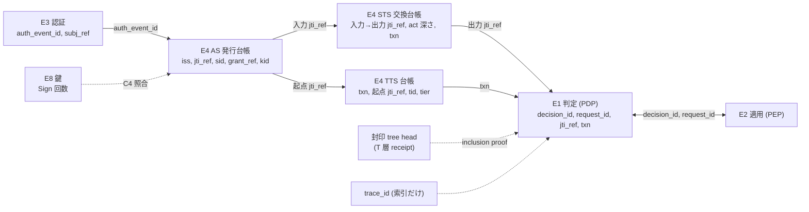
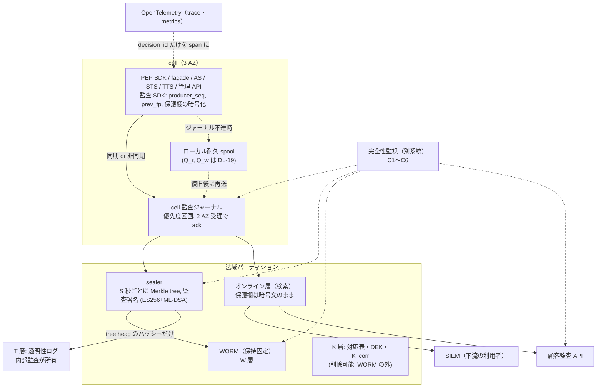
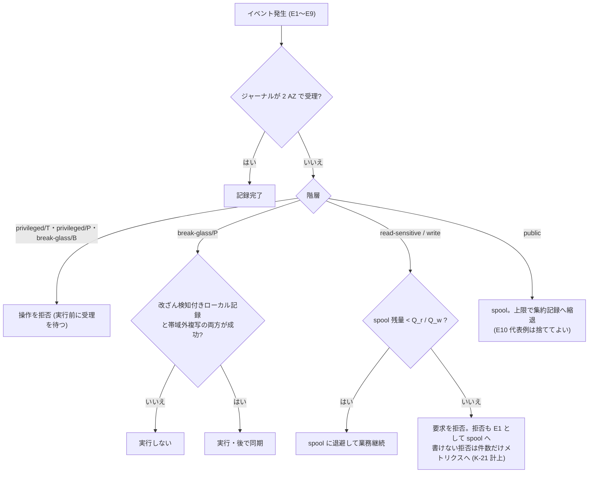
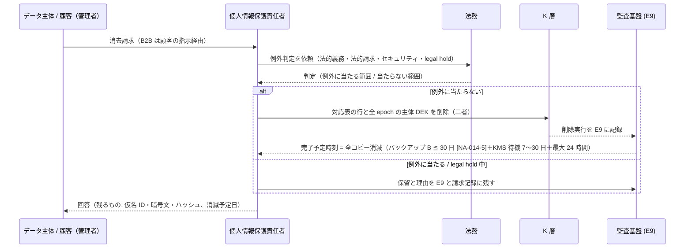

# 監査ログ設計・PIA

> 文書ID: ARC-10 / 版: 0.3 / 状態: draft / 最終更新: 2026-10-15
> 対応要求: R-102, R-118〜R-128, R-193, R-193.1〜R-193.6, R-232, R-257, G-054, G-063, G-064（R-requirements.md・G-goal-criteria.md で対応成果物欄に本書のパスまたは DL-25 を含む全 24 行。末尾の対応表）
> 依存文書: CONVENTIONS.md, traceability/deliverables.md（DL-25 行）, 05_adr/ADR-014-audit-data.md（正本）, 05_adr/ADR-019-compromise-response.md, 05_adr/ADR-009-workload-identity-token-exchange.md, 05_adr/ADR-005・ADR-007・ADR-010・ADR-011・ADR-013・ADR-021・ADR-022・ADR-029, 05_adr/README.md, 05_adr/reconciliation-notes.md（§3.2・§6 C-34）, 04_architecture/claims-catalog.md（ARC-15、DL-115。レビュー時点で版 0.1 draft が存在）, 04_architecture/pep-contract.md（OB-09・OB-12）, 05_adr/ADR-022-integration-contract-standards.md（D-8-6）, 06_controls/applicability.md（CTL-02 §3.3〜§3.6・§6.1・L-03〜L-05・L-11）, 02_requirements/data-classification.md（REQ-04 §4.4〜§4.6・決裁案 6.5）, 02_requirements/operation-risk-tiers-assurance.md（操作 5 分類の正本）, 02_requirements/customer-admin-responsibility.md（DL-26 §10・決裁案 4）, 02_requirements/tenant-lifecycle.md, 01_governance/assumptions-register.md, 01_governance/business-impact-analysis.md, 01_governance/kri.md（K-21）, 01_governance/loss-scenarios.md（S-10）, 03_threat-model/threat-catalog.md, 03_threat-model/attacker-model.md, traceability/claims-ledger.md（CL-0113, CL-0114, CL-0187, CL-0193, CL-0256）, traceability/rejected-hypotheses.md（RH-012, RH-023, RH-133〜RH-136, RH-214）, research/RS-10, RS-02, RS-06, RS-07, RS-12（各 verification 記録を含む）, research/standards-status.md, 03_threat-model/fraud-abuse-controls.md（§6.1・§6.3・§7.1・§10.3・決裁案 7。版 0.3 で追加）, research/RS-13・RS-03・RS-14（§14.8 の 63B-4・63C-4・63-4 の規範。版 0.3 で追加）
> 作成方法: AI エージェント（Claude）が ADR-014 を正本として、上流文書と調査ノートを読んで詳細設計と PIA を起草した。research にない原典（GDPR 第 35 条・第 28 条 3 項 (f)、個人情報保護委員会「PIA の取組の促進について」）は起草者が 2026-10-15 に原典を取得して該当箇所を確認した。本書の評価・判断・PIA の記入は自己レビューであり、実在の CTO/CISO・プライバシー担当の承認ではない（CONVENTIONS §8）[D]。版 0.2 は作成者以外の AI エージェントによる独立レビューの修正を反映した（末尾「レビュー記録」）。このレビューも実在のプライバシー担当による G-064 の判定ではない [D]。版 0.3 は模擬パネル（ラウンド 1）の指摘を受けて §14.8（認証・ID 中核処理の PIA）を追加した。模擬パネルは AI エージェントによる自己レビューであり、実在の CTO/CISO の決裁ではない [D]。§14.8 で使った research 外の原典（ePrivacy 指令 5 条 3 項、GDPR 第 4 条 (4)(14)・第 9 条 1 項・第 22 条・第 35 条 3 項・前文 47・71、EDPB Guidelines 2/2023、英国 PECR 規則 6・附則 A1、UK GDPR 第 22A 条、イリノイ州 BIPA）は、是正の担当エージェントが 2026-10-15 に原典を取得して該当箇所を確認した（research への取込みは残課題 16）[D]。
> 表記: 決定事項は ADR-014 の D14-xx を引く。本書で追加する詳細設計は AP-xx、PIA のリスクは PR-xx、本書の新規仮定は NA-AP-x、決裁案は KAP-x と書く。表のセルのうちタグのないものは設計推論 [D] である。

---

## 0. 結論（エグゼクティブ要約）

1. **監査は trace と別の経路・別の保証で 100% 記録する** [D]。監査専用 SDK → cell ジャーナル（2 AZ 受理）→ 封印 → WORM の「記録経路」を OpenTelemetry と共有せず、Sampler の DROP・外部の sampled flag・baggage が記録の有無に影響しない構造にする（ADR-014 D14-02〜D14-05）[N][^1][^2][D]（RS-10#16, #17, #22）。SIEM・検索基盤・顧客 API は記録経路の下流であり、その停止で業務を止めない [D]。
2. **100% 記録対象は E1〜E9 の 9 族、集約してよいのは public 階層の E10 だけ**である [D]。read-sensitive の allow も間引かない（D14-15）[D]。日量は基準シナリオで約 18.5 億件・約 1.1 TB/日（圧縮前）と試算する [D][A-049][NA-014-1][NA-AP-1]。
3. **一貫リクエスト証跡は 8 つの相関欄（iss・jti_ref・sid・grant 参照・txn・decision_id・request_id・trace_id）を R0〜R7 の手順で辿って再構成する** [D]。真正性の根拠は署名付き token・Txn-Token と発行台帳の照合、PEP と PDP の decision_id 突合、封印済み記録の inclusion proof であり、trace_id は索引にだけ使う（§3）[D]。write 以上は txn で、read-sensitive は (jti_ref, decision_id, request_id) で結ぶ [D]。txn を全要求に広げるかは未決（U-02）である [D]。
4. **欠損は監査経路と別系統の完全性監視で 6 つの照合（C1〜C6）により検知し、backpressure は「記録を捨てる」でなく「業務要求を止める」方向にかける** [D]。監査経路の停止は H1〜H5 に分け、privileged と break-glass/B はジャーナルの同期受理ができなければ拒否、break-glass/P は改ざん検知付きローカル記録と帯域外複写の両方ができなければ実行しない（ADR-013 D13-25、ADR-014 D14-28、ARC-08 の AF-3・AF-4）[D]。記録率・検知時間の目標値は TBD（DL-20、G4）である [D]。
5. **改ざん検知は producer 連鎖・封印（Merkle tree＋法域の監査署名）・WORM（保持固定）・別管理主体の透明性ログの 4 層**で行う [N][^10][^11][D]（RS-10#37〜#47）。WORM だけでは運用者自身による相手ごとに異なる提示を検知できないためである [N][^10]（RS-10#38）。
6. **WORM と削除権は W 層（仮名・暗号文・ハッシュ）、K 層（対応表・鍵、削除可能）、T 層（ハッシュだけ）の 3 層で調停する** [D]。本書はさらに、検索基盤・SIEM にも保護欄を平文で複写しない規則（AP-41）を置き、削除の伝播を K 層の削除だけで完結させる [D]。crypto-shredding は消去の代替と主張しない [N][^19][^20][D]（RS-10#55〜#57）。法的評価は L-05（法務）である [D]。
7. **保持期間と所在地の値は本書で決めない** [D]。「記録区分（RC-A〜RC-E）× 規制プロファイル」の表で構造を決め、値は法務の署名（L-03・L-04・L-11）で埋める [D]。確認した範囲の GDPR・個人情報保護法に、認証・認可の監査ログの保持期間を一律に定める規定はない [N][^16][^24]（RS-10#63, §2-12）。
8. **保管費は基準シナリオ・圧縮なし・単一複製で約 $16k/月、日本の主・副への複写を含めると約 $30k/月の桁**と試算する [D][A-049, A-061, A-074][NA-014-1][NA-AP-1]。単価は ADR-014 が確認した AWS 東京の公式単価による [V][^36][^37]。検索基盤・SIEM 取込みの費用は未収集で、費用の大部分がそちらになる可能性がある（DL-33 で見積り）[D]。
9. **PIA（§14）は全項目を記入したが、承認は未了**である [D]。基盤は多くの顧客にとって処理者であり、GDPR 第 28 条 3 項 (f) に従い、顧客（管理者）の DPIA を支援する材料として本 PIA の要約を提供する [N][^16][D]。民間部門の PIA は日本の法令上の義務ではない [N][^39]。PIA の対象は、監査記録の処理（§14.1〜§14.7）と、身元確認・認証器・回復・linking・session 監視とリスク判定・ドメイン横断 SSO からなる認証・ID 中核処理（§14.8）の 2 つである [D]。§14.8 は、session 監視で使う特性の収集をプライバシーリスク評価に含めることを SHALL とする 63B-4 §5.3 に応える [N][^50]（RS-13#17）。ただし端末情報の取得（ePrivacy 指令 5 条 3 項）、自動遮断（GDPR 第 22 条）、行動バイオメトリクス（GDPR 第 9 条）の法的評価は法務の判定待ちである [N][^45][^16][D]。
10. **経営判断を要する事項は 4 件**（§15: legal hold の権限者の整合、PIA の承認者と公表範囲、法域外からの SOC 参照の方式、透明性ログの管理主体）である [D]。

---

## 1. 範囲と位置付け

### 1.1 本書が決めること・決めないこと

| 区分 | 内容 | 正本 |
|---|---|---|
| ADR-014 が決定済み（本書は従う） | 正準スキーマを自社定義、OCSF は写像先、10 族、欄の 4 区分、100% の範囲、相関 8 欄と jti_ref、5 段の経路、6 照合、H1〜H5、4 層の完全性、W・K・T の 3 層、保持の構造、顧客 API の出所と完全性、費用式 | ADR-014 D14-01〜D14-59 |
| 本書が詳細化する | 族ごとの必須フィールド（§2）、再構成の手順 R0〜R7（§3）、経路の部品分離と運用者分離（§5）、欠損時の処置手順（§6）、封印の検証手順（§7）、規制プロファイル表（§8）、閲覧統制の役割×操作表（§10）、消去請求の処理と下流への伝播（§11）、費用の拡張試算（§13）、PIA（§14） | 本書 AP-xx |
| 本書で決めない（他文書） | 保持期間・所在地の値（L-03・L-04・L-11）、記録率・検知時間・検索 SLO の目標値（DL-20）、spool 上限 Q_r・Q_w（DL-19）、顧客 API の無償保持（DL-26 決裁案 4）、スキーマの欄名（DL-77）、claim 名（DL-115） | 括弧内 |
| 未決（本書は両方の結論で成り立つ設計にする） | txn の発行範囲（U-02）、判定記録の個別署名（U-04、ADR-013 KD13-6）、ADR-007 への K 層鍵の追加（ADR-014 §2.13 論点 1）、jti 欄名の読み替え（論点 2） | 05_adr/README.md §6 |

- 欄名（`jti_ref`、`subj_ref` 等）は本書での仮名である [D]。正式名は DL-77・DL-115（04_architecture/claims-catalog.md）で決める [D]。claims-catalog.md は並行作成中であり、名前が異なる場合は DL-115 を優先する [D]。

### 1.2 読み手と使い方

| 読み手 | 主に読む節 |
|---|---|
| CTO・CISO | §0、§4、§6、§7、§13、§15 |
| 法務・個人情報保護責任者・DPO | §8〜§11、§14、§15 |
| 連携開発者（依存サービス） | §5.4（義務と禁止の一覧。まずここを読む）、§2.5、§3 |
| SRE・SOC | §5〜§7、§10 |

---

## 2. イベント分類と必須フィールド

### 2.1 族（ADR-014 D14-08 の再掲と producer）

| 族 | 内容 | producer | 記録 | 主な階層 |
|---|---|---|---|---|
| E1 判定 | PDP façade の全判定（allow・deny・評価不能） | PDP façade | 100%・個別 | read-sensitive 以上 |
| E2 enforcement | PEP の判定の適用結果 | PEP SDK | 100%・個別 | read-sensitive 以上 |
| E3 認証 | ログイン成否、認証段階・要素、step-up、回復、認証器の追加・削除 | AS・IdP | 100%・個別 | 全階層 |
| E4 発行 | access token・内部 token・Txn-Token・token exchange の発行（発行台帳） | AS・STS・TTS | 100%・個別 | 全階層 |
| E5 session・grant | session の作成・失効、grant の付与・取消、全 session 失効 | AS | 100%・個別 | 全階層 |
| E6 管理・IAM 変更 | relation・policy・model・ロール・テナント設定・federation・SCIM・domain・client 登録・主体ライフサイクル | 管理 API・PAP・SCIM | 100%・個別 | write・privileged |
| E7 特権・support | JIT・二者承認・support・SRE のアクセス、impersonation、break-glass | 特権アクセス系（ADR-029） | 100%・個別・同期 | privileged・break-glass |
| E8 鍵 | 鍵の生成・rotation・失効・破棄、Sign 回数照合、ceremony | 鍵台帳・Signer（ADR-007） | 100%・個別 | privileged |
| E9 監査系 | 監査経路の開始・停止・設定変更、監査記録の閲覧・検索・export、legal hold、再識別、暗号消去、heartbeat | 監査基盤 | 100%・個別 | privileged |
| E10 集約 | PDP 判定を伴わない public 階層の要求の集計 | edge | 集約 | public |

### 2.2 共通エンベロープ（全族で必須）

欄の区分（ADR-014 D14-09）は「構造（平文）」「相関（不透明値）」「仮名（鍵付きハッシュ・乱数）」「保護（暗号文）」の 4 つである [D]。

| 欄（仮名） | 区分 | 必須 | 内容・形式 | 根拠 |
|---|---|---|---|---|
| event_id | 構造 | 必須 | 不透明な乱数（時刻・ホスト名を含めない） | ADR-021 D21-36 |
| schema_ver, ocsf_map_ver | 構造 | 必須 | 正準スキーマの版と写像先 OCSF の版を別欄にする | D14-13、OCSF metadata.version [N][^4]（RS-10#3） |
| family, event_type | 構造 | 必須 | E1〜E10 と閉じた列挙の種別 | D14-08 |
| event_time, observed_time, received_time | 構造 | 必須 | UTC。発生・producer 受付・ジャーナル受理 | SP 800-53 AU-8 [N][^6]（RS-10#33）、D14-27 |
| producer_id, producer_seq, prev_fp | 構造 | 必須 | producer ごとの連番と直前レコードの fingerprint（L1 連鎖） | D14-29 L1 |
| cell_id, jurisdiction | 構造 | 必須 | 帰属 cell と法域パーティション | ADR-013 D13-08 |
| tid | 構造 | 必須（テナント外の基盤操作は予約値） | テナント ID | ADR-021 D21-38 |
| tier | 構造 | 必須 | public／read-sensitive／write／privileged／break-glass | operation-risk-tiers-assurance.md §2 |
| outcome, reason_code | 構造 | 必須 | 成否と閉じた列挙の理由（ADR-011） | ADR-011 |
| data_class | 構造 | 必須 | 対象資源の分類ラベル（REQ-04 の基本区分・加重ラベル） | data-classification.md §3.3 |
| actor.type | 構造 | 必須 | 自然人／workload／service account／AI エージェント／システム | principal-catalog |
| actor.subj_ref | 仮名 | 自然人のとき必須 | (tid, sub) ごとの乱数。対応表は K 層 | D14-44 |
| actor.nhi_id | 構造 | 非自然人のとき必須 | SPIFFE ID 等を平文 | D14-44、ADR-009 D09-07 |
| actor.client_id, actor.mode | 構造 | 必須 | client と動作区分（自律／委任） | D14-12、T-075 |
| actor.act_chain | 構造＋仮名 | 委任時必須 | act の連鎖（workload は平文、自然人は subj_ref）。アクセス制御に使うのは現在の actor だけ | RFC 8693 §4.1 MUST [N][^41]（RS-06#45） |
| target.res_type, target.res_ref | 構造・仮名 | 資源があるとき必須 | 資源 type と、テナント鍵による資源 ID の鍵付きハッシュ | D14-09 |
| corr.* | 相関 | §2.4 | 8 欄＋ext_trace_id＋auth_event_id | §2.4 |
| purpose_code, basis_ref | 構造 | E7 と人による閲覧（E9）で必須 | 目的の閉じた列挙と ticket 等の参照 | D14-11、Pankki S [N][^17]（RS-10#60） |
| prot.ciphertext, prot.dek_ref | 保護 | 保護欄があるとき | 保護欄をまとめた暗号文と DEK の参照（epoch・鍵版・alg） | D14-45 |
| prot.ip_ref | 仮名 | 送信元 IP があるとき | IP の鍵付きハッシュ（法域鍵）。等価検索用（AP-41） | 本書 AP-02 |

- **AP-01（保護欄の範囲）** 保護欄は、送信元 IP、user agent、位置、資源 ID の原文、変更の前後値、目的の自由記述、ticket 本文への参照に限る [D]。SP 800-53 AU-3(3) は監査レコードの個人識別情報をプライバシーリスク評価で特定した要素に限ることを求めており、本書 §14.4 の PIA がその評価に当たる [N][^6][D]（RS-10#15）。
- **AP-02（IP の索引）** IP は保護欄に暗号文で置き、加えて法域単位の鍵による鍵付きハッシュ ip_ref を仮名欄に置く [D]。攻撃元の IP での等価検索を、保護欄の復号なしにできるようにするためである [D]。ip_ref の鍵は K 層に置き、期間消去（D14-50）の上限で鍵版ごと削除する [D]。IPv4 は空間が小さく総当たりで逆算され得るため、ip_ref の鍵を W 層・SIEM と同じ管理者に持たせない（§10）[D]。

### 2.3 族ごとの追加必須フィールド

| 族 | 追加必須フィールド | 根拠 |
|---|---|---|
| E1 | decision、reason_code、policy_ver、model_rev、整合性の実効モード、鮮度区分、失効 epoch、G 段カタログ版、PDP ノード、AuthZEN 要求 ID の echo | ADR-010 D-51、ADR-013 D13-26、R-257 |
| E2 | decision_id、entry_point_id、適用結果（許可・拒否・縮退）、pep_id、PEP SDK 版 | ADR-011 D5-8、ADR-012 |
| E3 | 結果、認証段階、amr・acr、step-up の有無、回復の段階、federation では発行 IdP の識別子、auth_event_id | DL-26 §10.1・§10.2、R-047 |
| E4（AS） | token 種別、iss、jti_ref、kid、aud、exp、sid、grant 参照、auth_event_id | ADR-007 D7-45、reconciliation-notes §3.2 |
| E4（STS 交換台帳） | 入力 token の (iss, jti_ref)、出力 token の (iss, jti_ref)、呼出し元 SPIFFE ID、呼出し先、発行 scope、act の深さ、受信した txn | ADR-009 D09-35 |
| E4（TTS 発行台帳） | txn、Txn-Token の hash、req_wl、主体（自然人は subj_ref）、tid、起点 jti_ref、aud（cell）、exp、起点の操作階層 | ADR-009 D09-35・D09-29、ADR-014 D14-20 |
| E5 | sid、grant 参照、操作（作成・失効・全失効）、範囲、失効下限時刻（ADR-019） | ADR-019 |
| E6 | 対象オブジェクト種別、操作、変更の前後値または差分の要約（保護欄）、変更 ticket、承認者、経路（SCIM／UI／API） | R-232、DL-26 §10.1 |
| E7 | 要員の安定した仮名 ID、事業者要員の印（組織）、役割、昇格の段階（SL0〜SL4）、purpose_code、basis_ref、範囲、期間、社内の承認者、顧客の承認者、実行した事前承認済み操作、JIT 付与 ID（昇格 grant ID）、対象テナント、break-glass の逐次番号 | D14-11、D14-53、ADR-029 D29-61（PC-06 の監査属性） |
| E8 | 鍵 ID、用途族、操作、ceremony ID、台帳件数と Sign 回数の照合結果 | ADR-007 D7-45、CSRB 勧告 5 [I][^30]（RS-12#12） |
| E9 | 操作種別、照会範囲（テナント・期間・主体の数）、要求者、承認者、参照元の国、移転根拠の参照 | D14-40・D14-41、PCI 10.2.1.3 [N][^7] |
| E10 | 集計期間、件数、tid、client_id、拒否・rate limit の件数、代表 event_id | D14-16 |

- **AP-03（TTS 台帳の主体）** ADR-009 D09-35 は TTS の発行台帳に `sub` を置くとする [D]。本書は、監査経路に流す E4 の写しでは `sub` を subj_ref に置き換え、生の `sub` と生の `jti` は発行台帳の正本（ADR-007 D7-45 の台帳。WORM の外）にだけ置く [D]。W 層に直接識別子を置かない規則（D14-43）を TTS・STS の台帳の写しにも適用するためである [D]。発行台帳の正本の保持と削除は ADR-007 の範囲であり、本書は残課題 3 として申し送る [D]。

### 2.4 相関欄（8 欄＋補助 2 欄）

| 欄 | 層 | 発行者・署名 | 形式 | 証跡上の役割 |
|---|---|---|---|---|
| iss | L1 token | AS・STS（署名あり） | URL | 発行元 |
| jti_ref | L1 token | 監査 SDK が計算 | `kv ‖ HMAC-SHA-256(K_corr[kv], iss ‖ jti)` | 発行台帳との結合。生の jti を E1・E2 に出さない（D14-21） |
| sid | L2 session | AS（署名あり） | 不透明な乱数 | ログイン session との結合、全 session 失効 |
| grant_ref | L2 grant | AS（署名あり） | 不透明な乱数 | 同意・grant との結合、一括失効 |
| txn | L3 取引 | cell の TTS（署名あり） | 不透明な乱数 | 共通入口を通った呼出し連鎖の識別（write 以上） |
| decision_id | L4 判定 | PDP façade | 不透明な乱数 | PEP と PDP の突合 |
| request_id | L4 判定 | PEP（AuthZEN の echo） | 不透明な乱数 | PEP の要求と PDP の応答の対応 |
| trace_id | 補助 | 誰でも生成可（署名なし） | W3C trace-id | 調査の索引だけ |
| ext_trace_id | 補助 | 外部（信頼しない） | 外部から届いた trace-id | edge で再採番した外部値の退避 |
| auth_event_id | L1 補助 | AS | 不透明な乱数 | E3・E4 だけ。token に載せない |

- 出典: reconciliation-notes §3.2、ADR-005 D9-2、ADR-021 D21-37、ADR-014 D14-18〜D14-21 [D]。AuthZEN 1.0 は PEP が要求 ID を付けた場合に PDP が同じ値を返すことを MUST とする [N][^34]（RS-07#66）。
- K_corr は法域パーティションごとに 1 つ持ち、版 kv を jti_ref の先頭に付ける [D]（D14-21）。K_corr の rotation 後も旧版を保持期間の上限まで K 層に残し、旧版で計算された jti_ref と結合できるようにする [D]。K_corr の鍵族は ADR-007 にまだない（ADR-014 §2.13 論点 1、未決）[D]。
- 監査 SDK が jti_ref を計算するため、K_corr は法域内の全 producer（PEP SDK を組み込む約 300 サービスを含む）に配布される [D]。jti は乱数なので K_corr の漏えいだけでは jti_ref から jti を復元できないが、生の jti を持つ者が漏えいした K_corr で監査記録と結合できるようになる [D]。配布範囲と rotation 手順を ADR-007 の鍵台帳に載せることを残課題 4 に含める [D]。
- AuthZEN 1.0 では PEP が要求 ID を付けること自体は MAY である [N][^34]（RS-07#66）。本基盤では PEP SDK が全要求に request_id を付ける（依存サービスの実装に任せない）[D]。

### 2.5 記録しないもの（全族共通）

| 記録しないもの | 理由 |
|---|---|
| token・session cookie・Txn-Token の全文、Authorization・Cookie・Txn-Token ヘッダの値、password・OTP・回復コード・client secret | Transaction Tokens 草案（draft-11、Internet-Draft）は Txn-Token 全体のログ記録を MUST NOT とする [N][^31]（RS-06#41）。Okta の support 系侵害では、攻撃者が session token を含む HAR ファイルにアクセスし、その token を使った [I][^42]（RS-12#22） |
| traceparent・tracestate・baggage への主体・テナント・資源の識別子 | Trace Context は個人識別情報を MUST NOT とする [N][^1]（RS-10#16）。Baggage（W3C Candidate Recommendation Snapshot。勧告前の draft）は濫用リスクの評価を MUST とする [N][^3]（RS-10#19） |
| tuple 一式、Expand の結果、権限一覧 | REQ-04 §4.6 の AZD 行 |
| カード会員データ | A-072（基盤は扱わない）。混入を検知したら事故として扱う（REQ-04 §4.6 PCI 行） |
| 業務データの本文（金額・文書本文等） | 業務側の監査の範囲。基盤の監査には txn・decision_id だけを残させる（ADR-022 D-8-6） |

- 連携開発者の義務は、Txn-Token と traceparent の無改変伝播と、業務側の監査に txn と decision_id を残すことに限る（ADR-014 §6.4）[D]。E1・E2 は PEP SDK と façade が出すので、依存サービスが監査イベントを自作することはない [D]。

---

## 3. 一貫リクエスト証跡の再構成

### 3.1 結合のグラフ

### 3.2 再構成の手順（AP-10）

起点は txn、decision_id、request_id、jti（生）、sid、trace_id のどれでもよい [D]。手順は ADR-014 D14-19 の V1〜V4 と ADR-009 D09-36 の 1〜4 を合わせたものである [D]。

| 段 | 処理 | 使う欄・記録 | 失敗時の判定 |
|---|---|---|---|
| R0 起点の正規化 | 生の jti を受けたら K_corr の全有効版で jti_ref を計算する。trace_id を受けたら E1・E2 の候補集合を引くだけにし、以後の照合に使わない | jti_ref、trace_id | — |
| R1 取引の確定（write 以上） | txn で TTS 台帳（E4）を引き、起点 jti_ref・tid・sid・grant_ref・起点の操作階層・発行先 aud・有効時間を得る | txn | TTS 台帳にない txn は「異常 A1（未発行 txn）」 |
| R2 token 系譜 | 起点 jti_ref で AS 発行台帳を引き、auth_event_id から E3 に結ぶ。STS 交換台帳を入力 jti_ref→出力 jti_ref の向きに辿り、各 hop の呼出し元 SPIFFE ID・呼出し先・act の深さを得る。台帳件数と KMS の Sign 回数を照合する（C4） | iss、jti_ref、auth_event_id、E8 | 台帳にない jti_ref は「異常 A2（未登録 token）」。Sign 回数の不一致は「異常 A3」 |
| R3 判定と適用 | write 以上は txn で、read-sensitive は (jti_ref, request_id) で E1 を集め、decision_id で E2 と 1 対 1 に突合する | decision_id、request_id | E2 に対応する E1 がない、または逆は「欠損 M1」（C3、K-21） |
| R4 連鎖の連続性 | R3 の各 E1 が提示した jti_ref が R2 の系譜に含まれること、各 hop の aud が呼出し先と一致すること、txn が発行先・有効時間・連鎖の外で使われていないことを確かめる | jti_ref、txn | 系譜外の jti_ref は「異常 A4（横流し・replay の疑い）」。txn の連鎖外使用は「異常 A5」（D14-20） |
| R5 完全性 | R1〜R4 で使った各記録の inclusion proof を封印 tree head で検証し、tree head の consistency proof を T 層の receipt と照合する。対象時間窓の producer_seq の欠番を確かめる | event_id、producer_seq、封印 ID | proof 不成立は「改ざん疑い T1」。欠番は「欠損 M2」（C1） |
| R6 判定 | 「完全」「欠損あり（M1・M2）」「異常（A1〜A5・T1）」のいずれかを結果として出す | — | 異常は SOC のインシデント票へ |
| R7 照会の記録 | 再構成の実行自体を E9 に記録する（目的・要求者・範囲） | purpose_code | — |

- trace_id と ext_trace_id は R0 の索引にだけ使い、R1〜R6 の判定に使わない [N][^1][D]（RS-10#17）。trace の欠落・偽造で R1〜R6 の結果が変わらないことを TC-014-11・ADR-009 H09-07 で確かめる [D]。
- CADF は、各 observer が自分の層で見えたものだけを記録し、他の observer の記録と相関させるモデルを取る [N][^5]（RS-10#13）。R3 の PEP・PDP の二重観測はこのモデルに当たる [D]。

### 3.3 階層ごとの再構成の範囲

| 階層 | 主キー | 再構成できる範囲 | 未決との関係 |
|---|---|---|---|
| public | なし（E10 の集約） | 要求単位では再構成しない。集約の件数と代表 event_id だけ | — |
| read-sensitive | (jti_ref, decision_id, request_id) | 1 hop ごとの判定と適用、token 系譜（R2）。複数 hop の取引の束ねは STS 交換台帳の系譜に依存する | U-02 が (a) 全要求に txn なら write と同じ手順になる。スキーマは変えない（ADR-014 §2.13 論点 4） |
| write | txn | R1〜R5 の全段 | — |
| privileged | txn＋E7 | R1〜R5 に加え、E7 の承認者・目的・JIT 付与 | — |
| break-glass | txn（発行できる場合）＋E7 の逐次番号＋帯域外複写 | 帯域外複写と W 層の記録の突合 | ADR-029 |

- U-02 の (b)（現状）では、read-sensitive の複数 hop の束ねが txn より弱い証拠になる [D]。この残余は ADR-009 RR09-4 として CISO＋事業責任者の受容が要る [D]。

### 3.4 照会のキーと応答時間

- 侵害時の影響範囲の照会（ADR-019 D19-32）は `tid`・`sub`・`sid`・grant 参照・kid・decision_id・時間範囲をキーとする [D]。`sub` を受けたら K 層の対応表で subj_ref に変換してから W 層・オンライン層を引く（再識別ではなく順方向の変換。二者承認の対象外）[D]。ただし順方向の変換も特定個人の行動履歴を引く操作なので、purpose_code を必須にして E9 に記録し、§10.2 の閲覧監視（同一主体への反復照会）の対象にする [D]。逆方向（subj_ref→sub）は再識別であり二者承認とする（§10）[D]。
- 再構成と影響範囲の照会の所要時間は検索 SLO（R-193.5）に含める [D]。目標値は TBD（所有者: CISO＋SRE 責任者、期限: G4、決め方: TC-014-14 の実測と DL-24 の通知期限からの逆算）である [D]。

---

## 4. 100% 記録対象

### 4.1 範囲（ADR-014 D14-14〜D14-17）

| 区分 | 対象 | 記録 | 根拠 |
|---|---|---|---|
| 100%・個別 | E1〜E9 の全件。read-sensitive の allow を含む | 個別レコード | ADR-011 D8-4、D14-15 |
| 集約可 | E10（PDP 判定を伴わない public 階層）だけ | 件数・期間・代表 event_id | D14-16 |
| 攻撃時の急増 | ログイン試行（A-048 の 5,115/秒）も E3 として 100% | 個別レコード | D14-16 [A-048] |

- 旧提案書の「100% 監査し sampling で落とさない」という宣言（CL-0193、RH-012）は、記録率・欠損検知・backpressure・停止時挙動の定義と実測がなければ保証にならない [D]。本書は §5〜§6 でそれらを定め、実測を TC-014-01〜TC-014-05 に置く [D]。
- 旧提案の他の監査主張の扱い: CL-0113（全サービスで誰が何をなぜ許可・拒否されたかを記録）は E1・E2 と §2.3 の欄で具体化した [D]。CL-0114（監査不能時の拒否「も検討」）は §6.1・§6.2 で階層別の挙動に確定した [D]。CL-0187（8 群の項目）は §2.2〜§2.4 の欄に置き換えた [D]。CL-0256（全 decision の説明可能性と追跡項目）は E1 の追加必須欄（§2.3）と R-257 で扱い、費用は §13 で試算した [D]。

### 4.2 法令・規格の列挙との対応（CTL-02 H-A01・H-A02）

| 列挙（強度） | 本書の族 |
|---|---|
| PCI DSS 10.2.1.1〜10.2.1.7（カード会員データへの個別アクセス、管理者操作、監査ログへのアクセス、無効なアクセス試行、識別・認証情報の変更、監査ログの初期化・停止、システムレベルのオブジェクトの作成・削除）[N][^7]（RS-10#23） | E3、E6、E7、E9（10.2.1.1 は A-072 の分離スコープにより基盤では生じない前提） |
| NIS2 実施規則 Annex 3.2.3（利用者・権限の作成・変更・削除、認証関連イベント、特権操作。"Where appropriate" 付き）[N][^8]（RS-10#28） | E3、E6、E7 |
| 金融庁 GL（アクセスしたユーザを特定し操作内容と対応させる）（CTL-02 §3.3、RS-02#34） | actor.act_chain、E1・E2 の相関 |
| PCI DSS 10.2.2 の 6 項目（利用者識別、種別、日時、成否、発生元、対象）（CTL-02 §3.3 の整理） | actor、family・event_type、event_time、outcome、prot（IP）と producer_id、target |
| 個人情報保護法の安全管理措置の手法の例示（ログイン実績・アクセスログ）（CTL-02 §3.3、RS-10#64） | E3、E7 |
| ISMAP 12.4.3（実務管理者・運用担当者の作業の記録）[N][^35]（RS-02#17） | E7、E9 |
| CSRB 勧告 5（ID 基盤と root 鍵素材へのアクセスの全件記録。勧告であり規範ではない）[I][^30]（RS-12#12） | E7、E8 |
| AIMS 草案 -00（エージェント ID・委任元・判定・相関 ID の記録。草案）[N][^32]（RS-06#73） | actor.mode、act_chain、E1 |

### 4.3 日量の試算

| 族 | 件数/日（基準） | 1 件の bytes | 量/日（圧縮前） | 根拠 |
|---|---|---|---|---|
| E1 | 9.07 億 | 1 KB | 907 GB | [A-049, A-037] |
| E2 | 9.07 億 | 0.2 KB | 181 GB | [NA-014-1] |
| E4（AS・STS 発行） | 約 2,970 万 | 1 KB | 約 30 GB | 1,374/秒 ÷ 4 × 86,400 [D][A-043, A-020][NA-AP-1] |
| E3（ログイン） | 約 110 万 | 1 KB | 約 1 GB | 51/秒 ÷ 4 × 86,400 [D][A-041, A-020][NA-AP-1] |
| E5〜E9、E10 | 未推計 | — | E1 の 1% 未満と推定 | 未測 [D][NA-AP-1] |
| 合計 | 約 18.5 億 | — | 約 1.12 TB | [D]。容量の正本 ARC-13 §6.3 は一覧の記録などを加えて 1,137 GB/日とする。差は 2% 未満で、保管・費用の試算は ARC-13 の値に合わせて更新する（architecture-reconciliation-notes.md XR-19） |

- A-020 は「ピーク 1 分＝日平均の約 4 倍」と置いているため、ピーク値を 4 で割って日平均にした [D][A-020]。A-043 は token exchange（基準 1,112/秒）を含むが、インスタンスごとの cache による分散係数 r（ADR-009 P09-5・NA09-1）を含まないため、STS 交換台帳の件数は r 倍に増え得る [D][A-043]。また A-043 は AS・STS の発行であり、TTS の Txn-Token 発行（write 以上の外部要求ごとに 1 件。U-02 が全要求なら edge API 呼出し数 A-040 の桁）を含まない [D][A-040]。どちらも本表の E4 を過小にする方向であり、TC-014-10 で実測して置き換える [D]。

---

## 5. パイプライン（trace と独立）

### 5.1 全体図

- 図の実線は記録経路、点線は監視・退避・索引の経路である [D]。OpenTelemetry と監査経路が共有するのは decision_id の値（ADR-012 の coverage 突合用）だけである [D]（D14-04）。

### 5.2 段と耐久性（ADR-014 D14-23）

| 段 | 部品 | 置き場所 | 受理条件 | 部品の所有者 |
|---|---|---|---|---|
| 1 | 監査 SDK（producer） | 各 process | ローカル spool への fsync 済み書込み、または段 2 の ack | プラットフォームチーム |
| 2 | cell 監査ジャーナル | cell 内 3 AZ | 2 AZ 以上への書込み | SRE |
| 3 | sealer | 法域パーティション | セグメント（S＝60 秒、NA-014-3）の tree head 署名 | SRE |
| 4 | WORM＋法域内複写 | 法域パーティション | 保持固定済みの書込み完了 | SRE |
| 5 | オンライン層・SIEM・顧客 API | 法域パーティション | ジャーナルからの再取得で冪等 | SOC・プラットフォームチーム |
| 監視 | 完全性監視（C1〜C6） | 本基盤の IdP・PDP に依存しない系 | — | 内部監査（運用は SRE と別の要員） |
| T 層 | 透明性ログ | 別管理主体のアカウント | receipt の受領 | 内部監査 |

### 5.3 trace からの独立（R-128）の構成要素（AP-20〜AP-24）

| ID | 独立させるもの | 内容 | 根拠 |
|---|---|---|---|
| AP-20 | SDK | 監査 SDK は OpenTelemetry の SDK・collector・exporter を経由しない。span event として監査を出さない | OTel の Sampler が DROP を返すと span の全 event と attribute が捨てられる [N][^2]（RS-10#22） |
| AP-21 | 入力 | 外部の traceparent の sampled flag、tracestate、baggage を記録の有無・内容の判断に使わない。edge は外部の traceparent を再採番し外部値を ext_trace_id に退避する | Trace Context は外部の sampled flag の素直な継続が過負荷・衝突の偽造に悪用され得るとする [N][^1]（RS-10#17）、ADR-005 D9-2 |
| AP-22 | 資格情報 | 監査経路の workload ID・保管先・KMS 鍵を telemetry と分ける | D14-02 |
| AP-23 | 運用者 | 監査経路の設定変更は E9 に記録し、二者承認とする。telemetry の設定配布と別の CI/CD 経路にする（ADR-008） | 案C の棄却理由（RH-134）：同じ系統では運用者分離が組織の規律頼みになる |
| AP-24 | 検証 | Sampler を DROP（0%）と 1% にして E1〜E9 の記録率 100% を確かめる（TC-014-01） | R-128、G-063 |

- engine 内蔵の decision log（OPA 等）を監査経路に使わない [D]。OPA の decision log は、バッファ上限やレート上限を設定すると古いイベントや超過分を捨てる [V][^33]（RS-07#56、ADR-010 D-53）。

### 5.4 連携開発者から見た契約

| 項目 | 依存サービスの義務 | 基盤側の責任 |
|---|---|---|
| E1・E2 の出力 | なし（PEP SDK・façade が出す） | SDK の既定で 100% |
| Txn-Token・traceparent | 無改変で下流に伝播する（ADR-022 D-8-6） | edge・TTS が発行と再採番 |
| 業務側監査 | 業務データの変更記録に txn と decision_id を残す | — |
| spool の資源 | PEP SDK のローカル spool のディスク・メモリ上限を実行環境に確保する（値は DL-19） | 上限値と監視の提供 |
| 連携の受入 | DL-67 の Definition of Ready で監査 SDK の導入を確認項目にする（G-125） | チェックリストの提供 |

連携開発者が行うこと・行ってはならないことを、確認方法とともに次に列挙する（ADR-014 §6.4、ADR-022 D-8-4・D-8-6、pep-contract OB-09・OB-12 の具体化）[D]。

| # | 区分 | 内容 | 確認方法 |
|---|---|---|---|
| DV-1 | 行う | PEP SDK（監査 SDK を同梱）を全 entry point に組み込み、SDK の監査送出を無効化・上書きしない | DL-67 の DoR、C2（発行カウンタと受理件数）・C3（E1・E2 突合）、TC-012-02 |
| DV-2 | 行う | 受信した `Txn-Token` ヘッダと `traceparent` を、下流呼出し・非同期メッセージに無改変で付ける | DL-80、ADR-022 H-4、TC-014-11 |
| DV-3 | 行う | 業務データを変更する処理の業務側の記録に、Txn-Token の `txn` と SDK が返す decision_id を 1 件ごとに残す | DL-67 の DoR、R4 の突合で欠けを検知 |
| DV-4 | 行う | SDK が監査の受理不能（§6.1 の spool 上限超過、privileged の同期受理失敗）で拒否を返したら、そのまま業務要求を失敗させる。監査を省いて再実行する経路を作らない | TC-014-03 |
| DV-5 | 行う | spool 用のディスク・メモリを実行環境に確保する（値は DL-19 で決まるまで未決） | 配備時の資源検査 |
| DV-6 | 行わない | token・Txn-Token・Cookie・Authorization ヘッダの値、HAR ファイルをアプリのログ・trace・エラー報告に出す | ログ走査（TC-014-13 と同じ検査をアプリログにも適用） |
| DV-7 | 行わない | 主体・テナント・資源の識別子を traceparent・tracestate・baggage・span 属性に載せる（decision_id は可） | pep-contract §3.8、OTel 属性の走査 |
| DV-8 | 行わない | engine 内蔵の decision log（OPA 等）やアプリログを、基盤の監査の代わりとして扱う | §5.3 |
| DV-9 | 行わない | 監査イベント（E1〜E10）を自作して監査ジャーナルへ直接書く。E6 を出すのは管理 API・PAP・SCIM を持つ基盤部品だけ | ジャーナルの producer 登録（未登録 producer は受理しない） |

- 拒否時に依存サービスが返す応答の形式（HTTP status、再試行可否の表示）は PEP 契約（DL-72）の範囲であり、本書では決めない（未決、DL-72）[D]。

---

## 6. 欠損検知・backpressure・監査経路停止時の挙動

### 6.1 backpressure（ADR-014 D14-24・D14-25）

- backpressure は「記録を捨てる」でなく「業務要求を止める・遅らせる」方向にかける [D]（D14-24）。捨ててよいのは telemetry と E10 の代表例だけである [D]。
- ジャーナルは優先度区画を持ち、E7・E8・E9 と privileged 以上の E1 を最優先区画にする（区画は容量を共有しない）[D]（D14-25）。
- SP 800-53 AU-5(4) は、監査ログの障害時に全停止・部分停止・縮退運転のいずれかを求め、代替の監査ログ能力がある場合を除く [N][^6]（RS-10#32）。本書の「代替の監査ログ能力」は cell ジャーナルと上限内のローカル spool である [D]。privileged ではローカル spool 単独を代替と認めない（D14-28）[D]。

### 6.2 停止の種別と挙動（ADR-014 D14-28、ADR-013 D13-25）

| 種別 | 例 | 業務への影響 | 検知 | 記録 |
|---|---|---|---|---|
| H1 分析系の停止 | SIEM・検索基盤・顧客 API | 止めない。SOC はジャーナル・オンライン層の直接照会で検知を継続 | 完全性監視 C6・下流の lag | 停止期間を E9（PCI 10.7.3）[N][^7]（RS-10#26） |
| H2 封印・WORM の停止 | sealer・WORM・法域内複写 | 止めない。ジャーナル保持時間の範囲で封印を遅延。上限に近づいたら H3 扱い | C5 | 同上 |
| H3 ジャーナルの停止 | quorum 喪失 | §6.1 の階層別挙動 | C1・C2 | 同上 |
| H4 spool の停止・満杯 | ディスク障害・上限到達 | §6.1 の階層別挙動 | producer の heartbeat | 同上 |
| H5 完全性監視の停止 | 監視系の停止 | 止めない。測定不能を限度超過として扱う（K-21 の決裁案 K-E） | 監視系自身の外部死活監視 | 同上 |

- SIEM は記録の正本ではないので、R-126 の「SIEM 障害時に業務を止めるか」への答えは「止めない」である [D]。SIEM を正本にする案（RH-133）は、SIEM の停止が記録の停止になり privileged 以上の拒否に直結するため棄却された [D]。
- PCI DSS 10.7.2 は監査ログ機構の障害の検知・警報・対処を求める [N][^7]（RS-10#26）。DORA RTS 第 12 条はログ系の障害を検知する措置を、第 23 条はログ収集の完全性に影響する異常の自動警報を求める [N][^9]（RS-10#30, #31）。NIS2 実施規則は監視・ログ系の可用性を監視対象とは独立に監視することを shall とする [N][^8]（RS-10#29）。完全性監視を別系統に置くのはこれらに対応するためである [D]。

### 6.3 欠損検知（ADR-014 D14-26）と処置（AP-30）

| # | 照合 | 検知する欠損 | 検知後の処置（AP-30） |
|---|---|---|---|
| C1 | producer_seq の連続性と heartbeat の最終 seq | producer〜ジャーナル間の欠落・重複・順序逆転 | 欠番範囲を E9 に記録し、producer の spool から再送を要求。再送で埋まらない欠番は K-21(a) に計上 |
| C2 | façade・PEP の発行カウンタとジャーナル受理件数 | 出し忘れ・producer 停止 | producer を drain 対象にし、SDK 版を照合（ADR-012） |
| C3 | E1 と E2 の decision_id 突合 | 片側欠落、判定なしの適用 | 判定なしの適用は PEP coverage 欠落の候補として ADR-012 の手順へ（T-030） |
| C4 | 発行台帳と KMS の Sign 回数 | 台帳にない署名 | 鍵の侵害疑いとして ADR-019 の鍵緊急切替の判断へ |
| C5 | 封印の連鎖と WORM の受理記録 | 封印〜WORM 間の欠落 | ジャーナルから再封印。ジャーナルの保持を延長 |
| C6 | 顧客側の tenant_seq の連続性 | 顧客への配信経路の欠落 | 顧客 API の cursor を巻き戻して再配信 |

- 欠損率は率と件数を併記する [D]。decision event は基準で 1 日 9.07 億件であり、欠損率が百万分の 1 でも 1 日約 907 件が欠ける [D][A-049]（K-21 §4.6）。
- 検知時間の目標（R-193.2）は TBD（所有者: CISO＋SRE 責任者、期限: G4、決め方: TC-014-02 の実測と BIA の MTDL）とする [D]。初期案は heartbeat 間隔の 2 倍以内の警報である [D]（D14-26）。
- 重要イベント（ADR-014 D14-17 の (c) 区分）の MTDL は BIA の仮置き 1 分である（A-093 は「監査の重要イベントの RPO 1 分以内」として置く）[D][A-093]。封印間隔 S＝60 秒と法域内複写の遅延を合わせてこれに収める（R-193.3、TC-014-05）[D][NA-014-3]。

### 6.4 数値契約（R-193.1〜R-193.6）の扱い

| 指標 | 定義（本書） | 目標値 | 測定 | 所有者・期限 |
|---|---|---|---|---|
| R-193.1 重要 decision 記録率 | 受理した E1 数 ÷ PEP が発行した decision_id 数（K-21(a) の欠損率の補数）。privileged・write・cross-tenant を別掲し、率と件数を併記 | TBD | C2・C3、TC-014-01 | CISO＋法務責任者、G4（DL-20） |
| R-193.2 欠損検知時間 | 欠損の発生から完全性監視の警報まで | TBD（初期案 heartbeat 間隔×2） | TC-014-02 | CISO＋SRE 責任者、G4 |
| R-193.3 WORM 転送遅延 | event_time から WORM の保持固定完了まで（p99） | 重要イベントは MTDL 以内（仮置き 1 分）[A-093] | TC-014-05 | SRE 責任者、G4 |
| R-193.4 保持期間 | 記録区分×規制プロファイルの下限・上限 | TBD（L-03） | 設定監査 | 法務責任者＋CISO、G3 |
| R-193.5 検索 SLO | 代表クエリ（主体・資源・期間・テナント、再構成 R0〜R6）の p95 応答 | TBD | TC-014-14 | CISO＋SRE 責任者、G4 |
| R-193.6 時刻同期精度 | cell 間・リージョン間の event_time のずれの上限 | TBD | TC-014-09 | SRE 責任者、G4 |

- 値を本書で仮置きしないのは、RS-10 §5.1 が「値は PoC と BIA で決め、仮置きしない」としているためである [D]。

---

## 7. WORM と改ざん検知

### 7.1 4 層（ADR-014 D14-29）

| 層 | 方式 | 検知できること | 検知できないこと（残余） |
|---|---|---|---|
| L1 producer 連鎖 | producer_seq と prev_fp | 封印前の 1 件の削除・改変・入替え | producer 自身の侵害による記録前の改ざん（RR14-01） |
| L2 封印 | S 秒ごとの Merkle tree。葉は (乱数 salt ‖ 正準化レコード) のハッシュ。tree head に直前の tree head を含め、法域の監査署名（ES256＋ML-DSA の二重、ADR-007 D7-63）を付ける | 封印後の改変・削除・末尾の切捨て | 封印鍵の侵害（ADR-007 の統制に依存） |
| L3 WORM | 封印済みセグメントを保持固定で書く | 保持期間中の削除・上書き | 運用者が相手ごとに異なる内容を示すこと |
| L4 透明性ログ | 署名済み tree head を別管理主体の Transparency Service に登録し receipt を得る。顧客にも tree head と consistency proof を配る | equivocation（相手ごとに異なるビュー） | T 層の管理主体と監査経路運用者の共謀 |

- RFC 9162 は、相手ごとに矛盾したビューを示すログは同 RFC の監査機構を迂回できるため、各ログを信頼された第三者として扱う必要があると述べる [N][^10]（RS-10#38）。RFC 9943 は Transparency Service の検証可能データ構造に append-only・non-equivocation・replayability を MUST とし、ハッシュだけを保持する構成を想定内とする [N][^11]（RS-10#39, #40）。
- WORM は保持固定の状態（S3 Object Lock の compliance mode、Azure のロック済み time-based retention、GCS のロック済み Bucket Lock）で使い、迂回できる状態を本番に使わない [V][^13][^14][^15][D]（RS-10#44, #46, #47、D14-30）。S3 Object Lock の compliance mode では root を含む誰も保持期間中に削除できず、期間を短縮できない [V][^13]（RS-10#44）。

### 7.2 検証手順（AP-35）

| 誰が | 何を | いつ |
|---|---|---|
| 完全性監視 | 全セグメントの tree head 署名、直前 tree head との連鎖、T 層 receipt の存在 | 封印ごと |
| 完全性監視 | WORM 上のランダム抽出セグメントの再ハッシュと tree head の一致 | 日次（抽出率は TBD、TC-014-06 の後に SRE 責任者が G4 で決める） |
| 内部監査 | T 層の tree head と、顧客に配った tree head の一致（gossip 相当の突合） | 月次 |
| 顧客 | 自テナントの inclusion proof と consistency proof | 任意（顧客 API） |
| 第三者 | WORM 設定（保持固定、迂回権限の不在）と T 層の管理主体の分離 | 年次（DL-30 のクラウド設定レビュー） |

### 7.3 20 年の検証可能性

- 監査署名の検証鍵は、保持期間と「鍵の稼働期間＋2 年以上」の長い方の期間保持する（ADR-007 D7-66、D14-34）[D]。
- alg を移行するときは封印の連鎖を新しい alg で再封印し、旧署名を残す（ADR-015）[D][A-103]。RS-10 §5.1 は、hash chain と署名のアルゴリズム識別子をレコードごとに持たせ、20 年保持では再アンカーと再署名の手順を定めることを入力としている [D]。

### 7.4 legal hold（AP-36）

- legal hold は WORM の保持期限より優先して削除を止める [D]。S3 の legal hold には期限がない [V][^13]（RS-10#44）。解除の手続を明示しない限り削除が止まり続ける（REQ-05 §2）[D]。
- **権限者の不整合**: ADR-014 D14-32 は「設定は CISO 系統の単独、解除は二者承認」とし、ADR-019 D19-26 と REQ-05 は「設定・解除の権限者は法務責任者、実行は二者」とする [D]。ADR-019 D19-26 は、法務責任者の判断までの間に CISO または IC が掛ける一時保全を設けるかを DL-24 で決めるとしている（TBD）[D]。本書は両者を「一時保全（CISO・IC が設定、期限付き、法務責任者の追認で legal hold に移行）」と「legal hold（法務責任者が設定・解除、二者で実行）」の 2 段で読み替える案を KAP-1（§15）として出し、決裁までは未決として扱う [D]。この不一致は 05_adr/reconciliation-notes.md に記載がないため、本書末尾の「ADR への指摘」に挙げる [D]。
- 決裁までの実装: 両 ADR に共通する部分（解除は二者承認、設定・解除を E9 に記録、legal hold 中は K 層の削除を保留）だけを固定し、設定権限を持つ役割と一時保全の有無・期限は構成値として差し替えられるようにする [D]。KAP-1 のどの案が採られても改修を要しないためである [D]。
- legal hold 中の主体は、消去請求（§11）があっても K 層の削除を保留し、保留の事実と理由を E9 と請求の記録に残す [D]。

---

## 8. 保持期間（法域・分類別）

### 8.1 構造（ADR-014 D14-36・D14-37）

| 記録区分 | 族 | 下限の決め方 | 上限の決め方 |
|---|---|---|---|
| RC-A 鍵・管理面・発行系 | E4、E8、管理面の E6・E7 | max（鍵の稼働期間＋失効後 2 年、規制プロファイルの最大値） | 下限＋法務が認めた調査期間 |
| RC-B 規制・特権・認証 | E3、E5、テナントの E6、E7 | 規制プロファイルの最大値 | L-03 |
| RC-C 判定・適用 | E1、E2 | 規制プロファイルの最大値。規制のないテナントは BIA と調査の必要から | L-03 |
| RC-D 集約 | E10 | 不正検知の傾向分析に要る期間 | DL-09 AU-1 の TBD |
| RC-E 監査系 | E9 | 対象とした記録区分の最長に合わせる | 同左 |

- 上限を置くのは、識別できる形での保存を目的に必要な期間に限る GDPR 第 5 条 1 項 (e) に対応するためである [N][^16][D]（RS-10#50）。WORM の保持は下限に固定し、上限は K 層の削除で実現する（D14-31・D14-50）[D]。ロックした保持は短縮できず延長はできるからである [V][^13][^14]（RS-10#44, #46）。
- RC-A を CSRB 勧告に連動させるのは、Storm-0558 で標準の保持 30 日のため侵害期間の起点が不確定になった教訓による [I][^30]（RS-12#8, #12）。CSRB 勧告は規範ではない [D]。

### 8.2 規制プロファイル（G-054 の入力）

| プロファイル | 適用条件（判定は CTL-02） | 保持の要求（原典の強度） | 本書の設定案 | 確定 |
|---|---|---|---|---|
| 基盤既定（全テナント） | 常時 | 確認した GDPR・個人情報保護法に一律の期間はない [N][^16][^24]（RS-10#63） | 下限・上限とも TBD | L-03（法務責任者＋CISO、G3） |
| PCI（CDE 用 cell） | A-072 の分離スコープで CDE 用 cell を置く場合 | 12 か月以上、直近 3 か月は即時分析（10.5.1）[N][^7]（RS-10#77） | WORM 下限 12 か月、オンライン 3 か月以上 | L-07 で適用判定 |
| DORA（金融顧客の委託先） | E-05 条件付き | 期間は金融機関がリスク評価に基づいて定める（RTS 第 12 条）[N][^9]（RS-10#78） | 顧客が契約で指定した期間を受ける | 契約 |
| NIS2 | E-04 条件付き | 予め定めた期間の保持（Annex 3.2.5）。日数の定めなし [N][^8]（RS-10#29, #78） | 基盤既定に従い文書化 | L-03 |
| HIPAA（医療・米国） | U-03 条件付き | 164.316(b)(2)(i) の 6 年が監査ログ自体に及ぶかは未判定（CTL-02 §3.4、RS-10#62） | 判定まで RC-B・RC-C の上限を 6 年以上に設定できる構造だけ用意 | L-03 |
| 政府統一基準・ISMAP | J-05・J-03 条件付き | 保存期間を定めること（値なし）（CTL-02 §3.4、RS-02#23） | テナント設定で指定 | L-10 |
| SEC 17a-4（broker-dealer 顧客） | U-09 | (f)(2) の WORM または audit trail 型（RS-10#48） | 個別判定まで対象外 | U-09（法務） |
| 鍵系（全テナント共通） | 常時 | CSRB 勧告: 鍵の使用期間＋失効後 2 年以上（勧告）[I][^30]（RS-12#12） | RC-A の下限 | CISO、G3 |
| 顧客 API の無償保持 | 全テナント | CSRB 勧告: 既定 6 か月以上・追加料金なし（勧告）[I][^30] | DL-26 決裁案 4 の推奨 (d) に従いオンライン層をその値以上に | 事業責任者＋CISO、G3 |

### 8.3 法域別の設定案

| 法域 | 保持（案） | 削除（案） | 所在（§9） |
|---|---|---|---|
| 日本 | 規制プロファイルの最大値（TBD） | 不要時消去の努力義務（第 22 条）と利用停止等への対応 [N][^24]（RS-10#63, #66） | 日本の主・副 |
| EU | 目的に必要な期間（第 5 条 1 項 (e)）。金融・NIS2 顧客は所定期間 | 第 17 条と第 3 項の例外。暗号消去は補完 | EU |
| 英国 | 同上（UK GDPR。英国からの移転規律は未確認） | 同上 | EU に収容（A-063、L-11） |
| 米国 | PCI 12 か月（CDE 用 cell）。HIPAA 6 年がログに及ぶかは L-03 | CCPA の削除と例外（1798.105(d)(2)）[N][^40]（RS-10#61） | 米国 |

- 出典: CTL-02 §6.1 の法域表 [D]。A-074（オンライン 13 か月＋アーカイブ 7 年）は容量・費用の計算だけに使い、保持期間の根拠にしない [D][A-074]。

---

## 9. 所在地

### 9.1 置き場所（ADR-014 D14-38〜D14-40、ADR-013 D13-08・D13-09）

| データ | 置き場所 | 法域を越えてよいか |
|---|---|---|
| producer spool・cell ジャーナル | テナントの cell | 不可 |
| W 層（WORM）・オンライン層・SIEM の取込み | 同じ法域パーティション（日本の主・副への集約は N13-6、DL-34 の判定が条件） | 不可 |
| K 層（対応表・DEK・K_corr・ip_ref 鍵） | cell の鍵表、wrap 鍵は cell の KMS | 不可 |
| T 層の tree head（ハッシュ） | 別管理主体の Transparency Service | 可（個人データに当たらないことを DL-34 で確認） |
| 件数だけの集計値（K-21 等） | 全社のダッシュボード | 可（同上） |
| 証拠保全の複写（ADR-019 D19-27） | 本基盤から独立した保存先。法域パーティションごと | 不可（NA-019-3） |
| break-glass の帯域外複写（ADR-029、ADR-013 D13-25） | 主たる監査基盤から独立した追記専用保管。法域パーティションごと | 不可（法域ごとに複写先を置く。所在の確認は DL-34） |

- 仮名化データは、追加情報を持つ管理者にとって個人データのままである [N][^18]（RS-10#53）。W 層を法域内に置くのはこのためである [D]。
- 個人情報保護委員会の Q&A は、外国事業者のクラウドを使う場合に事業者の所在国名とサーバ所在国名等を本人の知り得る状態に置く必要があるとする [N][^25]（RS-10#69）。監査データの保存国と複写先の国を顧客契約に明示し、変更を事前通知する（CTL-02 H-A05）[D]。

### 9.2 越境参照（AP-40）

- 第三国からの画面表示だけの遠隔アクセスも、3 要件を満たせば移転に当たる [N][^23]（RS-10#72）。SOC の follow-the-sun や vendor support による他法域からの参照は移転として扱う [D]（D14-40）。
- 既定では、法域外からの参照は構造欄・仮名欄だけを表示し、保護欄の復号と再識別をさせない [D]（D14-40）。相関欄（不透明値）を法域外の SOC に見せるかは D14-40 の文言に含まれていないため、KAP-3 の決裁まで表示しない [D]。調査に要るため、末尾の「ADR への指摘」で D14-40 の明確化を求める [D]。保護欄の復号を伴う越境参照は、移転根拠が DL-34 で台帳化されている場合に限り、参照元の国と根拠を E9 に記録する（CTL-02 H-A06）[D]。方式の選択は KAP-3（§15）とする [D]。
- EU から米国への移転は、DPF への上訴（C-703/25 P、判決の有無は未確認）と、EDPB 議長が 2026-07-31 付で欧州委員会に米国最高裁判決の影響の精査を求めた書簡があるため、SCC への切替手順を前提に置く [N][^43][^44][D]（RS-10#76）。
- 米国 cell は懸念国からの運用者・委託先アクセスを遮断・記録する（CTL-02 §3.5 の 28 CFR Part 202）[D]。

---

## 10. アクセス統制

### 10.1 役割×操作（AP-45）

| 操作 \ 役割 | SOC 分析者 | インシデント対応（IC） | 内部監査 | 顧客管理者（自テナント） | 法務・DPO | SRE（経路運用） | support |
|---|---|---|---|---|---|---|---|
| 構造・相関・仮名欄の閲覧（自法域） | 可 | 可 | 可 | 可（顧客 API） | 可 | 不可（メタデータとメトリクスだけ） | SL2・SL3 の昇格中だけ、承認された 1 テナント・対象利用者の範囲（ADR-029） |
| 保護欄の復号（1 テナント・期間限定） | 目的必須 | 目的必須 | 目的必須 | 可（自テナントの利用者分） | 目的必須 | 不可 | 同上（顧客の事前承認、上限 4 時間。ADR-029 SL2） |
| E7（特権・support の記録・録画）の閲覧 | 可（CISO 組織として privileged/P） | 可（同左） | 可 | 可（自テナント分、顧客 API。ADR-029 D29-36） | 不可（内部監査経由） | 不可 | 不可 |
| 再識別（subj_ref→sub） | 二者 | 二者 | 二者 | 対象外（自テナントは対応表を顧客 API が解決） | 二者 | 不可 | 不可 |
| 他テナントにまたがる検索 | 二者 | 二者 | 二者 | 不可 | 二者 | 不可 | 不可 |
| 一括 export | 不可 | 二者 | 二者 | 可（自テナント、cursor） | 二者 | 不可 | 不可 |
| legal hold・一時保全の設定 | 不可 | 未決（KAP-1。案 A では一時保全を設定） | 不可 | 不可 | 未決（KAP-1。案 A では legal hold を設定・解除、二者で実行） | 不可 | 不可 |
| legal hold の解除 | 不可 | 不可 | 不可 | 不可 | 二者（D14-41 (d)。権限者は KAP-1） | 不可 | 不可 |
| 暗号消去の実行 | 不可 | 不可 | 不可 | 不可（請求だけ） | 二者（個人情報保護責任者を含む） | 不可 | 不可 |
| 経路の設定変更 | 不可 | 不可 | 不可 | 不可 | 不可 | 二者 | 不可 |
| T 層の運用 | 不可 | 不可 | 可（所有者） | 不可 | 不可 | 不可 | 不可 |

- 二者承認の対象は ADR-014 D14-41 の (a)〜(e)（再識別、他テナント検索、一括 export、legal hold の解除、暗号消去）であり、本表はそれに経路の設定変更を加えた [D]。D14-41 の役割（SOC 分析者、インシデント対応、内部監査、顧客管理者、法務）に、本表は SRE と support を加え、それぞれの範囲を ADR-008・ADR-029 に合わせて限定した [D]。PCI DSS 10.3.1 は監査ログの読取りを業務上必要な者に限ることを求める [N][^7]（RS-10#25）。閲覧・検索・export はすべて E9 に記録する（PCI 10.2.1.3）[N][^7][D]。
- support による監査記録の閲覧は、ADR-029 の SL2（要配慮情報を含み得るテナントは SL3）の昇格中に限る [D]。SL2 は申請者≠承認者、顧客の個別の事前承認、上限 4 時間であり、閲覧は顧客 API に開示される（D29-36）[D]。昇格なしの常時閲覧権は持たせない [D]。昇格の申請前に、顧客管理者が顧客 API で取得して共有できる問合せはそちらを優先する [D]。ATK-09（内部 support）による正規権限の濫用を減らすためである [D]。再識別・他テナント検索・一括 export は SL2 でも行わせない [D]。
- E7 の記録・録画の閲覧は privileged/P とし、CISO 組織（第 2 線）と内部監査に限る（ADR-029 D29-63）[D]。法務・DPO が要る場合は内部監査を通じて閲覧する [D]。表は SOC・IC が CISO 組織に属すると仮定しており、属さない組織設計では両者の E7 閲覧を不可にする [D]。
- 人による閲覧は purpose_code を必須にする [D]。CJEU は Pankki S で、本人データへの照会操作の日時と目的は本人がアクセス権で得られる情報であると判示した [N][^17]（RS-10#60）。監査データ自体の閲覧も、閲覧された主体から見れば照会であり、§12.4 の照会履歴に含める [D]。
- 監査基盤・WORM・透明性ログ・K 層の管理者認証は本基盤の AS に依存させない（D14-42、G-049）[D]。

### 10.2 閲覧の監視

- E9 の閲覧記録に対して、目的の列挙と照会範囲の不一致、通常時間外の大量照会、同一主体への反復照会を検知規則にする [D]。規則の閾値は TBD（所有者: SOC 責任者、期限: G4、決め方: shadow 運用での誤検知率）とする [D]。
- E9 の閲覧記録の閲覧は内部監査だけに許す（監査者の監査）[D]。

---

## 11. 削除権との調停

### 11.1 3 層（ADR-014 D14-43）と下流への伝播（AP-41）

| 層 | 置くもの | 削除 |
|---|---|---|
| W 層 | 構造・相関・仮名欄、保護欄の暗号文、封印の連鎖 | 保持期限まで不可 |
| K 層 | subj_ref ↔ (tid, sub) の対応表、主体 DEK（月 epoch、NA-014-4）、テナント鍵（wrap 済み）、K_corr、res_ref・ip_ref 用の鍵 | 行・鍵単位で可（legal hold 中を除く） |
| T 層 | tree head とハッシュ | 不要（個人データを含めない） |

- **AP-41（下流に平文を複写しない）** オンライン層・SIEM・顧客 API のキャッシュにも保護欄を平文で保存しない [D]。保存するのは W 層と同じ形（仮名・暗号文・鍵付きハッシュ）に限り、復号は閲覧時に K 層の DEK で行う [D]。こうすると、K 層の削除だけで下流の複製すべてが判読不能になり、下流ごとの削除伝播（G-105、ADR-014 残課題 10）を個別に作らずに済む [D]。代償として、SIEM の検知規則は保護欄の平文（IP・user agent）を直接使えない [D]。IP は ip_ref の等価比較で、user agent は閉じた列挙に正規化した構造欄（例: クライアント種別）で代替する [D]。この代替で検知能力がどれだけ落ちるかは TC-AP-1（§16）で測る [D]。
- data-classification の AUD 行は「外部 SaaS（SIEM 等）は X6＋移転根拠」とする（REQ-04 §4.4）[D]。AP-41 はその条件に加え、SIEM の事業者が保護欄を判読できない状態を保つ [D]。

### 11.2 消去請求の処理（ADR-014 D14-46〜D14-48）

- 役割の確認: B2B テナントの利用者の監査データでは、基盤は委託先・処理者に当たる場合があり、その場合は顧客（委託元・管理者）の指示に従う（CTL-02 §2）[D]。GDPR 第 28 条 3 項は、管理者と処理者の契約に、処理者が管理者のデータ主体の権利への対応を、処理の性質を考慮し可能な範囲で適切な技術的・組織的措置により支援すること（(e)）を定めるよう求める（shall stipulate）[N][^16]。本基盤はこの支援を、顧客管理者からの消去指示を受け付ける経路（形式は DL-26 で決める。未決）と、本図の手順で提供する [D]。
- 例外: GDPR 第 17 条 3 項 (b)(e)（法的義務の遵守、法的請求の立証・行使・防御）[N][^16]（RS-10#49）と、CCPA 1798.105(d)(2)（セキュリティと完全性の確保）[N][^40]（RS-10#61）を法務が判定する [D]。
- 完了時刻の定義: 削除操作の時刻ではなく、K 層の全コピー（複製・キャッシュ・バックアップ）と KMS の待機期間を含めて復号できなくなった時刻とする [D]（D14-48）。AWS KMS の鍵削除は 7〜30 日（既定 30 日）の待機期間を必須とし、実際の待機は指定より最大 24 時間長くなり得る [V][^21]（RS-10#58）。鍵層のバックアップ保持 B は NA-014-5 で 30 日以下とする [D][NA-014-5]。K 層の wrap 鍵に、AWS が「削除後は復号できない」ことの例外として挙げる鍵種別（multi-Region replica 鍵、imported key material を使う非対称鍵・HMAC 鍵）を使わない [V][^21][D]（RS-10#58）。
- K 層の復元手順には消去請求の再適用を含める [D]。EDPB の CEF 報告は、バックアップから復元したシステムでも消去請求を追跡・実施する手順を持つべきだとする（非拘束）[N][^22]（RS-10#59）。
- 消去の記録には、残るもの（仮名 ID、暗号文、ハッシュ、鍵のバックアップの消滅予定日）を明記する [D]。SP 800-88r2 §3.2.5 は暗号消去の証跡に含める項目を列挙している [N][^20]（RS-10#57）。

### 11.3 crypto-shredding の位置付け（AP-42）

- crypto-shredding を消去の代替とは主張しない [D]（D14-47、RH-214）。EDPB の意見募集版ガイドラインは、暗号化された個人データも個人データであり、鍵を消しても「アルゴリズムが破られるまで」判読できなくなるだけだとする [N][^19]（RS-10#55）。SP 800-88r2 §3.2.2 は、数十年にわたり機密性が要る情報では Cryptographic Erase が許容されない場合があるとする（"CE may not be an acceptable sanitization technique"）[N][^20]（RS-10#57）。crypto-shredding で GDPR の消去義務を満たすと明言した一次資料は確認できていない（RS-10 §6-5）[D]。
- このため主たる統制は「W 層に平文の個人データを置かないこと」であり、crypto-shredding は残余リスクを下げる補完手段である [D]。法的評価は L-05（法務責任者・DPO、G3）とする [D]。

### 11.4 テナント解約・期間消去

- テナント解約時はテナント鍵と対応表を削除し、そのテナントの保護欄と仮名欄を判読・結合できなくする [D]（D14-49）。解約後の返却・削除の期限は tenant-lifecycle K-3 と DL-26 に従う [D]。GDPR 第 28 条 3 項 (g) は、役務終了後に管理者の選択で個人データを削除または返却し、EU 法または加盟国法が保存を求める場合を除き既存の複製を削除することを処理者の契約事項とする [N][^16]。W 層に残る仮名 ID・暗号文・ハッシュがこの「削除」に当たるかは L-05 の法的評価に含める [D]。
- 各記録区分の上限に達した epoch の DEK と対応表を削除し、W 層のオブジェクトは保持期限の失効後に削除する（D14-50）[D]。

---

## 12. 顧客監査 API

### 12.1 範囲と出所（ADR-014 D14-52〜D14-56、DL-26 §10）

| 項目 | 設計 | 正本 |
|---|---|---|
| イベント範囲・必須項目・配信・アクセス制御 | DL-26 §10.1〜§10.3（SSCF LOG-SaaS-01/02 を最低線） | DL-26 |
| データの出所 | 正準スキーマのオンライン層からテナント ID で絞る | D14-53 |
| 事業者要員の操作（E7） | 要員の安定した仮名 ID・役割・目的・承認者を含める | D14-53、DL-26 §10.2 |
| 形式 | 正準 JSON（版付き）と OCSF 1.9.0 への写像 | D14-07 |
| 欠落の検知 | 各イベントに tenant_seq（封印時に払い出し） | D14-54 |
| 改ざんの検証 | 署名済み tree head・inclusion proof・consistency proof | D14-54 [N][^10][^12]（RS-10#37, #41） |
| 長期保持 | 顧客側 sink への連続 export（cursor による pull と push） | D14-55 |
| 照会履歴 | 自テナントの利用者の照会履歴（日時・目的） | D14-56、CTL-02 H-A08 |

- ISMAP 管理基準 12.4.1.15.PB は、クラウドサービス事業者が利用者にログ取得機能を提供することを求める [N][^35]（RS-02#17）。主要サービスの既定保持は確認した 3 例で 30〜90 日であり、長期保持は利用者側の export 先で行う前提である [V][^27][^28][^29]（RS-10#79）。

### 12.2 保護欄の扱い（AP-50）

- DL-26 §10.2 は IP・user agent を顧客 API の必須項目とする [D]。顧客 API は、自テナントの利用者に関する保護欄に限り、閲覧時に復号して返す [D]。顧客は自テナントの利用者の管理者であるため、二者承認の対象外とする [D]。
- 主体の暗号消去の後は、その主体の保護欄を「消去済み」と表示し、構造欄・仮名欄だけを返す [D]。顧客が自 sink に export 済みの複製は顧客（管理者）の管理下にあり、本基盤は削除できない [D]。このことを顧客契約・DPA に明記する（残課題 5）[D]。

### 12.3 顧客による監視と開示の限界

- 顧客管理者が自テナントの従業員の行為を閲覧することは、顧客（管理者）の処理である [D]。従業員の監視に当たるかの評価と DPIA は顧客の責任であり、本書 §14 の PIA 要約をその材料として提供する [D]。
- テナントの統合・分割時の履歴の開示は tenant-lifecycle K-4 の推奨 (b) を既定とする（D14-56）[D]。

---

## 13. コスト見積り

### 13.1 式（ADR-014 D14-57）

`保管費 ＝ Σ_族 (件数/日 × bytes ÷ r) × c × 保持日数 × 階層単価 ＋ 最小保管期間・最小課金サイズ・オブジェクトあたりメタデータ` [D]（RS-10#80）。

- アーカイブ階層には最小課金サイズ・最小保管期間・1 オブジェクトあたり 40 KB のメタデータがある [V][^26]（RS-10#80）。このためイベントをセグメント単位にまとめて書く（D14-33）[D]。

### 13.2 試算（基準シナリオ）

ADR-014 §2.12 の試算（E1 だけ 907 GB/日）に、E2（NA-014-1）と E3・E4（§4.3）を加えて約 1,119 GB/日として再計算した [D][A-049][NA-014-1][NA-AP-1]。保持は A-074 の仮置き（オンライン 395 日＋アーカイブ 2,557 日）、r＝1、c＝1、東京の公式単価である [D][A-074][V][^36][^37]。

| 項目 | 量（2 進換算） | 月額 | 根拠 |
|---|---|---|---|
| オンライン層（S3 Standard、階段単価 $0.025〜$0.023/GB-月） | 約 432 TiB | 約 $10.7k | [V][^36] |
| アーカイブ層（Glacier Deep Archive $0.002/GB-月） | 約 2.73 PiB | 約 $5.7k | [V][^37] |
| 合計（単一法域・単一複製） | — | 約 $16.4k（約 $197k/年） | [D] |
| 日本の主・副に複写（日本の利用者 85%） | — | 約 $30k | ×(1＋0.85) [D][A-061] |
| 成長シナリオ（ADR-014 §2.12 の成長値 約 $52.5k × 1,119/907） | — | 約 $65k（複写なし） | [D][A-049] |
| r＝5 の場合（例示、NA-014-2） | — | 上記の約 1/5 | [D][NA-014-2] |

- 費用はアーカイブ層が保持期間いっぱいまで溜まった定常状態（運用開始から約 8 年後）の値であり、初年度はこれより小さい [D]。
- レビューで再計算した: オンライン層は 1,119 GB/日 × 395 日 ≈ 442,000 GB を階段単価（最初の 51,200 GB に $0.025、残りに $0.024）で約 $10.7k、アーカイブ層は 1,119 GB/日 × 2,557 日 ≈ 2,861,000 GB × $0.002 ≈ $5.7k で、表と一致した [D]。成長シナリオの線形換算は階段単価の $0.023 帯を厳密には反映していない（差は数 % の桁）[D]。E4 の過小（§4.3 の STS 分散係数・TTS 発行）は反映していない [D]。
- 単価は ADR-014 の起草者とレビュアーが 2026-10-15 に AWS Price List API から確認した値である [V][^36][^37][^38]。本書の起草者は単価を再取得していない [D]。
- KMS は、cell ごとの wrap 鍵と契約テナントの専用鍵（上限 50）で月 $100 未満の桁である [V][^38][D][A-081]。全テナント 1 万に KMS 鍵を作ると版 1 つあたり月 $1 で月約 $1 万になるため、契約で求めたテナントに限る（D14-45）[V][^38][D][A-007]。
- K 層の主体 DEK 表は 100 万人 × 12 epoch × 8 年 ≈ 1 億行の桁になる [D][A-001, A-074][NA-014-4]。

### 13.3 含めていない費用と決め方

| 費用 | 状態 | 所有者・期限・決め方 |
|---|---|---|
| オンライン層の検索基盤（索引・計算） | 単価未収集（RS-10 §6-15）。費用の大部分になり得る | CTO＋CFO、G3、DL-33 で候補製品の公式単価と TC-014-14 の負荷から |
| SIEM 取込み | 同上 | 同上 |
| cell ジャーナル（3 AZ） | 未試算 | SRE 責任者、G3、DL-58 |
| T 層の運用 | 未試算 | 内部監査、G3 |
| 要員 | 構築 3 FTE × 12 か月、定常 2 FTE（NA-014-6） | CTO、G3、DL-43 で A-054 の内数か外数か |

- 費用の調整は記録率ではなく、保持期間の区分、オンライン層の長さ、保管階層、圧縮、E2 の欄の削減で行う（D14-59）[D]。記録率を下げる変更は ADR-014 の改訂と T-030 の残余リスクの受容を要する [D]。

---

## 14. PIA（プライバシー影響評価）

> 状態: 記入済み・承認未了。評価者は起草者（AI エージェント）であり、G-064 の判定者（作成者以外のプライバシー担当レビュアー）の確認を経ていない [D]。

### 14.1 PIA の位置付けと方法

- 委員会文書は法令ではなく、PIA の実施手順を例示した監督機関の文書である [D]。同文書は、民間部門の PIA について日本の法令による規定はないとする [N][^39]（p.9）。個人情報保護委員会は PIA の一般的なプロセスを「準備」「リスクの特定・評価」「リスクの低減」に分ける [N][^39]（p.10）。本 PIA はこの 3 段で構成する [D]。
- GDPR 第 35 条 1 項は、新技術を使う処理等が自然人の権利と自由に高いリスクをもたらすおそれがある場合に、管理者が処理の前に影響評価を行うことを shall とする [N][^16]。同条 7 項は、評価が少なくとも (a) 処理と目的の体系的な説明、(b) 必要性と比例性の評価、(c) データ主体の権利と自由へのリスクの評価、(d) リスクに対処する措置を含むことを shall とする [N][^16]。本 PIA の §14.2〜§14.5 は (a)〜(d) に対応させた [D]。
- **PIA の範囲（版 0.3 で拡大）**: 本 PIA は 2 つの処理を対象にする [D]。PIA-A は監査記録の収集・保管・照会・開示であり、§14.2〜§14.7 で評価する [D]。PIA-B は認証・ID 中核処理（身元確認、認証器、回復、account linking、session 監視とリスク判定・自動対応、ドメイン横断 SSO とリスクシグナル共有）であり、§14.8 で同じ様式（説明・必要性と比例性・リスク・低減）で評価する [D]。版 0.2 までは PIA-A だけを対象としていた。一方で 03_threat-model/fraud-abuse-controls.md §6.3 と決裁案 7 は、session 監視の特性の評価を DL-25 に委ねていた。63B-4 は、session 監視で使う特性の収集と処理をプライバシーリスク評価に含めることを SHALL としている [N][^50]（RS-13#17）。版 0.2 にはこの評価がなかったため、§14.8 を追加した [D]。
- 本基盤の監査処理と認証・ID 中核処理が第 35 条の DPIA の義務対象に当たるか、またその義務者が誰か（自社が管理者の範囲、顧客が管理者で自社が処理者の範囲）は法務が判定する（KAP-2）[D]。処理者は第 35 条の義務の遵守について管理者を支援する（第 28 条 3 項 (f)）[N][^16]。
- SP 800-53 AU-3(3) が求める「監査レコードの個人識別情報をプライバシーリスク評価で特定した要素に限る」評価として、§14.3 の欄ごとの必要性評価を使う [N][^6][D]（RS-10#15）。

### 14.2 準備: 処理の説明（第 35 条 7 項 (a)）

| 項目 | 内容 |
|---|---|
| 処理の名称 | 共通認証・認可基盤の監査記録の収集・保管・照会・開示（PIA-A。認証・ID 中核処理は PIA-B として §14.8 で評価する） |
| 対象者 | 登録利用者 100 万（B2B 顧客企業ユーザー、一般利用者、社内従業員）、顧客管理者、事業者要員（support・SRE・SOC）、非自然人主体 [A-001] |
| データ項目 | §2.2〜§2.3 の欄。直接識別子（sub）は W 層に置かず K 層の対応表だけに置く |
| 要配慮情報 | 資源 ID・resource 名に混入し得る（医療顧客 7%）[A-071, A-080]。保護欄の暗号文としてだけ記録 |
| 量 | 約 18.5 億件/日・約 1.1 TB/日（§4.3） |
| 流れ | §5.1 の図（producer → ジャーナル → 封印 → WORM、オンライン層 → SIEM・顧客 API、K 層、T 層） |
| 保存場所 | テナントの cell の法域パーティション（§9） |
| 保持 | 記録区分×規制プロファイル（§8）。値は L-03 |
| 受領者 | 社内（SOC、IC、内部監査、法務・DPO）、顧客管理者（自テナント）、データ主体（照会履歴）、当局（法定報告） |
| 自社の役割 | 自社の利用者・従業員・基盤のセキュリティ目的では管理者、B2B 顧客の利用者については処理者になり得る（CTL-02 §1.2・§2） |
| 利害関係者 | 個人情報保護責任者、DPO、CISO、法務、顧客（委託元）、労働者代表（従業員監視の観点、要否は法務）|

### 14.3 目的と必要性・比例性（第 35 条 7 項 (b)）

| 目的（D14-01） | 法的根拠の候補（確定は法務） | 必要な欄 | 必要性の評価 |
|---|---|---|---|
| (a) セキュリティ事象の検知と調査 | GDPR 第 6 条 1 項 (f)。前文 49 は厳密に必要かつ比例的な範囲のネットワーク・情報セキュリティ目的の処理を正当な利益とする [N][^16]（RS-10#51） | 全族の構造・相関欄、保護欄の IP | 侵害の影響範囲の特定には主体・token・取引の結合が要る（§3）。Storm-0558 では保持 30 日で起点が不確定になった [I][^30]（RS-12#8） |
| (b) 法令・規制・契約が求める記録と報告 | 第 6 条 1 項 (c)（法的義務がある範囲）、契約 | E3・E6・E7・E9 | PCI・NIS2・DORA・ISMAP の列挙（§4.2） |
| (c) 顧客への開示と監督への協力 | 処理者として管理者の指示（第 28 条） | 顧客 API の範囲（DL-26 §10） | ISMAP 12.4.1.15.PB [N][^35] |
| (d) データ主体の権利への対応 | 第 15 条（照会履歴） | purpose_code、E7・E9 | Pankki S [N][^17]（RS-10#60） |
| (e) 認可の正しさの検証 | 第 6 条 1 項 (f) | E1・E2 の decision_id、policy・model 版 | PEP coverage の突合（ADR-012）、K-21 |

- 目的外利用（行動分析・マーケティング・ML 学習）は認めない [D]（D14-01、REQ-04 §4.4 の AUD 行で ML 学習は「不可」）。
- 欄ごとの比例性:

| 欄 | 判定 | 理由 |
|---|---|---|
| sub（直接識別子） | W 層に置かない | subj_ref で代替できる。対応表を消せば結合が切れる（D14-44） |
| IP・user agent | 保護欄（暗号文）＋ip_ref | 攻撃調査と DL-26 の顧客要件に要るが、平文で広く読ませる必要はない |
| 位置 | 保護欄。edge で得た国・地域の粒度に限る | 越境アクセス・懸念国アクセスの検知に要る粒度は国単位で足りる [D] |
| 資源 ID の原文 | 保護欄（テナント DEK） | 要配慮情報が混入し得る [A-071] |
| 変更の前後値 | 保護欄。差分の要約を既定、全量は E6 の一部（policy・model）に限る | R-232 の監視に要るのは差分 |
| 目的の自由記述・ticket 本文 | 保護欄、本文は参照だけ | purpose_code（列挙）が主で、自由記述は補助 |
| token・資格情報 | 記録しない | §2.5 |
| 非自然人主体の ID | 平文 | 個人データではない（ただし AI エージェントの委任元は仮名） |

### 14.4 リスクの特定・評価（第 35 条 7 項 (c)）

リスクの観点は、委員会文書が JIS X 9251 から挙げる 6 つ（認可されないアクセス、許可されない変更、紛失・持出し、過剰収集、処理目的の情報提供不十分、主体の権利への考慮の欠如）を使った [N][^39]（p.14 脚注 11）。影響度・可能性は起草者の定性判断（高・中・低）であり、実測や事故統計に基づかない [D]。

| ID | 観点 | リスク | 関連脅威 | 影響 | 可能性 | 低減前 |
|---|---|---|---|---|---|---|
| PR-01 | 認可されないアクセス | DB read 権限者が監査ストアから個人の行動履歴を読む | ATK-11、T-056 | 高 | 中 | 高 |
| PR-02 | 認可されないアクセス | support・SOC が正規権限を目的外に使う | ATK-09 | 高 | 中 | 高 |
| PR-03 | 認可されないアクセス | 顧客 API で他テナントの記録が返る | T-021 系 | 高 | 低 | 中 |
| PR-04 | 認可されないアクセス | 法域外からの参照が移転根拠なく行われる | — | 中 | 中 | 中 |
| PR-05 | 許可されない変更 | 運用者が記録を改ざん・削除し、相手ごとに異なる内容を示す | ATK-08、T-055 | 高 | 低 | 中 |
| PR-06 | 紛失・持出し | SIEM・検索基盤からの一括持出し、SIEM 事業者による判読 | ATK-11 | 高 | 中 | 高 |
| PR-07 | 過剰収集 | 判定ごとに IP・資源 ID・前後値を平文で溜める | T-056、CL-0256 | 中 | 高 | 高 |
| PR-08 | 過剰収集 | 相関欄・仮名 ID で同一人物の行動を長期に追跡できる | T-084 | 中 | 高 | 高 |
| PR-09 | 過剰収集 | 資源 ID・名前経由で要配慮情報が監査に混入する | A-071 | 高 | 中 | 高 |
| PR-10 | 目的の情報提供不十分 | 利用者が監査記録の存在・目的・保持・照会履歴を知り得ない | — | 中 | 中 | 中 |
| PR-11 | 主体の権利への考慮の欠如 | WORM のため消去請求・利用停止に応じられない | — | 高 | 高 | 高 |
| PR-12 | 主体の権利への考慮の欠如 | 照会履歴（誰がいつ何の目的で見たか）を本人が得られない | — | 中 | 中 | 中 |
| PR-13 | 主体の権利への考慮の欠如 | 保持期間が目的に必要な期間を超える | — | 中 | 中 | 中 |
| PR-14 | 認可されないアクセス（将来の暗号解読） | 将来の暗号解読で W 層の暗号文が読まれる | RR14-04 | 高 | 低 | 中 |
| PR-15 | 認可されないアクセス | テナントをまたいだ名寄せ（同一人物が複数テナントに属する場合） | T-084 | 中 | 低 | 低 |

### 14.5 リスクの低減（第 35 条 7 項 (d)）と残余リスク

| ID | 措置 | 本書の節 | 低減後 | 残余リスクの受容者案 |
|---|---|---|---|---|
| PR-01 | 保護欄の暗号化、仮名欄、K 層の鍵を W 層と別管理、閲覧の E9 記録 | §2.2、§10 | 低 | CISO |
| PR-02 | purpose_code 必須、二者承認、閲覧の監視規則、support の閲覧は SL2・SL3 の昇格（顧客の事前承認、上限 4 時間）中だけで顧客 API に開示 | §10 | 中 | CISO＋個人情報保護責任者 |
| PR-03 | テナント ID での絞り込み、cross-tenant property test（TC-014-12） | §12 | 低（試験合格が条件） | CISO |
| PR-04 | 法域外は保護欄を表示しない、移転根拠の台帳化と E9 記録 | §9.2 | 低〜中（KAP-3 次第） | 法務責任者 |
| PR-05 | 4 層の完全性、T 層の別管理主体 | §7 | 低 | CEO・経営会議（T-055 の段 2、RR14-01） |
| PR-06 | AP-41（下流に平文を置かない）、一括 export の二者承認 | §11.1、§10 | 低 | CISO |
| PR-07 | 欄の 4 区分、保護欄の限定（AP-01）、差分の要約 | §2、§14.3 | 中 | 個人情報保護責任者 |
| PR-08 | subj_ref をテナントごとに分ける、上限による期間消去、目的外利用の禁止 | §11.4、§14.3 | 中 | 事業責任者（RR14-05。法務との協議要） |
| PR-09 | 資源 ID はテナント DEK の暗号文と res_ref だけ、data_class ラベル | §2.2 | 中 | 個人情報保護責任者 |
| PR-10 | プライバシー通知の雛形（監査の目的・保持・所在国・照会履歴の請求方法）を顧客に提供、PIA 要約の公表（KAP-2） | §14.6 | 低 | 法務責任者 |
| PR-11 | W・K・T の 3 層、消去請求の手順、crypto-shredding は補完 | §11 | 中（L-05 次第） | 法務責任者＋個人情報保護責任者（RR14-04） |
| PR-12 | 主体単位の照会履歴の抽出（TC-014-08） | §12.1 | 低（実測が条件） | 個人情報保護責任者 |
| PR-13 | 記録区分ごとの上限と K 層の期間消去 | §8 | 低（L-03 の値次第） | 法務責任者＋CISO |
| PR-14 | W 層の平文個人データ最小化、上限による鍵削除、PQ 移行（ADR-015） | §7.3、§11.3 | 中 | 法務責任者＋個人情報保護責任者 |
| PR-15 | テナントごとに別の subj_ref | §2.2 | 低 | 個人情報保護責任者 |

- 対応方針の選択肢には回避・保有・低減・移転がある [N][^39]（p.17 脚注 12）。本 PIA は全リスクに低減を選び、低減後に「中」が残る PR-02・PR-07・PR-08・PR-09・PR-11・PR-14 と、KAP-3 の結論によって「中」が残る PR-04 を残余リスクとして受容者案に送る [D]。受容は受容票（DL-05）で行う [D]。

### 14.6 報告・公表・見直し

- 委員会は、PIA の結果を経営層へ報告するだけでなく、サマリーを対外公表することが説明責任と透明性の観点から有効とする [N][^39]（p.19）。報告書には個人情報等の取扱いのフロー、実施範囲、方法、特定したリスク、評価結果、対応策を記載することが考えられるとする [N][^39]（p.19）。本 §14 はこれらを含む [D]。
- 顧客（管理者）には、§14.2〜§14.5 の要約を DPA の付属資料として提供する（第 28 条 3 項 (f) の支援）[N][^16][D]。
- 見直しの契機: 記録対象・欄の追加（DL-77 の minor 版を含む）、保持値の決定（L-03）、L-05 の結論、越境参照方式の変更、AP-41 の例外、EDPB 仮名化ガイドライン（01/2025）の final 化（ADR-014 §8 T-L1）、年 1 回 [D]。

### 14.7 PIA 記入状況（G-064 の判定用）

| PIA 項目 | 記入 | 節 |
|---|---|---|
| 処理の体系的説明 | 済 | §14.2 |
| 目的と法的根拠の候補 | 済（根拠の確定は法務） | §14.3 |
| 必要性・比例性（欄ごと） | 済 | §14.3 |
| リスクの特定・評価 | 済 | §14.4 |
| 措置と残余リスク | 済 | §14.5 |
| アクセス統制 | 済 | §10 |
| WORM と削除権の調停（仮名化・crypto-shredding） | 済 | §11 |
| 保持・所在地 | 構造は済、値は L-03・L-04 | §8、§9 |
| 報告・公表・見直し | 済（公表範囲は KAP-2） | §14.6 |
| 認証・ID 中核処理（PIA-B）の説明・比例性・リスク・措置 | 済（法的要件の判定は法務。§14.8.6 の L 行は CTL-02 への申し送り） | §14.8 |
| シグナルの種類ごとの保持期間・閲覧者（fraud-abuse-controls §6.3 の委任先） | 構造は済、値は L-03 と決裁案 7 | §14.8.3 |
| 承認署名 | 未 | KAP-2 |

### 14.8 認証・ID 中核処理の PIA（PIA-B、版 0.3 で追加）

> 状態: 記入済み・承認未了。評価者は是正を担当した AI エージェントであり、G-064 の判定者の確認と法務の判定を経ていない [D]。様式は §14.2〜§14.5 と同じである。fraud-abuse-controls §6.3 が DL-25 に委ねた「シグナルの種類ごとの保持期間と閲覧者」は §14.8.3 で定める [D]。

#### 14.8.1 対象とする処理

| 処理 | 内容 | 主な規範・上流 |
|---|---|---|
| B1 身元確認 | 登録時の本人確認（規制強化シナリオでは犯収法の本人特定事項の確認の委託先）、eIDAS ウォレットの受入れ | CTL-02 §3.1、JF-03・E-06 [D][A-070] |
| B2 認証器の登録・管理 | password、OTP、passkey、端末内生体照合の結果の受領、認証器の追加・削除 | ADR-002、ADR-003 |
| B3 回復 | セルフサービス回復、ヘルプデスク介在の回復、回復通知 | ADR-003、fraud-abuse-controls §4 |
| B4 account linking・resolution | federated identifier の追加・削除、既存アカウントとの解決 | ADR-004。63C-4 §3.8.1・§3.8.2 [N][^52]（RS-03#59、RS-14#4） |
| B5 session 監視・リスク判定・自動対応 | fraud-abuse-controls §6.1 のシグナルによる R0〜R3 の段階付け（§7.1）と、自動 0〜自動 4 の処置（§10.3） | 63B-4 §5.3 [N][^50]（RS-13#17） |
| B6 ドメイン横断 SSO・リスクシグナル共有 | ドメインをまたぐ共通 ID・SSO、ドメイン横断のリスク判定、SSF による信号の送受信 | CTL-02 L-13、63C-4 §4.8 [N][^52]（RS-03#72） |

#### 14.8.2 準備: 処理の説明（第 35 条 7 項 (a)）

| 項目 | 内容 |
|---|---|
| 処理の名称 | 共通認証・認可基盤の認証・ID 中核処理（B1〜B6） |
| 対象者 | 登録利用者 100 万（B2B 70 万／B2C 27 万／従業員・委託先 3 万）、顧客管理者、事業者要員 [A-001][A-002] |
| データ項目 | 識別子・連絡先、認証器の登録情報（公開鍵・OTP シード・端末内生体照合の結果）、身元確認の記録（方式名・確認日時・確認記録。CTL-02 §3.1）、§14.8.3 のシグナル、リスク段階と処置の記録 |
| 要配慮情報・特別な種類 | 身元確認の顔画像・本人確認書類、IAL3/AAL3 回復の生体情報（63B-4 は IAL3 で確認した AAL3 アカウントの回復に、初回の対面確認で採取した生体情報との照合を SHALL とする [N][^50]（RS-03#40））、決裁案 7 の選択肢 C の行動バイオメトリクス |
| 流れ | ブラウザ・端末 → edge・AS（B2・B5）→ リスク判定 → 処置（step-up・遮断・失効）→ E3・E5 の監査記録（§2.1）→ SSF で RP・顧客 IdP へ（B6） |
| 保存場所 | テナントの cell の法域パーティション（§9 と同じ） |
| 受領者 | 社内（ITDR・SOC、サポート、IC）、顧客管理者（自テナントの利用者の処置）、RP（SSF 信号、63-4 §3.8 の AI/ML 開示）、外部ベンダー（決裁案 7 の選択肢 C、または ADR-001 で購入するリスクエンジン） |
| 自社の役割 | 自社の利用者・従業員・基盤のセキュリティ目的では管理者、B2B 顧客の利用者については処理者になり得る（CTL-02 §1.2・§2）。ドメイン横断の処理の法的構成は CTL-02 L-13（共同利用・共同管理者・委託）で決める |
| 利害関係者 | §14.2 に加え、ITDR チーム、サポート責任者、顧客の IdP 管理者 |

#### 14.8.3 目的と必要性・比例性（第 35 条 7 項 (b)）、シグナルの種類ごとの保持と閲覧者

- 目的は (a) アカウント乗っ取り・不正の防止と検知、(b) 認証保証レベル（AAL・IAL）の達成、(c) 規制・契約が求める本人確認と記録とする [D]。行動分析・マーケティング・ML の汎用学習への流用は §14.3 と同じく認めない [D]。
- GDPR 前文 47 は、不正の防止に厳密に必要な個人データの処理は管理者の正当な利益に当たるとする [N][^16]。法的根拠の候補は第 6 条 1 項 (f) であり、確定は法務である [D]。
- 63B-4 §5.3 は、session 監視（continuous authentication）を任意（MAY）とし、評価してよい特性として利用パターン・速度・タイミング、行動バイオメトリクス、端末とブラウザの特性、位置、IP アドレスの特性を挙げている [N][^50]（RS-13#17）。これらの特性の収集と処理をプライバシーリスク評価に含めることは SHALL である [N][^50]（RS-13#17）。下表がその評価である [D]。
- 保持期間の値は L-03 で決める。本書は「生の値」と「要約・判定結果」を分け、生の値の上限を要約より短くする構造だけを決める [D]。生の値の上限は TBD である（所有者: 個人情報保護責任者＋CISO、期限: G3、決め方: 試験案 1・18 で基準線の形成に要る期間を測り、L-03 で法務が承認する）[D]。

| ID | シグナル | 決裁案 7 の区分 | 必要性の評価 | 粒度・最小化 | 保持（生の値／要約） | 閲覧者 |
|---|---|---|---|---|---|---|
| SG-01 | IP アドレス・ASN・匿名化サービスの判定 | A | 送信元の変化と悪用の多いアドレス帯の検知に要る（fraud-abuse-controls §6.1） | 判定には ASN・国・匿名化の有無を使い、生の IP は保護欄（§2.2） | 生: TBD（短期）／要約: RC-B（§8.1） | ITDR・SOC（purpose_code 必須、§10）。顧客管理者は自テナントの E3 の範囲 |
| SG-02 | user agent・時刻・失敗回数 | A | ボット・総当たり・速度の検知に要る | UA は正規化した族・版に縮約 | 生: TBD（短期）／要約: RC-B | 同上 |
| SG-03 | 端末指紋（ブラウザ・端末の特性の組合せ） | B | 既知の端末の判定（R0／R1 の区別、§7.1）に要る | 端末ごとに鍵付きハッシュの値だけを保存し、構成要素の生の値は保存しない。テナントごとに鍵を分け、テナント間で突合させない | 生: 保存しない／ハッシュ: TBD（短期） | ITDR・SOC だけ。顧客管理者には「新しい端末」の判定だけを開示 |
| SG-04 | 位置 | B | 「新しい国」と不可能な移動の判定に要る | IP から得た国・地域の粒度に限り、端末の GPS 等の精密な位置は取得しない（NA-AP-3） | 生: 保存しない／国・地域: RC-B | ITDR・SOC、顧客管理者（自テナント） |
| SG-05 | 行動の要約（利用パターン・速度・タイミング） | B | 正規の資格情報による濫用（fraud-abuse-controls §5）の検知に要る | 主体ごとの統計量（平常比）に限り、操作の生の系列は保存しない | 要約: TBD（基準線に要る期間） | ITDR だけ |
| SG-06 | 行動バイオメトリクス（打鍵・ポインタの動き等） | C | 決裁案 7 の推奨（B）では使わない | — | 採用する場合は §14.8.6 の要件を満たすまで使わない | — |
| SG-07 | 第三者ベンダーのサイト横断情報 | C | 同上 | — | 同上 | — |
| SG-08 | 漏えい資格情報リストとの照合結果 | A | ATO の主要経路の遮断に要る | 照合結果（一致・不一致）だけを保存し、照合に使った値は保存しない | 結果: RC-B | ITDR・SOC |
| SG-09 | SSF 受信信号（顧客 IdP・RP から） | A | 外部の侵害情報の反映に要る | 63C-4 は、対象アカウントの特定に必要な範囲を超える個人情報を信号に含めることを SHALL NOT とする [N][^52]（RS-13#22）。送信でも同じ制約に従う | 受信記録: RC-B | ITDR・SOC |
| SG-10 | リスク段階（R0〜R3）と処置の記録 | 全区分 | 処置の説明・異議への対応（§14.8.6 の第 22 条）と事後審査に要る | 判定に寄与したシグナルの種類を記録し、生の値は保存しない | RC-B | ITDR・SOC、サポート（異議の受付時、purpose_code 必須）、本人（照会時） |
| SG-11 | 身元確認の画像・書類 | B1 | 本人確認の実施に要る | 確認後は確認記録（方式名・日時・結果）だけを残し、画像の保持は法令・契約が求める範囲に限る | 画像: 法令・契約が求める期間（L-03、犯収法の範囲は JF-03 で判定）／確認記録: RC-B | 本人確認の担当（委託先を含む）、内部監査 |

- 閲覧は §10 の役割×操作表と同じ統制（purpose_code 必須、E9 記録、閲覧の監視）に従う [D]。SG-03・SG-05 を顧客管理者に生の値で開示しないのは、顧客側で同一人物の端末や行動を長期に追跡できないようにするためである [D]。

#### 14.8.4 リスクの特定・評価（第 35 条 7 項 (c)）

観点は §14.4 と同じ 6 つを使う [N][^39]。影響度・可能性は起草者の定性判断である [D]。

| ID | 観点 | リスク | 関連 | 影響 | 可能性 | 低減前 |
|---|---|---|---|---|---|---|
| PR-16 | 過剰収集 | 端末指紋・行動の要約が、不正検知の範囲を超えて利用者の追跡やテナント間の名寄せに使える状態で溜まる | SG-03・SG-05 | 中 | 高 | 高 |
| PR-17 | 処理目的の情報提供不十分 | 端末情報の取得が、同意または「厳密に必要」の例外の判定（ePrivacy 指令 5 条 3 項）なしに行われる | SG-01〜SG-03 | 中 | 中 | 中 |
| PR-18 | 主体の権利への考慮の欠如 | 自動 2・自動 3 の遮断・停止が、人の関与と異議の経路のない「専ら自動化された処理に基づく決定」（GDPR 第 22 条）になる | B5、fraud-abuse-controls §10.3 | 高 | 中 | 高 |
| PR-19 | 主体の権利への考慮の欠如 | 誤検知で正当な利用者が締め出され、回復できない | B3・B5 | 高 | 中 | 高 |
| PR-20 | 過剰収集 | 生体情報（IAL3/AAL3 回復の照合用、選択肢 C の行動バイオメトリクス）を特別な種類の個人データ・州の生体情報法の対象として扱わずに処理する | B1〜B3、SG-06 | 高 | 低〜中 | 高 |
| PR-21 | 許可されない変更 | account resolution の誤りで別人の federated identifier と結合される | B4 | 高 | 低 | 中 |
| PR-22 | 認可されないアクセス | ドメイン横断 SSO・リスクシグナルの共有が、法的構成（L-13）の範囲を超えて別法人・別目的に使われる | B6 | 中 | 中 | 中 |
| PR-23 | 紛失・持出し | 身元確認の画像・書類が確認後も長く残り、漏えいする | SG-11 | 高 | 中 | 高 |
| PR-24 | 過剰収集 | SSF 信号に必要以上の個人情報を含めて送る | SG-09 | 中 | 中 | 中 |
| PR-25 | 処理目的の情報提供不十分 | AI/ML のリスク判定を RP・利用者に開示しない | B5 | 中 | 中 | 中 |
| PR-26 | 認可されないアクセス | 回復・ヘルプデスクでサポート要員が利用者の情報を必要以上に閲覧する | B3 | 中 | 中 | 中 |
| PR-27 | 認可されないアクセス | 外部ベンダー（選択肢 C、購入するリスクエンジン）への提供・移転が、役割と移転根拠の整理なしに行われる | SG-07 | 高 | 中 | 高 |

#### 14.8.5 リスクの低減（第 35 条 7 項 (d)）と残余リスク

| ID | 措置 | 節・上流 | 低減後 | 残余リスクの受容者案 |
|---|---|---|---|---|
| PR-16 | §14.8.3 の粒度（鍵付きハッシュ、統計量に限定）、テナントごとの鍵、生の値の短期保持、目的外利用の禁止 | §14.8.3 | 中 | 個人情報保護責任者 |
| PR-17 | 法域ごとの判定（§14.8.6 の L-P1）、判定まで EU・英国の利用者に SG-03 を使わない構成値、プライバシー通知の雛形への記載 | §14.8.6 | 中（法務判定次第） | 法務責任者 |
| PR-18 | 自動 2 以上の処置に人の事後審査（fraud-abuse-controls §10.3 の ITDR 審査）を必ず置き、本人が異議を述べて人による再判定を求める経路をサポートに設ける。SG-10 に寄与したシグナルの種類を残す | §14.8.6 の L-P2 | 中（法務判定次第） | 法務責任者＋CISO |
| PR-19 | 段階的な処置（遮断より step-up を先にする、§7.2）、回復の経路、誤検知率の測定（fraud-abuse-controls §8.1） | fraud-abuse-controls §7・§8 | 中 | 事業責任者（決裁案 1） |
| PR-20 | 決裁案 7 の推奨（B）では行動バイオメトリクスを使わない。認証器の生体照合は端末内で行い、結果だけを受け取る設計とする [D]。IAL3/AAL3 回復の生体情報を扱う場合は、§14.8.6 の L-P3 の判定を前提にする | §14.8.6 | 中 | 法務責任者＋個人情報保護責任者 |
| PR-21 | 63C-4 §3.8 の SHALL（認証済み session、一意な解決、別人と結び付けない設計）の遵守と、linking の追加・削除の通知 [N][^52]（RS-03#59） | ADR-004 | 低 | CISO |
| PR-22 | CTL-02 は、ドメイン横断のリスクシグナルに B2B テナントのデータを入れるかを L-02 と一緒に決めるとしている。本書はその結論と L-13 の法的構成が確定するまで、B2B テナントのデータを入れない構成を既定にする [D] | CTL-02 L-02・L-13 | 中 | 法務責任者 |
| PR-23 | 確認後は確認記録だけを残し画像を消去する。保持は法令・契約の範囲に限る | §14.8.3 SG-11 | 中 | 個人情報保護責任者 |
| PR-24 | 63C-4 の SHALL NOT に従い、信号の欄を対象アカウントの特定に必要な範囲に限る [N][^52]（RS-13#22） | DL-115 の SSF 欄 | 低 | CISO |
| PR-25 | 63-4 §3.8 の SHALL（AI/ML の利用を全 RP に開示、訓練方法・データセット・更新頻度・テスト結果の提供）を調達条件にする [N][^51]（RS-13#20） | ADR-001 | 低 | CISO |
| PR-26 | ADR-029 の SL 段階と閲覧の監視、回復でのサポート画面の欄の最小化 | §10、ADR-029 | 中 | CISO＋個人情報保護責任者 |
| PR-27 | 決裁案 7 の推奨（B）では選択肢 C の第三者サイト横断情報を使わない。購入するリスクエンジンは処理者契約（第 28 条）と移転根拠（§9.2）を条件にする | §9.2、ADR-001 | 中 | 法務責任者 |

- 低減後に「中」が残る PR-16〜PR-20、PR-22、PR-23、PR-26、PR-27 を残余リスクとして受容者案に送る。受容は受容票（DL-05）で行う [D]。

#### 14.8.6 法的要件の確認結果（決裁案 7 の選択肢ごと）

本節は原典で確認した条文の要旨と、選択肢ごとにどの要件がかかるかの整理である。適用の判定は法務が行う（CTL-02 への申し送り、§「他文書への申し送り」）[D]。

- **L-P1 端末情報の取得（EU: ePrivacy 指令 5 条 3 項）**: 加盟国は、加入者・利用者の端末への情報の保存と、既に保存された情報へのアクセスを、目的について明確で包括的な情報を受けた上で本人が同意した場合に限り認めることを確保する（shall ensure）[N][^45]。ただし、通信の伝送だけを目的とする技術的な保存・アクセスや、加入者・利用者が明示的に求めた情報社会サービスの提供に厳密に必要な（strictly necessary）保存・アクセスは妨げない [N][^45]。EDPB Guidelines 2/2023 は、端末上のコードが生成した情報をサーバへ送らせる操作を「既に保存された情報へのアクセス」に当たるとし（para 53）、IP アドレスも端末に由来する場合は 5 条 3 項の対象になり得るとする（para 55）[N][^46]。同ガイドラインは同意の例外に当たるかを扱わず、加盟国の国内法化と各国当局の指針に照らして個別に分析すべきとしている（para 4）[N][^46]。したがって、不正検知のための端末情報の取得が「厳密に必要」の例外に当たるかは未確認であり、法務が加盟国ごとに判定する [D]。
- **L-P1（英国: PECR 規則 6・附則 A1）**: 規則 6 は端末への情報の保存とアクセスを附則 A1 に従うものとして禁じ、端末が自動的に発する情報の収集・監視もアクセスに含める（2026-02-05 に Data (Use and Access) Act 2025 で置換）[N][^47]。附則 A1 第 4 項は、求められた情報社会サービスの提供に厳密に必要な保存・アクセスを例外とし、その例に「当該サービスの提供に関する不正の防止・検知」を挙げている [N][^47]。英国では SG-01〜SG-03 がこの例外に当たる可能性があるが、判定は法務である [D]。
- **L-P1（日本）**: 端末情報の取得に関する電気通信事業法の外部送信規律と、個人情報保護法上の個人関連情報の扱いは、RS-02 の調査範囲外（RS-02 §6-21）であり未確認である [D]。
- **L-P2 自動遮断・停止（GDPR 第 22 条）**: データ主体は、専ら自動化された処理（プロファイリングを含む）に基づき、法的効果または同様に重大な影響を及ぼす決定に服さない権利を持つ（第 22 条 1 項）[N][^16]。契約の締結・履行に必要な場合、EU・加盟国法が認める場合、明示の同意がある場合は除かれる（2 項）[N][^16]。契約と同意による場合、管理者は少なくとも人の関与を得る権利、意見を述べる権利、決定に異議を述べる権利を含む適切な措置を講じる（shall、3 項）[N][^16]。前文 71 は、EU・加盟国法が明示的に認める場合の例に、不正の監視・防止と管理者が提供するサービスのセキュリティ・信頼性の確保を挙げている [N][^16]。自動 2（主体の session 失効・要素停止）と自動 3（テナントの IdP 信頼の停止）が「同様に重大な影響」に当たるかは未確認であり、法務が判定する [D]。英国では第 22 条が第 22A〜22D 条に置き換えられ、第 22A 条は「意味のある人の関与」がない決定を専ら自動化された処理に基づく決定と定義する [N][^48]。第 22B〜22D 条の内容は未確認である [D]。
- **L-P2（DPIA の義務）**: 第 35 条 3 項 (a) は、プロファイリングを含む自動化された処理に基づく体系的かつ広範な個人的側面の評価で、法的効果または同様に重大な影響を及ぼす決定の基礎となるものに DPIA を特に求める [N][^16]。「プロファイリング」は、行動・位置・移動などの個人的側面を評価・予測するための自動化された処理である（第 4 条 (4)）[N][^16]。B5 はこれに当たる可能性があり、KAP-2 の DPIA 義務判定の対象に含める [D]。
- **L-P3 生体情報（GDPR 第 9 条、米国州法）**: 「生体データ」は、自然人の身体的・生理的・行動的特性に関する特定の技術的処理から得られ、その人の一意の識別を可能にし、または確認する個人データである（第 4 条 (14)）[N][^16]。自然人を一意に識別する目的での生体データの処理は原則として禁止され（第 9 条 1 項）、2 項の例外（明示の同意等）が要る [N][^16]。第 22 条 4 項は、9 条 1 項のデータに基づく自動決定を、9 条 2 項 (a) または (g) と適切な措置がある場合に限る [N][^16]。米国では、イリノイ州 BIPA が、生体識別子・生体情報を保有する私的主体による開示を所定の場合を除き禁じている（Sec. 15(d)）[N][^49]。BIPA の「生体識別子」の定義が行動バイオメトリクスを含むか、ならびに他州（テキサス州、ワシントン州など）の生体情報法と日本の個人識別符号の範囲は未確認である [D]。

| 決裁案 7 の選択肢 | かかる法的要件（判定は法務） |
|---|---|
| A 最小（IP・UA・時刻・失敗回数） | L-P1（IP が端末に由来する場合、EDPB para 55）、L-P2（自動 2 以上の処置）、第 6 条 1 項 (f) と前文 47、63B-4 §5.3 のプライバシーリスク評価（SHALL、本節） |
| B 標準（＋端末指紋・位置・行動の要約） | A の全部に加え、端末指紋の取得に L-P1（同意または厳密な必要性の例外。EU は加盟国ごとに判定、英国は附則 A1 第 4 項 (2)(c)）、プロファイリング（第 4 条 (4)）と第 35 条 3 項 (a) の DPIA の要否（KAP-2）、63-4 §3.8 の AI/ML 開示（SHALL）[N][^51] |
| C 拡張（＋行動バイオメトリクス・第三者のサイト横断情報） | B の全部に加え、L-P3（第 9 条 1 項の禁止と 2 項の例外、第 22 条 4 項、BIPA などの州法）、外部ベンダーの役割（処理者か独立管理者か）と越境移転（§9.2）、第三者が端末情報を取得する場合の L-P1 |

#### 14.8.7 範囲外とした事項

- 従業員の監視に当たる部分の労働法上の要件（RS-02 §6-21 の範囲外）と、EU AI 法上のリスク区分は評価していない [D]。CTL-02 §11 の残課題（RS-02 §6-21 の要否判断、所有者: 法務責任者、期限: G0・G3）で扱う [D]。

---

## 15. 決裁案

### KAP-1 legal hold と一時保全の権限者

- 背景: ADR-014 D14-32（CISO 系統が単独で設定、解除は二者）と ADR-019 D19-26・REQ-05（法務責任者が設定・解除、二者で実行）が食い違う [D]。
- 選択肢: (A) 2 段にする。一時保全は CISO または IC が設定でき、期限（例: 72 時間。値は TBD）内に法務責任者の追認がなければ失効し、追認で legal hold に移る。legal hold の設定・解除は法務責任者、実行は二者。(B) 法務責任者だけが設定・解除する（一時保全なし）。(C) ADR-014 D14-32 のとおり CISO 系統が単独で設定する [D]。
- 推奨: (A) [D]。侵害の宣言から法務の判断までに保持期限で記録が消える経路を塞ぎつつ（ADR-019 D19-24）、REQ-05 の「法的保全 H は法務責任者だけ」を保てるからである [D]。
- 帰結: (A) は一時保全の期限値と失効時の扱いを DL-24 で決める必要がある [D]。(B) は夜間・休日の侵害で保全が遅れる [D]。(C) は REQ-05・ADR-019 と矛盾したままになる [D]。採用後に ADR-014 D14-32 と ADR-019 D19-26 に注記が要る [D]。
- 決める人: 法務責任者＋CISO。期限: G4（DL-24 と同時）[D]。

### KAP-2 PIA の承認者・DPIA の要否・公表範囲

- 対象（版 0.3 で拡大）: PIA-A（監査処理、§14.2〜§14.7）と PIA-B（認証・ID 中核処理、§14.8）の両方を承認と DPIA 義務判定の対象にする [D]。PIA-B の B5（session 監視・リスク判定・自動対応）は、第 35 条 3 項 (a)（プロファイリングを含む自動化された処理に基づく体系的かつ広範な評価で、重大な影響を及ぼす決定の基礎となるもの）に当たる可能性がある [N][^16][D]。行動バイオメトリクスを使う場合（fraud-abuse-controls 決裁案 7 の選択肢 C）は、同項 (b)（特別な種類のデータの大規模な処理）も判定の対象にする [N][^16][D]。
- 選択肢: (A) 本 PIA を個人情報保護責任者が承認し、DPO の助言を得て、要約を対外公表し、顧客には DPA 付属資料で詳細要約を渡す。(B) 承認は同じで、公表せず顧客にだけ渡す。(C) 法務が第 35 条の DPIA の義務対象と判定した範囲だけ DPIA として扱い、残りは社内資料にとどめる [D]。
- 推奨: (A) [D]。委員会はサマリーの対外公表を説明責任と透明性の観点から有効とする [N][^39]（p.19）。約 1 万テナントの顧客が個別に DPIA を作る際の材料になる [D][A-007]。
- 帰結: (A) は公表文の作成と年次更新の工数を要する [D]。(B) は B2C 利用者への透明性（PR-10）が下がる [D]。(C) は判定結果によっては PIA の範囲が狭まる [D]。
- 決める人: 個人情報保護責任者（承認）、法務責任者（DPIA の義務判定。PIA-B は §14.8.6 の L-P1〜L-P3 の判定を含む）、DPO（助言）。期限: G3。ただし PIA-B の判定は fraud-abuse-controls 決裁案 7（期限 G1）の前提になるため、PIA-B の B5 に限り G1 までに判定する [D]。

### KAP-3 法域外からの SOC 参照の方式

- 選択肢: (A) 法域外からは構造・仮名欄だけ（D14-40 の既定。相関欄を加えるかは本決裁で決め、加える場合は ADR-014 D14-40 に注記する。保護欄の復号と再識別は法域内の要員に限る）。(B) 移転根拠を台帳化した上で法域外からの保護欄の復号を許す（E9 に参照元の国と根拠を記録）。(C) 各法域に 24 時間の SOC を置き、法域外参照を一切しない [D]。
- 推奨: (A) を既定、重大インシデント時に限り (B) を IC の判断で発動 [D]。EDPB は画面表示だけの遠隔アクセスも移転に当たり得るとする [N][^23]（RS-10#72）。
- 帰結: (A) は EU・米国の調査で保護欄の確認に法域内要員が要る [D]。(B) は DPF の継続性リスク（§9.2）を抱える [D]。(C) は要員費が増える（DL-33）[D]。
- 決める人: 法務責任者＋CISO（運用体制）、費用は CFO。期限: G3（CTL-02 L-04 と同時）[D]。

### KAP-4 透明性ログ（T 層）の管理主体

- 選択肢: (A) 内部監査が所有する別アカウント・別認証で自社運用。(B) 外部の Transparency Service（第三者運用）。(C) (A) に加え、主要顧客・監査法人に tree head を定期配布して突合（gossip 相当）[D]。
- 推奨: (C) [D]。RFC 9162 はログを信頼された第三者として扱う必要があるとし [N][^10]（RS-10#38）、自社内の別主体だけでは経営層を含む共謀（RR14-01 の段 2）に対する独立性が弱いからである [D]。
- 帰結: (B) は外部依存と所在地（ハッシュの越境、DL-34）の確認が要る [D]。(C) は顧客との突合手順の運用が増える [D]。
- 決める人: CISO＋内部監査責任者。期限: G3 [D]。

---

## 16. 検証計画

ADR-014 §7.1 の TC-014-01〜TC-014-15 を本書の検証に使い、本書で 2 件を追加する（TC 番号は DL-22 で採番）[D]。

| TC 案 | 仮説 | 合否基準案 | 対応 |
|---|---|---|---|
| TC-014-01 | trace sampling から独立 | Sampler DROP・1%、偽造 sampled flag・巨大 baggage 下で E1〜E9 の記録率 100%、内容の差分 0 | R-128、G-063 |
| TC-014-02 | 欠損を目標時間内に検知 | 注入した欠損の全件検知、検知時間は R-193.2 の目標内 | R-127、R-193.2 |
| TC-014-03 | 停止時の階層別挙動 | privileged は H3 で拒否、break-glass は帯域外複写なしで不実行、復旧後の欠落 0 | R-127、R-126 |
| TC-014-04 | SIEM 停止で業務が止まらない | H1 起因の業務拒否 0、再取得後の欠落 0 | R-126 |
| TC-014-05 | WORM 転送遅延 | 重要イベントの p99 が MTDL（仮置き 1 分）以内 | R-123、R-193.3 |
| TC-014-06 | 運用者による改ざんを検知 | 改変・削除・切捨て・equivocation の全検知 | R-123 |
| TC-014-07 | 暗号消去の完了時刻 | B＋KMS 待機以内、完了後の復号成功 0 | R-124 |
| TC-014-08 | 照会履歴の抽出時間 | 法域の回答期限から逆算した目標以内（TBD） | R-118（目的 (d)） |
| TC-014-09 | 時刻同期精度 | R-193.6 の目標内 | R-193.6 |
| TC-014-10 | bytes・圧縮率・保管費 | 実測で §13 を再計算し DL-33 の予算内 | R-125 |
| TC-014-11 | 一貫リクエスト証跡の再構成 | write は txn で、read-sensitive は (jti_ref, decision_id, request_id) で再構成率 100%、偽造 trace_id で差分 0 | R-118、R-257 |
| TC-014-12 | 顧客 API の分離と検証 | 他テナント 0 件、tenant_seq 欠落の全検知、proof 検証成功 | R-122 |
| TC-014-13 | W 層に平文の直接識別子がない | CI 検査と走査で違反 0 | R-119 |
| TC-014-14 | 検索 SLO | R-193.5 の目標内 | R-193.5 |
| TC-014-15 | privileged の同期記録の遅延 | 増分は TBD（DL-20） | R-127 |
| TC-AP-1（追加） | AP-41 の下で SIEM の検知能力が保たれる | 平文 IP・UA を使う現行規則と、ip_ref・正規化欄の規則で、検知の再現率の差が TBD 以内（所有者 SOC 責任者、G4） | R-122、G-105 |
| TC-AP-2（追加） | 全 IAM 変更（E6）が漏れなく記録・監視される | 管理 API・PAP・SCIM・UI の全変更経路で変更を注入し、E6 の記録と検知規則の発火が 100% | R-232 |

---

## 17. 新規仮定（前提台帳へ追加要）

本書は前提台帳を編集しない [D]。ADR-014 の NA-014-1〜NA-014-6 も未登録である（ADR-014 残課題 5）[D]。

| ID | 内容 | 影響 | 所有者案・期限 |
|---|---|---|---|
| NA-AP-1 | E3〜E9 の 1 件あたり 1 KB、E5〜E10 の量は E1 の 1% 未満 | §4.3・§13 の試算 | プラットフォームチーム長、G4（TC-014-10） |
| NA-AP-2 | 一時保全の期限（KAP-1）は数日以内の桁 | KAP-1 | 法務責任者＋CISO、G4 |
| NA-AP-3 | 位置情報は国・地域の粒度で足りる | PIA §14.3 | 個人情報保護責任者＋SOC 責任者、G3 |
| NA-AP-4 | SOC とインシデント対応（IC）は CISO 組織（第 2 線）に属する（レビューで追加） | §10.1 の E7 閲覧（ADR-029 D29-63） | CISO、G3 |
| NA-AP-5 | 認証器の生体照合は端末内で行い、基盤は照合結果だけを受け取る（IAL3/AAL3 回復の照合用生体情報を除く）（版 0.3 で追加） | §14.8.5 PR-20、L-P3 の対象範囲 | CISO＋個人情報保護責任者、G1（ADR-002・ADR-003） |
| NA-AP-6 | session 監視のシグナルは §14.8.3 の粒度（端末指紋は鍵付きハッシュ、位置は国・地域、行動は統計量）で検知力が足りる（版 0.3 で追加） | §14.8.3、決裁案 7 の選択肢 B | ITDR チーム＋個人情報保護責任者、G4（試験案 1・18） |

---

## 対応表（R/G）

R-requirements.md と G-goal-criteria.md から、対応成果物欄に 04_architecture/audit-privacy.md または DL-25 を含む行を Grep で全件抽出した（R 21 行、G 3 行、計 24 行）[D]。

| ID | 内容 | 本書の節 | 閉じ方 | 状態 |
|---|---|---|---|---|
| R-102 | 監査データモデル・保持・所在地・顧客開示 | §2、§8、§9、§12 | B | 構造は本書と ADR-014 で設計済み。保持・所在地の値は L-03・L-04・L-11 の法務署名待ち（未達） |
| R-118 | 監査ログの目的 | §14.3（D14-01 の 5 目的）、§3 | A | 机上の設計を記載（目的と法的根拠の候補）。作成者以外のレビュー（G-064）待ち。根拠の確定は法務 |
| R-119 | 最小化 | §2.2 AP-01、§2.5、§14.3、AP-41 | A | 机上の設計を記載（欄の比例性評価）。作成者以外のレビュー（G-064）待ち。CI 検査は TC-014-13 |
| R-120 | 保持期間 | §8 | B | 区分・規制プロファイルは本書。値は L-03（未達） |
| R-121 | 保存地域 | §9 | B | 置き場所は本書。N13-6・英国収容は DL-34（L-04・L-11）待ち（未達） |
| R-122 | アクセス統制 | §10、§12.2 | A | 机上の設計を記載（役割×操作表、support は ADR-029 の SL2・SL3 に整合）。越境部分は KAP-3、legal hold の権限者は KAP-1 の決裁待ち |
| R-123 | WORM | §7 | C | 方式は本書。TC-014-05・TC-014-06 の実測待ち（未達） |
| R-124 | 削除 | §11 | B | 手順は本書。crypto-shredding の法的評価 L-05、完了時間 TC-014-07 待ち（未達） |
| R-125 | コスト | §13 | C | 保管費は試算済み。検索基盤・SIEM は DL-33、実測 TC-014-10 待ち（未達） |
| R-126 | SIEM 障害時挙動 | §6.2 H1 | C | 「止めない」と決定。TC-014-04 の実測待ち（未達） |
| R-127 | 記録率・欠損検知・backpressure・停止時挙動 | §6 | C | 定義は本書。値は DL-19・DL-20、実測 TC-014-02・TC-014-03 待ち（未達） |
| R-128 | trace sampling に依存しない独立経路 | §5.3 AP-20〜AP-24 | C | 構成は本書。TC-014-01 の実測待ち（未達） |
| R-193 | 数値契約: 監査 | §6.4 | C | 指標の定義は本書。値は DL-20（未達） |
| R-193.1 | 重要 decision 記録率 | §6.4 | C | 定義済み、目標 TBD（DL-20、G4） |
| R-193.2 | 欠損検知時間 | §6.3、§6.4 | C | 定義済み、目標 TBD（TC-014-02） |
| R-193.3 | WORM 転送遅延 | §6.3、§6.4 | C | MTDL 仮置き 1 分に紐付け、TC-014-05 待ち |
| R-193.4 | 保持期間 | §8 | B | L-03 待ち |
| R-193.5 | 検索 SLO | §3.4、§6.4 | C | 定義済み、目標 TBD（TC-014-14） |
| R-193.6 | 時刻同期精度 | §6.4 | C | 定義済み、目標 TBD（TC-014-09） |
| R-232 | 全 IAM 変更の監視 | §2.3 E6、§4.1、§16 TC-AP-2 | C | 記録対象は本書。監視規則と TC-AP-2 の実測待ち（未達） |
| R-257 | 追跡項目（decision ID、policy/model revision、actor chain、resource、理由） | §2.2〜§2.3 | A | 欄を記載。スキーマ本体は DL-77、欄名の突合は残課題 6 |
| G-054 | 法域ごとの保持・保存地域・削除方式と法務確認 | §8.2〜§8.3、§9、§11 | B | 対応表は本書。法務の署名待ち（未達） |
| G-063 | 記録率・欠損検知・backpressure・停止時挙動・WORM 遅延・保管費の試算と独立経路での実測 | §4.3、§5、§6、§13、§16 | C | 試算と設計は本書。PoC 実測（DL-81）待ち（未達） |
| G-064 | PIA と WORM・削除権の調停方式 | §14、§14.8、§11、§10 | A | PIA-A（監査処理）と PIA-B（認証・ID 中核処理、版 0.3 で追加）の全項目を記入。作成者以外のプライバシー担当レビュアーの確認、法務の L-P1〜L-P3 判定と承認（KAP-2）待ち |

---

## 残課題

| # | 残課題 | 所有者案 | 期限 |
|---|---|---|---|
| 1 | 保持期間の値（L-03）、法域内集約・英国収容（L-04・L-11）、crypto-shredding の法的評価（L-05） | 法務責任者＋個人情報保護責任者＋CISO | G3 |
| 2 | KAP-1〜KAP-4 の決裁。KAP-1 の結果で ADR-014 D14-32・ADR-019 D19-26 に注記 | 各決める人 | G3〜G4 |
| 3 | AP-03（TTS・STS 台帳の写しでの sub の仮名化）と、発行台帳の正本の保持・削除の扱いを ADR-007・ADR-009 の所有者と確認 | CISO＋ADR-009 の所有者 | G3 |
| 4 | ADR-007 への K 層鍵（暗号化・HMAC・ip_ref 用）の用途族の追加（ADR-014 §2.13 論点 1。本書は ip_ref 用の鍵を追加で要する）と、K_corr の全 producer への配布範囲・rotation の鍵台帳への記載（§2.4） | CISO | G3 |
| 5 | 顧客 sink に export 済みの監査データの削除責任を顧客契約・DPA に明記 | 法務責任者 | G3 |
| 6 | 欄名の DL-77・DL-115（claims-catalog.md）との突合。レビュー時点の claims-catalog 版 0.1 は jti_ref・txn・decision_id・request_id で一致し、grant 参照は欄名なし、subj_ref・ip_ref・auth_event_id・ext_trace_id は未記載 | DL-77・DL-115 の所有者 | DL-77 凍結前 |
| 7 | 数値契約の値（R-193.1〜R-193.6）、spool 上限（DL-19・DL-20） | CISO＋SRE 責任者 | G4 |
| 8 | 検索基盤・SIEM・複写・要員を含む費用の見積り | CTO＋CFO（DL-33） | G3 |
| 9 | NA-AP-1〜NA-AP-4 と NA-014-1〜NA-014-6 の前提台帳への登録 | 前提台帳の所有者 | G3 |
| 10 | U-02（txn の範囲）・U-04（判定記録の署名）の決裁を受けた §3.3 と TC-014-11 の見直し | CTO＋CISO | 決裁後 |
| 11 | PIA の作成者以外のレビュー（G-064 の判定）、プライバシー監査（第三者） | 個人情報保護責任者 | G3（レビュー）、G5（第三者） |
| 12 | 本書で新たに取得した原典（GDPR 第 28 条 3 項 (e)(f)(g)・第 35 条、委員会 PIA 文書）の作成者以外による照合と、research への取込み | 引用監査（DL-29） | Phase 4 |
| 13 | ADR への指摘（末尾）の 2 件（legal hold の権限者、法域外参照で表示する欄）を ADR-014・ADR-019 の所有者と reconciliation-notes に申し送る | CISO＋法務責任者 | G3 |
| 14 | E4 の量の過小（STS 分散係数、TTS 発行）を含めた §4.3・§13 の再試算 | プラットフォームチーム長 | G4（TC-014-10） |
| 15 | 経営承認・第三者評価・実測はすべて未達であり、本書の設計は draft のままである | — | — |
| 16 | §14.8 で取得した research 外の原典（ePrivacy 指令 5 条 3 項、GDPR 第 4 条 (4)(14)・第 9 条・第 22 条・第 35 条 3 項・前文 47・71、EDPB Guidelines 2/2023、PECR 規則 6・附則 A1、UK GDPR 第 22A 条、BIPA Sec. 15(d)）の作成者以外による照合と、RS-02・RS-10 への取込み | 引用監査（DL-29） | Phase 4 |
| 17 | §14.8.6 の未確認事項（EU 加盟国ごとの「厳密に必要」の例外、UK GDPR 第 22B〜22D 条、BIPA の定義と他州法、日本の外部送信規律・個人関連情報・個人識別符号）の法務による確認 | 法務責任者 | G1（B5 に関わる部分）、G3（残り） |
| 18 | 生の値の保持上限（§14.8.3、TBD）の決定 | 個人情報保護責任者＋CISO | G3（L-03） |
| 19 | 本書末尾「他文書への申し送り」の 4 件（CTL-02、fraud-abuse-controls、前提台帳、research）の各所有者への送付 | 各所有者 | G1 |

---

## 他文書への申し送り

本書は他文書を編集しない（並行作業中のため）[D]。模擬パネル ラウンド 1 の指摘（§「レビュー記録」）のうち、本書だけでは閉じない部分を次のとおり申し送る [D]。

| # | 対象文書 | 申し送る内容 | 根拠 | 所有者案・期限 |
|---|---|---|---|---|
| HO-1 | 06_controls/applicability.md（CTL-02）§2.3・§2.4・§6.1 | 判定表に次の行を追加する。(1) EU: ePrivacy 指令 5 条 3 項（端末情報の保存・アクセス。同意または厳密な必要性の例外。加盟国の国内法ごとに判定）。(2) 英国: PECR 規則 6・附則 A1（第 4 項 (2)(c) の不正の防止・検知の例）。(3) EU: GDPR 第 22 条（自動遮断・停止）、英国: UK GDPR 第 22A〜22D 条。(4) EU: GDPR 第 9 条（生体データ。決裁案 7 の選択肢 C と IAL3/AAL3 回復）。(5) 米国: イリノイ州 BIPA とその他の州の生体情報法（判定保留）。§6.1（ARC-10 への引渡し）に、PIA-B（§14.8）を引渡し先として加える | §14.8.6 の L-P1〜L-P3、[^16][^45]〜[^49] | 法務責任者、G1（B5 に関わる行）、G3 |
| HO-2 | 03_threat-model/fraud-abuse-controls.md §6.3・§14 決裁案 7 | §6.3 の「DL-25（PIA）で、シグナルの種類ごとに保持期間と閲覧者を定める」の参照先を ARC-10 §14.8.3 とする。決裁案 7 の「帰結」欄に、§14.8.6 の表（選択肢ごとの法的要件）を書き加える。推奨 B の条件「PIA を済ませて使う」を「PIA-B の承認と L-P1・L-P2 の法務判定を済ませて使う」とする。§10.3 の自動 2・自動 3 に、人の事後審査と本人の異議の経路（PR-18）を加える | §14.8.3、§14.8.5、§14.8.6 | CISO＋個人情報保護責任者＋法務責任者、G1 |
| HO-3 | 01_governance/assumptions-register.md | NA-AP-5・NA-AP-6 を登録する（§17） | §17 | 前提台帳の所有者、G3 |
| HO-4 | research/RS-02・RS-10 | 残課題 16 の原典を取り込み、verification 記録を付ける。RS-02 §6-21 の範囲外（電気通信事業法）のうち外部送信規律を、L-P1（日本）のために優先して調べる | §14.8.6 | 調査担当（DL-29）、Phase 4 |

---

## ADR への指摘

本書は ADR を編集しない [D]。次の 2 件は ADR 側の記述の不一致または不足と考え、本書側は決裁まで両立する形（構成値化・狭い側の採用）で設計した [D]。

| # | 対象 | 指摘 | 本書の扱い | 求める処置 |
|---|---|---|---|---|
| AI-1 | ADR-014 D14-32 と ADR-019 D19-26 | legal hold の設定権限者が食い違う（D14-32 は CISO 系統の単独、D19-26 は法務責任者で実行は二者）。どちらも決定済みで、reconciliation-notes に記載がない | §7.4・§10.1 で設定権限者を未決とし、共通部分だけを固定して権限者を構成値にした。決裁案は KAP-1 | reconciliation-notes への登録と、KAP-1 の結論に合わせた両 ADR の注記（所有者: CISO＋法務責任者、期限: G4） |
| AI-2 | ADR-014 D14-40 | 法域外からの参照で表示する欄を「構造欄・仮名欄だけ」とし、相関欄（不透明値）に触れていない。follow-the-sun の SOC が §3.2 の再構成（R1〜R6）を行うには相関欄が要る | §9.2 で D14-40 の文言どおり相関欄を表示せず、KAP-3 の選択肢 (A) で相関欄を加えるかを決める | KAP-3 の結論を D14-40 に注記（所有者: 法務責任者＋CISO、期限: G3） |

---

## 参考文献

[^1]: W3C『Trace Context』W3C Recommendation, 2021-11-23. https://www.w3.org/TR/trace-context/ （参照箇所: §6、§6.2、§7.2、確認日: 2026-10-03。RS-10#16, #17）
[^2]: OpenTelemetry『OpenTelemetry Specification — Tracing SDK』v1.61.0, 2026-09-14. https://github.com/open-telemetry/opentelemetry-specification/blob/v1.61.0/specification/trace/sdk.md （参照箇所: Sampler — SamplingResult の Decision（DROP）、確認日: 2026-10-03。RS-10#22）
[^3]: W3C『Propagation format for distributed context: Baggage』W3C Candidate Recommendation Snapshot, 2024-05-30. https://www.w3.org/TR/baggage/ （参照箇所: Privacy Considerations、Security Considerations、確認日: 2026-10-03。RS-10#19）
[^4]: Open Cybersecurity Schema Framework『ocsf-schema（tag 1.9.0 のスキーマ定義）』2026-08-03. https://github.com/ocsf/ocsf-schema/tree/1.9.0 （参照箇所: objects/metadata.json、確認日: 2026-10-03。RS-10#3）
[^5]: DMTF『DSP0262 Cloud Auditing Data Federation (CADF) - Data Format and Interface Definitions Specification』Version 1.0.0, 2014-06-19. https://www.dmtf.org/sites/default/files/standards/documents/DSP0262_1.0.0.pdf （参照箇所: §4.2.2、確認日: 2026-10-03。RS-10#13）
[^6]: NIST『Electronic (OSCAL) Version of NIST SP 800-53 Rev 5.2.0 Controls』Release 5.2.0. https://github.com/usnistgov/oscal-content/blob/main/nist.gov/SP800-53/rev5/json/NIST_SP-800-53_rev5_catalog.json （参照箇所: AU-3(3)、AU-5(4)、AU-8、確認日: 2026-10-03。RS-10#15, #32, #33）
[^7]: PCI Security Standards Council『PCI DSS Self-Assessment Questionnaire D for Service Providers — For use with PCI DSS Version 4.0』2022-04. https://listings.pcisecuritystandards.org/documents/PCI-DSS-v4-0-SAQ-D-Service-Provider.pdf （参照箇所: Requirement 10.2.1.1〜10.2.1.7、10.3.1、10.5.1、10.7.2、10.7.3、確認日: 2026-10-03。RS-10#23, #25, #26, #77。v4.0 は 2024-12-31 に退役しており、現行は v4.0.1（standards-status SS-I01・SS-I02）。本書は退役版 v4.0 の SAQ D を要件文言の出典として使っており、v4.0.1 本体との文言差は未確認（RS-10 §6-1））
[^8]: European Commission『Commission Implementing Regulation (EU) 2024/2690』OJ L 2024/2690, 2024-10-18. https://eur-lex.europa.eu/eli/reg_impl/2024/2690/oj （参照箇所: Annex 3.2.3、3.2.5、3.2.6、確認日: 2026-10-03。RS-10#28, #29, #78）
[^9]: European Commission『Commission Delegated Regulation (EU) 2024/1774』OJ L 2024/1774, 2024-06-25. https://eur-lex.europa.eu/eli/reg_del/2024/1774/oj （参照箇所: Article 12、Article 23 第 2 項、確認日: 2026-10-03。RS-10#30, #31, #78）
[^10]: B. Laurie, E. Messeri, R. Stradling『RFC 9162: Certificate Transparency Version 2.0』IETF, Experimental, 2021-12. https://www.rfc-editor.org/rfc/rfc9162 （参照箇所: §1、§2.1.4、確認日: 2026-10-03。RS-10#37, #38）
[^11]: IETF SCITT WG『RFC 9943: An Architecture for Trustworthy and Transparent Digital Supply Chains』Proposed Standard, 2026-06. https://www.rfc-editor.org/rfc/rfc9943 （参照箇所: §5.1.3、§8、確認日: 2026-10-03。RS-10#39, #40）
[^12]: IETF COSE WG『RFC 9942: CBOR Object Signing and Encryption (COSE) Receipts』Proposed Standard, 2026-06. https://www.rfc-editor.org/rfc/rfc9942 （参照箇所: §5、確認日: 2026-10-03。RS-10#41）
[^13]: Amazon Web Services『Locking objects with Object Lock（Amazon S3 User Guide）』. https://docs.aws.amazon.com/AmazonS3/latest/userguide/object-lock.html （参照箇所: Retention modes、Legal holds、確認日: 2026-10-03。RS-10#44）
[^14]: Microsoft『Immutable storage for blob data overview（Azure Storage）』ms.date 2026-08-18. https://learn.microsoft.com/en-us/azure/storage/blobs/immutable-storage-overview （参照箇所: Time-based retention policies、確認日: 2026-10-03。RS-10#46）
[^15]: Google Cloud『Bucket Lock（Cloud Storage documentation）』Last updated 2026-09-30. https://docs.cloud.google.com/storage/docs/bucket-lock （参照箇所: Retention policy locks、確認日: 2026-10-03。RS-10#47）
[^16]: European Parliament and Council『Regulation (EU) 2016/679 (General Data Protection Regulation)』OJ L 119, 2016-05-04. https://eur-lex.europa.eu/legal-content/EN/TXT/HTML/?uri=CELEX:32016R0679 （参照箇所: Recital 49、Art.5(1)(e)、Art.17(1)(3)、Art.28(3)(e)(f)(g)、Art.35(1)(7)、確認日: Recital 49・Art.5・Art.17 は 2026-10-03（RS-10#49〜#51）、Art.28(3)(e)(f)(g)・Art.35(1)(7) は本書の起草者が 2026-10-15 に EUR-Lex の HTML 版で確認（research 外）。版 0.3 で Recital 47・Recital 71・Art.4(4)・Art.4(14)・Art.9(1)(2)・Art.22(1)〜(4)・Art.35(3) を追加し、是正の担当エージェントが 2026-10-15 に EU 刊行局 Cellar の英語版（OJ L 119, 2016-05-04、celex 32016R0679）で確認した。同日に Art.28(3)(f)・Art.35(7) の文言も同じ版で再照合した（research 外））
[^17]: Court of Justice of the European Union『Judgment of 22 June 2023, Pankki S, Case C-579/21』. https://eur-lex.europa.eu/legal-content/EN/TXT/?uri=CELEX:62021CJ0579 （参照箇所: 主文 2・3、確認日: 2026-10-03。RS-10#60）
[^18]: Court of Justice of the European Union『Judgment of 4 September 2025, EDPS v SRB, Case C-413/23 P』. https://eur-lex.europa.eu/legal-content/EN/TXT/?uri=CELEX:62023CJ0413 （参照箇所: paras 76〜77、85〜86、確認日: 2026-10-03。RS-10#53）
[^19]: European Data Protection Board『Guidelines 02/2025 on processing of personal data through blockchain technologies』Version 1.1, Adopted 2025-04-08（version for public consultation）. https://www.edpb.europa.eu/system/files/2025-04/edpb_guidelines_202502_blockchain_en.pdf （参照箇所: §4.2 pp.12〜13、確認日: 2026-10-03。RS-10#55）
[^20]: NIST『SP 800-88 Rev. 2 Guidelines for Media Sanitization』Final, 2025-09. https://csrc.nist.gov/pubs/sp/800/88/r2/final （参照箇所: §3.2、§3.2.2、§3.2.5、確認日: 2026-10-03。RS-10#56, #57）
[^21]: Amazon Web Services『Delete an AWS KMS key（AWS KMS Developer Guide）』. https://docs.aws.amazon.com/kms/latest/developerguide/deleting-keys.html （参照箇所: 冒頭（例外）、About the waiting period、確認日: 2026-10-03。RS-10#58）
[^22]: European Data Protection Board『2025 Coordinated Enforcement Action: Implementation of the right to erasure by controllers』Adopted 2026-02-10. https://www.edpb.europa.eu/system/files/documents/2026-02/edpb_cef-report_2025_right-to-erasure_en.pdf （参照箇所: §4.2.6 pp.20〜21、確認日: 2026-10-03。RS-10#59）
[^23]: European Data Protection Board『Guidelines 05/2021 on the Interplay between the application of Article 3 and the provisions on international transfers as per Chapter V of the GDPR』Version 2.0, Adopted 2023-02-14. https://www.edpb.europa.eu/system/files/documents/2023-02/edpb_guidelines_05-2021_interplay_between_the_application_of_art3-chapter_v_of_the_gdpr_v2_en_0.pdf （参照箇所: §2.2、Example 11、確認日: 2026-10-03。RS-10#72）
[^24]: 日本国『個人情報の保護に関する法律（平成十五年法律第五十七号）』e-Gov 法令検索（2026-10-01 施行版）. https://laws.e-gov.go.jp/law/415AC0000000057 （参照箇所: 第 22 条、第 35 条、確認日: 2026-10-03。RS-10#63, #66）
[^25]: 個人情報保護委員会『「個人情報の保護に関する法律についてのガイドライン」に関するＱ＆Ａ』Web 版. https://www.ppc.go.jp/personalinfo/faq/APPI_QA/ （参照箇所: A10-25（所在国名等を本人の知り得る状態に置く）、A12-3・A12-4（提供への該当性）、確認日: 2026-10-03。RS-10#69。版 0.1 は A10-25 を欠いていたためレビューで追加。Q&A は監督機関の解釈で法令ではない）
[^26]: Amazon Web Services『Understanding and managing Amazon S3 storage classes（Amazon S3 User Guide）』. https://docs.aws.amazon.com/AmazonS3/latest/userguide/storage-class-intro.html （参照箇所: Comparing the Amazon S3 storage classes の表と脚注、確認日: 2026-10-03。RS-10#80）
[^27]: Microsoft『Microsoft Entra data retention』ms.date 2026-01-06. https://learn.microsoft.com/en-us/entra/identity/monitoring-health/reference-reports-data-retention （参照箇所: Activity reports 表、確認日: 2026-10-03。RS-10#79）
[^28]: Okta『System Log filters and search（Okta Help Center）』. https://help.okta.com/en-us/content/topics/reports/syslog-filters.htm （参照箇所: Note "Events are retained by Okta for 90 days."、確認日: 2026-10-03。RS-10#79）
[^29]: Amazon Web Services『Working with CloudTrail event history（AWS CloudTrail User Guide）』. https://docs.aws.amazon.com/awscloudtrail/latest/userguide/view-cloudtrail-events.html （参照箇所: 冒頭、確認日: 2026-10-03。RS-10#79）
[^30]: Cyber Safety Review Board (CISA/DHS)『Review of the Summer 2023 Microsoft Exchange Online Intrusion』2024-03-20. https://www.cisa.gov/sites/default/files/2025-03/CSRBReviewOfTheSummer2023MEOIntrusion508.pdf （参照箇所: §1.2.1 p.3、§2.1.2 pp.19〜21（Recommendation 5）、確認日: 2026-10-03。RS-12#2, #8, #12）
[^31]: A. Tulshibagwale, G. Fletcher, P. Kasselman / IETF『Transaction Tokens』draft-ietf-oauth-transaction-tokens-11, 2026-07-30（Internet-Draft、IESG 未提出、2027-01-31 失効予定）. https://datatracker.ietf.org/doc/html/draft-ietf-oauth-transaction-tokens-11 （参照箇所: §15.2、確認日: 2026-10-03。RS-06#41。版 0.1 の §13.2 はレビューで §15.2 に訂正）
[^32]: P. Kasselman ほか / IETF『AI Identity Management System』draft-ietf-wimse-aims-00, 2026-09-15（Internet-Draft）. https://datatracker.ietf.org/doc/html/draft-ietf-wimse-aims-00 （参照箇所: §11、確認日: 2026-10-03。RS-06#73）
[^33]: Open Policy Agent『Decision Logs』OPA 文書（版表記なし）. https://www.openpolicyagent.org/docs/management-decision-logs （参照箇所: Drop Decision Logs、Rate Limiting Decision Logs、確認日: 2026-10-03。RS-07#56）
[^34]: O. Gazitt, D. Brossard, A. Tulshibagwale (Eds.), OpenID AuthZEN WG『Authorization API 1.0』Final, 2026-01-11. https://openid.net/specs/authorization-api-1_0.html （参照箇所: §10.1.3、確認日: 2026-10-03。RS-07#66）
[^35]: ISMAP 運営委員会『ISMAP 管理基準』令和 2 年 6 月 3 日（令和 6 年 7 月 1 日最終改定）. https://www.ismap.go.jp/csm/sys_attachment.do?sys_id=23f1a570c3f7825041e39551150131b1 （参照箇所: 12.4.1.15.PB、12.4.3、確認日: 2026-10-03。RS-02#17）
[^36]: AWS『AWS Price List API: AmazonS3 / ap-northeast-1』publicationDate 2026-10-14T20:58:47Z. https://pricing.us-east-1.amazonaws.com/offers/v1.0/aws/AmazonS3/current/ap-northeast-1/index.json （参照箇所: Storage の $0.025（first 50 TB）・$0.024（next 450 TB）・$0.023（over 500 TB）per GB-月、確認日: 2026-10-15。research 外。ADR-014 [^40] の起草者とレビュアーが確認した値を本書は再取得せずに使った）
[^37]: AWS『AWS Price List API: AmazonS3GlacierDeepArchive / ap-northeast-1』publicationDate 2026-09-11T12:45:07Z. https://pricing.us-east-1.amazonaws.com/offers/v1.0/aws/AmazonS3GlacierDeepArchive/current/ap-northeast-1/index.json （参照箇所: $0.002 per GB-Month、確認日: 2026-10-15。research 外。ADR-014 [^41] と同じ。本書は再取得していない）
[^38]: AWS『AWS Price List API: awskms / ap-northeast-1』publicationDate 2026-09-11T12:46:01Z. https://pricing.us-east-1.amazonaws.com/offers/v1.0/aws/awskms/current/ap-northeast-1/index.json （参照箇所: $1 per customer managed KMS key version、$0.03 per 10000 KMS requests、確認日: 2026-10-15。research 外。ADR-014 [^42] と同じ。本書は再取得していない）
[^39]: 個人情報保護委員会『PIA の取組の促進について ―PIA の意義と実施手順に沿った留意点―』2021-06-30. https://www.ppc.go.jp/files/pdf/pia_promotion.pdf （参照箇所: p.9（民間部門に法令の規定なし）、p.10（準備・リスクの特定・評価・リスクの低減の 3 段）、p.14 脚注 11（JIS X 9251 のリスク特定の観点）、p.17 脚注 12（対応方針の選択肢）、p.19（報告書の記載事項とサマリーの対外公表）。ページは PDF のページ番号で、印刷ページ番号ではそれぞれ 7、8、12、15、17、確認日: 2026-10-15。research 外、本書の起草者が取得し、レビュアーが同日に PDF を再取得して 5 箇所の記述を照合した）
[^40]: State of California『Civil Code §1798.105（California Consumer Privacy Act）』. https://leginfo.legislature.ca.gov/faces/codes_displaySection.xhtml?lawCode=CIV&sectionNum=1798.105 （参照箇所: subdivision (d)(2)、確認日: 2026-10-03。RS-10#61）
[^41]: M. Jones ほか『RFC 8693: OAuth 2.0 Token Exchange』IETF, Proposed Standard, 2020-01. https://www.rfc-editor.org/rfc/rfc8693 （参照箇所: §4.1、確認日: 2026-10-03。RS-06#45）
[^42]: Okta Security『Unauthorized Access to Okta's Support Case Management System: Root Cause and Remediation』2023-11-03. https://sec.okta.com/articles/2023/11/unauthorized-access-oktas-support-case-management-system-root-cause/ （参照箇所: 冒頭 3 段落（HAR ファイルと session token）、確認日: 2026-10-03。RS-12#22）
[^43]: Court of Justice of the European Union『Appeal brought on 31 October 2025 by Philippe Latombe (Case C-703/25 P)』OJ C/2025/6610, 2025-12-22. https://eur-lex.europa.eu/legal-content/EN/TXT/?uri=CELEX:62025CN0703 （参照箇所: Parties、Form of order sought、確認日: 2026-10-03。RS-10#76。判決の有無は未確認）
[^44]: European Data Protection Board『EDPB Letter to the European Commission on US Supreme Court judgment Trump v. Slaughter』2026-07-31. https://www.edpb.europa.eu/system/files/2026-08/edpb_letter_20260731_us_supremecourt_judgment_trump_v_slaughter_en.pdf （参照箇所: 本文全体、確認日: 2026-10-03。RS-10#76）
[^45]: European Parliament and Council『Directive 2002/58/EC (Directive on privacy and electronic communications)』OJ L 201, 2002-07-31、Article 5(3) は『Directive 2009/136/EC』（OJ L 337, 2009-12-18）Article 2(5) による置換後の文言. https://eur-lex.europa.eu/eli/dir/2009/136/oj （参照箇所: Directive 2009/136/EC Art.2(5)（Directive 2002/58/EC Art.5(3) の置換）、確認日: 2026-10-15。EUR-Lex の HTML が取得できなかったため EU 刊行局 Cellar の英語版（celex 32009L0136）で確認。research 外）
[^46]: European Data Protection Board『Guidelines 2/2023 on Technical Scope of Art. 5(3) of ePrivacy Directive』Version 2.0, Adopted 2024-10-07. https://www.edpb.europa.eu/system/files/2024-10/edpb_guidelines_202302_technical_scope_art_53_eprivacydirective_v2_en_0.pdf （参照箇所: para 1、para 4、para 53、para 55、Executive summary（Opinion 9/2014 の device fingerprinting を拡張）、確認日: 2026-10-15。research 外。EDPB のガイドラインは法令ではなく監督機関の解釈である）
[^47]: United Kingdom『The Privacy and Electronic Communications (EC Directive) Regulations 2003（SI 2003/2426）』legislation.gov.uk（Data (Use and Access) Act 2025 s.112(2) による置換後、2026-02-05 施行）. https://www.legislation.gov.uk/uksi/2003/2426/regulation/6 、https://www.legislation.gov.uk/uksi/2003/2426/schedule/A1 （参照箇所: regulation 6(1)(2)、Schedule A1 paragraph 3、paragraph 4(1)(2)(a)〜(e)、確認日: 2026-10-15。research 外）
[^48]: United Kingdom『United Kingdom General Data Protection Regulation』legislation.gov.uk（Data (Use and Access) Act 2025 s.80(1) により Art.22 を Section 4A（Art.22A〜22D）に置換、2026-02-05 に全面施行）. https://www.legislation.gov.uk/eur/2016/679/article/22A （参照箇所: Article 22A(1)(2)、確認日: 2026-10-15。Art.22B〜22D は未確認。research 外）
[^49]: Illinois General Assembly『Biometric Information Privacy Act（740 ILCS 14/）』. https://www.ilga.gov/legislation/ilcs/ilcs3.asp?ActID=3004&ChapterID=57 （参照箇所: Sec. 15(d) の柱書き、確認日: 2026-10-15。サイトへの直接接続ができず抽出ツール経由で取得したため、Sec. 10 の定義と Sec. 15(a)(b) は確認できなかった（未確認）。research 外）
[^50]: NIST『SP 800-63B-4 Digital Identity Guidelines: Authentication and Authenticator Management』Final, 2025-07. https://pages.nist.gov/800-63-4/sp800-63b.html （参照箇所: §4.2.2（IAL3/AAL3 回復の生体照合）、§5.3（session 監視とプライバシーリスク評価）、確認日: 2026-10-03。RS-13#17（RS-13 [^1]）、RS-03#40（RS-03 [^27]））
[^51]: NIST『SP 800-63-4 Digital Identity Guidelines』Final, 2025-07. https://pages.nist.gov/800-63-4/sp800-63.html （参照箇所: §3.8、確認日: 2026-10-03。RS-13#20（RS-13 [^3]））
[^52]: NIST『SP 800-63C-4 Digital Identity Guidelines: Federation and Assertions』Final, 2025-07. https://pages.nist.gov/800-63-4/sp800-63c.html （参照箇所: §3.8.1、§3.8.2、§4.8、確認日: 2026-10-03。RS-03#59・#72（RS-03 [^36]・[^43]）、RS-14#4、RS-13#22）

---

## レビュー記録

> レビュー日: 2026-10-15 / レビュアー: 作成者以外の AI エージェント（Claude）による独立レビュー / 対象: 版 0.1 → 版 0.2。本レビューは実在の CTO/CISO・プライバシー担当の承認ではなく、G-064 の判定（プライバシー担当レビュアー）にも当たらない（CONVENTIONS §8）[D]。

### 観点と方法

- (1) ADR-014・ADR-019・ADR-029・ADR-022・ADR-009、reconciliation-notes、前提台帳（A-ID）、threat-catalog・attacker-model の ID、pep-contract、claims-catalog と照合した [D]。
- (2) research（RS-10、RS-06、RS-07、RS-02）の該当項目と standards-status の版・状態を照合した。research 外の原典のうち、個人情報保護委員会『PIA の取組の促進について』は PDF を再取得して 5 箇所を照合した。GDPR 第 28 条・第 35 条は EUR-Lex の本文を再取得できず、レビュアーは照合していない（残課題 12 に残る）[D]。
- (3) R-requirements.md・G-goal-criteria.md の対応成果物欄に本書または DL-25 を含む行を再抽出し、24 行で過不足がないことを確認した [D]。
- (4)・(5) 連携開発者向けの記述、根拠のない数値、禁止表現、主張タグを確認した。禁止表現と「〜を検討する」は検出されなかった [D]。

### 修正一覧（29 件）

| # | 箇所 | 種別 | 内容 |
|---|---|---|---|
| 1 | §10.1 表・本文 | ADR 整合 | support の監査閲覧を一律「不可」としていたのを、ADR-029 の SL2・SL3（顧客の事前承認、上限 4 時間、顧客 API に開示）に合わせた |
| 2 | §10.1 表・本文 | ADR 整合 | E7 の記録・録画の閲覧を CISO 組織と内部監査に限る ADR-029 D29-63 を追加した |
| 3 | §2.3 E7 | ADR 整合 | ADR-029 D29-61 の監査属性（SL 段階、顧客の承認者、事業者要員の印、範囲・期間、事前承認済み操作）を追加した |
| 4 | §7.4、§10.1 | ADR 整合 | KAP-1 の推奨案を表で既成事実化していたのを「未決（KAP-1）」に改め、決裁までの実装（共通部分の固定と権限者の構成値化）を書いた。ADR 間の不一致を AI-1 として記載 |
| 5 | §9.2、KAP-3 | ADR 整合 | 法域外参照の表示に相関欄を含めていたのを D14-40 の文言（構造欄・仮名欄）に合わせ、AI-2 として記載 |
| 6 | §4.3 | 事実誤り | 「STS の exchange 量は A-043 に含まれない可能性」を訂正（A-043 は exchange 1,112/秒を含み、分散係数 r を含まない）。TTS の Txn-Token 発行が未計上であることを追記 |
| 7 | §6.4 R-193.1 | 定義の誤り | 「1 −（受理÷発行）の補数」という二重の補数を「受理÷発行（K-21(a) の欠損率の補数）」に訂正 |
| 8 | §11.2 | 規範の強度 | GDPR 第 28 条 3 項 (e) を処理者の直接義務のように書いていたのを、契約に定める事項（shall stipulate）に訂正 |
| 9 | §11.2 図・本文 | 根拠の欠落 | KMS 待機の「最大 24 時間長くなり得る」（RS-10#58）とバックアップ B の根拠 NA-014-5 を追加 |
| 10 | [^31] | 引用箇所 | Transaction Tokens の全文ログ禁止の節を §13.2 から §15.2 に訂正（RS-06#41、ADR-022 N-i と一致） |
| 11 | [^25] | 引用箇所 | 所在国名等を本人の知り得る状態に置く旨の出典 A10-25 が欠けていたのを追加（RS-10#69） |
| 12 | [^7] | 版・状態 | PCI DSS v4.0 が退役済みで現行は v4.0.1 であること（SS-I01・SS-I02）を追記 |
| 13 | §11.3、[^20] | 引用箇所 | SP 800-88r2 の CE 不適の記述を §3.2.2 と明記し原文を併記 |
| 14 | §14.1、[^39] | 引用・性格 | ページ番号が PDF のページであることと印刷ページ番号を注記。委員会文書が法令でないことを明記 |
| 15 | §2.5 | 版・状態 | W3C Baggage が CR Snapshot（勧告前）であることを本文に追記 |
| 16 | §14.4 PR-14 | 分類 | 将来の暗号解読を「許可されない変更」から「認可されないアクセス」に訂正 |
| 17 | §13.2 | 数値の根拠 | 成長シナリオ ×1.23 の導出を明記し、レビュアーの再計算結果と線形換算の限界を追記 |
| 18 | §5.4 | 開発者向け具体化 | 連携開発者の義務・禁止 DV-1〜DV-9 を確認方法付きで追加。拒否応答の形式は未決（DL-72）と明記 |
| 19 | §2.4 | 規範の強度 | AuthZEN で要求 ID の付与自体は MAY であることと、PEP SDK が全要求に付与することを追記 |
| 20 | §2.4、残課題 4 | 設計の欠落 | K_corr が全 producer に配布される影響と鍵台帳への記載を追加 |
| 21 | §3.4 | プライバシー | sub→subj_ref の順方向変換も purpose_code 必須・E9 記録・閲覧監視の対象にした |
| 22 | §4.1 | 対応の欠落 | 依存文書に挙げた CL-0113・CL-0114・CL-0187・CL-0256 の扱いを本文に追加 |
| 23 | 対応表 | 自己評価 | R-118・R-119・R-122・R-257 の「本書で閉じた」を、レビュー・決裁待ちの状態表記に改めた |
| 24 | 冒頭、残課題 6 | 状態更新 | claims-catalog（ARC-15）が版 0.1 で存在することを反映し、欄名の一致・不一致を具体化 |
| 25 | §9.1 | 網羅 | break-glass の帯域外複写の置き場所と法域の扱いを追加 |
| 26 | §6.3 | 仮定の明示 | A-093 が RPO として置かれていることを注記 |
| 27 | §14.5 | 網羅 | KAP-3 次第で「中」が残る PR-04 を残余リスクに追加 |
| 28 | §11.4 | 法的評価の範囲 | W 層の残存物が第 28 条 3 項 (g) の削除に当たるかを L-05 に含めた |
| 29 | §2.5 | 網羅 | 記録しないものに Authorization・Cookie・Txn-Token ヘッダの値を追加（Okta HAR 事例との対応） |

### 未解決事項

1. KAP-1〜KAP-4 の決裁（特に KAP-1 は AI-1 として ADR-014・ADR-019 の不一致を含む）。
2. AI-1・AI-2 の ADR 所有者への申送りと reconciliation-notes への登録（本レビューは ADR を編集していない）。
3. GDPR 第 28 条 3 項 (e)(f)(g)・第 35 条の原典をレビュアーが再取得できず、作成者以外の照合が未了（残課題 12）。
4. PCI DSS v4.0.1 本体との文言照合（RS-10 §6-1）。
5. E4 の量（STS 分散係数 r、TTS 発行）を含めた §4.3・§13 の再試算（残課題 14）。
6. claims-catalog との欄名の突合（subj_ref・ip_ref・auth_event_id・ext_trace_id・grant 参照）（残課題 6）。
7. §10.1 の E7 閲覧は SOC・IC が CISO 組織に属するという仮定（NA-AP-4、前提台帳へ追加要）に依存する。
8. 拒否時の依存サービスの応答形式（DL-72）と、顧客管理者からの消去指示の受付形式（DL-26）。

### 模擬パネル ラウンド 1 の指摘と対応（版 0.2 → 版 0.3）

> 対応日: 2026-10-15 / 対応者: 是正を担当した AI エージェント（Claude）。模擬パネルは AI エージェントによる自己レビューであり、実在の CTO/CISO の決裁ではない。本対応も G-064 の判定（プライバシー担当レビュアー）と法務の判定に当たらない（CONVENTIONS §8）[D]。

| # | 重大度 | 指摘（要旨） | 対応 | 箇所 |
|---|---|---|---|---|
| P1-1 | High | PIA の対象が監査記録の処理だけであり、fraud-abuse-controls §6.3 と決裁案 7 が DL-25 に委ねた session 監視の特性（端末指紋・位置・行動の要約）の評価がない。身元確認・認証器・回復・linking・ドメイン横断 SSO も PIA/DPIA の範囲外 | §14.8（PIA-B）を追加した。対象は B1〜B6 で、§14.2〜§14.5 と同じ様式（処理の説明、目的と比例性、リスク PR-16〜PR-27、措置と残余リスク）にした。§14.8.3 にシグナル SG-01〜SG-11 の粒度・保持・閲覧者を定めた。根拠は 63B-4 §5.3 の SHALL（RS-13#17）[^50] | 冒頭、§0 第 9 項、§14.1、§14.2、§14.7、§14.8、§17（NA-AP-5・6） |
| P1-2 | High | ePrivacy 5 条 3 項、GDPR 22 条、GDPR 9 条と米国州の生体情報法の判定がない | §14.8.6 に L-P1〜L-P3 として原典の要旨を書き、決裁案 7 の選択肢ごとの法的要件を表にした。research（RS-02・RS-10）に該当の原典がなかったため、ePrivacy 指令（2009/136 による置換後）、GDPR、EDPB Guidelines 2/2023、PECR、UK GDPR 第 22A 条、BIPA を取得して確認した [^16][^45]〜[^49]。確認できなかった事項（加盟国ごとの例外、UK GDPR 第 22B〜22D 条、BIPA の定義、日本法）は「未確認」と明記し、結論に使っていない。CTL-02 の判定表への行の追加は HO-1 で申し送った | §14.8.6、他文書への申し送り HO-1、残課題 16・17 |
| P1-3 | High | 決裁案 7 の帰結欄に選択肢ごとの法的要件がない | 選択肢 A・B・C ごとの要件表を §14.8.6 に置いた。fraud-abuse-controls 側の帰結欄と §6.3 の参照先の修正は HO-2 で申し送った（本書は他文書を編集しない） | §14.8.6、HO-2 |
| P1-4 | High | KAP-2 の DPIA 義務判定の対象に中核処理が含まれない | KAP-2 の対象に PIA-B を加え、第 35 条 3 項 (a)（B5）と (b)（選択肢 C）を判定の論点にした。決裁案 7（G1）の前提になるため、B5 の判定期限を G1 に前倒しした | §15 KAP-2 |

- 対応件数: 指摘 1 件（High）を 4 つの観点（P1-1〜P1-4）に分けて、すべて対応した。本書内で閉じたのは PIA-B の記入と KAP-2 の範囲である。CTL-02 と fraud-abuse-controls の修正は申し送り（HO-1・HO-2）として残る [D]。
- 追加の未解決事項: 9. L-P1〜L-P3 の法務判定と HO-1〜HO-4 の反映（残課題 16〜19）。10. 生の値の保持上限（§14.8.3、TBD）。
