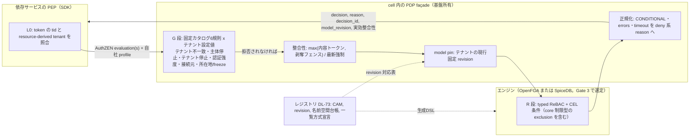
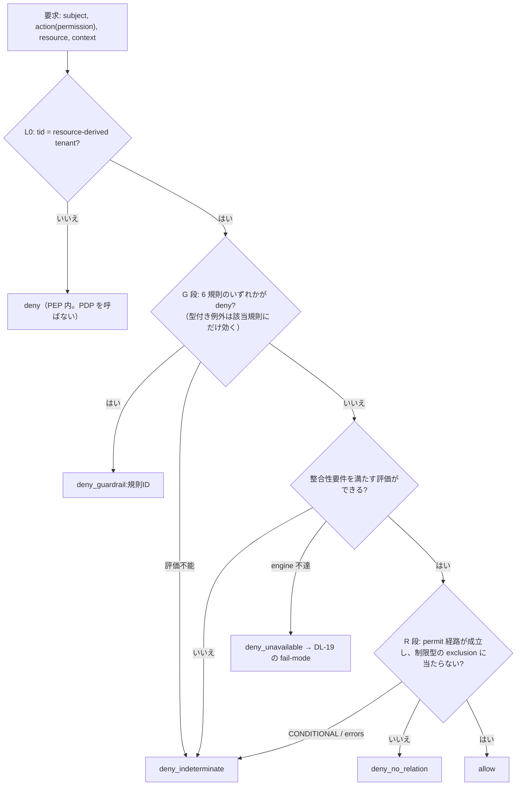
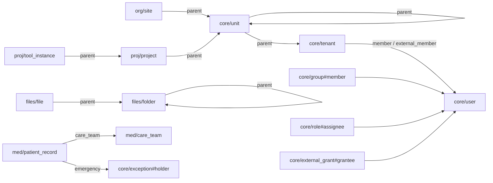
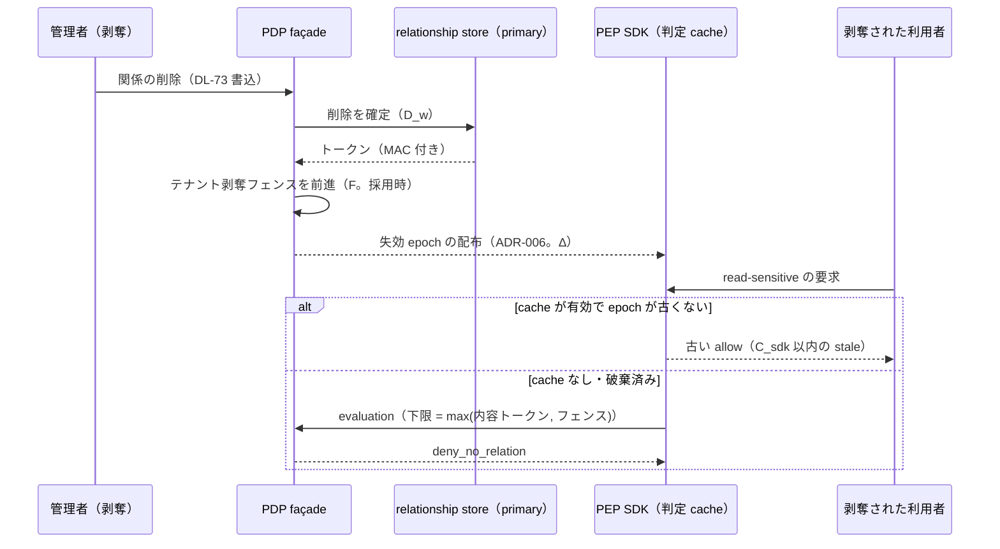
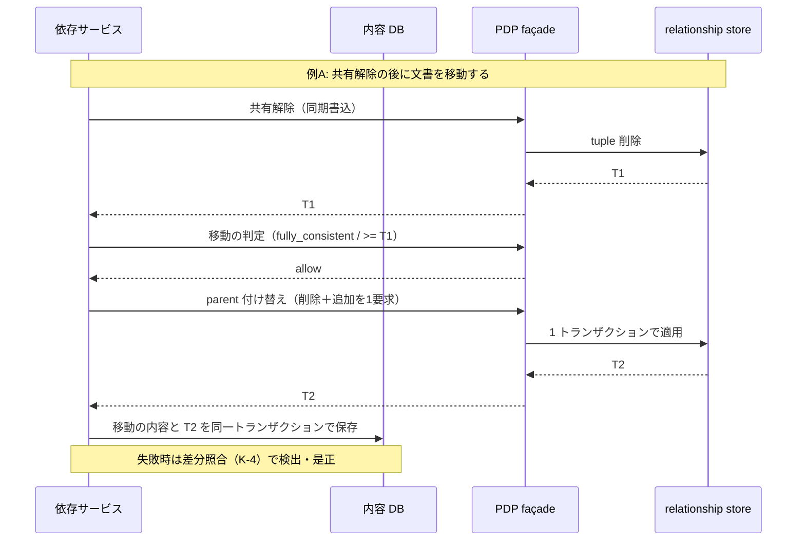
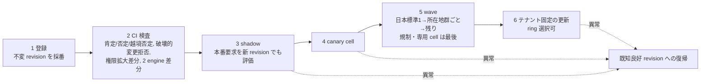

# 認可モデル・整合性・剥奪仕様

> 文書ID: ARC-05 / 版: 0.4 / 状態: review / 最終更新: 2026-10-15（0.4（PoC/R7反映）: PoC 実測レポート POC-02 と独立再現ログ、模擬パネル ラウンド 7 の指摘により、§3.6.3 に group の循環・深さの書込時拒否、§5 に関係書込の subject のテナント検査、§9.4 に TC-008 の観測、§11.1 に K-4 の PoC 未実装、§15 に TC-ARC05-16・17 と PoC 結果、§17・レビュー記録を加えた。PoC の値は自己実行の参考値で Gate 4 の証拠ではない）
> 対応要求: R-142〜R-149, R-191.3, R-205, R-250, R-252, R-253, R-271, G-107, G-108, G-109, G-110, G-112, G-113（本書を対応成果物に含む全行。閉じ方は末尾の対応表）
> 依存文書: CONVENTIONS.md, traceability/deliverables.md（DL-17）, 05_adr/ADR-010・ADR-011・ADR-016・ADR-024・ADR-025（設計判断の正本）, 05_adr/ADR-006・ADR-013・ADR-017・ADR-021・ADR-026・ADR-027・ADR-029, 05_adr/reconciliation-notes.md（U-03, U-04）, 02_requirements/operation-risk-tiers-assurance.md（REQ-03。操作 5 分類の正本）, 01_governance/assumptions-register.md, 01_governance/loss-scenarios.md, 01_governance/kri.md, 03_threat-model/threat-catalog.md（T-027〜T-034, T-080）, research/RS-07, RS-08, RS-17（各 verification 記録を含む）, research/RS-18（独立検証記録なし。§3.6 の注記）, research/standards-status.md, traceability/claims-ledger.md, traceability/dissent-log.md（DS-15, DS-16）
> 改版: v0.3（RS-18反映（2026-10-15））で、テナント配下の階層モデル（§3.6）、core 型の追加案（§3.1）、containment の命名規則 X-11〜X-13（§3.3）、深度と祖先閉包の関係（§3.4）、§8.3・§8.4 の例の書換え、決裁案 K05-6〜K05-8、残課題 15〜19 を加えた。RS-18 は独立検証（research/README.md の P3）を経ていないため、本書は RS-18 を設計の入力として引き、事実の根拠には本反映で再取得した原典だけを使った[^37] [D]。
> 作成方法: AI エージェント（Claude）が上記の ADR と調査ノートから起草した。本書の判断は ADR の決定を仕様に落としたものであり、ADR に反する設計は置いていない。ADR で決まっていない点は「未決（ADR-0xx）」と書いた。v0.2 は作成者とは別の AI エージェント（Claude）による独立レビューの修正を反映した（末尾「レビュー記録」）。CTO/CISO の決裁を経ていない（CONVENTIONS §8）[D]。

---

## 0. 結論

1. **認可モデルは「基盤所有の core 型＋ドメイン拡張」の型システムで、判定は L0・G 段・R 段の論理積とする** [D]。正本は基盤所有の正規認可モデル（CAM）で、エンジンの DSL は生成物である（ADR-011 D2-1）[D]。横断型（user、tenant、group、role、client、workload、外部付与・共有リンク、制限型、型付き例外）は予約名前空間 `core` に置き、ドメインは `<名前空間コード>/<型名>` の型と relation だけを足す（ADR-021 D21-26）[D]。ドメインには forbid を書かせず、縮小は `core` の制限型（exclusion）だけで表し、テナント境界の deny はエンジンのモデルに入れず façade 前段で決定論的に評価する（ADR-010 D-28、ADR-011 D3-4）[D]。既定拒否・deny 優先・評価不能は deny を基本規則として公開する（ADR-011 D3-1〜D3-3）[D]。
2. **整合性は操作階層ごとに割り当て、採用候補が実際に保証する範囲を構成単位で書く** [D]。write・privileged は最新強制、read-sensitive は「内容トークンとテナント剥奪フェンスの新しい方」以降、public は判定しない（ADR-010 D-13、REQ-03 §3.6）[D]。SpiceDB（PostgreSQL）は内容版トークン（ZedToken）を公式機能として持つ一方、OpenFGA は同等機能を「検討中」としており、整合性の指定は MINIMIZE_LATENCY と HIGHER_CONSISTENCY（キャッシュを使わず DB を読む）の 2 つだけである [V][^2][^11]（RS-07#13, #14, #26, #27）。そのため OpenFGA 採用時の read-sensitive は時間窓での近似になり、窓方式を許すかは未決（ADR-010 決裁案 2、reconciliation-notes U-03）である [D]。Zanzibar 論文との同等性は主張しない（§9.4）[D]。
3. **剥奪から拒否までの最大時間は単一の値ではなく、階層ごとに 5 つの項（正本への確定、エンジンの鮮度窓、レプリカ遅延、フェンス反映、PEP 判定 cache）の和で構成する** [D]（ADR-010 D-19、ADR-006 D6-10）。経路ごとの失効状態の配布遅延 Δ_p と、再判定しない経路の残存 Z_p を加えた全体の式は §10.1 に置き、ARC-09 §4 と ARC-01 §6.8 の R(t, c) の分解と同じ形にしている [D]（ADR-006 D6-29）。調べた公式文書に上限を保証する記述はない [D]（RS-07 §2 第 2 項）。各項の値は TBD で、BIA と PoC の実測（§15 の TC-ARC05-03〜07）で決める [D]。予算は ADR-006 D6-29 と ADR-010 D-19 に従い項の和で置く [D]。
4. **コンテンツ更新と relation 更新は、分散トランザクションではなく「順序規則＋整合性トークン＋transactional outbox＋差分照合」で因果的に結合する** [D]。剥奪は façade への同期書込を内容変更より先に確定させ、付与は outbox による非同期反映を許す（付与の遅れは deny 側に倒れる）[D]。移動のように「旧関係の削除と新関係の追加」を伴う変更は、1 回の relationship 書込要求にまとめる。両候補とも 1 要求の中の書込・削除を全体として成功または失敗させると公式に記述している [V][^34][^35]。内容 DB と relationship store をまたぐ原子性は得られないので、残る窓を PoC で測る（R-145）[D]。
5. **モデル変更は model revision の pin → CI 検査 → shadow → canary cell → wave → テナント固定の更新の 6 段で展開し、剥奪状態はモデル版から切り離す** [D]（ADR-016 D16-30〜D16-36、ADR-013 D13-35）。SpiceDB には schema の版がないため、テナント別の pin を façade とレジストリで実現する方式は未決とし、Gate 3 の決裁案にした（§16 K05-5）[D]。
6. **テナント配下の階層は「どこに属すか（containment）」「誰が属すか（membership）」「誰が管理するか（管理委任範囲）」の 3 つの関係に分け、一本の木に押し込まない（RS-18反映（2026-10-15））** [D][^37]。containment は単一親の木（`core/tenant` を根、再帰コンテナ `core/unit`、ドメインの型付き葉）、membership は n:n の `core/group`、管理委任は非ネストの `core/admin_scope` で表す案とし、containment の relation 名は `parent` に統一する（§3.6、決裁案 K05-6・K05-7）[D]。循環と深さは階層サービスが書込時に検査し、組織の木を辿る継承は祖先閉包（`ancestor`）の事前計算で 1 hop に畳んで解決深度の設計値 8 [A-036] に収める案を決裁案 K05-8 とした [D]。階層・所属・選択中の unit は token に載せず、PDP が正本から評価する（ADR-021 D21-38 規則 2）[D]。いずれもエンジンの検証器を通していない（残課題 16）[D]。
7. **閉じ方**: 本書で机上（A）として閉じるのは R-142（記述方式）・R-250・R-252・R-253・G-107（定義と測定方法）・G-109 の 6 件である [D]。R-142 の「実保証範囲」は公式文書の範囲で書いたが、構成ごとの実挙動は実測（TC-ARC05-01）を待つ [D]。残る 14 件は PoC（E4・E5）または決裁が要る [D]（末尾の対応表）。

---

## 1. 本書の位置付けと読み方

### 1.1 位置付け

| 項目 | 内容 |
|---|---|
| 本書が定めるもの | 型システムと拡張規則、合成と deny semantics、custom role・越境共有・一覧の認可モデル上の表現、サンプルモデル、操作階層別の整合性モード、剥奪→拒否の時間の構成、内容と関係の因果結合、model pin・shadow・段階展開の手順、柔軟性の測り方 [D] |
| 本書が決めないもの | エンジン製品（Gate 3。ADR-010 D-1）、数値の確定値（DL-20）、PDP 不達時の挙動の全セル（DL-19）、PEP–PDP の電文（DL-72）、書込・レジストリ API の電文（DL-73）、開発者向けの手順（DL-65）[D] |
| 正本の関係 | 設計判断は 05_adr/ が正本である。本書と ADR が食い違う場合は ADR が優先し、本書を直す [D] |
| 読み手 | CTO・CISO は §0、§9、§10、§16、残課題、§18 を読めば判断に必要な点を押さえられる。連携開発者はまず §1.3 の義務一覧を読み、詳細は §3〜§8、§11、§12 を読む [D] |

### 1.2 用語

| 用語 | 意味 |
|---|---|
| CAM | 正規認可モデル（Canonical Authorization Model）。JSON Schema で検証できる宣言データで、型・relation・permission・CEL 条件・G 段規則・例外型・permission catalog を持つ（ADR-011 D2-1）[D] |
| L0 / G 段 / R 段 | L0 は PEP SDK のテナント照合、G 段は façade が評価する基盤所有の deny、R 段はエンジンが評価する typed ReBAC と CEL 条件（ADR-011 D1-1）[D] |
| model revision | レジストリ（DL-73）が採番する不変のモデル版（ADR-011 D2-7）[D] |
| 整合性トークン | façade が発行する `版‖エンジン識別‖エンジン固有値または書込時刻‖MAC` 形式の不透明値（ADR-010 D-14）[D] |
| テナント剥奪フェンス | 剥奪の書込で得たトークンをテナント単位に保持した評価下限（ADR-010 D-18。採用候補で、PoC 合格が有効化の条件）[D] |
| 失効 epoch | 剥奪・失効の配布状態の版（ADR-013 D13-24、ADR-006）。フェンスとは別の検査である [D] |
| new enemy | 例 A: フォルダから人を外した後に新しい文書を移す。例 B: 剥奪の後に内容を追記する。古い ACL が新しい内容に適用される問題 [V][^1]（RS-07#4） |

### 1.3 連携開発者（依存サービス）が行うこと

本書から依存サービスの実装義務を抜き出した一覧である [D]。詳細は各節にあり、手順書は DL-65、適合の確認は DL-80 の契約試験キットで行う [D]。

| # | 行うこと | してはならないこと | 節 |
|---|---|---|---|
| I-1 | 資源型・relation・permission を自ドメインの名前空間（`<名前空間コード>/<型名>`）でレジストリ（DL-73）に登録し、各 permission に操作階層の印を付ける | `core` 型への relation 追加・改名、独自の forbid（exclusion）、型ワイルドカードの直接型 | §3.2, §3.3 |
| I-2 | 再帰 relation の最大深度と relation ごとの `max_direct` を宣言し、フォルダ等の作成・移動時に深度を検査する | 宣言を超える入れ子の作成 | §3.4 |
| I-3 | 判定は PEP SDK 経由で façade の evaluation/evaluations だけを呼ぶ。`consistency.mode` は省略してよい（façade が操作階層から既定を選ぶ） | エンジンの API・SDK の直接呼出し、PEP SDK の外での allow の cache（ADR-006 D6-10） | §2, §9.1 |
| I-4 | 内容を保存する資源は整合性トークン列（最大 1,024 バイト、初期案）を持ち、内容と同じ DB トランザクションで保存し、読取時に `consistency.token` で渡す | トークンの解釈・加工 | §9.2 |
| I-5 | 権限を狭める relation の変更は façade への同期書込で確定させてから内容を変更し、権限を広げる変更だけを transactional outbox で非同期にする | 剥奪を outbox で後回しにすること | §11.1, §11.2 |
| I-6 | 旧親の削除と新親の追加は 1 回の書込要求（100 tuple 以下）にまとめる。超える場合は「狭める変更を全て確定 → 広げる変更」の順に bulk レーンで流す | 広げる変更を先に流すこと | §11.2, §11.3 |
| I-7 | 内容 DB と relationship store の差分照合（K-4）の仕組みを用意する（照合周期は TBD） | — | §11.1, §11.4 |
| I-8 | 一覧・検索は SDK の一覧ヘルパだけを使い、資源型ごとに L1〜L3 の方式を宣言する | ListObjects・LookupResources・AuthZEN search の直接呼出し、post-check 前の件数の表示 | §7 |
| I-9 | モデル変更は §12 の 6 段（登録 → CI → shadow → canary → wave → テナント固定の更新）で出す。§8 のサンプルではなく DL-65 の検証済みの版を写す | 生成 DSL の手編集、6 段を経ない本番反映 | §8.1, §12 |

---

## 2. 全体像



- 最終判定は「L0 と G 段で拒否されず、かつ R 段が許可」の場合だけ許可である（ADR-011 D1-1）[D]。
- 依存サービスが呼んでよいのは façade の AuthZEN 1.0 evaluation/evaluations と自社 profile、書込は DL-73 の書込契約だけである（ADR-010 D-7、ADR-011 D5-4・D7-3）[D]。AuthZEN 1.0 は OpenID Final Specification（2026-01-11、standards-status SS-C13 で final、確認日 2026-10-03）で、PDP の状態管理を範囲外にしている [N][^18]（RS-07#60, #61）。

---

## 3. 共通型システム

### 3.1 基盤所有の core 型

core の型は基盤チームだけが変更でき、変更は基盤の変更審査（二者承認）を通す [D]（ADR-011 D1-2・D2-6、ADR-021 D21-25）。

| 型（CAM 名） | 主な relation | 用途・制約 | 根拠 |
|---|---|---|---|
| `core/user` | （主体。relation なし） | 人間の主体。sub は全類型共通の単一名前空間から払い出した不透明 ID（ADR-021 D21-10）[D]。RS-18反映（2026-10-15）: tuple・AuthZEN の主体は `(type, id)` の組で運び、id は人もシステムも同じ sub の値域、type が主体の型を表す（§3.6.5）。主体の型を sub の文字列や `user_id` のような列名から推論させない [D][^37] | ADR-021 |
| `core/workload`, `core/client` | （主体） | 非人間主体。AI エージェントの主体種別の表し方（`core/user` と分けた型にするか属性にするか）は未決（ADR-017）[D] | ADR-017 D17-16、ADR-021 D21-26 |
| `core/tenant` | `member`, `external_member`, `admin`, `security_admin`, `role_manager` | テナントの根。`external_member` は外部付与で入る主体の userset で、façade が外部付与の作成・失効と同時に書き換える（ドメインは書けない。X-8）。G 段規則 1 の所属確認（ADR-024 D24-08）の入力 [D] | ADR-024 D24-08 |
| `core/group` | `member`（`core/user`, `core/group#member`）。RS-18反映（2026-10-15）で `owner_unit`（`core/unit`, `core/tenant`。継承に使わない帰属）を追加する案（K05-6） | 入れ子は深度予算に含める（§3.4）。既定のグループ（全メンバー等）に外部主体を入れない [D]。containment の木に入れない（`parent` を持たない）。入れ子は DAG を許す唯一の構造とする（§3.6.2）[D] | ADR-024 D24-02 |
| `core/unit`（新設案。RS-18反映（2026-10-15）、K05-6 の決裁前） | `parent`（`core/unit`, `core/tenant`。単一値）, `admin`, `member`, `admin_scope` | テナント内の部署・子会社・支社などを表す単一親の再帰コンテナ。呼び名の違いは表示属性 `kind`（テナントが定義する語彙。認可判定に使わない）で持つ。深さ上限は 5 を初期案とする（NA-ARC05-1、§3.6.3）[D][^37] | RS-18、ADR-021 D21-26 |
| `core/admin_scope`（新設案。同上） | `delegate`（`core/user`, `core/group#member`）、`owner_unit` | 管理委任の範囲。ネストしない（`parent` を持たない）。主体・unit は複数の admin_scope に属し得る。管理操作の permission にだけ効き、閲覧系 permission には効かない [D][^37] | RS-18 |
| `core/role` | `assignee`（`core/user`, `core/group#member`） | custom role。policy ではなくデータで表す（§5）[D] | ADR-011 D4-1 |
| `core/external_grant` | `grantee`（`core/user` に期限条件付き） | 越境共有の外部付与。付与 ID・期限・双方ポリシー版は付与記録に持ち、tuple には期限条件だけを付ける（§6）[D] | ADR-024 D24-01, D24-11 |
| `core/share_link` | `holder`（リンク利用で作られる外部付与） | 認証付きリンク。匿名リンクは公開分類に限り R 段で判定しない（public）[D] | ADR-024 D24-06 |
| `core/restriction` | 型としては持たず、各資源型に予約 relation `restricted_external`（`core/tenant#external_member`）を生成する | 子で外部主体の継承を止める唯一の手段。ドメインはこの relation を独自に定義できない [D] | ADR-024 D24-11、ADR-011 D3-4 |
| `core/exception` | `holder`（`core/user` に期限条件付き） | 型付き例外（break-glass/B、JIT の特権付与）。期限・付与者・承認者・監査を必須とする [D] | ADR-011 D3-5、ADR-029 D29-80 |

- 横断型を基盤が所有するのは、テナント境界・越境共有・横断型をドメインに委ねるとチームごとに意味論がばらつくからである [D]（RS-17#96 項 1・7）。OpenFGA の modular models は、多くのチームが関わると所有の境界が不明確になりレビューがスケールしない課題に対し、モジュール分割と code owners による所有の表現を提供している [V][^19]（RS-17#85）。
- core 型の relation 名と意味は不可逆側に属する（ADR-010 可逆性 (3)、ADR-011 可逆性 (2)）。追加は可、改名・削除は ADR-021 D21-27 の多段手順に限る [D]。

### 3.2 permission catalog と印

permission catalog は CAM の一部で、各 permission に次の印を付ける（ADR-011 D2-1、D4-2、ADR-024 D24-12）[D]。

| 印 | 意味 | 付与できる者 |
|---|---|---|
| テナント委譲可 | custom role に入れてよい | テナントの `role_manager`（作成者が持たない permission は入れられない。ADR-011 D4-3） |
| 外部付与可 | `core/external_grant#grantee` を直接型に許してよい | 資源の付与権限者。上限はテナント設定で縮小のみ（ADR-024 D24-17） |
| 基盤予約 | テナント設定の最低基準の変更、他テナントへの共有の方針、監査の無効化など。custom role・外部付与のいずれにも入れられない | 基盤のみ |
| 操作階層 | REQ-03 の 5 分類と修飾子。permission の階層がその permission で評価する整合性モード（§9）を決める | 各ドメイン責任者が登録し、privileged 以上は基盤＋CISO が審査（REQ-03 §2.4） |

- レジストリは「外部付与可でない permission の計算式に `core/external_grant#grantee` が到達する」モデルを CI で拒否する [D]。到達判定は CAM の型グラフ上の静的解析で行い、データに依存しない [D]。

### 3.3 ドメイン拡張規則

| # | 規則 | 理由・根拠 | 検査 |
|---|---|---|---|
| X-1 名前空間 | 資源型は `<名前空間コード>/<型名>`。名前空間コードは中央台帳（DL-71 付表）が払い出し、組織名・チーム名・製品名を含めず、再利用しない | ADR-021 D21-25・D21-26 [D] | lint：未登録の型・relation を拒否（ADR-021 TC-021-16） |
| X-2 命名 | 名前空間コード・型名・relation 名・permission 名は ASCII 小文字・数字・下線だけを使い、先頭は英字、末尾は英数字、各 3〜64 文字とする（案）。relation は名詞（`owner`, `parent`）、permission は動詞（`read`, `share`）に分ける。`core` の予約語（`restricted_external`, `external_member` など）を使わない | SpiceDB の識別子は 3〜64 文字、先頭は英小文字または下線、以降は英小文字・数字・下線、末尾は英数字と定められている [V][^36]。OpenFGA の識別子規則は公式文書で確認できていない（未確認）ため、X-2 は SpiceDB の規則に先頭英字の制約を足した案である [D]。OpenFGA で `/` を含む型名が使えるかとあわせて TC-ARC05-10 で確かめ、DL-73 凍結前に確定する（所有者 認可・PDP チーム） | lint |
| X-3 拡張の範囲 | ドメインは `core` 型を type extension で拡張してよいが、既存の relation や他の拡張と重なる relation は追加できない。`core/tenant` に権限を与える relation（管理権限）は追加できない | OpenFGA の type extension は既存関係との重複を禁じる [V][^19]（RS-17#85）。管理権限の追加は基盤予約 [D] | lint |
| X-4 他ドメイン参照 | 他ドメインの型の relation を参照してよいのは、その型の所有ドメインがレジストリで「公開」と宣言した relation に限る | 所有の境界を越えた暗黙の依存を作らないため [D]。公開宣言の変更は破壊的変更の検査対象（ADR-016）[D] | lint |
| X-5 deny の禁止 | ドメインは exclusion（but not）を自前の relation で書けない。縮小は `restricted_external` と基盤が提供する制限型だけ | ADR-011 D3-4、RS-17#96 項 7 [D] | lint |
| X-6 ワイルドカード | 型ワイルドカード（全主体）を直接型に許す relation を作らない。公開は public 階層として R 段で判定しない | ADR-024 D24-09 はワイルドカードのテナント指定を禁じる。全主体への許可は越境の経路になる [D] | lint |
| X-7 再帰 | 再帰は宣言済みの `parent` 型 relation（tuple-to-userset）に限り、再帰 relation ごとに最大深度を宣言する | 深度予算の管理（§3.4）[D] | lint＋書込時検査 |
| X-8 書込権限 | サービスが書ける relation をレジストリで宣言し、宣言外の relation の書込を façade が拒否する | 関係データの書込権限は判定権限と等価になる（T-033）[D] | façade の受付制御、TH-TC-033 |
| X-9 識別子 | tuple の主体・資源 ID は不透明 ID。業務上の識別名（患者名、ファイル名）を入れない。テナント ID を資源 ID に埋め込まない | ADR-010 D-12、T-034、A-071 [D] | lint＋書込時検査 |
| X-10 破壊的変更 | データがある relation の削除と改名を拒否し、改名は追加 → 二重書込 → backfill → 旧参照削除 → 旧定義削除の順に限る。削除した名前は再利用しない | SpiceDB はデータがある relation・参照中の relation の削除を拒否し、移行の多段手順を示す [V][^22]（RS-17#88）。ADR-021 D21-27 [D] | CI（ADR-011 D2-5 の 2） |
| X-11 containment の名前（RS-18反映（2026-10-15）、K05-7） | containment（「どこに属すか」。ライフサイクルと下方継承の経路）の辺は、どの型でも `parent` という名前の単一値 relation にする。直接型は宣言した親の型に限る（例: `parent: [core/unit, core/tenant]`）。v0.2 の §8.3・§8.4 の `unit`・`project` のように containment を別名で書かない | 上下関係を名前だけで機械的に判別でき、X-7「再帰は `parent` に限る」と揃う。型付きの親で「プロジェクトの下に会社を置く」誤りを書込時に拒否できる [D][^37] | lint（containment 宣言の relation 名と単一値） |
| X-12 containment でない参照（同上） | 担当部署・所管ユニットのような containment でない参照は役割の名詞（`owning_unit`, `care_team` など）にし、`parent` の名前を使わない。推移の有無（親へ推移するか、子へ継承するか）は permission の式で明示し、relation 名に頼らない | 継承経路と単なる関連を混同しない。ネストの効果を一様に決め打ちしない [D][^37] | lint（`parent` 以外の relation を containment 宣言に使わない） |
| X-13 祖先閉包（同上、K05-8） | `ancestor` は予約名とし、階層サービスだけが正本の closure table から書く複数値 relation とする。ドメインは定義・書込みできず、permission の式で参照だけできる | 生成物と手書きの tuple を区別する。X-8 の書込宣言で階層サービス以外の書込を拒否する [D][^37] | lint（予約語）、façade の書込受付制御 |

### 3.4 深さ・fanout・規模の上限

| 上限 | 初期値・設計値 | 根拠 | 確定方法 |
|---|---|---|---|
| 解決深度の設計値 | 8（フォルダ入れ子 5＋グループ入れ子 3）。規制強化シナリオで 10。RS-18反映（2026-10-15）: この 8 は組織の木（unit の深さ）を含まない。組織の木を `parent->` で素朴に辿る継承を許すと最悪経路は 15 前後になり設計値を超えるので、§3.6.4 の祖先閉包で unit の部分を 1 hop に畳む案（K05-8）とする | [A-036]、§3.6.4 [D][^37] | TC-ARC05-08 で深度 8・10・25 の tail latency を測る。祖先閉包あり・なしの両方を測る。所有者 CTO（ARB）、期限 G4 |
| エンジンの解決深度上限 | OpenFGA `resolveNodeLimit` 既定 25 [V][^4]（RS-07#19）、SpiceDB `--dispatch-max-depth` 既定 50 [V][^15]（RS-07#35）。エンジン差替えの条件は新エンジンの上限が設計値を下回らないこと（ADR-011 D10-1 C-8） | [V] | 設定値は DL-73 の構成台帳に記録 |
| 再帰 relation ごとの最大深度宣言 | 宣言値の合計 ≤ 設計値。フォルダの入れ子はドメインサービスが移動・作成時に深度を検査し、超える操作を拒否する | エンジンの深度上限に当たると Check が失敗し、評価不能（deny）になる [D] | X-7 の lint と書込時検査 |
| fanout（1 つの userset の直接要素数） | 最大テナントの全員グループで 10 万（成長 30 万）を想定する。relation ごとに `max_direct` を宣言し、超える付与は個人ではなくグループ・テナント単位の userset で書くよう lint で警告する | [A-036, A-009]。fanout は Check の tail latency と PDP の計算量増幅（T-031）に効く [D] | TC-ARC05-08 |
| モデルあたりの型定義数 | OpenFGA は既定 100（設定項目 `maxTypesPerAuthorizationModel`）[V][^4]（RS-07#19）。本節の OpenFGA の既定値は設定リファレンスの v1.20.0 表示によるもので、最新リリース v1.21.0 で変わっていないかは未確認である（RS-07 §6）[D] | 30 ドメイン（A-051）が平均 3 型を超えて定義すると既定値を超え得る [D][A-051] | §16 K05-2 |
| 1 書込要求の tuple 数 | OpenFGA `maxTuplesPerWrite` 既定 100 [V][^4]（RS-07#19）、SpiceDB の WriteRelationships 1 回の更新件数は既定 1,000 [V][^15]（RS-07#35）。CAM の対話書込は小さい方の 100 を上限にする | 両候補の共通部分（ADR-011 D2-2）[D] | 超える変更は bulk レーン（ADR-010 D-29・H-13）で、原子性なしの順序規則（§11.3）に従う |
| CEL 条件 | 要求時 context 4,096 バイト以下、評価コスト 100 以下（両候補の既定のうち小さい方）| SpiceDB の caveat context 既定 4,096 バイト [V][^15]、OpenFGA の CEL コスト既定 100 [V][^9]（RS-07#22, #32）。ADR-010 D-31、ADR-011 D1-3 | 条件カタログの登録時に検査 |
| テナントあたりの custom role 数 | TBD | ADR-011 D4-5（所有者 プロダクト責任者＋CTO、期限 G4、決め方 TC-011-09 の遅延・隔離の実測） | — |

### 3.5 限定 ABAC：条件カタログと属性辞書

- R 段の ABAC は、基盤の条件カタログに登録した CEL 部分集合の条件に限る [D]（ADR-011 D1-3、ADR-010 D-30・D-31）。入力は要求 context（時刻、接続元、認証強度、端末状態、データ区分）と、tuple に付けた小さな属性（期限など）に限る [D]（ADR-011 D1-3、ADR-010 D-31）。利用目的は ADR-011 D9-5 の属性辞書の候補区分「目的・同意」から渡す [D]。D1-3 の列挙に利用目的がない点は末尾「ADR への指摘」に記した [D]。OpenFGA の conditions と SpiceDB の caveats は、どちらも関係に CEL の条件を付ける方式である [V][^9][^13]（RS-07#22, #32）。
- 資源の属性に基づく条件は、関係か型に写して表す（例: 「機密区分が高い文書」は `classification` の型付き relation にする）[D]（ADR-011 D1-3）。
- 条件 context に入れる属性は、属性辞書（ADR-011 D9-4）の出所メタデータ（出所、確認時刻、有効期間、失効の参照先、保証の強さ、データ分類）を持つものに限る [D]。属性が古い、または出所を検証できない場合は評価不能（deny）とする [D]（ADR-011 D9-4）。これは旧提案が PIP の属性の鮮度・所有者を定めていなかった点（CL-0105）への回答である [D]。
- 条件の追加は基盤の変更審査を通し、条件 ID を CAM に記録する [D]。下表の条件 ID は CAM 上の名前で、生成器が X-2 に合う各エンジンの識別子（例: `c_not_expired`）に写す [D]。任意 script や汎用 policy の持込みは例外承認制である（ADR-011 D1-3）[D]。

| 条件 ID（案） | 内容 | 入力 | 用途 |
|---|---|---|---|
| `c.not_expired` | `now < expires_at` | 要求 context の時刻、tuple の期限 | 外部付与・型付き例外・期限付き付与 |
| `c.time_window` | 曜日・時間帯の範囲内 | 時刻、tuple の範囲 | 勤務時間内だけの閲覧 |
| `c.network_zone` | 接続元が許可ゾーンに含まれる | 接続元ゾーン（edge が付与） | 拠点からのアクセス限定 |
| `c.min_acr` | 認証強度が下限以上 | `acr`（G 段規則 4 と重複しない資源個別の要件に限る） | 医療記録の閲覧 |
| `c.device_managed` | 管理端末である | 端末状態（属性辞書の出所付き） | 機微資料のダウンロード |
| `c.purpose_in` | 利用目的が許可された集合に含まれる | 利用目的（要求 context）、tuple の許可目的 | 医療・研究目的の制御 |

### 3.6 テナント配下の階層モデル（RS-18反映（2026-10-15））

本節は research/RS-18 の結論を本書の型システムに写したものである[^37] [D]。RS-18 は独立検証（research/README.md の P3）を経ていないので、本節では RS-18 を設計の入力として扱い、事実の主張には本反映で原典を再取得して照合したもの（脚注 [^38]〜[^42]）だけを使う [D]。決裁が要る点は K05-6〜K05-8（§16）に置いた [D]。

#### 3.6.1 三つの関係と 4 つの core 型

「組織 id・プロジェクト id・グループ id」が乱立し上下関係が曖昧になる原因は、性質の異なる三つの関係を一つの「組織」概念や一本の木で表そうとすることにある [D][^37]。本書は三つを別の型で表す [D]。

| 関係 | 形 | 用途 | 本基盤の型（案） | 前例（原典で確認した範囲） |
|---|---|---|---|---|
| containment（どこに属すか） | 単一親の木。深さ上限あり | ライフサイクルの束縛、permission の下方継承 | `core/tenant`（根）、`core/unit`（再帰コンテナ、`kind` 属性）、ドメインの型付き葉（`proj/project` など） | GCP の folder・資源の親はちょうど 1 つで、folder の入れ子は 10 段まで [V][^41]。AWS の OU は root の下 5 段まで [V][^39]。Azure の management group と subscription の親は 1 つだけで、木の深さは root と subscription の段を除いて 6 段まで [V][^40] |
| membership（誰が属すか） | n:n。入れ子は深度予算の範囲で可（DAG） | 付与先の主体集合 | `core/group` | — |
| 管理委任範囲（誰が管理するか） | フラット。多重所属可 | 管理操作の範囲だけを限る | `core/admin_scope` | Entra の administrative unit は入れ子にできず、利用者は複数の AU に属せる。AU は管理権限の範囲だけを限り、既定の利用者権限による閲覧は妨げない [V][^42] |

- 4 型は `core/tenant`・`core/unit`・`core/group`・`core/admin_scope` である [D]。`core/unit` と `core/admin_scope` は core への追加なので基盤の変更審査（二者承認、M3）を通す（§3.1、K05-6）[D]。
- 「事業部・部・課・子会社・支社」のように段数も呼び名もテナントごとに違う節点は、すべて `core/unit` で表し、違いは表示属性 `kind`（`division`、`department`、`subsidiary` など。テナントが定義する語彙）で持つ [D][^37]。`kind` は認可判定に使わない [D]。
- 「プロジェクト」「ワークスペース」のように固有の permission と生存期間を持つ節点は、ドメインの型（`proj/project` など）として作り、`parent: [core/unit, core/tenant]` で木の葉にする [D][^37]。こうすると API とデータモデルでは「組織 id」「プロジェクト id」という列が消え、上下関係は `parent: {type, id}` の一つの形だけで表される [D]。
- 型名に `organization` を使わない [D]。tenant の別名か unit の一種かが読み手で揺れるからである [D][^37]。顧客に見せる呼称は `kind` の表示名で決める [D]。
- 汎用の `node` 型一つにすべてを寄せる案は採らない [D]。許す親の型を宣言できなくなり、誤った親子を書込時に拒否できず、ListObjects を型で絞れなくなる [D]。これは調べたエンジンの例示の書き方からの推論で、ベンダーが明言した記述ではない（RS-18 の注記どおり）[D][^37]。

#### 3.6.2 木と DAG の区別

- containment は木に限り、DAG を許すのは `core/group` の入れ子だけにする [D]。複数の親を許すと「移動」の意味（どの親から外すか）が決まらず、継承が菱形になって deny と継承の解決順が複雑になるためである [D][^37]。
- マトリクス組織（一人が二つの部署に属する）は、木を増やさずに `core/group` と `core/admin_scope` の多重所属で表す [D]。
- 推移の向きは permission の式で relation ごとに明示する（X-12）[D]。例: `member` は親へ推移させない、`admin`（管理）は子へ継承する [D][^37]。

#### 3.6.3 循環・深さの検査は階層サービスが行う

- 認可エンジンに循環の検出を任せない [D]。SpiceDB は権限グラフが木であることを前提にし、専用の循環検出器を持たず、循環は最大深さ（既定 50 hops）に達したエラーとしてだけ現れる [V][^38]。OpenFGA が tuple 上の循環をどう扱うかは公式文書で確認できていない（未確認、残課題 17）[D]。
- 循環を防ぐ責任は、`core/unit` と葉ノードの containment の正本を持つ**階層サービス**（基盤所有。新設案）が負う [D]。`parent` の付け替え要求では、(1) 移動先がその節点自身の部分木に含まれないこと、(2) 移動後の深さが上限以内であること、(3) 移動先の型が直接型の宣言に合うことを、親の付け替えと同じ DB トランザクションの中で検査し、満たさなければ拒否する [D][^37]。
- 正本は隣接リスト（`parent_id`）と closure table を併せて持つ [D][^37]。定期照合では再帰 CTE で循環と深さ超過を検出し、K-4（差分照合）の対象に含める [D]。
- **PoC/R7反映（版 0.4）: membership（`core/group#member` の入れ子）にも書込時の検査を置く** [D]。group は DAG（§3.6.2）なので親の付け替えの検査では止まらず、関係書込 API（façade）が (1) 入れ子の循環、(2) 入れ子の深さ上限（§3.4）の超過を、書込と同じトランザクションで拒否する [D]。PoC 系統 1 の TC-002 では、関係書込 API がこれを拒否せず、生成器が作った group の循環で Cedar 構成の判定が評価不能（`input graph has a cycle`）になり、正例の失敗が上限を超えて TC が中止した（OB-TI-01。fail-closed で越境 allow はない。自己実行の参考値）[D][^43]。OpenFGA 構成は同じ循環で判定を続けたので、エンジンごとに循環の扱いが違うことも、検査をエンジンに任せない理由になる（残課題 17）[D]。
- unit の深さ上限は 5 を初期案とする（NA-ARC05-1、前提台帳へ追加要）[D]。AWS（5 段）[V][^39] と Azure（6 段）[V][^40] の上限を参考にした値で、TC-ARC05-08 の実測で確定する（K05-8）[D]。

#### 3.6.4 祖先閉包の事前計算と設計値 8（決裁案 K05-8）

- 組織の木を `parent->` で素朴に辿ると、ファイル→フォルダ 5 段→プロジェクト→unit 5 段→テナント、にグループ 3 段が加わり、最悪経路は 15 前後になる [D][^37]。エンジンの既定上限（OpenFGA 25、SpiceDB 50）の内側だが、設計値 8 [A-036] を大きく超える [D]。
- 選択肢は (a) unit の木からの継承を管理系 permission（`manage`）に限り、閲覧系は葉ノードの直接付与かグループで表す、(b) 祖先閉包を事前計算し、unit の部分を 1 hop に畳む、(c) 設計値を引き上げる、の 3 つである [D]。本書は (a)＋(b) の併用を決裁案 K05-8 の推奨とし、設計値 8 は変えない [D]。
- (b) の形: 階層サービスが closure table から、各葉ノードに `ancestor: [core/unit, core/tenant]` の tuple（祖先 1 つにつき 1 tuple）を書く [D][^37]。permission は `ancestor->manage` の 1 hop で評価でき、木の深さに依存しない [D]。人から直接所属するグループへの対応はフラット化せず直接リンクのまま残す [D]。RS-18 はこれを Zanzibar の Leopard（group 間の推移閉包だけをフラット化する）と同じ向きの設計と説明しているが、Leopard の節は RS-07 の検証範囲外で照合していないため、本書はこの対応を根拠にしない [D][^37]。
- 代償は移動時に現れる [D]。unit を一つ動かすと「部分木の葉の数×祖先数」の tuple を書き換え、100 tuple（§3.4）を超えれば bulk レーンで原子性がなくなる [D]。そのため旧祖先の削除を同期で先に確定させ、新祖先の追加を outbox で後から反映させる（K-1 の剥奪先行と同じ順序規則。中間状態は deny 側に倒れる）[D]。差分照合（K-4）に閉包と正本の照合を加える [D]。
- 設計値 8 との関係（K05-8 の決裁で確定する）: (a)＋(b) を採れば、組織の木を含む最悪経路は「ファイル→フォルダ 5＋`ancestor` 1＋グループ 3」に近づくが、custom role の 1 hop を足すと 9〜10 になり得る（INT-03 §7.2 の数え方）[D]。設計値 8 を守るか、規制強化シナリオの 10 を通常値に繰り上げるかは TC-ARC05-08（祖先閉包あり・なし）の実測で決める [D][A-036]。

#### 3.6.5 識別子・パス・token の扱い

| 項目 | 形式 | 規則 | 根拠 |
|---|---|---|---|
| unit・葉ノードの参照 | `{"type":"core/unit","id":"<不透明 ID>"}` | ID は ADR-021 D21-09/D21-14 の不透明 ID。テナント・パス・時刻・業務上の意味を含めない。移動・改名・テナント統合を経ても変えず、墓石化して再利用しない | ADR-021 D21-09, D21-13, D21-14、ADR-010 D-12 [D] |
| 主体の参照 | `{"type":"core/user"\|"core/workload"\|"core/client", "id":"<sub>"}` | id は人もシステムも同じ単一名前空間の sub。型は type で別に運び、ID 文字列に接頭辞を付けない。依存サービスのデータモデル・API でも `user_id` ではなく `subject_id`（値は sub）と `subject_type` の 2 欄で持つ | ADR-021 D21-10・D21-26（AuthZEN の Subject.type と型名を揃える）[D][^37] |
| 親 | `parent: {type, id}`（単一値） | 移動は現在の親を明示させる楽観的並行制御で行う。移動元と移動先の両方の `manage` を要求する | §3.6.6 [D] |
| 祖先列（派生） | ID の列 | closure table から生成し、一覧・検索の索引（ADR-025 の L3）にだけ使う。token と認可キーには使わない | [D][^37] |
| 表示パス・`kind`・表示名 | 文字列 | 表示専用。名前は同じ親の下で一意にするだけで、認可に使わない | [D][^37] |
| token | `sub`・`tid`・`client_id`・主体種別・`act` だけ | 階層（unit・プロジェクト・祖先列）、所属、選択中の unit は token に載せない。選択中の unit は UI の文脈として BFF のセッション状態か要求パラメータで運び、PDP は要求された資源の containment を正本から評価する | ADR-021 D21-38 規則 2、ADR-011 D9-1、ARC-15 §3.6 [D] |

#### 3.6.6 移動・再編・M&A と `owner_unit`

- `move`（`parent` の付け替え）は、移動元と移動先の両方の `manage` を要求し、現在の親を指定させ、§3.6.3 の検査を同じトランザクションで行う [D]。Azure も移動には子・現在の親・移動先の親の 3 つへの書込権限を要求する [V][^40]。
- 契約上の約束として「直接付与は保持し、継承分は再評価する」ことを明記する [D][^37]。外部付与のある部分木への出入りは write＋XT として扱う（ADR-024 D24-13）[D]。旧親の削除と新親の追加は 1 回の書込要求にまとめる（I-6）[D]。
- テナントの統合は、吸収される側の根の直下を存続テナントの unit の下に接ぎ木し、統合元の tid は墓石と alias にする（ADR-021 D21-29）[D]。分割は unit の部分木を新しい tid の根の下へ切り出す（ADR-021 D21-30）[D]。
- 分割の前に分割元と分割先をまたぐ参照を全件列挙する必要がある（ADR-028 D28-40）[D]。木の外にある `core/group` と `core/admin_scope` の帰属が曖昧だと列挙が漏れるので、両者に継承には使わない帰属用 relation `owner_unit` を持たせ、境界をまたぐ参照を closure table の結合で洗い出せるようにする（K05-6）[D][^37]。テナント分割の公式手順はどのベンダーにも見つからなかったと RS-18 は記しており、`owner_unit` による列挙が機能するかは PoC の分割演習でしか確かめられない（残課題 18）[D][^37]。

#### 3.6.7 RS-18 の未検証事項

- RS-18 のモデル例（CAM 擬似表記、OpenFGA DSL、SpiceDB schema、Cedar schema）と本書 §8.3・§8.4 の書換え後の例は、どのエンジンの検証器（`fga model test`、`zed validate`）にも通していない [D]。E4 は未取得で、TC-ARC05-10 で検証する（残課題 16）[D]。
- RS-18 は独立検証記録（research/verification/RS-18-verification.md）がない [D]。本節の [V] は本反映で再取得した 5 つの原典（[^38]〜[^42]）に限り、それ以外の RS-18 の事実記述（OpenFGA の循環エラーの版、Salesforce・ServiceNow・Auth0・Keycloak・WorkOS などの記述、テナント分割の前例の不在）は結論の根拠にしていない [D]。RS-18 には二次情報（ベンダーのブログ記事）も含まれる [D]。

---

## 4. 合成と deny semantics

### 4.1 評価の順序



### 4.2 ReBAC と ABAC 条件の合成規則

| # | 規則 | 理由 |
|---|---|---|
| C-1 | 条件は permit の経路（tuple）に付け、その経路を絞るためだけに使う。「条件が真なら拒否」を R 段の条件で書かない | deny を R 段に入れると、ドメインごとに deny の意味がばらつく。deny は G 段と core 制限型に限る（ADR-011 D3-2・D3-4）[D] |
| C-2 | 複数の経路は和（union）で合成する。ある経路の条件が偽でも、別の経路が成立すれば許可する | 加算の意味論（ADR-024 D24-11）。GitHub は異なる経路の権限を合算すると明記する [V][^29]（RS-17#94） |
| C-3 | 全経路に共通に課したい条件（例: 医療記録は常に `c.min_acr`）は、permission の計算式で intersection として書く | 経路ごとに書くと書き漏れが起きる [D] |
| C-4 | 条件の入力が欠けた場合は評価不能（deny）。SpiceDB の CONDITIONAL 応答も deny に写す | ADR-011 D3-3、ADR-010 D-34。SpiceDB は context 不足で CONDITIONAL を返す [V][^13]（RS-07#32）。OpenFGA の挙動は未確認（RS-07 §6）で、TC-ARC05-09 で確かめる [D] |
| C-5 | 要求ごとに entity 階層を呼出側が組み立てる方式は主経路にしない | Cedar は評価が error になった policy を skip するため、entity の欠落が許可に変わり得る [V][^17]（RS-07#39〜#41）。ADR-011 D1-4 [D] |

### 4.3 deny semantics

| 規則 | 内容 | 出典 |
|---|---|---|
| 既定拒否 | permit が一つも成立しなければ拒否 | ADR-011 D3-1。AWS IAM は既定で全要求を暗黙に拒否する [V][^24]（RS-17#91） |
| deny 優先 | L0・G 段の deny は R 段の結果に関わらず拒否 | ADR-011 D3-2。Google Cloud IAM は deny policy を allow policy より先に評価する [V][^23]（RS-17#90） |
| 評価不能は deny | 属性・entity・context の欠落、条件の型誤り、鮮度を満たせない、未対応の profile major、CONDITIONAL | ADR-011 D3-3。Google Cloud IAM は評価できない deny rule を適用する [V][^23]（RS-17#90） |
| 不達は意味論から分離 | engine・façade に届かない場合は `deny_unavailable` で返し、階層別 fail-mode（DL-19、ADR-013 D13-25）で扱う。評価不能を既知良好 cache で許可に変えない | ADR-011 D3-6 |
| fail-open 禁止 | 認可判定の fail-open はどの階層でも禁止 | ADR-013 D13-23 |
| 剥奪の単調性 | 剥奪・失効の状態はモデル・policy の版と切り離し、版の rollback で権限を復活させない | ADR-010 D-20、ADR-013 D13-35、ADR-016 D16-35 |

### 4.4 conflict resolution

| 衝突 | 解決 | 例 |
|---|---|---|
| G 段 deny と R 段 permit | G 段が勝つ。打ち消せるのは G 段規則に付いた型付き例外だけ（ドメインの permit では打ち消せない）| 停止中の主体がフォルダの owner でも拒否 [D]（ADR-011 D3-5） |
| core 制限型の exclusion と R 段 permit | exclusion が勝つ | `restricted_external` を付けた子フォルダでは、親から継承した外部付与も子への直接付与も無効 [D] |
| 複数の permit 経路 | 和。条件は経路ごとに評価 | 同じ文書に owner 経路（無条件）と外部付与経路（期限切れ）がある内部利用者は owner で許可 [D] |
| custom role と G 段 | custom role で G 段の deny を外せない | ADR-011 D4-4 |
| モデル revision の不一致 | 要求の `model.pin` があればその revision、なければテナントの現行固定 revision。最新 revision では評価しない | ADR-011 D6-1、ADR-016 D16-30 |
| evaluations（複数判定） | 「全て必要」は `deny_on_first_deny`、「いずれか」は `permit_on_first_permit`（privileged 以上では使用禁止）、一覧の post-check は `execute_all` | ADR-011 D3-7 [N][^18] |

- `reason` は閉じた列挙（`allow`, `deny_guardrail:<規則ID>`, `deny_no_relation`, `deny_indeterminate`, `deny_unavailable`, `unsupported_profile`）とし、エンドユーザーには返さない（ADR-011 D6-1）[D]。外部付与・型付き例外による許可を区別する reason の追加は ADR-024 D24-20 が DL-72 に申し送っており、値は未決（ADR-024・DL-72）である [D]。

---

## 5. custom role

| 項目 | 仕様 | 出典 |
|---|---|---|
| 表現 | `core/role` の object と `assignee` 関係で表すデータ。資源の relation が `core/role#assignee` を直接型として許し、role と資源上の relation を tuple で結ぶ | ADR-011 D4-1。OpenFGA の公式文書は、役割が動的で頻繁に変わり得るため別の型として表すと説明している [V][^27] |
| 範囲 | テナント全体に効く role は、資源型が `core/tenant` から継承する relation を持つ場合に限り、テナントの根に結ぶ。資源単位の role は資源（またはフォルダ・プロジェクト）に結ぶ | fanout を増やさないため、テナント根への結び付けは permission 単位に限る [D] |
| 入れられる permission | permission catalog の「テナント委譲可」だけ。基盤予約は入れられない。作成者が持たない permission を含む role は作れない。全権的な basic role に相当するものは作らせない | ADR-011 D4-2・D4-3。Google Cloud は basic role を本番で付与しないよう述べる [V][^26]（RS-17#89） |
| 自動拡張の禁止 | catalog に permission を追加しても既存 role は広がらない | Google Cloud の custom role も自動で更新されない [V][^26]（RS-17#89）。ADR-011 D4-3 |
| 新しい種類の permission を role に開放 | 資源の relation の直接型に `core/role#assignee` がなければ、その relation は role 経由で付与できない。開放するときは、当該 relation の直接型に `core/role#assignee` を加えるモデル変更を §12 の 6 段で出す [D]。これはモデル構造からの推論で、OpenFGA の Custom Roles 文書はこの点を記述していない [V][^27] | ADR-011 D4-1 [D] |
| 変更の階層 | role の定義（作成・変更）と、利用者・グループへの role の付与（`assignee` の書込）は privileged/T（REQ-03 §6.2「一般ロールの付与」）。role を個々の資源の relation に結ぶ書込は資源単位の関係の変更なので write（REQ-03 §6.1）。保護操作の permission を role に加える変更はそれ自体を保護操作とする | ADR-011 D4-4、REQ-03 §6.1・§6.2 |
| 保守責任 | テナントの custom role はテナント管理者が保守する。基盤は catalog の変更を通知する | RS-17#96 項 6 [D] |
| 割当ての経路とテナント検査（PoC/R7反映、版 0.4） | role を資源の relation に結ぶ書込（`core/role:<id>#assignee` を subject とする tuple）は、role サービスの API だけでなく façade の関係書込 API からも行えるので、両方の経路で「role の所属テナント＝資源の所属テナント＝要求のテナント文脈」を検査し、一致しなければ拒否する。subject 側の検査はドメインの CAM から導かず、基盤が正本で引く。外部付与の作成 API だけを例外とする | ADR-010 D-28 の注記、ADR-011 D1-2 の注記、ADR-024 D24-08a（案）。PoC 系統 1 の TC-021 で、façade の関係書込 API が他テナントの role を subject として、ドメイン writer の資格情報で受理した（昇格の成立 1 件。role サービスは拒否。自己実行の参考値）[D][^43] |

---

## 6. 越境共有

ADR-024 の決定を認可モデルに写す [D]。

| 論点 | モデル上の表現 | 出典 |
|---|---|---|
| 基本形 | ゲストは資源側テナントの文脈で認証し、tid＝資源側テナントの token を受け取る。資源側には `core/external_grant` の object と、`grantee` への期限条件付き tuple を置く。アカウントは作らない | ADR-024 D24-01 |
| 三者一致 | token の tid・route テナント・resource-derived tenant の一致に、共有由来の例外は作らない。G 段規則 1 は「(i)≠(iii) なら拒否。一致しても内部所属も有効な外部付与もなければ拒否」 | ADR-024 D24-07・D24-08。ADR-011 D1-2 の文言の書換えは未決（ADR-024 L-1） |
| 継承 | 外部付与は共有の起点となる資源に付け、`parent` の tuple-to-userset で子へ継承する | ADR-024 D24-11。Google Drive も子が親の権限を継承する [V][^28]（RS-17#93） |
| 子での縮小 | 子に `restricted_external` を書くと、その部分木では外部主体の許可が無効になる。ドメインに独自の forbid は書かせない | ADR-024 D24-11。Drive では継承した権限を子で縮小できない [V][^28]。本基盤は外部主体に限って縮小を許す [D] |
| 上限 | 外部付与可の permission だけ。管理者ロール・privileged 以上・custom role の作成と付与は外部主体に与えられない。再共有は既定で不可 | ADR-024 D24-12 |
| 付与先 | v1 は個人の人間主体だけ。home 側のテナント・グループを付与先にしない。非人間主体を外部付与の付与先にしない。資源側テナントのグループに外部主体を入れられるのは、グループ型を「外部可」と宣言した場合だけ（既定のグループには入れない） | ADR-024 D24-02（K24-4 は決裁待ち） |
| 移動 | 外部付与のある部分木へ資源を移す操作は write＋XT とし、データ分類を検査する。部分木の外へ移すと継承した外部アクセスは失われる。移動は §11 の因果結合の規則に従う | ADR-024 D24-13 |
| 取消し | 個別取消し・期限切れは資源側 cell の失効状態配布と G 段の所属確認で反映する。home 側の停止は非同期イベントで伝え、届かない場合もゲスト session の上限 H_g で止まる | ADR-024 D24-16・D24-21 |
| 一覧 | 外部主体の一覧・検索の範囲は付与された資源とその子孫に限る | ADR-024 D24-12、ADR-025 |

- 外部付与の tuple は `core` 名前空間の型で内部所属と区別できるため、越境の tuple を名前空間で区別し定期棚卸しする T-080 の予防策に使える [D]（ADR-024 D24-11）。

---

## 7. 一覧・検索

ADR-025 の決定を認可モデル側の規則として示す [D]。

| 規則 | 内容 | 出典 |
|---|---|---|
| post-check が唯一の根拠 | 返すページの各資源を返却直前に evaluations（`execute_all`）で評価する。候補を作る段（エンジン列挙、ドメイン検索、ACL 反映索引）の結果は認可の根拠にしない | ADR-025 D25-04 |
| 方式の宣言 | 資源型ごとに L1（エンジン列挙。アクセス可能件数の p99 が約 1,000 件以下）、L2（検索してから post-filter。許可割合 0.5 以上）、L3（ACL 反映索引）を選び、レジストリに宣言する。宣言の変更はモデル変更と同じ 6 段（§12）を通す | ADR-025 D25-05。OpenFGA は ListObjects を既定 3 秒・1,000 件で打ち切る [V][^7]（RS-07#20）。SpiceDB は 1 万件を超えると重いとする [V][^14]（RS-07#33）。OpenFGA は検索フィルタの方式を 3 つ示し、件数が多く割合が低い場合は変更購読からの索引を勧める [V][^8]（RS-07#21） |
| テナントで最初に絞る | 候補の生成はテナントで絞った範囲から始める。ただしテナント境界の最終判断は façade 前段の deny | ADR-025 D25-06 |
| 不完全の明示 | 打切り・索引遅延・予算超過は `completeness=incomplete` と理由で返す | ADR-025 D25-07・D25-11・D25-21 |
| 件数・ファセット・補完 | 件数は既定で返さず、返す場合は post-check 後の件数を上限付きで返す。ファセット・補完も post-check を通った集合から作る | ADR-025 D25-13・D25-14。Elastic は DLS 有効時に suggester を無視する [V][^32]（RS-08#62） |
| 存在の秘匿 | 「存在しない」と「見る権限がない」を同じ応答にする | ADR-025 D25-16、REQ-03 §2.1 |
| 整合性 | post-check は read-sensitive の規則（max(内容トークン, フェンス)）で評価する。索引の遅延は欠落（付与の未反映）にはなるが、post-check があるため stale allow の窓を広げない | ADR-025 D25-04・D25-11 |
| モデル設計への含意 | L1 を選ぶ資源型では、主体側の所属 userset の列挙が L1 の上限に収まるよう、グループの入れ子と fanout を §3.4 の宣言内に保つ。L3 の資源型は、ACL 欄に展開する継承経路（`parent`）を宣言する | ADR-025 D25-08・D25-10 [D] |

---

## 8. サンプルモデル

### 8.1 表記と検証状態

- 以下は CAM の内容を読みやすい擬似表記で示したものである [D]。`a | b` は和、`a & b` は積、`a - b` は exclusion、`x->r` は relation `x` が指す object の relation `r`（tuple-to-userset）、`[T]` は直接型、`with c` は条件を表す [D]。
- **本節のモデルはエンジンの検証器を通していない** [D]。旧提案の例示モデルは、フォルダの owner がファイルを読めないなどの誤りを持ち、特定エンジンの検証器を通らない擬似構文だった（CL-0171、処置「修正」）[D]。本書の例は、生成した DSL を OpenFGA の `fga model test` と SpiceDB の `zed validate`・assertion に通し、肯定・否定・テナント越えの試験を付けるまで E4 を取得していない [V][^20][^21]（RS-17#86, #87）。検証は TC-ARC05-10 で行い、検証済みの版は DL-65 に置く [D]。
- 全ての例で、資源の所有テナントは資源の正本ストアに記録された不変の属性であり、tuple の ID に埋め込まない（ADR-010 D-12、ADR-024 D24-10）[D]。



### 8.2 ファイル・フォルダ（CL-0171 の修正を含む）

```text
type files/folder
  relations
    parent:              [files/folder]
    owner:               [core/user]
    editor:              [core/user, core/group#member, core/role#assignee] | owner | parent->editor
    viewer:              [core/user, core/group#member, core/role#assignee, core/external_grant#grantee with c.not_expired]
                         | editor | parent->viewer
    restricted_external: [core/tenant#external_member]          # core が生成する予約 relation
  permissions
    read   = viewer - restricted_external - parent->restricted_external_inherited
    write  = editor - restricted_external
    share  = owner                                               # テナント外への共有は +XT（REQ-03 §6.1）
    restricted_external_inherited = restricted_external | parent->restricted_external_inherited

type files/file
  relations
    parent:  [files/folder]
    owner:   [core/user]
    editor:  [core/user, core/group#member] | owner | parent->editor
    viewer:  [core/user, core/group#member, core/external_grant#grantee with c.not_expired] | editor | parent->viewer
  permissions
    read   = viewer - parent->restricted_external_inherited
    write  = editor - parent->restricted_external_inherited
    delete = owner | parent->owner
```

- 旧提案の誤り（CL-0171）は、file の read が `parent.viewer` だけを、write が `parent.editor` だけを継承していたため、フォルダの owner は file を読み書きできず、フォルダの editor は write だけを得た点である [D]。上の例では folder の `viewer` が `editor` を、`editor` が `owner` を含むので、`parent->viewer` の継承でフォルダの owner・editor も file を読める [D]。
- 外部付与は `viewer` の直接型にだけ許し、`editor`・`owner` には許さない（「外部付与可」は read だけ、の例）[D]。
- `restricted_external_inherited` は部分木での縮小を表す計算 relation で、ドメインではなく core の生成器が付ける [D]。

| 試験（TC-ARC05-10 の一部。期待値） | 期待 |
|---|---|
| フォルダ F の owner は F の子ファイルを read・write できる | allow |
| F の viewer は子ファイルを write できない | deny |
| F に外部付与（期限内）を持つゲストは、F の孫ファイルを read できる | allow |
| 同じゲストは、`restricted_external` を付けた子フォルダ配下のファイルを read できない | deny |
| 期限切れの外部付与 | deny（`c.not_expired` が偽） |
| 他テナントの主体を viewer に書いた不正 tuple（ATK-06）| deny（token の tid が資源のテナントと違えば L0、一致しても内部所属・外部付与がなければ G 段規則 1。R 段に到達しない） |

### 8.3 組織・拠点

RS-18反映（2026-10-15）: v0.2 はドメイン型 `org/unit` と containment の別名 `unit` で書いていた。本版は K05-6・K05-7 の推奨案（`core/unit` への昇格、containment の `parent` 統一）の形に書き換えた [D][^37]。K05-6 が不採用なら `core/unit` を `org/unit` に読み替え、K05-7 が不採用なら v0.2 の relation 名に戻す [D]。INT-03 §9.2 の予備実行済みの例は v0.2 の形のまま残っている（INT-03 の写像表）[D]。

```text
type core/unit                                     # 基盤所有（K05-6 の決裁前の案）。kind は表示属性で判定に使わない
  relations
    parent:       [core/unit, core/tenant]         # 単一値。循環・深さ・型は階層サービスが書込時に検査（§3.6.3）
    admin:        [core/user, core/group#member]
    member:       [core/user, core/group#member]   # 親へ推移しない（X-12）
    admin_scope:  [core/admin_scope]
  permissions
    manage            = admin | parent->manage     # 管理は子へ継承する
    view_directory    = member | manage            # 上位部門の所属者にも見せるかは業務規程で選び、式で明示する
    manage_membership = manage | admin_scope->delegate   # 委任範囲は管理操作にだけ効く（§3.6.1）

type core/admin_scope                              # ネストしない（parent を持たない）
  relations
    delegate:     [core/user, core/group#member]
    owner_unit:   [core/unit, core/tenant]         # 分割時の帰属の列挙用。継承に使わない（§3.6.6）

type org/site
  relations
    parent:   [core/unit, core/tenant]             # v0.2 の unit を parent に改名（X-11）
    staff:    [core/user with c.network_zone]
  permissions
    enter_system = staff | parent->manage
```

- 上位部門から下位部門へ閲覧を継承するか、逆にするかは業務規程の選択であり、モデルはどちらも表せる [D]。継承の向きはドメイン責任者が決め、レジストリに記録する [D]。
- 拠点の接続元条件は、拠点の staff への tuple に `c.network_zone` を付けて表す [D]。テナント全体の接続元条件は G 段規則 5 で扱い、R 段に重複させない [D]（ADR-011 D1-2）。

### 8.4 プロジェクト・ツール

```text
type proj/project
  relations
    parent:   [core/unit, core/tenant]             # RS-18反映: v0.2 の unit を parent に改名（X-11）
    ancestor: [core/unit, core/tenant]             # 階層サービスだけが書く祖先閉包（X-13。K05-8 の決裁前の案）
    owner:    [core/user]
    member:   [core/user, core/group#member, core/role#assignee] | owner
    guest:    [core/external_grant#grantee with c.not_expired]
  permissions
    view   = member | guest | ancestor->manage     # 1 hop。unit の深さに依存しない（§3.6.4）
    admin  = owner

type proj/tool_instance
  relations
    parent:   [proj/project]                       # RS-18反映: v0.2 の project を parent に改名（X-11）
    operator: [core/user, core/role#assignee]
  permissions
    use    = parent->member | operator
    view   = parent->view
    config = parent->admin                        # 操作階層はドメイン責任者が REQ-03 §2.2 の判定規則で決め catalog に登録
```

- K05-8 で祖先閉包を採らない場合は、`view` の `ancestor->manage` を `parent->manage` に戻し、unit の深さ分の hop を §3.4 の深度予算に数える [D]。`ancestor` に `core/tenant` を含めるのは、テナント直下のプロジェクトでもテナント管理者の継承を同じ式で書くためである [D]。
- B2B の委託先（他社の担当者）は `guest` で表し、ゲストは `use`（ツールの実行）を持たない例にした [D]。ツールの実行を委託先に許す場合は、`use` に permission catalog の「外部付与可」の印を付け、かつ `use` の計算式に `guest` を加えるモデル変更を §12 の 6 段で出す [D]。

### 8.5 医療記録

```text
type med/care_team
  relations
    member:  [core/user with c.time_window]

type med/patient_record
  relations
    attending:  [core/user]
    care_team:  [med/care_team]
    emergency:  [core/exception#holder with c.not_expired]      # break-glass/B の型付き例外
    acr_gate:   [core/tenant#member with c.min_acr]              # 記録の作成時に 1 tuple 書く（outbox 可。K-2）
  permissions
    read_clinical = ((attending | care_team->member) & acr_gate) | emergency
    read_billing  = attending
    append        = attending | care_team->member
```

- `acr_gate` は C-3 の「全経路に共通の条件」を、ワイルドカード（X-6 で禁止）を使わずにテナント所属の userset に条件を付けて表した例である [D]。tuple が未作成の間は read_clinical が deny に倒れる [D]。userset を主体とする条件付き tuple が両エンジンで同じ判定になるかは TC-ARC05-10 で確かめる [D]。
- 担当外の患者の緊急閲覧（REQ-03 §6.4 の break-glass/B）は、本基盤の PDP 上の型付き例外として扱う（ADR-029 D29-80）[D]。例外の作成時に理由・対象 1 患者・時間限定を必須にし、テナント責任者への即時通知と事後レビュー票を基盤が提供する [D]。評価は fresh で、判定記録を必須にする（ADR-010 D-13 の break-glass 行を /B に限る解釈。ADR-029 L29-2）[D]。
- 項目単位の制御（臨床情報と請求情報）は permission を分けて表す（`read_clinical`, `read_billing`）[D]。列単位の統制をデータ基盤で行う経路は DL-57 の範囲である [D]。
- tuple の存在そのもの（ある利用者がある診療記録の担当であること）が機微情報になり得る [D][A-071]。患者記録の ID は不透明 ID とし、`med/patient_record` の一覧・存在確認は AU-2 全件の記録対象にする（REQ-03 §3.8）[D]。
- 利用目的による制御（研究目的の閲覧など）は `c.purpose_in` の条件で表し、同意の有無は属性辞書の出所付き属性として PIP から渡す [D]（ADR-011 D9-5）。

### 8.6 管理機能

```text
extend type core/tenant                      # 基盤所有。ドメインは拡張できない（X-3）
  relations
    admin:          [core/user]
    security_admin: [core/user]
    role_manager:   [core/user, core/role#assignee]
  permissions
    manage_roles   = role_manager | admin
    manage_idp     = security_admin            # privileged/T。二者承認は申請 workflow 側（下表）
    view_audit     = security_admin | admin
    revoke_session = security_admin | admin    # 権限縮小方向（REQ-03 J8）。事前承認なし
```

- 管理機能の permission は基盤予約で、custom role に入れられるのは「テナント委譲可」の印のあるもの（例: `view_audit`）だけである [D]（ADR-011 D4-2）。
- 外部主体には管理機能を与えられない（ADR-024 D24-12）。`core/external_grant#grantee` は上の relation の直接型に入らない [D]。

### 8.7 typed ReBAC＋限定 ABAC で表せる要件と表せない要件

G-108 の認可要件カタログの全件判定は DL-65 と PoC（TC-ARC05-11）で行う [D]。本書は代表要件について机上の判定を示す（モデル検証ツールでの判定は未実施）[D]。

| 要件の類型 | 表現 | 机上判定 | 表せない部分の代替手段 |
|---|---|---|---|
| 文書・フォルダの階層継承 | `parent` の tuple-to-userset | 表せる | — |
| 組織階層・拠点 | `core/unit`（案）・`org/site`、管理委任は `core/admin_scope`（案）（§3.6。RS-18反映（2026-10-15）） | 表せる | マトリクス組織は木を増やさず group・admin_scope の多重所属で表す |
| プロジェクト・ツール | `proj/*` | 表せる | — |
| B2B の委託 | 外部付与（ADR-024） | 表せる | 相手テナント単位の付与は v1 で提供しない（K24-4） |
| 属性条件（区分・等級） | 型付き relation へ写像 | 表せる（写像が要る） | 写像できない連続値は条件カタログに登録 |
| 時間・デバイス | `c.time_window`, `c.device_managed` | 表せる | 端末状態の鮮度は属性辞書の管理 |
| 承認ワークフロー | ReBAC では表せない | 表せない | 申請・承認の状態を業務側の workflow が持ち、承認済みの付与を期限付き tuple または型付き例外として書く |
| 職務分離（申請者≠承認者、相反する役割の同時保持の禁止） | 「同一主体が両方を持たない」は ReBAC の和・積・exclusion では書けるが、静的な保持の禁止は書込時の検査が要る | 一部表せる | 承認時の主体比較は workflow で行う。相反役割の同時保持は付与時に façade の書込検査で拒否（未決: 書込検査を G 段の拡張にするか DL-73 の検査にするか。§16 K05-4） |
| 項目・列単位 | permission の分割 | 表せる（粒度が粗い） | 列単位はデータ基盤の統制（DL-57） |
| 利用目的・同意 | `c.purpose_in`＋属性辞書 | 表せる | 同意の取得・撤回は ADR-014 の範囲 |
| 代理人・保護者・代理店による代理操作 | 委任関係の relation と `act`（ADR-017） | 一部表せる | 代理の範囲・期限は委任 grant 側（ADR-017、ADR-026）。アクセス制御に使えるのは top-level claim と現在の actor（RFC 8693。ADR-011 D9-2） |
| 業務上の緊急アクセスと事後審査 | `core/exception`（break-glass/B） | 表せる | 事後審査は ADR-029 の手順 |
| 件数上限（1 日 N 件まで閲覧可など） | ReBAC・CEL では表せない | 表せない | 業務側の rate 制御と監査の検知（RS-13 の不正対策） |

---

## 9. 操作階層別の整合性モード

### 9.1 割当て

| 階層（REQ-03） | 要件（REQ-03 §3.6） | façade の挙動 | SpiceDB への写像 | OpenFGA への写像 | PEP 判定 cache |
|---|---|---|---|---|---|
| public | 判定不要 | 判定しない（静的な公開設定） | — | — | — |
| read-sensitive | bounded（上限 B は TBD） | 評価の下限 = max(内容トークン, テナント剥奪フェンス)。両方ない資源は B 以内の古さを許す | 下限トークンで `at_least_as_fresh`。なければ `minimize_latency` [V][^11] | 未決（U-03）: (a) 下限の時刻から窓 W の間は HIGHER_CONSISTENCY、以後 MINIMIZE_LATENCY（ADR-010 D-13）、(b) 下限がある要求は常に HIGHER_CONSISTENCY（ADR-011 D6-3） | 可。最大齢 ≤ min(B, B_rs)、失効 epoch が進めば破棄（ADR-006 D6-10） |
| write | fresh | content-change check を最新で評価し、返したトークンを内容と同じトランザクションで保存させる | `fully_consistent`（PostgreSQL）[V][^11] | HIGHER_CONSISTENCY（primary を読む）[V][^2][^3] | 使わない |
| privileged | fresh（トークンだけに頼らない） | 最新を強制 | `fully_consistent` | HIGHER_CONSISTENCY。非同期レプリカを使わない | 使わない |
| break-glass/B | fresh＋判定記録必須 | 最新を強制し判定記録を必須（ADR-029 D29-80） | 同上 | 同上 | 使わない |
| break-glass/P | 緊急権限の記録を最新で確認 | 本基盤の PDP に依存しない別経路（ADR-013 D13-25、ADR-029 L29-2） | 対象外 | 対象外 | — |

- 要求に `consistency.mode` がなければ、façade は permission の操作階層から上の既定を選ぶ（ADR-011 D6-1 の「欠ければ操作階層ごとの既定（DL-17）」）[D]。要求が既定より弱いモードを指定しても、既定に格上げする [D]（ADR-011 D6-3 の格下げ不可）。
- 検証できないトークン（版不明、エンジン識別の不一致、MAC 不一致）は fresh として扱う（ADR-010 D-15）[D]。トークンの MAC 鍵と alg は ADR-007・ADR-015 の版管理に従う（ADR-010 D-16）[D]。
- 一つの要求の中に複数の操作が含まれる場合は最上位の階層で評価する（REQ-03 J6）[D]。

### 9.2 整合性トークンの保存契約（依存サービスの義務）

| # | 義務 | 根拠 |
|---|---|---|
| CT-1 | 内容を保存する資源は、最後の content-change check（または relationship 書込）で得たトークンを、内容と同じ DB トランザクションで保存する列を持つ | ADR-010 D-14、NA-010-3（前提台帳へ追加要）。Zanzibar の zookie は content-change check で得て内容と原子的に保存する [V][^1]（RS-07#5）。SpiceDB の文書も ZedToken を内容と一緒に保存する方式を示す [V][^11]（RS-07#27） |
| CT-2 | 読取時はその資源のトークンを `consistency.token` に入れて渡す | ADR-011 D6-1 |
| CT-3 | トークンは不透明文字列として保存・返送するだけで解釈しない。最大長は契約上 1,024 バイト（初期案。DL-72 凍結前に候補エンジンの実測で確定） | ADR-010 D-14、ADR-011 D6-4、NA-010-2 |
| CT-4 | トークン列を追加できないサービスは read-sensitive を最新強制で扱う。その費用は TC-010-04（ADR-010 H-04）で測る | ADR-010 §4.4 |

### 9.3 構成と整合性指定の対応（DS-15）

公式文書の記述と、それが成り立つ構成条件を対応付ける [D]（DS-15 の処置）。版は確認日 2026-10-03 の最新リリース（OpenFGA v1.21.0、SpiceDB v1.56.2）で、文書ページには版表記のないものが多い [V][^4][^11]（RS-07#25, #37）。

| エンジン × datastore × 構成 | 指定 | 公式文書の記述 | 本書の扱い |
|---|---|---|---|
| OpenFGA × PostgreSQL、Check cache 無効、レプリカなし | 任意 | キャッシュ無効時は consistency mode に関わらず strong consistency [V][^2]（RS-07#15） | 実測で確かめるまで「最新に見える」とは扱わない（TC-ARC05-01）[D] |
| OpenFGA × PostgreSQL、Check cache 有効（TTL 既定 10s） | MINIMIZE_LATENCY | 書込直後の Check に tuple の変更が反映されないことがある [V][^2]（RS-07#13）。本番では cache 有効を推奨しつつ、それが staleness を増やすと書く [V][^5]（RS-07#17） | read-sensitive の鮮度窓に cache TTL を計上する [D] |
| OpenFGA × PostgreSQL、非同期読取レプリカ | MINIMIZE_LATENCY | 非同期複製は read-after-write 不整合（replica lag）があり得る [V][^3]（RS-07#16） | read-sensitive 以上で非同期レプリカを使わないことを既定にする（ADR-010 D-13）[D] |
| OpenFGA × 任意 | HIGHER_CONSISTENCY | cache を使わず DB（primary）を読む [V][^2][^3] | HIGHER_CONSISTENCY が「あるトークンの時点以降」を保証するかは確認できていない。等価な保証として扱わない（ADR-011 D6-3）[D] |
| SpiceDB × PostgreSQL | `at_least_as_fresh` | ZedToken 以降のデータで評価する [V][^11]（RS-07#26） | read-sensitive のトークン経路 [D] |
| SpiceDB × PostgreSQL | `minimize_latency` | 単独で使うと new enemy の窓が生じ得る。窓は revision 量子化（既定 5s）と最大 staleness 比率（既定 0.1）、follower read の遅延で決まる [V][^11][^15]（RS-07#26, #28） | トークンのない read-sensitive に限る [D] |
| SpiceDB × PostgreSQL | `fully_consistent` | 最新で評価する [V][^11] | write・privileged [D] |
| SpiceDB × CockroachDB | `fully_consistent` | CockroachDB 上では read-after-write を保証しない。ZedToken と `at_least_as_fresh` の併用を指示 [V][^11]。別ページの比較表は条件なしに保証と書き、食い違う [V][^12]（RS-07#29） | 現時点で比較対象外（ADR-010 D-5 の格上げ条件が不成立）[D] |

### 9.4 採用候補が実際に保証する範囲（R-142）

| 性質 | SpiceDB × PostgreSQL（候補） | OpenFGA × PostgreSQL（候補） | 本書の扱い |
|---|---|---|---|
| 内容の版と因果的に結び付けた評価（new enemy 例 B） | 公式機能（ZedToken＋`at_least_as_fresh`）[V][^11] | 公式機能なし（「検討中」）[V][^2]（RS-07#14） | OpenFGA では時間窓の近似か常時最新強制（U-03）。窓方式の残余（ADR-010 RR-1）は CISO の受容判断 |
| 書込直後の最新評価（write・privileged） | `fully_consistent` | HIGHER_CONSISTENCY（cache 回避・primary 読取） | どちらも PoC で stale allow 0 件を確かめるまでは要件（TC-ARC05-01）[D] |
| 例 A（外した後に移す）の順序 | 単一 primary の書込順序と単一スナップショットでの評価に依存 | 同左 | 単一 primary の PostgreSQL を既定にする（ADR-010 D-17）。§11 の順序規則を依存サービスに課す [D] |
| 剥奪から拒否までの上限 | 公式の保証なし | 公式の保証なし | 構成値と実測値の和で書く（§10）[D] |
| 複数 tuple 書込の原子性 | 1 要求の書込・削除を transactionally に適用し、前提条件の不成立で全体を戻す [V][^35] | 1 要求の書込と削除はともに成功するか、ともに失敗する [V][^34] | 1 要求の上限は §3.4 [D] |
| グローバルな external consistency | 対象外（cell ごとの store。cell 間で tuple を複製しない） | 同左 | 本基盤は global store を置かない（ADR-010 D-23）[D] |
| エンジン cache 起因の stale（PoC/R7反映、版 0.4） | 未試験 | PoC 系統 1 の TC-008 で Check cache（TTL 2 s・10 s）を有効にしても stale allow 0 件、整合性トークンなしの経路でも例 A・B の漏洩 0 件（単一ホスト・単一ノード。自己実行の参考値）[D][^43][^44] | 再現できなかったことは安全の証拠にならない。窓 W の実在と大きさは系統 2 の TC-103 で測る。フェンス（ADR-010 D-18）の効果は PEP SDK cache の層でしか示せていない [D] |

- Zanzibar 論文は new enemy の防止に external consistency と bounded staleness 付きの snapshot read の 2 性質が要るとし [V][^1]（RS-07#4）、Spanner のもとでこれを全域で提供している [V][^1]。本基盤は cell ごとの単一 primary の store で、cell 間の因果順序を扱わず、Leopard 相当の事前計算も v1 で持たない（ADR-025 D25-10）[D]。したがって Zanzibar 論文との同等性は主張せず、保証は上表の構成単位でだけ述べる [D]（CL-0160 の処置、R-142）。

---

## 10. 剥奪から拒否までの最大時間の構成

### 10.1 構成式

剥奪の種類 c（通常・高権限・テナント停止。R-191.1）と操作階層 t ごとに、剥奪から拒否までの時間 T_rev(t, c) を次の項の和で表す [D]（ADR-006 D6-29 の R(t, c) = D_w(c) ＋ max_p [Δ_p ＋ C_p(t) ＋ Z_p(t)] の C_p を、ADR-010 D-19 の項に展開したもの）。

T_rev(t, c) ≤ D_w ＋ max_p [ Δ_p ＋ E_t ＋ L_rep ＋ F ＋ C_sdk(t) ＋ Z_p(t) ]

- 予算と SLO は上式の和で置く（ADR-010 D-19、ADR-006 D6-29）[D]。フェンスが反映された後の read-sensitive 評価は剥奪以降のスナップショットになるので、実際の stale の窓は E_t＋L_rep と F の小さい方に近くなると見込む [D]。この見込みは実証がなく（ADR-010 D-18）、TC-ARC05-05 で両方を報告するまで予算の縮小には使わない [D]。

| 項 | 意味 | 値の手掛かり | 0 になる条件 | 所有者・決め方 |
|---|---|---|---|---|
| D_w | 剥奪の書込が正本（primary）で確定するまで | エンジンの書込遅延。測定する | — | 認可・PDP チーム。TC-ARC05-03 |
| Δ_p | 失効状態（失効 epoch）が経路 p の強制点（PEP SDK）に届くまでの配布遅延。PEP 判定 cache の破棄の契機になる | ADR-006 D6-04 の配布経路 | 判定 cache を使わない階層では C_sdk と合わせて 0 | ADR-006 H6-02 |
| E_t | エンジンの鮮度窓 | SpiceDB: 量子化 5s ×（1＋0.1）[V][^15]（RS-07#28）。OpenFGA: 窓 W またはキャッシュ TTL 10s [V][^4]（RS-07#15） | write・privileged・break-glass/B（最新強制）、トークン経路の read-sensitive | TC-ARC05-04（ADR-010 H-02・H-05） |
| L_rep | レプリカ遅延 | 非同期レプリカを読む場合だけ | read-sensitive 以上で非同期レプリカを使わない既定（ADR-010 D-13） | SRE 責任者 |
| F | テナント剥奪フェンスの反映遅延（cell 内の façade 群へ） | 新設計で実証なし（ADR-010 D-18） | フェンス不採用時は項自体がなく、max の左が消える | TC-ARC05-05（ADR-010 H-02） |
| C_sdk(t) | PEP SDK の判定 cache の最大齢 | ≤ min(B, B_rs)、失効 epoch の前進で破棄（ADR-006 D6-10） | write 以上は cache なし | CTO。ADR-006 H6-03 |
| Z(t) | 判定を再度求めない経路の残存（長時間接続、署名付き URL、ジョブ） | ADR-006 の再確認間隔・寿命上限 | 要求ごとに判定する経路 | ADR-006・ADR-026 の範囲 |

- フェンスの効果は、剥奪の書込の後に来る read-sensitive の評価を「剥奪以降のスナップショット」に押し上げることで、E_t と L_rep による stale を F で置き換える点にある [D]（ADR-010 D-18）。フェンスは最大テナントでの前進頻度・cache hit 率・primary 負荷が予算内であることを PoC で確かめるまで有効にしない [D]。
- テナント停止・主体停止（G 段規則 2・3）は relationship store ではなく失効状態の配布（ADR-006、ADR-013 D13-35）で反映し、その配布遅延 Δ は ADR-006 の項として計上する [D]。
- RPO 5 分（A-093）の間に失われた剥奪の書込は、復旧後に権限を復活させる [D][A-093]。剥奪の書込だけを同期レプリカで RPO 0 にするかは ADR-010 決裁案 4（事業責任者＋CISO、G4）で決める [D]。

### 10.2 階層別の構成（値は全て TBD）

| 階層 | 主な項 | 残る主要な窓 |
|---|---|---|
| read-sensitive（トークン・フェンスあり） | D_w ＋ F ＋ Δ ＋ C_sdk（E_t・L_rep はフェンス反映後に効かない見込み。予算は §10.1 の和） | PEP 判定 cache の最大齢 |
| read-sensitive（トークン・フェンスなし） | D_w ＋ E_t ＋ L_rep ＋ Δ ＋ C_sdk | エンジンの鮮度窓（B 以内に収める） |
| write・privileged・break-glass/B | D_w（＋ Z） | 再判定しない経路 |



### 10.3 cache invalidation 成功率（R-191.3）の定義と測定設計

| 項目 | 定義 |
|---|---|
| 指標 | 剥奪 1 件ごとに、その剥奪に関係する全ての cache（PEP 判定 cache、OpenFGA の Check cache または cache controller、フェンス）が、予算 C_p(t) 以内に無効化または前進した剥奪の割合 [D] |
| 分子 | 予算内に、全ての PEP インスタンスへの探針要求が deny を返した剥奪の件数 [D] |
| 分母 | 注入した剥奪の件数 [D] |
| 測定 | TC-ARC05-06: 合成テナントで剥奪を N 件注入し、各剥奪の直後から全 PEP インスタンスに探針要求を周期的に送り、初めて deny を返した時刻を記録する。キャッシュ有無・フェンス有無・cache controller 有無の組で測る [D] |
| 目標値 | TBD（所有者: CTO＋CISO、期限: G4、決め方: BIA と DL-20 での決裁。ADR-006 §2.10）[D] |
| 本番監視 | 剥奪イベントの後に許可された判定を decision event から事後照合し（T-032 の検知策）、K-17（stale allow 継続時間）に計上する [D] |

---

## 11. コンテンツ更新と relation 更新の因果結合

### 11.1 方針

- 内容 DB（依存サービス所有）と relationship store（基盤所有）を 1 つの分散トランザクションに入れることはしない [D]。両者を同じトランザクションに入れる手段は AuthZEN にも DL-73 にもなく、約 300 サービスの DB を基盤のトランザクションに参加させると障害の範囲が広がるからである [D]（ADR-013 D13-13 の cell 間・部品間の同期依存の最小化）。
- 代わりに、次の 4 つで因果順序を保つ [D]。旧提案の「同一 transaction で tuple/outbox を記録」（CL-0157、CL-0241）は、outbox が非同期であるため原子的結合と反映時間を実測で確かめる必要があるとされた（処置「要実測」、RH-013）[D]。

| # | 手段 | 守る順序 |
|---|---|---|
| K-1 剥奪先行 | 権限を狭める relation の変更（削除、共有解除、親の付け替えで外れる側）は、façade への同期書込で確定させ、得たトークンを受け取ってから内容を変更する | 例 B（剥奪後の追記）と例 A（外した後の移動）[D] |
| K-2 付与の非同期可 | 権限を広げる relation の変更（作成時の親付け、共有の追加）は transactional outbox で非同期に反映してよい。未反映の間は deny（資源が見えない）に倒れる | 付与の遅れは漏えいにならない [D] |
| K-3 content-change check | 内容の変更（作成・更新・移動）の直前に、最新スナップショットで write の判定を行い、返されたトークンを内容と同じ DB トランザクションで保存する | 例 B。zookie の方式 [V][^1]（RS-07#5） |
| K-4 差分照合 | 内容 DB の親子・所有と relationship store の tuple を定期的に照合し、差分（孤児 tuple、欠落 tuple）を検出して是正する | outbox の取りこぼし、手作業の修正 [D]。PoC/R7反映（版 0.4）: PoC 系統 1 の TC-009 は、トランザクション途中の停止で親を失ったファイルが構成ごとに 5 件でき、試験ハーネスが K-4 を模して修復したうえで合格した。PoC 基盤に K-4 の実装はない（自己実行の参考値）[D][^43]。K-4 を PoC 基盤に実装し、ハーネスの修復なしで再実行する（TC-ARC05-17、POC-02 MR-9）[D] |

### 11.2 代表的な変更の手順

| 変更 | 手順 | 一時的な状態 |
|---|---|---|
| 新規文書の作成（フォルダ F 内） | (1) F に対する write の判定（最新）→ (2) 内容 DB に文書と `parent=F` の outbox 行とトークンを同一トランザクションで保存 → (3) outbox 中継が façade に `doc#parent@F` を書込 → (4) 新トークンで内容 DB のトークン列を更新 | (3) 完了まで文書は F の閲覧者に見えない（deny 側）|
| 共有解除の後の移動（例 A） | (1) 共有解除を façade に同期書込し、トークン T1 を得る → (2) 移動の判定を最新（≥T1）で行う → (3) `parent` の付け替え（旧親の削除と新親の追加）を 1 回の書込要求で行いトークン T2 を得る → (4) 内容 DB に移動と T2 を同一トランザクションで保存 | (3) は両候補とも 1 要求内で全体成功または全体失敗 [V][^34][^35]。(3) と (4) の間に失敗した場合は K-4 で検出する |
| 剥奪後の追記（例 B） | (1) メンバー除外を同期書込（T1、フェンス前進）→ (2) 追記の content-change check を最新で評価 → (3) 追記と新トークンを同一トランザクションで保存 → 以後の read-sensitive は ≥ 新トークン | 除外された主体は (1) 以降の追記を読めない |
| 資源の削除 | (1) 内容 DB で論理削除（読取は deny）→ (2) 関係の tuple を outbox で削除 → (3) 索引からも削除（ADR-025 D25-12） | (2) 完了前の tuple は孤児。K-4 で検出 |



### 11.3 1 要求に入らない変更

- 1 要求の tuple 数の上限（CAM は 100。§3.4）を超える変更（フォルダ配下の一括付け替え、テナントの組織改編）は bulk レーンで複数要求に分ける [D]。この場合は原子性がないため、K-1 に従って「狭める変更を全て確定 → 広げる変更」の順に並べ、途中の状態が常に deny 側に倒れるようにする [D]。
- 例: 部署 A から部署 B への 1,000 人の異動は、(1) 部署 A の `member` から 1,000 件を削除 → (2) 部署 B に 1,000 件を追加の順にする。途中では一時的に両方の権限を失うが、両方の権限を同時に持つ時間は生じない [D]。業務影響（一時的な deny）は TC-ARC05-07 で測る [D]。

### 11.4 残る窓と測り方

| 窓 | 内容 | 測定 |
|---|---|---|
| W-1 | K-2 の付与の未反映（資源が見えない時間） | TC-ARC05-07: outbox 中継の遅延 p50/p99/最大 |
| W-2 | 内容 DB とトークン列の更新の間の失敗（トークンが古いまま残る） | 古いトークンは read-sensitive の下限を下げるが、フェンスがあれば剥奪後の stale にはならない。フェンスなしでは E_t の窓に戻る（TC-ARC05-04） |
| W-3 | K-4 の照合周期の間の不整合 | 照合周期（TBD: 所有者 認可・PDP チーム、期限 G4、決め方 TC-ARC05-07 の差分発生率） |
| W-4 | 依存サービスが K-1 の順序を守らない実装 | 契約試験キット（DL-80）に例 A・例 B の負例を入れ、本番切替の条件にする（ADR-011 D10-1 C-7）[D] |

---

## 12. model ID の pin・shadow・段階展開

### 12.1 手順（ADR-016 D16-31 の 6 段）



| 項目 | 仕様 | 出典 |
|---|---|---|
| revision | レジストリが不変の model_revision を採番し、façade がエンジン固有のモデル ID に対応付ける。エンジン固有 ID を依存サービスの DB と契約に書かない | ADR-011 D2-7、ADR-010 D-12。OpenFGA はモデルを不変とし、本番でモデル ID を渡すことを強く推奨する [V][^6]（RS-07#18） |
| pin | 要求に `model.pin` がなければテナントの現行固定 revision で評価し、最新 revision にしない | ADR-011 D6-1、ADR-016 D16-30 |
| SpiceDB の pin | SpiceDB は schema を版で管理しないので、façade とレジストリで補う | ADR-010 D-22 [V][^22]（RS-17#88）。方式は未決（§16 K05-5） |
| shadow の差分 | 旧 deny → 新 allow の差分は承認済みの変更で説明できるもの以外 0 件。新 deny の増加は業務影響の確認 | ADR-016 D16-32。必須化は再提案の設計判断 [D]、OpenFGA の shadow・段階展開の記述は製品の推奨 [V][^6] として分ける（DS-16） |
| shadow の範囲 | 対象率・期間は操作階層ごとに BIA と PoC で決める | ADR-016 D16-33（TBD）、§16 K05-3 |
| 権限拡大の自動検出 | CI でモデル差分を解析し、権限が広がる変更に追加承認を要求する。全件を記号的に解析できる保証はないため shadow で補う | ADR-011 D2-5。AWS の CheckNoNewAccess と同じ考え方 [V][^25]（RS-17#92） |
| 段階展開 | binary と同等以上に cell 単位の wave で配る。global に数秒で届く経路を禁止する | ADR-013 D13-30・D13-33。Google Service Control の 2025-06-12 障害では、空欄を含む policy データが数秒で全域に複製され、各リージョンの Service Control が crash した [I][^31]（RS-09#66, #67） |
| 緊急 freeze | freeze 中も剥奪・失効の配布、既知良好版への復帰、承認済みの緊急修正は止めない。新 revision の展開は止める | ADR-016 D16-36、ADR-013 D13-36 |
| 復帰 | テナントの現行固定の指示子を既知良好 revision を指す新しい版で上書きし、通常 pipeline を最大速度で使う。復帰時間を R-194.3 として測る | ADR-016 D16-34、ADR-013 D13-34 |
| 剥奪の単調性 | 版を戻しても剥奪済みの権限は復活しない。shadow と復帰の試験に剥奪済み関係の deny 維持を必ず含める | ADR-016 D16-35、T-027。rollback が脆弱性を再導入し得る [V][^30]（RS-09#35） |
| 本番反映の階層 | policy・認可モデルの本番反映は privileged/P（申請者≠承認者、canary） | REQ-03 §6.5 |
| 無効なモデルの拒否 | レジストリは JSON Schema の検証・lint・CI のいずれかに不合格のモデルを登録しない | CL-0104 の維持（PAP は無効な schema・policy の登録を拒否）[D] |

### 12.2 実測（G-112）

| 測る値 | TC | 合否 |
|---|---|---|
| shadow で検出できた権限拡大差分の割合（意図的に誤った変更を注入） | TC-ARC05-12 | 注入した権限拡大の全件を検出（事前登録） |
| canary cell → 全 wave の所要時間 | TC-ARC05-13 | 記録（DL-20 の R-194.1 で判断） |
| 既知良好版への復帰時間 | TC-ARC05-13 | TBD（R-194.3。所有者 認可・PDP チーム＋SRE 責任者、期限 G3） |
| 復帰後の剥奪の復活 | TC-ARC05-13（ADR-010 H-18） | 0 件 |

---

## 13. 柔軟性の定義と測り方（G-107）

| 指標 | 定義 | 測り方 | 目標の決め方 |
|---|---|---|---|
| ① 表現力 | 認可要件カタログ（G-108）のうち、CAM（モデル＋条件カタログ）の変更だけで表せる要件の割合 | DL-65 のカタログ全件に、モデル検証ツール（`fga model test`、`zed validate`）で肯定・否定の試験を付け、表せた件数を数える（TC-ARC05-11）| TBD（所有者 CTO、期限 G4。ADR-010 D-33 の CEL で表せない項目の閾値と同時に決める） |
| ② 変更速度 | モデル変更の PR 起票から段 6（テナント固定の更新）完了までの時間。権限拡大の有無で分ける | レジストリと pipeline の時刻記録から p50/p90 を集計し、K-31（中央チームの審査待ち）に載せる | TBD（所有者 プラットフォームチーム長、期限 G4、決め方 PoC 期間中の実績） |
| ③ テナント側の設定範囲 | テナント管理者が基盤の変更なしで行える設定の一覧と件数（custom role、delegated admin、越境共有ポリシー、G 段の設定値）| 顧客管理機能（DL-26）の設定項目と、基盤予約の項目を対で列挙する | 基盤予約の項目の追加は変更審査（二者承認）で判断する |
| ④ 安全性の維持 | 誤 allow を生む変更を自動解析と shadow で検出できる割合 | 権限拡大・テナント越え・評価不能の握り潰しを含む誤った変更を意図的に作り（RS-17 §5.3 の 11）、CI と shadow での検出率を測る（TC-ARC05-12）。本番では K-04（誤 allow 件数）に計上する | 注入全件の検出を合格条件とする案（事前登録で確定） |

- 4 指標は提案自身の特徴ではなく、要件カタログと変更記録という外部の基準で測る [D]（G-107 の「旧提案書の 4 象限のように提案自身の特徴で軸を定義していない」）。

---

## 14. 運用と統制

| 統制 | 内容 | 監視（K-ID） |
|---|---|---|
| 書込権限の宣言 | サービスごとに書ける relation をレジストリで宣言し、宣言外の書込と管理者 relation の追加を監査する（X-8、T-033） | 新規 KRI 候補「宣言外の relation 書込の試行件数」（kri.md へ追加要）。K-06 は 5 性質の CI 違反で、本項を含まない |
| 越境の負例試験 | 全 relation のテナント越え否定テストを CI の合格条件にする（ADR-011 D2-5） | K-03 |
| 誤 allow | shadow・dual-run の権限拡大差分を即時調査する（ADR-016 D16-32、R-178） | K-04 |
| 段階展開の逸脱 | 6 段を経ない変更、global な一斉配布を検出する | K-20 |
| stale allow | 剥奪後の許可を decision event から事後照合する | K-17 |
| 内容と関係の差分 | K-4 の照合で検出した差分件数と是正時間 | 新規 KRI 候補（kri.md へ追加要） |
| 計算量 | テナント別の Check 計算量・遅延、深度・fanout 上限への接近（T-031） | 新規 KRI 候補「深度・fanout 宣言値への接近率」（kri.md へ追加要）。停止に至った場合だけ K-18 に計上する |
| 審査待ち | モデル変更の審査待ち時間（G-116 の審査 SLA、G-144 のリードタイム） | K-31 |

---

## 15. 検証計画（TC 仮番。DL-22 で採番）

| TC | 確かめること | 対応する ADR の仮説 | 証拠 | 合否基準 |
|---|---|---|---|---|
| TC-ARC05-01 | new enemy 例 A・例 B で、write・privileged・トークン付き read-sensitive の stale allow が起きない。§9.3 の構成の組ごと | ADR-010 H-01 | E5 | stale allow 0 件（試行数は事前登録）|
| TC-ARC05-02 | 一覧の post-check・不完全表示・件数からの漏えいがない（最大テナント規模） | ADR-025 TC-025-08〜12、ADR-010 H-20 | E5 | 漏えい負例で情報が出ない。性能は事前登録 |
| TC-ARC05-03 | D_w の分布 | ADR-010 H-02 | E5 | p50/p99/最大を報告 |
| TC-ARC05-04 | E_t と L_rep（SpiceDB の量子化、OpenFGA の窓 W と cache TTL）| ADR-010 H-02・H-05 | E5 | B 以内（B は ADR-010 決裁案 5） |
| TC-ARC05-05 | フェンスの反映遅延 F、前進頻度、cache hit 率、primary 負荷、巻戻しの拒否 | ADR-010 H-02 | E5 | 巻戻しの受入れ 0 件。負荷は予算内 |
| TC-ARC05-06 | cache invalidation 成功率（R-191.3） | ADR-006 H6-03 | E5 | DL-20 の値（TBD） |
| TC-ARC05-07 | outbox 遅延（W-1）、差分発生率（W-3）、bulk の順序規則での一時 deny | ADR-010 H-13 | E5 | 記録。照合周期の根拠にする |
| TC-ARC05-08 | 深度 8・10・25、fanout 10 万・30 万での Check の tail latency と打切り | ADR-010 H-03 | E5 | p99 は DL-20（TBD）[A-036] |
| TC-ARC05-09 | 条件 context の欠落時の挙動（SpiceDB の CONDITIONAL、OpenFGA の挙動）と façade の deny への写像 | ADR-010 D-34 | E4・E5 | allow 0 件 |
| TC-ARC05-10 | §8 のサンプルモデルを生成 DSL で 2 エンジンの検証器・試験に通し、判定差がない | ADR-010 H-06 | E4 | 不一致 0。不一致は allow 方向と deny 方向に分けて全件記録 |
| TC-ARC05-11 | 要件カタログ（G-108）の表現可否の全件判定 | ADR-010 H-06 | E4 | 全件に判定。表せない要件すべてに代替手段 |
| TC-ARC05-12 | 誤った変更の注入に対する CI・shadow の検出率 | ADR-011 D2-5、RS-17 §5.3 の 11 | E4・E5 | 注入全件を検出 |
| TC-ARC05-13 | 段階展開の所要時間、既知良好版への復帰時間、復帰後の剥奪の非復活 | ADR-010 H-18、ADR-016 TC-016-07 | E5 | 剥奪の復活 0 件。時間は事前登録 |
| TC-ARC05-14 | SpiceDB での model pin 方式（§16 K05-5 の候補）の実現性と費用 | ADR-010 D-22 | E5 | 候補ごとに記録し Gate 3 の判断材料にする |
| TC-ARC05-15（RS-18反映（2026-10-15）） | 階層サービスの検査と祖先閉包: (1) 自分の部分木への移動・深さ超過・型違いの親の書込が全件拒否される、(2) unit の移動中に旧祖先経由の stale allow が起きない（剥奪先行）、(3) 閉包と正本の差分照合で注入した不一致を全件検出する、(4) `owner_unit` を使った分割演習で境界をまたぐ参照の列挙漏れが 0 件 | K05-6・K05-8、ADR-028 D28-40 | E4・E5 | (1)(2)(4) は 0 件、(3) は検出率 100%。移動の所要時間と一時 deny の件数は記録 |
| TC-ARC05-16（PoC/R7反映） | 関係書込 API が、(1) 他テナントの user・role・group を subject とする書込、(2) group の入れ子の循環、(3) 入れ子の深さ上限の超過を、直接・batch の両方で拒否する（§3.6.3・§5 の追記） | ADR-010 D-28、ADR-011 TC-011-23、ADR-024 TC-24-12 | E4・E5 | 受理 0 件。外部付与の作成 API 経由の正規の付与は成功。Cedar・OpenFGA の両構成で循環による評価不能 0 件 |
| TC-ARC05-17（PoC/R7反映） | K-4 の差分照合が、トランザクション途中の停止で生じた孤児・欠落を、試験ハーネスの補助なしに検出・是正する | ADR-010 H-13、POC-01 TC-009 | E5 | 注入した差分の全件を検出し、是正までの時間を記録する（照合周期は W-3 の TBD）|

- **PoC 系統 1 の結果（PoC/R7反映、版 0.4）**: 以下の値はすべて PoC 系統 1 の自己実行（実施者は AI エージェント、立会人なし、凍結タグなし、`git_dirty`）の参考値であり、POC-01 §2.2.1 の W-1〜W-4 を満たさないため Gate 4 の証拠ではない。原因区分は実施者の記録で、作成者以外は確かめていない。独立再現（reproduction-log）も同じ機械で別の AI エージェントが行ったもので、立会人による再実行ではない [D][^43][^44]。本書に関わる観測は、(a) TC-002 の group の循環による Cedar の評価不能と中止（§3.6.3）、(b) TC-021 の他テナント role の受理（§5）、(c) TC-008 でエンジン cache の stale を再現できなかったこと（§9.4）、(d) TC-009 の合格が K-4 の模擬に依存したこと（§11.1）である。(a)〜(d) は TC-ARC05-01・04・05・15〜17 の事前登録に反映し、立会い下の再実行と系統 2 で確かめる [D]。

- 合否の数値は A-ID・BIA・DL-20 に結び付け、決まっていないものは TBD とする [D]。独立立会人が TC-ARC05-01・04・05・13 の実施と生データを確認する（ADR-010 §7.2 と同じ）[D]。

---

## 16. 決裁案

ADR で既に決裁案になっている点（ADR-010 決裁案 2・4・5、reconciliation-notes U-03・U-04、ADR-024 K24-1〜K24-4、ADR-011 D4-5 の custom role 数）は本書で重ねて決めない [D]。本書で新たに経営・技術判断が要る点は次のとおりである [D]。

| # | 論点 | 選択肢 | 推奨 | 帰結 | 決める人・期限 |
|---|---|---|---|---|---|
| K05-1 | 依存サービスに課す因果結合の規約（§11） | (a) 剥奪は同期先行、付与は outbox 可（K-1〜K-4）、(b) 全て outbox、(c) 全て同期 | (a) | (a) は約 300 サービスの書込経路に同期呼出しが入り、façade の書込可用性が剥奪の可用性になる。(b) は剥奪の反映が outbox 遅延に縛られ、例 A・例 B の窓が残る。(c) は付与側の可用性も façade に縛られる [D][A-050] | CTO（アーキテクチャ審査会）。G3（DL-72・DL-73 凍結前） |
| K05-2 | OpenFGA を選んだ場合のモデルあたり型数（既定 100）| (a) 設定で上限を引き上げる、(b) ドメイン群ごとに store を分ける（core 型を各 store に複製し、store をまたぐ参照はできない）、(c) ドメインごとに型数の予算を割り当てる | (a)＋(c)。(a) の性能影響は TC-ARC05-08 で測る | (b) は越境・横断の relation がモデルをまたげず、X-4 の他ドメイン参照が使えない [D] | CTO。Gate 3 |
| K05-3 | shadow の対象範囲 | (a) 全要求を新旧で評価、(b) privileged 以上は全件・他は標本、(c) 合成負荷だけ | (b)。標本率は TC-ARC05-12 の検出率から決める | (a) は shadow 期間中の評価量が倍になり、G1 前の設計容量（A-045 基準 42,009/秒 × 2.0 × 1.4 = 117,626/秒。前提台帳の容量導出）に shadow 分を足す必要がある [D][A-045]。(c) は本番データ固有の差分を見逃す | CTO＋CISO。G3 |
| K05-4 | ReBAC で表せない要件（職務分離の同時保持禁止、件数上限、承認 workflow）の実装位置 | (a) 各ドメインのアプリ、(b) 基盤の書込検査（DL-73）と workflow 部品、(c) G 段の規則追加 | 職務分離の同時保持禁止は (b)、承認 workflow は (b)、件数上限は (a) | (a) は約 300 サービスで実装がばらつく。(c) は G 段の 6 規則固定（ADR-011 D1-2）を変える | CTO。G4（TC-ARC05-11 の結果を受けて） |
| K05-5 | SpiceDB を選んだ場合のテナント別 model pin | (a) 生成器が revision ごとに permission 名を版付きで生成し、旧 revision の定義をテナントの固定が進むまで残す、(b) revision ごとに store を分ける、(c) テナント別 pin を諦め全テナント同時切替にする（cell 単位の wave だけ） | TC-ARC05-14 の後に判断。机上では (a) | (a) は schema が肥大し、生成器の複雑さが増す。(b) は store の数と書込の二重化が増える。(c) は ADR-016 D16-31 の段 6 と ADR-013 D13-36 のテナント ring 選択を満たせず、ADR の改訂が要る [D] | CTO。Gate 3 |
| K05-6（RS-18反映（2026-10-15）） | テナント配下の階層の型（§3.6.1） | (a) `core/unit`（単一親の再帰コンテナ、`kind` 属性）と `core/admin_scope`（非ネストの委任範囲）を core に追加し、`core/group`・`core/admin_scope` に `owner_unit` を足す、(b) 組織の木を各ドメインの型（v0.2 の `org/unit`）に任せる、(c) 組織の木を持たず所属をグループだけで表す | (a) [D] | (a) は core の変更（M3）で基盤チームの保守対象と階層サービスが増えるが、組織の木の意味（継承の向き、委任範囲）がドメインごとにばらつかない [D][^37]。(b) は組織の木を参照する全ドメインが 1 ドメインの公開 relation に依存する [D]。(c) は「上位部署の管理者は配下を管理する」を表せない [D]。INT-03 INT03-K1 と同じ論点で、決裁は 1 回にまとめる [D] | CTO（CISO 同意）。Gate 3（DL-73 凍結前） |
| K05-7（同上） | containment の relation 名（X-11・X-12） | (a) どの型でも `parent`（単一値）に統一し、containment でない参照は役割名にする、(b) 型ごとに `unit`・`project` などの名前を許す | (a) [D] | (a) は上下関係を名前で機械判別でき、循環・深さ検査と祖先閉包の生成を型に依らず書ける。既存の例（v0.2 の §8.3・§8.4、INT-03 §9）の改名が要る。データ投入前なので X-10 の多段手順は要らない [D]。(b) は lint で containment を判別できない [D] | 認可・PDP チーム（CTO 承認）。DL-73 凍結前 |
| K05-8（同上） | 組織の木を辿る継承と解決深度の設計値 8（§3.6.4） | (a) unit からの継承を管理系 permission に限り、かつ祖先閉包 `ancestor` を階層サービスが事前計算して 1 hop に畳む、設計値 8 は維持、(b) 閉包を使わず `parent->` を辿り設計値を 15 前後に引き上げる、(c) (a) のうち閉包を使わず継承を管理系に限るだけ | (a)。unit の深さ上限は 5 を初期案（NA-ARC05-1）とし、custom role を含めて 8 を超える経路が残る場合に 10 へ繰り上げるかを TC-ARC05-08 で判断 [D] | (a) は移動のたびに「葉の数×祖先数」の tuple を非原子的に書き換えるので、剥奪先行（K-1）と差分照合（K-4）が前提になる [D]。(b) は Check の tail latency と計算量増幅（T-031）に効き、容量モデル（DL-58）と ADR-011 D10-1 C-8 の前提が変わる [D][A-036]。(c) は unit の深さ分の hop が残り、深さ上限を小さくせざるを得ない [D] | CTO（ARB）。G4（TC-ARC05-08・TC-ARC05-15 の後） |

---

## 17. 残課題

| # | 残課題 | 区分 | 所有者・期限 |
|---|---|---|---|
| 1 | §8 のサンプルモデルは検証器を通していない（E4 未取得）。CL-0171 の修正は机上のまま | C | 認可・PDP チーム。TC-ARC05-10、G3 |
| 2 | OpenFGA の read-sensitive の窓方式（U-03）。決まるまで §9.1 の OpenFGA 列は 2 案併記 | B | CISO（受容票）。Gate 3 |
| 3 | 判定記録への署名（U-04）。read-sensitive の known-good と PEP 判定 cache の扱いに連動 | B | CISO＋事業責任者＋CTO。G4 |
| 4 | B・B_rs・剥奪 SLO R(t, c)・cache invalidation 成功率の値が全て TBD | B・C | CTO＋CISO、事業責任者（BIA）。G4 |
| 5 | フェンス（ADR-010 D-18）は実証のない新設計で、不合格なら §10 の F の項は無くなり E_t の窓に戻る | C | 認可・PDP チーム。G4 |
| 6 | HIGHER_CONSISTENCY がトークンの時点以降を保証するか、OpenFGA の条件 context 不足時の挙動、OpenFGA の識別子規則（`/` を含む型名の可否、文字数）、OpenFGA の既定値が v1.21.0 で v1.20.0 表示から変わっていないかは未確認 | C | TC-ARC05-01・09・10 |
| 7 | AI エージェントを `core` の主体型として分けるか属性で表すか（未決（ADR-017）。D17-50・L17-4 で主体種別の値を提案中）、外部付与・例外による許可の reason 値（DL-72） | A | ADR-017・DL-72 の所有者。G3 |
| 8 | G 段規則 1 の文言を ADR-024 D24-08 の 2 段の読み方へ書き換える（ADR-024 L-1） | A | ADR-011 の所有者。DEC-8 の前 |
| 9 | NA-010-1〜NA-010-4（トークン列の追加可能性、剥奪率など）は前提台帳へ追加要 | A | CTO＋SRE 責任者。G3 |
| 10 | 内容と関係の差分照合、宣言外の relation 書込、深度・fanout への接近の 3 つの KRI 候補を kri.md へ追加要（§14） | A | CISO（KRI 所有）。G3 |
| 11 | 要件カタログ（G-108）の全件と独立立会人の判定は DL-65 と PoC で行う。本書 §8.7 は代表要件だけ | C | CTO と独立立会人。段階 2 |
| 12 | 命名規則 X-2 は SpiceDB の識別子規則（3〜64 文字）に合わせた案で、OpenFGA の識別子規則の確認が要る | C | 認可・PDP チーム。TC-ARC05-10、DL-73 凍結前 |
| 14 | ADR への指摘 3 件（本書末尾）の ADR 所有者による判断 | A | ADR-006・ADR-010・ADR-011 の所有者。DEC-8 の前 |
| 13 | 実在の CTO/CISO による決裁、第三者評価（トークン・フェンスの改ざん・再送、façade の迂回の pentest）は未実施（未達） | B・D | CTO・CISO。G4 |
| 15 | RS-18反映（2026-10-15）: research/RS-18 の独立検証（research/README.md の P3、verification 記録の作成）が未実施。本書 §3.6 は再取得した 5 原典（[^38]〜[^42]）以外の RS-18 の事実記述を根拠にしていない | A | 作成者以外の照合者。G3 |
| 16 | RS-18反映: RS-18 のモデル例（CAM 擬似表記・OpenFGA DSL・SpiceDB schema・Cedar schema）と §8.3・§8.4 の書換え後の例は、エンジンの検証器（`fga model test`・`zed validate`）を実行していない（E4 未取得）。OpenFGA で `/` を含む型名と `ancestor` の tupleset が使えるかも未確認 | C | 認可・PDP チーム。TC-ARC05-10、G3 |
| 17 | RS-18反映: OpenFGA が tuple 上の循環をどう扱うか（モデル上の循環とは別）は公式文書で未確認 | C | 認可・PDP チーム。TC-ARC05-15 |
| 18 | RS-18反映: テナント分割の公式手順の前例がなく、`owner_unit` による境界の列挙が機能するかは分割演習でしか確かめられない。階層サービス（正本・closure table・循環/深さ検査）の所有チームと SLO が未定 | C・B | CTO（所有）、認可・PDP チーム（演習）。TC-ARC05-15、G4 |
| 19 | RS-18反映: 新規仮定 NA-ARC05-1（unit の深さ上限 5、テナントあたりの unit 数は TBD）を前提台帳へ追加要。K05-6〜K05-8 の決裁 | A・B | 前提台帳の所有者、CTO。G3〜G4 |
| 20 | PoC/R7反映（版 0.4）: 関係書込 API の subject のテナント検査と group の循環・深さの書込時拒否の実装（TC-ARC05-16）、K-4 の PoC 基盤への実装と TC-009 の再実行（TC-ARC05-17）、エンジン cache 起因の stale の系統 2 での測定（TC-103）| C | 認可・PDP チーム、PoC リード。G4 入場前（書込検査）、系統 1 の再実行前（K-4）、G4（TC-103） |

---

## 18. ADR への指摘

本書のレビューで見つけた ADR 側の不整合である。本書は ADR を編集せず、ADR 所有者の判断を待つ（残課題 14）[D]。

| # | 対象 | 内容 | 本書の扱い |
|---|---|---|---|
| AF-1 | ADR-011 D1-3 と D9-5 | D1-3 は R 段の条件入力を「時刻、接続元、認証強度、端末状態、データ区分」に限るが、D9-5 は属性辞書の候補区分に「目的・同意（G-108）」を置き、G-108 は利用目的・同意に基づく制御の判定を求めている。D1-3 の列挙に利用目的を加えるか、利用目的は D9-5 の PIP 経由の属性として D1-3 の外に置くかを明記する必要がある [D] | §3.5 の `c.purpose_in` は D9-5 の属性として扱い、条件カタログへの登録は基盤の変更審査を通す [D] |
| AF-2 | ADR-010 D-19 と ADR-006 D6-29 | D-19 の和は「エンジンの鮮度窓＋レプリカ遅延＋PEP cache 最大齢＋フェンス反映遅延」で、正本への確定書込 D_w、失効状態の配布遅延 Δ、再判定しない経路の残存 Z を含まない。ADR-006 D6-29 はこれらを含む。D-19 を「ADR-006 D6-29 の C_p の内訳」と明記すると読み違いを防げる [D] | §10.1 は ADR-006 D6-29 の形に D-19 の項を展開して書いた [D] |
| AF-3 | ADR-011 D3-5 と ADR-029 D29-80 | D3-5 は「break-glass は基盤に依存させない経路を主とし、本基盤上の例外型はその記録と事後審査の連携に限る」とするが、ADR-029 D29-80 は break-glass/B を本基盤の PDP 上の型付き例外として評価する。D3-5 の該当文は break-glass/P に限る書き方にする必要がある（ADR-029 L29-1・L29-2 と同じ系統の論点）[D] | §3.1 の `core/exception` と §8.5 は ADR-029 D29-80 に従い break-glass/B を R 段の型付き例外として表す [D] |

---

## 対応表

閉じ方は CONVENTIONS §6 の区分。状態の「設計済み」は本書の範囲の設計を書き終えたことを示し、要求の達成を意味しない [D]。

| R/G | 要求の要点 | 本書の節 | 閉じ方 | 状態 |
|---|---|---|---|---|
| R-142 | Zanzibar との同等性を主張せず採用 engine の実保証範囲を明記 | §9.3, §9.4 | A | 設計済み（公式文書の範囲で記載。構成ごとの実挙動は TC-ARC05-01 で確認） |
| R-143 | 剥奪→拒否の最大時間（操作単位） | §10.1, §10.2 | C | 構成式を定義。値は TBD、実測待ち（TC-ARC05-03〜05） |
| R-144 | 変更直後読取の consistency mode | §9.1, §9.2 | C | 割当てを定義。OpenFGA は U-03 で未決。実測待ち（TC-ARC05-01） |
| R-145 | コンテンツ更新と relation 更新の原子的結合 | §11 | C | 方式を定義（分散トランザクションは採らない）。残る窓は実測待ち（TC-ARC05-07）。決裁 K05-1 |
| R-146 | cache/replica 由来 staleness の測定 | §9.3, §10.1, §15 | C | 測定設計済み（TC-ARC05-04）。実測待ち |
| R-147 | model ID pin | §12.1 | C | 手順定義済み。SpiceDB の方式は K05-5 で未決 |
| R-148 | 新旧モデル shadow check | §12.1, §12.2 | C | 手順定義済み。対象範囲は K05-3。実測待ち（TC-ARC05-12） |
| R-149 | 段階展開 | §12.1 | C | 手順定義済み。実測待ち（TC-ARC05-13） |
| R-191.3 | 剥奪: cache invalidation 成功率 | §10.3 | C | 指標定義・測定設計済み。目標値 TBD（DL-20） |
| R-205 | typed ReBAC＋限定 ABAC＋resource-local PEP の方向性を実証 | §3, §4, §8, §15 | C | モデルと試験を定義。実証待ち（TC-ARC05-10・11） |
| R-250 | テナント境界の多層化の維持 | §2, §4.1, §6 | A | 設計済み（L0・edge・G 段の三点照合、資源 ID にテナントを埋め込まない）。検証は R-172 |
| R-252 | typed ReBAC を中核に固定 RBAC と限定 ABAC を合成し巨大ロール表を避ける | §3, §3.6（RS-18反映）, §4.2, §5, §8 | A | 設計済み（階層モデルは K05-6〜K05-8 の決裁待ち） |
| R-253 | 一貫性認識（剥奪、新旧 ACL、outbox、revision-aware cache）の維持 | §9, §10, §11, §12 | A | 設計済み（値は実測待ち） |
| R-271 | 承認条件 6: engine/store の整合性・分割・障害モデルを実測し剥奪 SLO を満たす | §9, §10, §15 | C | 未達。実測と DL-20 の決裁待ち |
| G-107 | 柔軟性を 4 指標で定義 | §13 | A | 定義と測定方法を記載。目標値は TBD |
| G-108 | 要件カタログと表現可否のモデル検証ツールによる一覧 | §8.7, §15 | C | 代表要件の机上判定のみ。全件は DL-65・TC-ARC05-11 |
| G-109 | 型、relation、permission、deny semantics、conflict resolution、policy 言語、自動解析の可能性の定義 | §3, §4, §12.1（自動解析）| A | 設計済み（policy 言語は CAM＋CEL カタログ。ADR-011） |
| G-110 | consistency mode、剥奪→拒否の最大時間、原子的結合、stale の範囲を定義し、engine の保証範囲を明記して PoC で実測 | §9, §10, §11 | C | 定義済み。PoC 実測待ち |
| G-112 | pin、shadow、differential test、段階展開、緊急 freeze、既知良好版への復帰を定義し復帰時間を実測 | §12 | C | 定義済み。復帰時間の実測待ち（TC-ARC05-13） |
| G-113 | 一覧・検索の認可方式と漏えい対策、最大テナント規模での性能と負例 | §7, §15 | C | 方式は ADR-025 に従い記載。PoC 待ち（TC-ARC05-02） |

R 14 件、G 6 件、計 20 件 [D]。

主張台帳・異議記録のうち本書を持込み先とする行の扱い:

| ID | 処置 | 本書の節 |
|---|---|---|
| CL-0104（PAP が無効な schema・policy を拒否） | 維持 | §12.1 |
| CL-0105（PIP の属性供給） | 属性の鮮度・所有者を属性辞書で定義 | §3.5 |
| CL-0157, CL-0241（tuple/outbox と consistency token） | 要実測。順序規則と残る窓を定義 | §11 |
| CL-0160（new enemy と一貫性要件） | 維持。実保証範囲を明記し同等性を主張しない | §9.4 |
| CL-0170, CL-0238（型付き entity graph、ReBAC 主軸の合成） | 維持 | §3, §8 |
| CL-0171（例示モデルの誤り） | 修正。検証は TC-ARC05-10 | §8.2 |
| CL-0240, CL-0257, CL-0277（schema-first、pin、CI、canary、rollback） | 維持 | §12 |
| CL-0269（outbox・revision-aware cache・revocation channel） | 維持。値は実測 | §10, §11 |
| DS-15（構成条件と整合性指定の対応） | 対応表を作成 | §9.3 |
| DS-16（必須化は [D]、OpenFGA の推奨は [V]） | 分けて記載 | §12.1 |

---

## 参考文献

[^1]: R. Pang et al. (Google)『Zanzibar: Google's Consistent, Global Authorization System』USENIX ATC 2019. https://www.usenix.org/system/files/atc19-pang.pdf （参照箇所: §2.2 Consistency Model（new enemy、zookie）, §2.3 の userset rewrite, Spanner に関する記述、確認日: 2026-10-03）（RS-07#4, #5, #12）
[^2]: OpenFGA『Query Consistency Modes』web 文書（版表記なし）. https://openfga.dev/docs/interacting/consistency （参照箇所: Background, Cache expiration, Future work、確認日: 2026-10-03）（RS-07#13〜#15）
[^3]: OpenFGA『Configuring OpenFGA』web 文書（版表記なし）. https://openfga.dev/docs/getting-started/setup-openfga/configure-openfga （参照箇所: read replicas（Synchronous vs Asynchronous Replication, Higher Consistency Mode）、確認日: 2026-10-03）（RS-07#16）
[^4]: OpenFGA『Configuration』（ページ表示 v1.20.0）. https://openfga.dev/docs/getting-started/setup-openfga/configuration （参照箇所: resolveNodeLimit, maxTuplesPerWrite, maxTypesPerAuthorizationModel, check query cache TTL, cache controller、確認日: 2026-10-03）（RS-07#15, #19）
[^5]: OpenFGA『Running OpenFGA in Production』web 文書（版表記なし）. https://openfga.dev/docs/best-practices/running-in-production （参照箇所: Cluster recommendations、確認日: 2026-10-03）（RS-07#17）
[^6]: OpenFGA『Immutable Authorization Models』web 文書（版表記なし）. https://openfga.dev/docs/getting-started/immutable-models （参照箇所: How to target a particular model, Progressively rollout changes、確認日: 2026-10-03）（RS-07#18）
[^7]: OpenFGA『Relationship Queries: Check, Read, Expand, ListObjects and ListUsers』web 文書（版表記なし）. https://openfga.dev/docs/interacting/relationship-queries （参照箇所: ListObjects — Caveats、確認日: 2026-10-03）（RS-07#20）
[^8]: OpenFGA『Search With Permissions』web 文書（版表記なし）. https://openfga.dev/docs/interacting/search-with-permissions （参照箇所: Option 1〜3, Choosing the best option、確認日: 2026-10-03）（RS-07#21）
[^9]: OpenFGA『Conditions』web 文書（版表記なし）. https://openfga.dev/docs/modeling/conditions （参照箇所: Queries with condition context, Limitations、確認日: 2026-10-03）（RS-07#22）
[^11]: AuthZed『Consistency』SpiceDB 文書（版表記なし。確認日時点の最新リリース v1.56.2）. https://authzed.com/docs/spicedb/concepts/consistency （参照箇所: Defaults, Levels（Fully Consistent の CockroachDB 注記）, ZedTokens, Storing ZedTokens、確認日: 2026-10-03）（RS-07#26, #27, #29）
[^12]: AuthZed『Read-After-Write Consistency』SpiceDB 文書（版表記なし）. https://authzed.com/docs/spicedb/concepts/read-after-write （参照箇所: Choosing an approach（比較表）、確認日: 2026-10-03）（RS-07#29）
[^13]: AuthZed『Caveats』SpiceDB 文書（版表記なし）. https://authzed.com/docs/spicedb/concepts/caveats （参照箇所: 定義, CheckPermission の CONDITIONAL 応答、確認日: 2026-10-03）（RS-07#32）
[^14]: AuthZed『Querying Data』SpiceDB 文書（版表記なし）. https://authzed.com/docs/spicedb/concepts/querying-data （参照箇所: LookupResources, LookupSubjects、確認日: 2026-10-03）（RS-07#33）
[^15]: AuthZed『SpiceDB Commands & Parameters』SpiceDB 文書（版表記なし）. https://authzed.com/docs/spicedb/concepts/commands （参照箇所: --dispatch-max-depth, --datastore-revision-quantization-interval, --datastore-revision-quantization-max-staleness-percent, --max-caveat-context-size、確認日: 2026-10-03）（RS-07#28, #32, #35）
[^17]: Cedar Policy『Authorization』Cedar Policy Language Reference Guide（版表記なし）. https://docs.cedarpolicy.com/auth/authorization.html （参照箇所: 判定規則（skip on error）、確認日: 2026-10-03）（RS-07#39, #41）
[^18]: O. Gazitt, D. Brossard, A. Tulshibagwale (Eds.), OpenID AuthZEN WG『Authorization API 1.0』Final, 2026-01-11. https://openid.net/specs/authorization-api-1_0.html （参照箇所: §1, §7 Access Evaluations API（evaluations の意味論）, §8 Search APIs, §10.1.3、確認日: 2026-10-03。standards-status SS-C13: final）（RS-07#60〜#66）
[^19]: OpenFGA『Modular Models』web 文書（版表記なし）. https://openfga.dev/docs/modeling/modular-models （参照箇所: 冒頭の課題記述, code owners, Type extensions の制約、確認日: 2026-10-03）（RS-17#85）
[^20]: OpenFGA『Testing Models』web 文書（版表記なし）. https://openfga.dev/docs/modeling/testing （参照箇所: 冒頭, Write tests, CI/CD integration、確認日: 2026-10-03）（RS-17#86）
[^21]: AuthZed『Validation, Testing, Debugging SpiceDB Schemas』SpiceDB 文書（版表記なし）. https://authzed.com/docs/spicedb/modeling/validation-testing-debugging （参照箇所: zed validate, Assertions, GitHub Actions、確認日: 2026-10-03）（RS-17#87）
[^22]: AuthZed『Updating and Migrating Schema in SpiceDB』SpiceDB 文書（版表記なし）. https://authzed.com/docs/spicedb/modeling/migrating-schema （参照箇所: 許される変更と拒否される変更, 複数段階の移行手順、確認日: 2026-10-03）（RS-17#88）
[^23]: Google Cloud『Deny policies』IAM 文書, 2026-09-30 更新. https://docs.cloud.google.com/iam/docs/deny-overview （参照箇所: Policy evaluation, Deny rules（denial conditions, exception principals）、確認日: 2026-10-03）（RS-17#90）
[^24]: Amazon Web Services『How AWS enforcement code logic evaluates requests to allow or deny access』IAM User Guide. https://docs.aws.amazon.com/IAM/latest/UserGuide/reference_policies_evaluation-logic_policy-eval-denyallow.html （参照箇所: 要約の 3 項目, 評価手順、確認日: 2026-10-03）（RS-17#91）
[^25]: Amazon Web Services『Validate policies with IAM Access Analyzer custom policy checks』IAM User Guide. https://docs.aws.amazon.com/IAM/latest/UserGuide/access-analyzer-custom-policy-checks.html （参照箇所: 冒頭, CLI / API の 3 種のチェック、確認日: 2026-10-03）（RS-17#92）
[^26]: Google Cloud『Roles and permissions』IAM 文書, 2026-09-30 更新. https://docs.cloud.google.com/iam/docs/roles-overview （参照箇所: Role types, Basic roles の注意, Custom roles の保守責任、確認日: 2026-10-03）（RS-17#89）
[^27]: OpenFGA『Custom Roles』web 文書（版表記なし）. https://openfga.dev/docs/modeling/custom-roles （参照箇所: role 型と assignee 関係、別の型にする理由、確認日: 2026-10-03。research ノートに未収録で、ADR-011 の起草者が取得した原典。本書のレビュー（2026-10-15）で原文 "Because our roles are going to be dynamic and might change frequently, we represent them in a new type" を照合し支持を確認。新しい permission の開放時のモデル変更は記述なし）
[^28]: Google『Share files, folders, and drives』Google Drive API 文書, 2026-09-14 更新. https://developers.google.com/workspace/drive/api/guides/manage-sharing （参照箇所: permission の種類, How permissions propagate、確認日: 2026-10-03）（RS-17#93）
[^29]: GitHub『About custom repository roles』GitHub Enterprise Cloud Docs. https://docs.github.com/en/enterprise-cloud@latest/organizations/managing-user-access-to-your-organizations-repositories/managing-repository-roles/about-custom-repository-roles （参照箇所: 加算に関する記述、確認日: 2026-10-03）（RS-17#94）
[^30]: Google『Building Secure and Reliable Systems』Chapter 9 "Design for Recovery", 2020. https://google.github.io/building-secure-and-reliable-systems/raw/ch09.html （参照箇所: Rollbacks Represent a Tradeoff Between Security and Reliability、確認日: 2026-10-03）（RS-09#35）
[^31]: Google Cloud『Incident details（Service Control, 2025-06-12）』Google Cloud Service Health, Incident Report 2025-06-13. https://status.cloud.google.com/incidents/ow5i3PPK96RduMcb1SsW （参照箇所: Summary, What happened?、確認日: 2026-10-03）（RS-09#66, #67）
[^32]: Elastic『Controlling access at the document and field level』Elastic Docs（current）. https://www.elastic.co/docs/deploy-manage/users-roles/cluster-or-deployment-auth/controlling-access-at-document-field-level （参照箇所: Document level security limitations と Note、確認日: 2026-10-03）（RS-08#62）
[^34]: OpenFGA『Update Relationship Tuples』web 文書（版表記なし）. https://openfga.dev/docs/getting-started/update-tuples （参照箇所: 04 Writing and deleting relationship tuples in the same request（"All operations in the request will either succeed together or fail together."）、確認日: 2026-10-15。本書の起草時に取得した原典で、research ノートに未収録。本書のレビュー（2026-10-15）で同ページを照合し支持を確認）
[^35]: AuthZed『authzed/api: authzed/api/v1/permission_service.proto』GitHub（main）. https://github.com/authzed/api/blob/main/authzed/api/v1/permission_service.proto （参照箇所: rpc WriteRelationships（"atomically writes and/or deletes a set of specified relationships"）, message WriteRelationshipsRequest（"All updates will be applied transactionally"）、確認日: 2026-10-15。同ファイルの Export/ImportBulkRelationships は RS-07#36 で検証済み。WriteRelationships の原子性の記述は本書の起草時に取得し、本書のレビュー（2026-10-15）で前提条件不成立時の全体取消し（"if any preconditions fail, the entire transaction will be reverted"）を含めて照合し支持を確認）
[^36]: AuthZed『Schema Language』SpiceDB 文書（版表記なし）. https://authzed.com/docs/spicedb/concepts/schema （参照箇所: Identifiers（"Identifiers must be 3-64 characters long and end with an alphanumeric character"）, Prefixes、確認日: 2026-10-15。本書のレビュー時に取得した原典で、research ノートに未収録。作成者以外の照合は未実施）
[^37]: 本リポジトリ『階層を三つの関係に分けて名前の揺れを断つ』research/RS-18-hierarchy-modeling.md（deep research、2026-10-15、commit 30b3260）. research/RS-18-hierarchy-modeling.md （参照箇所: 冒頭要旨, 「主要基盤は三つの関係を別々の実体に分けている」, 「汎用コンテナ一つと型付きの葉で、命名の揺れを止める」（型の一覧、relation 名の規約 R-1〜R-6）, 「木を保ち、循環を断ち、深さを予算に収める」, 「ID は不透明な値と型の組にし、パスは属性に追い出す」, 「token には tid だけを載せ、階層は PDP で評価する」, 「再編は親の付け替え、M&A は alias と部分木の移植で吸収する」, 「補足: user_id ではなく sub、client_id、act を分ける」, Conclusion、確認日: 2026-10-15。項目番号（RS-xx#n）と独立検証記録がないため、節名で参照する。設計の入力としてだけ使い、事実の根拠には使わない）
[^38]: AuthZed『Recursion and Max Depth』SpiceDB 文書（版表記なし）. https://authzed.com/docs/spicedb/modeling/recursion-and-max-depth （参照箇所: "SpiceDB does not support cyclical relationships because the permissions graph must be a tree", "SpiceDB does not have a dedicated cycle detector", 既定 50 hops と `--dispatch-max-depth`、確認日: 2026-10-15。RS-18 収録の原典を本反映（RS-18 の作成者とは別の AI エージェント）で再取得して照合。research の verification 記録には未登録）
[^39]: Amazon Web Services『Quotas and service limits for AWS Organizations』AWS Organizations User Guide. https://docs.aws.amazon.com/organizations/latest/userguide/orgs_reference_limits.html （参照箇所: Maximum and minimum values の "OU maximum nesting in a root: Five levels of OUs deep under a root."、確認日: 2026-10-15。同上の再取得・照合）
[^40]: Microsoft『Organize your resources with management groups』Azure Governance, ms.date 2024-07-18. https://learn.microsoft.com/en-us/azure/governance/management-groups/overview （参照箇所: Important facts about management groups（"up to six levels of depth. This limit doesn't include the root level or the subscription level.", "Each management group and subscription can support only one parent."）, Moving management groups and subscriptions（子・移動先の親・現在の親への書込権限、最大 30 分のキャッシュ）、確認日: 2026-10-15。同上の再取得・照合）
[^41]: Google Cloud『Create and manage folders』Resource Manager 文書. https://docs.cloud.google.com/resource-manager/docs/creating-managing-folders （参照箇所: "You can nest folders up to 10 (ten) levels deep.", "a given folder or resource can have exactly one parent."、確認日: 2026-10-15。同上の再取得・照合）
[^42]: Microsoft『Administrative units in Microsoft Entra ID』Microsoft Entra 文書, ms.date 2024-10-29. https://learn.microsoft.com/en-us/entra/identity/role-based-access-control/administrative-units （参照箇所: 冒頭（"Users can be members of multiple administrative units."）, Constraints（"Administrative units can't be nested."）, Currently supported scenarios（"Administrative units apply scope only to management permissions."）、確認日: 2026-10-15。同上の再取得・照合）
[^43]: 本リポジトリ『高保証 PoC 実測レポート（系統 1）』POC-02 版 0.1（draft）. 12_poc/measurement-report.md （参照箇所: §4.1 の TC-002・008・009・021 行、§6.2 X-D、§6.3 の TC-002 行、§6.4 の TC-008・TC-009・TC-021 行、§9 MR-4・MR-9、確認日: 2026-10-15。AI エージェントによる自己実行の報告で、独立立会人・作成者以外の確認を経ていない。Gate 4 の証拠ではない）
[^44]: 本リポジトリ『高保証 PoC 系統 1 独立再現ログ』POC-04（仮）版 0.1（draft）. 12_poc/reproduction-log.md （参照箇所: §3 の TC-002・TC-008・TC-009・TC-021 行、確認日: 2026-10-15。実装者と別の AI エージェントが同じ機械で再実行した記録で、独立立会人による再実行ではない。Gate 4 の証拠ではない）
[^45]: 本リポジトリ『模擬パネル報告』TRC-10 版 0.4. traceability/mock-panel-report.md （参照箇所: §4.2 ラウンド 7、§5.1、確認日: 2026-10-15。模擬パネルは AI エージェントによる自己レビューであり、実在の CTO/CISO の決裁ではない）

---

## レビュー記録

> レビュー: 作成者とは別の AI エージェント（Claude）による独立レビュー、2026-10-15。実在の CTO/CISO のレビューではない（CONVENTIONS §8）[D]。
> 観点: (1) ADR・上流文書との整合、(2) 主張の原典支持と規範の強度・版・状態、(3) 対応表の網羅、(4) 連携開発者が本書だけで行うべきことが分かるか、(5) 根拠のない数値・禁止表現・主張タグ。

### 確認した範囲

- ADR-006 D6-10・D6-29、ADR-010 D-12〜D-34・決裁案 1〜5、ADR-011 D1-1〜D10-1、ADR-013 D13-13・D13-23〜D13-36、ADR-016 D16-30〜D16-36、ADR-017 D17-16・D17-50、ADR-021 D21-10・D21-25〜D21-27、ADR-024 D24-01〜D24-13、ADR-025 D25-04〜D25-21、ADR-029 D29-80・D29-81・L29-2、reconciliation-notes U-03・U-04 と本書の記述を突き合わせた。
- 上流文書: REQ-03 §2.2（J6・J8）・§2.4・§3.6・§3.7・§3.8・§6.1・§6.2・§6.5、前提台帳 A-007・A-009・A-036・A-045（容量導出 117,626/秒）・A-050・A-051・A-071・A-093、kri.md の K-03・K-04・K-06・K-17・K-18・K-20・K-31、attacker-model の ATK-06、threat-catalog の T-027〜T-034・T-080。
- 台帳: R-requirements.md と G-goal-criteria.md で本書を対応成果物に含む行を全件抽出し（R 14 件、G 6 件）、対応表と一致することを確認した。claims-ledger の CL-0104・0105・0157・0160・0170・0171・0238・0240・0241・0257・0269・0277、dissent-log の DS-15・DS-16、rejected-hypotheses の RH-013 の存在と処置を確認した。
- 原典: RS-07#13〜#37・#60〜#66、RS-17#85〜#96、RS-08#62、RS-09#35・#66・#67、standards-status SS-C13 と本文の主張を照合した。research に未収録だった [^27]・[^34]・[^35] は原典を取得して照合し、支持を確認した。X-2 の具体化のため [^36] を新たに取得した。
- 禁止表現: 該当なし（「Zanzibar」は同等性を主張しない文脈でだけ使っている）。

### 修正（27 件）

| # | 箇所 | 種別 | 修正内容 |
|---|---|---|---|
| 1 | §0-2 | 原典との不一致 | OpenFGA が「HIGHER_CONSISTENCY しか持たない」は誤り。MINIMIZE_LATENCY と HIGHER_CONSISTENCY の 2 つと直した（RS-07#13） |
| 2 | §0-3 | ADR 整合 | 予算は ADR-006 D6-29・ADR-010 D-19 に従い和で置くことを明記 |
| 3 | §0-6 | 対応表との不一致 | A で閉じる件数を 4 件＋R-142 から 6 件（G-107 を含む）に、残りを 16 件から 14 件に訂正 |
| 4 | §1.3（新設） | 開発者向けの明確化 | 依存サービスの義務 I-1〜I-9 を一覧にした |
| 5 | §3.1 `core/tenant` | 開発者向けの明確化 | `external_member` を誰が書くか（façade、外部付与と同時）を明記 |
| 6 | §3.3 X-2 | 根拠のない数値 | 「64 文字以内（案）」を SpiceDB の識別子規則（3〜64 文字、末尾英数字）[^36] に基づく案にし、OpenFGA 側は未確認と明記 |
| 7 | §3.3 X-10 | ADR 整合 | ADR-021 D21-27 の「削除した名前は再利用しない」を追加 |
| 8 | §3.4 | 版の正確さ | OpenFGA 既定値は v1.20.0 表示の設定リファレンス由来で v1.21.0 では未確認（RS-07 §6）と明記 |
| 9 | §3.5 | ADR 整合 | 条件入力の列挙を ADR-011 D1-3 に揃え、利用目的は D9-5 経由とした（AF-1） |
| 10 | §3.5 | 開発者向けの明確化 | 条件 ID（`c.xxx`）は CAM 名で、生成器がエンジン識別子に写すことを明記 |
| 11 | §5 | 曖昧さの解消 | 新しい permission を role に開放する手順（直接型に `core/role#assignee` を加えるモデル変更を 6 段で出す）を具体化 |
| 12 | §5 | 上流文書との不一致 | role を資源に結ぶ書込は REQ-03 §6.1 により write、role 定義と assignee 付与は privileged/T と分けた |
| 13 | §6 付与先 | ADR 整合 | ADR-024 D24-02 の「外部可」グループの扱いを追加 |
| 14 | §8.2 | 主張の正確さ | CL-0171 の誤りの説明を台帳どおり（owner は読み書き不可、editor は write のみ）に直した |
| 15 | §8.2 試験表 | ADR 整合 | 越境 tuple の deny 位置を「L0 または G 段規則 1」に直した（ADR-011 D1-1、ADR-024 D24-08） |
| 16 | §8.4 `config` | 曖昧さの解消 | 「〜とするかを登録」を、階層の決め方と登録先を示す注記にした |
| 17 | §8.4 | 開発者向けの明確化 | 委託先にツール実行を許す手順（印＋計算式の変更）を具体化 |
| 18 | §8.5 | 未定義の表記 | `min_acr_gate = <…>` のプレースホルダを、ワイルドカードを使わない `acr_gate` relation で具体化し、検証項目を明記 |
| 19 | §10.1 | ADR 整合 | 構成式を ADR-006 D6-29 の形（max_p と和）に揃え、Δ_p の行を追加。max(F, E_t＋L_rep) は予算に使わない見込みとして残した（AF-2） |
| 20 | §10.2 | ADR 整合 | 階層別の項に Δ を加え、#19 と整合させた |
| 21 | §12.1 段階展開 | 原典との精度 | Google Service Control 障害の記述を RS-09#66・#67 の内容（空欄を含む policy データが数秒で全域に複製され各リージョンで crash）に合わせた |
| 22 | §14 書込権限 | 上流文書との不一致 | K-06（5 性質の CI 違反）は対象外のため、新規 KRI 候補にした |
| 23 | §14 計算量 | 上流文書との不一致 | K-18（plane 別停止時間）は対象外のため、新規 KRI 候補にした |
| 24 | §14 審査待ち | 上流文書との不一致 | K-31 の紐付けは G-144 であり、G-116 と併記に直した |
| 25 | §16 K05-3 | 数値の出所 | 117,626/秒が A-045 そのものではなく前提台帳の容量導出（42,009×2.0×1.4）であることを明記 |
| 26 | §17 残課題 | 網羅 | #6・#7・#10・#12 を更新し、#14（ADR への指摘）を追加 |
| 27 | 参考文献 | 原典照合 | [^27]・[^34]・[^35] を照合済みに更新し、[^36] を追加 |

### 未解決事項

- OpenFGA の識別子規則（`/` を含む型名、文字数）は公式文書で確認できず、X-2 は案のまま（残課題 6・12）。
- §8 のサンプルモデル（新設の `acr_gate` を含む）は検証器を通していない（E4 未取得。残課題 1）。
- [^36] は本レビューで取得した原典で、作成者以外による照合は未実施。research ノートへの収録が要る。
- ADR への指摘 AF-1〜AF-3 は ADR 所有者の判断待ち。
- 新規 KRI 候補 3 件は kri.md への追加が要る（本レビューでは他ファイルを編集していない）。
- §10.1 の「フェンス反映後は min(F, E_t＋L_rep) に近い」は設計推論で、TC-ARC05-05 の実測まで予算に使わない。

### PoC/R7反映（版 0.4）

> PoC 実測レポート POC-02（§6.2 X-D、§6.3 の TC-002 行、§6.4 の TC-008・TC-009・TC-021 行、§9 MR-4・MR-9）、独立再現ログ（§3）、模擬パネル ラウンド 7 の「POC-02 の不利な結果が設計文書に未反映」という指摘（cto・ciso・sre）の反映 [D][^45]。模擬パネルは AI エージェントによる自己レビューであり、実在の CTO/CISO の決裁ではない。PoC の値は自己実行の参考値で、Gate 4 の証拠にしていない [D]。

| # | 箇所 | 内容 |
|---|---|---|
| PR7-1 | §3.6.3 | group の入れ子の循環・深さを関係書込 API が書込時に拒否することを加えた（OB-TI-01）|
| PR7-2 | §5 | role を資源に結ぶ書込の両経路で、role・資源・要求のテナントの一致を検査することを加えた（TC-021 の X-D）|
| PR7-3 | §9.4 | エンジン cache 起因の stale を系統 1 で再現できなかったことと、その扱い（安全の証拠にしない）を加えた |
| PR7-4 | §11.1 K-4 | TC-009 の合格が K-4 の模擬に依存したことと、PoC 基盤への実装を加えた |
| PR7-5 | §15・§17 | TC-ARC05-16・17、PoC 結果の要約、残課題 20 を加えた |
