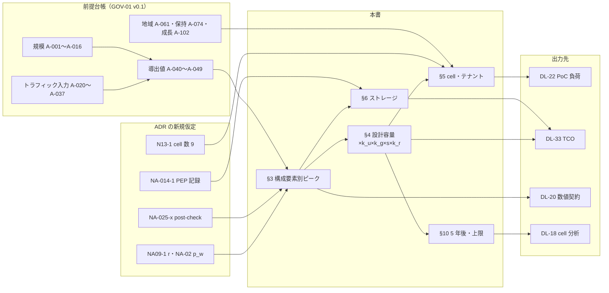
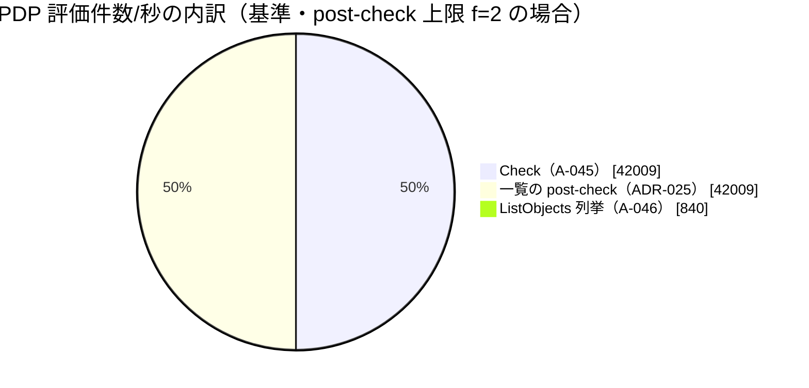
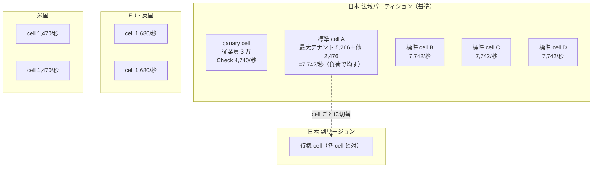

# 容量モデル（Capacity Model）

> 文書ID: ARC-13 / 版: 0.3 / 状態: review / 最終更新: 2026-10-15
> 対応要求: R-125, R-190, R-190.3, R-190.4, G-015, G-055, G-059, G-063, G-151（本書を対応成果物に名指しする全行）、R-192（DL-58 行の主な対応要求）、CL-0204（主張台帳で本書を処置先とする行）。末尾の対応表を参照／関連: R-112, R-174, R-209, G-056
> 依存文書: CONVENTIONS.md, traceability/deliverables.md（DL-58）, 01_governance/assumptions-register.md（GOV-01 v0.1。以下「前提台帳」）, 01_governance/business-impact-analysis.md, 01_governance/kri.md, 01_governance/durability-charter-20y.md, 05_adr/README.md, 05_adr/ADR-001, ADR-005, ADR-007, ADR-009, ADR-010, ADR-013, ADR-014, ADR-017, ADR-019, ADR-025, ADR-026, 03_threat-model/threat-catalog.md（T-004, T-031）, 05_adr/ADR-011, 05_adr/reconciliation-notes.md（C-04, U-02, U-04）, research/RS-05, RS-07, RS-15（各 verification 記録を含む）, research/standards-status.md（SS-B04）
> 作成方法: AI エージェント（Claude）が前提台帳 §12 の式と A 値を再計算し、ADR が置いた新規仮定（NA-xxx）と合わせて構成要素別に展開した。計算は作成者以外の再計算（G-055 の判定）を前提とし、本書の判定・推奨は自己レビューであって実在の CTO/CISO の決裁ではない（CONVENTIONS §8）[D]。版 0.2 で作成者以外の AI エージェントが独立レビューと修正を行った。版 0.3 で模擬パネル（自己レビューであり実在の CTO/CISO の決裁ではない）のラウンド 1 指摘に対応した（末尾「レビュー記録」）[D]。
> 表の注記: 表のセルでタグのないものは、同じ行の式と入力 ID から導いた設計推論 [D] であり、この注記で個別タグに代える（§11 の決裁案の表を含む）。事実を述べるセルには個別にタグと脚注を付けた。

## 要旨（結論）

1. **認可 PDP が最大の負荷であり、一覧の post-check を加えると基準ピークは 6.7万〜8.4万/秒になる** [D][A-045, A-046]。前提台帳の Check 42,009/秒（A-045）には一覧 1 回あたり 25 件以上の後段評価が含まれていない可能性があり（未決（ADR-025 L-1））、含まれていない場合は PDP の負荷が A-045 の 1.6〜2.0 倍になる [D][A-045, A-046]。G1 前の設計容量（k_u 2.0 × k_g 1.4）は全体で、Check のみなら 11.8 万/秒、post-check を含めると 18.8万〜23.5万/秒である [D][A-045, A-046]。
2. **5 年以内に設計変更を迫る要素は 3 つあり、どれも「全体量」ではなく「1 cell・1 テナント・1 アカウント」の上限で決まる** [D]。(a) cell ごとの KMS 署名枠（既定 1,000 req/s [V][^20]）に対し、ADR-013 §8 の再検討トリガー（実効枠の 80% = 800/秒）を判定線にすると、日本の標準 cell の全 session 失効直後は s=1.5 で基準の時点で既に判定線に達し（809/秒）、s=1 でも基準の 1.48 倍で達する [D][A-043, A-048, A-061]。枠そのもの（1,000/秒）を超えるのは基準の 1.24〜1.86 倍である [D]。Txn-Token を要求ごとに KMS で署名すると、発行比率 p_w が 6.5〜13.9% を超えた時点で判定線を超える [D][A-040]。いずれも安全係数を掛けない中央推定での比較であり（ADR-007 §1.5・ADR-013 §8 と同じ扱い）、設計値で比べると余裕はさらに小さい（§10.3）[D]。(b) 最大テナントは分割できない（ADR-013 原則 1）ため、その負荷が基準の 1.47〜2.21 倍になると標準 cell の設計容量を超える。成長シナリオの最大テナントは基準の 4.43 倍である [D][A-009]。(c) Check は年 32.2% で伸び、利用者の伸び（年 24.6%）を前提にした k_g 1.4 では 14.5 か月分しか覆えない [D][A-045, A-102]。
3. **全体量としての tuple と監査は「容量の壁」ではなく「費用と時間」の問題である** [D]。tuple の論理サイズは基準で約 128 GB（7.55 億件 × 170 B、新規仮定）であり、制約は export・テナント移動の所要時間で決まる [D][A-049]。監査は PEP 記録・認証イベント・一覧記録を加えると 1 日約 1.14 TB（圧縮前）で、A-049（907 GB/日）の 1.25 倍である [D][A-049]。オンライン 13 か月で約 449 TB、アーカイブ 7 年で約 2.91 PB になる [D][A-049, A-074]。
4. **公開性能値は自社の容量判断の根拠にしない** [D]。Zanzibar・Himeji・Carta・Cedar 論文の値は、測定点・鮮度区分・キャッシュ前提・測定範囲が自社と揃わない（RS-07#80）[D]。上限照合に使うのは、製品の公式な上限値（KMS 枠、エンジンの深さ上限など）だけとする [D]。
5. **PoC は「1 cell の実測」と「cell 単位の線形外挿」で全体を示す** [D]。cell 間に同期呼出しも共有状態も持たない原則（ADR-013 原則 3）があるので、全体容量は cell 容量の和で外挿できる [D]。cell 内のノード数と tail latency は、実測範囲の外へ外挿しない [D]。
6. **経営判断が要る点は 5 つある**（§11）: 容量の発注を G1 の As-Is 実測より前に行うか（K58-1）、容量見直し周期（K58-2）、最大テナント専用 cell の閾値（K58-3）、PoC 負荷段階の上限（K58-4）、日本の待機 cell の稼働形態と容量予約（K58-5）[D]。
7. **日本の主リージョン喪失は利用者の 85%（5 cell）に同時に及び、cell ごとの順次切替の総所要時間は RTO 1 時間に収まるとは示せていない** [D][A-061, A-093]。T_detect＋T_declare を 15 分と置くと、1 cell ずつ切り替える場合の 1 cell あたりの持ち時間は 9 分である（§5.5、感度）[D]。予約なしの pilot light では、相関した需要の下で副リージョンの容量を確保できないおそれがあり、その確率は未確認である（K58-5）[D]。

---

## 1. 本書の位置付けと読み方

- 本書は DL-58（容量モデル）であり、前提台帳の規模から認証 QPS、Check QPS、tuple 数、graph の深さと fanout、監査イベント量と保管量、鍵操作 QPS を導き、PoC 負荷条件と TCO の入力にする[^2] [D]。
- 前提台帳 §12.7 は、地域別の配分、cell 数、PDP 区画の割当、鍵操作 QPS、監査転送路の帯域を DL-58 で A-ID から導くとしている[^3] [D]。安全係数（k_u、k_g、k_r）を掛けるのは本書だけである（前提台帳 §13 規則 6）[^3] [D]。
- 本書は A 値を再定義しない [D]。A 値の再掲は GOV-01 v0.1 の値である [D]。本書が新たに要する入力は §2.4 に NA-58-x として列挙し、「前提台帳へ追加要」とする [D]。前提台帳 §12.7 は「DL-58 内で値を置かず、前提台帳に A-ID を追加してから参照する」としている[^3]。本書は前提台帳を編集できないため、NA-58-x の値は登録までの暫定であり、登録時に A-ID へ置き換える（残課題 1）[D]。
- 本書の値はすべて仮定依存の設計推論であり、実測値・決裁値ではない。主張タグと閉じ方の区分は執筆規約に従う[^1] [D]。全数値に導出式と入力 ID を付けた [D]。
- 読み手別の主な節は次のとおりである [D]。

| 読み手 | 主に読む節 |
|---|---|
| CTO・CISO | 要旨、§4（設計容量）、§10（5 年後と上限）、§11（決裁案） |
| CFO・DL-33 の作成者 | §9（TCO 入力） |
| SRE・プラットフォームチーム | §3〜§7 |
| 連携開発者（依存サービス） | §5.3（テナント quota）、§12（連携側への含意） |
| PoC 担当（DL-22） | §7、§9、§5.5.3 |
| SRE・DR 担当 | §5.5（リージョン喪失時の切替容量と所要時間） |

### 1.1 導出の全体像



## 2. 計算の約束

### 2.1 単位と換算

- 1 日 = 86,400 秒、1 か月 = 2,592,000 秒（30 日）、1 KB = 1,000 byte とする（前提台帳 §12.2 の換算に合わせる）[^3] [D]。
- ピーク値は「ピーク 1 分の秒あたり流量」である（前提台帳 §12.1）[^3] [D]。日平均への換算は API 系をピーク係数 4（A-020）で割る。ADR-007 も同じ換算（N7-2）を使っている[^6] [D][A-020]。

### 2.2 安全係数

前提台帳 §12.5 の規則に従う[^3] [D]。

| 係数 | 記号 | 本書で使う値 | 出所 |
|---|---|---|---|
| 推定不確実性 | k_u | 2.0（G1 前）／1.3（G1 の As-Is 実測後）／1.2（G6 の shadow 実測後） | 前提台帳 §12.5 [D][A-023] |
| 成長余裕 | k_g | 1.4（容量見直し 18 か月 × 年 24.6%） | 前提台帳 §12.5 [D][A-102] |
| cell 間の偏り | s | 1.0 と 1.5（TBD） | ADR-007 N7-7。所有者 SRE 責任者、期限 G4、決め方は本書の割当と As-Is 実測[^6] [D] |
| 冗長 | k_r | cell 内 3 AZ で 1 AZ 喪失に耐える場合 1.5。日本の待機 cell は対になる cell と同じ設計容量（待機 cell の稼働形態 F_s は TBD） | ADR-013 D13-20、前提台帳 §12.5 の例示[^4][^3] [D][A-063, A-093] |

- 規則 1: 設計容量 = A 値 × k_u × k_g とし、cell へ配分してから s と k_r を掛ける[^3] [D]。
- 規則 2: 範囲の高値と安全係数を二重に掛けない。高値は感度分析と PoC 負荷段階の上限にだけ使う[^3] [D]。
- 規則 3: 非定常負荷（A-048）は安全係数で吸収せず、admission control・rate limit・段階的失効で上限を設ける[^3] [D][A-048]。
- 規則 4: 安全係数は tail latency を保証しない。p99/p99.9 は実測する[^3] [D]。

### 2.3 地域・cell への配分

- 地域は利用者の地域分布（A-061: 日本 85% / EU・英国 8% / 米国 7%、成長 70/15/15、規制強化 90/5/5）で配分する[^3] [D][A-061]。テナントの地域分布は利用者と同じとする（ADR-013 N13-2）[^4] [D]。
- cell 数は ADR-013 の試算初期値 9（日本 5 = canary 兼従業員 1 ＋ 標準 4、EU・英国 2、米国 2）を使う（N13-1）[^4] [D]。ADR-007 の N7-1（日本 6・計 10）とは日本で 1 差があり、cell の定義と数の正本は ADR-013 とする（05_adr/README §2.6 手順 2）[^4][^6] [D]。cell 数の確定は KD13-1（blast radius 予算）で行い、本書は決めない（未決（ADR-013 KD13-1））[^4] [D]。
- 従業員 3 万人は日本の canary cell に収容する（N13-2）[^4] [D][A-002]。従業員の負荷比率は量の種類ごとに次のとおりとする [D][A-002, A-003, A-005, A-023]。

| 比率 | 式 | 基準 | 成長 | 規制強化 |
|---|---|---|---|---|
| e_api（API・Check 系） | 従業員 DAU × 呼出/日 ÷ 人間起点 API/日 | 21,000×1,500 ÷ 279,200,000 = 11.28% | 6.89% | 9.45% |
| e_ses（session 系） | 従業員の同時アクティブ ÷ 全同時アクティブ | 10,500 ÷ 111,200 = 9.44% | 5.70% | 7.94% |
| e_usr（利用者数・tuple 系） | 従業員 ÷ 登録総数 | 3.0% | 1.7% | 3.0% |

- 日本の標準 cell 1 つの負荷比率 = (A-061 の日本比率 − e) ÷ 4 とする。基準の API 系では (0.85 − 0.1128) ÷ 4 = 18.43% である [D][A-061]。A-061 の日本 85% に従業員を含むという読みは NA-58-5 とする [D]。
- ADR-013 D13-06 は日本の標準 cell の平均設計容量を 42,009 × 0.85 × 2.8 ÷ 4 ≈ 25,000/秒としている[^4] [D]。本書は従業員分を canary に分けたので 21,678/秒（§5.2）であり、約 13% 小さい [D]。D13-06 は最大テナントの設計値 14,745/秒をその約 59% としているが、本書の値では 68% になる（§5.4。ADR への指摘 1）[D]。

### 2.4 本書が置く新規仮定（前提台帳へ追加要）

| 仮 ID | 内容 | 値と導出 | 使う節 | 確定の所有者・期限・決め方 |
|---|---|---|---|---|
| NA-58-1 | tuple 1 件の論理サイズ b_raw | 約 170 B。資源 ID と主体 ID を ADR-021 の UUIDv4 表記（36 文字）× 2、型名 2 つと関係名 2 つを各 16 B、版・時刻 34 B と置いた和（72＋64＋34）[D] | §6.1 | CTO、G4、TC-010-17 の export 実測で置換 |
| NA-58-2 | tuple の物理増幅率 a_s（行ヘッダ、索引、MVCC、WAL を含む物理量 ÷ 論理量） | 値を置かない（TBD） | §6.1 | SRE 責任者、G4、TC-010-03 の 7,550 万件投入後の実測 |
| NA-58-3 | A-102 の範囲（5 年後の登録 2 倍／5 倍）では、登録以外の入力は成長シナリオの値のままとする | Check は成長値 × (倍率 ÷ 3) | §10.1 | 経営企画責任者＋CTO、G1 |
| NA-58-4 | token 発行・一覧記録の日平均はピーク ÷ A-020 で近似する | ADR-007 N7-2 と同じ近似 [D][A-020] | §6.3、§9 | SRE 責任者、G1 の As-Is 実測 |
| NA-58-5 | A-061 の日本比率は従業員を含む | — | §2.3、§5 | 事業責任者、G1 |
| NA-58-6 | 基準から成長シナリオまでの 5 年間は年率一定（幾何的）で伸びる | Check の年率 = (169,333 ÷ 42,009)^(1/5) − 1 = 32.2% [D][A-045, A-102] | §10.2 | 経営企画責任者、G1 |
| NA-58-7 | 認証イベント・一覧記録の 1 件のサイズは A-037 と同じ 1 KB | — | §6.3 | CISO、G4、TC-014-10 |
| NA-58-8 | session 1 件の保管サイズ | 値を置かない（TBD） | §6.2 | プラットフォームチーム長、G3、ADR-001 の製品選定後に製品文書と実測 |
| NA-58-9 | 拡張手段ごとの所要期間 L（cell 追加、cell 分割、テナント移動、KMS 枠引上げ、store 移行） | 値を置かない（TBD） | §10.4 | SRE 責任者＋CTO、G4、演習（ADR-028）と事業者への照会 |
| NA-58-10 | password hash 1 回の CPU 時間 t_h | 値を置かない（TBD。hash 方式とパラメータに依存） | §3.4 | CISO＋SRE 責任者、G3、ADR-003・DL-52 の方式決定後に実測 |
| NA-58-11 | 顧客 IdP 1 つあたりの受入可能なログイン要求率 | 値を置かない（TBD。顧客ごとの契約事項） | §3.4 | 営業・顧客成功責任者、G4、主要顧客への照会 |

## 3. 構成要素別のピーク負荷（中央推定、安全係数なし）

### 3.1 一覧

単位は秒あたりのピーク値である（tuple を除く）[D]。基準・成長・規制強化の値は前提台帳 §12.2 の式で再計算し、台帳の値と一致することを確かめた [D]。

| # | 構成要素 | 量 | 式 | 基準 | 成長（5 年後） | 規制強化 | 入力 ID |
|---|---|---|---|---|---|---|---|
| 1 | edge gateway・BFF | edge API | Σ(DAU_s×呼出_s)×(1＋機械)÷86,400×A-020 | 16,804 | 56,444 | 20,057 | A-040 |
| 2 | PDP | 認可 Check | edge API × A-025 | 42,009 | 169,333 | 60,172 | A-045 |
| 3 | PDP | 一覧の post-check 評価 | A-046 × ページ長 25 × f（1.2〜2） | 25,206〜42,009 | 84,667〜141,111 | 30,086〜50,143 | A-046, NA-025-1, NA-025-2[^9] |
| 4 | PDP | 2＋3 の合計 | — | 67,215〜84,018 | 254,000〜310,444 | 90,258〜110,315 | 同上 |
| 5 | PDP（列挙） | ListObjects/LookupResources | edge API × A-026 | 840 | 2,822 | 1,003 | A-046 |
| 6 | relationship store | 書込（対話） | (Σ DAU_s×書込_s ＋ SCIM)÷86,400×A-020 | 354 | 1,002 | 430 | A-047 |
| 7 | relationship store | 書込（bulk、別レーン） | 最大テナント × 20 ÷ 7,200 | 278 | 833 | 556 | A-047, A-032 |
| 8 | ACL 反映索引（L3） | 索引更新（平均 m=10） | (6＋7) × m | 6,320 | 18,352 | 9,853 | NA-025-3[^9] |
| 9 | AS（login） | ログイン | Σ(DAU_s×ログイン_s)÷86,400×A-021 | 51 | 143 | 77 | A-041 |
| 10 | AS（token endpoint） | refresh | 同時アクティブ ÷ 寿命 | 185 | 512 | 441 | A-042 |
| 11 | STS | token exchange | 同時アクティブ × 6 ÷ 寿命 × r | 1,112 × r | 3,070 × r | 2,645 × r | A-043, NA09-1[^10] |
| 12 | AS（client credentials） | M2M | (SA×0.5＋grant×0.2＋agent×0.1)×2÷寿命 | 25 | 151 | 27 | A-029 |
| 13 | AS＋STS | token 発行計（r=1） | 9＋10＋11＋12 | 1,374 | 3,875 | 3,191 | A-043 |
| 14 | TTS（edge 併設） | Txn-Token（外部起点） | edge API × p_w | 16,804 × p_w | 56,444 × p_w | 20,057 × p_w | A-040, NA-02[^7] |
| 15 | TTS | Txn-Token（内部開始ジョブ） | 100,000 ÷ 86,400 × 10 | 約 12 | TBD | TBD | NA-026-2[^13] |
| 16 | 状態ストア | introspection（ADR-005 D1-7 案） | edge API × cache miss 0.5 × k | 8,402 × k | 28,222 × k | 10,029 × k | A-040, A-030, NA-05[^7] |
| 17 | 状態ストア | introspection（前提台帳の案 C） | edge API × 0.30 × 0.5 | 2,521 | 8,467 | 6,017 | A-044 |
| 18 | KMS（L2 署名） | 署名・平常 | 13 ＋ 9（ID token） | 1,425 | 4,018 | 3,268 | A-043, A-041[^6] |
| 19 | KMS（L2 署名） | 署名・全 session 失効直後 | 18 ＋ 2 × 21 | 2,537 | 7,088 | 4,591 | A-048[^6] |
| 20 | SPIRE | workload SVID | 本番インスタンス ÷ 1,800 秒 | 約 6 | 約 13 | 約 6 | A-012 |
| 21 | SPIRE | エージェント SVID（ADR-017 案C） | agent 数 ÷ 1,800 秒 | 約 6 | 約 111 | 約 3 | A-014[^14] |
| 22 | AS 前段の受付制御 | 再ログイン集中 | 同時アクティブ × 0.30 ÷ 60 | 556 | 1,535 | 661 | A-048 |
| 23 | edge の bot 対策 | 攻撃時のログイン試行 | ログイン × 100 | 5,115 | 14,282 | 7,736 | A-048, A-034 |
| 24 | 監査ジャーナル | 監査イベント（PDP＋PEP＋発行） | 2 × 2 ＋ 13 | 85,392 | 342,541 | 123,535 | A-045, NA-014-1[^8] |
| 25 | 監査ジャーナル | 監査の流量（圧縮前） | 2 × 1.2 KB ＋ 13 × 1 KB | 51.8 MB/秒（約 414 Mbps） | 207.1 MB/秒 | 75.4 MB/秒 | A-037, NA-014-1, NA-58-7 |

- 3 行目の f は返却 1 件を得るために評価する候補の件数で、L1・L3 で 1.2、L2 で上限 2 である（NA-025-2）[^9] [D]。A-045 に post-check が含まれるかは未決（ADR-025 L-1）であり、本書は 2 行目と 4 行目の両方を示す [D]。
- 11 行目の r は、同じ session の要求が token 寿命内に同じサービスの何インスタンスへ分散するかを表す分散係数で、値は TBD である（NA09-1。所有者 SRE 責任者、期限 G4）[^10] [D]。前提台帳の A-043 は r = 1 に相当する [D][A-043]。
- 14 行目の p_w は、write・privileged・break-glass/B・FAPI 範囲の要求の比率で、値は TBD である（ADR-005 NA-02。所有者 CTO、G1 の As-Is 実測）[^7] [D]。read-sensitive に発行するかは任意であり、全要求へ広げるかは未決（U-02。ADR-005 D9-3、ADR-009 D09-33、reconciliation-notes U-02）[^7][^10] [D]。Txn-Token の仕様は draft-ietf-oauth-transaction-tokens-11 であり、状態は Internet-Draft（WG Consensus: Waiting for Write-Up、IESG 未提出、2027-01-31 失効予定、確認日 2026-10-03）である[^16]。ADR-005 D9-3 はこれを版固定の社内 profile として使う [D]。草案が変わっても発行量の式（edge API × p_w）は変わらない [D]。
- 16 行目と 17 行目の差は、外部 client の token をすべて opaque にする ADR-005 D1-1・D1-7 の案（決裁前）と、前提台帳 A-030（opaque 比率 30%）の差である[^7] [D][A-030, A-044]。ADR-005 の案を採る場合、A-030 と A-044 の値の更新が要る（前提台帳へ変更提案要）[D]。k は内部 hop ごとの状態照会の倍率で TBD（ADR-005 NA-05、H-02 で実測）[^7] [D]。
- 18〜19 行目は ADR-007 §1.5 と同じ式で、署名回数は A-043 に A-041（code 交換時の ID token）を足し、失効直後は再ログイン 1 件あたり 2 回の署名を加える[^6] [D][A-041, A-043, A-048]。Txn-Token（14・15 行目）と r > 1 の exchange の署名は含まない [D]。
- 24〜25 行目は §6.3 で日次量に直す [D]。24〜25 行目には一覧の判定記録（840/秒 × 1 KB = 0.84 MB/秒、流量の +1.6%）を含めていない [D][A-046, NA-025-6]。§6.3 の日次量には含めている [D]。cell・spool・PoC の流量値（§5.1、§6.3、§9.1 P9）はこの 1.6% を含まない値のままとし、PoC の負荷生成では含める [D]。
- 攻撃時のログイン試行（23 行目）は ADR-014 D14-16 により E3 として 100% 記録する[^8] [D][A-048]。非定常負荷なので 24〜25 行目と日次量には入れず、別枠とする。1 件 1 KB（NA-58-7）なら基準 5.1 MB/秒（攻撃 1 時間あたり 18.4 GB）、成長 14.3 MB/秒（同 51.4 GB）であり、平常の監査流量（51.8 MB/秒）に約 10% 上乗せされる [D][A-034, A-048]。ジャーナルの容量と spool の上限はこの上乗せを含めて決める（§6.3）[D]。

### 3.2 PDP 負荷の内訳（基準）



- post-check を f = 2 で加えると、PDP の評価件数は A-045 の 2.0 倍になる [D][A-045, A-046]。L1・L3 方式（f = 1.2）なら 1.6 倍である [D]。

### 3.3 最大テナントの負荷

| 量 | 式 | 基準 | 成長 | 規制強化 | 入力 ID |
|---|---|---|---|---|---|
| Check | 最大テナント × B2B DAU 比率 × 1,000 × (1＋機械) × A-025 ÷ 86,400 × 4 | 5,266 | 23,333 | 14,444 | A-009, A-045 |
| post-check | 約 105 × 25 × (1.2〜2) | 3,150〜5,250 | TBD | TBD | ADR-025 §1.4[^9] |
| 書込（対話） | A-047 × (5,266 ÷ 42,009) | 44 | TBD | TBD | A-047, A-009 |
| 書込（bulk） | A-047 bulk | 278 | 833 | 556 | A-032 |
| tuple 数 | 最大テナント × (300 × 2.5 ＋ 5) | 7,550 万 | 2.265 億 | 1.81 億 | A-009, A-035 |
| 全 session 失効後の再ログイン（顧客 IdP 1 つへ） | 最大テナント × B2B DAU 比率 × 0.40 × 0.30 ÷ 60 | 70/秒 | 210/秒 | 160/秒 | A-009, A-003, A-005, A-033 |

- 成長と規制強化の post-check と対話書込は、最大テナントの一覧比率が前提台帳にないため TBD とする（所有者 CTO、期限 G3、決め方: ADR-025 NA-025-8 の As-Is 実測）[D]。
- 規制強化の tuple 数は A-035 の規制強化値（tuple/リソース 3.0）で、200,000 × (300 × 3.0 ＋ 5) = 1.81 億である [D][A-009, A-035]。

### 3.4 認証側の非定常負荷（G-059）

- 全 session 失効後の再ログイン集中は、全体で基準 556/秒、成長 1,535/秒である [D][A-048]。平常ピーク（51/秒）の約 11 倍である[^3] [D][A-033, A-048]。
- 日本の標準 cell 1 つでは、基準 556 × (0.85 − 0.0944) ÷ 4 ≈ 105/秒（s = 1）、canary cell では 10,500 × 0.30 ÷ 60 ≈ 53/秒である [D][A-005, A-033, A-061]。
- 最大テナントが顧客 IdP 連携を使う場合（A-082 は大口ほど自社 IdP を持つと仮定）、その顧客 IdP 1 つへ 70/秒（成長 210/秒）が集中する [D][A-009, A-082]。顧客 IdP の受入可能な要求率は不明であり（NA-58-11）、段階的失効をテナント順に行う理由になる（ADR-019 D19-11、ADR-006 D6-13）[^12] [D]。
- 攻撃時のログイン試行 5,115/秒は edge の bot 対策と rate limit で拒否する量であり、AS の容量にしない（前提台帳 §12.5 規則 3、T-004）[^3] [D][A-034]。
- password 検証が要るログインは、自社で認証する利用者（A-115: 47.5 万人）のうち password を使う 93% で、平常ピーク約 18/秒（(175,000×0.35×1.5 ＋ 27,000×1.2 ＋ 21,000×2.0) ÷ 86,400 × 10 × 0.93）である [D][A-003, A-021, A-022, A-082, A-115]。password hash の計算資源は「受付制御の上限 × t_h」で決まり、t_h は TBD（NA-58-10）である [D]。攻撃時の 5,115/秒を hash 計算に到達させると、計算資源は平常（約 17.9/秒）の約 285 倍を要する [D][A-034, A-048]。したがって hash 計算の前段に受付制御を置き、hash 計算に到達する要求率の上限を設計値として固定する（前提台帳 §12.5 規則 3）[D]。

## 4. 設計容量（全体）

### 4.1 主要要素の設計容量

設計容量 = 中央推定 × k_u × k_g である（§2.2 規則 1）[D]。表は全体値で、cell への配分と s・k_r は §5 で掛ける [D]。

| 要素 | 中央推定（基準） | G1 前（×2.8） | G1 後（×1.82） | G6 後（×1.68） | 入力 ID |
|---|---|---|---|---|---|
| Check（A-045 のみ） | 42,009 | 117,626 | 76,456 | 70,575 | A-045 |
| Check＋post-check（f=1.2〜2） | 67,215〜84,018 | 188,202〜235,250 | 122,331〜152,913 | 112,921〜141,150 | A-045, A-046, NA-025-1, NA-025-2 |
| edge API | 16,804 | 47,051 | 30,583 | 28,231 | A-040 |
| token 発行（r=1） | 1,374 | 3,847 | 2,501 | 2,308 | A-043 |
| introspection（D1-7 案、k=1） | 8,402 | 23,526 | 15,292 | 14,115 | A-040, A-030 |
| KMS 署名・平常 | 1,425 | 3,990 | 2,594 | 2,394 | A-043, A-041 |
| relationship 書込（対話） | 354 | 991 | 644 | 595 | A-047 |
| 監査の流量 | 51.8 MB/秒 | 145 MB/秒 | 94 MB/秒 | 87 MB/秒 | A-045, A-037 |

- 非定常負荷（再ログイン 556/秒、攻撃 5,115/秒）は安全係数で吸収せず、受付制御の上限として別に設計する（§2.2 規則 3）[D][A-048]。AS の受付制御の上限の初期入力は A-048 の 556/秒とする（ADR-019 D19-11）[^12] [D]。
- G1 前の設計容量は、基準の範囲（単一入力感度）の上限 84,425/秒（A-045）を覆うが、入力を同時に外した包絡の上限 825,729/秒は覆わない（前提台帳 §12.4）[^3] [D][A-045]。包絡は設計に使わない（同 §12.4）[D]。

### 4.2 設計容量の決め方の論点

- 前提台帳は、A-003・A-020・A-023・A-024 を G1 で As-Is 実測に置き換えることを容量判断の前提条件としている[^3] [D]。G1 前の k_u = 2.0 で発注すると、G1 後（k_u = 1.3）に比べて設計容量が 1.54 倍になる [D]。これは K58-1 の論点である（§11）[D]。

## 5. cell 当たりの負荷と設計容量

### 5.1 cell 別の負荷（基準、中央推定、s = 1）

| cell | 負荷比率（API 系） | Check | post-check（f=1.2〜2） | edge API | introspection（D1-7） | token 発行 | 対話書込 | 再ログイン集中 | 利用者 | tuple（論理件数） | 監査流量 |
|---|---|---|---|---|---|---|---|---|---|---|---|
| 日本・標準（×4） | 18.43% | 7,742 | 4,645〜7,742 | 3,097 | 1,548 × k | 253 | 65 | 105 | 20.5 万 | 1.55 億 | 9.5 MB/秒 |
| 日本・canary（従業員） | 11.28% | 4,740 | 2,844〜4,740 | 1,896 | 948 × k | 155 | 40 | 53 | 3 万 | 0.23 億 | 5.8 MB/秒 |
| EU・英国（×2） | 4.0% | 1,680 | 1,008〜1,680 | 672 | 336 × k | 55 | 14 | 22 | 4 万 | 0.30 億 | 2.1 MB/秒 |
| 米国（×2） | 3.5% | 1,470 | 882〜1,470 | 588 | 294 × k | 48 | 12 | 19 | 3.5 万 | 0.26 億 | 1.8 MB/秒 |

- 式はすべて「全体の値 × 負荷比率」である [D][A-061]。再ログイン集中だけは session 系の比率（日本・標準 18.89%）を使った [D][A-005]。利用者と tuple は利用者数の比率（日本・標準 (0.85 − 0.03) ÷ 4 = 20.5%）を使った [D][A-001, A-035]。
- EU・米国の再ログイン集中は 556 × 0.08 ÷ 2 ≈ 22/秒、556 × 0.07 ÷ 2 ≈ 19/秒である [D][A-048, A-061]。

### 5.2 日本の標準 cell 1 つの設計容量（基準）

| 量 | 中央推定 | ×k_u×k_g（G1 前 2.8） | ×s=1.5 | ×k_r 1.5（3 AZ に配る総量） | 入力 ID |
|---|---|---|---|---|---|
| Check（A-045 のみ） | 7,742 | 21,678 | 32,517 | 48,775 | A-045, A-061 |
| Check＋post-check | 12,387〜15,484 | 34,684〜43,355 | 52,025〜65,033 | 78,038〜97,550 | A-045, A-046 |
| token 発行（r=1） | 253 | 708 | 1,063 | 1,594 | A-043 |
| introspection（k=1） | 1,548 | 4,334 | 6,502 | 9,752 | A-040 |

- k_r 1.5 は「3 AZ のうち 1 AZ を失っても残る 2 AZ で設計容量を出す」構成の総量である（各 AZ に 1/3 ずつ置くと 1 AZ あたり設計容量の 50%）[D]。日本の副リージョンの待機 cell は、対になる cell の設計容量を同じだけ持つ（ADR-013 D13-20）[^4] [D]。待機 cell を常時稼働にするか pilot light にするかは TBD（F_s。ADR-013 §3.2）[^4] [D]。

### 5.3 テナント quota の導出式（noisy neighbor 対策、ADR-013 D13-17）

- B2B 利用者 1 人あたりのピーク Check は 0.35 × 1,000 × 1.3 × 2.5 ÷ 86,400 × 4 = 0.0527/秒である [D][A-003, A-020, A-023, A-024, A-025]。
- テナント t の Check quota の初期式を q_t = N_t × 0.0527 × k_u × k_g とする [D]。N_t はテナント t の利用者数である。最大テナント（10 万人）では 5,266 × 2.8 = 14,745/秒になり、ADR-010 D-36(d) と ADR-013 D13-06 の値と一致する[^5][^4] [D][A-009]。
- quota の値は数値契約（DL-20）で決める（TBD。所有者 CTO＋プラットフォームチーム長、期限 G4、決め方は本式を初期値として H-11 の noisy neighbor 実測で補正）[^5] [D]。quota の判定系が止まったときは最後の閾値で動く fail-static とする（ADR-013 D13-17）[^4] [D]。
- quota をかける指標は Check だけではない [D]。ADR-013 D13-17 は Check/秒・書込/秒・ListObjects/秒をテナント単位で、ADR-025 D25-17 は「一覧要求/秒」と「post-check の評価件数/秒」をテナント単位とクライアント単位で求めている[^4][^9] [D]。本書は Check 以外の初期式を次のように置く（いずれも × k_u × k_g。値の確定は DL-20）[D]。

| 指標 | 初期式（テナント t、N_t 人） | 最大テナント（10 万人、×2.8） | 入力 ID |
|---|---|---|---|
| Check/秒 | N_t × 0.0527 | 14,745 | A-003, A-020, A-023, A-024, A-025 |
| 一覧要求/秒 | N_t × 0.0527 ÷ 2.5 × 0.05 = N_t × 0.00105 | 295 | A-026, NA-025-8 |
| post-check 評価件数/秒 | 一覧要求/秒 × 25 × f（1.2〜2） | 8,820〜14,700 | NA-025-1, NA-025-2 |
| 書込/秒（対話） | N_t × 0.00044（最大テナントの 44/秒 ÷ 10 万人） | 123 | A-047, A-009 |

- 書込の初期式は、最大テナントの対話書込 44/秒（§3.3）を利用者数で比例させたものである [D][A-009, A-047]。bulk 書込（278/秒、A-032）は対話と別レーンであり、テナント quota ではなく bulk レーンの同時実行数で制御する（ADR-010 H-13）[^5] [D]。

### 5.4 最大テナントを収容する cell



- 1 テナントの認可データを複数 cell に分けない（ADR-013 原則 1、DEC-3 対象）ので、最大テナントの設計 Check 14,745/秒は 1 つの cell の PDP 区画で処理する必要がある[^4] [D][A-009]。
- 基準では、これは日本の標準 cell の平均設計容量（s = 1 で 21,678/秒）の 68%、s = 1.5 の 32,517/秒の 45% である [D][A-009, A-045]。最大テナントの post-check（ADR-025）を加えると、最大テナントの設計値は 23,565〜29,445/秒になり、s = 1 の平均設計容量を上回る [D][A-009, A-046]。
- このため、最大テナント層を専用区画（ADR-010 D-24(a)）に置く閾値の決定は、post-check の扱い（ADR-025 L-1）と同時に行う必要がある（K58-3）[D]。
- ADR-013 D13-06 は超大規模テナント（A-008 の 5 テナント、計 20 万人）を同じ cell に 2 つまでとする[^4] [D][A-008]。最大テナント（10 万人）と残り 4 テナントの最大のもの（平均 2.5 万人と置けば Check 1,317/秒）を同居させた場合、cell A の Check は中央推定で約 6,583/秒、設計値で約 18,430/秒になり、cell の平均設計容量（s=1 で 21,678/秒）の 85% に達する [D][A-008, A-009, A-045]。残り 4 テナントの規模分布は前提台帳にないため、平均値で置いた（前提台帳へ追加要）[D]。配置は利用者数と Check 負荷で均す（D13-07）ので、cell A の他テナントはこの分だけ減らす [D]。
- 専用 cell の付与基準は ADR-013 KD13-2（推奨: 契約要求＋最大テナント級）と N13-5（基準で 5 以下）で決める[^4] [D]。K58-3 の閾値はこの基準のうち「最大テナント級」の定量的な定義に当たる [D]。

### 5.5 リージョン喪失時の切替容量と所要時間（版 0.3 で追加）

日本の主リージョンを失うと、canary cell（利用者の 3%）と標準 cell 4 つ（各 20.5%）の計 5 cell、利用者の 85% が同時に影響を受ける [D][A-001, A-002, A-061]。ADR-013 D13-20 は待機 cell への切替を cell ごとに行い、全 cell を同時に切り替えないとする[^4] [D]。本節は、この単一事象について (1) 切替の総所要時間、(2) 副リージョンで確保する容量、(3) 検証の範囲を示す [D]。

#### 5.5.1 総所要時間の式

n 個の cell を、同時に m 個ずつ（m < n。D13-20 により m = n は採らない）切り替える場合、最後に切り替わる cell の利用者が受ける停止時間は次の式で表せる [D]。

```
T_total = T_detect + T_declare + Σ_{w=1..⌈n/m⌉} max_{i∈w} ( T_prov,i + T_switch,i + T_warm,i + T_admit,i )
T_write = T_total + T_KD08-4（最後の wave の cell で write 以上を再開するまで）
```

| 項 | 意味 | 値 | 所有者・期限・決め方 |
|---|---|---|---|
| n | 主リージョンで失う cell 数 | 5（canary 1＋標準 4。N13-1）[^4]。KD13-1 (a) なら日本の cell 数に比例して増える | KD13-1 の決裁に従う |
| m | 同時に切り替える cell 数 | TBD（1 または 2 を想定）| SRE 責任者、G4、D13-20 の herd effect 抑止と RTO の両立で決める（TC-13-13） |
| T_detect | 障害の検知 | TBD | SRE 責任者、G4、警報設計（ARC-08 §3.5）と演習 |
| T_declare | 切替の宣言（判断・承認） | TBD | SRE 責任者＋CTO、G3、リージョン切替の runbook（08_operations、DL-24 の演習計画）の承認手順で決める |
| T_prov,i | 待機 cell の計算資源の起動・scale out（常時稼働なら 0） | TBD。F_s の選択（K58-5）に依存 | SRE 責任者、G4、TC-106 の 1 cell 実測 |
| T_switch,i | 経路切替・store の格上げ（昇格）・配置表の更新 | TBD | 同上 |
| T_warm,i | cache の再充填（D13-20 の速度制御付き） | TBD | 同上 |
| T_admit,i | session 喪失に伴う再ログインの受付完了 | 中央推定で標準 cell 約 200 秒、canary 約 200 秒（下記） | AS 受付制御の上限（TC-19-03）で置換 |
| T_KD08-4 | 剥奪の巻戻りがないことの確認（KD08-4 (b) の場合の再適用と privileged session の失効） | TBD。KD08-4 (a) なら 0 に近い | CISO＋SRE 責任者、G4、TC-010-12（H-12） |

- T_admit,i の中央推定は、cell の同時アクティブ全員が再ログインし、受付制御の cell 配分（§5.1 の再ログイン集中の列）で受ける場合の N_act,i ÷ λ_adm,i である [D][A-005, A-048]。標準 cell は 111,200 × 18.89% ≈ 21,000 人 ÷ 105/秒 ≈ 200 秒、canary は 10,500 人 ÷ 53/秒 ≈ 198 秒である [D][A-005, A-048]。A-048 は失効直後の 60 秒に 30% が再ログインすると置くが、リージョン喪失では session store を失うので 100% とした [D][A-048]。受付制御が cell 内に閉じる場合は、T_admit,i を次の wave の T_prov・T_switch と重ねられる。上の式は重ねない側（保守側）である [D]。
- 照合式は次の 2 本である [D]。
  - RTO: T_total ≤ 1 時間 [A-093]
  - write の MTPD: T_write ≤ 2 時間（BIA の仮置き NA-01）。SP 800-34 は RTO を MTD より短くし、再処理の時間も足して MTD 内に収めるとしており、BIA §4.5 がこの関係を扱っている [D]
- 1 wave に使える時間の上限を示す（感度であり設計値ではない）。T_detect＋T_declare を 15 分と置いた場合の値である [D][A-093]。

| m | wave 数 ⌈5/m⌉ | RTO 1 時間での 1 wave の上限 | write MTPD 2 時間での 1 wave の上限（T_KD08-4 を含む） |
|---|---|---|---|
| 1 | 5 | 9 分 | 21 分 |
| 2 | 3 | 15 分 | 35 分 |
| 3 | 2 | 22.5 分 | 52.5 分 |

- m = 1 では、T_admit の中央推定（約 3.3 分）だけで 1 wave の上限 9 分の 4 割近くを使う [D]。pilot light で T_prov が数分を超える場合、m = 1 では RTO 1 時間を満たせない見込みが高い [D]。このため m と F_s（K58-5）は同時に決める必要がある [D]。
- 切替順序は、Tier 順（依存 Tier の上位を先。ADR-023 D23-43 の段階受付と同じ順序）とテナント順（高保証テナント A-081・規制顧客を先）を組み合わせる [D][A-081]。cell の単位で見ると、従業員と合成テナントだけを収容する canary cell は運用・侵害対応の要員が使うので最初に切り替える案を置く（本書の提案。順序の決定は SRE 責任者＋事業責任者、G4）[D]。

#### 5.5.2 副リージョンで確保する容量

- 待機 cell は対になる cell と同じ設計容量を持つ（D13-20、§5.2）[^4] [D]。主リージョン喪失時に副リージョンで同時に必要になる計算資源は、日本の 5 cell の設計容量の和であり、全体の API 系負荷の 85% 分に k_r を掛けた量である [D][A-061]。ノード数は C_cell の実測後に決まる（TBD、§10.3）[D]。
- AWS の DR の手引きは、pilot light では application server などを「switched off」にしておき、障害時に起動して scale out すると説明し、DR リージョンの service quotas を本番容量まで scale up できる値にしておくよう求めている[^34] [V]。同じ手引きは、Auto Scaling は control plane の活動であり依存すると復旧戦略の resiliency が下がる、とも述べる[^34] [V]。
- AWS の EC2 On-Demand Capacity Reservations は、特定の Availability Zone に計算容量を予約する機能で、使うかどうかによらず On-Demand 相当の料金がかかる[^35][^36] [V]。予約は AZ 単位なので、3 AZ に配る待機 cell では AZ ごとに予約が要る [D]。
- 同じリージョン障害では、同じ副リージョンへ他の利用者も一斉に移るので、予約のない起動要求は需要が相関した状態で行われる [D]。この相関によって容量の確保に失敗する確率を示す公開の原典は確認できていない（未確認）[D]。したがって予約なしの確保失敗確率は数値で置かず、経営判断の論点（K58-5）とする [D]。本基盤のクラウド事業者・製品は AWS を例として示しており、他事業者の同等機能は未確認である [D]。
- F_s の選択肢と、障害時の容量確保の性質は次のとおりである [D]。

| 選択肢 | 平常時の費用（F_s） | 障害時の容量確保 | T_prov | 備考 |
|---|---|---|---|---|
| (a) 常時稼働（hot standby） | 対になる cell とほぼ同じ | 稼働済み。追加の起動要求に依存しない | 0 | AWS の手引きは本番負荷を処理できる容量を置く静的安定な構成を hot standby と呼ぶ[^34] [V] |
| (b) 容量予約付き pilot light | 予約分は使わなくても On-Demand 相当の料金[^36] [V]。software の運用費は (a) より小さい | AZ 単位の予約の範囲で確保 [V][^35]。起動・設定は要る | 起動・暖機の分 | (a) との差は主にライセンス・運用の費用と T_prov [D] |
| (c) 予約なし pilot light | 最小 | 起動時の空き容量に依存し、相関需要で失敗し得る（確率は未確認） | 起動＋scale out。失敗時は不定 | 失敗時の受容が要る（残余リスク台帳への追加を申し送る）[D] |
| (d) 部分予約 | (b) と (c) の間 | 最初の wave（例: canary＋標準 1）だけ予約 | wave ごとに異なる | 後続の wave は (c) と同じ性質 [D] |

- 選択肢の決定は K58-5（§11）で行う。費用は DCS-07 の TCO の幅（§4.3「インフラ」）と OPS-03 の F_s に連携する（他文書への申し送り 2）[D]。

#### 5.5.3 検証の範囲と限界

- POC-01 の系統 2 は 1 cell 相当の環境である（POC-01 要旨 1）[D]。TC-106 で測れるのは 1 cell の T_prov＋T_switch＋T_warm＋T_admit であり、複数 cell の順次切替の総所要時間と、副リージョンでの同時確保（相関需要）は測れない [D]。
- 総所要時間は「1 cell の実測 × wave 数」で推定し、wave 間の干渉（共有の DNS・配置表の配布・副リージョンの quota）は推定に含まれない [D]。複数 cell の同時演習は G6（本番相当の複数 cell 構成）で行う（残課題 13）[D]。

## 6. ストレージ量

### 6.1 relationship store（tuple）

| 量 | 式 | 基準 | 成長 | 規制強化 | 入力 ID |
|---|---|---|---|---|---|
| tuple 総数 | 登録 × (300 × tuple/リソース ＋ 5) | 7.55 億 | 22.65 億 | 9.05 億 | A-049, A-035 |
| 日本の標準 cell 1 つ | 上 × 利用者比率 | 1.55 億 | 3.87 億（cell 数 4 のまま） | 1.97 億 | A-061 |
| 最大テナント | §3.3 | 7,550 万 | 2.265 億 | 1.81 億 | A-009 |
| 論理サイズ（全体） | 件数 × b_raw（170 B） | 約 128 GB | 約 385 GB | 約 154 GB | NA-58-1 |
| 論理サイズ（日本の標準 cell） | 同上 | 約 26 GB | 約 66 GB | 約 33 GB | NA-58-1 |
| 物理サイズ | 論理 × a_s | TBD | TBD | TBD | NA-58-2 |

- 論理サイズは数十〜数百 GB であり、単一の PostgreSQL の記憶容量そのものは制約になりにくいと推論する [D][NA-58-1]。ただし a_s は未測であり、索引の作り方で変わる（NA-58-2）[D]。
- 制約になるのは、(a) 書込と fresh 読取の primary 負荷（ADR-010 H-03・H-13）、(b) テナント単位の export・import の所要時間（ADR-018、ADR-028）、(c) backup からの復元時間（A-093 の RTO 1 時間）である [D][A-093]。いずれも処理速度が未測で、所要時間 = 件数 ÷ 処理速度の式だけを置く（TC-010-17）[^5] [D]。
- tuple は 20 年間に資源が蓄積して増え、利用者数が一定でも増加する（前提台帳 A-035 の感度欄）[^3] [D][A-035]。5 年より先の蓄積率は前提台帳に登録がなく、未登録である（残課題）[D]。
- 1 tuple を ACL 反映索引（L3）に反映すると平均 10 件、p99.9 で 10 万件の索引更新になり得る（NA-025-3）[^9] [D]。最大テナントの全員 group への 1 回の変更が 10 万件の更新を生むので、索引更新は書込と別レーンにする根拠になる [D]。

### 6.2 session・token の状態

| 量 | 式 | 基準 | 成長 | 規制強化 | 入力 ID |
|---|---|---|---|---|---|
| 有効 session 保持数 | MAU × 1.5 | 86.5 万 | 251.6 万 | 88.7 万 | A-006 |
| 日本の標準 cell 1 つ | 上 × 20.5% | 17.7 万 | 43.0 万（cell 数 4 のまま） | 19.3 万 | A-061 |
| 第三者 grant | A-013 | 3 万 | 12 万 | 1.5 万 | A-013 |
| 保管量 | 件数 × session サイズ | TBD | TBD | TBD | NA-58-8 |

- session 1 件のサイズは製品と保管方式（ADR-001）に依存するため値を置かない（NA-58-8）[D]。全 session 失効（ADR-019）の対象件数は上表の件数であり、失効の完了時間は件数 ÷ 失効処理速度で決まる（H6-02 で実測）[^12] [D][A-006]。

### 6.3 監査データ

ADR-014 は PDP の全判定、PEP の enforcement 記録、認証・発行・session・grant の全イベントなどを 100% 記録するとしている（D14-15、D14-16）[^8] [D]。前提台帳の A-049 は decision event だけを数えているので、本書は記録対象を足し合わせる [D][A-049]。

| 記録区分 | 1 日の件数（基準） | サイズ | 1 日の量（基準） | 成長 | 規制強化 | 入力 ID |
|---|---|---|---|---|---|---|
| PDP decision event | 9.07 億 | 1 KB | 907 GB | 3,658 GB | 1,300 GB | A-049, A-037 |
| PEP enforcement 記録 | 9.07 億 | 0.2 KB | 181 GB | 732 GB | 260 GB | NA-014-1[^8] |
| token 発行・認証イベント | 1,374 ÷ 4 × 86,400 = 2,968 万 | 1 KB | 30 GB | 84 GB | 69 GB | A-043, NA-58-4, NA-58-7 |
| 一覧の判定記録（1 一覧 1 件） | 840 ÷ 4 × 86,400 = 1,814 万 | 1 KB | 18 GB | 61 GB | 22 GB | A-046, NA-025-6[^9], NA-58-7 |
| 合計（圧縮前、複製前） | — | — | **約 1,137 GB** | **約 4,534 GB** | **約 1,650 GB** | — |

| 保管層 | 式 | 基準 | 成長 | 規制強化 | 入力 ID |
|---|---|---|---|---|---|
| オンライン層（13 か月 ≒ 395 日） | 日量 × 395 ÷ r × c | 約 449 TB ÷ r × c | 約 1.79 PB ÷ r × c | 約 652 TB ÷ r × c | A-074, NA-014-2 |
| アーカイブ層（7 年 ≒ 2,557 日。規制強化は 10 年） | 日量 × 日数 ÷ r × c | 約 2.91 PB ÷ r × c | 約 11.6 PB ÷ r × c | 約 6.03 PB ÷ r × c | A-074, NA-014-2 |
| ローカル spool（日本の標準 cell、ジャーナル停止 1 時間あたり） | cell の監査流量 × 3,600 | 約 34 GB | 約 118 GB | 約 55 GB | ADR-014 D14-24 |

- 量は 10 進（1 TB = 1,000 GB）で示した [D]。ADR-014 D14-58 の試算（オンライン約 350 TB・アーカイブ約 2.21 PB、2 進換算、decision event のみ）とは、記録区分の範囲と換算が異なる[^8] [D]。
- 圧縮率 r は未測（ADR-014 NA-014-2 は r = 1 と r = 5 で例示）、複製数 c は法域内の複写の要否（ADR-014 D14-38、ADR-013 N13-6）で決まり TBD である[^8] [D]。
- 規制強化のアーカイブ層は A-074 の規制強化値（10 年 ≒ 3,652 日）で 1,650 × 3,652 ≈ 6.03 PB である [D][A-074]。
- spool の上限は「cell ジャーナルの最大想定停止時間 × cell の監査流量」で決まる [D]。spool に退避するのはジャーナルの停止（ADR-014 §2.6 の H3）であり、最大想定停止時間は TBD（所有者 CISO＋SRE 責任者、期限 G4）である[^8] [D]。上表の値は cell 全体の合計であり、spool は producer ごとのローカル耐久 spool なので、1 producer あたりの上限は cell の合計 ÷ producer 数（PDP・PEP・AS のインスタンス数、TBD）に偏りの余裕を掛けて決める [D]。privileged の記録には spool を代替の監査能力と認めず、ジャーナルの同期受理だけを当てる（ADR-014 D14-28）ので、spool の寸法は privileged の可用性を改善しない[^8] [D]。
- 封印・WORM の停止（H2）の間はジャーナル側に滞留する。ジャーナルの保持量は「H2 の最大想定停止時間 × cell の監査流量」以上とする（ADR-014 §2.6 の H2 行）[^8] [D]。攻撃時のログイン試行の記録（§3.1 注記、基準で cell 合計 +5.1 MB/秒 × cell 配分）が重なる場合を含めて決める [D][A-048]。
- 一覧の判定記録を 1 件 1 KB（NA-58-7）としたのは、ページ長 25 件の資源 ID（ADR-021 の UUID 表記で 36 B × 25 = 900 B）が収まる前提である [D]。ページ長を上限 100 件にすると資源 ID だけで 3.6 KB になり、AU-2 の全件対象型（NA-025-6）では返却全件を記録するので、1 件のサイズはページ長に比例する [D]。一覧の判定記録の日量は基準 18 GB/日（ページ長 25）から最大で約 4 倍（約 65 GB/日、合計の約 6%）になる [D][A-046, NA-025-1]。
- 記録率を下げて費用を調整しない（ADR-014 D14-59）ので、費用の調整は保持区分・階層・圧縮で行う[^8] [D]。R-125 の「全 decision 監査は大量・高コスト」に対する本書の答えは、量の上限を上表で示し、費用の確定を DL-33 と TC-014-10 に渡すことである [D]。

## 7. graph の深さ・fanout と query budget（R-190.3、R-190.4）

### 7.1 深さと fanout

| 項目 | 基準 | 成長 | 規制強化 | 範囲 | 製品の公式上限 | 入力 ID |
|---|---|---|---|---|---|---|
| 最大深度 | 8 | 8 | 10 | 4 / 25 | OpenFGA `resolveNodeLimit` 既定 25 [V][^28]（RS-07#19）、SpiceDB `--dispatch-max-depth` 既定 50 [V][^29]（RS-07#35） | A-036 |
| 最大 fanout（全員 group） | 10 万 | 30 万 | 20 万 | — | 公式上限の記載は確認していない | A-036, A-009 |
| 1 主体の所属 userset 数 | p99 で 1,000 以下 | — | — | — | — | NA-025-5[^9] |

- 深度 8 は OpenFGA の既定上限の 1/3.1、SpiceDB の既定上限の 1/6.25 である [D][A-036]。A-036 の範囲上限 25 は OpenFGA の既定上限と同じ値になる（ADR-010 §4.1）[^5] [D]。`resolveNodeLimit` と本書の深度の数え方の差は H-03 で実測する[^5] [D]。
- Check の計算量が fanout にどう依存するかはエンジンの評価方式とモデルの書き方に依存し、本書は公開文書から判定しない [D]。逆方向の列挙（ListObjects、LookupResources、ListUsers）は fanout に比例して重くなり得る [D][A-036]。SpiceDB の文書は LookupResources を 1 万件を超える結果で性能問題を起こし得る重い要求としている [V][^30]（RS-07#33）。OpenFGA の ListObjects は既定で 3 秒・1,000 件で打ち切る [V][^28]（RS-07#20）。

### 7.2 組合せ上限の感度（設計値ではない）

モデルの userset 書換えが各段で b 通りに分岐し、深さ d まで展開すると、部分問題の数は最大 b(b^d − 1)/(b − 1) になる [D]。エンジンの重複排除やキャッシュを考えない上限である [D]。

| 分岐 b | 深さ 8 | 深さ 10 |
|---|---|---|
| 2 | 510 | 2,046 |
| 3 | 9,840 | 88,572 |

- 深さが 8 から 10 に増えると、b = 3 では上限が 9 倍になる [D][A-036]。深さの上限をモデル側で強制し、要求単位の予算を置く理由である（T-031「PDP の計算量の増幅による過負荷」）[^17] [D]。ADR-010 M-5 はエンジンが深度 8 以上の typed ReBAC を持つことを足切り要件とするだけで、深さの上限を強制する規定ではない[^5] [D]。

### 7.3 query budget の定義と決め方

| 予算 | 単位 | 初期値 | 決め方 |
|---|---|---|---|
| Q1 深さ上限（モデルで強制） | 段 | 10 を初期案とする（A-036 の規制強化値。基準 8 を含む） | ARB が G4 で確定。TC-010-03 で深さ 8・10・25 を実測 |
| Q2 要求あたりの部分問題数（dispatch 数） | 件 | TBD | TC-010-03 の最悪形モデルで p99.9 を実測し、DL-20 で上限を決める。所有者 CTO、期限 G4 |
| Q3 要求あたりの store 読取数 | 件 | TBD | 同上 |
| Q4 要求の deadline | ms | TBD | Check の p99.9 の数値契約（R-190.1、DL-20）と BIA の B14 から決める |
| Q5 一覧 1 回の評価件数 | 件 | ページ長 25（上限 100）× f | NA-025-1、NA-025-2。DL-20 で確定 |
| Q6 テナント quota | 件/秒 | q_t（§5.3） | DL-20。H-11 で補正 |

- 予算を超えた要求は deny とする [D]。ADR-011 は応答の reason を閉じた列挙とし、評価不能（D3-3）は `deny_indeterminate`、engine の停止・timeout（D3-6）は `deny_unavailable` として操作階層別の fail-mode（DL-19）に回すと決めている[^18] [D]。本書は予算と reason の対応を次のように置く [D]。
  - Q1・Q2・Q3・Q5 の超過（深さ・部分問題数・読取数・一覧の評価件数の打切り）: 判定を最後まで評価できなかったので `deny_indeterminate` とする [D]。ただし D3-3 の列挙に予算超過は含まれていない（未決（ADR-011）。ADR への指摘 3）[D]。既知良好キャッシュで許可に変えない（D3-6）[^18] [D]。
  - Q4（deadline）の超過: D3-6 の timeout に当たり `deny_unavailable` となり、操作階層別の fail-mode が適用される [D]。deadline を短くすると fail-mode の発動が増えるので、Q4 は DL-19 の fail-mode と同時に決める [D]。
  - Q6（テナント quota）の超過: 判定ではなく受付の拒否であり、再試行可能な応答を返す（ADR-013 D13-17、D13-19）[^4] [D]。応答の形式は DL-72 の契約で決める（TBD、所有者 CTO、期限 DEC-8 の前）[D]。
- 予算超過の件数は reason 別に §10.4 の予兆指標にする [D]。

## 8. 公開性能値との比較と限界（G-015）

### 8.1 比較表

公開値は例示にだけ使い、自社の設計容量の根拠にしない [D]。

| 公開値 | 測定条件（原典の記述） | 前提の差（人員・基盤・整合性保証・運用体制） | 本書での使い方 |
|---|---|---|---|
| Zanzibar: Check ピーク約 420 万 QPS、tuple 2 兆超、サーバ 1 万台超 [M][^23]（RS-07#1） | Google 社内の本番。API 別ピーク QPS は 2018-12 の 7 日間の標本。他の値は論文執筆時点で測定期間の記載なし [M][^23] | 人員・運用体制は公表なし。基盤は Google 内製（30 超の拠点に完全複製）。整合性は zookie による Safe/Recent の区分 | 例示のみ。自社基準 42,009/秒は約 1/100 の桁であり、規模比較から容量を導かない |
| Zanzibar: Check p95 は Safe 9.46 ms、Recent 60.0 ms [M][^23]（RS-07#3） | サーバ側で測った 7 日間の平均。Safe は zookie が 10 秒より古い要求 [M][^23] | 測定点がサーバ側。鮮度区分で p95 が約 6 倍違う | 「既定の鮮度」と「最新を強制」を分けて測る理由として使う（§7、TC-010-03） |
| Airbnb Himeji: 毎秒 85 万 entity、P99 12 ms、可用性 99.9990% [M][^25]（RS-07#73） | 2020-03〜2021-03 の値。キャッシュ命中率は約 98% が目標。測定点・集計方法の記載なし [M][^25] | 書込み時 fan-out の方式。基盤は Amazon Aurora とキャッシュ層 [V][^25]。整合性トークンの記述なし。人員・運用は公表なし | 例示のみ |
| Carta AuthZ: Check 10 ms 未満、平均負荷約 15 req/s [M][^26]（RS-07#74） | 記事時点（2021-06）の値 [M][^26] | 非同期索引で鮮度窓を受け入れる。平均負荷（約 15 req/s）は自社の Check の日平均（約 10,502/秒）より約 3 桁小さい。基盤・人員・運用は公表なし | 例示のみ |
| Cedar 論文: 中央値で Cedar は OpenFGA の 28.7〜35.2 倍速い [M][^27]（RS-07#43） | EC2 m5.4xlarge、全データをメモリに置き、データ読込・パース・HTTP を除外。OpenFGA は最適化されていない in-memory datastore [M][^27] | データ取得を含まないマイクロベンチマーク | 使わない（PDP の容量は store 読取を含めて測る） |
| AWS KMS: 非対称暗号操作の既定枠は鍵種別ごとに 1,000 req/s（アカウント×リージョン、調整可）[V][^20]（RS-05#44） | 製品の上限値。同ページの説明例に RSA 500・ECC 300 という値が残り、表と食い違う [V][^20] | — | 上限照合に使う（§10.3）。実効値は TC-07-07・TC-13-23 で確認 |
| AWS CloudHSM（hsm2m.medium 2 台）: P-256 署名 3,000 ops/s [M][^21]（RS-05#50） | c4.large 1 台の Java マルチスレッドアプリから測定 [M][^21] | 単一テナント HSM。鍵階層は ADR-007 が決める | 代替 backend の桁の参考（ADR-007 案 G） |
| Azure Managed HSM: P-256 署名 330 ops/s [M][^22]（RS-05#54） | 1 パーティション・単一鍵・5 分平均の最良値 [M][^22] | — | 基準の日本 cell の失効直後（539/秒、§10.3）に届かないことの確認 |
| Auth0 FGA Enterprise: store あたり Check 500/秒、ListObjects 20/秒 [V][^31]（RS-15#62） | 製品の上限値 | managed。棄却済み（ADR-010 RH-010-6） | managed 再評価条件（ADR-010 D-36）の照合 |
| Amazon Verified Permissions: IsAuthorized は store あたり既定 200 RPS [V][^32]（RS-07#48） | 製品の上限値（引上げ可） | managed。棄却済み（ADR-010 RH-010-2） | 同上 |

### 8.2 比較の限界

- 公開値と自社の値を比べるときの限界は、(1) 測定点の違い、(2) 鮮度区分の違い、(3) キャッシュ命中率の前提の違い、(4) マイクロベンチマークの範囲の違い、の 4 つである（RS-07#80）[D]。
- 上記に加え、本書の値はピーク 1 分の秒あたり流量であり、公開値の多くは期間平均または期間内のピークで、集計の定義が揃わない [D]。
- 公開事例の人員・運用体制は、RS-07 の検証済み項目（RS-07#1, #3, #73, #74）に記述がない [D]。本レビューでは原典全文の精査はしていないので「原典に記載がない」とは断定しない [D]。いずれにせよ「同じ規模を同じ人数で運用できる」という推論はしない [D]。自社の要員は A-054 と RS-15#71 の SRE 体制の検討で別に扱う [D][A-054]。
- 公開値はいずれも時点が古い。Zanzibar は 2018-12 の測定、Himeji と Carta は 2021 年の記事であり、その後の規模・構成は未確認である（RS-07 §6）[D]。
- 非公開の内部構造を根拠にした主張は本書に置かない [D]。Zanzibar の内部の記述（Leopard 等）は論文の一次記述に限って参照する（RS-07#8）[D]。

## 9. PoC の負荷条件と外挿方法

### 9.1 負荷段階（DL-22 への入力）

PoC は合成データだけで行う（DEC-4）[D]。PoC 環境は日本の標準 cell 1 つ相当を基本単位とする [D]。

| 段階 | 目的 | Check（A-045 分） | post-check | その他の負荷 | データ | 対応 TC（仮番） |
|---|---|---|---|---|---|---|
| P1 平常 | 基準の中央推定で p50/p99/p99.9 を得る | 7,742/秒 | 4,645〜7,742/秒 | edge 3,097、token 253、書込 65 | tuple 1.55 億（cell 相当）、最大テナント 7,550 万 | TC-010-03 |
| P2 設計 | G1 前の設計容量で tail latency を測る | 21,678/秒（s=1）、32,517/秒（s=1.5） | 13,006〜21,678／19,509〜32,517/秒 | 同比率で増やす | 同上 | TC-010-03 |
| P3 最大テナント区画 | 1 区画が最大テナントを持続できるか | 14,745/秒（単独） | 8,820〜14,700/秒 | fresh 比率 10%・30%・50%（NA-010-1） | 7,550 万、深度 8・10・25、fanout 10 万 | H-03 / TC-010-03 |
| P4 成長 5 年目の最大テナント | 専用 cell の寸法を決める | 65,333/秒（23,333 × 2.8） | TBD | — | 2.265 億 | 新規（DL-22 で採番） |
| P5 飽和点探索 | 1 cell の knee（遅延が急増する点）を求める | P2 から段階的に増加し、p99.9 が DL-20 の予算を超えた点で停止 | 同比率 | — | 同上 | 新規 |
| P6 非定常・認証 | 全 session 失効後の受付制御 | — | — | 再ログイン 556/秒（全体相当）、cell 105/秒、顧客 IdP 1 つへ 70/秒 | session 86.5 万 | TC-19-03、G-059 |
| P7 攻撃 | edge で拒否できるか | — | — | ログイン試行 5,115/秒 | — | DL-52 |
| P8 鍵操作 | KMS 実効枠と署名の p99 | — | — | 日本 cell の署名 539/秒（s=1）、809/秒（s=1.5）、成長 1,241/秒・1,861/秒 | — | TC-07-07、TC-13-23 |
| P9 監査 | 記録率・欠損検知・backpressure・spool | P2 と同時 | — | 監査流量 9.5 MB/秒（cell、中央）、ジャーナル停止の注入 | — | TC-014-02、TC-014-10、G-063 |
| P10 cold cache・障害注入 | 再起動・再充填と依存先停止 | P2 | — | PDP timeout、片 AZ 断、replica lag、JWKS 障害 | — | R-174 |
| P11 export・移動 | 所要時間の実測 | — | — | — | 全体 7.55 億、最大テナント 7,550 万 | TC-010-17 |

- 合否の閾値はすべて DL-20 と BIA で決め、本書では置かない [D]。
- P6 の再ログイン集中は全体相当（556/秒）を 1 つの AS 系で受けるか、cell 単位（105/秒）で受けるかを両方試す。どちらを設計にするかは AS を cell に置くか region に置くか（ADR-013 の C と C′、可逆）で決まる[^4] [D]。

### 9.2 外挿の方法

1. **cell 間の外挿（線形）**: cell 間に同期呼出しも共有状態も持たない（ADR-013 原則 3）ので、全体容量 = Σ（各 cell の実測容量）として外挿する[^4] [D]。外挿の前提として、global 部品（routing 表など、ADR-013 の許可リスト 5 部品）の負荷を別に測る [D]。
2. **cell 内の外挿（実測範囲内に限る）**: PDP・STS・状態ストアのノード数を少なくとも 3 水準で変えてスループットを測り、測定した最大ノード数を超える構成へは外挿しない [D]。tail latency（p99、p99.9）は外挿しない [D]。前提台帳 §12.5 規則 4 による[^3] [D]。
3. **データ量の外挿**: 最大テナント（7,550 万 tuple）と cell 相当（1.55 億）の 2 点で測る。成長シナリオの最大テナント（2.265 億）は P4 で実データ量を作って測り、2 点からの外挿で代えない [D]。
4. **入力の置換**: G1 の As-Is 実測で A-003・A-020・A-023・A-024 が置き換わったら、§3 の式で再計算し、PoC の段階値を DL-22 の変更手続で更新する[^3] [D]。
5. **実測結果の戻し先**: cell の実測容量を C_cell として本書 §10.3 の「設計変更までの倍率」を再計算する [D]。

## 10. 5 年後の展開と構成要素ごとの上限（G-151）

### 10.1 成長シナリオ

前提台帳は 5 年後を成長シナリオとし、登録 3 倍を中心に 2 倍／5 倍の範囲を置いている（A-102）[^3] [D][A-102]。

| シナリオ | 定義 | Check（A-045 相当） | G1 前設計容量（117,626）に対する比 | 入力 ID |
|---|---|---|---|---|
| 基準 | G6 開始時点 | 42,009 | 0.36 | A-045 |
| 成長・低（5 年で登録 2 倍） | 成長の Check × 2/3 | 112,889 | 0.96 | A-102, NA-58-3 |
| 成長（5 年で登録 3 倍） | 前提台帳 §12.3 | 169,333 | 1.44 | A-045, A-102 |
| 成長・高（5 年で登録 5 倍） | 成長の Check × 5/3 | 282,222 | 2.40 | A-102, NA-58-3 |
| 非人間主体の急増（基準時点） | A-024 を高値 100% にした場合 | 64,630 | 0.55 | A-024（前提台帳 §12.4） |
| 規制強化 | 前提台帳 §12.3 | 60,172 | 0.51 | A-045 |

- 基準の G1 前設計容量で 5 年目を覆えるのは「成長・低」までである [D][A-045, A-102]。
- G-151 が挙げる前提の変化ごとの登録状況と、本書で効く要素は次のとおりである [D]。

| 前提の変化（G-151） | 基準 → 成長（5 年後）／規制強化 | 登録 A-ID | 本書で効く要素（節） |
|---|---|---|---|
| 利用者 | 100 万 → 300 万（範囲 2 倍〜5 倍）／100 万 | A-001, A-102 | 全要素（§10.1〜§10.3） |
| テナント | 1 万 → 2.5 万／0.6 万 | A-007 | テナント quota の管理対象数（§5.3）、cell の均し（§5.4）。日本の標準 cell 1 つあたりのテナント数は基準 約 2,125（1 万 × 0.85 ÷ 4。canary cell は従業員と合成テナントだけを収容する）、成長 約 4,375（2.5 万 × 0.70 ÷ 4、cell 数 4 のまま）[D][A-007, A-061] |
| 最大テナント | 10 万 → 30 万／20 万 | A-009 | 最大テナントの区画（§5.4、§10.3） |
| 依存サービス | 300 → 600（年率 14.9%） | A-050, A-102 | workload SVID（§3.1 20 行目、成長で約 13/秒）、PEP 記録の発生源数。Check 量への効果は A-025 の変化として扱い、サービス数からは直接導かない [D] |
| decision 量 | 9.07 億 → 36.6 億/日／13.0 億/日 | A-049 | PDP（§10.3）、監査（§6.3） |
| 監査量 | 1,137 GB → 4,534 GB/日（本書 §6.3）／1,650 GB/日 | A-049, A-074 | 監査ジャーナル・保管（§10.3） |
| 非人間 ID の比率 | 機械上乗せ 30% → 60%（範囲 15〜100%）、agent 1 万 → 20 万 | A-024, A-014 | Check（§10.1 の「非人間主体の急増」行）、SPIRE（§3.1 21 行目、成長で約 111/秒）、M2M（§3.1 12 行目） |

- テナント数の配分は、テナントの地域分布を利用者と同じとする N13-2 による（ADR-013 D13-07 の表の「約 21%（8,500 ÷ 4）」と一致）[^4] [D]。
- 6 年目以降（計画期間 20 年のうち残る 15 年）は前提台帳に成長シナリオがなく、未登録である [D][A-100]。容量は A-101 の再決裁より短い周期で見直す（durability-charter 設計原則 6）[^15] [D]。

### 10.2 5 年間の推移と k_g の不足

| 年 | 0 | 1 | 2 | 3 | 4 | 5 |
|---|---|---|---|---|---|---|
| Check（中央、年 32.2%） | 42,009 | 55,517 | 73,367 | 96,958 | 128,133 | 169,333 |

- 表は NA-58-6（幾何的な伸び）による [D]。
- 要素ごとの年率と、k_g = 1.4 が覆える期間は次のとおりである [D][A-102]。

| 要素 | 5 年の倍率 | 年率 | k_g 1.4 が覆う期間 | 18 か月を覆う k_g |
|---|---|---|---|---|
| Check・decision event | 4.03 | 32.2% | 14.5 か月 | 1.52 |
| edge API・ListObjects | 3.36 | 27.4% | 16.7 か月 | 1.44 |
| tuple・利用者 | 3.00 | 24.6% | 18.4 か月 | 1.39 |
| token 発行・KMS 署名 | 2.82 | 23.0% | 19.5 か月 | 1.37 |
| 再ログイン集中 | 2.76 | 22.5% | 19.9 か月 | 1.36 |

- 式は年率 = (成長値 ÷ 基準値)^(1/5) − 1、覆う期間 = 12 × ln 1.4 ÷ ln(1＋年率) である [D][A-102]。
- 前提台帳の k_g = 1.4 は利用者の年率 24.6% から導かれている[^3] [D][A-102]。Check と監査は機械トラフィック（A-024）と Check 数/呼出（A-025）の増加が重なり年 32.2% で伸びるので、18 か月周期の見直しでは不足する [D][A-024, A-025]。PDP と監査の k_g を 1.52 に上げるか、見直し周期を 12 か月にする（K58-2）[D]。前提台帳 §12.5 の k_g の定義の更新が要る（前提台帳へ変更提案要）[D]。

### 10.3 構成要素ごとの上限と「基準の何倍で設計変更が要るか」

| 要素 | 上限（出所） | 基準の負荷（比較点） | 設計変更までの倍率 | 成長 5 年目 | 拡張手段 |
|---|---|---|---|---|---|
| KMS 署名（日本の標準 cell 1 つ、全 session 失効直後） | 1,000 req/s/鍵種別/アカウント×リージョン [V][^20]。判定線は ADR-013 §8・TC-13-23 の 80%（800/秒） | 539/秒（s=1）、809/秒（s=1.5） | 判定線まで 1.48 倍（s=1）、s=1.5 は基準で到達済み（0.99 倍）。枠まで 1.86 倍（s=1）、1.24 倍（s=1.5）。説明例の 300 が実効値なら基準で超過 | 1,241/秒（s=1）で超過 | 枠の引上げ、鍵種別の並行（ADR-007 D7-61）、cell 分割、案 G の backend（ADR-007）、署名方式の見直し |
| KMS 署名（同、平常、Txn-Token を KMS で毎回署名） | 同上 | (1,211 ＋ 14,283 × p_w) ÷ 4 | 判定線（800）: p_w ≤ 13.9%（s=1）、6.5%（s=1.5）、失効直後は 7.3%（s=1）。枠（1,000）: 19.5%、10.2%、12.9% | p_w の値によらず逼迫 | 同上。発行範囲（U-02）の決裁。KMS の QPS を超える場合は cell 内署名（ADR-005 D9-3） |
| KMS 署名（同、exchange の分散係数 r） | 同上 | (1,425 ＋ 1,112 × (r − 1)) × 0.85 ÷ 4 | 判定線（800）: r ≤ 3.10（平常）、r ≤ 2.10（失効直後）。枠（1,000）: 3.95、2.95。いずれも s=1 | 逼迫 | exchange 済み token の cache 方針（ADR-009 NA09-1） |
| 最大テナントの区画（Check） | 日本の標準 cell の平均設計容量 21,678（s=1）／32,517（s=1.5） | 最大テナントの設計値 14,745 | 1.47 倍（s=1）、2.21 倍（s=1.5）。post-check を含めると基準で超過し得る | 65,333（4.43 倍）で超過 | 専用区画・専用 cell（ADR-010 D-24、ADR-013 N13-5）。分割は不可（ADR-013 原則 1） |
| 認可 graph の深さ | OpenFGA 既定 25 [V][^28]、SpiceDB 既定 50 [V][^29] | 深度 8 | 3.1 倍（OpenFGA） | 8（変化なし） | モデルでの深さ強制（Q1）。設定値の引上げは query budget と同時 |
| 一覧の列挙 | OpenFGA 既定 1,000 件・3 秒 [V][^28]、SpiceDB は 1 万件超で重い [V][^30] | 1 主体が到達できる資源数（TBD） | TBD | TBD | L3 索引（ADR-025）、post-check のページ化 |
| PDP（cell あたり） | C_cell（TBD、P5 で実測） | 日本の標準 cell 7,742（Check のみ） | C_cell ÷ 21,678（s=1） | 26,717/秒（cell 数 4 のまま、3.45 倍） | PDP の水平追加（実測範囲内）、cell の追加 |
| relationship store の primary | TBD（H-03・H-13） | 対話 65/秒＋fresh 読取（cell） | TBD | 158/秒 | 読取レプリカ、区画分割、ADR-010 D-5 の CockroachDB 系列 |
| 状態ストア（introspection） | TBD（H-02） | 1,548 × k/秒（cell） | TBD | 4,453 × k/秒 | ADR-005 D1-7 の切替条件（BFF 経路だけ案 C） |
| AS 受付制御 | TBD（TC-19-03） | 再ログイン 105/秒（cell）、556/秒（全体） | TBD | 1,535/秒（全体、2.76 倍） | 段階的失効、待合せと再試行間隔の指示 |
| 顧客 IdP（最大テナント） | 顧客ごとの受入率（NA-58-11） | 70/秒 | TBD | 210/秒 | テナント順の失効、IdP 側との事前合意 |
| SPIRE の発行 | TBD（ADR-009 H09 系） | 約 12/秒（workload＋agent） | TBD | 約 124/秒 | SPIRE server の水平追加 |
| 監査ジャーナル・保管 | ジャーナル処理量 TBD。保管は量に比例して費用が増える | 51.8 MB/秒、1,137 GB/日 | 保管は上限なし（費用で管理） | 207 MB/秒、4,534 GB/日 | 保持区分・階層・圧縮（ADR-014 D14-59） |
| tuple の export・移動 | 所要時間 ≤ BIA・ADR-028 の窓（TBD） | 最大テナント 7,550 万 | TBD（処理速度の実測後） | 2.265 億（3 倍） | 並列 export、移動の別レーン化 |

- KMS の成長 5 年目の値 1,241/秒（s=1）は、ADR-013 §8 の試算（4,962 ÷ 4、日本の標準 cell 4 つ）と一致する[^4] [D][A-043, A-048]。ADR-007 §1.5 の表にも 1,241/秒があるが、これは N7-1 の日本 6 cell・s=1.5 の値であり、数値が偶然一致しているだけである[^6] [D]。cell 数の正本は ADR-013 なので（reconciliation-notes C-04）、ADR-007 §1.5 の「基準の日本 1 cell の失効直後（約 359/秒）は既定枠に収まる」は、4 cell では 539/秒（s=1）・809/秒（s=1.5）と読み替える（ADR への指摘 2）[D]。
- p_w と r の閾値の式は次のとおりである。日本の標準 cell 1 つの平常署名 = (日本の平常署名 1,211 ＋ Txn-Token 16,804 × 0.85 × p_w) ÷ 4 × s ≤ 判定線（800 または 1,000）から p_w を解いた [D][A-040, A-043, A-061]。r は (1,425 ＋ 1,112 × (r − 1)) × 0.85 ÷ 4 ≤ 判定線から解いた [D][A-043]。いずれも canary cell への従業員分の移動を差し引かない上限側の値である [D]。
- 上表の KMS の比較は、ADR-007 §1.5・ADR-013 §8 と同じく安全係数を掛けない中央推定で行った [D]。KMS の枠は製品側の固定上限なので、枠の引上げを申請する値は §2.2 規則 1 の設計値で求める [D]。日本の標準 cell 1 つの平常署名の設計値は 1,211 ÷ 4 × 2.8 = 848/秒（s=1）、1,272/秒（s=1.5）であり、G1 前の係数では平常だけで判定線（800）を超える [D][A-043, A-061]。失効直後の上乗せは非定常負荷なので安全係数を掛けず、AS の受付制御の上限（§4.1、全体 556/秒の cell 配分 105/秒）× 2 回を足す（§2.2 規則 3）[D][A-048]。したがって KMS の枠の申請値は、日本の標準 cell 1 つあたり 848 ＋ 210 = 1,058/秒（s=1）〜 1,272 ＋ 315 = 1,587/秒（s=1.5）を 0.8 で割った約 1,320〜1,990/秒を初期値とする（G1 後は k_u 1.3 で再計算）[D]。申請と確認は TC-07-07・TC-13-23 の担当（SRE 責任者、期限 G4）が行う [D]。
- 「成長 5 年目」の cell 値は cell 数を 9 のまま据え置いた場合であり、負荷の集中度を示すための値である [D]。日本の標準 cell の 1 つあたり負荷を基準と同じに保つには、日本の標準 cell を 4 × 26,717 ÷ 7,742 ≈ 14 に増やす計算になる [D][A-045, A-061]。ただし最大テナントの区画は cell を増やしても小さくならない [D][A-009]。

### 10.4 予兆指標と発動の目安

| 要素 | 予兆指標（leading） | 測る場所 | 関連 KRI |
|---|---|---|---|
| KMS 署名 | cell ごとの Sign 要求のピーク ÷ 実効枠、throttle 件数 | KMS の利用量メトリクス | ADR-013 §8 の再検討トリガー（80% 超） |
| 最大テナント | 最大テナントのピーク Check ÷ その cell の実測容量、上位 5 テナントの DAU の伸び | PDP、テナント別 quota | — |
| PDP | cell ごとのピーク Check（post-check を含む）÷ C_cell、p99.9 の推移、query budget 超過件数 | PDP façade | — |
| 深さ・fanout | モデル lint で検出した最大深度、最大 userset のメンバー数、列挙の打切り率 | CI（モデル）、PDP | K-06（CI 違反） |
| relationship store | primary の CPU・レプリカ遅延・書込待ち、索引更新の遅延 | store | K-17（stale allow 継続時間） |
| 状態ストア | 照会のピーク ÷ 実測容量、cache miss 率 | edge | — |
| 認証 | 受付制御の待ち時間分布、顧客 IdP 別のエラー率、攻撃時試行量 ÷ A-034 | AS 前段 | K-28（脅威規模） |
| 監査 | ジャーナル遅延、spool の充填率、欠損率 | ジャーナル | K-21（監査欠損率） |
| tuple・export | tuple 数の月次増加率、テナント export の所要時間 | store、演習 | — |

- 拡張に着手する利用率の目安は u_trig = 1 ÷ (1＋要素の年率)^(L/12) とする [D][A-102]。L は拡張手段の所要月数で TBD（NA-58-9）である [D]。Check（年 32.2%）での感度は、L = 6 か月で 0.87、12 か月で 0.76、18 か月で 0.66 である（設計値ではない）[D]。
- 予兆指標の閾値と KRI 化は DL-04 と kri.md の改訂で行う（本書は候補を示すだけ）[D]。

## 11. 決裁案

本節は自己レビューによる案であり、決裁ではない（CONVENTIONS §8）[D]。

| ID | 論点 | 選択肢 | 推奨 | 帰結 | 決める人・期限 |
|---|---|---|---|---|---|
| K58-1 | 本番容量の発注・予約を G1 の As-Is 実測より前に行うか | (a) G1 前の k_u 2.0 で発注する／(b) PoC は G1 前の値、本番の発注は G1 後（k_u 1.3）／(c) 発注せず G6 の shadow 実測まで段階的に増やす | (b) | (a) は設計容量が (b) の 1.54 倍になり、外れた場合の費用が大きい。(b) は G1 の As-Is 実測が遅れると段階導入が遅れる。(c) は増設の所要期間（NA-58-9）が長いと容量不足の期間が生じる | CTO＋CFO。G1 |
| K58-2 | 容量見直し周期と k_g | (a) 18 か月・k_g 1.4 のまま／(b) PDP と監査だけ 18 か月・k_g 1.52／(c) 全要素 12 か月・k_g 1.4 | (c) | (a) は Check で 14.5 か月しか覆えない（§10.2）。(b) は要素ごとに係数が分かれ管理が複雑になる。(c) は見直し作業が年 1 回になり、SRE の工数が増える | CTO＋SRE 責任者。G3 |
| K58-3 | 最大テナント層を専用区画・専用 cell に置く閾値（ADR-010 D-24(a) の TBD。ADR-013 KD13-2 の「最大テナント級」の定量化） | (a) テナントの設計 Check が標準 cell の平均設計容量の 50% を超えたら／(b) 25% を超えたら／(c) 契約で求めた場合だけ | (a)。post-check の扱い（ADR-025 L-1）の決着と同時に再判定する | (a) では基準の最大テナント（s=1 で 68%）が初日から対象になる。(b) は対象が増え固定費が増える。(c) は成長 5 年目に標準 cell の設計容量を超える（§10.3）| CTO＋SRE 責任者＋事業責任者（B2B）。G4（H-11 の実測後） |
| K58-4 | PoC 負荷段階の上限（DEC-4 の予算に効く） | (a) P1〜P3 と P6〜P11（基準と最大テナント）／(b) (a)＋P4（成長 5 年目の最大テナント 2.265 億 tuple）／(c) (b)＋P5 の飽和点探索を複数 cell 構成で | (b) | (a) では最大テナントの成長に対する専用 cell の寸法が決められない。(c) は環境費が cell 数に比例して増える | CTO＋CISO＋CFO（DEC-4）。Gate 4 入場前 |
| K58-5 | 日本の待機 cell の稼働形態（ADR-013 §3.2 の F_s）と副リージョンの容量予約。主リージョン喪失時に容量を確保できない確率を誰がどこまで受け入れるか（§5.5.2） | (a) 常時稼働／(b) 容量予約付き pilot light／(c) 予約なし pilot light／(d) 最初の wave だけ予約し残りは予約なし | (b) または (d)。m（同時切替数）と同時に決め、TC-106 の 1 cell 実測で T_prov が RTO の 1 wave 上限（§5.5.1）に収まらなければ (a) | (a) は F_s が最大（待機 5 cell 分）で T_prov が 0。(b) は予約分を使わなくても On-Demand 相当の料金を払い続ける [V][^36]。(c) は F_s が最小だが、相関需要の下で容量を確保できず RTO・MTPD を超えるおそれがあり、その確率を示す原典は未確認。受容票（残余リスク台帳）が要る。(d) は後続の wave に (c) の性質が残る | CTO＋CFO＋事業責任者（BIA の MTPD の署名者）。G3（DCS-07・OPS-03 の TCO の幅と同時） |

- 本書の範囲外で未決のまま本書の値に効くものは次のとおりである [D]。cell 数（未決（ADR-013 KD13-1））、post-check を A-045 に含めるか（未決（ADR-025 L-1））、Txn-Token の発行範囲（未決（U-02。ADR-005 D9-3、ADR-009 D09-33））、BFF 経路を opaque にするか（ADR-005 D1-7 の切替条件、H-02・H-04）、AS を cell に置くか region に置くか（未決（ADR-013 KD13-3）。C と C′、可逆）、KMS の backend（ADR-007 KD7 系）、専用 cell の付与基準（未決（ADR-013 KD13-2）。K58-3 と同時）、判定記録への PDP 署名（未決（U-04）。(a) なら read-sensitive の判定記録ごとに署名が要り、上限は A-045 と同じ桁の 42,009/秒になる。署名を KMS で行うかは未定で、本書は量を TBD とする）、query budget 超過の reason（未決（ADR-011）。§7.3）、日本の待機 cell の稼働形態（ADR-013 §3.2 の F_s。K58-5）[D][A-045]。

## 12. 連携開発者（依存サービス）への含意

本節は、依存サービスの開発チーム（約 20〜30 チーム・ベンダー）が本書から実装と申告で何をするかを示す [D]。値はすべて仮定依存であり、確定値は DL-20（数値契約）と DL-72（PEP–PDP 契約）で受け取る [D]。

| # | すること | 理由と本書の根拠 | 確認の方法 |
|---|---|---|---|
| 1 | 再試行は共通 SDK の既定（ランダム化した指数 backoff、要求単位の回数上限、deadline の伝播）だけを使い、独自の再試行ループを書かない（ADR-013 D13-19）[^4] | テナント quota 超過（Q6）は再試行可能な拒否であり、独自の再試行は再ログイン集中や障害時の負荷を増幅する（§3.4、§7.3）[D] | SDK の結合試験。独自再試行は DL-22 の負荷試験で検出する |
| 2 | `deny_indeterminate`（予算超過を含む）と `deny_unavailable` を区別して扱い、`deny_indeterminate` を再試行しない | 予算超過は同じ要求を繰り返しても通らない（§7.3）。`deny_unavailable` は操作階層別の fail-mode（DL-19）に従う（ADR-011 D3-6）[^18] [D] | ADR-022 の契約試験キット |
| 3 | 一覧は一覧ヘルパでページ長 25 件（上限 100 件）を使い、総件数を要求しない（ADR-025 D25-13、D25-17、NA-025-1）[^9] | ページ長は post-check の評価件数と監査の 1 件のサイズに比例する（§3.1 3 行目、§6.3）[D] | 一覧ヘルパの設定値。ページ長の上限 100 件はサーバ側で検証される（D25-17）[^9] |
| 4 | 交換済み token は寿命内にインスタンスで cache し、要求ごとに token exchange しない | A-028 は寿命内 cache を前提にしている。分散係数 r（NA09-1）が 3.1 を超えると日本の標準 cell の KMS 署名が判定線を超える（§10.3）[D][A-028] | H09-05 の実測（ADR-009） |
| 5 | Txn-Token は write・privileged・break-glass/B・FAPI 範囲の要求で使い、範囲外へ広げない（ADR-005 D9-3。全要求への拡大は未決（U-02））[^7] | 全要求に広げると基準 16,804/秒の署名になる（§3.1 14 行目）[D][A-040] | 連携契約（DL-72）の適合試験 |
| 6 | 1 edge API 呼出あたりの Check 数と一覧の比率の見込みを、連携の申請時にプラットフォームチームへ申告する（本書の提案。申告様式は DL-72 とオンボーディング手順で確定、未決） | 本書は 1 呼出あたり 2.5 件（A-025）・一覧 5%（A-026）を置いている。これを大きく超えるサービスが重なると cell の Check は線形に増える [D][A-025, A-026] | 申告値と本番の PDP メトリクス（§10.4）の照合 |
| 7 | 1 画面あたりの API 数を BFF で集約する | 1 画面あたりの API 数（A-023 の内訳）は Check と監査の量に線形に効く [D][A-023] | DL-64（P-01）の設計審査 |
| 8 | 全 session 失効後の再ログイン時は、AS が返す待合せ・再試行間隔の指示に従い、ログイン画面で自動再送しない | 再ログイン集中は AS 前段の受付制御で段階化する（ADR-019 D19-11）。基準で cell あたり 105/秒、最大テナントの顧客 IdP へ 70/秒（§3.4）[^12] [D][A-048] | TC-19-03 |
| 9 | 監査の記録率・欄を独自に間引かない（PEP の enforcement 記録は SDK が出す） | 記録率は 100%（ADR-014 D14-15）で、費用は保持区分・階層・圧縮で調整する（D14-59）[^8] [D] | K-21（監査欠損率） |

- テナント quota の指標と初期式は §5.3 にある [D]。依存サービスが受け取る quota は、テナント単位とクライアント単位の両方である（ADR-025 D25-17）[^9] [D]。

## 13. TCO への入力値（DL-33、DL-43）

単価は DL-33 が決め、本書は量だけを渡す [D]。月 = 2,592,000 秒、日平均 = ピーク ÷ 4（NA-58-4）とした [D]。

| 項目 | 式 | 基準 | 成長（5 年後） | 入力 ID・出所 |
|---|---|---|---|---|
| Check 件数/月 | A-045 ÷ 4 × 2,592,000 | 2.72 × 10¹⁰ | 1.10 × 10¹¹ | A-045（RS-15#63 と一致） |
| post-check 評価件数/月 | ADR-025 §1.4 ÷ 4 × 2,592,000 | 1.63〜2.72 × 10¹⁰ | 5.49〜9.14 × 10¹⁰ | NA-025-1, NA-025-2 |
| token 発行/月（r=1） | A-043 ÷ 4 × 2,592,000 | 8.90 × 10⁸ | 2.51 × 10⁹ | A-043 |
| M2M token/月 | A-029 ÷ 4 × 2,592,000（ピークが月間続く上限は × 4） | 1.64 × 10⁷（上限 6.56 × 10⁷） | 9.77 × 10⁷（上限 3.91 × 10⁸） | A-029、RS-15#75 |
| KMS Sign/月 | ADR-007 §1.5 ÷ 4 × 2,592,000 | 9.23 × 10⁸ | 2.60 × 10⁹ | A-043, A-041、ADR-007 §1.6 |
| Txn-Token の Sign/月（追加） | 16,804 × p_w ÷ 4 × 2,592,000 | 1.09 × 10¹⁰ × p_w | 3.66 × 10¹⁰ × p_w | A-040, NA-02 |
| MAU（managed IdP の課金単位） | A-004 | 57.7 万 | 167.8 万 | A-004、RS-15#73 |
| 監査の日量（圧縮前） | §6.3 | 1,137 GB | 4,534 GB | A-049, NA-014-1 |
| 監査のオンライン層（定常） | §6.3 | 449 TB ÷ r × c | 1.79 PB ÷ r × c | A-074 |
| 監査のアーカイブ層（定常、約 8 年後） | §6.3 | 2.91 PB ÷ r × c | 11.6 PB ÷ r × c | A-074 |
| tuple の論理量 | §6.1 | 約 128 GB × a_s | 約 385 GB × a_s | NA-58-1, NA-58-2 |
| cell 数 | ADR-013 | 9（＋日本の待機最大 5）。KD13-1 (a) なら 21 以上（＋待機最大 18） | KD13-1 と §10.3 による（TBD） | N13-1[^4] |
| 待機 cell の容量確保（K58-5） | (a) 稼働費／(b) 予約費（On-Demand 相当 × 予約量、AZ 単位）／(c) 0 | 日本の 5 cell の設計容量分（ノード数 TBD） | KD13-1 と §10.3 による | §5.5.2、[^35][^36] |
| PDP・STS・状態ストアのノード数 | 設計容量 ÷ 1 ノードの実測容量 × k_r | TBD（P5 の実測後） | TBD | §5.2、§9 |
| 要員 | A-054 ＋ cell 化工具（N13-3） | 24 FTE ＋ 3〜5 FTE × 18 か月 | 36 FTE | A-054、ADR-013 N13-3 |

- GAO の費用見積りの手引き（GAO-20-195G）は、信頼できる見積りが感度分析とリスク・不確実性分析を取り込むとし、点推定だけでは不確実性について何も分からず意思決定に不十分としている[^33]（RS-15#69）[N]。この手引きは米国連邦の計画向けのベストプラクティスであり、本プログラムを拘束する規範ではない [D]。本書は手法の参照としてだけ使い、量を k_u の 3 水準（2.0、1.3、1.2）と範囲（§10.1）で幅を持たせて渡す [D]。
- 従量課金の単位に載る量（Check、token、Sign）は、managed の課金に載せると大きな費用になる [D]。RS-15 の試算では、Check を check 単位で課金すると月約 245 万ドル（Ory Network）〜約 13.6 万ドル（AVP の単発要求）、token exchange のピーク 1,112/秒を Entra の M2M 単価で課金すると月約 288 万ドルである（RS-15#63、#75。単価は RS-15 の脚注の公式価格）[D][A-043, A-045]。PDP と内部 STS を self-host にする判断（ADR-001 D10-1、ADR-010）はこの量に基づく[^11][^5] [D]。要員費との比較は単価を持つ DL-33 で行う [D]。

## 対応表

| R/G-ID | 要求の要点 | 節 | 閉じ方 | 状態 |
|---|---|---|---|---|
| R-125 | 全 decision 監査の量と費用 | §6.3、§13 | C | 量の上限を試算した。費用は DL-33、圧縮率と 1 件のサイズは TC-014-10 で実測待ち |
| R-190 | 認可の数値契約（Check p95/p99/p99.9 ほか）の前提となる負荷 | §3、§4、§5、§9 | C | 負荷条件と PoC 段階を示した。数値契約は DL-20、実測は DL-81 待ち |
| R-190.3 | 最大 graph depth/fanout | §7.1、§7.2 | C | 前提値・製品上限・感度を示した。深さ上限の確定と実測は TC-010-03 待ち |
| R-190.4 | query budget | §7.3 | C | 6 種の予算を定義し、Q1・Q5・Q6 に初期値の導出を置いた。Q2〜Q4 は TBD（TC-010-03・DL-20） |
| G-015 | 公開事例は例示に限り、前提差を明記し、非公開構造を根拠にしない | §8 | A | 本書で対応（前提差の列を全行に置いた。判定は作成者以外のレビュアー） |
| G-055 | 認証 QPS（平常・ピーク・一斉再認証）、Check QPS、tuple、深さ・fanout、監査量・保管量、鍵操作 QPS を式と A-ID 付きで示す | §3、§6、§7、§10.3 | A | 本書で対応（第三者の再計算待ち） |
| G-059 | 一斉再認証で認証基盤と顧客 IdP を過負荷にしない制御を、容量モデルの負荷で実測 | §3.4、§9.1 P6 | C | 負荷条件（全体 556/秒、cell 105/秒、顧客 IdP 70/秒）を示した。実測は未達（TC-19-03、DL-22、DL-81） |
| G-063 | 記録率・欠損検知・backpressure・停止時挙動・WORM 転送・保管費の試算と独立経路での実測 | §6.3、§9.1 P9 | C | 量・流量・spool の式を示した。実測は未達（TC-014-02、TC-014-10） |
| G-151 | 複数の成長シナリオ、要素ごとの上限、予兆指標、拡張手段と所要期間、何倍で設計変更が要るか | §10 | A | 5 シナリオと 14 要素の上限・倍率・予兆指標・拡張手段を示し、G-151 が挙げる 7 種の前提の変化と A-ID の対応を §10.1 に置いた。拡張の所要期間は TBD（NA-58-9）で一部未達。成長・低／高（NA-58-3）と 6 年目以降のシナリオは前提台帳に未登録で、G-151 の「A-xxx として登録」は未達 |
| R-192 | 可用性の数値契約（control/decision plane 別）の前提 | §2.2 の k_r、§5.2、§5.5、§9.1 P10 | C | 冗長（3 AZ で k_r 1.5、日本の待機 cell）の容量と、リージョン喪失時の順次切替の総所要時間の式・照合式（§5.5）を示した。各項の値と複数 cell の演習は未達。可用性の値は DL-20・BIA、EU・米国の DR は未決（ADR-013 KD13-4）。実測は未達 |
| CL-0204 | ACL graph の循環・爆発を depth/fanout limit・query budget で防ぐという主張に上限値がない | §7 | C | 深さ・fanout の前提値、製品の既定上限、組合せ上限の感度、query budget 6 種と reason の対応を示した。Q2〜Q4 の値と worst-case 負荷試験は TC-010-03・DL-20 待ちで未達 |

- 関連 G-056（容量モデル由来の負荷条件での実測）は DL-22・DL-81 の対応行であり、本書は §9 で負荷条件を供給する [D]。

## 残課題

1. 本書の新規仮定 NA-58-1〜NA-58-11 の前提台帳への登録（DL-45 の変更手続）[D]。
2. 前提台帳への変更提案: (a) A-030・A-044 を ADR-005 D1-1・D1-7 の案に合わせるか（introspection 2,521 → 8,402 × k）、(b) A-043 に分散係数 r（NA09-1）と Txn-Token（NA-02、NA-026-2）を加えるか、(c) A-045 に一覧の post-check を含めるか（ADR-025 L-1）、(d) §12.5 の k_g を要素別にするか（K58-2）[D]。
3. ADR-013 D13-06 の「日本の標準 cell の平均設計容量 約 25,000/秒」と本書の 21,678/秒（従業員を canary に分けた値）の差を ADR-013 の改版時に整合させる（ADR-013 を編集しない）[D]。
4. 測定値が必要な TBD: C_cell、a_s、session サイズ、t_h、store の primary 上限、状態ストアの上限、受付制御の上限、export 速度、ジャーナル処理量、拡張の所要期間（P2〜P11）[D]。いずれも PoC 実測（DL-81）待ちで未達である [D]。
5. KMS の実効枠（1,000 か 300 か）の確認（TC-07-07、TC-13-23）[D]。説明例の 300 が実効値なら、基準の日本 cell の失効直後（539/秒）で既に超える [D]。
6. 6 年目以降の成長シナリオと、20 年間の tuple 蓄積率は前提台帳に未登録であり、本書は示していない [D][A-100]。
7. EU・米国の DR（ADR-013 KD13-4、N13-7）の決着により、k_r と待機 cell の数が変わる [D]。
8. 予兆指標の閾値と KRI 化（kri.md の改訂、DL-04）[D]。
9. 本書の計算の作成者以外による再計算（G-055 の判定）は、版 0.2 の独立レビューで主要値を AI エージェントが再計算した（レビュー記録）[D]。人間のレビュアーによる再計算は未実施であり、G-055 は未達のままとする [D]。
10. KMS の判定線（実効枠の 80%）に対し、日本の標準 cell は s=1.5 の失効直後で基準の時点で到達している（§10.3）[D]。s の確定（N7-7、G4）、枠の引上げ申請（約 1,320〜1,990/秒）、cell 分割・鍵種別の並行のいずれを採るかを G4 までに決める必要がある（所有者 SRE 責任者＋CTO）[D]。
11. 超大規模テナント 5 つのうち最大以外の 4 つの規模分布、最大テナントの一覧比率（§3.3）は前提台帳にない（前提台帳へ追加要）[D]。
12. query budget 超過の reason（ADR-011 D3-3 の列挙への追加）と、Q6 超過の応答形式（DL-72）は未決である（§7.3）[D]。
13. リージョン喪失時の順次切替（§5.5）の各項（m、T_detect、T_declare、T_prov、T_switch、T_warm、T_KD08-4）は TBD である [D]。POC-01 系統 2 は 1 cell 相当なので、TC-106 では「1 cell の実測 × wave 数」で総所要時間を推定するに留まり、wave 間の干渉と副リージョンでの同時確保は測れない [D]。複数 cell の同時演習は G6 で行うまで未達である（所有者 SRE 責任者）[D]。
14. K58-5（待機 cell の稼働形態と容量予約）は未決である [D]。予約なしを選ぶ場合の容量確保失敗の残余リスクは、残余リスク台帳に未登録である（他文書への申し送り 3）[D]。

## ADR への指摘

本書は ADR を編集しない。次の点は ADR 側の改版で整合させる必要があると考える [D]。

| # | 対象 | 指摘 | 本書での扱い |
|---|---|---|---|
| 1 | ADR-013 D13-06 | 日本の標準 cell の平均設計容量 約 25,000/秒は従業員分を canary に分けていない値で、本書（N13-2 に従い従業員を canary に収容）では 21,678/秒になる。最大テナントの占有率は約 59% ではなく 68% になる | §2.3、§5.4 は本書の値を使う |
| 2 | ADR-007 §1.5、ADR-013 §8 脚注 65 | ADR-007 §1.5 の日本 1 cell の値は N7-1（日本 6 cell）による。cell 数の正本 ADR-013（4 標準 cell）では基準の失効直後は 539/秒（s=1）・809/秒（s=1.5）であり、ADR-007 の「基準の失効直後（約 359/秒）は既定枠に収まる」は成り立たない。ADR-013 脚注 65 は 1,241/秒を「1 cell・s=1.5」と記すが、ADR-013 §8 本文の式（4,962 ÷ 4）は 4 cell・s=1 である | §10.3 に読み替えを記した |
| 3 | ADR-011 D3-3 | query budget（深さ・部分問題数・読取数・一覧の評価件数）の超過が評価不能の列挙にない。超過時の reason が決まらないと、PEP SDK と依存サービスの扱い（再試行しない）が定まらない | §7.3 で `deny_indeterminate` を本書の提案として置き、未決（ADR-011）と記した |
| 4 | ADR-025 §1.4・L-1 | post-check を加えた PDP の負荷を「1.5〜2 倍」としているが、§1.4 の値（25,200〜42,000 件/秒）から計算すると 1.6〜2.0 倍である | 本書は 1.6〜2.0 倍を使う |

## 他文書への申し送り（版 0.3）

本書は次の文書を編集していない。各文書の改版時に反映を求める [D]。

| # | 対象 | 申し送り内容 |
|---|---|---|
| 1 | ADR-013 D13-20・§3.2 | 順次切替の総所要時間の式（§5.5.1）と同時切替数 m を D13-20 に、F_s の選択肢 (a)〜(d) と K58-5 を §3.2 に追記する。「全 cell を同時に切り替えない」と RTO 1 時間の両立条件（1 wave の上限）を明記する |
| 2 | DCS-07 §4.3・§8.2、OPS-03 §3（インフラ行） | 待機 cell の容量確保費（常時稼働／予約／予約なし）を TCO の幅の論点として載せ、K58-5 を関連する決裁案の一覧に加える |
| 3 | 00_decision/05-residual-risk-register.md（RRG-040） | 枝番（例: RRG-040a）として「予約なし pilot light を選んだ場合、主リージョン喪失時に副リージョンで待機 cell の容量を確保できず、日本の利用者の最大 85% について RTO 1 時間・write の MTPD 2 時間を超える」を追加する。受容者案は AT-1・段2（CEO）、処置所有は CTO、失効条件は「TC-106 の 1 cell 実測 × wave 数が RTO を超えた」または「K58-5 で (c) を選んだ」 |
| 4 | POC-01 TC-106 | 合否の「切替時間は RTO 1 時間と照合」に、1 cell の実測（T_prov〜T_admit の内訳）を記録し wave 数を掛けて総所要時間を推定すること、複数 cell の同時演習は G6 で行うことを残課題として明記する |
| 5 | 前提台帳（A-093） | A-093 の RTO が「最後に切り替える cell」に適用されることの明記と、m・T_detect・T_declare の仮置き値の登録 |
| 6 | ARC-08 FM-12 | 本書 §5.5 を参照する注記（同じ是正で ARC-08 側に反映済み） |

## 参考文献

[^1]: 本リポジトリ『執筆規約（全成果物共通）』. CONVENTIONS.md （参照箇所: §1, §3, §4, §6, §7, §8、確認日: 2026-10-15）
[^2]: 本リポジトリ『成果物計画（マスターファイル計画）』. traceability/deliverables.md （参照箇所: §3 DL-58 行、§6.1 DEC-4 行、§8 ARC-13 行、確認日: 2026-10-15）
[^3]: 本リポジトリ『前提台帳（Assumptions Register）』GOV-01 版 0.1・2026-10-03. 01_governance/assumptions-register.md （参照箇所: §3〜§12、特に §12.2 計算過程、§12.3 シナリオ比較、§12.4 感度、§12.5 安全係数、§12.6 最大テナント、§12.7 DL-58 への引継ぎ、§13 使い方、確認日: 2026-10-15）
[^4]: 本リポジトリ『ADR-013 cell 分割・global 部品の最小化・fail-mode 原則』版 0.1. 05_adr/ADR-013-cell-partitioning-fail-mode.md （参照箇所: 冒頭の可逆性、§1.5 N13-1〜N13-9、D13-05〜D13-07、D13-10、D13-17、D13-19、D13-20、D13-35、§3.2、§8、KD13-1〜KD13-4、TC-13-23、確認日: 2026-10-15）
[^5]: 本リポジトリ『ADR-010 認可エンジン・relationship store・整合性モデル』版 0.1. 05_adr/ADR-010-authz-engine-store-consistency.md （参照箇所: §1.3、NA-010-1〜7、D-5、D-23、D-24、D-36、§4.1、H-03、H-11、H-13、H-17、確認日: 2026-10-15）
[^6]: 本リポジトリ『ADR-007 鍵階層と KMS/HSM』版 0.1. 05_adr/ADR-007-key-hierarchy-kms-hsm.md （参照箇所: §1.5 容量、§1.6 費用、N7-1、N7-2、N7-7、TC-07-07、確認日: 2026-10-15）
[^7]: 本リポジトリ『ADR-005 token profile』版 0.1. 05_adr/ADR-005-token-profile.md （参照箇所: D1-1〜D1-7、D3 の感度表、D9-3、NA-02、NA-05、確認日: 2026-10-15）
[^8]: 本リポジトリ『ADR-014 監査データモデル・全件記録・保持と所在地』版 0.2. 05_adr/ADR-014-audit-data.md （参照箇所: NA-014-1、NA-014-2、D14-15、D14-16、D14-24、D14-28、D14-38、D14-57〜D14-59、§2.6 の H2・H3、確認日: 2026-10-15）
[^9]: 本リポジトリ『ADR-025 一覧・検索の認可』版 0.2. 05_adr/ADR-025-list-search-authorization.md （参照箇所: NA-025-1〜8、§1.4 容量の試算、D25-13、D25-17、D25-18、§9.1 L-1、確認日: 2026-10-15）
[^10]: 本リポジトリ『ADR-009 workload identity・token exchange』版 0.1. 05_adr/ADR-009-workload-identity-token-exchange.md （参照箇所: NA09-1、P09-5、D09-33、§3 の費用比較、確認日: 2026-10-15）
[^11]: 本リポジトリ『ADR-001 認証基盤の build/buy/managed』版 0.1. 05_adr/ADR-001-build-buy-identity-provider.md （参照箇所: D10-1、TC-01-05、TC-01-12、確認日: 2026-10-15）
[^12]: 本リポジトリ『ADR-019 侵害時対応の設計原則』版 0.2. 05_adr/ADR-019-compromise-response.md （参照箇所: D19-11、TC-19-03）および『ADR-006 失効・継続評価』版 0.1. 05_adr/ADR-006-revocation-continuous-evaluation.md （参照箇所: D6-13）、確認日: 2026-10-15
[^13]: 本リポジトリ『ADR-026 非同期・長時間・定期ジョブの委任・再認可』版 0.1. 05_adr/ADR-026-async-long-running-delegation.md （参照箇所: NA-026-2、確認日: 2026-10-15）
[^14]: 本リポジトリ『ADR-017 非人間 ID と AI エージェント』版 0.1. 05_adr/ADR-017-non-human-ai-agent-identity.md （参照箇所: §3.3 案 C の SVID 発行量、レビュー記録の再計算、確認日: 2026-10-15）
[^15]: 本リポジトリ『20 年耐久性憲章』. 01_governance/durability-charter-20y.md （参照箇所: §5.8 設計原則 6、確認日: 2026-10-15）
[^16]: IETF Datatracker『draft-ietf-oauth-transaction-tokens』（Transaction Tokens）rev 11, 2026-07-30. https://datatracker.ietf.org/doc/draft-ietf-oauth-transaction-tokens/ （参照箇所: 文書の状態（I-D Exists・WG Consensus: Waiting for Write-Up）、失効予定日 2027-01-31、確認日: 2026-10-03。research/standards-status.md SS-B04 で確認した値を転記）
[^17]: 本リポジトリ『脅威カタログ・残余リスク記録』THR-03 版 0.1. 03_threat-model/threat-catalog.md （参照箇所: T-031 PDP の計算量の増幅による過負荷、確認日: 2026-10-15）
[^18]: 本リポジトリ『ADR-011 policy 言語・deny semantics・PEP–PDP API』版 0.1. 05_adr/ADR-011-policy-language-pep-pdp-api.md （参照箇所: D3-3 評価不能は deny、D3-6 届かない場合は意味論から分離、応答 reason の閉じた列挙、確認日: 2026-10-15）
[^20]: AWS『AWS KMS Developer Guide: Request quotas』（版日付の記載なし）. https://docs.aws.amazon.com/kms/latest/developerguide/requests-per-second.html （参照箇所: Request quotas for each AWS KMS API operation、Applying request quotas、Shared quotas for cryptographic operations、確認日: 2026-10-03。RS-05#44。表の値と説明例の値の食い違いは RS-05 §6 に記録）
[^21]: AWS『AWS CloudHSM User Guide: AWS CloudHSM performance information』（版日付の記載なし）. https://docs.aws.amazon.com/cloudhsm/latest/userguide/performance.html （参照箇所: Performance data for hsm2m.medium と注記、確認日: 2026-10-03。RS-05#50）
[^22]: Microsoft Learn『Azure Key Vault Managed HSM Scaling Guidance』ms.date 2025-12-03. https://learn.microsoft.com/en-us/azure/key-vault/managed-hsm/scaling-guidance （参照箇所: Planning for transaction capacity、EC key operations 表、確認日: 2026-10-03。RS-05#54）
[^23]: R. Pang et al. (Google)『Zanzibar: Google's Consistent, Global Authorization System』Proceedings of the 2019 USENIX Annual Technical Conference, 2019-07. https://www.usenix.org/system/files/atc19-pang.pdf （参照箇所: §4 Experience, §4.1 Requests, §4.2 Latency（Table 2）、確認日: 2026-10-03。RS-07#1, #3）
[^25]: A. Yao, D. Pawar, B. Wu, A. Parmar (Airbnb)『Himeji: A Scalable Centralized System for Authorization at Airbnb』The Airbnb Tech Blog, 2021-04-20. https://medium.com/airbnb-engineering/himeji-a-scalable-centralized-system-for-authorization-at-airbnb-341664924574 （参照箇所: Architecture & Performance、確認日: 2026-10-03。RS-07#73）
[^26]: A. Tainter (Carta)『AuthZ: Carta's highly scalable permissions system』Building Carta, 2021-06-11. https://medium.com/building-carta/authz-cartas-highly-scalable-permissions-system-782a7f2c840f （参照箇所: Our implementation, Our initial tests, Flatten、確認日: 2026-10-03。RS-07#74）
[^27]: J. W. Cutler et al.『Cedar: A New Language for Expressive, Fast, Safe, and Analyzable Authorization (Extended Version)』arXiv:2403.04651v2, 2024-03-08. https://arxiv.org/abs/2403.04651 （参照箇所: §5.2 Performance evaluation と脚注 6、確認日: 2026-10-03。RS-07#43）
[^28]: OpenFGA『Configuration』（ページ表示 v1.20.0）. https://openfga.dev/docs/getting-started/setup-openfga/configuration （参照箇所: resolveNodeLimit, listObjectsDeadline, listObjectsMaxResults、確認日: 2026-10-03。RS-07#19, #20）
[^29]: AuthZed『SpiceDB Commands & Parameters』SpiceDB 文書（版表記なし）. https://authzed.com/docs/spicedb/concepts/commands （参照箇所: spicedb serve の --dispatch-max-depth、確認日: 2026-10-03。RS-07#35）
[^30]: AuthZed『Querying Data』SpiceDB 文書（版表記なし）. https://authzed.com/docs/spicedb/concepts/querying-data （参照箇所: LookupResources、確認日: 2026-10-03。RS-07#33）
[^31]: Okta (Auth0)『Subscription Plans』Auth0 FGA docs. https://docs.fga.dev/subscription-plans （参照箇所: Enterprise の rate limits 表、確認日: 2026-10-03。RS-15#62）
[^32]: Amazon Web Services『Quotas for Amazon Verified Permissions』User Guide. https://docs.aws.amazon.com/verifiedpermissions/latest/userguide/quotas.html （参照箇所: Quotas for operations per second、確認日: 2026-10-03。RS-07#48）
[^33]: U.S. Government Accountability Office『Cost Estimating and Assessment Guide: Best Practices for Developing and Managing Program Costs』GAO-20-195G, 2020-03-12. https://www.gao.gov/assets/gao-20-195g.pdf （参照箇所: 信頼できる見積りの 4 特性、Chapter 3 の 12 手順、感度分析とリスク・不確実性分析、確認日: 2026-10-03。RS-15#69）
[^34]: Amazon Web Services『Disaster Recovery of Workloads on AWS: Recovery in the Cloud』AWS whitepaper, 2021-02-12（Document history あり）. https://docs.aws.amazon.com/whitepapers/latest/disaster-recovery-workloads-on-aws/disaster-recovery-options-in-the-cloud.html （参照箇所: Disaster recovery options in the cloud の Pilot light、Warm standby（service quotas の注意、Auto Scaling は control plane の活動、hot standby）、確認日: 2026-10-15。版 0.3 の是正で原典を取得。research に未収録のため RS 番号なし）
[^35]: Amazon Web Services『Reserve compute capacity with EC2 On-Demand Capacity Reservations』Amazon EC2 User Guide（版日付の記載なし）. https://docs.aws.amazon.com/AWSEC2/latest/UserGuide/ec2-capacity-reservations.html （参照箇所: 冒頭の定義（特定の Availability Zone に予約）、Differences の表、Quotas、確認日: 2026-10-15。research に未収録）
[^36]: Amazon Web Services『Capacity Reservation pricing and billing』Amazon EC2 User Guide（版日付の記載なし）. https://docs.aws.amazon.com/AWSEC2/latest/UserGuide/capacity-reservations-pricing-billing.html （参照箇所: Pricing（"charged at the equivalent On-Demand rate whether you run instances in reserved capacity or not"）、確認日: 2026-10-15。research に未収録）

## レビュー記録

- レビュー日: 2026-10-15。レビュアー: 作成者とは別の AI エージェント（Claude）による独立レビュー。実在の CTO/CISO・人間のレビュアーの判定ではない（CONVENTIONS §8）[D]。
- 方法: 前提台帳 §3〜§4・§12 の A 値から §2〜§13 の主要値（e_api・e_ses、cell 配分、§3.1 全 25 行、§3.3、§4.1、§5.1〜§5.4、§6.1〜§6.3、§7.2、§10.1〜§10.4、§13）を再計算した。ADR-005・007・009・010・011・013・014・019・025・026 と reconciliation-notes の該当 ID、RS-05#44・#50・#54、RS-07#1・#3・#19・#20・#33・#35・#43・#48・#73・#74・#80、RS-15#62・#63・#69・#71、standards-status SS-B04 と照合した。原典の再取得はしていない（research の検証済み記載との照合に限る）[D]。
- 再計算の結果: 主要値は丸めの範囲で一致した。不一致は §3.4 の「約 290 倍」（再計算 約 285 倍）だけで、修正した [D]。

| # | 区分 | 指摘 | 修正 |
|---|---|---|---|
| 1 | 整合（ADR-013 §8、TC-13-23） | KMS の設計変更判定を枠 1,000/秒で行い、ADR-013 の再検討トリガー（実効枠の 80%）を使っていなかった。s=1.5 では基準で判定線に到達している | 要旨 2(a)、§10.3 の 3 行と閾値の式を 80% と 100% の 2 本立てにした |
| 2 | 整合（ADR-007 §1.5） | 「1,241/秒は ADR-007 §1.5 と一致」は、ADR-007 が 6 cell・s=1.5、本書が 4 cell・s=1 で前提が異なる偶然の一致だった | §10.3 の注記を訂正し、ADR への指摘 2 に記載 |
| 3 | 数値の扱い（§2.2 規則 1） | KMS は中央推定で比較しており、枠の引上げ申請に使う設計値がなかった | §10.3 に設計値（848〜1,272/秒）と申請値の初期値（約 1,320〜1,990/秒）を追加 |
| 4 | 要旨の表現 | 「11.8万〜23.5万/秒」が Check のみと post-check 込みの異なる量を 1 つの範囲にしていた。「含めない場合」が逆の意味に読めた | 要旨 1 を分けて記載 |
| 5 | 整合（ADR-014 D14-16） | 攻撃時のログイン試行は E3 として 100% 記録されるが、監査量に入っていなかった | §3.1 注記に別枠の流量（基準 5.1 MB/秒）を追加 |
| 6 | 整合（ADR-014 §2.6） | spool の最大想定停止を H2（封印・WORM）としていたが、spool に退避するのは H3（ジャーナル停止）。spool は producer 単位で privileged には代替にならない | §6.3 を訂正し、H2 のジャーナル保持量を追加 |
| 7 | 網羅 | 一覧の判定記録が §3.1 の流量に入っていない点、ページ長 100 で 1 件のサイズが増える点が書かれていなかった | §3.1 注記と §6.3 に追加 |
| 8 | 整合（ADR-013 D13-17、ADR-025 D25-17） | テナント quota が Check だけで、一覧要求・post-check・書込の指標がなかった | §5.3 に 4 指標の初期式を追加 |
| 9 | 整合（ADR-013 D13-06、KD13-2） | 超大規模テナント 2 つまでの同居制約と専用 cell の付与基準との関係が書かれていなかった | §5.4 に同居時の負荷（設計値で平均設計容量の 85%）と K58-3 との関係を追加 |
| 10 | 引用の正確さ | 深さ上限の強制の根拠に ADR-010 M-5（エンジンの足切り要件）を引いていた | T-031 に改め、M-5 の意味を注記 |
| 11 | 整合（ADR-011 D3-3・D3-6） | query budget 超過を一律に「評価不能」としていたが、deadline 超過は D3-6 の timeout（`deny_unavailable`）に当たる | §7.3 に予算別の reason を置き、未決と ADR への指摘 3 を記載 |
| 12 | 引用の正確さ | 「公開事例の人員・運用体制はいずれの原典にも記載がない（RS-07 §6、RS-15#71）」は、引いた箇所がその主張を述べていない | 確認範囲（RS-07 の検証済み項目）に限定した記述に改め、時点の古さを追加 |
| 13 | G-015 | Carta 行に基盤・人員の前提差がなく、Himeji 行に基盤の記載がなかった。Cedar の倍率が中央値であることが抜けていた | §8.1 の該当行を補った |
| 14 | 規範の強度 | GAO-20-195G を「示すべき」と規範として扱っていた | 米国連邦向けのベストプラクティスで本プログラムを拘束しない旨を明記 |
| 15 | 根拠のない比較 | 「managed の課金は要員費と同じ桁以上」は要員単価の根拠がなかった | RS-15#63・#75 の試算値に置き換え、要員費との比較は DL-33 へ回した |
| 16 | 版・状態 | Txn-Token の草案の版と状態がなかった | §3.1 注記に draft-11 と状態・確認日を追加（脚注 16） |
| 17 | G-151 の網羅 | テナント、依存サービス、非人間 ID の比率の扱いが見えなかった | §10.1 に 7 種の前提の変化と A-ID の対応表を追加 |
| 18 | 対応表の網羅 | DL-58 行の主な対応要求 R-192 と、本書を処置先とする CL-0204 がなかった | 対応表とメタ情報に追加 |
| 19 | 連携開発者への具体化 | §12 が 3 項目で、何を実装・申告すればよいかが不足していた | §12 を 9 項目の「すること・理由・確認方法」の表にした |
| 20 | 未決の明記 | KD13-2・KD13-3・U-04・ADR-011 の未決が §11 の一覧になかった | §11 に追加 |
| 21 | 主張タグ・前提台帳の規則 | §2.3・§7.1・§10.2 にタグのない文があった。前提台帳 §12.7（DL-58 内で値を置かない）との関係が書かれていなかった。表のセルのタグの扱いが未記載だった | タグを付け、§1 に §12.7 との関係を、メタ情報に表の注記を追加 |

- 修正件数: 21 件 [D]。
- 未解決事項: (1) KMS 判定線への到達（残課題 10）は設計判断を要し、本書では閉じない。(2) ADR への指摘 1〜4 は ADR 側の改版待ち。(3) NA-58-1〜NA-58-11 と本レビューで「前提台帳へ追加要」とした項目（超大規模テナントの規模分布）の登録。(4) §12 の 6（Check 数の申告）は本書の提案であり、DL-72・オンボーディング手順での採否が未決。(5) 原典の再取得による照合と人間のレビュアーによる再計算（G-055）は未実施 [D]。

### ラウンド 1（模擬パネル、版 0.3）

- 実施日: 2026-10-15。模擬パネルは AI エージェント（Claude）による自己レビューであり、実在の CTO/CISO の決裁ではない（CONVENTIONS §8）[D]。
- 新たな事実は原典（[^34]〜[^36]）を取得して確認した。research には未収録であり、RS への登録を要する [D]。

| # | 重大度・観点 | 指摘 | 対応 |
|---|---|---|---|
| R1-1 | High・sre | 日本の主リージョン喪失（利用者の 85%、5 cell）で、(a) 順次切替の総所要時間が RTO 1 時間・write MTPD 2 時間に収まるかの式がない | §5.5.1 を新設。T_total・T_write の式、各項の所有者・期限・決め方、照合式、1 wave の上限の感度表、切替順序（Tier 順・テナント順、canary 先行の提案）を置いた。要旨 7 を追加 |
| R1-2 | 同上 | (b) pilot light での副リージョン容量の同時確保と相関需要、容量予約の扱いがない | §5.5.2 を新設。AWS の DR 手引き・Capacity Reservations の原典で事実を確認し、F_s の選択肢 (a)〜(d) を表にした。確保失敗確率は原典未確認のため数値を置かず、K58-5 を §11 に追加。§13 に容量確保の行を追加し、DCS-07・OPS-03 への連携を申し送り 2 にした |
| R1-3 | 同上 | (c) 系統 2 の PoC は 1 cell 相当で、複数 cell の順次切替を検証できないことが未開示 | §5.5.3 と残課題 13 に「1 cell 実測 × wave 数」による推定と G6 の複数 cell 演習を明記。POC-01 TC-106 への反映を申し送り 4 にした |
| R1-4 | 同上 | (4) 予約なしの場合の残余リスクが台帳にない | 残課題 14 と申し送り 3（RRG-040 の枝番案）に記載。台帳の編集は本書の範囲外 |

- 対応件数: 4 件（指摘 1 件の 4 つの修正項目）[D]。未解決: 各項の値（TBD）、K58-5 の決裁、RRG・ADR-013・DCS-07・OPS-03・POC-01・前提台帳の改版、[^34]〜[^36] の research への登録 [D]。
