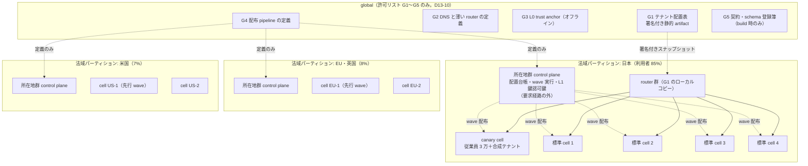
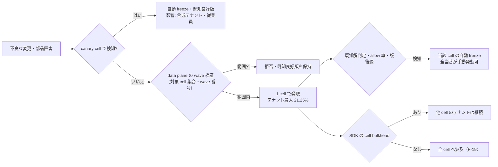
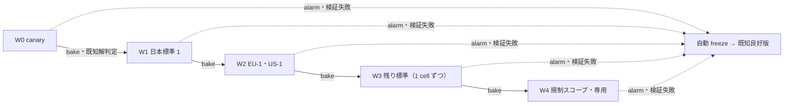

# PDP topology・cell・blast radius 分析

> 文書ID: ARC-07 / 版: 0.2 / 状態: review / 最終更新: 2026-10-15
> 対応要求: R-099, R-150〜R-157, R-192.1, R-207, R-261, R-265, G-048, G-054, G-112, G-139, G-151（本書を対応成果物に名指しする全行）／G-042（関連。ADR-013 が「DL-18 で全要素を詳細化」と送った行）／CL-0174, CL-0176, CL-0239, CL-0247, CL-0267（主張台帳で本書を持込み先とする行）、DS-17（異議ログ）、K-19, K-20（KRI のデータ源）、GOV-09 T4、CB-REQ-23、T-028 の受容範囲
> 依存文書: CONVENTIONS.md, traceability/deliverables.md（DL-18 行）, traceability/R-requirements.md, traceability/G-goal-criteria.md, traceability/claims-ledger.md, 05_adr/ADR-013-cell-partitioning-fail-mode.md（設計判断の正本）, 05_adr/ADR-007-key-hierarchy-kms-hsm.md, 05_adr/ADR-010-authz-engine-store-consistency.md, 05_adr/ADR-023-dependency-tiers.md, 05_adr/ADR-028-tenant-lifecycle-operations.md, 05_adr/reconciliation-notes.md, 01_governance/assumptions-register.md, 01_governance/business-impact-analysis.md (GOV-04), 01_governance/loss-scenarios.md (GOV-03), 01_governance/kri.md, 01_governance/stop-authority.md (GOV-06), 02_requirements/operation-risk-tiers-assurance.md (REQ-03), 03_threat-model/attacker-model.md, 03_threat-model/threat-catalog.md, research/RS-09, RS-07, RS-05, research/standards-status.md
> 表記: 表のセルのうちタグのないものは設計推論 [D] であり、この注記で個別のタグに代える。事実を述べるセルには個別にタグと脚注を付けた。本書で新たに置く項目は、決裁案 KD18-x、シナリオ F-xx（単一障害）・C-xx（単一侵害）、試験案 TC-18-xx（仮番。DL-22 で採番）、TBD 項目 TBD18-xx と書く。ADR-013 の D13-xx・KD13-x・TC-13-xx・N13-x はそのまま引く。
> 作成方法: AI エージェント（Claude）が起草し、別の AI エージェント（Claude）が独立レビューして修正した（末尾「レビュー記録」）。人による作成者以外の検証は未了である（CONVENTIONS §8）。

## 0. 結論（CTO/CISO 向け）

1. **N13-1 の初期構成（9 cell）では、単一障害・単一侵害の影響は「cell 内の部品なら利用者の最大 20.5%・テナントの最大 21.25%」、「法域パーティション単位の部品なら日本で 85%」の 2 段に分かれる [D][A-001, A-061, N13-2]。** cell は影響を「1 テナント」には封じ込めない [D]。1 テナントへの封じ込めは、cell 内のテナント境界 deny（ADR-010 D-28）、テナント単位の quota、テナント単位の名前空間配布、専用 cell・専用 issuer 枠が担う [D]（§6）。
2. **事業側の blast radius 予算（KD13-1）は未決であり、照合表（§5.3）では候補 3 案のどれを採っても超過する行が残る [D]。** 超過の主な行は次の 3 つである [D]。(a) 法域単位の部品（L1 鍵、所在地群の control plane・配布 pipeline、routing 層）の侵害・停止。(b) 日本主リージョンの喪失（全 cell を主リージョンで現用にする場合は 85%）。(c) PEP SDK の供給網侵害（cell と無関係に最大 100% のテナント）。(a) と (c) は cell では縮められない [D]。統制（data plane 側の wave 検証 D13-31、二者統制、SDK の Tier 別 wave）で発生可能性を下げ、残余リスクを受容者が受容する [D]。(b) は配置で縮められる（KD18-2）[D]。
3. **予算から cell 数を逆算する式（§5.2）を置いた [D]。** 「テナント 20% 以下」を厳密に守るにも、日本の標準 cell は N13-1 の 4 ではなく 5 必要になる（4 では 21.25%）[D][A-007, N13-2]。「5% 以下」なら計 22 cell、「2% 以下」なら計 52 cell と最大テナント群の専用 cell が要る [D]。固定費は cell 数にほぼ比例し（ADR-013 §2.2）、要員の前提（KD13-5）が成り立たなければ cell を増やせない [D][A-054]。予算・費用・要員は同時に決める必要がある（KD18-1）[D]。
4. **global 部品は ADR-013 D13-10 の許可リスト 5 つ（G1〜G5）に限る [D]。** 本書はこれに加えて、表に出ない共通依存 10 種（DNS、クラウド事業者の global な IAM・sign-in、公開 TLS 証明書の発行、container registry、時刻源など）を棚卸しの対象として列挙した（§3.3）[D]。DNS は単一提供者の障害の一次報告を 1 件取得し、レビュー時に原典を再照合した [I][^26]。ただし複数化の効果を示す一次資料ではないので、KD13-7 の判断材料は残る [D]。
5. **障害注入計画（§9）は 33 件の試験案（ADR-013 の TC-13-01〜25 と本書の TC-18-01〜08）を、単一障害 21・単一侵害 14 のシナリオに対応付けた [D]。** 試験を直接対応付けていない侵害シナリオ（C-03、C-04、C-05、C-06、C-10、C-11、C-13、C-14）は、DL-22 の cross-tenant 負例試験、pentest・red team（§9.4）、鍵侵害対応の演習（C-03・C-04 は ADR-007・ADR-019 の L1・L0 再発行演習）に送る [D]。実験自体の blast radius は canary cell と合成テナントに限る [D]。G-048 の合格（実測した影響範囲が予算以下）は、予算の決定（B）と独立立会人付きの実測（C）の両方がそろうまで「未達」である [D]。

---

## 1. 本書の範囲と位置付け

- 本書は DL-18 として、ADR-013 が決めた原則（cell の単位、global 部品の許可リスト、静的安定性、fail-mode、配布の段階展開）を、影響範囲の見積り・予算との照合・障害注入計画に展開する [D][^40]。
- 決定済みの原則は ADR-013 を正本とし、本書では変えない [D][^41]。特に次の 6 つは ADR-013 で不可逆として DEC-3 の決裁対象になっている [D][^41]。分割キー（不透明・不変のテナント ID）、法域の硬い境界、cell 間の同期呼出しの禁止、global 部品の許可リスト、cell 識別子を外部に出さないこと、認可判定の fail-open 禁止。
- 可逆の値（cell 数、shuffle shard の構成、wave の順序、最大齢など）は、本書で式・候補・TBD として示す [D][^41]。
- fail-mode の全セルは DL-19（04_architecture/fail-mode-matrix.md）、数値契約は DL-20（07_slo/numeric-contracts.md）、容量は DL-58（04_architecture/capacity-model.md）、依存 Tier は DL-63（10_integration/dependency-tiers.md）が持つ [D][^40]。

### 1.1 前提（A-ID）

| A-ID | 値（基準） | 本書での使い方 |
|---|---|---|
| A-001, A-002 | 登録 100 万（B2B 70 万、B2C 27 万、従業員 3 万） | 利用者割合の分母 |
| A-007, A-008 | テナント 1 万。超大規模（1 万人以上）5 テナントで 20 万人、上位 85 テナントが B2B 利用者の 57% [A-008] | テナント割合の分母、偏り |
| A-009 | 最大テナント 10 万人。単独 Check 5,266/秒（全体の 12.5%）、k_u×k_g 込み 14,745/秒 | 利用者割合の下限、cell の最小寸法 |
| A-010 | B2C 6 realm、最大 realm 12 万人（Check 181/秒） | 利用者数で最大の配置単位 |
| A-045 | Check 42,009/秒（成長 169,333/秒） | cell 容量 |
| A-050 | 依存サービス 300 | サービス軸の影響 |
| A-054 | プラットフォーム 24 FTE、うち SRE 6 | cell 数の上限条件 |
| A-061, A-062, A-063 | 地域分布 85/8/7%、所在地指定 500 テナント、4 リージョン | 法域パーティション |
| A-080, A-081 | 規制業種 25%（B2B 利用者）、高保証 50 テナント | 規制スコープ cell、専用 cell |
| A-090〜A-093 | 判定系 99.95〜99.99%、認証系 99.9〜99.95%、管理系 99.5〜99.9%、RTO 1 時間・RPO 5 分 | 静的安定性、plane 別 SLO |
| N13-1, N13-2, N13-5 | 初期 9 cell（日本 5＝canary 1＋標準 4、EU・英国 2、米国 2）、テナント分布は利用者分布と同じ、専用 cell 5 以下 | 影響割合の試算の基準構成（ADR-013 の新規仮定。前提台帳へ追加要） |

- 上表の値は前提台帳[^42]と ADR-013 §1.5[^41]から引いた [D]。
- 本書で新たに置く仮定は次のとおりである（前提台帳へ追加要）。前提台帳は編集していない [D]。

| 仮番号 | 内容 | 所有者案 | 期限 |
|---|---|---|---|
| N18-1 | テナントは同じ法域パーティション内の標準 cell へ、テナント数と利用者数がともに均等になるように配置できる（超大規模テナントは cell あたり 2 以下、D13-06）。均等からのずれは DL-58 が配置表で示す | SRE 責任者 | G3 |
| N18-2 | 依存サービス 300 は原則として全 cell のテナントを扱う（サービスは cell で分割しない）。このため 1 cell の停止は「全サービス × 当該 cell のテナント」に影響する | CTO | G3 |
| N18-3 | 影響割合は「影響を受けうる上限」で見積もる。検知・freeze が働いた場合の実際の影響はこれ以下になるが、その時間は TC で測るまで使わない | CISO | G4 |

---

## 2. PDP topology と cell 構成

### 2.1 全体構成

- cell 間には同期呼出しも共有状態も置かない（D13-13）[D][^41]。cell が他 cell の状態を要する場合は、事前配布された署名付きデータ（JWKS、配置表、失効状態）で解決する [D][^41]。
- 図の 9 cell は N13-1 の試算値であり、確定値ではない（KD13-1、KD18-1）[D]。規制スコープ cell と専用 cell は図に含めていない。N13-1 は規制スコープ cell を別数えしていないためである（§2.3）[D]。

### 2.2 cell の中身と PDP topology

| 層 | 配置 | 根拠（ADR） | blast radius 上の意味 |
|---|---|---|---|
| edge PEP、接続ゲートウェイ、opaque token の状態ストア | cell 内 | ADR-013 D13-08、ADR-005 D1-2、ADR-006 D6-14 | edge の障害は当該 cell のテナントに限る |
| AS（login、token 発行、federation）、STS、TTS、session store | cell 内（製品が作れなければ C′＝所在地群の AS。KD13-3） | D13-08、KD13-3 | C′ では AS 障害が日本の新規 login の 85% に及ぶ |
| PDP（ReBAC・ABAC）、policy・relationship store（正本）、tenant 設定 | cell 内の共有サービス。依存サービス側（SDK・sidecar）には token 検証・最大齢付きの判定キャッシュ・public の静的規則だけを置く | D13-12、ADR-010 D-23〜D-25 | 関係データ（7.55 億 tuple [A-049]）を約 1.1 万の本番インスタンス [A-012] に配らない。配布面が CrowdStrike 型の一斉配布障害の面と一致することを避ける |
| 失効・剥奪の配布元と入力経路 | cell 内（Tier 0） | D13-35、ADR-023 | control plane 停止中も剥奪が反映される |
| L2 署名鍵・KEK（cell 専用アカウントの KMS）、jwks_uri 配信 | cell 内 | D13-08、ADR-007 | 鍵侵害と KMS 枠を cell に閉じる |
| 監査 producer、耐久 spool、一次保管 | cell 内 | D13-08 | 監査欠損は cell 単位 |
| 所在地群 control plane、L1 鍵、WORM・検知パイプライン | 法域パーティション | D13-09 | 侵害・停止で法域全体（日本 85%）に及ぶ（§4） |

- PDP を cell 内の共有サービスにすると、判定ごとにネットワーク 1 hop が加わる [D][^41]。p99 は TC-13-04 で実測し、DL-20 の予算を超えたら D13-12 を見直す [D][^41]。
- shuffle sharding は cell 内の stateless な PDP worker と edge worker にだけ使う（§3.5）[V][^2]（RS-09#7）。

### 2.3 cell の種類と配置規則

| 種類 | 収容 | 配置規則 | 未決 |
|---|---|---|---|
| canary cell（日本） | 従業員 3 万と合成テナント | wave 0。業務テナントを置かない | — |
| 標準 cell | 一般テナント、B2C realm | テナント数と利用者数を均す（N18-1）。超大規模テナントは 2 以下（D13-06） | 数（KD13-1） |
| 規制スコープ cell | 規制業種（金融・医療・公共）と高保証契約のテナント。専用の鍵・監査経路 | 最後の wave。カード会員データは範囲外 [A-072] | 数と、N13-1 の 9 cell との関係（未決（ADR-013 KD13-1）） |
| 専用 cell | 契約で求めた 1 テナント | 価格付きの契約オプション、5 以下 [D]（ADR-013 の新規仮定 N13-5。前提台帳へ追加要） | 付与基準（未決（ADR-013 KD13-2）） |

- 規制業種は B2B 利用者の 25%（金融 10・医療 7・公共 5・決済 3%。17.5 万人）である [A-080, A-002]。決済 3% はカード会員データを基盤が扱わない前提（A-072）で規制スコープ cell に入れて数えた上限値であり、DL-34 の判定で決済系を別 cell に分ける場合は約 13%（日本分 14.9 万人の代わりに約 13.1 万人）に下がる [D][A-072]。そのうち日本分を 85% とすると約 14.9 万人で、日本の標準 cell 1 つ分（20.5 万人）より小さい [D][A-061]。N13-1 の日本標準 4 のうち 1 を規制スコープ cell に充てるか、別に足すかは未決（ADR-013 KD13-1）である [D]。足す場合、規制スコープ cell の停止の影響は利用者の約 15% になる [D]。
- 利用者数で最大の配置単位は最大テナント（10 万人）ではなく最大 B2C realm（12 万人）である [A-010]。ただし負荷は 181/秒と小さい [A-010]。利用者割合の予算の例外規定（KD13-1）は、テナントだけでなく realm も対象にする必要がある [D]。

---

## 3. global 部品と最小化

### 3.1 許可リスト（ADR-013 D13-10 の詳細化、G-042）

| ID | 部品 | 共有の理由 | 保持してよいデータ | 停止時の影響 | 侵害時の影響 | 最小化の手段 |
|---|---|---|---|---|---|---|
| G1 | テナント配置表 | 要求を正しい cell へ送るため全テナントの対応が要る | 不透明テナント ID、cell ID、検証済みドメイン→テナント ID、版番号。個人データなし [A-062] | 新規テナント作成と cell 間移動が止まる。既存テナントは最終版で転送を続ける | 誤った割当は edge の収容検証（D13-11）で拒否され、越境アクセスにならない。影響は可用性（誤割当されたテナントの停止）に限る | 署名付き静的 artifact。特定 DB 製品の global 複製を使わない。版の単調性検査 |
| G2 | DNS と薄い router | 単一の入口 | G1 のローカルコピーだけ | router は所在地群ごと。1 群の停止はその所在地群の新規接続（日本では 85%） | 誤経路は D13-11 で拒否 | router の shard 化（§3.5、KD18-3）、DNS の複数化（KD13-7） |
| G3 | L0 trust anchor | 鍵階層の root | オフライン鍵 | 平常時の影響なし。L1 の再認証ができなくなるだけ | 全法域に及ぶ（C-04） | オフライン保管（ADR-007） |
| G4 | 配布 pipeline の定義 | 全配布物を同じ規則で段階展開するため | wave 定義と承認記録 | 変更が止まる（fail-static）。data plane は影響を受けない | wave 定義の改ざんは、data plane が署名内の対象 cell 集合と wave 番号を検証することで抑える（D13-31）。署名鍵は所在地群ごと | 定義だけを global に置き、artifact の保管と実行は所在地群ごと |
| G5 | 契約・schema 登録簿 | 300 サービスが同じ契約を参照する | 契約と schema の版 | 新しい契約版の公開が止まるだけ | 不正な schema は build 時の契約試験と data plane の schema 検証（D13-31）で止める | Git 等の汎用形式。実行時の依存なし |

- 表にない部品を global にするには ADR-013 の改訂を要する [D][^41]。global の control plane は持たない [D][^41]。
- AWS の cell 白書は、全 cell の共有状態を持つ唯一の部品である cell router を単一障害点とし、最大限の信頼性で、かつ cell 化された部品として作るべきだとしている [V][^2]（RS-09#3）。G2 の shard 化（§3.5）はこの記述からの設計推論である [D]。

### 3.2 global を避けた部品（参照用）

| 部品 | global にしない理由 | 置き場所 |
|---|---|---|
| 利用者 directory | 所在地の硬い境界（D13-02）と cell 間の同期呼出しの禁止（D13-13） | cell 内。複数テナント所属（3% [A-015]）は token の取り直しで解決 |
| policy・relationship store | 全テナント集約は R-265 で既定にしない。Google 2025-06 では全域複製の policy データが全リージョンを同時に落とした [I][^19]（RS-09#67） | cell 内（ADR-010 D-23） |
| 失効状態 | control plane の停止とも freeze とも独立に配る必要がある | cell 内（D13-35） |
| 鍵 metadata・JWKS | Azure AD 2021-03-15 では鍵の誤削除が global metadata に載り、利用側キャッシュの差で回復が翌日まで分かれた [I][^16]（RS-09#53, #54） | cell・issuer 単位（ADR-007） |
| control plane | control plane は data plane より故障しやすく、誤情報より失敗を選ぶべきとされる [V][^2]（RS-09#12） | 所在地群ごと（D13-09） |

### 3.3 表に出ない共通依存の棚卸し対象

D13-21 は、cell の実行時依存を構成と実行時トレースから機械的に列挙し、global endpoint への実行時依存を 0 件にすることを目標にする [D][^41]。AWS 2025-10 では、us-east-1 の障害で他リージョンの root 資格情報と federation 経由の console login も失敗した [I][^21]（RS-09#71）。本書は棚卸しの観点として次の 10 種を置く [D]。

| # | 共通依存 | 失われたときの影響（見込み） | 扱い | 確認 |
|---|---|---|---|---|
| H-1 | 公開 DNS（権威 DNS 提供者） | 全テナントの新規名前解決。キャッシュの TTL 内は継続 | KD13-7。DNS 変更も配布物として wave 化（D13-30）。空レコードの拒否 | TC-13-14、TC-18-05 |
| H-2 | クラウド事業者の global な IAM・sign-in・console | 運用者の操作不能。data plane には実行時依存させない | 運用者 login は Tier X（ADR-023）。break-glass は封緘資格情報 | TC-13-13, -17 |
| H-3 | 公開 TLS 証明書の発行（CA、ACME） | 更新が止まる。発行済み証明書は期限まで有効 | 期限の TBD18-09 日前までに自動更新し、更新失敗と残日数が TBD18-09 を下回った時点で警報 | TC-18-06 |
| H-4 | container registry・artifact 保管 | 新規起動・自動スケールが止まる | 所在地群ごとの複製。cell 内のローカル cache。起動時依存も依存として数える（ADR-023） | TC-13-07 |
| H-5 | 時刻源（NTP） | token の exp・nbf 検証、判定記録の有効期限、wave の bake 判定がずれる | cell 内に複数の時刻源。時刻のずれの警報 | TC-18-06 |
| H-6 | CI/CD とその署名鍵 | 変更が止まる（fail-static）。侵害時は C-06・C-09 | ADR-008 の二者統制、data plane の wave 検証 | TC-13-11 |
| H-7 | 監視・警報・当番招集 | 検知と freeze の遅れ | Tier X。基盤に依存させない（D13-22） | TC-13-17 |
| H-8 | 外部 IdP（B2B 顧客の federation 先） | 当該顧客テナントの新規 login だけ | テナント単位に閉じる。顧客 IdP の障害は cell の問題にしない | TC-13-03 |
| H-9 | KMS の regional API と quota | cell の署名停止。枠はアカウント×リージョン単位 [V][^24]（RS-05#44） | cell 専用アカウント（N13-8）。実効 quota の確認 | TC-13-23 |
| H-10 | PEP SDK・依存ライブラリの配布元 | 全サービスへの同時配布（C-09） | Tier 別 wave（ADR-023）、依存サービスが受信時期を選べる（D13-36） | TC-18-07 |

- DNS について、Akamai は 2021-07-22 15:45 UTC にソフトウェアの設定更新が Secure Edge CDN の DNS 部品の bug を引き起こし、一部の顧客サイトが最大 1 時間利用不能になり、設定更新の rollback で回復したと報告している [I][^26]。翌日の更新で、影響範囲を Akamai の DNS サービス全体から Secure Edge CDN の DNS 部品へ訂正している [I][^26]。
- この報告は「単一提供者の DNS 層の変更が、その提供者を使う多数の顧客の到達性を同時に失わせる」例である [D]。一方で、DNS 提供者の複数化によって影響を避けられたことを示す一次資料ではない [D]。この原典は本書の起草時に取得し、レビュー時（2026-10-15）に別エージェントが原典を再取得して、時刻・原因・範囲の訂正・最大 1 時間・rollback による回復の記述を照合した [D]。research には未収録である [D]。複数化の効果を示す一次資料がないため、KD13-7 の判断材料として残課題に残す [D]。
- AWS 2025-10 の発端も、自社 DNS 管理の自動化の race condition で regional endpoint の DNS レコードが空になったことである [I][^21]（RS-09#71）。このため DNS レコードの変更は、自社のものも配布物として wave と空レコード拒否の対象にする（D13-30、RR13-10）[D]。

### 3.4 静的安定性

本書の「cell の data plane」は ADR-013・ADR-023 の用語であり、ARC-01 §1.2 の decision plane（AS・STS・TTS・PDP・状態ストア・失効状態の配布元など）と data plane（edge・接続ゲートウェイなど）を合わせたものを指す [D]。

control plane が止まっても、cell の data plane は署名付きの最終状態で上限時間 H まで動き続ける（D13-14）[D][^41]。静的安定な設計では、障害中に更新を受けられなくても、それまで動いていたものは動き続ける [V][^6]（RS-09#10）。AWS IAM は control plane の障害中も既存 principal の認証・認可を継続するとし、回復経路で partitional service の control plane に頼らないよう求めている [V][^7]（RS-09#13）。

| 止まるもの | data plane の振舞い | 止まる機能 | 影響の上限 |
|---|---|---|---|
| 所在地群 control plane（配置台帳、wave 実行、テナント管理） | 署名付き最終状態で継続（H まで） | 新規テナント、移動、policy 変更、設定変更 | 判定系は 0%。管理系（privileged の通常管理操作）は法域内の全テナント。管理系の帯は判定系より低い [A-092] |
| PAP（policy 作成） | 最終の policy 版で継続 | policy 変更 | 同上 |
| G1 の更新 | router・edge は最終スナップショットで転送 | 新規テナントの router 登録 | 新規テナントのみ |
| G4 pipeline | 変更停止（fail-static） | 全配布。ただし剥奪・失効の配布は cell 内の Tier 0 経路で継続（ADR-023） | 判定系は 0% |
| quota 制御器 | 各ノードが最後の閾値で継続（fail-static）[V][^10]（RS-09#22） | quota の変更 | 0% |
| 正本ストアへの直接問合せ | 迂回しない（D13-15） | — | キャッシュ迂回で増幅しない。Auth0 2021-04 は迂回と再試行で約 4 時間 20 分止まった [I][^30]（RS-09#56, #57） |

- H は剥奪反映の遅れとのトレードオフであり、TBD である（所有者: CTO＋CISO、期限: G4、決め方: BIA と TC-13-02 の実測。ADR-013 KD13-6）[D][^41]。ADR-023 は剥奪の入力経路を cell の Tier 0 に置いて H と剥奪反映を切り離し、トレードオフを PDP 不達時の read-sensitive（B_rs）と失効配布路の停止に限っている [D][^43]。

### 3.5 shuffle sharding

| 適用先 | 方式 | 効果（式） | 前提と限界 |
|---|---|---|---|
| cell 内の PDP worker | テナントごとに N worker から k worker の組を割り当てる | 2 テナントの組が完全に重なる確率は 1/C(N, k)。8 worker・2 ずつで 1/28 [V][^3]（RS-09#7）。16 worker・4 ずつなら 1/1,820（算術）[D] | 要求側が組の他の worker へ再試行できることが前提 [V][^3]。SDK に再試行予算付きの別 worker への再試行を入れる（D13-16） |
| cell 内の edge worker | 同上 | 同上 | 同上 |
| G2 router 群（所在地群内） | テナントのホスト名ごとに router の組を DNS で割り当てる（KD18-3） | Route 53 は 2,048 個の仮想 name server から 4 個ずつを各 domain に割り当て、どの 2 domain も 3 個以上を共有しないようにしている [V][^3]（RS-09#7）。router の 1 組の不良の影響を所在地群全体から組の割当先に縮める [D] | テナント別のホスト名がある場合に限る。信頼区画 issuer（U-01 (b)）では区画の login ホストを複数テナントが共有するため効果が下がる [D][^44] |
| cell をまたぐ shard | 使わない | — | cell 白書は cell をまたぐ shuffle sharding を禁じる [V][^2]（RS-09#7） |

- shuffle sharding は可用性の統制であり、テナント分離・侵害の封じ込めの統制には数えない [D][^41]。shard は鍵もデータも分けないからである [D]。
- N と k は DL-58 の容量で決める（TBD18-01）[D]。

---

## 4. policy store の分割と quota

### 4.1 policy store の分割（R-151、R-157、R-265）

| 層 | 分け方 | 根拠 | 影響範囲 |
|---|---|---|---|
| 第 1 キー | cell（法域×規制スコープ×テナント群）。単一の global store/PDP は置かない | ADR-010 D-23、R-265 | 1 store の障害・侵害は 1 cell |
| 第 2 キー | cell 内は共有 store を既定にする。最大テナント層、所在地指定テナント（500 [A-062]）、契約で論理分離以上を求める規制顧客は専用 store・専用区画 | ADR-010 D-24 | 共有 store では cell 内の全テナント、専用区画では 1 テナント |
| 論理的単独性 | 共有 store でもテナント単位の export・import・移動・削除を必須にする | ADR-010 D-26 | テナント単位の復元（D13-39）の前提 |
| 業務ドメイン（約 30） | 物理分割軸にせず、モデルのモジュール（所有の境界）として扱う | ADR-010 D-27 | ドメイン単位の分割はテナント単位の封じ込めにならない |
| テナント境界 | façade の前段で決定論的に deny（越境共有だけ ADR-024 の例外） | ADR-010 D-28 | cell 内のテナント間漏えいを抑える主統制 |

- 1 万テナントをすべて別 store にする案は既定にしない [D][^45]。AWS Verified Permissions の文書は、テナント別 store では global policy を全 store に複製する必要があり、その労力を "High" としている [V][^23]（RS-07#51）。AVP の policy store 数の既定 quota は 30,000/リージョン/アカウント（引上げ可）である [V][^53]（RS-07#48）。基準のテナント 1 万（成長 2.5 万 [A-007]）は 1 アカウントの既定値に収まるが、cell 専用アカウント（N13-8）に分けたうえでも onboarding・off-boarding と global policy の複製の運用が 1 万本規模で発生する [D]。異議ログ DS-17 が求めた per-tenant 分割の運用負荷と quota の比較軸は、この 2 点で示す [D]。
- global なガードレール policy（ADR-011 の G 段カタログ）も配布物であり、cell 単位の wave で配る（D13-30）[D]。テナント・ドメインの名前空間の policy は、そのテナント・ドメインが受ける ring を選べる（D13-36）[D][^41]。

### 4.2 quota（R-152）

| 次元 | 置き場所 | 超過時 | quota 系の停止時 | 値 |
|---|---|---|---|---|
| テナント単位の Check/秒 | cell の edge と PDP façade | 当該テナントだけ 429。過負荷時は操作階層の低い順に shed [V][^31]（RS-09#39） | fail-static（最後の閾値） | TBD18-02 |
| テナント単位の書込/秒（対話と bulk を別レーン） | PDP façade | 同上。bulk は対話より先に絞る | 同上 | TBD18-02。bulk の基準量は 278/秒 [A-047] |
| テナント単位の ListObjects/秒 | PDP façade | 同上 | 同上 | TBD18-02。基準 840/秒 [A-046] |
| クライアント単位の同時実行数 | PDP façade | 同上 | 同上 | TBD18-02 |
| login・回復・token endpoint の濫用防止 rate limit | cell の AS 前段 | 拒否（保護機能のため fail-open にしない） | fail-static（D13-23） | DL-52・DL-20 |
| 運用工具の 1 回の実行の対象テナント数・cell 数 | 工具側 | 実行拒否。超える場合は二者承認 | 実行拒否 | 1 cell。テナント数は TBD18-03 |

- quota の値そのものも配布物であり、binary と同じ cell 単位の wave で配る（D13-30）[D][^41]。Google 2020-12-14 では、quota 移行の際に旧系が使用量 0 を誤報告し、自動化が quota を下げたことで、認証付きトラフィックのほぼ全てが 47 分間 5xx になった [I][^14]（RS-09#47, #48）。
- 最大テナントの設計負荷 14,745/秒は、日本の標準 cell の平均設計容量（約 25,000/秒）の約 59% を占める [D][A-009, A-045]（D13-06）。ただし容量の正本である ARC-13（§5.2・§5.4）は、従業員を canary cell に収容する N13-2 に従って平均設計容量を 21,678/秒（s=1）と算出しており、その場合の占有率は約 68% になる（ARC-13「ADR への指摘」1）[D]。テナント単位の quota の上限を「cell 設計容量 × α」で置く場合、α は ADR-010 D-24 の専用区画の閾値と同じ実測（TC-010-11）で決める（TBD18-02）[D][^45]。

---

## 5. 影響割合の見積りと blast radius 予算

### 5.1 見積りの方法

- 影響割合は、テナント割合（影響を受けうるテナント数 ÷ 1 万）と利用者割合（影響を受けうる利用者数 ÷ 100 万）の両方で示す [D][A-001, A-007]。テナント数を均等にしても利用者数は均等にならないからである [D][A-008]。
- 影響の「種類」は、(i) 全操作停止、(ii) write 以上の拒否（read-sensitive は B_rs まで継続）、(iii) 新規 login・refresh の停止（既存 session は継続）、(iv) 機密性の侵害、(v) 管理操作の停止、に分けて書く [D]。操作階層ごとの挙動は ADR-013 D13-25 に従う [D][^41]。
- 影響サービスは、N18-2 により原則として「全 300 サービスの、当該テナント分」になる [D][A-050]。cell はテナントの割合を縮めるが、サービスの数は縮めない [D]。サービス軸の封じ込めは §6.2 に書く [D]。
- 影響期間は上限の根拠（RTO、H、B_rs、検知から freeze まで）で示し、値が TBD のものは TBD と書く [D]。
- BIA は、区画を分けない場合に F2（判定不能）で同時に止まる範囲を依存サービス 300・テナント 1 万・同時アクティブ session 11.1 万とし、cell で閉じ込めれば影響テナント数はおおむね「1 万 ÷ cell 数」に減るが、利用者数はどの cell が止まるかで大きく変わるとしている [D][^52]。本節はこの評価欄 X7（相関を断つ統制の効果）への入力である [D][^52]。BIA の操作階層別 MTPD（read-sensitive 4 時間、write 2 時間）は仮置き [A-NA-01] であり、影響期間の照合は BIA の署名後に行う [D][^52]。

### 5.2 予算から cell 数を逆算する式

日本の標準 cell 数 n_JP は、次の 3 条件の最大値とする [D]。

- テナント条件: n_JP ≥ 8,500 ÷ (b_t × 10,000)（b_t はテナント割合の予算）[D][A-007, N13-2]
- 利用者条件: n_JP ≥ 82 万 ÷ (b_u × 100 万)（82 万は日本の利用者から canary cell の従業員 3 万を除いた数。b_u は利用者割合の予算）[D][A-001, A-002, A-061]
- 寸法条件: n_JP ≥ 3（超大規模 5 テナントを cell あたり 2 以下にする D13-06）、かつ 1 cell の負荷 ≤ cell 設計容量（DL-58、TC-13-04）[D][A-008]

EU・英国、米国は同じ式で求め、D13-05 により各 2 以上とする [D][^41]。

| 予算（テナント・利用者とも） | 日本標準 | canary | EU・英国 | 米国 | 計 | 固定費（N13-1 の 9 cell 比） | 例外が要る単位 |
|---|---|---|---|---|---|---|---|
| 約 21%（N13-1 そのもの） | 4 | 1 | 2 | 2 | 9 | 1.0 | なし |
| 20% 以下 | 5（8,500 ÷ 2,000 = 4.25） | 1 | 2 | 2 | 10 | 約 1.1 | なし |
| 10% 以下 | 9（8.5 と 8.2 の切上げ） | 1 | 2 | 2 | 14 | 約 1.6 | 最大テナント（10%）がちょうど上限 [A-009]。最大 B2C realm（12%）は超過 [A-010] |
| 5% 以下（KD13-1 (a)） | 17 | 1 | 2 | 2 | 22 | 約 2.4 | 超大規模 5 テナント（平均 4 万人 [A-008]）のうち 5 万人を超えるもの、最大 realm |
| 2% 以下 | 43（テナント条件 42.5） | 1 | 4 | 4 | 52 | 約 5.8 | 超大規模の全テナント、大規模の一部、全 realm（最大 12 万） |

- 固定費の倍率は「cell の固定費 F が cell 数に比例する」と置いた場合の値であり、F そのものは DL-33 で見積もる [D][^41]。配備単位は「cell 内部品の種類 × cell 数」で増える（ADR-013 §2.2 の 9 部品なら 22 cell で約 200）[D]。
- 利用者割合の予算が最大テナント・最大 realm の大きさを下回る場合、その単位を専用 cell に置き、「専用 cell ではその単位自身の利用者だけが影響を受ける」例外規定が要る（KD13-1）[D][^41]。専用 cell の上限 5（N13-5）を超えるなら、N13-5 の見直しも要る [D]。
- 成長シナリオでは、日本の Check は 169,333 × 0.70 = 約 118,500/秒になる [D][A-045, A-061]（成長シナリオの地域分布 70%）。cell の設計容量を基準と同じ約 25,000/秒に保つなら、予算と無関係に寸法条件だけで日本の標準 cell が 5 以上要る（k_u を掛けるとさらに増える）[D]。ARC-13 の基準（従業員を canary に分けた日本の標準 cell 分 26,717 × 4 ≈ 10.7 万/秒、設計容量 21,678/秒）で計算しても 5 以上である。1 cell あたりの負荷を基準時と同じに保つ条件では約 14 になる（ARC-13 §10.3）[D]。予算から決まる cell 数と、容量から決まる cell 数の大きい方を採る [D]。

### 5.3 単一障害・単一侵害の影響見積りと予算照合表

基準構成は N13-1（日本標準 4、EU・英国 2、米国 2、canary 1）とする [D]。予算列の記号は次のとおりである [D]。○＝予算内、△＝境界（約 20% に対し 21.25%）、×＝超過、—＝当該予算の対象外の種類。予算案は KD13-1 の (a) テナント 5%・利用者 10%（専用 cell 例外付き）、(b) テナント・利用者とも約 20%、(c) 1 法域全体の停止を許容、である [D][^41]。(c) は障害の予算として定義されているため、侵害の行は「—」にした [D]。

#### 5.3.1 単一障害（F）

| ID | シナリオ | 影響の種類 | テナント割合 | 利用者割合 | 影響期間の上限の根拠 | (a) | (b) | (c) | S-ID / ATK / T |
|---|---|---|---|---|---|---|---|---|---|
| F-01 | 日本標準 cell 1 つの PDP 全停止 | (ii) | 21.25% | 20.5% | B_rs（read-sensitive）、cell 内 3 AZ・待機 cell への切替 | × | △ | ○ | S-06 / ATK-12, 19 / T-009 |
| F-02 | 日本標準 cell 1 つの AS 停止 | (iii) | 21.25% | 20.5% | 既存 session・access token の寿命。新規 login は復旧まで | × | △ | ○ | S-06 / T-009 |
| F-03 | C′ を選んだ場合の日本 AS 停止（KD13-3） | (iii) | 85% | 85% | 同上 | × | × | ○ | S-06 / T-009 |
| F-04 | 不良配布物が canary cell で止まる | (i) | 0%（合成テナントのみ） | 3%（従業員） | 検知から freeze・rollback まで（TBD、TC-13-08） | ○ | ○ | ○ | S-05 / ATK-10, 19 / T-028 |
| F-05 | 不良配布物が canary の検知をすり抜け、wave 1（日本標準 1）で止まる | (i)〜(ii) | 21.25% | 20.5% | 同上 | × | △ | ○ | S-05 / T-028 |
| F-06 | 配布系の欠陥と data plane 側の wave 検証（D13-31）の欠陥が重なり、所在地群の全 cell に届く | (i)〜(ii) | 日本 85% | 日本 85% | 同上 | × | × | ○ | S-05 / T-028（Azure AD 2020-09 型 [I][^15]） |
| F-07 | 日本の所在地群 control plane の全停止 | (v)。判定系は H まで継続 | 判定系 0%。管理系は 85% | 同左 | H（TBD、KD13-6） | ○（判定系） | ○ | ○ | S-06 / T-009 |
| F-08 | G1 配置表の破損（署名は正しいが内容が誤り） | 誤割当されたテナントの (i)。越境なし（D13-11） | 誤割当の件数次第。全件誤りなら新版を受けた cell の範囲 | 同左 | 配置表も wave で配るため最初は canary の範囲。検知と rollback（TBD） | 件数次第 | 件数次第 | ○ | S-06 / T-009 |
| F-09 | 日本の router 群の全停止（shard 化なし） | 新規接続の (i) | 85% | 85% | router の再起動。G1 のローカルコピーで継続 | × | × | ○ | S-06 / T-009 |
| F-10 | 日本の router の 1 shard 組の不良（KD18-3 で shard 化した場合） | 新規接続の (i) | 組の割当先だけ（N・k で決まる。TBD18-01） | 同左 | 同上 | 値次第 | 値次第 | ○ | S-06 |
| F-11 | 権威 DNS 提供者の障害（単一提供者） | 新規名前解決の (i) | 最大 100%（TTL 内は継続） | 最大 100% | 提供者の復旧。Akamai 2021-07-22 は最大 1 時間 [I][^26] | × | × | × | S-06 / T-009（RR13-10） |
| F-12 | 日本主リージョンの喪失（全 cell を主リージョンで現用にする場合） | (i) | 85% | 85% | RTO 1 時間 [A-093] | × | × | ○ | S-06 / ATK-12 |
| F-13 | 同上、現用 cell を主・副に交互配置した場合（KD18-2） | (i) | 約 42.5% | 約 41〜44% | RTO 1 時間 [A-093] | × | × | ○ | S-06 / ATK-12 |
| F-14 | EU リージョンの喪失（法域内の待機先なし、N13-7） | (i) | 8% | 8% | KD13-4 で決まるまで不定 | × | ○ | ○ | S-06 / ATK-12（RR13-05） |
| F-15 | 1 cell の KMS 停止・署名枠の枯渇 | (iii)（新規発行の停止。検証は JWKS キャッシュで継続） | 21.25% | 20.5% | KMS の回復。ADR-007 の試算（N7-1 の日本 6 cell）では成長シナリオ・s=1.5 の全 session 失効直後に 1 cell 約 1,241/秒で、既定枠 1,000 req/s [V][^24]（RS-05#44）を超える [D][^46]。N13-1 の日本標準 4 cell に置き直すと単純比例で約 1.5 倍（s=1 で約 1,240/秒、s=1.5 で約 1,860/秒）になり、偏りがなくても超える [D][A-061]。基準・s=1.5 では約 810/秒で既定枠内だが、説明例の ECC 300・RSA 500 が実効値なら超える [D] | × | △ | ○ | S-06 / T-043 |
| F-16 | 1 cell の監査 sink 停止 | privileged の拒否。read-sensitive・write は spool の上限（Q_r、Q_w）まで | 21.25% | 20.5% | spool が尽きるまで（TBD、TC-13-16） | × | △ | ○ | S-10 / T-054 |
| F-17 | 1 cell の PDP の誤応答（全 deny・全 allow・古い版）＝gray failure | 全 deny は (ii)、全 allow は (iv) | 21.25% | 20.5% | 既知解判定と allow 率監視による自動 freeze まで（TBD、TC-13-05） | × | △ | ○ | S-05, S-07 / T-028 |
| F-18 | 最大テナントの過負荷（noisy neighbor） | 同じ cell の他テナントの遅延 | quota と shuffle sharding が効けば当該テナントのみ。効かなければ cell 内 | 最大 20.5% | quota の発動まで（TC-010-11、TC-13-15） | 実測次第 | ○ | ○ | S-06 / T-031 |
| F-19 | 1 cell の遅延が依存サービスのスレッドを占有（SDK に cell bulkhead がない場合） | 全 cell のテナントの (i) | 最大 100% | 最大 100% | — | × | × | × | S-06（D13-18 で防ぐ。TC-13-15） |
| F-20 | 運用工具の誤実行（ID の型の取違え、大量削除） | テナントの消失 | 1 cell 内、かつ 1 回の対象テナント上限（TBD18-03）以内 | 同左 | テナント単位の復元（D13-39、TC-13-25）。Atlassian 2022 は最長 14 日 [I][^17]（RS-09#60） | 上限次第 | ○ | ○ | S-19 / ATK-19 / T-048 |
| F-21 | 全 cell の同時再起動・cold cache | 依存ストアの herd、回復の遅れ | 起きれば最大 100% | 最大 100% | Google 2025-06 は us-central1 で randomized exponential backoff の欠如により完全回復が最長約 2 時間 40 分に延びた [I][^19]（RS-09#66） | × | × | × | S-06（D13-20 の段階再起動で防ぐ。TC-13-07） |

#### 5.3.2 単一侵害（C）

| ID | 侵害される要素 | 攻撃者 | 影響の種類 | テナント割合 | 利用者割合 | 影響期間の上限の根拠 | (a) | (b) | (c) | S-ID / T |
|---|---|---|---|---|---|---|---|---|---|---|
| C-01 | 日本標準 cell の L2 署名鍵 1 本（cell × 主体区分 × 用途） | ATK-01, 08 | (iv) token 偽造 | 21.25%（ADR-007 の N7-1 では約 1,417 テナント。§10 の整合指摘） | 最大 20.5% | 検知から緊急失効まで（ADR-007、TBD） | × | △ | — | S-02 / T-041, T-042 |
| C-02 | 高保証テナントの専用鍵（ADR-007 D7-15） | ATK-01, 08 | (iv) | 0.01%（1 テナント） | 最大 10% | 同上 | ○ | ○ | — | S-02 / T-041 |
| C-03 | L1 鍵認可鍵（日本） | ATK-08, 17 | (iv) 鍵マニフェストの偽造 | 85% | 85% | L1 の再発行まで（ADR-007） | × | × | — | S-02 / T-045 |
| C-04 | L0 trust anchor | ATK-08, 17 | (iv) | 100% | 100% | 同上 | × | × | — | S-02 |
| C-05 | 1 cell の store への DB read 権限 | ATK-11 | (iv) 関係データの大量読取 | 21.25%（専用区画のテナントは別） | 最大 20.5% | 検知まで | × | △ | — | S-09 / T-034 |
| C-06 | 1 cell の専用クラウドアカウントの管理者 | ATK-08 | (iv)〜(i) | 21.25% | 最大 20.5% | 同上 | × | △ | — | S-09, S-02 / T-045 |
| C-07 | 日本の所在地群 control plane・配布 pipeline の署名能力 | ATK-07, 17 | (iv) 不正 policy の配布 | 85%（wave 検証は署名能力を持つ攻撃者に対しては時間を稼ぐだけ） | 85% | wave の進行と検知（TBD） | × | × | — | S-05, S-08 / T-028, T-051（RR13-01） |
| C-08 | G4 pipeline 定義の改ざん | ATK-07, 17 | 全域一斉配布の試み | 0%（各所在地群の署名と data plane の wave 検証が拒否する場合）。署名能力も同時に奪われれば C-07 と同じ | 同左 | — | ○（条件付き） | ○（条件付き） | — | S-05 / T-028 |
| C-09 | PEP SDK・依存ライブラリの供給網 | ATK-18, 07 | (iv) PEP の判定迂回 | 最大 100%（cell と無関係。サービス軸で広がる） | 最大 100% | SDK の Tier 別 wave の進行と検知（ADR-023、TBD） | × | × | — | S-08 / T-051 |
| C-10 | cell 内のテナント境界の欠陥（BOLA、tenant confusion） | ATK-02, 03, 06 | (iv) テナント間漏えい | cell では縮まない。欠陥の範囲次第（RR13-07） | 同左 | 修正の配布まで | 欠陥次第 | 欠陥次第 | — | S-01 / T-020, T-021 |
| C-11 | テナント管理者（悪意） | ATK-02 | (iv) 自テナント内 | 1 テナント | 最大 10% | — | ○ | ○ | — | S-01, S-03 |
| C-12 | policy author（自ドメインの名前空間） | ATK-10 | (iv) 過大付与 | 当該ドメインのモデルを使う全テナント。wave に乗るため最初は canary | 同左 | 二者レビューと wave（TBD） | 範囲次第 | 範囲次第 | — | S-05 / T-050 |
| C-13 | support・運用者の JIT アクセス | ATK-09 | (iv) | 1 テナント（ADR-029 の 1 回 1 テナント） | 最大 10% | JIT の期限 | ○ | ○ | — | S-04 / T-049 |
| C-14 | 侵害された microservice 1 つ | ATK-06 | (iv) 当該サービスが扱う全テナントのデータ | 最大 100%（cell では縮まない。audience・workload ID・PEP が担う） | 最大 100% | 検知と workload credential の失効まで | × | × | — | S-01, S-09 / T-015, T-018 |

- C-09 と C-14 は、cell が「テナント」軸の封じ込めであって「サービス」軸の封じ込めではないことを示す行である [D]。この 2 行は ADR-013 の残余リスク表（RR13-01〜12）には明示されていないため、残課題に送る [D]。
- (c) を侵害の予算として使うことは KD13-1 の選択肢に含まれていない [D][^41]。侵害の予算は、障害の予算と分けて決めることを ADR-013 が推奨している [D][^41]。ADR-007 も鍵侵害の予算を別に KD7-5 として置いている [D][^47]。

### 5.4 照合結果の要約

| 予算案 | 超過する行の数（F 21 行・C 14 行のうち） | 超過を解消する手段 | 解消できない行 |
|---|---|---|---|
| (a) テナント 5%・利用者 10% | F 15 行、C 8 行（境界・値次第を除く） | 日本標準 17 cell 以上（§5.2）、router shard 化、交互配置、専用 cell | F-11（DNS）、F-19・F-21（実装の誤り）、C-03・C-04・C-07・C-09・C-14（法域・全域の部品、サービス軸） |
| (b) 約 20% | F 8 行、C 5 行（△の F 6 行・C 3 行を除く） | 日本標準 5 cell で △ を解消。router shard 化、交互配置 | 同上 |
| (c) 1 法域全体 | F 3 行（F-11、F-19、F-21） | DNS の複数化（KD13-7）、SDK の cell bulkhead（D13-18）、段階再起動（D13-20） | 侵害は対象外 |

- どの予算案でも、法域・全域の部品の侵害（C-03、C-04、C-07）とサービス軸の侵害（C-09、C-14）は cell 数を増やしても縮まらない [D]。これらは発生可能性を下げる統制（二者統制、オフライン保管、data plane の wave 検証、SLSA 系の供給網統制、workload ID）と、受容者による受容で扱う [D]。
- 照合表の割合は設計上の上限であり、実測ではない [D]。G-048 の合格には TC での実測が要る（§9）[D]。

---

## 6. 「1 テナント・1 サービス・1 期間」の論証（R-207）

### 6.1 軸ごとの封じ込め

| 軸 | 封じ込める統制 | 達成の水準（設計上） | 証拠 | 閉じていないこと |
|---|---|---|---|---|
| テナント | cell（障害の単位）、テナント境界の前段 deny（ADR-010 D-28）、テナント単位の quota、専用 cell・専用区画・専用鍵、テナント単位の復元（D13-39）、運用工具の 1 回の対象上限 | 障害: 1 cell（最大 21.25%）。テナント起因の過負荷・管理操作: 1 テナント（quota・上限が効く場合）。侵害: 1 テナントへの封じ込めは境界 deny と専用鍵に依存 | TC-13-01, -12, -15, -25、TC-010-11、cross-tenant 負例試験（K-03） | cell 内の境界欠陥（C-10）、法域部品の侵害（C-03, C-07） |
| サービス | SDK の cell 別 bulkhead（D13-18）、entry point ごとの階層宣言（D13-28）、workload ID と audience（ADR-009）、SDK の Tier 別 wave（ADR-023） | 1 サービスの不具合は当該サービスに限る。PEP SDK の不具合・侵害は wave の進行範囲 | TC-13-15、TC-18-07 | SDK 供給網の侵害（C-09）、侵害サービスのデータ到達範囲（C-14） |
| 期間 | static stability の上限 H、read-sensitive の最大齢 B_rs、token の寿命、鍵の緊急失効、検知から自動 freeze まで、既知良好版への復帰 | 全項目の値が TBD | TC-13-02, -05, -08, -24 | 値の決定（KD13-6、DL-19・DL-20） |

- レビューは被害を「1 テナント・1 サービス・1 期間」に封じ込められることの論証を CTO の第 1 の問いに置いている [D][^1]（L19）。
- 本書の結論は次のとおりである [D]。3 つの軸のうち、cell が担うのはテナント軸の障害の一部（1 cell 分）だけである。1 テナントへの封じ込めは cell 内の別の統制に依存する。サービス軸と期間軸は cell 以外の統制が担う。したがって「cell があるから 1 テナントに封じ込められる」とは主張しない（D13-02 と同じ立場）[D][^41]。

### 6.2 封じ込めの連鎖（障害時）

### 6.3 連携開発者（依存サービスのチーム・ベンダー）が行うこと

cell による封じ込めは、依存サービス側が次の規則を守ることを前提にする [D]。どれか 1 つでも欠けると F-19（全 cell への波及）や C-14（サービス軸の侵害）の範囲が広がる [D]。値が TBD のものは DL-19・DL-20 と PEP SDK の既定値で与え、各チームは個別に設定しない [D][^41]。

| # | 行うこと | 守らない場合の影響 | 根拠 | 確認方法 |
|---|---|---|---|---|
| DV-1 | PEP SDK を使い、cell ごとの接続プール・circuit breaker・deadline（bulkhead）を無効にしない | 1 cell の PDP 遅延で全スレッドが埋まり、他 cell のテナントも止まる（F-19） | D13-18 | TC-13-15 |
| DV-2 | 再試行は SDK 既定（ランダム化した指数 backoff、要求単位の回数上限、deadline の伝播）だけを使い、独自の再試行ループを重ねない | 再試行の増幅で依存ストアが飽和する（F-21、Auth0 2021-04 型） | D13-19 | TC-13-07 |
| DV-3 | entry point ごとに操作階層（public／read-sensitive／write／privileged／break-glass）を ADR-012 の entry point 台帳に宣言する。宣言しない entry point は privileged として扱われる | 階層が過大なら PDP 不達時に不要な拒否、過小なら read-sensitive の stale allow の範囲が広がる | D13-25、D13-28、REQ-03 | DL-22 の負例試験 |
| DV-4 | PDP・キャッシュ・状態ストアに届かないときに、正本ストアや AS 本体へ直接問い合わせる迂回を作らない。判定を自前のキャッシュで延命しない（SDK の最大齢付き判定キャッシュだけを使う） | キャッシュ迂回による増幅（F-01・F-21）、fail-open（D13-23 違反） | D13-15、D13-23 | TC-13-06 |
| DV-5 | quota 超過の 429 と、write 以上の拒否の 503（Retry-After 付き）を業務側で扱う。write は受付キューに積み、実行時に fresh 判定で再認可する | 再試行の嵐、または古い判定での書込み | D13-25、ADR-026、§4.2 | TC-18-08 |
| DV-6 | 要求に操作階層を criticality として載せ、下流呼出しへ伝播させる | 過負荷時に重要な要求から落ちる | D13-19（RS-09#39） | TC-13-15 |
| DV-7 | 他の cell や他テナントの状態を同期呼出しで取りに行かない。複数テナント所属の利用者は、作用中のテナントごとに token を取り直す | cell 間の同期依存（K-19 (a) の違反）、tenant confusion（C-10） | D13-13、ADR-005 V9 | K-19 (a)、DL-22 |
| DV-8 | cell 識別子を外部識別子・外部 token・外部公開の URL に出さず、cell 名やリージョンに依存する値を業務データに保存しない | cell の追加・移動のたびに改修が要る | D13-42、REQ-05 INV-2 | 契約試験（ADR-022） |
| DV-9 | token の audience を自サービスに限定し、workload ID を ADR-009 の方式で取得する | 侵害されたサービスのデータ到達範囲が広がる（C-14） | ADR-009、§6.1 | DL-22 |
| DV-10 | 自サービスの Tier（ADR-023）を登録し、SDK・判定ルールの更新を Tier 別 wave で受ける。緊急でない更新は受信時期を選べるが、最低許容版（ADR-016）を下回る版で動かさない | 不良 SDK が Tier 1 まで届く（C-09） | D23-41、D13-36 | TC-18-07、TC-23-08 |
| DV-11 | 自ドメインの policy・model の変更を配布物として wave に載せ、自名前空間の ring を選ぶ。全域一斉の反映を要求しない | 誤配布の全域化（S-05） | D13-30、D13-36 | TC-13-08 |
| DV-12 | 障害注入（§9 の TC-13-15、TC-18-07、TC-18-08）の対象サービスに選ばれた場合、試験環境と合成テナントで参加する | 封じ込めの実測（G-048）が成立しない | §9.1 | §9.1 P1 |

- 上表は 10_integration/（DL-63 依存 Tier、連携パターン P-xx）に取り込まれる前の、本書側の要求の一覧である [D]。取込み後はそちらを正本とする [D]。

---

## 7. 段階 rollout・緊急 freeze・既知良好版への復帰

### 7.1 配布物と wave

ADR-013 D13-30 は、policy、model、schema、テナント横断の設定、feature flag、SDK・sidecar の判定ルールと既定値、鍵の追加・削除と JWKS、配置表と DNS レコードの変更、quota・容量を変える自動化の出力、基盤 binary、PEP SDK をすべて配布物とし、binary と同じ cell 単位の wave で配るとしている [D][^41]。SRE Workbook は "avoid a global all-at-once push" と述べる [V][^12]（RS-09#30）。AWS は各本番 wave を one-box から始め、最初の 2 wave では 1 リージョン内を 1 AZ（または cell）ずつ配備し、bake time と alarm による自動 rollback を置く [V][^13]（RS-09#33）。

| wave | 対象 | 1 wave で影響しうる割合（テナント／利用者） | bake time |
|---|---|---|---|
| W0 | 日本 canary cell | 0% ／ 3% | TBD18-04 |
| W1 | 日本の標準 cell 1 つ | 21.25% ／ 20.5% | TBD18-04 |
| W2 | EU・英国 1 cell、米国 1 cell（所在地群ごとに 1 cell） | 各 4%・3.5% | TBD18-04 |
| W3 | 残りの標準 cell（1 cell ずつ） | 各 cell 分 | TBD18-04 |
| W4 | 規制スコープ cell、専用 cell | 各 cell 分 | TBD18-04 |

- 各 cell の適用 agent は、署名、署名に含まれる対象 cell 集合と wave 番号、版の単調性、schema・サイズ上限・必須欄・欄数を検証し、不合格なら既知良好版を保持する（D13-31）[D][^41]。CrowdStrike 2024-07-19 では、21 入力の定義に 20 入力を渡す content が、Content Validator の bug と実行時の境界検査の欠如を通過して配信された [I][^18]（RS-09#64）。
- OPA は署名検証に失敗すると既存 bundle を使い続ける [V][^27]（RS-05#82）。署名済み旧版の再提示を拒否する仕組みは公式記述から確認できていないため、版の単調性検査は自前で実装する（D13-31）[D][^41]。
- 形式・protocol の変更は Prepare と Activate の 2 段階で配る（D13-32）[D][^41]。
- 依存サービスの PEP SDK は、依存 Tier の逆順（Tier 3 → 2 → 1）の wave で配る（ADR-023）[D][^43]。

### 7.2 緊急 freeze

| 範囲 | 発動 | 解除 | freeze 中も止めないもの | 根拠 |
|---|---|---|---|---|
| cell | 自動（pipeline の alarm、data plane の検証失敗、gray failure の検知）。手動は当番名簿の全当番が二者なしで発動できる。ドメイン責任者は自名前空間の配布に限って発動できる | プラットフォームチーム長（セキュリティ起因は CISO の同意） | 剥奪・失効の配布、既知良好版への rollback、承認済みの緊急修正 | GOV-06 S2[^48]、D13-36 |
| 全域 | 複数 cell での同時検知 | プラットフォームチーム長＋SRE 責任者。継続が TBD 時間を超えたら CTO が継続を判断 | 同上 | GOV-06 S2[^48] |

- freeze は変更を止めるだけでサービスは止めない [D][^48]。このため発動に二者承認を要しない [D][^48]。
- freeze の伝播時間（発動から全 cell の配布停止まで）は TBD である（TBD18-05、TC-13-08）[D]。R-155 は実測で閉じる [D]。

### 7.3 既知良好版への復帰

- 既知良好版は各 cell に事前に置き、通常 pipeline を最大速度で使って戻す（D13-34）[D][^41]。SRS は通常の rollout と緊急の rollback を同じ系にすべきだとする [V][^9]（RS-09#35）。Azure AD 2020-09-28 では自動 rollback が配備 metadata の破損で失敗し、是正は last known-good metadata への復帰と rollback 演習の拡大であった [I][^15]（RS-09#51, #52）。Cloudflare 2025-11-18 は既知良好 file を配布 queue に手で差し込んで復旧した [I][^22]（RS-09#74）。
- rollback は不良版の deny list と最低許容版で制御する [V][^9]（RS-09#35）[D]。
- 剥奪・失効の状態は policy の版と切り離した単調な配布物とし、policy を戻しても剥奪は復活しない（D13-35）[D][^41]。
- 復帰時間は「戻す機構の時間」と「依存側が追随する時間」の和で測る [D]。Azure AD 2021-03-15 では、Azure AD の緩和の後も依存サービスの回復が翌日まで分かれた [I][^16]（RS-09#53）。復帰時間の目標は TBD である（TBD18-06、TC-13-08）[D]。
- cell に保持する既知良好版の世代数は TBD である（TBD18-07）[D]。

---

## 8. cell の故障モード分析表

AWS の cell 白書は、cell の故障モード分析（部品・原因・確率・緩和の表）をベストプラクティスに挙げている [V][^2]（RS-09#6）。発生確率は本基盤の実績がないため未評価とし、事故記録と PoC で更新する [D]。

| 部品 | 故障・侵害の原因 | cell 内の影響 | cell 外への波及経路 | 波及を断つ統制 | 検知 | 試験 |
|---|---|---|---|---|---|---|
| edge PEP | 不良設定、過負荷 | 当該 cell の全要求 | SDK の共有スレッド | cell 別 bulkhead（D13-18） | 誤り率、p99 | TC-13-15 |
| AS | 製品の不具合、依存ストア障害 | 新規 login・refresh | なし（cell 内） | 既存 session の継続 | login 成功率 | TC-13-03 |
| PDP | 不良 policy、誤応答、過負荷 | write 以上の拒否、誤 allow | 配布 pipeline | wave 検証、既知解判定 | 既知解判定、allow 率 | TC-13-04, -05 |
| policy・relationship store | 障害、RPO 内の剥奪消失 | 判定不能、剥奪の復活 | なし | 剥奪の単調配布。剥奪書込だけを同一リージョン内の同期レプリカで RPO 0 にする構成を ADR-010 H-12 で比較し、合否は「失われた剥奪 0 件」。採否は未決（ADR-010 決裁案 4） | 剥奪ジャーナルの照合 | TC-13-09、H-12 |
| 失効配布元 | 停止 | 失効状態の陳腐化（最大齢超過で拒否） | なし | Tier 0 の独立経路 | 失効 epoch の遅れ | TC-13-02, -24 |
| KMS（cell アカウント） | 停止、枠の枯渇 | 新規署名の停止 | なし | cell 専用アカウント、枠の確認 | 署名失敗率、枠使用率 | TC-13-23 |
| 監査 spool | sink 停止 | privileged の拒否 | なし | 耐久 spool、連番 | 連番の欠落、heartbeat | TC-13-16 |
| 適用 agent | 検証の欠陥 | 不良版の適用 | 所在地群の全 cell（F-06） | 署名内の cell 集合・wave 番号の検証 | 版の監視 | TC-13-10, -11 |
| 運用工具 | 誤実行 | テナントの消失 | 複数 cell（工具が許せば） | 1 回 1 cell、型付き ID、上限 | 変更予算の超過 | TC-13-18 |

---

## 9. 障害注入計画

### 9.1 進め方

| 段階 | 時期 | 対象 | 実験の blast radius の上限 | 立会い |
|---|---|---|---|---|
| P0 机上 | G3 前 | §8 の故障モード分析表の作成者以外による review、§5.3 の割合の再計算 | なし | 作成者以外のレビュアー |
| P1 PoC | G4 | §9.2 の全試験。cell 2 つ以上と合成テナントで行う | PoC 環境 | 独立立会人（G-048） |
| P2 段階導入 | G6 | 本番の canary cell で F-04、F-17、TC-13-08 相当を定期実施 | canary cell（従業員・合成テナント） | SRE 責任者、CISO の代理 |
| P3 定常 | G6 以降 | 移動演習（N13-4）、rollback、freeze、break-glass、リージョン遮断 | 1 回 1 cell。頻度は on-call 予算（1 シフトのインシデント 2 件以下 [V][^25]）の範囲 | 監査（第三者評価は §9.4） |

- 実験の中止条件は「他 cell の誤り率が平常の変動幅を超える」「allow の拡大を検知する」「顧客影響の兆候」とし、中止権限は GOV-06 に従う [D][^48]。
- 合否基準の値は BIA と DL-20 で決まるまで TBD とする [D]。値のないまま「合格」としない [D]。

### 9.2 試験と対象シナリオ

| 試験 | 対象シナリオ | 注入 | 測る量 | 合否 |
|---|---|---|---|---|
| TC-13-01 cell 封じ込め | F-04, F-05 | 不良配布物（空欄、サイズ超過、欄数の不一致、意味的誤り）を canary へ | 影響テナント数・利用者数、他 cell の誤り率 | KD13-1 の予算以内（TBD） |
| TC-13-02 control plane 全停止 | F-07 | 配置台帳・PAP・pipeline・テナント管理の停止 | 判定系の継続時間、階層別の剥奪→拒否時間 | write 以上の stale allow 0 件、read-sensitive は B_rs 以内 |
| TC-13-03 AS 停止 | F-02, F-03 | 1 cell の AS 停止 | 既存 session・refresh・新規 login の継続時間 | DL-19 の定義どおり |
| TC-13-04 PDP 不達・遅延 | F-01 | timeout、全断、replica 遅延、古い bundle | 階層別の挙動、cell 内共有 PDP の p99 | 逸脱 0 件、p99 は DL-20 |
| TC-13-05 誤った応答 | F-17 | 全 allow・全 deny・古い版 | 検知時間、freeze 発動 | allow 拡大は全件 alarm |
| TC-13-06 迂回の不在 | F-01, F-21 | 判定キャッシュの全ノード同時喪失 | 正本ストアへの要求率 | 迂回 0 件 |
| TC-13-07 一斉再起動 | F-21 | cold cache での PDP 群の再起動 | 依存ストアの飽和、回復時間 | 飽和 0 件 |
| TC-13-08 wave・rollback・freeze | F-05, F-06 | 不良変更の wave 投入 | freeze の伝播時間、既知良好版への復帰時間 | TBD18-05, -06 |
| TC-13-09 剥奪の単調性 | F-05、C-12 | 剥奪の後に policy 版を戻す | 剥奪の復活 | 0 件 |
| TC-13-10 旧版の再提示 | F-06、C-07 | 正規署名の旧版 | 受理 | 0 件 |
| TC-13-11 wave 範囲外の配布 | F-06、C-07, C-08 | 対象外 cell・未到達 wave への正規署名の配布 | 受理 | 0 件 |
| TC-13-12 誤経路 | F-08 | 配置を誤った要求 | 他 cell での受理 | 0 件 |
| TC-13-13 リージョン遮断 | F-12, F-13, F-14 | 1 リージョンの遮断 | 他の所在地群の誤り率、切替時間 | 他の所在地群は平常の変動幅内 |
| TC-13-14 global 依存の棚卸し | F-11、§3.3 | 構成と実行時トレースの機械列挙 | global endpoint 依存の件数 | 0 件、または例外登録と受容者あり（K-19 (b) に件数を入れる） |
| TC-13-15 SDK の cell bulkhead | F-18, F-19 | 1 cell の PDP 遅延 | 他 cell テナントの誤り率・p99 | 平常の変動幅内 |
| TC-13-16 監査 sink 停止 | F-16 | 監査経路の停止 | spool の挙動、尽きるまでの時間 | privileged は拒否、spool 欠損 0 件 |
| TC-13-17 break-glass | F-07, F-09 | IdP・SSO・MFA・KMS・管理面の同時停止 | 使用可否 | 使用可能、全使用で alarm |
| TC-13-18 運用工具の制限 | F-20 | 複数 cell 指定、異なる型の ID | 拒否率 | 100% |
| TC-13-19 最大テナントの移動 | §10 G-151 | 7,550 万 tuple 規模の移動 | 判定差分、所要時間 | 意図した差分以外 0 件 |
| TC-13-20 fleet 運用演習 | 全 F | 日をずらした複数 cell への注入 | 1 シフトのインシデント数 | 2 件以下 [V][^25] |
| TC-13-21 置換 cell | — | 別実装の PDP で 1 cell | 契約試験、判定差分 | 全件合格 |
| TC-13-22 鍵 metadata の誤削除 | C-01 の可用性面、F-15 | 使用中の鍵を 1 issuer の JWKS から外す | 他 issuer・他 cell への影響 | 0 件 |
| TC-13-23 KMS 署名枠 | F-15 | 全 session 失効直後の署名負荷 | ピーク ÷ 実効枠 | 80% 以下（DL-20 で確定） |
| TC-13-24 判定記録 | F-17、C-01 | 失効 epoch を進めた後の旧判定記録の提示 | 使用件数、突合不能件数 | 0 件 |
| TC-13-25 テナント単位の復元 | F-20 | 1 テナントの削除と復元 | 他テナントへの影響、所要時間 | 影響 0 件 |
| TC-18-01 router shard の不良（新規） | F-09, F-10 | 1 shard 組の router を停止・不良設定にする | 影響テナント数 ÷ 全テナント数 | 設計値（N・k から計算）以下 |
| TC-18-02 配置表の破損（新規） | F-08 | 正規署名で内容の誤った配置表を W0 に配る | 越境の受理、可用性影響の範囲、rollback 時間 | 越境 0 件、影響は W0 の範囲 |
| TC-18-03 L2 鍵侵害の模擬（新規） | C-01, C-02 | 1 cell の L2 鍵で偽造 token を作り、他 cell・他 issuer・専用鍵のテナントへ提示 | 受理件数、緊急失効までの時間 | 他 cell・専用鍵テナントで 0 件 |
| TC-18-04 control plane 侵害の模擬（新規） | C-07, C-08 | 所在地群の署名能力を持つ red team が wave を飛ばして配布を試みる | 到達した cell 数、検知時間 | 到達は wave の範囲、検知時間は TBD |
| TC-18-05 DNS 障害（新規） | F-11 | 権威 DNS の応答停止・空レコードを模擬する | 新規接続の成功率、TTL による継続時間 | KD13-7 の決定後に基準を置く |
| TC-18-06 時刻・証明書（新規） | §3.3 H-3, H-5 | 時刻のずれと証明書更新の失敗を注入する | token 検証の誤判定、警報 | 誤 allow 0 件、警報が鳴る |
| TC-18-07 SDK の不良版（新規） | C-09、F-19 | 不良 SDK を Tier 3 の wave に投入する | 影響サービス数、Tier 2 以上への到達 | Tier 3 で停止 |
| TC-18-08 noisy neighbor と quota（新規） | F-18 | 最大テナント相当の負荷を 1 テナントに与える | 同居テナントの p99、quota の発動時間 | 同居テナントの p99 が DL-20 の予算内（TC-010-11 と共通化） |

- TC-18-xx は本書で置いた仮番であり、DL-22 で採番する [D]。
- 監視指標として、K-19（d）単一障害の影響テナント割合（設計値と演習値）[D][^49] と K-20（b）既知良好版への復帰時間 [D][^49] に、§5.3 の設計値と本節の実測値を入れる [D]。

### 9.3 R-261 の 4 シナリオとの対応

| R-261 のシナリオ | 本書の行 | 試験 |
|---|---|---|
| 誤った global deny/allow | F-17、F-06（全域化の経路） | TC-13-05, -11 |
| schema 移行 | F-05、F-06（schema も配布物、Prepare/Activate） | TC-13-01, -08 |
| キャッシュ汚染 | F-17、TC-13-24 の判定記録の条件（失効 epoch、最大齢） | TC-13-06, -24 |
| tenant routing 不具合 | F-08, F-09, F-10 | TC-13-12、TC-18-01, -02 |

### 9.4 第三者評価

- 障害注入（TC-13-01, -02, -13, -17、TC-18-03, -04）への独立立会人の立会いと、blast radius 予算への適合の確認（G-048）[D][^41]。
- global 部品と表に出ない共通依存（§3）の第三者監査 [D]。
- 所在地群の control plane・配布 pipeline を対象とする red team（C-07、RR13-01）[D][^41]。
- managed 製品を採る場合の RFP 要求（cell 構成、cell 単位の障害公表、global endpoint の開示、RCA の公表）は 09_assurance/rfp-sow.md に送る（R-157）[D]。

---

## 10. 法域・規制スコープ・成長への対応

### 10.1 法域ごとの cell・運用者アクセス・鍵の所在（G-054）

| 法域パーティション | cell | 運用者のアクセス元 | 鍵の所在 | 監査の一次保管 | 法務の確認事項 |
|---|---|---|---|---|---|
| 日本 | canary 1、標準 4（N13-1） | 日本。個人データへは JIT（ADR-029） | L1・L2 とも日本（主・副リージョン） | cell のリージョン | 主・副リージョン間の集約（N13-6） |
| EU・英国 | 2 | 既定で個人データに触れない運用（D13-47）。日本からの遠隔参照は移転に当たり得る | L1・L2 とも EU | cell のリージョン | 英国利用者の EU 収容の適法性 [A-063]、DR 先（KD13-4） |
| 米国 | 2 | 同上 | 米国 | cell のリージョン | DR 先（KD13-4） |

- EDPB は、第三国からの遠隔アクセス（画面表示だけの support を含む）も 3 要件を満たせば移転に当たるとする [N][^32]（RS-10#72）。所在地の要求は、越境移転規制（個人情報保護法 28 条）[N][^34]（RS-02#9）や、契約上の所在地明示（DORA 30 条 2 項 (b)）[N][^33]（RS-02#58）として現れる。
- G-054 は法務の署名を合格条件とする [D][^51]。本表は署名の対象となる対応表の様式であり、法務の確認は未了である [D]。

### 10.2 規制スコープ（G-139）

| 規制の種類 | 基盤が対象範囲に入るか | 分離方式 | 判定先 |
|---|---|---|---|
| 決済（PCI DSS） | 基盤はカード会員データを保存・処理・伝送しない前提 [A-072] | 決済系の判定を基盤が担う場合に範囲に入るかを判定し、入るなら別の規制スコープ cell を分ける（D13-03） | DL-34 |
| 金融・医療・公共 | 顧客の規制に基づく契約要件として現れる | 規制スコープ cell（専用の鍵・監査経路）、専用 issuer 枠（ADR-021 D21-05）、専用 cell（契約） | DL-34、DL-64 |
| 要配慮個人情報（医療顧客の tuple 等）[A-071] | tuple・監査記録に混入し得る | 規制スコープ cell と専用区画 | DL-34、DL-25 |

- 規制ごとの追加要件（認証の強度、ログの保持、所在地）の連携パターンへの反映は DL-64 が持ち、コンプライアンス責任者の確認は未了である [D]。

### 10.3 成長と cell の追加・分割（G-151）

| 要素 | 基準での位置 | 上限に近づいた予兆の指標 | 拡張の手段 | 所要期間 |
|---|---|---|---|---|
| cell の Check 容量 | 日本標準 cell の平均設計容量 約 25,000/秒（D13-06）。ARC-13 の算出では 21,678/秒（s=1） | cell の Check ピーク ÷ 設計容量 | cell の追加（配置表で新規テナントを新 cell へ）、テナント移動 | TBD（DL-58、TC-13-19） |
| 1 テナントの負荷 | 最大テナント 5,266/秒（A 値）、設計値 14,745/秒 | 1 テナントの実測負荷 ÷ cell 設計容量（50% 超で見直し。ADR-013 §8） | 専用 cell への移動 | TC-13-19 |
| cell のテナント割合・利用者割合 | 21.25%・20.5% | 予算（KD13-1）との比 | cell の追加 | DL-58 |
| KMS 署名枠 | 成長シナリオ・s=1.5 で 1 cell 約 1,241/秒（N7-1 の 6 cell 前提）[D][^46]。N13-1 の 4 cell では約 1,860/秒 [D]（F-15） | ピーク ÷ 実効枠（80% で見直し） | cell の寸法、署名方式、枠の引上げ | TC-13-23 |
| 配置表の行数 | 1 万テナント＋realm 6 | 配置表のサイズ、配布時間 | 署名付き artifact の分割（所在地群単位） | TBD |
| 所在地群の control plane | 3 群 | wave の所要時間、配置の一貫性 | 群の追加（英国・APAC の独立リージョン [A-063]） | 再決裁事項 |

- 成長シナリオ（5 年で利用者 3 倍 [A-102]）の日本の Check は約 118,500/秒で、基準の cell 寸法では日本の標準 cell が 5 以上要る（§5.2）[D]。
- ADR-013 §8 の「1 テナントの負荷が標準 cell の設計容量の 50% を超えた場合」という見直し条件は、設計値（14,745/秒）で比べると基準の時点で 59% になり成立してしまう [D][A-009]。本書では、この条件を実測負荷（A 値 5,266/秒、約 21%）で判定すると読む [D]。読み方の確定は ADR-013 の所有者に送る（残課題）[D]。

---

## 11. 決裁案

| ID | 論点 | 選択肢 | 推奨 | 帰結 | 決める人 |
|---|---|---|---|---|---|
| KD18-1（KD13-1 の具体化） | blast radius 予算の形式と値 | (a) テナント 5%・利用者 10%（専用 cell 例外付き）→ 計 22 cell／(b) 約 20% → 厳密には計 10 cell（日本標準 5）／(c) 1 法域 → 案 B。いずれも障害と侵害を別建てにする | 予算の形式は「障害の予算（テナント割合・利用者割合・影響期間）」と「侵害の予算（鍵・store の単位。ADR-007 KD7-5）」の 2 本とする。値は (b) を起点に、DL-33 の費用と KD13-5 の要員がそろった時点で決める | (b) では 1 cell の侵害で利用者の約 2 割に及ぶことを受容票に載せる。(a) は固定費が約 2.4 倍で、SRE 増員（KD13-5）が前提になる | 事業責任者（G-048）＋CISO＋CTO。G3（DEC-3） |
| KD18-2 | 日本の現用 cell をリージョンにどう置くか | (a) 全 cell を主リージョンで現用、副は待機（日本主リージョン喪失で 85%）／(b) 現用 cell を主・副に交互に置き、各 cell の待機を他方に置く（D13-20 を保つ。約 41〜44%）／(c) 全 cell を両リージョンで active-active | (b) を DL-58・DL-33 で費用と遅延を確かめて決める | (b) は副リージョンにも平常負荷を置くため、k_r（前提台帳 §12.5）と運用の対称性が要る。(c) は k_r が 2.0 になり費用が最大 | CTO＋事業責任者＋CFO。G3 |
| KD18-3（KD13-7 と同時） | router の shard 化と DNS の複数化 | (a) router 群を所在地群に 1 つ（F-09 で 85%）／(b) router を shuffle shard に分け、テナントのホスト名ごとに DNS で割り当てる／(c) (b) に加え権威 DNS を 2 者以上 | (b)。(c) は DNS の複数化の効果を示す一次資料と運用費の見積りを得てから決める | (b) の効果は issuer の粒度（U-01）がテナント別の場合に大きい。DNS の複数化は変更の wave 化と 2 者間の整合を運用に加える | CTO＋CFO（U-01 は DEC-3） |
| KD18-4 | サービス軸の侵害（C-09 SDK 供給網、C-14 侵害サービス）の受容 | (a) 統制（SDK の Tier 別 wave、二者署名、workload ID と audience）を置いて残余を受容／(b) 重要サービスの SDK を独立 build にする | (a)。受容票に「cell では縮まない」ことを明記する | cell の封じ込めをサービス軸の侵害に数えない。ADR-013 の残余リスク表への追加を所有者に求める | CISO＋CTO。G3 |

---

## 12. TBD 一覧

| ID | 項目 | 所有者 | 期限 | 決め方 |
|---|---|---|---|---|
| TBD18-01 | PDP・edge・router の shard の N と k | SRE 責任者 | G4 | DL-58 の容量と TC-18-01・TC-13-15 の実測 |
| TBD18-02 | テナント単位・クライアント単位の quota の値、α | CTO＋SRE 責任者 | G4 | TC-010-11・TC-18-08 の noisy neighbor 実測 |
| TBD18-03 | 運用工具の 1 回の対象テナント数の上限 | プラットフォームチーム長＋CISO | G3 | REQ-05 INV-4、TC-13-18、Atlassian 型の誤実行の影響試算 |
| TBD18-04 | wave ごとの bake time | SRE 責任者＋事業責任者 | G4 | BIA と TC-13-08。AWS の値は転用しない（D13-30） |
| TBD18-05 | freeze の伝播時間の目標 | SRE 責任者 | G4 | TC-13-08 |
| TBD18-06 | 既知良好版への復帰時間（依存側の追随を含む）の目標 | SRE 責任者＋CISO | G4 | TC-13-08、TC-13-22、BIA |
| TBD18-07 | cell に保持する既知良好版の世代数 | プラットフォームチーム長 | G4 | 最低許容版と rollback の深さ（ADR-016） |
| TBD18-08 | 影響期間の上限（H、B_rs、Q_r、Q_w） | CTO＋CISO＋事業責任者 | G4 | KD13-6、DL-19・DL-20 |
| TBD18-09 | 公開 TLS 証明書の更新余裕 | SRE 責任者 | G4 | CA の障害時の継続時間の要件（DL-20） |

---

## 13. 整合の指摘・ADRへの指摘（ADR は編集していない）

| # | 内容 | 送り先 |
|---|---|---|
| 1 | ADR-007 の RR7-01 と KD7-5 は日本 1 cell を約 1,417 テナント（8,500 ÷ 6、N7-1）とし、ADR-013 の N13-1 では業務テナントを置く日本の cell は標準 4 で 2,125 テナントになる。cell 数の正本は ADR-013 とされている | ADR-007 の所有者 |
| 2 | ADR-013 §8 の「1 テナントの負荷が標準 cell 設計容量の 50% 超」は、設計値で比べると基準で成立する（§10.3） | ADR-013 の所有者 |
| 3 | ADR-013 の残余リスク表にサービス軸の侵害（C-09、C-14）と法域部品の停止（F-09、F-12）が明示されていない | ADR-013 の所有者 |
| 4 | N13-1 は規制スコープ cell を別数えしていない（§2.3） | ADR-013 の所有者（KD13-1） |
| 5 | ADRへの指摘: ADR-013 KD13-1 (b) は「約 20% → N13-1 の 9 cell」とするが、N13-1 の日本標準 cell 1 つはテナント 21.25%・利用者 20.5% で、「20% 以下」を厳密に守るには日本標準 5・計 10 cell が要る（§5.2）。また KD13-1 (a) の固定費「約 2.3 倍（21F ÷ 9F）」は canary を除いた数で、canary を含めると 22 cell・約 2.4 倍になる（ADR-013 §2.2 の表は「canary を含め 22 以上」と書いている） | ADR-013 の所有者 |
| 6 | ADRへの指摘: ADR-007 §1.5 の 1 cell 署名負荷（基準 s=1 で約 359/秒、成長 s=1.5 で約 1,241/秒）と TC-07-07 の合格基準は N7-1（日本 6 cell）で計算している。cell 数の正本である N13-1（日本標準 4）では約 1.5 倍になり、成長シナリオでは s=1 でも既定枠 1,000 req/s を超える（F-15）。TC-07-07・TC-13-23 の負荷値を N13-1 で置き直す必要がある | ADR-007・ADR-013 の所有者 |

---

## 対応表

| ID | 本書の対応箇所 | 閉じ方 | 状態 |
|---|---|---|---|
| R-099 | §2（PDP topology、cell・fault domain）、§8 | C | 要実測（TC-13-01, -04） |
| R-150 | §5.3、§6 | C | 要実測（TC-13-01, -15） |
| R-151 | §4.1 | A | 本書で閉じた（store 方式は ADR-010） |
| R-152 | §4.2、§3.5 | C | 要実測（TC-18-08、TC-010-11）。値は TBD18-01, -02 |
| R-153 | §2、§5.2 | A | 本書で閉じた（cell 数は KD18-1 の決裁案まで） |
| R-154 | §7.1 | C | 要実測（TC-13-08, -11）。bake time は TBD18-04 |
| R-155 | §7.2 | C | 要実測（TC-13-05, -08）。伝播時間は TBD18-05 |
| R-156 | §7.3 | C | 要実測（TC-13-08, -09, -22）。復帰時間は TBD18-06 |
| R-157 | §4.1、§5.4、§9.4 | D | 該当構成（global store/PDP 集約）は不採用。採る場合の実証条件と RFP 要求を示した。第三者による実証は未達 |
| R-192.1 | §3.4（control plane と decision plane の停止の分離）、§10.3 | C | 要実測（TC-13-02）。plane 別 SLO の値は DL-20 |
| R-207 | §6、§5.3 | C | 論証は本書で示した。1 テナント封じ込めは cell 以外の統制に依存し、実測（§9）と予算の決定（KD18-1）が未達 |
| R-261 | §9.3、§5.3（F-06, F-08〜F-10, F-17） | C | 要実測（TC-13-05, -06, -12、TC-18-01, -02） |
| R-265 | §3.2、§4.1 | A | 本書で閉じた（ADR-010 D-23 と整合） |
| G-048 | §5（予算との照合表）、§9（注入計画）、KD18-1 | C（B 併用） | 決裁案まで・要実測。予算の決定と独立立会人付きの実測が未達 |
| G-054 | §10.1 | B | 様式まで。法務の確認と署名が未達 |
| G-112 | §7、§4.1（model も配布物） | C | 要実測（TC-13-08, -09）。復帰時間は TBD18-06 |
| G-139 | §10.2、§2.3 | B | 様式まで。DL-34 の判定とコンプライアンス責任者の確認が未達 |
| G-151 | §10.3、§5.2 | A | 本書の範囲（cell 要素）で上限・予兆・手段を示した。所要期間は DL-58 と TC-13-19 で埋める |
| G-042（関連） | §3.1〜§3.3 | A | 本書で詳細化した（全 global 部品に共有理由・停止時と侵害時の影響）。AI エージェントによる独立レビューは実施した。G-042 の判定者（人のレビュアー・模擬パネル）の確認は未了 |
| CL-0174 | §3.2、§4.1 | A | 維持。単一の global graph を置かない（ADR-010 D-23、R-265） |
| CL-0176 | §4.1（業務ドメインは物理分割軸にしない） | A | 修正済み。第 1 キーを cell とし、ドメインはモデルのモジュールとする（ADR-010 D-27） |
| CL-0239 | §2.2、§3.4、§4、§7 | A／C | 修正済み。plane 分離に加え cell・policy store 分割・quota・段階 rollout・freeze・既知良好版を定めた。「低遅延化」は TC-13-04 の実測まで未達 |
| CL-0247 | §2.2、§4、§5 | A | 修正済み。中央 PDP は置かず cell 内共有 PDP とする（D13-12） |
| CL-0267 | §2.2、§4.1、§7.1 | A | 修正済み。分割軸を法域×規制スコープ×テナント群 cell とし、配布物の署名は所在地群ごと（D13-31）。署名鍵の root of trust は DL-15 |
| DS-17 | §4.1 | A | AVP は [V] の例示とし、共通 PDP の blast radius は [D] として §5 で定量化した。per-tenant store の運用負荷と quota を併記した |
| K-19 (b)(d)、K-20 (b) | §3.3、§5.3、§9.2 | C | 設計値は本書。演習値は §9 の実測後 |
| GOV-09 T4 | §5.3、§9.1、KD18-1 | B | 単一障害の影響テナント割合の上限は KD18-1 の決裁待ち |
| CB-REQ-23 | §4.2（quota も配布物）、§7.1 | C | 要実測（TC-13-01, -08） |
| T-028 受容者案（canary の範囲） | §7.1 W0（テナント 0%・利用者 3%）、F-04 | B | 範囲は本書で示した。受容は T-028 の受容者案（段1〜段2）による |

---

## 残課題

| 項目 | 本書で閉じない理由 | 担当 | 閉じるゲート |
|---|---|---|---|
| blast radius 予算の決定（KD18-1／KD13-1） | 事業側の決定が要る | 事業責任者＋CISO＋CTO | G3（DEC-3） |
| 日本の現用 cell の配置（KD18-2） | 費用と遅延の見積り（DL-58、DL-33）が要る | CTO＋CFO | G3 |
| router の shard 化と DNS の複数化（KD18-3、KD13-7） | DNS 複数化の効果を示す一次資料が未取得。Akamai の報告はレビュー時に原典を再照合したが research には未収録 | SRE 責任者 | G3 |
| サービス軸の侵害の受容（KD18-4） | 受容者の判断が要る | CISO＋CTO | G3 |
| TBD18-01〜09 の値 | BIA と PoC の実測が要る | §12 の所有者 | G4 |
| §9 の障害注入の実施と G-048 の判定 | 実測と独立立会人が要る | CTO＋独立立会人 | G4 |
| 法域対応表への法務の署名（G-054）、規制スコープの確認（G-139） | 法務・コンプライアンスの判定（DL-34）が要る | 法務責任者、コンプライアンス責任者 | G3 |
| 新規仮定 N18-1〜N18-3 の前提台帳への登録 | 本書では前提台帳を編集しない | 前提台帳の管理者 | G3 |
| §13 の整合の指摘・ADRへの指摘 6 件 | ADR は本書から編集しない | 各 ADR の所有者 | G3 |
| §6.3 の連携開発者の要求（DV-1〜DV-12）の 10_integration/ への取込み | DL-63・連携パターンの所有者が取り込む | 依存 Tier（DL-63）の作成者 | G3 |
| 第三者評価（§9.4） | 独立評価が要る | CISO | G5 以降 |
| 実在の CTO/CISO による決裁 | 本書の分析は AI エージェントによる起草で、模擬パネルを含め実在の決裁ではない（CONVENTIONS §8） | CTO＋CISO | G3 |

---

## 参考文献

[^1]: 著者表記なし『20年運用を前提とした認証・認可基盤提案のCTO/CISOレビュー』2026-10-03 時点の版. 20年運用を前提とした認証・認可基盤提案のCTO CISOレビュー.md （参照箇所: L19, L117, L119, L170, L229、確認日: 2026-10-15）
[^2]: Amazon Web Services『Reducing the Scope of Impact with Cell-Based Architecture』AWS Well-Architected whitepaper, 2023-09-20. https://docs.aws.amazon.com/wellarchitected/latest/reducing-scope-of-impact-with-cell-based-architecture/reducing-scope-of-impact-with-cell-based-architecture.html （参照箇所: What is a cell-based architecture? / Control plane and data plane / About resilience of the cell router / Best practices、確認日: 2026-10-03。RS-09#1〜#7, #12）
[^3]: Amazon Web Services（著者表記 Colm）『Workload isolation using shuffle-sharding』Amazon Builders' Library（AWS Builder Center 掲載 2026-06-12、最終更新 2026-06-15）. https://builder.aws.com/content/3F06NpJ8YeoIGP8VHTw4n81pFn8/workload-isolation-using-shuffle-sharding （参照箇所: What is shuffle sharding?、確認日: 2026-10-03。RS-09#7）
[^6]: Becky Weiss, Mike Furr（Amazon Web Services）『Static stability using Availability Zones』Amazon Builders' Library. https://aws.amazon.com/builders-library/static-stability-using-availability-zones/ （参照箇所: Static stability 節、確認日: 2026-10-03。RS-09#10）
[^7]: Amazon Web Services『AWS Fault Isolation Boundaries』whitepaper, 2022-11-16（2023-02-09 改訂）. https://docs.aws.amazon.com/whitepapers/latest/aws-fault-isolation-boundaries/global-services.html （参照箇所: Global services、Appendix A の AWS IAM 節、確認日: 2026-10-03。RS-09#13）
[^9]: Google『Building Secure and Reliable Systems』Chapter 9 "Design for Recovery", 2020. https://google.github.io/building-secure-and-reliable-systems/raw/ch09.html （参照箇所: Rollbacks Represent a Tradeoff Between Security and Reliability、確認日: 2026-10-03。RS-09#35）
[^10]: Google『Building Secure and Reliable Systems』Chapter 10 "Mitigating Denial-of-Service Attacks", 2020. https://google.github.io/building-secure-and-reliable-systems/raw/ch10.html （参照箇所: fail static の段落、確認日: 2026-10-03。RS-09#22）
[^12]: Štěpán Davidovič（Google）『The Site Reliability Workbook』Chapter 14 "Configuration Design and Best Practices", 2018. https://sre.google/workbook/configuration-design/ （参照箇所: Safe Configuration Change Application、確認日: 2026-10-03。RS-09#30）
[^13]: Clare Liguori（Amazon Web Services）『Automating safe, hands-off deployments』Amazon Builders' Library（AWS Builder Center 掲載 2026-06-12、最終更新 2026-07-07）. https://builder.aws.com/content/3ErTKQOTKc5NIw031UePBPxTQ6I/automating-safe-hands-off-deployments （参照箇所: production waves、Bake time、自動 rollback、確認日: 2026-10-03。RS-09#33）
[^14]: Google Cloud『Google Cloud Infrastructure Components Incident #20013』Issue Summary 2020-12-18、訂正 2020-12-22. https://status.cloud.google.com/incident/zall/20013 （参照箇所: ISSUE SUMMARY / ROOT CAUSE、確認日: 2026-10-03。RS-09#47, #48）
[^15]: Microsoft Azure『RCA - Authentication errors across multiple Microsoft services and Azure Active Directory integrated applications (Tracking ID SM79-F88)』2020-09-28 事象（Wayback Machine 2020-10-15 取得）. https://web.archive.org/web/20201015125110/https://status.azure.com/en-us/status/history/ （参照箇所: Root Cause / Next Steps、確認日: 2026-10-03。RS-09#51, #52）
[^16]: Microsoft Azure『RCA - Authentication errors across multiple Microsoft services (Tracking ID LN01-P8Z)』2021-03-15 事象（Wayback Machine 2021-04-02 取得）. https://web.archive.org/web/20210402023547/https://status.azure.com/en-us/status/history/ （参照箇所: Summary of Impact / Root Cause and Mitigation、確認日: 2026-10-03。RS-09#53, #54）
[^17]: Atlassian『Post-Incident Review on the Atlassian April 2022 outage』2022-04-30（2024-11-18 更新）. https://www.atlassian.com/blog/how-we-build/post-incident-review-april-2022-outage （参照箇所: Executive summary / What happened、確認日: 2026-10-03。RS-09#60）
[^18]: CrowdStrike『External Technical Root Cause Analysis — Channel File 291』2024-08-06. https://www.crowdstrike.com/wp-content/uploads/2024/08/Channel-File-291-Incident-Root-Cause-Analysis-08.06.2024.pdf （参照箇所: Findings and Mitigations pp.3–6、確認日: 2026-10-03。RS-09#64）
[^19]: Google Cloud『Incident details（Service Control, 2025-06-12）』Incident Report 2025-06-13 16:45 PDT. https://status.cloud.google.com/incidents/ow5i3PPK96RduMcb1SsW （参照箇所: What happened?、確認日: 2026-10-03。RS-09#66, #67）
[^21]: Amazon Web Services『Summary of the Amazon DynamoDB Service Disruption in the Northern Virginia (US-EAST-1) Region』. https://aws.amazon.com/message/101925/ （参照箇所: DynamoDB 節、STS・IAM sign-in の段落、確認日: 2026-10-03。RS-09#71）
[^22]: Matthew Prince（Cloudflare）『Cloudflare outage on November 18, 2025』2025-11-18. https://blog.cloudflare.com/18-november-2025-outage/ （参照箇所: Remediation and follow-up steps、確認日: 2026-10-03。RS-09#74）
[^23]: Amazon Web Services『Best practices for designing an authorization model — Multi-tenancy considerations』Verified Permissions User Guide. https://docs.aws.amazon.com/verifiedpermissions/latest/userguide/design-authz-strategy.html#design-multi-tenancy-considerations （参照箇所: Comparing shared policy stores and per-tenant policy stores、確認日: 2026-10-03。RS-07#51）
[^24]: AWS『AWS KMS Developer Guide: Request quotas』（版日付の記載なし）. https://docs.aws.amazon.com/kms/latest/developerguide/requests-per-second.html （参照箇所: Request quotas for each AWS KMS API operation、確認日: 2026-10-03。RS-05#44）
[^25]: Google『Site Reliability Engineering』Chapter 11 "Being On-Call". https://sre.google/sre-book/being-on-call/ （参照箇所: on-call の最少人数、1 シフトあたりのインシデント数、確認日: 2026-10-03。RS-15#70）
[^26]: Mani Sundaram（Akamai Technologies）『Akamai Summarizes Service Disruption (Resolved)』Akamai Blog, 2021-07-22（2021-07-23 更新）. https://www.akamai.com/blog/news/akamai-summarizes-service-disruption-resolved （参照箇所: 本文（15:45 UTC の設定更新、Secure Edge CDN の DNS 部品、最大 1 時間、rollback による回復）と 2021-07-23 の更新注記、確認日: 2026-10-15。research に未収録。本書起草時に取得し、2026-10-15 のレビューで原典を再取得して照合した）
[^27]: Open Policy Agent『Bundles』（Signing 節）. https://www.openpolicyagent.org/docs/management-bundles （参照箇所: Signing、検証失敗時の挙動、確認日: 2026-10-03。RS-05#82）
[^30]: Auth0『2021-04-20 - US-1 Full Service Disruption: Detailed Root Cause Analysis (RCA)』2021-07-01 更新. https://cdn.auth0.com/blog/Detailed_Root_Cause_Analysis_(RCA)_4-2021.pdf （参照箇所: Summary / What Happened、pp.1–7、確認日: 2026-10-03。RS-09#56, #57）
[^31]: Alejandro Forero Cuervo（Google）『Site Reliability Engineering』Chapter 21 "Handling Overload", 2016. https://sre.google/sre-book/handling-overload/ （参照箇所: Criticality、確認日: 2026-10-03。RS-09#39）
[^32]: European Data Protection Board『Guidelines 05/2021 on the Interplay between the application of Article 3 and the provisions on international transfers as per Chapter V of the GDPR』Version 2.0, 2023-02-14. https://www.edpb.europa.eu/system/files/documents/2023-02/edpb_guidelines_05-2021_interplay_between_the_application_of_art3-chapter_v_of_the_gdpr_v2_en_0.pdf （参照箇所: §2.2、確認日: 2026-10-03。RS-10#72）
[^33]: European Parliament and Council, Regulation (EU) 2022/2554 (DORA), 14 December 2022. https://eur-lex.europa.eu/legal-content/EN/TXT/?uri=CELEX:32022R2554 （参照箇所: Art. 30(2)(b)、確認日: 2026-10-03。RS-02#58）
[^34]: e-Gov 法令検索『個人情報の保護に関する法律』（平成 15 年法律第 57 号）現行版. https://laws.e-gov.go.jp/law/415AC0000000057 （参照箇所: 第 28 条、確認日: 2026-10-03。RS-02#9）
[^40]: 本リポジトリ『成果物計画』traceability/deliverables.md （参照箇所: §4 DL-18 行・DL-19・DL-20・DL-58・DL-63 行、§5 ADR-013 行、確認日: 2026-10-15）
[^41]: 本リポジトリ『ADR-013 cell 分割・global 部品の最小化・fail-mode 原則』05_adr/ADR-013-cell-partitioning-fail-mode.md （参照箇所: 冒頭の可逆性、§1.5（N13-1〜N13-9）、§2.1〜§2.9（D13-01〜D13-47、KD13-1〜KD13-8）、§6.3、§7.1、§8、確認日: 2026-10-15）
[^42]: 本リポジトリ『前提台帳』01_governance/assumptions-register.md （参照箇所: A-001〜A-016、A-045〜A-049、A-050〜A-054、A-061〜A-063、A-071〜A-072、A-080〜A-081、A-090〜A-093、A-102、§3.2、§12.5、§12.6、確認日: 2026-10-15）
[^43]: 本リポジトリ『ADR-023 依存階層』05_adr/ADR-023-dependency-tiers.md （参照箇所: 要旨（Tier の定義、静的安定性と剥奪反映の調停、Tier 別 SDK wave）、確認日: 2026-10-15）
[^44]: 本リポジトリ『ADR 整合調整記録』05_adr/reconciliation-notes.md （参照箇所: U-01、U-04、確認日: 2026-10-15）
[^45]: 本リポジトリ『ADR-010 認可エンジン・relationship store・整合性モデル』05_adr/ADR-010-authz-engine-store-consistency.md （参照箇所: D-21, D-23〜D-29、H-11、確認日: 2026-10-15）
[^46]: 本リポジトリ『ADR-007 鍵階層と KMS/HSM』05_adr/ADR-007-key-hierarchy-kms-hsm.md （参照箇所: §1.5 の署名負荷表（1 cell・s=1.5 で約 1,241/秒）。ADR-013 §8 の引用による、確認日: 2026-10-15）
[^47]: 本リポジトリ『ADR-007 鍵階層と KMS/HSM』05_adr/ADR-007-key-hierarchy-kms-hsm.md （参照箇所: N7-1、KD7-5、RR7-01、D7-15、確認日: 2026-10-15）
[^48]: 本リポジトリ『停止権限・凍結規程』01_governance/stop-authority.md（GOV-06） （参照箇所: S2 緊急 freeze の行（cell・全域の発動・解除権限、止めないもの）、確認日: 2026-10-15）
[^49]: 本リポジトリ『KRI』01_governance/kri.md （参照箇所: K-19、K-20 の定義行、確認日: 2026-10-15）
[^52]: 本リポジトリ『BIA（事業影響分析）票』01_governance/business-impact-analysis.md（GOV-04） （参照箇所: §4.1 NA-01、§5.2 評価欄 X7、§5.3 基準シナリオで同時に止まる範囲、確認日: 2026-10-15）
[^53]: Amazon Web Services『Quotas for Amazon Verified Permissions』User Guide. https://docs.aws.amazon.com/verifiedpermissions/latest/userguide/quotas.html （参照箇所: Quotas for resources（policy store 数）、確認日: 2026-10-03。RS-07#48）
[^51]: 本リポジトリ『/goal 受入基準』traceability/G-goal-criteria.md （参照箇所: G-042、G-048、G-054、G-112、G-139、G-151、確認日: 2026-10-15）

---

## レビュー記録

> レビュー者: AI エージェント（Claude。本書の作成者とは別の実行）。実施日: 2026-10-15。人による作成者以外の検証ではない（CONVENTIONS §8）。

### 確認した範囲
- ADR-013（§1.5、§2.1〜§2.9、RR13、TC-13）、ADR-007（§1.5、N7-1・N7-7・N7-9、KD7-5、RR7-01、D7-15）、ADR-010（D-21、D-23〜D-28）、ADR-023（D23-41）との整合。
- 前提台帳（A-001〜A-010、A-045〜A-049、A-054、A-061〜A-063、A-071・A-072、A-080・A-081、A-090〜A-093、A-102、§12.5・§12.6）の値と、§5.2・§5.3・§5.4 の割合・cell 数・超過行数の再計算（全行一致）。
- GOV-06 S2、KRI K-19・K-20、BIA §4.1・§5.2・§5.3、損失シナリオ S-ID、ATK-ID、T-ID の存在と意味。
- 研究ノートの引用（RS-09#3, #6, #7, #12, #22, #30, #33, #35, #39, #60, #64, #66, #67, #71, #74、RS-05#44, #82、RS-07#48, #51、RS-10#72、RS-02#9, #58、RS-15#70）と本文の一致。
- research 未収録の Akamai 報告（[^26]）は原典を再取得して照合した。
- R・G・主張台帳・異議ログ・上流文書で本書（DL-18）を持込み先とする行の網羅。
- 禁止表現（該当なし）と主張タグ。

### 修正（17 件）
| # | 箇所 | 内容 | 観点 |
|---|---|---|---|
| 1 | §0 第 5 項 | 試験に直接対応付けていない侵害シナリオに C-03・C-04 が漏れていた（§9.2 に対応する試験がない）。追加し、送り先に鍵侵害対応の演習を加えた | (3) |
| 2 | §3.1 G3 | 侵害時の参照が C-03（日本の L1）になっていた。L0 は C-04 | (1) |
| 3 | §7.1 | AWS の配備を「最初の wave を 1 AZ ずつ」としていたが、RS-09#33 は「各 wave を one-box から始め、最初の 2 wave を 1 AZ ずつ」 | (2) |
| 4 | §5.3 F-15 | KMS 署名負荷 1,241/秒は ADR-007 の N7-1（日本 6 cell）での値であり、本書の基準 N13-1（日本標準 4）では約 1.5 倍になることを追記した。枠の原典脚注を付けた | (1)(5) |
| 5 | §10.3 KMS 行 | 同上。タグのない数値にタグを付けた | (5) |
| 6 | §5.3 F-21 | Google 2025-06 の「最長約 2 時間 40 分」は us-central1 の値であることを明記した | (2) |
| 7 | §2.3 | A-080 の規制業種 25% に決済 3% が含まれることと、決済を別 cell にした場合の値を明記した | (1)(5) |
| 8 | §3.3 H-3 | 「十分早い更新」を TBD18-09 に結び付けた具体的な規則に置き換えた | (4)(5) |
| 9 | §8 store 行 | 「RPO 0 の検討」を ADR-010 D-21・H-12・決裁案 4 に基づく比較・合否・未決の明記に置き換えた | (4) |
| 10 | §0、§3.3、[^26]、残課題 | Akamai 報告の検証状態を更新した（レビュー時に原典照合済み、research 未収録） | (2) |
| 11 | §4.1 | DS-17 が求めた per-tenant store の quota を AVP の原典（RS-07#48）で追記し、脚注 [^53] を追加した | (2)(3) |
| 12 | §7.2 | GOV-06 S2 のドメイン責任者の発動範囲（自名前空間に限る）が欠けていた | (1) |
| 13 | §9.2 TC-13-14 | 結果を K-19 (b) に入れることを明記した | (3) |
| 14 | §6.3（新設） | 連携開発者が行うこと DV-1〜DV-12 を ADR-013 等の決定から抜き出し、影響・根拠・確認方法を付けた | (4) |
| 15 | §13 #5・#6 | ADRへの指摘を追加した（KD13-1 (b) の「9 cell」と固定費倍率、ADR-007 §1.5 の cell 数前提） | (1) |
| 16 | 対応表・冒頭の対応要求 | CL-0174, CL-0176, CL-0239, CL-0247, CL-0267、DS-17、K-19・K-20、GOV-09 T4、CB-REQ-23、T-028 を追加し、G-042 の状態を更新した | (3) |
| 17 | 冒頭メタ情報 | 版 0.2・状態 review とし、作成方法にレビューの事実を追記した | 規約 |

### 未解決事項
- ADRへの指摘 2 件（§13 #5・#6）と既存の整合の指摘 4 件は、各 ADR の所有者の判断待ちである。
- Akamai 報告は research に未収録である。DNS 複数化の効果を示す一次資料は未取得である（KD13-7）。
- F-15 の 1 cell あたり署名負荷の置き直しは単純比例による概算である。DL-58 の配置表と TC-13-23 で確定する。
- N18-1〜N18-3 と ADR-013 の N13-x は前提台帳へ未登録である。
- §6.3 DV-1〜DV-12 は 10_integration/ への取込みが未了である。
- 予算の決定（KD18-1）、実測（§9）、法務・コンプライアンスの確認（G-054、G-139）は未達のままである。
