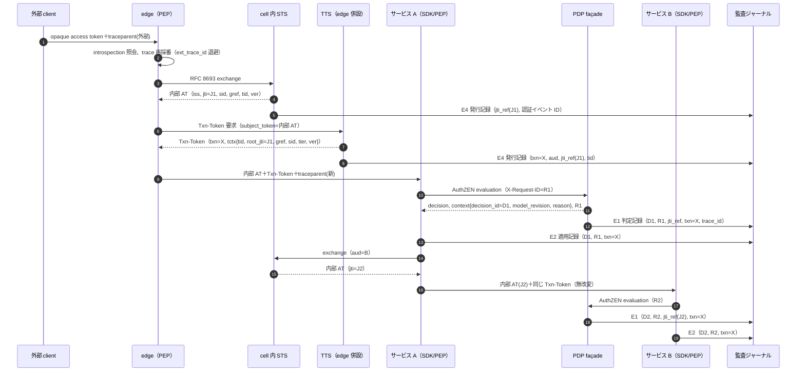
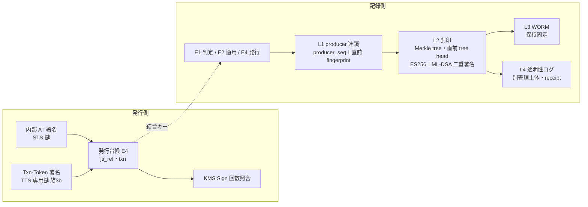
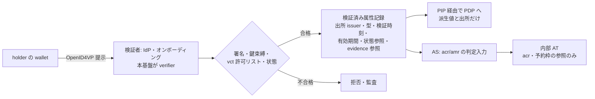
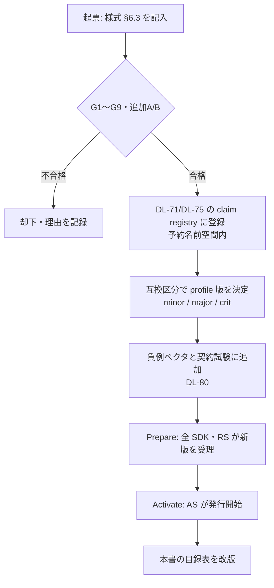

# claim 目録（token・Transaction Token・判定記録・監査の識別子体系）

> 文書ID: ARC-15 / 版: 0.2 / 状態: draft（独立レビュー反映済み、末尾「レビュー記録」）/ 最終更新: 2026-10-15
> 対応要求: R-118, R-161, R-162（deliverables.md の DL-115 行）。関連: R-109, R-128, R-249, R-250, R-283／G-063, G-064, G-065, G-068, G-069, G-088, G-102, G-118（全件と閉じ方は末尾の対応表）
> 依存文書: CONVENTIONS.md, traceability/deliverables.md（DL-115 行）, 05_adr/README.md, 05_adr/reconciliation-notes.md（§3 統一モデル）, 05_adr/ADR-002, ADR-005, ADR-006, ADR-007, ADR-009, ADR-011, ADR-013, ADR-014, ADR-016, ADR-017, ADR-020, ADR-021, ADR-022, ADR-026, ADR-029, 01_governance/assumptions-register.md, 01_governance/loss-scenarios.md, 01_governance/kri.md, 02_requirements/operation-risk-tiers-assurance.md, 02_requirements/principal-catalog.md, 03_threat-model/threat-catalog.md, traceability/claims-ledger.md（CL-0013, CL-0137, CL-0144）, traceability/rejected-hypotheses.md（RH-018, RH-019, RH-049）, research/RS-03, RS-04, RS-06, RS-10, RS-11, RS-16, research/standards-status.md
> 作成方法: AI エージェント（Claude）が上記の ADR・調査ノート・台帳を通読して起草した。research ノートにない原典（IANA JWT Claims registry、Transaction Tokens draft-11 の本文と Datatracker の状態、RFC 8176、RFC 9901、SD-JWT VC draft-19 と Datatracker の状態、W3C VC Data Model 2.0、VC-JOSE-COSE、Bitstring Status List、OpenID4VP 1.0、OpenID4VCI 1.0、RFC 9964 §6）は起草者が 2026-10-15 に取得して該当箇所を照合した。作成者以外のレビュー（別の AI エージェント）が 2026-10-15 に主要な原典（IANA registry、Transaction Tokens draft-11 と Datatracker、SD-JWT VC draft-19 と Datatracker、RFC 8176、RFC 9901、RFC 9964 §6、VC DM 2.0 §1.3、VC-JOSE-COSE、OpenID4VP 1.0）を再取得して照合した（末尾「レビュー記録」）。traceability/ への照合ログの追記は未了である（§10 残課題）。本書の判断は自己レビューであり、実在する CTO/CISO の決裁ではない（CONVENTIONS §8）[D]。
> 正本の分担: claim の**名前**は本書と DL-75（schema）、名前の**規則**は ADR-021 D21-38、**意味と発行条件**は ADR-005、**版の運用**は ADR-016、**契約の凍結区分**は ADR-022 が持つ（reconciliation-notes §3.3）。本書は ADR の決定を目録として集約し、ADR が DL-115 に委ねた点（§7）だけを新たに提案する [D]。

---

## 0. 結論（CTO/CISO 向け要旨）

1. **trace id は access token に入れない。証跡は「token 層・取引層・判定層」の 3 層の識別子を監査イベントで結合して残し、trace_id は索引にだけ使う** [D]。access token は寿命の間に多数の要求で再利用されるので要求単位の値を持てない [D][A-027]。trace-id は外部から注入・偽造でき、Trace Context は traceparent・tracestate に個人識別情報を入れることを MUST NOT とする [N][^23]（RS-10#16, #17）。3 層は (1) access token の `iss`+`jti` と `sid`・grant 参照、(2) Transaction Token の `txn`（`tctx` 付き）、(3) AuthZEN 応答と監査イベントの `decision_id`・`model_revision`・`reason` である（ADR-005 D9-2、reconciliation-notes §3.2）[D]。ADR と整合調整記録はこれを L1〜L4 の 4 層（token・session/grant・取引・判定）と数えるが、識別子の集合は同じで、本書の 3 層は L1・L2 を「token 層」にまとめた呼び方である（§2.1 の対応列）[D]。
2. **「共通基盤を通った一貫したリクエスト」は、署名付き token と発行台帳の照合・PEP/PDP の decision_id 突合・連鎖の再構成・封印済み記録の改ざん検知の 4 照合で示す** [D]（ADR-014 D14-19）。改ざん検知は producer ハッシュ連鎖、Merkle 封印＋法域の二重署名、WORM、別管理主体の透明性ログの 4 層である（ADR-014 D14-29）[D]。ただし、取引層の `txn` は write 以上にしか発行しない現状（未決 U-02）と判定記録の個別署名（未決 U-04）が残り、証跡の強さは操作階層で異なる [D]。
3. **Transaction Tokens は Internet-Draft（draft-11、WG 状態 WG Consensus: Waiting for Write-Up（research/standards-status.md SS-B04、2026-10-03 確認）、IESG 状態 I-D Exists（IESG 未提出）、2027-01-31 失効予定、2026-10-15 確認）であり、`txn` 以外は版固定の社内 profile `txn-v1`・契約上は preview に置く** [N][^13][D]（RS-06#29、SS-B04）。`txn` の名前と意味は RFC 8417 の IANA 登録で固定済みなので、草案が失効しても監査欄の意味は変わらない [N][^2][^11]。草案の `purp` は draft-07 で `scope` に改名されており、`purp` という名前は採らない（ADR-009 D09-31、ADR-016 D16-44）[N][^12][D]。
4. **v1 で発行する claim は「誰が（主体種別）・どの強さで・どの鍵で・誰の代理で・何を・どのテナントで・どの版で・どの grant/session から」の封筒に限る** [D]（ADR-005 D9-4）。所属・役割・属性・VC の本体・trace id・認証イベント ID は載せない [D]。将来候補（`status`・`authorization_details`・`verified_claims`・利用目的・AI エージェント関連・PQ 化後の `cnf`/alg）は、ADR-016 D16-42 の 9 ガードレールに本書 §6 の 4 つの害（万能 JWT 化・stale・PII・結合）の定量・定性基準を加えた追加審査を通らない限り発行しない [D]。
5. **W3C VC Data Model 2.0（W3C Recommendation）・OpenID4VP 1.0／OpenID4VCI 1.0（いずれも OpenID Final）・SD-JWT（RFC 9901）は確定標準、SD-JWT VC は draft-19（IESG 状態 Waiting for AD Go-Ahead）である** [N][^15][^16][^17][^20][^21]。VC は将来「本人確認・B2B 属性・資格」の**入力**として IdP・オンボーディング・PIP で検証して受け入れ、access token には検証結果の要約（`acr` と予約枠の参照）だけを渡す [D]（ADR-005 D9-6、ADR-022 D-9-4）。VC を access token の代わりにすること、RS・PEP に VC を直接提示させること、VC の属性を token に複写することは受け入れない [D]。

---

## 1. 範囲・読み方・前提

### 1.1 範囲

| 対象 | 本書で扱う | 他文書に委ねる |
|---|---|---|
| 内部 access token（`typ=at+jwt`） | claim ごとの採用区分・理由・PII・stale・サイズ・検証主体・名前 | 寿命値（ADR-005 D3、DL-20）、検証規則 V1〜V14 の実装（DL-16、DL-75） |
| introspection 応答（edge 向け） | 同上 | 照会経路と cache（ADR-005 D1、ADR-006） |
| Transaction Token（社内 profile `txn-v1`） | claim と `tctx` の項目・名前・依存リスク | TTS の配置・発行手順（ADR-009 D09-28〜D09-33） |
| 判定記録（AuthZEN 応答・decision event） | 識別子と相関欄（claim ではない） | 監査スキーマ・保持・所在地（ADR-014、DL-77、DL-25） |
| ID Token（外部 RP 向け） | 本基盤固有 claim の扱いと PII の線引き | OIDC の標準 claim の運用（DL-16） |
| 外部 opaque access token・refresh token | claim を持たない（AS の発行記録 ID で表す）ことの確認 | 形式・最大長（ADR-005 D10-2, D10-3） |
| W3C VC・SD-JWT VC・OpenID4VP/VCI | 状態確認、OAuth/JWT claim との対応、受入れの将来設計 | 本人確認の保証水準（ADR-002）、B2B 連携（ADR-004） |

### 1.2 読み手別の読み方

- CTO/CISO: §0、§2（3 層と証跡）、§6（ガードレール）、§8（決裁案）、§10（残課題）、§11（ADR への指摘）。
- 連携開発者: §3.8（連携開発者の義務と禁止。まずここだけ読めば実装できる）、§3（claim 目録表）、§4（`txn-v1`）。依存サービスに課す義務は「`Txn-Token` ヘッダと `traceparent` を無改変で下流へ渡し、監査イベントに `txn` を書く」ことだけで、検証は SDK・sidecar が行う（ADR-022 D-8-6）[D]。

### 1.3 前提（A-ID）と新規仮定

| ID | 値 | 本書での使い方 |
|---|---|---|
| A-014 | AI エージェント主体 1 万（成長 20 万、範囲 1,000〜10 万） | 主体種別 claim と AI エージェント関連 claim の再検討トリガー [A-014] |
| A-015 | 複数テナント所属 3% | 1 token 1 `tid`（R-283）[A-015] |
| A-027 | access token 寿命 10 分（容量計算用の仮置き） | 「token は要求単位でない」根拠の桁 [A-027] |
| A-028 | 1 session が token 寿命内に要求する下流 audience 数 6 | 要求単位に token を発行し直した場合の exchange 量（16,804×6）[A-028] |
| A-040 | edge API ピーク 16,804/秒（成長 56,444） | `txn` 発行量の上限（全要求に発行した場合）[A-040] |
| A-043 | token 発行 1,374/秒 | 要求単位発行との比較 [A-043] |
| A-049 | decision event 9.07 億件/日 | 監査欄 1 つあたりの保管量の感度 [A-049] |
| A-100, A-103, A-104 | 20 年、暗号移行 1 回以上、主要部品置換 1 回以上 | claim 名の不可逆性、PQ 化、製品置換 [A-100, A-103, A-104] |
| NA-115-1（前提台帳へ追加要） | 内部 access token の payload サイズ予算（profile 版ごと） | TBD（所有者 CTO、期限 G4、決め方: ADR-005 H-19 の実測と RS-11#62 の計算値から DL-75 で決める） |
| NA-115-2（前提台帳へ追加要） | VC を入力として受け入れる要求が計画期間中に生じる確率と時期 | TBD（所有者 事業責任者、期限 G3、決め方: ADR-005 NA-07 と統合し、顧客・規制要件の棚卸しで判定） |

### 1.4 R/G の抽出結果

- `traceability/R-requirements.md` と `traceability/G-goal-criteria.md` を「04_architecture/claims-catalog.md」と「DL-115」で Grep した結果、対応成果物欄に本書を名指しする行は 0 件だった（2026-10-15）[D]。
- そのため、deliverables.md の DL-115 行が挙げる R-161・R-162・R-118 と「G（将来性・証跡）」を主対象とし、内容が重なる R/G を関連として末尾の対応表で扱う [D]。対応成果物欄への DL-115 の追記は追跡表（DL-104）の所有者に申し送る（§10）[D]。

---

## 2. 3 層の識別子体系と証跡

### 2.1 3 層の定義（reconciliation-notes §3.2 の統一モデルの目録化）

| 層（統一モデル） | 識別子 | 生成者・単位 | 運び方 | 署名・保護 | 証明すること | 根拠 |
|---|---|---|---|---|---|---|
| 1a token（L1） | (`iss`, `jti`) | AS・STS。JWT 1 件ごと。外部 opaque token は AS の発行記録 ID | 内部 access token の claim、introspection 応答、発行台帳（ADR-007 D7-45） | 発行者の署名。台帳件数と KMS Sign 回数の照合 | どの発行記録から来た token か。偽造の検知（ADR-005 D1-6） | `jti` は issuer 間を含めて衝突しないよう割り当てる（MUST）[N][^1]。RFC 9068 で REQUIRED [N][^3]（RS-04#60） |
| 1b session・grant（L2） | `sid`、grant 参照 | AS。session・grant ごと | 同上 | 同上 | どのログイン session・同意に属するか。一括失効と全 session 失効の結合キー | `sid` は IANA 登録済み（参照先 OIDC Front-Channel Logout）[N][^2][^10] |
| 2 取引（L3） | `txn`（`tctx` 付き） | cell の TTS（edge 併設）。外部要求 1 件ごとに CSPRNG で 1 回 | Txn-Token（`Txn-Token` ヘッダ。Authorization ヘッダには置かない） | TTS の専用鍵（ADR-007 族 3b）の署名。replay 耐性はないので各 hop は mTLS で別に認証 | 共通の入口で検証を通った呼出し連鎖であること。下流は改変できない | draft-11 §9.2 で REQUIRED、意味は RFC 8417 §2.2 [N][^12][^11]（RS-06#31） |
| 3 判定（L4） | `decision_id`、AuthZEN 要求 ID（X-Request-ID の echo）、`model_revision`（G 段カタログ版を含む）、`profile_version`、実効 consistency、`reason`、`cell_id`、失効 epoch | PDP façade（`decision_id`）、PEP（X-Request-ID） | AuthZEN 応答の `context` と decision event（**claim ではない**） | 封印（Merkle＋署名）。判定 1 件ごとの署名は未決（U-04） | どの版の model・規則で、どう判定し、どう適用したか | PEP が要求 ID を付けた場合 PDP は同じ値を返す（MUST）[N][^26]（RS-07#66）。項目は ADR-011 D6-1、`cell_id`・失効 epoch は reconciliation-notes §3.2 と ADR-013 D13-26 |
| 補助（統一モデルの補助） | `trace_id`（edge で再採番）、`ext_trace_id`（外部から来た値の退避） | 誰でも生成できる | `traceparent` ヘッダ、監査の相関欄 | なし | 調査の索引だけ。認可にも真正性にも使わない | Trace Context §6・§7.2 [N][^23]（RS-10#16, #17） |

- 層の列の括弧は、統一モデル（reconciliation-notes §3.2、ADR-005 D9-2、ADR-022 D-8-2）の L1〜L4 との対応である。DL-115 の「3 層」（access token・Transaction Token・認可判定記録）は L1・L2 を token 層にまとめたもので、識別子は同じである [D]。
- 監査イベントの相関欄は 8 欄（`iss`・`jti_ref`・`sid`・grant 参照・`txn`・`decision_id`・`request_id`・`trace_id`）に揃える（ADR-014 D14-18）[D]。`jti` は `jti_ref = HMAC-SHA-256(K_corr, iss ‖ jti)` で記録し、発行台帳と同じ関数・同じ鍵で結合する（ADR-014 D14-21）[D]。
- 識別子の値は不透明な乱数形式とし、時刻・ホスト名・cell 名・テナント・主体類型を埋め込まない（ADR-021 D21-09, D21-36）[D]。

### 2.2 trace id を access token に入れない理由

| # | 理由 | 根拠 |
|---|---|---|
| 1 | access token は寿命の間（仮置き 10 分）に多数の要求で再利用され、要求と 1 対 1 に対応しない。要求ごとに発行し直すと exchange が 16,804×6 で約 10 万/秒（A-043 の内訳の exchange 1,112/秒の約 90 倍）になり、寿命の下限 Lmin(a) を崩す | [D][A-027, A-028, A-040, A-043]（ADR-005 D9-1） |
| 2 | 公開 API で外部の trace を素直に継続すると、攻撃者が trace-id の衝突を偽造して監視データを使えなくし得る。偽造できる値に証跡の一意性を依存させることになる | [N][^23]（RS-10#17） |
| 3 | traceparent・tracestate の目的は相関だけで、個人識別情報・機微情報を入れてはならない（MUST NOT）。署名付きの主体情報と trace-id を同じ token に入れると、観測基盤側に trace-id→主体の対応表が生まれる | [N][^23]（RS-10#16）[D] |
| 4 | Sampler が DROP を返した span は記録されない。trace は全件の証跡にならない（R-128） | [N][^24]（RS-10#22） |
| 5 | 安全な網への入口では trace を restart してよいとされ、trace-id は経路の途中で付け直され得る値である | [N][^23]（ADR-021 D21-34 (d)） |
| 6 | DPoP の proof は要求ごとに作るが、access token 自体は寿命の間再利用されるので、DPoP を使っても token は要求単位にならない | [D]（ADR-022 §3 の棄却理由） |

- 「trace id 的な ID」の役割に最も近いのは取引層の `txn` である（RH-018 として棄却済みの仮説の代替）[D]。

### 2.3 W3C Trace Context との結合方法

| # | 規則 | 根拠 |
|---|---|---|
| TC-a | edge は外部から届いた `traceparent` を信頼境界で再採番し、外部の値は `ext_trace_id` として信頼しない属性に退避する | ADR-005 D9-2、ADR-014 D14-03 [D] |
| TC-b | 外部の sampled flag・tracestate・baggage で、監査の記録・非記録・記録内容を変えない | ADR-014 D14-03 [N][^23][D] |
| TC-c | traceparent・tracestate・baggage に主体・テナント・資源の識別子を載せない。span に載せてよい監査由来の値は `decision_id` だけ（PEP coverage の突合用） | ADR-014 D14-04 [N][^23][^25][D] |
| TC-d | 監査イベントには `trace_id` を相関欄として記録し、調査では「監査記録→trace」の向きにだけ辿る（遅延や経路の分析）。「trace→監査」の向きの検索結果を真正性の根拠にしない | [D]（ADR-014 D14-19 の V3 の索引規則） |
| TC-e | 外部の trace 状態を偽造・衝突させても監査の相関と記録の有無が変わらないことを試験する | ADR-005 H-21、ADR-014 TC-014-01 [D] |

### 2.4 一貫リクエストの流れと記録点

- 各 hop は受け取った Txn-Token を無改変で下流へ渡し（draft の MUST）、内部 access token は exchange で取り直す（受け取った token を素通ししない）[N][^12][D]（RS-06#35、ADR-009 D09-32）。
- public・read-sensitive では Txn-Token の発行は任意であり（ADR-005 D9-3）、証跡の設計は Txn-Token がない前提で組む [D]。read-sensitive の連鎖は (`jti_ref`, `decision_id`, `request_id`) で結び、public は PDP 判定を伴わず E10 で集約するため要求単位の再構成の対象外とする [D]（ADR-014 D14-19 V3）。全要求に広げるかは**未決（ADR-005 §2.15 U2、reconciliation-notes U-02）**である [D]。

### 2.5 改ざん検知可能に辿る仕組み（署名・ハッシュ連鎖・検証手順）

**保護の層**（ADR-014 D14-29 の 4 層に、token 側の 2 層を前置したもの）[D]

**検証手順 VP-1〜VP-8**（調査者が 1 件の要求・取引について「共通基盤を通った一貫した要求」であることを確かめる手順）[D]

| # | 手順 | 合格条件 | 失敗時に疑うもの | 根拠 |
|---|---|---|---|---|
| VP-1 | 対象期間の封印セグメントについて、透明性ログの receipt と署名済み tree head を取得し、法域の監査署名（ES256 と ML-DSA の両方）と、直前 tree head との consistency proof を検証する | 署名検証成功、consistency proof 成功 | 運用者による equivocation・切捨て（ATK-08、T-055） | ADR-014 D14-29 L2・L4 [N][^27][^28][^29]（RS-10#37〜#41） |
| VP-2 | 対象レコード（E1・E2・E4）の inclusion proof を tree head に対して検証する | 全件の包含を確認 | 封印後の改変・削除 | 同上 |
| VP-3 | 各 producer について `producer_seq` の連続性と直前 fingerprint の連鎖を確認する | 欠番・分岐なし | 記録後〜封印前の削除・入替え | ADR-014 L1 [N][^30]（RS-10#42） |
| VP-4 | 起点の内部 AT について、`jti_ref` が発行台帳 E4 にあり、台帳件数と KMS Sign 回数が一致することを確認する。下流 hop の `jti_ref` が exchange の発行記録で起点から辿れることを確認する | 台帳にない署名 0 件、系譜が途切れない | 署名鍵の不正使用・偽造 token（S-02、ATK-06/08） | ADR-014 D14-19 V1、ADR-005 D1-6、CSRB の勧告 [I]（RS-12#10, #11） |
| VP-5 | `txn` が TTS の発行記録 E4 にあり、その発行記録の `jti_ref`（起点）・`tid`・`aud` と、各 hop の記録が一致することを確認する。発行先・時間窓・連鎖の外で同じ `txn` が使われていないことを確認する | 一致し、連鎖外の使用 0 件 | Txn-Token の偽造・付け替え・replay（T-025） | ADR-014 D14-20 [N][^12]（RS-06#36） |
| VP-6 | 各 hop の E1（PDP）と E2（PEP）を `decision_id` と `request_id` で突合する | 判定なしの適用 0 件、片側欠落 0 件 | PEP 迂回・判定記録の欠落（T-030、K-21） | ADR-014 D14-19 V2・D14-22 [N][^26] |
| VP-7 | E1 の `model_revision`・`profile_version` が registry に存在し、判定時点で配布済みの版であることを確認する | 未登録・未配布の版 0 件 | policy・model の誤配布・改ざん（S-05、T-027） | ADR-016 D16-03, D16-12、ADR-011 D2-7 [D] |
| VP-8 | `trace_id` で span を引き、経路の遅延・順序の調査に使う。VP-1〜VP-7 の結論は trace の有無・内容で変えない | trace 欠落・偽造で結論不変 | — | ADR-014 D14-19、ADR-005 H-21 [D] |

- **限界（残余リスク）**: (a) public 階層は PDP 判定を伴わず E10 で集約するため要求単位の再構成の対象外である（ADR-014 D14-19 V3）[D]。(b) read-sensitive は `txn` がなく、hop 間の結合は未署名の要求 ID と `jti_ref` に依存する（U-02）[D]。(c) 判定 1 件ごとの PDP 署名は未決（U-04、ADR-013 KD13-6 と同時決裁）で、v1 の判定記録の真正性は封印（L2）以降に限られる。producer の侵害による記録前の改変（T-055 の改ざん可能区間）は L1〜L4 では検知できない [D]（ADR-014 D14-35、threat-catalog CE-11）。
- 手順の実測は ADR-005 H-20（再構成率 100%）、ADR-022 H-4、ADR-014 TC-014-06（運用者権限の改ざん・equivocation の検知）で行う [D]。

---

## 3. claim 目録表

### 3.1 表の読み方

- **token 種別列**: AT＝内部 access token（`at+jwt`）、IR＝introspection 応答（edge 向け、RFC 7662／FAPI 範囲は RFC 9701 の JWT 応答）、TX＝Txn-Token（`txn-v1`）、ID＝ID Token（外部 RP 向け。標準 claim は OIDC Core の規定に従う）[D]。外部 opaque access token・refresh token は claim を持たない [D]（ADR-005 D2）。
- **採用区分**: 必＝必須、条＝条件付き（条件を理由欄に記す）、不＝不採用、不(予)＝不採用だが名前を予約、—＝その種別に当てはまらない [D]。
- **PII**: 無＝個人に関わらない、仮名＝不透明な識別子（単独では個人を表さないが、対応表と結合すれば個人に結び付く。個人データ該当性の法的判定は法務が 06_controls/applicability.md の範囲で行う）、属性＝個人属性そのもの [D]。
- **stale**: 発行後に元の事実が変わり得るか（変わっても JWT の値は寿命 L の間変わらない）[D]。
- **サイズ**: JSON の名前と値の概算（署名前、base64url 化前）。値の長さは ADR-021 D21-09 の符号化候補（26 文字または 36 文字）を前提にした計算で、実測ではない [D]。
- **状態**: 2026-10-15 に IANA registry（最終更新 2026-07-20）と各原典で確認した [N][^2]。

### 3.2 RFC 7519 の登録 claim

| claim | 意味 | 規格・状態 | AT | IR | TX | ID | 理由 | PII | stale | サイズ | 検証主体 | 関連 ADR |
|---|---|---|---|---|---|---|---|---|---|---|---|---|
| `typ`（JOSE header。claim ではない） | token 種別 | RFC 9068 §2.1 は `at+jwt` を MUST [N][^3]。RFC 8725 §3.11 は明示的な型付けを RECOMMENDED [N][^31] | 必（`at+jwt`） | 条（FAPI 範囲の JWT 応答は `token-introspection+jwt`） | 必（`txntoken+jwt`） | —（OIDC は typ を要求しない） | 種別間の相互排他の要。typ のない JWT は内部 RS で全種別拒否（V5）。ID Token は iss 分離（V4）と typ なし拒否で RS が受理しない構造にする | 無 | 無 | 約 15〜35 B | 共通 SDK・sidecar、edge | ADR-005 D2, V4, V5 |
| `alg`・`kid`（JOSE header） | 署名 alg・鍵 ID | RFC 7515 [N][^32]。1 鍵 1 alg は MUST（RFC 8725 §3.1）[N][^31] | 必 | 条（JWT 応答） | 必 | 必 | alg は issuer 別の allowlist（検証側の版付き設定）で照合し token・metadata から読まない（V1）。kid は不透明値で alg 名を埋め込まない（D10-5） | 無 | 無 | 約 20〜60 B | 共通 SDK・sidecar | ADR-005 V1, V2, D10-5 |
| `iss` | 発行者 | RFC 7519 §4.1.1、final [N][^1] | 必 | 必 | 必 | 必 | 完全一致照合（V4）と種別間の相互排他 (iss, typ, 鍵集合, aud) に要る。Txn-Token の草案では OPTIONAL だが [N][^12]、社内 profile で必須にする | 無 | 無（不可逆の識別子） | 約 40 B | 共通 SDK・sidecar、edge、RP | ADR-005 V4、ADR-021 D21-03、U-01 |
| `sub` | 主体 | RFC 7519 §4.1.2 [N][^1]。OIDC は「issuer 内で一意かつ再割当しない」と定義 [N][^9]（RS-03#58） | 必 | 必（active 時） | 必 | 必 | 全類型共通の単一名前空間。類型を推論させない。Txn-Token の `sub` は trust domain 内で一意であればよく `iss` と結び付かない [N][^12]（RS-06#42） | 仮名 | 無 | 約 35〜45 B | 同上。TX は AT の `sub` と一致を検証（ADR-009 D09-32） | ADR-021 D21-09, D21-10 |
| `aud` | 宛先 | RFC 7519 §4.1.3。RFC 9068 は resource ごとに異なる aud（MUST）[N][^3] | 必（1 サービス） | 条（照会元 edge） | 必（cell ごとの trust domain 値） | 必（client_id） | 共通 aud は発行しない（V6）。TX の aud 外での受理は禁止（MUST NOT）[N][^12] | 無 | 無 | 約 30〜60 B | SDK・sidecar、edge | ADR-005 V6、ADR-009 D09-09 |
| `exp` | 失効時刻 | RFC 7519 §4.1.4 [N][^1] | 必 | 必 | 必 | 必 | 有効期間は exp で律する（V7） | 無 | 無 | 約 16 B | 全受信者 | ADR-005 D3, V7 |
| `iat` | 発行時刻 | RFC 7519 §4.1.6 [N][^1] | 必 | 必 | 必 | 必 | 未来方向の時刻差 S を超えたら拒否 | 無 | 無 | 約 16 B | 全受信者 | ADR-005 V7 |
| `nbf` | 有効開始 | RFC 7519 §4.1.5 [N][^1] | 不 | 不 | 不 | — | iat で足りる。受信時に存在すれば V7 で検証する | 無 | 無 | — | — | ADR-005 V7 |
| `jti` | JWT の一意 ID | RFC 7519 §4.1.7（一意性 MUST）[N][^1]。RFC 9068 で REQUIRED [N][^3] | 必 | 必（AS 発行記録 ID） | 不 | 不 | 層 1a の結合キー。grant・session の ID ではない（ADR-005 D13-1）。TX では `txn` が一意識別子を兼ね、TTS の発行記録で足りる（ADR-014 D14-20） | 仮名 | 無 | 約 35〜45 B | SDK、privileged の RS は状態ストアと毎要求照合（D1-6） | ADR-005 D1-6, D9-2、ADR-014 D14-21 |

### 3.3 OAuth 系 RFC の claim

| claim | 意味 | 規格・状態 | AT | IR | TX | ID | 理由 | PII | stale | サイズ | 検証主体 | 関連 ADR |
|---|---|---|---|---|---|---|---|---|---|---|---|---|
| `client_id` | client | RFC 8693 §4.3 で登録 [N][^2][^4]。RFC 9068 で REQUIRED [N][^3] | 必 | 必 | 不 | —（OIDC は `aud`・`azp`） | AI エージェントの委任では client_id がエージェントを表す（ADR-017 D17-08）。TX では要求元 workload を `req_wl` で表す | 無（個人 client は仮名） | 有（client 無効化） | 約 40 B | SDK、PDP 入力 | ADR-021 D21-22、ADR-017 |
| `scope` | 付与範囲 | RFC 8693 §4.2 で登録 [N][^2]。RFC 9068 の scope は aud の資源で意味を持つ（MUST）[N][^3] | 条（scope 要求時） | 条 | 必（entry point の操作 ID） | — | AT は粗い API 能力だけ。TX の scope は取引の意図を狭く表し、subject_token の scope 以下（MUST）[N][^12]（RS-06#33, #42） | 無 | 有（grant 取消・同意変更） | 20〜200 B | SDK、PDP 入力 | ADR-005 D9-4、ADR-009 D09-31 |
| `act` | 現在の actor（委任） | RFC 8693 §4.1。アクセス制御は最上位 claim と現在の actor だけ（MUST）[N][^4]（RS-06#45） | 条（委任・exchange 時） | 条 | 不 | — | 「本人の操作」と「代理操作」を区別する。入れ子の深さ上限は DL-74（ADR-009 D09-16） | 仮名 | 有（委任取消） | 1 段 約 60 B | SDK、PDP（現在の actor） | ADR-005 V10、ADR-009、ADR-017 D17-18 |
| `may_act` | 代理を認められた主体 | RFC 8693 §4.4（処理義務なし）[N][^4] | 不 | 不 | 不 | — | AS 側の判断材料にとどめる | 仮名 | 有 | — | AS | ADR-021 D21-39 |
| `cnf` | 鍵束縛 | RFC 7800 §3.1 [N][^5]。DPoP（`jkt`）RFC 9449 [N][^33]、mTLS（`x5t#S256`）RFC 8705 [N][^34] | 条（束縛時。内部は I1 で `x5t#S256`） | 条 | 不 | 不 | sender constraint の方式変更（PQ 化を含む）をこの claim に閉じ込める。TX は replay 耐性がなく、各 hop の mTLS で補う [N][^12] | 無 | 有（証明書更新で束縛 token は無効化） | 約 55 B | SDK・edge が提示者と照合（V8） | ADR-005 D5, V8 |
| `authorization_details` | 取引単位の詳細 | RFC 9396 §9.1 で登録、final [N][^2][^6]（RS-04#64） | 不(予)。ADR-020 D20-09-1 の範囲だけ審査後に条 | 同左 | 不 | — | v1 は予約（ADR-016 D16-44、reconciliation-notes §3.3）。ADR-020 D20-09-1 が第三者 client の F5 +FIN 操作に限り採るとし、発行開始は契約変更審査会が決める。AI エージェントへの拡大（ADR-017 L17-5）と ADR-005 D9-4 との差（ADR-016 P16-1）は未決。TX の `tctx` に取引内容を入れない（ADR-009 D09-29） | 属性になり得る（支払先等） | 低（取引単位） | 100 B〜数 KB | PDP 入力。AS は未知 type を処理してはならない（MUST）[N][^6] | ADR-020、ADR-016 D16-44 |
| `status` | 状態参照（Token Status List） | IANA 登録済みだが参照先は draft-ietf-oauth-status-list-21 §6.1（RFC 番号なし）[N][^2]。draft は RFC Ed Queue [N][^14]（RS-04#80、SS-B03） | 不(予) | 不 | 不 | 不 | 失効は introspection と短命 token で反映する。RFC 番号付与で ADR-006 が再評価 | 無（ただし照会経路で追跡され得る） | — | 約 80 B | — | ADR-021 D21-39、ADR-016 D16-44 |
| `roles`・`groups`・`entitlements` | 権限属性 | RFC 7643 §4.1.2・RFC 9068 §2.2.3.1 で登録 [N][^2]。載せる場合は SCIM 属性を使う（SHOULD）[N][^3] | 不 | 不 | 不 | 不 | 万能 JWT の否定（R-249、RH-019）。ADR-022 D-9-2 は使う場合に SCIM の属性名を使うことだけを予約しており、v1 では発行しない。剥奪が寿命 L まで遅れ、PQ 期のサイズを圧迫する | 属性 | 有 | 可変（大） | — | ADR-005 D9-4、ADR-021 D21-38 規則 2 |
| `active`・`token_type` | introspection の状態 | RFC 7662 §2.2 [N][^37]（RS-04#67） | — | 必（active） | — | — | cache は exp を超えない（MUST NOT）[N][^37] | 無 | 有 | 約 15 B | edge | ADR-005 D1-2 |
| `username` | 人が読む名前 | RFC 7662 §2.2（OPTIONAL）[N][^37] | — | 不 | — | — | 識別子・結合キーに使わない（ADR-021 D21-14c）。IR からも除く | 属性 | 有 | — | — | ADR-021 D21-14c |

- RFC 8707 は claim を定義せず、`resource` パラメータの結果を `aud` に反映する [N][^7]（RS-04#65）[D]。RFC 9470 も新しい claim を定義せず、`acr`・`auth_time` を使って step-up を要求する [N][^8]（RS-04#72）[D]。
- DPoP proof（`typ=dpop+jwt`）の `htm`・`htu`・`ath`・`jti`・`iat`・`nonce` は proof の claim であり、access token の claim ではない [N][^33][D]。

### 3.4 OpenID Connect・本人確認系の claim

| claim | 意味 | 規格・状態 | AT | IR | TX | ID | 理由 | PII | stale | サイズ | 検証主体 | 関連 ADR |
|---|---|---|---|---|---|---|---|---|---|---|---|---|
| `acr` | 保証区分 | OIDC Core [N][^9]、IANA 登録 [N][^2]。RFC 9068 で OPTIONAL、同じ認可応答から派生する token で固定 [N][^3] | 条（利用者主体で必） | 条 | 不 | 条（要求時） | 値は ADR-002 D2-22 の内部区分（L0・L1・L2・L2-PR・L3）。値の文字列は ADR-002 D2-22 が本書と DL-75 に委ねており、§8 KC-7 で提案する。上流 IdP の値をそのまま L3 の根拠にしない（RH-031）。TX への要約（rctx 案 (d)）は不採用（P09-3） | 無 | 無（仕様で固定。step-up は新しい認可要求） | 約 15 B | PDP（G 段規則 4）、SDK | ADR-002 D2-22, U2-02、ADR-005 D6-4 |
| `amr` | 認証方式 | OIDC Core、RFC 8176 の値の registry（Expert Review）[N][^9][^38] | 条（同上） | 条 | 不 | 条 | 束縛認証器（FAL3 相当）を経た印の載せ方は §7.1（KC-2） | 無 | 無 | 約 30 B | PDP、SDK | ADR-002 U2-02 |
| `auth_time` | 認証時刻 | OIDC Core [N][^9] | 条（同上） | 条 | 不 | 条 | refresh で変わらない（RFC 9068 §2.2.1）[N][^3]。step-up と再認証上限の判定 | 無（行動時刻として準識別） | 無 | 約 22 B | PDP、SDK | ADR-005 D6-4 |
| `sid` | session ID | IANA 登録（参照先 Front-Channel Logout §3）[N][^2][^10] | 条（利用者 session 由来） | 条 | 条（`tctx` 内。利用者主体で必） | 条 | 全 session 失効と CAEP session-revoked の結合キー（層 1b） | 仮名 | 有（session 失効） | 約 35〜45 B | SDK（失効照合）、監査 | ADR-005 D9-2、ADR-022 D-9-1 |
| `nonce`・`azp`・`at_hash` | ID Token の束縛 | OIDC Core [N][^9] | 不 | 不 | 不 | 条（OIDC の規定どおり） | ID Token と access token の判別を nonce に頼らない（iss 分離と typ 必須で判別、ADR-005 D2） | 無 | — | — | RP | ADR-005 V4, V5 |
| `email`・`phone_number`・`name` 等 | 個人属性 | OIDC Core [N][^9] | 不 | 不 | 不 | 条（表示用に限る） | access token の内容は client から見え得る（RFC 9068 §6）[N][^3]。email は再割当され得るので識別子・結合キーにしない [N][^9]（RS-03#58） | 属性 | 有 | 可変 | RP（表示のみ） | ADR-021 D21-14c |
| `sub_id` | 主体の別表現 | RFC 9493 §4.1 [N][^36] | 不 | 不 | 不 | 不 | SSF/CAEP/RISC の事象と M&A 時の alias 表現に限る | 仮名 | 有 | — | SET 受信者 | ADR-021 D21-31, D21-39 |
| `verified_claims` | 本人確認の結果と根拠 | OpenID Identity Assurance Schema Definition 1.0。IANA 登録 [N][^2]。原典ページは状態表示 Final と Warning 節（標準ではない・draft）が矛盾する [N][^22] | 不(予) | 不 | 不 | 不(予) | 状態が確定するまで採否の判断に使わない（reconciliation-notes C-13）。IAL2 以上の主体に限り ADR-002 で判断 | 属性（本人確認情報） | 有 | 数百 B〜数 KB | — | ADR-002、ADR-021 D21-39 |

### 3.5 Transaction Token の claim（社内 profile `txn-v1`）

| claim | 意味 | 草案の強度（draft-11）[N][^12] | `txn-v1` | 理由 | PII | stale | サイズ | 検証主体 | 関連 ADR |
|---|---|---|---|---|---|---|---|---|---|
| `typ`（header） | `txntoken+jwt` | MUST（§9.1） | 必 | 種別間の相互排他 | 無 | 無 | 約 25 B | SDK | ADR-005 D2 |
| `iat`・`exp` | 時刻 | REQUIRED | 必 | 短命（MUST）[N][^12]（RS-06#36）。寿命は ADR-005 D3 の profile | 無 | 無 | 約 32 B | SDK | ADR-005 D3 |
| `aud` | trust domain | REQUIRED。aud 外で受け入れない（MUST NOT） | 必（cell ごとの内部値。SPIFFE trust domain 名とは別） | 草案は trust domain ごとに論理的に 1 つの TTS を求める（MUST）[N][^12]（RS-06#38） | 無 | 無 | 約 30 B | SDK（tid の収容 cell と一致） | ADR-009 D09-09 |
| `txn` | 取引の一意 ID | REQUIRED。意味は RFC 8417 §2.2 [N][^11] | 必 | 層 2 の主キー。TTS は取引に固有の一意な ID を設定する（MUST、§11.3）、trust domain 内で一意にすべき（SHOULD、§13.2）[N][^12]。置換 token でも変えない（MUST NOT、§13.15）（RS-06#40） | 仮名（行動の相関に使える） | 無 | 約 35〜45 B | SDK、監査（VP-5） | ADR-009 D09-28、ADR-021 D21-36 |
| `sub` | 取引の主体 | REQUIRED | 必（AT の `sub` と一致） | 委任元利用者は `sub` で表す（ADR-017 D17-19 で `tctx` に重ねない） | 仮名 | 無 | 約 40 B | SDK | ADR-009 D09-32 |
| `scope` | 取引の意図 | REQUIRED（§9.2.1）。TTS が決める | 必（entry point 台帳の操作 ID） | 個人データ処理の「利用目的」とは別概念（ADR-009 D09-31） | 無 | 無 | 約 30 B | SDK、監査 | ADR-009 D09-31 |
| `req_wl` | 要求した workload | REQUIRED | 必（edge の SPIFFE ID） | どの入口が発行を求めたか | 無 | 無 | 約 60 B | SDK、監査 | ADR-009 D09-32 |
| `tctx` | 連鎖で不変の値 | RECOMMENDED | 必（§4.2 の項目に限る） | テナント照合（T-021）と token 系譜の結合 | 仮名 | 無 | 150〜250 B | SDK、PEP | ADR-009 D09-29 |
| `rctx` | 要求環境 | RECOMMENDED | 不（受信しても無視） | IP 等の要求環境は採らない（ADR-005 D9-3）。草案自身が要求元 IP を個人情報になり得る例に挙げる [N][^12] | 属性になり得る | — | — | — | ADR-009 D09-30、P09-3 |
| `purp` | 目的（draft-06 の名前） | -07 で `scope` に改名（Document History）[N][^12] | 不（名前も新設しない） | IANA 未登録 [N][^2]。受信しても未知 claim として無視（MUST）[N][^12] | — | — | — | — | ADR-009 D09-31、ADR-016 D16-44、RH-009-4 |
| `iss` | 発行者 | OPTIONAL | 必 | §3.2 の `iss` 行と同じ理由 | 無 | 無 | 約 40 B | SDK | ADR-005 V4 |
| profile 版 | `txn-v1` の版 | —（社内） | 必（`tctx` 内） | 制約強化を版で表す（V13） | 無 | 無 | 約 12 B | SDK | ADR-016 D16-02 |

- 草案は「理解できない claim は無視しなければならない」（MUST）とし [N][^12]、Txn-Token 全体をそのままログに残してはならない（MUST NOT）[N][^12]（RS-06#41）。記録は TTS の発行記録 E4（`txn`・発行先 `aud`・起点 `jti_ref`・`tid`・時刻）に限る（ADR-014 D14-20）[D]。

### 3.6 基盤固有の claim（名前案）

| 意味（ADR の正本） | 内部 token の名前案 | 外部（ID Token・公開応答）の名前案 | AT | IR | TX | ID | 理由 | PII | stale | サイズ | 検証主体 | 関連 ADR |
|---|---|---|---|---|---|---|---|---|---|---|---|---|
| 作用中テナント（1 値） | `tid`（ADR-021 で固定） | `https://<id-domain>/claims/tid` | 必 | 必 | 必（`tctx` 内） | 条（B2B RP が要る場合） | PEP は資源から導いたテナントと突き合わせる（V9、R-250）。所属一覧は入れない（R-283） | 無（テナントは組織。ただし個人事業主など 1 人だけのテナントでは個人に結び付くので仮名として扱う） | 有（所属喪失・テナント停止） | 約 35 B | SDK、PEP、PDP | ADR-005 V9、ADR-021 D21-12, D21-38 |
| 主体の種別 | `ptype`（案） | 外部に出さない | 必 | 必 | 不（`sub` の種別は AT 側で判定） | 不 | AuthZEN の subject.type（REQUIRED）へ変換表なしで写像する [N][^26]（RS-07#63）。v1 の値は人・service account・workload・AI エージェントの 4 つ（ADR-005 D9-4）。デバイスを 5 つ目に加える案は**未決（ADR-017 L17-4、D17-50）**で、判定に使う enum なので追加は DL-75 の版変更になる | 無 | 無 | 約 20 B | SDK、PDP | ADR-005 D9-4、ADR-017 D17-50、ADR-022 D-9-1 |
| grant 参照 | `gref`（案） | 外部に出さない | 条（利用者主体・第三者 grant 由来） | 条 | 条（`tctx` 内、利用者主体で必） | 不 | grant・client・publisher 単位の一括失効の結合キー（D7-6）。昇格 grant ID もこの欄で運ぶ案（§7.3） | 仮名 | 有（grant 取消） | 約 40 B | SDK（失効照合）、監査 | ADR-005 D7-6, D9-4、ADR-029 L29-3 |
| token profile の版 | `ver`（案。CL-0137 の候補） | 外部 RP に要求しない（ADR-016 D16-11 の外部行） | 必 | 必 | 必（`tctx` 内） | 不 | 版 claim がない token を判別できないので必須（ADR-016 D16-02）。値は major.minor | 無 | 無 | 約 12 B | SDK（受理 major の集合で判定） | ADR-016 D16-02, D16-10 |
| 予約: 発行元 IdP、保証の根拠への参照、資格の状態参照、利用目的 | 予約名前空間内で DL-75 に登録 | 同左（衝突耐性名） | 不(予) | 不(予) | 不 | 不 | 予約だけでは発行を許さない（ADR-016 D16-45）。発行開始は §6 の審査を通す | 種類による | — | — | — | ADR-022 D-9-2 |

- 名前案の根拠: 内部 token は typ と profile 版で意味を固定でき受信者が共通 SDK に限られるため、短い名前を許す（ADR-021 D21-38 規則 3、ADR-005 D9-5 の整合調整による限定）[D]。RFC 7519 §4.3 は Private Name は衝突し得るので注意して使うべきとし [N][^1]、managed IdP 製品が同じ短い名前（例: Entra の `tid`）を別の意味で出し得る（ADR-021 D21-38）[D]。このため外部に出す名前は自社ドメインに基づく衝突耐性名（Public Name）にする [N][^1][D]。名前案の確定は KC-1（§8）とする [D]。
- 載せないもの（全種別）: trace id・要求単位の ID、所属・役割・属性の全量、VC の本体と属性、認証イベント ID（発行台帳だけに置き、`sid`・grant 参照で結合）[D]（ADR-005 D9-4、reconciliation-notes §3.3）。

### 3.7 判定記録（claim ではない）の項目

| 項目 | 運び方 | 意味 | 必須 | 根拠 |
|---|---|---|---|---|
| `decision_id` | AuthZEN 応答 `context`、E1・E2 | façade が採番する推測困難で一意な ID（監査の主キー） | 必 | ADR-011 D6-1 [D] |
| X-Request-ID（`request_id`） | HTTP ヘッダ（PEP が採番、PDP が echo） | 要求と応答の対応 | 必 | AuthZEN 1.0 の MUST [N][^26]（RS-07#66）。OpenFGA の実装が返さない分は façade が補う（ADR-011 D5-5） |
| `model_revision` | 応答 `context`、E1 | 評価した model の不変 revision と G 段カタログの版（policy／model revision の正本） | 必 | ADR-011 D2-7, D6-1 |
| `profile_version` | 要求 `context` | PEP–PDP profile の版。未対応 major は deny（`unsupported_profile`） | 必 | ADR-011 D6-1、ADR-016 D16-12 |
| consistency の実効モード | 応答 `context`、E1 | 実際に使った整合性モード | 必 | ADR-011 D6-1, D6-3（U-03 未決） |
| `reason` | 応答 `context`、E1 | 閉じた列挙（`allow`、`deny_guardrail:<規則ID>`、`deny_no_relation`、`deny_indeterminate`、`deny_unavailable`、`unsupported_profile`）。エンドユーザーには返さない | 必 | ADR-011 D6-1。値の追加を major 扱いにするかは**未決（ADR-016 P16-2）** |
| `cell_id` | E1 の構造欄 | 判定した cell | 必 | ADR-014 §2.2 の構造欄、ADR-013 D13-26、reconciliation-notes §3.2 [D] |
| 失効 epoch | E1（read-sensitive の判定記録） | 判定時点で PDP が反映していた失効状態の版 | 条（known-good を使う read-sensitive） | ADR-013 D13-26、reconciliation-notes §3.2 [D]。欄名は DL-77 で決める |
| PDP 署名 | — | 判定 1 件ごとの署名 | **未決（U-04）** | ADR-011 D5-7、ADR-014 D14-35 |

### 3.8 連携開発者の義務と禁止（依存サービス約 300 向けの要約）

依存サービスの開発者は、次の表だけを守れば本書の claim 体系に適合する [D]。検証そのものは共通 SDK・sidecar が行い（ADR-022 D-8-6）、依存サービスは JWT を自前で解析・検証しない [D]。

| # | すること／しないこと | 具体的な実装 | 根拠 |
|---|---|---|---|
| DEV-1 | token の検証を自前で書かない | 内部 access token と Txn-Token の検証（V1〜V14、`typ`、`aud`、`exp`、両 token の `sub`・`tid` の一致）は共通 SDK・sidecar に任せ、SDK が拒否した要求を業務コードで救済しない | ADR-022 D-8-6、ADR-009 D09-32 [D] |
| DEV-2 | 業務コードが読んでよい claim を限る | 読んでよいのは SDK が渡す `sub`・`tid`・主体種別・`act`（現在の actor）・`client_id`・`scope` だけ。認可の可否は PEP SDK 経由の PDP 判定で決め、claim の値から独自に許可・拒否を組み立てない | ADR-005 V10、ADR-021 D21-38 規則 1 [D] |
| DEV-3 | 識別子の扱い | `sub`・`tid` は 64 文字以下の不透明な文字列として大文字小文字を区別して比較し、解析しない。`sub` の文字列から主体の種別を推論しない。email・電話番号・UPN を照合キーにしない。内部 issuer の値を保存しない | ADR-021 D21-09, D21-10, D21-14c, D21-42 (d)(e) [D] |
| DEV-4 | テナント | 操作対象のテナントは資源側の正本から導き、token の `tid` と突き合わせる（PEP SDK が行う）。テナントを切り替える利用者には token を取り直させ、1 token に複数テナントを期待しない | ADR-005 V9、R-250、R-283 [D] |
| DEV-5 | 下流呼出し | 受け取った内部 access token を下流へ素通しせず、SDK の exchange で宛先ごとに取り直す。`Txn-Token` ヘッダと `traceparent` は無改変で下流へ渡す。Txn-Token を `Authorization` ヘッダに入れない | ADR-009 D09-32、ADR-022 D-8-6、draft-11 §12 の MUST・MUST NOT [N][^12]（RS-06#35） |
| DEV-6 | ログと監査 | access token・Txn-Token の全文をログ・trace・エラーメッセージに出さない。監査イベントには SDK が付ける相関 8 欄（`txn` を含む）をそのまま残す | draft-11 §15.2 の MUST NOT [N][^12]（RS-06#41）、ADR-014 D14-18 [D] |
| DEV-7 | trace | `trace_id` を認可・真正性の判断に使わない。traceparent・tracestate・baggage に主体・テナント・資源の識別子を載せない | ADR-014 D14-03, D14-04、Trace Context §6 の MUST NOT [N][^23]（RS-10#16） |
| DEV-8 | 未知・予約 claim | 目録にない claim は無視し、予約名（§3.6 の予約行、`status`・`authorization_details`・`verified_claims`）が発行されていることを前提にしない。新しい claim が要るときは §6.3 の様式で契約変更審査会に申請する | ADR-016 D16-41, D16-45 [D] |
| DEV-9 | 判定の cache | allow の判定を PEP SDK の外で cache しない | ADR-006 D6-10 [D] |

---

## 4. Transaction Token の依存リスクと `txn-v1`

### 4.1 標準の状態（2026-10-15 確認）

| 項目 | 事実 | 根拠 |
|---|---|---|
| 版・状態 | draft-ietf-oauth-transaction-tokens-11（2026-07-30）。Datatracker の IESG 状態 I-D Exists（IESG 未提出）、Active、失効予定 2027-01-31 | [N][^13]。2026-10-03 時点の WG 状態 Waiting for Write-Up は SS-B04 |
| IANA | `tctx`・`rctx` は §16.2 で登録を求めているが、registry（最終更新 2026-07-20）には未登録。`req_wl` は登録依頼の対象に含まれていない。`txn` は RFC 8417 で登録済み | [N][^2][^12] |
| 改名 | 目的を表す claim は draft-06 の `purp`（REQUIRED）から -07 で `scope` に改名 | [N][^12]（ADR-009 [^2] で draft-06 を確認） |
| 本文の未成熟の兆候 | draft-11 §9.2 は `tctx` の説明で §9.2.2（Request Context）を、`rctx` の説明で §9.2.3（Transaction Context）を参照しており、節参照が入れ替わっている | [N][^12]（起草者が 2026-10-15 に確認）[D] |

### 4.2 `tctx` の項目（ADR-009 D09-29 の目録化と名前案）

| 項目 | 名前案 | 条件 | 用途 | 状態 |
|---|---|---|---|---|
| 作用中テナント | `tid` | 必 | PEP の資源側テナント照合（T-021）、期待 aud（cell）の引当て | ADR-009 D09-29 で決定案 |
| 内部 token 系譜の起点 jti | `root_jti` | 必（外部起点）。内部開始は §7.2 の例外案 | 取引と token 系譜の結合（VP-4・VP-5） | 例外は**未決（ADR-026 L26-1）** |
| grant 参照・session | `gref`・`sid` | 利用者主体で必 | 一括失効・全 session 失効と取引の結合 | 決定案 |
| 起点の操作階層 | `tier` | 必 | 下流 PEP の fail-mode 選択と監査 | 決定案 |
| 親取引の `txn` | `ptxn` | 内部開始の取引だけ | 非同期・ジョブと元取引の結合。trust domain 越えでは B 側の TTS が新しい `txn` を発行し `ptxn` に A 側を入れる | 決定案。`txn` の意味を外部起点に限るかは**未決（ADR-026 L26-2）** |
| profile 版 | `ver` | 必 | `txn-v1` の版 | 決定案 |
| 起点エージェント | 名前未定 | +AGT の要求 | 下流がエージェント由来を判定・記録 | **未決（ADR-017 L17-2）**。追加は ADR-009・本書の改版が要る |

- 取引の業務パラメータ（金額・対象 ID）、個人識別属性、権限は `tctx` に入れない [D]（ADR-009 D09-29）。Txn-Token は access token として使ってはならない（MUST NOT）[N][^12]ので、認可の根拠を Txn-Token に置かない [D]。

### 4.3 依存リスクと統制

| リスク | 影響 | 統制 | トリガー |
|---|---|---|---|
| R-TX1 草案の失効・大改訂（`typ`・必須 claim の変更） | `txn-v1` が外部実装と相互運用できなくなる | 版固定の社内 profile、claim 構成は preview・adapter で隔離（ADR-009 D09-26、ADR-022 D-1-1）。退避先は自社形式の取引 ID を同じ `txn` 欄に入れる（ADR-022 D-8-5、adapter を外しても consumer の差分 0 を H-10 で確認） | IESG 提出・RFC 発行・失効（2027-01-31）・`txn`/`tctx`/typ の意味変更（ADR-021 §8 T-1） |
| R-TX2 `tctx`・`rctx` の IANA 登録内容が変わる | 社内名と標準名の衝突 | 社内の `tctx` 内の項目名は `txn-v1` の版で固定し、RFC 化時に major を上げて写像する | RFC 発行 |
| R-TX3 TTS が Tier-0 部品になる | write 以上の要求が TTS 停止で止まる | ADR-013 の fail-mode と ADR-005 H-20 の容量判定 | H-20 不合格で T3 を privileged・FAPI に縮める（ADR-005 §8） |
| R-TX4 draft の未成熟（節参照の誤り等） | 実装者の解釈の揺れ | 規範根拠に使わず社内 profile の文言を正本にする（ADR-005 D8-5） | 標準ステータス台帳の月次更新 |

- 監査上の意味（`txn` は取引の一意な不透明識別子）は ADR-009 の不可逆側の決定であり、草案の帰趨と独立に保つ [D]（ADR-009 冒頭の可逆性）。

---

## 5. W3C VC・SD-JWT VC・OpenID4VP/VCI との対応と受入れの将来設計

### 5.1 標準の状態（2026-10-15 確認）

| 標準 | 状態 | 根拠 |
|---|---|---|
| W3C Verifiable Credentials Data Model v2.0 | W3C Recommendation（2025-05-15） | [N][^17] |
| Securing Verifiable Credentials using JOSE and COSE | W3C Recommendation（現行版 2026-10-13） | [N][^18] |
| Bitstring Status List v1.0 | W3C Recommendation（2025-05-15） | [N][^19] |
| SD-JWT（Selective Disclosure for JWTs） | RFC 9901（Standards Track、2025-11） | [N][^15] |
| SD-JWT-based Verifiable Digital Credentials（SD-JWT VC） | draft-ietf-oauth-sd-jwt-vc-19（2026-08-31）。IESG 状態 Waiting for AD Go-Ahead、Proposed Standard 予定、失効予定 2027-03-04。`vct` は IANA に未登録 | [N][^16][^2] |
| OpenID for Verifiable Presentations 1.0 | OpenID Final（2025-07-09）。VCDM・ISO mdoc・SD-JWT VC を扱い、問合せ言語 DCQL を定める | [N][^20] |
| OpenID for Verifiable Credential Issuance 1.0 | OpenID Final（2025-09-16）。発行 API は OAuth 2.0 で保護し、RFC 9396 の type `openid_credential` を定める | [N][^21] |
| OpenID Identity Assurance Schema Definition 1.0 | 状態表記が矛盾（Final 表示と Warning 節） | [N][^22] |

- standards-status.md にこれらの行はない [D]。台帳への追加は台帳の所有者に申し送る（§10）[D]。

### 5.2 VC Data Model 2.0 の property と OAuth/JWT claim の対応

| VC DM 2.0 の property（強度） | 意味 | 対応する OAuth/JWT 側 | 本基盤の扱い |
|---|---|---|---|
| `issuer`（MUST。URL か URL の id を持つ object）[N][^17] | 発行者 | `iss` | issuer を path なしの https URL で保ち、将来 VC の issuer にも使える形を残す（ADR-021 D21-40 (a)）[D] |
| `credentialSubject`（MUST）[N][^17] | 主張の対象と主張 | `sub`、`tid`、`act` | VC の主体 id は省略か提示先ごとに異なる値を候補にし、`sub` を解決可能な URL にしない（ADR-021 D21-40 (b)）[D] |
| `validFrom`／`validUntil`（使う場合 dateTimeStamp。前後関係 MUST）[N][^17] | 有効期間 | `iat`／`nbf`／`exp` | 時刻の意味は同じだが、VC の有効期間は access token の寿命を延ばさない [D] |
| `credentialStatus`（status 仕様は個人の追跡を可能にしてはならない、MUST NOT）[N][^17] | 状態 | `status`（Token Status List、予約） | 照会経路が主体の追跡に使われないことを受入れ条件にする（ADR-005 H-23）[D] |
| `evidence`（使う場合 object の集合、各要素 type は REQUIRED）[N][^17] | 発行根拠 | `acr`・`amr`、予約「保証の根拠への参照」 | 根拠の本体は IdP 側の記録に置き、token に載せない [D]（ADR-005 D9-6） |
| `termsOfUse`（1 つ以上の利用条件、type は MUST）[N][^17] | 利用条件 | 予約「利用目的」、`authorization_details` | v1 は発行しない（ADR-016 D16-44 の `purp` 行）[D] |
| `credentialSchema`（1 つ以上の data schema）[N][^17] | スキーマ参照 | `ver` と DL-75 の JSON Schema | 版 claim で代替（ADR-022 D-9-5）[D] |
| `id`（任意。§8.4 は長寿命識別子による相関を警告）[N][^17] | 識別子 | `jti`、`txn`、`sid` | 相関用 ID を外部に出すときは追跡可能性を評価する（G4）[D] |
| securing mechanism（適合する文書は §4.12 の securing mechanism の少なくとも 1 つで保護されなければならない MUST、§1.3）[N][^17] | 署名方式 | JWS（`typ`・`alg`） | VC の securing は VC-JOSE-COSE 等で、access token の検証規則 V1〜V14 とは別系統で扱う [D] |

### 5.3 SD-JWT VC の claim と本基盤 claim の対応

| SD-JWT VC の claim | 原典の規定（draft-19）[N][^16] | 本基盤での扱い |
|---|---|---|
| `vct` | REQUIRED（§2.2.2.3）。必須 claim の追加など互換性のない型の変更は新しい版として扱うことが望ましいとされる（§2.2.2.1、規範語なし） | 受入れ時は検証側（IdP・オンボーディング）の許可リストで扱う。token には写さない [D] |
| `iss`・`nbf`・`exp`・`cnf`・`vct`・`vct#integrity`・`aka_vcts`・`status` | Disclosure に含めてはならず、選択的開示の対象にしてはならない（MUST NOT、§2.2.2.3）。`iss` 自体は OPTIONAL。`cnf` は鍵束縛を使う場合 REQUIRED（RFC 7800） | 検証側で holder の鍵束縛（KB-JWT）と状態を確認する。`status` を確認すべき（SHOULD）[N][^16] |
| `sub`・`iat` | 選択的開示してよい（MAY、§2.2.2.3） | 外部 VC の `sub` を本基盤の `sub` と結合キーにしない（ADR-021 D21-14c の原則の延長）[D] |
| `_sd`・`_sd_alg` | RFC 9901 で IANA 登録 [N][^2][^15] | 本基盤の token では使わない [D] |

### 5.4 受け入れる将来設計（入力としての VC）

| 用途 | 入力の例 | 受け入れ先 | token への反映 | 前提となる決定 |
|---|---|---|---|---|
| 本人確認（身元確認・回復） | 公的身元の VC（SD-JWT VC・mdoc） | IdP・オンボーディング（ADR-002） | `acr`（保証区分）だけ | ADR-002 の IAL 方針、法務の適用性判定（DL-34） |
| B2B 属性 | 雇用・所属組織の VC | オンボーディング・招待（ADR-004）、PIP | なし（PDP が PIP から派生値を取る） | ADR-004 の trust agreement |
| 資格 | 業務資格・研修修了の VC | PIP（ADR-011 の属性辞書に登録） | なし | ADR-011 の属性辞書 |

- 検証済み属性記録は削除可能な層に置き、WORM 層には仮名 ID と鍵付きハッシュだけを置く（ADR-014 §2.10 の 3 層調停）[D]。
- 受入れの設計は、OpenID4VP 1.0（Final）を提示プロトコルの第一候補とし、型の許可リスト・状態確認・鍵束縛の 3 点を受入れ条件にする [N][^20][D]。SD-JWT VC は draft なので、受け入れる場合も preview の adapter に置く（ADR-022 D-1-1）[D]。
- 本基盤が VC の **issuer** になる場合は OpenID4VCI 1.0 の発行 API が OAuth 2.0 の access token と `authorization_details`（type `openid_credential`）を使うため [N][^21]、`authorization_details` の採否（ADR-020）と連動する [D]。発行の採否は ADR-021 §8 T-8 のトリガーで扱い、本書の範囲外とする [D]。

### 5.5 受け入れない範囲

| 受け入れないもの | 理由 |
|---|---|
| VC・VP を access token の代わりに RS・PEP へ提示させること | OAuth RS の検証規則（typ・aud・失効）と整合しない（ADR-005 §3.3 C3 の棄却）。OpenID4VP の結果は access token ではなく presentation である [N][^20][D] |
| VC の属性（氏名・生年月日・資格の詳細）を access token の claim に複写すること | VC の状態変化が token 寿命まで反映されない、最小化に反する、VC の形式変化が token 契約を壊す（ADR-022 D-9-4）[D] |
| workload・サービス間認証に VC を使うこと | workload 認証は SPIFFE と mTLS（ADR-009）[D] |
| 状態確認が holder の追跡を可能にする方式 | VC DM 2.0 §4.10 の MUST NOT を自社条件に写す（ADR-016 G4）[N][^17][D] |
| VC 由来の識別子（credentialSubject.id 等）を `sub`・`tid`・結合キーにすること | 長寿命識別子による相関（VC DM 2.0 §8.4）と、結合キーの規則（ADR-021 D21-14c）[N][^17][D] |

---

## 6. 将来候補の採用判断基準とガードレール

### 6.1 claim を増やす 4 つの害

| 害 | 起き方 | 事例・根拠 | 防ぐ基準（§6.3 の審査項目） |
|---|---|---|---|
| 万能 JWT 化 | 役割・属性を載せて各サービスがローカル認可する | RH-019、R-249 | G1・G8 |
| stale | 剥奪・所属喪失・同意取消が寿命 L まで反映されない | ADR-005 D3 U2、ADR-021 D21-38 規則 2 | G8、寿命 profile との照合 |
| PII | client や観測基盤が token の内容を読む | RFC 9068 §6 [N][^3]、Trace Context §6 [N][^23] | G4 |
| 結合（linkability） | 長寿命の識別子が複数の文脈で同じ値になり行動を相関できる | VC DM 2.0 §8.4 [N][^17]、OIDC Core §8 pairwise [N][^9] | G4、外部公開時の評価 |

### 6.2 将来候補の扱いと再検討トリガー

| 候補 | v1 の扱い | 採用判断の基準 | 再検討トリガー | 決める場 |
|---|---|---|---|---|
| `purp`（利用目的） | 名前を新設しない。利用目的は予約名にとどめる | 法域別の目的拘束を token で運ぶ法務上の要求があり、IANA 登録の名前がある | NA-022-2 の確定、目的を表す claim の IANA 登録、Transaction Tokens の RFC 化 | 契約変更審査会（ADR-016 D16-44） |
| `status` | 名前だけ予約 | RFC 番号が付き、剥奪反映 SLO を ttl で満たし、照会で追跡されない | Token Status List の RFC 化（SS-B03） | ADR-006 |
| `authorization_details` | 予約。ADR-020 D20-09-1 の範囲で条件付き | 取引単位の同意を scope で表せない操作に限る。type 語彙を版付き profile に登録し、未知 type の拒否を負例に加える | FAPI 範囲の決定、AI エージェントの承認 grant（ADR-017 L17-5） | 契約変更審査会、ADR-020 |
| `verified_claims`・保証の根拠への参照 | 予約 | 原典の状態が確定し、派生値と出所だけで足りない要件がある | IDA の状態確定、NA-115-2 | ADR-002 |
| AI エージェント関連（モデル・版・人の承認参照など） | 主体種別 `ptype` と `act`・`client_id` で表し、新しい claim は作らない | 標準の claim 名があり（現時点で AIMS は -00 の Informational draft [N][^39]、NCCoE は ipd の concept paper [N][^40]）、PEP がその値で判定する | AIMS の WGLC、IANA 登録、A-014 の上振れ（10 万超）、K-16 の悪化 | ADR-017 |
| PQ 化後の `cnf` | 構造は変えない。`jkt` は JWK Thumbprint のまま | RFC 9964 は ML-DSA 鍵（AKP 鍵型）の JWK Thumbprint の必須メンバを `alg`・`kty`・`pub` と定める [N][^35]。`alg` が thumbprint に含まれるので「1 鍵 1 alg」（RFC 8725 §3.1）[N][^31] と整合する。`x5t#S256` も証明書のハッシュで長さは変わらない [D] | DPoP の PQ 化（ADR-015 のトリガー） | ADR-015 |
| PQ 化後の `alg` | fully-specified の識別子だけ（多相的な `EdDSA` は採らない）[N][^41]（RS-11#43）。alg 名を claim 名・識別子に埋め込まない | ML-DSA-65 の access token は計算上約 5,031 文字、DPoP proof は約 8,222 文字（RS-11#62、計算値）。RS-11#62 の payload（376 B、12 claim）は `sid`・grant 参照・主体種別・版・`cnf`・`amr`・`act` を含まないので、本書 §3 の概算（計約 260 B、base64url で約 350 文字）を足すと約 5,400 文字になる（計算値、実測ではない）[D]。サイズ予算 NA-115-1 内であること | ADR-005 H-19 の結果、NIST IR 8547 の final 化 | ADR-015、ADR-005 D10 |
| `rctx`（v2 候補 4 項目） | 発行しない | 4 項目のいずれかを PEP が判定に使う（G1）場合に限る | PDP の属性辞書への登録要求 | ADR-005 の所有者（P09-3、§7.4） |

### 6.3 claim 追加審査の様式（ADR-016 D16-41 が本書に求める様式）

契約変更審査会（RACI-20）は、claim の追加・廃止・意味の変更を次の様式で審査する [D]。1 項目でも不合格なら発行しない（ADR-016 D16-42）[D]。

| 審査項目（ADR-016 の G1〜G9 に本書の基準を付けたもの） | 合格条件 | 記入する証拠 |
|---|---|---|
| G1 判定に使うか | PEP・PDP が判定に使う。使わない値は監査記録か属性サービスへ | 判定に使う規則の ID（ADR-011 の G 段・属性辞書） |
| G2 名前 | IANA 登録済みは登録どおりの意味。基盤固有は DL-71・DL-75 に登録。外部向けは衝突耐性名、内部 token に限り短い名前。廃止名は再利用しない | registry の照合結果、CI（ADR-021 D21-42 (c)）の結果 |
| G3 規格の状態 | RFC・OpenID Final・W3C Recommendation なら GA 可。draft 依存は preview 以下 | standards-status の行 ID と確認日 |
| G4 PII・最小化・追跡可能性 | 相関用 claim に個人識別情報を入れない。状態参照は追跡を可能にしない。外部へ出す一意 ID は追跡可能性を評価する | PIA の該当行（DL-25）、§3.1 の PII 区分 |
| G5 サイズ予算 | profile 版ごとの最大長（NA-115-1）の範囲内。PQ 署名後（RS-11#62）を含む | 追加前後のサイズ計算、H-19 の実測 |
| G6 互換区分 | 情報を足すだけなら minor。無視されると判定が緩くなるなら major か `crit`（RFC 7515 §4.1.11 [N][^32]） | ADR-016 D16-06 の判定表への当てはめ |
| G7 配布手順 | Prepare/Activate の 2 段階。cell・リージョンに依存しない値 | 展開計画 |
| G8 失効反映への影響 | 権限・役割・所属を焼き込まない。stale の最大時間（寿命 L＋edge cache の最大齢 C＋push の伝播時間 Δprop。ADR-005 U2）が剥奪反映 SLO R（DL-20）以内 | 寿命 profile との照合結果 |
| G9 監査への写像 | 監査の 8 欄との対応と監査スキーマの版上げの要否 | DL-77 の差分 |
| 追加 A 代替手段 | 既存 claim・PDP 入力・監査欄で代替できない理由 | 代替案の比較 |
| 追加 B 所有者と廃止条件 | claim の所有者、見直し時期、廃止の条件 | 台帳の記入 |

- 発行の総量の歯止めとして、内部 access token の claim 数とサイズを profile 版ごとに上限付きで管理し、上限は NA-115-1 と同時に決める（TBD、所有者 CTO、期限 G4）[D]。サイズの上限は、ADR-015 D15-40 の初期案（内部 JWT 1 個 6,144 byte、認証系ヘッダ合計 16,384 byte）を超えない範囲で置く（ARC-02 TP-06、ARC-12 §7.4）[D]。上限超過の申請件数、予約名前空間外の発行の拒否件数を KRI 候補として 01_governance/kri.md の所有者に申し送る（§10）[D]。

### 6.4 独自 claim の命名規則と登録手順

**命名規則**（ADR-021 D21-38 の目録化）[D]

1. IANA 登録済みの名前は登録どおりの意味でだけ使う。意味を拡張しない。
2. 内部 token（自社 issuer、typ が版付き自社 profile）では短い名前を許す（ADR-021 D21-38 規則 3）。文字種を英小文字・数字・下線に限ることと、IANA 登録済みの名前と同じ綴りを別の意味で使わないことは本書の追加提案で、DL-75 の schema と CI（D21-42 (c)）で検査する [D]。
3. 外部に出す token・応答では `https://<id-domain>/claims/<name>` 形式の衝突耐性名にする（RFC 7519 §4.2 の Public Name）[N][^1]。
4. 名前に alg 名・製品名・リージョン名・組織名・cell 名を含めない（ADR-021 D21-42 (b)、ADR-005 D10-5）。版は profile 版 claim で表し、claim 名に版番号を含めない（本書の追加提案）[D]。
5. 一度使った名前は意味を変えず、廃止後も墓石として台帳に残し再利用しない（ADR-016 D16-43）。

**登録手順** [D]

- IANA への登録申請は、外部の RP・RS が値を解釈する claim（ID Token や外部公開の応答に出すもの）に限り、契約変更審査会が §6.3 の審査と同時に申請の要否を決める（registry は Specification Required で、指定専門家がメーリングリストで審査する）[N][^2][D]。申請しない場合は衝突耐性名（規則 3）で出す [D]。内部 token の claim は登録しない [D]。

---

## 7. ADR が DL-115 に委ねた論点への回答

### 7.1 束縛認証器（FAL3 相当）を経た印（ADR-002 U2-02）

| 案 | 内容 | 帰結 |
|---|---|---|
| (a) `amr` に内部値を加える（推奨） | 印を `amr` の配列要素として内部 profile で定義する（外部 RP 向けには出さない） | 新しい claim を作らずに済む（G1・G5）。RFC 8176 の登録値 `hwk` は「ハードウェア保護鍵の所持証明」で [N][^38]、束縛認証器による再認証と同じ意味とは限らないため流用しない。RFC 8176 は細かく分けすぎると相互運用を損なうとしているので [N][^38]、内部値は内部 token に限る [D] |
| (b) `acr` の区分を増やす | L3 の下位区分にする | ADR-002 D2-22 が「保証区分と別に記録する」とした決定と矛盾する [D] |
| (c) 新しい claim | 専用 claim | G1 は満たすが claim が増える [D] |

決める人: CTO（DL-72・DL-115 の凍結前、ADR-002 U2-02）。§8 KC-2 [D]。

### 7.2 内部開始の取引の `tctx`（ADR-026 L26-1）

- 内部開始の取引には上流の access token がなく `root_jti` を持てない [D]。本書は「内部開始の取引では `root_jti` の代わりに `gref`（委任 grant 参照）を必須とし、A3 型のジョブではジョブ定義 ID を入れ、`ptxn` があれば併記する」例外を `txn-v1` の目録に加える案を支持する [D]。VP-4 の系譜確認は、この場合 grant 台帳と TTS の内部開始記録で代える [D]。
- 決定は**未決（ADR-026 L26-1。ADR-009 の決裁時、G3、DL-115 凍結前）**とする [D]。

### 7.3 昇格 grant ID（ADR-029 L29-3）

- 昇格 grant ID は新しい claim を作らず、既存の `gref` で運ぶ第一案を支持する [D]。`gref` の意味（その token がどの grant から発行されたか）は変わらず、grant の種類（同意 grant・委任 grant・昇格 grant）は grant 台帳の属性で引くので値に意味を埋め込まない（ADR-021 D21-09 の不透明性）[D]。§6.3 の審査では G1（D29-43 の自動失効が使う）・G2（既存名）・G6（意味不変のため互換）を満たす [D]。
- 基盤が発行する秘密を機械検出できる形式は、外部 opaque token・refresh token の先頭に置く版・種別・経路識別子（ADR-005 D10-3）で満たす [D]。決める人: CISO＋CTO（KC-3）[D]。

### 7.4 `rctx` の v2 候補（ADR-009 P09-3）

- 4 項目（entry point の識別子、外部 client の種別、送信者制約の方式、認証文脈の要約）は、v1 と同じく edge の監査記録と内部 access token の `acr` で足りるため、v2 でも発行しないことを推奨する [D]。PEP がこれらで判定する規則が属性辞書に登録された時点で、§6.3 の審査にかける [D]。決める人: ADR-005 の所有者（G3）[D]。

---

## 8. 決裁案

本書の決裁案は技術判断が中心であり、経営判断が要るのは KC-5 だけである [D]。決める人の欄は案であり、実在の決裁者の承認ではない（CONVENTIONS §8）[D]。

| # | 論点 | 選択肢 | 推奨 | 帰結 | 決める人・期限 |
|---|---|---|---|---|---|
| KC-1 | 独自 claim の内部名 | (a) 短い名前（`ptype`・`gref`・`ver`。`tid` は確定済み）／(b) 内部も衝突耐性 URI 名／(c) 接頭辞付き短縮名（例 `x_` 接頭辞） | (a) [D] | (a) はサイズ最小、製品の同名 claim との衝突は typ・profile 版と CI で防ぐ（RR21-06）。(b) は 1 claim あたり数十 B 増え PQ 期のサイズ予算を圧迫する [D] | CTO。DL-75 凍結前（DEC-8 前） |
| KC-2 | 束縛認証器の印（U2-02） | §7.1 の (a)(b)(c) | (a) [D] | 内部値の定義を DL-75 に置く [D] | CTO。DL-72・DL-115 凍結前 |
| KC-3 | 昇格 grant ID（L29-3） | (a) `gref` で運ぶ／(b) 新 claim | (a) [D] | grant 台帳の属性が正本になる [D] | CISO＋CTO。ADR-029 の決裁時 |
| KC-4 | 内部開始の `tctx` 例外（L26-1） | (a) 例外を設ける／(b) 内部開始にも起点 jti を擬似的に発行 | (a) [D] | (b) は存在しない token の jti を作ることになり発行台帳の意味を崩す [D] | ADR-009 の決裁者。G3 |
| KC-5 | VC 受入れの計画 | (a) トリガー待ち（NA-115-2 で判定）／(b) PoC 期間に OpenID4VP の検証 PoC を行う／(c) 受入れをロードマップに確約 | (a)。規制・顧客要件が棚卸しで確認されたら (b) [D] | (a) は費用が最小だが、要件化時に検証基盤の準備期間が要る。(c) は SD-JWT VC が draft の間は preview 依存を契約に持ち込む [D] | 事業責任者（需要）＋CISO（リスク）＋法務（本人確認の法的要件）。G3 |
| KC-6 | claim のサイズ・数の上限（NA-115-1） | 値 | TBD（所有者 CTO） | 上限がないと G5 を判定できない [D] | CTO。G4。決め方: H-19 の実測と RS-11#62 |
| KC-7 | 内部区分（ADR-002 D2-22）の `acr` 値の文字列 | (a) 内部 token は区分名そのもの（`L1`・`L2`・`L2-PR`・`L3`）、外部 RP 向け ID Token は `https://<id-domain>/acr/<区分名>` の衝突耐性名／(b) 内外とも URI 形式 | (a) [D] | (a) は内部 token のサイズを抑え、外部では RP 間の値の衝突を避ける（ADR-021 D21-38 規則 3 と同じ分け方）。L0（匿名 session）で access token を発行するかは本書の範囲外であり、発行する場合の値は ADR-002 の所有者が同じ規則で決める [D] | CTO。DL-75・DL-115 の凍結前（DEC-8 前） |

**本書では決めず、未決として参照する論点**: U-01（issuer の粒度。`iss` の値が変わる）、U-02（`txn` の発行範囲）、U-03（consistency の窓方式）、U-04（判定記録への PDP 署名）、ADR-016 P16-1（`authorization_details` の記述差）・P16-2（`reason` の閉じた列挙）、ADR-017 L17-2・L17-4（主体種別のデバイス値）・L17-5、ADR-026 L26-2 [D]。

---

## 9. 検証（PoC・試験への入力）

| 仮説 | 合否基準 | 対応する試験 |
|---|---|---|
| 種別の異なる JWT（ID Token・introspection 応答・SET・Txn-Token・DPoP proof）を access token として提示すると全件拒否される | 拒否率 100% | ADR-005 H-01（G-088）。DPoP proof の提示は H-01 の列挙にないので、本書から H-01 の負例への追加を提案する |
| Txn-Token の負例（Authorization ヘッダでの提示、別 cell の aud、`tctx` の tid と資源の不一致、`sub` の不一致、改変・剥ぎ取り）が全件拒否される | 100% | ADR-009 H09-02 |
| 3 hop の連鎖で sampling を DROP にしても監査から要求を再構成できる | 再構成率 100% | ADR-005 H-20、ADR-022 H-4、ADR-014 TC-014-01 |
| 外部の traceparent を偽造・衝突させても監査の相関と記録の有無が変わらない | 影響 0 件 | ADR-005 H-21 |
| 運用者権限で記録を改ざん・削除・切捨て・equivocation すると VP-1〜VP-3 で検知できる | 検知率 100% | ADR-014 TC-014-06 |
| 予約名前空間外の claim を AS が発行しない | 発行 0 件 | CI 検査（ADR-021 D21-42 (c)）、契約試験（DL-80） |
| ML-DSA-65 化後もサイズ上限内で全 claim を運べる | 到達不可 0 件 | ADR-005 H-19（G-068）。試験の payload は RS-11#62 の 12 claim ではなく本書 §3 の v1 発行セット全体で作る |
| 連携開発者の義務（§3.8 DEV-1〜DEV-9）の違反が契約試験・CI で検出される（素通し token、Txn-Token の Authorization ヘッダ提示、token 全文のログ出力、内部 issuer の保存） | 検出漏れ 0 件 | 契約試験（DL-80）、CI（ADR-021 D21-42） |

---

## 10. 残課題

| # | 内容 | 所有者 | 期限 |
|---|---|---|---|
| 1 | 本書が新たに取得した原典（[^2][^11]〜[^22] のうち research 外のもの、[^35]、[^38]）の独立照合と、traceability/ への照合ログの追記 | 作成者以外の照合者 | G3 |
| 2 | standards-status.md に SD-JWT VC（SS 行なし）、RFC 9901、OpenID4VP 1.0、OpenID4VCI 1.0、VC DM 2.0、VC-JOSE-COSE、Bitstring Status List、Identity Assurance Schema 1.0 の行を追加する | 標準ステータス台帳の所有者 | 次回月次更新 |
| 3 | 前提台帳に NA-115-1・NA-115-2 を追加する（本書からは編集していない） | 前提台帳の所有者 | G3 |
| 4 | R-requirements.md・G-goal-criteria.md の対応成果物欄に DL-115 が無い。R-118・R-161・R-162 と G-088・G-118 等への追記を追跡表（DL-104）で判断する | 追跡表の所有者 | G3 |
| 5 | KRI 候補（claim 数・サイズの上限超過申請件数、予約名前空間外の発行拒否件数）を kri.md に提案する | KRI 所有者（GOV） | G4 |
| 6 | DL-75（access-token-claims.schema.json）、DL-71、DL-77 が未作成。名前案（`ptype`・`gref`・`ver`・`root_jti`・`tier`・`ptxn`）を KC-1 の決裁後に schema へ反映する | 契約チーム | DEC-8 前 |
| 7 | 未決 U-02・U-04 の結論で §2.5 の限界（b）（c）が変わる。決裁後に本書を改版する | CTO＋CISO | G4 |
| 8 | VC の状態確認（Bitstring Status List・Token Status List）が holder の追跡を可能にしないかの評価方法は未設計（ADR-005 H-23 の具体化） | CISO（プライバシー担当） | NA-115-2 の確定時 |
| 9 | 本書の判断は自己レビューで、実在の CTO/CISO の決裁ではない。第三者評価（pentest の範囲に Txn-Token の replay・付け替え、主体種別の偽装を含める）は未達 | CISO | G4 |
| 10 | §11 の ADR への指摘（6 件）を各 ADR の所有者に申し送り、ADR 側の記述を揃える（本書からは ADR を編集していない） | 各 ADR の所有者 | DEC-8 前 |
| 11 | §3.8 の DEV-1〜DEV-9 を連携ガイド（10_integration/ の連携パターン）と契約試験（DL-80）に写す | 契約チーム | DL-80 の作成時 |
| 12 | §3.7 の失効 epoch の欄名と `cell_id` の値の形式を DL-77 で決める | 監査スキーマの所有者 | DL-77 の作成時 |

---

## 11. ADR への指摘

本書の側では次の点を ADR より新しい記述（ADR-014・ADR-016・整合調整記録）に合わせて書いた。ADR 側の記述を揃えるよう各所有者に申し送る [D]。

| # | ADR | 指摘 | 本書の扱い |
|---|---|---|---|
| AD-1 | ADR-021 D21-37 | 「記録するのは txn と jti だけにする」とあるが、ADR-014 D14-21 は jti を `jti_ref`（HMAC）で記録し、D14-18 は相関 8 欄とする | ADR-014 に従い `jti_ref` と 8 欄で書いた（§2.1） |
| AD-2 | ADR-005 D9-2 | L4 の生成者を「各 PEP・PDP」としているが、ADR-011 D5-3・D6-1 は `decision_id` を PDP façade が採番するとする。また「記録するのは txn と hash」とあるが、ADR-014 D14-20 は TTS の発行記録 E4 だけを残すとする | façade 採番、E4 記録で書いた（§2.1、§3.5） |
| AD-3 | ADR-005 D9-4、ADR-009 D09-29 | `authorization_details` を v1 で発行するとも読め（ADR-016 P16-1）、ADR-009 D09-29 は高リスク操作の取引内容を内部 access token の `authorization_details` に置くとする。ADR-016 D16-44・ADR-021 D21-39・整合調整記録 §3.3 は予約（発行しない）とする | 予約とし、ADR-020 D20-09-1 の範囲は審査後に条件付きで発行する扱いにした（§3.3） |
| AD-4 | ADR-016 D16-44（VC 行） | VC の securing の仕様の状態を「research で未調査」としているが、VC-JOSE-COSE は W3C Recommendation（2026-10-13 版）であることを本書が原典で確認した [N][^18] | §5.1 に記載。standards-status への追加は残課題 2 |
| AD-5 | 整合調整記録 §3.1 理由 1 | 要求単位の再発行の負荷を「A-043（1,374/秒）から A-040（16,804/秒）の桁」としているが、ADR-005 D9-1 は exchange が 16,804×6 で約 10 万/秒（A-028 の下流 audience 数 6 を掛ける）とする | ADR-005 D9-1 の値で書いた（§2.2） |
| AD-6 | ADR-005 D9-4 の主体種別 | 4 値で、ADR-017 D17-50 のデバイス値（L17-4）が未反映。判定に使う enum のため v1 凍結（DEC-8）前に決めないと追加が major 変更になる | v1 は 4 値、デバイスは未決として書いた（§3.6） |

---

## 対応表（R/G）

| ID | 内容（要約） | 本書の節 | 閉じ方 | 状態 |
|---|---|---|---|---|
| R-118 | 監査ログの目的・最小化・保持・地域 | §2（相関欄と最小化）、§3.1 の PII 区分、§6.1・§6.3 G4 | A（claim・相関欄の最小化は本書）。保持・地域は ADR-014・DL-25 | 部分（本書の範囲は机上で起草済み、独立照合待ち） |
| R-161 | JWT 厳格検証（alg allowlist、typ、iss、aud、時刻、鍵-issuer 結合） | §3.2〜§3.5 の検証主体欄、§9 | C（実測は ADR-005 H-01、契約試験 DL-80） | open（目録は起草、実測未了） |
| R-162 | 種類の異なる JWT 間の相互排他的検証規則 | §3.2 `iss`・§3.5 `typ`・`aud` 行、§9 | C | open（同上） |
| R-249 | 万能 JWT の否定 | §3.3 `roles` 行、§3.6、§3.8 DEV-2、§6.1、§6.3 G1・G8 | A | 起草済み |
| R-250 | テナント境界の多層化 | §3.6 `tid` 行、§4.2 | A（照合の実測は ADR-005 H-10） | 起草済み |
| R-283 | 複数所属の扱い | §3.6 `tid` 行（1 token 1 tid、所属一覧なし） | C（ADR-005 H-10） | open |
| R-128 | 監査を trace sampling から独立 | §2.2 理由 4、§2.3、§9 | C（ADR-014 TC-014-01） | open |
| R-109 | token・audit の versioning | §3.6 `ver` 行、§4.3、§6.3 G6・G7、§6.4 | C（ADR-016 の演習） | open |
| G-088 | JWT 厳格検証と負例拒否 | §3、§9 | C | open |
| G-064 | PIA・最小化・WORM と削除権 | §3.1 PII 区分、§5.4、§6.3 G4 | A（PIA 本体は DL-25） | 部分 |
| G-063 | 記録率・欠損検知・trace sampling 非依存の独立経路 | §2.3、§2.5 VP-3・VP-6 | C | open |
| G-065 | 20 年の 7 性質（識別子の永続性・暗号の俊敏性ほか） | §3.6 名前規則、§6.2 PQ 行、§6.4 | B（DEC-2 の承認） | open |
| G-068 | alg・版付き profile・PQC サイズ | §6.2 PQ 行、§6.3 G5、§9 | C（ADR-005 H-19） | open |
| G-069 | token・audit の versioning と演習 | §6.3 G6・G7、§6.4 | C | open |
| G-102 | workload・token exchange・act・AI エージェントの委任 | §3.3 `act` 行、§3.6 `ptype` 行、§4.2、§6.2 AI 行 | C（ADR-009・ADR-017 の PoC） | open |
| G-118 | 連携契約（access token claims・監査イベント）の機械検証 | §3、§3.8、§6.4、§9（DL-75・DL-77・DL-80 への入力） | A（schema は DL-75・DL-77） | open（schema 未作成、残課題 6） |

件数: R 8 件、G 8 件、計 16 件 [D]。

---

## 参考文献

[^1]: IETF (M. Jones, J. Bradley, N. Sakimura)『RFC 7519: JSON Web Token (JWT)』Standards Track, 2015-05. https://www.rfc-editor.org/rfc/rfc7519 （参照箇所: §4, §4.1.1〜§4.1.7, §4.2, §4.3、確認日: 2026-10-03。§4 は RS-16#14、他は ADR-005 [^29] の照合による）
[^2]: IANA『JSON Web Token (JWT) — JSON Web Token Claims』registry, Last updated 2026-07-20. https://www.iana.org/assignments/jwt/jwt.xhtml （参照箇所: 登録手続（Specification Required、指定専門家）と jti, sid, txn, scope, client_id, act, may_act, cnf, acr, amr, auth_time, authorization_details, status, ttl, status_list, verified_claims, sub_id, roles, groups, entitlements, nonce, azp, _sd, _sd_alg, htm, htu, ath の各行。tctx, rctx, req_wl, purp, vct, tid, ver が未登録であること、確認日: 2026-10-15。research ノート外、起草者が XML を取得して照合）
[^3]: IETF (V. Bertocci)『RFC 9068: JSON Web Token (JWT) Profile for OAuth 2.0 Access Tokens』2021-10. https://www.rfc-editor.org/rfc/rfc9068 （参照箇所: §2.1, §2.2, §2.2.1, §2.2.3.1, §4, §5, §6、確認日: 2026-10-03）RS-04#60, #61
[^4]: IETF (M. Jones ほか)『RFC 8693: OAuth 2.0 Token Exchange』2020-01. https://www.rfc-editor.org/rfc/rfc8693 （参照箇所: §4.1, §4.2, §4.3, §4.4、確認日: 2026-10-03）RS-04#66、RS-06#45
[^5]: IETF (M. Jones, J. Bradley, H. Tschofenig)『RFC 7800: Proof-of-Possession Key Semantics for JSON Web Tokens (JWTs)』2016-04. https://www.rfc-editor.org/rfc/rfc7800 （参照箇所: §3.1 Confirmation Claim、確認日: 2026-10-15。research ノート外、起草者が目次と §3.1 の存在を確認）
[^6]: IETF (T. Lodderstedt, J. Richer, B. Campbell)『RFC 9396: OAuth 2.0 Rich Authorization Requests』2023-05. https://www.rfc-editor.org/rfc/rfc9396 （参照箇所: §5, §9.1, §12、確認日: 2026-10-03）RS-04#64
[^7]: IETF (B. Campbell, J. Bradley, H. Tschofenig)『RFC 8707: Resource Indicators for OAuth 2.0』2020-02. https://www.rfc-editor.org/rfc/rfc8707 （参照箇所: §2、確認日: 2026-10-03）RS-04#65
[^8]: IETF (V. Bertocci, B. Campbell)『RFC 9470: OAuth 2.0 Step Up Authentication Challenge Protocol』2023-09. https://www.rfc-editor.org/rfc/rfc9470 （参照箇所: §3, §6.1、確認日: 2026-10-03）RS-04#72
[^9]: OpenID Foundation『OpenID Connect Core 1.0 incorporating errata set 2』Final, 2023-12-15. https://openid.net/specs/openid-connect-core-1_0.html （参照箇所: §2（sub, acr, amr, auth_time, nonce, azp）, §5.1, §5.7, §8、確認日: 2026-10-03）RS-03#58
[^10]: OpenID Foundation『OpenID Connect Front-Channel Logout 1.0』Final. https://openid.net/specs/openid-connect-frontchannel-1_0.html （参照箇所: §3 sid、確認日: 2026-10-15。ADR-021 [^40] の照合による）
[^11]: IETF (P. Hunt, Ed., M. Jones, W. Denniss, M. Ansari)『RFC 8417: Security Event Token (SET)』Proposed Standard, 2018-07. https://www.rfc-editor.org/rfc/rfc8417 （参照箇所: §2.2 "txn"、確認日: 2026-10-15。ADR-021 [^37] の照合による）
[^12]: A. Tulshibagwale, G. Fletcher, P. Kasselman / IETF『Transaction Tokens』draft-ietf-oauth-transaction-tokens-11, 2026-07-30（Internet-Draft、状態: draft）. https://www.ietf.org/archive/id/draft-ietf-oauth-transaction-tokens-11.txt （参照箇所: §3, §6, §9.1, §9.2（tctx・rctx の節参照を含む）, §9.2.1, §11.3, §12.1, §12.2, §13.1, §13.2, §13.13, §13.15, §15.1, §15.2, §16.2, Document History「Since Draft 06」、確認日: 2026-10-03（RS-06#29〜#42）。§9.2 の節参照・§13.2・§15.1・§16.2 は起草者が 2026-10-15 に確認）
[^13]: IETF Datatracker『draft-ietf-oauth-transaction-tokens』文書記録（doc.json）. https://datatracker.ietf.org/doc/draft-ietf-oauth-transaction-tokens/ （参照箇所: rev 11、state Active、iesg_state「I-D Exists」、expires 2027-01-31、確認日: 2026-10-15。WG 状態は standards-status SS-B04（2026-10-03））
[^14]: IETF OAuth WG『Token Status List』draft-ietf-oauth-status-list-21, 2026-06-21（Internet-Draft、状態: draft）. https://datatracker.ietf.org/doc/draft-ietf-oauth-status-list/ （参照箇所: rev 21、iesg_state「RFC Ed Queue」、intended Proposed Standard、確認日: 2026-10-15）RS-04#80、SS-B03
[^15]: IETF (D. Fett, K. Yasuda, B. Campbell)『RFC 9901: Selective Disclosure for JSON Web Tokens』Standards Track, 2025-11. https://www.rfc-editor.org/rfc/rfc9901 （参照箇所: 冒頭ヘッダ、Abstract、確認日: 2026-10-15。research ノート外、起草者が本文と Datatracker（draft-ietf-oauth-selective-disclosure-jwt の rfc9901 への遷移）で確認）
[^16]: O. Terbu, D. Fett, B. Campbell / IETF『SD-JWT-based Verifiable Digital Credentials (SD-JWT VC)』draft-ietf-oauth-sd-jwt-vc-19, 2026-08-31（Internet-Draft、状態: draft）. https://www.ietf.org/archive/id/draft-ietf-oauth-sd-jwt-vc-19.txt （参照箇所: §1.4 用語（W3C VCDM との区別）, §2.2.2.1 型の版, §2.2.2.3 Registered JWT Claims（vct REQUIRED、iss OPTIONAL、選択的開示の可否、cnf の条件）, §2.4 の status 確認（SHOULD）。Datatracker の iesg_state「Waiting for AD Go-Ahead」、expires 2027-03-04、確認日: 2026-10-15。research ノート外）
[^17]: W3C Verifiable Credentials WG『Verifiable Credentials Data Model v2.0』W3C Recommendation, 2025-05-15. https://www.w3.org/TR/vc-data-model-2.0/ （参照箇所: §1.3 Conformance（"A conforming document MUST be secured by at least one securing mechanism"）, §4.4, §4.7, §4.8, §4.9, §4.10, §4.11, §5.5, §5.6, §8.4、確認日: 2026-10-15。research ノート外、起草者が原文で確認）
[^18]: W3C Verifiable Credentials WG『Securing Verifiable Credentials using JOSE and COSE』W3C Recommendation, 2026-10-13 版. https://www.w3.org/TR/vc-jose-cose/ （参照箇所: 冒頭の状態表示と Status of This Document、確認日: 2026-10-15。research ノート外）
[^19]: W3C Verifiable Credentials WG『Bitstring Status List v1.0』W3C Recommendation, 2025-05-15. https://www.w3.org/TR/vc-bitstring-status-list/ （参照箇所: 冒頭の状態表示、確認日: 2026-10-15。research ノート外）
[^20]: OpenID Foundation Digital Credentials Protocols WG『OpenID for Verifiable Presentations 1.0』Final, 2025-07-09. https://openid.net/specs/openid-4-verifiable-presentations-1_0-final.html （参照箇所: 冒頭（Published, Status: Final）, §3（対応する credential 形式、結果が access token ではなく presentation であること）, §6 DCQL, Appendix B.1〜B.3、確認日: 2026-10-15。research ノート外）
[^21]: OpenID Foundation Digital Credentials Protocols WG『OpenID for Verifiable Credential Issuance 1.0』Final, 2025-09-16. https://openid.net/specs/openid-4-verifiable-credential-issuance-1_0-final.html （参照箇所: 冒頭（Published, Status: Final）, §1, §3.2, §5.1.1 openid_credential, §6、確認日: 2026-10-15。research ノート外）
[^22]: OpenID Foundation eKYC & IDA WG『OpenID Identity Assurance Schema Definition 1.0』2024-10-01. https://openid.net/specs/openid-ida-verified-claims-1_0-final.html （参照箇所: 冒頭の状態表示と Warning 節、§5 verified_claims、確認日: 2026-10-15（reconciliation-notes C-13 の確認）。状態表記が矛盾するため結論に使わない）
[^23]: W3C『Trace Context』W3C Recommendation, 2021-11-23. https://www.w3.org/TR/trace-context/ （参照箇所: §3.4, §6, §6.1, §7.2、確認日: 2026-10-03（§3.4 は 2026-10-15、ADR-021 [^34]））RS-10#16, #17
[^24]: OpenTelemetry『OpenTelemetry Specification — Tracing SDK』v1.61.0, 2026-09-14. https://github.com/open-telemetry/opentelemetry-specification/blob/v1.61.0/specification/trace/sdk.md （参照箇所: Sampler の Decision（DROP）、確認日: 2026-10-03）RS-10#22
[^25]: W3C『Propagation format for distributed context: Baggage』W3C Candidate Recommendation Snapshot, 2024-05-30（状態: CR）. https://www.w3.org/TR/baggage/ （参照箇所: Security Considerations, Privacy Considerations、確認日: 2026-10-03）RS-10#19
[^26]: O. Gazitt, D. Brossard, A. Tulshibagwale (Eds.), OpenID AuthZEN WG『Authorization API 1.0』Final, 2026-01-11. https://openid.net/specs/authorization-api-1_0.html （参照箇所: §5（subject.type）, §10.1.3（要求 ID の echo）、確認日: 2026-10-03）RS-07#63, #66
[^27]: B. Laurie, E. Messeri, R. Stradling『RFC 9162: Certificate Transparency Version 2.0』IETF, Experimental, 2021-12. https://www.rfc-editor.org/rfc/rfc9162 （参照箇所: §1, §2.1.4、確認日: 2026-10-03）RS-10#37, #38
[^28]: IETF SCITT WG『RFC 9943: An Architecture for Trustworthy and Transparent Digital Supply Chains』Proposed Standard, 2026-06. https://www.rfc-editor.org/rfc/rfc9943 （参照箇所: §5.1.3, §8、確認日: 2026-10-03）RS-10#39, #40
[^29]: IETF COSE WG『RFC 9942: CBOR Object Signing and Encryption (COSE) Receipts』Proposed Standard, 2026-06. https://www.rfc-editor.org/rfc/rfc9942 （参照箇所: §5（inclusion proof・consistency proof）、確認日: 2026-10-03）RS-10#41
[^30]: Open Cybersecurity Schema Framework『ocsf-schema（tag 1.9.0）』2026-08-03. https://github.com/ocsf/ocsf-schema/tree/1.9.0 （参照箇所: profiles/record_integrity.json、確認日: 2026-10-03）RS-10#42
[^31]: IETF (Y. Sheffer, D. Hardt, M. Jones)『RFC 8725: JSON Web Token Best Current Practices』BCP 225, 2020-02. https://www.rfc-editor.org/rfc/rfc8725 （参照箇所: §3.1, §3.8, §3.11（Use Explicit Typing、ADR-005 V5 の照合による）, §3.12、確認日: 2026-10-03）RS-04#62、RS-11#51
[^32]: IETF (M. Jones, J. Bradley, N. Sakimura)『RFC 7515: JSON Web Signature (JWS)』Standards Track, 2015-05. https://www.rfc-editor.org/rfc/rfc7515 （参照箇所: §4.1.1 "alg", §4.1.4 "kid", §4.1.11 "crit"、確認日: 2026-10-03）RS-16#16
[^33]: IETF (D. Fett ほか)『RFC 9449: OAuth 2.0 Demonstrating Proof of Possession (DPoP)』2023-09. https://www.rfc-editor.org/rfc/rfc9449 （参照箇所: §4.2, §4.3, §6, §7.2、確認日: 2026-10-03）RS-04#55〜#58
[^34]: IETF (B. Campbell ほか)『RFC 8705: OAuth 2.0 Mutual-TLS Client Authentication and Certificate-Bound Access Tokens』2020-02. https://www.rfc-editor.org/rfc/rfc8705 （参照箇所: §3、確認日: 2026-10-03）RS-04#59
[^35]: M. Prorock, O. Steele『RFC 9964: ML-DSA for JOSE and COSE』Standards Track, 2026-05. https://www.rfc-editor.org/rfc/rfc9964 （参照箇所: §3 AKP Key Type（確認日 2026-10-03、RS-11#41）, §6 AKP Thumbprints（JWK Thumbprint の必須メンバ alg・kty・pub。起草者が 2026-10-15 に確認）
[^36]: A. Backman, M. Scurtescu, P. Jain『RFC 9493: Subject Identifiers for Security Event Tokens』Standards Track, 2023-12. https://www.rfc-editor.org/rfc/rfc9493 （参照箇所: §4.1 sub_id、確認日: 2026-10-15。ADR-021 [^38] の照合による）
[^37]: IETF (J. Richer, Ed.)『RFC 7662: OAuth 2.0 Token Introspection』2015-10. https://www.rfc-editor.org/rfc/rfc7662 （参照箇所: §2.2, §4、確認日: 2026-10-03）RS-04#67
[^38]: IETF (M. Jones, P. Hunt, A. Nadalin)『RFC 8176: Authentication Method Reference Values』Standards Track, 2017-06. https://www.rfc-editor.org/rfc/rfc8176 （参照箇所: §1（値を細かく分けすぎると相互運用を損なう）, §2 hwk・swk, §6.1（Expert Review）、確認日: 2026-10-15。research ノート外）
[^39]: P. Kasselman ほか / IETF『AI Identity Management System』draft-ietf-wimse-aims-00（Internet-Draft、Informational、WG Document）, 2026-09-15. https://datatracker.ietf.org/doc/html/draft-ietf-wimse-aims-00 （参照箇所: §4, §6、確認日: 2026-10-03）RS-06#68〜#73、SS-B17
[^40]: H. Booth, B. Fisher, R. Galluzzo, J. Roberts / NIST NCCoE『Accelerating the Adoption of Software and AI Agent Identity and Authorization』Concept Paper（Initial Public Draft、状態: ipd）, 2026-02. https://csrc.nist.gov/pubs/other/2026/02/05/accelerating-the-adoption-of-software-and-ai-agent/ipd （参照箇所: 公開日と意見募集の終了表示、確認日: 2026-10-03）RS-06#13、SS-E19
[^41]: M.B. Jones, O. Steele『RFC 9864: Fully-Specified Algorithms for JOSE and COSE』Standards Track, 2025-10. https://www.rfc-editor.org/rfc/rfc9864 （参照箇所: Abstract, §4.1.2, §4.4、確認日: 2026-10-03）RS-11#43

---

## レビュー記録

- レビュー日: 2026-10-15。レビュー者: 作成者とは別の AI エージェント（Claude）。本記録は自己レビューの一種であり、実在の CTO/CISO・第三者の評価ではない（CONVENTIONS §8）[D]。
- 方法: ADR-002・005・009・011・013・014・016・017・020・021・022・026・029、reconciliation-notes §3、前提台帳（A-014・A-015・A-027・A-028・A-040・A-043・A-049・A-100・A-103・A-104）、threat-catalog・loss-scenarios・kri の ID、RS-06#29〜#42、RS-11#62、standards-status を本文と突き合わせた。原典は IANA JWT Claims registry（最終更新 2026-07-20）、draft-ietf-oauth-transaction-tokens-11 本文と Datatracker（rev 11、I-D Exists、失効 2027-01-31）、draft-ietf-oauth-sd-jwt-vc-19 本文と Datatracker（Waiting for AD Go-Ahead、Proposed Standard 予定、失効 2027-03-04）、RFC 8176、RFC 9901、RFC 9964 §6、VC DM 2.0 §1.3、VC-JOSE-COSE（Recommendation 2026-10-13）、OpenID4VP 1.0 §3・§6・Appendix B を 2026-10-15 に再取得して照合した。

| # | 観点 | 箇所 | 指摘 | 修正 |
|---|---|---|---|---|
| RV-1 | (1) 整合 | §0・§2.1 | 本書の「3 層」と ADR・整合調整記録の L1〜L4（4 層）の対応が書かれておらず、読み手が別の体系と誤読し得る | §0 と §2.1 に統一モデルとの対応を追記 |
| RV-2 | (1) 整合 | §2.4 | public・read-sensitive を「Txn-Token がなく (jti_ref, decision_id, request_id) で結ぶ」としていたが、ADR-005 D9-3 は発行を任意とし、ADR-014 D14-19 V3 は public を再構成の対象外とする（public に decision_id はない） | 両 ADR に合わせて修正 |
| RV-3 | (1) 整合 | §2.1・§3.7 | 整合調整記録 §3.2 の L4 にある `cell_id`・失効 epoch が判定記録の項目から漏れていた | §2.1 と §3.7 に追加 |
| RV-4 | (1) 整合 | §3.3 `authorization_details` | AT・IR 列が「条」で、v1 予約（ADR-016 D16-44）と食い違っていた | 「不(予)、ADR-020 範囲は審査後に条」に修正。ADR 側の記述差は §11 AD-3 |
| RV-5 | (1) 整合 | §3.6 主体種別 | 値にデバイスを含めていたが、ADR-005 D9-4 は 4 値で、デバイスは ADR-017 L17-4 の未決 | 4 値とし未決を明記、§8 の未決一覧に L17-4 を追加 |
| RV-6 | (1) 整合 | §3.4 `acr` | ADR-002 D2-22 が値の文字列を本書・DL-75 に委ねているのに決裁案がなかった | §8 KC-7 を追加 |
| RV-7 | (1) 整合 | §3.7 `reason` | 閉じた列挙への値追加の扱い（ADR-016 P16-2）が未記載 | 未決として追記 |
| RV-8 | (2) 原典 | §5.2 securing mechanism | VC DM 2.0 §1.3 の主語は「適合する文書」で、「適合する issuer」ではない | 原文どおりに修正（脚注 17 も） |
| RV-9 | (2) 原典 | §5.3 `vct` | 「意味を変える変更は新しい vct で表す」を規範のように書いていたが、draft-19 §2.2.2.1 は規範語のない推奨である。選択的開示禁止の列挙から `vct`・`vct#integrity`・`aka_vcts` が漏れていた | 強度と列挙を原典どおりに修正（脚注 16 も） |
| RV-10 | (2) 原典 | §3.5 `txn` | SHOULD の出典節がなく、§11.3 の MUST（TTS が一意な ID を設定）が漏れていた | §11.3・§13.2・§13.15 を明記 |
| RV-11 | (3) 網羅 | §3.2 | JOSE header の `typ`・`alg`・`kid`（種別の相互排他と alg allowlist の要。R-161・R-162）が目録になかった | 行を追加、脚注 31・32 の参照節を追加 |
| RV-12 | (4) 開発者 | §1.2 | 連携開発者向けの参照先「§5.3（受信側の規則）」が SD-JWT VC の対応表を指しており誤り。依存サービスが守る規則がまとまっていなかった | §3.8（DEV-1〜DEV-9）を新設し参照を修正。§9 に検査項目を追加 |
| RV-13 | (4) 曖昧 | §6.4 | 「IANA への登録は…に限り検討する」で、誰がいつ決めるかがなかった | 契約変更審査会が §6.3 の審査と同時に決める形に具体化 |
| RV-14 | (5) 数値 | §1.3・§2.2 | 約 10 万/秒は A-040×A-028（6）から出るが A-028 が前提表・タグになかった | A-028 を追加 |
| RV-15 | (5) 数値 | §6.2 PQ 行・§9 | RS-11#62 の 5,031 文字は 12 claim・376 B の payload の計算値で、本書の v1 発行セットより小さい | 差分の概算（約 5,400 文字、計算値）と試験 payload の条件を追記 |
| RV-16 | (1) 整合 | §6.3 G8 | stale の最大時間に push の伝播時間 Δprop が抜けていた（ADR-005 U2） | 追加 |
| RV-17 | (1) 整合 | §6.4 規則 2・4 | 文字種の制限と「版番号を名前に含めない」は ADR にない本書の追加だが、ADR の規則として書かれていた | 本書の追加提案と明記 |
| RV-18 | (5) PII | §3.6 `tid` | 「無（テナントは法人）」としていたが、1 人だけのテナントでは個人に結び付く | 条件付きで仮名扱いに修正 |
| RV-19 | (5) タグ | §8 | 決裁案の推奨・帰結の欄に主張タグがなかった（CONVENTIONS §3 は決裁事項の全文にタグを求める） | [D] を付与し、決める人が案であることを明記 |
| RV-20 | (1) 整合 | §11 | ADR 側の記述が新しい ADR・整合調整記録と食い違う点が 6 件あった | 「ADR への指摘」AD-1〜AD-6 として記載（ADR は編集していない） |
| RV-21 | 形式 | §6.3 | 審査様式の表の見出しが 4 列で本文行が 3 列だった（GFM で列がずれる） | 見出しを 3 列に修正 |

- 修正件数: 21 件（RV-1〜RV-21）。禁止表現は検出されなかった [D]。
- 確認して問題がなかった主な点: IANA registry の登録・未登録の区別（`tctx`・`rctx`・`req_wl`・`purp`・`vct`・`tid`・`ver` は未登録、`status` の参照先は draft-21 §6.1）、Transaction Tokens draft-11 の §9.2 の節参照の入替え・`iss` OPTIONAL・`req_wl` REQUIRED・§15.1 の要求元 IP・§15.2 の MUST NOT、RFC 8176 の Expert Review と `hwk` の定義・細分化の注意、RFC 9964 §6 の thumbprint 必須メンバ（`alg`・`kty`・`pub`）、RFC 9901 の Standards Track（2025-11）、OpenID4VP 1.0 Final（2025-07-09）の §3 と Appendix B、前提台帳の各値、T・S・K・RH・CL・SS の各 ID の実在 [D]。
- 未解決（本書の範囲で閉じられないもの）: (a) traceability/ への照合ログの追記（残課題 1）、(b) standards-status への VC 系・SD-JWT 系の行追加（残課題 2）、(c) 前提台帳への NA-115-1・NA-115-2 の追加（残課題 3）、(d) R/G の対応成果物欄への DL-115 の追記（残課題 4）、(e) §11 の ADR への指摘 6 件（残課題 10）、(f) OpenID4VCI 1.0・Bitstring Status List・Identity Assurance Schema・RFC 7800・RFC 9493 の原典は本レビューでは再取得していない（起草者の照合のみ）[D]。
