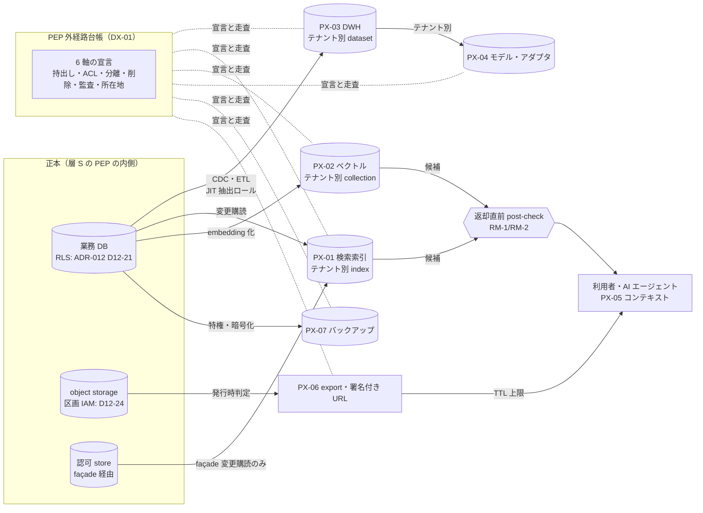
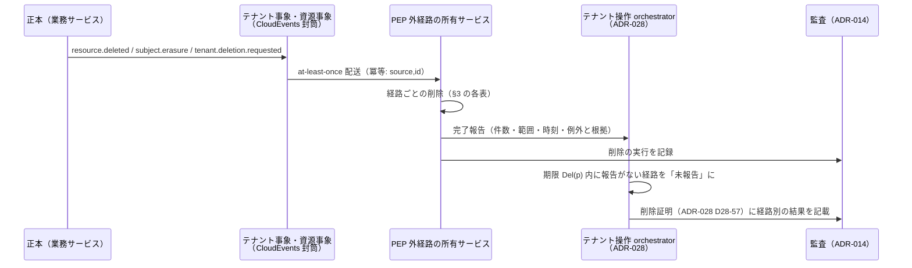

# PEP 外データの統制

> 文書ID: ARC-11 / 版: 0.2 / 状態: review / 最終更新: 2026-10-15
> 対応要求: R-061, G-082, G-105, G-136（R-requirements.md・G-goal-criteria.md で本書を対応成果物に含む行の全件）。関連: R-058（deliverables.md の DL-57 行）, R-011, R-134, R-143, R-172／G-072, G-113, G-137
> 依存文書: CONVENTIONS.md, traceability/deliverables.md（DL-57 行）, 05_adr/ADR-012-pep-coverage-storage-guardrails.md（D12-20〜D12-30、D12-40）, 05_adr/ADR-025-list-search-authorization.md（D25-02、D25-04、D25-08〜D25-12、D25-20）, 05_adr/ADR-014-audit-data.md（D14-38〜D14-50）, 05_adr/ADR-028-tenant-lifecycle-operations.md（D28-46〜D28-58）, 05_adr/ADR-006-revocation-continuous-evaluation.md（D6-15、D6-25）, 05_adr/ADR-017-non-human-ai-agent-identity.md（D17-15〜D17-17）, 02_requirements/data-classification.md（§4.4 X1〜X8、§5.2、決裁案 6.5・6.6）, 02_requirements/tenant-lifecycle.md（§7.1、§10）, 01_governance/assumptions-register.md, 01_governance/kri.md（K-01、K-05）, 01_governance/loss-scenarios.md（S-09）, 03_threat-model/threat-catalog.md（T-076〜T-079）, research/RS-08, RS-10, RS-17
> 作成方法: AI エージェント（Claude）が上記文書を読み単独で起草し、別の AI エージェント（Claude）が独立レビューして修正した（末尾「レビュー記録」）。本書の推奨・決裁案は起草者の設計推論であり、実在の CTO/CISO・経営会議の決定ではない（CONVENTIONS §8）[D]。
> 表記: 経路 PX-xx、統制 DX-xx、ACL 反映方式 RM-x、新規仮定 NA-057-x（前提台帳へ追加要）、試験案 TC-057-xx（仮番。DL-22 で採番）、残余リスク RR57-xx、決裁案 K57-x。表のセルのうちタグのないものは設計推論 [D] であり、この注記で個別のタグに代える。事実を述べるセルには個別にタグと脚注を付けた。

---

## 0. 結論

### 0.1 主要な結論

1. **PEP 外経路は「台帳に載った経路だけが存在してよい」とする** [D]。SP 800-207 の PEP は自らの位置より先では方針を適用できない [N][^1]（RS-08#19）。そのため、検索索引・ベクトルストア・DWH・ML・エージェントのコンテキスト・export・バックアップ・ログ・キャッシュの 11 経路（PX-01〜PX-11）を、ADR-012 D12-08 の entry point 台帳と同じ形式の「PEP 外経路台帳」に登録する [D]。各経路には 6 軸（持出し条件、ACL 反映方式、テナント分離、削除伝播、監査、所在地）の宣言を必須にする [D]。どれか 1 軸でも欠ける経路は K-05(a) に数え、配備ゲートで止める（DX-01〜DX-03）[D]。
2. **利用者へ返る経路では PEP を再び通す。返らない経路は特権経路に閉じ込める** [D]。
   - 利用者や AI エージェントにデータを返す経路（検索、RAG、顧客向け監査 API）は、返却の直前に PEP の post-check を必須にする（RM-1／RM-2）。索引や写しの ACL は候補を作るためだけに使う（ADR-025 D25-04）[D]。
   - 利用者に返らない経路（DWH、学習、バックアップ、ログ）は、テナント単位の区画と JIT の特権資格情報に閉じ込める（RM-3）。テナント間の境界は index・dataset・collection の分離で担い、DLS や行ポリシーはテナント内の細粒度にだけ使う [D]（ADR-012 D12-22・D12-26・D12-28）。Elastic と BigQuery の公式文書は、共有ストア上の行・文書フィルタが件数・語彙・実行時間から許可外データを推知させ得ると明記している [V][^3][^6]（RS-08#62, #69）。
   - 共有モデルの出力には、object 単位の認可を後付けできない [D]（RS-08#75）。そのためテナント横断の学習は既定で不可とする（data-classification 決裁案 6.6 の推奨 A）[D]。
3. **削除は「伝播の完了報告」で閉じ、バックアップと学習済みモデルは別扱いにする** [D]。
   - 資源削除・主体の消去請求・テナント削除は、経路ごとの完了報告（件数・時刻・例外）で閉じる。報告がない経路は削除証明に「未報告」と記載する（ADR-028 D28-57、tenant-lifecycle §7.1）[D]。
   - バックアップは書き換えない。復元時に墓標と消去台帳を再適用する。EDPB の CEF 2025 報告書は、復元したシステムで消去請求を追跡して遵守する手順を推奨している（非拘束）[N][^17]（RS-10#59）。
   - 学習済みモデルから個人データだけを取り除く方法は、本書の調査範囲で確認していない（未確認）[D]。このため、個人データを含めて学習する場合は、再学習または破棄で削除に応じることを利用の条件にする案を K57-3 として決裁に回す [D]。
   - ACL 反映遅延（L_idx）と削除伝播時間（Del）の値は TBD である。値は TC-057-01〜TC-057-06 で実測し、事前登録基準で判定する [D]。G-105 は実測を求めているが、実測はまだ行っていない [D]。

### 0.2 決裁を求める事項（要約。詳細は §8）

| # | 論点 | 推奨 | 決める人（案） | 期限 |
|---|---|---|---|---|
| K57-1 | 検索索引・ベクトルストアのテナント分離の物理構成 | (b) テナント別 index を cell 内の共有クラスタに収容し、高保証テナントだけ専用クラスタとする | CTO（費用は CFO） | G4（TC-057-07 の後） |
| K57-2 | 経路別の削除伝播期限 Del(p) の決め方 | テナント削除の期限 T_del（tenant-lifecycle K-3）から逆算した経路別の上限とし、超過を K-05 に計上する | 個人情報保護責任者＋法務責任者＋CTO | 決め方 G1／値 G4 |
| K57-3 | 個人データを含む ML 学習の可否と削除への応じ方 | (a) テナント別モデルに限り、消去請求には再学習または破棄で応じる | 経営会議＋法務責任者（6.6 と一体） | G0 |
| K57-4 | AI エージェントのコンテキスト・会話履歴の保持と共有 | (a) タスク単位で破棄し、共有時は再取得（post-check）を必須にする | CISO＋プロダクト責任者 | G3 |
| K57-5 | 要配慮個人情報を含むバックアップの保持期間 | (a) 一般データより短い上限を設定値として置く（値は法務判定） | 法務責任者＋個人情報保護責任者＋CISO | G3 |

### 0.3 本書が決めないこと

- PEP 自体の配置、coverage の検査、DB の RLS の条件は ADR-012 が決める。本書はこれに従う [D]。
- 一覧・検索の post-check、件数、ページングは ADR-025 が決める [D]。
- 監査データの保持期間と WORM の調停は ADR-014、テナント削除の段階は ADR-028、剥奪反映 SLO の分解は ADR-006 が決める [D]。
- AI エージェントの会話履歴・メモリの保持を決める ADR はまだない。本書では「未決（ADR-017）」とし、K57-4 で決裁案を示す [D]。

---

## 1. 範囲と前提

### 1.1 「PEP 外データ」の定義

- 本書の「PEP 外データ」とは、業務データの正本（業務 DB、object storage）から複製・派生・集約されたデータで、利用者・AI エージェント・運用者が、正本側の層 S の PEP（ADR-012 D12-01）を経由せずに読めるものをいう [D]。
- SP 800-53 では、AC-4 が情報の流れの強制を、AC-3(9) が外部への放出の条件を統制する [N][^2]（RS-08#15）。本書はこれに倣い、PEP 外データを「誰がアクセスできるか」ではなく「どこへ流れてよいか」の規則で統制する（data-classification §4.4 と同じ立場）[D]。
- ADR-012 D12-30 は、バックアップ・レプリカ・CDC・DWH 抽出・ETL・export を「全テナント入りの特権データ経路」として台帳に登録するとした。そのうえで、持出し条件・ACL 反映・削除伝播・監査を DL-57（本書）に委ねている [D]。本書はこの委任を受け、検索索引・ML・エージェントのコンテキスト・ログ・キャッシュも同じ枠に入れる [D]。

### 1.2 経路の一覧

| ID | 経路 | 代表的な実体 | 主な脅威 | 損失シナリオ |
|---|---|---|---|---|
| PX-01 | 検索索引（全文・ファセット・自動補完） | 検索エンジンの index、ADR-025 の L3 ACL 反映索引 | T-076 | S-01 |
| PX-02 | ベクトルストア・RAG 索引 | embedding の collection | T-078 | S-01, S-14 |
| PX-03 | DWH・データレイク・ETL・CDC | 分析用 dataset、CDC ストリーム、ETL ジョブ | T-077 | S-09 |
| PX-04 | ML 学習 | 学習データの写し、特徴量ストア、学習済みモデル・アダプタ | T-078 | S-01, S-14 |
| PX-05 | ML 推論・AI エージェントのコンテキスト | プロンプト、tool 出力、会話履歴、エージェントのメモリ、外部 LLM への送信 | T-078, T-073 | S-14 |
| PX-06 | エクスポート・署名付き URL・共有リンク | テナント全体の export（T12）、利用者単位の export、署名付き URL、CDN | T-077, T-079 | S-09, S-15 |
| PX-07 | バックアップ・スナップショット・レプリカ | DB のダンプ、ストレージのスナップショット、DR レプリカ、論理レプリケーション | T-077, T-034 | S-09 |
| PX-08 | ログ・trace・メトリクス・SIEM | 運用ログ、trace、decision log の写し、SIEM・外部 SaaS | T-056, T-077 | S-09 |
| PX-09 | キャッシュ | アプリのキャッシュ、共有キャッシュ（Redis 等）、HTTP・CDN キャッシュ | T-077 | S-01 |
| PX-10 | 認可グラフの写し | tuple の export、変更購読（changes／Watch）、索引の ACL 欄 | data-classification Z2 | S-01, S-09 |
| PX-11 | 顧客向けの連続 export・外部連携 | 顧客 sink への監査の連続 export（ADR-014 D14-55）、outbound 連携先へのデータ送出 | T-077 | S-09 |

- 脅威 ID と損失シナリオ ID は 03_threat-model/threat-catalog.md と 01_governance/loss-scenarios.md による [D]。
- 監査データ本体（ADR-014 の W 層・K 層）は ADR-014 が統制する。本書が扱うのは、その写し（SIEM、顧客 sink）だけである [D]。
- 層 S の PEP が資源のテナントを導くために引く資源の正本（業務 DB・資源レジストリ）は、PEP 外データではなく PEP の入力である（ADR-012 D12-04）[D]。結果整合の検索索引（PX-01）やその写しを、資源のテナントの解決や三者一致の照合に使ってはならない [D]。claims-ledger CL-0155 が求める「resource index の完全性・遅延」は、この禁止と PX-01 の統制で扱う [D]。
- 越境共有（ADR-024）された資源を、共有先テナントの区画（index・collection・dataset）に複製しない [D]。共有された資源の一覧は、所有テナントの索引を他テナントの主体が引く形を取らず、ADR-024 の型付き例外で扱う（ADR-025 §9 の ADR-024 行）[D]。その一覧の具体的な方式は未決（ADR-024・ADR-025 の残課題）である [D]。

### 1.3 前提（A-ID）と新規仮定

| ID | 内容 | 本書での使い方 |
|---|---|---|
| A-007 | B2B テナント 1 万（基準）、2.5 万（成長）[A-007] | 索引・dataset の区画数。K57-1 の規模 |
| A-009 | 最大テナント 10 万利用者 [A-009] | 単一テナント索引の最大規模 |
| A-049 | tuple 7.55 億（基準）[A-049] | PX-10 の写しの規模 |
| A-062 | 所在地指定テナント比率 5%（基準）[A-062] | 所在地の固定が必要な経路の数 |
| A-063 | リージョンは日本（主・副）・EU・米国。英国は EU に収容 [A-063] | 所在地軸の単位 |
| A-071 | 医療顧客の tuple・resource 名・監査記録に要配慮個人情報が混入し得る [A-071] | 経路ごとの SPI・MED の既定 |
| A-081 | 高保証テナント 50（基準）[A-081] | 専用クラスタ・専用鍵の対象数 |
| A-100 | 計画期間 20 年 [A-100] | crypto-shredding だけに頼らない理由 |
| A-112 | テナント分離をアプリ層の検索条件だけで行うサービスが 70% [A-112] | 既存の PEP 外経路が未統制である前提 |
| NA-057-1 | 各 PEP 外経路には、所有サービス（所有者）が 1 つだけ定まる | 完了報告と K-05 の計上単位 [D] |
| NA-057-2 | v1 では、DWH・データレイクを利用者（顧客）が直接クエリしない。顧客向けの分析画面は業務サービスの API（層 S の PEP）を経由する | PX-03 を特権経路として閉じる前提 [D] |
| NA-057-3 | 本基盤が提供する外部 LLM・推論 API は、契約上、送信データを学習に使わない条件で調達できる | PX-05 の持出し条件。成立しなければ K57-4 を見直す [D] |

- NA-057-1〜3 は前提台帳へ追加要である [D]。

---

## 2. 共通の統制モデル

### 2.1 全体像

- 図の要点は 2 つである [D]。第一に、利用者へ返る線は必ず post-check（PC）か、発行時判定と TTL 上限（PX-06）を通る [D]。第二に、利用者へ返らない経路（DWH、モデル、バックアップ）は、テナント別の区画と特権資格情報で閉じる [D]。

### 2.2 経路台帳と配備ゲート

- **DX-01（PEP 外経路台帳）** PEP 外経路を、ADR-012 D12-08 の entry point 台帳と同じリポジトリ・同じ版管理で台帳化する [D]。1 行は 1 経路（所有サービス × 経路種別 × 宛先）とし、次の欄を必須にする [D]。
  - 経路 ID（PX 種別＋所有サービス ID＋宛先。名前空間は ADR-021）、所有者（NA-057-1）
  - 持ち出すデータの最高分類（data-classification §3 の基本区分＋加重ラベル）と、適用する持出し条件（X1〜X8）
  - ACL 反映方式（§2.3 の RM-x）と、反映遅延の目標（L_idx。値は TBD）
  - テナント分離の単位（index・collection・dataset・bucket 区画・cell・クラスタ）
  - 削除伝播の受信方法（購読する事象）、伝播期限の区分（§2.5）、完了報告の方法
  - 監査（発行・読取を記録する事象族。ADR-014 の E2・E6・E7・E9）
  - 所在地（home cell、法域パーティション）と越境の有無
  - 迂回主体（BYPASSRLS・superuser・owner・抽出ロール等）の一覧。ADR-012 D12-30 の「迂回主体数」の入力になる
- **DX-02（宣言の正本と自動抽出）** 台帳は手書きにしない [D]。IaC（index・dataset・bucket・collection の定義）、ジョブ基盤のジョブ定義（ETL・copy・extract・学習ジョブ）、CDC の購読設定から生成する [D]。ADR-012 D12-11 の DB 側集合 B（アプリ経由でない DB 接続）と突き合わせる [D]。台帳にない抽出ロール・CDC 購読・copy ジョブが見つかった場合は K-01(a) に数える [D]。
  - 依存サービスの開発者は、IaC とジョブ定義の各リソースに 6 軸の宣言属性を付ける [D]。属性名は ADR-012 D12-09 の拡張属性と同じく ADR-021 の名前空間で DL-70 と同時に決める（TBD、所有者 CTO、期限 DEC-8 前）[D]。属性名が決まるまでは、基盤の登録 API（ADR-012 D12-09 の「管理画面・support tool・ETL・DB 直接接続」と同じ登録 API）で経路を登録する [D]。
- **DX-03（配備ゲートと K-05）** 6 軸のいずれかが空欄の経路、または §3 の既定に反する宣言（例: SPI を含むのに分離単位が「共有 index＋DLS」）は配備しない [D]。本番で見つかった場合は、K-05(a)「発行記録・TTL 上限・承認・テナント分離のいずれかを欠く経路の件数」に計上する [D]（kri.md K-05）。例外は ADR-012 D12-40 の例外台帳に登録し、所有者・期限・補償統制・承認者を持たせる [D]。

### 2.3 ACL 反映方式（RM）

| 方式 | 内容 | 剥奪への応答 | 使う経路 | 根拠 |
|---|---|---|---|---|
| RM-1 post-check のみ | 候補はエンジン列挙（L1）またはテナントで絞った検索（L2）で作り、ACL 欄を持つ索引を作らない。返却直前に PEP（façade の evaluations）で資源ごとに評価する | post-check の整合性（read-sensitive の下限。ADR-010 D-13）で決まる | PX-01（L1・L2）、PX-11 の顧客監査 API | ADR-025 D25-04。OpenFGA の文書は、局所索引の後に Check を呼んで未反映の剥奪を除く手順を示す [V][^4]（RS-08#65） |
| RM-2 索引時 ACL＋post-check | 索引に userset 参照の ACL 欄を持たせて候補を作り、返却直前に post-check する | 剥奪の未反映は post-check が落とす。付与の未反映は「一覧に出ない」になる（L_idx） | PX-01（L3）、PX-02 | ADR-025 D25-08・D25-11。Microsoft Graph connectors は item ごとの ACL を索引に複製し、外部グループの所属を展開しないよう求める [V][^5]（RS-08#64） |
| RM-3 区画資格情報 | object 単位の ACL は持たない。テナント単位の区画（dataset・bucket・collection）への JIT 資格情報だけでアクセスを許す。利用者へ返す場合は業務 API の PEP を経由する | 区画資格情報の失効・JIT の期限切れで止まる | PX-03、PX-04、PX-07、PX-08、PX-10 | ADR-012 D12-30、RS-08#72・#79 |
| RM-4 発行時判定＋寿命上限 | 発行の直前に PEP で判定し、ベアラの寿命に上限を置く | 個別に失効できない。寿命上限と生成用資格情報の失効で抑える | PX-06 | ADR-006 D6-15、ADR-012 D12-25。S3 の署名付き URL は保持者にアクセスを与えるベアラトークンで、有効期限まで複数回使える [V][^13]（RS-08#81） |
| RM-5 キー束縛＋事象破棄 | キャッシュのキーにテナントと主体（または判定範囲）を含め、ライフサイクル事象で破棄する | TTL と事象による破棄で止まる | PX-09 | ADR-012 D12-27 |
| RM-6 反映不能（分離または禁止） | 出力に何が含まれるかを PEP が判定できないので、学習データの範囲をテナントに限るか、使わない | 応答できない。再学習・破棄で対処する | PX-04 の学習済みモデル | RS-08#75 |

- **DX-04（候補は認可の根拠にしない）** RM-1・RM-2 では、索引・ベクトル検索・ACL 欄の結果を認可の根拠にしない [D]。根拠は post-check の decision_id だけとする（ADR-025 D25-04）[D]。
- **DX-05（索引の同期元）** 索引・ベクトルストアの ACL 欄は、façade の変更購読（ADR-011 D7-2）からだけ作る [D]。エンジンの store や DB を直接読む同期は認めない（ADR-025 D25-12）[D]。

### 2.4 テナント分離の単位

- **DX-06（テナント間は区画で分ける）** すべての PEP 外経路で、テナント間の境界は区画（index・collection・dataset・table・bucket 区画・キー接頭辞）で担う [D]。DLS・行ポリシー・列マスキングはテナント内の細粒度にだけ使う [D]（ADR-012 D12-22・D12-26・D12-28）。
  - BigQuery の公式文書は、行レベルアクセスポリシーがクエリ実行時間の side channel を受け得るとし、分離テーブルを「Recommended for security」としている [V][^6]（RS-08#69）。
  - Snowflake の row access policy は行の挿入を防がない [V][^8]（RS-17#38）。Databricks の row filter は view、path ベースのファイルアクセス、Iceberg REST catalog 経由のアクセスに対応しない [V][^9]（RS-17#39）。
  - 以上から、データ基盤の行・列統制は二層目の防御として扱い、テナント間の一層目にはしない [D]（RS-17#40）。
- **DX-07（区画名はテナント ID そのものにしない）** 区画キーは区画レジストリが払い出す内部値とする（ADR-012 D12-24、INV-1）[D]。テナントの統合・分割・cell 間移動では、区画を付け替える（ADR-028）[D]。
- **DX-08（区画の選択を依存サービスに開かない）** 検索・ベクトル・DWH の client は、要求のテナント文脈（ADR-012 D12-04 の三者一致を通ったもの）から区画を選ぶ共通ライブラリを使う [D]。他テナントの区画名を指定できる API は依存サービスに開かない [D]。

### 2.5 削除伝播

- **DX-09（削除の契機）** 削除を次の 4 契機で扱う [D]。
  - D-1 資源削除: 業務サービスが資源を削除した（資源事象）。
  - D-2 主体の消去請求: 法務が例外に当たらないと判定した消去請求（ADR-014 D14-46 の手順 2）。
  - D-3 テナント削除: `tenant.deletion.requested`（tenant-lifecycle §7.1。期限 T_del は法域別で、tenant-lifecycle の決裁案 K-3 により決まる。KRI の K-03 とは別物）。
  - D-4 保持期限の満了: 経路ごとの保持上限に達した（data-classification §4.3）。
- **DX-10（完了報告）** PEP 外経路の所有者は、D-1〜D-3 を受けたら経路ごとに削除し、件数・範囲・時刻・例外と根拠を完了報告として返す [D]。報告がない経路は削除証明に「未報告」と記載し、サービス所有者へエスカレーションする（ADR-028 D28-57、RR28-05）[D]。
- **DX-11（削除伝播時間 Del(p)）** 経路 p の削除伝播時間 Del(p) を「正本での削除確定時刻から、経路 p でそのデータが取得・検索・復号できなくなるまでの最大時間」と定義する [D]。暗号消去を使う経路では、完了時刻を「K 層の全コピーと KMS の待機期間を含めて復号できなくなった時刻」とする（ADR-014 D14-48、ADR-028 D28-52）[D]。AWS KMS の鍵削除は 7〜30 日（既定 30 日）の待機期間を必須とし、実際の待機は最大 24 時間長くなり得る [V][^20]（RS-10#58）。AWS は「削除後は復号できない」ことの例外として multi-Region replica 鍵と、imported key material を使う非対称鍵・HMAC 鍵を挙げている [V][^20]（RS-10#58）。このため暗号消去に使う KEK にはこれらの種別を使わない（ADR-028 D28-51、D28-26）[D]。
  - Del(p) の上限値は TBD とする [D]。所有者は個人情報保護責任者＋CTO、期限は G4、決め方は K57-2（T_del から逆算し、TC-057-04〜TC-057-06 の実測で確定）である [D]。
- **DX-12（バックアップは書き換えない）** バックアップ・WORM・スナップショットは、削除のたびに書き換えない [D]。代わりに次の 2 つを行う [D]。
  - 消去台帳・墓標（削除済みテナント・主体・資源の一覧）を保持する。
  - 復元手順に「墓標と消去台帳の再適用」を必須の段階として入れる（ADR-028 D28-53）。
  - EDPB の CEF 2025 報告書は、バックアップの改変・削除が常に望ましいとは限らないとしたうえで、消去請求を追跡し、復元したシステムで遵守する手順を持つべきだとしている（非拘束）[N][^17]（RS-10#59）。
- **DX-13（crypto-shredding の位置付け）** crypto-shredding は消去の代替とは主張せず、補完手段とする（data-classification 決裁案 6.5 の推奨 A、ADR-014 D14-47、ADR-028 D28-50）[D]。EDPB の意見募集版ガイドラインは、暗号化された個人データも個人データであるとしている [N][^18]（RS-10#55）。同ガイドラインは draft（意見募集版。final 版は未確認、standards-status SS-G05、確認日 2026-10-03）であり、本書はこれを設計要件にせず、crypto-shredding を消去の代替と主張しない理由の一つとしてだけ使う [D]。SP 800-88r2 は、数十年にわたり機密性が要る情報では、暗号消去が許容されない場合があるとしている [N][^19]（RS-10#57）。計画期間は 20 年と仮置きされている [A-100]。

### 2.6 監査

- **DX-14（記録する事象）** PEP 外経路について、次を ADR-014 の正準スキーマ（DL-77）で記録する [D]。
  - 経路の作成・変更・廃止、迂回主体の付与・剥奪: E6（管理・IAM 変更）。
  - 特権者による PEP 外データの読取・復元・抽出（DWH の全テナント横断クエリ、バックアップの復元、tuple の export）: E7（特権・support）。目的欄と承認者を必須にする [D]。CJEU は Pankki S 事件（C-579/21）で、本人の個人データに対する照会操作の日時と目的が、本人が GDPR 15 条 1 項に基づき得られる情報に当たると判示した [N][^24]（RS-10#60、data-classification §4.6）。
  - 利用者向けの返却（post-check）: E2（enforcement）と E1（判定）。一覧 1 回の記録は ADR-025 D25-18 に従う [D]。
  - export・署名付き URL の発行: 認可イベントとして E2 に記録し、発行件数と最大 TTL を K-05(d) に報告する（ADR-012 D12-25）[D]。
  - 削除の完了報告: E6 として記録し、削除証明の入力にする [D]。
- **DX-15（ログ自体の統制）** ログは PEP 外経路（PX-08）でもある [D]。ASVS v5.0.0 は次を求めている [N][^16]（RS-08#80）。
  - 16.1.1（L2）: ログの在庫（アクセス統制を含む）
  - 16.2.3（L2）: 在庫にない宛先へ出力しない
  - 16.2.5（L2）: 保護レベルに応じた記録
  - 16.4.2（L2）: 不正アクセス・改ざんからの保護
  - 16.4.3（L2）: 論理的に分離した系への送出

  本書は PX-08 の在庫を DX-01 の台帳で兼ねる [D]。

### 2.7 所在地

- **DX-16（home cell 拘束）** PEP 外経路の区画は、データが帰属するテナントの home cell に置く（data-classification X6、§4.2）[D]。法域パーティションを越える経路は「移転」として扱い、移転根拠を DL-34 で台帳化した場合に限って許す [D]。
  - EDPB は、第三国からの遠隔アクセスも、画面表示だけの support・障害対応・管理目的を含め、3 つの累積要件を満たせば移転に当たるとしている [N][^21]（RS-10#72）。
  - 個人情報保護委員会の Q&A（法令解釈を示す行政文書であり法令そのものではない）は、外国事業者のクラウドを使う場合に、事業者の所在国名やサーバの所在国名等を本人の知り得る状態（本人の求めに応じて遅滞なく回答する場合を含む）に置く必要があるとしている [N][^22]（RS-10#69、RS-10 §2 結論 10）。このため、PEP 外経路の保存国も顧客契約の開示対象に含める（ADR-014 D14-38 と同じ扱い）[D]。
- **DX-17（global 部品に置かない）** 検索索引・ベクトルストア・DWH・キャッシュを、cell をまたぐ global 部品として置かない [D]。global 部品が持ってよいのは、テナントと cell の対応表（不透明 ID）だけとする（data-classification §4.2 の AZD 行、A-062）[D]。

---

## 3. 経路別の統制

各表の「持出し条件」は data-classification §4.4 の X1〜X8 を指す [D]。分類ごとの可否（SPI・MED の DWH は既定で不可など）は同節の表に従い、本書では繰り返さない [D]。

### 3.1 PX-01 検索索引

| 軸 | 統制 |
|---|---|
| 持出し条件 | CUS・PII は X1＋X2、PII 以上は X6 を加える。PCI・SEC は不可。AZD は ACL 反映索引としてだけ可 |
| ACL 反映 | 資源型ごとに L1・L2・L3（ADR-025 D25-05）。L1・L2 は RM-1、L3 は RM-2。返却直前の post-check を必須とする（DX-04）。付与の反映遅延 L_idx を SLI にし、上限を超えたら `completeness=incomplete`（`index_lagging`）を返す（ADR-025 D25-11） |
| テナント分離 | テナント別 index（K57-1）。件数・集計・語彙・関連度スコアの統計・suggest 辞書をテナント間で共有しない（ADR-025 D25-09）。Elastic は、DLS の下でも許可外文書にしかないフィールド名・語と、それを含む件数を知り得るとし、関連度スコアのグローバル統計には DLS が効かないとしている [V][^3]（RS-08#62） |
| 削除伝播 | D-1 は変更購読で索引から削除する。D-3 はテナントの index を削除する。D-2 は主体を含む文書（作成者欄など）を再索引または削除する。自動補完の辞書も再構築の対象にする。索引はエンジン・store の export から再構築できることを要件にする（ADR-025 D25-12、TC-025-06） |
| 監査 | 返却は E2（post-check の decision_id）。索引の再構築と索引クラスタへの特権アクセスは E7 |
| 所在地 | home cell の検索クラスタ。所在地指定テナント（A-062）の index は指定法域の cell に固定する |

- 索引の ACL 欄は tuple の写しであり、DB read 権限者に関係を読まれ得る（ADR-025 RR-25-5）[D]。索引クラスタへの直接アクセスは特権機能（X5）とし、索引のストレージはテナント別 KEK で暗号化する [D]。

### 3.2 PX-02 ベクトルストア・RAG 索引

| 軸 | 統制 |
|---|---|
| 持出し条件 | data-classification §4.4 の「ML 学習・RAG」列に従う。CUS は X7 に、本書が RAG 索引について X1＋X2 を加える。PII は既定で不可（X7 の下で個別承認を要する。承認者と手続は K57-3 の決裁に従う）。SPI・MED・PCI・SEC・AUD・AZD は不可。SPI・MED を検索させたい場合は PX-01（検索索引の列。X1＋X2＋X6）として扱い、ベクトル化しない |
| ACL 反映 | RM-2。chunk ごとに元資源の参照を持たせ、リトリーブの結果を LLM に渡す前に元資源に対して post-check する（ADR-025 D25-20、ADR-012 D12-28）。chunk 単位ではなく元資源単位で判定する |
| テナント分離 | テナント別の collection・index・cluster（ADR-012 D12-28）。OWASP LLM08:2025 は、permission-aware なベクトルストアと、データセットの厳格な論理的・アクセス上の分割を予防策に挙げている [N][^14]（RS-08#74） |
| 削除伝播 | D-1 は元資源の参照で chunk を削除する。D-3 は collection を削除する。embedding モデルを更新して再ベクトル化するときは、削除済み資源を墓標で除外する |
| 監査 | リトリーブは E2（委任元の `sub` と actor のエージェント。ADR-025 D25-20）。collection への直接アクセスは E7 |
| 所在地 | home cell。embedding の計算を外部 API で行う場合は PX-05 の外部送信と同じ条件 |

- NIST AI 100-2 E2025 は、生成 AI の情報抽出の標的として RAG データベース中の機微情報を挙げている [N][^15]（RS-08#73）。post-check の前に LLM へ渡した chunk は、出力を通じて漏れ得る [D]。このため、post-check は「LLM に渡す前」に置き、「利用者に表示する前」には置かない [D]。

### 3.3 PX-03 DWH・データレイク・ETL・CDC

| 軸 | 統制 |
|---|---|
| 持出し条件 | CUS は X1＋X5。PII は X1＋X4＋X5＋X6（仮名 ID と主体別・テナント別の鍵で暗号化した属性だけ）。SPI・MED は既定で不可（集計値・匿名加工情報は data-classification 決裁案 6.6 の案 B を採った場合に限り個別承認） |
| ACL 反映 | RM-3。利用者・顧客は DWH を直接クエリしない（NA-057-2）。分析者は dataset 単位の JIT 付与で読み、横断クエリは二者承認にする。顧客向けの分析結果は業務 API の PEP を経由して返す |
| テナント分離 | テナント別 dataset・table（ADR-012 D12-22、RS-08#72）。行・列ポリシーはテナント内の細粒度にだけ使う。BigQuery の copy ジョブは、ポリシーのない表でポリシーのある表を上書きするとコピー先のポリシーを外す [V][^7]（RS-08#70）。このため copy・extract・共有の各ジョブを DX-01 の台帳に経路として登録し、ポリシーの有無を走査する |
| 削除伝播 | D-3 は dataset を削除する。D-2 は K 層方式（ADR-014 D14-43 と同じ）で行う。主体の仮名 ID の対応表と主体別の鍵を削除する。仮名 ID 以外に主体を識別できる値を持つ行（CUS 区分の業務データの作成者名など）は、行そのものを削除する。D-1 は次回の取込みで反映し、反映までの時間を Del(PX-03) で測る |
| 監査 | 抽出ジョブの実行、JIT 付与、横断クエリは E7。抽出元の DB 側では、抽出ロールの接続を ADR-012 D12-11 の集合 B で数える |
| 所在地 | home cell の法域パーティション内。全社集計のために法域を越えて集約するのは、件数だけの集計値に限る（ADR-014 D14-39 と同じ考え方）。それ以外は移転として扱う |

- DWH・ETL には、全テナントを横断して読む主体（BYPASSRLS 相当の特権）が必ず存在する [D]（RS-08#72）。抽出元の特権ロールはジョブ単位の JIT 付与にし、迂回主体数として K-05(b) と別掲で報告する（ADR-012 D12-30）[D]。
- CDC と論理レプリケーションは、PostgreSQL では複製接続のロールが SUPERUSER も BYPASSRLS も持たない場合、publisher の RLS ポリシーが実行され得る [V][^12]（RS-08#77）。そのため CDC の購読ロールは、テナント別に絞るか、全テナント購読の特権ロールとして台帳に登録するかのどちらかに限る [D]。

### 3.4 PX-04 ML 学習

| 軸 | 統制 |
|---|---|
| 持出し条件 | X7（テナント別のモデル・アダプタに限る）。PII は既定で不可。SPI・MED・PCI・SEC・AUD・AZD は不可（data-classification §4.4） |
| ACL 反映 | RM-6。学習済みモデルの出力には object 単位の認可を後付けできない（RS-08#75）。テナント内でも、利用者ごとの権限差がある資源で学習したモデルは、権限の低い利用者に、見られない資源の内容を出力し得る。このため学習データは「そのモデルを使える全員が読める資源」に限る |
| テナント分離 | テナント別のモデル・アダプタ・特徴量ストア。テナント横断の学習は R-011 の例外であり、経営判断の対象とする（data-classification 決裁案 6.6、threat-catalog TD-2） |
| 削除伝播 | D-3 はモデル・アダプタ・特徴量・学習データの写しを破棄する。D-1・D-2 は学習データの写しから削除し、モデルには次回の再学習で反映する（K57-3）。モデルから特定のデータだけを取り除く方法の有効性は確認していない（未確認） |
| 監査 | 学習ジョブ（学習データの範囲、テナント、モデル版）を E6 で記録する。モデルの版と学習データの版の対応を保持する |
| 所在地 | 学習ジョブと成果物は home cell。外部の学習基盤を使う場合は移転として扱う |

- NIST AI 100-2 E2025 は、プライバシー攻撃として data reconstruction、membership inference、training data extraction、attribute inference、property inference を分類している [N][^15]（RS-08#73）。同報告書は分類と用語を示すもので、要求事項（shall）ではない [N][^15]。これらの攻撃により、学習データの内容がモデルの出力から推知され得る [D]。

### 3.5 PX-05 ML 推論・AI エージェントのコンテキスト

AI エージェントのコンテキスト（プロンプト、tool 出力、リトリーブした chunk、会話履歴、エージェントのメモリ）は、PEP を通った後のデータが集まる場所である [D]。PEP は「渡す時点」で判定するので、渡した後のコンテキストの再利用・共有・保持を統制する必要がある [D]。

| 軸 | 統制 |
|---|---|
| 持出し条件 | コンテキストに入るデータは、委任元利用者の権限とエージェント上限の論理積で許されたものに限る（ADR-017 D17-16）。外部 LLM・推論 API への送信は data-classification §4.4 の「外部 SaaS」列に従う。CUS は X6＋契約（学習に使わない条件。NA-057-3）、PII は X6＋移転根拠（DL-34）＋同じ契約。SPI・MED・PCI・SEC は外部 LLM・推論 API に送らない（同列で不可）。home cell 内の自社推論基盤で処理する場合は、層 S の PEP で取得を許されたデータに限る |
| ACL 反映 | 取得時は RM-2（PX-02）と層 S の PEP。コンテキストに入った後は剥奪を反映できないので、保持期間をタスク（会話・作業単位）に限る（ADR-017 D17-17 のタスク単位の委任と揃える）。会話履歴を別の利用者に共有するときは、取得した内容をそのまま渡さず、共有先の権限で再取得（post-check）する（K57-4） |
| テナント分離 | コンテキスト・会話履歴・メモリはテナント別・主体別に保存する。プロンプトのキャッシュや会話の要約を、テナント・主体をまたいで共有しない |
| 削除伝播 | D-1・D-2・D-3 で、会話履歴とメモリから該当資源の内容・該当主体のデータを削除する。保持をタスク単位にすれば、削除の対象はタスクの寿命より長く残る会話履歴とメモリだけになる |
| 監査 | tool 呼出しとリトリーブは E2（`sub` と `act`）。会話履歴の共有・export は PX-06 と同じ扱い。プロンプト・出力の本文は運用ログ（PX-08）に出さない（X8） |
| 所在地 | 推論と会話履歴は home cell。外部 LLM の処理地域を契約で固定できない場合は、PII 以上を送らない |

- MCP の認可仕様（2026-07-28 版。SDO 外の仕様の最新版、standards-status SS-I28、確認日 2026-10-03。版の更新頻度が高いため月次で確認する）は、MCP server が自分の資源に有効な token だけを受け入れ、他の token を受け入れたり中継したりしてはならない（MUST NOT）とし、access token を URI の query string に含めてはならない（MUST NOT）としている [N][^23]（RS-17#68）。本書はこれに加え、token・資格情報をコンテキスト（プロンプト、会話履歴、メモリ）に入れないことを規約とする [D]。コンテキストは保存・要約・共有の対象になり、token が PEP の外へ持ち出されるからである [D]。
- 会話履歴とメモリの保持期間、共有の可否を定める ADR はない（未決（ADR-017））[D]。決裁案は K57-4 に置く [D]。

### 3.6 PX-06 エクスポート・署名付き URL・共有リンク・CDN

| 軸 | 統制 |
|---|---|
| 持出し条件 | X3（発行を認可イベントとして記録、TTL 上限、短命の生成用資格情報、件数を KRI に）。CUS は自テナントだけ、PII は本人・自テナントだけ。PCI・SEC は export・共有リンクとも不可（data-classification §4.4）。要配慮個人情報・決済関連情報・+REG のデータは署名付き URL を発行せず、BFF・proxy 経由で配信する（ADR-012 D12-25）。AZD はテナント管理者への自テナント権限一覧と出口用 export に限る。出口（EIF）の出力は ADR-018 D18-12（二者承認・JIT・受領者公開鍵での暗号化・全件監査・移送先の法域固定）に従う |
| ACL 反映 | RM-4。URL の寿命上限は、その資源の操作階層の R(t) から Δ と C を引いた残り以下にする（ADR-006 D6-15、G-136 (a)）。URL は短命の生成用資格情報で作り、主体・テナントの停止でその資格情報を失効させる。S3 の署名付き URL は、作成に使った資格情報が失効すると失効する [V][^13]（RS-08#81） |
| テナント分離 | URL は 1 つの object・1 つのテナント・1 つの操作（GET のみ等）に束縛する。生成用資格情報は区画（テナント）に限った IAM 条件付きとする（ADR-012 D12-24） |
| 削除伝播 | 発行済みの export ファイルは、受け取った側に渡った後は削除できない。事業者側に残る export の一時ファイルは、取得期間の満了で削除する。export は受領者・件数・digest を記録し、削除証明に「事業者の管理外に渡ったもの」として記載する |
| 監査 | 発行は E2、テナント全体の export（privileged/T、二者承認。ADR-028 D28-48）は E6・E7。export の要求は即時警報の対象にする（T-079） |
| 所在地 | export の一時ファイルと CDN のオリジンは home cell。CDN のエッジキャッシュは所在地の対象外にできないため、read-sensitive 以上の応答は CDN に載せない（下記） |

- **CDN キャッシュ（G-136 (a)）**: read-sensitive 以上の応答を HTTP・CDN の共有キャッシュに載せる場合は、キャッシュキーにテナントと主体を含める構成に限る（ADR-012 D12-27）[D]。含められない構成や、エッジの所在地を法域内に限れない構成では、共有キャッシュに載せない（`Cache-Control: private` または `no-store`）[D]。署名付き URL の応答を CDN でキャッシュすると、URL の寿命より長く残り得るため、キャッシュ寿命を URL の残り寿命以下にする [D]。
- **大量取得の検知**: 正規資格情報による大量 export は予防できず、検知に頼る（T-079）[D]。incident-casebook の CB-REQ-16（DL-57 に割り当て）に従い、export と異常な query の量を検知して遮断する [D]。検知の方法（主体ごとの読取件数・速度・対象範囲の基準線、新しい client・ASN からの一括取得、export・query job の削除操作の監査）と遮断の手順は fraud-abuse-controls §5.1（FA-14）に従う [D]。件数・速度の上限と検知時間の目標値は同節で TBD（所有者 CISO、期限 G4、決め方: 約 3 分の一括取得を再現する試験と BIA）であり、本書は値を置かない [D]。本書が PEP 外経路側で行うのは、export・URL の発行記録（DX-14）を検知の入力として供給することである [D]。試験は CB-TC-10 を使う [D]。

### 3.7 PX-07 バックアップ・スナップショット・レプリカ

| 軸 | 統制 |
|---|---|
| 持出し条件 | X5＋X6。SEC は暗号化した形だけ、鍵は別系統。AUD は WORM。PCI は本基盤のバックアップに含めない（PCI 対象は分離スコープ。data-classification §4.4 で不可） |
| ACL 反映 | RM-3。復元と閲覧は特権機能（AC-6(9)・AC-6(10)、ADR-029）とし、JIT・二者承認・全件記録・対象テナントの照合を行う。テナント単位の復元・抽出では、型付きのテナント ID とテナント名の二重照合を要する（ADR-028 D28-56） |
| テナント分離 | 共有 store のバックアップはテナント横断になる（構造上避けられない）。専用区画のテナント（高保証テナント A-081 の多くが該当し得る）は store のバックアップをテナント KEK で暗号化し、crypto-shredding の対象に含める（ADR-028 D28-55） |
| 削除伝播 | DX-12（書き換えず、復元時に墓標と消去台帳を再適用）。保持上限の満了で消える（D-4）。テナント KEK で暗号化したバックアップは、KEK の全コピーの破棄で判読不能にする（補完手段。DX-13）。待機期間を過ぎた削除済みテナントの KEK で復号できるコピーの件数を K-05(c) で数える |
| 監査 | バックアップの取得・復元・閲覧・複製・鍵の操作を E7・E8 で記録する |
| 所在地 | バックアップと DR レプリカは同じ法域パーティションの中に置く（日本の主・副）。法域を越える DR は移転として扱う |

- pg_dump は既定で `row_security` を off にして全行の取得を保証し、権限が足りなければエラーにする [V][^11]（RS-08#76）。PostgreSQL の文書は、superuser と BYPASSRLS ロールが常に RLS を迂回するとしている [V][^10]（RS-08#40）。したがって、完全なバックアップを取る主体は RLS を迂回できる特権ロールになる [D]。
- SP 800-53 の CP-9(d) はバックアップ情報の機密性・完全性・可用性の保護を、CP-9(8) は暗号による保護を求める [N][^2]（RS-08#78）。
- 要配慮個人情報を含むバックアップの保持期間を短くする案は、ADR-028 D28-54 から申し送られている [D]。本書では K57-5 として決裁に回す [D]。

### 3.8 PX-08 ログ・trace・メトリクス・SIEM

| 軸 | 統制 |
|---|---|
| 持出し条件 | X8（不透明 ID・ハッシュ・マスク）。SPI・MED・PCI・SEC の値は運用ログ・trace に出さない（data-classification §4.6）。AZD は decision_id だけ |
| ACL 反映 | RM-3。ログ基盤の閲覧は役割・目的で限定する。顧客にログを返す場合は顧客向け監査 API を通し、テナントスコープの PEP をもう一度通す（RS-08#82、ADR-014 D14-53） |
| テナント分離 | 運用ログは全テナント横断で集約されることを前提に、テナントを識別する値を不透明 ID に限る。顧客向けに出す監査の写しは、テナント ID で絞った正準スキーマから作る |
| 削除伝播 | 運用ログは個人を識別する値を持たない設計（X8）にして、D-2 の対象から外す。保持上限の満了（D-4）で消す。上限は TBD（所有者 CISO＋SRE 責任者、期限 G3、決め方: ASVS 14.1.2 の分類別要件と DL-34） |
| 監査 | ログ基盤の閲覧・検索・export を記録する。監査ログへのアクセスは E9 |
| 所在地 | cell のリージョンに保存する。SOC・SIEM による越境参照は移転として扱う（ADR-014 D14-40） |

- trace の sampling に監査を依存させない（ADR-014 D14-02）。trace に主体・テナント・資源の識別子を載せない（ADR-014 D14-04）[D]。

### 3.9 PX-09 キャッシュ

| 軸 | 統制 |
|---|---|
| 持出し条件 | 応答と同じ分類の既定に従う。認可判定そのもののキャッシュは ADR-013 D13-24〜D13-26 の条件だけで許し、依存サービスが独自に判定をキャッシュすることは禁じる（ADR-012 D12-27） |
| ACL 反映 | RM-5。キーに区画キー（テナント）と、応答が主体・権限に依存する場合は主体または判定範囲を含める。キーは共通ライブラリで生成する（R-15 で検査）。剥奪・テナント停止のライフサイクル事象で破棄する（ADR-006 D6-25）。キャッシュの最大齢は剥奪反映 SLO の項 C に含める |
| テナント分離 | 共有キャッシュは既定ユーザーを無効化し、サービスごとの ACL ユーザーにする。ACL はサービス単位の境界で、テナント単位の境界にはならない（RR12-05）。テナント間の分離はキー規約に依存する |
| 削除伝播 | TTL の満了と事象による破棄。D-3 ではテナントのキー接頭辞を一括で破棄する |
| 監査 | キャッシュの読み書きは記録しない（量が多い）。キー規約の違反を CI（R-15）と本番走査で検出し、件数を DL-15 の検査結果に記録する。K-06 の 5 性質（kri.md §4.2）にキャッシュのキー規約は含まれないため、KRI への計上先は kri.md への追加要とする（残課題） |
| 所在地 | cell 内。global なキャッシュには、テナントと cell の対応表以外を置かない（DX-17） |

### 3.10 PX-10 認可グラフの写し

| 軸 | 統制 |
|---|---|
| 持出し条件 | 依存サービスには、Check と自テナント内の一覧（post-check 付き）だけを公開する。Read・Expand・ListUsers・changes・export は特権機能（X5）とし、全件を記録する（data-classification Z2）。テナント管理者への自テナント権限一覧と出口用 export は X3（PX-06 と同じ扱い。data-classification §4.4 の AZD 行） |
| ACL 反映 | RM-3。ADR-025 の L3 索引の ACL 欄は、façade の変更購読からだけ作る（DX-05） |
| テナント分離 | 変更購読と export はテナント単位の範囲指定を必須にする |
| 削除伝播 | D-3 は store から tuple を消し、索引の ACL 欄からも消す。tuple に個人データを置かない規約（ADR-028 D28-55）を前提に、共有 store のバックアップ中の tuple はテナント鍵で暗号化しない |
| 監査 | 特権の照会 API の呼出しを E7 で全件記録する |
| 所在地 | tuple store と PDP は home cell。global 部品は対応表だけを持つ |

### 3.11 PX-11 顧客向けの連続 export・外部連携

| 軸 | 統制 |
|---|---|
| 持出し条件 | 顧客 sink への連続 export は、自テナントの記録だけを、顧客が登録した宛先へ送る（ADR-014 D14-55）。outbound 連携先へのデータ送出は、連携の登録時に送るデータの分類と宛先を台帳に宣言する |
| ACL 反映 | 顧客向け監査 API は RM-1（テナントスコープの PEP）。outbound 連携は RM-4 と同じ扱いで、送出は登録時の同意の範囲に限る |
| テナント分離 | 宛先は 1 テナントに束縛する。他テナントのイベントが返らないことを cross-tenant property test に含める（ADR-014 D14-53） |
| 削除伝播 | 宛先に渡った後は事業者の管理外になる。送出の記録（件数・範囲・時刻）を残し、削除証明に記載する |
| 監査 | 宛先の登録・変更は E6。送出の失敗・停止は監査経路の heartbeat と同じ扱いで記録する |
| 所在地 | 宛先の所在地を登録時に記録する。法域外の宛先は顧客の指示による移転として扱う |

- outbound 連携で使う他社の token・API キーの保管、scope の最小化、rotation、一括失効（G-136 (c)）は、連携パターン集（DL-64）が主として扱う [D]。本書は、その保管場所が PEP 外データ（SEC）に当たるので、DX-01 の台帳に載せ、X5＋X6 を課すことだけを決める [D]。

### 3.12 経路×6 軸の要約

| 経路 | 持出し条件（CUS／PII の既定） | ACL 反映 | テナント分離 | 削除伝播の主手段 | 監査の族 | 所在地 |
|---|---|---|---|---|---|---|
| PX-01 検索 | X1＋X2／＋X6 | RM-1・RM-2 | テナント別 index | 変更購読で削除、index 削除 | E2・E7 | home cell |
| PX-02 ベクトル | X7＋X1＋X2／既定不可 | RM-2 | テナント別 collection | 元資源参照で削除 | E2・E7 | home cell |
| PX-03 DWH | X1＋X5／＋X4＋X6 | RM-3 | テナント別 dataset | dataset 削除、K 層削除 | E7 | 法域パーティション内 |
| PX-04 学習 | X7／既定不可 | RM-6 | テナント別モデル | 破棄・再学習 | E6 | home cell |
| PX-05 コンテキスト | 論理積（ADR-017）＋X6 | RM-2＋タスク寿命 | テナント別・主体別 | タスク終了で破棄 | E2 | home cell |
| PX-06 export | X3 | RM-4 | object・テナント束縛 | 一時ファイル削除、管理外の記録 | E2・E6・E7 | home cell |
| PX-07 バックアップ | X5＋X6 | RM-3 | 専用区画は KEK | 書き換えず復元時に再適用 | E7・E8 | 法域パーティション内 |
| PX-08 ログ | X8 | RM-3 | 不透明 ID | 保持上限で失効 | E9 | cell |
| PX-09 キャッシュ | 応答と同じ | RM-5 | キー規約 | TTL・事象破棄 | （記録しない） | cell |
| PX-10 グラフの写し | X5 | RM-3 | テナント範囲指定 | store・索引から削除 | E7 | home cell |
| PX-11 連続 export | 自テナントだけ | RM-1・RM-4 | 宛先をテナントに束縛 | 管理外の記録 | E6 | 宛先を記録 |

---

## 4. ACL 反映遅延と剥奪反映 SLO

- **DX-18（指標）** PEP 外経路の反映を次の 3 指標で測る [D]。
  - L_idx(p): 付与が経路 p の候補に現れるまでの時間（ADR-025 D25-11）。欠落の時間であり、漏えいの時間ではない [D]。
  - R_px(p): 剥奪から、経路 p を通じて利用者に返らなくなるまでの時間。RM-1・RM-2 の経路では post-check が落とすので、Check と同じ read-sensitive の上限 B 以内に収まる（ADR-025 D25-11）[D]。RM-4 の経路では URL・export の残り寿命で決まる（ADR-006 D6-15）[D]。RM-5 の経路ではキャッシュの最大齢 C で決まる [D]。
  - Del(p): §2.5 DX-11 の削除伝播時間。
- **DX-19（剥奪反映 SLO への組込み）** ADR-006 D6-25 は、データの複製・索引について「剥奪を索引に反映するまでの時間を DL-57 で定める」としている [D]。本書は、利用者に返る経路では post-check があるので、索引への剥奪の反映を剥奪反映 SLO R(t, c) の項に入れないことを決める [D]。剥奪反映 SLO に入るのは、post-check を持たない RM-4（URL・export の残り寿命）と RM-5（キャッシュの最大齢）だけである [D]。RM-3・RM-6 の経路は利用者に返らない（NA-057-2）ので、剥奪反映 SLO の対象外とし、特権資格情報の失効で扱う [D]。
- **DX-20（値の決め方）** L_idx・Del(p) の上限は TBD とする [D]。

| 指標 | 所有者 | 期限 | 決め方 |
|---|---|---|---|
| L_idx(PX-01, PX-02) | CTO＋プロダクト責任者 | G4 | TC-057-01・TC-025-05 の実測と BIA |
| URL・export の TTL 上限 | CISO＋SRE 責任者 | G4 | ADR-006 の遅延予算（R(t)−Δ−C）と TC-057-03・TC-012-13 |
| Del(p) | 個人情報保護責任者＋CTO | 決め方 G1／値 G4 | K57-2、TC-057-04〜06 |

---

## 5. 監視と継続検査

| 検査 | 内容 | 頻度 | 計上先 |
|---|---|---|---|
| 台帳の網羅 | IaC・ジョブ定義・CDC 購読・DB 接続元から抽出した経路と DX-01 の台帳の差分 | CI＋日次走査 | K-01(a)、K-05(a) |
| 6 軸の欠落 | 台帳の必須欄の空欄、§3 の既定に反する宣言 | CI | K-05(a) |
| 区画の検査 | 共有 index・共有 dataset へのテナント混在、DLS・行ポリシーだけでのテナント分離 | 日次走査 | K-05(a) |
| 迂回主体 | BYPASSRLS・superuser・owner・抽出ロールの数と常設の有無 | 日次走査 | アプリ接続に使われるものは K-05(b)。抽出・複製・バックアップの主体は K-05(b) と別掲の「迂回主体数」（ADR-012 D12-30） |
| export・URL | 発行件数、最大 TTL、TTL 上限の違反 | 日次 | K-05(d) |
| 暗号消去 | 待機期間を過ぎた削除済みテナントの KEK で復号できるコピー | 日次 | K-05(c) |
| 削除伝播 | 期限 Del(p) を超えた未報告の経路 | 事象ごと | K-05（未報告の内訳。kri.md への追加要） |
| copy ジョブ | ポリシーのない表による上書き（RS-08#70） | 日次走査 | K-05(a) |

- K-05 に「削除伝播の未報告件数」を加えることを kri.md の所有者に申し送る（残課題）[D]。

---

## 6. 検証（PoC・試験案）

TC 番号は DL-22 で採番する。ここでは仮番号である [D]。

| TC | 仮説 | 方法 | 合否基準 |
|---|---|---|---|
| TC-057-01 | 付与の索引反映 L_idx が予算内に収まる | 付与・剥奪・folder 移動・大規模 group の変更を注入し、索引・ベクトルストアに反映するまでの時間を測る（TC-025-05 と共用） | L_idx の p99 が事前登録値以内（値は TBD。DX-20） |
| TC-057-02 | 剥奪直後に、索引未反映でも利用者・エージェントに返らない | 剥奪直後に検索と RAG のリトリーブを繰り返す（TC-025-07 と共用） | 上限 B を超える返却 0 件 |
| TC-057-03 | 剥奪後に署名付き URL・export・CDN キャッシュが上限を超えて使えない | 期限切れ・他テナント・剥奪後の URL、生成用資格情報の失効後の URL、CDN 経由の再取得を試す（G-136 (a) の負例） | 全件拒否、または TTL 上限内で失効 |
| TC-057-04 | 資源削除が全経路に Del(p) 以内で伝播する | 資源を削除し、検索・補完・RAG・キャッシュ・DWH で出現するかを時系列で測る（TC-025-13 を拡張） | 期限超過 0 件。各経路の完了報告あり |
| TC-057-05 | テナント削除が全経路に伝播し、削除証明に未報告が正しく載る | テスト用テナントで `tenant.deletion.requested` を発行し、1 経路の所有者に報告を止めさせる | 未報告の経路が削除証明に「未報告」と記載される。他は期限内 |
| TC-057-06 | バックアップからの復元で、削除済みデータが戻らない | 削除後のバックアップから復元し、墓標と消去台帳の再適用を確かめる（DL-24 の演習と共用） | 復元後に削除済みテナント・主体のデータ 0 件 |
| TC-057-07 | テナント別 index を cell あたりの収容テナント数で運用できる | A-007 を cell 数で割った数の index を 1 クラスタに置き、索引更新・検索・再構築の負荷を測る（TC-012-12 と共用。NA-012-4） | 事前登録した遅延・資源上限内。不合格なら K57-1 を見直す |
| TC-057-08 | テナント間で件数・集計・語彙・スコア・補完・実行時間から推測できない | 2 テナント以上で、検索・ベクトル・DWH について他テナントの存在を推測する（TC-025-08、RS-08 M-08 の DWH 版） | 推測可能な差分 0 件 |
| TC-057-09 | 台帳にない PEP 外経路を検出できる | 未登録の copy ジョブ、CDC 購読、抽出ロール、署名付き URL の発行を意図的に混入させる | 全件検出（K-05(a)、K-01(a)） |
| TC-057-10 | エージェントのコンテキストを共有しても、共有先に見えない内容が渡らない | 利用者 A の会話（A だけが見られる資源を含む）を利用者 B に共有する | B に渡る内容は B の post-check を通ったものだけ |

- G-105 の判定者は CISO と独立立会人である [D]。TC-057-01・TC-057-04 の実測は DL-81 に記録する [D]。本書の時点で実測は行っていない [D]。

---

## 7. 依存サービス・連携開発者への影響

| 場面 | 依存サービスが行うこと |
|---|---|
| 検索・RAG を作る | 共通ライブラリでテナント別の区画を選ぶ。SDK の一覧ヘルパで post-check する。資源型の方式（L1〜L3）を model registry に宣言する |
| DWH に持ち出す | 経路を DX-01 の台帳に登録する。テナント別 dataset に出す。PII は仮名 ID と暗号化属性だけにする。抽出ロールは JIT |
| ML を学習する | テナント別モデルに限る。学習データの範囲とモデル版を記録する。テナント横断は K57-3 の決裁まで不可 |
| エージェントを作る | リトリーブは一覧ヘルパを通す。token をコンテキストに入れない。会話履歴をタスク単位で扱う（K57-4） |
| export・URL を出す | 発行前に PEP で判定し、TTL 上限を守り、発行を記録する。要配慮データは BFF・proxy で配信する |
| キャッシュする | キーは共通ライブラリで作る。判定結果をキャッシュしない |
| 削除事象を受ける | `tenant.deletion.requested`・資源事象・消去請求を購読し、経路ごとに削除して完了報告（件数・範囲・時刻・例外と根拠）を返す。事象は (source, id) で冪等に処理する（ADR-028 D28-59） |
| PEP 外経路を新設する（共通） | IaC・ジョブ定義に 6 軸の宣言属性を付ける（属性名が決まるまでは基盤の登録 API で登録。DX-02）。宣言の欠けた経路は配備ゲートで止まる（DX-03） |
| ログ・trace を出す | 主体・テナント・資源の値は不透明 ID・ハッシュ・マスクだけにする（X8）。SPI・MED・PCI・SEC の値、プロンプトと LLM 出力の本文、token は出さない。出力先は DX-01 の台帳に載った宛先に限る（ASVS 16.2.3） |
| 外部 LLM・推論 API を使う | CUS は契約（学習に使わない条件）付きで送れる。PII は移転根拠（DL-34）も要る。SPI・MED・PCI・SEC は送らない（§3.5） |
| outbound 連携でデータを送る | 連携の登録時に送るデータの分類と宛先・所在地を台帳に宣言する。他社の token・API キーの保管場所を台帳に載せ、X5＋X6 を課す（§3.11）。保管・rotation・一括失効の詳細は DL-64 |

- これらは連携パターン P-09（一覧・検索）、P-10（エクスポート・大量読取り）、P-15（データ基盤への持出し）の既定形として DL-64 に写す [D]。
- 既存の 240 サービスのうち 70% はテナント分離を検索条件だけで行っている [A-112]。これらのサービスが持つ PEP 外経路は、移行計画（DL-31）で扱うデータの最高分類の高い順に台帳化する [D]。未台帳化の間は K-05 の「未移行分」として別掲する [D]。

---

## 8. 決裁案

本節の決裁案は起案であり、決定ではない [D]。

### K57-1 検索索引・ベクトルストアのテナント分離の物理構成

| 案 | 内容 | 帰結 |
|---|---|---|
| (a) | テナントごとに専用クラスタ | 分離は最も明確になる。クラスタ数がテナント数（A-007 で 1 万）と同じ桁になり、運用と費用が大きい [D][A-007] |
| (b)（推奨） | テナント別 index を cell 内の共有クラスタに収容し、高保証テナント（A-081 で 50）だけ専用クラスタにする | 統計・辞書の共有は index の分離で避けられる。クラスタ障害の影響範囲は cell 内の複数テナントになる。収容数は TC-057-07 で確かめる [D][A-081] |
| (c) | 小規模テナントを共有 index＋DLS で集約する | ADR-012 D12-26 と ADR-025 D25-09 に反する。棄却仮説 RH-193 として既に棄却されている。採らない [D] |

- 推奨: (b) [D]。TC-057-07 が不合格の場合も (c) には戻らず、ADR-012 §8 のトリガーで再検討する [D]。
- 決める人: CTO（費用は CFO）[D]。期限: G4（TC-057-07 の後）[D]。

### K57-2 経路別の削除伝播期限 Del(p) の決め方

| 案 | 内容 | 帰結 |
|---|---|---|
| (a)（推奨） | テナント削除の期限 T_del（tenant-lifecycle 決裁案 K-3、法域別）から逆算し、経路ごとの上限を置く。超過と未報告を K-05 に計上する | 経路ごとの責任が明確になる。T_del が決まるまで値を置けない [D] |
| (b) | 全経路で一律の上限 | 単純になる。バックアップ（復元時の再適用）や学習済みモデル（再学習）のように、一律の上限を満たせない経路が例外だらけになる [D] |
| (c) | 上限を置かず、完了報告だけを求める | 削除証明に完了時刻を書けず、消去請求への回答期限を説明できない [D] |

- 推奨: (a) [D]。決める人: 個人情報保護責任者＋法務責任者＋CTO [D]。期限: 決め方 G1、値 G4 [D]。

### K57-3 個人データを含む ML 学習の可否と削除への応じ方

| 案 | 内容 | 帰結 |
|---|---|---|
| (a)（推奨） | テナント別モデルに限り、個人データを含めて学習する場合は、消去請求に再学習または破棄で応じる。再学習の周期を設定値にする | 再学習の費用がかかる。周期の間はモデルに削除済みデータの影響が残る [D] |
| (b) | 個人データを学習に使わない（匿名加工情報・集計値だけ） | 削除伝播の問題は小さくなる。匿名化の妥当性の検証が要る。EDPB の CEF 2025 報告書は、単純な仮名化や部分マスキングを匿名化と誤認している例を指摘している [N][^17]（RS-10#59）[D] |
| (c) | テナント横断の共有モデルで学習する | R-011 の例外になる。出力に object 単位の認可を後付けできない（RS-08#75）。threat-catalog は T-078 の受容者案を段 3（取締役会）としている [D] |

- 推奨: (a)。ただし SPI・MED は (b) に限る [D]。(b) の匿名加工情報・集計値を SPI・MED から作る場合も、data-classification §4.4 の「ML 学習・RAG」列（SPI・MED は不可）の例外になるため、同 6.6 の案 B と同じく個別の PIA と経営承認を要する [D]。
- 上流の不整合: data-classification 決裁案 6.6 の期限は G0、threat-catalog TD-2 の期限は G3 である [D]。本書は 6.6 と一体で扱うため G0 とした [D]。どちらに揃えるかは threat-catalog の所有者に申し送る（残課題）[D]。
- 決める人: 経営会議＋法務責任者（data-classification 決裁案 6.6 と一体で判断）[D]。期限: G0 [D]。

### K57-4 AI エージェントのコンテキスト・会話履歴の保持と共有（未決（ADR-017））

| 案 | 内容 | 帰結 |
|---|---|---|
| (a)（推奨） | コンテキストはタスク単位で破棄する。会話履歴を残す場合は利用者のデータとして保存し、共有時は共有先の権限で再取得（post-check）する | 剥奪の影響をタスクの寿命に閉じ込められる。共有の利便性は下がる [D] |
| (b) | 会話履歴とメモリを長期に保持し、共有時もそのまま渡す | 共有先が見られない資源の内容が渡る（confused deputy と同型）。剥奪後も履歴に残る [D] |
| (c) | 会話履歴を保持しない | 削除と剥奪の問題は最小になる。業務上の再開・監査の材料がなくなる [D] |

- 推奨: (a) [D]。保持期間の値は TBD（所有者: プロダクト責任者＋個人情報保護責任者、期限 G3、決め方: PIA（DL-25））[D]。
- 決める人: CISO＋プロダクト責任者。ADR-017 の改版で取り込む [D]。期限: G3 [D]。

### K57-5 要配慮個人情報を含むバックアップの保持期間

| 案 | 内容 | 帰結 |
|---|---|---|
| (a)（推奨） | SPI・MED を含む store のバックアップに、一般データより短い保持上限を設定値として置く。値は法務が DL-34 で判定する | 削除請求が復元で戻る期間を短くできる。復旧できる過去の時点も短くなり、誤操作・論理破損からの復旧と衝突し得る [D]。リージョン喪失時の RPO（A-093）は DR レプリカで満たす前提なので直接は衝突しないが、復旧に過去のバックアップを使う手順（ADR-013 D13-39 のテナント単位の復元）とは調整が要る [D][A-093] |
| (b) | 全データで同じ保持期間 | 運用は単純になる。SP 800-88r2 が長期の機密性を要する情報で暗号消去を許容しない場合があるとしている点への対処が、保持期間からは得られない [N][^19][D] |

- 推奨: (a) [D]。決める人: 法務責任者＋個人情報保護責任者＋CISO（RPO との調整は事業責任者）[D]。期限: G3 [D]。

---

## 9. 残余リスク

| ID | 残余リスク | 統制 | 受容者案 | 期限案 |
|---|---|---|---|---|
| RR57-01 | 迂回主体（バックアップ・DWH 抽出・CDC の特権ロール）の濫用は予防できず、検知に頼る | DX-14、JIT、K-05(b) | 段 2 案（CEO・経営会議。T-077・RR12-03 と同じ） | G5 |
| RR57-02 | テナント内の索引で、許可外文書がスコア統計・語彙に混ざる | ADR-025 D25-14 | 段 1（事業責任者。RR-25-1 と同じ） | G4 |
| RR57-03 | 発行済みの export・受領済みのファイルは削除も剥奪もできない | RM-4 の寿命上限、発行記録、大量取得の検知 | 事業責任者 | G4 |
| RR57-04 | LLM に渡した後のコンテキストからの漏えい（プロンプトインジェクションによる持出しを含む） | 渡す前の post-check、タスク寿命、外部送信の契約 | CISO＋プロダクト責任者 | G3 |
| RR57-05 | 学習済みモデルに削除済みデータの影響が再学習まで残る | K57-3 | 個人情報保護責任者 | G0 |
| RR57-06 | バックアップに削除済みデータが保持期限まで残る | DX-12、K57-5 | 法務責任者＋個人情報保護責任者 | G3 |
| RR57-07 | 共有キャッシュのテナント分離はキー規約に依存する | RM-5、R-15 | CISO（RR12-05 と同じ） | G4 |
| RR57-08 | テナント間の統計共有による漏えい | DX-06、K57-1 | 受容しない（推奨。T-076 と同じ） | — |

---

## 対応表

R-requirements.md と G-goal-criteria.md から、対応成果物欄に本書（04_architecture/data-outside-pep.md または DL-57）を含む行を Grep で抽出した [D]。結果は R-061、G-082、G-105、G-136 の 4 行である [D]。deliverables.md の DL-57 行が主な対応要求に挙げる R-058 は、関連として加えた [D]。

| ID | 要求の要旨 | 本書の節 | 閉じ方 | 状態 |
|---|---|---|---|---|
| R-061 | DB/storage 側の tenant guardrail（RLS 等） | §2.4 DX-06〜DX-08、§3 の各表の「テナント分離」、§5 | C | 設計案。PEP 外経路の区画分離と走査を定めた。DB の RLS の条件は ADR-012 D12-21。実測（TC-057-07〜09）は未達 |
| G-082 | 全 entry point の棚卸し（export・ETL・DB 直を含む）、coverage の機械検証、DB/storage 側の guardrail、CI での継続実行 | §2.2 DX-01〜DX-03、§5 | C | 設計案。PEP 外経路を台帳化し、ADR-012 の集合 B と突き合わせる方式を定めた。CI ログ（E4）と独立立会人の確認は未達 |
| G-105 | 検索・DWH・ML・export・バックアップ・ログの持出し条件、ACL 反映、テナント分離、削除伝播、監査の定義と、PoC での ACL 反映遅延と削除伝播の確認 | §2〜§4、§6 | C | 定義は本書で完了（A の部分）。実測（TC-057-01、TC-057-04〜06）は未達。値（L_idx、Del(p)）は TBD |
| G-136 | (a) 署名付き URL の寿命・束縛・剥奪後の最大時間・CDN、(b) レガシー、(c) outbound、(d) device code の統制と負例試験 | (a) §3.6、§4、TC-057-03。(c) §3.11（保管場所の台帳化だけ） | C | (a) は設計案と負例試験案まで。(b)(c)(d) の主たる成果物は DL-64 であり、本書では扱わない。実測は未達 |
| R-058（関連） | 全 entry point inventory（batch/queue/データ直アクセスを含む） | §2.2 DX-01・DX-02 | C | PEP 外経路の棚卸し方式を供給した。主たる成果物は DL-10・as-is-inventory。手作業棚卸しと計測は未達 |
| CL-0155（関連） | resource index 自体の完全性・遅延も PEP 外データ（DL-57）として扱う（claims-ledger の修正指示） | §1.2（テナント解決に索引を使わない）、§3.1、§4 | A | 机上で閉じた。テナント解決は正本から行い（ADR-012 D12-04）、索引の遅延は L_idx と post-check で扱う |
| CB-REQ-16（関連） | 大量 export と異常な query の量の検知・遮断（incident-casebook。DL-57 に割当て） | §3.6「大量取得の検知」 | C | 方式は DL-52 §5.1 に従うと定めた。閾値と検知時間は TBD、CB-TC-10 の実測は未達 |

- 件数: 抽出 4 件（R 1、G 3）＋関連 3 件（R-058、CL-0155、CB-REQ-16）[D]。いずれも「閉じた」状態ではない（CL-0155 を除く）[D]。
- 抽出の再確認（レビュー時）: R-requirements.md・G-goal-criteria.md・claims-ledger.md を「DL-57」「data-outside-pep」で検索し、上の 4 件と CL-0155 を得た [D]。incident-casebook の CB-REQ-16 は DL-57 を割当て先とする [D]。ADR-018 の G-105 行（EIF の持出し条件）と ADR-024 の R-061 行（本体は DL-15・DL-57）は本書を主成果物として参照しており、§3.6・§1.2 で受けた [D]。

---

## 残課題

1. NA-057-1〜3 を前提台帳へ追加する（所有者: 前提台帳の管理者）[D]。
2. kri.md の K-05 に「削除伝播の未報告件数・期限超過件数」を加える（所有者: CISO、期限: G3）[D]。
3. L_idx、URL・export の TTL 上限、Del(p) の値を確定する（§4 DX-20 の表）[D]。
4. TC-057-01〜10 を DL-22 で採番し、事前登録基準を置き、DL-81 に実測を記録する（G-105、G-136 の未達部分）[D]。
5. K57-1〜K57-5 の決裁を得る。K57-3 は data-classification 決裁案 6.6、K57-4 は ADR-017 の改版と一体で扱う [D]。
6. 学習済みモデルから特定のデータを取り除く方法（machine unlearning）の一次資料を取得していない（未確認）。K57-3 の (a) は再学習・破棄を前提にしている [D]。
7. 外部 LLM・推論 API の契約条件（学習への不使用、処理地域、保持）について、ベンダーの公式文書を確認していない（NA-057-3、未確認）[D]。
8. CDN のエッジキャッシュの所在地と、`Cache-Control` の扱いのベンダー別の挙動を確認していない（未確認）[D]。
9. G-136 の (b)(c)(d) は DL-64 で閉じる。本書との境界（outbound 資格情報の保管場所）を DL-64 の作成者と照合する [D]。
10. 第三者評価: PEP 外経路からのテナント間漏えいの pentest（DL-59、T-077・T-078）、DB・バックアップのアクセスレビュー（E6）[D]。
11. 実在の CTO/CISO による決裁。本書の推奨は模擬・起草者の判断にとどまる [D]。
12. キャッシュのキー規約違反（R-15）の KRI 計上先を kri.md に追加する（所有者: CISO＋プラットフォームチーム長、期限: G4）[D]。
13. data-classification §4.4 は RAG 索引と ML 学習を同じ列に置いている。SPI・MED の RAG を認める必要が出た場合は、同列を分けて改版する（所有者: data-classification の所有者、期限: G3）[D]。
14. 決裁案 K57-3 と threat-catalog TD-2 の期限（G0 と G3）の不一致を threat-catalog の所有者と調整する [D]。
15. 越境共有（ADR-024）された資源の一覧方式は、ADR-024・ADR-025 で未決である。決まった時点で §1.2 と PX-01 を改版する [D]。

## ADR への指摘

- **ADR-006 D6-28（経路 p の列挙）**: R(t, c) の経路 p は 8 種（外部 HTTP、内部 hop、長時間接続、非同期ジョブ、派生 token、署名付き URL、PDP 判定、外部連携アプリ）を初期値とする [D]。本書 DX-19 が剥奪反映 SLO に入れるとした「応答データのキャッシュ（アプリ・HTTP・CDN。RM-5）」と「export ファイル（RM-4）」は、この 8 種に明示されていない [D]。D6-28 の C_p は強制点の判定キャッシュの最大齢であり、PEP の判定後に応答データそのものを保持する共有キャッシュの残存はこれと別の項になる [D]。ADR-006 の改版で、経路 p に「応答データの共有キャッシュ」と「export」を加えるか、「署名付き URL」の行に含めると明記するかを決めるよう指摘する [D]。それまで本書は、これらの残存を「署名付き URL」経路の Z 項（bearer の残存寿命）と同じ扱いで遅延予算に計上する [D]。

---

## 参考文献

[^1]: NIST『SP 800-207 Zero Trust Architecture』2020-08. https://doi.org/10.6028/NIST.SP.800-207 （参照箇所: §2 p.5（implicit trust zone）, §3 p.10（PEP の定義）、確認日: 2026-10-03）
[^2]: NIST『Electronic (OSCAL) Version of NIST SP 800-53 Rev 5.2.0 Controls and SP 800-53A Rev 5.2.0 Assessment Procedures』version 5.2.0. https://github.com/usnistgov/oscal-content/blob/main/nist.gov/SP800-53/rev5/json/NIST_SP-800-53_rev5_catalog.json （参照箇所: AC-3(9), AC-4, AC-6(9), AC-6(10), CP-9, CP-9(8), AU-9 の statement / discussion、確認日: 2026-10-03）
[^3]: Elastic『Controlling access at the document and field level』Elastic Docs（current）. https://www.elastic.co/docs/deploy-manage/users-roles/cluster-or-deployment-auth/controlling-access-at-document-field-level （参照箇所: 冒頭 Note, Document level security limitations と Note、確認日: 2026-10-03）
[^4]: OpenFGA Authors『Search with Permissions』openfga.dev. https://openfga.dev/docs/interacting/search-with-permissions （参照箇所: Possible options（Option 1〜3）, Choosing the best option、確認日: 2026-10-03）
[^5]: Microsoft『Create, update, and delete items added by your Microsoft Graph connector』Microsoft Learn. https://learn.microsoft.com/en-us/graph/connecting-external-content-manage-items （参照箇所: Access control list、確認日: 2026-10-03）
[^6]: Google Cloud『Introduction to BigQuery row-level security』最終更新 2026-09-30. https://cloud.google.com/bigquery/docs/row-level-security-intro （参照箇所: Comparison of authorized views, row-level security, and separate tables, side-channel の記述, Limitations、確認日: 2026-10-03）
[^7]: Google Cloud『Use row-level security with other BigQuery features』最終更新 2026-09-30. https://cloud.google.com/bigquery/docs/using-row-level-security-with-features （参照箇所: Copy jobs, Extract jobs、確認日: 2026-10-03）
[^8]: Snowflake『Understanding row access policies』Snowflake Documentation（版表記なし）. https://docs.snowflake.com/en/user-guide/security-row-intro （参照箇所: Enterprise Edition Feature, How does a row access policy work?, 挿入を防がない旨の注記、確認日: 2026-10-03）
[^9]: Databricks『Row filters and column masks』Databricks on AWS 文書, 2026-09-24 更新. https://docs.databricks.com/aws/en/data-governance/unity-catalog/filters-and-masks （参照箇所: 概要, Limitations、確認日: 2026-10-03）
[^10]: PostgreSQL Global Development Group『PostgreSQL 18 Documentation §5.9 Row Security Policies』18. https://www.postgresql.org/docs/18/ddl-rowsecurity.html （参照箇所: 冒頭の概説（default-deny、BYPASSRLS、table owner、FORCE）, row_security とバックアップの段落、確認日: 2026-10-03）
[^11]: PostgreSQL Global Development Group『PostgreSQL 18 Documentation — pg_dump』18. https://www.postgresql.org/docs/18/app-pgdump.html （参照箇所: --enable-row-security、確認日: 2026-10-03）
[^12]: PostgreSQL Global Development Group『PostgreSQL 18 Documentation §29.11 Security（Logical Replication）』18. https://www.postgresql.org/docs/18/logical-replication-security.html （参照箇所: 複製ロールと row security の段落、確認日: 2026-10-03）
[^13]: Amazon Web Services『Amazon S3 User Guide — Download and upload objects with presigned URLs』. https://docs.aws.amazon.com/AmazonS3/latest/userguide/using-presigned-url.html （参照箇所: Who can create a presigned URL, Expiration time for presigned URLs、確認日: 2026-10-03）
[^14]: OWASP『LLM08:2025 Vector and Embedding Weaknesses』OWASP Top 10 for LLM Applications 2025. https://github.com/OWASP/www-project-top-10-for-large-language-model-applications/blob/main/2_0_vulns/LLM08_VectorAndEmbeddingWeaknesses.md （参照箇所: Common Examples of Risks 1・2, Prevention and Mitigation Strategies 1、確認日: 2026-10-03）
[^15]: NIST『AI 100-2 E2025 Adversarial Machine Learning: A Taxonomy and Terminology of Attacks and Mitigations』2025-03. https://doi.org/10.6028/NIST.AI.100-2e2025 （参照箇所: §2.1.2 p.7, §3.3.2 p.46、確認日: 2026-10-03）
[^16]: OWASP『ASVS 5.0.0 — V16 Security Logging and Error Handling』v5.0.0, 2025-05-30. https://github.com/OWASP/ASVS/blob/v5.0.0_release/5.0/en/0x25-V16-Security-Logging-and-Error-Handling.md （参照箇所: 16.1.1, 16.2.3, 16.2.5, 16.4.2, 16.4.3、確認日: 2026-10-03）
[^17]: European Data Protection Board『2025 Coordinated Enforcement Action: Implementation of the right to erasure by controllers』Adopted 2026-02-10（公表のプレスリリースは 2026-02-18）. https://www.edpb.europa.eu/system/files/documents/2026-02/edpb_cef-report_2025_right-to-erasure_en.pdf （参照箇所: §4.2.6 Issue 6（back-ups）pp.20〜21、§4.2.7 Issue 7（anonymisation）pp.21〜22、確認日: 2026-10-03）
[^18]: European Data Protection Board『Guidelines 02/2025 on processing of personal data through blockchain technologies』Version 1.1, Adopted 2025-04-08（version for public consultation）. https://www.edpb.europa.eu/system/files/2025-04/edpb_guidelines_202502_blockchain_en.pdf （参照箇所: §4.2（Encryption）pp.12〜13、確認日: 2026-10-03）
[^19]: NIST『SP 800-88 Rev. 2 Guidelines for Media Sanitization』Final, 2025-09. https://csrc.nist.gov/pubs/sp/800/88/r2/final （参照箇所: §3.2.2（長期の機密性と CE）、確認日: 2026-10-03）
[^20]: Amazon Web Services『Delete an AWS KMS key（AWS KMS Developer Guide）』. https://docs.aws.amazon.com/kms/latest/developerguide/deleting-keys.html （参照箇所: 冒頭の削除の不可逆性と例外（multi-Region replica 鍵、imported key material の非対称鍵・HMAC 鍵）, About the waiting period、確認日: 2026-10-03。RS-10#58）
[^21]: European Data Protection Board『Guidelines 05/2021 on the Interplay between the application of Article 3 and the provisions on international transfers as per Chapter V of the GDPR』Version 2.0, Adopted 2023-02-14. https://www.edpb.europa.eu/system/files/documents/2023-02/edpb_guidelines_05-2021_interplay_between_the_application_of_art3-chapter_v_of_the_gdpr_v2_en_0.pdf （参照箇所: §2（three cumulative criteria）、§2.2、確認日: 2026-10-03）
[^22]: 個人情報保護委員会『「個人情報の保護に関する法律についてのガイドライン」に関するＱ＆Ａ』Web 版. https://www.ppc.go.jp/personalinfo/faq/APPI_QA/ （参照箇所: A10-25、確認日: 2026-10-03）
[^23]: Model Context Protocol『Authorization』Specification Version 2026-07-28. https://modelcontextprotocol.io/specification/2026-07-28/basic/authorization （参照箇所: Access Token Usage, Token Handling、確認日: 2026-10-03）
[^24]: Court of Justice of the European Union『Judgment of the Court (First Chamber) of 22 June 2023, J.M. v Apulaisrahoitustarkastaja (Pankki S), Case C-579/21』. https://eur-lex.europa.eu/legal-content/EN/TXT/?uri=CELEX:62021CJ0579 （参照箇所: 主文 2・3、確認日: 2026-10-03。RS-10#60）

---

## レビュー記録

- レビュー日: 2026-10-15。レビュー者: AI エージェント（Claude。作成者とは別のセッション）。本記録は自己レビューであり、実在の CTO/CISO の承認ではない（CONVENTIONS §8）[D]。
- 照合した文書: ADR-006（D6-15、D6-25、D6-28）、ADR-010（D-13）、ADR-011（D7-2）、ADR-012（D12-04、D12-08〜D12-11、D12-21〜D12-30、D12-40）、ADR-013（D13-24〜D13-26）、ADR-014（D14-02、D14-04、D14-38〜D14-55）、ADR-017（D17-15〜D17-17）、ADR-018（D18-12）、ADR-024（D24-10）、ADR-025（D25-04〜D25-21、RR-25-x、§9）、ADR-028（D28-46〜D28-59）、data-classification（§4.4、6.6、Z2）、tenant-lifecycle（§7.1）、kri.md（K-01、K-05、K-06）、threat-catalog（T-076〜T-079、TD-2）、loss-scenarios（S-01、S-09、S-14、S-15）、assumptions-register（引用した A-ID 全件）、incident-casebook（CB-REQ-16、CB-TC-10）、fraud-abuse-controls §5.1、rejected-hypotheses（RH-193）、claims-ledger（CL-0155）、RS-08#15・#19・#40・#62〜#82、RS-10#55〜#60・#69・#72・結論 10、RS-17#38〜#40・#68、standards-status（SS-E13・E16・E20・E40、SS-G03・G05・G06、SS-I04・I28）[D]。
- 原典照合: 本書の [N]・[V] の主張は、上記 RS の検証済み項目（原文引用つき）と一致することを確認した [D]。新たに原典を取得した主張はない [D]。

| # | 観点 | 箇所 | 指摘 | 修正 |
|---|---|---|---|---|
| 1 | (1) 上流整合 | §3.2 PX-02 持出し条件 | SPI・MED を X1＋X2＋X6 で RAG 索引に入れてよいとしていた。data-classification §4.4 の「ML 学習・RAG」列は SPI・MED・PII（既定）を不可としている | 同列に従う記述に改め、SPI・MED の検索は PX-01 として扱いベクトル化しないとした。§3.12 の要約も修正 |
| 2 | (1) 上流整合 | §3.5 PX-05 持出し条件 | SPI・MED の外部 LLM 送信を「DL-34 で判定するまで不可」（判定後は可と読める）としていた。data-classification §4.4 の「外部 SaaS」列は SPI・MED・PCI・SEC を不可としている | 外部 SaaS 列に従い不可と明記。PII の移転根拠を追加 |
| 3 | (1) 上流整合 | §3.6 PX-06 持出し条件 | PCI・SEC の export 不可、AZD の扱い、出口（EIF）の扱い（ADR-018 D18-12）が欠けていた | 追記 |
| 4 | (1) 上流整合 | §3.7 PX-07 | PCI のバックアップ不可（分離スコープ）が欠けていた。「高保証テナント」は ADR-028 D28-55 の「専用区画のテナント」と同じではない | 追記・表現を D28-55 に合わせた |
| 5 | (1) 上流整合 | §3.9 PX-09、§5 | キャッシュのキー規約違反と 6 軸欠落を K-06 に数えていたが、K-06 の 5 性質に含まれない | K-06 を外し、KRI 追加要を残課題 12 に記載 |
| 6 | (1) 上流整合 | §5 迂回主体 | 抽出ロール等を K-05(b) に数えていた。ADR-012 D12-30 は K-05(b) と「別掲」の迂回主体数で報告する | 区別して記載 |
| 7 | (1) 上流整合 | §3.10 PX-10 | data-classification の AZD 行の X3（自テナント権限一覧・出口用 export）が欠けていた | 追記 |
| 8 | (2) 原典・状態 | DX-13 | EDPB Guidelines 02/2025 が draft（意見募集版、final 未確認）である旨が欠けていた | 状態と確認日、設計要件にしない旨を追記 |
| 9 | (2) 原典・状態 | §3.5 MCP | MCP 仕様の状態（SDO 外の最新版）と確認日が欠けていた | standards-status SS-I28 に合わせて追記 |
| 10 | (5) タグ | DX-14 Pankki S | 判例の事実を [D] で脚注なしに述べていた | [N] と脚注 [^24]（RS-10#60）に改めた |
| 11 | (2) 原典 | DX-16 個人情報保護委員会 Q&A | 引用元 RS-10#69 の本文は A7-53・A12-3・A12-4 で、所在国名の開示は RS-10 §2 結論 10 にある。Q&A の規範性の注記がなかった | 参照を併記し、行政文書である旨を注記 |
| 12 | (2) 原典 | DX-11 | AWS KMS の削除後復号不可の例外（multi-Region replica 等）を落としていた | 追記し、ADR-028 D28-51 と結んだ |
| 13 | (3) 網羅 | §1.2 | CL-0155（resource index の完全性）と越境共有（ADR-024）の扱いがなかった | §1.2 に追記、対応表に関連行を追加 |
| 14 | (3) 網羅 | 対応表 | DL-57 に割り当てられた CB-REQ-16 が対応表になかった | 追加 |
| 15 | (4) 具体化 | §3.6 大量取得の検知 | 「DL-52 で決める」だけで、検知方法の所在が分からなかった | fraud-abuse-controls §5.1（FA-14）の方法・所有者・決め方を引き、本書の役割を明記 |
| 16 | (4) 具体化 | §3.3 削除伝播 | 「必要に応じて行を削除する」が曖昧だった | 行を削除する条件を明記 |
| 17 | (4) 具体化 | DX-02、§7 | 依存サービスが台帳登録のために何をするかが書かれていなかった。§7 にログ・外部 LLM・outbound の行がなかった | 宣言属性と暫定の登録 API を明記し、§7 に 4 行を追加 |
| 18 | (1) 表現 | RM-1 | 候補の作り方が L1（エンジン列挙）を含んでいなかった | L1・L2 を書き分けた |
| 19 | (1) 表現 | DX-09、K57-2 | 「K-3」が KRI の K-03 と紛れる | 「tenant-lifecycle 決裁案 K-3」と明記 |
| 20 | (5) 前提 | K57-5 (a) | A-093（リージョン喪失時の RTO/RPO）を誤操作からの復旧の根拠にしていた | A-093 の範囲に合わせて書き直した |
| 21 | (1) 上流整合 | K57-3 | 決裁案 6.6 と TD-2 の期限不一致、SPI・MED の (b) が §4.4 の例外になる点が書かれていなかった | 追記、残課題 14 |
| 22 | (1) ADR | DX-19 | ADR-006 D6-28 の経路 p に応答データのキャッシュと export がない | 「ADR への指摘」に記載 |

- 修正件数: 22 件 [D]。
- 禁止表現: 該当なし（検索で確認）[D]。
- 未解決（本書の範囲で閉じないもの）: ADR-006 D6-28 への指摘の採否、K-06 以外の KRI 計上先（残課題 12）、data-classification の RAG 列の分割（残課題 13）、K57-3 と TD-2 の期限調整（残課題 14）、越境共有の一覧方式（残課題 15）、NA-057-1〜3 の前提台帳登録、L_idx・TTL 上限・Del(p) の値と TC-057-01〜10 の実測、machine unlearning・外部 LLM 契約条件・CDN 挙動の原典未取得（残課題 6〜8）[D]。
