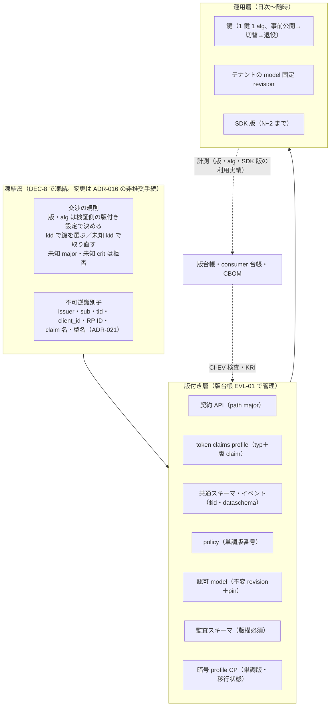
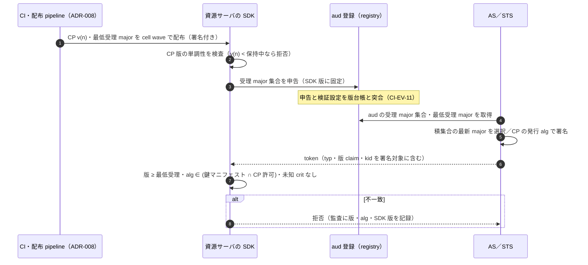
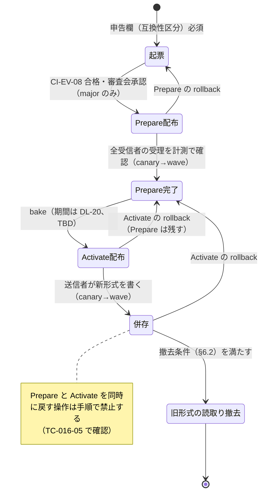
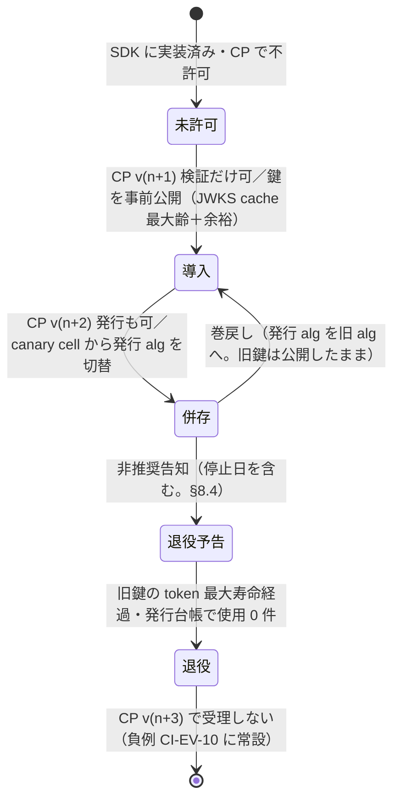
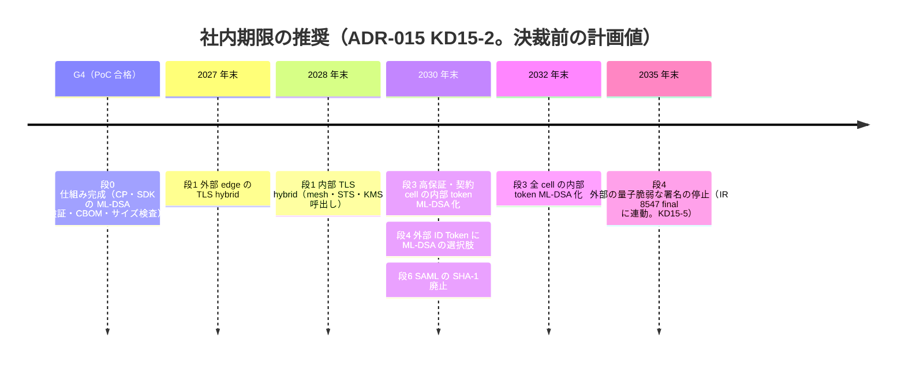
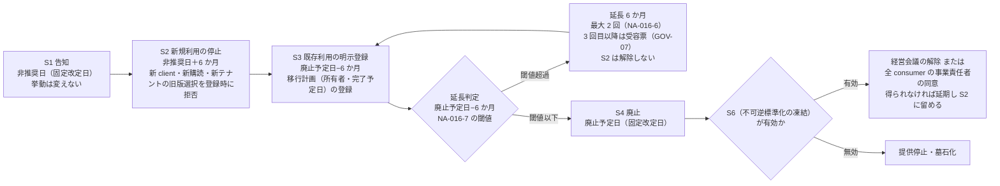
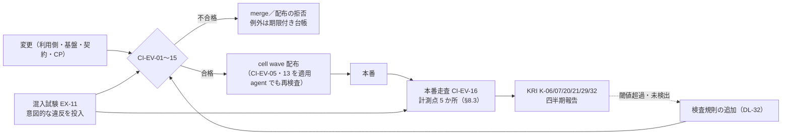

# 進化・互換方針（versioning・version negotiation・schema migration・dual-run・crypto agility・deprecation）

> 文書ID: ARC-12 / 版: 0.2 / 状態: review / 最終更新: 2026-10-15
> 対応要求: R-104, R-105, R-106, R-107, R-108, R-109, R-209, R-272, G-068, G-069, G-075（対応成果物欄に本書のパスまたは DL-23 を含む行の全件）／関連: R-101, G-065, G-072, G-073, G-126
> 依存文書: CONVENTIONS.md, traceability/deliverables.md（DL-23 行）, traceability/R-requirements.md, traceability/G-goal-criteria.md, traceability/claims-ledger.md（CL-0137, CL-0144, CL-0271）, traceability/rejected-hypotheses.md（RH-137, RH-141, RH-143）, 01_governance/durability-charter-20y.md（GOV-09）, 01_governance/assumptions-register.md, 01_governance/kri.md, 01_governance/loss-scenarios.md, 01_governance/stop-authority.md, 03_threat-model/threat-catalog.md（T-027, T-085）, 03_threat-model/attacker-model.md, 05_adr/README.md, 05_adr/reconciliation-notes.md, 05_adr/ADR-005, ADR-007, ADR-009, ADR-013, ADR-014, ADR-015, ADR-016, ADR-017, ADR-018, ADR-021, ADR-022, ADR-027, ADR-028, research/RS-11, RS-16（各 verification 記録を含む）, research/standards-status.md
> 作成方法: AI エージェント（Claude）が単独で起草した。本書は ADR-015・ADR-016 などの決定を設計に展開する文書であり、新しい設計判断は §12 の決裁案（K23-x）と §2 の新規仮定（N23-x）に限る [D]。本書の判断は自己レビューであり、実在の CTO/CISO の判定・決裁ではない（CONVENTIONS §8）[D]。参考文献はすべて research/ で検証済みの原典、または ADR-015・ADR-016 の起草者が 2026-10-15 に照合した原典を引いた。本書の起草者が新たに取得した原典はない [D]。版 0.2 は作成者以外のエージェント（Claude）による独立レビューの修正を反映した（末尾「レビュー記録」）。レビューで追加した脚注（[^52]〜[^60]）も research で検証済みの原典、または ADR-015 が引いた原典に限る [D]。
> 表記: 本書固有の仕組みは EVL-xx、CI・本番走査の検査は CI-EV-xx、演習は EX-xx、決裁案は K23-x、新規仮定は N23-x、残余リスクは RR-ARC12-xx と書く（仕組みの EV-xx は ARC-09 の剥奪事象 EV-xx と、残余リスクの RR23-xx は ADR-023 の RR23-xx と衝突していたため、2026-10-15 の 04_architecture 整合調整で EV→EVL、RR23→RR-ARC12 に改番した。architecture-reconciliation-notes.md XR-10・XR-11）。TC-ID は各 ADR の仮番（TC-15-xx、TC-016-xx、TC-028-xx など）をそのまま引き、採番は DL-22 で行う。表のセルのうちタグのないものは設計推論 [D] であり、本注記で個別タグに代える。事実を述べるセルには個別にタグと脚注を付けた。

---

## 0. 結論（CTO/CISO 向け）

1. **進化の仕組みを 3 層に分ける** [D]。(1) 凍結する層は「交渉の規則」だけである（版と alg は検証側の版付き設定で決める、kid で鍵を選ぶ、複数の鍵と版を併存させる、未知の major と未知の `crit` は拒否する）[D]（ADR-015 D15-01、ADR-016 D16-09、ADR-022 D-10-1）。(2) 版付きの層は、ADR-016 の 6 対象（契約 API、token claims profile、共通スキーマとイベント、policy、認可 model、監査イベントスキーマ）と、ADR-015 の暗号 profile（CP）である [D]。(3) 運用の層は、鍵、model revision、SDK の版である [D]。この分け方により、alg・製品・版を替えても、利用側約 300 サービスのコードと不可逆識別子は変わらない設計にする [D][A-050]。これは設計上の主張であり、TC-15-01 と TC-016-09 の実測（G4）までは仮説である [D]。
2. **暗号移行は「鍵交換を先、署名を後、外部を最後」とし、社内期限は決裁案として示す** [D]。推奨は ADR-015 KD15-2 のとおり、TLS 鍵交換の hybrid 化を外部 edge 2027 年末・内部 2028 年末、内部 token の ML-DSA 化を高保証・契約 cell 2030 年末・全 cell 2032 年末、外部の量子脆弱な署名の停止を 2035 年末（NIST IR 8547 final の日付に連動）とする [D]。根拠の IR 8547 は 2026-10-15 時点でも Initial Public Draft であり、期限は確定値ではない [N][^2]。ML-DSA-65 の access token は計算上約 5.0KB になり、cookie の 4,096 octets を超える（計算値、実測ではない）[N][^17][D]（RS-11#56, #62）。このため CP v1 は「JWT 1 個 6,144 byte 以下、認証系ヘッダ合計 16,384 byte 以下、cookie に JWT を置かない」を上限にし、CI で計算検査する [D]（ADR-015 D15-40, D15-41）。
3. **劣化は CI と本番走査で機械的に見つけ、演習で証拠を取り直す** [D]。本書は 16 の検査（CI-EV-01〜16）と 13 の演習（EX-01〜13）を定め、各検査を KRI（K-06, K-07, K-20, K-29, K-32）に結び付ける [D]。非推奨の SLA は ADR-016 の初期案（GA は告知から廃止まで 24 か月以上、preview は 6 か月以上、締め出しは 4 段、延長は 6 か月 × 最大 2 回）を運用し、確定は DL-70 の SLA 承認（CTO＋CISO、DEC-8 前）による [D]（ADR-016 NA-016-1, NA-016-2, NA-016-6, K16-1）。
4. **組織再編・M&A・所在地規制・非人間 ID の増加は「既存の識別子を書き換えずに、関係・所有・配置・版を付け替える」で受ける** [D]。テナントの統合・分割・cell 間移動は ADR-028 の orchestrator で行い、既存の sub・client_id・(iss, sub) を書き換えず、tid を再利用しない（分割では切り出す側に新しい tid を払い出す）[D]（ADR-028、ADR-021 D21-29、D21-30）。識別子が変わるのは、共有区画と専用 issuer の間の移動（iss が変わる。ADR-021 D21-32）、専用ドメインを持たない事業単位の売却（ADR-021 D21-33、RR21-04）、他社 ID 基盤の吸収（新しい sub を払い出す。ADR-021 D21-31）の 3 つの例外に限る [D]。非人間主体の識別子は人間と同じ単一の名前空間に置き、類型を sub から推論させない [D]（ADR-021 D21-10、02_requirements/principal-catalog.md §3.2、reconciliation-notes C-05）。AI エージェント ID が基準 1 万から成長シナリオで 20 万へ増える前提では、署名の KMS 枠と主体類型の enum の版管理が先に効く [D][A-014, A-102]。
5. **本書で閉じるのは机上の設計（区分 A）までである** [D]。R-104〜R-107・R-109、G-068、G-069、G-075 の合格には PoC の実測（区分 C、G4）が要り、R-108 と非推奨期間の値には組織決定（区分 B）が要る [D]。いずれも未達である [D]（対応表）。

**決裁が要る点（§12）**: 本書で新たに求める決裁は K23-1（CI 検査の強制水準）、K23-2（本番の切替・版上げ演習の周期）、K23-3（M&A で取り込む契約体系と「GA major 2 本」上限の関係）の 3 件である [D]。PQC の社内期限（KD15-2）、外部の量子脆弱な署名の停止日（KD15-5）、GA の最短期間（K16-1）、事業単位の専用ドメイン（K21-2）、issuer の粒度（U-01）は各 ADR の決裁案であり、本書は帰結を設計に写すだけにする [D]。

---

## 1. 本書の位置付けと範囲

### 1.1 解く問い

レビューは High 指摘「20 年の進化設計がない」に対し、versioning、version negotiation、schema migration、dual-run、crypto agility、deprecation policy の設計を求めた [D][^1]（L93）。承認条件 7 は「policy/model/schema/token/audit の versioning と後方互換・rollback 方式があること」である [D][^1]（L245、R-109、R-272）。CTO の問いには「5 年後の組織再編、M&A、データ所在地規制、非人間 ID 増加、暗号移行にも互換性を保てるか」がある [D][^1]（L22、R-209）。

20 年耐久性憲章（GOV-09）は「20 年戦える」を 7 性質（置換可能性、識別子の永続性、暗号の俊敏性、撤退可能性、障害の封じ込め、統治の継続性、劣化の自動検知）を満たし続け、決めた頻度で証拠を取り直している状態と定義した [D]（GOV-09 §0）。本書は、そのうち進化と互換に関わる仕組みを技術的に具体化する [D]。

### 1.2 本書が決めること・決めないこと

| 区分 | 内容 | 正本 |
|---|---|---|
| 本書が決める | 6 対象＋CP の版を 1 つの版台帳と CI 検査で運用する構造（§3、§4）、交渉の実装手順（§5）、Prepare/Activate と dual-run の状態遷移（§6）、PQC 移行の実行計画とサイズ検査（§7）、非推奨の運用手順（§8）、組織・規制変化への写像（§9）、CI 検査（§10）、演習計画（§11） | 本書 |
| ADR が決めた（本書は写すだけ） | 6 対象の版の表し方、互換性の定義表、交渉の原則、最短期間の初期案、締め出し 4 段、claim 審査 | ADR-016 |
| 同上 | 3 層の抽象境界、CP、alg 識別子、複数 alg JWKS、hybrid/composite の採否、移行順序、社内期限の推奨、サイズ上限の初期案、CBOM | ADR-015 |
| 同上 | 不可逆識別子の形式、名前の非再利用と墓石化 | ADR-021 |
| 同上 | 凍結 4 区分、交渉の仕組みの凍結、負例ベクタ 13 種、固定改定日年 2 回 | ADR-022 |
| 同上 | 出口の手順と正規 export 形式（EIF） | ADR-018 |
| 同上 | 旧システム・旧エンジンとの dual-run と差分の扱い | ADR-027 |
| 同上 | テナントの統合・分割・cell 間移動 | ADR-028 |
| 決めない | 非推奨期間・延長閾値の確定値（DL-70）、bake・shadow 期間（DL-20）、PoC の合否値（DL-22） | 各 DL |

### 1.3 読み手への要点

- CTO/CISO は §0、§7.6（期限）、§12（決裁案）、対応表を読めば判断に要る範囲が揃う [D]。
- 連携開発者（約 300 サービス、25 組織・60 チーム）が守る義務は §13 の 9 項目であり、§13 だけで自チームの作業が分かるように書いた [D][A-050, A-052]。

---

## 2. 前提

### 2.1 前提台帳の A-ID

| A-ID | 値（基準／成長） | 本書での使い方 |
|---|---|---|
| A-100 | 計画期間 20 年 | 版の累積、識別子の永続性の対象期間 |
| A-101 | 再決裁は初回 G6 開始から 3 年以内、以後 5 年以内 | 演習の周期の上限（§11） |
| A-102 | 成長は基準から 5 年後に登録 3 倍、サービス 2 倍 | 非人間 ID と署名負荷の成長（§9.4） |
| A-103 | 暗号移行 1 回以上（範囲 1〜3） | CP と移行状態機械を定常機能にする根拠（§7） |
| A-104 | 主要構成要素の置換各 1 回以上 | 製品の版と契約の版を分ける根拠（§4.1） |
| A-050, A-052, A-053, A-054 | 300（成長 600）サービス、25 組織・60 チーム、開発者 1,500、プラットフォーム 24 FTE（SDK・開発者支援 4、鍵管理・セキュリティ 2） | consumer の母数、併存 major の保守負荷 |
| A-011, A-012, A-014 | service account 1,200（2,500）、workload ID 5,400（1.08 万）、AI エージェント ID 1 万（20 万） | 非人間 ID の増加（§9.4） |
| A-013 | 外部 client 800（2,500） | 外部 ID Token の alg 移行対象 |
| A-040, A-043 | edge 16,804/秒（56,444）、token 発行 1,374/秒（3,875） | 署名負荷と帯域（§7.5） |
| A-062, A-063 | 所在地指定テナント 5%（500）、リージョン 4 | 所在地規制（§9.3） |
| A-074 | 監査アーカイブ 7 年 | 監査スキーマの全版読取りと長期署名（§6.4、§7.3） |
| A-081 | 高保証要求テナント 50（範囲 10〜200） | PQC の先行 cell（§7.6） |
| A-094 | 判定系・認証系は計画停止なし | 無停止の schema migration（§6） |
| A-114 | SAML 1,800・OIDC 200 接続 | SAML の SHA-1 廃止と PQ 化の範囲 |

### 2.2 新規仮定（前提台帳へ追加要）

本書は前提台帳を編集しない [D]。

| ID | 内容 | 値（範囲） | 使う箇所 | 所有者・期限・決め方 |
|---|---|---|---|---|
| N23-1 | 本書の CI 検査（§10）と演習自動化（§11）の構築は、ADR-015 N15-1（構築 1〜2 FTE × 12 か月）と ADR-016 NA-016-8（構築 1.5〜2.5 FTE × 9 か月）の範囲に含め、追加の要員を置かない | 追加 0 FTE（超過した場合は DL-27 で再見積り） | §10、§11 | プラットフォームチーム長、G3、DL-27 の要員計画で突合 |
| N23-2 | 計画期間中に、DL-48 の非人間 6 類型（PC-12〜PC-17）以外の主体類型が 1 つ以上加わる | 1 回以上（範囲 0〜3） | §9.4 | CTO＋CISO、G3、ADR-017 §8 の再検討トリガーの発生実績で見直す |

ADR が既に置いた新規仮定のうち、本書が使うものは ADR-015 N15-2（内部 hop 数 f、TBD）、N15-3（高保証テナントが契約で 2030 年期限を求める）、ADR-016 NA-016-1〜NA-016-10、ADR-021 NA-021-2（事業単位の売却・買収が計画期間中に 1 回以上）である [D]。

---

## 3. 全体構造

### 3.1 3 層モデル

- 凍結層を最小にするのは、標準の世代交代が 2.5〜12 年で起きた実績に対し、20 年変えないと約束できるものを識別子と交渉の規則に限るためである [N][^43][^44][D]（RS-11#69, #70、GOV-09 §3.4 L1）。TLS 1.0/1.1 も RFC 8996（2021）で使用と交渉が MUST NOT になった [N][^45]（RS-11#71）。暗号の全面移行はさらに長く、Triple DES から AES への移行には 23 年かかった [N][^29]（RS-11#16）。
- 版付き層の各版は、§4.3 の版台帳に 1 行ずつ記録し、CI 検査（§10）の入力にする [D]。
- 運用層の変更は、版付き層の版を変えずに行う [D]。例えば同じ alg 内の鍵 rotation（ADR-007 D7-30 の 30 日周期）は CP を改版しない [D]。

### 3.2 長く保つものと入れ替えるもの

| 分類 | 対象 | 本書での扱い |
|---|---|---|
| 長く保つ | issuer URL、sub/tid の形式、kid の命名規則、WebAuthn RP ID、SAML entityID/ACS、resource type の名前空間、claim の意味、監査イベントの共通項目、境界原則 | 識別子 lint（CI-EV-07）で守る。変更は「新識別子の並行運用→旧識別子の非推奨手続」に限る（ADR-016 D16-14 の不可逆区分） |
| 入れ替える | 署名・鍵交換の alg、TLS group、プロトコルの版と profile、ライブラリと SDK、製品（AS/IdP、認可エンジン、ストア、KMS/HSM）、契約記述仕様の版 | CP・版台帳・SDK の版差で入れ替える。名前を長く保つ側に埋め込まない（CI-EV-07） |

この分類は GOV-09 §3.4 と RS-11 §5.1 の DL-23 行をそのまま使う [D]（RS-11#40, #43, #48, #68）。IANA registry の識別子は変更・削除すべきでない（SHOULD NOT）とされる一方 [N][^12]（RS-11#40）、registry 上で Deprecated に変わる例がある（JOSE の `EdDSA`、COSE の ES256(-7)）[N][^7]（RS-11#43）。したがって、alg 名を自社の識別子に埋め込むと、alg の非推奨化で長く保つべき識別子まで変わる [D]。

### 3.3 7 性質と本書の仕組みの対応

| 性質（GOV-09 §5） | 本書で実現する仕組み | 節 | 機械検査 | 演習 |
|---|---|---|---|---|
| 置換可能性 | 製品の版と契約の版の分離、交渉の規則の凍結、SDK 版差 N−2 | §4.1, §5 | CI-EV-08, 11 | EX-10 |
| 識別子の永続性 | 識別子 lint、名前の墓石化、統合・移動で識別子を書き換えない | §3.2, §9 | CI-EV-07, 09 | EX-08 |
| 暗号の俊敏性 | CP、複数 alg JWKS、移行状態機械、サイズ計算検査、CBOM | §7 | CI-EV-01, 03〜06, 10, 14 | EX-01〜03 |
| 撤退可能性 | 版付き export 形式（EIF）の版管理、監査の全版読取り | §6.4, §9.5 | CI-EV-12 | EX-09 |
| 障害の封じ込め | CP・policy・model・鍵 metadata の cell wave 配布、Prepare/Activate の段階 rollback | §6 | CI-EV-13 | EX-06, 07 |
| 統治の継続性 | 版台帳・consumer 台帳、固定改定日、契約変更審査会、例外の期限 | §4.3, §8 | CI-EV-15 | EX-12 |
| 劣化の自動検知 | 16 検査と本番走査、KRI への写像 | §10 | 全 CI-EV | EX-11 |

---

## 4. Versioning（版の表し方と版台帳）

### 4.1 版を持つ対象

ADR-016 D16-01 の 6 対象に、ADR-015 の CP と SDK の版を加えた 8 つの版軸を版台帳で一元管理する [D]。製品・エンジンの版（AS 製品、PDP エンジン、ストア）は版台帳の版軸にせず、「契約の版を変えずに上げ、契約試験で外部挙動の不変を確かめる」対象とする [D][A-104]（ADR-016 D16-01、ADR-022 D-1 の「凍結しない」区分）。

| # | 版軸 | 版の表し方 | 版の置き場所 | 後方互換の判定 | rollback 方式 | 決めた ADR |
|---|---|---|---|---|---|---|
| V-1 | 契約 API | path に major（`/v1/`）、文書は SemVer | URL path、OpenAPI の `info.version` | 定義表（§4.2）、OpenAPI 差分（CI-EV-08）、契約試験 | 実装を戻す。契約は戻さない | ADR-016、ADR-022 D-3-1 |
| V-2 | token claims profile | `typ`（不可逆）＋版 claim（major.minor、全内部 token に必須）＋必要なら `crit` | JWS header と署名対象 | 定義表。制約強化は major | 発行側の profile 選択を前の major に戻す（両 major の併存中だけ） | ADR-016 D16-02、ADR-005 V13 |
| V-3 | 共通スキーマ・イベント | JSON Schema 2020-12 の方言を固定し SemVer。イベントは非互換で `dataschema` を変える | `$schema`・`$id`、CloudEvents の `dataschema`・`type` | 定義表、スキーマ差分 | producer を前の版に戻す（consumer が両版を読める期間だけ） | ADR-016 |
| V-4 | policy | 単調増加の版番号と発行時刻を署名対象に含める | 署名付き配布物、判定記録の `model_revision` | shadow の判定差分 | 旧内容を新しい版番号で再発行 | ADR-016 D16-03 |
| V-5 | 認可 model | registry が採番する不変 `model_revision`、本番は pin | registry、`model.pin` | CAM の CI 検査と shadow | テナントの固定 revision の指示子を新しい指示子版で戻す | ADR-016 D16-30、ADR-010 D-22、ADR-011 D2-7 |
| V-6 | 監査イベントスキーマ | 全イベントに版欄（major.minor）必須 | イベントの共通項目 | major 内は追加のみ | 書いた記録は書き換えない。読取り側が全版を読む | ADR-016 D16-04 |
| V-7 | 暗号 profile（CP） | 単調増加の版。(issuer 区分, typ) ごとの許可 alg・発行 alg・最小鍵強度・サイズ上限・移行状態 | SDK の版付き設定（CI の署名付き配布経路） | alg の追加は互換、削除・停止は破壊的 | 発行 alg を前の alg に戻す（旧鍵の公開中だけ） | ADR-015 D15-11〜D15-14 |
| V-8 | SDK | 契約の版を 1 つに固定。基盤の現行版に対し minor で N−2 まで | SDK のリリース | 契約試験（N・N−1・N−2） | 利用側が前の SDK 版に戻す | ADR-016 NA-016-4、ADR-022 D-4-5 |

- V-2 の版 claim を必須にするのは、理解できない claim を無視する規範（RFC 7519 §4）の下では、版 claim のない token に後から制約を足しても旧版の受信者に黙って無視されるためである [N][^10][D]（RS-16#14、ADR-016 D16-02、CL-0137 は「推奨」としていたが ADR-016 で必須に改めた）。claim 名は DL-75 で確定する（`ver` は候補の 1 つ）[D]。
- V-3 のイベントで `dataschema` と `type` を版の置き場所にするのは、CloudEvents 1.0.2 がこの 2 属性を context attribute として定義しているためである [N][^49]（RS-16#9, #10）。
- V-5 を不変 revision＋pin にするのは、OpenFGA が model を不変とし本番で model ID を渡すことを強く推奨しているためである [V][^41]（RS-07#18）。SpiceDB は schema を版で管理しないため、façade と registry で固定を補う（ADR-010 D-22）[D]。
- V-8 の版差 N−2 は、Kubernetes が kubelet に kube-apiserver より古い minor 版を一定範囲で許容する方式を先例にした初期案（NA-016-4）である [V][^37]（RS-16#39）。
- 契約記述言語そのものの版（OpenAPI、JSON Schema、AsyncAPI、CloudEvents）は V-1・V-3 とは別に固定し、記述言語の版上げも生成物の差分試験を通す（ADR-016 D16-01a）[D]。OpenAPI Specification は、minor 版でも影響が利益に比べて小さいと判断されれば後方互換でない変更が入ることがあると明記している [N][^52]（RS-16#2）。

### 4.2 後方互換の定義（要約）

互換性区分は minor（互換）・major（破壊的）・patch（意味に関わらない修正）の 3 つで、source・wire・semantic の 3 類型すべてで判定する [V][^34][D]（RS-16#23、ADR-016 D16-05）。全対象に共通の定義表の正本は ADR-016 D16-06 であり、DL-70 に写す [D]。本書の CI 検査に直結する行だけを抜き出す [D]。

| 変更 | 区分 | 本書の検査 |
|---|---|---|
| 無視されても安全側の任意 field・claim の追加 | 互換 | CI-EV-08（差分検出）、CI-EV-09（予約名前空間） |
| 制約を強める claim・field の追加 | 破壊的（typ・profile major・`crit` で表す） | CI-EV-08 の申告欄、CI-EV-10 の負例（未知 `crit`、未知 claim） |
| 削除・改名・既定値の変更・意味の変更 | 破壊的 | CI-EV-08、CI-EV-09（墓石名の再利用禁止） |
| 判定を担う閉じた enum への値の追加 | 破壊的 | CI-EV-08 |
| profile 版ごとに宣言した最大長を超える token・応答 | 破壊的 | CI-EV-04 |
| 署名 alg の追加（allowlist の拡張） | 互換（検証側の設定更新を Prepare とする） | CI-EV-05, 06 |
| 署名 alg の削除・停止 | 破壊的（停止日は規制期限から逆算） | §8.4 |

- 制約の強化を破壊的に扱うのは、JWT は理解できない claim を無視しなければならず（RFC 7519 §4）[N][^10]、OAuth 2.0 の AS は認識できない要求 parameter を無視しなければならない（RFC 6749）[N][^43] ためである（RS-16#14, #15）。`crit` に列挙された拡張を受信者が理解できなければ、その JWS は無効である [N][^9]（RS-16#16）。

### 4.3 版台帳（EVL-01）

- **EVL-01** 版台帳を DL-70 の付表として置き、8 版軸の全版を 1 行ずつ記録する [D]（ADR-016 D16-50 の項目に V-7・V-8 を加えた）。

| 欄 | 内容 | 使う検査・手順 |
|---|---|---|
| 版軸・対象 ID・版 | V-1〜V-8、契約名・profile 名（alg 名・製品名を含めない）、major.minor.patch または単調版番号 | CI-EV-05, 07 |
| 安定度区分 | 不可逆・GA・preview・凍結しない（ADR-022 D-1） | §8.1 |
| 互換性区分と承認記録 | minor／major／patch、申告欄、契約変更審査会の承認 ID | CI-EV-08 |
| 内容ハッシュ | 配布物・スキーマ・CAM・CP の SHA-256 等のハッシュ（署名は ADR-008 の配布経路） | 旧版の再配布検出（CI-EV-05） |
| 日付 | 公開日、Prepare 完了日、Activate 日、非推奨日、S2・S3 の日、廃止予定日、延長履歴 | §6、§8 |
| 依存 | 依拠する標準とその状態（standards-status.md の SS-ID）、SDK の対応範囲 | CI-EV-15 |
| 利用実績 | §8.3 の計測点から週次で取り込む consumer 数 | K-29、R-194.5 |

- **EVL-02** consumer 台帳（ADR-016 D16-51、G-126）と版台帳を consumer × 版軸 × 版で結合し、週次で突き合わせる [D]。台帳にあって計測にない consumer（休眠バッチなど）は所有者に利用の有無を確認させる（ADR-016 D16-24）[D]。KRI の情報源 SRC-16（連携契約レジストリ）と同じものとする [D]（01_governance/kri.md）。

---

## 5. Version negotiation

### 5.1 原則（ADR-016 D16-09〜D16-13 の実装）

| # | 原則 | 実装 |
|---|---|---|
| P1 | 交渉の結果は署名・完全性保護の内側に置く | token は版 claim を署名対象に置く。CP は CI の署名付き配布経路で配る。PEP–PDP の `profile_version` は mTLS＋workload ID の経路内に置く。RFC 7696 §2.4 は alg の選択と交渉に完全性保護をかけるべき（SHOULD）とする [N][^12]（RS-11#38） |
| P2 | 最低受理版は検証側の版付き設定にだけ置く | token・metadata・要求の内容から最低受理版や alg allowlist を読まない（ADR-016 D16-11、ADR-005 V1） |
| P3 | 共通の版がなければ失敗させる | 黙って最古の版に落とさない。失敗は監査に残し、§8.3 の計測に入れる |
| P4 | 交渉した版を記録する | token の版 claim、`profile_version`、`model_revision`、スキーマ版、CP 版、alg を判定記録と監査イベントに残す（ADR-016 D16-12） |

### 5.2 対象ごとの交渉

| 対象 | 交渉の時点 | 受信者の宣言 | 選び方 | 失敗時 |
|---|---|---|---|---|
| 内部 token profile | 発行時（AS・STS の token exchange） | 資源サーバ（aud）の登録に「受理する major の集合」と「最低受理 major」 | AS が両者の積集合の最新 major を選び、版 claim として署名する | 発行拒否と AS の監査記録 |
| 署名 alg | 発行時・検証時 | CP の許可 alg 集合（検証）と発行 alg（発行） | 発行は CP の発行 alg、検証は「鍵マニフェストにある鍵の alg ∩ CP の許可 alg」 | 検証失敗（400／401）、CI-EV-10 の負例 |
| PEP–PDP | 要求ごと | PDP metadata の自社拡張欄に対応 major と最低受理版（AuthZEN 1.0 外と明記） | PEP が `profile_version` を載せる | decision=false、reason=`unsupported_profile`（ADR-011 D6-1） |
| 契約 API | 要求ごと | 提供中の path major | path の major で選ぶ。header・query で版を上書きしない | 404 と RFC 9457 の problem details |
| イベント | 購読登録時 | 購読が受け取る `type` の major | 併存期間は producer が新旧両版を配信し、consumer は冪等に処理する | 購読がない版は配信しない |
| 監査イベント | 収集時 | 収集・保管側は全版を受け付ける | producer が自分の版を書く | 未知 major は隔離キューへ、K-21 の監視対象 |
| SDK と基盤 | SDK リリース時 | SDK は契約の版を 1 つに固定 | 版差 N−2 まで | 計測で検出し §8.3 の手順へ |
| 外部 OIDC/OAuth | 標準の metadata | discovery の `*_values_supported`、client 登録の `id_token_signed_response_alg` | 標準どおり。自社の版 claim を外部 RP に求めない | 標準の規定どおり |

- PEP–PDP の交渉は AuthZEN 1.0 の範囲外の自社拡張である [D]。AuthZEN 1.0 は PDP metadata の提供を RECOMMENDED とし [N][^48]（RS-07#66）、後続版は API を拡張できるが変更してはならない（MUST NOT modify）とする [N][^48]（RS-07#62）。
- イベントの併存期間に新旧両版を配信し consumer に冪等処理を求める方式は、Stripe が webhook の版上げで求める手順を先例にした [V][^39]（RS-16#33）。
- 外部 ID Token の alg は client 登録値に従い、省略時の既定は RS256 である [N][^14]。このため外部の alg 切替は OP 側だけでは完結せず、client ごとの選択制になる [D]（ADR-015 D15-23）。

### 5.3 内部 token の交渉の流れ

- 図の手順 2 の単調性検査は、署名済みの旧版 policy の再提示（T-027）と同型の巻戻しを CP でも防ぐためである [D]（ADR-015 D15-12）。
- 手順 3 の申告は SDK の版から機械的に出し、サービス所有者の手作業にしない [D]。手作業にすると、申告と実際の検証設定がずれて、発行側が受理されない major を選ぶ事故が起きるためである [D]。

---

## 6. Schema migration・dual-run・rollback

### 6.1 Prepare/Activate の状態遷移（EVL-03）

- **EVL-03** 形式を変えるすべての変更は、ADR-013 D13-32 と ADR-016 D16-37 の 2 段階（Prepare＝全受信者が新形式を読める、Activate＝送信者が新形式を書く）で配り、版台帳の状態として管理する [D]。AWS は 2 段階のそれぞれは戻せるが両方を同時には戻せないとしている [V][^40]（RS-09#34）。

- 無停止で行う（A-094 の判定系・認証系は計画停止なし）ため、全データを一括で書き換えてから切り替える方式は採らない [D][A-094]（ADR-016 D16-38）。
- 各段の配布は cell 単位の wave で行い、全域一括の配布を CI-EV-13 で検出する [D]。Google Cloud の 2025-06-12 の障害では、全域に数秒で複製された policy metadata が各リージョンの Service Control を同時に crash させた [I][^53]（RS-09#67。GOV-09 §5.6）。

### 6.2 対象ごとの Prepare・Activate・撤去条件

| 版軸 | Prepare | Activate | 旧形式の読取りを外す条件 |
|---|---|---|---|
| V-2 token profile | 全資源サーバの検証設定と SDK が新 major を受理集合に加える | AS が新 major を選び始める（§5.3） | 旧 major で発行した token がすべて失効した後（最長寿命は ADR-005 D3） |
| V-1 契約 API | 新 major の path を公開 | consumer が新 path へ切り替える | 旧 major の廃止（§8） |
| V-3 スキーマ・イベント | consumer が新 `dataschema` を読める | producer が新版を（併存期間は新旧両方を）配信 | 旧版の購読が 0 件 |
| V-6 監査スキーマ | 収集・保管・読取り側が新版を受け付ける | producer（SDK）が新版を書く | 外さない（保持期間中は全版を読む） |
| V-5 認可 model | façade・engine が新しい型・relation を扱える（空定義を先に入れる） | 書込み経路が新 relation を書き始める | 改名・削除は ADR-021 D21-27 の多段手順（追加 → 二重書込み → backfill → 旧参照の削除 → 旧定義の削除と墓石化） |
| V-4 policy | PDP が新しい G 段カタログの版を読める | 新版を配布 | 旧版を参照する判定記録の保持期間の終了 |
| V-7 CP | 新 alg を `導入`（検証だけ可）にし、新 alg の鍵を事前公開する | 新 alg を `併存` にし、発行 alg を切り替える | 旧 alg の鍵で署名した token の最大寿命が過ぎ、発行台帳で使用 0 件を確認した後に `退役`（ADR-015 D15-21） |

### 6.3 dual-run の 2 種類

| 種類 | 対象 | 正本 | 差分の扱い |
|---|---|---|---|
| 基盤内 dual-run | 同じ基盤内の新旧の版（model revision の shadow、producer の二重配信、二重書込み、CP の `導入`／`併存`） | ADR-016 D16-39 と本書 | 旧 deny → 新 allow の差分は承認済みの変更で説明できるもの以外 0 件を合格条件にする。deny が増える差分は業務影響の確認を合格条件にする（ADR-016 D16-32） |
| 移行 dual-run | 旧システム・旧エンジンと新基盤 | ADR-027、DL-31 | 判定の正本は常に一方だけ（S1〜S4）。allow 拡大差分は即時調査し、未登録が 1 件でもあれば前進停止・自動で S1 へ戻す（ADR-027） |

- 2 種類の差分の扱いを揃えることは ADR-016 から ADR-027 への申し送りであり、本書は「allow 拡大差分 0 件（承認済みを除く）」を両者共通の合格条件として扱う [D]（R-178）。
- shadow の期間と canary の bake 期間は操作階層ごとに BIA と PoC で決める（TBD、所有者: 認可・PDP チーム＋SRE 責任者、期限: G3、決め方: DL-20 と TC-016-07 の実測）[D]（ADR-016 D16-33、R-194.1）。

### 6.4 5 対象の versioning・後方互換・rollback（R-109、R-272、G-069）

| 対象 | versioning | 後方互換 | rollback | 戻せないもの | 演習 |
|---|---|---|---|---|---|
| policy | 単調版番号＋発行時刻を署名 | 判定の変更は shadow・段階展開・権限拡大の承認で統制（ADR-016 D16-07） | 旧内容を新しい版番号で再発行（二者承認） | 剥奪・失効の状態（版と切り離し、戻しても剥奪は復活しない。ADR-013 D13-35） | EX-07, EX-04 |
| model | 不変 revision、本番 pin | 型・relation・permission の削除と改名は破壊的（CI 拒否） | 固定 revision の指示子を新しい指示子版で既知良好版へ | 同上 | EX-07, EX-04 |
| schema（契約 API・共通スキーマ・イベント） | path major／SemVer／`dataschema` | 定義表（§4.2）、Prepare/Activate | 実装・producer を前の版へ（併存期間中だけ） | 一度使った名前の意味（ADR-021 D21-27） | EX-06, EX-04 |
| token | `typ`＋版 claim＋CP 版 | 制約強化は major、alg 追加は互換 | 発行側の profile 選択と発行 alg を前に戻す（併存期間中・旧鍵公開中だけ） | 発行済み token の内容（寿命で自然に消える） | EX-01, EX-04 |
| audit | 全イベントに版欄 | major 内は追加のみ、読取り側が全版を読む | 書いた記録は戻さない。producer を前の版に戻すことはできる | 記録そのもの（WORM、ADR-014） | EX-04 |

- 監査の判定記録が参照する policy・model の revision は、その判定記録の保持期間が終わるまで registry から消さない [D]（ADR-016 D16-04）。これにより、7 年前のアーカイブ（A-074）の判定を当時の revision で再現できる [D][A-074]。
- rollback の所要時間は R-194.3 として EX-04・EX-07 で測る [D]。目標値は BIA（DL-21）と DL-20 で決める（TBD、所有者: SRE 責任者＋事業責任者、期限: G4、決め方: PoC 実測と BIA の最大許容停止時間）[D]。

---

## 7. Crypto agility と PQC 移行

### 7.1 抽象境界（ADR-015 D15-01〜D15-03 の実装）

| 層 | 内容 | 変更の主体・頻度 | 利用側への露出 |
|---|---|---|---|
| 契約層（凍結） | 交渉の規則、token 最大長の下限 | DEC-8 の凍結 | なし（SDK が実装） |
| profile 層（CP） | 許可 alg・発行 alg・最小鍵強度・サイズ上限・移行状態 | ARB 承認で年数回 | なし（SDK の版付き設定） |
| 鍵層 | (iss, typ, kid) → 鍵集合、1 鍵 1 alg | rotation orchestrator が日次 | なし（JWKS・鍵マニフェスト） |

- 利用側のコードと設定ファイルに alg 名・鍵長・曲線名を書かない [D]（ADR-015 D15-02）。CI-EV-01 で検出する [D]。OMB M-26-15 Appendix A §5 は、連邦機関に対し、alg 名をコードに固定しないことと外部設定で指定することを crypto agility の要素に挙げる [N][^23]（RS-11#22）。
- 検証の実装は、ライブラリが呼出し側の許可 alg 集合を指定でき、各鍵をちょうど 1 つの alg でだけ使い、そのことを処理時に検査することが MUST である [N][^11]（RFC 8725 §3.1、RS-11#51）。ML-DSA の AKP 鍵では alg が REQUIRED である [N][^6]（RS-11#41）。
- alg の識別子は IANA の JOSE registry にある fully-specified の識別子だけを CP に書く（ES256、ML-DSA-44/65/87 など）[D]（ADR-015 D15-10）。RFC 9864 は多相的な識別子（JOSE の `EdDSA` など）を Deprecated とし [N][^7]（RS-11#43）、RFC 9964 は ML-DSA-44/65/87 を JOSE に登録した [N][^6]（RS-11#41）。I-D 段階の識別子（composite JOSE の alg 名など）は CP・SDK・契約に固定しない（CI-EV-06）[D]。
- 複数 alg の JWKS: 1 issuer の JWK Set に alg の異なる鍵を同時に載せ、各鍵は 1 つの alg に固定し、JWK に alg を必ず書く [D]（ADR-015 D15-20）。kid は不透明な乱数で、alg・cell・日付を含めない（ADR-007 D7-23、CI-EV-07）[D]。JWK Set の中では鍵ごとに異なる kid を使うべき（SHOULD）とされる [N]（RFC 7517 §4.5、RS-11#52。ADR-015 脚注 12）。
- SDK は ML-DSA-44/65/87 の検証を最初の GA 版から実装し、CP で許可されるまで使わない [D]（ADR-015 D15-14）。こうしておけば切替は CP の改版と鍵の事前公開だけで済み、約 300 サービスの SDK 更新を待たない [D][A-050]。

### 7.2 CP の移行状態機械（EVL-04）

- **EVL-04** CP の各 (issuer 区分, typ) × alg に、次の移行状態を持たせる [D]（ADR-015 D15-11）。

- 巻戻しが利用側無改修で済むのは、旧 alg の鍵を `退役` まで JWKS と鍵マニフェストに残すためである [D]（ADR-015 D15-71 手順 4）。
- 事前公開の期間は「JWKS cache の最大齢（R-189.6、DL-20）＋余裕」以上とする [D]（ADR-015 D15-21）。値は DL-20 で決める（TBD）[D]。

### 7.3 hybrid・composite の採否（ADR-015 の決定の写し）

| 対象 | 採否 | 根拠 |
|---|---|---|
| TLS 鍵交換 | hybrid（X25519MLKEM768）を採る | RFC 10024（Standards Track、2026-08）で Recommended=Y [N][^5]（RS-11#47）。hybrid は一時的な措置で純 PQ への 2 回目の移行につながる（IR 8547 ipd）[N][^2]（RS-11#10） |
| JWT の署名 | composite を採らない。純 ML-DSA へ切り替え、移行期間は鍵を並行公開する | JWT は Compact Serialization で署名は 1 つ [N][^10]（RS-11#52）。JOSE の composite は draft-ietf-jose-pq-composite-sigs-05（2026-10-08、WG Document、RFC 番号なし。ADR-015 起草者が 2026-10-15 に確認）[N][^8]。規格化前の Kyber 暫定 codepoint は RFC 10024 で廃止された [N][^5]（RS-11#48） |
| 長期成果物（鍵マニフェスト、失効リスト、監査バッチ） | JWS JSON の複数署名で古典＋ML-DSA を併記し、両方の成功を受理条件にする | RFC 7515 §5.2 はどの署名の成功を受理条件にするかを応用の判断とする [N][^9]。1 つの成功で受理すると剥ぎ取りに弱い（ADR-015 D15-24） |
| SAML 署名 | 当面は古典のみ。SHA-1 を先に廃止 | XML Signature の ML-DSA 識別子は個人提出の I-D にしかない（ADR-015 C20） |

- 却下した仮説（token の composite 署名）は RH-137 に記録済みである [D]（traceability/rejected-hypotheses.md）。

### 7.4 サイズの影響と上限

| 項目 | 値 | 区分 | 出典 |
|---|---|---|---|
| ES256 の JWT access token | 約 700 文字 | 計算値 | RS-11#62（ADR-005 D10-2 の注記） |
| ML-DSA-44 への切替による増分 | 1 token あたり約 3,146 byte | 計算値 | RS-11#62（ADR-015 §2.8） |
| ML-DSA-65 の at+jwt | 約 5,031 文字（payload 376 byte の仮定） | 計算値 | RS-11#62 |
| ML-DSA-87 の JWT | 約 6,789 文字 | 計算値 | RS-11#62（ADR-005 D10-2） |
| ML-DSA-65 の DPoP proof | 約 8.2KB（header に公開鍵を含む） | 計算値 | RS-11#62、RFC 9449 §4.2 [N][^21] |
| ML-DSA-65 の JWK | 約 2.7KB（公開鍵 1,952 byte の base64url） | 計算値 | FIPS 204 [N][^4]、ADR-015 D15-22 |
| cookie の上限 | name＋value 合計 4,096 octets を超えると cookie 全体を無視 | 規範（RFC 6265bis-22、RFC Editor Queue） | [N][^17]（RS-11#56） |
| HPACK の初期テーブル | 4,096 octets | 規範 | RFC 9113 §6.5.2 [N][^18]（RS-11#58） |
| nginx の既定ヘッダバッファ | 「4 8k」 | ベンダー公開値 | [V][^19]（RS-11#59） |
| ALB のヘッダ上限 | 単一ヘッダ 16K、要求ヘッダ合計 64K | ベンダー公開値 | [V][^20]（RS-11#60） |

CP v1 の上限（ADR-015 D15-40 の初期案）と、そこから本書が導く帰結を示す [D]。

| CP v1 の上限 | 帰結（計算値からの設計推論） |
|---|---|
| 内部 JWT 1 個 6,144 byte 以下 | ML-DSA-44（約 3.8KB）と ML-DSA-65（約 5.0KB）は収まる。ML-DSA-87（約 6.8KB）は収まらないため、ML-DSA-87 は長期成果物の署名に限り、内部 token の発行 alg にしない [D] |
| 認証系ヘッダ合計 16,384 byte 以下 | 内部 hop で at+jwt と Txn-Token を両方 ML-DSA-65 にしても約 10.1KB で収まる（Txn-Token の payload を at+jwt と同じ 376 byte と仮定した計算値。実際の claim 構成は DL-75 で確定）。ML-DSA-65 の DPoP proof（約 8,222 文字）を加えると約 18.3KB で超える [D]（RS-11#62）。DPoP proof は AS・edge だけが検証し内部へ転送しない設計（ADR-005 の token 種別表）であるため、現行の設計では超えない [D] |
| cookie に JWT を置かない | ブラウザ経路は BFF とセッション参照（ADR-005 D6）。PQ 化後も cookie の 4,096 octets に当たらない [D] |
| 外部 opaque token の最大長は ML-DSA-87 JWT の約 6,789 文字以上 | 将来、外部を JWT に寄せても契約を変えない余地を残す（ADR-005 D10-2）[D] |
| JWKS | TBD（所有者 SRE 責任者、期限 G4、決め方: ADR-021 TC-021-09 と TC-15-05 の実測）。U-01 が信頼区画別に決まると区画 JWKS は約 44KB（計算値）、テナント別に決まると issuer 数が約 1 万の桁になる（ADR-015 D15-22） |

- HTTP/2 で ML-DSA-65 以上の token を毎回送ると、HPACK の初期テーブルに入らず圧縮が効かない [N][^18][D]（RS-11#63）。帯域の増分は edge 基準 16,804/秒のピークで ML-DSA-65 の場合に約 73MB/秒（f=1、計算値）であり、f（1 要求あたりの内部 hop 数）は TBD（ADR-015 N15-2、所有者 SRE 責任者、期限 G4、決め方 As-Is のトレース実測）である [D][A-040]。

### 7.5 移行の順序

| 段 | 対象 | 前提条件 | 演習・試験 | 関係 ADR |
|---|---|---|---|---|
| 0 | 仕組み（CP 配布と単調性検査、SDK の ML-DSA 検証、CBOM、サイズ計算検査、切替演習の自動化） | なし | EX-01, EX-02 | ADR-015, ADR-005, ADR-022 |
| 1 | TLS 鍵交換（外部 edge → 内部 mesh・STS・状態ストア・KMS 呼出し） | 製品の X25519MLKEM768 対応（ADR-015 N15-4、未確認）。ClientHello が 1 パケットを超え得る middlebox 互換 [N][^50]（RS-11#49） | EX-03（TC-15-06） | ADR-015, ADR-009, ADR-013 |
| 2 | 長期成果物（L1 鍵マニフェスト・失効リスト・監査鍵台帳、監査バッチ署名）の二重署名、既存アーカイブの再封印 | KMS/HSM の ML-DSA 対応（ADR-015 D15-60、N15-5） | TC-15-07, TC-15-09 | ADR-007, ADR-014 |
| 3 | 内部 token（at+jwt、txntoken+jwt、内部 SET）の ML-DSA 化。初期候補 ML-DSA-44 | 段 0 の演習合格、サイズの実測合格 | EX-01（TC-15-01）、EX-02 | ADR-005, ADR-007 |
| 4 | 外部 ID Token（ML-DSA を client の選択肢として `導入`） | OIDF の MTI の扱い、RP 側ライブラリの対応（CBOM で計測） | — | ADR-005, ADR-016 |
| 5 | mTLS・workload 証明書の署名 | ML-DSA の X.509 識別子は RFC 9881 で公表済み [N][^31]。TLS 1.3 の ML-DSA 認証（draft-ietf-tls-mldsa-06）は RFC Editor Queue で RFC ではない [N][^30]（RS-11#46, #50） | — | ADR-009 |
| 6 | SAML（SHA-1 を先に廃止、PQ 署名は識別子の標準化待ち） | 顧客 IdP の対応（CBOM で計測、SAML 1,800 接続）[A-114] | — | ADR-004 |

- 順序の根拠は、署名は検証が終わる日まで偽造されなければよく、機密性は記録された日から危険に晒されることである [D]（ADR-015 §2.4）。加えて、CISA は Web サーバや IaaS/PaaS の製品群で PQC の鍵交換が普及済みである一方、署名と認証は未普及と整理しており、鍵交換は標準と製品が先に揃っている [N][^28]（RS-11#28）。access token の寿命は 10 分の桁（容量計算用の仮置き）であり、量子計算機の出現前に失効した token の署名が後から破られても被害は生じない [D][A-027]。
- 外部 ID Token は OIDC Core と OIDC Discovery が OP に RS256 を MUST とし [N][^13]、RFC 9068 も AS と RS に RS256 を MUST とする [N][^15] ため最後に回す（RS-11#53, #54）。FAPI 2.0 範囲の JWT は PS256・ES256・EdDSA に限られ（shall）[N][^16]、FAPI の改版まで ML-DSA を使えない（RS-04#47）。

### 7.6 期限（状態つき）と社内期限の決裁案

外部期限は次のとおりである。いずれも民間の共通基盤である本基盤への直接の拘束力は RS-11 の調査範囲で確認されておらず、顧客契約・業界規制を通じた間接適用は法務の判定（区分 B）による [D]（RS-11 §6-14、ADR-015 §1.3）。

| 出所 | 期限 | 状態（確認日） | 出典 |
|---|---|---|---|
| NIST IR 8547 | 112-bit の量子脆弱な署名・鍵確立は 2030 年より後に deprecated、2035 年より後に disallowed。128-bit 以上も 2035 年より後に disallowed | ipd（2026-10-03 確認、2026-10-15 に ADR-015 起草者が final 未掲載を再確認） | [N][^2]（RS-11#8） |
| SP 800-131A Rev.3 | 112-bit の古典署名・鍵確立は 2030-12-31 より後に deprecated。SHA-1 は署名生成に disallow | ipd（同上） | [N][^3]（RS-11#13, #14） |
| EO 14412 | OMB に HVA・high impact system の鍵確立 2030-12-31、署名 2031-12-31 の移行指針を求める（§4(b)） | 署名・官報掲載済（米国連邦機関向け） | [N][^22]（RS-11#17） |
| EO 14412 §6(c) | FAR Council に、covered contractor が 2030-12-31 までに PQC を含む NIST FIPS に準拠することを求める FAR 改正案を 180 日以内に出すよう命じる | 命令は発効済。改正案の発出は RS-11 の確認日（2026-10-03）時点で未確認 | [N][^22]（RS-11#18） |
| OMB M-26-15 | 2030-12-31 までに量子リスクを可能な限り軽減（MUST）、Phase 5（全面）2035 | 発出済（連邦機関向け） | [N][^23]（RS-11#19〜#21） |
| NSA CNSA 2.0 | NSS 新規調達 2027-01-01 から準拠、2035 年に NSS 全体 | 公表済（NSS 向け） | [N][^24]（RS-11#24, #26） |
| EU 協調ロードマップ | high-risk は 2030 年末、medium-risk は 2035 年末より後に量子脆弱な方式を単独で使ってはならない（shall not） | 公表済（加盟国向け、法的拘束力なし） | [N][^25]（RS-11#30, #31） |
| 英国 NCSC | 2028 年までに計画、2031 年までに最優先の移行、2035 年までに全面移行 | 公表済（指針） | [N][^26]（RS-11#33） |
| 内閣官房 | 政府機関等の移行を原則 2035 年までに目指し、工程表を 2026 年度に策定 | 中間とりまとめ公表済、工程表は未掲載 | [N][^27]（RS-11#34, #35） |

- 段 2（長期成果物）は「段 0 の完了から 6 か月以内、L0 段は HSM の ML-DSA 対応に依存」、段 5 は「draft-ietf-tls-mldsa の RFC 化から 3 年以内」、段 6 の PQ 署名は「識別子の RFC 化から 3 年以内、遅くとも 2035 年末を計画値」が推奨であり、段 2・段 5 には暦日を置かない [D]（ADR-015 KD15-2 の表）。
- 逆算の基準は段ごとに異なる [D]（ADR-015 KD15-2 の表）。段 1 は EU high-risk・米国 HVA の鍵確立 2030 年末から 2〜3 年前、段 3 の高保証・契約 cell は EU high-risk の 2030 年末に合わせ、段 3 の全 cell（2032 年末）は IR 8547 ipd の 2035 年 disallow から 3 年前である [D]。したがって、全 cell の 2032 年末は EU high-risk（2030 年末）と米国 HVA の署名（2031 年末）より後であり、これらの期限が自社に及ぶ cell は N15-3 と D15-43 の順序で先行させる [D]。ADR-015 KD15-2 の帰結欄の「外部期限の最も早いものから 2〜3 年の余裕」は段 3 の全 cell には当てはまらない（末尾「ADR への指摘」AD-2）。高保証要求テナント（A-081、基準 50）の一部が自社に適用される 2030 年末期限を契約で求めるという仮定（ADR-015 N15-3、GOV-09 §4.3、前提台帳へ追加要）が成り立つ場合、そのテナントを収容する cell の期限は 2030 年末が基準になる [D][A-081]。
- 期限の確定は ADR-015 KD15-2（CTO＋CISO、N15-3 の確認は法務責任者）による [D]。本書は未決（ADR-015 KD15-2、KD15-5）として扱う [D]。

### 7.7 KMS/HSM と署名負荷

- AWS KMS は ML-DSA の鍵仕様 3 種を提供するが [V][^54]（RS-05#46）、確認日（2026-10-03）時点で CMVP #4884 の承認一覧に ML-DSA は見当たらない [V][^56]（RS-05#17。ADR-015 D15-60）。Google Cloud KMS の PQ 署名は software 保護レベルだけであり [V][^57]（RS-05#60）、Azure Managed HSM の鍵種別に PQ 署名の記載はない [V][^58]（RS-05#55）。PQ 署名鍵の保管水準は用途族ごとに決める案（KD15-4）であり、未決（ADR-015 KD15-4）である [D]。
- 内部 token の発行は基準 1,374/秒（成長 3,875/秒）の 85%（日本の利用者比率）を日本の標準 cell 4 つ（ADR-013 N13-1）に均等に割り、1 cell あたり基準約 292/秒、成長約 823/秒と計算する [D][A-043, A-061]（ADR-015 §2.8）。AWS KMS の ML-DSA を含む非対称の暗号操作の既定枠は鍵種別ごとに 1,000 req/秒（アカウント×リージョン単位、調整可能）であり [V][^55]（RS-05#44）、cell ごとにアカウントを分ける前提（ADR-007 §1.5）で比べると成長で枠の 8 割に達する [D]。cell 数は KD13-1 で未決であり、日本の cell が増えれば 1 cell あたりの負荷は下がる [D]（ADR-013 KD13-1）。要求 context を全要求に発行する場合（U-02 の (a)）は cell あたり約 3,571/秒で既定枠を超える [D][A-040]。U-02 は未決（reconciliation-notes §5）である [D]。
- AWS KMS の Sign はメッセージを 4,096 byte に制限し、ML-DSA では 64 byte の μ を渡す EXTERNAL_MU 経路がある [V][^51]（RS-11#65）。Signer 抽象は 4,096 byte を超える署名入力で μ 経路を使えるようにする（ADR-015 D15-61、TC-15-03）[D]。

### 7.8 CBOM（EVL-05）

- **EVL-05** CBOM を CycloneDX 1.6 の cryptographic-asset 形式で、ライブラリ・鍵・プロトコル端点・外部連携先の 4 つの出所から作り、四半期ごとに版を固定する [V][^42][D]（ADR-015 D15-50）。鍵の正本は ADR-007 の鍵台帳である [D]。
- EO 14412 §5(d) は CISA に CBOM の最小要素の指針を 270 日以内に出すよう命じた [N][^22]（RS-11#18）。指針が出たら形式を合わせる（§14 の再検討トリガー）[D]。CycloneDX を採るのは 2026-10-15 時点で暗号資産の型を持つ公開スキーマとして確認できたためで、形式は可逆である [D]（ADR-015 D15-52）。
- CBOM から四半期ごとに出す指標は ADR-015 D15-51 のとおりで、K-32 (c)（CBOM の網羅率、PQC 未対応ライブラリの数、alg 切替の所要時間）に入れる [D]（01_governance/kri.md）。

---

## 8. Deprecation（非推奨の SLA と運用）

### 8.1 安定度区分と最短期間（ADR-016 の初期案）

| 区分 | 互換な追加 | 破壊的変更 | 新旧 major の併存 | 告知から廃止まで | 確定 |
|---|---|---|---|---|---|
| 不可逆（識別子） | 名前の追加のみ | 行わない。避けられない場合は新識別子を並行運用し旧識別子を非推奨手続で退役 | 個別に決裁 | GA と同じ以上 | DEC-3 |
| GA | 固定改定日（年 2 回）に束ねて施行 | 新しい major の並行提供だけ | 24 か月以上（NA-016-1） | 24 か月以上（NA-016-1） | DL-70（K16-1、CTO＋CISO、DEC-8 前） |
| preview | 随時 | 非推奨期間を経て許す | 3 か月以上（NA-016-2） | 6 か月以上（NA-016-2）。preview の期限は置いた日から 12 か月（NA-016-9） | DL-70（CTO、DEC-8 前） |
| 凍結しない | 自由 | 契約の範囲内で自由 | — | — | — |

- 先例として、Kubernetes は GA の API 版をメジャー版の中で削除しない [V][^36]（RS-11#76、RS-16#36）。Microsoft Graph は GA の API を削除する少なくとも 24 か月前に非推奨を宣言する [V][^35]（RS-16#28）。Google AIP-185 は channel 方式の beta 機能の削除前の非推奨期間として 180 日を推奨する [V][^59]（RS-16#26）。
- 同時に提供する GA major は契約ごとに 2 つまでとし、3 つ目を出す前に最古の major の廃止日を確定する（NA-016-3、K16-2）[D][A-054]。
- 全契約を 1 つの基盤版に束ねる案（RH-141）と、非推奨期間を置かない案（RH-143）は棄却済みである [D]。自治体標準化では版を固定しても対象 34,366 システムのうち 10,013（29.1%）が移行期限の 2025 年度末までに移行できなかった [M][^47]（RS-16#78）。

### 8.2 締め出しの 4 段と延長（EVL-06）

- **EVL-06** 締め出しを版台帳の日付欄で自動化する [D]（ADR-016 D16-25、NA-016-10）。

- 延長閾値（NA-016-7）は「廃止予定日の 6 か月前に、未移行 consumer が当該版の利用 consumer の 10% 超、または BIA の最上位区分のサービスで移行計画のない consumer が 1 件以上」の初期案であり、確定は CTO（契約変更審査会、DEC-8 前）による [D]（ADR-016 K16-4）。
- 段階的な締め出しは、Azure AD Graph の退役で新規アプリ → 既存アプリの順に明示の opt-in を求めた経過を先例にしている [V][^38]（RS-11#77、RS-16#40）。同ページは 2019 年の告知から完全退役予定日 2025-08-31 まで約 6 年で、当初の退役日から 2 年以上延びたことを示す（完全退役は「will be fully retired」と予定形で、実施は未確認）[V][^38]。
- S6 有効中の廃止の扱い（ADR-016 D16-28）は未決（ADR-016 K16-3、経営会議、DEC-8 と同時）である [D]。

### 8.3 告知と計測

| 手段 | 対象 | 位置付け |
|---|---|---|
| consumer 台帳の連絡先への直接通知（受領確認を記録） | 全版軸 | 主手段 |
| 購読型リリースノート（DL-70） | 全版軸 | 主手段 |
| SDK の非推奨警告 | V-1〜V-3、V-7、V-8 | 主手段 |
| 開発者 FAQ・正誤表（DL-68） | 全版軸 | 主手段 |
| RFC 9745 Deprecation header＋RFC 8594 Sunset header＋`deprecation` link relation | V-1（HTTP 応答） | 補助。両 header はヒントで client に保証を与えない [N][^32][^33]（RS-16#34, #35） |

- Sunset の日時は Deprecation の日時より前にしてはならない（MUST NOT）[N][^32]。告知には、対象の版、代替の版、非推奨日、廃止予定日、延長の判断基準、締め出しの段の日付、問い合わせ先を必ず含める [D]（ADR-016 D16-23）。
- 未移行 consumer は AS・STS、PDP façade、gateway・edge、SDK、監査収集の 5 つの計測点で client_id・workload ID・テナント単位に数え、K-29 と R-194.5 に入れる [D]（ADR-016 D16-24）。Kubernetes は非推奨 API への要求に Warning header を返し、監査イベントに注記し、削除予定リリースのラベル付きメトリクスを出す [V][^36]（RS-16#38）。

### 8.4 暗号 alg の停止

- 暗号 alg の停止日は ADR-015 の社内期限から逆算し、非推奨告知に含める [D]（ADR-016 D16-19）。期限が GA の最短期間（24 か月）より近い場合は、緊急変更ではなく規制起因の期間短縮として契約変更審査会が承認し、経営への報告に載せる [D]（同）。
- 外部 RP 800 件（A-013）への RS256・ES256 停止の告知は、停止日（KD15-5 の推奨は 2035 年末）から逆算して遅くとも 24 か月前の固定改定日に S1 とする [D][A-013]。これは NA-016-1 の初期案を外部 alg に当てはめた設計推論であり、値は K16-1 と KD15-5 の決裁に従属する [D]。

### 8.5 例外

- セキュリティ上の緊急変更（脆弱性の是正、侵害の封じ込め）は非推奨期間と固定改定日の約束から外し、影響 consumer への個別通知、契約変更審査会の事後承認、監査への理由の記録を義務づける [D]（ADR-016 D16-46）。
- セキュリティに関わる旧版（旧 alg、SDK を使わない独自検証、版 claim のない token の受理、レガシー API）の継続利用は GOV-07 の受容票なしでは延長しない [D]（ADR-016 D16-27, D16-48）。CTO・CISO は受容者にならない [D]（GOV-07）。

---

## 9. 組織再編・M&A・所在地規制・非人間 ID 増加への互換（R-209）

### 9.1 共通原則

| 原則 | 内容 | 根拠 |
|---|---|---|
| C1 既存の識別子を書き換えない | 統合・分割・移動は関係・所有・配置の付け替えで表し、既存の sub・client_id・(iss, sub)・資源 ID を変えず、tid を再利用しない（統合元 tid は墓石化、分割では新 tid を払い出す）。例外は 3 つに限り、各 ADR の移行手順に従う: (1) 共有区画と専用 issuer の間の移動は iss が変わる（署名した新旧対応表と `sub_id` の `aliases`）、(2) 専用ドメインを持たない事業単位の売却は識別子を保てない（RR21-04）、(3) 他社 ID 基盤の吸収では新しい sub を払い出し認証済み linking で結合する | ADR-028、ADR-021 D21-29〜D21-33 |
| C2 識別子に組織名・リージョン名・製品名・alg 名を入れない | 組織や所在地が変わっても識別子が変わらない | GOV-09 §5.3 設計原則 3、ADR-021 |
| C3 変化を版の major で吸収する | 取り込む側の契約・claim 体系は新しい major または adapter で受け、名前を再利用しない | ADR-016 D16-43、TR16-14 |
| C4 退出を定常機能にする | 事業単位の売却・顧客の退出は EIF の export で受ける | ADR-018 |

識別子の移行が避けられなかった先例として、OpenID 2.0 から OIDC への移行では、ID Token に旧識別子（openid2_id）を入れて移す専用標準（2015-04-16 Final）が要った [N][^46]（RS-11#68）。C1 はこの費用を計画期間中に負う場面を、上記 3 つの例外に限るための原則である [D]。

### 9.2 組織再編・M&A

| 事象 | 変わるもの | 変わらないもの | 仕組み | 決裁・試験 |
|---|---|---|---|---|
| 顧客テナントの統合（顧客側の合併） | 関係・所有、統合元 tid は墓標と alias | sub、資源 ID、client_id、(iss, sub) | ADR-028 の orchestrator（同一 cell、tenant policy は別名で写し合併しない、利用者の再結合は認証済み linking だけ） | TC-028-01・-02（G-075、意図差分を除き認可判定の差分 0） |
| 顧客テナントの分割 | 所有・関係、切り出す側に新しい tid を払い出す、鍵は単位ごとの DEK | 移る利用者の sub、iss（同じ区画内のため）、資源 ID、client_id | ADR-028 T09、ADR-021 D21-30 | ADR-028 の TC |
| 自社の事業単位の売却（carve-out） | 専用ドメインを持つ事業単位: ドメインを譲渡し、issuer・RP ID・entityID は変えずに引き渡す。専用ドメインを持たない事業単位: 識別子を保てず、買い手側で D21-31 の移行方式を使う | 他の事業単位の識別子 | 売却可能性のある事業単位にだけ最初から専用ドメインと専用区画 issuer を持たせる案（ADR-021 D21-04、D21-33、K21-2 (c)） | 未決（ADR-021 K21-2）。NA-021-2（計画期間中に 1 回以上）。専用ドメインのない単位の売却は RR21-04（受容者は経営会議） |
| 他社の買収（被買収側の利用者・アプリの取込み） | 被買収側の契約・claim 体系の取込み、federation 接続。吸収される利用者には新しい sub を払い出す | 自社の識別子と claim 名 | 被買収側 IdP は federation（ADR-004）で接続し、被買収側の (iss, sub) は上流の連携 ID として扱う。新しい sub への結合は利用者の認証済み linking で行い、移行期間中は旧識別子を RFC 9493 の `sub_id` で token に載せる（受信側が対応を知っている場合だけ）。移行期間の終了日と対応表は契約で示す（ADR-021 D21-31）。被買収側の自前認可は ADR-027 の移行単位（MU）で移す。被買収側の claim 名が自社の墓石名・予約名と衝突する場合は自社名を優先し、adapter で写す | K23-3（GA major 上限との関係）、TR16-14 |
| 社内の組織再編 | 所有役割、RACI | 識別子、契約 | 所有を役割に紐付ける（GOV-09 §5.7） | K-30 |

### 9.3 データ所在地規制

| 事象 | 仕組み | 根拠 |
|---|---|---|
| テナントの所在地指定の追加・変更 | cell 間移動（ADR-028 T10）。署名鍵は移動中だけ旧 cell と新 cell の和集合（ADR-007 D7-18）。移動先が専用 issuer の場合は iss が変わる例外（ADR-021 D21-32、§9.1 C1） | 所在地を製品のテナントでなく自社の cell 割当てで表す（GOV-09 §5.9） |
| 新しい法域の追加（例: 英国の独立リージョン） | 法域パーティションの cell 群を追加し、cell 別鍵・監査保管の系統を 1 つ増やす。識別子は変えない | ADR-013（法域 × 規制スコープ × テナント群）、A-063 |
| 法域ごとの暗号要件の差 | CP は (issuer 区分, typ) で持ち、cell wave で段階展開するため、法域の cell 群から先行して CP を改版できる | §7.2、ADR-015 D15-43 |
| 法域ごとの監査保持 | 監査スキーマの全版読取り（V-6）と、保持期間中の revision の保持 | ADR-014、ADR-016 D16-04 |

- 所在地指定を受けるテナントは基準 500（5%）、規制強化シナリオ 1,800（30%）と仮置きされている [A-062]。cell 間移動の件数と所要時間はこの範囲で TC-028-01・-02 の実測から見積もる（TBD、所有者 プラットフォームチーム長、期限 G4）[D]。

### 9.4 非人間 ID の増加

| 量 | 基準 | 成長（5 年後） | 出典 |
|---|---|---|---|
| AI エージェント ID | 1 万 | 20 万 | [A-014] |
| workload ID | 5,400 | 1.08 万 | [A-012] |
| service account | 1,200 | 2,500 | [A-011] |
| token 発行/秒（token exchange が 81%） | 1,374 | 3,875 | [A-043] |

| 効く箇所 | 互換の仕組み | 残る課題 |
|---|---|---|
| 識別子 | 非人間主体も人間と同じ単一の名前空間に置き、類型を sub から推論させない（ADR-021 D21-10、principal-catalog §3.2、reconciliation-notes C-05）。1 エージェント主体に 1 識別子（ADR-017） | なし（識別子の形式は ADR-021 で固定） |
| 主体類型 claim | v1 で名前を固定する（ADR-021 D21-39、reconciliation-notes §3.3）。主体類型は判定に使う enum であり、値の追加は ADR-016 D16-06 の「判定を担う閉じた enum への値の追加」に当たり破壊的（profile major、DL-75 の版変更）である（ADR-017 L17-4、§4.2）。ADR-022 D-5-2 の開いた enum（未知値を deny 側に倒す）は判定を担わない enum に限られ、主体類型には使わない | 新類型の追加は profile major になり、GA major 2 本の上限（NA-016-3）に当たり得る（RR-ARC12-06）。費用を抑える手段は、DEC-8 の v1 凍結前に既知の類型を値に入れること（ADR-017 D17-50 のデバイス（PC-17）を 5 つ目の値にする案、L17-4。決める人: ADR-005・DL-75 の所有者（CTO）、DEC-8 前）である [D]。N23-2 の仮定（類型が計画期間中に 1 つ以上加わる）の下では、v1 凍結後にも 1 回以上の major が見込まれる [D] |
| 署名負荷 | 内部 token の発行が成長で cell あたり約 823/秒となり、KMS 既定枠の 8 割（§7.7） | PQ 化（段 3）と非人間 ID の増加が同時期に重なる。枠の引上げか Signer の水平分割を DL-58 の容量モデルで判断（TBD、所有者 SRE 責任者、期限 G4） |
| 委任の表現 | `act`／`may_act` を v1 で固定（reconciliation-notes §3.3）。MCP 固有の要件は版を固定した外縁の adapter に閉じる（ADR-017） | MCP の版変化は adapter の preview 区分と期限（ADR-016 TR16-10）で追う |
| 寿命と棚卸し | エージェント主体の状態機械と所有者 2 名、有効期限（ADR-017）。K-16 で監視 | 値は TBD（ADR-017 §2.7） |

### 9.5 製品・クラウドの置換（A-104）と退出

- 製品の置換は契約の版を変えず、同じ契約の裏で実装を替える [D][A-104]（§4.1）。出口では識別子と鍵は動かさず、データと実装だけを動かす（ADR-018）[D]。
- EIF は版付き JSON Schema と JSON Lines で表すため、EIF 自体も V-3 の版軸に載せ、Prepare/Activate と全版読取りの規則に従わせる [D]（ADR-018）。

---

## 10. 劣化の自動検知（CI と本番走査で検査するアーキテクチャ性質）

### 10.1 検査の一覧

GOV-09 §5.8 は、アーキテクチャの性質を CI と本番構成の走査で常時検査し、違反件数を KRI として報告することを求める [D]。G-072 が名指す 5 性質（PEP 網羅、共通 audience の禁止、token 寿命の上限、DB 直アクセスの検出、スキーマ互換）の検査は DL-15・DL-80・DL-06 が正本であり、本書は進化・互換に固有の検査を定める [D]。スキーマ互換は CI-EV-08 として本書が具体化する [D]。

| ID | 検査する性質 | 実行場所 | 不合格時 | KRI | 依拠する決定 |
|---|---|---|---|---|---|
| CI-EV-01 | 利用側のコード・設定に alg 名・曲線名・鍵長がない | 利用側の CI | merge 拒否（例外台帳に期限付き登録したものを除く） | K-06 | ADR-015 D15-02 |
| CI-EV-02 | SDK を使わない独自の JWT 検証、JOSE ライブラリの直接 import がない | 利用側の CI＋本番走査 | merge 拒否／例外台帳 | K-06, K-29(c) | ADR-016 D16-49、ADR-005 |
| CI-EV-03 | cookie に JWT を置かない | BFF・利用側の CI | merge 拒否 | K-06 | ADR-015 D15-40 |
| CI-EV-04 | CP 改版と claim 追加の前に、全 issuer × typ で「claim profile の最大 claim＋発行 alg の署名長」が上限内 | 基盤の CI（CP・DL-75 の変更） | 改版拒否 | K-06 | ADR-015 D15-41、ADR-022 D-10-2 |
| CI-EV-05 | CP・policy・model の版が単調増加し、旧内容が旧番号のまま再配布されない（内容ハッシュで判定） | 配布 pipeline と適用 agent | 配布拒否 | K-20 | ADR-015 D15-12、ADR-016 D16-03 |
| CI-EV-06 | CP・SDK に I-D 段階の識別子と多相的 alg（JOSE の `EdDSA` 等）がない | 基盤の CI | 改版拒否 | K-06 | ADR-015 D15-10、RFC 9864 [N][^7] |
| CI-EV-07 | issuer・RP ID・entityID・kid・profile 名・契約名が自社所有ドメイン配下で、alg 名・製品名・組織名・リージョン名を含まない | 基盤の CI＋四半期の台帳照合 | 改版拒否 | K-32(b) | GOV-09 §5.3、ADR-021 |
| CI-EV-08 | OpenAPI・JSON Schema・CAM の差分から破壊的変更を検出し、互換性区分の申告と一致する。申告欄が空の変更を受け付けない | 契約リポジトリの CI | merge 拒否、審査会へ | K-06 | ADR-016 D16-08 |
| CI-EV-09 | 予約名前空間外の claim を発行しない。墓石の名前を再利用しない | AS 設定と claim 目録（DL-115）の CI | 改版拒否 | K-06 | ADR-016 D16-43, D16-45 |
| CI-EV-10 | 負例ベクタ（ADR-022 の 13 種、版 downgrade、旧版 CP の再提示、alg と鍵の不一致、alg のない AKP 鍵、二重署名の剥ぎ取り）をすべて拒否する | 全 consumer の CI と基盤の CI | merge 拒否 | K-06 | ADR-022 D-6-2、ADR-015 TC-15-07、ADR-016 TC-016-02 |
| CI-EV-11 | SDK の版差が N−2 以内で、aud 登録の受理 major と SDK の検証設定が一致する | 利用側の CI＋実行時計測 | 警告 → 期限後に配備拒否 | K-29(a) | ADR-016 NA-016-4 |
| CI-EV-12 | 監査イベントに版欄があり、major 内の変更が追加だけである。読取り側が保持中の全版を読める | 監査スキーマ（DL-77）の CI＋四半期の読取り試験 | merge 拒否 | K-21 | ADR-016 D16-04 |
| CI-EV-13 | CP・鍵 metadata・policy・model・設定を cell wave を経ずに全域へ配る構成がない | 配布 pipeline の CI＋本番走査 | 配布拒否 | K-20 | ADR-013、GOV-09 §5.6 |
| CI-EV-14 | CBOM をビルドごとに生成し、網羅率（CBOM に載ったサービス ÷ 300）を出す | 利用側・基盤の CI | 警告（網羅率は KRI で追跡） | K-32(c) | ADR-015 D15-50 |
| CI-EV-15 | CP・契約・preview 区分が依拠する標準の状態変化（I-D の失効・RFC 化、NIST ipd の final 化）を標準ステータス台帳と突き合わせ、未反映の事象を数える | 四半期のジョブ（DL-84 と同期） | 再検討トリガー（§14）の起票 | K-32(c) | ADR-016 D16-52、GOV-09 §5.4 |
| CI-EV-16 | 本番走査: 非推奨版を使う consumer、最長鍵年齢、JWKS のサイズ、量子脆弱な alg だけで保護している経路の数（段ごと） | 本番構成の定期走査（周期 TBD、GOV-09 T6） | KRI の注意・限度で起票 | K-07, K-29, K-32 | GOV-09 §5.8、ADR-015 D15-51 |

- 鍵年齢を検査に入れるのは、CSRB が、手動回転の停止をせず自動回転への移行を完了し鍵年齢の警報を置いていれば、2016 年の鍵は 2023 年に有効ではなかったと反実仮想として認定したためである [I][^60]（RS-12#10。GOV-09 §5.8）。
- CI と走査は、検査規則にしていない劣化を見つけない [D]（GOV-09 §5.8 の残余リスク）。事故・演習・独立評価で見つかった劣化を検査規則に追加する手順は継続保証計画（DL-32、R-187）に含める [D]。

### 10.2 検査の流れと検出力の確認

- 検査の検出力は、意図的に混入させた違反を全件検出するかで確かめる（G-072 の合格基準）[D]。混入試験は K-06 (c) の測定方法であり、四半期に行う [D]（01_governance/kri.md）。
- 強制水準（即時に拒否するか、警告から始めるか）は K23-1 で決める [D]。

---

## 11. 演習計画

### 11.1 演習の一覧

| ID | 演習 | 内容 | PoC（G4） | 本番での頻度（初期案） | 合格基準 | TC・関係 |
|---|---|---|---|---|---|---|
| EX-01 | alg 切替 | ES256 → ML-DSA-44 → 巻戻し → 再切替 → ES256 退役。ML-DSA-65 で繰り返す | 1 回（独立立会人付き。PoC の対象は代表 10 サービス以上と SDK 版 N・N−1・N−2。TC-15-01） | 年 1 回（K23-2）。30 日周期の鍵 rotation を同じ経路の常時演習とする | 内部: 対象サービス（本番では 300 サービス）のコード・設定差分 0、再起動 0。外部: RP のコード差分 0（client 登録の変更は RP の作業として計数）。検証失敗率の増分は SLI の許容内（DL-20、TBD） | TC-15-01、G-068、R-104 |
| EX-02 | サイズ到達 | ML-DSA-44/65/87 の JWT・DPoP proof・JWKS を実ブラウザ（BFF 経由）、CDN、LB、nginx・Envoy、mesh に通す | 1 回 | CP の上限側を変える改版ごと | 内部経路で ML-DSA-44・65 の到達不可 0 件 | TC-15-02、TC-15-05、G-068 |
| EX-03 | TLS hybrid | X25519MLKEM768 の handshake 遅延、ClientHello 分割時の middlebox 互換、mesh の CPU 増分 | 1 回 | 段 1 の各展開前 | 接続失敗率と遅延増分の記録。失敗した機器を CBOM に載せる | TC-15-06 |
| EX-04 | 5 対象の版上げ | policy・model・schema・token・audit で版上げ（Prepare/Activate、交渉、rollback）を 1 回ずつ | 1 回 | 年 1 回（K23-2） | 5 対象すべてで方式が定義され演習に合格。判定系の停止 0（A-094）。rollback 時間を R-194.3 として記録 | TC-016-09、G-069、R-105, R-106, R-109 |
| EX-05 | 模擬非推奨 | 合成 consumer 50 と 300 で旧版を使わせ、計測と台帳突合で特定し通知する | 1 回 | 初回の実非推奨で実績を測る | 特定率 100%（台帳外を含む）。特定から通知までの時間を記録 | TC-016-04、R-108、G-126 |
| EX-06 | Prepare/Activate の段階 rollback | token の claim 追加と削除を 2 段階で配り、各段階で戻す | 1 回 | 形式変更の初回適用ごと | 停止 0、各段階の rollback 成功、両段階同時の rollback を手順で禁止できる | TC-016-05、R-106 |
| EX-07 | model の shadow と既知良好版への復帰 | 権限を広げる revision と狭める revision を shadow → canary → wave で展開し、途中で戻す | 1 回 | model 変更の運用に常設（四半期に 1 回は復帰まで実施） | 未承認の allow 拡大差分を shadow で 100% 検出。復帰後に剥奪済みの関係が allow になる件数 0 | TC-016-07、R-107 |
| EX-08 | テナントの統合と cell 間移動 | ADR-028 の orchestrator で統合と移動を実行 | 1 回（統合・移動） | 実案件の前に sandbox で 1 回 | 移動の前後で、意図した差分を除き認可判定の差分 0 件 | TC-028-01・-02、G-075 |
| EX-09 | export 往復 | EIF で全データ種別を書き出し、別実装へ取り込む | 1 回 | 四半期の自動 export 検証、年 1 回の往復（独立立会人付き）、再決裁ごとに本番 1 cell の部分退出 | 移出入できなかったデータ種別 0 | ADR-018、G-070 |
| EX-10 | PDP 実装の差替え | 同じ Authorization API の裏で PDP 実装を 2 種差し替える | 1 回 | 各再決裁（A-101）の前に 1 回以上 | 利用側コードの差分 0、契約試験の全件合格 | G-066、GOV-09 §5.2 |
| EX-11 | 検査の混入試験 | CI-EV-01〜16 の各規則に違反する変更・構成を投入 | 1 回 | 四半期 | 全件検出（G-072 の基準） | K-06 (c)、G-072 |
| EX-12 | 標準・暗号の急変（机上） | (a) IR 8547 final で期限が前倒し、(b) ML-DSA 実装の欠陥公表で ES256 へ巻き戻し、(c) composite JOSE の RFC 化、を想定し、決裁・告知・切替の手順を通す | — | 年 1 回 | 手順の所要時間と、決める人・告知の経路が欠けていないこと | RR15-05, RR15-06、§14 |
| EX-13 | M&A・売却（机上） | 事業単位の売却（専用ドメインの有無で 2 通り）と他社の買収（被買収側 IdP の federation、claim 体系の取込み）を想定 | — | 各再決裁（A-101）の前 | 識別子の書換え 0 件の手順が成立すること、GA major 上限（K23-3）の扱いが決まっていること | §9.2、NA-021-2 |

- 本番での頻度は GOV-09 §5.10 の T1・T2・T5 が TBD としたものに初期案を置いたものであり、確定は K23-2 と GOV-09 の各 TBD の決め方（社内移行期限からの逆算、PoC の切替所要時間）による [D]。
- alg 切替の所要時間の上限は TBD（GOV-09 T3、所有者 CISO＋CTO、期限 G4 の実測後、決め方: EX-01 の実測値と JWKS cache の最大齢）である [D]。

### 11.2 年間の配置（本番、初期案）

| 時期 | 演習 |
|---|---|
| 固定改定日（年 2 回）の前 | EX-05（実非推奨があれば実績計測）、CI-EV-15 の結果に基づく改版判断 |
| 四半期 | EX-07（復帰まで）、EX-09（自動 export 検証）、EX-11 |
| 年 1 回 | EX-01、EX-04、EX-09（往復）、EX-12 |
| 再決裁（3〜5 年）の前 | EX-09（本番 1 cell の部分退出）、EX-10、EX-13 |
| 事象駆動 | EX-02（CP の上限側変更時）、EX-03（段 1 の展開前）、EX-06（形式変更の初回）、EX-08（実案件の前） |

---

## 12. 決裁案

### 12.1 本書で新たに求める決裁

| ID | 論点 | 選択肢 | 推奨 | 帰結 | 決める人・期限 |
|---|---|---|---|---|---|
| K23-1 | CI 検査（§10）の強制水準 | (a) 全検査を G4 から merge・配布の拒否にする (b) セキュリティ不変条件の検査（CI-EV-01〜06, 09, 10, 12, 13）は G4 から拒否、移行中の資産に当たる検査（CI-EV-07 の既存識別子、CI-EV-11、CI-EV-14）は警告から始め、固定改定日 2 回後に拒否へ移す (c) 全検査を警告にとどめ KRI で追う | (b) | (a) は As-Is の 300 サービス（A-110 の独自セッション 105 など）を一斉に止める。(c) は G-072 の「意図的な違反の全件検出」を満たしても配備を止めないため劣化が残る。(b) は例外台帳と受容票（GOV-07）の運用量が増える | CTO＋CISO。G4 入場前 |
| K23-2 | 本番の alg 切替演習（EX-01）と 5 対象の版上げ演習（EX-04）の周期 | (a) 年 1 回 (b) 固定改定日ごと（年 2 回） (c) 再決裁ごと | (a)。EX-01 は 30 日周期の鍵 rotation を同じ経路の常時演習とする | (b) は要員（A-054 の鍵管理・セキュリティ 2 FTE）を圧迫する。(c) は 3〜5 年空き、2030 年前後の期限（§7.6）までに 1〜2 回しか証拠を取り直せない | CISO（EX-01）、CTO（EX-04）。G4 入場前（GOV-09 T2 と同時） |
| K23-3 | M&A で取り込む契約・claim 体系と「契約ごとの GA major 2 本」上限（NA-016-3）の関係 | (a) 被買収側の契約は自社の契約に直接は取り込まず、期限付きの adapter（preview 区分）で写す (b) 取込みのために GA major の上限を一時的に 3 本へ緩める (c) 被買収側に自社契約への即時移行を求める | (a) | (a) は adapter の保守費が生じるが自社の版数と墓石名の規則を守れる。(b) は A-054 の SDK 要員の前提を超える。(c) は ADR-022 D-1-3 の「強制移行なし」と緊張し、S6 有効中は実行できない | CTO（契約変更審査会）。DEC-8 前 |

### 12.2 本書が依存する他文書の決裁（未決）

| ID | 論点 | 推奨（各文書） | 本書への帰結 | 決める人 |
|---|---|---|---|---|
| KD15-2 | PQC の社内期限 | §7.6 の表 | §7.6 の計画値、§8.4 の告知時期 | CTO＋CISO（N15-3 は法務責任者） |
| KD15-3 | 内部 token の発行 alg | ML-DSA-44 を初期値、65 を試験の上限側 | §7.4 の上限の余裕 | CISO |
| KD15-4 | PQ 署名鍵の保管水準 | 用途族ごと | 段 2・段 3 の開始時期 | CISO＋CTO |
| KD15-5 | 外部の量子脆弱な署名の停止日 | IR 8547 final に連動、final までは 2035 年末を計画値 | §8.4 の S1 の時期 | CTO＋事業責任者 |
| K16-1 | GA の最短期間 | 24 か月 | §8.1、§8.4 | CTO＋CISO（DEC-8 前） |
| K16-2 | 同時提供する GA major の上限 | 2 | §8.1、K23-3 | CTO（G3） |
| K16-3 | S6 有効中の廃止 | 経営会議の解除または全 consumer の同意 | §8.2 の S4 | 経営会議（DEC-8 と同時） |
| K16-4 | 延長の上限と閾値 | 6 か月 × 最大 2 回、10% 超 | §8.2 | CTO（DEC-8 前） |
| K21-2 | 事業単位の専用ドメイン | 売却可能性のある事業単位だけ | §9.2 | ADR-021 の決裁者（DEC-3） |
| U-01 | issuer の粒度 | ADR-007 と ADR-021 で対立 | JWKS のサイズと数（§7.4） | DEC-3（CTO＋CISO）。G3 |
| U-02 | `txn` を証跡の主キーにする範囲 | ADR-005 H-20 の実測後 | 段 3 の署名負荷（§7.7） | CTO＋CISO |
| D47-4・D47-5 | 7 性質の継続指標の閾値、耐久性維持の費用 | GOV-09 §8 | 演習と CI の費用の枠 | GOV-09 の決裁者 |

---

## 13. 連携開発者への影響（守る義務）

約 300 サービスに求めるのは次の 9 項目である [D][A-050]。各項目の検査が merge・配備を拒否するか警告にとどまるかは K23-1 の決裁で決まる（推奨 (b)）[D]。

| # | 義務（何をするか） | いつ | 検査・根拠 |
|---|---|---|---|
| 1 | token・鍵・版の検証は共通 SDK・sidecar・edge に任せる。コードと設定ファイルに alg 名・曲線名・鍵長を書かず、JOSE ライブラリを直接 import しない。やむを得ない独自検証は例外台帳に期限付きで登録し、期限までに SDK へ移すか負例ベクタ 13 種に全件合格する | 実装時・常時 | CI-EV-01, 02。ADR-015 D15-02、ADR-016 D16-49 |
| 2 | 自サービスの CI に、基盤が配る検査（alg 名の検出、独自検証の検出、負例ベクタ、SDK 版差、CBOM 生成）を組み込む。負例ベクタは ADR-022 D-6-2 の 13 種に、本書の追加分（版 downgrade、旧版 CP の再提示、alg と鍵の不一致、alg のない AKP 鍵）を加えたものをすべて拒否する | 初回の連携時。以後はビルドごと | CI-EV-01, 02, 10, 11, 14 |
| 3 | SDK の版を基盤の現行版に対し minor で N−2 以内に保つ。aud 登録の「受理する major の集合」は SDK の版から自動で申告され、手作業で編集しない | SDK の新版公開後、N−2 を外れる前 | CI-EV-11。ADR-016 NA-016-4、§5.3 |
| 4 | token の大きさを固定値で仮定しない。自サービスが持つ proxy・gateway・HTTP サーバのヘッダ上限を、CP の上限（JWT 1 個 6,144 byte、認証系ヘッダ合計 16,384 byte）以上にする。BFF を持つチームは cookie に JWT を置かない | 構成時。CP の上限が上がる改版の告知時 | CI-EV-03、EX-02。ADR-015 D15-40 |
| 5 | 未知の claim は無視し、開いた enum の未知値は deny 側に倒す。版 claim・alg の受理判定を自前で書かない（SDK が行う） | 実装時 | ADR-022 D-5-2、ADR-016 D16-11 |
| 6 | 自チームが提供する契約（API・イベント・スキーマ）の変更には互換性区分（minor／major／patch）を申告欄に書く。破壊的変更は新しい major として並行提供し、固定改定日（年 2 回）に施行する。claim の追加は契約変更審査会の審査を経る | 変更の PR ごと | CI-EV-08, 09。ADR-016 D16-06, D16-16, D16-41 |
| 7 | イベントの consumer は `dataschema` で版を見分け、併存期間に新旧両版が届くことを前提に冪等に処理する。producer は旧版の購読が 0 件になるまで新旧両版を配信する | 版上げの Prepare〜撤去 | §5.2、§6.2 |
| 8 | 非推奨の通知を受けたら受領を確認し、S3（廃止予定日の 6 か月前）までに移行計画（所有者・完了予定日）を consumer 台帳に登録する。S2（非推奨日の 6 か月後）以降、新しい client・購読・テナントでは旧版を選べない | 通知の受領時、S3 まで | §8.2、§8.3。ADR-016 D16-25 |
| 9 | 監査イベントは SDK が付ける版欄のまま送り、既存の記録を書き換えない | 常時 | CI-EV-12。ADR-016 D16-04 |

経路上の中継機器の所有者（gateway、LB、mesh、proxy）は、ヘッダ上限を CP の上限以上にし、EX-02 に参加する [D]（ADR-015 §6.4）。外部 client（800）には、ID Token の alg を client 登録で選べることと、停止日の告知（§8.4）だけを求める [D][A-013]。上の 9 項目のうち、CP の改版（alg の切替）と鍵の rotation で利用側に作業は生じない設計である（EX-01 で確かめるまでは仮説）[D]。

---

## 14. 残余リスク・再検討トリガー

### 14.1 残余リスク

| ID | 残余リスク | 補完統制 | 対策の所有者 | 受容者案（GOV-07 §3.1 の段） |
|---|---|---|---|---|
| RR-ARC12-01 | 段 1 の完了前に記録された TLS 通信は、将来の量子計算機で解読され得る（不可逆） | 段 1 を最優先にする（KD15-2）、長寿命秘密の rotation | CISO（ADR-015 RR15-01 と同じ） | CEO（段 2、基盤横断） |
| RR-ARC12-02 | CI と走査は検査規則にしていない劣化を見つけない | EX-11、事故・演習・独立評価からの規則追加（DL-32） | CISO＋プラットフォームチーム長 | CEO（段 2、基盤横断） |
| RR-ARC12-03 | 未移行 consumer が延長上限を超えて残り、S6 有効中は廃止もできず旧版の保守が続く | S2 で新規利用を止める、受容票、K-29 | プラットフォームチーム長 | 当該 consumer の事業責任者（段 1、単一ドメイン）。複数ドメインにまたがれば CEO（段 2）（ADR-016 D16-48） |
| RR-ARC12-04 | 外部 RP が RS256 を使い続ける（3072 bit 以上でも量子脆弱） | client ごとの選択制、CBOM での計測、§8.4 の告知 | CTO（KD15-5） | 外部 RP を持つ事業の事業責任者（段 1）。複数事業にまたがれば CEO（段 2） |
| RR-ARC12-05 | ML-DSA の実装欠陥が見つかる。token は composite を採らないため古典側の保険がない | 旧鍵を公開したまま ES256 へ戻せる手順（§7.2）、EX-12 (b) | CISO（ADR-015 RR15-06 と同じ） | CEO（段 2、基盤横断） |
| RR-ARC12-06 | 主体類型は判定を担う enum であり、新類型の追加ごとに profile major が増え、GA major 2 本の上限に当たり得る | v1 凍結前に既知の類型を値に入れる（ADR-017 L17-4）、K23-3 と同じく major の計画を版台帳で管理 | CTO（契約変更審査会） | CEO（段 2、基盤横断） |

いずれも決定済みではない。CTO・CISO は受容者にならない（GOV-07 EP-1、G-032）[D]。

- 受容者案は GOV-07 §3.1 の段（単一ドメインは事業責任者、基盤横断は CEO）に合わせた [D]。ADR-015 §6 の RR15-01・RR15-06 は CISO を受容者としており、GOV-07 EP-1 と合わない（末尾「ADR への指摘」AD-1）。

### 14.2 再検討トリガー

| トリガー | 見直す箇所 |
|---|---|
| NIST IR 8547 final、SP 800-131A Rev.3 final、FIPS 206 の公表（2026-10-15 時点で未公表）[N][^2][^3] | §7.6、§8.4、EX-12 |
| draft-ietf-jose-pq-composite-sigs の RFC 化 [N][^8] | §7.3、RH-137 の再評価 |
| draft-ietf-tls-mldsa・draft-ietf-tls-mlkem の RFC 化 [N][^30] | §7.5 の段 1（純 PQ への 2 回目の移行）と段 5 |
| CISA の CBOM 最小要素の指針、EO 14412 に基づく FAR 改正案の発出 [N][^22] | §7.8 |
| 日本政府の PQC 移行工程表の公表 [N][^27] | §7.6 |
| OIDC・RFC 9068 の RS256 MTI の見直し、FAPI 2.0 の改版 | §5.2、§7.5 の段 4 |
| RFC 9745・RFC 8594 の更新 | §8.3 |
| EX-01・EX-04 の不合格（利用側の改修が 1 件以上、rollback 不成立） | §3〜§7 の構造、ADR-015・ADR-016 |
| 未移行 consumer の比率が延長閾値を 2 回続けて超える | §8.1 の期間（ADR-016 TR16-12） |
| M&A・事業売却の発生 | §9.2、K23-3 |
| 主体類型の追加（N23-2）、ADR-017 L17-4 の決裁 | §9.4、RR-ARC12-06 |
| ADR-013 KD13-1（cell 数）の決裁 | §7.7 の cell あたり署名負荷 |

- 定期の見直しは、固定改定日（年 2 回）に §8 の期間と実績を、四半期に標準ステータス台帳（DL-84）と CI-EV-15 の結果を、継続・置換の再決裁（A-101）の前に本書全体を見直す [D][A-101]。

---

## 対応表

閉じ方: A 机上／B 組織決定／C 実測／D 第三者（CONVENTIONS §6）。traceability/R-requirements.md と traceability/G-goal-criteria.md から、対応成果物欄に本書のパスまたは DL-23 を含む行を Grep で抽出した 11 件（R-104〜R-109, R-209, R-272, G-068, G-069, G-075）を必須とし、内容上関係する 5 件（R-101, G-065, G-072, G-073, G-126）を関連として加えた。

| R/G | 要求の要旨 | 本書の節 | 閉じ方 | 状態 |
|---|---|---|---|---|
| R-104 | crypto agility（利用側の停止なしに alg・鍵種別を切り替えられることを試験で示す） | §7.1〜§7.2、§7.5、EX-01、CI-EV-01, 05, 06, 10 | C | 設計は本書と ADR-015 で揃えた。EX-01（TC-15-01）の G4 実測は未実施で未達 |
| R-105 | version negotiation | §5（原則 P1〜P4、対象別の交渉、図）、CI-EV-10, 11、EX-04 | C | 方式を定義した。DL-70 の SLA と ADR-022 H-2・TC-016-02 の実測が未了で未達 |
| R-106 | schema migration | §6.1〜§6.2（EVL-03、Prepare/Activate、撤去条件）、EX-04, EX-06 | C | 方式を定義した。TC-016-05・TC-016-09 の実測が未了で未達 |
| R-107 | dual-run（移行を実証） | §6.3（基盤内と移行の 2 種、共通の合格条件）、EX-07 | C | 基盤内の dual-run を定義した。移行 dual-run の実証は ADR-027・DL-31 の PoC（G4/G6）で、未達 |
| R-108 | deprecation policy | §8（安定度区分、4 段、延長、告知と計測、alg 停止、例外）、EX-05 | B | 運用手順を定義した。期間・閾値の確定（K16-1、K16-4）と DL-70 の SLA 承認が未了 |
| R-109 | policy/model/schema/token/audit の versioning・後方互換・rollback 方式 | §4.1、§4.2、§6.4、EX-04 | C | 5 対象の方式を表で定義した。G-069 の演習が未了で未達 |
| R-209 | 組織再編・M&A・データ所在地規制・非人間 ID 増加・暗号移行への互換性 | §9（C1〜C4、§9.2〜§9.5）、§7 | A | 机上の設計は本書で閉じた（識別子が変わる 3 つの例外を C1 に明記）。K23-3、K21-2、ADR-017 L17-4（主体類型へのデバイスの追加）は未決。実測は G-075（C）に分離 |
| R-272 | 承認条件 7: versioning と後方互換・rollback 方式がある | §6.4 の 5 対象表、§4.1 | A | 方式の存在は本書で示した（机上）。承認は DEC-8・G3 の判定待ち |
| G-068 | alg 識別子、版付き profile、複数 alg JWKS、CBOM、移行順序。利用側改修なしの alg 切替と PQC のサイズ上限を PoC で確認 | §7.1〜§7.8、EX-01, EX-02、CI-EV-04, 14 | C | 設計は ADR-015 と本書で揃えた。合格基準（切替時の利用側改修 0 件、サイズ上限内）の PoC は未実施で未達。判定者は CTO・CISO と独立立会人 |
| G-069 | 5 対象それぞれの versioning・後方互換・rollback 方式と、schema migration・version negotiation の PoC または演習 | §4〜§6、EX-04（TC-016-09） | C | 5 対象の方式は定義した。演習（E8）は未実施で未達 |
| G-075 | テナントの統合・分割・cell 間移動・解約時エクスポートの状態遷移と方式、統合と cell 間移動の PoC | §9.2、§9.3、EX-08、EX-09 | C | 方式の正本は ADR-028・DL-49。本書は識別子を書き換えない原則と演習計画を定めた。PoC は未実施で未達 |
| R-101（関連） | 鍵管理・crypto agility・PQC 移行の抽象境界 | §7.1 | A | 正本は ADR-015・ADR-007。本書は実装手順に展開した |
| G-065（関連） | 7 性質ごとの設計原則・証拠・継続指標 | §3.3、§10、§11 | B | 正本は GOV-09（DEC-2）。本書は技術的な実現手段を示した。承認は未了 |
| G-072（関連） | アーキテクチャ性質の CI 検査と KRI 報告 | §10（CI-EV-01〜16、スキーマ互換は CI-EV-08）、EX-11 | C | 5 性質の正本は DL-15・DL-80・DL-06。本書は進化・互換の検査を追加した。PoC 環境での動作は未確認で未達 |
| G-073（関連） | 標準の世代交代の教訓を設計原則に写像 | §3.2、§9.1、§8.1 | A | 写像の正本は GOV-09・RS-11。本書は版管理・識別子・非推奨の仕組みに写した |
| G-126（関連） | 互換性区分、併存期間、最短期間、未移行 consumer の扱い、例外承認の SLA、consumer 台帳と通知経路 | §4.3（EVL-01, EVL-02）、§8 | B | SLA の正本は DL-70。承認（DEC-8 と同時）は未了 |

件数: 必須 11 件（A 2・B 1・C 8）、関連 5 件、合計 16 件。

---

## 残課題

- **未達（実測）**: R-104〜R-107・R-109、G-068、G-069、G-075 は PoC（G4）の実測が要り、すべて未達である [D]。TC-ID の採番と事前登録は DL-22 で行う [D]。
- **未達（組織決定）**: K23-1〜K23-3、および §12.2 の各 ADR の決裁（KD15-2〜5、K16-1〜4、K21-2、U-01、U-02）が未了である [D]。
- **未達（第三者）**: CP の単調性・二重署名の受理条件・版 downgrade の独立 pentest、EX-01・EX-09 の独立立会い、CBOM の網羅性の抜き取り監査は区分 D で未実施である [D]（ADR-015 §7.2、ADR-016 §7.3）。
- **TBD**: JWKS のサイズ上限（SRE 責任者、G4）、内部 hop 数 f（SRE 責任者、G4）、bake・shadow 期間（認可・PDP チーム＋SRE 責任者、G3）、rollback 時間の目標（SRE 責任者＋事業責任者、G4）、alg 切替所要時間の上限（CISO＋CTO、G4 実測後）、本番走査の周期（CISO、G4 入場前）、cell 間移動の件数と所要時間（プラットフォームチーム長、G4）、KMS の ML-DSA 単価（CTO、G3、DL-33）。
- **未決（ADR）**: 主体類型にデバイス（PC-17）を v1 で加えるか（ADR-017 L17-4、CTO、DEC-8 前）。主体類型は判定を担う enum であり値の追加は破壊的とする扱いは ADR-016 D16-06・ADR-017 で決まっている（版 0.1 の「閉じるか開くかは未決」は誤りとして修正した）。ADR-015 §9.3 L-1（ADR-007 TC-07-06 の外部部分は OP 側だけでは成り立たない）は ADR-007 の改訂が要る。本書は ADR-015 の定義（外部は RP のコード差分 0、登録変更は RP の作業として計数）に従った [D]。
- **申し送り（本書では編集していない）**: N23-1・N23-2 の前提台帳への登録。CI-EV-01〜16 と K-06・K-07・K-20・K-21・K-29・K-32 の測定方法の対応を 01_governance/kri.md に反映すること。standards-status.md の SS-B23 を -05（2026-10-08）へ更新すること（ADR-015 §9.2 と同じ）。EX-01〜13 を継続保証計画（DL-32）と演習計画（DL-24）に載せること。
- 本書は作成者以外のエージェントによる独立レビューを 1 回受けた（末尾「レビュー記録」）。実在の CTO/CISO の判定ではない（CONVENTIONS §8）[D]。参考文献の脚注は research の検証済み主張と ADR-015・ADR-016 の照合結果を引いたものであり、traceability/ の照合ログへの追記は指示外のため行っていない [D]。
- **ADR への申し送り**: 末尾「ADR への指摘」AD-1・AD-2 を各 ADR の所有者へ渡すこと（本書では ADR を編集していない）。

---

## ADR への指摘

本書は ADR の決定に従う。次の 2 点は ADR 側の記述に誤りまたは不整合があると判断したため、ADR の所有者へ指摘する [D]。

| ID | 対象 | 指摘 | 本書の扱い |
|---|---|---|---|
| AD-1 | ADR-015 §6.3 の RR15-01（CISO＋事業責任者）、RR15-04・RR15-06・RR15-07（CISO）、RR15-05（CTO＋CISO） | 受容者案に CISO・CTO を含む。GOV-07 EP-1（受容者は第 1 線に限り、CISO・CTO は受容者にならない）と、ADR-016 D16-48 の扱いに合わない | 本書の RR23 は「対策の所有者」と「受容者案（GOV-07 §3.1 の段）」を分けて書いた（§14.1） |
| AD-2 | ADR-015 §2.9 KD15-2 の帰結欄「外部期限の最も早いもの（2030 年末）から 2〜3 年の余裕をとる」 | 段 3 の全 cell（2032 年末）と段 4 の停止（2035 年末）は 2030 年末より後であり、帰結欄の説明は同じ表の値と合わない。表の「逆算の基準」列（段 3 は IR 8547 ipd の 2035 年から 3 年の余裕）とも食い違う | 本書 §7.6 は段ごとの逆算の基準で説明した。値（KD15-2 の推奨）は変えていない |

---

## レビュー記録

- レビュー日: 2026-10-15。レビュアー: 作成者以外の AI エージェント（Claude）。自己レビューであり、実在の CTO/CISO の判定ではない（CONVENTIONS §8）[D]。
- 照合した上流: CONVENTIONS.md、traceability/deliverables.md（DL-23 行）、05_adr/ADR-005・ADR-013・ADR-015・ADR-016・ADR-017・ADR-021・ADR-022・ADR-028、reconciliation-notes.md、01_governance/assumptions-register.md・kri.md・durability-charter-20y.md・exception-risk-acceptance.md、traceability/R-requirements.md・G-goal-criteria.md・claims-ledger.md・rejected-hypotheses.md、research/RS-11・RS-04・RS-05・RS-09・RS-12・RS-16・standards-status.md。
- 計算値（ES256 約 700、ML-DSA-44 約 3,846、ML-DSA-65 約 5,031、ML-DSA-87 約 6,789、DPoP 約 8,222、cell あたり 292/823/3,571 件/秒、帯域約 73MB/秒）は RS-11#62 と ADR-015 §2.8 に一致することを確かめた [D]。

| # | 観点 | 箇所 | 指摘 | 修正 |
|---|---|---|---|---|
| RV-01 | (1) | §0 項 4、§9.1 C1、§9.2 | 「統合・分割・移動・売却で sub・tid・client_id・(iss, sub) を変えない」と書いていた。ADR-021 D21-30（分割で新 tid を払い出す）、D21-31（他社 ID 基盤の吸収では新 sub）、D21-32（共有区画と専用 issuer の間の移動で iss が変わる）、D21-33（専用ドメインのない事業単位の売却は識別子を保てない）と矛盾 | 「既存の識別子を書き換えない、tid を再利用しない」とし、3 つの例外と各 ADR の移行手順を明記。分割・売却・買収の行を D21-30〜D21-33 に合わせた |
| RV-02 | (1) | §9.4 主体類型、RR-ARC12-06、残課題 | 主体類型を「閉じるか開くかは未決」とし、開いた enum を有利と示唆していた。ADR-016 D16-06・ADR-022 D-5-2 では開いた enum は判定を担わない enum に限られ、ADR-017 L17-4 は主体類型を判定に使う enum として値の追加を版変更とする | 決定済みの扱い（追加は破壊的）に直し、未決は L17-4（デバイスの追加、DEC-8 前）に限定 |
| RV-03 | (1) | §0 項 4、§9.4 | 単一名前空間・類型を sub から推論させない規則の出典を reconciliation-notes §3.2 としていたが、§3.2 は相関識別子の層の表で該当記述がない | ADR-021 D21-10、principal-catalog §3.2、reconciliation-notes C-05 に直した |
| RV-04 | (1) | §14.1 | 受容者案に CISO・CTO を置いていた（GOV-07 EP-1 違反） | 「対策の所有者」と「受容者案（GOV-07 の段）」に分けた。ADR-015 側の同じ問題は AD-1 |
| RV-05 | (1)(5) | §7.6 | 「外部期限の最も早いものから 2〜3 年の余裕」が段 3 全 cell（2032 年末）と合わない。段 6 の PQ 署名の計画値（遅くとも 2035 年末）が欠落 | 段ごとの逆算の基準で説明し直し、段 6 を補った。ADR 側は AD-2 |
| RV-06 | (2) | §4.1 OpenAPI | OpenAPI Specification（OpenAPI Initiative の仕様）を [V] とし脚注がなかった | [N] と原典脚注 [^52] に直し、原文の条件（影響が利益に比べて小さい場合）を写した |
| RV-07 | (2) | §6.1、§7.7、§8.1、§10.1 | [I]・[V] の事実に原典脚注がなく ADR や他文書の脚注番号を参照していた（Google Cloud 障害、AWS/GCP/Azure KMS、CMVP、KMS の枠、AIP-185、CSRB） | 原典脚注 [^53]〜[^60] を追加。Google Cloud 障害は原典の記述（各リージョンの Service Control の crash）に、CSRB は反実仮想の条件を含む記述に合わせた |
| RV-08 | (2)(5) | §7.7 署名負荷 | 292/823 件/秒の導出（日本 85% を標準 cell 4 つに割る）と、KMS の枠がアカウント×リージョン単位で cell ごとにアカウントを分ける前提が抜けていた。cell 数が KD13-1 で未決であることも書いていなかった | 導出・前提・未決（KD13-1）を追記し、§14.2 にトリガーを追加 |
| RV-09 | (5) | §7.4 | 「約 18.2KB」は RS-11#62 の値（5,031×2＋8,222＝18,284）と合わない。Txn-Token の大きさの仮定が書かれていなかった | 約 18.3KB に直し、Txn-Token の payload 仮定を明記 |
| RV-10 | (3) | §7.1 | DL-23 が求める「alg 識別子と複数 alg JWKS」の規則が本文になく、検査表だけにあった | fully-specified 識別子（RFC 9864、RFC 9964）と複数 alg JWKS（ADR-015 D15-20、RFC 7517 §4.5）の規則を追記 |
| RV-11 | (3) | §7.6 | EO 14412 §6(c)（covered contractor の 2030-12-31 期限の FAR 改正案）が期限表になく、§14.2 のトリガーとだけ結び付いていた | 状態（改正案の発出は未確認）を付けて期限表に追加 |
| RV-12 | (4) | §13、§1.3 | 連携開発者の義務が 5 項目で、CI-EV-03・10・14、ヘッダ上限、未知 claim と開いた enum の扱い、イベントの冪等処理、S2 の影響が抜けていた。いつ何をするかが不明 | 9 項目の表（義務・時期・検査と根拠）に書き直した |
| RV-13 | (4) | §8.2 | 延長が上限 2 回を超えた場合の扱いがなかった | NA-016-6 の「3 回目以降は受容票（GOV-07）」を図に追記 |
| RV-14 | (5) | §11 EX-01 | PoC の合格基準を「300 サービスの差分 0」としていたが、TC-15-01 の PoC 範囲は代表 10 サービス以上と SDK 版 N・N−1・N−2 | PoC の対象を明記し、本番の母数と分けた |

- 禁止表現（CONVENTIONS §5）は検出されなかった [D]。
- 修正件数: 14 件（RV-01〜RV-14）。
- 未解決: (a) AD-1・AD-2 は ADR-015 の改訂が要る。(b) ADR-017 L17-4（主体類型へのデバイスの追加）、K23-1〜K23-3 と §12.2 の各決裁は未決のまま。(c) 本文の脚注 [^14]・[^42] は research 外の原典で独立検証が未実施であり、本レビューでも原典を再取得していない。(d) EX-01 の合格基準「再起動 0」は TC-15-01 の合格基準にない本書独自の追加であり、DL-22 での事前登録時に採否を決める必要がある。(e) N23-1・N23-2 と ADR 由来の新規仮定は前提台帳へ未登録（前提台帳へ追加要）。

---

## 参考文献

[^1]: 本リポジトリ『20年運用を前提とした認証・認可基盤提案のCTO CISOレビュー』. 20年運用を前提とした認証・認可基盤提案のCTO CISOレビュー.md （参照箇所: L22、L93、L245、L256、確認日: 2026-10-15。traceability/R-requirements.md の R-104〜R-109, R-209, R-272 の引用行による）
[^2]: NIST『IR 8547 ipd Transition to Post-Quantum Cryptography Standards』Initial Public Draft, 2024-11-12. https://csrc.nist.gov/pubs/ir/8547/ipd （参照箇所: §3.2, §4.1.1 Table 2, §4.1.2 Table 4、確認日: 2026-10-03（RS-11#7〜#11）。final・第 2 次案の掲載がないことは ADR-015 の起草者が 2026-10-15 に再確認）
[^3]: NIST『SP 800-131A Rev.3 ipd Transitioning the Use of Cryptographic Algorithms and Key Lengths』Initial Public Draft, 2024-10-21. https://csrc.nist.gov/pubs/sp/800/131/a/r3/ipd （参照箇所: §1.2.3, §11、確認日: 2026-10-03（RS-11#12〜#14）。状態は ADR-015 の起草者が 2026-10-15 に再確認）
[^4]: NIST『FIPS 204 Module-Lattice-Based Digital Signature Standard』Final, 2024-08-13. https://csrc.nist.gov/pubs/fips/204/final （参照箇所: §4 Table 2（鍵・署名サイズ）、確認日: 2026-10-03）（RS-11#2, #3）
[^5]: K. Kwiatkowski ほか『RFC 10024 Post-Quantum Traditional (PQ/T) Hybrid Key Agreement Mechanisms for TLS 1.3』Standards Track, 2026-08. https://www.rfc-editor.org/rfc/rfc10024 （参照箇所: §4.1, §4.2, §7.1〜§7.4、確認日: 2026-10-03）（RS-11#47, #48）
[^6]: M. Prorock, O. Steele『RFC 9964 ML-DSA for JSON Object Signing and Encryption (JOSE) and CBOR Object Signing and Encryption (COSE)』Standards Track, 2026-05. https://www.rfc-editor.org/rfc/rfc9964 （参照箇所: §3, §4, §5 Table 1、確認日: 2026-10-03）（RS-11#41）
[^7]: M.B. Jones, O. Steele『RFC 9864 Fully-Specified Algorithms for JOSE and COSE』Standards Track, 2025-10. https://www.rfc-editor.org/rfc/rfc9864 （参照箇所: Abstract, §4.1.2, §4.2.2, §4.4、確認日: 2026-10-03）（RS-11#43）
[^8]: IETF JOSE WG『PQ/T Hybrid Composite Signatures for JOSE and COSE』draft-ietf-jose-pq-composite-sigs-05, 2026-10-08. https://datatracker.ietf.org/doc/draft-ietf-jose-pq-composite-sigs/ （参照箇所: Datatracker の版・状態（Active、WG Document、IESG 状態 I-D Exists、RFC 番号なし）、確認日: 2026-10-15（ADR-015 の起草者が確認）。RS-11#44 は -04 時点の記録）
[^9]: M. Jones, J. Bradley, N. Sakimura『RFC 7515 JSON Web Signature (JWS)』Standards Track, 2015-05. https://www.rfc-editor.org/rfc/rfc7515 （参照箇所: §4.1.11 "crit"（RS-16#16）、§5.2 step 10 と同節末尾（ADR-015 の起草者が 2026-10-15 に確認）、確認日: 2026-10-03／2026-10-15）
[^10]: M. Jones, J. Bradley, N. Sakimura『RFC 7519 JSON Web Token (JWT)』Standards Track, 2015-05. https://www.rfc-editor.org/rfc/rfc7519 （参照箇所: §1（Compact Serialization）, §4（未知の claim の無視）、確認日: 2026-10-03）（RS-11#52、RS-16#14）
[^11]: Y. Sheffer, D. Hardt, M. Jones『RFC 8725 JSON Web Token Best Current Practices』BCP 225, 2020-02. https://www.rfc-editor.org/rfc/rfc8725 （参照箇所: §3.1、確認日: 2026-10-03）（RS-11#51）
[^12]: R. Housley『RFC 7696 Guidelines for Cryptographic Algorithm Agility and Selecting Mandatory-to-Implement Algorithms』BCP 201, 2015-11. https://www.rfc-editor.org/rfc/rfc7696 （参照箇所: §2.1, §2.4, §5、確認日: 2026-10-03）（RS-11#36, #38, #40）
[^13]: OpenID Foundation『OpenID Connect Core 1.0 incorporating errata set 2』Final, 2023-12-15. https://openid.net/specs/openid-connect-core-1_0.html （参照箇所: §15.1、確認日: 2026-10-03）（RS-11#54）
[^14]: OpenID Foundation『OpenID Connect Dynamic Client Registration 1.0 incorporating errata set 2』Final, 2023-12-15. https://openid.net/specs/openid-connect-registration-1_0.html （参照箇所: §2 id_token_signed_response_alg（OPTIONAL、既定 RS256）、確認日: 2026-10-15。research 外の原典で、ADR-015 の起草者が確認。独立検証は未実施）
[^15]: V. Bertocci『RFC 9068 JSON Web Token (JWT) Profile for OAuth 2.0 Access Tokens』Standards Track, 2021-10. https://www.rfc-editor.org/rfc/rfc9068 （参照箇所: §2.1、確認日: 2026-10-03）（RS-11#53）
[^16]: OpenID Foundation FAPI WG『FAPI 2.0 Security Profile』Final, 2025-02-22. https://openid.net/specs/fapi-security-profile-2_0-final.html （参照箇所: §5.4.1 項目 1、確認日: 2026-10-03）（RS-04#47）
[^17]: IETF HTTPBIS WG『Cookies: HTTP State Management Mechanism』draft-ietf-httpbis-rfc6265bis-22, 2025-12-01（RFC Editor Queue、RFC 番号なし）. https://datatracker.ietf.org/doc/draft-ietf-httpbis-rfc6265bis/ （参照箇所: §5.6 手順5, §5.7 手順4、確認日: 2026-10-03）（RS-11#56）
[^18]: M. Thomson, C. Benfield『RFC 9113 HTTP/2』Standards Track, 2022-06. https://www.rfc-editor.org/rfc/rfc9113 （参照箇所: §6.5.2、確認日: 2026-10-03）（RS-11#58）
[^19]: NGINX『Module ngx_http_core_module: large_client_header_buffers』公式文書. https://nginx.org/en/docs/http/ngx_http_core_module.html#large_client_header_buffers （参照箇所: Default「4 8k」と本文、確認日: 2026-10-03）（RS-11#59）
[^20]: AWS『Quotas for your Application Load Balancers』Elastic Load Balancing User Guide. https://docs.aws.amazon.com/elasticloadbalancing/latest/application/load-balancer-limits.html （参照箇所: HTTP headers、確認日: 2026-10-03）（RS-11#60）
[^21]: D. Fett ほか『RFC 9449 OAuth 2.0 Demonstrating Proof of Possession (DPoP)』Standards Track, 2023-09. https://www.rfc-editor.org/rfc/rfc9449 （参照箇所: §4.2、確認日: 2026-10-03）（RS-11#61）
[^22]: The President『Executive Order 14412 Securing the Nation Against Advanced Cryptographic Attacks』2026-06-22（Federal Register Vol.91 No.121, 2026-06-25）. https://www.whitehouse.gov/wp-content/uploads/2026/06/eo-14412.pdf （参照箇所: Sec.4(b), Sec.5(d), Sec.6(c)、確認日: 2026-10-03）（RS-11#17, #18）
[^23]: OMB『M-26-15 Execution of the Migration to Post-Quantum Cryptography』2026-06-24. https://www.whitehouse.gov/wp-content/uploads/2026/06/M-26-15-Execution-of-the-Migration-to-Post-Quantum-Cryptography.pdf （参照箇所: §1, §3.D, Appendix A §5、確認日: 2026-10-03）（RS-11#19〜#22）
[^24]: NSA『The Commercial National Security Algorithm Suite 2.0 and Quantum Computing FAQ』CSI Ver.2.1, 2024-12. https://media.defense.gov/2022/Sep/07/2003071836/-1/-1/1/CSI_CNSA_2.0_FAQ_.PDF （参照箇所: p.3, p.11–13、確認日: 2026-10-03）（RS-11#24, #26）
[^25]: EU PQC Workstream (NIS Cooperation Group)『A Coordinated Implementation Roadmap for the Transition to Post-Quantum Cryptography』Part 1 v1.1, 2025-06-11（加盟国向け、法的拘束力なし）. https://ec.europa.eu/newsroom/dae/redirection/document/117507 （参照箇所: §4.1, §4.2、確認日: 2026-10-03）（RS-11#30, #31）
[^26]: UK NCSC『Timelines for migration to post-quantum cryptography』Version 1.0, 2025-03-20. https://www.ncsc.gov.uk/guidance/pqc-migration-timelines （参照箇所: "The key milestones are"、確認日: 2026-10-03）（RS-11#33）
[^27]: 内閣官房（政府機関等における耐量子計算機暗号（PQC）利用に関する関係府省庁連絡会議）『政府機関等における耐量子計算機暗号（PQC）への移行について（中間とりまとめ）』令和7年11月. https://www.cas.go.jp/jp/seisaku/pqc/pdf/report_202511.pdf （参照箇所: 3.(1), 4.(1), 5.、確認日: 2026-10-03。工程表が未掲載であることは同連絡会議の Web ページ https://www.cas.go.jp/jp/seisaku/pqc/index.html で ADR-015 の起草者が 2026-10-15 に確認）（RS-11#34, #35）
[^28]: CISA『Product Categories for Technologies That Use Post-Quantum Cryptography Standards』2026-01-23. https://www.cisa.gov/resources-tools/resources/product-categories-technologies-use-post-quantum-cryptography-standards （参照箇所: Table 2 と注記、確認日: 2026-10-03）（RS-11#28）
[^29]: NIST『CSWP 39upd1 Considerations for Achieving Crypto Agility: Strategies and Practices』Final, 2026-06-29. https://csrc.nist.gov/pubs/cswp/39/upd1/considerations-for-achieving-crypto-agility/final （参照箇所: §2.1, §3.2.1, §3.2.2、確認日: 2026-10-03）（RS-11#16）
[^30]: IETF TLS WG『Use of ML-DSA in TLS 1.3』draft-ietf-tls-mldsa-06, 2026-09-11. https://datatracker.ietf.org/doc/draft-ietf-tls-mldsa/ （参照箇所: Datatracker の状態欄（RFC Editor Queue、RFC 番号なし）、確認日: 2026-10-03。draft-ietf-tls-mlkem-11 も RFC 番号がないことを ADR-015 の起草者が 2026-10-15 に再確認）（RS-11#50）
[^31]: J. Massimo ほか『RFC 9881 Internet X.509 Public Key Infrastructure -- Algorithm Identifiers for the Module-Lattice-Based Digital Signature Algorithm (ML-DSA)』Standards Track, 2025-10. https://www.rfc-editor.org/rfc/rfc9881 （参照箇所: 書誌情報、確認日: 2026-10-03）（RS-11#46）
[^32]: S. Dalal, E. Wilde『RFC 9745 The Deprecation HTTP Response Header Field』Standards Track, 2025-03. https://www.rfc-editor.org/rfc/rfc9745 （参照箇所: §2.1, §3, §4（Sunset の MUST NOT）, §5、確認日: 2026-10-03）（RS-16#34）
[^33]: E. Wilde『RFC 8594 The Sunset HTTP Header Field』Informational, 2019-05. https://www.rfc-editor.org/rfc/rfc8594 （参照箇所: §3, §8、確認日: 2026-10-03）（RS-16#35）
[^34]: Google『AIP-180: Backwards compatibility』Approved, 2019-07-23. https://google.aip.dev/180 （参照箇所: 互換性の 3 類型、Default values must not change、Semantic changes、確認日: 2026-10-03）（RS-16#23, #24）
[^35]: Microsoft『Versioning, support, and breaking change policies for Microsoft Graph』Microsoft Learn, ms.date 2024-11-07（更新 2025-08-06）. https://learn.microsoft.com/en-us/graph/versioning-and-support （参照箇所: Support policy and deprecation information、確認日: 2026-10-03）（RS-16#27, #28）
[^36]: The Kubernetes Authors『Kubernetes Deprecation Policy』kubernetes.io, 最終更新 2026-08-21. https://kubernetes.io/docs/reference/deprecation-policy/ （参照箇所: Rule #1, #4a, #4b、REST resources の Warning header と metric、確認日: 2026-10-03）（RS-11#76、RS-16#36〜#38）
[^37]: The Kubernetes Authors『Version Skew Policy』kubernetes.io, 最終更新 2026-04-14. https://kubernetes.io/releases/version-skew-policy/ （参照箇所: Supported version skew、確認日: 2026-10-03）（RS-16#39）
[^38]: Microsoft『Migrate from Azure Active Directory (Azure AD) Graph to Microsoft Graph』Microsoft Learn, ms.date 2025-09-29. https://learn.microsoft.com/en-us/graph/migrate-azure-ad-graph-overview （参照箇所: Key timelines in the retirement of Azure AD Graph（2025-08-31 は "will be fully retired" と予定形）、確認日: 2026-10-03）（RS-11#77、RS-16#40）
[^39]: Stripe『Upgrade your integration』Stripe Docs. https://docs.stripe.com/upgrades （参照箇所: Specify the API version in your SDK, Update your webhook endpoints、確認日: 2026-10-03）（RS-16#33）
[^40]: Sandeep Pokkunuri（Amazon Web Services）『Ensuring rollback safety during deployments』Amazon Builders' Library（掲載日は未確認）. https://builder.aws.com/content/3F04j2yRAAMBuPSPs50xwXZqg01/ensuring-rollback-safety-during-deployments （参照箇所: two-phase deployment, Precautions with two-phase deployments、確認日: 2026-10-03）（RS-09#34）
[^41]: OpenFGA『Immutable Authorization Models』web 文書（版表記なし）. https://openfga.dev/docs/getting-started/immutable-models （参照箇所: How to target a particular model, Progressively rollout changes、確認日: 2026-10-03）（RS-07#18）
[^42]: CycloneDX『CycloneDX Bill of Materials Standard v1.6 JSON schema（bom-1.6.schema.json）』. https://raw.githubusercontent.com/CycloneDX/specification/1.6/schema/bom-1.6.schema.json （参照箇所: component type "cryptographic-asset"、definitions.cryptoProperties、確認日: 2026-10-15。research 外の原典で、ADR-015 の起草者が確認。独立検証は未実施）
[^43]: D. Hardt (Ed.)『RFC 6749 The OAuth 2.0 Authorization Framework』Standards Track, 2012-10. https://www.rfc-editor.org/rfc/rfc6749 （参照箇所: ヘッダ "Obsoletes: 5849"（RS-11#69）、§3.1・§3.2 の未認識 parameter の無視（RS-16#15）、確認日: 2026-10-03）
[^44]: T. Lodderstedt ほか『RFC 9700 Best Current Practice for OAuth 2.0 Security』BCP 240, 2025-01. https://www.rfc-editor.org/rfc/rfc9700 （参照箇所: §2.1.2、確認日: 2026-10-03）（RS-11#70）
[^45]: K. Moriarty, S. Farrell『RFC 8996 Deprecating TLS 1.0 and TLS 1.1』BCP 195, 2021-03. https://www.rfc-editor.org/rfc/rfc8996 （参照箇所: §4, §5、確認日: 2026-10-03）（RS-11#71）
[^46]: OpenID Foundation『OpenID 2.0 to OpenID Connect Migration 1.0』Final, 2015-04-16. https://openid.net/specs/openid-connect-migration-1_0.html （参照箇所: Abstract, openid2_id の検証手順、確認日: 2026-10-03）（RS-11#68）
[^47]: デジタル庁『移行支援期間における特定移行支援システムの数について（令和8年（2026年）3月末時点）』2026-06-30 掲載. https://www.digital.go.jp/assets/contents/node/basic_page/field_ref_resources/c58162cb-92e5-4a43-9ad5-095b7c45100c/d70e8d19/20260630_policies_local_governments_doc_1.pdf （参照箇所: p.1 事由別の表と要因の説明、確認日: 2026-10-03。測定条件: 総務省の標準化 PMO ツールによる集計）（RS-16#78）
[^48]: O. Gazitt, D. Brossard, A. Tulshibagwale (Eds.), OpenID AuthZEN WG『Authorization API 1.0』Final, 2026-01-11. https://openid.net/specs/authorization-api-1_0.html （参照箇所: §4 API Version, §9 Policy Decision Point Metadata、確認日: 2026-10-03）（RS-07#62, #66）
[^49]: CloudEvents『CloudEvents - Version 1.0.2』（タグ ce@v1.0.2, 2022-02-06）. https://github.com/cloudevents/spec/blob/v1.0.2/cloudevents/spec.md （参照箇所: Context Attributes の type, dataschema、確認日: 2026-10-03）（RS-16#9, #10）
[^50]: D. Stebila, S. Fluhrer, S. Gueron『RFC 9954 Hybrid Key Exchange in TLS 1.3』Informational, 2026-07. https://www.rfc-editor.org/rfc/rfc9954 （参照箇所: §3.3, §4、確認日: 2026-10-03）（RS-11#49）
[^51]: AWS『AWS KMS API Reference: Sign』. https://docs.aws.amazon.com/kms/latest/APIReference/API_Sign.html （参照箇所: Message（0〜4,096 byte）、MessageType（EXTERNAL_MU）、確認日: 2026-10-03）（RS-11#65、RS-05#47）
[^52]: OpenAPI Initiative『OpenAPI Specification v3.2.1』2026-09-10. https://spec.openapis.org/oas/v3.2.1.html （参照箇所: §2.1 Versions、確認日: 2026-10-03）（RS-16#2）
[^53]: Google Cloud『Incident details（Service Control, 2025-06-12）』Google Cloud Service Health, Incident Report 2025-06-13 16:45 PDT. https://status.cloud.google.com/incidents/ow5i3PPK96RduMcb1SsW （参照箇所: Incident Report の What happened?、確認日: 2026-10-03）（RS-09#67）
[^54]: AWS『AWS KMS Developer Guide: Key spec reference』. https://docs.aws.amazon.com/kms/latest/developerguide/symm-asymm-choose-key-spec.html （参照箇所: ML-DSA key specs、確認日: 2026-10-03）（RS-05#46、RS-11#64）
[^55]: AWS『AWS KMS Developer Guide: Request quotas』. https://docs.aws.amazon.com/kms/latest/developerguide/requests-per-second.html （参照箇所: Request quotas for each AWS KMS API operation、Shared quotas for cryptographic operations、確認日: 2026-10-03）（RS-05#44）
[^56]: NIST CMVP『Certificate #4884: AWS Key Management Service HSM』初回検証 2024-11-18. https://csrc.nist.gov/projects/cryptographic-module-validation-program/certificate/4884 （参照箇所: Approved Algorithms、Caveat、確認日: 2026-10-03）（RS-05#17）
[^57]: Google Cloud『Key purposes and algorithms』Cloud KMS documentation（最終更新 2026-09-30）. https://docs.cloud.google.com/kms/docs/algorithms （参照箇所: PQC signing algorithms（保護レベル software）、確認日: 2026-10-03）（RS-05#60、RS-11#66）
[^58]: Microsoft Learn『About keys - Azure Key Vault Managed HSM』ms.date 2026-05-21. https://learn.microsoft.com/en-us/azure/key-vault/managed-hsm/about-keys （参照箇所: Supported key types and sizes、Quantum-resistant cryptography、確認日: 2026-10-03）（RS-05#55）
[^59]: Google『AIP-185: API Versioning』Approved, 2024-10-22. https://google.aip.dev/185 （参照箇所: Channel-based versioning の deprecation と 180 日の推奨、確認日: 2026-10-03）（RS-16#26）
[^60]: Cyber Safety Review Board (CISA/DHS)『Review of the Summer 2023 Microsoft Exchange Online Intrusion』2024-03-20. https://www.cisa.gov/sites/default/files/2025-03/CSRBReviewOfTheSummer2023MEOIntrusion508.pdf （参照箇所: §2.1 p.17、確認日: 2026-10-03）（RS-12#10）
