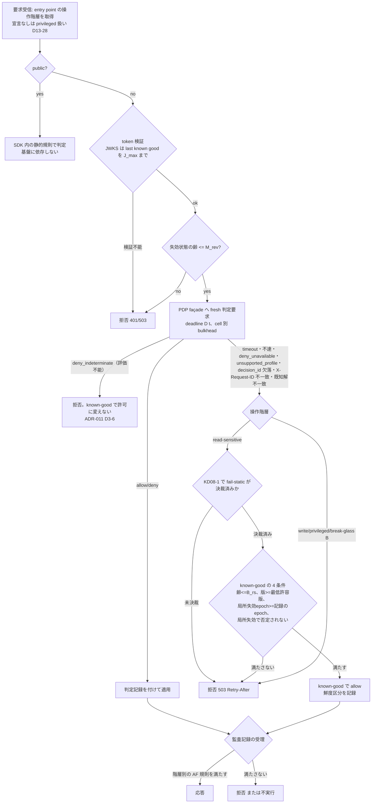

# 失敗モード表（fail-mode matrix）

> 文書ID: ARC-08 / 版: 0.6 / 状態: draft / 最終更新: 2026-10-15（0.6: 模擬パネル ラウンド 7 の sre 指摘により、FM-08 に鍵の誤撤去・JWKS 不整合の検知（§3.5、SLO-01 SLI-029）、記号 T_rk（§4）、§6.8 の注記、§8 の FM-08 行の基準（検知・自動再掲載の時間と誤 deny 件数）を加え、運用手順を OPS-01 RB-A08 に対応付けた。0.5: 模擬パネル ラウンド 5 の sre 指摘により、TC-010 の自己実行の数値のタグを [M] から [D] に改め、§0 の 1・§6.1・残課題に DCS-01 §10.1 の X-1 を記し、申し送り 7 に基準変更の開示を加えた）
> 対応要求: R-080, R-081, R-082, R-083, R-084, R-085, R-086, R-087, R-262, R-188.3, R-210, G-058（R-requirements.md・G-goal-criteria.md で本書のパスまたは DL-19 を対応成果物に含む全行）
> 依存文書: CONVENTIONS.md, traceability/deliverables.md（DL-19 行）, traceability/R-requirements.md, traceability/G-goal-criteria.md, traceability/claims-ledger.md（CL-0106, CL-0108, CL-0168, CL-0177, CL-0182, CL-0203, CL-0255, CL-0276）, traceability/rejected-hypotheses.md（RH-002, RH-130）, traceability/dissent-log.md, 01_governance/assumptions-register.md, 01_governance/business-impact-analysis.md (GOV-04), 01_governance/loss-scenarios.md (GOV-03), 01_governance/kri.md, 01_governance/stop-authority.md (GOV-06), 02_requirements/operation-risk-tiers-assurance.md (REQ-03), 03_threat-model/threat-catalog.md, 03_threat-model/attacker-model.md, 03_threat-model/fraud-abuse-controls.md (THR-04 §7.6・§13.2), 04_architecture/pep-contract.md (ARC-06 §3.5), 05_adr/ADR-001, ADR-005, ADR-006, ADR-007, ADR-010, ADR-011, ADR-013, ADR-014, ADR-023, ADR-024, ADR-029, 05_adr/reconciliation-notes.md, research/RS-04, RS-07, RS-09, RS-10, research/standards-status.md
> 作成方法: AI エージェント（Claude）が、上記の ADR・要件・統治文書と調査ノート RS-09 を読み、決定済み（proposed）の ADR の範囲で各セルを具体化した。本書の判断は自己レビューであり、実在する CTO/CISO の決裁ではない（CONVENTIONS §8）[D]。research ノートにない原典は新たに取得していない。脚注の原典はすべて research の検証済み項目（RS-xx#n）を経由している [D]。
> 表記: 障害種別 FM-01〜FM-16（主列 FM-01〜FM-12、補助列 FM-13〜FM-16）、監査不能時の挙動 AF-0〜AF-4、決裁案 KD08-x、主要 ADR との論点 L08-x、新規仮定 N08-x（前提台帳へ追加要）、試験案 TC-ARC08-xx（仮番。DL-22 で採番）と書く。決裁案・論点・新規仮定・試験案の記号は、ADR-019 の KD19-x・L19-x・N19-x・TC-19-xx と衝突していたため、2026-10-15 の 04_architecture 整合調整で KD19→KD08、L19→L08、N19→N08、TC-19→TC-ARC08 に改番した（architecture-reconciliation-notes.md XR-08）。**表のセルのうちタグのないものは設計推論 [D] であり、この注記で個別のタグに代える。** 事実を述べるセルには個別にタグと脚注を付けた。

---

## 0. 結論（要旨）

1. **認可判定の fail-open は、どの操作階層・どの障害種別でも採らない** [D]。ただし PDP が形式は正しい誤った allow を返す場合（FM-13）、PEP は既知解の判定で不一致を検知するまでその allow を誤りと区別できず、検知前の窓の誤 allow は防げない。この窓の露出量は式と上限で管理する（§6.13、版 0.4 で追加）[D]。**本項の主張は実証待ちである（版 0.5 で追加）** [D]。PoC 系統 1 の TC-010 の正式な実行 2 件はともに不合格だった（DCS-01 §10.1 の X-1）[D][^34]。OpenFGA 構成（`5418a7`）では FM-01（D(t) 超過の timeout 注入、窓 W1）の間に write 以上の allow 12 件と read-sensitive の allow 24 件、Cedar 構成（`01d308`）では評価不能から許可に変わった判定 18 件が記録された [D][^35]。これは自己実行の参考値（立会人なし・git_dirty、DCS-01 §10.1 の区分 W-1〜W-5 を満たさない。証拠に使わない）であり、合否にも使わないが、本項の「fail-open を採らない」「評価不能は許可に変えない」に反する兆候として開示する [D][^34]。原因区分（試験ハーネス・PoC 実装・設計）は確定していない（残課題）。確定するまで、本項の主張は実証のない主張として扱う [D]。「不明なら deny」は安全側原則として残し（R-262）、可用性との調停は操作階層ごとの割当だけで行う（ADR-013 D13-23）[D]。SRS は "Security-critical operations should not fail open." と述べる [V][^2]（RS-09#20）。属性欠落などの評価不能（`deny_indeterminate`）は障害ではなく意味論上の deny であり、どの階層でも許可に変えない（ADR-011 D3-6）[D]。
2. **旧提案の「一律 fail-closed」を、操作 7 区分（5 分類＋privileged と break-glass の副区分）× 障害 16 種（主列 12＋補助列 4）の表に置き換えた** [D]。変えたのは 4 点である [D]。(a) read-sensitive だけ、PDP が署名した既知良好判定を最大齢 B_rs まで使う fail-static を候補にした（KD08-1。ADR-013 KD13-6 と同じ論点で、決裁前）[D]。決裁までは read-sensitive も PDP 不達時は拒否する（§4 の B_rs の暫定の扱い、ARC-06 §3.5 L06-9）[D]。(b) public は基盤の判定に依存させない [D]。(c) AS・上流 IdP・KMS・control plane の停止を、認可判定の停止に波及させない（静的安定性）[D]。(d) break-glass/P は基盤の AS・PDP に依存しない別経路にした [D]。write・privileged・break-glass/B は従来どおり fresh decision 必須で、PDP に届かなければ拒否する [D]。高リスクは fresh decision 必須、低リスク read だけを限定 grace とする判断（R-086）は、ここで定義し、決裁案 KD08-1 に載せる [D]。
3. **一律 fail-closed を採らない理由**は、レビューが一律値を承認していないこと [D][^1]（L232、R-087）と、共通基盤の判定停止が依存する全業務の同時停止になることにある [I][^17][^18]（RS-09#47, #53）。Cloudflare Access は fail closed の構成で identity-based login を 100% 失敗させた [I][^14]（RS-09#69）。一方で可用性優先の一律 grace は、DoS だけで安全性を下げる手段を攻撃者に与える [V][^2]（RS-09#20）。このため、高リスクは拒否し、低リスク read だけを上限付きで継続させる [D]。
4. **キャッシュの最大齢・spool の上限・継続時間はすべて TBD** である [D]。記号（B_rs、M_rev、C_edge(t)、L、J_max、H、Q_r、Q_w、D(t)、H_g、S_ssf、P_ka、N_ka、E_max）と、所有者・期限・決め方を §4 に定めた [D]。値は BIA（GOV-04）の MTPD と PoC 実測（TC-13-02、TC-13-04、TC-13-16 ほか）から DL-20 で決める [D]。BIA の MTPD 自体も仮置き（read-sensitive 4 時間、write 2 時間）である [D]（BIA の新規仮定 NA-01。前提台帳へ追加要）。
5. **経営判断が要る点は 6 件**ある（§9）[D]。read-sensitive の限定 grace を許すか（KD08-1）、AS 停止中と監査停止中の権限縮小操作の扱い（KD08-2）、顧客 IdP からの SSF 受信が途絶えたときの扱い（KD08-3）、リージョン切替後に write 以上を再開する条件（KD08-4）、基盤停止中の break-glass/B の業務継続（KD08-5）、本表の逸脱 0 件をどの試験で判定するか（KD08-6）である [D]。
6. **G-058 の合格（全セル定義済み、注入試験での逸脱 0 件）は未達**である [D]。本書で閉じたのは全セルの定義（机上、A）までである [D]。値の決裁（B）と注入試験（C、独立立会人）は G4 以降に残る [D]（§8、残課題）。

---

## 1. 位置付けと読み方

### 1.1 本書が決めること・決めないこと

| 区分 | 内容 | 正本 |
|---|---|---|
| 本書が決める | 操作区分 × 障害種別の各セルの挙動、キャッシュ最大齢の記号、必要整合性、監査不能時の挙動、代替経路、根拠、検証 TC | 本書 |
| 本書が従う（変えない） | fail-open の禁止、三分法、操作階層別の原則（ADR-013 D13-23〜D13-29）、失効状態の配布と M_rev（ADR-006 D6-04〜D6-08）、監査経路停止の定義 H1〜H5（ADR-014 D14-28）、依存 Tier と静的安定性（ADR-023）、整合性の実現手段（ADR-010 D-13）、`deny_unavailable`（ADR-011 D3-6） | 各 ADR |
| 本書が決めない | 数値（B_rs 等）、cell 数、AS の配置（C／C′）、判定記録への署名の要否（U-04）、issuer の粒度（U-01） | DL-20、ADR-013 KD13-1〜KD13-6、reconciliation-notes |

- ADR はすべて proposed（決裁前）である [D]（05_adr/README.md）。本書は proposed の ADR に反する設計を書かず、ADR が未決の点は「未決（ADR-0xx）」と書く [D]。
- 依存 Tier（ADR-023）は fail-mode を緩めない [D]。本書のセルは Tier によらず同じであり、Tier はサービス側の振舞い（閲覧専用モード、受付キュー、一時停止）だけを変える（ADR-023 D23-01、D23-15）[D]。

### 1.2 読み手別の入口

| 読み手 | 最初に読む節 | 持ち帰るもの |
|---|---|---|
| CTO/CISO | §0、§2、§5、§9 | 一律 fail-closed を置き換えた理由、全体の見取り図、決裁案 6 件 |
| 連携開発者 | §3.6（すること 10 項目）、§5、§6 | 自サービスの entry point に宣言する操作階層、障害時に SDK が返す応答、Tier ごとの義務 |
| SRE・PoC 担当 | §4、§6、§7、§8 | 記号と TBD、注入試験の一覧、復旧時の規則 |

### 1.3 操作区分（行）

REQ-03 §2.1 の 5 分類と副区分をそのまま行にする [D]。break-glass を /P と /B に分けるのは、ADR-029 が /P を基盤の PDP・AS に依存しない別経路とし（D29-81）、/B を基盤の PDP 上の型付き例外とした（D29-80）ためである [D]。ADR-013 D13-25 の表は break-glass を 1 行で書いており、/P を指すと読む（ADR-023 L23-1 の提案に従う。本書 L08-2）[D]。

| 行 | 定義（REQ-03 §2.1） | 必要整合性（REQ-03 §3.6、ADR-010 D-13） | allow の再利用 | 監査レベル（REQ-03 §3.7） |
|---|---|---|---|---|
| public | 認証なし、公開情報だけ、状態を変えない | 判定不要 | 可 | AU-1 |
| read-sensitive（rs） | 状態を変えず非公開情報を返す | bounded（上限 B_rs） | 上限内で可 | AU-2 |
| write（w） | 自分の権限範囲で状態を変える | fresh | 不可 | AU-3 |
| privileged/T（pT） | 他主体・構成・多数への作用。1 テナント内 | fresh（内容版トークンだけに頼らない）＋session 照合＋step-up | 不可 | AU-4 |
| privileged/P（pP） | 同上。テナント横断または基盤 | 同上 | 不可 | AU-4 |
| break-glass/P（bgP） | 基盤の緊急経路（DL-46、ADR-029） | fresh（緊急権限の記録に対して。break-glass 経路の側で満たす、ADR-029 D29-81） | 不可 | AU-5 |
| break-glass/B（bgB） | テナント内の業務上の緊急アクセス | fresh＋判定記録必須（ADR-010 D-13） | 不可 | AU-5 |

### 1.4 障害種別（列）

DL-19 の行（deliverables.md）が挙げる 6 種と、本書の担当範囲として指定された 12 種を列にする [D]。RS-09 §5.1 の DL-19 行が独立の列にするよう求めた「誤った応答」と、ADR-013・ADR-006 が DL-19 に値の決定を委ねた「control plane 停止」「失効配布停止」を補助列として加える [D]（RS-09#21, #22, #24, #72）。THR-04 §7.6 が DL-19 への入力案として渡した「リスク判定・bot 判定の停止」も補助列 FM-16 として加える [D]。

| ID | 障害種別 | 定義（本書での注入条件） | BIA の障害形態（GOV-04 §2.4） |
|---|---|---|---|
| FM-01 | PDP timeout | 当該 cell の PDP が応答するが、要求の deadline D(t) を超える | F2 |
| FM-02 | PDP 全断 | 当該 cell の PDP façade に届かない、または façade が `deny_unavailable` を返す | F2 |
| FM-03 | replica 遅延 | 認可 store の読取レプリカの遅延が、要求された鮮度を満たさない | F2（部分）、F4 |
| FM-04 | store 障害 | (a) relationship・policy の正本 store（primary）停止、(b) token 状態ストア・session store 停止 | F1、F2 |
| FM-05 | IdP 停止 | AS が broker する上流 IdP（顧客 IdP、外部 IdP）、または基盤運用者の管理用 IdP の停止 | F1（部分） |
| FM-06 | AS 停止 | 当該 cell の AS（login、token 発行、refresh、step-up）停止 | F1 |
| FM-07 | KMS 停止 | 当該 cell 専用アカウントの KMS（署名）停止 | F1 |
| FM-08 | JWKS 取得失敗 | SDK・edge が discovery・JWKS を取得できない | F2（期限後） |
| FM-09 | 監査 sink 停止 | ADR-014 D14-28 の H1〜H5 | F7 |
| FM-10 | SSF 停止 | (a) 顧客 IdP からの SSF 受信の途絶、(b) 基盤からの SSF 送信の失敗 | F4（部分） |
| FM-11 | cell 間分断 | cell 間の通信（配布物の複製、越境共有のイベント、guest の federation）が途絶 | — |
| FM-12 | リージョン障害 | 1 リージョンの全 cell が停止 | F1〜F5 |
| FM-13（補助） | 誤った応答 | PDP が全 allow・全 deny・古い版の応答を返す（gray failure） | F2、F4、F6 |
| FM-14（補助） | control plane 停止 | 所在地群の control plane（PAP、テナント管理、配置台帳、配布 pipeline）停止 | F3 |
| FM-15（補助） | 失効配布停止 | 失効状態の配布路が止まり、強制点の失効状態の齢が伸びる | F4 |
| FM-16（補助） | リスク判定停止 | login・step-up・token endpoint の前段のリスク判定・bot 判定（THR-04 §7.6）が応答しない | F1（部分） |

---

## 2. 一律 fail-closed を置き換えた理由

### 2.1 旧提案の主張と処置

旧提案は PDP・PIP の timeout・error・属性欠落を全操作で一律に deny するとした（CL-0106, CL-0108, CL-0177, CL-0182, CL-0276）[D]。同じ文書で「重要 read の限定 grace」も述べており（CL-0203）、文書内で整合していなかった（RH-002）[D]。レビューはこの一律値を承認していない [D][^1]（L232、R-087）。主張台帳はこれらを「要実測」とし、本書と DL-20 に移した [D]。処置は §11 に示す [D]。

### 2.2 置き換えた理由

| # | 理由 | 根拠 |
|---|---|---|
| 1 | 共通基盤の判定停止は、依存する全業務の同時停止になる。一律 fail-closed では、PDP の可用性（判定系の帯 99.95〜99.99%）がそのまま全業務の上限になる | Google 2020-12-14 は 47 分間、認証付きトラフィックのほぼ全てに 5xx を返した [I][^17]（RS-09#47）。BIA §0.1 [D]。A-090 |
| 2 | fail closed の構成で login が全面的に失敗した一次報告がある | Cloudflare Access 2025-06-12 は identity-based login の 100% が失敗した [I][^14]（RS-09#69） |
| 3 | 既知の状態へ失敗することは求められるが、その状態が deny であることは規範に定めがない | SP 800-53 SC-24 は組織が定めた既知の状態へ失敗することを求め、どの状態に落ちるかは規定しない [N][^5]（RS-09#24） |
| 4 | fail closed と fail open の二択ではなく、制御系の故障時に policy を変えない fail static がある | SRS は DoS 防御の制御器の故障時に "we fail static, meaning the policy does not change" とする [V][^4]（RS-09#22） |
| 5 | 失効の確認は timeout で省かず、既知良好な失効データを局所に置く方式がある | SRS は time-out-and-fail-open より既知良好な失効リストの配布と局所 cache を勧める [V][^3]（RS-09#21） |
| 6 | 権限を縮小する操作（剥奪・失効・遮断）まで一律に止めると、障害中の封じ込めができない | REQ-03 J8、GOV-06 S4・S5 [D]。§6.6、§6.9、KD08-2 |

### 2.3 維持したもの（逆方向の歯止め）

- 認可判定の fail-open はどの階層でも禁止する [D]。fail open は DoS だけで安全性を下げる手段を攻撃者に与える [V][^2]（RS-09#20）。ASVS 5.0.0 の 16.5.3 は fail-open 状態の防止を検証要件とする [N][^6]（RS-09#26）。
- 可用性を優先する一律 grace（上限なしのキャッシュ判定、障害時だけ寿命を延ばす）は採らない（RH-130、ADR-005 D3）[D]。可用性を優先した縮退系が失効確認を省く例として、Entra のバックアップ認証系は証明書失効の fresh な確認を行えず、最後に退避した時点の CRL 確認結果に頼る [V][^11]（RS-09#27）。平常時と障害時で挙動を変える bimodal behavior は避けるべきだと AWS は述べる [V][^10]（RS-09#15）。
- キャッシュ・状態ストアに届かないときに正本 store や AS 本体へ直接問い合わせる迂回は、どのセルでも設けない（ADR-005 D1-3、ADR-010 D-40、ADR-013 D13-15）[D]。AWS は分散 fallback が "often make the outage worse" と述べる [V][^9]（RS-09#14）。Auth0 2021-04-20 では、キャッシュ不達時の直接問合せと再試行・自動スケールで US-1 が約 4 時間 20 分止まった [I][^19]（RS-09#56, #57）。

### 2.4 残る代償

- read-sensitive の fail-static を許すと、最大 B_rs の間、失効 epoch に載らない relationship の剥奪が効かない stale allow が残る（ADR-013 RR13-03、ADR-023 D23-22）[D]。これは S-07（剥奪後の stale allow）と T-032 の残余リスクであり、受容者は KD08-1 で決める [D]。
- write 以上は PDP 停止の間止まる [D]。停止時間は BIA の MTPD（仮置き write 2 時間 [D]（BIA の新規仮定 NA-01。前提台帳へ追加要））と判定系の帯 [A-090] で照合する [D]。

---

## 3. 共通規則

### 3.1 三分法と適用範囲

| 方式 | 意味 | 適用してよい対象 |
|---|---|---|
| fail-closed | 拒否する（再試行可能なら 503 と Retry-After） | write、privileged、break-glass/B の判定。read-sensitive で known-good の条件を満たさないとき |
| fail-static | 署名付きの既知良好な policy・判定・閾値を最大齢付きで使う | read-sensitive の判定（KD08-1 の決裁が前提）。SDK の静的規則（public）。rate limit・quota の閾値（ADR-013 D13-17, D13-23）[V][^4]（RS-09#22） |
| fail-open | 保護機能のない処理を続ける | telemetry、trace の sampling、課金計測、推奨表示だけ（ADR-013 D13-23） |

### 3.2 PEP SDK の判定の流れ

- 「判定が得られない」の範囲は ARC-06 §3.5 の定義（façade 不達・timeout、`deny_unavailable`、`unsupported_profile`、decision_id 欠落、X-Request-ID の echo 不一致）に合わせる [D]。同節が同じ範囲に含める `deny_indeterminate` は、ADR-011 D3-6 により known-good の経路に入れず拒否する [D]。
- known-good の 4 条件は ADR-013 D13-24 の定義に従う [D]。判定記録には decision_id と AuthZEN の要求 ID を持たせ、要求 ID を付けた場合 PDP は同じ値を応答に返す（MUST）[N][^23]（RS-07#66）。PEP と PDP の監査記録はこの ID で突合する（ADR-013 D13-26）[D]。read-sensitive の評価下限はテナント剥奪フェンスでも決まり（ADR-010 D-18）、失効 epoch とは別の検査として両方を満たす（reconciliation-notes C-35）[D]。
- 再試行は、残り deadline の範囲で同じ cell の別 worker に 1 回までとし、要求単位の回数上限と jitter 付き指数 backoff に従う（ADR-013 D13-16, D13-19）[D]。SRE 本は再試行にランダム化した指数 backoff を使うこと、deadline を伝播させることを求める [V][^12]（RS-09#38）。再試行回数の上限は N08-1 の TBD とする [D]。

### 3.3 監査不能時の挙動（AF コード）

ADR-013 D13-25 の監査列と ADR-014 D14-28 の表を、行ごとのコードにする [D]。AU-5(4) は監査ログの障害時に全停止・部分停止・縮退運転のいずれかを求め、代替の監査ログ能力がある場合を除く [N][^21]（RS-10#32）。代替の監査能力として、cell ジャーナル（2 AZ 以上で受理）と上限内のローカル耐久 spool を当てる（ADR-014 D14-28）[D]。

| コード | 適用する行 | H3（ジャーナル停止）・H4（spool 停止・満杯）での挙動 | H1・H2・H5 での挙動 |
|---|---|---|---|
| AF-0 | public | ローカル spool。上限到達で集約記録へ縮退し、業務は続ける | 業務を止めない |
| AF-1 | read-sensitive | 連番付きローカル耐久 spool を Q_r まで使い、超えたら拒否。拒否も spool に書き、書けない拒否は件数だけメトリクスに残す | 同上。H2 はジャーナル保持時間の範囲で封印を遅らせ、上限が近づいたら H3 と同じ扱い |
| AF-2 | write | spool を Q_w（< Q_r）まで使い、超えたら拒否 | 同上 |
| AF-3 | privileged/T、privileged/P、break-glass/B | ジャーナルの同期受理ができなければ拒否。ローカル spool 単独は代替と認めない（ADR-014 D14-28） | 同上 |
| AF-4 | break-glass/P | 改ざん検知付きのローカル記録と、本基盤の IdP に依存しない帯域外への複写の両方ができなければ実行しない | 同左（帯域外の複写先は H1〜H5 の影響を受けない） |

- break-glass/B を AF-3 とするのは、REQ-03 §3.7 が AU-5 を「監査記録を確定できない場合は実行しない」とし、ADR-029 D29-80 が /B を基盤の PDP 上の型付き例外として判定記録を必須にしたことからの設計推論である [D]。ADR-013 の表は break-glass を 1 行にしているため、/B の監査列は本書で定める（L08-2）[D]。
- 停止の開始・終了時刻と影響した producer は監査系自身のイベント（E9）に記録する（ADR-014 D14-28）[D]。

### 3.4 重畳時の規則

- 複数の障害が重なった場合、各セルで最も制限の強い挙動を採る [D]。例えば PDP 全断（FM-02）と監査ジャーナル停止（FM-09）が重なった read-sensitive は、known-good の条件と AF-1 の両方を満たすときだけ allow する [D]。
- 補助列 FM-13（誤った応答）を検知した cell の PDP は、FM-02 と同じに扱う（ADR-013 D13-27）[D]。

### 3.5 検知と警報

| 障害種別 | 検知の手段 | 警報 |
|---|---|---|
| FM-01・FM-02 | SDK の deadline 超過率と `deny_unavailable` の率、cell 別 circuit breaker の開放 | cell 単位の Sev。依存予算（ADR-023 TC-23-11）に計上 |
| FM-03 | façade が測るレプリカ遅延、整合性トークンを満たせない応答 | 遅延が B_rs の残余を超えた時点 |
| FM-04 | store の quorum・primary の喪失、introspection の失敗率 | cell 単位の Sev |
| FM-05・FM-06・FM-07 | 新規 login・refresh・署名の失敗率、DR 鍵への切替の発生 | cell 単位の Sev |
| FM-08 | JWKS の齢（last known good の取得時刻からの経過） | J_max/2 で警報（ADR-023 D23-23 の H/2 と同じ形）[D] |
| FM-08（鍵の誤撤去・JWKS 不整合。版 0.6 で追加） | token 検証失敗率 V(k, c, p)（SLO-01 SLI-029。kid・cell・検証点種別ごと、失効 kid と期限切れを除く）が基線 b(c, p) を超え、増分が「未知 kid」または「署名不一致」に集中する。JWKS・鍵マニフェストの版の変更（撤去の公開）や鍵台帳の撤去イベントと時刻が相関すれば誤撤去とみなす。取得は成功しているので、JWKS の齢の警報（上の行）では検知できない | canary cell での検知: 撤去を自動で止めて再掲載する（ADR-007 D7-35 の 3）。canary 外の cell または外部 issuer での検知: 全域の Sev とし、OPS-01 RB-A08 を宣言する。撤去から再掲載までを T_rk（§4）以内に収める [D] |
| FM-09 | producer 連番と heartbeat、発行カウンタと受理件数の突合（ADR-014 D14-26 の C1〜C6） | K-21 |
| FM-10 | stream ごとの最終受信時刻（S_ssf）と、定期に要求する SSF Verification Event の到着（§6.10。顧客 IdP の対応は DL-78 で確認） | テナント管理者とセキュリティ当番 |
| FM-11・FM-12 | cell・リージョンの到達性、配置表の版の停滞 | 所在地群の Sev |
| FM-13 | 合成テナントへの既知解判定の不一致、allow 率・deny 率の急変、版の後退（ADR-013 D13-27）。既知解の判定は周期 P_ka で行い、不一致が N_ka 回連続したら検知とする（§4）。検知までの窓は §6.13 の T_win | 自動 freeze と警報。allow の拡大はセキュリティ事象。検知前の窓の誤 allow の件数を E_max と照合する（§6.13） |
| FM-14・FM-15 | 配布物の有効期限（H/2）、失効状態の heartbeat の齢（M_rev） | cell 単位の Sev |
| FM-16 | リスク判定の応答率・deadline 超過率 | cell 単位の Sev とセキュリティ当番 |

### 3.6 連携開発者（依存サービス）がすること

fail-mode は SDK と edge の設定値で表すので（ADR-013 D13-28）、依存サービスは次の 10 項目だけを行う [D]。各項目の正本を括弧に示す [D]。

| # | すること | してはならないこと | 確認の方法 |
|---|---|---|---|
| 1 | entry point ごとに操作階層（public／read-sensitive／write／privileged/T・/P／break-glass/B）を台帳に宣言する（ADR-013 D13-28、ADR-012 の entry point 台帳）。宣言のない entry point は privileged として扱われる | 宣言を省いて既定に頼る（privileged 扱いになり、障害時に最も早く拒否される） | 台帳と CI 検査（ADR-012） |
| 2 | 依存 Tier（1〜3）をオンボーディングで申告する（ADR-023 D23-04） | 申告せずに本番接続する | DL-67 の準備完了条件 |
| 3 | SDK または契約どおりの検証器で判定を受け、障害時の挙動は SDK の配布設定に任せる（ARC-06 §3.6 の timeout・retry は DL-19・DL-20 由来の配布値） | fail-mode・timeout・再試行回数を自サービスで上書きする | TC-13-04、TC-23-10 |
| 4 | SDK が返す 503＋Retry-After を利用者に再試行可能なエラーとして示し、Retry-After に従う。理由区分 `deny_unavailable`（障害）と通常の deny（権限なし）を UI・ログで区別する | 503 を即時に再送する、deny を「障害」と表示する | §8 の注入試験への参加（ADR-023 D23-11） |
| 5 | Tier 1 は、read-sensitive に閲覧専用モードを用意し、write を続ける業務は受付キューに入れて実行時に fresh 判定で再認可する（ADR-023 D23-11、ADR-026） | キューに入れた時点の allow で後から実行する | TC-23-10 |
| 6 | allow を SDK・検証器の外で cache しない。基盤不達時に正本 store・AS・独自の allow list へ迂回しない（ADR-023 D23-10 の 3） | 独自の判定 cache、独自のバックアップ認証 | §8 の FM-02・FM-04 の合否（迂回の問合せ 0 件） |
| 7 | 要求経路で AS・CP を呼ばない。JWKS は last known good を J_max まで使う SDK の既定に任せる。Tier 1 は token 寿命の後半で jitter 付きの先行更新をする（ADR-023 D23-10, D23-11） | 障害時に token の寿命を延ばす（ADR-005 D3） | TC-13-03、TC-13-22、TC-23-05 |
| 8 | 監査 SDK のローカル spool の容量（Q_r・Q_w を満たすディスク）を実行環境に確保する（ARC-10 の spool の資源の行） | 監査記録を捨てて処理を続ける | TC-13-16、TC-014-03 |
| 9 | BIA 票 A6 に「どの障害種別（F1〜F7）で止まり、どれで一部続けられるか」を本書の FM 列で記入する。break-glass/B を持つドメインは基盤停止中の業務継続手順を用意し、票 A6・D8 に記入する（ADR-023 D23-17、KD08-5） | break-glass/B のために基盤から独立した認証・認可経路を独自に作る | BIA 票の審査（GOV-04） |
| 10 | 自サービスの復旧経路（配備、rollback、管理コンソール、当番招集）を本基盤に依存させない（ADR-023 D23-10 の 7） | 復旧手順に本基盤の login を含める | TC-23-02 |

---

## 4. 記号と最大齢（数値はすべて TBD）

本書は数値を置かない [D]。値は DL-20 で決裁し、決裁までは本表の「暫定の扱い」を適用する [D]。

| 記号 | 意味 | 適用するセル | 所有者 | 期限 | 決め方 | 暫定の扱い |
|---|---|---|---|---|---|---|
| B_rs | read-sensitive の known-good の最大齢 | FM-01〜FM-04、FM-13 の rs 行 | CISO＋事業責任者＋CTO（KD13-6、KD08-1） | G4 | BIA の E01（MTPD 仮置き 4 時間 [D]（BIA の新規仮定 NA-01。前提台帳へ追加要））と TC-13-02・TC-13-24 の実測 | 決裁前は known-good を使わない（全 deny）。PoC では複数水準を試す |
| M_rev | 失効状態の最大齢。超えたら rs 以上を拒否 | FM-15、全列の前提 | CTO＋SRE 責任者（ADR-006 §2.10） | G4 | ADR-006 H6-02、TC-13-02 | 決裁前の PoC 構成値として扱い、本番値にしない |
| C_edge(t) | edge の introspection cache の最大齢（応答の exp 以下） | FM-04(b) | CTO（ADR-006 §2.10） | G4 | ADR-005 H-02、ADR-006 H6-03 | RFC 7662 の上限（exp を超えない [N][^24]、RS-04#67）だけを強制 |
| L(t) | access token・内部 token の寿命 | FM-05〜FM-07 | CISO＋CTO（ADR-005 D3） | G3→G4 | DL-20。容量計算の仮置きは 10 分 [A-027] | 障害時に延ばさない（ADR-005 D3） |
| J_max | JWKS の last known good を使う上限（R-189.6） | FM-08 | CTO＋SRE 責任者 | G4 | TC-13-22、TC-07-04 の実測と R-189.5（緊急失効）との整合 | 失効 kid は失効状態で別に配る（ADR-006 D6-20）ので、J_max は失効の反映時間に効かない |
| H | control plane 停止中に最終状態で動く上限＝署名付き配布物の有効期限 | FM-14、FM-11 | CTO＋CISO（KD13-6） | G4 | TC-13-02、TC-23-04 | 自動延長しない（ADR-023 D23-23） |
| Q_r、Q_w | 監査 spool の上限（read-sensitive、write） | FM-09 | CISO＋SRE 責任者（本書の所有者案。ADR-013 D13-29・ADR-014 D14-28 は決め方だけを定め、所有者は KD13-6 の決める人と同時に確定） | G4 | TC-13-16、TC-014-03 | Q_w < Q_r（ADR-013 D13-25） |
| D(t) | PEP→PDP の階層別 deadline | FM-01 | CTO（N08-1） | G4 | TC-13-04 の p99 と BIA B14（遅延の業務影響） | SDK 既定値を DL-20 で定める |
| H_g | 資源側 cell の guest session の上限 | FM-11 | CISO＋プロダクト責任者（ADR-024 D24-16） | G3 | TC-24-05 | REQ-03 §3.3 の session 上限以下 |
| S_ssf | 顧客 IdP からの SSF 受信が途絶えたとみなす時間 | FM-10 | プロダクト責任者＋CISO（N08-2） | G3 | DL-78 の受信プロファイルと H6-09 | 警報だけに使う（KD08-3） |
| P_ka | 既知解の判定の周期。PEP が合成テナントへの既知解の判定要求を流す間隔（ADR-013 D13-27）（版 0.4 で追加） | FM-13 の全行（検知前の窓 T_win の主項） | SRE 責任者＋CISO | G4 | TC-010・TC-13-05 の実測（検知時間の分布、判定要求が PDP 負荷に占める比率）と K-04 の許容度（E_max）から決める。T_win ≦ E_max ÷ λ_w+,cell を満たす範囲で選ぶ | PoC 系統 1 の構成値 250 ms を暫定の目安とし、本番値にしない。構成値は自己実行の参考値（立会人なし・git_dirty、DCS-01 §10.1 の区分 W-1〜W-5 を満たさない。証拠に使わない） [D][^30][^34] |
| T_rk | 鍵の誤撤去（使用中の kid を JWKS・鍵マニフェストから外した版の公開）から、検知と自動再掲載（その kid を戻した版の公開）までの時間の上限（版 0.6 で追加） | FM-08 の rs・w・pT・pP・bgB 行（誤撤去の窓） | SRE 責任者＋CTO | G4 | SLO-01 SLI-029 の基線・閾値と組で決める。TC-014・TC-07-04・TC-109 の誤撤去注入で、検知時間の分布と誤検知率を測る。ADR-007 D7-35 の 3 の観測窓 24 時間は「撤去を進めてよいか」を見る期間であり、T_rk はそれよりずっと短い検知の上限として別に置く [D] | 決裁前は値を置かず、PoC と EX-A08 で T_rk の実績と窓内の誤 deny 件数を記録する。PoC 系統 1 の TC-014 は検知 0 件で、T_rk を測れなかった（自己実行の参考値。証拠に使わない）[D][^37] |
| N_ka | 検知とみなす不一致の連続回数の閾値（ADR-013 D13-27）（版 0.4 で追加） | FM-13 の全行 | SRE 責任者＋CISO | G4 | TC-010・TC-13-05 の実測（平常時の一過性の不一致の頻度＝誤検知率）と K-04 の許容度。allow 拡大方向（既知の deny が allow）と縮小方向（既知の allow が deny）で別の値を置けるようにする | 1（初回の不一致で検知）。PoC 系統 1 の実装も 1 である（実装の読取り。自己実行の参考値（立会人なし・git_dirty、DCS-01 §10.1 の区分 W-1〜W-5 を満たさない。証拠に使わない））[D][^30][^34] |
| E_max | FM-13 の検知前の窓に許す、1 事象・cell あたりの write 以上の誤 allow の件数の上限（版 0.4 で追加） | FM-13 の w・pT・pP・bgB 行 | CISO（K-04 の許容度と同時。GOV-02 決裁案 1 の範囲内） | G4 | K-04 と SLO-01 SLI-038 の決裁。P_ka・N_ka と組で決める | 決裁までは値を置かない。決裁前の PoC では窓内の件数 E を記録する。TC-010 の合否は現行の事前登録の基準（write 以上の allow 0 件）で判定し、その結果を正式な結果とする。「検知窓外 0 件」での判定は、基準変更を POC-01 §2.4・§2.4.1 の手続で開示した後の版でだけ行う（申し送り 7、版 0.5 で改めた）[D][^36] |

- 剥奪反映時間 R(t, c) は、これらの記号を含む ADR-006 D6-29 の分解式で表す [D]。本書の最大齢は R(t, c) の構成要素であり、R の決裁（ADR-006 K6-1）と矛盾する値を置かない [D]。
- エンジンの平常時の鮮度窓（SpiceDB の量子化、OpenFGA の窓 W）は、障害時の最大齢と別に記録する（ADR-013 D13-25）[D]。

---

## 5. マトリクス概観

各セルの挙動を一語で示す [D]。詳細（キャッシュ最大齢、必要整合性、監査不能時挙動、代替経路、根拠、検証 TC）は §6 の該当表にある [D]。

凡例: **継続**＝影響なし、**静的**＝fail-static（rs は B_rs までの known-good、public は静的規則。rs の known-good は KD08-1／KD13-6 で許すと決裁された後に限り、決裁までは「拒否」と読む）、**既存**＝既存 session・token の寿命内で継続し新規開始は停止、**拒否**＝fail-closed、**別経路**＝基盤に依存しない経路で実行、**条件**＝§6 の条件付き、**spool**＝AF 規則に従う。

| 行 ＼ 列 | FM-01 PDP timeout | FM-02 PDP 全断 | FM-03 replica 遅延 | FM-04 store 障害 | FM-05 IdP 停止 | FM-06 AS 停止 | FM-07 KMS 停止 | FM-08 JWKS 失敗 | FM-09 監査 sink 停止 | FM-10 SSF 停止 | FM-11 cell 間分断 | FM-12 リージョン障害 |
|---|---|---|---|---|---|---|---|---|---|---|---|---|
| public | 継続 | 継続 | 継続 | 継続 | 継続 | 継続 | 継続 | 継続 | spool（AF-0） | 継続 | 継続 | 条件（切替まで当該 cell の動的部分停止） |
| read-sensitive | 静的 | 静的 | 条件 | 静的／既存 | 既存 | 既存 | 継続／既存 | 静的（J_max）→拒否 | spool（AF-1） | 継続 | 継続／条件 | 拒否→切替後 fresh |
| write | 拒否 | 拒否 | 継続 | 拒否 | 既存 | 既存 | 継続／拒否 | 静的（J_max）→拒否 | spool（AF-2） | 継続 | 継続／条件 | 拒否→条件付き再開 |
| privileged/T | 拒否 | 拒否 | 継続 | 拒否 | 条件 | 拒否（縮小は条件） | 継続／拒否 | 静的（J_max）→拒否 | 拒否（AF-3） | 継続 | 継続 | 拒否→条件付き再開 |
| privileged/P | 拒否 | 拒否 | 継続 | 拒否 | 条件 | 継続（管理用 IdP） | 継続／拒否 | 静的（J_max）→拒否 | 拒否（AF-3） | 継続 | 条件 | 拒否→条件付き再開 |
| break-glass/P | 別経路 | 別経路 | 別経路 | 別経路 | 別経路 | 別経路 | 別経路 | 別経路 | 条件（AF-4） | 別経路 | 別経路 | 別経路 |
| break-glass/B | 拒否 | 拒否 | 継続 | 拒否 | 既存 | 拒否 | 継続／拒否 | 静的（J_max）→拒否 | 拒否（AF-3） | 継続 | 継続／条件 | 拒否→条件付き再開 |

補助列の概観は次のとおりである [D]。

| 行 ＼ 列 | FM-13 誤った応答 | FM-14 control plane 停止 | FM-15 失効配布停止 | FM-16 リスク判定停止 |
|---|---|---|---|---|
| public | 継続 | 継続（H 後も静的規則の期限まで） | 継続 | 条件（rate limit は fail-static） |
| read-sensitive | 条件（検知前の記録だけ静的） | 継続（H 後は FM-02 扱い） | M_rev まで継続、超えたら拒否 | 既存 session は継続。新規 login は条件 |
| write | 拒否 | 継続（H 後は拒否） | M_rev まで継続、超えたら拒否 | 条件（既知の端末の既存 session だけ） |
| privileged/T | 拒否 | 継続（拡大方向の付与は CP 復旧待ち。縮小は Tier 0 で受付） | M_rev まで継続、超えたら拒否 | 条件（PR 認証器で step-up） |
| privileged/P | 拒否 | 条件（CP を要する操作は停止） | M_rev まで継続、超えたら拒否 | 継続（AAL3 の PR 認証器が常に必須で、リスク判定で上乗せする要件がない） |
| break-glass/P | 別経路 | 別経路 | 別経路 | 別経路 |
| break-glass/B | 拒否 | 継続（H 後は拒否） | M_rev まで継続、超えたら拒否 | 条件（PR 認証器で新規認証） |

---

## 6. 障害種別ごとのセル定義

各表の列は、挙動、キャッシュ最大齢、必要整合性、監査不能時挙動（その障害に監査停止が重なった場合）、代替経路、根拠、検証 TC である [D]。TC は ADR の試験案（TC-13-xx 等）と本書の仮番（TC-ARC08-xx、§8）を併記する [D]。

### 6.1 FM-01 PDP timeout

前提: PDP は応答するが deadline D(t) を超える [D]。SDK は cell ごとに接続プール・circuit breaker・deadline を分ける（ADR-013 D13-18）[D]。

| 行 | 挙動 | キャッシュ最大齢 | 必要整合性 | 監査不能時 | 代替経路 | 根拠 | 検証 TC |
|---|---|---|---|---|---|---|---|
| public | 影響なし。SDK 内の静的規則で判定 | 静的規則の有効期限 H | 判定不要 | AF-0 | — | ADR-013 D13-25、ADR-023 D23-16 | TC-13-04 |
| rs | 残り deadline 内で別 worker に 1 回再試行。失敗したら known-good の 4 条件を満たす記録で allow、満たさなければ `deny_unavailable`→503＋Retry-After | B_rs | bounded（記録の版・epoch・フェンスの下限を満たすこと） | AF-1 | 同じ cell の別 worker（shuffle shard、ADR-013 D13-16）[V][^26]（RS-09#7）。Tier 1 は閲覧専用モード（ADR-023 D23-11） | ADR-013 D13-16, D13-24〜D13-26、ADR-011 D3-6、RS-09#21, #22 | TC-13-04、TC-13-24、TC-011-03 |
| w | 再試行の後、拒否（503＋Retry-After）。known-good は使わない | 0（allow を再利用しない） | fresh | AF-2 | Tier 1 は業務側の受付キューで受け、実行時に fresh で再認可（ADR-026、ADR-023 D23-11） | REQ-03 §3.1、ADR-013 D13-25、R-086 | TC-13-04、TC-23-10 |
| pT | 拒否 | 0 | fresh＋session 照合＋step-up | AF-3 | 縮小方向（J8）は再試行。持続したら FM-02 と同じ | 同上 | TC-13-04 |
| pP | 拒否 | 0 | 同上 | AF-3 | GOV-06 S8b の発動条件を満たす場合だけ break-glass/P | 同上、ADR-029 D29-72 | TC-13-04 |
| bgP | 影響なし（基盤の PDP を使わない） | — | fresh（break-glass 経路の側） | AF-4 | — | ADR-029 D29-81 | TC-13-17 |
| bgB | 拒否 | 0 | fresh＋判定記録必須 | AF-3 | 各ドメインの業務継続手順（ADR-023 D23-17、KD08-5） | ADR-029 D29-80、ADR-010 D-13 | TC-13-04 |

- 過負荷による timeout では、同じ操作階層の中で Tier 3 から先に拒否する（ADR-023 D23-42、KD23-5 は決裁前）[D]。
- **PoC 系統 1 の不利な結果（版 0.5 で追加）**: TC-010 の正式な実行 `5418a7`（OpenFGA）の窓 W1（PEP→façade の接続確立を 5,000 ms 遅らせる注入。D(t) は 3,000 ms）では、72 要求のうち 42 件が 200 で返り、write 以上の allow 12 件、read-sensitive の allow 24 件が記録された [D][^35]。表の w・pT・pP 行（D(t) 超過は拒否）と rs 行（決裁前は拒否。§4 の B_rs）からの逸脱である [D]。数値は自己実行の参考値（立会人なし・git_dirty、DCS-01 §10.1 の区分 W-1〜W-5 を満たさない。証拠に使わない）である [D][^34]。実装者の変更記録は、HTTP クライアントの timeout が接続確立に効かず PEP が 5 秒待って判定を得たこと（PoC 実装の欠陥）を原因とし、RK-08 で直したと記す [D][^35]。この原因区分は作成者以外が確かめていない。修正後の実行（`8882ff`）は結果を見た後の参考用 params による参考実行で、合否に使えない [D][^35][^36]。w 行の「拒否」の実証は、立会い下の再実行を待つ（残課題）[D]。要求に操作階層を criticality として載せ、低い階層から落とす [V][^13]（RS-09#39）。

### 6.2 FM-02 PDP 全断

前提: 当該 cell の PDP façade に届かない、または façade が engine に届かず `deny_unavailable` を返す [D]。cell 外の PDP、正本 store、primary への迂回はしない（ADR-010 D-40、ADR-013 D13-13, D13-15）[D]。

| 行 | 挙動 | キャッシュ最大齢 | 必要整合性 | 監査不能時 | 代替経路 | 根拠 | 検証 TC |
|---|---|---|---|---|---|---|---|
| public | 影響なし | 静的規則の期限 H | 判定不要 | AF-0 | — | ADR-013 D13-25 | TC-13-04 |
| rs | circuit breaker を開き、再試行しない。known-good の 4 条件を満たせば allow、満たさなければ拒否。B_rs を過ぎた記録は使わない | B_rs | bounded | AF-1 | Tier 1 の閲覧専用モード。同じ cell の別 AZ の PDP（ADR-013 D13-25） | ADR-013 D13-24〜D13-26、RS-09#21, #22 | TC-13-04、TC-13-06、TC-13-24、TC-010-19 |
| w | 拒否（503＋Retry-After） | 0 | fresh | AF-2 | 業務側の受付キュー（実行時に fresh で再認可） | ADR-010 D-41、ADR-013 D13-25 | TC-13-04、TC-23-10 |
| pT | 拒否 | 0 | fresh＋session 照合＋step-up | AF-3 | 縮小方向は Tier 0 の専用 API で受け付けるが判定は PDP を要するため、PDP 復旧まで GOV-06 の遮断系（S4 全 session 失効・S5 鍵緊急失効）または break-glass/P（S8b）で代行 | ADR-023 D23-21、GOV-06 S4・S5・S8b | TC-13-04、TC-23-03 |
| pP | 拒否 | 0 | 同上 | AF-3 | break-glass/P | ADR-029 D29-72 | TC-13-17 |
| bgP | 影響なし | — | fresh（経路側） | AF-4 | — | ADR-029 D29-81 | TC-13-17 |
| bgB | 拒否 | 0 | fresh＋判定記録必須 | AF-3 | 業務継続手順（KD08-5） | ADR-023 D23-17 | TC-13-04 |

- 1 cell の PDP 全断は、その cell のテナントだけに閉じる [D]。他 cell のテナントへの波及は SDK の bulkhead で防ぎ、TC-13-15 で確かめる [D]。
- 復旧時は cold cache の PDP 群を段階的に戻し、再試行の集中を避ける（ADR-013 D13-20）[D]。Google 2025-06-12 では再起動時の randomized exponential backoff の欠如で回復が延びた [I][^20]（RS-09#66）。

### 6.3 FM-03 replica 遅延

前提: write・privileged・break-glass は最新を強制する手段（SpiceDB の `fully_consistent`、OpenFGA の HIGHER_CONSISTENCY）で評価し、非同期レプリカを使わない（ADR-010 D-13）[D]。OpenFGA の HIGHER_CONSISTENCY の読取は primary に回され、非同期複製には replica lag による read-after-write 不整合があり得る [V][^28]（RS-07#16）。read-sensitive が非同期レプリカを読む構成（OpenFGA の窓 W 方式）を採るかは未決（ADR-010 決裁案 2、reconciliation-notes U-03）である [D]。

| 行 | 挙動 | キャッシュ最大齢 | 必要整合性 | 監査不能時 | 代替経路 | 根拠 | 検証 TC |
|---|---|---|---|---|---|---|---|
| public | 影響なし | — | 判定不要 | AF-0 | — | — | — |
| rs | 内容トークン・剥奪フェンスを持つ要求は、その版以上を満たせるまで評価しない。façade は要求より弱い鮮度で黙って評価せず、より強いモード（OpenFGA の HIGHER_CONSISTENCY による primary 読取を含む）で評価するか、評価不能として deny を返す（ADR-011 D6-3）。評価不能の deny は known-good で許可に変えない（ADR-011 D3-6）。レプリカにも primary にも届かない場合だけ PDP 不達として FM-02 の rs 行に移る。窓 W 方式を採った場合は、レプリカ遅延＋キャッシュ TTL が B_rs を超えたレプリカを判定に使わない | B_rs（窓 W 方式では W ≥ キャッシュ TTL＋レプリカ遅延、ADR-010 D-13） | bounded（max(内容トークン, フェンス) 以降） | AF-1 | 同じ cell の別レプリカ、同じ cell の primary（格上げ。D6-3）。他 cell・正本 store の別系統への迂回はしない（ADR-010 D-40） | ADR-010 D-13, D-18, D-19、ADR-011 D3-6, D6-3、RS-07#16, #26 | TC-010-01、TC-010-05（H-05）、TC-011-04、TC-ARC08-03 |
| w | 影響なし（primary を読む）。primary の負荷上昇で timeout になれば FM-01 | 0 | fresh | AF-2 | — | ADR-010 D-13 | TC-010-01 |
| pT | 影響なし（同上） | 0 | fresh（内容版トークンだけに頼らない） | AF-3 | — | 同上 | TC-010-01 |
| pP | 影響なし（同上） | 0 | 同上 | AF-3 | — | 同上 | TC-010-01 |
| bgP | 影響なし | — | — | AF-4 | — | ADR-029 D29-81 | — |
| bgB | 影響なし（同上） | 0 | fresh＋判定記録 | AF-3 | — | ADR-010 D-13 | TC-010-01 |

- 版 0.1 は「primary への自動切替を採らない」としていたが、ADR-011 D6-3（格上げ可・格下げ不可）に反するため改めた [D]。格上げで primary の読取負荷が増え deadline を超えた場合は FM-01 の行に従う [D]。格上げの負荷は TC-ARC08-03 で測る [D]。
- SpiceDB の `minimize_latency` だけを使うと new enemy 問題の窓が生じると公式文書は述べる [V][^22]（RS-07#26）。read-sensitive で内容トークンもフェンスもない資源だけが B_rs 以内の古さを許される（ADR-010 D-13）[D]。

### 6.4 FM-04 store 障害

前提: (a) relationship・policy の正本 store（primary）停止、(b) token 状態ストア・session store 停止の 2 種に分ける [D]。どちらも AS 本体や他 cell への迂回をしない（ADR-005 D1-3、ADR-010 D-40）[D]。

| 行 | 挙動 | キャッシュ最大齢 | 必要整合性 | 監査不能時 | 代替経路 | 根拠 | 検証 TC |
|---|---|---|---|---|---|---|---|
| public | 影響なし | — | 判定不要 | AF-0 | — | — | — |
| rs | (a) レプリカが読めれば bounded の範囲で判定を続ける。読めなければ FM-02 の rs 行。(b) 外部 opaque token は edge の introspection cache の範囲で継続し、齢が C_edge(rs) を超えたら拒否。内部 JWT は公開鍵でローカル検証するため影響を受けない | (a) B_rs、(b) C_edge(rs) ≤ exp | bounded | AF-1 | Tier 1 の閲覧専用モード | ADR-010 D-41、ADR-005 D1-2、RFC 7662 [N][^24]（RS-04#67） | TC-010-19、TC-13-06、TC-ARC08-04 |
| w | (a) 拒否（fresh を満たせない）。(b) 拒否（状態ストア停止中の write は fail-closed。edge cache の残りでは継続しない） | 0 | fresh＋token の失効状態確認必須（REQ-03 §3.1） | AF-2 | 業務側の受付キュー | ADR-010 D-41、ADR-005 の残余リスク表 ATK-12/19 行と H-04（状態ストア・STS 停止中の read の継続と write・privileged の fail-closed） | TC-010-19、ADR-005 H-04 |
| pT | 拒否（(b) は jti・sid の毎要求照合ができないため） | 0 | fresh＋session 照合 | AF-3 | 縮小方向は break-glass/P で代行 | ADR-005 D1-6、ADR-006 D6-03（E3） | TC-010-19 |
| pP | 拒否 | 0 | 同上 | AF-3 | break-glass/P | 同上 | TC-010-19 |
| bgP | 影響なし | — | — | AF-4 | — | ADR-029 D29-81 | TC-13-17 |
| bgB | 拒否（jti の毎要求照合、ADR-005 D1-6） | 0 | fresh＋判定記録 | AF-3 | 業務継続手順 | ADR-029 D29-80 | TC-010-19 |

- (b) の session store 停止は、新規 login と refresh も止めるため FM-06（AS 停止）と同じ影響を併せ持つ [D]。
- STS・TTS の停止は (b) と同じに扱う（ADR-005 H-04 が状態ストアと STS を同じ注入で検証するため）[D]。read-sensitive は発行済みの内部 token の寿命内で継続し、要求 context（Txn-Token）を要する write 以上は拒否する（ADR-005 D9-3）[D]。
- 版 0.1 は (b) の write を「C_edge(w) 以内なら継続」としていたが、ADR-005 H-04 の合格条件（write・privileged の fail-closed）に反するため拒否に改めた [D]。
- 剥奪の書込みが primary の停止で失われる問題は FM-12 と KD08-4 で扱う [D]。

### 6.5 FM-05 IdP 停止

前提: AS が broker する上流 IdP（顧客 IdP、外部 IdP）、または基盤運用者が使う管理用 IdP の停止である [D]。上流 IdP・資格情報層・主体台帳のいずれかが止まっても、AS は既存 session と refresh を継続する（ADR-001 D14-1）[D]。第 2 の managed IdP への自動 fallback は作らない（ADR-001 D14-2）[D]。

| 行 | 挙動 | キャッシュ最大齢 | 必要整合性 | 監査不能時 | 代替経路 | 根拠 | 検証 TC |
|---|---|---|---|---|---|---|---|
| public | 影響なし | — | 判定不要 | AF-0 | — | ADR-023 D23-16 | — |
| rs | 既存 session と refresh を session 上限まで継続。当該 IdP に連携する利用者の新規 login は失敗。ローカル認証の利用者は影響なし | session の上限（REQ-03 §3.3、TBD） | bounded（PDP は平常） | AF-1 | — | ADR-001 D14-1 | TC-ARC08-05、TC-13-03 |
| w | 同上 | 同上 | fresh（PDP は平常） | AF-2 | — | 同上 | TC-ARC08-05 |
| pT | 当該 IdP で認証する利用者の拡大方向の操作は拒否（step-up ができないため。ADR-013 D13-25 の privileged 行）。縮小方向（J8）は FM-06 の pT 行と同じ扱い（KD08-2 の決裁まで拒否）。ローカル認証・他 IdP の利用者は影響なし | 0（allow を再利用しない） | fresh＋step-up | AF-3 | 顧客テナントの緊急管理者 PC-08(b)（基盤 AS のローカル認証、principal-catalog 決裁案 4 で (b) の場合。ADR-029 D29-82、ADR-023 D23-18） | ADR-013 D13-25、REQ-03 §3.1、ADR-029 D29-82 | TC-ARC08-05 |
| pP | 顧客 IdP・外部 IdP の停止は影響なし（基盤運用者は管理用 IdP で認証する。ADR-013 D13-22）。管理用 IdP の停止中は新たな privileged/P を拒否し（ADR-013 D13-25）、顧客 IdP の遮断・一括失効などの縮小方向は NX-05 の専用工具と break-glass/P で行う（ADR-023 D23-21） | 0 | 同上 | AF-3 | NX-05 の専用工具と break-glass/P（ADR-023 D23-21） | ADR-023 D23-21、ADR-013 D13-22, D13-25 | TC-23-02 |
| bgP | 影響なし（連携に依存しないローカル資格情報） | — | — | AF-4 | — | REQ-03 §3.1、RS-09#41 [V][^3] | TC-13-17 |
| bgB | 発動済みの発動窓の中の操作は継続。当該 IdP の利用者の新規発動は不可（発動ごとの新規認証が要る。REQ-03 §3.1 の max_age=0）。ローカル認証・他 IdP の利用者は影響なし | 発動窓（REQ-03 §3.3、TBD） | fresh＋判定記録 | AF-3 | 業務継続手順（KD08-5） | REQ-03 §3.1、ADR-023 D23-17 | TC-ARC08-05 |

- IdP 停止の間も、基盤側の失効（edge・PDP・STS）は効き続ける [D]。顧客 IdP 側で行った無効化は IdP 停止中に届かず、その遅れ U は顧客側の責任分界として計上する（ADR-006 D6-29、DL-26）[D]。
- 管理用 IdP の停止は、基盤運用者の privileged/P と顧客の操作を分ける [D]。基盤の管理面 login は本基盤に依存させない（ADR-013 D13-22）[D]。SRS は緊急用資格情報を SSO や federated IdP から導出してはならないとする（低依存の実装で置き換えられる場合を除く）[V][^3]（RS-09#41）。

### 6.6 FM-06 AS 停止

前提: 当該 cell の AS が止まる（ADR-013 KD13-3 で C′ を採った場合は region の AS）[D]。判定系の部品は要求経路で AS に依存しない（ADR-023 D23-02）[D]。discovery・JWKS は AS 本体ではなく静的な配布物から返す（ADR-021 D21-08b、ADR-023 D23-16）[D]。

| 行 | 挙動 | キャッシュ最大齢 | 必要整合性 | 監査不能時 | 代替経路 | 根拠 | 検証 TC |
|---|---|---|---|---|---|---|---|
| public | 影響なし | — | 判定不要 | AF-0 | — | ADR-023 D23-16 | TC-13-03 |
| rs | 発行済み token の寿命内で継続。新規 login・refresh は当該 cell で停止。寿命は延ばさない | L(rs)（仮置き 10 分 [A-027]） | bounded（PDP は平常） | AF-1 | Tier 1 は寿命の後半で jitter 付きの先行更新（ADR-023 D23-11） | ADR-013 D13-25、ADR-005 D3、ADR-023 D23-15 | TC-13-03、TC-23-05 |
| w | 発行済み token の寿命内で、fresh 判定が得られる限り継続 | L(w) | fresh | AF-2 | 同上 | ADR-013 D13-25 | TC-13-03、TC-23-05 |
| pT | 拡大方向は拒否（step-up ができない。ADR-013 D13-25）。縮小方向（J8）も KD08-2 の決裁までは ADR-013 D13-25 どおり拒否し、代替経路で行う。KD08-2 で (b) を採った場合に限り、既存 session が step-up の鮮度内にあれば Tier 0 の専用 API で受け付ける（L08-1） | 0（決裁後の (b) では max_age、TBD） | fresh＋session 照合＋step-up | AF-3 | 縮小方向は break-glass/P、または基盤運用者の遮断（GOV-06 S4・S5） | ADR-013 D13-25、ADR-023 D23-21、REQ-03 J8 | TC-ARC08-06、TC-23-03 |
| pP | 管理用 IdP で認証する基盤運用者の操作は継続（顧客向け AS に依存しない） | max_age（TBD） | 同上 | AF-3 | — | ADR-013 D13-22、ADR-023 D23-21（L08-1） | TC-23-02 |
| bgP | 影響なし | — | — | AF-4 | — | ADR-029 D29-81 | TC-13-17 |
| bgB | 新規発動は拒否（発動ごとの新規認証が要る） | — | fresh＋判定記録 | AF-3 | 業務継続手順（KD08-5） | REQ-03 §3.1、ADR-023 D23-17、L23-1 | TC-ARC08-06 |

- Cloudflare 2025-11-18 では認証が大半の利用者で失敗する間も "Any existing Access sessions were unaffected." であった [I][^15]（RS-09#73）。既存 session の継続を分けて設計する根拠である [D]。
- AS 復旧後の再ログイン集中は段階受付で抑える（ADR-023 D23-43）[D]。全 session 失効後の再ログインは平常ピークの約 11 倍（556/秒）と仮置きされている [A-033, A-048]。
- R-188.3 が求める IdP 障害時の「復帰・縮退の数値」は、L(t)、session 上限、段階受付の速度であり、すべて DL-20 の TBD である [D]。

### 6.7 FM-07 KMS 停止

前提: 検証は公開鍵の cache で続け、発行は事前公開済みの DR 鍵（別障害ドメインの KMS）へ切り替える（ADR-007 D7-40, D7-41）[D]。切り替えられない範囲は cell 単位で縮退する [D]。下表の「DR 切替失敗時」は、DR 鍵も使えない場合である [D]。

| 行 | 挙動 | キャッシュ最大齢 | 必要整合性 | 監査不能時 | 代替経路 | 根拠 | 検証 TC |
|---|---|---|---|---|---|---|---|
| public | 影響なし | — | 判定不要 | AF-0 | — | — | — |
| rs | DR 切替成功: 影響なし。DR 切替失敗時: 発行済み token の寿命内で継続し、新規発行・token exchange は停止（FM-06 と同じ） | L(rs)、J_max | bounded | AF-1 | DR 鍵 | ADR-007 D7-41 | TC-07-14、TC-13-23 |
| w | DR 切替成功: 影響なし。失敗時: 要求 context（Txn-Token）を write 以上に発行する構成（ADR-005 D9-3）では、TTS が署名できず拒否 | 0 | fresh | AF-2 | DR 鍵 | ADR-005 D9-3、ADR-007 D7-41 | TC-07-14 |
| pT | 同上（失敗時は拒否） | 0 | fresh＋session 照合 | AF-3 | DR 鍵 | 同上 | TC-07-14 |
| pP | 同上 | 0 | 同上 | AF-3 | DR 鍵。鍵・JWKS の管理者認証は本基盤に依存しない（ADR-013 D13-22） | 同上 | TC-07-14 |
| bgP | 影響なし | — | — | AF-4 | — | ADR-029 D29-78 | TC-13-17 |
| bgB | 同上（失敗時は拒否） | 0 | fresh＋判定記録 | AF-3 | 業務継続手順 | — | TC-07-14 |

- 要求 context の形式は IETF の Transaction Tokens（draft-ietf-oauth-transaction-tokens-11、Internet-Draft、IESG 未提出、standards-status SS-B04、確認日 2026-10-03）に合わせた版固定の社内 profile である（ADR-005 D9-3）[D]。草案の状態に関係なく、TTS の署名が止まれば write 以上を拒否する本表の挙動は変わらない [D]。
- KMS の実効 quota は未確認であり、全 session 失効直後の署名負荷が枠に収まるかを TC-13-23・TC-07-07 で確かめる（ADR-013 残課題）[D]。
- 監査の封印は法域パーティションの監査署名で行う（ADR-014 D14-23）[D]。cell の KMS 停止は H2（封印遅延）にしか効かず、業務を止めない [D]。

### 6.8 FM-08 JWKS 取得失敗

前提: SDK・edge は取得に失敗したら前回の値を使い続けて警報を出す（ADR-023 D23-10）[D]。静的安定な設計は、取得に失敗したら前回の cache 値を使い警報を出す [V][^10]（RS-09#15）。kid の「欠落」と失効リストによる「失効」を区別し、失効は即時に拒否する（ADR-007 D7-36）[D]。失効 kid は JWKS とは独立に失効状態で配る（ADR-006 D6-20）[D]。

| 行 | 挙動 | キャッシュ最大齢 | 必要整合性 | 監査不能時 | 代替経路 | 根拠 | 検証 TC |
|---|---|---|---|---|---|---|---|
| public | 影響なし（JWKS の配信自体は public。配信側が止まっても判定に影響しない） | — | 判定不要 | AF-0 | — | REQ-03 §2.1 | — |
| rs | last known good を J_max まで使う。J_max を過ぎたら token を検証できないため拒否（known-good 判定は使わない。token の検証が前提だから） | J_max | bounded | AF-1 | 事前公開済みの next 鍵・DR 鍵（ADR-007 D7-40）により、取得失敗中の鍵切替でも未知 kid を生じにくくする | ADR-007 D7-36, D7-40、ADR-023 D23-10 | TC-13-22、TC-07-04、TC-ARC08-08 |
| w | 同上 | J_max | fresh | AF-2 | 同上 | 同上 | 同上 |
| pT | 同上 | J_max | fresh＋session 照合 | AF-3 | 同上 | 同上 | 同上 |
| pP | 同上（管理用 IdP の鍵は別系統） | J_max | 同上 | AF-3 | 同上 | 同上 | 同上 |
| bgP | 影響なし | — | — | AF-4 | — | ADR-029 D29-81 | TC-13-17 |
| bgB | 同上（J_max 後は拒否） | J_max | fresh＋判定記録 | AF-3 | 業務継続手順 | — | TC-ARC08-08 |

- Azure AD 2021-03-15 では、使われなくなった鍵の時間起動の削除が依存アプリの token 不信任を起こし、metadata の rollback 後も利用側キャッシュの差で一部が翌日まで回復しなかった [I][^18]（RS-09#53, #54）。J_max の値は、取得失敗への耐性と、誤って取り除いた鍵が戻るまでの時間の両方で決める [D]。
- 偽の JWK Set の注入は取得失敗ではなく攻撃として扱い、SDK は拒否する（ADR-007 TC-07-16、T-042）[D]。
- **鍵の誤撤去・JWKS 不整合（版 0.6 で追加）**: 撤去された JWKS の取得そのものは成功する [D]。そのため J_max と JWKS の齢の警報は効かず、取得した値を正として使った検証点は、未失効・未期限切れの token を拒否する [D]。Azure AD 2021 では、metadata の変更後に依存アプリが撤去された鍵の token を信頼しなくなり、metadata を戻した後も、利用側の cache の扱いの差で回復時間が分かれた。Storage の一部は cache を無効化する更新の配備を要した [I][^18]（RS-09#53, #54）。PoC 系統 1 の TC-014 では、使用中の旧鍵を JWKS から撤去した後、検証 1,980 件のうち 1,566 件（実 PEP で 168 件）が拒否され、検知の警報は 0 件だった（自己実行の参考値。立会人なし・git_dirty で、DCS-01 §10.1 の区分 W-1〜W-5 を満たさない。証拠に使わない）[D][^37]。ADR-007 D7-36 は、kid の「欠落」を last known good で J_max まで受ける規則である。PoC のこの結果が、D7-36 の実装の欠落によるのか、規則の解釈（取得に成功した版での欠落を含むか）の違いによるのかは確定していない（申し送り 12）[D]。
- 誤撤去の扱いは次の 3 点で定める [D]。(1) 検知: §3.5 の FM-08（誤撤去）の行の SLI-029 による。(2) 縮退: 本表の各行のとおり拒否する。token の寿命は延ばさず、kid の検査も外さない（ADR-005 D3）。(3) 復旧: OPS-01 RB-A08 による（撤去の自動化を S2 で停止 → 撤去前の版の再掲載 → cache の再取得を促す → 外部 RP への告知 → 段階受付）。窓 T_rk の間の誤 deny は、利用者・依存サービスには検証失敗として現れる [D]。外部 issuer の JWKS は 1 つの公開文書なので、cell 単位の canary では影響を閉じ込められない（申し送り 11）[D]。

### 6.9 FM-09 監査 sink 停止

前提: ADR-014 D14-28 の H1（分析系）、H2（封印・WORM）、H3（cell ジャーナル）、H4（producer の spool 停止・満杯）、H5（完全性監視）に分ける [D]。SIEM は記録経路ではなく下流の利用者であり、SIEM の停止で業務を止めない（ADR-014 要旨）[D]。

| 行 | 挙動（H3・H4） | 挙動（H1・H2・H5） | キャッシュ最大齢（spool 上限） | 必要整合性 | 代替経路 | 根拠 | 検証 TC |
|---|---|---|---|---|---|---|---|
| public | AF-0（集約記録へ縮退） | 継続 | spool 上限（TBD） | 判定不要 | — | ADR-014 D14-28 | TC-13-16、TC-014-03 |
| rs | AF-1（Q_r まで spool、超えたら拒否） | 継続 | Q_r | bounded | — | ADR-013 D13-25、AU-5(4) [N][^21]（RS-10#32） | TC-13-16、TC-014-03 |
| w | AF-2（Q_w まで spool、超えたら拒否） | 継続 | Q_w（< Q_r） | fresh | 業務側で拒否された操作を記録し復旧後に再実行（Tier 1、ADR-023 D23-15） | 同上 | TC-13-16、TC-014-03 |
| pT | AF-3（ジャーナルの同期受理ができなければ拒否） | 継続 | 0（同期受理） | fresh＋session 照合 | 縮小方向は KD08-2 | ADR-014 D14-28 | TC-13-16、TC-014-15 |
| pP | AF-3 | 継続 | 0 | 同上 | break-glass/P（AF-4 の記録で実行） | 同上 | TC-13-16 |
| bgP | AF-4（ローカル記録と帯域外複写の両方ができなければ不実行） | 継続 | — | fresh（経路側） | — | ADR-029 D29-74、ADR-014 D14-28 | TC-13-17、TC-014-03 |
| bgB | AF-3 | 継続 | 0 | fresh＋判定記録 | 業務継続手順 | REQ-03 §3.7 AU-5、ADR-029 D29-80 | TC-13-16 |

- spool が尽きるまでの時間は Q_r・Q_w と発生率から決まり、TC-13-16 で記録する [D]。backpressure は記録を捨てる方向ではなく業務要求を止める方向にかける（ADR-014 D14-24）[D]。
- この列は S-10（監査経路欠損による立証・法定報告不能）と T-054 への統制である [D]。

### 6.10 FM-10 SSF 停止

前提: SSF/CAEP/RISC は組織の境界でだけ使う（ADR-006 D6-23〜D6-25）[D]。SSF 1.0・CAEP 1.0・RISC 1.0 は Final（2025-08-29）であり、イベントの処理は「情報提供」から「強制執行」まで配備ごとに定めてよい [N][^25]（RS-04#77、standards-status SS-C09〜SS-C11、確認日 2026-10-03）。内部の依存サービスは SSF の受信者ではない（ADR-006 D6-25）ので、本列は基盤の判定の可否に影響しない [D]。

| 行 | 挙動 | キャッシュ最大齢 | 必要整合性 | 監査不能時 | 代替経路 | 根拠 | 検証 TC |
|---|---|---|---|---|---|---|---|
| public | 影響なし | — | 判定不要 | AF-0 | — | — | — |
| rs | (a) 受信途絶: 継続。顧客 IdP 側の失効が届かない遅れ U が伸びる。S_ssf を超えたらテナント管理者とセキュリティ当番へ警報。(b) 送信失敗: 継続。送信済み・確認済みの記録を持ち再送する。送信の成否は基盤の強制に影響させない | M_rev（基盤側の失効は平常どおり） | bounded | AF-1 | (a) SCIM の無効化（Tier 0 で受付、ADR-023 D23-21）、顧客管理者向け失効 API（ADR-006 D6-27）。(b) Back-Channel Logout（ADR-006 D6-24） | ADR-006 D6-23, D6-24, D6-29 | H6-08、H6-09、TC-ARC08-10 |
| w | 同上 | 同上 | fresh | AF-2 | 同上 | 同上 | 同上 |
| pT | 同上。KD08-3 で厳格モード (b) を採ったテナントでは、S_ssf 超過中の拡大方向の privileged/T を拒否 | 同上 | fresh＋session 照合 | AF-3 | 同上 | 同上、KD08-3 | TC-ARC08-10 |
| pP | 影響なし | — | 同上 | AF-3 | — | — | — |
| bgP | 影響なし | — | — | AF-4 | — | — | — |
| bgB | 同上（rs と同じ） | M_rev | fresh＋判定記録 | AF-3 | 同上 | — | TC-ARC08-10 |

- 受信途絶の検知手段の候補は SSF 1.0 の Verification Event である [D]。受信者は stream 上で Verification Event の送信を要求でき、受信したら SET を解析し `state` の値が期待どおりかを確かめなければならない（SHALL）[N][^29]（SSF 1.0 §8.1.4、§8.1.4.1、本レビューで原典確認 2026-10-15）。ただし受信者は Verification Event が同期的に、または特定の順序で届くことに依存してはならない（MUST NOT）[N][^29]（§8.1.4.2）。このため基盤は「定期に Verification Event を要求し、S_ssf の間に有効な応答が届かなければ途絶とみなす」方式を候補とし、同期応答を前提にしない [D]。各顧客 IdP が要求に応じるかは製品ごとに未確認であり、DL-78 の受信プロファイルと H6-09 で確かめる [D]。
- 受信途絶をそのまま拒否に変えると、顧客 IdP の障害が基盤の停止に化ける [D]。このため既定は警報だけにし、厳格化はテナントの選択とする（KD08-3）[D]。

### 6.11 FM-11 cell 間分断

前提: cell 間に同期呼出しも共有状態も置かない（ADR-013 D13-13、不可逆）[D]。cell が他 cell の状態を要する場合は、事前に配布された署名付きデータ（JWKS、配置表、失効状態）で解決する [D]。AWS の cell の定義は他 cell と状態を共有しないことである [V][^26]（RS-09#1）。

| 行 | 挙動 | キャッシュ最大齢 | 必要整合性 | 監査不能時 | 代替経路 | 根拠 | 検証 TC |
|---|---|---|---|---|---|---|---|
| public | 影響なし | — | 判定不要 | AF-0 | — | — | TC-13-15 |
| rs | 自 cell の資源への要求は影響なし。越境共有の guest は、既存 guest session を H_g まで継続し、新たな guest session は作れない（fail-closed）。home 側の停止イベントが届かない間の残存は H_g で上限化 | H_g、配布物の H | bounded（資源側 cell で評価） | AF-1 | — | ADR-024 D24-14, D24-16、ADR-013 D13-13 | TC-24-05、TC-13-12、TC-ARC08-11 |
| w | 同上 | H_g | fresh（資源側 cell の PDP） | AF-2 | — | 同上 | 同上 |
| pT | 影響なし（1 テナントは 1 cell に収容） | — | fresh＋session 照合 | AF-3 | — | ADR-013 要旨・可逆性欄 (1)（1 テナントの認可データを複数 cell に分けない） | TC-13-15 |
| pP | cell 内の操作は継続。複数 cell に及ぶ配布（wave）は止まる（fail-static） | H | 同上 | AF-3 | — | ADR-013 D13-30, D13-36 | TC-13-08 |
| bgP | 影響なし | — | — | AF-4 | — | — | — |
| bgB | 自 cell 内は影響なし | — | fresh＋判定記録 | AF-3 | — | — | TC-13-15 |

- 複数テナントに所属する利用者は、作用中のテナントごとに token を取り直す（ADR-005 V9、ADR-013 D13-13）ので、cell 間分断の影響を受けない [D]。
- 経路決定は認可にならない [D]。各 cell の edge は署名済み配置スナップショットで収容を確かめ、収容外の要求を拒否する（ADR-013 D13-11）[D]。

### 6.12 FM-12 リージョン障害

前提: 日本の各 cell は副リージョンに待機 cell を対で持ち、cell ごとに切り替える（ADR-013 D13-20）[D]。全 cell を同時に切り替えない [D]。RTO 1 時間・ID と tuple の RPO 5 分・監査の重要イベントの RPO 1 分以内を仮置きする [A-093]。日本の主リージョンを失うと canary＋標準 4 の 5 cell、利用者の 85% が同時に影響を受ける [D][A-061]。順次切替の総所要時間、副リージョンの容量確保、検証の限界は ARC-13 §5.5 で扱う（下の注記）[D]。EU・米国の DR は未決（ADR-013 KD13-4）である [D]。障害中のテナント移動は回復手段にしない（ADR-013 D13-20）[D]。

| 行 | 挙動 | キャッシュ最大齢 | 必要整合性 | 監査不能時 | 代替経路 | 根拠 | 検証 TC |
|---|---|---|---|---|---|---|---|
| public | 静的な配布物（公開ページ、discovery、JWKS）は他リージョンの配信点から返す構成なら継続。当該 cell の動的部分は切替まで停止 | — | 判定不要 | AF-0 | 静的配信の複数配置（ADR-023 D23-16） | ADR-021 D21-08b | TC-13-13 |
| rs | 切替まで停止。待機 cell では fresh 判定から始め、障害 cell の PDP が署名した known-good 記録は使わない（cell_id が一致しないため。D13-26 の項目） | 切替後は B_rs を新たに数える | bounded | AF-1。障害リージョンのローカル spool の未送分は A-093 の監査 RPO の範囲で失われ得る | 待機 cell | ADR-013 D13-20, D13-26 | TC-13-13、TC-07-14、TC-ARC08-12 |
| w | 切替まで停止。切替後の再開は KD08-4 の条件（剥奪の巻戻りがないことの確認）を満たしてから | 0 | fresh | AF-2 | 待機 cell | BIA 決裁案 3、ADR-010 D-21、ADR-006 K6-5 | TC-010-12（H-12）、TC-ARC08-12 |
| pT | 同上 | 0 | fresh＋session 照合 | AF-3 | 縮小方向は break-glass/P | 同上 | 同上 |
| pP | 同上。所在地群の control plane が副リージョンで動く範囲で継続 | 0 | 同上 | AF-3 | break-glass/P | ADR-013 D13-09 | TC-13-13 |
| bgP | 影響なし（本基盤に依存しない経路。共通の故障要因を持たない 2 つ以上のネットワーク経路） | — | — | AF-4 | — | ADR-029 D29-78、RS-09#44 [V][^27] | TC-13-17、TC-23-02 |
| bgB | 切替まで停止。再開は w と同じ条件 | 0 | fresh＋判定記録 | AF-3 | 業務継続手順 | — | TC-ARC08-12 |

- 他リージョン・他の所在地群へ波及しないことを TC-13-13・TC-13-14 で確かめる [D]。AWS 2025-10-19/20 では us-east-1 の障害で、root 資格情報や signin.aws.amazon.com を使う federation で他リージョンの console に login しようとした利用者にエラーが生じた [I][^16]（RS-09#71）。
- 切替直後は session store の喪失に伴う再ログインが集中し得るため、Tier 順・テナント順の段階受付で受ける（ADR-023 D23-43、ADR-013 D13-20）[D]。
- RPO 内に失われた剥奪は、復旧後に権限を復活させる（T-035、ADR-010 D-21）[D][A-093]。この扱いは KD08-4 の決裁事項である [D]。
- **順次切替の総所要時間（版 0.3 で追加）**: 最後に切り替わる cell の停止時間は T_total = T_detect + T_declare + Σ_wave max_i (T_prov,i + T_switch,i + T_warm,i + T_admit,i) であり、write 以上はさらに KD08-4 の確認時間 T_KD08-4 を足す（ARC-13 §5.5.1）[D]。照合は T_total ≤ RTO 1 時間 [A-093]、T_total + T_KD08-4 ≤ write の MTPD 2 時間（BIA の仮置き NA-01）で行う [D]。T_detect＋T_declare を 15 分と置くと、1 cell ずつ（m = 1）切り替える場合の 1 cell あたりの持ち時間は RTO で 9 分、write の MTPD で 21 分である（感度、ARC-13 §5.5.1）[D]。各項は TBD であり、本表の w・pT・bgB の「切替まで停止」の長さはこの式で決まる [D]。
- **副リージョンの容量（版 0.3 で追加）**: 待機 cell が pilot light の場合、主リージョン喪失時に副リージョンで約 5 cell 分の計算資源を同時に起動する必要があり、同じ障害で他の利用者の需要も同じ副リージョンへ移るので、予約がなければ確保に失敗するおそれがある（確率は原典未確認）[D]。待機 cell の稼働形態と容量予約は ARC-13 の決裁案 K58-5 で決める [D]。確保に失敗した cell では、本表の「切替まで停止」が RTO・MTPD を超えて続く [D]。
- **検証の限界（版 0.3 で追加）**: POC-01 の系統 2 は 1 cell 相当なので、TC-106・TC-ARC08-12 で測れるのは 1 cell の切替時間の内訳である [D]。総所要時間は「1 cell の実測 × wave 数」で推定し、wave 間の干渉と副リージョンでの同時確保は推定に含まれない [D]。複数 cell の同時演習は G6 で行う（残課題）[D]。

### 6.13 補助列 FM-13 誤った応答

前提: 各 cell の PEP は合成テナントへの既知解の判定要求を定期的に流し、一致しない PDP を不達と同じ扱いにする（ADR-013 D13-27）[D]。AWS 2025-10 では迂回の仕組みが不正な応答を受けて働かなかった [I][^16]（RS-09#72）。

| 行 | 挙動 | キャッシュ最大齢 | 必要整合性 | 監査不能時 | 代替経路 | 根拠 | 検証 TC |
|---|---|---|---|---|---|---|---|
| public | 影響なし | — | 判定不要 | AF-0 | — | — | — |
| rs | FM-02 の rs 行。ただし使える known-good は、最後に既知解判定が一致した時刻より前に判定された記録に限る | B_rs かつ最終一致時刻以前 | bounded | AF-1 | 閲覧専用モード | ADR-013 D13-27（判定時刻の制限は本書の追加。L08-3） | TC-13-05、TC-ARC08-13 |
| w | 検知後は拒否。検知前の窓 T_win の誤 allow は防げない（下の注記。E ≦ E_max で管理） | 0 | fresh | AF-2 | 受付キュー | ADR-013 D13-27（窓の扱いは本書の追加。L08-7） | TC-13-05、TC-010 |
| pT・pP | 検知後は拒否。検知前の窓は w 行と同じ | 0 | fresh＋session 照合 | AF-3 | break-glass/P | 同上 | TC-13-05、TC-010 |
| bgP | 影響なし | — | — | AF-4 | — | — | — |
| bgB | 検知後は拒否。検知前の窓は w 行と同じ | 0 | fresh＋判定記録 | AF-3 | 業務継続手順 | — | TC-13-05 |

- 検知した cell の配布は自動で freeze し、allow が拡大する差分は可用性事象ではなくセキュリティ事象として調査する（ADR-013 D13-27）[D]。K-04（誤 allow 件数）に計上する [D]。
- **検知前の窓（版 0.4 で追加）**: 表の「拒否」は、PEP が既知解の判定で不一致を検知した後に限って成り立つ [D]。誤った応答は形式が正しいので、検知までに PEP を通った allow を PEP は誤りと区別できない（ADR-013 D13-27 の検知は事後の検知である）[D]。cell あたりの検知前の窓と露出量を次で表す [D]。
  - T_win ＝ P_ka × N_ka ＋ t_ka ＋ T_prop [D]。t_ka は既知解の判定要求 1 回の応答時間（上限 D(t)）、T_prop は検知から PEP が不達扱いに移るまでの伝播時間である（PEP が自ら判定する場合は 0。N08-4）[D]。配布の freeze の所要 T_freeze は、誤った配布物が他の cell・他の PEP に広がる範囲を決める項である。誤配布が起点の場合、T_freeze は影響 cell 数 n_cell と、各 cell の窓の起点（配布物が届いた時刻）に効く [D]。
  - E ＝ Σ_cell λ_w+,cell × T_win × ρ_deny [D]。λ_w+,cell は cell の write 以上の Check 率、ρ_deny は平常時に正しい応答が deny である比率（全 allow 型の誤応答で誤 allow になる割合）である [D]。上限の見積もりには ρ_deny ＝ 1 を使う [D]。
  - 日本の標準 cell 1 つの Check は中央推定 7,742/秒である [D][^31]（ARC-13 §5.1）。write 以上の要求の比率 p_w は TBD（ADR-005 NA-02、G1 の As-Is 実測）である [D][^31]。ここでは Check にも同じ比率を当てはめる近似で、λ_w+,cell ≒ 7,742 × p_w/秒と置く [D]。T_win が 1 秒なら E の上限は cell あたり 7,742 × p_w 件、10 秒なら 77,420 × p_w 件である（算術、ρ_deny ＝ 1）[D]。p_w ＝ 0.1 と置く感度でも、T_win 1 秒で約 774 件、10 秒で約 7,742 件になる。秒単位の窓は数百〜数千件の誤 allow に相当し得る（p_w ＝ 0.1 は仮置きではなく感度の例示）[D]。
  - TC-010 の自己実行の参考値（立会人なし・git_dirty、DCS-01 §10.1 の区分 W-1〜W-5 を満たさない。証拠に使わない）（OpenFGA、P_ka 250 ms、N_ka 1）では、全 allow 誤応答の注入（W10・W13）から検知までが 144 ms・156 ms、5 種の誤応答窓全体で 39〜156 ms（正式実行では 46〜203 ms）であった [D][^30]。検知前に送った要求のうち、平常時の正しい応答が deny である write 以上の 4 件（write 2、privileged/T 2）が allow になった [D][^30]。同じ要求の束で正しい応答が allow の 4 件も allow になった（正しい許可）[D][^30]。どちらの実行も独立立会人がいない（RK-DEV-01）。freeze は alarm の記録だけで、allow 率の急変検知は未実装である（RK-DEV-07）[D][^30]。件数は試験の要求の束（窓あたり 12 要求の同時送信）に依存し、本番の率に換算できない [D]。 同じ正式実行（`5418a7`）は FM-13 以外の窓でも不合格だった。W1（FM-01）の write 以上の allow 12 件・read-sensitive の allow 24 件があり、Cedar 構成の正式実行（`01d308`）には評価不能から許可への 18 件がある（§0 の 1、§6.1 の注記、DCS-01 §10.1 の X-1）[D][^34][^35]。ここで FM-13 の窓だけを引くのは窓の長さの例示のためであり、TC-010 の事前登録の基準（write 以上の allow 0 件）での不合格はこれらを含めて正式な結果として残る [D][^36]。
  - したがって write 以上の誤 allow の目標は「検知窓外 0 件」と「検知窓内は E ≦ E_max」に分けて置く（SLO-01 SLI-038、K-04）[D][^32]。E_max は CISO が K-04 の許容度として決め、P_ka・N_ka はその E_max を満たすように SRE 責任者＋CISO が決める（§4）[D]。P_ka を短くすると既知解の判定要求が PDP 負荷に加わる。N_ka を 1 にすると誤検知（平常時の一過性の不一致による不達扱い）が増える。両方を TC-010・TC-13-05 で測ってから決める [D]。
  - **補完統制（検討項目。採否は G4 の決裁、L08-7）** [D]: (1) PEP SDK のローカル監視で、自 PEP の allow 率の急変を既知解の判定とは独立に検知し、不達扱いへ移る（ADR-013 D13-27 の検知条件 2 を cell 単位に加えて PEP 単位にも置く。要求率が高い PEP では既知解の判定の周期より短い窓で検知できる場合がある）[D]。(2) write 以上では、応答の decision_id と policy 版（model_revision）を PEP が期待値と照合し、版の後退・不明な版の応答を許可に使わない [D]。PoC は版の照合を実装済みである（実装の読取りであり実測ではない）[D][^30]。ただし版が正しいまま全 allow を返す誤応答はこれでは検知できない [D]。(3) write 以上の allow を事後に照合する（判定記録を参照実装で再評価し、誤 allow を K-04 に計上して影響範囲を特定する）[D]。いずれも窓を短くするか事後に特定する統制であり、窓を 0 にはしない [D]。
  - 残余: 検知前の窓の誤 allow は、DCS-05 RRG-032（gray failure の検知遅れ）の一般論とは別に、量（E）と上限（E_max）を持つ独立の残余として台帳に載せる必要がある（他文書への申し送り 4）[D][^33]。

### 6.14 補助列 FM-14 control plane 停止

前提: control plane が全面的に止まっても、cell の data plane（ADR-013・ADR-023 の用語。ARC-01 §1.2 の decision plane と data plane を合わせたもの）は署名付きの最終状態で H まで動き続ける（ADR-013 D13-14）[D]。静的安定な設計では、障害中に更新を受けられなくても、それまで動いていたものは動き続ける [V][^7]（RS-09#10）。AWS IAM は control plane の障害中も既存 principal の認証・認可を継続するとし、回復経路で partitional service の control plane に頼らないよう求める [V][^8]（RS-09#13）。剥奪・停止の入力経路は Tier 0 にあり、CP 停止中も受け付ける（ADR-023 D23-21）[D]。

| 行 | 挙動 | キャッシュ最大齢 | 必要整合性 | 監査不能時 | 代替経路 | 根拠 | 検証 TC |
|---|---|---|---|---|---|---|---|
| public | 静的規則の有効期限まで継続 | H | 判定不要 | AF-0 | — | ADR-023 D23-23 | TC-23-04 |
| rs | H まで継続。H を過ぎた配布物で判定しなければならない状況は FM-02 と同じに扱う | H | bounded | AF-1 | break-glass による既知良好版の再発行（自動延長はしない、ADR-023 D23-23） | ADR-013 D13-14、ADR-023 D23-23 | TC-13-02、TC-23-04 |
| w | H まで継続、以後拒否 | H | fresh | AF-2 | 同上 | 同上 | 同上 |
| pT | 縮小方向は Tier 0 で受け付けて継続。拡大方向の付与・オンボーディングは CP 復旧まで待つ | H | fresh＋session 照合 | AF-3 | — | ADR-023 D23-15, D23-21 | TC-23-03 |
| pP | CP を要する操作（policy 変更、配置変更、wave 実行）は停止。剥奪・遮断は継続 | H | 同上 | AF-3 | break-glass/P | 同上 | TC-23-03 |
| bgP | 影響なし | — | — | AF-4 | — | — | TC-13-17 |
| bgB | H まで継続、以後拒否 | H | fresh＋判定記録 | AF-3 | 業務継続手順 | — | TC-23-04 |

### 6.15 補助列 FM-15 失効配布停止

前提: 各強制点は配布の heartbeat から失効状態の齢を測り、齢が M_rev を超えたら read-sensitive 以上の要求を拒否する（ADR-006 D6-08）[D]。失効状態の配布は control plane の停止とも緊急 freeze とも独立させる（ADR-013 D13-35）[D]。

| 行 | 挙動 | キャッシュ最大齢 | 必要整合性 | 監査不能時 | 代替経路 | 根拠 | 検証 TC |
|---|---|---|---|---|---|---|---|
| public | 影響なし | — | 判定不要 | AF-0 | — | — | — |
| rs | M_rev まで継続、超えたら拒否（known-good も使わない。D13-24 の条件 (3) を検証できないため） | M_rev | bounded | AF-1 | — | ADR-006 D6-08、ADR-013 D13-25 | H6-02、TC-13-02 |
| w・pT・pP・bgB | M_rev まで継続、超えたら拒否 | M_rev | fresh | AF-2／AF-3 | 侵害対応の停止は GOV-06 の遮断系（S4・S5）と break-glass/P | ADR-006 D6-08, D6-34 | H6-02 |
| bgP | 影響なし | — | — | AF-4 | — | — | — |

### 6.16 補助列 FM-16 リスク判定停止

前提: リスク判定・bot 判定は認可判定ではなく、login・回復・step-up・token endpoint の前段で追加の認証を求めるかを決める保護機能である [D]。ADR-013 D13-23 は fail-open を保護機能でないもの（telemetry 等）に限り、login・回復・token endpoint の濫用防止の rate limit を fail-static とする [D]。THR-04 §7.6 は public・read-sensitive で「fail-open（追加認証せず記録だけ）」を入力案としたが、リスク判定を三分法のどれに分類するかは ADR-013 に明記がない（未決（ADR-013）、L08-6）[D]。本書は D13-23 に反しない範囲で次のとおり定める [D]。認可判定（PDP）はこの列の影響を受けない [D]。

| 行 | 挙動 | キャッシュ最大齢 | 必要整合性 | 監査不能時 | 代替経路 | 根拠 | 検証 TC |
|---|---|---|---|---|---|---|---|
| public | login 画面・回復入口の rate limit・quota は最後の閾値で動く（fail-static）。リスク信号なしで受け付け、判定不能を記録する | 最後の閾値（配布物の H） | 判定不要 | AF-0 | — | ADR-013 D13-17, D13-23、THR-04 §7.6 | THR-04 試験案 21、TC-ARC08-16 |
| rs | 既存 session は影響なし。新規 login は AAL2 の通常の認証を課し、リスクに応じた追加の step-up は課さずに判定不能を記録する（rate limit は fail-static） | — | bounded（PDP は平常） | AF-1 | — | THR-04 §7.6、REQ-03 §3.1 | 同上 |
| w | 既存 session のうち既知の端末からの継続だけを許可し、新規端末からの login は PR 認証器での step-up を求める | — | fresh | AF-2 | — | THR-04 §7.6 | 同上 |
| pT | PR 認証器での step-up を毎回求める（fail-closed 寄り） | 0 | fresh＋session 照合＋step-up | AF-3 | — | THR-04 §7.6、REQ-03 §3.1 | 同上 |
| pP | 影響なし（AAL3 の PR 認証器が常に必須） | 0 | 同上 | AF-3 | — | REQ-03 §3.1 | 同上 |
| bgP | 影響なし（判定系に依存させない） | — | — | AF-4 | — | THR-04 §7.6、ADR-029 D29-78 | TC-13-17 |
| bgB | 発動ごとの新規認証（max_age=0）を PR 認証器（AAL2-PR 以上）で行う | — | fresh＋判定記録 | AF-3 | 業務継続手順 | REQ-03 §3.1 | 同上 |

- public・read-sensitive の「リスク信号なしで受け付ける」は、rate limit を fail-static で残すので、保護機能全体の fail-open ではない [D]。ただしリスク判定だけを見れば一時的に保護を外す挙動であり、その継続時間の上限と受容者は L08-6 で ADR-013 の改版時に決める [D]。決まるまでは、FM-16 の継続が H を超えたら public・read-sensitive の新規 login にも PR 認証器での step-up を求める [D]。

---

## 7. 縮退からの復旧・rollback・証拠保全（R-210）

| 段階 | 規則 | 根拠 |
|---|---|---|
| 縮退の宣言 | cell 単位で障害種別（FM-xx）と開始時刻を E9 に記録し、依存サービスへは 503＋Retry-After と `deny_unavailable` の理由区分で知らせる | ADR-011 D3-6、ADR-014 D14-28 |
| 縮退中の変更 | 緊急 freeze 中も、剥奪・失効の配布、既知良好版への rollback、承認済みの緊急修正は止めない | ADR-013 D13-36、GOV-06 S2 |
| rollback | 既知良好版への復帰は通常 pipeline を最大速度で使う。剥奪・失効は policy の版と切り離し、rollback で復活させない | ADR-013 D13-34, D13-35。SRS は rollback が脆弱性を再導入し得るとし、最低許容版で制御する [V][^3]（RS-09#35） |
| 復旧 | cell の再起動とキャッシュの再充填は速度を制御して段階的に行い、Tier 順・テナント順の段階受付で受ける。全 cell を同時に切り替えない | ADR-013 D13-20、ADR-023 D23-43。SRE 本は cold cache の挙動を試験するよう求める [V][^12]（RS-09#40） |
| 復旧の確認 | known-good で allow した要求と、その期間の剥奪を判定記録で突合し、失効 epoch より後の allow を stale allow として数える（K-17） | ADR-006 D6-33、ADR-013 D13-26 |
| 証拠保全 | 縮退期間の spool を連番の連続性で確かめてからジャーナルへ流し、欠損は K-21 に計上する。SIEM 停止後は ジャーナルから再取得して欠落 0 を確認する | ADR-014 D14-26, D14-28 |

---

## 8. 検証計画（G-058）

G-058 の合格基準は「全セルが定義済みで、注入試験での逸脱 0 件」であり、判定者は CTO・CISO と独立立会人である [D]（G-goal-criteria.md）。本書は全セルを定義した（A）[D]。注入試験は次の TC で行う [D]。TC-ARC08-xx は本書の仮番であり DL-22 で採番する [D]。既存の TC はそれぞれの ADR の試験案である [D]。

| 列 | 主な TC | 注入 | 合否基準（逸脱の定義） |
|---|---|---|---|
| FM-01 | TC-13-04、TC-011-03 | 1 cell の PDP に遅延を注入し、D(t) を超えさせる | 全 7 行が §6.1 どおり。rs の known-good で 4 条件を満たさない allow 0 件。評価不能が許可に変わる件数 0 |
| FM-02 | TC-13-04、TC-13-06、TC-13-15、TC-010-19 | façade・engine の停止 | §6.2 どおり。迂回の問合せ 0 件。他 cell の誤り率変化が平常の変動幅内 |
| FM-03 | TC-010-01、TC-010-05、TC-011-04、TC-ARC08-03 | 非同期レプリカの遅延を段階的に増やす | write 以上の stale allow 0 件。rs で要求より弱い鮮度の評価 0 件。評価不能（`deny_indeterminate`）が known-good で許可に変わった件数 0 |
| FM-04 | TC-010-19、TC-ARC08-04、ADR-005 H-04 | (a) primary 停止、(b) 状態ストア停止 | §6.4 どおり。AS・正本への迂回 0 件 |
| FM-05 | TC-ARC08-05、TC-23-02 | 上流 IdP（顧客 IdP 役のモック）停止、管理用 IdP 停止 | 既存 session・refresh の継続時間を記録。§6.5 どおり |
| FM-06 | TC-13-03、TC-23-05、TC-ARC08-06 | 1 cell の AS 停止 | token の寿命が延びた件数 0。§6.6 どおり |
| FM-07 | TC-07-14、TC-13-23 | KMS 停止、DR 鍵の切替、DR 鍵も停止 | 検証の継続。DR 切替時間を記録（RTO 1 時間と照合 [A-093]） |
| FM-08 | TC-13-22、TC-07-04、TC-07-16、TC-ARC08-08、TC-014（POC-01 系統 1）、TC-109（系統 2） | JWKS 取得の遮断、鍵の誤撤去（retain 印のない使用中の鍵を、撤去 3 条件の照合を経ない経路で撤去）、偽 JWKS の注入 | J_max 後の allow 0 件。失効 kid の受理 0 件。偽 JWKS の受理 0 件。**誤撤去（版 0.6 で追加）**: 誤撤去から検知・自動再掲載までの時間 ≦ T_rk（TBD。決裁前は分布を記録し、検知 0 件は逸脱とする）。canary cell 外への波及 0 件（ADR-007 TC-07-04）。失効 kid の再掲載 0 件。窓内の誤 deny 件数（未失効・未期限切れの token の拒否）を検証点種別（PEP SDK／edge／外部 RP 役）ごとに記録する。再掲載から SLI-029 が基線に戻るまでの時間を記録する |
| FM-09 | TC-13-16、TC-014-03、TC-014-04、TC-014-15 | H1〜H5 を個別に注入 | privileged は H3 で拒否。bgP は帯域外複写なしで不実行。spool 上限前の欠損 0 件 |
| FM-10 | H6-08、H6-09、TC-ARC08-10 | SSF の受信停止、送信先停止 | 基盤の強制が送受信の成否で変わった件数 0。S_ssf 超過の警報 |
| FM-11 | TC-13-12、TC-13-15、TC-24-05、TC-ARC08-11 | cell 間の通信遮断 | 自 cell 内の誤り率変化が平常の変動幅内。新規 guest session の成立 0 件。H_g 超過の guest 利用 0 件 |
| FM-12 | TC-13-13、TC-13-14、TC-07-14、TC-010-12、TC-ARC08-12、TC-106（POC-01） | 1 リージョン遮断と cell ごとの切替。系統 2 では 1 cell の切替（T_prov・T_switch・T_warm・T_admit・T_KD08-4 の内訳を記録） | 他の所在地群への波及なし。障害 cell の known-good の使用 0 件。失われた剥奪 0 件（KD08-4 の (a) の場合）。1 cell の実測 × wave 数で推定した総所要時間を RTO 1 時間・write の MTPD 2 時間と照合（ARC-13 §5.5.1）。複数 cell の同時切替の実測は G6 で行い、G4 時点では推定に留まる |
| FM-13 | TC-13-05、TC-ARC08-13、TC-010（POC-01） | 全 allow・全 deny・古い版の注入 | freeze の発動。最終一致時刻より後の known-good の使用 0 件。検知後（検知窓外）の write 以上の誤 allow 0 件。検知前の窓 T_win の分布（P_ka・N_ka を変えて測る）と窓内の write 以上の誤 allow 件数 E を記録し、決裁後は E_max と照合する。平常時の既知解不一致の頻度（N_ka の誤検知率）を記録する |
| FM-14 | TC-13-02、TC-23-03、TC-23-04 | control plane の全停止、H の到達 | 期限切れ配布物での allow 0 件。CP 停止中の剥奪が R(t, c) 以内に反映 |
| FM-15 | H6-02 | 失効配布路の停止 | M_rev 超過後の rs 以上の allow 0 件 |
| FM-16 | THR-04 試験案 21、TC-ARC08-16 | リスク判定・bot 判定の停止 | rate limit の閾値が失われた件数 0。privileged/T の step-up 省略 0 件。判定不能の記録欠落 0 件 |
| 横断 | TC-13-17、TC-23-02 | IdP・SSO・MFA・KMS・管理面の同時停止 | break-glass/P が使える。全使用で警報と事後記録 |

- 逸脱の判定は、事前登録（DL-22）で注入条件と合否を固定してから行う [D]。値（B_rs 等）が決まるまでは、各記号を複数水準で試し、挙動の切替点が定義どおりかを判定する [D]。
- 合否の判定者を誰にするかと、どの試験で G-058 の合格とみなすかは KD08-6 で決める [D]。

---

## 9. 決裁案

本節の推奨は AI エージェントによる設計推論であり、決裁ではない [D]。

| ID | 論点 | 選択肢 | 推奨 | 帰結 | 決める人 |
|---|---|---|---|---|---|
| KD08-1 | read-sensitive の限定 grace（fail-static）を許すか、B_rs・M_rev・Q_r・Q_w の決め方（ADR-013 KD13-6、reconciliation-notes U-04 と同時） | (a) 許す（4 条件付き、PDP 署名の判定記録が必須）／(b) 許さない（全階層で PDP 不達時は拒否） | (a)。値は BIA の E01 と TC-13-02・TC-13-24 の実測で G4 に決める | (a): 最大 B_rs の stale allow が残り、S-07・T-032 の受容票が要る。判定記録の署名（U-04）が必須になる。(b): PDP 停止が全業務の停止になり、レビューの指摘（R-087）に再び当たる | CISO＋事業責任者＋CTO。G4 |
| KD08-2 | 権限縮小操作（REQ-03 J8）を AS 停止中・監査ジャーナル停止中にどう扱うか | (a) privileged として拒否し、break-glass/P・GOV-06 の遮断系で代行／(b) AS 停止中は既存 session が step-up の鮮度内なら受け付け、監査停止中は (a)／(c) 監査停止中もローカル spool＋帯域外複写で受け付ける | (b) | (b): 封じ込めを承認待ちで遅らせない（J8 の趣旨）一方、監査の同期記録の原則（ADR-014）を崩さない。(c) は ADR-014 D14-28 の改訂を要する | CISO＋CTO。G3 |
| KD08-3 | 顧客 IdP からの SSF 受信が S_ssf を超えて途絶えたときの扱い | (a) 警報だけ（既定）／(b) テナントが選ぶ厳格モード: 拡大方向の privileged/T を拒否／(c) 全テナントで当該 IdP の新規 session を止める | (a) を既定、(b) を高保証テナント（A-081）向けの選択肢 | (a) は顧客 IdP 側の遅れ U を顧客の責任分界に置く（DL-26）。(c) は顧客 IdP の障害を基盤の停止に変える | プロダクト責任者＋CISO＋事業責任者。G3 |
| KD08-4 | リージョン切替後に write 以上を再開する条件 | (a) 剥奪の書込みを RPO 0（同期レプリカ）にし、切替後すぐ再開／(b) RPO 5 分を受容し、監査ジャーナル（RPO 1 分以内 [A-093]）の失効イベントを再適用し、privileged の session を失効させてから再開（N08-3）／(c) 受容して即時再開 | (a)。ADR-010 H-12 で書込遅延が許容外なら (b) | (a) は書込遅延が増える。(b) は再開が遅れ、監査 RPO の 1 分は残る。(c) は剥奪済み権限の復活（T-035）を受容する | 事業責任者＋CISO＋CTO（BIA 決裁案 3、ADR-006 K6-5 と同時）。G4 |
| KD08-5 | 基盤停止中の break-glass/B（例: 担当外患者の記録の緊急閲覧）の業務継続 | (a) 各ドメインの業務継続手順（紙・オフラインを含む）で担い、BIA 票 A6・D8 に記入させる／(b) ドメインごとに基盤から独立した認証・認可経路を持たせる／(c) /B に known-good を認める | (a) | (a) はドメインに手順整備の負担を課す。(b) は 30 ドメイン [A-051] に独立系を作らせ、迂回路になり得る。(c) は fresh 必須（REQ-03 §3.6）に反する | CTO＋CISO＋該当ドメインの事業責任者。G3（ADR-023 L23-1 と同時） |
| KD08-6 | G-058 の合格判定の方法 | (a) §8 の全 TC を事前登録し独立立会人の下で実施／(b) 代表セル（各列の rs と w）だけを実施し残りは机上確認 | (a) | (a) は PoC の工数が増える。(b) は「全セルで逸脱 0 件」を示せず G-058 を満たさない | CTO＋CISO。G4 |

---

## 10. 主要 ADR との論点

本書は ADR を編集していない [D]。次の 6 件は ADR・上流文書の改版時に確認を要する [D]。「ADRへの指摘」と付けた行は、ADR 側の記述の修正を求めるものである [D]。

| ID | 論点 | 関係する文書 | 本書の扱い | 決める場 |
|---|---|---|---|---|
| L08-1（ADRへの指摘） | ADR-013 D13-25 は AS/IdP 停止時の privileged を「拒否（step-up ができないため）」とする。(1) J8 の縮小方向操作まで一律に拒否すると、AS 停止中の封じ込めが break-glass/P と GOV-06 の遮断系に集中する。(2) 管理用 IdP で認証する privileged/P は顧客向け AS の停止に影響されない | ADR-013 D13-25、ADR-023 D23-21、ADR-013 D13-22、REQ-03 J8 | (2) は ADR-013 D13-22・ADR-023 D23-21 から導ける読み方として §6.6 に反映した。(1) は KD08-2 の決裁まで ADR-013 D13-25 どおり拒否とし（§6.5、§6.6）、(b) を採る場合は ADR-013 D13-25 の privileged 行に「縮小方向は step-up の鮮度内の既存 session で受け付ける」と書き加える改版を求める | CTO＋CISO。G3 |
| L08-2 | ADR-013 D13-25 の break-glass 行は /P と /B を分けていない | ADR-013、ADR-023 L23-1、ADR-029 D29-80, D29-81 | 表の行を /P（別経路、AF-4）と /B（PDP 上の型付き例外、fresh、AF-3）に分けた | CTO＋CISO（ADR-013 の改版）。G3 |
| L08-3 | FM-13（誤った応答）で使える known-good を、最後に既知解判定が一致した時刻より前の記録に限る | ADR-013 D13-26, D13-27 | 判定記録の判定時刻（D13-26 の項目）を使う追加の条件として本書で置いた。gray failure 中に署名された記録が誤りを含み得るためである | CISO。KD08-1 と同時 |
| L08-4（ADRへの指摘） | ADR-023 §2.3 の表は復旧時の段階受付を「D23-33」と参照するが、定義は §2.7 の D23-43 にある | ADR-023 | 本書は D23-43 を引く。ADR-023 の改版時の修正候補として申し送る | ADR-023 の改版 |
| L08-5 | THR-04 §13.2 の DL-19 入力案は break-glass を「改ざん検知付きの局所記録と即時警報で継続」とするが、ADR-013 D13-25・ADR-014 D14-28 は「局所記録と帯域外への複写の両方ができなければ実行しない」とする | THR-04 §13.2、ADR-013 D13-25、ADR-014 D14-28 | 本書は ADR に従い AF-4 とした。THR-04 の改版時に入力案を ADR に合わせる | THR-04 の改版 |
| L08-6（ADRへの指摘） | ADR-013 D13-23 の三分法は、リスク判定・bot 判定（rate limit 以外の保護機能）をどの方式に分類するかを定めていない。THR-04 §7.6 は public・read-sensitive で fail-open を入力案とした | ADR-013 D13-23、THR-04 §7.6 | §6.16 で rate limit を fail-static に残し、リスク信号の欠落だけを上限付きで許す扱いを置いた。ADR-013 の改版時に分類と継続上限を明記するよう求める | CTO＋CISO。G3 |
| L08-7（ADRへの指摘） | FM-13 の w・pT・pP・bgB 行の「拒否」は検知後に限られ、検知前の窓 T_win の誤 allow を防げない。D13-27 は検知の周期・連続回数・窓の露出量の上限を定めていない（版 0.4 で追加） | ADR-013 D13-27 | P_ka・N_ka・E_max を §4 に置き、窓の露出量の式と補完統制の検討項目を §6.13 に置いた。D13-27 への追記は他文書への申し送り 6 | SRE 責任者＋CISO。G4 |

---

## 11. 旧主張の処置

| CL-ID | 旧提案の主張（要約） | 本書での処置 |
|---|---|---|
| CL-0106 | PIP の属性欠落は原則 deny | 評価不能（`deny_indeterminate`）は障害ではなく意味論上の deny とし、全階層で deny のまま（ADR-011 D3-6）。不達（`deny_unavailable`）と区別した（§0-1）|
| CL-0114 | 監査不能なら重要操作の拒否「も検討」する（処置「修正」） | 「検討」を確定した。privileged・break-glass/B はジャーナルの同期受理ができなければ拒否（AF-3）、break-glass/P は局所記録と帯域外複写の両方ができなければ不実行（AF-4）、read-sensitive・write は spool 上限まで継続（AF-1・AF-2）。停止時の監査経路側の挙動（R-127）は ARC-10 |
| CL-0108 | PDP の timeout・error は一律 deny | 操作区分ごとのセル（§6.1、§6.2）に置き換えた |
| CL-0168 | 単純な read chain では PDP 判定を短時間 cache してよい | 「短時間」を B_rs とし、4 条件と署名付き判定記録を要件にした。SDK の外での allow の cache は禁止（ADR-023 D23-10）|
| CL-0177 | SDK・sidecar が fail-closed を担う | SDK が操作階層の宣言に従ってセルの挙動を適用する（ADR-013 D13-28）|
| CL-0182 | 条件のどれかが不明なら deny | 「不明なら deny」は維持（R-262）。取得失敗は不達として §6 のセルに従う |
| CL-0203 | PDP 障害に cache・circuit breaker・fail closed・重要 read の限定 grace | read-sensitive の限定 grace を KD08-1 として決裁事項にした |
| CL-0255 | fail-closed の範囲を SLO 化する | 範囲は本書、値は DL-20、実測は §8 |
| CL-0276 | 権限不明時は fail closed | CL-0182 と同じ |

---

## 12. 新規仮定（前提台帳へ追加要）

前提台帳は編集していない [D]。

| ID | 内容 | 所有者案 | 期限 |
|---|---|---|---|
| N08-1 | PEP→PDP の deadline D(t) と再試行（同じ cell の別 worker へ 1 回まで、要求単位の上限）を SDK の既定にできる。値は TC-13-04 の p99 と BIA B14 から DL-20 で決める | CTO | G4 |
| N08-2 | 顧客 IdP からの SSF stream の途絶を、受信側で S_ssf と定期に要求する Verification Event（SSF 1.0 §8.1.4）により検知できる。各顧客 IdP が要求に応じるかは未確認で、DL-78 と H6-09 で確かめる | プロダクト責任者＋CISO | G3 |
| N08-4 | 既知解の判定は PEP（または PEP と同じ実行単位）が自ら行い、不一致を検知した PEP は他の部品を待たずに PDP を不達扱いにする（§6.13 の T_prop を 0 と置く）。中央で判定して PEP へ伝える構成にする場合は T_prop を加えて E を再計算する（版 0.4 で追加） | SRE 責任者＋CTO | G4 |
| N08-3 | 失効・剥奪のイベントは監査の重要イベントとして記録され、リージョン切替時に再適用の入力に使える（監査 RPO 1 分以内 [A-093]） | CISO＋SRE 責任者 | G4 |

---

## 対応表（R/G）

| ID | 要求（要約） | 本書の節 | 閉じ方 | 状態 |
|---|---|---|---|---|
| R-080 | 分類ごとのキャッシュ最大齢 | §4、§6 各表の「キャッシュ最大齢」列 | C | 記号・所有者・期限・決め方を定義。値は TBD（DL-20、G4）。実測未達 |
| R-081 | 分類ごとの必要整合性 | §1.3、§6 各表の「必要整合性」列 | C | 全セル定義済み（ADR-010 D-13 に従う）。fresh の実現は PoC（TC-010-01）待ち |
| R-082 | 分類ごとの PDP 不達時挙動 | §3.2、§6.1、§6.2、§6.13 | C | 全セル定義済み。注入試験（TC-13-04 ほか）未実施 |
| R-083 | 分類ごとの監査不能時挙動 | §3.3、§6.9、各表の「監査不能時」列 | C | AF-0〜AF-4 を定義。Q_r・Q_w は TBD。TC-13-16・TC-014-03 未実施 |
| R-084 | 分類ごとの代替経路 | §6 各表の「代替経路」列、KD08-5 | A | 机上で閉じた（break-glass/B の業務継続手順は KD08-5 の決裁待ち） |
| R-085 | read/write/admin/緊急業務ごとの安全な失敗モードと限定 grace | §2、§5、§6、KD08-1、KD08-5 | B | 決裁案まで。決裁は G4（KD08-1）・G3（KD08-5） |
| R-086 | 高リスクは fresh decision 必須、低リスク read のみ既知良好 decision 許容の判断明示 | §0-2、§3.1、§3.2、KD08-1 | B | 判断を明示し決裁案に載せた。受容票（DL-05）の起票は未了 |
| R-087 | 一律値（全 fail-closed 等）を撤回しリスク階層と実測で決定 | §2、§4、§11 | B | 一律 fail-closed を撤回し操作区分別にした。値の決裁（DL-20）と実測は未達 |
| R-262 | 既定 deny を維持し、可用性との調停は操作階層ごとの失敗モードで行う | §0-1、§2.3、§3.1 | A | 机上で閉じた |
| R-188.3 | 認証: IdP 障害時挙動（挙動の定義と復帰・縮退の数値） | §6.5、§6.6、§7 | C | 挙動は定義済み。数値（L、session 上限、段階受付の速度）は DL-20 で TBD。TC-13-03・TC-ARC08-05 未実施 |
| R-210 | 安全な縮退・復旧・rollback・証拠保全 | §7、§6.12、KD08-4 | C | 規則を定義。演習・実測（TC-13-07、TC-13-08、TC-ARC08-12）未実施 |
| G-058 | 操作 5 分類×障害種別の全セル定義と、障害注入で定義どおりの挙動を確認 | §5、§6、§8、KD08-6 | C | 全セル定義済み（A の部分）。注入試験での逸脱 0 件の確認（独立立会人）は未達 |

---

## 残課題

| 項目 | 本書で閉じない理由 | 担当 | 閉じるゲート |
|---|---|---|---|
| B_rs、M_rev、C_edge(t)、L、J_max、H、Q_r、Q_w、D(t)、H_g、S_ssf の値 | BIA の署名と PoC 実測が要る | CISO＋CTO＋SRE 責任者（DL-20） | G4 |
| KD08-1〜KD08-6 の決裁 | 経営・事業・リスク受容の判断が要る | §9 の各決める人 | G3〜G4 |
| §8 の注入試験と逸脱 0 件の確認（G-058） | 実測と独立立会人が要る | PoC チーム（DL-22）＋独立立会人 | G4 |
| 判定記録への PDP 署名の要否（U-04） | ADR-010・ADR-011 との調整と KD08-1 の決裁が要る | CISO＋事業責任者＋CTO | G4 |
| read-sensitive の窓 W 方式の採否（U-03） | ADR-010 H-05 の実測と CISO の受容判断が要る | CISO | G3 |
| EU・米国の DR（ADR-013 KD13-4）による FM-12 の EU・米国行の確定 | 法務の判定（DL-34）が要る | CTO＋法務責任者 | G3 |
| SSF 受信途絶の検知手段（N08-2） | 仕様上の手段（Verification Event）は原典で確認したが、顧客 IdP 製品の対応が未確認 | プロダクト責任者 | G3 |
| リスク判定停止時の分類と継続上限（L08-6、§6.16） | ADR-013 D13-23 に分類の定めがない | CTO＋CISO | G3 |
| TC-ARC08-16（FM-16）の DL-22 での採番と THR-04 試験案 21 との統合 | PoC 計画が未作成 | PoC チーム（DL-22） | G4 |
| L08-1〜L08-7 の ADR-013・ADR-023・THR-04 への反映 | ADR の改版が要る | CTO＋CISO | G3 |
| 新規仮定 N08-1〜N08-3 の前提台帳への登録 | 本書では前提台帳を編集しない | 前提台帳の管理者 | G3 |
| BIA の仮置き MTPD（BIA の新規仮定 NA-01）の事業責任者による署名 | 事業側の決定が要る | 事業責任者（各ドメイン） | G0→G4 |
| FM-12 の順次切替の総所要時間（ARC-13 §5.5）の各項の値と、複数 cell の同時切替演習 | 系統 2 の PoC は 1 cell 相当で、G4 時点では「1 cell の実測 × wave 数」の推定しか得られない | SRE 責任者（演習）、PoC チーム（TC-106 の 1 cell 実測） | G4（1 cell 実測）、G6（複数 cell 演習） |
| 待機 cell の稼働形態と容量予約（ARC-13 K58-5）、予約なしの場合の残余リスクの台帳登録 | 費用と確保失敗の受容は経営判断であり、残余リスク台帳は本書の範囲外 | CTO＋CFO＋事業責任者 | G3 |
| FM-13 の検知前の窓: P_ka・N_ka・E_max の値、p_w（ADR-005 NA-02）の実測、補完統制 (1)〜(3) の採否、RRG-032 の枝番の受容（版 0.4 で追加） | E_max は K-04 の許容度の決裁、P_ka・N_ka は PoC の実測（検知時間・誤検知率・PDP 負荷）、p_w は G1 の As-Is 実測が要る | CISO（E_max）、SRE 責任者＋CISO（P_ka・N_ka）、CTO（p_w、補完統制） | G1（p_w）→G4 |
| TC-010 の正式な実行 2 件の不合格（DCS-01 §10.1 の X-1）の原因区分。対象は (a) `5418a7` の W1（FM-01）の write 以上の allow 12 件・read-sensitive の allow 24 件、(b) 同 W10・W13（FM-13）の検知前の write 以上の allow 4 件、(c) `01d308`（Cedar）の評価不能から許可 18 件（ほかに write 以上の allow 6 件、不達時の空一覧 6 件、read-sensitive の allow 12 件）。区分は「試験ハーネス」「PoC 実装」「設計」のいずれかとし、根拠を付けて記録する。確定するまで §0 の 1 の主張は実証待ちとする（版 0.5 で追加） | 実装者の記録は (a) を PoC 実装の欠陥（RK-08）、(c) を事前定義の数え方（属性を持たない tool 型の正当な判定を数えた）とする。ただし (c) の評価器は結果を見た後に変えられており（RK-EV-02、54 件→18 件）、いずれも作成者以外が確かめていない [D][^35]。立会い下の再実行が要る | 原因区分: PoC リード（DL-22）＋ARC-08 の所有者（CTO）。設計の欠陥が否定できない場合の残余リスクの判断: CISO | 原因区分は DEC-4 第 1 段の付議前、立会い下の再実行は G4 |
| FM-08 の誤撤去: T_rk と SLO-01 SLI-029 の基線・閾値の値、外部 RP の代理指標で検知できるか、PoC 系統 1 の TC-014 で検知 0 件・D7-36 の欠落規則が働かなかった原因の区分（版 0.6 で追加） | 値は平常時の分布と注入試験の実測が要る。原因区分は PoC 実装と ADR-007 の解釈の確認が要る。TC-014 は自己実行で、作成者以外が確かめていない [D][^37] | SRE 責任者＋CTO（T_rk・SLI-029）、PoC リード＋ADR-007 の所有者（原因区分） | 原因区分は DEC-4 第 1 段の付議前、値と再実行は G4 |
| 実在の CTO/CISO による決裁 | 本書の判断は AI による自己レビューである（CONVENTIONS §8） | CTO＋CISO | G3 |

## 他文書への申し送り（版 0.3、版 0.4 で 4〜9、版 0.5 で 10、版 0.6 で 11〜14 を追加。7 は版 0.5 で追記）

本書は次の文書を編集していない [D]。

| # | 対象 | 申し送り内容 |
|---|---|---|
| 1 | POC-01 TC-106 | 合否の「切替時間は RTO 1 時間と照合」を、1 cell の内訳（T_prov〜T_admit、T_KD08-4）の記録と「× wave 数」による推定に改め、複数 cell の同時演習は G6 で行うことを残課題として明記する。TC-ARC08-12 の採番時に TC-106 と統合する |
| 2 | ADR-013 D13-20 | 同時切替数 m と、RTO 1 時間との両立条件（ARC-13 §5.5.1）を追記する |
| 3 | 00_decision/05-residual-risk-register.md | RRG-040 の枝番として、予約なし pilot light での容量確保失敗の残余リスクを追加する（文案は ARC-13「他文書への申し送り」3） |
| 4 | 00_decision/05-residual-risk-register.md（DCS-05） | RRG-032 の枝番（案: RRG-032-1）として「FM-13 の検知前の窓 T_win（＝P_ka × N_ka＋t_ka＋T_prop）に PEP を通る write 以上の誤 allow。露出量 E ＝ Σ_cell λ_w+,cell × T_win × ρ_deny。日本の標準 cell では λ_w+,cell ≒ 7,742 × p_w/秒（ARC-08 §6.13）」を独立した残余として追加する。受容の段は案として AT-1・段2（CEO）とする（RRG-032 と同じ。窓内の誤 allow は cell 内の複数テナントに及ぶため）。処置所有は SRE 責任者＋CISO、期限は G4、補完統制は ARC-08 §6.13 の (1)〜(3)、失効条件は「TC-010・TC-13-05 の検知窓内の誤 allow 件数が E_max を超えた。P_ka・N_ka・p_w の決裁値・実測値が変わった（再計算）」とする。受容票 ID の予約は台帳の規則に従う |
| 5 | 01_governance/kri.md（K-04） | 閾値の行で、write 以上を「検知窓外 0 件」と「FM-13 の検知窓内は E_max 以下（CISO、G4）」に分ける。窓内の誤 allow も件数として K-04 に計上し、0 件の扱いにはしない |
| 6 | 05_adr/ADR-013（D13-27） | 既知解の判定の周期 P_ka、連続不一致の閾値 N_ka、検知前の窓の露出量の上限 E_max（ARC-08 §4）を決め方とともに追記する。検知条件 2（allow 率・deny 率の急変）を PEP 単位のローカル監視にも置くかを検討項目にする（L08-7） |
| 7 | 12_poc/preregistered-test-plan.md（POC-01 §4.10 TC-010） | 合否基準の「write 以上の allow 0 件」を、FM-13 の窓については「検知窓外 0 件」とし、検知窓内の件数 E と検知時間の分布は記録項目にする。P_ka（例: 250 ms・1 秒・5 秒）と N_ka（1・2・3）を変えた測定と、平常時の既知解不一致の頻度の測定を加える。合否基準の変更は事前登録の手続（凍結後の変更の記録）に従う。**（版 0.5 で追記）** (a) この基準変更は、TC-010 の v1（`5418a7`）・v2（`01d308`）の不合格を見た後の変更である。POC-01 §2.4 の「手順・閾値の変更（当該 TC のデータを見た後）」に当たるので、§2.4.1 の様式で逸脱として開示し、DEV 番号（DEV-05 以降の空き番号）を付ける。理由、見たデータの範囲、差分は DL-81 にも開示する。(b) v1・v2 の旧基準（write 以上の allow 0 件）での不合格は正式な結果として残す。新基準での判定は新しい TC 版の結果として参考に併記する。(c) 本書と SLO-01 SLI-038 は TC-010 の数値を自己実行の参考値（[D]）として扱っている。POC-01 側でも同じ扱いにする [D][^36][^34] |
| 8 | 01_governance/risk-appetite-draft.md（GOV-02 §3.4.3） | write の誤 allow の許容度（選択肢 A・B で 0 件）に、FM-13 の検知窓内の扱い（E_max、CISO が決める）を加えるかを決裁案 1 の論点として明記する |
| 9 | 05_adr/ADR-005（NA-02）、01_governance/assumptions-register.md | write 以上の要求比率 p_w の G1 実測の用途に、FM-13 の露出量 E の算定を加える。N08-4 を前提台帳に登録する |
| 10 | 00_decision/05-residual-risk-register.md（DCS-05）、00_decision/01-executive-summary.md（DCS-01 申し送り 32） | DCS-01 申し送り 32 を本書に反映した（§0 の 1 の実証待ちの注記、§6.1 の注記、残課題の原因区分の行）。DCS-01 側で反映済みと記す。原因区分で設計の欠陥が否定できない場合は、DCS-05 に「FM-01 の D(t) 超過時の write 以上の allow」「Cedar の評価不能から許可」の残余リスクの行を置く。所有者は CISO、期限は G4 とする（版 0.5 で追加）[D][^34] |
| 11 | 05_adr/ADR-007-key-hierarchy-kms-hsm.md（D7-35 の 3、D7-36、§8、TC-07-04） | (1) D7-35 の 3 の「検証失敗率」と「基線」は SLO-01 SLI-029 の定義で読むと明記する。(2) 24 時間の観測窓とは別に、検知・自動再掲載の上限 T_rk（本書 §4）を置く。(3) TC-07-04 の合否に「誤撤去から自動再掲載まで ≦ T_rk」と「窓内の誤 deny 件数の記録」を加える。(4) 外部 issuer の JWKS は 1 つの公開文書で cell 単位の canary が効かないので、外部 issuer の撤去の段階展開の方式（例: 撤去の前に外部 RP の取得状況を観測する期間を置く）を決める（SLO-01 申し送り 11 と同一、POC-02 MR-8 の受け）（版 0.6 で追加） |
| 12 | 05_adr/ADR-007（D7-36）、12_poc/code（POC-03、RK-04） | D7-36 の「欠落は last known good を上限時間まで使い続ける」が、取得に成功した版で kid が消えた場合（誤撤去）を含むかを明記する。含む場合は、TC-014 で 1,566 件が拒否された原因（SDK 実装の欠落か、試験の構成か）を区分し、RK 系の変更記録に残す。D7-35 の 2（未失効 token 0 件の確認）が `check_in_use` 指定時だけ有効だった点（POC-02 §6.4）は、撤去経路で常に強制するよう直す（版 0.6 で追加） |
| 13 | 12_poc/preregistered-test-plan.md（POC-01 §4.14 TC-014、§2.4.1） | TC-014 の仮説「誤撤去は検知される」に対応する合否基準を加える（本書 §8 の FM-08 行の誤撤去の基準）。これは正式実行 `ece5ac` の結果（検知 0 件）を見た後の変更なので、§2.4.1 の様式で逸脱として開示する（POC-02 の DEV-16 候補）。`ece5ac` の「合格」は旧基準での正式な結果として残し、仮説が不成立だったことを併記する（SLO-01 申し送り 12 と同一）（版 0.6 で追加） |
| 14 | 00_decision/05-residual-risk-register.md（DCS-05 RRG-011） | RRG-011 の枝番（案 RRG-011-1）として、鍵の誤撤去・JWKS 不整合が canary の外へ波及した場合の全域の検証失敗と、外部 RP の cache による回復の遅れを独立の残余として置く。補完統制は D7-35、SLI-029、OPS-01 RB-A08・EX-A08。処置所有は SRE 責任者＋CTO、期限は G4。失効条件は「T_rk の超過、または canary cell 外への波及 1 件以上」とする（文案は SLO-01 申し送り 13）（版 0.6 で追加） |

---

## 参考文献

[^1]: 著者表記なし『20年運用を前提とした認証・認可基盤提案のCTO/CISOレビュー』2026-10-03 時点の版. 20年運用を前提とした認証・認可基盤提案のCTO CISOレビュー.md （参照箇所: L91, L129, L131, L232、確認日: 2026-10-03）
[^2]: Google『Building Secure and Reliable Systems』Chapter 8 "Design for Resilience", 2020. https://google.github.io/building-secure-and-reliable-systems/raw/ch08.html （参照箇所: Failing safe versus failing secure、確認日: 2026-10-03。RS-09#19, #20）
[^3]: Google『Building Secure and Reliable Systems』Chapter 9 "Design for Recovery", 2020. https://google.github.io/building-secure-and-reliable-systems/raw/ch09.html （参照箇所: Rollbacks Represent a Tradeoff Between Security and Reliability、Use an Explicit Revocation Mechanism、Emergency Access、確認日: 2026-10-03。RS-09#21, #35, #41）
[^4]: Google『Building Secure and Reliable Systems』Chapter 10 "Mitigating Denial-of-Service Attacks", 2020. https://google.github.io/building-secure-and-reliable-systems/raw/ch10.html （参照箇所: fail static の段落、確認日: 2026-10-03。RS-09#22）
[^5]: NIST『SP 800-53 Rev. 5 Security and Privacy Controls for Information Systems and Organizations』final, Release 5.2.0（2025-08-27）. https://csrc.nist.gov/pubs/sp/800/53/r5/upd1/final （参照箇所: SC-24、確認日: 2026-10-03。RS-09#24）
[^6]: OWASP Foundation『Application Security Verification Standard』5.0.0, 2025-05-30. https://github.com/OWASP/ASVS/blob/v5.0.0_release/5.0/en/0x25-V16-Security-Logging-and-Error-Handling.md （参照箇所: 16.5.2〜16.5.4、確認日: 2026-10-03。RS-09#26）
[^7]: Becky Weiss, Mike Furr（Amazon Web Services）『Static stability using Availability Zones』Amazon Builders' Library. https://aws.amazon.com/builders-library/static-stability-using-availability-zones/ （参照箇所: Static stability 節、確認日: 2026-10-03。RS-09#10）
[^8]: Amazon Web Services『AWS Fault Isolation Boundaries』whitepaper, 2022-11-16（2023-02-09 改訂）. https://docs.aws.amazon.com/whitepapers/latest/aws-fault-isolation-boundaries/global-services.html （参照箇所: Global services、Appendix A の AWS IAM 節、確認日: 2026-10-03。RS-09#13, #43）
[^9]: Jacob Gabrielson（Amazon Web Services）『Avoiding fallback in distributed systems』Amazon Builders' Library（Wayback Machine 2024-08-16 取得）. https://web.archive.org/web/20240816011626/https://aws.amazon.com/builders-library/avoiding-fallback-in-distributed-systems/ （参照箇所: Distributed fallback / How Amazon avoids fallback、確認日: 2026-10-03。RS-09#14）
[^10]: Amazon Web Services『REL11-BP05 Use static stability to prevent bimodal behavior』AWS Well-Architected Framework Reliability Pillar. https://docs.aws.amazon.com/wellarchitected/latest/reliability-pillar/rel_withstand_component_failures_static_stability.html （参照箇所: 冒頭定義、Implementation guidance、確認日: 2026-10-03。RS-09#15）
[^11]: Microsoft『Backup Authentication System for Microsoft Entra ID』Microsoft Learn, ms.date 2025-07-22（更新 2026-09-28）. https://learn.microsoft.com/en-us/entra/architecture/backup-authentication-system （参照箇所: What makes a user supportable by the backup authentication system? / Certificate revocation、確認日: 2026-10-03。RS-09#27）
[^12]: Mike Ulrich（Google）『Site Reliability Engineering』Chapter 22 "Addressing Cascading Failures", 2016. https://sre.google/sre-book/addressing-cascading-failures/ （参照箇所: Retries、Latency and Deadlines、Slow Startup and Cold Caching、確認日: 2026-10-03。RS-09#38, #40）
[^13]: Alejandro Forero Cuervo（Google）『Site Reliability Engineering』Chapter 21 "Handling Overload", 2016. https://sre.google/sre-book/handling-overload/ （参照箇所: Criticality、確認日: 2026-10-03。RS-09#39）
[^14]: Cloudflare『Cloudflare service outage June 12, 2025』2025-06-12. https://blog.cloudflare.com/cloudflare-service-outage-june-12-2025/ （参照箇所: 冒頭要約、影響表の Access 行、確認日: 2026-10-03。RS-09#69）
[^15]: Matthew Prince（Cloudflare）『Cloudflare outage on November 18, 2025』2025-11-18. https://blog.cloudflare.com/18-november-2025-outage/ （参照箇所: 影響表の Access 行、Remediation and follow-up steps、確認日: 2026-10-03。RS-09#73, #74）
[^16]: Amazon Web Services『Summary of the Amazon DynamoDB Service Disruption in the Northern Virginia (US-EAST-1) Region』. https://aws.amazon.com/message/101925/ （参照箇所: DynamoDB 節、STS・IAM sign-in の段落、Support Center の段落、確認日: 2026-10-03。RS-09#71, #72）
[^17]: Google Cloud『Google Cloud Infrastructure Components Incident #20013』Issue Summary 2020-12-18、訂正 2020-12-22. https://status.cloud.google.com/incident/zall/20013 （参照箇所: ISSUE SUMMARY / DETAILED DESCRIPTION OF IMPACT、確認日: 2026-10-03。RS-09#47）
[^18]: Microsoft Azure『RCA - Authentication errors across multiple Microsoft services (Tracking ID LN01-P8Z)』2021-03-15 事象（Wayback Machine 2021-04-02 取得）. https://web.archive.org/web/20210402023547/https://status.azure.com/en-us/status/history/ （参照箇所: Summary of Impact / Root Cause and Mitigation、確認日: 2026-10-03。RS-09#53, #54）
[^19]: Auth0『2021-04-20 - US-1 Full Service Disruption: Detailed Root Cause Analysis (RCA)』2021-07-01 更新. https://cdn.auth0.com/blog/Detailed_Root_Cause_Analysis_(RCA)_4-2021.pdf （参照箇所: Summary / What Happened、pp.1–7、確認日: 2026-10-03。RS-09#56, #57）
[^20]: Google Cloud『Incident details（Service Control, 2025-06-12）』Incident Report 2025-06-13 16:45 PDT. https://status.cloud.google.com/incidents/ow5i3PPK96RduMcb1SsW （参照箇所: What happened?、確認日: 2026-10-03。RS-09#66, #67）
[^21]: NIST『Electronic (OSCAL) Version of NIST SP 800-53 Rev 5.2.0 Controls』Release 5.2.0. https://github.com/usnistgov/oscal-content/blob/main/nist.gov/SP800-53/rev5/json/NIST_SP-800-53_rev5_catalog.json （参照箇所: AU-5, AU-5(4)、確認日: 2026-10-03。RS-10#32）
[^22]: AuthZed『Consistency』SpiceDB 文書. https://authzed.com/docs/spicedb/concepts/consistency （参照箇所: Levels（Minimize Latency, At Least As Fresh, Fully Consistent）、確認日: 2026-10-03。RS-07#26）
[^23]: O. Gazitt, D. Brossard, A. Tulshibagwale (Eds.), OpenID AuthZEN WG『Authorization API 1.0』Final, 2026-01-11. https://openid.net/specs/authorization-api-1_0.html （参照箇所: §10.1.3、確認日: 2026-10-03。RS-07#66。本書では判定記録の要求 ID の扱いを ADR-013 D13-26 経由で参照）
[^24]: IETF (J. Richer, Ed.)『RFC 7662: OAuth 2.0 Token Introspection』2015-10. https://www.rfc-editor.org/rfc/rfc7662 （参照箇所: §2.1, §4、確認日: 2026-10-03。RS-04#67）
[^25]: OpenID Foundation Shared Signals WG『OpenID Shared Signals Framework Specification 1.0』Final, 2025-08-29. https://openid.net/specs/openid-sharedsignals-framework-1_0-final.html （参照箇所: Abstract, §4.1.5、確認日: 2026-10-03。RS-04#77。状態は research/standards-status.md SS-C09）
[^26]: Amazon Web Services『Reducing the Scope of Impact with Cell-Based Architecture』AWS Well-Architected whitepaper, 2023-09-20. https://docs.aws.amazon.com/wellarchitected/latest/reducing-scope-of-impact-with-cell-based-architecture/reducing-scope-of-impact-with-cell-based-architecture.html （参照箇所: What is a cell-based architecture? / Control plane and data plane / Best practices、確認日: 2026-10-03。RS-09#1, #7, #12）
[^27]: Microsoft『Manage emergency access admin accounts - Microsoft Entra ID』Microsoft Learn, ms.date 2026-06-04. https://learn.microsoft.com/en-us/entra/identity/role-based-access-control/security-emergency-access （参照箇所: Configuration requirements / Validate accounts regularly、確認日: 2026-10-03。RS-09#44）
[^28]: OpenFGA『Configuring OpenFGA』web 文書（版表記なし）. https://openfga.dev/docs/getting-started/setup-openfga/configure-openfga （参照箇所: Configuring data storage, read replicas（Synchronous vs Asynchronous Replication, Higher Consistency Mode）、確認日: 2026-10-03。RS-07#16）
[^29]: OpenID Foundation Shared Signals WG『OpenID Shared Signals Framework Specification 1.0』Final, 2025-08-29. https://openid.net/specs/openid-sharedsignals-framework-1_0-final.html （参照箇所: §8.1.4 Verification、§8.1.4.1、§8.1.4.2、確認日: 2026-10-15。本書のレビューで原典を取得。research に未収録のため RS 番号なし。状態は standards-status SS-C09）
[^30]: 本リポジトリ『POC-01 TC-010 の実行記録』（AI エージェントによる自己実行。独立立会人なし）. 正式実行 12_poc/data/resilience-keys/TC-010/20261015T025031Z-5418a7/eval.json、参考実行 12_poc/data/resilience-keys/TC-010/20261015T030247Z-8882ff/eval.json・requests.jsonl（参照箇所: summary.pre_detection_correct_allows、per_window の W10〜W14、fm13_detection.detect_ms、W10・W13 の batch A の要求）、構成値 12_poc/code/tests/resilience-keys/params/TC-010.ref.json（timing.known_answer_probe_interval_ms ＝ 250）、実装 12_poc/code/pep/sdk.js（knownAnswerOnce: 初回の不一致で alarm、2 回連続の一致で解除、model_revision の照合）、偏差 12_poc/code/tests/resilience-keys/README.md（RK-DEV-01、RK-DEV-07）. 確認日: 2026-10-15
[^31]: 本リポジトリ『容量モデル』ARC-13. 04_architecture/capacity-model.md （参照箇所: §5.1 の日本・標準 cell の Check 7,742/秒、§3.1 の 14 行目の注記（p_w は TBD。ADR-005 NA-02）、確認日: 2026-10-15）
[^32]: 本リポジトリ『KRI』. 01_governance/kri.md （参照箇所: K-04 の定義行と閾値行（write は 0 件）、確認日: 2026-10-15）
[^33]: 本リポジトリ『残余リスク台帳』DCS-05 版 0.4. 00_decision/05-residual-risk-register.md （参照箇所: RRG-032 の行（gray failure の検知遅れ、AT-1・段2（CEO））、確認日: 2026-10-15）
[^34]: 本リポジトリ『経営向け要約』DCS-01 版 0.5. 00_decision/01-executive-summary.md （参照箇所: 要旨の系統 1 の扱い（[M] の証拠として扱わない）、§10.1 の逸脱 X-1・X-5・X-6、§10.1.1 の実行区分の表（W-1〜W-5。TC-010 の行 20〜22）、申し送り 31・32、確認日: 2026-10-15）
[^35]: 本リポジトリ『POC-01 TC-010 の正式な実行の記録と変更記録』（AI エージェントによる自己実行。独立立会人なし）. 12_poc/data/resilience-keys/TC-010/20261015T025031Z-5418a7/eval.json（summary.checks、per_window.W1: fault「inj-pep delay 5000 ms (> D(t) = 3000 ms)」、n 72、allowed 42、write_plus_allow 12、rs_allow 24）と run.json（git_dirty true、witness null）、12_poc/data/resilience-keys/TC-010/20261015T025322Z-01d308/eval.json（summary.checks: indeterminate_to_allow 18、write_plus_allow 6、empty_list_in_outage 6、rs_allow_in_outage 12）と run.json（git_dirty true、witness null）、12_poc/code/CHANGES-resilience-keys.md（RK-08、RK-09、RK-EV-02、RK-EV-03）、12_poc/code/tests/resilience-keys/README.md（TC-010 の結果の行、RK-DEV-01）、12_poc/code/tests/resilience-keys/params/TC-010.ref.json（`$comment`）. 確認日: 2026-10-15
[^36]: 本リポジトリ『高保証 PoC 試験計画（事前登録）』POC-01. 12_poc/preregistered-test-plan.md （参照箇所: §2.4 の「手順・閾値の変更（当該 TC のデータを見た後）」と「当該 TC の結果を見た後の再凍結」の行、§2.4.1 の逸脱の様式（DEV-01〜DEV-04）、§4.10 TC-010 の合否基準（write 以上の allow 0 件）、確認日: 2026-10-15）
[^37]: 本リポジトリ『POC-01 TC-014 の実行記録』と『高保証 PoC 実測レポート（系統 1）』POC-02 版 0.1（AI エージェントによる自己実行。独立立会人なし）. 12_poc/data/resilience-keys/TC-014/20261015T025035Z-ece5ac/eval.json（mistaken_removal: removal_status 200、inflight_verifications 1980、inflight_rejected 1566、pep_inflight_rejected 168、detection_alarm_files 0、detected false。verdict pass）と run.json（git_dirty true、witness null）、12_poc/measurement-report.md（参照箇所: §4.1 の TC-014 行、§5.6 の DEV-16、§6.4 の TC-014 行、§9 の MR-8）、12_poc/preregistered-test-plan.md（参照箇所: §4.14 TC-014 の仮説と合否基準）. 確認日: 2026-10-15

---

## レビュー記録

> レビュー者: AI エージェント（Claude）。作成者とは別のエージェントによる独立レビューであり、実在の CTO/CISO のレビューではない（CONVENTIONS §8）[D]。実施日: 2026-10-15。版 0.1 → 0.2。

### 観点と方法

ADR-001/005/006/007/010/011/013/014/023/024/029、REQ-03、GOV-04・GOV-06・KRI、THR-03・THR-04、ARC-06・ARC-10、claims-ledger・rejected-hypotheses・R-requirements・G-goal-criteria と本書の各セルを照合した [D]。引用した RS-09・RS-10・RS-07・RS-04 の項目は research 本文と突き合わせ、版・状態は standards-status と照合した [D]。research にない SSF の Verification Event は原典（[^29]）を取得した [D]。

### 修正した事項（17 件）

| # | 観点 | 箇所 | 指摘 | 処置 |
|---|---|---|---|---|
| 1 | ADR 整合 | §6.5 pT | step-up の鮮度内なら拡大方向も継続としており、ADR-013 D13-25（AS/IdP 停止時の privileged は拒否）に反し、L08-1 の範囲も超えていた | 拡大方向は拒否、縮小方向は KD08-2 の決裁まで拒否に改めた |
| 2 | ADR 整合 | §6.5 pP | 管理用 IdP 停止中も既存 assertion で継続としていた。ADR-023 D23-21 は停止中は NX-05 と break-glass で行うとする | 新たな privileged/P は拒否、縮小方向は NX-05・break-glass/P に改めた。顧客 IdP 停止の影響なしを明記 |
| 3 | ADR 整合 | §6.6 pT | KD08-2 の推奨 (b) を決裁前に採用済みの挙動として書いていた | 決裁までは ADR-013 D13-25 どおり拒否とし、(b) は決裁後の条件にした |
| 4 | ADR 整合 | §6.4 w (b) | 状態ストア停止中も edge cache の範囲で write を継続としており、ADR-005 H-04・残余リスク表（write・privileged の fail-closed）に反していた | 拒否に改めた。STS・TTS の停止の扱いを追記 |
| 5 | ADR 整合 | §6.3 rs | primary への格上げを「採らない」としており、ADR-011 D6-3（格上げ可・格下げ不可）に反していた。評価不能を FM-02 の known-good へ流しており ADR-011 D3-6 に反していた | 格上げを代替経路に入れ、評価不能は known-good で許可に変えないと明記。TC-011-04 を追加 |
| 6 | ADR 整合 | §0-2、§5 凡例、§3.2 | read-sensitive の known-good を決裁前から使えるように読めた（§4 と ARC-06 L06-9 は決裁まで拒否） | 決裁前は拒否と明記し、流れ図に決裁の分岐を追加 |
| 7 | 上流整合 | §3.2 | 「判定が得られない」の範囲が ARC-06 §3.5 と不一致。`deny_indeterminate` の扱いが流れ図にない | ARC-06 の範囲に合わせ、`deny_indeterminate` は直ちに拒否する分岐を追加 |
| 8 | 網羅 | §1.4、§5、§6.16、§8 | THR-04 §7.6 が DL-19 へ渡したリスク判定停止の入力案と、試験案 21 が未反映 | 補助列 FM-16 を追加し、ADR-013 D13-23 との関係を L08-6（ADRへの指摘）にした |
| 9 | 網羅 | §11 | claims-ledger が本書を処置先とする CL-0114（監査不能時の「検討」）が欠落 | 行を追加し、AF コードで確定させた |
| 10 | 上流整合 | §10 | THR-04 §13.2 の break-glass 監査の入力案が ADR と食い違うことが未記載 | L08-5 を追加 |
| 11 | 開発者向け | §3.6 | 連携開発者が何をすべきかが §1.2 の案内だけで、義務と禁止が一覧になっていなかった | 10 項目の表（すること・してはならないこと・確認方法）を追加 |
| 12 | 原典 | §6.10、N08-2、§3.5 | SSF 受信途絶の検知手段を「未確認」としていた | SSF 1.0 §8.1.4 の原典を取得し、規範の強度（SHALL、MUST NOT）どおりに引いた。製品の対応は未確認として残した |
| 13 | 原典 | §6.12 | AWS の原文 "experienced errors" を「失敗した」と強めていた | 原文どおり「エラーが生じた」に改めた |
| 14 | 原典 | §2.3 | Entra のバックアップ認証系の事実と「一律 grace を採らない」判断のつながりが不明 | 縮退系が失効確認を省く例として位置付け、原文の内容（前回退避時点の CRL 確認に頼る）を補った |
| 15 | 版・状態 | §6.7 | Txn-Token の草案状態の記載がなかった | draft-11・IESG 未提出・SS-B04 を記載 |
| 16 | 上流整合 | §6.2 pT | 「break-glass/P（GOV-06 S4 等）」と書き、S4（全 session 失効）を break-glass と混同していた | 遮断系 S4・S5 と break-glass/P（S8b）を分けた |
| 17 | 体裁 | §4、§10 | Q_r・Q_w の所有者の根拠に所有者を定めていない D13-29 を挙げていた。L08-3 と L08-4 の順序が逆 | 所有者案と明記し、L19 の順序を直した |

### 確認して問題がなかった主な事項

- R-requirements・G-goal-criteria で本書を対応成果物とする 12 件（R-080〜R-087、R-262、R-188.3、R-210、G-058）は対応表にすべてあり、閉じ方区分も R-requirements と一致する [D]。
- 引用した ADR の決定 ID（D13-xx、D23-xx、D6-xx、D14-28、D29-xx、D7-xx、D-13/18/19/21/40/41、D3-6、D6-3、D1-2/3/6、D9-3、D24-14/16、D21-08b、ADR-001 D14-1/2）と TC はすべて実在する [D]。L08-4（ADR-023 の D23-33 誤参照）は ADR-023 の表 2 か所で確認した [D]。
- RS-09#1, #7, #10, #13〜#15, #20〜#22, #24, #26, #27, #35, #38〜#41, #44, #47, #53, #54, #56, #57, #66, #69, #71〜#73、RS-10#32、RS-07#16, #26, #66、RS-04#67, #77 の記述と本書の要約は一致した（#71 の 1 件を除く。修正 13）[D]。
- 仮定 A-090、A-027、A-033、A-048、A-093、A-051、A-081 の値は前提台帳と一致した。BIA の新規仮定 NA-01（旧表記 A-NA-01）は前提台帳へ追加要のまま [D]。
- 禁止表現は見当たらない [D]。

### 未解決事項

| # | 内容 | 理由 | 担当 |
|---|---|---|---|
| U1 | L08-1、L08-4、L08-6 の ADR-013・ADR-023 への反映 | ADR の改版は本レビューの範囲外 | CTO＋CISO（G3） |
| U2 | FM-16 の public・read-sensitive でリスク信号なしに受け付ける時間の上限（暫定は H） | ADR-013 D13-23 に分類の定めがない | CTO＋CISO（G3） |
| U3 | L08-5 の THR-04 §13.2 の修正 | 他文書の編集は範囲外 | THR-04 の担当 |
| U4 | SSF Verification Event への顧客 IdP 製品の対応 | 製品文書の確認が要る | プロダクト責任者（DL-78） |
| U5 | TC-ARC08-xx（TC-ARC08-16 を含む）の採番 | DL-22 が未作成 | PoC チーム |
| U6 | ASVS を [N] として引く扱い（CONVENTIONS §3 の原典例に OWASP が明示されていない） | リポジトリ全体の扱いに合わせて変えていない | 規約の管理者 |

### ラウンド 1（模擬パネル、版 0.3）

> 模擬パネルは AI エージェント（Claude）による自己レビューであり、実在の CTO/CISO の決裁ではない（CONVENTIONS §8）[D]。実施日: 2026-10-15。

| # | 重大度・観点 | 指摘 | 対応 |
|---|---|---|---|
| R1-1 | High・sre | FM-12 で、日本の主リージョン喪失（5 cell、利用者の 85%）の順次切替の総所要時間が RTO・MTPD に収まるかの式がない | §6.12 の前提と注記に T_total・T_write の式、照合式、1 cell あたりの持ち時間（感度）を追加し、詳細を ARC-13 §5.5.1 に置いた |
| R1-2 | 同上 | pilot light での副リージョン容量の同時確保（相関需要）が扱われていない | §6.12 の注記に追加し、決定を ARC-13 K58-5 へ回した。本書に新たな外部事実は置いていない（原典は ARC-13 の脚注 34〜36） |
| R1-3 | 同上 | 系統 2 の PoC は 1 cell 相当で、複数 cell の順次切替を TC-106 で検証できないことが未開示 | §6.12 の注記、§8 の FM-12 行（1 cell 実測 × wave 数の推定、G6 の演習）、残課題に明記。POC-01 への反映を申し送り 1 にした |
| R1-4 | 同上 | 予約なしの場合の残余リスクが台帳にない | 残課題と申し送り 3 に記載 |

- 対応件数: 4 件（指摘 1 件の 4 つの修正項目）[D]。

### ラウンド 4（模擬パネル、版 0.4）

> 模擬パネルは AI エージェント（Claude）による自己レビューであり、実在の CTO/CISO の決裁ではない（CONVENTIONS §8）[D]。実施日: 2026-10-15。

| # | 重大度・観点 | 指摘 | 対応 |
|---|---|---|---|
| R4-1 | High・sre | FM-13 の w・pT・pP 行は「拒否、最大齢 0」とだけ書くが、拒否できるのは既知解の判定（ADR-013 D13-27）で不一致を検知した後に限られ、検知前の窓の誤 allow は防げない。周期・検知条件が §4 になく、窓の露出量の式も上限もない | §4 に P_ka・N_ka・E_max（所有者・期限・決め方・暫定の扱い）を追加。§6.13 の w・pT・pP・bgB 行を「検知後は拒否」に改め、注記に T_win・E の式、日本の標準 cell（7,742/秒 × p_w）での感度、TC-010 の自己実行の実測（検知 39〜203 ms、検知前の write 以上の誤 allow 4 件）、補完統制の検討項目 (1)〜(3) を置いた。§0-1、§3.5、§8、§10 L08-7、§12 N08-4、残課題を更新 |
| R4-2 | 同上 | SLO-01 SLI-038 が write の誤 allow を「選択肢 A・B で 0 件」としており、構造上達成できない | SLI-038 の目標を「検知窓外 0 件、検知窓内は E ≦ E_max」に分けた（SLO-01 版 0.3）。K-04・GOV-02 の対応は申し送り 5・8 |
| R4-3 | 同上 | DCS-05 RRG-032 は gray failure の検知遅れを一般論として持つだけで、この量を扱っていない | 本書では台帳を編集しないため、RRG-032 の枝番（案 RRG-032-1、AT-1・段2（CEO）、処置所有 SRE 責任者＋CISO、G4）を申し送り 4 にした。ADR-013 D13-27・POC-01 TC-010・ADR-005 NA-02 への反映は申し送り 6・7・9 |

- 指摘の数値のうち、TC-010 の検知時間と誤 allow 件数は生データ（[^30]）で確かめた。指摘の「検知 39〜203 ms の間に 4 件」は、正式実行（46〜203 ms）と参考実行（39〜156 ms）の範囲を合わせた値であり、4 件はそれぞれの実行で W10・W13 の batch A（注入直後）に出た件数である [D][^30]（ラウンド 5 で [M] から [D] に訂正。自己実行の参考値であり証拠に使わない）。7,742/秒は ARC-13 §5.1 の中央推定で確かめた [D][^31]。新たな外部原典は使っていない [D]。
- 対応件数: 1 件（指摘 1 件の 3 つの修正項目）[D]。

### ラウンド 5（模擬パネル、版 0.5）

> 模擬パネルは AI エージェント（Claude）による自己レビューであり、実在の CTO/CISO の決裁ではない（CONVENTIONS §8）[D]。実施日: 2026-10-15。

| # | 重大度・観点 | 指摘 | 対応 |
|---|---|---|---|
| R5-1 | High・sre | (1) TC-010 の自己実行（立会人なし、git_dirty。`5418a7`・`8882ff`）の数値を [M] で引いており、DCS-01 などの「[M] の証拠として扱える実測は 0 件」と矛盾する | §4 の P_ka・N_ka 行、§6.13 の検知前の窓の注記、補完統制 (2)、ラウンド 4 の記録のタグを [D] に改めた。「自己実行の参考値（立会人なし・git_dirty、DCS-01 §10.1 の区分 W-1〜W-5 を満たさない。証拠に使わない）」と明記し、DCS-01 §10.1 を脚注 34 で引いた |
| R5-2 | 同上 | (2) 同じ正式実行の不利な結果のうち FM-13 の窓（4 件）だけを引き、W1（FM-01）の write 以上の allow 12 件・read-sensitive の allow 24 件と、Cedar（`01d308`）の評価不能から許可 18 件に触れていない。§0 の 1 は無条件のままで、DCS-01 申し送り 32 が未反映 | 生データ（eval.json の per_window.W1 と summary.checks、run.json）で数値を確かめた [D][^35]。§0 の 1 に「実証待ち」の注記と X-1 の数値を加えた。§6.1 に W1 の逸脱の注記を加えた。§6.13 に FM-13 以外の不合格の参照を加えた。残課題に原因区分の行を加えた（試験ハーネス・PoC 実装・設計。所有者 PoC リード＋CTO、残余リスクの判断は CISO。期限は DEC-4 第 1 段の付議前、再実行は G4）。DCS-05 への残余リスクの行は申し送り 10 にした |
| R5-3 | 同上 | (3) 申し送り 7 は、不合格を見た後に TC-010 の基準を「検知窓外 0 件」へ緩めるよう求めているのに、POC-01 §2.4 の逸脱の開示と、旧基準での不合格が正式な結果として残ることを書いていない | 申し送り 7 に (a) POC-01 §2.4.1 の様式で DEV 番号を付けて開示すること、(b) v1・v2 の不合格が正式な結果として残ること、(c) 数値の扱いを [D] に揃えることを追記した。§4 の E_max 行の「合否は検知窓外 0 件で判定する」を、現行の基準で判定する旨に改めた [D][^36] |

- 対応件数: 3 件（指摘 1 件の 3 項目）[D]。新たな外部原典は使っていない。参照したのは本リポジトリの実行記録・変更記録・POC-01・DCS-01 だけである [D]。
- 原因区分は本書では確定していない。実装者の記録（RK-08、README）にある原因の説明は、作成者以外が確かめていない [D][^35]。

### ラウンド 7（模擬パネル、版 0.6）

> 模擬パネルは AI エージェント（Claude）による自己レビューであり、実在の CTO/CISO の決裁ではない（CONVENTIONS §8）[D]。実施日: 2026-10-15。

| # | 重大度・観点 | 指摘 | 対応 |
|---|---|---|---|
| R7-1 | High・sre | §8 の FM-08 行は注入に「鍵の誤撤去」を含むのに、基準が allow 側（J_max 後の allow 0 件、失効 kid・偽 JWKS の受理 0 件）だけで、誤った deny の量と検知時間の基準がない。§3.5 の警報表に誤撤去の検知がない（指摘は「§9 の試験表」としたが、該当は §8 の表） | §8 の FM-08 行に「誤撤去から検知・自動再掲載まで ≦ T_rk（TBD。決裁前は分布を記録し、検知 0 件は逸脱）」「canary cell 外への波及 0 件」「失効 kid の再掲載 0 件」「窓内の誤 deny 件数の検証点種別ごとの記録」を加え、TC-014・TC-109 を加えた。§3.5 に FM-08（誤撤去）の行を加えた（SLO-01 SLI-029 の基線超過と、撤去イベントとの時刻の相関）。§4 に T_rk（所有者 SRE 責任者＋CTO、期限 G4、決め方）を加えた |
| R7-2 | 同上 | 誤撤去は取得失敗ではないので、§6.8 の last known good・J_max の前提では受けられない。Azure AD 2021 型の相関障害について、検知・縮退・復旧の 3 点が文書化されていない。PoC TC-014 は検知 0 件で 1,566／1,980 件（実 PEP 168 件）を拒否したのに「合格」になっている | §6.8 に注記 2 項を加えた。Azure AD 2021 の事実は既存の脚注 18（RS-09#53, #54）で引き、TC-014 の数値は生データ（eval.json の mistaken_removal）で確かめて自己実行の参考値として [D] で引いた [^37]。検知（§3.5）、縮退（本表どおり拒否、寿命は延ばさない）、復旧（OPS-01 RB-A08）の対応を明記した。D7-36 の欠落規則が働かなかった原因の区分と、外部 issuer の canary 方式を残課題と申し送り 11・12 にした |
| R7-3 | 同上 | SLO-01 に token 検証失敗率の SLI がなく、OPS-01 §3A に FM-08 の runbook がない。POC-01 TC-014 の基準と仮説がずれている（DEV-16・MR-8）。DCS-05 に残余がない | SLO-01 版 0.5 の SLI-029 と OPS-01 版 0.5 の RB-A08・EX-A08 は同じラウンドで改めた（本書の §3.5・§4・§6.8 から参照）。POC-01 TC-014 の基準変更（§2.4.1 の開示つき）と DCS-05 RRG-011 の枝番は担当外のため申し送り 13・14 とした |

- 新たな外部原典は使っていない [D]。Azure AD 2021 の記述は research の検証済み項目 RS-09#53, #54 と、既存の脚注 18 の参照箇所（Summary of Impact / Root Cause and Mitigation）の範囲で書いた [D]。
- 対応件数: 5 件（指摘 1 件の修正項目 1〜5。本書で直接改めたのは項目 2。項目 1・3 は SLO-01・OPS-01 で同時に改め、項目 4・5 は申し送り 13・14）[D]。
