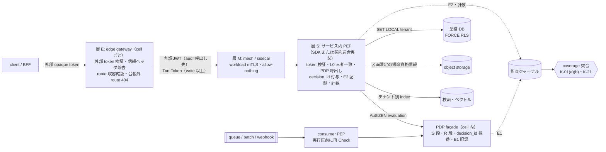
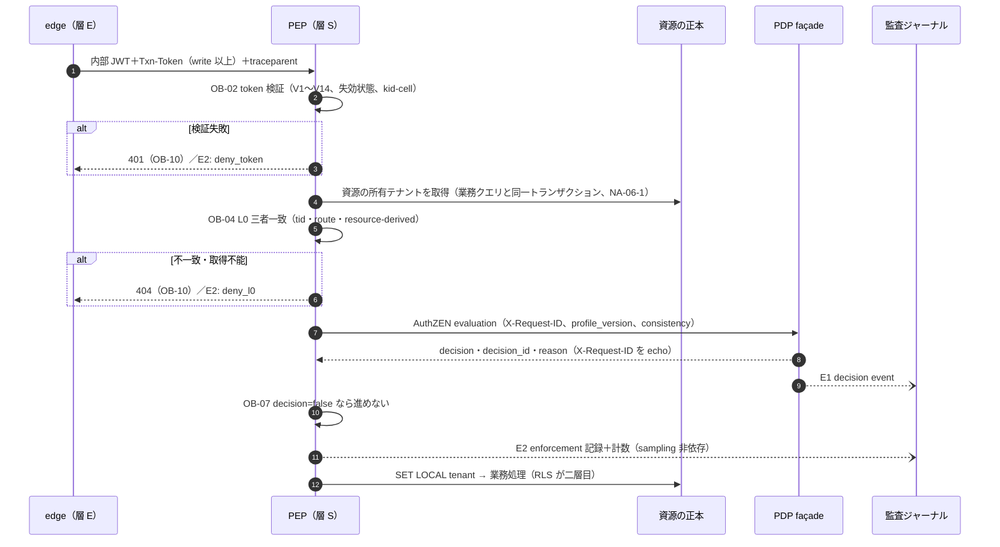
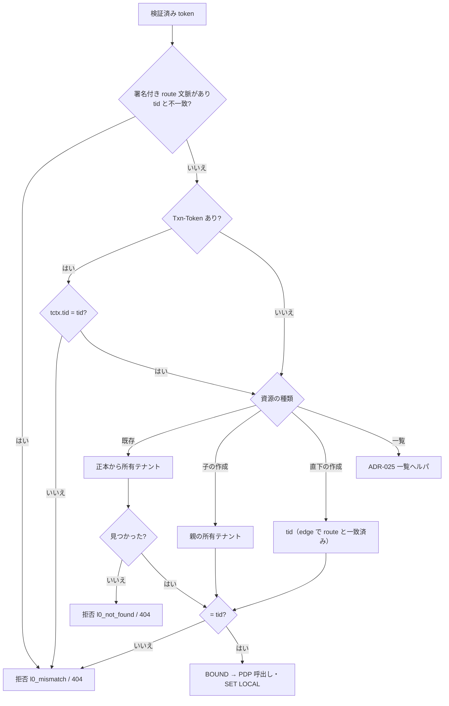

# PEP 契約・coverage・storage guardrail 検証仕様

> 文書ID: ARC-06 / 版: 0.2 / 状態: review / 最終更新: 2026-10-15
> 対応要求: R-059, R-060, R-061, R-062, R-250, R-254, R-262, R-269, G-072, G-082（R-requirements.md・G-goal-criteria.md で本書を対応成果物に含む全行）。関連: R-058, R-164, R-172, R-011, R-143, R-283, R-065, R-071, R-242, G-083, G-105, G-114, G-136, G-140, G-121, G-122
> 依存文書: CONVENTIONS.md, traceability/deliverables.md（DL-15）, 05_adr/ADR-012, ADR-011, ADR-005, ADR-014, ADR-023, ADR-024, ADR-013, ADR-006, ADR-021, ADR-022, ADR-025, ADR-026, ADR-029, 05_adr/reconciliation-notes.md, 01_governance/assumptions-register.md, 01_governance/kri.md（K-01, K-03, K-05, K-06, K-21）, 01_governance/loss-scenarios.md（S-01, S-09）, 01_governance/business-impact-analysis.md（B13）, 01_governance/stop-authority.md（S1, S3）, 02_requirements/operation-risk-tiers-assurance.md（REQ-03 J1〜J11）, 03_threat-model/attacker-model.md, 03_threat-model/threat-catalog.md, 06_controls/applicability.md（X-11）, traceability/claims-ledger.md（CL-0110, CL-0155, CL-0233）, traceability/rejected-hypotheses.md（RH-011, RH-104, RH-116〜RH-119）, research/RS-08, RS-17, RS-07, RS-10, RS-04, research/standards-status.md（SS-B04, SS-C13）
> 作成方法: AI エージェント（Claude）が上記を読み、ADR-012 の決定（D12-xx）を実装仕様に落として単独で起草した。その後、作成者以外の AI エージェント（Claude）が独立レビューを行い本書を修正した（末尾「レビュー記録」）。実在の CTO/CISO の判定ではない（CONVENTIONS §8）[D]。research ノートにない原典として PostgreSQL 18 の `pg_class`・`pg_roles`、Envoy ext_authz、Redis ACL の文書を、起草者とレビュー者がそれぞれ 2026-10-15 に取得して確認した（照合ログへの追記は未了）[D]。
> 表記: 本書の PEP 義務は OB-xx、静的検査規則は SR-xx（括弧内に ADR-012 のルール番号）、試験案は TC-06-xx（仮番。DL-22 で採番）、決裁案は K06-x、新規仮定は NA-06-x、他文書との論点は L06-x と書く。表のセルのうちタグのないものは設計推論 [D] であり、本注記で個別のタグに代える。「必須」「禁止」は本書が定める自社規範であり、外部規範の強度は脚注の原典どおりに写した。

---

## 要旨（結論）

1. **PEP は「SDK を入れたか」ではなく「契約上の記録を出したか」で判定する** [D]。全 entry point は、token 検証 → テナント照合（L0）→ PDP 呼出し → 判定の適用 → enforcement 記録（E2）の順を守り、その結果を decision_id 付きで残す [D]（ADR-012 D12-14、ADR-011 D5-8、ADR-014 D14-08）。SDK を提供しない言語も、契約（DL-72・DL-75）どおりの自前実装で同じ記録と同じ負例ベクタに合格すれば coverage を満たす [D]（ADR-022 D-4-3、G-140）。
2. **テナント照合は 3 値の完全一致で、越境共有にも例外を作らない** [D]。token の `tid`、route テナント（edge が収容を確かめた値）、resource-derived tenant（資源の正本から引いた所有テナント）の 3 値が 1 つでも一致しなければ拒否する [D]（ADR-024 D24-07・D24-08、ADR-011 D1-1）。照合点は ADR-024 D24-07 の 3 つ（edge が (i)(ii)、PEP の L0 と façade の G 段規則 1 が (i)(iii)）であり、PEP は署名付きの route 文脈を受け取れる場合に限り (ii) も重ねて照合する [D]（§3.3、L06-10）。越境共有はゲストに資源側テナントの token を発行する形で表すので、照合式は変わらない [D]（ADR-024 D24-01）。なお ADR-012 D12-04 は「三者」を token の `tid`・資源の正本から導いたテナント・PDP 要求の `resource.properties` のテナントと定義しており（ARC-01 §4 T11 はこちらで書く）、ADR-024 D24-07 の (ii) route テナントと 3 つ目の値が異なる。本書は (iii) と `resource.properties` のテナントの一致も §3.3 で検査するので両定義を満たすが、正とする定義は未決（ADR-012／ADR-024。architecture-reconciliation-notes.md XR-07）[D]。特権 support の例外は façade の G 段の型付き例外であり、PEP の L0 に迂回の引数を作らない [D]（ADR-024 D24-09、ADR-029 D29-11）。
3. **coverage は「宣言×観測×DB 接続元」の 3 集合の差分と「判定なしで完了した要求」の計数で機械検証し、CI と本番の日次走査で 0 件を条件にする** [D]（ADR-012 D12-11〜D12-19）。計数は trace の sampling から独立させる [D]。OpenTelemetry の Sampler が DROP を返すと span は記録されないからである [N][^9]（RS-10#22）。結果は K-01(a)(b)・K-06 として報告する [D]。
4. **ストレージ側 guardrail はテナント境界だけを担う二層目である** [D]。PostgreSQL は ENABLE＋FORCE RLS、非 owner かつ NOBYPASSRLS のアプリロール、`security_invoker` の view、`SET LOCAL` だけのテナント文脈を必須にし、DB カタログの走査で検査する [V][^14][^15][^16][^17][^18][^23][^24][D]（RS-08#40〜#50）。object storage は区画に限った短命資格情報、検索・ベクトルストアはテナント別 index、共有キャッシュはキー規約で分ける [D]（ADR-012 D12-24〜D12-28）。
5. **「bypass 不能」とは書かない** [D]。旧提案のこの主張は証明のない性質の主張として棄却済みである（CL-0110、RH-011）[D]。本書が示すのは、K-01・K-03・K-05・K-06 の値、cross-tenant property test、本番相当環境の迂回試験、独立 pentest（DL-59）という証拠の取り方までであり、実測と第三者評価はすべて未達である [D]。
6. **経営判断が要る点は 4 件**（§10。sidecar 例外の期限、違反時の遮断範囲、coverage 工具の要員、他テナント資源への応答の統一）[D]。**ADR で未決の点は 12 件**あり、本書ではそれぞれ「未決（ADR-0xx）」と明記して安全側の暫定動作を置いた（§11）[D]。ADR 側の記述の食違いと考える点は「ADR への指摘」（§11.1）に 4 件記した [D]。
7. **連携開発者が行うことは §4.3 の 12 項目**であり、各項目に合否を判定する検査（SR・TC・DL-80）を対応させた [D]。

---

## 1. 本書の位置付けと範囲

### 1.1 位置付け

- 設計判断の正本は ADR-012 であり、本書はその決定を連携開発者と検証者が実装・判定できる仕様にしたものである [D]。ADR-012 と食い違う場合は ADR-012 が優先し、食い違いは本書の改訂で解消する [D]。
- 本書は ADR-012 §9.1 が DL-15 に割り当てた「台帳 schema、enforcement 記録、ルール R-01〜R-16、TC」の仕様化を担う [D]。

| 本書が定めるもの | 他の正本に委ねるもの |
|---|---|
| PEP の義務と処理順序（§3） | token 検証規則 V1〜V14 の内容（ADR-005 D2、DL-75） |
| テナント照合のアルゴリズムと例外の扱い（§3.3） | 越境共有のモデル（ADR-024）、特権アクセスの型（ADR-029） |
| SDK の最小 API と責務の線引き（§4） | SDK 方針の上限（ADR-022 D-4）、AuthZEN profile の欄（DL-72） |
| 配置パターンと coverage の数え方（§5） | 連携パターン P-xx の個別記述（DL-64） |
| coverage の機械検証（§6） | entry point inventory の DFD 上の位置付け（DL-10） |
| storage guardrail の検証（§7） | PEP 外データ経路の統制本体（DL-57） |
| bypass 試験の設計（§8） | 独立 pentest の実施計画（DL-59） |
| — | fail-mode の値（DL-19）、数値契約（DL-20）、監査スキーマ（DL-77） |

### 1.2 前提

| 項目 | 値 | 出典 |
|---|---|---|
| 依存サービス数 | 300 | [A-050] |
| entry point 総数 | 1.2 万（範囲 4,500〜3 万） | [A-055] |
| 認可 Check | 基準ピーク 42,009/秒 | [A-045] |
| edge 呼出 1 件あたり Check | 2.5（gateway 段 1＋resource-local PEP 1＋子資源・フィールド 0.5） | [A-025] |
| 既存の認可実装 | 自前 80%、テナント分離をアプリ層の検索条件だけで行うサービス 70% | [A-112] |
| PEP SDK・開発者支援要員 | 4 FTE（24 FTE の内数） | [A-054] |
| coverage 工具の構築・維持 | 構築 3〜5 FTE×12〜18 か月、維持 2〜3 FTE/年（A-054 の外数） | NA-012-1（ADR-012 の新規仮定。前提台帳へ追加要） |
| RLS の後付け工数 | 1 サービス 0.5〜2 人月 | NA-012-2（同） |
| 業務 DB の主たる製品 | PostgreSQL 系 | NA-012-3（同） |

- **NA-06-1（新規仮定。前提台帳へ追加要）**: resource-derived tenant の取得は、業務データの取得と同じクエリまたは同じトランザクションで行え、PEP のために追加の往復を要しない [D]。成り立たない資源型（外部ストアの資源、子資源だけを受け取る API）の比率と遅延増は TC-06-03 で測る [D]。

### 1.3 攻撃者と損失シナリオ

| 攻撃者（attacker-model） | 本書で効く統制 | 損失シナリオ |
|---|---|---|
| ATK-03 侵害された一般ユーザー（他テナント ID の指定） | OB-04 三者一致、§7.1 RLS、§8.2 property test | S-01 |
| ATK-02 悪意あるテナント管理者（テナント文脈ヘッダの偽装） | OB-01 信頼ヘッダの除去、OB-04 | S-01 |
| ATK-06 侵害された microservice（gateway 迂回、全テナント DB 接続） | §5 層 M の allow-nothing、§7.1 NOBYPASSRLS、§7.2 token vending | S-01, S-09 |
| ATK-11 DB read 権限者 | §7.5 特権データ経路の計数（本体は DL-57） | S-09 |
| ATK-17 内部不正の開発者（PEP 呼出しの削除、fail-open 実装） | §6.3 必須静的規則、§6.4 実行時突合、規則変更の二者レビュー | S-01（本書の経路で生じる損失。attacker-model の主たる対応は S-08, S-05） |
| ATK-19 変更と自動化の誤り（mesh ポリシーの削除、RLS の無効化） | §6.5 本番構成の日次走査 | S-01（同上）, S-06 |

---

## 2. 全体像



- object 単位の判定（BOLA 対策）は資源を知る層 S だけが担い、層 E・層 M の判定は object 単位の coverage に数えない [D]（ADR-012 D12-01、RS-08#38）。ASVS 8.2.2（L1）は機能・データ単位の明示許可を求め、IDOR・BOLA の緩和を目的に挙げる [N][^1]（RS-08#3）。API1:2023 は token から取り出した利用者 ID と ID パラメータの比較だけでは不十分としている [N][^5]（RS-08#8）。
- PDP/PEP は、トラフィック上の自らの位置より先では追加の方針を適用できず、暗黙の信頼ゾーンはできる限り小さくしなければならない（must）[N][^41]（RS-08#19）。層 S を資源の直前に置くのはこのためである [D]。

---

## 3. PEP の義務（契約条項）

### 3.1 処理順序

全 entry point の PEP は次の順で処理する。順序を入れ替える実装は SR-01・SR-02 で検出する [D]。



### 3.2 義務の一覧

| ID | 義務 | 必須の範囲 | 根拠 | 検査 |
|---|---|---|---|---|
| OB-01 | 層 E は、外部から届いたテナント・利用者ヘッダを除去し、後段への主体・テナント情報は署名付き token（内部 JWT・Txn-Token）で渡す。層 S は未署名ヘッダを判定の入力にしない | 全経路 | ASVS 4.1.3（L2）は中間層が設定するヘッダをエンドユーザーが上書きできないことを求める [N][^3]（RS-08#22）。IAP の公式文書は迂回時に未署名ヘッダが偽造され得るとする [V][^39]（RS-17#79）。ADR-005 D1-5、ADR-012 D12-02 | SR-09、TC-012-15 |
| OB-02 | token を検証する（§3.4） | public 以外の全 entry point | ADR-005 D2・D1-6、ADR-021 D21-07、ADR-006 D6-03 | DL-80 の負例ベクタ |
| OB-03 | 処理を始める前に、自分の entry point ID と台帳上の操作階層を確定する。台帳にない entry point では処理しない | 全 entry point | REQ-03 J10、ADR-012 D12-13 | §6.2 の差分 O∖S |
| OB-04 | L0 のテナント三者一致を PDP 呼出しの前に照合する（§3.3） | public 以外の全 entry point | ADR-011 D1-1、ADR-024 D24-07、ADR-012 D12-04 | TC-06-01、§8.2 |
| OB-05 | 既定は拒否する。判定が得られない・解釈できない・照合できない場合はすべて拒否側に倒す（§3.5） | 全層 | ADR-011 D3-1・D3-3・D5-8、ADR-013 D13-23 | SR-02、TC-012-05 |
| OB-06 | PDP façade を AuthZEN 1.0 evaluation／evaluations で呼ぶ。engine を直接呼ばない（§3.6） | read-sensitive 以上 | ADR-011 D5-1・D5-3・D5-4 | SR-04 |
| OB-07 | decision が false なら要求を進めない | 全判定 | AuthZEN 1.0 は decision が false なら要求を進めてはならない（MUST NOT）[N][^32]（RS-07#63） | SR-02 |
| OB-08 | decision_id を受け取り、enforcement 記録（E2）に残す。PEP は decision_id を自ら作らない（§3.7） | read-sensitive 以上。public は理由を記録 | ADR-011 D5-3・D6-1、ADR-014 D14-08 | §6.4 の双方向突合 |
| OB-09 | `Txn-Token` と `traceparent` を無改変で下流へ渡し、業務側の監査に `txn` と decision_id を残す（§3.8） | 全経路 | ADR-022 D-8-6、ADR-014 D14-18 | DL-80、H-4（ADR-022） |
| OB-10 | エラー応答は §3.10 の写像に従い、存在・件数・拒否理由を区別させない | 全 entry point | ADR-012 D12-39、ADR-025 D25-16、REQ-03 J4 | TC-06-05 |
| OB-11 | 認可の allow を SDK・契約適合実装の外で cache しない。キャッシュのキー構成は §3.9 に従う | 全サービス | ADR-006 D6-10、ADR-023 D23-10(3)、ADR-012 D12-27 | SR-15、SR-17 |
| OB-12 | 監査を独立経路で送出し、sampling から独立した計数を出す（§3.8） | 全 entry point | ADR-014 D14-02、ADR-012 D12-12 | K-21、TC-012-02 |
| OB-13 | データアクセスの前にストレージ側のテナント文脈を、L0 を通ったテナントだけから設定する | テナントデータを扱う全経路 | ADR-012 D12-21(4)・D12-33、ADR-026 D26-03a | SR-03、SR-13 |
| OB-14 | 非同期の受付・実行・配信を、それぞれ独立した entry point として扱い、実行直前に再 Check する（§3.11） | queue・batch・webhook・stream | ADR-012 D12-32、ADR-026 D26-03・D26-10 | SR-16、TC-012-07 |
| OB-15 | 迂回の引数・設定（テナント照合の省略、判定の省略、fail-open）を持たない | SDK と自前実装 | ADR-024 D24-09(4)、ADR-022 D-4-2 | SR-02、TC-06-02 |

### 3.3 テナント照合（L0）のアルゴリズム

**定義** [D]（ADR-024 D24-07）

| 値 | 出所 | 取ってはならない場所 |
|---|---|---|
| (i) token テナント `tid` | 検証済み内部 JWT の `tid`（1 token に 1 つ。ADR-005 V9） | 未署名ヘッダ、要求本文 |
| (ii) route テナント | 要求が宛てたテナント。edge が署名済み配置スナップショットで自 cell の収容と確かめ、(i) と照合済みの値（ADR-013 D13-11、ADR-024 D24-07）。PEP は署名付きの運び手（write 以上では Txn-Token の `tctx`）がある場合だけ受け取る | path・ヘッダの生値 |
| (iii) resource-derived tenant | 資源の正本ストアに記録された所有テナント（ADR-021 D21-14） | 資源 ID の文字列、要求パラメータ、header、path |
| (iv) Txn-Token の `tctx` テナント | Txn-Token を受けた場合だけ。TTS が入れた値（ADR-005 D9-3、ADR-021） | — |
| (v) PDP 要求のテナント | PEP が組み立てる `subject.properties`・`resource.properties` のテナント（ADR-011 D6-1） | (i)〜(iii) 以外の値 |

**手順** [D]

```
function bind_tenant(token, signed_route_ctx, resource_ref, op):
  t_tok   := token.tid                                  # (i) OB-02 で検証済み
  if t_tok == null: return DENY(l0_missing)
  if txn_token present and txn_token.tctx.tid != t_tok: return DENY(l0_mismatch)
  t_route := signed_route_ctx.tenant if present else null  # (ii) 署名を検証できた場合だけ（L06-10）
  if t_route != null and t_tok != t_route: return DENY(l0_mismatch)
  # 署名付き (ii) がない要求は、edge の (i)=(ii) 照合（ADR-024 D24-07）に依拠し、PEP は (i)=(iii) を必ず照合する
  switch op.resource_kind:
    case EXISTING:                                       # 既存資源の参照・更新・削除
      t_res := resolver.owner_tenant(resource_ref)       # 正本ストアから。業務クエリと同一 Tx（NA-06-1）
      if t_res == NOT_FOUND: return DENY(l0_not_found)   # 応答は他テナントと同じ（OB-10）
      if t_res == UNRESOLVABLE: return DENY(l0_indeterminate)
    case CREATE_CHILD:                                   # 親（container）配下への作成
      t_res := resolver.owner_tenant(parent_ref)         # 親の所有テナントを (iii) とする
    case CREATE_ROOT:                                    # テナント直下への作成
      t_res := t_tok                                     # 作成後の所有テナントは t_tok で固定し不変（ADR-024 D24-10）。route は edge で一致済み
    case COLLECTION:                                     # 一覧・検索
      return ADR-025 一覧ヘルパへ（候補生成はテナントで先に絞る。D25-06）
  if t_res != t_tok: return DENY(l0_mismatch)
  return BOUND(t_tok)    # 以後 PDP 要求 (v) と DB 文脈（OB-13）はこの値だけを使う
```

- 1 つの要求が複数の資源に触れる場合（bulk、GraphQL の複数 field）は、資源ごとに (iii) を求め、1 つでも不一致なら要求全体を拒否する [D]。階層は含まれる最上位で分類する（REQ-03 J6）[D]。
- (iii) を引けない資源（外部ストアの資源など）は評価不能として拒否する（ADR-011 D3-3 と同じ扱い）[D]。資源 ID にテナント ID を埋め込まない（INV-1、ADR-021 D21-14）ので、ID から推測しない [D]。
- L0 の照合は façade の G 段規則 1（テナント不一致の決定論的 deny）と二重化された別の照合点であり、片方を省く理由にしない [D]（ADR-012 §9.2 L-05、ADR-024 D24-07 の 3 照合点）。テナント越境の deny を PEP 側だけで評価する案は棄却済みである（RH-104）[D]。



**例外の扱い**

| 場面 | L0 の扱い | 例外を担う場所 | 状態 |
|---|---|---|---|
| 越境共有（ゲスト・認証付きリンク） | 例外なし。ゲストは資源側テナントの token（tid＝資源側）で来るので三者一致が成り立つ [D]（ADR-024 D24-01・D24-08） | façade の G 段規則 1 の後段で、主体が tid に有効な内部所属または外部付与を持つかを確かめる [D]（ADR-024 D24-08） | 決定済み。G 段規則 1 の文言の改訂は未決（ADR-024 §2.10 L-1、ADR-011） |
| 匿名リンク（公開分類のデータ、および J11 の引下げを承認された個人情報） | token がないので (i) はない。所有サービスの PEP は、リンクの秘密値の hash から引いたリンク記録の状態（有効・期限・取消し）を確かめ、リンク記録の資源と要求の資源が一致し、その資源の (iii) がリンク記録の資源側テナントと一致することを照合する [D]（ADR-024 D24-06 から導出） | 例外台帳（public、または J11 の受容票） | リンクの状態確認は決定済み（D24-06）。token のない要求での L0 の代替照合は ADR-024 に明記がなく、本書の暫定案（L06-10） |
| 特権・support アクセス（SL1〜SL4） | L0 は通常どおり適用する。L0 に呼出し側が指定できる迂回の引数を作らない [D]（ADR-029 D29-11(1)、ADR-024 D24-09(4)） | façade の型付き例外「特権アクセス」（ADR-011 D3-5、ADR-029 D29-11(2)(3)） | **未決（ADR-029 L29-1・L29-3、ADR-024 D24-09(1)(4)）**: ADR-029 は support 要員の token の `tid` を定めていない。D29-11(1) は L0 を通常どおり適用し、D29-11(2) は G 段規則 1 を昇格 grant の対象テナントに限って例外にするが、L0 と G 段規則 1 は同じ (i)(iii) を照合する（D24-07）ため、両者を同時には満たせない（§11.1 指摘 1）。tid を対象テナントにして発行する形（JIT の所属、D24-09(1)）を採るか、署名付きの例外根拠（昇格 grant ID の運び方は L29-3）を token に載せて L0 に例外型を足すか（D24-09(4)）が決まっていない。決まるまでは L0 の例外を実装せず、対象テナント文脈の token でない support 要求は L0 で拒否する [D] |
| break-glass/P | 基盤の PEP・PDP に依存しない別経路（ADR-013 D13-25、ADR-029） | 本書の範囲外 | 決定済み |
| テナント統合（T08）の切替後 | 統合元 tid を含む token は拒否する [D]（ADR-028 D28-16 の T08 行） | 正本の所有テナント属性の付け替え | 決定済み |
| テナントの cell 間移動中 | 照合式は不変。鍵は移動元・移動先の両方を受理する [D]（ADR-021 D21-07） | token 検証（OB-02） | 決定済み |
| テナント横断のシステムジョブ | 例外にしない。処理対象テナントごとに token・Txn-Token・判定を取り直す [D]（ADR-026 D26-12） | — | 決定済み |

### 3.4 token 検証（OB-02）

| 位置 | 検証すること | 正本 |
|---|---|---|
| 層 E | 外部 opaque token を状態ストアへ RFC 7662 で照会し、cache 齢を応答の exp 以下に抑える。迂回経路はネットワークで遮断する | ADR-005 D1-2・D1-5 |
| 層 S | 内部 JWT を V1〜V14 で検証する（alg allowlist、iss 完全一致、typ、aud に自サービス、exp、cnf、tid は 1 つ、query の token 拒否、none 拒否）。規則は利用側で無効化できない | ADR-005 D2 |
| 層 S | kid がその issuer の JWKS にあり、鍵の cell と tid の収容 cell が一致し、区画間で鍵を共有していない | ADR-021 D21-07 |
| 層 S | write 以上・FAPI 範囲では Txn-Token（typ=txntoken+jwt）を内部 JWT と一緒に検証する。Txn-Token を単独で信頼せず、呼出し元は mTLS で別に認証する | ADR-005 D9-3、ADR-022 D-8-4 |
| 層 S | privileged・break-glass/B・FAPI 範囲では jti・sid を状態ストアと毎要求照合する | ADR-005 D1-6、ADR-006 D6-11 |
| 層 S | 失効状態（範囲×失効時刻の境界）と照合し、失効状態の齢が M_rev を超えたら read-sensitive 以上を拒否する | ADR-006 D6-06・D6-08 |
| 層 S | 認証強度（acr・auth_time）が操作階層の最低強度に足りなければ step-up を求める | ADR-002、façade の G 段規則 4（ADR-011 D1-2） |

- Storm-0558 では、開発者がライブラリが完全に検証すると誤認して issuer・scope の検証を追加していなかったという一次報告があり、規則を既定動作にして外せないようにする理由になっている（ADR-005 D2 が RS-12#5 を引用）[D]。独自の JWT 検証実装と alg 名の直書きは CI で検出する（SR-18・SR-19）[D]（ADR-005 D2 末尾、ADR-015 D15-02）。

### 3.5 deny-by-default（OB-05）の層ごとの実現

| 層 | 実現 | 既定値の事実 | 検査 |
|---|---|---|---|
| edge | 台帳外 route を 404 | — | SR-05 |
| mesh | namespace 単位の allow-nothing＋呼出し元 workload ごとの明示 ALLOW | Istio は ALLOW ポリシーが 1 つもない workload への要求を許可する [V][^10]（RS-08#36） | SR-06 |
| sidecar（例外） | 外部認可の `failure_mode_allow=false` | Envoy の既定は false。true だと認可サービスとの通信失敗・5xx でも要求を受け入れる [V][^11] | SR-07 |
| PEP SDK・自前実装 | 判定が得られなければ拒否。read-sensitive だけは、KD13-6 で fail-static を許すと決裁された後に限り、known-good の 4 条件を満たす場合に継続（ADR-013 D13-24〜D13-26、ADR-012 D12-07）。決裁までは read-sensitive も拒否（L06-9） | — | SR-01・SR-02、TC-012-05 |
| PostgreSQL | ENABLE＋FORCE、ポリシーなしは拒否 | ポリシーのない RLS 表は既定拒否 [V][^14]。FORCE は既定で無効 [V][^15] | SR-10〜SR-13 |
| 共有キャッシュ | 既定ユーザーを無効化し、サービスごとの ACL ユーザー | Redis の既定ユーザーは全キー・全コマンドに到達でき、新しい接続は自動で既定ユーザーとして認証される [V][^29] | SR-15 |
| object storage | bucket policy の既定拒否と IAM 条件 | — | SR-14 |

- 認可判定の fail-open はどの層・どの依存 Tier でも禁止する [D]（ADR-013 D13-23、ADR-023 要旨）。fail-mode の値と階層別の挙動は ADR-013 D13-25 と DL-19 に従い、本書は新たに決めない [D]。
- 「判定が得られない」とは、façade 不達・timeout、`deny_unavailable`、`deny_indeterminate`、`unsupported_profile`、応答の decision_id 欠落、X-Request-ID の echo 不一致のいずれかである [D]（ADR-011 D3-3・D3-6・D5-5・D6-1）。評価不能（`deny_indeterminate`）を known-good で許可に変えない [D]（ADR-011 D3-6）。

### 3.6 PDP 呼出し（OB-06）

| 欄 | 値 | 欠けた場合 |
|---|---|---|
| X-Request-ID（ヘッダ） | PEP が要求ごとに採番する不透明値 | 応答で同じ値が返らなければ判定なしとして扱う（OB-05）。AuthZEN 1.0 は PEP が付けた要求 ID を PDP が応答に含めることを求める [N][^32]（RS-07#66） |
| `subject` | `sub`、主体種別、委任時は現在の actor（`act`）。テナントを `subject.properties` に入れる | — |
| `resource` | 資源の型と ID（ADR-021 の名前空間）。§3.3 で BOUND したテナントを `resource.properties` に入れる | — |
| `action` | 台帳の entry point に紐づく操作 | — |
| `profile_version`（同下） | DL-72 の版 | façade は未対応 major で `unsupported_profile` を返す |
| `consistency.mode`・`consistency.token`（`context` 内の名前空間付きキー。名前は ADR-021 で確定） | mode は階層ごとの既定（§3.11 の表と DL-17）。write 以上は `fully_consistent`。token は façade が発行した不透明値をそのまま渡す | mode が欠ければ階層の既定。token を façade が解釈できなければ `fully_consistent` に格上げ（ADR-011 D6-1） |
| `model.pin`（同上） | テナントの現行固定版 | 欠ければ現行固定版。最新版にはしない（ADR-011 D6-1） |
| timeout・retry | DL-19・DL-20 の操作階層ごとの設定値。SDK に埋め込まない | ADR-022 D-4-2 |

- 複数資源の判定は evaluations を使い、「全て必要」は `deny_on_first_deny`、「いずれか」は `permit_on_first_permit` に固定し、後者は privileged 以上で使わない [D]（ADR-011 D3-7）。
- 一覧・検索は SDK の一覧ヘルパ（ADR-025）だけを使い、返す各資源を evaluations（`execute_all`）で後段 Check する [D]（ADR-025 D25-03・D25-04）。engine の ListObjects 等や AuthZEN search を直接呼ぶ実装は SR-04 で拒否する [D]。

### 3.7 decision_id と enforcement 記録（OB-08）

- decision_id は façade が採番する推測困難で一意な ID であり、PEP は受け取って記録するだけで生成しない [D]（ADR-011 D5-3・D6-1）。
- enforcement 記録（ADR-014 の E2）の欄は次のとおりとする。欄名は DL-77・ADR-021 で確定する（ADR-012 冒頭の不可逆側 (2)）[D]。

| 区分 | 欄 | 備考 |
|---|---|---|
| 識別 | entry point ID、PEP 識別子（サービス ID・実装種別 SDK／自前／sidecar・版）、producer_seq | 実装種別は L-01 の検査に使う |
| 相関 8 欄 | iss、jti_ref、sid、grant 参照、txn、decision_id（複数可）、request_id（X-Request-ID）、trace_id | reconciliation-notes §3.2、ADR-014 D14-18。jti は鍵付きハッシュ（ADR-014 D14-21） |
| 判定の適用 | 適用結果（allow 適用／deny 適用）、L0 の結果（一致／不一致／未解決）、拒否の内部理由（下表）、適用した fail-mode、鮮度区分（fresh／known-good と齢）、操作階層 | known-good では元の判定記録の decision_id を記録し、「判定を伴った要求」に数える（ADR-012 D12-14） |
| 文脈 | tid、cell_id、資源型、資源 ID は res_ref（鍵付きハッシュ）、主体は subj_ref（仮名） | ADR-014 D14-09 の欄区分 |

**拒否の内部理由（enforcement 記録用。エンドユーザーには返さない）**

| 値 | 意味 |
|---|---|
| `deny_token` | OB-02 の検証失敗 |
| `deny_l0:<missing\|mismatch\|not_found\|indeterminate>` | OB-04 の照合失敗 |
| `deny_pdp:<reason>` | façade の reason（ADR-011 D6-1 の閉じた列挙）をそのまま写す |
| `deny_failmode` | 判定が得られず fail-mode により拒否 |
| `public_static` | public 階層で SDK 内の静的規則により処理（decision_id の欠落と区別する。ADR-012 D12-14） |

- L0 の拒否は PDP の応答ではないため ADR-011 §2.6 の reason 列挙に該当値がなく、enforcement 記録側の値として DL-72 で別に定める必要がある [D]。**未決（ADR-012 §9.2 L-05、ADR-011）**。上表は本書の暫定案である [D]。

### 3.8 伝播と監査送出（OB-09・OB-12）

- `Txn-Token` ヘッダと `traceparent` を無改変で下流へ渡す [D]（ADR-022 D-8-6）。Txn-Token は Authorization ヘッダに置かない [D]（ADR-005 D2 の種別表）。Txn-Token の全文はログに残さない [N][^33]（RS-06#41）。Transaction Tokens は Internet-Draft（-11、IESG 未提出、確認日 2026-10-03）であり状態が変わり得る [N][^33]（standards-status SS-B04）。
- 主体・テナント・資源の識別子を traceparent・tracestate・baggage に載せない [N][^36][D]（RS-10#16、ADR-014 D14-04）。span に載せてよい監査由来の値は decision_id だけとする [D]（ADR-014 D14-04）。edge は外部から届いた traceparent を信頼境界で再採番し、外部の値は別属性に退避する [D]（ADR-005 D9-2）。Trace Context は外部の trace を素直に継続すると攻撃者が trace-id の衝突を偽造し得ると述べている [N][^36]（RS-10#17）。
- `txn` の発行範囲は write 以上であり、public・read-sensitive の要求は (jti_ref, decision_id, request_id) で相関する [D]（ADR-005 D9-3）。**未決（ADR-005 §2.15 U2、reconciliation-notes U-02）**: 全要求に発行するかは H-20 の実測後に CTO＋CISO が決める [D]。本書の義務は「Txn-Token があれば検証して伝播する」と定め、どちらの結論でも変えない [D]。
- 監査は OpenTelemetry の SDK・collector を経由せず、監査 SDK から cell 内の耐久ジャーナルへ直接書く [D]（ADR-014 D14-02）。PEP は entry point ID ごとに「処理した要求数」と「判定を伴った要求数」を sampling なしの計数（metrics）で出す [D]（ADR-012 D12-12）。監査 sink 停止時はローカル spool（上限 Q_r・Q_w は DL-19）を使い、上限を超えたら階層の規則で拒否する [D]（ADR-013 D13-25 の監査列）。

### 3.9 キャッシュ規則とキー構成（OB-11）

| キャッシュ | 置いてよい場所 | キー構成 | 最大齢・破棄条件 | 正本 |
|---|---|---|---|---|
| 認可判定（known-good） | PEP SDK・契約適合実装の内部だけ。read-sensitive に限る。KD13-6 の決裁（L06-9）までは無効にして出荷する | (tid, `sub`, 現在の actor, 主体種別, action, 資源型, 資源 ID, 判定に効く context 要素のハッシュ, model_revision, G 段カタログの版) | min(B, B_rs)。局所の失効 epoch が判定時より進んだら破棄。policy の最低許容版未満なら使わない（ADR-013 D13-24 の 4 条件）。平常時と PDP 不達時で条件を変えない | ADR-006 D6-10、ADR-013 D13-24〜D13-26 |
| 認可判定 | write・privileged・break-glass | — | 使わない | ADR-006 D6-10、REQ-03 §3.1 |
| 外部 token の照会結果 | edge だけ | (token のハッシュ) | 応答の exp 以下、かつ C_edge（操作階層ごと。値は ADR-006・DL-20） | ADR-005 D1-2 |
| JWKS・discovery | SDK・edge | (issuer, kid) | 取得に失敗したら前回の値を使い続けて警報を出す | ADR-023 D23-10(5) |
| テナント→cell 対応表 | SDK・edge | 署名付き配布物の版 | 最後に検証できた版を期限内に限って使い、期限切れで拒否 | ADR-021 D21-07 |
| 失効状態 | SDK・edge・STS・TTS | 範囲（sub・sid・grant・client・tid・cell）×失効時刻 | 齢が M_rev を超えたら read-sensitive 以上を拒否 | ADR-006 D6-06・D6-08 |
| アプリケーションキャッシュ（業務データ） | 依存サービス | 区画キー（テナント）を必須。応答が主体・権限に依存する場合は主体または判定範囲も必須。キーは基盤の共通ライブラリで生成 | 業務側の規定。ただし allow の代用にしない | ADR-012 D12-27 |
| HTTP・CDN | read-sensitive 以上は、キャッシュキーにテナントと主体を含められる構成だけ | (tid, 主体, URL) | 含められなければ共有キャッシュに載せない | ADR-012 D12-27 |

- 区画キーは区画レジストリが割り当てる内部値でテナント ID そのものではない（INV-1、ADR-012 D12-24）[D]。共有キャッシュ（Redis 等）の ACL はサービス単位の境界であってテナント単位の境界ではなく、テナント間の分離はキー規約と SR-15 に依存する（残余リスク RR12-05）[D]。Redis の key pattern はキー引数を取らないコマンド（FLUSHALL 等）を制限しないため、これらのコマンドを明示的に外す [V][^29][D]。

### 3.10 エラー応答（OB-10）

| 状況 | 応答 | 理由・正本 |
|---|---|---|
| token が無い・無効・失効 | 401。原因の細目は返さない | 内部理由は E2 の `deny_token` に残す [D] |
| 認証強度の不足 | 401 と step-up の指示（`insufficient_user_authentication`、`acr_values`・`max_age`） | RFC 9470 は RS がこのエラーコードと auth-param で追加認証を求められると定める [N][^37]（RS-04#72） |
| 機能単位の拒否（資源 ID を含まない操作の BFLA） | 403 | 資源の存在を示さない場合に限る [D] |
| 資源単位の拒否、L0 不一致、他テナントの資源、存在しない資源 | **同じ応答**（既定 404。本文・ヘッダを同一にし、時間の差を設計上つくらない） | 存在・件数・エラー応答の差は read-sensitive の「返す」に含まれる（REQ-03 J4）。ADR-012 D12-39、ADR-025 D25-16。既定値の選択は決裁案 K06-4 |
| write 以上で判定が得られない | 503（再試行可能、Retry-After 付き） | ADR-013 D13-25 の write 行 |
| read-sensitive で判定が得られず known-good も条件外（KD13-6 の決裁までは known-good を使わないので、判定が得られなければこの行） | 503（再試行可能） | ADR-013 D13-25 の read-sensitive 行、L06-9 |
| 一覧で後段 Check ができない | 空の一覧ではなく「利用不可」 | ADR-025 D25-19 |
| 一覧の打切り | `completeness=incomplete` と理由 | ADR-025 D25-07・D25-21 |

- façade の reason はエンドユーザーに返さない [D]（ADR-011 D6-1）。依存サービスはエラー文言・理由句の文字列一致に依存しない [D]（ADR-022 D-3-2）。
- 応答時間の差は RS-08 にも原典の測定がなく、TC-06-05 で測るまで「差がない」と主張しない [D]。一覧・検索では post-check で落ちる候補数に比例する時間差が残り、ADR-025 はこれを残余リスク RR-25-2 としている（D25-16）[D]。

### 3.11 非同期経路（OB-14）

- queue consumer・batch の各実行単位・webhook 配信・ストリームの接続と購読は、それぞれ台帳上の独立した entry point として層 S の PEP を持つ [D]（ADR-012 D12-32・D12-36）。型（A1〜A4）の宣言がない consumer・batch は未登録の entry point として扱う [D]（ADR-026 D26-01）。
- 受付時の判定は「受け付けてよいか」の判定であり、実行の根拠にしない [D]（ADR-026 D26-02）。実行時は、型ごとに定めた主体の現在の権限で再 Check する [D]（ADR-026 D26-03・D26-10）。A1・A2 は起点主体（`sub`、実行主体は `act`）、A3 はジョブ主体（PC-14）、A4 は D26-10 の型別の主体である [D]（ADR-026 §2.1 の表）。ASVS 8.3.3（L3）は中継サービスではなく起点主体の権限で判断することを求める [N][^1]（RS-08#57）。
- **テナント文脈の出所**: 実行時の DB 文脈は、メッセージの `tid` ではなく、TTS が受付記録から入れた Txn-Token の `tctx` の tid から設定し、資源側テナントと照合する [D]（ADR-026 D26-03a）。メッセージの `tid` は受付記録を引く参照であり、`tctx` の tid と一致しなければ拒否する [D]。ADR-012 D12-33 は envelope の `tid` と資源テナントの照合を定めており、本書はこの 2 つを「メッセージの tid＝tctx の tid＝resource-derived tenant の三者一致、SET LOCAL は tctx の tid から」と読んで両立させる [D]（L06-1）。
- メッセージに入れてよい認可関連の値は不透明な参照（`job_run_id`、tid、起点主体の `sub`、起点の `txn`、資源 ID）に限り、token・権限一覧・role を入れない [D]（ADR-026 D26-11）。CloudEvents 1.0.2 は context attributes に機微情報を載せるべきでない（SHOULD NOT）とし [N][^35]（RS-17#32）、Auth Context 拡張は保護目的ではないと自ら述べる [N][^46]（RS-17#33）。

| 階層 | 再認可の一貫性 | 正本 |
|---|---|---|
| public | 判定しない（静的規則） | REQ-03 §3.6 |
| read-sensitive | max(受付時の整合性トークン, テナント剥奪フェンス) 以降。剥奪フェンスが有効化されるまでは最新を強制（ADR-012 D12-32 に従う。ADR-026 D26-03(3) はフェンス未有効時を D-13 の bounded としており食い違う。§11.1 指摘 2、L06-11） | ADR-012 D12-32、ADR-010 D-13・D-18。enqueue 時の ZedToken は enqueue 時点以上の鮮度しか保証しない [V][^34]（RS-08#60） |
| write | 最新を強制 | ASVS 15.4.2（確認と実行の原子性）[N][^4]（RS-08#58） |
| privileged | 最新を強制し、起点主体の session 状態を照合。委任ジョブでは実行しない | ADR-026 D26-04c |
| break-glass | 非同期で実行しない | ADR-012 D12-32 |

- **未決（ADR-010・ADR-011、reconciliation-notes U-03）**: OpenFGA を採る場合の read-sensitive の窓 W 方式。決まるまでは最新強制で実装する [D]。
- 再 Check で拒否されたメッセージはデッドレターへ送り、監査に記録し、業務側へ通知する。黙って捨てず、黙って再試行もしない [D]（ADR-012 D12-34、ADR-026 D26-10）。PDP・TTS に届かない間、write 以上は実行せず backoff で待つ [D]（ADR-026 D26-09）。

---

## 4. SDK の最小 API

### 4.1 責務の線引き

- SDK の責務は ADR-022 D-4-1 の 5 つ（token 検証、AuthZEN 呼出しのラッパ、Txn-Token と traceparent の伝播、監査イベントの共通項目の付与と送出、非推奨警告と利用計測）に限る [D]。本書が SDK に求める L0 の三者一致・enforcement 記録・sampling 非依存の計数は、(2) と (4) の内側と読み、契約（DL-72・DL-75）に規範として書く [D]（ADR-012 §9.2 L-07）。**未決（ADR-022 D-4-1 の列挙の改訂、ADR-012 L-07）**。
- ADR-011 D5-4 は「PEP は SDK を通してだけ PDP を呼ぶ」とし、ADR-022 G-140 は SDK なしの適合を求める [D]。本書は coverage を契約上の記録で定義し（要旨 1）、「SDK または契約適合の自前実装を通してだけ」と読む [D]。**未決（ADR-011 D5-4 の文言、ADR-012 §9.2 L-01）**。

### 4.2 API（言語非依存の擬似シグネチャ。名前は ADR-021・DL-72 で確定）

| # | 関数 | 入力 | 出力 | 主な義務 | 持たないもの |
|---|---|---|---|---|---|
| 1 | `init(config)` | entry point 台帳の該当行（生成物）、操作階層ごとの fail-mode 設定（DL-19・DL-20 由来の配布物） | PEP インスタンス | OB-03 | fail-mode の値の上書き |
| 2 | `authenticate(request)` | 要求（内部 JWT、Txn-Token、署名付き route 文脈） | `Principal`（sub、主体種別、act、tid、acr、jti_ref、sid、grant 参照、txn） | OB-01・OB-02 | 検証規則の無効化 |
| 3 | `bind_tenant(principal, op, resource_ref, resolver)` | `resolver` は依存サービスが実装する「正本から所有テナントを返す関数」（業務クエリと同一 Tx） | `TenantBinding` または拒否 | OB-04 | 照合を省く引数、テナントを直接渡す引数 |
| 4 | `authorize(binding, action, resource, opts)` | `opts` は consistency トークン、evaluations のモード | `Decision`（allow、decision_id、鮮度区分）。拒否時は例外ではなく値で返し、`enforce()` を経ずに業務処理へ進めない型にする | OB-05〜OB-08 | 判定不能時の allow、独自 cache |
| 5 | `enforce(decision)` | — | 拒否なら OB-10 の応答を生成。E2 を送出し計数 | OB-08・OB-10・OB-12 | — |
| 6 | `list(binding, query)` | ADR-025 の一覧ヘルパ | `items`・`next_cursor`・`completeness` | ADR-025 D25-04・D25-21 | engine の列挙 API の公開 |
| 7 | `tenant_scope(binding, tx)` | DB トランザクション | `SET LOCAL`／`set_config(..., true)` を発行した Tx | OB-13 | session 単位の `SET` |
| 8 | `storage_credentials(binding, scope)` | 区画・操作 | token vending の短命資格情報 | §7.2 | 任意テナントのタグ指定 |
| 9 | `propagate(outgoing)` | 下流への要求 | Txn-Token・traceparent を無改変で付与 | OB-09 | baggage への識別子の付与 |
| 10 | `enqueue(binding, job_def, params)`／`consume(message)` | ジョブ基盤 SDK（ADR-026） | 受付記録・`job_run_id`／再 Check 済みの実行文脈 | OB-14 | token・権限一覧のメッセージ格納 |
| 11 | `mark_public(reason)` | public 階層の静的規則 | E10 用の集計と `public_static` の記録 | ADR-013 D13-25 public 行 | public 以外での使用（台帳と照合して拒否） |

- 自前実装は 1〜11 と同じ外形の記録・応答・計数を出し、DL-80 の負例ベクタと §6.4 の実行時検査に合格することを適合条件とする [D]（ADR-012 D12-14、ADR-022 D-4-3）。
- SDK・検証器の版差は Tier 1 が N−1、Tier 2・3 が N−2 を提案値とし、確定は DL-70 で行う [D]（ADR-023 D23-11）。SDK の更新は Tier 3 → 2 → 1 の wave で配る [D]（ADR-023 D23-41）。

### 4.3 連携開発者（依存サービス）が行うこと

本表の各項目は配備ゲート（§6.5）または連携開始前の条件（DL-67、G-125）で判定され、1 つでも不合格なら配備できない（例外は例外台帳の承認を要する）[D]（ADR-012 D12-13・§6.4）。段階導入の順序と各段の期限は DL-31 で決まり、決まるまでは ADR-012 §6.4 の順（1〜4→5〜8→9〜10→11〜12）を既定とする [D]。

| # | 行うこと | 合否の判定 | 根拠 |
|---|---|---|---|
| 1 | 全 entry point を IDL（OpenAPI・proto・GraphQL directive・AsyncAPI・ジョブ定義・登録 API）に宣言し、tier・sub_tier・modifiers・data_class・placement・dependency_tier を付ける。consumer・batch は async_type も付ける | 台帳生成で欄の欠落 0 件、SR-05、本番相当環境の O∖S 0 件 | §6.1、D12-08・D12-09、J10 |
| 2 | OpenAPI の operation に空 `{}`・空配列の `security` を書かない（public は例外台帳に登録してから） | SR-05 | §6.1 |
| 3 | 全 handler で `authenticate`→`bind_tenant`→`authorize`→`enforce` を、データアクセスより前に呼ぶ。SDK のない言語は §4.2 と同じ外形を自前実装し台帳に登録する | SR-01・SR-02、DL-80 の負例ベクタ、§6.4 の計数 | OB-02〜OB-08、PP-1・PP-2 |
| 4 | `bind_tenant` に渡す `resolver` を、資源の正本から所有テナントを返す関数として実装する（資源 ID・要求パラメータから推測しない。見つからない・引けない場合は区別して返す） | TC-06-01、§8.2 の property test | §3.3、OB-04 |
| 5 | 未署名ヘッダ（テナント・利用者）を判定や業務ロジックの入力にしない | SR-09、§8.3 | OB-01 |
| 6 | 拒否・不存在・他テナントの応答を §3.10 の写像に揃え、エラー文言で分岐しない | TC-06-05、§8.2 の応答同一性 | OB-10 |
| 7 | 認可の allow を自前で cache しない。アプリケーションキャッシュのキーは基盤の共通ライブラリで生成する | SR-15・SR-17、TC-06-04・TC-06-06 | OB-11、§3.9 |
| 8 | `Txn-Token` と `traceparent` を無改変で下流へ渡し、監査に `txn`・decision_id を残す。baggage に識別子を載せない | DL-80、ADR-022 H-4 | OB-09 |
| 9 | テナント表を ENABLE＋FORCE RLS にし、migration 用 owner とアプリ実行ロール（非 owner・NOBYPASSRLS）を分け、view を `security_invoker=true` にし、テナント文脈は `tenant_scope`（`SET LOCAL`）だけで設定する。PostgreSQL 以外は §7.4 の評価を例外台帳に出す | SR-10〜SR-13、TC-012-09・TC-012-10 | §7.1、§7.4 |
| 10 | object storage は `storage_credentials` の短命資格情報だけで読み書きし、署名付き URL は §7.2 の条件でだけ発行する。検索は共通ライブラリ経由でテナント別 index を使う | SR-14、TC-012-11〜TC-012-13 | §7.2、§7.3 |
| 11 | 非同期の producer は `enqueue` を使い、メッセージに token・権限一覧・role を入れない。consumer は `consume` で実行直前に再 Check し、拒否はデッドレターへ送る | SR-16、TC-012-07 | OB-14、§3.11 |
| 12 | 依存サービスの CI に静的規則（SR-01〜SR-20）、DL-80 の契約試験、cross-tenant property test の生成器を必須ゲートとして組み込む | CI ログ（E4）、K-06(a)(b) | §6.3、§6.5、§8.2 |

---

## 5. 配置パターン

| ID | パターン | 適用条件 | object 単位の coverage | 主な検査 |
|---|---|---|---|---|
| PP-1 | サービス内 PEP（SDK） | 既定。SDK 提供言語（ADR-022 NA-022-1 の 3 言語） | 数える | SR-01〜SR-04、§6.4 |
| PP-2 | サービス内 PEP（契約適合の自前実装） | SDK のない言語 | 数える（DL-80 合格と §6.4 合格が条件） | 同上。静的規則の検出力が弱い点は RR12-02 |
| PP-3 | sidecar（ext_authz 型）を層 S の代わりに置く | SDK も自前実装も入れられないレガシー（A-110 の LDAP 直結・共有シークレットのみ等）に限る期限付き例外 | 数えない（機能単位だけ。object 単位は例外台帳に未網羅として登録） | SR-07、例外台帳の期限 |
| PP-4 | edge＋静的規則のみ | public 階層の entry point | 対象外（例外台帳の public） | SR-05、OpenAPI lint |
| PP-5 | consumer・batch・webhook 配信の PEP | 非同期の全実行単位 | 数える | SR-16、TC-012-07 |
| PP-6 | tool サーバー内 PEP | AI エージェントが呼ぶ tool（MCP server を含む） | 数える | ADR-017 D17-16・D17-35 |
| PP-7 | 接続ゲートウェイ（stream） | WebSocket・SSE・gRPC streaming の接続と購読 | 接続と購読を別々に数える | ADR-006 D6-14 |

- gateway・sidecar に PEP を集中して path の資源 ID で判定する案は棄却済みである（RH-116）[D]。DB を主たる PEP にする案（RH-119）と、SDK の必須化と静的解析だけで担保する案（RH-117）も棄却済みである [D]。
- GraphQL では resolver の中だけで判定せず、REST・gRPC・consumer と同じ業務層の認可関数を通す [V][^38][D]（RS-08#37、ADR-012 D12-05）。
- mesh を使わない基盤（VM・PaaS）は、ネットワーク層の既定拒否と mTLS で層 M と同等の性質を示し、同じ走査の対象にする [D]（ADR-012 D12-03）。

---

## 6. coverage の機械検証

### 6.1 entry point 台帳

台帳は DL-10 の inventory と本書の検査入力を兼ねる機械可読な正本であり、手書きせず各サービスの IDL から生成する [D]（ADR-012 D12-08・D12-09）。OWASP API9:2023 は API ホストと連携サービス・データフローの棚卸しと、文書の自動生成の CI/CD への組込みを予防策に挙げている [N][^6]（RS-08#21）。

| 欄 | 必須 | 内容 |
|---|---|---|
| entry_point_id | 必須 | サービス ID＋種別＋宣言上の識別子（名前空間は ADR-021） |
| kind | 必須 | HTTP、gRPC、GraphQL operation、webhook 受信、queue consumer、cron・batch、stream、管理画面、export、support tool、ETL、DB 直接接続、break-glass |
| tier・sub_tier・modifiers | 必須 | REQ-03 §2.4 の操作階層・副区分・修飾子（+XT、+AGT、+REG、FAPI 必須など。ADR-020） |
| data_class | 必須 | 扱うデータの最高分類（REQ-03 J9） |
| async_type | consumer・batch で必須 | A1〜A4（ADR-026 D26-01） |
| placement | 必須 | PP-1〜PP-7 |
| exception_ref | 例外時 | 例外台帳の ID |
| dependency_tier | 必須 | Tier 1〜3（ADR-023） |
| db_role | DB 直接接続・ETL で必須 | 接続ロール名 |

| 種別 | 宣言の正本 |
|---|---|
| HTTP | OpenAPI 3.2.1 の operation と拡張属性 |
| gRPC | proto の method option |
| GraphQL | schema の directive（operation と field） |
| queue・webhook・イベント | AsyncAPI 3.1.0 の operation と拡張属性 |
| cron・batch・長時間ジョブ | ジョブ基盤のジョブ定義（PC-14 の登録） |
| 管理画面・support tool・ETL・DB 直接接続・break-glass | 基盤の登録 API |

- 拡張属性の名前は ADR-021 の名前空間で DL-70 と同時に決める（TBD、所有者 CTO、期限 DEC-8 前、決め方: ADR-021 の命名規則と DL-70 の互換方針）[D]（ADR-012 D12-09）。
- OpenAPI 3.2.1 では operation の `security` に空 requirement `{}` を含めると任意になり、空配列にすると top-level の宣言が外れる [N][^7]（RS-08#23）。どちらも lint で禁止し、public 階層に限って例外台帳で許す [D]（SR-05）。

### 6.2 3 集合の突合

| 集合 | 作り方 |
|---|---|
| S（宣言） | IDL から抽出した entry point ∪ フレームワークのルーティング表・consumer 登録・ジョブ定義をビルド時に列挙した結果 |
| O（観測） | 本番と本番相当環境の SERVER・CONSUMER span と、PEP の sampling 非依存の計数から得た entry point。OpenTelemetry の SpanKind で SERVER と CONSUMER は外部から開始された入来要求の処理を表す [N][^8]（RS-08#26） |
| B（DB 側） | DB の接続元ロールと監査ログから得た、アプリ経由でない接続（ETL、support tool、手作業 SQL） |

| 差分 | 意味 | 扱い | KRI |
|---|---|---|---|
| O∖S | 未宣言で観測された入口 | 配備ゲートで拒否。本番では検知から封じ込め（S3 kill switch の entry point 単位、または edge・mesh での遮断）まで runbook（DL-24） | K-01(a) |
| B のうち台帳未登録 | 台帳にない DB 直接接続 | 種別「DB 直接接続」として登録し privileged 以上に分類（REQ-03 J1・J2）するまで違反 | K-01(a) |
| S∖O | 宣言済みで未観測 | 期限内に合成試験で観測を作るか廃止する。未網羅ではないので K-01(a) に数えず、件数と期限超過件数を別掲 | 別掲（RR12-01） |

### 6.3 必須静的規則

基盤所有のリポジトリで管理し、全サービスの CI の必須ゲートにする [D]（ADR-012 D12-15）。ルールは CWE-862・CWE-639・CWE-566 に紐付ける [N][^42][D]（RS-08#20）。CodeQL の標準クエリで Web endpoint の認可欠落そのものを対象とするのは C# の 2 件だけで precision は medium であり [V][^12]（RS-08#28, #29）、Semgrep の公式例も認証デコレータの欠落を扱うにとどまる [V][^13]（RS-08#30）。このため自社 PEP 契約の呼出し規約に合わせたカスタム規則を前提にし、既製ルールは補助にとどめる [D]（RS-08#32）。

| ID | 検査内容 | 対象 |
|---|---|---|
| SR-01（R-01） | 台帳上の全 handler が、データアクセスより前に `authenticate`→`bind_tenant`→`authorize`→`enforce`（または台帳に登録した契約適合関数）を経由する | アプリコード |
| SR-02（R-02） | 判定結果の握りつぶし（例外捕捉で許可へ進む、判定不能時の許可、`enforce` を経ない分岐）がない | アプリコード |
| SR-03（R-03） | repository 層・クエリビルダがテナント文脈（`tenant_scope`）を必須引数に取る。テナント文脈なしの生 SQL がない | アプリコード |
| SR-04（R-04） | engine の client・API・ヘッダの import と直接呼出しがない。ListObjects 等の列挙 API の直接呼出しがない | アプリコード（ADR-011 D5-4・D7-3、ADR-025 D25-03） |
| SR-05（R-05） | OpenAPI の空 `{}`・空配列の禁止。edge の route 表と台帳の一致 | IDL・edge 設定 |
| SR-06（R-06） | mesh の allow-nothing の存在、ALLOW のない workload、mesh 外から到達できる Service | IaC・mesh 設定 |
| SR-07（R-07） | sidecar・gateway の外部認可で `failure_mode_allow` が true でない | IaC |
| SR-08（R-08） | 返却・更新できる field の allowlist が schema にあり、汎用シリアライザで業務オブジェクト全体を返していない | IDL・アプリコード（ASVS 8.2.3、API3:2023、T-026） |
| SR-09（R-09） | 未署名ヘッダ（テナント・利用者）を判定の入力に使っていない | アプリコード |
| SR-10〜SR-13（R-10〜R-13） | DB guardrail の 4 条件（§7.1） | migration・DB カタログ |
| SR-14（R-14） | bucket policy の既定拒否、署名付き URL の TTL 上限 | IaC・アプリコード |
| SR-15（R-15） | 共有キャッシュの既定ユーザー無効化、キー生成が共通ライブラリ経由 | IaC・アプリコード |
| SR-16（R-16） | consumer が起点主体で再認可し、message payload 内の主体・権限を判定に使っていない | アプリコード |
| SR-17（本書追加） | 認可の allow を SDK の外で保持する cache（判定結果を値に持つ map・外部 KV）がない | アプリコード（ADR-006 D6-10） |
| SR-18（本書追加） | 独自の JWT 検証実装・JWKS URL の直書きがない | アプリコード（ADR-005 D2 末尾、ADR-022 D-3-2） |
| SR-19（本書追加） | alg 名・鍵長・曲線名の直書きがない | アプリコード・設定（ADR-015 D15-02） |
| SR-20（本書追加） | 台帳の modifiers が FAPI 必須の entry point に、FAPI 範囲の検証設定（ADR-005 D1-6 の毎要求照合）が有効になっている | 台帳・SDK 設定（ADR-020） |

- 規則・台帳 schema・例外台帳の変更は基盤所有のリポジトリで二者レビューを必須にする [D]（ADR-012 D12-19、ADR-008）。

### 6.4 実行時検査

| 検査 | 方法 | 判定 |
|---|---|---|
| 計数 | entry point ごとに「処理した要求数 − 判定を伴った要求数」を求める | public 以外で 1 以上なら K-01(b) |
| 双方向突合 | E2 の decision_id・request_id と、façade の E1 の decision_id・request_id を突き合わせる | E2 だけにある（偽装の候補）、E1 だけにある（適用欠落の候補）を K-01(b)・K-21 の候補にする（ADR-014 D14-22、T-030） |
| known-good の突合（KD13-6 で許した後に有効） | known-good の要求は façade 側に同じ request_id の E1 がないので、元の decision_id と判定記録の有効期限・失効 epoch で突き合わせる | request_id の不一致だけで候補にしない（ADR-012 D12-17） |
| 発行連番 | PEP の producer_seq と監査基盤の受理記録を別の系で突合する | K-21(a)（ADR-014 C2） |

- decision event は ASVS 16.3.2 の L3 の全認可判断の記録を兼ねる [N][^2][D]（RS-08#34、ADR-011 D8-4）。read-sensitive の allow も 100% 記録とし（ADR-014 D14-15）、計数は記録と別経路にして記録率の決定に影響されないようにする [D]（ADR-012 §9.2 L-03）。

### 6.5 CI・配備ゲート・本番走査

```mermaid
flowchart LR
  PR[変更] --> L[IDL lint・台帳生成<br/>SR-05]
  L --> SA[静的規則 SR-01〜SR-20]
  SA --> CT[契約試験 DL-80<br/>負例ベクタ]
  CT --> PT[cross-tenant property test<br/>§8.2]
  PT --> SG[storage 負例 §7.6]
  SG --> ST[本番相当環境<br/>O∖S 差分・迂回試験 §8.3]
  ST --> G{配備ゲート}
  G -- 違反あり --> X[配備拒否<br/>K-06(a)・K-03(a)]
  G -- 0 件 --> D[wave 配備<br/>ADR-013 D13-30・ADR-023 D23-41]
  D --> N[本番日次走査<br/>構成・IaC・DB カタログ・3 集合差分]
  N -- drift・差分 --> K[K-06(b)・K-01(a)(b)<br/>D12-18 の扱い]
```

- 配備ゲートで拒否する条件は、台帳に階層の宣言がない entry point（REQ-03 J10）、本番相当環境での O∖S が 1 件以上、必須静的規則の違反、cross-tenant property test の失敗（K-03(a)）の 4 つである [D]（ADR-012 D12-13）。例外は例外台帳の承認を要する [D]。
- 本番の違反は、write・privileged・break-glass、または要配慮個人情報・決済関連情報・顧客機密を返す read-sensitive では当該 entry point を遮断し（S3 kill switch、entry point 単位から始める）、それ以外の read-sensitive は期限付きチケットと K-01 への計上とする [D]（ADR-012 D12-18）。stop-authority の S3 は発動範囲を K1〜K4（主体・client 等／テナント／1 機能の全域・1 cell／全域）で定めており「entry point 単位」の行がない [D]。本書は entry point 単位の遮断を K3「1 機能の全域」の最小範囲として扱い、発動者・承認者も K3 の行に従うと読む（L06-12）[D]。遮断による誤 deny の業務影響は BIA の B13 と照合する [D]。遮断範囲の既定は決裁案 K06-2 とする [D]。
- 欠落期間のアクセスは監査記録から影響範囲を特定する [D]（T-022 の復旧、ADR-012 D12-18）。

### 6.6 検出力の測定と例外台帳

- 静的規則の検出率と誤検知率は、PEP 呼出しを除去した変異体、テナント scope を外した変異体、判定結果を握りつぶす変異体を各言語のサンプルに埋め込んで測る [D]（TC-012-03、RS-08 M-02）。G-072 の「意図的に混入させた違反をすべて検出する」は、混入させる違反の集合を事前登録したうえで判定する [D]（ADR-012 D12-16）。K-06(c) の限度は 100% である（kri.md §5）[D]。誤検知率の上限は TBD（所有者 CISO、期限 G4、決め方: TC-012-03 の初回実測）[D]。
- 例外台帳に登録して初めて検査から外せるのは、public、PP-3 の sidecar、未観測の稀な経路（S∖O）、guardrail を持たない DB（§7.4 の評価待ち）に限る [D]（ADR-012 D12-40）。各例外は所有者・期限・補償統制・承認者を持ち、承認者は privileged 以上とテナントデータを返す read-sensitive では CISO、それ以外はプラットフォームチーム長とする [D]。期限切れの例外は違反として K-01 に戻し、受容は DL-05 の受容票に従う [D]。

---

## 7. ストレージ側 tenant guardrail の検証

責任は「ストレージはテナント境界だけ、PEP は object・field 単位」と分け、ストレージ側を PEP の代わりにしない [D]（ADR-012 D12-20、RS-08#43）。

### 7.1 PostgreSQL（NA-012-3）

| 規則 | 条件 | 根拠 | カタログでの検査（例） |
|---|---|---|---|
| SR-10 | テナント列を持つ全表を ENABLE かつ FORCE ROW LEVEL SECURITY にする | owner は FORCE しない限り RLS を迂回する [V][^14][^15]（RS-08#40, #41） | `pg_class` の `relrowsecurity`（RLS 有効）と `relforcerowsecurity`（owner にも適用）がともに true [V][^23] |
| SR-11 | migration 用 owner ロールとアプリ実行ロールを分け、アプリ実行ロールは非 owner・NOBYPASSRLS・非 superuser | superuser と BYPASSRLS ロールは常に RLS を迂回する [V][^14]。CREATE ROLE の既定は NOBYPASSRLS [V][^16] | `pg_roles` の `rolsuper`・`rolbypassrls` が false [V][^24]、`pg_class.relowner` がアプリ実行ロールでない [V][^23]。接続ログで当該ロールの接続 0 件 |
| SR-12 | テナント表を参照する view は `security_invoker = true` | view は既定で owner の権限とポリシーで評価される [V][^17]（RS-08#45） | `relkind='v'` の `reloptions` に `security_invoker=true` がある [V][^23] |
| SR-13 | テナント文脈はトランザクション内の `SET LOCAL` か `set_config(..., true)` だけで設定し、session 単位の `SET` を禁止 | `SET` は session 終了まで残り、`SET LOCAL` はトランザクション終了まで [V][^18]。PgBouncer の transaction pooling では SET/RESET が非対応 [V][^20]（RS-08#48, #49） | 静的規則（アプリコード）と、TC-012-09 の混線試験 |

- ポリシーは `current_setting` を missing_ok なしで呼ぶ [D]。設定が存在しなければエラーになる [V][^19]（RS-08#48）。ただし同じ session で一度 `SET LOCAL` した変数がトランザクション終了後に「存在しない」状態へ戻るかは原典で確認できておらず（RS-08#50、未確認）、fail-closed の成否は TC-012-09 で実測するまで結論に使わない [D]。成り立たない場合はポリシー側で空値・既定値を拒否する形に改める [D]（ADR-012 TC-012-09）。
- テナント列名・文脈変数名・ポリシーの形は不可逆側の規約であり（ADR-012 冒頭の (4)）、名前は ADR-021 の規則で DL-70 と同時に決める（TBD、所有者 CTO、期限 DEC-8 前）[D]。
- テナント別 DB ロールの切替え（SET ROLE）方式は採らない [D]。ロールをまたぐ計画の再利用で RLS が誤適用される CVE が繰り返し修正されている [V][^21][^43]（RS-08#46, #47）。PostgreSQL のマイナー版の追随期限はパッチ SLA（DL-32）に含める [D]。
- 一意制約は（テナント列, 業務キー）の複合にする [D]。参照整合性検査は常に RLS を迂回し covert channel になり得る [V][^14]（RS-08#44）。
- AWS の PostgreSQL マルチテナント指針の例は ENABLE だけで FORCE を含まないため、その例をそのまま写した構成は不合格とする [V][^22][D]（RS-08#42, #43）。

### 7.2 object storage

- object のキーは不透明な object ID とし、その上位に区画キー（区画レジストリの内部値。テナント ID そのものではない）を置く [D]（ADR-012 D12-24、L-04）。
- 依存サービスは、区画に限った IAM 条件付きの短命資格情報を基盤所有の token vending から得る [D]。AWS IAM はプリンシパルのタグをリソース条件に使え [V][^25]、セッションタグを渡すには `sts:TagSession` の許可が要る [V][^26]（RS-08#55）。タグは L0 を通ったテナント文脈からだけ導き、`sts:TagSession` を持つ主体を token vending に限って監査する [D]（RS-08#56）。
- 署名付き URL は保持者にアクセスを与えるベアラトークンで、有効期限まで何度でも使える [V][^27]（RS-08#81）。発行は層 S で認可した直後に限り、発行を認可イベントとして記録し（entry point 種別 export）、TTL の上限を操作階層ごとに置く [D]（ADR-012 D12-25、ADR-006 D6-15）。上限値は TBD（所有者 CISO＋SRE 責任者、期限 G4、決め方: ADR-006 の遅延予算と TC-012-13）[D]。要配慮個人情報・決済関連情報・+REG のデータは署名付き URL を発行せず BFF・proxy で配信する [D]。共有リンクとして署名付き URL を受け手に渡さない [D]（ADR-024 D24-06）。

### 7.3 検索インデックス・ベクトルストア

- テナント間の境界は index（または cluster・cell）の分離で担い、DLS・ACL フィルタはテナント内の細粒度制御に限る [D]（ADR-012 D12-26）。共有 index と DLS だけでテナント間を分けると、件数・語彙・関連度スコアの統計から許可外文書の情報を知り得る [V][^28]（RS-08#62）。
- 検索 client は基盤の共通ライブラリを使い、`TenantBinding` から index を選ぶ。他テナントの index 名を指定できる API を依存サービスに開かない [D]。
- ベクトルストアもテナント間を index・collection・cluster で分け、リトリーバ段で層 S の PEP を通す [N][^44][D]（RS-08#74, #75、ADR-012 D12-28）。一覧・検索の後段 Check と件数の扱いは ADR-025 に従う [D]。
- テナント別 index の運用可能性（NA-012-4）は TC-012-12 で確かめ、不合格でも共有 index＋DLS をテナント間の境界にすることは採らない [D]（ADR-012 D12-26）。

### 7.4 他の DB・DWH

- PostgreSQL 以外の関係 DB・DWH は、(a) 迂回できる特権主体、(b) 既定値、(c) 非対応のアクセス経路、(d) side channel の 4 点を製品の公式文書で評価し、同等の guardrail がなければテナント別のスキーマ・DB・dataset に分ける [D]（ADR-012 D12-22）。例として BigQuery は行ポリシーが実行時間の side channel を受け得るとし、総行数を秘匿すべき場合は分離テーブルを推奨している [V][^47]（RS-08#69）。評価待ちの DB は例外台帳に載せる [D]。

### 7.5 PEP 外の特権データ経路

- バックアップ・レプリカ・CDC・DWH 抽出・ETL・export を「全テナント入りの特権データ経路」として ARC-11 の PEP 外経路台帳（DX-01。entry point 台帳と同じ形式で、種別 DB 直接接続・ETL・export）に登録し、迂回主体（BYPASSRLS・superuser・owner・抽出ロール）の数を K-05(b) と別掲で報告する [D]（ADR-012 D12-30）。統制の本体（持出し条件・ACL 反映・削除伝播・監査）は DL-57 に置く [D]。

### 7.6 storage guardrail の負例

| 負例 | 期待結果 | TC |
|---|---|---|
| 誤ったテナント文脈での読書き | 0 行または拒否 | TC-012-09 |
| RLS 無効表・FORCE 未設定表・BYPASSRLS ロール・owner 接続・security_invoker のない view の混入 | 走査ですべて検出（K-05(b)） | TC-012-10 |
| transaction pooling 越しの `SET`／`SET LOCAL` の高並行・長時間比較 | `SET LOCAL` 方式で他テナント行 0 件 | TC-012-09 |
| 他区画のタグでの資格情報の取得、区画外 object の読取 | すべて拒否され監査に残る | TC-012-11 |
| 他テナント index の指定、件数・集計・スコアからの推測 | 拒否、推測 0 件 | TC-012-12 |
| 剥奪後の署名付き URL の新規発行、TTL 上限超の発行、記録のない発行 | すべて拒否または検出 | TC-012-13 |
| 共有キャッシュの既定ユーザー接続、他サービス接頭辞のキー、FLUSHALL | すべて拒否 | TC-06-04 |

---

## 8. bypass 試験

### 8.1 3 段

| 段 | 頻度 | 内容 | 判定 |
|---|---|---|---|
| 1 CI | 変更ごと（必須ゲート） | §8.2 の property test、§6.6 の変異体試験、§7.6 の負例 | 失敗 0 件（K-03(a)） |
| 2 本番相当環境 | 配備前と定期 | §8.3 の迂回試験 | すべて拒否または検知 |
| 3 独立評価（DL-59） | 段階ゲート前 | 外部の位置（ATK-01・ATK-03）と内部の位置（ATK-06）からの PEP bypass と cross-tenant 侵入試験 | G-083: 未解決の Critical/High 0 件 |

- OWASP Authorization Cheat Sheet は、認可ロジックの単体・結合試験は専門の試験や pentest の代替にならないとしている [N][^31]（RS-08#39）。このため段 1・2 の合格を段 3 の代わりにしない [D]。

### 8.2 cross-tenant property test

- 生成器は台帳と IDL から、全 entry point について「2 テナント以上 × 複数ロール × {他テナントの実在 ID、存在しない ID、自テナントの ID}」の要求を組み立て、他テナントへの許可件数が 0 であることを性質として検査する [N][^30][D]（RS-08#39、ADR-012 D12-41）。WSTG-ATHZ-04 は、異なるオブジェクトを所有する 2 人以上の利用者を用いるのが最善としている [N][^30]。
- 加える変数: tid の書換え、別 issuer・別 cell の token（K-03(a) の定義）、ゲスト（外部付与あり・取消し済み・期限切れ）と越境共有のケース（G-114、ADR-024 D24-09(5) の例外型一覧を入力にする）、統合元 tid の token（ADR-028）、Txn-Token の `tctx` 不一致、他テナントの `job_run_id` [D]。
- 応答の同一性（OB-10）も性質に含め、他テナントの実在 ID と存在しない ID の応答の状態コード・本文・ヘッダが一致することを検査する [D]。
- 生成器は DL-80 の試験キットとモックで依存サービスの CI でも動かす（G-121・G-122）[D]。失敗件数と変異体に対する検出力を K-03 で報告する [D]。

### 8.3 本番相当環境の迂回試験

| 注入 | 期待 | 関係する脅威 |
|---|---|---|
| gateway を通らない pod・Service への直接到達、mesh の ALLOW の削除 | 拒否・検知 | T-018, T-022 |
| 外部から注入したテナント・利用者ヘッダ、未署名ヘッダ | 除去され判定に使われない | T-016, T-021 |
| 台帳にない handler を持つ変異版の配備 | O∖S として検知、配備拒否 | T-018 |
| owner 接続・BYPASSRLS 接続・session 単位の `SET`・security_invoker のない view・pooling での文脈混線 | 検出・他テナント行 0 件 | T-020 |
| 他区画のタグでの資格情報取得、他テナント index の指定 | 拒否 | T-077, T-076 |
| メッセージの `tid`・`job_run_id` の改ざん、enqueue 後の剥奪 | 再 Check で拒否、デッドレター | T-024 |
| sidecar の外部認可サービスの停止、PDP façade の停止 | `failure_mode_allow` が働かない、階層別 fail-mode どおり | T-023 |

---

## 9. 試験ケース

ADR-012 §7.1 の TC-012-01〜TC-012-15 をそのまま採り、本書固有の検証を次に追加する（仮番。DL-22 で採番）[D]。

| TC | 仮説 | 方法 | 合否基準 | 対応 |
|---|---|---|---|---|
| TC-06-01 | §3.3 のアルゴリズムが全分岐（既存・子作成・直下作成・一覧・Txn-Token 不一致）で不一致を拒否する | 分岐ごとに不一致の組合せを網羅生成し、SDK と自前実装の両方で流す | 不一致の許可 0 件 | R-250, OB-04 |
| TC-06-02 | SDK に迂回の引数・設定が存在しない | 公開 API・設定 schema を走査し、L0 省略・判定省略・fail-open を可能にする入力を探索する | 該当 0 件 | OB-15, ATK-17 |
| TC-06-03 | resource-derived tenant の取得が追加往復なしで行える（NA-06-1） | 代表資源型で、業務クエリ同一 Tx での取得と別往復の遅延を比べる | 追加往復が要る資源型の比率と遅延増の上限は TBD（所有者 プラットフォームチーム長、期限 G4、決め方: DL-20 の R-190 系） | NA-06-1 |
| TC-06-04 | 共有キャッシュのキー規約と ACL が他テナント・他サービスのキーに到達させない | 誤った区画キー、他サービス接頭辞、FLUSHALL を注入 | すべて拒否・検出 | RR12-05 |
| TC-06-05 | 他テナントの資源と存在しない資源への応答が区別できない | 状態コード・本文・ヘッダの一致と、応答時間分布の差を測る | 状態コード・本文・ヘッダは一致。時間差の許容は TBD（所有者 CISO、期限 G4、決め方: 初回実測と REQ-03 J4） | OB-10 |
| TC-06-06 | known-good の判定 cache がキー構成（§3.9）の欠けで他主体・他テナントに再利用されない | キー要素を 1 つずつ変えた要求を流し、cache hit を数える | 誤 hit 0 件 | OB-11 |

---

## 10. 決裁案（経営・事業・リスク受容の判断が要る点）

本書の決裁案は模擬パネルを経ていない起草者の案であり、実在の CTO/CISO の決裁ではない（CONVENTIONS §8）[D]。

| # | 論点 | 選択肢 | 推奨 | 帰結 | 決める人・期限 |
|---|---|---|---|---|---|
| K06-1 | sidecar（PP-3）例外の期限 | (a) 一律の期限（TBD）／(b) read-sensitive 以上のテナントデータを扱う入口は CISO が個別に期限を決め、それ以外はプラットフォームチーム長 | (b) | (a) は移行計画と合わない入口が期限切れで違反になる。(b) は審査の負荷が CISO に集まる（ADR-012 D12-06・D12-40） | CISO。G3。決め方: DL-31 の移行計画と K-01 の推移 |
| K06-2 | 本番で K-01(a)(b) を検知したときの遮断範囲 | (a) 該当 entry point 単位で即時遮断（write 以上と機微データの read-sensitive）／(b) 全階層で即時遮断／(c) 全階層でチケットのみ | (a) | (a) は誤 deny の業務影響（B13）を限定しつつ漏えいの窓を閉じる。(b) は可用性の損失が大きい。(c) は欠落期間の漏えいを受容する（ADR-012 D12-18、stop-authority S3） | CISO（遮断）＋事業責任者（B13 の受容）。G3 |
| K06-3 | coverage 工具（NA-012-1）の要員の位置 | (a) A-054 の 24 FTE の外数で 3〜5 FTE を追加／(b) 内数で賄う／(c) 案C 相当（台帳と静的規則）で止め、実行時突合は後続 | (a) | (b) は PEP SDK・開発者支援 4 FTE と競合し移行が遅れる。(c) は未登録 handler・DB 直接接続を逃す（RH-117）。(a) は費用が増える（DL-43 で確定） | CTO＋CFO。G3（DL-43 の見積りと同時） |
| K06-4 | 資源単位の拒否・他テナント・不存在の応答コード | (a) 404 に統一／(b) 403 に統一 | (a) | どちらも区別させない点は同じ。(a) は既存 API の 403 を使う client の改修が要る場合がある。(b) は「存在しない」場合も 403 になり利用者の誤解が増える（OB-10） | プロダクト責任者＋CISO。DL-72 凍結（DEC-8）前 |

---

## 11. 未決の論点（ADR で決まっていない点と本書の暫定動作）

| ID | 未決の点 | 決める場 | 本書の暫定動作（安全側） |
|---|---|---|---|
| L06-1 | 非同期のテナント文脈の出所（ADR-012 D12-33 は envelope の tid、ADR-026 D26-03a は Txn-Token の `tctx`） | ADR-012・ADR-026 の所有者の整合調整 | 3 値一致を要求し、SET LOCAL は `tctx` の tid から（§3.11）。ADR-012 D12-31 の envelope の欄（一貫性トークン、enqueue 時 decision_id）は ADR-026 の受付記録に置く読み方を提案する |
| L06-2 | L0 拒否の reason 値（ADR-012 L-05） | DL-72（ADR-011） | §3.7 の内部理由表 |
| L06-3 | ADR-011 D5-4 の「SDK を通してだけ」（ADR-012 L-01） | ADR-011・ADR-022 | 契約適合の自前実装を PP-2 として認める |
| L06-4 | SDK 責務 5 項目の列挙（ADR-012 L-07） | ADR-022 | L0・E2・計数を (2)(4) の内側と読む |
| L06-5 | 未登録 entry point の実行時の扱い（REQ-03 J10 と ADR-013 D13-28、ADR-012 L-02） | ADR-013 の注記 | 台帳にない入口は edge 404・PEP 拒否。D13-28 の「privileged として扱う」は登録済みで fail-mode 設定を取得できない場合に適用 |
| L06-6 | 特権 support の L0（ADR-029 L29-1、ADR-024 D24-09(4)） | ADR-011 決裁時 | L0 の例外を実装しない（§3.3） |
| L06-7 | `txn` の発行範囲（U-02） | CTO＋CISO、ADR-005 H-20 の後 | Txn-Token があれば検証・伝播 |
| L06-8 | OpenFGA の窓 W（U-03） | CISO、Gate 3 | consumer の read-sensitive も最新強制 |
| L06-9 | 判定記録への PDP 署名と read-sensitive の fail-static（U-04、ADR-013 KD13-6） | CISO＋事業責任者＋CTO、G4 | known-good は KD13-6 で許されるまで使わず、PDP 不達時は拒否 |
| L06-10 | PEP が route テナント (ii) を受け取る署名付きの運び手（write 未満では Txn-Token がない。ADR-005 D9-3、U-02）と、token のない匿名リンク要求での L0 の代替照合（ADR-024 D24-06・D24-07） | ADR-024・ADR-005 の所有者（DL-72・DL-75 凍結前） | (ii) は署名付きで受け取れた場合だけ照合し、受け取れない場合は edge の (i)=(ii) 照合に依拠する。PEP は (i)=(iii) を必ず照合する。匿名リンクはリンク記録の資源側テナントと (iii) を照合する（§3.3） |
| L06-11 | consumer の read-sensitive で剥奪フェンスが未有効の間の一貫性（ADR-012 D12-32 は最新強制、ADR-026 D26-03(3) は D-13 の bounded） | ADR-012・ADR-026 の所有者の整合調整（ADR-010 H-02、TC-012-07 の結果） | 安全側の ADR-012 D12-32 に従い最新強制 |
| L06-12 | entry point 単位の遮断が stop-authority S3 の K1〜K4 のどれに当たるか | 01_governance/stop-authority.md の所有者（CISO） | K3「1 機能の全域」の最小範囲として扱う（§6.5） |

### 11.1 ADR への指摘（本書は ADR を編集していない）

| # | 対象 | 指摘 | 本書の扱い |
|---|---|---|---|
| 1 | ADR-029 D29-11 | (1) で L0 を通常どおり適用し、(2) で G 段規則 1 だけを昇格 grant の対象テナントに限って例外にしている。L0 と G 段規則 1 はともに (i) token の tid と (iii) resource-derived tenant を照合する（ADR-024 D24-07）ので、support 要員の token の tid が対象テナントでなければ L0 で拒否され、対象テナントであれば G 段規則 1 の例外は不要になる。どちらの形かを D24-09(1)(4) に沿って明記する必要がある | L0 の例外を実装しない（§3.3、L06-6） |
| 2 | ADR-012 D12-32 と ADR-026 D26-03(3) | フェンス未有効時の consumer の read-sensitive が、前者は最新強制、後者は D-13 の bounded（上限 B）で食い違う | 前者に従う（L06-11） |
| 3 | ADR-005 D9-2 の L4 行 | decision_id の生成者を「各 PEP・PDP」としているが、ADR-011 D5-3・D6-1 と reconciliation-notes §3.2 は façade の採番とし、PEP は採番しない | ADR-011 に従い PEP は採番しない（§3.7） |
| 4 | ADR-012 D12-33 と ADR-026 D26-03a | 非同期のテナント文脈の出所（envelope の tid か Txn-Token の `tctx` か） | L06-1 のとおり両立させる読み方を提案する |

---

## 12. 残余リスク

ADR-012 §6.3 の RR12-01〜RR12-08 を引き継ぐ [D]。本書に関係の深いものを示す。受容者・期限は ADR-012 の案のとおりで、いずれも未受容である [D]。

| ID | 残余リスク | 本書の緩和 |
|---|---|---|
| RR12-01 | 一度も呼ばれない入口は観測差分から漏れる | S∖O の期限付き合成試験（§6.2） |
| RR12-02 | 計装のない経路と、SDK のない言語の静的検査の弱さ | PP-2 の DL-80 合格条件、例外台帳、ネットワーク遮断 |
| RR12-05 | 共有キャッシュのテナント分離はキー規約に依存 | §3.9 のキー構成、SR-15、TC-06-04 |
| RR12-06 | 資源のテナント属性そのものの誤記録では三者一致も RLS も通る | 正本の書込経路の統制（ADR-010、DL-73）、ADR-028 の差分検査 |
| RR12-07 | RLS 自体の不具合と参照整合性の covert channel | SET ROLE 方式の不採用、パッチ SLA、複合一意制約 |

- テナント間漏えい許容ゼロ（R-011）は、文書でも有限回の試験でも証明できない [D]（RS-08 §2-15、ADR-012 D12-42）。本書の検査は「既知の未緩和経路 0 件」を測る手段にとどまる [D]。

---

## 対応表

R-requirements.md と G-goal-criteria.md から、対応成果物欄に本書のパス（04_architecture/pep-contract.md）または DL-15 を含む行を Grep で抽出した結果は R 8 行・G 2 行であった [D]。閉じ方の区分は各行の定義に従う [D]。

| R/G | 要求の要旨 | 本書の節 | 閉じ方 | 状態 |
|---|---|---|---|---|
| R-059 | enforcement coverage の機械的検証 | §6.1〜§6.6、§3.7 | C | 仕様は本書で記述。カスタム規則の実装と検出力の実測（TC-012-02〜04・06）は未達 |
| R-060 | bypass test | §8.1〜§8.3、TC-012-15 | D | 試験の設計まで。独立評価者の実施（DL-59）は未達 |
| R-061 | DB/storage 側 tenant guardrail（RLS 等） | §7.1〜§7.6 | C | 仕様は本書で記述。後付け（NA-012-2）と性能・混線の実測（TC-012-08〜13）は未達。PEP 外データの本体は DL-57 |
| R-062 | 上記の CI 継続自動検証 | §6.3、§6.5、§7.6、§8.2 | C | 仕様は本書で記述。CI 上の稼働は未達 |
| R-262 | 既定 deny を維持し、可用性との調停は操作階層ごとの失敗モードで行う | §3.5、§3.10 | A | 本書の範囲（各層の既定拒否と応答）は閉じた。fail-mode の値は DL-19 |
| R-250 | テナント境界の多層化（tid＋resource-derived tenant＋ストレージ境界＋サービス認可） | §3.3、§7、§2 | A | 本書で照合アルゴリズムと層を閉じた。検証は R-172・TC-06-01 |
| R-254 | PEP/PDP 分離（各サービスで bypass 不能にする） | §2、§3.2、§4、§5 | A | 設計は閉じた。「bypass 不能」は主張せず K-01・K-03 と bypass 試験で示す（CL-0110） |
| R-269 | 承認条件 4: 全 entry point の PEP coverage を機械検証でき、DB/storage にも guardrail | §6、§7 | C | 未達（PoC と段階導入の実測が必要） |
| G-072 | アーキテクチャ性質を CI で常時検査し違反件数を KRI に | §6.3（PEP 網羅は SR-01〜SR-04・SR-16、DB 直アクセスは §6.2 の B 集合と SR-11、独自 JWT 検証・alg 直書きは SR-18・SR-19）、§6.5、§6.6 | C | 未達（PoC 環境での稼働と、事前登録した混入違反の全検出）。共通 audience の禁止・token 寿命の上限・スキーマ互換の検査項目は DL-80・ADR-005・ADR-016 側 |
| G-082 | 全 entry point の棚卸し（差分 0 件）、coverage の機械検証、DB/storage guardrail、CI 継続実行 | §6.1〜§6.5、§7 | C | 未達（判定者: CISO と独立立会人、CI ログ E4） |

関連（対応成果物に本書を含まないが内容上応える行）

| R/G | 本書の節 | 閉じ方 | 状態 |
|---|---|---|---|
| R-058 / G-050 | §6.1・§6.2（3 集合の突合を As-Is にも適用） | C | 実データの棚卸しは DL-10・DL-50 で未達 |
| R-164 | §6.1 の種別一覧 | A | DFD 本体は DL-10 |
| R-172 / G-114 | §8.2（越境共有ケースを含む） | C | 未達 |
| R-011 / G-080 | §12 | B | 承認は経営決裁で未達 |
| R-143 | §3.11、§7.2 | C | 値は ADR-006・DL-20 |
| R-283 | §3.3（1 token 1 テナント、切替時の取り直し） | C | PoC で未達 |
| R-065 / R-071 / R-242 / G-083 | §8.1 段 3、§6.3 SR-08 | D | DL-59 で未達 |
| G-105 / G-136 | §7.2〜§7.5 | C | 本体は DL-57、実測は未達 |
| G-140 | §4.1 | A | 正本は ADR-022 D-4 |
| G-121 / G-122 | §8.2 | C | 試験キット本体は DL-80 |
| G-124 / G-125 | §4.3（連携開発者の実施事項と合否の判定） | A | 手順・チェックリスト本体は DL-67 |
| R-168 | §3.3（tenant confusion）、§8.2、§8.3 | C | TC-06-01・TC-012-14 の実測は未達 |

---

## 残課題

- 本書は AI エージェントによる起草と、作成者以外の AI エージェントによる独立レビュー 1 回（末尾）を経た。実在の CTO/CISO の判定・決裁、模擬パネルは経ていない [D]。
- PostgreSQL 18 の `pg_class`・`pg_roles`、Envoy ext_authz、Redis ACL の文書は research ノート外の原典であり、起草者とレビュー者が 2026-10-15 に取得して確認した [D]。research ノートへの収録と traceability/ の照合ログへの記録は未了である [D]。
- 新規仮定 NA-06-1 と、ADR-012 の NA-012-1〜NA-012-7 を前提台帳へ登録する必要がある [D]。
- §11 の未決 12 件と §11.1 の ADR への指摘 4 件は、関係 ADR・stop-authority の改訂または reconciliation-notes の追補で解消する必要がある [D]。特に L06-1（非同期のテナント文脈の出所）は ADR-012 と ADR-026 の記述を揃える必要がある [D]。
- 拡張属性・enforcement 記録の欄・テナント列と文脈変数の名前は ADR-021 と DL-70・DL-77 で確定する（TBD、所有者 CTO、期限 DEC-8 前）[D]。
- §10 の決裁案 4 件は未決裁である [D]。
- 合否基準の TBD（TC-06-03・TC-06-05、TC-012 系）は DL-22 の事前登録で確定する [D]。
- 実測（C）と第三者評価（D）はすべて未達であり、達成済みとは扱わない（CONVENTIONS §8）[D]。

## レビュー記録

> 独立レビュー（作成者以外の AI エージェント Claude による。2026-10-15）。実在の CTO/CISO の判定・決裁ではない（CONVENTIONS §8）[D]。ADR・上流文書は編集していない。

**照合の範囲** [D]: traceability/deliverables.md の DL-15 行と ARC-06 行、R-requirements.md・G-goal-criteria.md の本書対応行（R 8 行・G 2 行。網羅を Grep で再確認）、ADR-012（§1.4、§2 全 D12-01〜D12-42、§6.3、§7.1、§9.2）、ADR-005（D1-2・D1-5・D1-6、D2 の種別表と V1〜V14、D9-2・D9-3、§2.15 U2）、ADR-011（D1-1・D1-2、D3-1〜D3-7、D5-1〜D5-9、§2.6 の欄表、D7-3、D8-3・D8-4）、ADR-013（D13-11、D13-23〜D13-28、D13-30、KD13-6）、ADR-014（D14-02・D14-04・D14-08〜D14-10・D14-15・D14-18・D14-21・D14-22、C2）、ADR-006（D6-03・D6-06・D6-08・D6-10・D6-11・D6-14・D6-15）、ADR-021（D21-07・D21-14）、ADR-022（D-3-2、D-4-1〜D-4-3、D-8-4・D-8-6、H-4、NA-022-1）、ADR-023（D23-10・D23-11・D23-41）、ADR-024（D24-01〜D24-10、§2.10 L-1）、ADR-025（D25-03・D25-04・D25-06・D25-07・D25-16・D25-19・D25-21）、ADR-026（D26-01〜D26-04c・D26-09〜D26-12）、ADR-028（D28-16）、ADR-029（D29-10〜D29-13、L29-1・L29-3）、ADR-015（D15-02）、ADR-017（D17-16・D17-35）、reconciliation-notes（§3.2、U-02〜U-04）、assumptions-register（A-025・A-045・A-050・A-054・A-055・A-110・A-112）、kri.md（K-01・K-03・K-05・K-06・K-21）、stop-authority（S1・S3 K1〜K4・P3）、BIA（B13）、REQ-03（J1〜J11）、attacker-model（ATK-01〜ATK-19 の該当行）、threat-catalog（T-015〜T-030、T-076〜T-078）、claims-ledger（CL-0110・CL-0155・CL-0233）、rejected-hypotheses（RH-011・RH-104・RH-116〜RH-119）、applicability（X-11）、RS-08#3・#8・#19・#22・#23・#26・#28〜#30・#34・#36・#37・#39・#57・#58・#60・#62・#69・#74・#81、RS-07#63・#66、RS-06#41、RS-10#16・#17・#22、RS-04#72、RS-17#32・#33・#79、standards-status（SS-B04・SS-C13）。research 外の原典 4 件（Envoy ext_authz、Redis ACL、PostgreSQL 18 の pg_class・pg_roles）は 2026-10-15 に原文を再取得して照合した。

**修正（16 件）** [D]

| # | 観点 | 箇所 | 内容 |
|---|---|---|---|
| 1 | (1) 整合 | §3.3 定義表・擬似コード・図、§3.1 の図、要旨 2 | PEP が常に署名付き route 文脈を受け取る前提で、route がなければ `l0_missing` で拒否していた。write 未満では Txn-Token がなく（ADR-005 D9-3）、署名付き route 文脈の運び手はどの ADR にもないため、read-sensitive の全要求が拒否される仕様になっていた。ADR-024 D24-07 の照合点の分担（edge が (i)(ii)、PEP L0 が (i)(iii)）に合わせ、(ii) は署名付きで受け取れた場合だけ照合するよう改め、運び手を未決 L06-10 にした |
| 2 | (1) 整合 | §3.3 擬似コード CREATE_ROOT | 所有テナントを route から取っていたのを tid（edge で route と一致済み）に改めた |
| 3 | (1) 整合 | §3.3 例外表の匿名リンク行 | token のない要求に L0 の擬似コードがそのまま当たると `l0_missing` で常に拒否される。リンク記録の資源側テナントと (iii) を照合する代替照合を書き、ADR-024 に明記がないことを L06-10 に記した。J11 の引下げを受けた個人情報の匿名リンク（D24-06）も対象に加えた |
| 4 | (1) 整合 | §3.3 例外表の特権 support 行、§11.1 指摘 1 | 未決の帰属を L29-1 だけとしていたが、ADR-029 は support token の tid を定めておらず、D29-11(1)（L0 は通常どおり）と D29-11(2)（G 段規則 1 の例外）が同じ (i)(iii) の照合で両立しない。L29-3 と D24-09(1) を加え、ADR への指摘として記載した |
| 5 | (1) 整合 | §3.5 PEP 行、§3.9 known-good 行、§3.10、§6.4 | known-good の継続を無条件に書いていたが、§11 L06-9・ADR-012 D12-07・ADR-025 D25-19 はいずれも KD13-6 の決裁までは使わない。決裁までは無効にして出荷すると明記した |
| 6 | (1) 整合 | §3.6 欄表 | `context.consistency`・`context.model.pin` を ADR-011 §2.6 の欄名（`consistency.mode`・`consistency.token`・`model.pin`）に揃え、解釈できない token の格上げ規則を加えた |
| 7 | (1) 整合 | §3.11 再 Check の主体 | 全型を「起点主体」で再 Check すると書いていたが、ADR-026 は A3 をジョブ主体、A4 を D26-10 の型別とする。型ごとの主体に改めた |
| 8 | (1) 整合 | §3.11 階層表 read-sensitive 行、§11 L06-11、§11.1 指摘 2 | ADR-012 D12-32（フェンス未有効時は最新強制）と ADR-026 D26-03(3)（D-13 の bounded）の食違いを未記載だった。安全側の前者に従うと明記した |
| 9 | (1) 整合 | §6.5、§11 L06-12 | 遮断の範囲「entry point 単位」が stop-authority S3 の K1〜K4 にないことを記し、K3 の最小範囲として扱う読み方と発動者の行を示した |
| 10 | (1) 整合 | §11.1 指摘 3 | ADR-005 D9-2 の L4 行が decision_id の生成者を「各 PEP・PDP」としており ADR-011 D5-3・reconciliation-notes §3.2 と食い違う点を記した（本書は ADR-011 に従っており本文の変更なし） |
| 11 | (1) 整合 | §1.3 ATK-17・ATK-19 行 | 損失シナリオを attacker-model の主たる対応（S-08, S-05 等）と区別して記した |
| 12 | (2) 原典 | [^11]・[^29]・[^23]・[^24]、冒頭の作成方法、残課題 | research 外の 4 原典をレビュー者が再取得し、本書の主張（Envoy の 5xx 時の受理と既定 false、Redis の nopass 既定ユーザーへの自動認証と FLUSHALL 等の注記、pg_class・pg_roles の列）と一致することを確認して脚注に記した |
| 13 | (3) 対応表 | 関連表 | G-124・G-125（§4.3）と R-168（tenant confusion）を追加した |
| 14 | (4) 連携開発者 | §4.3 新設、要旨 7 | 依存サービスが行うことを 12 項目に整理し、各項目の合否判定（SR・TC・DL-80・CI ログ）と段階導入の既定順を対応させた |
| 15 | (3)(5) | §3.10 | 一覧・検索の時間差は ADR-025 が残余リスク RR-25-2 としていることを加えた |
| 16 | (5) その他 | §8.3 | ヘッダ注入の行に T-021（tenant confusion）を加えた。要旨 6 の未決件数を 12 件に更新した |

**確認して修正不要としたもの** [D]: 規範の強度・版・状態（ASVS 5.0.0 の 4.1.3 L2・8.2.2 L1・8.3.3 L3・15.4.2 L3・16.3.2 L3、API Top 10 2023 の小文字 should、SP 800-207 の must、OpenAPI 3.2.1 の空 requirement、OTel SpanKind の Stable と Sampler DROP、AuthZEN 1.0 Final の MUST NOT と要求 ID の echo、Transaction Tokens draft-11・IESG 未提出、CloudEvents 1.0.2 の SHOULD NOT と Auth Context 1.0.3-wip、W3C Trace Context §7.2、RFC 9470）は RS-xx と standards-status に一致した。A-ID の値、K-ID の定義、RH・CL の ID、T-ID・ATK-ID の存在、OB の根拠に挙げた ADR の決定番号は原文と一致した。脚注は全件が本文で参照されている。禁止表現と「〜を検討する」型の曖昧表現は検出されなかった。ADR-006 D6-10 の「局所の失効 epoch が判定時より進んだら破棄」は §3.9 と一致する（ADR-013 D13-24 (3) の書きぶりとの差は ADR 間の論点であり本書では扱わない）。

**未解決（本レビューで閉じないもの）** [D]

- §11 の L06-1〜L06-12 と §11.1 の指摘 1〜4 は、ADR-005・ADR-011・ADR-012・ADR-022・ADR-024・ADR-026・ADR-029 と stop-authority の改訂、または reconciliation-notes の追補を要する。とくに L06-10（署名付き route 文脈の運び手）は DL-72・DL-75 の凍結前に決める必要がある。
- research 外の 4 原典の research ノート収録と照合ログ記録は未了。
- NA-06-1 と NA-012-1〜NA-012-7 の前提台帳への登録は未了。
- §4.3 の段階導入の既定順は ADR-012 §6.4 の案であり、DL-31 での確定は未了。
- 実測（C）と第三者評価（D）はすべて未達。

## 参考文献

[^1]: OWASP『ASVS 5.0.0 — V8 Authorization』v5.0.0, 2025-05-30. https://github.com/OWASP/ASVS/blob/v5.0.0_release/5.0/en/0x17-V8-Authorization.md （参照箇所: 8.2.2, 8.3.3、確認日: 2026-10-03。RS-08#3, #57）
[^2]: OWASP『ASVS 5.0.0 — V16 Security Logging and Error Handling』v5.0.0, 2025-05-30. https://github.com/OWASP/ASVS/blob/v5.0.0_release/5.0/en/0x25-V16-Security-Logging-and-Error-Handling.md （参照箇所: 16.3.2、確認日: 2026-10-03。RS-08#34）
[^3]: OWASP『ASVS 5.0.0 — V4 API and Web Service』v5.0.0, 2025-05-30. https://github.com/OWASP/ASVS/blob/v5.0.0_release/5.0/en/0x13-V4-API-and-Web-Service.md （参照箇所: 4.1.3、確認日: 2026-10-03。RS-08#22）
[^4]: OWASP『ASVS 5.0.0 — V15 Secure Coding and Architecture』v5.0.0, 2025-05-30. https://github.com/OWASP/ASVS/blob/v5.0.0_release/5.0/en/0x24-V15-Secure-Coding-and-Architecture.md （参照箇所: 15.4.2、確認日: 2026-10-03。RS-08#58）
[^5]: OWASP『API1:2023 Broken Object Level Authorization』API Security Top 10 2023. https://github.com/OWASP/API-Security/blob/master/editions/2023/en/0xa1-broken-object-level-authorization.md （参照箇所: Is the API Vulnerable?, How To Prevent、確認日: 2026-10-03。RS-08#8）
[^6]: OWASP『API9:2023 Improper Inventory Management』API Security Top 10 2023. https://github.com/OWASP/API-Security/blob/master/editions/2023/en/0xa9-improper-inventory-management.md （参照箇所: How To Prevent、確認日: 2026-10-03。RS-08#21）
[^7]: OpenAPI Initiative『OpenAPI Specification v3.2.1』2026-09-10. https://spec.openapis.org/oas/v3.2.1.html （参照箇所: §4.10 Operation Object の security, §4.30 Security Requirement Object、確認日: 2026-10-03。RS-08#23）
[^8]: OpenTelemetry Authors『OpenTelemetry Specification — Tracing API』v1.61.0, 2026-09-14. https://github.com/open-telemetry/opentelemetry-specification/blob/v1.61.0/specification/trace/api.md （参照箇所: SpanKind（Status: Stable）、確認日: 2026-10-03。RS-08#26）
[^9]: OpenTelemetry『Tracing SDK』specification. https://opentelemetry.io/docs/specs/otel/trace/sdk/ （参照箇所: Sampler の DROP、確認日: 2026-10-03。RS-10#22）
[^10]: Istio Authors『Authorization Policy（reference）』latest（確認日時点の最新リリース 1.31.1）. https://istio.io/latest/docs/reference/config/security/authorization-policy/ （参照箇所: 評価規則（CUSTOM / DENY / ALLOW）、確認日: 2026-10-03。RS-08#36）
[^11]: Envoy Project『ext_authz（proto）— extensions.filters.http.ext_authz.v3.ExtAuthz』latest（確認時の表示 1.41.0-dev-6005ea）. https://www.envoyproxy.io/docs/envoy/latest/api-v3/extensions/filters/http/ext_authz/v3/ext_authz.proto （参照箇所: failure_mode_allow の説明（"When set to true, the filter will accept the client request even if communication with the authorization service has failed, or if the authorization service has returned an HTTP 5xx error." "Defaults to false."）、確認日: 2026-10-15。research ノート外。本書のレビュー者が再取得して照合）
[^12]: GitHub『CodeQL CWE coverage』. https://codeql.github.com/codeql-query-help/full-cwe/ （参照箇所: CWE-285, CWE-639, CWE-862 の行、確認日: 2026-10-03。RS-08#28, #29）
[^13]: Semgrep『Rule ideas — Enforce authentication patterns』semgrep.dev docs. https://semgrep.dev/docs/writing-rules/rule-ideas （参照箇所: Enforce authentication patterns、確認日: 2026-10-03。RS-08#30）
[^14]: PostgreSQL Global Development Group『PostgreSQL 18 Documentation §5.9 Row Security Policies』18. https://www.postgresql.org/docs/18/ddl-rowsecurity.html （参照箇所: 冒頭の概説（default-deny、BYPASSRLS、table owner、FORCE）, 参照整合性と covert channel の段落、確認日: 2026-10-03。RS-08#40, #44）
[^15]: PostgreSQL Global Development Group『PostgreSQL 18 Documentation — ALTER TABLE』18. https://www.postgresql.org/docs/18/sql-altertable.html （参照箇所: NO FORCE / FORCE ROW LEVEL SECURITY、確認日: 2026-10-03。RS-08#41）
[^16]: PostgreSQL Global Development Group『PostgreSQL 18 Documentation — CREATE ROLE』18. https://www.postgresql.org/docs/18/sql-createrole.html （参照箇所: BYPASSRLS / NOBYPASSRLS、確認日: 2026-10-03。RS-08#41）
[^17]: PostgreSQL Global Development Group『PostgreSQL 18 Documentation — CREATE VIEW』18. https://www.postgresql.org/docs/18/sql-createview.html （参照箇所: security_invoker パラメータ, Notes、確認日: 2026-10-03。RS-08#45）
[^18]: PostgreSQL Global Development Group『PostgreSQL 18 Documentation — SET』18. https://www.postgresql.org/docs/18/sql-set.html （参照箇所: Description（SET / SET LOCAL の有効範囲）、確認日: 2026-10-03。RS-08#48）
[^19]: PostgreSQL Global Development Group『PostgreSQL 18 Documentation §9.28.1 Configuration Settings Functions』18. https://www.postgresql.org/docs/18/functions-admin.html （参照箇所: current_setting, set_config、確認日: 2026-10-03。RS-08#48, #50）
[^20]: PgBouncer project『PgBouncer features』（確認日時点の最新リリース 1.26.0, 2026-09-23）. https://www.pgbouncer.org/features.html （参照箇所: Transaction pooling の説明, 機能対応表（SET/RESET）、確認日: 2026-10-03。RS-08#49）
[^21]: PostgreSQL Global Development Group『CVE-2024-10976: PostgreSQL row security below e.g. subqueries disregards user ID changes』2024-11-14. https://www.postgresql.org/support/security/CVE-2024-10976/ （参照箇所: 説明文, Version Information、確認日: 2026-10-03。RS-08#46）
[^22]: Amazon Web Services『AWS Prescriptive Guidance — Implementing managed PostgreSQL for multi-tenant SaaS applications on AWS』2021-09-30（更新 2024-04-29）. https://docs.aws.amazon.com/prescriptive-guidance/latest/saas-multitenant-managed-postgresql/rls.html （参照箇所: Row-level security recommendations、確認日: 2026-10-03。RS-08#42）
[^23]: PostgreSQL Global Development Group『PostgreSQL 18 Documentation §52.11 pg_class』18. https://www.postgresql.org/docs/18/catalog-pg-class.html （参照箇所: relrowsecurity, relforcerowsecurity, relowner, relkind, reloptions の列説明、確認日: 2026-10-15。research ノート外。起草者が取得し、レビュー者が再取得して照合）
[^24]: PostgreSQL Global Development Group『PostgreSQL 18 Documentation — pg_roles』18. https://www.postgresql.org/docs/18/view-pg-roles.html （参照箇所: rolsuper, rolbypassrls の列説明、確認日: 2026-10-15。research ノート外。起草者が取得し、レビュー者が再取得して照合）
[^25]: Amazon Web Services『IAM User Guide — IAM policy elements: Variables and tags』. https://docs.aws.amazon.com/IAM/latest/UserGuide/reference_policies_variables.html （参照箇所: aws:PrincipalTag を Resource に用いる例、確認日: 2026-10-03。RS-08#55）
[^26]: Amazon Web Services『IAM User Guide — Pass session tags in AWS STS』. https://docs.aws.amazon.com/IAM/latest/UserGuide/id_session-tags.html （参照箇所: session tags の概要, sts:TagSession、確認日: 2026-10-03。RS-08#55）
[^27]: Amazon Web Services『Amazon S3 User Guide — Download and upload objects with presigned URLs』. https://docs.aws.amazon.com/AmazonS3/latest/userguide/using-presigned-url.html （参照箇所: Expiration time for presigned URLs, ベアラトークンである旨の段落、確認日: 2026-10-03。RS-08#81）
[^28]: Elastic『Controlling access at the document and field level』Elastic Docs（current）. https://www.elastic.co/docs/deploy-manage/users-roles/cluster-or-deployment-auth/controlling-access-at-document-field-level （参照箇所: Document level security limitations と Note、確認日: 2026-10-03。RS-08#62）
[^29]: Redis『ACL』Redis Docs（latest）. https://redis.io/docs/latest/operate/oss_and_stack/management/security/acl/ （参照箇所: 冒頭（default user）, `user default on nopass ~* &* +@all`, Key permissions の Note、確認日: 2026-10-15。research ノート外。本書のレビュー者が再取得し、既定ユーザー `user default on nopass ~* &* +@all`、nopass の既定ユーザーへの新規接続の自動認証、key pattern が FLUSHALL・FLUSHDB・SWAPDB を制限しない旨の Note を照合）
[^30]: OWASP『Web Security Testing Guide v4.2 — WSTG-ATHZ-04 Testing for Insecure Direct Object References』v4.2, 2020-12-03. https://owasp.org/www-project-web-security-testing-guide/v42/4-Web_Application_Security_Testing/05-Authorization_Testing/04-Testing_for_Insecure_Direct_Object_References （参照箇所: How to Test、確認日: 2026-10-03。RS-08#39）
[^31]: OWASP『Authorization Cheat Sheet』master. https://cheatsheetseries.owasp.org/cheatsheets/Authorization_Cheat_Sheet.html （参照箇所: Create Unit and Integration Test Cases for Authorization Logic、確認日: 2026-10-03。RS-08#39）
[^32]: OpenID Foundation AuthZEN WG『Authorization API 1.0』Final Specification, 2026-01-11. https://openid.net/specs/authorization-api-1_0.html （参照箇所: Decision の意味論（false なら MUST NOT be permitted to go forward）, 要求 ID（X-Request-ID）の応答への包含、確認日: 2026-10-03。RS-07#63, #66、standards-status SS-C13）
[^33]: A. Tulshibagwale et al.『Transaction Tokens』draft-ietf-oauth-transaction-tokens-11, Internet-Draft, 2026-07-30（Expires 2027-01-31）. https://datatracker.ietf.org/doc/draft-ietf-oauth-transaction-tokens/ （参照箇所: Txn-Token のログ記録の禁止、WG / IESG 状態表示、確認日: 2026-10-03。RS-06#41、standards-status SS-B04）
[^34]: AuthZed『SpiceDB Concepts — Consistency』（確認日時点の最新リリース v1.56.2）. https://authzed.com/docs/spicedb/concepts/consistency （参照箇所: Levels（at_least_as_fresh, fully_consistent）, ZedTokens、確認日: 2026-10-03。RS-08#60）
[^35]: CNCF CloudEvents『CloudEvents - Version 1.0.2』2022-02-06. https://github.com/cloudevents/spec/blob/v1.0.2/cloudevents/spec.md （参照箇所: Privacy and Security、確認日: 2026-10-03。RS-17#32）
[^36]: W3C『Trace Context』W3C Recommendation, 2021-11-23. https://www.w3.org/TR/trace-context/ （参照箇所: §6 Privacy Considerations, §7.2、確認日: 2026-10-03。RS-10#16, #17）
[^37]: IETF (V. Bertocci, B. Campbell)『RFC 9470: OAuth 2.0 Step Up Authentication Challenge Protocol』2023-09. https://www.rfc-editor.org/rfc/rfc9470 （参照箇所: §3, §6、確認日: 2026-10-03。RS-04#72）
[^38]: GraphQL Foundation『Authorization』graphql.org. https://graphql.org/learn/authorization/ （参照箇所: Delegate authorization logic to the business logic layer、確認日: 2026-10-03。RS-08#37）
[^39]: Google Cloud『Securing your app with signed headers』Identity-Aware Proxy 文書, 2026-09-30 更新. https://docs.cloud.google.com/iap/docs/signed-headers-howto （参照箇所: 冒頭（secondary security）, Verifying the JWT header / payload、確認日: 2026-10-03。RS-17#79）
[^41]: NIST『SP 800-207 Zero Trust Architecture』2020-08. https://doi.org/10.6028/NIST.SP.800-207 （参照箇所: §2 p.5（implicit trust zone）, §3 p.10、確認日: 2026-10-03。RS-08#19）
[^42]: MITRE『CWE List』version 4.20, 2026-04-30. https://cwe.mitre.org/data/definitions/862.html （参照箇所: CWE-862, CWE-639, CWE-566 の Description、確認日: 2026-10-03。RS-08#20）
[^43]: PostgreSQL Global Development Group『CVE-2023-2455: Row security policies disregard user ID changes after inlining』2023-05-11. https://www.postgresql.org/support/security/CVE-2023-2455/ （参照箇所: 説明文, Version Information、確認日: 2026-10-03。RS-08#47）
[^44]: OWASP『LLM08:2025 Vector and Embedding Weaknesses』OWASP Top 10 for LLM Applications 2025. https://github.com/OWASP/www-project-top-10-for-large-language-model-applications/blob/main/2_0_vulns/LLM08_VectorAndEmbeddingWeaknesses.md （参照箇所: Prevention and Mitigation Strategies 1、確認日: 2026-10-03。RS-08#74）
[^46]: CNCF CloudEvents『Auth Context』拡張（main ブランチ、1.0.3-wip）. https://github.com/cloudevents/spec/blob/main/cloudevents/extensions/authcontext.md （参照箇所: 冒頭, authclaims、確認日: 2026-10-03。RS-17#33）
[^47]: Google Cloud『Introduction to BigQuery row-level security』最終更新 2026-09-30. https://cloud.google.com/bigquery/docs/row-level-security-intro （参照箇所: Comparison of authorized views, row-level security, and separate tables、side-channel の記述、確認日: 2026-10-03。RS-08#69）
