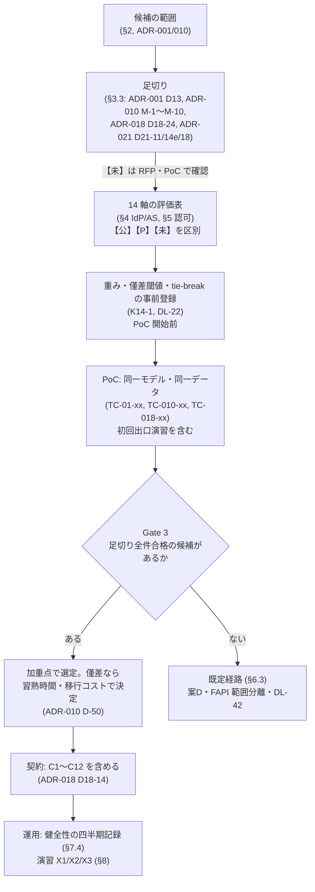
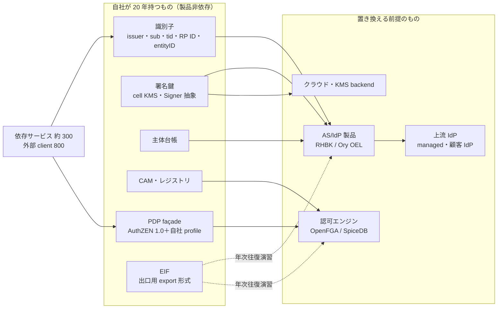
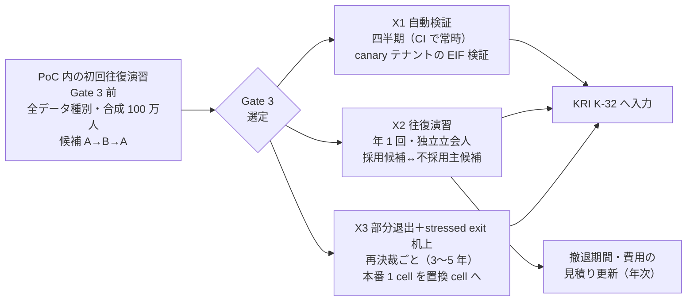
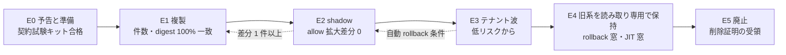

# 製品選定評価・出口戦略

> 文書ID: ARC-14 / 版: 0.2 / 状態: review / 最終更新: 2026-10-15
> 対応要求: R-088, R-090, R-091, R-093, R-208, R-280／G-070, G-074, G-117（R-requirements.md・G-goal-criteria.md で対応成果物欄に本書のパスまたは DL-13 を含む行の全件）。関連: R-089, R-092, R-139, R-141, R-186, R-204／G-066, G-076, G-120
> 依存文書: CONVENTIONS.md, traceability/deliverables.md（DL-13 行）, 05_adr/README.md, 05_adr/ADR-001-build-buy-identity-provider.md（D1〜D17、§7）, 05_adr/ADR-010-authz-engine-store-consistency.md（D-1〜D-53、§4、§7）, 05_adr/ADR-018-exit-strategy.md（D18-1〜D18-25、§7）, 05_adr/ADR-022-integration-contract-standards.md（D-1〜D-3）, 05_adr/ADR-011-policy-language-pep-pdp-api.md（D2-1〜D2-8、D10-1）, 05_adr/ADR-021-irreversible-identifiers.md（D21-11、D21-14e、D21-18）, 05_adr/reconciliation-notes.md（U-01、U-03）, 05_adr/ADR-005-token-profile.md（D11-1）, 05_adr/ADR-007-key-hierarchy-kms-hsm.md（D7-28、D7-29）, 05_adr/ADR-013-cell-partitioning-fail-mode.md（D13-40、KD13-7）, 01_governance/assumptions-register.md, 01_governance/durability-charter-20y.md（§5.2、§5.5、§5.7）, 01_governance/kri.md（K-32）, 01_governance/loss-scenarios.md（S-12）, 03_threat-model/threat-catalog.md（T-086）, research/RS-15-build-buy-tco.md, research/RS-07-authz-engines-consistency.md, research/RS-03-identity-lifecycle.md（各 research/verification/ の検証記録を含む）, research/standards-status.md
> 作成方法: AI エージェント（Claude）が上記文書を読み単独で起草した。事実はすべて research で独立検証済みの原典（確認日 2026-10-03）から引き、新たな原典取得はしていない。本書の評価・推奨・決裁案は起草者の設計推論であり、実在の CTO/CISO・経営会議の決定ではない（CONVENTIONS §8）[D]。
> 表記: 決裁案 K14-x、残余リスク RR-ARC14-xx、新規仮定 NA-ARC14-x（前提台帳へ追加要）、新規の試験案 TC-ARC14-xx（仮番。DL-22 で採番）。残余リスク・新規仮定・試験案の記号は ADR-014 の RR14-xx・NA-014-x・TC-014-xx と衝突していたため、2026-10-15 の 04_architecture 整合調整で RR14→RR-ARC14、NA-014→NA-ARC14、TC-014→TC-ARC14 に改番した（architecture-reconciliation-notes.md XR-09）。ADR の試験案は各 ADR の仮番（TC-01-xx、TC-010-xx（= ADR-010 の H-xx）、TC-018-xx、TC-021-xx、TC-011-xx）をそのまま使う。評価表のセルでは、公式情報（[V]/[N]）で確認済みのものを【公】、PoC・RFP で確認するものを【P】、公式情報で確認できなかったもの（未確認）を【未】と記す。表のセルのうちタグのないものは設計推論 [D] であり、この注記で個別のタグに代える。

---

## 0. 結論

**主要な結論（3 点）**

1. **本書は製品を選ばない。最終選定は Gate 3 で、PoC の実測と事前登録した手順（§6）に従って行う** [D]（G-117、ADR-001 D6-4、ADR-010 D-1）。PoC で同一モデル・同一データにより比べるのは、IdP/AS が Red Hat build of Keycloak（第一候補）と Ory Enterprise License（対抗）、認可エンジンが OpenFGA と SpiceDB（いずれも self-host・PostgreSQL）で、Cedar は横断ガードレールと policy 差分解析に限って第 3 候補とする [D]（ADR-001 D6-2、ADR-010 D-2・D-3）。managed IdP は「上流 IdP」と、要員ゲート不成立時の資格情報層（ADR-001 案D）に限って評価する [D]（ADR-001 D9、D17-2）。
2. **2026-10-03 時点の公式情報だけでは、足切りを全項目で満たすと確認できる候補はない** [D]。IdP/AS では、Keycloak の CLI export に password hash と WebAuthn credential が含まれるかを公式文書で確定できず [V][^13]（RS-15#17）、FAPI 2.0 の認定記録があるのは node-oidc-provider（7 列すべて）と Auth0 HRI（mTLS 列だけ）である [N][^3]（RS-15#4〜#6）。認可では、OpenFGA は内容版の整合性トークンを提供せず [V][^53]（RS-07#14）、CLI export の既定は 100 件である [V][^60]（RS-07#24）。SpiceDB は CNCF の成熟度という外部ガバナンスの指標を持たない [D]（RS-07#72）。CVE 対応と LTS は認可エンジンでは research で未調査である [D]（RS-07 §5.1）。したがって 13 軸＋意味論の評価表（§4・§5）は、【公】と【P】と【未】を分けて示し、【P】【未】を PoC と RFP で埋める計画にした [D]。
3. **依存の回避は「製品を替えても変わらないものを自社が持つ」ことで行い、その証拠を年次の出口演習で取る** [D]（ADR-018 D18-1、D18-19）。自社が持つのは識別子、署名鍵、主体台帳、正規認可モデル（CAM）、PDP façade、出口用の正規 export 形式（EIF）である [D]。演習は、PoC 内の初回往復演習（全データ種別、合成 100 万人、候補 A→B→A）、四半期の自動検証（X1）、年 1 回の往復演習（X2、独立立会人）、再決裁ごとの本番 1 cell 部分退出と stressed exit 机上演習（X3）の順に行う [D]（§8）。

**その他の結論**

- 本書の評価軸は、レビューの 13 軸（R-093）に「意味論」（R-280）を加えた 14 軸である [D]。認可エンジンの比較対象には、レビュー原文が挙げる OpenFGA、Cedar、OPA、AVP、独自実装をすべて含めた（§5）[D][^1]（L92）。
- ADR-018 D18-6 が本書に置くことを求めた「移行先候補の password hash import 上限表」を §4.4 に置いた [D]。
- 経営判断が要る 5 点を §9 に決裁案（K14-1〜K14-5）として示した。いずれも決定済みではない [D]。

---

## 1. 範囲と前提

### 1.1 本書の位置付け

| 決めたこと（正本） | 本書の扱い |
|---|---|
| 自作しない原則、識別子外皮、主体台帳、信頼する issuer（ADR-001 D1〜D4、DEC-3 対象・決裁前） | 評価の前提にする。これに反する候補（例: sub を製品内部 ID で出す製品）は足切りで落とす（§3.3） |
| AS core・資格情報層は cell ごとに self-host する OSS 製品、第一候補 RHBK・対抗 Ory OEL・比較 ZITADEL（ADR-001 D6） | 評価表の列にする。選定はしない |
| 認可は自社 façade（AuthZEN 1.0）＋ OpenFGA/SpiceDB の 2 候補 PoC、Cedar は限定比較、AVP・OPA 単独・自作・managed ReBAC を主系にしない（ADR-010 D-1〜D-4） | 棄却した候補も R-280 のため評価表に残し、棄却理由と復帰条件を示す（§5） |
| 出口の 4 層（識別子・鍵は動かさず、データ・実装を動かす）、EIF、退出条項 C1〜C12、演習 X1〜X3（ADR-018） | 演習計画を候補別・データ種別別に具体化する（§8） |
| 連携契約は製品から独立させ、製品は「凍結しない」区分（ADR-022 D-1） | 評価に「製品固有要素が契約に漏れない」ことを含める（§7） |

**ADR への指摘**: ADR-001 D6-4 は最終選定を「DL-13 で行う」と書くが、traceability/deliverables.md の DL-13 行は「製品の最終選定は行わない」と定める [D]。本書は、選定の決定は Gate 3（DEC-3、CTO＋CISO）で行い、本書はその評価表と選定記録を載せる場所であると解して書いた [D]。ADR-001 D6-4 の文言を「Gate 3 で行い、評価と記録は DL-13 に置く」に改めることを提案する [D]。

本書が新たに決める（決裁案として出す）のは、評価軸の運用、評価表の読み方、選定手順の事前登録の中身、依存回避策の監視項目、演習の初回計画である [D]。

**未決の論点（本書の評価に効くもの）**

| 論点 | 状態 | 本書への影響 |
|---|---|---|
| issuer の粒度（テナント／realm 別か信頼区画別か） | 未決（ADR-001 §2.18a U1、reconciliation-notes U-01。DEC-3） | TC-01-12 で測る対象（1 万 issuer か区画 issuer か）が変わる。両方の構成で測る [D] |
| OpenFGA の窓 W 方式と ADR-011 D6-3 の常時格上げ | 未決（ADR-010 決裁案 2、reconciliation-notes U-03） | OpenFGA の「整合性」軸の評価が H-05 と CISO の受容判断に依存する [D] |
| pairwise の秘密の保管方式（可搬秘密の用途族を設けるか） | 未決（ADR-018 K18-5、L18-1） | 製品側の要件（pairwise の計算に使う秘密とアルゴリズムを製品の外に持ち、乗換え先で同じ値を再計算できること）は ADR-021 D21-14e と ADR-018 D18-24 で足切りとして決定済みであり、本書では X-14 とする。未決なのは自社の鍵階層での秘密の保管・持出し方式（ADR-007 側）で、TC-018-14 の手順はその結論待ち [D] |
| 第二 substrate を本番で常時運用するか | 未決（ADR-013 KD13-7） | クラウドからの出口演習を X3 で第二 substrate 上に行うかが変わる。本書は推奨 (a)（PoC で 1 cell）を前提にする [D] |
| SpiceDB on CockroachDB の追加系列 | 条件未成立（ADR-010 D-5） | 本書の SpiceDB 評価は PostgreSQL 構成を前提にする [D] |

### 1.2 前提（A-ID）

| A-ID | 値（基準） | 本書での使い方 |
|---|---|---|
| A-001 / A-004 / A-115 | 登録 100 万、MAU 57.7 万、自社で認証する人間 47.5 万 | 資格情報層の移出対象、MAU 課金の桁 |
| A-007 / A-009 / A-114 | テナント 1 万、最大テナント 10 万人、顧客 IdP 連携 SAML 1,800・OIDC 200 | 構造上の上限（TC-01-12）、識別子を変えた場合の再設定件数 |
| A-036 | 認可 graph 深度 8・fanout 10 万（範囲は深度 4〜25） | 「最大深度」軸 |
| A-045 / A-046 / A-047 / A-049 | Check ピーク 42,009/秒（最大テナント 5,266/秒）、ListObjects 840/秒、書込 354＋278/秒、tuple 7.55 億 | 容量・tail latency・移出量 |
| A-054 | プラットフォームチーム 24 FTE（認証・IdP 5、認可・PDP 5、SRE 6） | 「運用人員」軸 |
| A-063 | リージョンは日本（主・副）・EU・米国の 4 | 「multi-region」軸 |
| A-081 | 高保証テナント 50（FAPI 2.0 等） | FAPI 2.0 conformance を足切りにする範囲 |
| A-090 / A-091 / A-093 | 判定系 99.95〜99.99%、認証系 99.9〜99.95%、RTO 1 時間・RPO 5 分 | 「障害モード」「バックアップ復旧」軸の合否 |
| A-100 / A-101 / A-104 | 20 年、再決裁 3〜5 年、AS/IdP・認可エンジン・PEP SDK の置換各 1 回以上 | 出口を定常機能にする根拠、演習 X3 の周期 |

**新規仮定（前提台帳へ追加要）**

- NA-ARC14-1: 定価を公開していない候補（RHBK、Ory OEL、Auth0 Enterprise、AuthZed Self-Hosted/Dedicated）について、RFP で同一条件の見積りと 13 軸の質問票への回答を得られる（所有者: 調達責任者、期限: G3、決め方: RFP の回答率。得られない候補は「価格変動」「LTS」軸を最低点で扱う）。
- NA-ARC14-2: 出口演習（PoC 内の初回と X2）の独立立会人を、プラットフォームチームと利害関係のない者から確保できる（所有者: CISO、期限: PoC 開始前、決め方: 内部監査部門か外部評価者との契約）。
- NA-ARC14-3: PoC の演習は合成データ（合成 100 万人、tuple 7.55 億件と最大テナント 7,550 万件）で行い、本番データの分布との差は X3（本番 1 cell の部分退出）で補正する（所有者: CTO、期限: G3、決め方: DL-22 の事前登録）。

ADR の新規仮定のうち次を使う: NA-001-1（1 ドル 150 円）、NA-001-2（要員単価 1 人年 1,000 万〜2,000 万円）、NA-001-3（SRE 単一系統 8 名以上）、NA-001-5（従業員 3 万人は workforce IdP から federation し資格情報層に載せない）、NA-018-1〜NA-018-5（EIF 保守 1.5〜3 FTE、監査移送帯域 10 Gbps、tuple 移出入 1,000〜10,000 件/秒、監査アーカイブ残置、JIT 初期窓 1 か月）。

### 1.3 評価の読み方

- **認定・公式情報は版と日付の記録である**。OIDF の認定は特定の版・deployment が特定の日に試験に通った記録であり、その後の版の適合を示さない [D]（RS-15#8）。本書は OIDF の公開一覧の記録だけを使い、採用版での自社 conformance 実行（TC-01-06）を判断材料にする [D]（ADR-001 D6-4）。評価表の【公】は確認日 2026-10-03 の時点の値であり、Gate 3 の直前に再確認する（TC-ARC14-01）[D]。
- **公開されている性能値は目標の根拠に使わない**。測定条件が揃っていないからである [D]（RS-07#80、G-015）。tail latency は【P】だけで評価する [D]。
- **【未】は「できない」ではない**。公式文書で確認できなかったことを示す [D]。足切り項目の【未】は、RFP 回答か PoC で【公】か【P】合格に変わるまで、その候補を Gate 3 で選べない状態として扱う [D]。

### 1.4 選定の流れ

### 1.5 読者別にすること（本書だけで動けるようにするための要約）

製品の最終選定（Gate 3）を待たずに連携開発を始めてよい（G-120、ADR-022）。そのための条件を読者別に示す [D]。

| 読者 | すること | しないこと | 根拠・検査 |
|---|---|---|---|
| 連携開発者（依存サービス約 300、20〜30 チーム・ベンダー） | 認可は自社 façade の Authorization API（DL-72、AuthZEN 1.0 準拠）だけを呼ぶ。token は自社 issuer（cell の AS）のものだけを受け付け、issuer・JWKS は discovery で取得する。sub・tid は自社の値として扱う | 製品名を前提にした実装、製品固有のヘッダ・パラメータ・endpoint（例: `Openfga-Authorization-Model-Id`）、製品固有の claim 名、AS・PDP・ストアへの直接接続、managed IdP の SDK・hosted UI の直接組込み、JWKS URL の直書き | ADR-022 D-3-2（禁止事項）、D-3-3（CI・gateway・egress・負例ベクタの 4 層で検出）、ADR-001 D4-2（上流 IdP の token と managed の SDK・hosted UI の直接利用の禁止）。製品に依存せざるを得ない場合は D-3-5 の例外台帳に登録し契約変更審査会の承認を得る |
| プラットフォームチーム（認証・IdP、認可・PDP、SRE） | §3.3 の足切りと §4〜§5 の【P】を、§10 の TC で PoC 中に測る。§8.2 の初回往復演習を実施し、X1 を CI に組み込む。§4.4 の表を cost 変更のたびに更新する | 製品の拡張点（SPI、Actions、hook）でプロトコル処理・署名・credential 保管に触れるコードを例外審査なしに書くこと（§7.2） | TC-01-xx、TC-010-xx、TC-018-xx、TC-ARC14-xx |
| 調達責任者・法務責任者 | RFP に 14 軸の質問票と退出条項 C1〜C12 を必須添付する（K14-2）。非公開価格・LTS・CVE 方針の回答を同一条件で取る | 退出条項を交渉事項に落とすこと（ADR-018 K18-1 の推奨 (a) に反する） | §7.6、NA-ARC14-1 |
| CISO | 健全性記録の CVE 実績を提供し、修正期限のない Critical CVE のトリガー日数（TBD）を決める。OpenFGA の窓 W 方式の受容可否（U-03）を H-05 の後に判断する | — | §7.4、§6.3 |
| CTO | 重み・僅差閾値・tie-break を PoC 開始前に事前登録する（K14-1）。初回往復演習と X2・X3 の所有者を務める | PoC の結果を見てから重みを決めること | §6、§8.2 |

---

## 2. build/buy/managed の範囲と候補

### 2.1 層ごとの build/buy/managed（R-088）

比較は ADR-001 §3〜§4 と ADR-010 §3〜§4 で行い、採点もそこにある。本書は層ごとの帰結だけを示す [D]。

| 層 | build（自作） | buy（self-host の OSS・商用サポート） | managed | 決定・状態 |
|---|---|---|---|---|
| AS core（OAuth/OIDC・FAPI） | しない（D1-1）。FAPI 範囲だけ認定ライブラリを例外審査付きで併用し得る（D12-2） | 採る（RHBK／Ory OEL） | 外部境界の issuer にしない（D4） | ADR-001（決裁前） |
| 資格情報層（password・passkey・OTP・回復） | しない（D1-1） | 既定（D7-1） | 要員ゲート不成立時の fallback（案D、M1〜M8 を満たす候補に限る） | ADR-001 D7・D9・D17 |
| 上流 IdP（顧客 IdP・workforce・managed） | — | — | 上流として broker する（D4-2、D9-1） | ADR-001 |
| 内部 STS（token exchange、M2M） | しない（D1-1） | 採る（D10） | 載せない。token exchange をトークン単位課金に載せると、Entra の M2M 単価で月約 288 万ドルになる [D][A-043]（RS-15#75） | ADR-001 D10 |
| 認可 PDP と relationship store | 自作しない（R-204 の別審査対象、ADR-010 D-4） | 採る（OpenFGA／SpiceDB） | 主系にしない。Gate 3 で D-36 の 4 条件を満たす場合だけ再評価 | ADR-010（決裁前） |
| 自社部品（façade、CAM と生成器、整合性トークン、テナント境界 deny、EIF と差分ツール、識別子外皮、主体台帳） | 作る（ADR-001 D1-2、ADR-010 D-6） | — | — | ADR-001・ADR-010・ADR-018 |

- 費用の桁: managed の MAU 課金は年約 5.4 万〜39.0 万ドルで、要員費（A-054 の 24 FTE で年 2.4 億〜4.8 億円）より 1 桁小さい [D][A-004, A-054, NA-001-2]（RS-15#73, #76）。managed の効果は要員（認証・IdP 5 名分と on-call の範囲）で評価する [D]（RS-15#76）。費用の幅は DL-33 で RS-15#79 の 3 段で示す [D]。

### 2.2 評価対象の候補

| 層 | 候補 | 版（確認日 2026-10-03） | 本書での位置付け |
|---|---|---|---|
| IdP/AS | Red Hat build of Keycloak（Keycloak 26.x） | Keycloak 26.8.0（2026-10-01）[V][^5]（RS-15#9） | 第一候補（PoC） |
| IdP/AS | Ory Enterprise License（Hydra＋Kratos） | OSS 版 v26.2.0（2026-03-20）[V][^18]（RS-15#25） | 対抗（PoC） |
| IdP/AS | ZITADEL | v4.19.4（2026-10-01）[V][^20]（RS-15#28） | 比較（AGPL-3.0 の法務確認が条件。ADR-001 K1-4） |
| IdP/AS | node-oidc-provider | v9.12.2（2026-09-05）[V][^22]（RS-15#32） | FAPI 範囲・STS の補助と conformance の対照（ADR-001 D10-2、D12-2） |
| 上流／案D | Microsoft Entra External ID、Auth0（Enterprise＋HRI）、Amazon Cognito、Google Identity Platform | managed（版なし） | 上流 IdP、案D の資格情報層 |
| 認可 | OpenFGA | v1.21.0（2026-09-20）[V][^62]（RS-07#25） | 主候補（PoC） |
| 認可 | SpiceDB | v1.56.2（2026-09-11）[V][^71]（RS-07#37） | 主候補（PoC） |
| 認可 | Cedar（self-host ライブラリ） | SDK 4.13.0（2026-09-15）[V][^77]（RS-07#45） | 限定比較（ガードレール・差分解析） |
| 認可 | Amazon Verified Permissions（AVP） | managed | 主系では棄却。机上比較 |
| 認可 | Open Policy Agent（OPA） | v1.21.1（2026-09-29）[V][^88]（RS-07#58） | 主系では棄却。机上比較 |
| 認可 | 独自実装（engine/store の自作） | — | 主系では棄却（R-204 の別審査） |
| 認可 | managed ReBAC（Auth0 FGA、AuthZed Dedicated） | managed | 主系では棄却。D-36 の条件で再評価 |

authentik は RS-15 で調べたが、ADR-001 の候補に入っていないため本書の評価表から外した [D]（RS-15#30, #31）。

---

## 3. 評価軸

### 3.1 13 軸の定義（R-093）

レビューは選定表に「整合性、最大深度、tail latency、障害モード、multi-region、バックアップ復旧、運用人員、ライセンス、価格変動、データ移出、schema portability、CVE 対応、LTS」を含めるよう求めた [D][^1]（L176）。IdP/AS と認可エンジンで測る中身が違うので、層ごとに定義する [D]。

| # | 軸 | IdP/AS で測るもの | 認可エンジンで測るもの | 主な PoC/RFP |
|---|---|---|---|---|
| 1 | 整合性 | session・token 発行状態・失効状態の拠点間・ストア間の整合（ADR-005 の状態 push） | new enemy への手段（整合性トークン、最新強制）、剥奪→拒否の上限（ADR-010 D-13〜D-19） | TC-01-07、TC-010-01・02・05 |
| 2 | 最大深度（構造上の上限） | テナント・organization 数、federation 接続数、group 入れ子 | 解決深さ・fanout の上限と A-036 の照合 | TC-01-12、TC-010-03 |
| 3 | tail latency | ログイン・token 発行・署名の p99（2 hop 構成を含む） | Check の p50/p99/p99.9（鮮度要件別） | TC-01-05・18、TC-010-03・08 |
| 4 | 障害モード | 部品停止時の既存 session の継続、更新時の停止、SLA の除外事項 | 静的安定性、縮退の階層、迂回の禁止 | TC-01-09・16、TC-010-19 |
| 5 | multi-region | 所在地の固定、cell 独立、副リージョンの書込み可否 | cell 単位の self-host、cell 間で状態を共有しない構成 | TC-01-15、ADR-010 M-2 |
| 6 | バックアップ復旧 | DB の PITR と A-093 の照合、export の停止要件 | 剥奪の RPO、PITR、rollback 後の剥奪の単調性 | TC-ARC14-03、TC-010-12・18 |
| 7 | 運用人員 | on-call の系統と人数、更新追随工数、ベンダー応答 | façade・生成器の保守、習熟時間 | TC-01-08・16、TC-010-14・15 |
| 8 | ライセンス | OSS ライセンス、有償版限定の必須機能 | 同左（AGPL の扱いを含む） | 法務確認 |
| 9 | 価格変動 | 課金単位、非公開価格、価格改定・SLA 変更の通知期間 | 従量課金、商用ライセンスの単位 | RFP、TC-ARC14-04 |
| 10 | データ移出 | hash（方式・パラメータ付き）、TOTP、passkey record、grant、linking の export/import | tuple・モデルの全件・テナント単位の export/import | TC-01-04、TC-018-01〜06、TC-010-17 |
| 11 | schema portability | sub を自社値で出せるか、属性の RFC 7643 写像、claim の発行制御 | 正規モデル（CAM）から DSL への生成と逆変換、表現力の部分集合 | TC-021-01、TC-01-11、TC-010-06、TC-018-05 |
| 12 | CVE 対応 | サポート対象版、修正期限、CVE 公開方針 | 同左 | RFP、健全性記録（§7.4） |
| 13 | LTS | サポート期間、release 周期、破壊的変更の扱い | 同左 | RFP、健全性記録 |

### 3.2 意味論（R-280）

R-280 は、OpenFGA、Cedar、OPA、AVP、独自実装の意味論の違いを比較軸に加えるよう求める [D][^1]（L92）。意味論は「同じ要求に対して、何を根拠にどう判定し、欠けた入力や古いデータをどう扱うか」と定義し、次の小項目で比べる [D]。

| 小項目 | 認可エンジン | IdP/AS |
|---|---|---|
| S1 判定の基本規則 | 既定拒否、deny/forbid の優先、関係の和・積・差 | プロトコル規範への適合（OIDC・FAPI 2.0 conformance） |
| S2 判定に使うデータの所在 | エンジン内の store か、呼出側が要求ごとに渡すか | 上流 IdP の値をそのまま使うか、自社 AS で検証して上書きするか（acr・amr） |
| S3 鮮度の指定手段 | 内容版トークン、最新強制、既定の古さ | 失効状態の反映（opaque 状態 push） |
| S4 入力が欠けたとき | error・未決の扱い（skip、CONDITIONAL） | 識別子の写像（sub・RP ID・issuer）が製品依存になるか |
| S5 モデル・設定の版 | モデルの不変版と要求ごとの固定 | token exchange・DPoP・PAR の実装状態（GA か preview か） |
| S6 一覧の意味 | 打切り・ページングの原子性 | —（認可側の論点） |
| S7 標準 API への写像 | AuthZEN 1.0 の MUST との一致 | —（OIDC・OAuth の規範は S1） |
| S8 形式解析 | policy の等価性・包含の自動解析 | — |

意味論の差は、façade の前段 deny、評価不能 deny、合成規則（ADR-010 D-28・D-32、ADR-011 D3-6）で利用側に見えないようにする [D]。評価表はその吸収にかかる費用と残余を見るためのものである [D]。

### 3.3 足切り（1 つでも満たさない候補は Gate 3 で選ばない）

| # | 足切り | 対象 | 根拠 |
|---|---|---|---|
| X-01 | 自作しない原則に適合する（password 保管と回復を自作しない） | IdP/AS | ADR-001 D1、R-203 |
| X-02 | 採用版で OIDC（Basic・Config・Form Post）の conformance に合格し、FAPI 範囲を受け持つなら FAPI 2.0 SP（mTLS・DPoP）と Message Signing に合格 | IdP/AS | ADR-001 D13-1-1、TC-01-06 |
| X-03 | cell KMS の非エクスポート鍵で署名できる（または D11-2 の代替に合格） | IdP/AS | ADR-001 D13-1-2、TC-01-05 |
| X-04 | hash（方式・パラメータ付き）・passkey record・TOTP secret を文書化された API か CLI で export できる | IdP/AS | ADR-001 D13-1-3、D7-3、ADR-018 C5 |
| X-05 | opaque token の発行・失効状態を cell 内ストアへ push できる | IdP/AS | ADR-001 D13-1-4、TC-01-07 |
| X-06 | claim 要件（jti の発行記録、txn、cnf、上流 amr の上書き、テナント context）を AS core 改変なしで満たす | IdP/AS | ADR-001 D13-1-5、TC-01-11 |
| X-07 | 任意の issuer 文字列と自社 endpoint 写像を受け入れる | IdP/AS | ADR-001 D13-1-6、TC-01-01 |
| X-08 | sub を製品内部 ID と切り離し、自社の sub を出力できる | IdP/AS | ADR-021 D21-11、TC-021-01 |
| X-09 | passkey 継続の 4 条件（自社ホストの RP ID、credential record の export、移行先の import、import 後の認証） | IdP/AS | ADR-021 D21-18、TC-021-04 |
| X-10 | grant と refresh token の export/import、またはできない場合の再同意計画 | IdP/AS | ADR-005 D11-1、TC-018-06 |
| X-11 | ADR-010 M-1〜M-10（最新強制、cell 単位 self-host、全件・テナント単位 export/import、OSI 承認の許容的ライセンス、typed ReBAC 深度 8 以上、モデル版固定、CEL 相当の条件、変更の取出し、AuthZEN 写像、静的安定性） | 認可 | ADR-010 §4.1 |
| X-12 | 退出条項 C1〜C12 を契約で受け入れる | 全候補 | ADR-018 D18-14、D18-24 |
| X-13 | managed を資格情報層にする場合は M1〜M8 を契約と実測で満たす | managed | ADR-001 D9-2 |
| X-14 | pairwise sub の計算に使う秘密とアルゴリズムを製品の外（自社の鍵階層）に置き、製品はその計算結果を sub として出力できる（乗換え先でも同じ値を再計算できる） | IdP/AS | ADR-021 D21-14e、ADR-018 D18-24、TC-018-14 |

X-14 は ADR-018 D18-24 が足切りとして決定済みである [D]。未決（ADR-018 K18-5、L18-1）なのは、自社側で秘密を可搬秘密の用途族として持つか、非エクスポート鍵にして旧 sub の対応表で吸収するかという保管方式であり、K18-5 が (b) に決まった場合は X-14 の「同じ値を再計算できる」を「旧 sub の対応表を製品に投入できる」に読み替える [D]。

足切りの適用先: X-01〜X-10・X-14 は §4.1 の self-host 候補（AS core・資格情報層）に適用する。案D の managed 候補（資格情報層だけを受け持ち、AS core は自社 self-host のまま。ADR-001 D17-2）には X-04・X-09・X-12・X-13 を適用する。X-11 は §5 の認可候補に、X-12 は全候補に適用する [D]。

---

## 4. IdP/AS 候補の評価表

### 4.1 self-host 候補（14 軸）

| 軸 | RHBK（第一候補） | Ory OEL（対抗） | ZITADEL（比較） | node-oidc-provider（補助・対照） |
|---|---|---|---|---|
| 1 整合性 | 【公】multi-cluster v2 は同期複製 DB で拠点を結び、DB コミット遅延 10ms 未満が必須 [V][^12]（RS-15#16）。【P】状態 push（TC-01-07） | 【公】CockroachDB によるマルチリージョン構成を OEL の機能に挙げる [V][^14]（RS-15#21）。cell をまたぐクラスタは使わない（ADR-001 D6-1）。【P】TC-01-07 | 【未】research 未収載。【P】TC-01-07 | 【P】ライブラリで状態ストアは利用側の実装（RS-15#33）。TC-01-07 |
| 2 構造上の上限 | 【公】organization が supported・既定有効 [V][^7]（RS-15#10）。【P】1 万テナント・2,000 接続（TC-01-12） | 【公】Kratos の B2B organization とマルチテナントは OEL 限定 [V][^14]（RS-15#21）。【P】TC-01-12 | 【未】。【P】TC-01-12 | 管理面を自作（RS-15#33）。【P】TC-01-12 |
| 3 tail latency | 【公】stateless モードでは認証 1 回あたり約 8〜10ms の遅延増、DB の CPU・IOPS が約 2 倍になり得る（26.7 preview 時点の告知）[V][^98]（RS-15#16）。【P】署名 p99（TC-01-05） | 【P】TC-01-05 | 【P】TC-01-05 | 【P】TC-01-05 |
| 4 障害モード | 【公】minor・major の更新では 1 拠点を残して他の全拠点を止める必要がある（v2 告知）[V][^98]。v1 は障害の種類で最大 5 分程度停止し得る [V][^99]（RS-15#15, #16）。【P】TC-01-09・16 | 【公】無停止の upgrade・schema migration を OEL の利点に挙げる [V][^14]（RS-15#21）。【P】TC-01-09・16 | 【公】ZITADEL Cloud は 2 週ごとに deploy し、停止の危険がある release は 5 営業日前に告知する（Cloud の運用）[V][^21]（RS-15#29）。self-host は【P】 | 【P】TC-01-09 |
| 5 multi-region | 【公】multi-cluster は単一リージョンか同等の低遅延環境に限る [V][^12]（RS-15#16）。→ cell ごとの独立 deployment（ADR-001 D6-1）。【P】TC-01-15 | 【P】cell ごと独立（TC-01-15） | 【未】。【P】TC-01-15 | 自社で構成。【P】TC-01-15 |
| 6 バックアップ復旧 | 【公】CLI export は event・永続 session・失効済み token を含まず、export 前の全ノード停止を推奨 [V][^13]（RS-15#17）。→ 稼働中の継続 export に使わない（ADR-018 D18-3）。【P】PITR と A-093（TC-ARC14-03） | 【P】TC-ARC14-03 | 【P】TC-ARC14-03 | 【P】自作ストアの PITR（TC-ARC14-03） |
| 7 運用人員 | 【公】minor 年 4 回、major 2〜3 年ごと [V][^9]（RS-15#12）。SRE 単一系統 8 名以上が条件（ADR-001 D17、[V][^52] RS-15#70）。【P】TC-01-08・16 | 同左の SRE 条件。【P】TC-01-08・16 | 【公】major 3 か月ごと、minor 2 週ごと [V][^19]（RS-15#28）。【P】更新工数 | 管理面・利用者ストア・回復を自作し要員が増える（RS-15#33）。【P】 |
| 8 ライセンス | 【公】Keycloak は Apache-2.0 [V][^5]（RS-15#9）。RHBK は有償サポート（価格非公開、RS-15#74） | 【公】OSS は Apache-2.0 [V][^18]。必須機能（organization、マルチテナント）は OEL 限定 [V][^14]（RS-15#21, #25） | 【公】v3 から AGPL-3.0 [V][^19][^20]（RS-15#28）。義務の範囲は法務確認（ADR-001 K1-4） | 【公】MIT [V][^22]（RS-15#32） |
| 9 価格変動 | 【未】価格非公開（RS-15#74）。【P】RFP（NA-ARC14-1） | 【未】価格非公開（RS-15#74）。【P】RFP | 【未】Enterprise は個別見積り（RS-15#27）。【P】RFP | ライセンス費 0（RS-15#74） |
| 10 データ移出 | 【公】管理コンソールの export は secret を伏せ移行に使えず、CLI export は利用者を含む [V][^13]。【未】hash と WebAuthn credential を含むかは確定できない（RS-15#17）。【P】TC-01-04、TC-018-01 | 【公】`include_credential` で hash 付き export、passkey（credential ID・公開鍵・メタデータ）の import ができる [V][^16][^17]（RS-15#23）。【P】TC-018-01 | 【未】research 未収載。【P】TC-018-01 | 自作ストアのため自社形式（EIF を直接実装） |
| 11 schema portability | 【公】SCIM API が supported・既定有効 [V][^7]（RS-15#10）。【P】sub の自社値出力（TC-021-01）、claim 制御（TC-01-11） | 【未】self-host で SCIM が OEL 限定かは未確認（RS-15 §6）。【P】TC-021-01、TC-01-11 | 【未】。【P】TC-021-01、TC-01-11 | 識別子・claim を最も自由に制御できる（ADR-001 §3.3）。【P】TC-01-11 |
| 12 CVE 対応 | 【公】コミュニティ版は受領確認 7 営業日以内で修正期限を定めず、長期サポートには RHBK を勧める [V][^10]（RS-15#13）。→ コミュニティ版は本番候補にしない（ADR-001 D6-3） | 【公】OEL は Critical 14 日・High 30 日・Medium 90 日・Low 180 日で解決。Apache 2.0 版は SLA なしで修正は現行リリースだけ [V][^15]（RS-15#22） | 【公】セキュリティ方針は報告窓口を示すが、サポート対象版と対応期限は記載していない [V][^97]（RS-15#29） | 【公】サポート対象は v9.x だけ [V][^23]。認定の名義は個人 [N][^3]（RS-15#32, #33） |
| 13 LTS | 【公】RHBK は 26.x で最低 2 年、27.x 以降 3 年、次の major 後に前 major を最低 6 か月 maintenance [V][^11]（RS-15#14） | 【未】OEL のサポート期間は research 未収載。【P】RFP | 【未】各 major のサポート期間は未確認（RS-15 §6）。【P】RFP | 【公】終了日は後継版を出す前に決める [V][^23]（RS-15#32） |
| 14 意味論 S1 プロトコル適合 | 【公】OP 認定の最新記録は Keycloak 18.0.0（2022-05-19）[N][^2]。FAPI 2.0 認定一覧に行なし [N][^3]。client policy で FAPI 2.0 SP・Message Signing（Final）を支援と記載 [V][^8]（RS-15#3, #6, #11）。【P】TC-01-06 | 【公】最新記録は ORY Hydra v1.0.0（2018-07-14）[N][^2]。FAPI 2.0 一覧に行なし [N][^3]。【P】TC-01-06 | 【公】最新記録は 1.53.1（2021-11-04、Basic のみ）[N][^2]。FAPI 2.0 一覧に行なし [N][^3]。【P】TC-01-06 | 【公】FAPI 2.0 Final の 7 列すべてで 2025-07-10 付の認定 [N][^3]（RS-15#4） |
| 意味論 S5 実装状態 | 【公】DPoP・PAR・passkeys・standard token exchange v2 が supported・既定有効、SPIFFE と旧 token exchange は preview（本番の前提にしない）[V][^7]（RS-15#10） | 【未】Hydra の PAR・DPoP は公式文書で確認できず（RS-15 §6） | 【未】PAR・DPoP は確認できず（RS-15 §6） | 【公】DPoP・PAR・mTLS・JAR・JARM・RAR に対応 [V][^22]（RS-15#32） |
| 意味論 S2・S4 識別子・claim | 【P】任意 issuer・製品 URL の非露出（TC-01-01・02）、sub の自社値（TC-021-01）、上流 amr の上書き（TC-01-11）、RP ID の自社ホスト（TC-021-04） | 同左 | 同左 | 同左 |

### 4.1a ADR-001 D13-2 が追加を求める評価項目

ADR-001 D13-2 は、DL-13 の評価軸に 13 軸以外の項目を加えるよう決めている [D]。§4.1 の行に入らないものを次に示す。合否の閾値を置かない項目は、評価表の【P】として記録し加重点の材料にする [D]。

| 項目 | 14 軸での位置 | RHBK | Ory OEL | ZITADEL | node-oidc-provider | 確認方法 |
|---|---|---|---|---|---|---|
| ADR-005 §9 の必須機能（PAR、DPoP の nonce と dpop_jkt、mTLS、RFC 9207・9068・7662・9701・7009・8693・8707、SSF の送信） | 14 意味論 S5 | 【公】DPoP・PAR・standard token exchange v2 は supported・既定有効 [V][^7]（RS-15#10）。他は【未】 | 【未】（RS-15 §6） | 【未】 | 【公】DPoP・PAR・mTLS・JAR・JARM・RAR [V][^22]（RS-15#32）。他は【未】 | 機能ごとの有無を RFP 質問票で取り、TC-01-06（conformance）と ADR-005 の TC で実測 |
| grant と refresh token の export/import | 10 データ移出（足切り X-10） | 【未】 | 【未】 | 【未】 | 自社ストア | TC-018-06 |
| federation 接続数の上限と管理 API | 2 構造上の上限 | 【P】 | 【P】 | 【P】 | 管理面を自作 | TC-01-12（顧客 IdP 2,000 接続 [A-114]） |
| 更新時の停止の要否 | 4 障害モード | §4.1 行 4 の【公】 | §4.1 行 4 の【公】 | Cloud の運用のみ【公】 | 【P】 | TC-01-16 |
| ベンダー応答時間 | 7 運用人員・12 CVE 対応 | 【未】（RHBK の応答時間は research 未収載） | 【公】解決期限は §4.1 行 12 | 【未】 | 個人の保守者（サポート契約なし） | RFP、K1-3 |
| 発行時の claim 拡張 | 11 schema portability（X-06） | 【P】 | 【P】 | 【P】 | 【P】 | TC-01-11 |
| 署名 alg の切替と PQC の追加可能性（ADR-001 D11-3。ES256・PS256・EdDSA・3072 bit 以上の RS256 の設定切替は必須、ML-DSA は追加可能性を評価） | 14 意味論（E3 鍵の主権・暗号の俊敏性） | 【P】 | 【P】 | 【P】 | 【P】 | TC-01-05 で非エクスポート鍵署名と併せて alg を切り替えて確認し、所要時間を K-32(c) に入力 |

### 4.2 managed 候補（上流 IdP・案D の資格情報層として）

managed は AS core・STS・PDP には置かない（ADR-001 D4、D10）。以下は上流 IdP と、D17-2 の fallback（案D）の資格情報層としての評価である [D]。

| 軸 | Entra External ID | Auth0（Enterprise＋HRI） | Amazon Cognito | Google Identity Platform |
|---|---|---|---|---|
| 1 整合性 | 【未】 | 【未】 | 【公】MRR の副への同期は結果整合、ロックアウトの失敗回数はリージョン間で同期しない [V][^37]（RS-15#51） | 【未】 |
| 2 構造上の上限 | 【P】RFP | 【P】RFP | 【公】app client が 2,500 を超える場合は account team への連絡を求める [V][^35]（RS-15#49）。【P】RFP | 【P】RFP |
| 3 tail latency | 【P】2 hop の p99（TC-01-18） | 同左 | 同左 | 同左 |
| 4 障害モード・可用性の約束 | 【公】Entra ID Basic/Premium の SLA は 99.99% 未満でクレジット。External ID への適用は契約で確認 [V][^27]（RS-15#37）。バックアップ認証系は home tenant の利用者だけが対象で B2B/B2C は対象外 [V][^95]（RS-09#27） | 【公】Core Services 99.99%、クレジット上限は月額の 50%（SLA Rev 4.5.2）[V][^30]（RS-15#42）。Auth0 Docs は別のクレジット段階を示しており、どちらが適用されるかは契約で確認する（RS-15#42）[D]。【I】US-1 は 2021-04-20 に約 4 時間 20 分停止 [I][^102]（RS-09#57） | 【公】リージョンごと 99.9% [V][^36]。MRR の副では利用者作成・password reset・TOTP ができない [V][^37]（RS-15#50, #51） | 【公】99.95%、クレジット上限 50% [V][^43]（RS-15#56） |
| 5 multi-region・所在地 | 【公】所在地は作成後に変更できない。Japan は Go-Local add-on [V][^24]（RS-15#36） | 【公】テナント作成時に地域（JP、EU、US など）を選ぶ [V][^29]（RS-15#43） | 【公】副リージョンは 1 つまで [V][^37]（RS-15#51） | 【未】保管場所の選択可否は未確認（RS-15 §6） |
| 6 バックアップ復旧 | 【未】【P】RFP | 【未】【P】RFP | 【未】【P】RFP | 【未】【P】RFP |
| 7 運用人員 | managed でも障害時の切替え・顧客連絡・エスカレーションの on-call は残る（RS-15#71）。【P】TC-01-08 | 同左 | 同左 | 同左 |
| 8 ライセンス | サブスクリプション | 同左 | 同左 | 同左 |
| 9 価格変動 | 【公】Basic MAU は 50,000 超で 1 MAU 0.03 ドル（2025-07-01 発効）。別の「Core」メータも残り、適用契約は未確認 [V][^26]（RS-15#35） | 【未】Enterprise の定価は非公開（RS-15#41）。【P】RFP | 【公】Essentials 0.015 ドル/MAU、federate 0.015 ドル [V][^35]（RS-15#48）。値上げ 30 日前、SLA の不利な変更 90 日前、重要機能の廃止 12 か月前に通知 [V][^41]（RS-15#55） | 【公】Tier 1 は段階制、Tier 2（OIDC・SAML）は 0.015 ドル [V][^42]（RS-15#56） |
| 10 データ移出 | 【公】移行手順は JIT（`OnPasswordSubmit`）か旧 IdP 側での収集で、hash の import 手順は記載なし [V][^25]。【未】hash の export 手段（RS-15#39） | 【公】hash は support ticket で依頼し、適格性審査があり ETA を示さない。Free プランは不可 [V][^31]（RS-15#44）→ C5 を満たさない | 【公】export のガイダンスは password など機微情報を export しない [V][^39]。【未】hash の export 手段（RS-15#53） | 【公】Firebase CLI の export は scrypt 化済みの hash だけで、他方式の hash は空欄 [V][^44]（RS-15#57）。Identity Platform への適用は【P】 |
| passkey record の export（M2） | 【未】【P】TC-01-17 | 【未】【P】TC-01-17 | 【未】【P】TC-01-17 | 【未】【P】TC-01-17 |
| 11 schema portability・識別子 | 【未】RP ID を自社ドメインにできるか未確認（RS-15 §6） | 【公】RP ID を変えると他ドメインの passkey はすべて使えなくなる [V][^33]（RS-15#46） | 【公】custom domain 利用時は RP ID をその FQDN にする [V][^40]（RS-15#54） | 【未】 |
| 12 CVE 対応 | 【公】MSRC はクラウドサービスの重大な脆弱性に、利用者の対処が不要な場合も CVE を発行すると表明 [V][^28]（RS-15#40） | 【公】Okta は受領確認の期限を定めず、調査完了まで開示しない [V][^34]（RS-15#47） | 【未】AWS の公開方針は未調査（RS-15 §6） | 【未】未調査（RS-15 §6） |
| 13 LTS | 継続提供（版なし）。【P】機能廃止の通知期間を契約（C9） | 同左 | 【公】重要機能の廃止は 12 か月以上前に通知 [V][^41]（RS-15#55） | 同左（C9） |
| 意味論 S1・S2 | 【公】amr は同期 passkey とデバイス固定 passkey をどちらも `fido, mfa` と表す [V][^101]（RS-03#27）→ 上流 amr を AAL3 の根拠にしない（ADR-001 D8） | 【公】FAPI 2.0 の認定は mTLS 送信者制約の列だけ [N][^3]。設定ページに DPoP 構成と Message Signing の記載なし [V][^32]（RS-15#5, #45） | 【公】OIDF の OP 認定一覧に Amazon・Cognito の行はない [N][^2]（RS-15#3） | 【公】OP 認定一覧の「Google Federated Identity」は Google 自身の OP で Identity Platform ではない（RS-15 §6） |

### 4.3 IdP/AS の暫定所見（Gate 3 前）

| 所見 | 根拠 | 次の確認 |
|---|---|---|
| RHBK は LTS・機能（organization、SCIM、DPoP、PAR、standard token exchange v2）で最も多くの【公】を持つが、データ移出（X-04）と FAPI 2.0（X-02）が【未】【P】である | §4.1 行 10・14 | TC-01-04、TC-01-06。両方不合格なら ADR-001 T-04・T-02 |
| Ory OEL は移出（hash・passkey）の【公】を持つが、LTS と FAPI 関連機能が【未】である | §4.1 行 10・13 | RFP（NA-ARC14-1）、TC-01-06 |
| FAPI 2.0 の全構成で認定記録があるのは node-oidc-provider だけで、管理面・ストア・回復を自作しないと単独では使えない | §4.1 行 14、RS-15#33 | ADR-001 D12-2 の併用は D1-5 の例外審査に回す |
| managed 4 候補は、2026-10-03 時点で M1（hash の API export と期日保証）と M2（passkey record の export）を満たすと確認できない | §4.2 行 10、ADR-001 D9-2 | TC-01-17（K14-3）。満たす候補がなければ D17-2 の fallback も成り立たず DL-42 で再決裁 |

### 4.4 移行先候補の password hash import 上限表（ADR-018 D18-6）

cost を引き上げるたびに本表を更新する。N-2 の SHOULD（cost の引上げ）を移行先の上限のために止めない（ADR-018 K18-4 の推奨 (a)）[N][^45][D]（RS-15#58）。上限を超えた候補は「hash 移送不可・JIT 専用」と記録する [D]。

| 候補 | hash の export 経路 | import で受け付ける方式と上限 | passkey record | 判定（2026-10-03） |
|---|---|---|---|---|
| RHBK | CLI export（hash を含むか【未】）[V][^13] | 【未】research 未収載 | 【未】 | 【P】TC-01-04、TC-018-02 |
| Ory OEL | Admin API の `include_credential` [V][^16] | BCrypt、Argon2、MD5、SHA、SSHA、SSHA256、SSHA512、PBKDF2、SCrypt、Firebase SCrypt、crypt(3)、HMAC [V][^17]。パラメータ上限は research 未収載 | import 可 [V][^17] | 移送可（パラメータ上限は【P】TC-018-02） |
| ZITADEL | 【未】 | 【未】 | 【未】 | 【P】 |
| node-oidc-provider | 利用者ストアを自作するため自社形式 | 同左 | 同左 | 自社形式（D1-5 の例外審査の範囲に限る） |
| Entra External ID | 【未】 | hash の import 手順の記載なし。JIT か旧 IdP 側での収集 [V][^25] | 【未】 | 移入・移出とも JIT 専用 |
| Auth0 | support ticket、審査、ETA なし [V][^31] | 【未】research 未収載 | 【未】 | 移出は契約条項 C5 を満たさない |
| Amazon Cognito | 【未】（ガイダンスは機微情報を export しない [V][^39]） | BCRYPT（cost ≤ 12）、SCRYPT（N ≤ 65536、r=8、p=1）、ARGON2ID（m ≤ 19456 KiB、t ≤ 2、p=1）、PBKDF2_SHA256（反復 ≤ 600,000）。CSV 1 ファイル 50 万行、同時 import job 1 [V][^38]（RS-15#52） | 【未】 | 移入は上限内の hash だけ。cost 13 以上の BCRYPT は移送不可 [D]。移出は JIT |
| Google Identity Platform | Firebase CLI（scrypt 化済みのみ）[V][^44] | BCRYPT、SCRYPT、STANDARD_SCRYPT、HMAC 系、MD5、SHA 系、PBKDF_SHA1、PBKDF2_SHA256 [V][^44]（RS-15#57） | 【未】 | 条件付き（Identity Platform への適用は【P】） |
| 自社の hash 方式・パラメータ | — | TBD（ADR-003・ADR-007。pepper を採るなら出口は JIT 専用、ADR-018 D18-5） | — | 方式決定後に本表へ記入（所有者: CISO、期限: G3） |

---

## 5. 認可エンジン候補の評価表

### 5.1 13 軸（R-093、G-117）

| 軸 | OpenFGA | SpiceDB | Cedar（lib） | AVP | OPA | 独自実装 | managed ReBAC |
|---|---|---|---|---|---|---|---|
| 1 整合性 | 【公】zookie 相当は「検討中」で、最新強制は HIGHER_CONSISTENCY だけ [V][^53]（RS-07#13, #14）。非同期レプリカでは read-after-write 不整合があり得る [V][^54]（RS-07#16）。【P】TC-010-01・05（未決: ADR-010 決裁案 2） | 【公】4 段階の consistency と ZedToken [V][^63]。CockroachDB では fully_consistent でも read-after-write を保証しないと書き、別ページは条件なしに保証と書く（文書間の不一致）[V][^63][^64]（RS-07#26〜#29）。【P】TC-010-01 | 【D】store を持たず、関係の鮮度は呼出側の entity 取得次第（RS-07#44） | 【公】結果整合で、新規・変更の反映に数秒かかり得る [V][^81]（RS-07#49） | 【公】bundle は結果整合、ポーリング既定 60〜120 秒 [V][^84][^85]（RS-07#55） | 【公】Zanzibar の external consistency は Spanner の TrueTime に依存する [V][^94]（RS-07#6）。同等基盤の根拠なし | 【公】AuthZed の managed は CockroachDB に統一 [V][^65]（RS-07#31） |
| 2 最大深度 | 【公】resolveNodeLimit 既定 25 [V][^55]（RS-07#19）。A-036 の範囲上限 25 と同値。【P】TC-010-03 | 【公】dispatch-max-depth 既定 50 [V][^68]（RS-07#35）。【P】TC-010-03 | 呼出側が entity 階層を渡す（RS-07#44） | 【公】推移的な親は 100（引上げ不可）[V][^80]（RS-07#48） | 【未】 | 自社で決める | 【P】RFP |
| 3 tail latency | 【P】14,745/秒の区画、fresh 比率 10・30・50%（TC-010-03）。公開値は使わない（RS-07#80） | 同左 | 【P】ガードレール層の追加遅延（TC-010-07） | 【公】IsAuthorized は store あたり既定 200 RPS（引上げ可）[V][^80]。最大テナント 5,266/秒の約 1/26 [D][A-045] | 【未】 | 【未】 | 【公】Auth0 FGA Enterprise は store あたり Check 500/秒・ListObjects 20/秒 [V][^93]（RS-15#62）で 5,266/秒・840/秒に届かない [D][A-045, A-046] |
| 4 障害モード | 【P】静的安定性（M-10、TC-010-19） | 【P】TC-010-19 | プロセス内評価 | 【未】リージョン提供と SLA は未確認（RS-07 §6） | 【公】persist で bundle サーバ不達でも最後の bundle で起動 [V][^84]。decision log は上限設定時に記録を捨てる [V][^85]（RS-07#55, #56） | 【未】 | 【未】【P】RFP |
| 5 multi-region | 【公】DB は専用にし同一データセンターに置くことを推奨 [V][^100]（RS-07#17）。→ cell 単位の self-host（ADR-010 D-23） | 【公】PostgreSQL は単一リージョンの self-host、CockroachDB はマルチリージョンに推奨 [V][^65]（RS-07#31）。→ PostgreSQL で cell 単位（D-5） | cell ごとに配置可 | 【未】日本・EU・米国の提供状況は未確認（RS-07 §6） | cell ごとに配置可 | 自社で構成 | 【公】Auth0 FGA は US・Europe・Australia、日本は Private Cloud add-on [V][^93] |
| 6 バックアップ復旧 | 【P】PostgreSQL の PITR、剥奪の RPO 0（TC-010-12）、rollback 後に剥奪が復活しない（TC-010-18） | 同左 | — | 【未】 | 【未】 | 【未】 | 【未】 |
| 7 運用人員 | 認可・PDP 5＋SRE（A-054）。【P】保守工数（TC-010-14）、委託先の習熟時間（TC-010-15） | 同左 | 第 2 エンジンを初日から置かない（ADR-010 D-33） | 運用要員は少ない（ADR-010 案 D） | 配布基盤の自作が要る（ADR-010 案 F） | A-054 の 5 FTE を大きく上回る（未見積、ADR-010 案 G） | 運用要員は少ない（ADR-010 案 H） |
| 8 ライセンス | 【公】Apache-2.0 [V][^62]（RS-07#25） | 【公】Apache-2.0 [V][^71]（RS-07#37） | 【公】CNCF Sandbox の OSS [V][^78]。ライセンス種別は research 未収載で【未】 | managed | 【公】Apache-2.0 [V][^88]（RS-07#58） | 自社 | managed |
| 9 価格変動 | ライセンス費 0 | 【公】Self-Hosted の商用ライセンスはリージョン・vCPU 単位の年間契約で価格非公開 [V][^73]（RS-15#61） | ライセンス費は【未】 | 【公】単発要求 1 件 0.000005 ドル [V][^79]。基準で月約 13.6 万ドル、成長で月約 55 万ドル [D][A-045]（RS-15#63） | ライセンス費 0 | 要員費 | 【公】AuthZed Dedicated は個別見積り [V][^73]。【P】RFP |
| 10 データ移出 | 【公】`fga store export` の tuple 既定は 100 件 [V][^60]（RS-07#24）。【P】Read/changes での全件取得（TC-010-17、TC-018-04） | 【公】ExportBulkRelationships は途中から再開でき Consistency を指定できる [V][^70]（RS-07#36）。【P】TC-010-17 | policy は Cedar 文として可搬（ADR-010 案 D）。entity は自社 store | 【未】policy API の詳細は【P】 | 【公】bundle として配布・取得 [V][^84] | 自社形式 | 【未】全件 export の契約（D-36(b)）【P】 |
| 11 schema portability | DSL 間の標準はなく、AuthZEN は policy 言語を範囲外とする [N][^89]（RS-07#61）。→ CAM から生成（ADR-011 D2-1）。【P】TC-010-06、TC-018-05 | 【公】データのある relation の削除など schema を壊す変更を拒否する [V][^72]（RS-17#88）。【P】同左 | 【公】schema 検証は entity の存在を確認しない [V][^76]（RS-07#40）。CAM から検証専用の生成先（ADR-011 D2-8） | Cedar と同じ | Rego。CAM からの生成は対象外（ADR-011 D2-1） | 自社 | 製品の DSL |
| 12 CVE 対応 | 【未】research 未調査（RS-07 §5.1）。【P】初回健全性記録（TC-ARC14-02）、RFP | 【未】同左。Enterprise サポートは P1 1 時間 [V][^73]（応答時間であり修正期限ではない） | 【未】 | 【未】 | 【未】 | 自社 | 【未】 |
| 13 LTS | 【未】（TC-ARC14-02） | 【未】 | 【未】 | managed | 【未】 | 自社 | 【未】 |
| 健全性（R-208 の補助） | 【公】CNCF Incubating（2025-10-28）[V][^61]（RS-07#25, #71） | 【D】CNCF の成熟度という外部ガバナンス指標を持たない（RS-07#72） | 【公】CNCF Sandbox（2025-10-08）[V][^78]（RS-07#46） | 単一クラウド依存（ADR-010 案 D） | 【公】CNCF Graduated。創設者らの Apple 移籍後もガバナンスとライセンスは変えないと表明 [V][^86][^87]（RS-07#57） | 少数専門家依存（R-208） | 【公】前例: Aserto は SaaS を停止し営利事業を終了 [V][^90]。Permify は買収され AGPL-3.0 [V][^91][^92]（RS-07#69, #70） |
| 判定（ADR-010） | 主候補（M-3・M-10 は PoC 条件付き） | 主候補（M-6 は façade で補完、M-8・M-10 は PoC 条件付き） | 限定比較（D-3） | 不通過（M-1・M-8） | 不通過（M-1・M-5） | 棄却（R-204 の別審査） | 主系では棄却（D-36 の 4 条件で再評価） |

### 5.2 意味論の比較（R-280）

| 小項目 | OpenFGA | SpiceDB | Cedar／AVP | OPA | 独自実装 | 本基盤での吸収 |
|---|---|---|---|---|---|---|
| S1 判定の基本規則 | 【P】正規モデルの和・積・差（ADR-010 D-30 の範囲）を表せるかを H-06（TC-010-06）で確認する | 同左 | 【公】既定拒否、forbid が permit に優先、評価が error の policy は skip [V][^75]（RS-07#39） | 【未】research 未収載（Rego の判定規則は結論に使わない） | 自社定義 | façade で既定拒否と評価不能 deny を強制（ADR-011 D3-6） |
| S2 データの所在 | engine 内の tuple store | engine 内の tuple store | 【公】関連する policy と entity を決めるのは呼出側の責任 [V][^75]（RS-07#44）。AVP は要求の `entities` で渡す [V][^82]（RS-07#50） | 【公】bundle で配る [V][^84] | 自社 store | 7.55 億 tuple [A-049] を要求ごとに渡す方式は採らない（ADR-010 D-2） |
| S3 鮮度の指定 | HIGHER_CONSISTENCY だけ（内容版トークンなし）[V][^53] | ZedToken と `at_least_as_fresh` [V][^63] | なし（policy は数秒の結果整合 [V][^81]） | なし（60〜120 秒）[V][^85] | 自社定義 | façade 発行の MAC 付きトークン（ADR-010 D-14〜D-16）。検証できなければ fresh |
| S4 入力が欠けたとき | 【未】context 不足時の挙動は未確認（RS-07 §6） | 【公】CONDITIONAL を返し不足フィールドを示す [V][^66]（RS-07#32） | 【公】entity が欠けると forbid が skip され得る [V][^76]（RS-07#40, #41）。AVP は errors を返す [V][^82] | 【未】 | 自社定義 | CONDITIONAL・未決・errors 非空は deny（ADR-010 D-32・D-34）。負例 TC-010-07 |
| S5 モデルの版 | 【公】モデルは不変で、本番では model ID を渡すことを強く推奨 [V][^56]（RS-07#18） | 【公】schema は版管理ではなく変更規則で守る [V][^72]（RS-17#88） | 【公】AVP は CreatePolicy 時に schema 検証 [V][^81]（RS-07#49） | 【未】 | 自社定義 | レジストリで版を固定（ADR-010 D-22） |
| S6 一覧の意味 | 【公】ListObjects は既定 3 秒・1,000 件で打ち切る [V][^57]（RS-07#20） | 【公】LookupResources は 1 万件超で重い [V][^67]（RS-07#33） | 【公】`tpe` は v4.13.0 でも experimental [V][^77]（RS-07#45） | 【未】 | 自社定義 | 約 1,000 件超は索引＋post-check（ADR-010 D-38・D-39、ADR-025） |
| S7 AuthZEN 1.0 | 【公】experimental。ページング非対応、モデル ID は独自ヘッダ、PEP 指定の要求 ID を返さない [V][^59]（RS-07#23, #68）。AuthZEN 1.0 では要求 ID の付与は MAY だが、付与された要求 ID を応答で返すことは MUST [N][^89]（RS-07#66） | 【未】公式対応は確認できず（RS-07#68） | 【未】 | 【未】 | façade で実装 | 製品の AuthZEN 実装は直接使わず façade を前置（ADR-010 D-10） |
| S8 形式解析 | なし（research の範囲） | なし | 【公】主要性質の Lean 証明と SMT 符号化の健全性・完全性（Lean 証明は論文時点で進行中）[V][^74]（RS-07#39, #42） | なし | なし | 差分解析の必要性が規制上の必須証拠になれば Cedar G2 を追加（ADR-010 D-33） |
| 監査の欠落 | façade の判定記録を正本にする | 同左 | AVP は determiningPolicies と errors を返す [V][^82] | 【公】decision log は上限設定時に捨てる [V][^85]（RS-07#56） | 自社定義 | engine の decision log を唯一の監査経路にしない（ADR-010 D-53） |

### 5.3 PoC での同一モデル・同一データ比較（G-117、R-089）

| 項目 | 内容 |
|---|---|
| 比較する engine | OpenFGA、SpiceDB（主候補 2）＋ Cedar（ガードレールと差分解析に限る 3 番目）。G-117 の「2〜3 の engine」に当たる [D] |
| モデル | ADR-011 の CAM を唯一の出所とし、両 DSL は生成物にする（ADR-010 D-11）。表現できない要件の比率を記録する（TC-010-06） |
| データ | 合成。tuple 7.55 億、最大テナント 7,550 万、深度 8・fanout 10 万（A-036 の上限 25 も試す）[A-049, A-036]（NA-ARC14-3） |
| 負荷 | 最大テナント区画 14,745/秒、全体 117,626/秒の段階負荷、fresh 比率 10・30・50%（NA-010-1）[D][A-045] |
| 測るもの | ADR-010 の H-01〜H-20（TC-010-01〜20）。意味論は TC-010-06（差分）、TC-010-07（欠落注入）、TC-010-09（差替えで利用側差分 0、要求 ID の echo 100%）、TC-018-05（OpenFGA DSL→CAM→SpiceDB schema の往復） |
| 合否 | allow が広がる差分 0 件、stale allow 0 件（write・privileged・トークン付き read-sensitive）、その他の閾値は TBD（DL-20、BIA）。DL-22 で事前登録する |

---

## 6. Gate 3 の選定手順

### 6.1 手順

1. 足切り（§3.3）に全件合格した候補だけを残す [D]（ADR-001 D13、ADR-010 D-48）。
2. 14 軸の加重点で比べる。重み・僅差とみなす閾値・tie-break は、PoC の開始前に DL-22 で事前登録し、独立立会人が記録する（K14-1）[D]（ADR-010 D-49）。
3. 僅差の場合は、実測した委託先要員の習熟時間（TC-010-15）と移行コスト（DL-33）を優先する [D]（ADR-010 D-50）。IdP/AS では on-call 負荷の実測（TC-01-08）を同じ扱いにする [D]。
4. 選定結果と、選ばなかった主候補のアダプタ・生成器の保守継続（ADR-010 D-46）を同時に決める [D]。

### 6.2 13 軸と既存の初期重みの対応（K14-1 の材料）

重みの値は本書では新たに置かない。ADR-001 §4.1 と ADR-010 §4.2 の初期重み（どちらも起草者採点で、判定者の再計算は一致）を 14 軸に写像して事前登録する案を示す [D]。

| 14 軸 | ADR-001 の軸（IdP/AS） | ADR-010 の軸（認可） |
|---|---|---|
| 1 整合性 | 足切り X-05 | new enemy への整合性手段 |
| 2 最大深度 | E6 所在地・cell 適合（TC-01-12） | 容量適合 |
| 3 tail latency | E7 要員・運用負荷（間接）＋足切り TC-01-05 | 容量適合 |
| 4 障害モード | E6 | 所在地・cell 適合 |
| 5 multi-region | E6 | 所在地・cell 適合 |
| 6 バックアップ復旧 | E1 置換可能性・退出可能性 | 撤退可能性・export |
| 7 運用人員 | E7 | 運用要員 |
| 8 ライセンス | E4 単一企業依存の回避・標準の寿命 | 単一企業依存・ガバナンス・ライセンス |
| 9 価格変動 | E8 費用 | 費用 |
| 10 データ移出 | E1 | 撤退可能性・export |
| 11 schema portability | E2 識別子の永続性 | 置換可能性 |
| 12 CVE 対応 | E4 | 単一企業依存・ガバナンス・ライセンス |
| 13 LTS | E4 | 標準の寿命・形式解析 |
| 14 意味論 | E5 プロトコル適合、E3 鍵の主権・暗号の俊敏性（§4.1a の alg 切替） | new enemy への整合性手段、標準の寿命・形式解析 |
| （足切りに写す軸） | E3 の鍵の主権は足切り X-03、E9 自作量（R-203）は足切り X-01 に写し、加重点には入れない | — |

- ADR-010 §4.2 の採点は包括案（契約層＋2 候補）と単一製品案を並べたもので、製品間の優劣を示さない [D]（ADR-010 §4.2 の注記）。製品間の差は、sec 案で SpiceDB 126 対 OpenFGA 119、ops 案で OpenFGA 3.60 対 SpiceDB 3.50 とレンズで入れ替わる [D]（ADR-010 §4.2）。本書の 14 軸の点は PoC 前に付けない [D]。

### 6.3 足切りに合格する候補がない場合の既定経路

| 状況 | 既定経路 | 決める場 |
|---|---|---|
| IdP/AS の第一候補と対抗がどちらも X-02〜X-05 に不合格 | 案D（資格情報層 managed、M1〜M8 を満たす候補に限る）か、FAPI 範囲だけ node-oidc-provider 系に分ける（D12-2、D1-5 の例外審査） | ADR-001 T-02、DEC-3 |
| managed も M1〜M8 を満たさない | DEC-4 と DL-42（Plan B）で再決裁 | 経営会議 |
| 認可 2 候補がどちらも M-1〜M-10 に不合格 | engine/store の自作を R-204 の別審査にかける（要員確約 DEC-4 が前提） | ADR-010 案 G、決裁案 1 |
| H-05 不合格で R-145 の窓近似を CISO が受容しない | 候補は実質 SpiceDB に絞られ、単一企業依存の緩和（export・dual-run・fork 準備）の比重を上げる | ADR-010 決裁案 2 |

---

## 7. 依存回避策（R-208）

### 7.1 依存の種類ごとの回避策

| 依存の種類 | 回避策（自社が持つもの） | 監視・証拠 | 正本 |
|---|---|---|---|
| 特定製品（AS/IdP） | 識別子外皮（issuer・RP ID・entityID・redirect URI を自社ドメインの製品非依存 path に置く）、主体台帳、cell KMS の Signer 抽象。製品の差替えはテナント単位 | TC-01-01〜03、TC-021-01・04、年次 X2 | ADR-001 D2・D3・D11・D16、ADR-021 |
| 特定製品（認可エンジン） | façade（AuthZEN 1.0）、CAM と生成器、MAC 付き整合性トークン、テナント境界 deny。不採用の主候補のアダプタを保守 | TC-010-09（利用側差分 0）、年次 X2 | ADR-010 D-7〜D-12、D-46、ADR-011 D2-1 |
| 独自ポリシー言語 | 正本を CAM にし、engine DSL を正本にしない。DSL 間の直接変換器は作らず CAM を中継する | TC-018-05、TC-011-17 | ADR-011 D2-1、ADR-018 D18-7 |
| 特定クラウド | 移植可能な cell template と置換 cell。KMS は Signer 抽象の背後に置く。第二 substrate は PoC で 1 cell（KD13-7 推奨 (a)） | PoC の第二 substrate 1 cell、TC-018-08、KMS backend の年次退出訓練（ADR-007 D7-29、非本番）。X3 の置換 cell は既定で現行 substrate 上に立てるため、本番でのクラウド退出の証拠は KD13-7 が (b) に決まった場合だけ X3 で得る（ADR-018 D18-19） | ADR-013 D13-40、ADR-007、ADR-018 D18-18 |
| managed ベンダー | 上流 IdP に限定し、業務 API に届けない。SDK・hosted UI の直接組込みを CI で禁止 | G-072 の CI 検査（ADR-001 が D4-2 の検出手段として指定）、ADR-022 D-3-3 の 4 層検出 | ADR-001 D4-2、D9、ADR-022 D-3-2 |
| 単一企業（OSS の主たる開発企業） | 健全性の四半期記録（§7.4）と、ライセンス変更時に最後の許容ライセンス版へ固定・fork 準備 | K-32、§7.4 のトリガー | ADR-010 D-45、ADR-018 D18-25 |
| 少数の専門家 | §7.5 | 属人化指標（durability-charter §5.7） | DL-27 |
| 契約上の拘束 | 退出条項 C1〜C12（§7.6） | TC-018-10 | ADR-018 D18-14 |

### 7.2 製品固有拡張の予算

| 対象 | 規則 | 上限 | 正本 |
|---|---|---|---|
| IdP 製品の拡張点（SPI、Actions、hook） | プロトコルメッセージ・署名・credential 保管に触れるコードは D1-5 の例外審査。それ以外は claim 写像・属性写像・台帳同期の adapter に限る | TBD（所有者: プラットフォームチーム長、期限: G3、決め方: TC-01-08 の実測） | ADR-001 D1-4、D15 |
| 認可 engine 固有機能 | 正規モデルは両候補の共通部分集合に限り、固有機能は例外台帳に期限付きで登録 | 例外件数の上限 TBD（所有者: CTO、期限: G4、決め方: TC-010-06 の表現不能比率） | ADR-010 D-11 |
| 連携契約に漏れる製品要素 | 例外台帳に製品名・理由・置換時の互換方針・期限を記載し契約変更審査会が承認 | 0 件を目標（K-32(a) で計測） | ADR-022 D-3-5 |

### 7.3 製品固有要素が契約に漏れていないことの確認

製品固有のヘッダ・パラメータ・endpoint（例: OpenFGA の model ID 指定ヘッダ）と製品固有の claim 名を連携契約に入れない（ADR-022 D-3）[D]。OpenFGA の AuthZEN 実装はモデル ID を独自ヘッダ `Openfga-Authorization-Model-Id` で固定する [V][^59]（RS-07#23）ので、評価表の S7 で【公】として扱い、façade の内側に閉じる [D]。

### 7.4 供給者健全性の四半期記録（G-074、R-208）

| 項目 | 記録する内容 | 一次資料 | 本書時点の状態 |
|---|---|---|---|
| 適合認定 | OIDF の OP・FAPI 2.0 認定の版と日付 | OIDF 公開一覧 [N][^2][^3] | §4.1 行 14 に記録済み |
| 脆弱性対応の実績 | サポート対象版、修正期限、CVE の公開件数と修正までの日数 | 各製品のセキュリティ方針、GitHub Security Advisories、CVE | IdP は方針のみ【公】。修正日数の実績と認可エンジンは未収集（TC-ARC14-02） |
| LTS | サポート期間、release 周期 | 各製品の lifecycle 文書 | RHBK のみ【公】 |
| プロジェクトの健全性 | CNCF 成熟度、主たる開発企業の継続性、ライセンス、メンテナの所属分布、リリース間隔 | CNCF・GitHub の一次資料 | CNCF 成熟度とライセンスは【公】。メンテナの所属分布は research で検証済みの値がない（ADR-010 D-45） |
| 契約・価格 | 価格改定・SLA 変更・機能廃止の通知、退出条項の欠落 | 契約書、約款 | RFP 前 |

- 記録は KRI K-32（置換・撤退・暗号移行の準備度）の (a)(d)(e) に入力する [D]（01_governance/kri.md）。
- トリガー（ADR-018 T18-1、ADR-010 §8）: LTS 終了、ライセンス変更（非 OSI 化・AGPL 化）、SaaS 終了、買収、主要メンテナの移籍、修正期限のない Critical CVE が一定日数（TBD: 所有者 CISO、期限 G3、決め方 BIA の MTPD と照合）を超えて未修正 [D]。ZITADEL の v3 での AGPL-3.0 化 [V][^19]、Aserto の事業終了 [V][^90]、Permify の買収 [V][^91] は、いずれも計画期間内に起こり得る事象の前例である [D]（S-12、T-086）。

### 7.5 少数の専門家への依存（bus factor）

| 対策 | 内容 | 根拠 |
|---|---|---|
| on-call の人数 | 単一拠点 8 名、2 拠点なら各 6 名を最少とする目安 [V][^52]（RS-15#70）。A-054 の SRE 6 名・2 系統は下回るため、DL-27 で見直す | ADR-001 D17、ADR-010 D-44 |
| 自社部品の所有 | 例外として作る部品は所有者と bus factor 2 名以上を定める | ADR-001 D1-5 第 5 項、R-139 |
| 委託先の習熟 | 候補ごとの習熟時間を実測し、tie-break に使う | TC-010-15、ADR-010 D-50 |
| 運用手順の分離 | runbook を engine 非依存部分と依存部分に分け、置換時に書き直す範囲を限る | ADR-010 D-43 |
| 有償サポート | RHBK・OEL・AuthZed の有償サポートで外部の専門家を確保する（ADR-001 K1-3） | RS-15#14, #22, #61 |

node-oidc-provider は認定の名義もサポートも個人に依存する [V][^23][N][^3]（RS-15#33）ため、FAPI 範囲での併用は bus factor の二重化（上流の個人と自社の少数専門家）として D1-5 の審査で扱う [D]。

### 7.6 退出条項（RFP の必須条件）

ADR-018 D18-14 の C1〜C12 を RFP と契約の必須条件にする（K14-2）[D]。主要な根拠は次のとおりである。

- EU Data Act 第 25 条(2) は、契約に次を含めなければならない（shall）とする [N][^49]（RS-15#64）。(a) 予告期間後に始まる最大 30 暦日の移行期間と、その間の合理的な支援・事業継続、(d) 乗換え開始の予告期間 2 か月以下、(e) 移せるデータとデジタル資産の全分類の網羅的特定、(g) 移行期間後 30 暦日以上の取得期間、(h) 乗換え完了後の export 可能データの完全消去。
- 同条(4) は、30 日の移行期間が技術的に不可能な場合、事業者は乗換え要求から 14 営業日以内に理由を付けて通知し、7 か月を超えない代替の移行期間を示さなければならない（shall）とする [N][^49]（RS-15#64）。
- 前文 (82) はサービスの完全性・セキュリティに関わるデータで export が事業者を脆弱性にさらすものを export 可能データから除くべき（should）とし、同時にその除外が乗換えを妨げ遅らせるべきでない（should not）とする [N][^49]（RS-15#66）。このため password hash、MFA secret、passkey record を網羅表に名指しする [D]（RS-15#68）。
- 第 29 条は、2027-01-12 以降は乗換え費用を課してはならない（shall not）とし、それまでは乗換えに直接要した費用を超えない範囲に限る [N][^49]（RS-15#65）。
- Data Act を EU 法の適用の有無にかかわらず全契約の最低線にするかは ADR-018 K18-1（推奨 (a) 全契約）で決める。適用の有無そのものは法務判断である（RS-15#68 (a)）[D]。
- DORA 第 28 条(8) は、金融機関に、包括的で文書化され十分に試験された出口計画を求める（shall）[N][^50]（RS-15#67）。第 30 条(3)(f) は重要・重大な機能を支える契約に出口戦略を入れることを求めるため、本基盤は EU の金融顧客（A-080）から出口条項を求められる側になる [N][^50][D]（RS-15#67, #68 (d)）。

RFP 回答と契約書が C1〜C12 を満たすかの検査は TC-018-10（机上）で行う [D]。

---

## 8. データ移出演習の計画（R-091、G-070）

### 8.1 対象データ種別と候補別の経路

| データ種別 | 正本 | 製品から取り出す必要 | 候補別の経路（2026-10-03） | 試験 |
|---|---|---|---|---|
| 主体・属性・所属・group | 自社の主体台帳（ADR-001 D3） | なし | 台帳から EIF を直接出力 | TC-018-01 |
| password hash（方式・パラメータ） | 製品の利用者ストア | あり | §4.4 の表 | TC-01-04、TC-018-01・02 |
| TOTP secret・回復コード | 製品 | あり | RHBK【未】、Ory【公】credential export [V][^16]、managed【未】 | TC-018-01 |
| passkey record（credential ID、公開鍵、署名カウンタ、user handle、BE/BS、transports、RP ID） | 製品 | あり | Ory【公】import [V][^17]、他は【未】。秘密鍵は authenticator 側で運べない（RS-15#60） | TC-018-03、TC-021-04 |
| 上流 IdP との linking | 自社の主体台帳 | なし | 台帳から出力 | TC-018-01 |
| OAuth client と grant・refresh token | 製品 | あり | 【P】。できなければ edge での併存処理か再同意（3 万 grant）[A-013] | TC-018-06 |
| tuple | engine の store（正本は CAM 名前空間で EIF に表す） | あり | OpenFGA は Read/changes で全件【P】（CLI は既定 100 件 [V][^60]）、SpiceDB は ExportBulkRelationships [V][^70] | TC-010-17、TC-018-04 |
| model・policy | 自社レジストリ（CAM） | なし | CAM から出力。DSL は参考添付 | TC-018-05 |
| 監査 | 自社の監査ストア | なし | 自社スキーマ＋OCSF 写像、hash chain と receipt | TC-018-07 |
| 構成 | IaC | なし | cell 配置表・テナント設定 | TC-018-01 |
| pairwise の秘密 | 自社の鍵階層（ADR-021 D21-14e） | なし（製品の外に持つことが X-14 の条件） | 保管・持出し方式は未決（ADR-018 K18-5）。EIF にはアルゴリズム識別子だけを入れ、秘密は L18-1 の手順で運ぶ（ADR-018 D18-4） | TC-018-14（手順は K18-5 の結論待ち） |
| 含めない | session、access token、署名鍵 | — | 署名鍵は移さず移行先で生成し rotation で切替（ADR-007 D7-28） | TC-018-08 |

### 8.2 演習の層とスケジュール

| 層 | 時期 | 範囲 | 合否基準 | 立会い・所有者 |
|---|---|---|---|---|
| 初回往復演習（PoC） | PoC 期間（Gate 3 前） | IdP: RHBK↔Ory OEL（合成 100 万人、hash・TOTP・passkey・linking）。認可: OpenFGA↔SpiceDB（7.55 億と 7,550 万）。grant・監査・構成を含む全データ種別 | 件数・digest 100% 一致、判定差 0、allow 拡大差分 0。hash 互換率・passkey 継続利用率・所要時間を記録（目標値は TBD） | 独立立会人（NA-ARC14-2）。CTO |
| X1 自動検証 | 四半期 | canary テナントの EIF 出力、schema 検証、件数・digest 照合、CAM→2 engine の生成と判定差分、§4.4 の更新 | 失敗 0 件 | 自動。プラットフォームチーム長 |
| X2 往復演習 | 年 1 回 | 全データ種別を採用候補→不採用主候補→採用候補で往復。AS 製品・認可 engine・KMS backend を同じ年次窓で行う | 演習で移出入できなかったデータ種別 0（G-070 の合格基準） | 独立立会人。CTO |
| X3 部分退出・stressed exit | A-101 の再決裁ごと、§7.4 のトリガー時 | 本番 1 cell を E0〜E5 の段で置換 cell へ移す（置換 cell は既定で現行 substrate 上。第二 substrate 上で行うのは KD13-7 が (b) の場合だけ、ADR-018 D18-19）。主要供給者の破綻・即時契約終了を想定した経営机上演習 | E2 で allow 拡大差分 0、ADR-027 の自動 rollback 条件に非該当、削除証明の受領 | 独立立会人＋経営会議。CTO＋CISO |

- 年 1 回とするのは、ADR-001 D16-3・ADR-010 D-46・ADR-007 D7-29 が年 1 回で揃っていることと、撤退見積りの年次更新（G-070）に実測を入れるためである [D]（ADR-018 D18-19）。
- 演習の目標値（hash 互換率、passkey 継続利用率、所要日数）は、BIA の MTPD と K18-3 の決裁に紐付けて事前登録する（TBD: 所有者 CTO、期限 G3、決め方 DL-22）[D]。所要日数の上限の参考には Data Act 第 25 条(2)(a) の移行期間 30 暦日を使う [N][^49][D]（ADR-001 §1.2 N-i、ADR-018 D18-14 C2）。

### 8.3 出口の段（E0〜E5）

出口は「置換 cell を立て、テナント単位の波で移し、新旧を dual-run で比べ、旧系を読み取り専用で残してから廃止する」に統一する [D]（ADR-018 D18-10、ADR-027）。

認証の dual-run はログインを二重に処理できないため、shadow は token 発行内容の比較と合成利用者の試行に限り、切替は edge のテナント振り分けで行う [D]（ADR-018 D18-11）。振り分けの単位は issuer の粒度に依存し、未決（ADR-001 U1）である [D]。

### 8.4 撤退期間と費用の見積り（G-070 の年次更新）

- 期間は T_exit = T_notice ＋ T_prep ＋ Σ T_wave ＋ T_JIT ＋ T_rollback ＋ T_retrieval で、幅で示す [D]（ADR-018 D18-21）。
- 基準値での量の目安（ADR-018 D18-21 の試算）: tuple 7.55 億件は 1,000〜10,000 件/秒で約 21 時間〜約 8.7 日 [D][A-049, NA-018-3]。監査を全量移送すると 10 Gbps で約 25 日 [D][NA-018-2]。hash を移せない場合、JIT の初期窓 1 か月で移るのは自社認証利用者（従業員を除く 44.5 万人）の約 20.8 万人で、約 24 万人は回復手順での再設定になる [D][A-002, A-004, A-115, NA-001-5, NA-018-5]。
- 費用は RS-15#79 の 9 費目のうち移行・退出・リスクを主費目とし、前提台帳の低・基準・高、1 変数ずつの感度試験、複数変数を同時に動かすリスク・不確実性分析の 3 段で示す [D]（ADR-018 D18-23）。GAO は点推定だけでは不確実性について何も分からず意思決定に不十分だとしている [N][^51]（RS-15#69）。
- 初回の値は PoC 内の往復演習の実測（速度・失敗件数）を入れて Gate 3 の決裁資料に載せ、以後は X2 の後に年 1 回更新して DL-33・DL-43 に渡す [D]。

---

## 9. 決裁案（経営・事業・法務の決定が要る点。決定済みではない）

| # | 決裁事項 | 選択肢 | 推奨 | 帰結 | 決める人（案） | 期限 |
|---|---|---|---|---|---|---|
| K14-1 | 評価の重み・僅差閾値・tie-break の事前登録 | (a) §6.2 の写像で ADR-001・ADR-010 の初期重みを 14 軸に移して事前登録 (b) 14 軸を等重みで事前登録 (c) 事前登録せず Gate 3 で決める | (a) | (c) は PoC の結果を見てから重みを選べるため、選定の恣意性を第三者に否定できない。(b) は置換可能性・撤退可能性を重視する A-104 の前提を反映しない | CTO＋CISO（独立立会人が記録） | PoC 開始前 |
| K14-2 | RFP に 14 軸の質問票と退出条項 C1〜C12 を必須添付する | (a) 必須（回答なしは最低点） (b) 任意 | (a) | (b) では【未】が RFP 後も残り、価格変動・LTS・CVE の軸を比べられない（NA-ARC14-1）。ADR-018 K18-1、ADR-001 K1-5 と同時に決める | 法務責任者＋調達責任者 | G3（RFP 前） |
| K14-3 | managed 候補（案D 用）を PoC に含める範囲 | (a) 1〜2 候補を契約環境で評価し、hash・passkey の export を実際に依頼（TC-01-17）、SLA を自社の合成監視で測る (b) 公式文書と RFP 回答だけ (c) 含めない | (a) | (b)(c) では、要員ゲートが不成立（ADR-001 T-01）になったとき M1・M2 が不明のまま案D に切り替えることになる。(a) は契約費用と PoC 要員がかかる（TBD: DL-33） | CTO＋調達責任者 | PoC 開始前 |
| K14-4 | PoC 内の初回往復演習の範囲 | (a) 全データ種別（§8.1）を合成データで往復 (b) hash と tuple だけ | (a) | (b) では G-070 の合格基準（全データ種別の移出入）を Gate 3 までに示せず、grant・passkey の移出不可が選定後に判明し得る | CTO | PoC 開始前 |
| K14-5 | 供給者健全性の四半期記録の所有と KRI 接続 | (a) プラットフォームチーム長が記録し、調達が契約情報を、CISO が CVE 実績を提供して K-32 に入力 (b) 調達部門が単独で記録 | (a) | (b) では技術的な健全性（CVE 修正日数、メンテナ分布）を評価できない | CTO（RACI は DL-04） | G3 |

---

## 10. 検証

### 10.1 本書で追加する試験案

| TC（仮番） | 内容 | 合否基準 | 関連 |
|---|---|---|---|
| TC-ARC14-01 | Gate 3 の直前に、評価表の【公】の値（版、認定、ライセンス、LTS、価格、SLA）を原典で再確認し、変化を記録する | 変化した項目の一覧（机上）。足切りに関わる変化は再評価 | §1.3、RR-ARC14-01 |
| TC-ARC14-02 | 供給者健全性の初回記録（CVE 修正日数の実績、LTS、メンテナの所属分布）を一次資料から作り、作成者以外が検証する | 記録項目の欠落 0、独立検証済み | §7.4、ADR-010 D-45 |
| TC-ARC14-03 | 各候補の DB（または利用者ストア）の PITR で、A-093 の RTO 1 時間・RPO 5 分を満たすかを測る。剥奪・失効の書込みが失われないかを含む | RTO・RPO を記録し A-093 と照合。失われた剥奪 0 件（認可は TC-010-12 と共通） | 軸 6 |
| TC-ARC14-04 | PoC の負荷で各製品の課金メータ（MAU、token、check）と自社ログの数のずれを測る | ずれの比率を記録し DL-33 の試算を補正 | 軸 9、RS-15 §5.2-6 |
| TC-ARC14-05 | 重みの事前登録の記録（K14-1）と Gate 3 の採点を独立立会人が照合する | 事前登録と異なる重みの使用 0 件 | §6.1 |

### 10.2 既存の試験案との対応

| 軸・論点 | IdP/AS | 認可 | 出口 |
|---|---|---|---|
| 整合性 | TC-01-07 | TC-010-01・02・05 | — |
| 最大深度・容量 | TC-01-12 | TC-010-03・11・13 | — |
| tail latency | TC-01-05・18 | TC-010-03・08 | — |
| 障害モード | TC-01-09・15・16・19 | TC-010-19 | — |
| 運用人員 | TC-01-08 | TC-010-14・15 | NA-018-1 |
| データ移出 | TC-01-04・17 | TC-010-17 | TC-018-01〜07・09・14 |
| schema portability・意味論 | TC-01-01・02・06・10・11、TC-021-01・04 | TC-010-06・07・09・10、TC-011-17 | TC-018-05 |
| 契約 | — | — | TC-018-10・11・13 |

### 10.3 第三者評価

- 初回往復演習と X2・X3 への独立立会人（G-070、G-076）[D]。
- 採用版の OIDF conformance ログの独立確認（G-089）と、FAPI 範囲で OIDF 認定を取得するかの判断。OIDF の FAPI 認定料は非会員 5,000 ドルで deployment ごとである [N][^4]（RS-15#2）。
- 評価表の脚注と本文の一致の、作成者以外による照合（CONVENTIONS §4）[D]。

---

## 11. 残余リスク

| # | 残余リスク | 補完統制 | 受容者案 |
|---|---|---|---|
| RR-ARC14-01 | 評価表の【公】は 2026-10-03 時点の値で、Gate 3 までに版・認定・価格・方針が変わり得る | TC-ARC14-01 の再確認、§7.4 の四半期記録 | CTO |
| RR-ARC14-02 | PoC は合成データで行うため、本番の分布（休眠利用者の比率、hash 方式の混在）での移出の失敗は X3 まで分からない | NA-ARC14-3、TC-018-09（As-Is ログからの JIT 推定）、X3 | CTO＋事業責任者 |
| RR-ARC14-03 | 非公開価格・LTS・CVE 実績を RFP で得られない候補が残る | K14-2、最低点での扱い（NA-ARC14-1） | CTO＋調達責任者 |
| RR-ARC14-04 | 主候補の片方（SpiceDB）は単一企業が主たる開発元で、外部ガバナンスの指標がない。もう片方（OpenFGA）は内容版トークンがない | §7.4 のトリガー、不採用候補のアダプタ保守（ADR-010 D-46）、決裁案 2 | CISO（整合性）、CTO（健全性） |
| RR-ARC14-05 | managed 候補の M1・M2 が確認できないまま要員ゲートが不成立になる | K14-3 の (a) | CTO＋法務責任者 |
| RR-ARC14-06 | 本書の評価・採点は AI エージェントによる起草と自己レビューであり、第三者の評価を経ていない | §10.3 の第三者評価、Phase 4 の照合 | CTO＋CISO |
| RR-ARC14-07 | 演習が非本番に留まる期間（X3 の初回まで）は、本番での退出の証拠がない | K18-3（X3 の実施）、初回 X3 の時期を A-101 の初回再決裁より前に置く | 経営会議 |

---

## 対応表

| ID | 要求（要約） | 本書の節 | 閉じ方 | 状態 |
|---|---|---|---|---|
| R-088 | build/buy/managed 比較 | §2.1、§2.2、§4.2、§6.3 | A | 本書で閉じた（層ごとの帰結と候補範囲。採点の正本は ADR-001・ADR-010。決裁前） |
| R-090 | 出口戦略 | §7、§8.3、§8.4、§9 K14-2 | A | 本書で閉じた（候補別の依存回避策と演習計画。方針の正本は ADR-018） |
| R-091 | データ移行可能性 | §4.4、§8.1、§8.2、TC 一覧 §10.2 | C | 計画まで／移行可能性は要実測（PoC 内の初回往復演習。未達） |
| R-093 | 13 評価軸 | §3.1、§4.1、§4.2、§5.1、§6.2 | C | 評価表まで（【公】を記入済み、【P】【未】は要実測・要 RFP。未達） |
| R-208 | 特定製品・クラウド・少数専門家・独自言語への過度依存の回避 | §7.1〜§7.6 | A | 本書で閉じた（回避策と監視項目。健全性の記録は継続運用） |
| R-280 | 比較対象に OpenFGA・Cedar・OPA・AVP・独自実装を含め意味論を比較軸に加える | §3.2、§5.1、§5.2、§5.3 | C | 比較軸と公式情報による比較まで／意味論の差分は要実測（TC-010-06・07、TC-018-05。未達） |
| G-070 | export/import 手順、返還・移行支援条項、撤退期間と費用の見積り（年次更新）、演習の実施 | §7.6、§8.1〜§8.4 | C | 計画・様式まで／演習と見積り値は要実測（独立立会人の記録なし。未達） |
| G-074 | 自作しない原則と例外審査の承認、候補ごとの適合認定・脆弱性対応実績・LTS・健全性の評価 | §2.1、§3.3 X-01、§4.1 行 12〜14、§4.2 行 12〜13、§5.1 行 12〜13・健全性、§7.4 | B | 候補全件の評価表まで（適合認定・LTS は【公】記入済み、脆弱性対応の実績は TC-ARC14-02 で収集。原則の承認は DEC-3 で未達） |
| G-117 | 13 軸で候補を評価し、2〜3 engine を同一モデル・同一データで PoC 比較。最終選定は Gate 3 | §5.1、§5.3、§6 | C | 評価表と比較計画まで／PoC 比較は要実測（未達）。最終選定は Gate 3 |
| R-089（関連） | engine 候補 PoC | §5.3 | C | 要実測（正本は ADR-010・DL-22） |
| R-186（関連） | vendor exit 演習 | §8.2 | C | 計画まで（実施記録なし。未達） |
| G-066（関連） | PDP を 2 種差し替えて利用側コード差分 0 | §5.3（TC-010-09）、§7.1 | C | 要実測 |
| G-076（関連） | vendor exit 演習の周期と所有者 | §8.2 | D | 周期と所有者の案まで（独立確認は未達） |
| G-120（関連） | 連携契約が製品の最終選定から独立 | §1.5、§7.2、§7.3 | A | 連携開発者の禁止事項と例外台帳を示した（正本は ADR-022 D-3） |
| G-089（関連） | OIDF conformance の実行と必要範囲の認定 | §3.3 X-02、§10.3 | D | 足切りと第三者確認の計画まで（実行は DL-60。未達） |
| R-092（関連） | 必要要員 | §4.1 行 7、§5.1 行 7、§7.5 | B | 軸 7 の評価観点まで（要員の決定は DL-27・DEC-4） |
| R-139（関連） | bus factor | §7.5 | B | 対策案まで（正本は DL-27） |
| R-141（関連） | vendor support・TCO | §4.1 行 12〜13、§7.5、§8.4 | B | 評価観点まで（正本は DL-27・DL-33） |
| R-204（関連） | engine/store 自作は別審査 | §2.1、§5.1、§6.3 | B | 評価表に残し、既定経路を示した（正本は ADR-010 決裁案 1） |

## 残課題

| # | 本書で閉じないもの | 担当（案） | 閉じるゲート |
|---|---|---|---|
| 1 | 決裁案 K14-1〜K14-5 | §9 の決める人 | PoC 開始前〜G3 |
| 2 | 評価表の【P】【未】の解消（PoC と RFP） | プラットフォームチーム、調達責任者 | G3 |
| 3 | 製品の最終選定（IdP/AS、認可エンジン） | CTO＋CISO（DEC-3 と Gate 3） | G3 |
| 4 | PoC 内の初回往復演習と独立立会い、撤退期間・費用の初回見積り | CTO、独立立会人 | G3 |
| 5 | 供給者健全性の初回記録と独立検証（TC-ARC14-02）。認可エンジンの CVE 対応・LTS の原典取得 | 認可・PDP チーム、調査担当 | G3 |
| 6 | 自社の hash 方式・パラメータの決定と §4.4 への記入（pepper の採否を含む） | CISO（ADR-003・ADR-007） | G3 |
| 7 | 未決の論点（issuer 粒度 U-01、OpenFGA 窓 W U-03、pairwise 秘密の保管方式 K18-5、第二 substrate KD13-7）の決着後の評価表・X-14 の読替えの更新 | 各 ADR の所有者、本書の所有者 | DEC-3 の後 |
| 8 | 新規仮定 NA-ARC14-1〜NA-ARC14-3 の前提台帳への登録 | 前提台帳の所有者 | 次回の前提台帳改訂 |
| 9 | Cedar のライセンス種別、ZITADEL・Ory の FAPI 関連機能、managed の所在地・CVE 方針など research 未収載・未確認の事項の原典取得 | 調査担当 | G3 |
| 10 | 本書の脚注と本文の一致の、作成者以外による照合 | 作成者以外のレビュアー | Phase 4 |
| 11 | 撤退見積りの年次更新と X2・X3 の実施記録（運用開始後） | CTO | 運用開始後（未達） |

## 参考文献

[^1]: 本リポジトリ『20年運用を前提とした認証・認可基盤提案のCTO CISOレビュー.md』. （参照箇所: L21, L92, L176、確認日: 2026-10-15）
[^2]: OpenID Foundation『Certified OpenID Providers & Profiles』公開一覧（随時更新）. https://openid.net/certification/certified-openid-providers-profiles/ （参照箇所: Red Hat/Keycloak、ORY、CAOS/ZITADEL、Google Federated Identity の各行と Amazon の行の有無、確認日: 2026-10-03）（RS-15#3）
[^3]: OpenID Foundation『Certified FAPI 2.0 OP Security Profile Final & Message Signing Final』公開一覧（随時更新）. https://openid.net/certification/certified-fapi-2-0-op-security-profile-final-message-signing-final/ （参照箇所: node oidc-provider >= 9.2.0 行、Okta / Auth0 – Highly Regulated Identity – 202527 行、他社行の有無、確認日: 2026-10-03）（RS-15#4〜#6）
[^4]: OpenID Foundation『Self-Certification Fees』web ページ（版表記なし）. https://openid.net/certification/fees/ （参照箇所: FAPI 1 & FAPI 2 の料金、deployment ごとの支払い、確認日: 2026-10-03）（RS-15#2）
[^5]: Keycloak『Releases』GitHub keycloak/keycloak. https://github.com/keycloak/keycloak/releases （参照箇所: 26.8.0（2026-10-01）、ライセンス表示 Apache-2.0、確認日: 2026-10-03）（RS-15#9）
[^7]: Keycloak『Enabling and disabling features』server guide（26.8.0 版の文書）. https://www.keycloak.org/server/features （参照箇所: Supported features, Preview features、確認日: 2026-10-03）（RS-15#10）
[^8]: Keycloak『Securing applications and services with OpenID Connect』（26.8.0 版の文書）. https://www.keycloak.org/securing-apps/oidc-layers （参照箇所: Financial-grade API (FAPI) Support、確認日: 2026-10-03）（RS-15#11）
[^9]: S. Thorgersen (Keycloak)『Backwards compatibility in Keycloak releases』Keycloak blog, 2024-10-08. https://www.keycloak.org/2024/10/release-updates （参照箇所: リリース周期、確認日: 2026-10-03）（RS-15#12）
[^10]: Keycloak『Security Policy』GitHub keycloak/keycloak. https://github.com/keycloak/keycloak/security/policy （参照箇所: Supported versions, Reporting、確認日: 2026-10-03）（RS-15#13）
[^11]: Red Hat『Red Hat build of Keycloak Life Cycle and Support Policies』. https://access.redhat.com/support/policy/updates/red_hat_build_of_keycloak_notes （参照箇所: Full Support / Maintenance Support の期間、確認日: 2026-10-03）（RS-15#14）
[^12]: Keycloak『Multi-cluster deployments (v2)』high availability guide（26.8.0 版の文書）. https://www.keycloak.org/high-availability/multi-cluster-v2/introduction （参照箇所: infrastructure requirements, Limitations、確認日: 2026-10-03）（RS-15#16）
[^13]: Keycloak『Importing and exporting realms』server guide（26.8.0 版の文書）. https://www.keycloak.org/server/importExport （参照箇所: export の対象と除外、Admin Console export の注意、確認日: 2026-10-03）（RS-15#17）
[^14]: Ory『Introduction to Ory Enterprise License』Ory docs. https://www.ory.com/docs/oel/getting-started （参照箇所: Unlocked enterprise features, Multi-region deployments、確認日: 2026-10-03）（RS-15#21）
[^15]: Ory『Security policy』Ory docs. https://www.ory.com/docs/security-compliance/security （参照箇所: OEL・Ory Network の解決期限、Apache 2.0 利用者の扱い、確認日: 2026-10-03）（RS-15#22）
[^16]: Ory『Export identities』Ory docs. https://www.ory.com/docs/kratos/manage-identities/export-user-accounts-identities （参照箇所: include_credential、確認日: 2026-10-03）（RS-15#23）
[^17]: Ory『Import identities』Ory docs. https://www.ory.com/docs/kratos/manage-identities/import-user-accounts-identities （参照箇所: 対応 hash アルゴリズム、passkey の import、確認日: 2026-10-03）（RS-15#23）
[^18]: Ory『Releases』GitHub ory/hydra（ory/kratos も同日確認）. https://github.com/ory/hydra/releases （参照箇所: v26.2.0（2026-03-20）、ライセンス表示 Apache-2.0、確認日: 2026-10-03）（RS-15#25）
[^19]: ZITADEL『Zitadel v3: AGPL License, Streamlined Releases, and Platform Updates』ZITADEL blog, 2025-03-13. https://zitadel.com/blog/zitadel-v3-announcement （参照箇所: ライセンス変更、リリース周期、確認日: 2026-10-03）（RS-15#28）
[^20]: ZITADEL『zitadel/zitadel』GitHub リポジトリ（README、LICENSE、Releases）. https://github.com/zitadel/zitadel （参照箇所: License 表示 AGPL-3.0、最新リリース v4.19.4（2026-10-01）、確認日: 2026-10-03）（RS-15#28）
[^21]: ZITADEL『ZITADEL Software Release Cycle』ZITADEL Knowledge Base. https://help.zitadel.com/zitadel-software-release-cycle （参照箇所: General Availability, Release deployment with risk of downtime、確認日: 2026-10-03）（RS-15#29）
[^22]: F. Skokan『node-oidc-provider』GitHub README（v9.12.2）. https://github.com/panva/node-oidc-provider （参照箇所: Certification、対応仕様一覧、License、確認日: 2026-10-03）（RS-15#32）
[^23]: F. Skokan『Security Policy』GitHub panva/node-oidc-provider. https://github.com/panva/node-oidc-provider/security/policy （参照箇所: Supported Versions、確認日: 2026-10-03）（RS-15#32, #33）
[^24]: Microsoft『Microsoft Entra ID and data residency』Microsoft Learn, ms.date 2025-11-06. https://learn.microsoft.com/en-us/entra/fundamentals/data-residency （参照箇所: tenant location の変更不可、Go-Local add-on、確認日: 2026-10-03）（RS-15#36）
[^25]: Microsoft『Migrate users and credentials to Microsoft Entra External ID』Microsoft Learn, ms.date 2026-03-16. https://learn.microsoft.com/en-us/entra/external-id/customers/how-to-migrate-users （参照箇所: Stage 1〜Stage 3、確認日: 2026-10-03）（RS-15#39）
[^26]: Microsoft『Azure Retail Prices API』（productName に External ID を含むメータ）. https://prices.azure.com/api/retail/prices?$filter=contains(productName,%27External%20ID%27) （参照箇所: Basic Monthly Active Users、Core Monthly Active Users、確認日: 2026-10-03）（RS-15#35）
[^27]: Microsoft『Service Level Agreements (SLA) for Online Services』2026 年 10 月版（WW English）. https://www.microsoft.com/licensing/docs/view/Service-Level-Agreements-SLA-for-Online-Services （参照箇所: Microsoft Entra ID Basic and Microsoft Entra ID Premium の定義とサービスクレジット表、確認日: 2026-10-03）（RS-15#37）
[^28]: Microsoft Security Response Center『Toward greater transparency: Unveiling Cloud Service CVEs』2024-06-27. https://www.microsoft.com/en-us/msrc/blog/2024/06/toward-greater-transparency-unveiling-cloud-service-cves （参照箇所: クラウドサービス CVE の発行方針、確認日: 2026-10-03）（RS-15#40）
[^29]: Okta (Auth0)『Create Tenants』Auth0 Docs. https://auth0.com/docs/get-started/auth0-overview/create-tenants （参照箇所: 地域と locality の表、確認日: 2026-10-03）（RS-15#43）
[^30]: Okta『Auth0 Platform Service Level Agreement』Rev 4.5.2, 2022-02-01. https://www.okta.com/sites/default/files/2022-02/ServiceLevelAgreement-for-Auth0-Platform-02-7-22.pdf （参照箇所: §2.1〜§2.4、確認日: 2026-10-03）（RS-15#42）
[^31]: Okta (Auth0)『Export Password Hashes and MFA Secrets』Auth0 Docs. https://auth0.com/docs/manage-users/user-migration/export-password-hashes-and-mfa-secrets （参照箇所: 依頼手順、Wait for eligibility review（ETA）、確認日: 2026-10-03）（RS-15#44）
[^32]: Okta (Auth0)『Configure FAPI Compliance』Auth0 Docs. https://auth0.com/docs/get-started/applications/configure-fapi-compliance （参照箇所: プランの要件、選択できる準拠レベル、確認日: 2026-10-03）（RS-15#45）
[^33]: Okta (Auth0)『Enable and Configure Passkey Authentication for Database Connections』Auth0 Docs. https://auth0.com/docs/authenticate/database-connections/passkeys/configure-passkey-policy （参照箇所: custom domain と RP ID の注意、確認日: 2026-10-03）（RS-15#46）
[^34]: Okta『Vulnerability Reporting Policy』web ページ. https://www.okta.com/legal/vulnerability-reporting-policy/ （参照箇所: 報告窓口、対応の約束、開示方針、確認日: 2026-10-03）（RS-15#47）
[^35]: Amazon Web Services『Amazon Cognito Pricing』. https://aws.amazon.com/cognito/pricing/ （参照箇所: Lite / Essentials / Plus の MAU 単価、federation 単価、M2M の app client 数の注記、確認日: 2026-10-03）（RS-15#48, #49）
[^36]: Amazon Web Services『Amazon Cognito Service Level Agreement』最終更新 2022-05-04. https://aws.amazon.com/cognito/sla/ （参照箇所: Service Commitment, Service Credits、確認日: 2026-10-03）（RS-15#50）
[^37]: Amazon Web Services『Multi-Region replication for user pools』Amazon Cognito Developer Guide. https://docs.aws.amazon.com/cognito/latest/developerguide/user-pool-multi-region.html （参照箇所: Things to know, Limitations、確認日: 2026-10-03）（RS-15#51）
[^38]: Amazon Web Services『Importing users into user pools from a CSV file』Amazon Cognito Developer Guide. https://docs.aws.amazon.com/cognito/latest/developerguide/cognito-user-pools-using-import-tool.html （参照箇所: Supported password hashing algorithms、ファイル行数と同時 job 数、確認日: 2026-10-03）（RS-15#52）
[^39]: Amazon Web Services『Guidance for User Profiles Export with Amazon Cognito』実装ガイド. https://docs.aws.amazon.com/solutions/latest/cognito-user-profiles-export-reference-architecture/overview.html （参照箇所: Limitations、確認日: 2026-10-03）（RS-15#53）
[^40]: Amazon Web Services『WebAuthnConfigurationType』Amazon Cognito User Pools API Reference. https://docs.aws.amazon.com/cognito-user-identity-pools/latest/APIReference/API_WebAuthnConfigurationType.html （参照箇所: RelyingPartyId、確認日: 2026-10-03）（RS-15#54）
[^41]: Amazon Web Services『AWS Customer Agreement』Last Updated: 2026-08-14. https://aws.amazon.com/agreement/ （参照箇所: §1.5, §1.6, §3.1, §5.3(b)、確認日: 2026-10-03）（RS-15#55）
[^42]: Google Cloud『Identity Platform pricing』. https://cloud.google.com/identity-platform/pricing （参照箇所: Tier 1 providers, Tier 2 providers、確認日: 2026-10-03）（RS-15#56）
[^43]: Google Cloud『Identity Platform Service Level Agreement (SLA)』. https://cloud.google.com/identity-platform/sla （参照箇所: SLO とクレジット表、確認日: 2026-10-03）（RS-15#56）
[^44]: Google (Firebase)『auth:import and auth:export』Firebase Documentation. https://firebase.google.com/docs/cli/auth （参照箇所: auth:export の Note、auth:import の hash-algo、確認日: 2026-10-03）（RS-15#57）
[^45]: NIST『SP 800-63B-4: Digital Identity Guidelines — Authentication and Authenticator Management』Final, 2025-07-31. https://pages.nist.gov/800-63-4/sp800-63b.html （参照箇所: §3.1.1.2 Password Verifiers、確認日: 2026-10-03）（RS-15#58）
[^49]: European Union『Regulation (EU) 2023/2854 (Data Act)』OJ 掲載版. https://eur-lex.europa.eu/eli/reg/2023/2854/oj/eng （参照箇所: Article 25(1)(2)(4), Article 29, recital (82)、確認日: 2026-10-03。状態: 2025-09-12 から適用、第 29 条の乗換え費用の禁止は 2027-01-12 から）（RS-15#64〜#66）
[^50]: European Union『Regulation (EU) 2022/2554 (DORA)』OJ L 333, 2022-12-27. https://eur-lex.europa.eu/legal-content/EN/TXT/HTML/?uri=CELEX:32022R2554 （参照箇所: Article 28(8), Article 30(3)(f)、確認日: 2026-10-03。状態: 2025-01-17 から適用）（RS-15#67）
[^51]: U.S. Government Accountability Office『Cost Estimating and Assessment Guide』GAO-20-195G, 2020-03-12. https://www.gao.gov/assets/gao-20-195g.pdf （参照箇所: 4 特性、Chapter 3 の 12 手順（p.35）、点推定の限界、確認日: 2026-10-03）（RS-15#69）
[^52]: Google『Site Reliability Engineering』Chapter 11 "Being On-Call"（web 版）. https://sre.google/sre-book/being-on-call/ （参照箇所: on-call の最少人数、確認日: 2026-10-03）（RS-15#70）
[^53]: OpenFGA『Query Consistency Modes』web 文書（版表記なし）. https://openfga.dev/docs/interacting/consistency （参照箇所: Background, Cache expiration, Future work、確認日: 2026-10-03）（RS-07#13〜#15）
[^54]: OpenFGA『Configuring OpenFGA』web 文書（版表記なし）. https://openfga.dev/docs/getting-started/setup-openfga/configure-openfga （参照箇所: read replicas（Synchronous vs Asynchronous Replication, Higher Consistency Mode）、確認日: 2026-10-03）（RS-07#16）
[^55]: OpenFGA『Configuration』（ページ表示 v1.20.0）. https://openfga.dev/docs/getting-started/setup-openfga/configuration （参照箇所: resolveNodeLimit, listObjectsDeadline, listObjectsMaxResults、確認日: 2026-10-03）（RS-07#19, #20）
[^56]: OpenFGA『Immutable Authorization Models』web 文書（版表記なし）. https://openfga.dev/docs/getting-started/immutable-models （参照箇所: How to target a particular model、確認日: 2026-10-03）（RS-07#18）
[^57]: OpenFGA『Relationship Queries: Check, Read, Expand, ListObjects and ListUsers』web 文書（版表記なし）. https://openfga.dev/docs/interacting/relationship-queries （参照箇所: ListObjects — Caveats、確認日: 2026-10-03）（RS-07#20）
[^59]: OpenFGA『AuthZEN API (Experimental)』web 文書（ページ表示の最終更新 2026-09-28）. https://openfga.dev/docs/interacting/authzen （参照箇所: Implementation Notes（Pagination, Authorization model selection extension, X-Request-ID header）、確認日: 2026-10-03）（RS-07#23, #68）
[^60]: OpenFGA『openfga/cli README』GitHub（main、最新リリース v0.8.1）. https://github.com/openfga/cli （参照箇所: Stores — Export Store（--max-tuples の既定 100）、確認日: 2026-10-03）（RS-07#24）
[^61]: Cloud Native Computing Foundation『OpenFGA』プロジェクトページ. https://www.cncf.io/projects/openfga/ （参照箇所: 成熟度、Incubating 移行日、確認日: 2026-10-03）（RS-07#25, #71）
[^62]: OpenFGA『Release v1.21.0』GitHub, 2026-09-20. https://github.com/openfga/openfga/releases/tag/v1.21.0 （参照箇所: リリース日、ライセンス表示 Apache-2.0、確認日: 2026-10-03）（RS-07#25）
[^63]: AuthZed『Consistency』SpiceDB 文書（版表記なし）. https://authzed.com/docs/spicedb/concepts/consistency （参照箇所: Levels（Fully Consistent の CockroachDB 注記）, ZedTokens、確認日: 2026-10-03）（RS-07#26, #27, #29）
[^64]: AuthZed『Read-After-Write Consistency』SpiceDB 文書（版表記なし）. https://authzed.com/docs/spicedb/concepts/read-after-write （参照箇所: Choosing an approach（比較表）、確認日: 2026-10-03）（RS-07#29）
[^65]: AuthZed『Datastores』SpiceDB 文書（版表記なし）. https://authzed.com/docs/spicedb/concepts/datastores （参照箇所: 推奨 datastore 一覧、確認日: 2026-10-03）（RS-07#31）
[^66]: AuthZed『Caveats』SpiceDB 文書（版表記なし）. https://authzed.com/docs/spicedb/concepts/caveats （参照箇所: CheckPermission の CONDITIONAL 応答、確認日: 2026-10-03）（RS-07#32）
[^67]: AuthZed『Querying Data』SpiceDB 文書（版表記なし）. https://authzed.com/docs/spicedb/concepts/querying-data （参照箇所: LookupResources、確認日: 2026-10-03）（RS-07#33）
[^68]: AuthZed『SpiceDB Commands & Parameters』SpiceDB 文書（版表記なし）. https://authzed.com/docs/spicedb/concepts/commands （参照箇所: --dispatch-max-depth、確認日: 2026-10-03）（RS-07#35）
[^70]: AuthZed『authzed/api: authzed/api/v1/permission_service.proto』GitHub（main）. https://github.com/authzed/api/blob/main/authzed/api/v1/permission_service.proto （参照箇所: rpc ExportBulkRelationships / ImportBulkRelationships、確認日: 2026-10-03）（RS-07#36）
[^71]: AuthZed『SpiceDB Release v1.56.2』GitHub, 2026-09-11. https://github.com/authzed/spicedb/releases/tag/v1.56.2 （参照箇所: リリース日、ライセンス表示 Apache-2.0、確認日: 2026-10-03）（RS-07#37）
[^72]: AuthZed『Updating and Migrating Schema in SpiceDB』SpiceDB 文書（版表記なし）. https://authzed.com/docs/spicedb/modeling/migrating-schema （参照箇所: 許される変更と拒否される変更、確認日: 2026-10-03）（RS-17#88）
[^73]: AuthZed『Pricing』web ページ（版表記なし）. https://authzed.com/pricing （参照箇所: Cloud / Self-Hosted / Dedicated Cloud, Support Tiers、確認日: 2026-10-03）（RS-15#61）
[^74]: J. W. Cutler et al.『Cedar: A New Language for Expressive, Fast, Safe, and Analyzable Authorization (Extended Version)』arXiv:2403.04651v2, 2024-03-08（正式版 PACMPL Vol.8 OOPSLA1, DOI 10.1145/3649835）. https://arxiv.org/abs/2403.04651 （参照箇所: §3.5 Properties, §4.4 Soundness and completeness、確認日: 2026-10-03）（RS-07#39, #42）
[^75]: Cedar Policy『Authorization』Cedar Policy Language Reference Guide（版表記なし）. https://docs.cedarpolicy.com/auth/authorization.html （参照箇所: 判定規則（skip on error）、関連 policy と entity データの決定、確認日: 2026-10-03）（RS-07#39, #44）
[^76]: Cedar Policy『Policy validation』Cedar Policy Language Reference Guide（版表記なし）. https://docs.cedarpolicy.com/policies/validation.html （参照箇所: validation soundness、検出されない誤り（entity の不在）、確認日: 2026-10-03）（RS-07#40）
[^77]: cedar-policy『cedar-policy/CHANGELOG.md』GitHub（main、最新記載版 4.13.0, 2026-09-15）. https://github.com/cedar-policy/cedar/blob/main/cedar-policy/CHANGELOG.md （参照箇所: [4.13.0], [4.6.0]、確認日: 2026-10-03）（RS-07#45）
[^78]: Cloud Native Computing Foundation『Cedar』プロジェクトページ. https://www.cncf.io/projects/cedar/ （参照箇所: Sandbox 受理日、確認日: 2026-10-03）（RS-07#46, #71）
[^79]: Amazon Web Services『Amazon Verified Permissions pricing』web ページ（改定日表記なし）. https://aws.amazon.com/verified-permissions/pricing/ （参照箇所: Single Authorization Requests、確認日: 2026-10-03）（RS-07#47）
[^80]: Amazon Web Services『Quotas for Amazon Verified Permissions』User Guide. https://docs.aws.amazon.com/verifiedpermissions/latest/userguide/quotas.html （参照箇所: Quotas for resources, hierarchies, operations per second、確認日: 2026-10-03）（RS-07#48）
[^81]: Amazon Web Services『CreatePolicy』Amazon Verified Permissions API Reference. https://docs.aws.amazon.com/verifiedpermissions/latest/apireference/API_CreatePolicy.html （参照箇所: 冒頭の Note（eventually consistent）、schema 検証、確認日: 2026-10-03）（RS-07#49）
[^82]: Amazon Web Services『IsAuthorized』Amazon Verified Permissions API Reference. https://docs.aws.amazon.com/verifiedpermissions/latest/apireference/API_IsAuthorized.html （参照箇所: Request Parameters（entities）, Response Elements（errors）、確認日: 2026-10-03）（RS-07#50）
[^84]: Open Policy Agent『Bundles』OPA 文書（版表記なし）. https://www.openpolicyagent.org/docs/management-bundles （参照箇所: 概要（eventually consistent）, Bundle Persistence、確認日: 2026-10-03）（RS-07#55）
[^85]: Open Policy Agent『Configuration』OPA 文書（版表記なし）. https://www.openpolicyagent.org/docs/configuration （参照箇所: Bundles（polling）, Decision Logs（reporting.buffer_*, max_decisions_per_second）、確認日: 2026-10-03）（RS-07#55, #56）
[^86]: Open Policy Agent『Note from Teemu, Tim, and Torin to the Open Policy Agent community』OPA Blog, 2025-08-20. https://www.openpolicyagent.org/blog/note-from-teemu-tim-and-torin-to-the-open-policy-agent-community-2dbbfe494371 （参照箇所: 冒頭の告知, FAQ、確認日: 2026-10-03）（RS-07#57）
[^87]: Cloud Native Computing Foundation『Open Policy Agent (OPA)』プロジェクトページ. https://www.cncf.io/projects/open-policy-agent-opa/ （参照箇所: Graduated の日付、確認日: 2026-10-03）（RS-07#57, #71）
[^88]: Open Policy Agent『Release v1.21.1』GitHub, 2026-09-29. https://github.com/open-policy-agent/opa/releases/tag/v1.21.1 （参照箇所: リリース日、ライセンス表示 Apache-2.0、確認日: 2026-10-03）（RS-07#58）
[^89]: O. Gazitt, D. Brossard, A. Tulshibagwale (Eds.), OpenID AuthZEN WG『Authorization API 1.0』Final, 2026-01-11. https://openid.net/specs/authorization-api-1_0.html （参照箇所: §1（policy 言語・状態管理は範囲外）, §10.1.3 Request Identification、確認日: 2026-10-03。状態: final、standards-status.md SS-C13）（RS-07#61, #66）
[^90]: O. Gazitt, G. Drapers (Aserto)『The final chapter for Aserto』Aserto Blog, 2025-04-27. https://www.aserto.com/blog/the-final-chapter-for-aserto （参照箇所: SaaS control plane の停止日, 営利事業の終了、確認日: 2026-10-03）（RS-07#69）
[^91]: FusionAuth『FusionAuth Acquires Permify, Unifying AuthN + AuthZ in a Single Deploy Anywhere Platform』プレスリリース, 2025-11-20. https://fusionauth.io/blog/fusionauth-permify-pr （参照箇所: 買収の告知、確認日: 2026-10-03）（RS-07#70）
[^92]: Permify『Permify/permify』GitHub リポジトリ（最新リリース v1.7.4, 2026-09-10）. https://github.com/Permify/permify （参照箇所: ライセンス表示 AGPL-3.0、確認日: 2026-10-03）（RS-07#70）
[^93]: Okta (Auth0)『Subscription Plans』Auth0 FGA docs. https://docs.fga.dev/subscription-plans （参照箇所: Enterprise の rate limits 表, regions、確認日: 2026-10-03）（RS-15#62）
[^94]: R. Pang et al. (Google)『Zanzibar: Google's Consistent, Global Authorization System』USENIX ATC 2019. https://www.usenix.org/system/files/atc19-pang.pdf （参照箇所: §2.2 Consistency Model, §4（Spanner の記述）、確認日: 2026-10-03）（RS-07#5, #6）
[^95]: Microsoft『Backup Authentication System for Microsoft Entra ID』Microsoft Learn, ms.date 2025-07-22（更新 2026-09-28）. https://learn.microsoft.com/en-us/entra/architecture/backup-authentication-system （参照箇所: What makes a user supportable by the backup authentication system?、確認日: 2026-10-03）（RS-09#27）
[^97]: ZITADEL『Security Policy』GitHub zitadel/zitadel. https://github.com/zitadel/zitadel/security/policy （参照箇所: 報告窓口、記載項目、確認日: 2026-10-03）（RS-15#29）
[^98]: A. Schwartz (Keycloak)『Multi-Cluster v2 and Stateless Mode now in Preview』Keycloak blog, 2026-07-17. https://www.keycloak.org/2026/07/multi-cluster-v2-and-stateless-mode （参照箇所: Current limitations, Single cluster の trade-off、確認日: 2026-10-03）（RS-15#16）
[^99]: Keycloak『Multi-cluster deployments (v1)』high availability guide（26.8.0 版の文書）. https://www.keycloak.org/high-availability/multi-cluster/introduction （参照箇所: 試験した構成、単一リージョンの制約、停止時間、確認日: 2026-10-03）（RS-15#15）
[^100]: OpenFGA『Running OpenFGA in Production』web 文書（版表記なし）. https://openfga.dev/docs/best-practices/running-in-production （参照箇所: Database recommendations、確認日: 2026-10-03）（RS-07#17）
[^101]: Microsoft『Optional claims reference』Microsoft Learn, ms.date 2026-07-22. https://learn.microsoft.com/en-us/entra/identity-platform/optional-claims-reference （参照箇所: amr の対応表、確認日: 2026-10-03）（RS-03#27）
[^102]: Auth0『2021-04-20 - US-1 Full Service Disruption: Detailed Root Cause Analysis (RCA)』2021-07-01 更新. https://cdn.auth0.com/blog/Detailed_Root_Cause_Analysis_(RCA)_4-2021.pdf （参照箇所: Summary, What Happened、確認日: 2026-10-03）（RS-09#57）

## レビュー記録

> レビュー: AI エージェント（Claude、作成者とは別のレビュー担当）による独立レビュー、2026-10-15。実在の CTO/CISO によるレビューではない（CONVENTIONS §8）。新たな原典取得はしておらず、照合は 05_adr/、01_governance/、traceability/、research/RS-07・RS-15 の検証済み記述に対して行った。

### 修正した点（14 件）

| # | 観点 | 箇所 | 指摘 | 修正 |
|---|---|---|---|---|
| RV-01 | ADR 整合 | §1.1、§3.3、§8.1、残課題 7 | pairwise の秘密の持出しを「足切りに入れるか未決（K18-5）」としていたが、ADR-021 D21-14e と ADR-018 D18-24 は DL-13 の足切りとして決定済み。K18-5 で未決なのは自社側の保管方式 | X-14 を追加し、K18-5 の結論による読替えを明記。§1.1・§8.1 の記述を改めた |
| RV-02 | ADR 整合・網羅 | §4.1a（新設） | ADR-001 D13-2 が DL-13 の評価軸に加えるよう決めた項目（ADR-005 §9 の必須機能、grant export、federation 接続数と管理 API、更新時停止、ベンダー応答時間、claim 拡張、alg 切替と PQC）が評価表に欠けていた | 候補別・確認方法付きの表を追加 |
| RV-03 | ADR 整合 | §6.2 | ADR-001 §4.1 の E9（自作量）が写像から漏れ、E3 の扱いが不明確 | E3 は X-03 と §4.1a、E9 は X-01 に写すと明記 |
| RV-04 | ADR 整合 | §5.1 判定行 | AVP の不通過理由が M-1 だけ。ADR-010 §4.1 は M-1・M-8 とも × | 「M-1・M-8」に修正 |
| RV-05 | ADR 整合 | §7.1、§8.2 X3 | X3 でクラウド退出の証拠を得るように読めたが、ADR-018 D18-19 は X3 の置換 cell を既定で現行 substrate 上とし、第二 substrate は KD13-7 (b) の場合だけ | 証拠の出所を PoC 1 cell と ADR-007 D7-29 の退出訓練に改め、X3 に条件を明記 |
| RV-06 | 規範の強度・条番号 | §7.6 | 「第 25 条(2)」に最大 7 か月（実際は(4)）と乗換え費用（実際は第 29 条）を含めていた。前文 (82) の「除外が乗換えを妨げるべきでない（should not）」が欠落。DORA 第 30 条(3)(f) が根拠に挙がっていなかった | 号・条を分けて記載し、should not と第 30 条(3)(f) を追加。脚注 [^50] の参照箇所を更新 |
| RV-07 | 規範の強度 | §5.2 S7 | 「要求 ID の echo は MUST」とだけ書き、付与自体は MAY であることが抜けていた | AuthZEN 1.0 の MAY／MUST を区別 |
| RV-08 | 主張の確度 | §5.2 S1 | 「H-06 で確認」と確認済みに読めた（PoC 前） | 【P】とし「確認する」に修正 |
| RV-09 | 参照の誤り | §8.2 | 「ADR-001 §2.19」は存在しない節 | ADR-001 §1.2 N-i と ADR-018 D18-14 C2 に修正 |
| RV-10 | 仮定タグ | §2.1、§8.4、§1.2 | 要員費は NA-001-2、JIT の対象 44.5 万人は NA-001-5 に依存するのにタグがなかった | タグを追加し、§1.2 に NA-001-5 を追記 |
| RV-11 | 原典との一致 | §4.2 Auth0 行 4 | Auth0 の SLA 文書が 2 種あり、クレジット表が異なること（RS-15#42）が抜けていた | 契約で確認する旨を追記 |
| RV-12 | 連携開発者の行動 | §1.5（新設） | 連携開発者・調達・CISO・CTO が本書から何をすべきかが分散していた | 読者別の「すること／しないこと／根拠・検査」表を追加（ADR-022 D-3-2・D-3-3・D-3-5、ADR-001 D4-2） |
| RV-13 | 足切りの適用先 | §3.3 | X-01〜X-13 のどれを案D の managed 候補に適用するかが曖昧 | 適用先を明記（managed は X-04・X-09・X-12・X-13） |
| RV-14 | 対応表の網羅 | 対応表、メタ情報 | 冒頭に関連として挙げた R-092・R-139・R-141・R-204・G-120 と、§10.3 で扱う G-089 が対応表になかった。依存文書に ADR-005・ADR-007・ADR-013 が欠けていた | 行と依存文書を追加。版を 0.2・状態を review に更新 |

### 確認して修正不要とした点

- A-ID の値（A-001、A-004、A-009、A-013、A-036、A-045〜A-049、A-054、A-063、A-081、A-090〜A-093、A-101、A-104、A-114、A-115）は前提台帳と一致した。
- ADR-010 §4.2 の製品間の差（sec 案 SpiceDB 126 対 OpenFGA 119、ops 案 OpenFGA 3.60 対 SpiceDB 3.50）と設計容量（14,745/秒、117,626/秒）は ADR-010 と一致した。
- ADR-018 の C1〜C12、X1〜X3 の周期と所有者、D18-21 の量の目安（約 21 時間〜約 8.7 日、約 25 日、約 20.8 万人・約 24 万人）は ADR-018 と一致した。
- RS-15・RS-07 の引用（Keycloak の multi-cluster・export・LTS、Ory の解決期限と import 方式、Cognito の import 上限、各社 SLA・価格、OpenFGA・SpiceDB・AVP・OPA の既定値）は research の検証済み記述と一致した。
- 禁止表現は見つからなかった（「検討中」は OpenFGA 原文の引用）。

### 未解決事項

| # | 内容 | 担当（案） |
|---|---|---|
| UR-01 | ADR-001 D6-4 の「DL-13 で行う」と deliverables.md の DL-13 行の食い違い（§1.1 の「ADR への指摘」） | ADR-001 の所有者 |
| UR-02 | §4.1a の【未】（Ory・ZITADEL の ADR-005 必須機能、RHBK のベンダー応答時間、全候補の grant export）は research 未収載で、原典取得が要る。本レビューでは新たな原典取得をしていない | 調査担当（残課題 9） |
| UR-03 | 脚注本文と原典の一致は research の検証記録に依拠しており、原典を直接再照合していない | Phase 4 の照合（残課題 10） |
| UR-04 | §4.1a の項目に合否閾値がない（ADR-001 D13-2 も閾値を置いていない） | プラットフォームチーム長、DL-22 で事前登録 |
