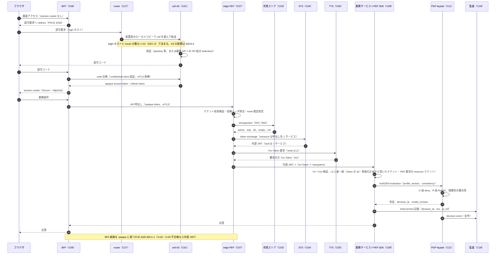
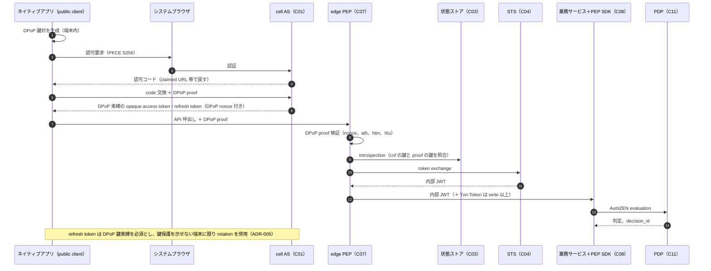
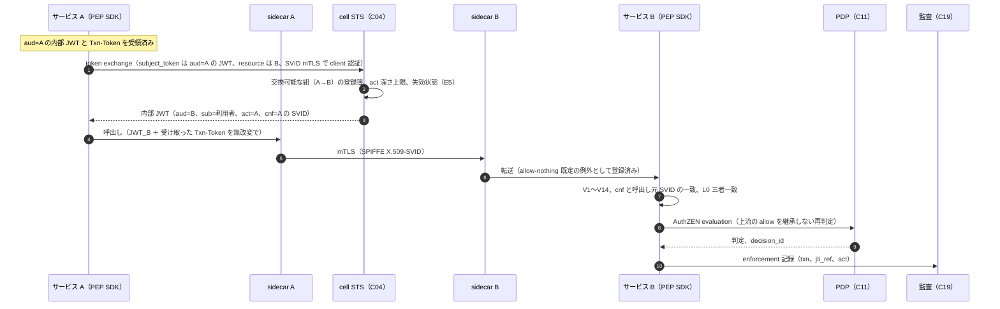
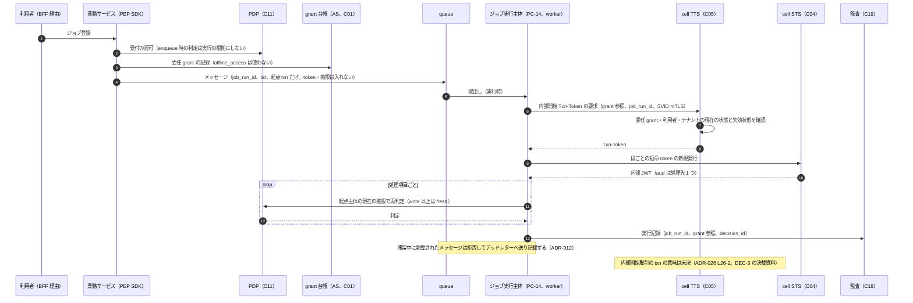
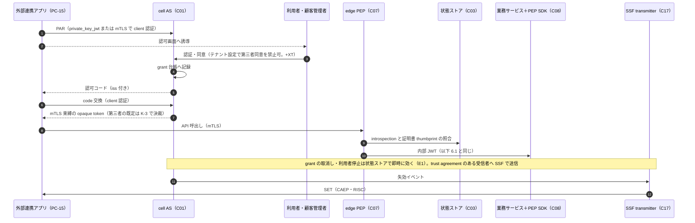
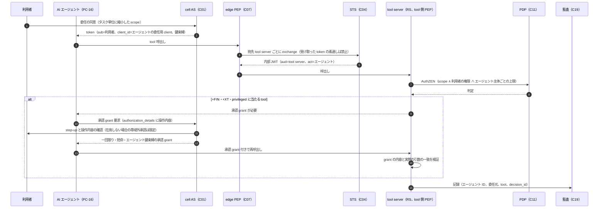
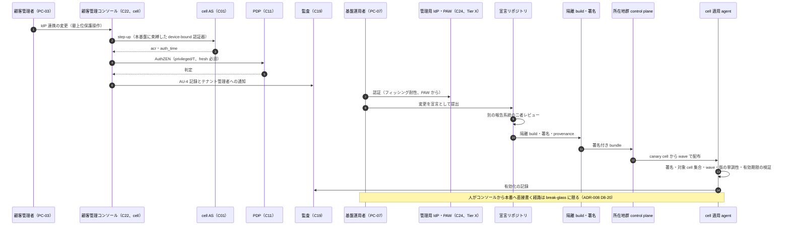
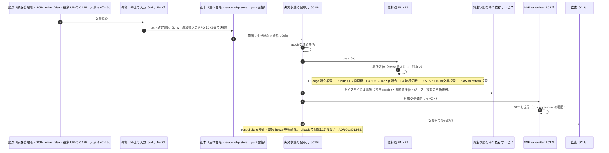
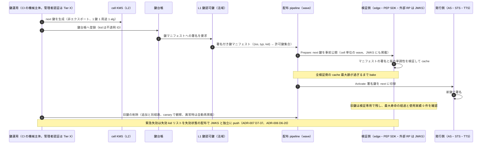

# 参照アーキテクチャ v2（高セキュリティを目標とする設計候補）

> 文書ID: ARC-01 / 版: 0.2 / 状態: review / 最終更新: 2026-10-15
> 対応要求: R-200, R-212, R-230, R-238, G-015, G-042, G-148（R-requirements.md・G-goal-criteria.md の対応成果物欄に本書のパスまたは DL-54 を含む全行）。関連: R-201, R-205, R-206（deliverables.md の DL-54 行）
> 依存文書: CONVENTIONS.md, traceability/deliverables.md（DL-54 行）, traceability/R-requirements.md, traceability/G-goal-criteria.md, traceability/claims-ledger.md（CL-0001, CL-0002, CL-0007, CL-0019, CL-0099, CL-0101, CL-0103, CL-0107, CL-0175, CL-0177, CL-0203, CL-0230, CL-0231, CL-0239, CL-0251, CL-0267, CL-0276, CL-0284, CL-0285）, traceability/rejected-hypotheses.md（RH-017, RH-019, RH-116, RH-127, RH-154）, 05_adr/README.md, 05_adr/ADR-001〜ADR-029, 05_adr/reconciliation-notes.md, 01_governance/assumptions-register.md, 01_governance/business-impact-analysis.md, 01_governance/loss-scenarios.md, 01_governance/kri.md, 02_requirements/operation-risk-tiers-assurance.md（REQ-03、操作 5 分類の正本）, 02_requirements/principal-catalog.md（DL-48）, 03_threat-model/attacker-model.md, 04_architecture/ の詳細文書 ARC-02〜ARC-15（token-profile.md, root-of-trust.md, workload-identity-delegation.md, authorization-model.md, pep-contract.md, cell-blast-radius.md, fail-mode-matrix.md, revocation-continuous-evaluation.md, audit-privacy.md, data-outside-pep.md, evolution-pqc.md, capacity-model.md, product-evaluation-exit.md, claims-catalog.md）, 04_architecture/architecture-reconciliation-notes.md（04_architecture 15 文書の整合調整記録）, マルチテナントSaaS認証・認可基盤の比較調査と設計指針.md（旧提案書）, 20年運用を前提とした認証・認可基盤提案のCTO CISOレビュー.md, research/RS-04, RS-06, RS-07, RS-08, RS-09, RS-10, research/standards-status.md
> 作成方法: AI エージェント（Claude）が ADR-001〜ADR-029（いずれも ADR 状態 proposed）と整合調整記録を正本として、構成要素の配置・責務・フローを 1 枚の参照アーキテクチャに統合した。本書は ADR の決定を変更しない。ADR で未決の点は「未決（ADR-0xx）」と書く。判断と自己点検は AI による自己レビューであり、実在の CTO/CISO の決裁ではない（CONVENTIONS §8）[D]。
> 表記: 表のセルのうちタグのないものは、列挙した ADR の決定を配置・責務に写した設計推論 [D] であり、この注記で個別のタグに代える。数値は A-ID の仮置き値、ADR の試算値、または TBD（所有者・期限・決め方付き）に限る。本書固有の論点は ARC01-Dx（決裁案）、ARC01-NAx（新規仮定）と表記する。

---

## 0. 結論（要旨）

本書が示すのは「高セキュリティを目標とする設計候補」であり、達成済みの安全性ではない [D]（R-200）。性質の評価は、実装証拠・適合試験・攻撃試験・運用実績・SLO・監査結果でだけ上げる [D]（R-201）。

1. **中核トポロジーを 1 つに確定した（ADR の決定の写し。ADR はすべて proposed で、DEC-3・DEC-8 の決裁前）。** 旧提案書の「各リソースサービスまたは共通 PDP」（CL-0002）と「centralized service または sidecar」（CL-0107）は、次の組合せに置き換える [D]。object 単位の判定の強制は**サービス内 PEP（PEP SDK）**が担い（ADR-012）、判定は**cell 内の共有 PDP façade**（AuthZEN 1.0）が行い（ADR-013 D13-12、ADR-011）、sidecar は mTLS と allow-nothing の既定拒否だけを担って PDP を持たない（ADR-012、RH-127）[D]。単一の global PDP・global store・global control plane は置かない（ADR-013 D13-10、ADR-010、RH-017）[D]。
2. **3 つの plane と 3 つの範囲で配置を決めた。** control plane（変更・登録・配布）は法域パーティションごと、decision plane（認証・token 発行・判定・失効状態）は cell ごと、data plane（業務要求の経路と強制）は cell の edge と依存サービス側に置く [D]（ADR-013 D13-08〜D13-10、ADR-023 D23-03）。global に置くのは許可リストの 5 部品（配置表、routing 層、オフライン L0 trust anchor、配布 pipeline の定義、build 時だけの契約・schema 登録簿）だけである [D]（ADR-013 D13-10、§3）。
3. **token の境界を確定した。** 外部 client に渡す token は opaque とし、edge が cell 内の状態ストアに照会し、cell 内 STS が呼出し先 1 サービスを aud とする内部 JWT（RFC 9068）に交換する [D]（ADR-005 D1-1〜D1-4）。書込以上の要求には edge 併設の TTS が署名付き Txn-Token（`txn`）を付ける [D]（ADR-005 D9-3、ADR-009）。Transaction Tokens は Internet-Draft（draft-11、WG 状態「WG Consensus: Waiting for Write-Up」、IESG 未提出、失効予定 2027-01-31、確認日 2026-10-03）なので、版を固定した社内 profile として扱う [N][^11]（RS-06#29）[D]。trace id は token に入れない [D]（reconciliation-notes §3.1）。W3C Trace Context は traceparent・tracestate に個人識別情報などを入れることを禁じ（MUST NOT）、相関だけを目的とする [N][^15]（RS-10#16）。
4. **失効は基盤所有の 6 強制点で中央強制し、配布は control plane から独立させた。** 署名付き・単調増加の失効状態を cell ごとに push し、edge・PDP・PEP SDK・接続ゲートウェイ・STS/TTS・AS で局所評価する [D]（ADR-006 D6-03〜D6-08）。SSF/CAEP/RISC は組織の境界でだけ送受信する [D]（ADR-006）。
5. **root of trust と監査は業務経路から独立させた。** 鍵は L0（オフライン）→ L1（法域別）→ L2（cell 別 KMS）の 3 層、検証は (iss, typ, kid) → 許可鍵集合の署名付きマニフェストで行う [D]（ADR-007）。監査は trace と別の経路で cell 内の耐久ジャーナルに 100% 記録し、法域内の WORM と別主体の透明性ログで改ざん検知する [D]（ADR-014）。管理用 IdP・break-glass・監視は本基盤に依存させない Tier X に置く [D]（ADR-008、ADR-023、ADR-029）。
6. **未決のまま残る中核論点は 5 つで、すべて ADR の決裁案に帰属している。** issuer の粒度（U-01、DEC-3）、AS を cell に置くか所在地群に置くか（KD13-3。U-01 に従属）、cell 数と blast radius 予算（KD13-1）、read-sensitive の fail-static と判定記録署名（KD13-6・U-04）、BFF 経路の token 形式（ADR-005 K-1）である [D]（§12）。いずれも本書の構成図の部品の**配置**は変えず、部品の数・名前・一部の検査の形を変える [D]。
7. **閉じ方**: 本書は机上（A）で閉じる範囲を担う。構成が性質を満たすことの実証（R-205・R-206 の C）、経営決裁（B）、第三者評価（D）は未達である [D]（§15）。

---

## 1. 本書の位置付けと読み方

### 1.1 本書が決めること・決めないこと

| 区分 | 内容 |
|---|---|
| 決める | 構成要素の一覧、各要素の plane・範囲（cell／法域パーティション／global／依存サービス側／Tier X）への配置、責務、担当 ADR・DL、SLI 候補、障害時の挙動、依存 Tier、主要 9 フローの順序、旧提案からの変更点、基盤が提供する機能の区分案（G-148） |
| 決めない（正本は別） | 識別子・claim 名（ADR-021、DL-115）、claim の意味と token 寿命（ADR-005、DL-16）、cell の数・寸法（ADR-013、DL-18）、fail-mode の全セルと数値（DL-19、DL-20）、エンジン製品（ADR-010、Gate 3）、契約本体（DL-69〜DL-80） |

- 本書は ADR の要約ではなく、ADR の決定を構成要素の単位で束ねた**配置図**である [D]。ADR と食い違う場合は ADR を正とする [D]（05_adr/README.md §1）。
- 読み手別の入口: CTO/CISO は §0・§4・§10・§12・§14.2、連携開発者は §9.1（実装義務の一覧）を最初に読み、背景として §2・§5・§6・§9 を読む [D]。

### 1.2 plane の定義（本書での用語）

| plane | 本書での意味 | 含む部品の例 | ADR-023 の Tier との対応 |
|---|---|---|---|
| control plane | 構成・policy・model・配置・鍵 metadata を**変える**系。要求経路の外に置く | 所在地群 control plane、model registry/PAP、配布 pipeline、テナント操作 orchestrator | CP（Tier 0 から実行時に依存されない） |
| decision plane | 要求時に**認証・発行・判定・失効の評価**をする系 | AS・session store、状態ストア、STS、TTS、PDP façade・engine・PIP、relationship store、失効状態の配布元、L2 鍵 | Tier 0（ADR-023 はこれを「cell の data plane」と呼ぶ） |
| data plane | 業務要求そのものが流れ、**判定を強制する**系 | edge PEP、接続ゲートウェイ、BFF、業務サービスの PEP SDK、mesh sidecar、非同期 worker | edge・接続ゲートウェイは Tier 0、依存サービスは Tier 1〜3 |

- 用語の注意: ADR-023 は判定系・認証系をまとめて「cell の data plane」と呼ぶ [D]（ADR-023 Tier 0 行）。本書は、レビューが求めた control/decision plane の分離（CL-0239）を図で示すため、判定系を decision plane として分けて描く [D]。Tier の割当は ADR-023 のとおりで変えない [D]。

### 1.3 NIST SP 800-207 の用語との対応（R-238）

- SP 800-207 は、ZTA の論理構成要素が別の control plane で通信し、アプリケーションのデータは data plane で通信するとしている [N][^1]（§3, p.9）。
- 同 §3.4 は、ネットワークの制御・構成の通信と業務の通信の流れを論理的（場合により物理的）に分離すべきである（should、小文字表記）とし、§3.4.1 の要件 5 は data plane と control plane が論理的に分離していることを挙げる [N][^1]（p.21〜22）。
- SP 800-207 では policy engine（PE）と policy administrator（PA）が PDP を構成し（§3, p.9）、PA が通信経路を作るときの PEP との通信は control plane で行われる（§3, p.10）[N][^1]。
- 本書はこの「control plane」を、**変更の系（control plane）**と**要求時の評価の系（decision plane）**の 2 つに分ける [D]。理由は、control plane は data plane より故障しやすく、障害中も data plane は最後の状態で動き続けるべきだという静的安定性の知見（RS-09#10, #12, #13）[V][^3][^4][^5] と、PE/PA に到達できなくなると企業全体が機能しなくなり得るという SP 800-207 §5.2 の指摘（RS-09#18）[N][^1] である [D]。

| SP 800-207 の構成要素 | 本書の部品 | 補足 |
|---|---|---|
| Policy engine（PE） | PDP façade・engine（認可）、AS の認証判定（認証） | cell 内。判定は AuthZEN 契約で返す [D] |
| Policy administrator（PA） | AS・STS・TTS（session と資格情報の発行・交換）、失効状態の配布元（接続の打切りに相当） | cell 内。SP 800-207 の PA が PEP に接続の終了を指示する役割を、失効状態の push と強制点の局所評価で実現する [D] |
| PEP | edge PEP、PEP SDK、接続ゲートウェイ、mesh sidecar（相互認証だけ） | object 単位の判定の強制は PEP SDK だけが担う（ADR-012）[D] |
| 情報源（PIP 等） | PIP（属性辞書）、relationship store、主体台帳、SSF 受信、失効状態 | 属性は token に積まず PDP 側で取得する（ADR-011 D9-4）[D] |
| 管理系（policy の作成） | model registry/PAP、配布 pipeline | 本書の control plane。要求経路に置かない [D] |

---

## 2. 全体図

### 2.1 構成図（plane × 範囲）

図は部品の配置と主な呼出し・配布の向きを示す [D]。実線は要求時の呼出し、点線は配布・複製・登録の流れである [D]。

```mermaid
flowchart TB
  subgraph EXT["外部（本基盤の外）"]
    BR["ブラウザ"]
    NAT["ネイティブアプリ・CLI（public client）"]
    XA["外部連携アプリ（PC-15）"]
    AGC["AI エージェント（PC-16）"]
    CIDP["顧客 IdP（SAML/OIDC）・SSF 送信者"]
    CSC["顧客 SCIM client"]
    XR["外部 SSF 受信者（trust agreement）"]
  end

  subgraph GLB["global（許可リスト 5 部品。ADR-013 D13-10）"]
    G1["G1 テナント配置表（署名付き静的 artifact）"]
    G2["G2 routing 層（DNS・薄い router）"]
    G3["G3 L0 trust anchor（オフライン）"]
    G4["G4 配布 pipeline の定義"]
    G5["G5 契約・schema 登録簿（build 時だけ）"]
  end

  subgraph PART["法域パーティション（日本／EU・英国／米国）ごと"]
    subgraph CPL["control plane（CP）"]
      PCP["所在地群 control plane（配置台帳・wave 実行・テナント管理・AS 宣言適用）"]
      PAP["model registry / PAP（CAM・policy・schema）"]
      ORC["テナント操作 orchestrator（ADR-028）"]
    end
    L1["L1 鍵認可鍵（法域別）"]
    WORM["監査長期保管（WORM）・検知"]
    SPIRE["workload ID 発行系（SPIRE）"]

    subgraph CELL["cell × N（試算 9。法域 × 規制スコープ × テナント群）"]
      subgraph DEC["decision plane（Tier 0）"]
        AS["AS（login・発行・federation 終端・grant 台帳）＋ session store"]
        SS["opaque token 状態ストア"]
        STS["STS（RFC 8693）"]
        TTS["TTS（Txn-Token）"]
        PDP["PDP façade（AuthZEN）＋ engine ＋ PIP"]
        REL["relationship store・tenant 設定（正本）"]
        REV["失効状態の配布元（署名・単調 epoch）"]
        KMS["L2 鍵（cell 専用 KMS）・JWKS 配信"]
        IN0["剥奪・停止の入力（SCIM 無効化・CAEP 受信）"]
      end
      subgraph DAT["data plane（cell 内）"]
        EDGE["edge PEP（API gateway 型）"]
        CGW["接続ゲートウェイ（長時間接続）"]
        MAPI["管理 API の data plane 部分（顧客管理コンソール・SCIM server）"]
        SSFT["SSF 送信"]
        AUP["監査 producer・耐久 spool・一次保管"]
        AGT["適用 agent（配布物の検証）"]
      end
    end
  end

  subgraph DEP["依存サービス領域（約 300。cell に収容しない）"]
    BFF["BFF（第一者 confidential client）"]
    SVC["業務サービス ＋ PEP SDK（object 単位の判定）"]
    SC["mesh sidecar（mTLS・allow-nothing）"]
    WRK["非同期 worker・consumer（PC-14）"]
    TOOL["tool server・MCP server（RS）"]
  end

  subgraph TX["Tier X（本基盤に依存しない）"]
    MIDP["管理用 IdP"]
    PAW["特権アクセス端末（PAW）"]
    BG["break-glass（封緘資格情報・同時二者）"]
    MON["監視・status page・帯域外連絡"]
  end
  CI["隔離 build・署名（SLSA Build L3）"]
  TL["透明性ログ（別の管理主体）"]

  BR --> BFF
  BFF --> G2
  NAT --> G2
  XA --> G2
  AGC --> G2
  G2 --> EDGE
  G2 --> AS
  G1 -.-> G2
  G1 -.-> EDGE
  EDGE --> SS
  EDGE --> STS
  EDGE --> TTS
  EDGE --> SVC
  EDGE --> TOOL
  SVC --> PDP
  TOOL --> PDP
  WRK --> TTS
  WRK --> PDP
  SVC --> STS
  SC --- SVC
  PDP --> REL
  AS --> SS
  CIDP --> AS
  CIDP --> IN0
  CSC --> MAPI
  MAPI --> IN0
  SSFT --> XR
  IN0 --> REV
  REV -.-> EDGE
  REV -.-> PDP
  REV -.-> SVC
  REV -.-> CGW
  REV -.-> STS
  REV -.-> TTS
  REV -.-> AS
  KMS --> AS
  KMS --> STS
  KMS --> TTS
  G3 -.-> L1
  L1 -.-> KMS
  SPIRE -.-> SC
  CI -.-> PCP
  PAP -.-> PCP
  G4 -.-> PCP
  G5 -.-> CI
  PCP -.-> AGT
  ORC -.-> CELL
  AUP -.-> WORM
  WORM -.-> TL
  PAW --> MIDP
  MIDP --> PCP
  BG -.-> AS
```

- 図の「依存サービス領域」は cell に収容しない [D]。業務サービスは複数 cell のテナントの要求を受けるので、PEP SDK はテナント配置表のローカルコピーで tid から cell を引き、cell ごとに接続プール・circuit breaker・deadline を分けて PDP を呼ぶ [D]（ADR-013 D13-18、ADR-009 P09-4）。業務サービスが複数の Txn trust domain に属する構成の詳細は未決（ADR-009 P09-4）である [D]。
- 管理用 IdP は cell の外、かつ global 許可リストの外に置く（ADR-008 D8-14）[D]。管理用 IdP の形態（独立 managed テナント／自社運用／workforce 直結）は未決（ADR-008 KD8-1）である [D]。

### 2.2 配置の要約（範囲 × plane）

| 範囲 | control plane | decision plane | data plane | その他 |
|---|---|---|---|---|
| global | G4 配布 pipeline の定義、G5 契約・schema 登録簿 | — | G1 配置表（読取りはローカルコピー）、G2 routing 層 | G3 L0 trust anchor（オフライン） |
| 法域パーティション | 所在地群 control plane、model registry/PAP、テナント操作 orchestrator、AS の宣言適用 | — | — | L1 鍵、監査の WORM・検知、SPIRE（trust domain 数は未決: ADR-009 P09-1） |
| cell | （置かない。適用 agent は data plane 側で検証だけを行う） | AS・session store、状態ストア、STS、TTS、PDP façade・engine・PIP、relationship store、失効状態の配布元、L2 鍵・JWKS、剥奪・停止の入力 | edge PEP、接続ゲートウェイ、管理 API の data plane 部分、SSF 送信、監査 producer・spool | — |
| 依存サービス側 | — | — | BFF、業務サービスの PEP SDK、mesh sidecar、worker、tool server | — |
| Tier X | — | — | — | 管理用 IdP、PAW、break-glass、監視・status page・帯域外連絡（ADR-023 §2.5 の 16 項目） |

---

## 3. 「共通基盤」の定義と共有部品（G-042）

### 3.1 2 つの「共通」

| 区分 | 定義 | 例 | 共有の帰結 |
|---|---|---|---|
| 共通の契約・統制 | 全 cell・全依存サービスが**同じ規則**に従うが、実行時の実体は共有しないもの | 連携契約 v1（ADR-022）、CAM と AuthZEN profile（ADR-011）、token profile と検証規則 V1〜V14（ADR-005）、操作 5 分類（REQ-03）、識別子規則（ADR-021）、監査スキーマ（DL-77）、fail-mode 原則（ADR-013 D13-23） | 規則の誤りは全域に及び得るので、変更は版付き・二者承認・段階配布で行う（ADR-008、ADR-016）[D] |
| 共有される実装・障害範囲 | 実行時の状態・処理を**複数 cell または全域で共有**し、止まると共有範囲に影響が出るもの | §3.2 の global 5 部品、§3.3 の法域パーティション部品 | 部品ごとに共有理由・保持データ・停止時の影響範囲を固定し、許可リスト外の共有を禁止する（ADR-013 D13-10）[D] |

- 「共通基盤だから全域で 1 つ」という構成は採らない [D]。共通にするのは契約と統制であり、実体は cell に複製する [D]（ADR-013 D13-04、RH-017）。

### 3.2 global 部品（許可リスト。ADR-013 D13-10 の写し）

| 部品 | 共有の理由 | 保持してよいデータ | 停止時の影響範囲 | 静的安定の手段 |
|---|---|---|---|---|
| G1 テナント配置表 | 要求を正しい cell へ送るには全テナントの対応が要る | 不透明テナント ID、cell ID、検証済みドメイン → テナント ID、版番号。個人データは置かない [A-062] | 新規テナント作成と cell 間移動が止まる。既存テナントの転送は最終版で続く | 署名付き静的 artifact のローカルコピーを router・edge・SDK が読む |
| G2 routing 層 | 単一の入口 | G1 のローカルコピーだけ | 所在地群ごとに置くので、1 群の停止はその所在地群の新規接続に限られる | router は G1 をメモリに保持し control plane 停止中も転送を続ける（RS-09#12）[V][^3] |
| G3 L0 trust anchor | 鍵階層の root（ADR-007） | オフライン鍵 | 平常時の影響なし。L1 の再認証ができなくなる | 実行時依存なし |
| G4 配布 pipeline の定義 | 全配布物を同じ規則で段階展開する | wave の定義と承認記録 | 変更が止まる（fail-static）。data plane は影響を受けない | 定義だけ global、artifact の保管と実行は所在地群ごと |
| G5 契約・schema 登録簿 | 約 300 サービスが同じ契約を参照する（ADR-022） | 契約と schema の版 | 新しい契約版の公開が止まる | build 時と配布時だけ参照し、実行時依存なし |

- AWS の cell 白書は、全 cell の共有状態を持つ唯一の部品である cell router が単一障害点になるとし（RS-09#3）、routing 層は複数 cell への影響を避けるため「できる限り単純かつ水平拡張可能に保たなければならない（must remain as simple and horizontally scalable as possible）」とし、業務ロジックを置かないよう求めている（Cell routing 節。本レビューで原典確認、RS ノート未収載）[V][^3]。G2 を業務ロジックのない router に限るのはこのためである [D]。
- 「cell 間で同期呼出しも共有状態も持たない」（ADR-013 D13-13、不可逆）は、AWS の cell の定義（他 cell と状態を共有しない）に合わせたものである [V][^3]（RS-09#1）[D]。global な利用者 directory は作らない [D]（ADR-013 D13-13）。

### 3.3 法域パーティション単位で共有する部品

| 部品 | 共有の理由 | 停止・侵害時の影響範囲 | 根拠 |
|---|---|---|---|
| 所在地群 control plane（配置台帳の書込、wave 実行、テナント管理、AS 宣言適用、オンボーディング） | cell のライフサイクルと配布を法域内で一貫させる | 法域内の変更が止まる。data plane は署名付き最終状態で上限時間 H まで継続（H は TBD、ADR-013 D13-14） | ADR-013 D13-09、ADR-023 CP 行 |
| model registry / PAP | CAM・policy・schema の版を法域内で一元管理する | 新しい model・policy の公開が止まる。本番は pin した revision で判定を続ける（ADR-016） | ADR-011、ADR-016、DL-73 |
| L1 鍵認可鍵 | 法域ごとに L2 鍵マニフェストを署名する | L1 侵害は法域内全 cell の鍵マニフェストに及ぶ。保管方式は未決（ADR-007 KD7-2） | ADR-007 |
| 監査の WORM・検知 | 法域内での保管と SOC 参照を所在地内に閉じる | 長期保管と検知が遅れる。cell の一次保管と spool は継続 | ADR-013 D13-09、ADR-014 |
| SPIRE（workload ID の発行系） | trust domain の単位を法域にする案 | trust domain の数は未決（ADR-009 P09-1: 本番 3＋非本番 1 か、ADR-021 D21-28 の本番 1＋非本番 1 か。DEC-3） | ADR-009 |
| テナント操作 orchestrator | 統合・分割・cell 間移動・削除を 1 つの実行機構で行う | 移動・削除が止まる。テナントの稼働には影響しない | ADR-028 |

### 3.4 共有実装だが実行時の状態は共有しないもの

| 共有実装 | 相関障害の経路 | 封じ込め |
|---|---|---|
| PEP SDK・sidecar の判定ルールと既定値 | 1 つの不良版が約 300 サービスに同時に入る [A-050] | SDK は 5 責務に限る（ADR-022 D-4-1）。判定ルールと既定値は配布物として cell 単位の wave で配る（ADR-013 D13-30）。SDK 配布は Tier 3 → 2 → 1 の順（ADR-023）[D] |
| AS 製品・PDP engine の binary | 製品の欠陥が全 cell に共通する | 全 cell 同一構成とし、版上げは canary cell からの wave（ADR-013 D13-04、D13-30）[D] |
| 配布物（policy・model・鍵 metadata・設定・配置表・quota） | 一斉配布で全域が同時に落ちる（Google 2025-06 の一次報告。RS-09#67） | global な数秒複製を禁止し、適用 agent が署名・対象 cell 集合・wave 番号・版の単調性を検証する（ADR-013 D13-31、D13-33）[D] |
| クラウド事業者・DNS 提供者 | substrate・DNS の障害 | cell の実行時依存を機械列挙し global endpoint への依存を 0 件にする（ADR-013 D13-21）。第二 substrate・DNS 複数化は未決（ADR-013 KD13-7）[D] |

---

## 4. 中核トポロジーの確定事項

旧提案書は判定の位置・PDP の配置・plane の分け方を「または」で併記していた（CL-0002、CL-0107、CL-0239）[D]。本書は次のとおり確定し、ADR で未決の点は未決の帰属先を示す [D]。

| # | 論点 | 確定した構成 | 正本 | 状態 |
|---|---|---|---|---|
| T1 | object 単位の判定をどこで強制するか | 資源を知るサービス内 PEP（PEP SDK）だけが担う。edge・sidecar は object 単位の coverage に数えない | ADR-012 | 決定（proposed） |
| T2 | PDP をどこに置くか | cell 内の共有サービス（PDP façade＋engine）。SDK 側は token 検証・最大齢付き判定 cache・public の静的規則だけ。PEP–PDP 契約は AuthZEN 1.0（OpenID Final）[N][^12]（RS-07#60） | ADR-013 D13-12、ADR-010、ADR-011 | 決定（proposed）。判定 1 回あたり 1 hop の p99 を TC-13-04 で実測する |
| T3 | sidecar 型分散 PDP を採るか | 採らない。7.55 億 tuple [A-049] を約 1.1 万インスタンス [A-012] に配ることになり一斉配布障害の面を作る | ADR-013 D13-12、RH-127 | 決定（proposed） |
| T4 | 単一 global PDP・store を置くか | 置かない。store は cell 単位、cell 内はテナント共有を既定、最大テナント層・所在地指定・規制顧客は専用区画 | ADR-010、ADR-013 D13-10、RH-017 | 決定（proposed） |
| T5 | control plane を中央に置くか | global の control plane は持たない。所在地群ごとに置き、要求経路の外に置く | ADR-013 D13-09・D13-10 | 決定（proposed） |
| T6 | 外部 token の形式 | opaque。edge が状態ストアに照会し、cell 内 STS が aud 別内部 JWT に交換する | ADR-005 D1-1〜D1-4 | 決定（proposed）。BFF 経路は未決（ADR-005 K-1。H-02・H-04 不合格なら内部 JWT） |
| T7 | 内部の信頼文脈の伝播 | 旧提案書の「署名/MAC 付き短命内部 context」は採らず、TTS が署名する Txn-Token（版固定の社内 profile `txn-v1`）に寄せる | ADR-009、ADR-005 D9-3 | 決定（proposed）。発行範囲を全要求に広げるかは未決（U-02） |
| T8 | AS の配置 | cell ごとの self-host AS（基準案 C） | ADR-001 D1・D4-1、ADR-013 D13-08 | 条件付き。製品が cell 単位の AS を作れない場合、または U-01 で決まる issuer を cell 単位で提供できない場合は所在地群の AS（C′）。未決（ADR-013 KD13-3） |
| T9 | issuer の粒度 | テナント／realm 別か、信頼区画別＋cell 別鍵＋専用 issuer 枠か | ADR-007 KD7-1、ADR-021 K21-1 | 未決（U-01、DEC-3）。どちらでも cell 識別子は外部に出さない（ADR-013 D13-42） |
| T10 | PIP の取得経路 | PIP は cell 内の PDP façade 側に置き、(a) cell 内の正本（主体台帳の写し、tenant 設定、失効状態）と (b) PEP が AuthZEN 要求の `context`・`resource` に載せる値（資源属性の正本は資源サービス）だけを使う。PDP から依存サービスへの判定時の同期照会は置かない | ADR-011 D9-4〜D9-6、ADR-023 D23-03 から導出 | 本書で確定（[D]。Tier 0 は Tier 1〜3 に実行時依存してはならない規則から導いた） |
| T11 | テナント境界の多層化 | (1) edge の収容検証（署名済み配置スナップショット）、(2) PEP SDK の L0 三者一致（token の `tid`、資源の正本から導いた資源のテナント、PDP 要求の `resource.properties` のテナント。ADR-012 D12-04）、(3) PDP façade の G 段（基盤所有の deny）、(4) ストレージ側 guardrail（RLS 等） | ADR-013 D13-11、ADR-011、ADR-024、ADR-012 | 決定（proposed）。ただし「三者」の定義は ADR-012 D12-04（tid・資源テナント・`resource.properties` のテナント）と ADR-024 D24-07（tid・route テナント・resource-derived tenant）で異なる。ARC-06 は D24-07 の定義で書いている。どちらを正とするかは未決（ADR-012／ADR-024。architecture-reconciliation-notes.md XR-07） |
| T12 | 失効の効力 | 基盤所有の強制点 E1〜E6 で中央強制し、依存サービスの受信に依存させない | ADR-006 D6-03 | 決定（proposed）。数値は TBD（ADR-006 K6-1、ARC-09） |
| T13 | 監査の経路 | trace・telemetry と別経路。cell 内耐久ジャーナル → 法域内 WORM → 透明性ログ | ADR-014 | 決定（proposed）。判定記録への PDP 署名は未決（U-04） |
| T14 | 管理面の認証と変更経路 | 管理用 IdP（本基盤の AS に依存しない）＋PAW、変更は宣言 → 二者レビュー → 隔離 build と署名 → cell 段階配布の単一経路 | ADR-008 | 決定（proposed）。管理用 IdP の形態は未決（KD8-1） |
| T15 | break-glass | 基盤の PDP・AS に依存しない封緘資格情報・同時二者・独立経路記録（/P）。テナント内の業務上の緊急アクセス（/B）は PDP 上の型付き例外 | ADR-029 D29-70〜D29-83、ADR-023 | 決定（proposed）。保管方式は未決（KD29-3） |

- 旧提案書の判定式 `Allow = token_valid AND tenant_bound AND ...`（L267）は、ADR-011 の「L0（PEP SDK のテナント照合）・G 段（基盤所有の deny）・R 段（typed ReBAC＋CEL カタログ条件）」の論理積として引き継ぐ [D]。評価不能は deny、PDP 不達は deny と別の理由コードで返し、操作階層別の fail-mode で扱う [D]（ADR-011、ADR-013 D13-25）。

---

## 5. 構成要素

### 5.1 責務・担当 ADR・成果物

| # | 構成要素 | plane / 範囲 | 責務 | 担当 ADR | DL |
|---|---|---|---|---|---|
| C01 | IdP/AS（cell AS） | decision / cell（KD13-3 で所在地群の可能性） | 人・client の認証、federation 終端（RP 起点）、consent と grant 台帳、token 発行・refresh・失効、step-up（RFC 9470）。資格情報層（password・passkey・OTP・回復）は self-host OSS で自作しない | ADR-001, 002, 003, 004, 005, 020, 021 | DL-13, DL-16, DL-08 |
| C02 | session store | decision / cell | ログイン session と `sid` の正本、失効下限時刻との照合 | ADR-005, 006, 019 | DL-16, DL-56 |
| C03 | opaque token 状態ストア | decision / cell | 外部 opaque token の発行記録と状態、RFC 7662 照会への応答、privileged 以上の内部 jti 照合 | ADR-005 D1-2・D1-6 | DL-16 |
| C04 | STS（token exchange） | decision / cell | RFC 8693 で aud 1 つの内部 JWT を発行。交換可能な組の登録簿、act 深さ上限（初期案 3）、呼出し元 SVID への束縛 | ADR-005 D1-4, ADR-009, ADR-017 | DL-55, DL-74 |
| C05 | Transaction Token service（TTS） | decision / cell（edge 併設） | 外部要求ごとの `txn` 払出しと署名付き Txn-Token 発行（write 以上）、非同期ジョブの内部開始 Txn-Token の発行 | ADR-005 D9-3, ADR-009, ADR-026 | DL-55, DL-115 |
| C06 | BFF | data / 依存サービス側 | ブラウザ向け confidential client。token をブラウザに置かず cookie session を持つ | ADR-005（ブラウザは BFF 必須、K-1） | DL-16, DL-64 |
| C07 | API gateway（edge PEP） | data / cell | 外部 token の検証（照会・sender constraint）、テナント収容検証、信頼ヘッダの除去、登録済み route だけを通す既定拒否、STS・TTS の呼出し、quota（fail-static） | ADR-005, 012, 013 D13-11・D13-17 | DL-15, DL-16 |
| C08 | PEP SDK | data / 依存サービス側 | 内部 JWT 検証（V1〜V14）、L0 三者一致、AuthZEN 呼出し、Txn-Token・traceparent の無改変伝播、enforcement 記録の送出、非推奨警告と計測。fail-mode は設定値。ADR-022 D-4-1 は SDK の責務を 5 つに限るので、L0 三者一致と enforcement 記録は「AuthZEN 呼出しのラッパ」と「監査イベントの送出」の内側と読む（ARC-06 §4。列挙の改訂は未決（ADR-022 D-4-1／ADR-012 L-07）） | ADR-011, 012, 022 D-4-1, 013 D13-28 | DL-15, DL-72, DL-80 |
| C09 | mesh sidecar | data / 依存サービス側 | workload の相互認証（SVID mTLS）と allow-nothing 既定。object 単位の判定はしない。SDK を入れられないレガシーへの期限付き例外として PEP にする場合に限り判定を代行 | ADR-012, 009 | DL-15, DL-55 |
| C10 | 接続ゲートウェイ | data / cell | 長時間接続（WebSocket 等）を失効状態に該当した時点で切断する（強制点 E4） | ADR-006 D6-14 | DL-56 |
| C11 | PDP façade＋engine | decision / cell | AuthZEN 1.0 evaluation/evaluations、G 段（固定カタログ×テナント設定値）、R 段（typed ReBAC＋CEL）、整合性の階層別割当、decision_id の発行、decision event の全件出力。engine は OpenFGA か SpiceDB（Gate 3） | ADR-010, 011, 025 | DL-17, DL-72 |
| C12 | relationship store | decision / cell | tuple・tenant 設定の正本（PostgreSQL）、書込応答の consistency_token、剥奪フェンス | ADR-010, 024, 028 | DL-17, DL-73 |
| C13 | model registry / PAP | control / 法域パーティション | CAM の版付き登録、OpenFGA/SpiceDB への変換と往復試験、policy・schema の審査、revision の採番と pin | ADR-011, 016, 008 | DL-17, DL-65, DL-73 |
| C14 | PIP（属性辞書） | decision / cell（PDP façade 側） | 出所メタデータ付き属性の取得。VC 等の外部検証済み属性は前段で検証し、検証結果と出所だけを PDP に渡す | ADR-011 D9-4〜D9-6 | DL-17 |
| C15 | 失効状態の配布元 | decision / cell | 範囲 × 失効時刻の境界を署名・単調 epoch で E1〜E6 に push。control plane 停止・freeze と独立 | ADR-006 D6-04〜D6-08, ADR-013 D13-35 | DL-56 |
| C16 | SSF receiver | decision / cell（剥奪・停止の入力経路） | 顧客 IdP・外部 IdP からの CAEP/RISC 受信（push・poll）、SET 検証、失効状態への書込 | ADR-006 D6-23, ADR-023 D23-21 | DL-56, DL-78, DL-79 |
| C17 | SSF transmitter | data / cell | trust agreement を結んだ顧客受信者と外部連携アプリへの送信 | ADR-006 D6-24 | DL-56, DL-78, DL-79 |
| C18 | 鍵（L0/L1/L2・KMS/HSM・鍵台帳・マニフェスト・JWKS） | L0: global オフライン／L1: 法域／L2: cell | 3 層鍵階層、1 鍵 1 用途 1 alg 1 スコープ、(iss, typ, kid) → 許可鍵集合、30 日 rotation（初期案。SAML 署名鍵の 1 年など族ごとの周期と根拠は ARC-03 §4 の鍵目録）、緊急失効、PQ 移行の二重署名 | ADR-007, 015, 019 | DL-14, DL-23 |
| C19 | 監査パイプライン | data（producer）／法域（WORM）／外部（透明性ログ） | 正準スキーマで 100% 記録、相関 8 欄、4 層の改ざん検知、WORM と削除権の 3 層調停、顧客向け監査 API | ADR-014 | DL-25, DL-77 |
| C20 | SCIM server | data / cell（管理 API の data plane 部分） | 接続ごとのプロビジョニングモデル宣言、SCIM 正本を既定、`active=false` を全アクセス手段の失効として Tier 0 の入力経路へ渡す | ADR-004, 023 D23-21 | DL-76, DL-08 |
| C21 | 顧客 IdP 連携 | decision / cell（AS 内） | テナントごとの trust agreement と期待 IdP allowlist、RP 起点、3 つ組 linking、acr/amr 対応表、証明書管理、テナント単位の信頼停止（K2） | ADR-004, 002, 019 | DL-26 |
| C22 | 管理コンソール（顧客管理者向け） | data / cell | テナント設定・IdP 連携・ロール付与。最上位保護操作は本基盤に束縛した device-bound 認証器で再認証 | ADR-002, 004, 029 | DL-26 |
| C23 | 管理コンソール（基盤運用者向け）・support コンソール | control / 法域パーティション（認証は Tier X の管理用 IdP） | 運用者は閲覧だけ。書込は宣言適用か break-glass。support は昇格 grant と顧客承認、経路を本番管理面から分離 | ADR-008, 029 | DL-27, DL-46 |
| C24 | 管理用 IdP・PAW | Tier X | 管理者の認証を本基盤の AS と workforce IdP から切り離す | ADR-008 D8-10〜D8-14 | DL-14, DL-27 |
| C25 | break-glass 経路 | Tier X | 事前作成・封緘・二重保管・同時二者の発動・独立経路への記録・発動窓の自動失効・全件事後レビュー | ADR-029 D29-70〜D29-83, ADR-008 | DL-46, DL-24 |
| C26 | 配布 pipeline・適用 agent | control（pipeline）／data（agent、cell） | 配布物を cell 単位の wave で配り、agent が署名・対象 cell・wave・版の単調性・有効期限を検証 | ADR-013 D13-30〜D13-36, ADR-008 | DL-18, DL-23 |
| C27 | router・配置表 | global（G1・G2） | 要求の振分け。経路決定は認可にしない | ADR-013 D13-10・D13-11 | DL-18 |
| C28 | workload ID 発行系（SPIRE） | 法域パーティション（cell 内に発行インスタンス） | SPIFFE ID・X.509-SVID の発行。cell 内基盤部品の SVID は cell 内の発行インスタンスから | ADR-009 | DL-55 |
| C29 | テナント操作 orchestrator | control / 法域パーティション | 統合・分割・cell 間移動・解約時 export・論理削除と鍵破棄 | ADR-028, 013 D13-37 | DL-49 |

### 5.2 SLI 候補・障害時の挙動・依存 Tier

SLI の ID 採番と目標値は数値契約台帳（DL-20）で行う [D]。本書は計測対象（SLI 候補）と、目標値の拠り所となる仮置き帯だけを示す [D]。目標値はすべて TBD（所有者・期限・決め方は §13）である [D]。

| # | 構成要素 | SLI 候補 | 目標値の拠り所 | 障害時の挙動 | 依存 Tier |
|---|---|---|---|---|---|
| C01 | AS | ログイン成功率、token 発行 p99、refresh 成功率 | 認証系帯 99.9〜99.95% [A-091]。発行 1,374/秒 [A-043]、再ログイン集中 556/秒 [A-048] | 停止中は当該 cell の新規 login・refresh を止める。既存 session・発行済み token は寿命まで有効。上流 IdP 停止中も既存 session と refresh を継続（ADR-001 D14-1）。状態ストアへの迂回なし | Tier 0（認証系） |
| C02 | session store | 照合 p99、失効下限時刻の反映遅延 | 認証系帯 [A-091]。有効 session 86.5 万 [A-006] | 停止時は新規 session を作らない。全 session 失効後の再有効化はテナント順・cell 順の段階（ADR-013 D13-35） | Tier 0 |
| C03 | 状態ストア | 照会 p99、照会成功率 | 判定系帯 99.95〜99.99% [A-090]。照会は ADR-005 D1-7 の案（BFF 経路も opaque。K-1 の推奨）で 8,402 × k/秒（k は ARC-13 §3.1 行 16 の係数）、前提台帳の案 C（A-044）なら 2,521/秒 [D][A-040, A-044]。前提台帳の A-044 を D1-7 の案に合わせるかは ARC-13 残課題 2 の変更提案 | 失敗しても AS 本体へ迂回しない（ADR-005 D1-3）。照会できない外部要求は拒否 | Tier 0（判定系） |
| C04 | STS | exchange p99、拒否率（登録簿外の組） | 判定系帯 [A-090]。exchange は発行 1,374/秒の内数 [A-043] | 停止中は新しい内部 token を出せず、交換済み token の寿命内だけ継続。失効した親 token からの交換は拒否（E5） | Tier 0 |
| C05 | TTS | Txn-Token 発行 p99、発行範囲の遵守率 | 判定系帯 [A-090]。全要求に広げると署名 16,804/秒 [A-040]（U-02） | 停止中は write 以上の新規要求を拒否（Txn-Token なしの書込を受けない）。非同期ジョブは実行を延期 | Tier 0 |
| C06 | BFF | session 維持率、edge 呼出し成功率 | 依存サービスの帯（KD23-1） | BFF 停止はその業務の画面だけに及ぶ | Tier 1〜2（依存サービス） |
| C07 | edge PEP | 照会込み p99、収容外要求の拒否件数、迂回経路 0 件 | 判定系帯 [A-090]。edge 呼出 16,804/秒 [A-040] | 状態ストア不達は拒否。quota 判定系停止時は最後の閾値で fail-static（ADR-013 D13-17） | Tier 0 |
| C08 | PEP SDK | 判定呼出し p99、decision_id なしで完了した処理（K-01(b)）、未宣言 entry point（K-01(a)） | K-01 は 0 件目標（ADR-012） | 階層別 fail-mode（ADR-013 D13-25）。宣言のない entry point は privileged として扱う（D13-28） | 依存サービス側の部品（判定ルールは Tier 0 の配布物） |
| C09 | mesh sidecar | mTLS 失敗率、ALLOW なし workload の検出件数 | 0 件目標（ADR-012） | 既定拒否。SVID 期限切れで接続を拒否 | 依存サービス側 |
| C10 | 接続ゲートウェイ | 失効から切断までの時間 | R(t, c)（ADR-006、TBD） | 失効状態の齢が M_rev を超えたら read-sensitive 以上の接続を切る（ADR-006 D6-08） | Tier 0 |
| C11 | PDP | Check p99・p99.9、誤応答検知（合成テナントの既知解）、fresh 強制率 | 判定系帯 [A-090]。Check 42,009/秒 [A-045]、最大テナント単独 5,266/秒 [A-009]、ListObjects 840/秒 [A-046]。一覧の post-check（ADR-025）を加えると基準ピークは 6.7 万〜8.4 万/秒（ARC-13 要旨 1。A-045 に含まれるかは未決（ADR-025 L-1）） | fail-open 禁止。write・privileged は不達で拒否、read-sensitive は known-good を B_rs まで（KD13-6 未決）、public は静的規則。誤応答を検知した PDP は不達扱いと配布 freeze（D13-27） | Tier 0 |
| C12 | relationship store | 書込 p99、剥奪書込の RPO | 書込 354＋278/秒 [A-047]、RPO 5 分 [A-093]。剥奪書込の RPO は未決（ADR-006 K6-5・ADR-010 決裁案 4。推奨は BIA 決裁案 3 の A、採否は ADR-010 H-12 の後、G4） | 書込停止時は付与を止め、剥奪は Tier 0 の入力経路で受ける（ADR-023） | Tier 0 |
| C13 | model registry / PAP | 公開までの所要、往復試験の合格率、二者承認逸脱（K-09(b)）、段階展開を経ない公開（K-20(a)） | 管理系帯 99.5〜99.9% [A-092] | 停止しても本番は pin した revision で判定を続ける | CP |
| C14 | PIP | 属性取得 p99、出所検証の失敗件数 | 判定系帯 [A-090] | 属性欠落時は評価不能として deny（ADR-011） | Tier 0 |
| C15 | 失効状態の配布元 | R(t, c)、配布 heartbeat 齢、epoch 逆行 0 件 | R(t) は BIA から（ADR-005 K-2、TBD） | control plane 停止・freeze 中も配る。齢が M_rev を超えた強制点は read-sensitive 以上を拒否 | Tier 0 |
| C16 | SSF receiver | 受信から失効状態への書込 D_in | ADR-006（TBD） | 検証できない SET は処理しない。停止中は顧客 IdP 側の失効が遅れる（残余） | Tier 0（入力経路） |
| C17 | SSF transmitter | 送信遅延、配送成功率 | ADR-006（TBD） | 外部の受信は補助であり、外部 API 利用は edge で止める（効力は E1） | Tier 0 の外部インタフェース（停止しても強制点の効力は維持） |
| C18 | 鍵 | 最長稼働鍵年齢（K-07）、next 鍵の事前公開率、KMS 署名 quota 使用率 | 30 日 rotation（ADR-007 初期案）。1 cell の KMS 署名が実効 quota の 80% を超えたら ADR-013 の見直し条件に該当し、TC-13-23 の閾値（DL-20）で判定する | next 鍵がない状態は Sev-1。KMS 停止中は、検証は公開鍵 cache で継続し、発行は DR 鍵へ切り替えて継続する。切り替えられない範囲は cell 単位で縮退する（ADR-007 D7-41） | Tier 0（L2）、Tier X（管理者認証） |
| C19 | 監査パイプライン | 記録率、spool 残量 Q_r・Q_w、封印遅延 | 100% 記録（ADR-014） | sink 停止時は spool を上限まで使い、超えたら read-sensitive・write は拒否。privileged は同期記録ができなければ拒否（ADR-013 D13-25）。SIEM 停止で業務を止めない | Tier 0（producer・spool） |
| C20 | SCIM server | 無効化の反映時間 | R(t, c)（TBD） | 作成系が止まっても無効化・削除は Tier 0 の入力で受ける（ADR-023 L23-3 は未決） | Tier 0（剥奪入力）／CP（作成） |
| C21 | 顧客 IdP 連携 | 接続ごとの assertion 検証失敗率、証明書期限切れ件数 | A-114 の接続数 | 顧客 IdP 停止中は既存 session を継続。侵害時はテナント単位で信頼を停止し緊急管理者へ切替（ADR-019 K2） | Tier 0（AS 内） |
| C22 | 顧客管理コンソール | 管理操作成功率、step-up 成功率 | 管理系帯 [A-092] | privileged/T は PDP・AS・step-up のいずれが欠けても拒否 | Tier 0 の data plane 部分（可用性目標は管理系帯） |
| C23 | 運用者・support コンソール | 昇格 grant の発行時間、常設特権 0 件（K-09） | 管理系帯 [A-092] | 停止中の緊急操作は break-glass | CP |
| C24 | 管理用 IdP・PAW | 管理者ログイン成功率 | KD8-1 で決める | 停止中の管理操作は break-glass（ADR-008 D8-14） | Tier X |
| C25 | break-glass | 90 日以内ごとの検証の実施率、発動から利用可能までの時間（K-10） | ADR-029 D29-77 | 基盤のどの部品にも依存せず使える | Tier X |
| C26 | 配布 pipeline・agent | 段階展開を経ない変更件数（K-20）、検証失敗件数 | 0 件目標 | pipeline 停止で変更が止まるだけ（fail-static）。agent は不合格の配布物を拒否し既知良好版を保持 | CP（pipeline）／Tier 0（agent） |
| C27 | router・配置表 | 振分け成功率、配置表の版齢 | 判定系帯 [A-090] | control plane 停止中も最終版で転送 | Tier 0（ローカルコピー） |
| C28 | SPIRE | SVID 発行成功率、期限切れ前更新率 | 判定系帯 [A-090] | 発行系停止中は発行済み SVID の寿命まで継続 | Tier 0 |
| C29 | orchestrator | 操作の完了率、凍結時間 | 最大テナントの凍結時間が BIA を超えないこと（ADR-028） | 停止しても稼働中テナントに影響なし。剥奪ジャーナルを rollback 前に再適用 | CP |

---

## 6. 主要フロー

各図の番号は §5 の構成要素番号（Cxx）に対応する [D]。図は v1 の構成を示し、未決の論点を Note で示す [D]。

### 6.1 ブラウザのログインと API 呼出し

- BFF は confidential client として認可コードグラントを使い、cookie に Secure と HttpOnly を付けなければならない（MUST）[N][^10]（RS-04#74）。RFC 10017 は業務アプリ・機微なアプリについて BFF を強く推奨している（小文字表記）[N][^10]（RS-04#73）。
- BFF は CSRF 対策を実装しなければならない（MUST）。cookie には SameSite=Strict、`__Host-` 系の prefix などを使うべきである（SHOULD）[N][^10]（RS-04#74）。
- introspection の endpoint は認可を要し（MUST）、応答の cache 齢は exp を超えてはならない（MUST NOT）ので、edge は client 認証し cache 齢を exp 以下に抑える [N][^9]（RS-04#67）[D]（ADR-005 D1-2）。
- 同じ issuer が異なる資源向けに発行する access token には資源ごとに異なる aud を使わなければならない（MUST）[N][^7]（RS-04#61）。STS が呼出し先 1 サービスを aud にするのはこの要件と R-251 による [D]。

### 6.2 ネイティブアプリ・CLI

- public client は client 自身を認証できないため、主体として登録せず client_id を属性として記録する [D]（DL-48 PC-19）。sender constraint は public client で DPoP＋nonce とする [D]（ADR-005）。
- privileged 操作と FAPI 必須範囲（F1〜F6）は confidential client からだけ呼べる [D]（ADR-020）。public client から F1・F2 を許すかは未決（ADR-020 K20-3）である [D]。

### 6.3 サービス間の委任（token exchange）

- RFC 8693 では、アクセス制御に使ってよいのは token の top-level claim と act が示す現在の行為者だけである [N][^8]（RS-04#66）。ADR-009 が actor の身元を STS へのクライアント認証（SVID mTLS）から取り、may_act を token に載せず登録簿で表すのはこの前提による [D]。
- SP 800-207A は、外部利用者の短命な資格情報を各 hop で認証できるローカルな token に交換することを推奨し、各サービスアクセスで認証済み利用者が対象資源に認可されていることを確かめるよう求める [N][^2]（RS-06#10）。本フローの hop ごとの交換と B での再判定はこれに対応する [D]。
- SPIFFE trust domain の数は未決（ADR-009 P09-1、DEC-3）である [D]。Txn-Token の trust domain は cell ごとの可逆な内部値であり、SPIFFE の trust domain 名とは別物である [D]（reconciliation-notes C-26）。

### 6.4 非同期ジョブ（利用者の名で動くジョブ。ADR-026 の A2 型）

- 代理される利用者が停止・削除されたら委任 grant を失効させ、移転しない [D]（ADR-026）。ジョブ所有者の退職時の既定は未決（ADR-026 K26-1、DL-48 決裁案 3）である [D]。

### 6.5 外部連携アプリ（第三者・顧客自作のサーバー型 client）

- FAPI 2.0 必須範囲（F1〜F6）では、sender constraint を mTLS、client 認証を private_key_jwt か mTLS、認可要求を PAR に固定する [D]（ADR-020）。第三者サーバー型の sender constraint の既定（mTLS か DPoP＋nonce か）は未決（ADR-005 K-3）である [D]。
- SSF 1.0・CAEP 1.0・RISC 1.0 は OpenID Final である（各文書の Published 日付 2025-08-29）[N][^13][^18][^19]（RS-04#77）。外部連携アプリ側の受信は補助であり、効力は edge の照会（E1）で生じさせる [D]（ADR-006）。

### 6.6 AI エージェント

- AI エージェントは認証・監査・棚卸しの上では独立主体とし、利用者のための認可は委任＋act で表す [D]（ADR-017）。第一候補の AS 製品が RFC 8693 の delegation を Preview とし `resource` に未対応と公式文書に記す点は未決（ADR-017 L17-1。製品評価に加えるか、STS を別基盤にするか）である [D]。
- `authorization_details` を承認 grant に限って v1 で発行するかは未決（ADR-017 L17-5、DEC-8 前）である [D]。

### 6.7 管理操作（顧客管理者と基盤運用者）

- 縮小方向の privileged 操作（権限剥奪、session 失効、IdP の遮断、アカウント停止）は事前の二者承認を課さず、即時の通知と事後レビューで統制する [D]（REQ-03 J8、ADR-008）。
- support 担当の顧客テナントへのアクセスは、チケットに結び付いた昇格 grant と、データ区分に応じた顧客承認でだけ許す [D]（ADR-029）。特権 grant の評価位置（façade の型付き例外か）は未決（ADR-029 KD29-5）である [D]。

### 6.8 剥奪の伝播

- 本書の E1〜E6 は ADR-006 D6-03 の強制点の記号である。ARC-10・ARC-15 の E1〜E10（ADR-014 の監査イベント族）と CONVENTIONS の証拠種別 E1〜E11 とは別物である（architecture-reconciliation-notes.md XR-20）[D]。
- 剥奪反映時間 R(t, c) は「正本への確定書込 D_w」＋経路ごとの「配布遅延 Δ＋強制点の cache 最大齢 C＋再確認間隔または bearer の残存寿命 Z」の最大値に分解し、各項を数値契約に載せる [D]（ADR-006、ARC-09）。数値はすべて TBD である [D]。
- 失効情報を timeout で省いて fail-open しないことは、既知良好な失効リストの配布と局所 cache で実現する [V][^6][^20]（RS-09#20, #21）[D]。security-critical な操作は fail open すべきでない（should not）とする記述は Chapter 8（[^6]、RS-09#20）、失効サービスから既知良好データを失効リストとして配る記述は Chapter 9（[^20]、RS-09#21）にある [V]。

### 6.9 署名鍵の rotation

- L2 の rotation は 30 日周期の自動を初期案とし、鍵年齢が硬上限に達しても発行は止めず事前公開済みの next 鍵へ切り替え、next 鍵がない状態を Sev-1 とする [D]（ADR-007）。鍵年齢の値は未決（ADR-007 KD7-4）である [D]。
- 形式・protocol の変更は Prepare と Activate の 2 段階に分け、段階の間に bake を置く [D]（ADR-013 D13-32）。
- 外部 ID Token の alg は client 登録値に拘束されるため、OP 側だけでは切り替えられない [D]（ADR-015。ADR-007 TC-07-06 との論点 L-1）。

---

## 7. 信頼境界と Zero Trust 原則の適用（R-230、R-238）

### 7.1 「暗黙の信頼を置かない」の実装位置（R-230）

- SP 800-207 の原則 2 は、端末が企業ネットワーク基盤上にあることに基づいて自動的に信頼を与えるべきでないとし、原則 3 は、ある資源への認証・認可が別の資源へのアクセスを自動的には与えないとする [N][^1]（§2.1, p.6）。
- PDP/PEP は自らの位置より先では追加の方針を適用できないため、暗黙の信頼ゾーンはできる限り小さくしなければならない（must）[N][^1]（§2, p.5）（RS-08#19）。

| 暗黙の信頼の源 | 本書の構成での扱い | 部品 | 正本 |
|---|---|---|---|
| ネットワーク位置（社内網・VPC 内） | 位置では信頼しない。サービス間は SVID mTLS で相互認証し、mesh の既定は allow-nothing。X.509-SVID の仕様は Stable 表示である [N][^14]（RS-06#3） | C09, C28 | ADR-009, ADR-012 |
| edge を通過したこと | 未署名ヘッダで身元を下流へ渡さない。下流は署名付き内部 JWT と Txn-Token を自ら検証 | C07, C08 | ADR-005 D1-5 |
| 上流サービスの allow | 継承しない。hop ごとに aud を取り直し、資源を持つサービスが再判定 | C04, C08, C11 | ADR-009, ADR-012 |
| token の tid | 単独では信頼しない。資源の正本から導いたテナント、PDP 要求の `resource.properties` のテナントとの三者一致。資源 ID からテナントを推測しない | C08 | ADR-012 D12-04, ADR-011, ADR-024 |
| 資産の所有（自社運用の部品であること） | 配布物は署名・対象 cell・wave・版を検証してから有効化 | C26 | ADR-008, ADR-013 |
| 非本番環境 | 非本番の主体・資格情報・trust anchor は本番に一切の権限を持たない | C24, C28 | ADR-008 D8-50〜D8-55 |
| 事業者要員 | 常設権限なし。昇格 grant と顧客承認 | C23 | ADR-029 |
| 経路決定（router・配置表） | 認可にしない。各 cell の edge が収容を独立に確かめる | C27, C07 | ADR-013 D13-11 |

### 7.2 継続的評価と plane の分離（R-238）

| SP 800-207 の観点 | 本書の構成 | 正本 |
|---|---|---|
| 人単位の継続評価 | session 上限と再認証（REQ-03 §3.3）、step-up、失効状態の局所評価、全 session 失効は範囲ごとの失効下限時刻 | ADR-005, 006, 019 |
| 端末単位 | DPoP・mTLS の鍵束縛、管理者は PAW、AAL3 は device-bound | ADR-005, 002, 008 |
| workload 単位 | 短命 SVID、hop ごとの aud 限定 token | ADR-009 |
| 資源単位 | object 単位の判定をサービス内 PEP で毎要求 | ADR-012 |
| 制御面とデータ面の分離 | control plane（変更）、decision plane（評価）、data plane（強制）の 3 分割。decision plane は control plane 停止中も最終状態で上限時間 H まで継続 | ADR-013 D13-14, ADR-023 |

- SP 800-207 を [N] の根拠にできる範囲は主体類型で異なる [D]。DL-48 §3.6 は、PC-04〜PC-08・PC-12〜PC-14 は [N] として引けるが、PC-01（B2C）は再認証等を SP 800-63B-4 など別の原典で根拠付けるとしている [D]（principal-catalog.md §3.6）。本節の表もこの区分に従い、B2C 利用者への適用は設計判断 [D] とする [D]。

---

## 8. 基盤が提供する機能の区分（G-148）

区分の正本はプログラム憲章（DL-40）であり、本書は構成要素への対応と区分案を示す [D]。「将来提供」はゲートと決める人を付け、決裁は ARC01-D1（§12）に置く [D]。

| 機能 | 区分案 | 担う部品・主体 | 理由 | 正本 |
|---|---|---|---|---|
| 登録 | 提供する | C01（B2C 自己登録）、C20（SCIM）、C22（顧客管理者による招待） | 識別子と主体台帳の正本を自社に置く（ADR-001 D3） | ADR-001, 004, DL-08 |
| 身元確認（IAL） | 提供しない（v1）。本人確認は外部の本人確認事業者・業務側が行い、基盤は検証結果と出所を属性として受ける | 業務側／外部事業者、C14（検証結果の受取り） | IAL は既定で「本人確認なし」とし、取引が要する場合と特権保有者にだけ課す（ADR-002）。外部検証済み属性は前段で検証し出所だけを PDP に渡す（ADR-011 D9-6） | ADR-002, 011 |
| 認証・MFA・passkey | 提供する | C01 | 資格情報層は self-host OSS で自作しない（ADR-001 D1） | ADR-001, 002, 003 |
| session | 提供する（BFF の cookie session は依存サービス側） | C02、C06 | 失効下限時刻で一括失効を可能にする | ADR-005, 019 |
| federation | 提供する | C21 | cell の AS で終端し RP 起点に限る | ADR-004 |
| token の発行と検証 | 提供する（検証は SDK と契約） | C01, C03, C04, C08 | opaque と aud 別内部 JWT の境界 | ADR-005, 022 |
| 認可判定 | 提供する | C11 | 依存先は自社 PDP façade だけ | ADR-010, 011 |
| 関係データ | 提供する（資源の業務データは提供しない） | C12 | tuple の正本は cell の store | ADR-010 |
| 委任・token exchange | 提供する | C04, C05 | hop ごとの aud 限定 | ADR-009 |
| 同意の管理 | 提供する | C01（grant 台帳） | 外部連携アプリ・エージェントの同意を台帳で失効可能にする | ADR-005, 017 |
| 委任管理 | 提供する（代理人 PC-10 の提供は未決） | C01, C11 | 委任 grant を台帳で管理（ADR-026）。代理人の基盤提供は DL-48 決裁案 2 | ADR-026, DL-48 |
| 利用者のセルフサービス | 提供する（認証器・回復・連携 ID の管理） | C01 | +SEC の操作として step-up と独立経路の通知を課す | ADR-003, REQ-03 §6.7 |
| アクセス権の定期見直し | 将来提供（ゲート G4） | v1 は C12・C19 の照会 API で業務側・顧客管理者が実施 | 見直しのワークフローを持つ製品・内製の判断材料（要員 A-054）がまだない | ARC01-D1 |
| 職務分離の検査 | 一部提供（基盤の管理面の二者承認と特権は提供。業務の職務分離規則の検査は将来提供、ゲート G4） | C13（G 段カタログの規則）、C23 | 管理面の二者統制は ADR-008・ADR-029 で必須。業務 SoD は規則語彙が CAM の範囲で表せるかを PoC で確かめる必要がある | ARC01-D1 |
| 監査イベントの収集と顧客への開示 | 提供する | C19 | 顧客向け監査 API と OCSF 写像 | ADR-014（G-148 行で「提供する」） |
| データ主体の権利請求への対応 | 提供する（基盤が保持する個人データの範囲） | C19、C29 | 照会履歴の顧客管理者・本人への提供、削除は 3 段 | ADR-014 D14-56, ADR-028 |

「提供しない」「将来提供」の機能を依存サービスが個別に作る場合の規則 [D]:

1. 識別子は基盤の `sub`・`tid` を使い、email・UPN 等で結合しない（ADR-021、ADR-004）。
2. 認可判定の根拠を独自に持たない。業務側のワークフロー（見直し・SoD 検査）の結果は、PDP への関係書込（DL-73）か G 段の型付き例外としてだけ判定に反映する（ADR-011）。
3. 監査イベントは正準スキーマ（DL-77）の相関 8 欄で出す（ADR-014）。
4. 本人確認の結果を token の claim に複写しない。PIP の属性辞書に出所付きで登録する（ADR-011 D9-4）。
5. 準備完了条件（DL-67）で上記の適合を確かめる。

---

## 9. 実装仕様への具体化（R-212）

参照アーキテクチャの各部品を、凍結対象の契約と詳細設計に対応付ける [D]。契約の凍結区分（不可逆・GA・preview・凍結しない）は ADR-022 が決め、凍結の承認は DEC-8 で行う [D]。

| 部品 | 連携契約（11_contracts） | 詳細設計（04_architecture 等） | 凍結区分の要点 |
|---|---|---|---|
| C01 AS、C04 STS | DL-74 Token Exchange API、DL-75 claims スキーマ | DL-16 token profile、DL-115 claim 目録 | issuer・sub・tid は不可逆（ADR-021）。Txn-Token の claim 構成は preview |
| C05 TTS | DL-75（`txn` 欄） | DL-55 | `txn` の意味は不可逆側（L26-2 未決） |
| C07 edge、C08 PEP SDK | DL-72 Authorization API（AuthZEN 準拠）、DL-80 契約試験キット（負例ベクタ 13 種） | DL-15 PEP 契約 | SDK なしでも契約と負例ベクタだけで適合できること（ADR-022 G-140、ADR-012 L-01 未決） |
| C11 PDP、C12 store、C13 PAP | DL-72、DL-73 Relationship/Model Registry API | DL-17、DL-65 | consistency token の形式（最大 1,024 バイトの初期案、ADR-010 D-14）、reason の enum（ADR-016 P16-2 未決） |
| C15〜C17 失効・SSF | DL-78 SSF/CAEP stream API、DL-79 SET スキーマ | DL-56（ARC-09） | イベント種別・受信義務は戻しにくい（ADR-006） |
| C18 鍵 | 鍵マニフェスト形式（DL-14） | DL-14、DL-23 | 鍵階層と (iss, typ, kid) 結合規則は不可逆（ADR-007、DEC-3） |
| C19 監査 | DL-77 監査イベントスキーマ | DL-25 | WORM に書いた記録の欄は戻しにくい（ADR-014） |
| C20 SCIM | DL-76 SCIM API profile | DL-08 | — |
| 全体 | DL-71 共通スキーマ、DL-70 互換性・非推奨ポリシー | DL-18（cell）、DL-19（fail-mode）、DL-58（容量） | GA の併存 24 か月以上は初期案（ADR-016 NA-016-1） |

- 依存サービスへの連携パターン（BFF、ネイティブ、委任、非同期、外部連携、エージェント）は DL-64 で、§6 のフローを開発者向けの実装手順に展開する [D]。

### 9.1 連携開発者の実装義務（本書だけで着手するための一覧）

依存サービス（約 300）を担う開発チーム・ベンダーが、本書の構成に参加するために行うことを ADR の決定から抜き出した [D]。契約本体（DL-69〜DL-80）が凍結されるまでは、ここに書いた義務と参照先 ADR を正とし、値・形式の詳細は契約の凍結（DEC-8）を待つ [D]。

| # | 義務 | 合否の確かめ方 | 正本 |
|---|---|---|---|
| J01 | 全 entry point（REST・gRPC・GraphQL・queue consumer・batch）を entry point 台帳に登録し、操作 5 分類のいずれかを宣言する。宣言のない entry point は privileged として扱われる | 台帳と機械列挙の差分が 0 件（K-01(a)） | ADR-012 D12-08、ADR-013 D13-28、REQ-03 |
| J02 | 外部から直接到達できる経路を作らない。外部要求は edge 経由だけで受け、未署名ヘッダの身元を信じない | 迂回経路の検出 0 件（§5.2 C07） | ADR-005 D1-5 |
| J03 | 受け取った内部 JWT を PEP SDK（または SDK なしの場合は DL-80 の契約試験キット合格の自前実装）で V1〜V14 に従い検証する。token をログ・トレース・エラー出力に書かない（V11） | DL-80 の負例ベクタに全件合格 | ADR-005 §V 表、ADR-022 D-4-1 |
| J04 | object を扱う全処理で、PDP 呼出しの前に L0 三者一致（token の `tid`、資源の正本から導いたテナント、PDP 要求の `resource.properties` のテナント）を照合し、資源のテナントを導けなければ拒否する | cross-tenant property test（DL-22）に合格 | ADR-012 D12-04、ADR-011 |
| J05 | object 単位の判定を AuthZEN 1.0 で自 cell の PDP façade に求め、上流サービスの allow を継承しない。REST・GraphQL・consumer は同じ業務層の認可関数を通す | decision_id なしで完了した処理 0 件（K-01(b)） | ADR-012 D12-01・D12-05、ADR-011 |
| J06 | fail-mode を自作しない。SDK・edge の設定値（操作階層ごと）に従い、PDP 不達で allow しない | TC-13 系の障害注入（DL-22） | ADR-013 D13-25・D13-28 |
| J07 | PDP への接続プール・circuit breaker・deadline を cell ごとに分ける（テナント配置表のローカルコピーで tid から cell を引く） | 1 cell の PDP 遅延注入で他 cell のテナントが影響を受けない | ADR-013 D13-18 |
| J08 | 下流を呼ぶときは受け取った token を素通しせず、cell の STS で呼出し先 1 サービスを aud とする token に交換する。交換可能な組（A→B）を STS の登録簿に事前登録する | 登録簿外の交換の拒否率（§5.2 C04） | ADR-009、ADR-005 D1-4 |
| J09 | Txn-Token と traceparent を無改変で伝播する。traceparent・tracestate に個人識別情報・機微情報を入れない（Trace Context の MUST NOT）[N][^15]（RS-10#16） | SDK の伝播試験、監査の再構成試験（ADR-014 TC-014-11） | ADR-022 D-4-1、ADR-014 |
| J10 | enforcement 記録を正準スキーマ（DL-77）の相関欄付きで送出する（SDK が付与） | PEP と PDP の記録を decision_id で突合できない件数 | ADR-014、ADR-013 D13-26 |
| J11 | mesh を使う workload は namespace 単位の allow-nothing を置き、呼出し元 workload ごとの ALLOW を登録する | ALLOW のない workload 0 件（§5.2 C09） | ADR-012 D12-03、ADR-009 |
| J12 | 非同期処理は 4 型のいずれかを宣言し、queue のメッセージに token・権限を入れず、実行時に TTS・STS で取り直して再認可する。`offline_access` をジョブに持たせない | 型未宣言の consumer 0 件（ADR-012 の coverage 検査） | ADR-026 D26-01〜D26-03a |
| J13 | 独自 session・長時間接続・ジョブ・複製などの派生状態を持つ場合に限り、ライフサイクル事象または失効状態の購読で剥奪を受信し反映する。SSF の受信者にはならない | 剥奪反映 R(t, c) の経路別測定（ARC-09） | ADR-006 D6-25 |
| J14 | 識別子は基盤の `sub`・`tid` を使い、email・UPN 等で主体を結合しない。cell 識別子を外部に出さない | 契約試験・コードレビュー | ADR-021、ADR-013 D13-42 |
| J15 | ブラウザ向けは BFF を使い、BFF は confidential client・認可コードグラント・Secure/HttpOnly cookie・CSRF 対策を満たす（いずれも MUST）[N][^10]（RS-04#74）。BFF 経路の token 形式は未決（ADR-005 K-1）なので、BFF は opaque と内部 JWT の両方を SDK 経由で扱える構成にする | DL-64 の BFF パターンの適合試験 | ADR-005、DL-64 |
| J16 | 上記の適合を準備完了条件（DL-67）で示してから本番接続する | DL-67 の判定記録 | DL-67、ADR-022 |

- J03 の「SDK なしでも契約と負例ベクタだけで適合できること」は ADR-022 の方針であり、SDK を使わない場合の扱いの細部は未決（ADR-012 L-01）である [D]。

---

## 10. 旧提案からの変更点

旧提案書の参照アーキテクチャ（L343〜L378 ほか）[^16] との対照である [D]。CL は主張台帳の ID である [D]。

| # | 論点 | 旧提案書 | v2 | 根拠 | CL |
|---|---|---|---|---|---|
| X01 | 自己評価 | 推奨自社基盤の柔軟性・セキュリティを「非常に高」と格付け | 削除。「高セキュリティを目標とする設計候補」と表記し、評価は証拠でだけ上げる | レビュー L139・L233 [^17]、R-200、R-201 | CL-0230 |
| X02 | 動的権限の評価位置 | 各リソースサービス「または」共通 PDP | サービス内 PEP が強制、cell 内共有 PDP façade が判定 | ADR-012、ADR-013 D13-12 | CL-0002 |
| X03 | PDP の配置 | centralized service または sidecar | cell 内共有サービス。sidecar 型分散 PDP は棄却 | ADR-013 D13-12、RH-127 | CL-0107 |
| X04 | plane の分け方 | control plane は中央、decision plane は region/domain に分散 | global の control plane なし。control は法域パーティション、decision は cell、global は許可リスト 5 部品 | ADR-013 D13-09・D13-10、レビュー（CL-0239 の処置） | CL-0239、CL-0267 |
| X05 | 構成図の範囲 | Gateway PEP・AS/STS・Service PEP・PDP・store・PIP・PAP・監査系 | root of trust（L0〜L2、KMS、JWKS、CI/CD）、顧客 IdP・SCIM、SSF、管理面、管理用 IdP、break-glass、非同期経路、cell 境界を追加 | R-049、R-056、R-164 | CL-0231 |
| X06 | access token | 非対称署名 JWT、5〜15 分を基準 | 外部は opaque、内部は aud 別 JWT。寿命は token 種別×操作階層から導出 | ADR-005、RH-001 | CL-0001、CL-0251 |
| X07 | 内部の信頼文脈 | token exchange か「署名/MAC 付き短命内部 context」の選択 | token exchange（hop ごと）＋TTS 署名の Txn-Token（版固定の社内 profile） | ADR-009、ADR-005 D9-3 | — |
| X08 | テナント文脈 | Tenant Context Service が login/BFF/gateway で選択・確認・routing | 1 token 1 テナント、edge の収容検証、PEP SDK の L0 三者一致、G 段 | ADR-005 V9、ADR-011、ADR-012 D12-04、ADR-013 D13-11 | CL-0101 |
| X09 | 障害時の原則 | timeout/error は deny（一律）と「重要 read の限定 grace」が併存 | 操作 5 分類別の fail-mode。fail-open 禁止、read-sensitive だけ known-good（KD13-6 未決） | ADR-013 D13-23・D13-25、REQ-03 | CL-0203、CL-0276、CL-0177 |
| X10 | 剥奪の伝播 | push invalidation・revision mismatch | 署名・単調 epoch の失効状態を 6 強制点へ push、control plane と独立、SSF は組織境界だけ | ADR-006 | — |
| X11 | 監査 | OTel trace と別系統の unsampled audit | 正準スキーマ・相関 8 欄・4 層改ざん検知・WORM と削除権の 3 層調停。trace id は token に入れない | ADR-014、reconciliation-notes §3 | — |
| X12 | IdP/AS | 中央 IdP/AS | cell ごとの self-host AS、顧客 IdP・workforce IdP は上流、管理用 IdP は独立 | ADR-001、ADR-008 | CL-0099 |
| X13 | PAP | 管理面で role・relation・policy・schema を登録 | CAM を正本に版付き登録、二者承認・隔離 build・cell wave で配布 | ADR-011、ADR-008、ADR-016 | CL-0103、CL-0175 |
| X14 | workload identity | SPIFFE/SPIRE またはクラウド workload identity | SPIFFE/SPIRE の X.509-SVID mTLS を正本、クラウド API だけ federation | ADR-009 | — |
| X15 | 非同期・AI エージェント | 個別の扱いなし | ADR-026 の 4 型と実行時再認可、ADR-017 の tool 側 PEP と承認 grant | ADR-026、ADR-017 | — |
| X16 | support・break-glass | JIT/PAM・二者承認・記録を原則として列挙 | 昇格 grant と顧客承認、特権を通常 graph に混ぜない、break-glass は Tier X | ADR-029、ADR-023 | — |
| X17 | 代替案の比較 | 万能 JWT・中央 PDP のみ・サービス完全自治の 3 案 | 3 案の棄却は維持し、代替案比較は DL-44 で拡張 | RH-019、RH-017、RH-021 | CL-0243〜CL-0246 |

- 旧提案書から維持した方向は、万能 JWT の否定（CL-0001）、認証と認可の分離（CL-0251）、テナント分離と業務認可を独立した防御層にすること（CL-0019）、PEP/PDP の分離（CL-0285）である [D]。いずれもレビューが方向として評価した点であり、根拠は前提 ID 付きの設計推論として書き直した [D]（claims-ledger）。

---

## 11. 公開事例の扱い（G-015）

| 事例 | 本書での使い方 | 自社との前提の差 |
|---|---|---|
| AWS の cell 白書・静的安定性・IAM の plane 分離 [V][^3][^4][^5] | cell・router・control plane 停止中の継続の**設計原則の例示**に限る | AWS は自社クラウドの substrate と運用体制を持つ。本基盤は SRE 6 名の仮置き [A-054] で、cell 運用の工具と増員（KD13-5）が前提になる |
| 大手 SaaS の公開 API（Microsoft、Salesforce、Box 等。旧提案書） | 認証と object 認可を分けるという外形挙動の観察に限る（CL-0007） | 各社の内部構成は非公開であり、本書の構成の根拠にしない |
| Zanzibar 論文（RS-07） | new enemy 問題の性質の定義に限る | Google の整合性基盤（TrueTime 等）を持たない。同等の整合性保証は主張しない（ADR-010） |
| 事故の一次報告（Google、Cloudflare、CrowdStrike、Auth0 等。RS-09、RS-12） | 一斉配布・キャッシュ迂回・同一依存の失敗様式の例示 | 規模・構成が異なるので、発生確率の推定には使わない |

- 非公開の内部構造を根拠にした主張は本書に置かない [D]。容量の数値は前提台帳の A-ID だけを使う [D]。

---

## 12. 決裁案（中核トポロジーに関わる未決）

本書固有の決裁案は ARC01-D1 だけである [D]。その他は ADR の決裁案の再掲であり、選択肢・帰結の詳細は各 ADR にある [D]。

| ID | 論点 | 選択肢 | 推奨 | 帰結 | 決める人・期限 |
|---|---|---|---|---|---|
| U-01（ADR-007 KD7-1／ADR-021 K21-1） | issuer の粒度 | (a) テナント／realm 別、(b) 信頼区画別＋cell 別鍵＋専用 issuer 枠 | 本書は推奨を置かない（ADR 間で対立） | (a) は外部 RP も標準検証だけで cell 封じ込めを得るが issuer metadata が約 1 万件。(b) は外部 client が区画ごとに 1 issuer で済むが外部 RP に対する cell 封じ込めを失う。構成図への影響は G2 の DNS 構成と C01 の配置条件（KD13-3）だけ | CTO＋CISO（DEC-3）。G3。DEC-8 の前提条件 |
| KD13-3 | AS を cell に置くか所在地群に置くか | C／C′ | C（ADR-013） | C′ では AS 障害が日本の新規 login の約 85% に及ぶ [A-061]。判定系は AS に依存しないので既存 session は継続 | CTO＋CISO（ADR-001 と同時） |
| KD13-1・KD13-5 | cell 数と blast radius 予算、SRE 体制 | (a) テナント 5%・利用者 10%（ADR-013 は 21 cell 以上。canary を含めると ARC-07 §5.2 で計 22 cell）、(b) 1 cell ≦ 約 20%（ADR-013 は N13-1 の 9 cell とするが、日本標準 cell 1 つは 21.25% で、20% 以下を厳密に守るには日本標準 5・計 10 cell。ARC-07 §5.2・§13 #5）、(c) 法域単位 | 侵害の予算と障害の予算を分けて決める（ADR-013） | (a) は固定費が (b) の約 2.3 倍以上（ADR-013 の 21F ÷ 9F。canary を含めた倍率は ARC-07 §5.2）。SRE 増員がなければ案 B 寄りか managed へ判定が移る | 事業責任者＋CISO＋CTO、CTO＋人事＋CFO。G3 |
| KD13-6・U-04 | read-sensitive の fail-static と判定記録の署名 | 許す（失効 epoch 条件付き、署名必須）／許さない | 許す（ADR-013） | 許さない場合、PDP 不達時は read-sensitive も拒否 | CISO＋事業責任者＋CTO。G4 |
| ADR-005 K-1 | BFF 経路の token 形式 | (a) opaque、(b) 内部 JWT | (a)。H-02・H-04 不合格なら (b) | (a) は照会 8,402 × k/秒（ARC-13 §3.1）で状態ストアが Tier 0 部品になる。(b) は BFF 経路の stale allow が残る | CTO＋CISO。G4 |
| ARC01-D1（本書） | G-148 の「将来提供」機能（アクセス権の定期見直し、業務の職務分離検査）を基盤で提供するか | (a) G4 で基盤機能として提供、(b) 照会 API だけ提供し業務側・顧客管理者が実施、(c) 製品（IGA）を別途調達 | (b) を v1 とし、G4 で (a) か (c) を再決裁 | (a) は要員（A-054）の追加を要する。(b) は顧客管理者の負担が残る。(c) は統合と出口（ADR-018）の費用が加わる | CTO＋CISO＋事業責任者。G4（DL-40 に記載） |

---

## 13. 数値の扱い（TBD 一覧）

| 項目 | 状態 | 所有者 | 期限 | 決め方 |
|---|---|---|---|---|
| 各 SLI の ID と目標値（§5.2） | TBD | SRE 責任者＋CTO | G3（DL-20 の初版） | A-090〜A-094 の帯を上限側の仮置きとし、BIA（DL-21）と PoC 実測（DL-22）で決める |
| 上限時間 H、B_rs、Q_r、Q_w、M_rev | TBD | CTO＋CISO | G4 | BIA と TC-13-02・TC-13-16 の実測（ADR-013 D13-29） |
| R(t, c)、E(t) | TBD | 事業責任者（BIA）＋CISO | G4 | ADR-005 K-2、ADR-006 K6-1、ARC-09 |
| cell 数 | 試算 9 [D]（ADR-013 の新規仮定 N13-1。前提台帳へ追加要。ADR-007 N7-1 の試算 10 と日本で 1 差） | 事業責任者＋CISO＋CTO | G3 | KD13-1 と DL-58 |
| PDP 1 hop の p99 | TBD | CTO | G4 | TC-13-04 |
| 鍵年齢の上限 | 初期案 30 日 rotation | CTO＋CISO | G3 | ADR-007 KD7-4 |

---

## 14. 対応表

### 14.1 要求・受入基準との対応

対象は、R-requirements.md と G-goal-criteria.md で対応成果物欄に本書のパスまたは DL-54 を含む 7 行（R-200、R-212、R-230、R-238、G-015、G-042、G-148）と、deliverables.md の DL-54 行が挙げる関連 3 行（R-201、R-205、R-206）である [D]。

| R/G | 要求の要点 | 本書の節 | 閉じ方 | 状態 |
|---|---|---|---|---|
| R-200 | 自己評価を削除し「高セキュリティを目標とする設計候補」と表記 | 表題、§0、§10 X01 | A | 本書分は対応（00_decision/01-executive-summary.md 側は未作成。作成者以外の確認待ち） |
| R-212 | 参照アーキテクチャを実装仕様（契約・profile・スキーマ）へ具体化 | §9、§5.1 の DL 列 | A | 本書分は対応（対応付けまで）。契約本体は DL-69〜DL-80 で未作成 |
| R-230 | 暗黙の信頼を置かない（ネットワーク位置・資産所有で信頼しない） | §7.1、§6.1〜§6.3 | A | 机上は対応。迂回の実証は DL-22（cross-tenant property test）と DL-59（pentest）で未達 |
| R-238 | SP 800-207 を継続評価と制御面・データ面分離の基準に適用 | §1.2、§1.3、§7.2、§2 | A | 机上は対応。DL-56（ARC-09）と分担。plane 分離の静的安定性の実測は未達 |
| G-015 | 公開事例は例示に限り、前提の差を明記。非公開構造を根拠にしない | §11、§3.2 | A | 本書分は対応。判定は作成者以外のレビュアー（未実施） |
| G-042 | 共通の契約・統制と共有実装・障害範囲を分け、global 部品の共有理由と影響範囲を列挙 | §3.1〜§3.4 | A | 対応。判定は作成者以外のレビュアー・模擬パネル（未実施） |
| G-148 | 提供機能の区分（提供する／しない／将来提供）と理由、提供しない機能の規則 | §8、§12 ARC01-D1 | A（区分案）、B（将来提供のゲート） | 区分案は対応。正本 DL-40 は未作成。ARC01-D1 は未決 |
| R-201 | 評価は実装証拠・適合性・攻撃試験・運用実績・SLO・監査結果でのみ上げる | §0、§10 X01、§11 | A | 本書は自己評価を書かない。主担当は claims-ledger・mock-panel-report |
| R-205 | typed ReBAC＋限定 ABAC＋resource-local PEP の方向性を実証で裏付け | §4 T1〜T4、§6.1 | C | 未達（構成は確定。実証は DL-22 の PoC、ADR-010・ADR-011・ADR-012 の試験案） |
| R-206 | service 別 aud・token exchange・workload identity の方向性を実証で裏付け | §4 T6〜T7、§6.3 | C | 未達（構成は確定。実証は DL-22、ADR-005 H 系・ADR-009 H09 系） |

### 14.2 重大損失シナリオ・攻撃者類型と構成要素の対応

本書の構成要素が、損失シナリオ（01_governance/loss-scenarios.md）と攻撃者類型（03_threat-model/attacker-model.md）のどれを受け持つかの索引である [D]。統制の詳細と残余リスクは各 ADR と THR-03 にある [D]。

| S-ID | シナリオ | 主な ATK | 受け持つ構成要素（本書） | 正本 ADR |
|---|---|---|---|---|
| S-01 | BOLA・tenant confusion によるテナント間漏えい | ATK-01, 02, 03, 06 | C07 収容検証、C08 L0 三者一致、C11 G 段、ストレージ guardrail（§4 T11） | ADR-011, 012, 013, 024 |
| S-02 | 署名鍵・JWKS 侵害による token 偽造 | ATK-01, 07, 08 | C18 鍵階層・マニフェスト、C03 の jti 照合（privileged 以上）、§6.9 | ADR-005 D1-6, 007, 019 |
| S-03 | 顧客 IdP 侵害・IdP 追加によるテナント乗っ取り | ATK-02, 04 | C21 期待 IdP allowlist・テナント単位の信頼停止、C22 の再認証、§6.7 | ADR-004, 019, 001 D4-3 |
| S-04 | support・helpdesk 経由の回復悪用 | ATK-09, 13 | C23 昇格 grant と顧客承認、C01 回復（資格情報層） | ADR-003, 029 |
| S-05 | policy・model 誤配布による全域 allow／deny | ATK-07, 10, 17, 19 | C13 二者承認・往復試験、C26 cell wave と適用 agent、C11 誤応答検知 | ADR-008, 011, 013 D13-27・D13-30〜D13-33, 016 |
| S-06 | PDP・AS 障害による全サービス停止 | ATK-12, 19 | cell 分割（§2）、global 5 部品（§3.2）、C11・C01 の fail-mode（§5.2） | ADR-013, 023 |
| S-07 | 剥奪後の stale allow | ATK-05、ATK-03・09・17（元従業員・元委託先の前提） | C15 失効状態の配布と E1〜E6、§6.8 | ADR-006, 010 |
| S-08 | CI/CD・供給網経由の改ざん | ATK-07, 17, 18 | 隔離 build・署名（SLSA Build L3）、C26 の署名検証 | ADR-008 |
| S-09 | クラウド管理者・DB read 権限者による大量読取 | ATK-06, 08, 11 | ストレージ guardrail、PEP 外経路台帳と 6 軸の宣言（ARC-11。検索・DWH・export・バックアップ等）、C18 の cell 専用 KMS、C23 の常設特権なし | ADR-012, 025, 007, 029 |
| S-10 | 監査経路欠損 | ATK-12 | C19（trace と別経路、spool、WORM、透明性ログ） | ADR-014 |
| S-11 | break-glass の濫用・使用不能 | ATK-08 | C25（Tier X、同時二者、90 日以内ごとの検証） | ADR-029, 008, 023 |
| S-12 | vendor EOL・製品撤退 | — | C01・C11 の製品を契約（AuthZEN、OIDC、DL-72）の背後に置く。置換 cell による移行 | ADR-018, 013 D13-40, 027 |
| S-13 | 暗号危殆化・PQC 移行失敗 | ATK-01 | 外部 token の opaque 化（内部形式を外部改修なしに変更）、C18 の二重署名 | ADR-005 D1-1, 015 |
| S-14 | AI エージェント濫用 | ATK-16 | §6.6 の tool 側 PEP、エージェント主体ごとの上限、承認 grant | ADR-017 |
| S-15 | 第三者連携 token の大量窃取 | ATK-05, 15 | §6.5 の sender constraint、grant 台帳、C17 の SET 送信、E1 | ADR-005, 006, 020 |
| S-16 | 報告期限超過 | — | C19 の顧客向け監査 API と記録（手続の正本は 08_operations） | ADR-014, 019 |
| S-17 | データ所在地・越境移転の違反 | — | 法域パーティション、G1 に個人データを置かない、監査 WORM の法域内保管 | ADR-013 D13-09・D13-10, 014 |
| S-18 | 大規模アカウント乗っ取り | ATK-01, 03, 13, 14 | C01 の認証（passkey 等）と step-up、C07 の quota | ADR-002, 003, 013 D13-17 |
| S-19 | 管理操作の誤実行による大量削除 | ATK-19 | C29 orchestrator、C26 段階配布、論理削除と鍵破棄の段階 | ADR-028, 008 |

- S-12・S-16・S-17 は攻撃者類型に直接対応しない（非敵対・手続・法令の事象）ので ATK 欄を「—」とした [D]。本表は索引であり、統制の十分性の判定は作成者以外のレビュアーと THR-03 で行う [D]。

---

## 15. 残課題

- 本書の構成要素表・フロー・変更点は作成者以外の照合を受けていない [D]。G-015・G-042・G-148 の判定者（作成者以外のレビュアー、模擬パネル）による確認が要る [D]。
- 29 本の ADR はすべて proposed であり、本書の「決定」はその写しである [D]。DEC-3（U-01、P09-1、L26-2 を含む）と DEC-8 の決裁後に、§2・§4・§6・§9 を改版する [D]。
- 構成の性質（静的安定性、fail-mode、剥奪反映、テナント分離、1 hop の遅延）はいずれも実測していない [D]。PoC（DL-22）の事前登録と実行、第三者評価（DL-59、DL-60）が未達である [D]。
- §5.2 の SLI は候補であり、SLI-ID と目標値は DL-20 で決める（§13）[D]。
- 本書で導出した PIP の取得規則（§4 T10）は ADR-011 の改版または DL-17 での確認を要する [D]。
- 新規仮定（前提台帳へ追加要）: ARC01-NA1「BFF は業務ドメイン側が依存サービスとして運用し、参照実装と client 登録規則はプラットフォームが所有する」（ADR-005 §6 の「BFF 参照実装はプラットフォームが所有」から推定）[D]。
- 新規仮定（前提台帳へ追加要）: ARC01-NA2「依存サービスは cell に収容せず、複数 cell のテナントの要求を受ける」（ADR-009 P09-4、ADR-013 D13-18 から推定）[D]。
- SP 800-207 の §2.1・§3・§3.4・§3.4.1 の記述（[^1] の該当部分）は research ノートに未収載である。作成者の確認に加え、本書のレビュアーが 2026-10-15 に原典 PDF（nvlpubs.nist.gov）から本文と頁を再確認した [D]。RS-08 または RS-09 への項目追記が要る [D]。AWS cell 白書の Cell routing 節（§3.2）も同様に RS-09 への追記が要る [D]。
- G-148 の区分は DL-40（プログラム憲章）で正式化する必要がある [D]。00_decision/ は 2026-10-15 時点で未作成である [D]。

---

## 参考文献

[^1]: NIST『SP 800-207 Zero Trust Architecture』final, 2020-08. https://doi.org/10.6028/NIST.SP.800-207 （参照箇所: §2 p.5（implicit trust zone）、§2.1 p.6（原則 2・3）、§3 p.9〜10（control plane と data plane、PE・PA・PEP）、§3.4・§3.4.1 要件 5 p.21〜22、§5.2、確認日: 2026-10-15。p.5 は RS-08#19、§5.2 は RS-09#18 で検証済み。§2.1（p.6）・§3（p.9〜10）・§3.4（p.21、"there should be a separation (logical or possibly physical)"）・§3.4.1 要件 5（p.21〜22）は作成時に原典 PDF から取得し、2026-10-15 にレビュアーが原典 PDF で本文・頁を再確認（RS ノート未収載）。状態は research/standards-status.md SS-E16）
[^2]: R. Chandramouli, Z. Butcher / NIST『SP 800-207A: A Zero Trust Architecture Model for Access Control in Cloud-Native Applications in Multi-Location Environments』Final, 2023-09. https://doi.org/10.6028/NIST.SP.800-207A （参照箇所: p.8〜9 の ID-SEG-REC-4・ID-SEG-REC-5、確認日: 2026-10-03。RS-06#9, #10）
[^3]: Amazon Web Services『Reducing the Scope of Impact with Cell-Based Architecture』AWS Well-Architected whitepaper, 2023-09-20. https://docs.aws.amazon.com/wellarchitected/latest/reducing-scope-of-impact-with-cell-based-architecture/reducing-scope-of-impact-with-cell-based-architecture.html （参照箇所: What is a cell-based architecture?、Cell router、Control plane and data plane、確認日: 2026-10-03。RS-09#1, #2, #3, #12。Cell routing 節 https://docs.aws.amazon.com/wellarchitected/latest/reducing-scope-of-impact-with-cell-based-architecture/cell-routing.html の "the routing layer must remain as simple and horizontally scalable as possible" は 2026-10-15 にレビュアーが原典確認、RS ノート未収載）
[^4]: Becky Weiss, Mike Furr（Amazon Web Services）『Static stability using Availability Zones』Amazon Builders' Library. https://aws.amazon.com/builders-library/static-stability-using-availability-zones/ （参照箇所: Static stability 節、確認日: 2026-10-03。RS-09#10）
[^5]: Amazon Web Services『AWS Fault Isolation Boundaries』whitepaper, 2022-11-16（2023-02-09 改訂）. https://docs.aws.amazon.com/whitepapers/latest/aws-fault-isolation-boundaries/global-services.html （参照箇所: Appendix A - Partitional service guidance の AWS IAM 節、確認日: 2026-10-03。RS-09#13）
[^6]: V. Shipitsyn, M. Adler, Z. Egyed, P. Blankinship（Google）『Building Secure and Reliable Systems』Chapter 8 "Design for Resilience", 2020. https://google.github.io/building-secure-and-reliable-systems/raw/ch08.html （参照箇所: Failing safe versus failing secure、確認日: 2026-10-03。RS-09#20, #21）
[^7]: IETF (V. Bertocci)『RFC 9068: JSON Web Token (JWT) Profile for OAuth 2.0 Access Tokens』2021-10. https://www.rfc-editor.org/rfc/rfc9068 （参照箇所: §2.1, §2.2, §4, §5, §6、確認日: 2026-10-03。RS-04#60, #61）
[^8]: IETF (M. Jones ほか)『RFC 8693: OAuth 2.0 Token Exchange』2020-01. https://www.rfc-editor.org/rfc/rfc8693 （参照箇所: §2.1, §4.1, §4.4, §5、確認日: 2026-10-03。RS-04#66）
[^9]: IETF (J. Richer, Ed.)『RFC 7662: OAuth 2.0 Token Introspection』2015-10. https://www.rfc-editor.org/rfc/rfc7662 （参照箇所: §2.1, §2.2, §4、確認日: 2026-10-03。RS-04#67）
[^10]: IETF (A. Parecki, P. De Ryck, D. Waite)『RFC 10017: OAuth 2.0 for Browser-Based Applications』BCP 212, 2026-08. https://www.rfc-editor.org/rfc/rfc10017 （参照箇所: §6, §6.1.3.1〜§6.1.3.3、確認日: 2026-10-03。RS-04#73, #74）
[^11]: A. Tulshibagwale, G. Fletcher, P. Kasselman / IETF『Transaction Tokens』draft-ietf-oauth-transaction-tokens-11, 2026-07-30（Internet-Draft、IESG 未提出、失効予定 2027-01-31）. https://datatracker.ietf.org/doc/html/draft-ietf-oauth-transaction-tokens-11 （参照箇所: §3, §10、確認日: 2026-10-03。RS-06#29, #38、research/standards-status.md SS-B04）
[^12]: O. Gazitt, D. Brossard, A. Tulshibagwale (Eds.), OpenID AuthZEN WG『Authorization API 1.0』Final, 2026-01-11. https://openid.net/specs/authorization-api-1_0.html （参照箇所: §1, §2, §5、確認日: 2026-10-03。RS-07#60）
[^13]: OpenID Foundation Shared Signals WG『OpenID Shared Signals Framework Specification 1.0』Final, 2025-08-29. https://openid.net/specs/openid-sharedsignals-framework-1_0-final.html （参照箇所: Abstract, §4.1.1, §6.1.1、確認日: 2026-10-03。RS-04#77）
[^14]: SPIFFE Project『The X.509 SPIFFE Verifiable Identity Document』standards/X509-SVID.md（Stability: Stable）. https://github.com/spiffe/spiffe/blob/main/standards/X509-SVID.md （参照箇所: 冒頭の Stability 表示、§2、確認日: 2026-10-03。RS-06#3）
[^15]: W3C『Trace Context』W3C Recommendation, 2021-11-23. https://www.w3.org/TR/trace-context/ （参照箇所: §6 Privacy Considerations、確認日: 2026-10-03。RS-10#16）
[^16]: 旧提案書『マルチテナントSaaS認証・認可基盤の比較調査と設計指針』（本リポジトリ直下、SHA-256 e11dc6bb…a9b06）. （参照箇所: L5, L109〜L135, L195〜L267, L343〜L392、確認日: 2026-10-15。主張の処置は traceability/claims-ledger.md）
[^17]: 『20年運用を前提とした認証・認可基盤提案のCTO CISOレビュー』（本リポジトリ直下）. （参照箇所: L139、L226〜L233（意思決定マトリクス）、確認日: 2026-10-15）
[^18]: OpenID Foundation Shared Signals WG (T. Cappalli, A. Tulshibagwale)『OpenID Continuous Access Evaluation Profile 1.0』Final, 2025-08-29. https://openid.net/specs/openid-caep-1_0-final.html （参照箇所: 冒頭の状態表示、§1、確認日: 2026-10-03。RS-04#77, #78）
[^19]: OpenID Foundation Shared Signals WG (M. Scurtescu ほか)『OpenID RISC Profile Specification 1.0』Final, 2025-08-29. https://openid.net/specs/openid-risc-1_0-final.html （参照箇所: 冒頭の状態表示、§2、確認日: 2026-10-03。RS-04#77）
[^20]: Google『Building Secure and Reliable Systems』Chapter 9 "Design for Recovery", 2020. https://google.github.io/building-secure-and-reliable-systems/raw/ch09.html （参照箇所: Use an Explicit Revocation Mechanism（Failing open）、確認日: 2026-10-03。RS-09#21）

---

## レビュー記録

> レビュー: 2026-10-15、AI エージェント（Claude）による独立レビュー（作成者とは別のエージェント）。実在の CTO/CISO・第三者による確認ではない（CONVENTIONS §8）[D]。

### 観点と方法
- (1) ADR-001・005・006・007・008・009・011・012・013・022・026・029、reconciliation-notes、前提台帳・KRI・損失シナリオ・攻撃者モデルとの照合、(2) research の RS 項目と standards-status との照合、および RS 未収載の 2 箇所の原典再取得（SP 800-207 PDF、AWS Cell routing 節）、(3) R/G/DL-54 行と S-ID・ATK-ID の対応、(4) 連携開発者向けの具体性、(5) 根拠のない数値・禁止表現・タグの欠落を確認した [D]。

### 修正一覧（17 件）

| # | 箇所 | 指摘 | 修正 |
|---|---|---|---|
| RV-01 | §4 T11、§6.1、§7.1、§10 X08 | L0 三者一致を「tid・route・資源の所有テナント」としていたが、ADR-012 D12-04 の三者は「token の tid・資源の正本から導いたテナント・PDP 要求の resource.properties のテナント」。route は三者に含まれない（ADR 不整合） | ADR-012 D12-04 の定義に修正し、正本に D12-04 を追加 |
| RV-02 | §5.2 C18 | 「KMS 停止中は署名できず発行が止まる」は ADR-007 D7-41（発行は DR 鍵へ切替えて継続、不可なら cell 単位で縮退）と矛盾 | D7-41 どおりに修正 |
| RV-03 | §5.2 C18 | 「quota 80% 超で再検討」が曖昧 | ADR-013 の見直し条件と TC-13-23 の判定に具体化 |
| RV-04 | §5.2 C12 | 「剥奪だけ RPO 0 を検討」が曖昧 | 未決（ADR-006 K6-5・ADR-010 決裁案 4、推奨 A、H-12 後、G4）と明記 |
| RV-05 | §3.2 | 「最も薄く作るべきと AWS 白書は述べている」は RS-09#3 の内容（単一障害点、最大限の信頼性）と一致しない | RS-09#3 の内容と、Cell routing 節の原文（must remain as simple and horizontally scalable as possible）に置換。原典を確認し [^3] に追記 |
| RV-06 | §6.5 | SSF・CAEP・RISC の 3 仕様の Final 状態を SSF の 1 脚注だけで支えていた（1 脚注 1 原典の規則） | CAEP [^18]・RISC [^19] を追加 |
| RV-07 | §6.8 | RS-09#21（失効リストの配布）は SRS 第 9 章だが、第 8 章の [^6] だけを引いていた | 第 9 章 [^20] を追加し、記述の出所を分けた |
| RV-08 | §1.3、[^1]、§15 | SP 800-207 §2.1・§3・§3.4・§3.4.1 が独立検証未実施 | 原典 PDF で本文と頁を再確認（§3.4 は should、要件 5 は p.21〜22、PA–PEP の control plane 通信は p.10）。頁の割当てを修正 |
| RV-09 | §0 第 3 項 | Transaction Tokens の状態が「IESG 未提出」だけで WG 状態と確認日がない | SS-B04・RS-06#29 どおり WG 状態と確認日を追記 |
| RV-10 | §0 第 1 項 | 「確定した」が ADR の proposed 状態を示していない | ADR 決定の写しで決裁前であることを明記 |
| RV-11 | §4 T8 | AS の cell 配置の根拠を ADR-001 D4 としていたが、D4 は issuer の範囲。cell ごとの self-host AS は D1 と D4-1 | ADR-001 D1・D4-1 に修正 |
| RV-12 | §13 | 「[N13-1]」は主張タグとして無効 | [D]＋ADR-013 新規仮定 N13-1（前提台帳へ追加要）に修正し、ADR-007 N7-1 との差を記載 |
| RV-13 | §2.1 図 | 失効状態の配布先に TTS（強制点 E5）が欠落 | REV→TTS を追加 |
| RV-14 | §6.1 | BFF の CSRF 対策（MUST）と cookie の SHOULD 要件が欠落 | RS-04#74 から追記 |
| RV-15 | §9.1（新設） | 連携開発者が本書から何をすべきかの一覧がない | ADR 由来の実装義務 J01〜J16 を合否の確かめ方・正本付きで追加 |
| RV-16 | §14.2（新設） | S-ID・ATK-ID と構成要素の対応がない | 19 シナリオの索引表を追加 |
| RV-17 | §1.1 | 読み手別入口に §9.1・§14.2 を反映 | 修正 |

### 確認して問題を見つけなかった点
- A-ID の数値（A-006, 009, 012, 040, 043〜049, 050, 054, 061, 062, 090〜094, 114）は前提台帳の基準シナリオ値と一致した [D]。KRI（K-01, 07, 09, 10, 20）は kri.md に存在した [D]。
- ADR-013 の D13-08〜D13-14・D13-25・D13-35、ADR-005 の D1-1〜D1-6・K-1〜K-3、ADR-006 の E1〜E6 と本書の記述は一致した [D]。
- R/G 対応表の 7 行（R-200, R-212, R-230, R-238, G-015, G-042, G-148）は R-requirements.md・G-goal-criteria.md の対応成果物欄に本書を含む全行と一致した [D]。
- 禁止表現は検出しなかった [D]。

### ADR への指摘
- ADR-013 D13-10 は RS-09#3 を「最も薄く作るべき」と要約しているが、RS-09#3 の原文は単一障害点であることと信頼性の要求であり、「単純に保つ」趣旨は Cell routing 節にある。ADR-013 側の引用箇所の修正を要する [D]。
- ADR-013 D13-10 の G1「個人データは置かない [A-062]」は、A-062（所在地指定テナントの比率）を規則の根拠として引いており、タグは [D][A-062] が適切と考える [D]。

### 未解決事項
- SP 800-207 §2.1・§3・§3.4・§3.4.1 と AWS Cell routing 節の RS ノートへの追記（RS-08／RS-09 の所有者）[D]。
- §9.1 J01〜J16 は ADR からの抜粋であり、DL-64（連携パターン）・DL-67（準備完了条件）と DL-80（契約試験キット）の作成時に重複・欠落を照合する必要がある [D]。
- §14.2 の S-ID 対応は索引であり、統制の十分性は THR-03 と作成者以外のレビュアーの判定待ちである [D]。
- 新規仮定 ARC01-NA1・NA2 と ADR-013 N13-1 の前提台帳への登録は未実施である（本レビューでは前提台帳を編集しない）[D]。
- SPIFFE の X.509-SVID 仕様を [N] とする扱い（CONVENTIONS §3 の原典列挙に SPIFFE/CNCF は明記されていない）は RS-06 の扱いに従った。規約上の位置付けは統括者の判断を要する [D]。
