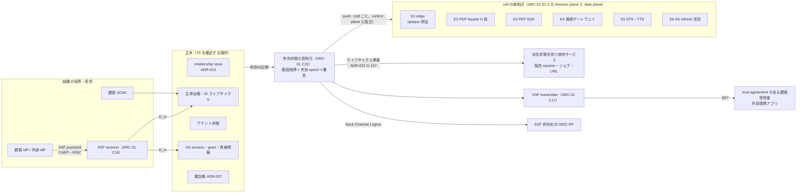
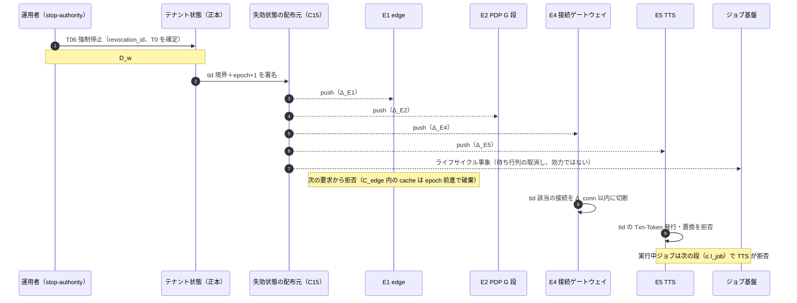
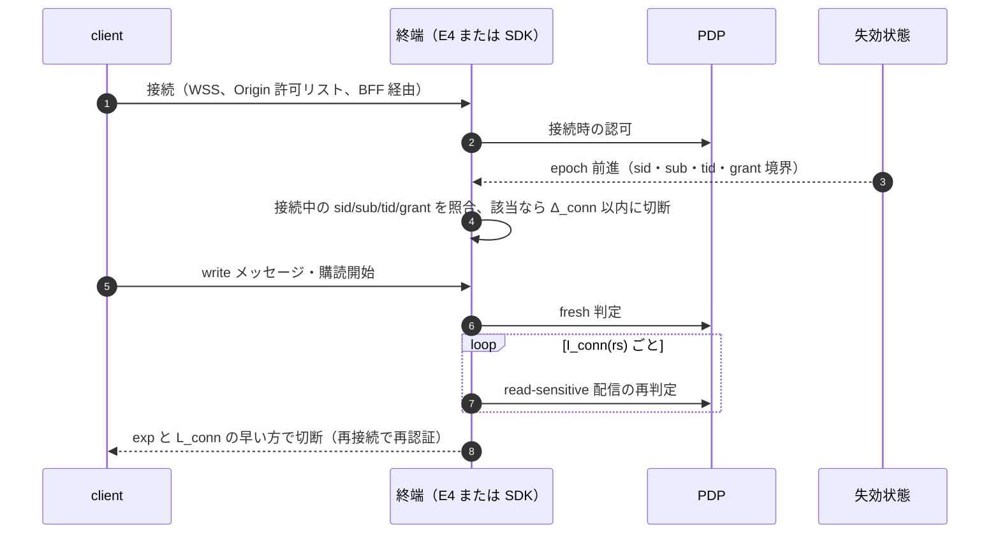
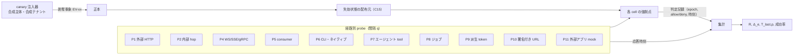

# 失効・継続評価（剥奪事象ごとの伝播経路・遅延予算・SSF/CAEP/RISC の送受信範囲・測定方法）

> 文書ID: ARC-09 / 版: 0.2 / 状態: draft / 最終更新: 2026-10-15
> 対応要求: R-112, R-143, R-191, R-191.1, R-191.2, R-238, G-111（対応成果物欄に本書のパスまたは DL-56 を含む全行）。関連: R-044, R-146, R-189.5, R-191.3, R-195.3, R-275, G-055, G-059, G-102, G-118, G-121, G-136, G-137（全件と閉じ方は末尾の対応表）
> 依存文書: CONVENTIONS.md, traceability/deliverables.md（DL-56 行）, traceability/R-requirements.md, traceability/G-goal-criteria.md, traceability/claims-ledger.md（CL-0169, CL-0262, CL-0279）, traceability/rejected-hypotheses.md（RH-013, RH-014, RH-019, RH-065〜RH-068, RH-156）, 05_adr/ADR-006（設計判断の正本）, ADR-005, ADR-009, ADR-010, ADR-011, ADR-013, ADR-017, ADR-019, ADR-022, ADR-026, ADR-028, 05_adr/reconciliation-notes.md, 01_governance/assumptions-register.md, 01_governance/business-impact-analysis.md, 01_governance/loss-scenarios.md（S-05, S-07）, 01_governance/kri.md（K-15, K-17）, 02_requirements/operation-risk-tiers-assurance.md（REQ-03 §3.1）, 02_requirements/identity-lifecycle.md（INV-6）, 02_requirements/tenant-lifecycle.md（T05, T06）, 03_threat-model/threat-catalog.md, research/RS-03, RS-04, RS-06, RS-07, RS-08, RS-09, RS-12, RS-17, research/standards-status.md
> 作成方法: AI エージェント（Claude）が ADR-006 の決定（D6-01〜D6-34）を正本とし、関連 ADR（ADR-005・009・010・013・017・019・026・028）の決定と突き合わせて詳細化した。本書は ADR の決定を変更しない。ADR で未決の点は「未決（ADR-0xx）」と書く。判断は自己レビューであり、実在の CTO/CISO の決裁ではない（CONVENTIONS §8）[D]。
> 表記: 剥奪事象 EV-xx、経路 P1〜P11、強制点 E1〜E6（ADR-006 D6-03 の記号）、失効区分 RC-1〜RC-7（ADR-006 D6-01）、決裁案 KA9-x、試験案 TC-ARC09-xx（仮番。DL-22 で TC-ID に採番）。表のセルのうちタグのないものは ADR-006 と関連 ADR の決定を詳細化した設計推論 [D] であり、この注記で個別のタグに代える。数値はすべて A-ID の値か TBD である。

---

## 要旨（結論）

1. **剥奪反映時間は「正本確定書込 D_w ＋ 経路ごとの max(配布 Δ ＋ cache 齢 C ＋ 残存 Z)」で上限を示せる [D]。** 本書はこれを 14 種の剥奪事象 × 11 経路に展開し、どの項がどの事象・経路で効くかを §4 の予算表に固定した [D]（ADR-006 D6-28〜D6-30）。数値はすべて TBD で、BIA の R(t)・E(t) と TC-ARC09 の実測から DL-20 で決裁する（所有者 CTO＋CISO、期限 G4）[D]。旧提案の「即時に無効化」（CL-0169）、「剥奪が token 期限まで残らない」（CL-0279）は、この分解と実測で置き換える [D]。
2. **端から端の最大時間を決めるのは、外部 HTTP 経路ではなく「要求ごとに E1（edge）を通らない経路」である [D]。** 外部 token・PAT・API 鍵は opaque で毎要求 E1 を通るので、RC-2〜RC-6 の外部経路は D_w＋Δ＋C_edge で決まり token 寿命に縛られない [D]（ADR-005 D1-1・D1-2・D1-7）。ただし BFF 経路の opaque 化（D1-7）は ADR-005 決裁案 K-1 で H-02・H-04 不合格なら内部 JWT へ切り替わる条件付きの判断であり、切り替わった場合はブラウザ経路（P1 の BFF 部分）にも L_int が残る [D]（§3.4）。残るのは、長時間接続、非同期ジョブ、派生 token、内部 JWT の再利用、署名付き URL、外部連携アプリ内の session の 6 経路であり、各経路に寿命上限か再確認間隔を課す [D]。内部 JWT に失効下限時刻を照合させるか（ADR-019 L19-5）が未決で、未採用なら session・grant・資格情報の失効（RC-4〜RC-6）の内部経路に L_int が加わる（未決（ADR-006 K6-2・ADR-019 L19-5）。本書の決裁案 KA9-1）[D]。
3. **SSF/CAEP/RISC は組織の境界でだけ送受信し、効力は基盤所有の強制点で生じさせる [D]。** 受信は顧客 IdP・外部 IdP（上限の手掛かり 2,000 連携 [A-082]）から CAEP 4 種・RISC 3 種、送信は trust agreement を結んだ顧客受信者と SSF stream を登録した外部連携アプリ（上限 800 client [A-013]）に v1 の 7 種である [D]（ADR-006 D6-23〜D6-26、ADR-022 D-2）。約 300 の内部サービスは SSF 受信者にせず、派生状態を持つサービスだけがライフサイクル事象を受ける [D]。顧客 IdP 側の遅延 U は基盤の R と分けて計る（例: Entra の非ギャラリー SCIM 同期は約 40 分ごと [V][^18]）[D]。
4. **測定は合成の剥奪事象（canary）と経路ごとの probe で行い、全経路で「最後の allow」の時刻を記録する [D]。** stale allow の最大継続（R-191.2）は最後の allow − T0、cache invalidation 成功率（R-191.3）は予算内に破棄・切断が完了した比率で測る [D]。測定の分解能は probe 間隔 q と時計誤差 ε で決まるので、q と ε の上限を予算の値と一緒に決める（TBD）[D]。G-111 の合格判定には独立立会人の実測（E5）と CTO・CISO の SLO 決裁（E1）の両方が要り、いずれも未達である [D]。

---

## 1. 範囲と前提

### 1.1 本書が決めること・決めないこと

| 項目 | 本書 | 正本 |
|---|---|---|
| 伝播方式の採否（中央強制＋失効状態の push 配布、SSF は境界だけ） | 前提として使う | ADR-006 D6-03〜D6-09（案C） |
| 剥奪事象ごとの伝播経路、強制点、経路ごとの残存項 | **本書で詳細化**（§3） | — |
| 遅延予算の分解表、割付け規則の適用、測定点 | **本書で詳細化**（§4、§8） | 割付け規則は ADR-006 D6-30 |
| 数値（R(t, c)、M_rev、L_conn など） | TBD の所有者・期限・決め方を引き継ぐ | ADR-006 §2.10、DL-20 |
| SSF stream profile と SET payload | 送受信の範囲と処理（§5） | DL-78、DL-79 |
| 全 session 失効・鍵の緊急切替・kill switch の手順 | 伝播部分だけ（EV-08、EV-12） | ADR-019、DL-24 |
| relationship の整合性・剥奪フェンス | C 項として受け取る | ADR-010 D-13・D-18・D-19、DL-17 |
| PEP 外データ（索引・DWH）の剥奪反映 | 範囲外（申し送り） | DL-57 |

### 1.2 前提（A-ID）

| A-ID | 値（基準シナリオ） | 本書での使い方 |
|---|---|---|
| A-001 / A-007 | 登録 100 万人、テナント約 1 万 | 範囲境界（sub・tid）の件数 [A-001, A-007] |
| A-005 / A-006 | 同時アクティブ session 11.1 万、有効 session 保持 86.5 万 | 長時間接続の規模の上限側の手掛かり、sid 境界の件数 [A-005, A-006] |
| A-013 / A-014 | 外部 client 800・grant 3 万、AI エージェント ID 1 万 | grant・client 境界、SSF 送信先、委任 grant [A-013, A-014] |
| A-027 | access token 寿命 10 分（容量計算用の仮置き、決定値ではない） | 残存 Z の感度計算にだけ使う [A-027] |
| A-040 / A-030 / A-044 | edge 呼出 16,804/秒、introspection 2,521/秒（BFF 経路も opaque なら 8,402/秒＝16,804 × cache miss 0.5。ADR-005 D1-7 の導出） | E1 の照会負荷 [A-040, A-030, A-044] |
| A-047 | relationship 書込 354＋278/秒 | 剥奪書込（D_w）の負荷の上限側の桁 [A-047] |
| A-048 | 全 session 失効後の再ログイン集中 556/秒 | EV-08 の段階化 [A-048] |
| A-082 | 顧客 IdP 連携 2,000、SCIM 800 | SSF 受信 stream の上限の手掛かり [A-082] |
| A-090 / A-092 | 判定系 99.95〜99.99%、管理系 99.5〜99.9% | 失効配布を判定系の帯で動かす [A-090, A-092] |
| A-093 | RPO 5 分 | 剥奪書込の消失（BIA 決裁案 3）[A-093] |
| A-110 / A-112 | 独自セッション 105 サービス、自前認可 240 サービス | 受信義務を負うサービスの下限の手掛かり、allow cache 禁止の移行対象 [A-110, A-112] |

- ADR-006 の新規仮定 NA-006-1〜NA-006-5 は前提台帳へ追加要である（ADR-006 残課題）[D]。本書の新規仮定は §1.3 に置く。

### 1.3 本書の新規仮定（前提台帳へ追加要）

| ID | 内容 | 使い方・確定方法 |
|---|---|---|
| NA-ARC09-1 | 測定に使う時計の同期誤差 ε は、R(t, c) の予算に比べて無視できる大きさに抑えられる | §8.3 の分解能。値は TC-ARC09-00（較正）で測る。所有者 SRE 責任者、期限 G4 |
| NA-ARC09-2 | 長時間接続を終端する依存サービスのうち、基盤の接続ゲートウェイ（E4）を使わず SDK で切断を実装するサービスの比率 | §6.3 の義務の範囲。G1 の As-Is 棚卸し（NA-006-2 と同じ調査）で確定。所有者 プラットフォームチーム長 |

### 1.4 記号

| 記号 | 意味 | 出典 |
|---|---|---|
| t | 操作階層（public / read-sensitive / write / privileged / break-glass） | REQ-03（operation-risk-tiers-assurance.md） |
| c | 失効区分 RC-1〜RC-7 | ADR-006 D6-01 |
| T0 | 失効が正本に確定書込された時刻（revocation_id 付き） | ADR-006 D6-28、D6-32 |
| D_w(c) | 失効の決定（または SSF 受信 D_in）から T0 まで | ADR-006 D6-29 |
| Δ_p | 失効状態が経路 p の強制点に適用されるまでの配布遅延 | 同上（ADR-005 の Δprop） |
| C_p(t) | 強制点の cache の最大齢（C_edge、SDK 判定 cache ≤ min(B, B_rs)、エンジンの鮮度窓、フェンス反映） | ADR-006 D6-10、ADR-010 D-19 |
| Z_p(t) | 毎要求確認なら 0、周期確認なら間隔 I_p、確認しない bearer なら残存寿命 L_p | ADR-006 D6-29 |
| U(c) | 顧客 IdP 側の遅延（検知から SET 送信まで、SCIM 同期間隔） | ADR-006 D6-29 |
| M_rev | 失効状態の最大齢。超えたら read-sensitive 以上を拒否 | ADR-006 D6-08、ADR-013 D13-25 |

---

## 2. 全体構成

### 2.1 伝播の全体図

- 効力は E1〜E6 の拒否で生じ、依存サービス・外部受信者が事象を受け取ったかどうかに依存させない [D]（ADR-006 D6-03）。SVC・EXT・RP への通知は「派生状態の後始末」であり、届かなくても基盤経由の新しい要求は拒否される [D]。
- 失効状態は「範囲 × 失効時刻」の境界（主体 sub、session sid、grant 参照、client、テナント tid、cell の 6 種）と、cell ごとに単調増加する失効 epoch を持つ署名付き配布物である [D]（ADR-006 D6-05・D6-06）。ADR-019 の「失効下限時刻」はこの範囲境界の時刻値を指し、失効 epoch（配布状態の版）とは別物である [D]（ADR-019 D19-09）。
- 強制点は配られた失効状態を局所で評価し、評価のために正本へ同期照会しない [D]（ADR-006 D6-04）。Google SRS は、失効確認を timeout で省く fail-open の代わりに、既知良好な失効リストを各サーバへ配りローカルに cache する方法を挙げている [V][^16]（RS-09#21）。

### 2.2 強制点と経路

| 経路 | 内容 | 主な強制点 | 再確認の方式 |
|---|---|---|---|
| P1 外部 HTTP | ブラウザ（BFF）・ネイティブ・CLI・第三者 client から edge への要求 | E1、E2 | 毎要求（C_edge の cache 内） |
| P2 内部 hop | 内部サービス間の要求（内部 JWT・Txn-Token） | E3、E2 | 階層により毎要求／JWT 寿命内 |
| P3 PDP 判定 | relationship の剥奪の反映 | E2 | 整合性トークン・剥奪フェンス |
| P4 長時間接続 | WebSocket・SSE・gRPC stream・長時間 download | E4 または SDK | 失効購読による切断＋最大存続時間 |
| P5 非 HTTP | メッセージ consumer、workload の mTLS 接続、SSH・端末資格情報 | E3、E5、資格情報の発行元 | 処理単位の再認可／資格情報の失効 |
| P6 ネイティブ・CLI | 端末内の refresh token・PAT・API 鍵 | E1、E6 | 毎要求照会、refresh 拒否 |
| P7 AI エージェント | 委任 grant による tool 呼出し、自律動作 | E1、E3＋E2、E5 | tool 呼出しごと（write 以上は fresh） |
| P8 非同期・バッチ | 委任ジョブ、定期ジョブ | E5（TTS）、E2 | 段ごと・I_job ごと |
| P9 派生 token | token exchange 出力、Txn-Token と置換 | E5 | 発行・置換時の照合＋寿命入れ子 |
| P10 署名付き URL | presigned URL・export | 発行時の PEP | 確認しない bearer（寿命上限） |
| P11 外部連携アプリ | 第三者アプリ内の session・保存データ | E1（API 利用）、契約上の受信義務 | SSF・Back-Channel Logout の受信 |

- G-111 が名指す「ストリーム接続・非 HTTP・ネイティブアプリ／CLI・AI エージェント」は P4・P5・P6・P7 に当たる [D]。
- NIST SP 800-207 は PEP を、主体と資源の間の接続を可能にし、監視し、終了させる構成要素と定義し、PDP/PEP はトラフィック上の自らの位置より先では追加の方針を適用できないので暗黙の信頼ゾーンをできる限り小さくしなければならない（must）としている [N][^25]（RS-08#19）。P4・P10・P11 は「PEP の位置より先」に状態が残る経路であり、本書はそれぞれに上限（最大存続時間、URL 寿命、契約上の受信義務）を置く [D]（R-238）。

---

## 3. 剥奪事象ごとの伝播経路

### 3.1 事象一覧

区分 c と R-191.1 の 3 区分（通常・高権限・tenant 停止）への対応は ADR-006 D6-01 に従う [D]。

| EV | 剥奪事象 | c | R-191.1 区分 | 正本・T0 の記録点 | 配布する範囲境界 |
|---|---|---|---|---|---|
| EV-01 | relationship・role の削除、共有の解除（通常権限） | RC-1 | 通常 | relationship store（façade 経由の書込） | なし（剥奪フェンス、ADR-010 D-18） |
| EV-02 | privileged 権限の剥奪（テナント管理者の解任など） | RC-1 | 高権限 | 同上 | なし（write 以上は fresh 判定） |
| EV-03 | 利用者の停止・退職（基盤側の操作） | RC-2 | 通常（管理者は高権限） | 主体台帳 | sub（INV-6 の全手段） |
| EV-04 | 顧客 IdP 由来の無効化（SSF RISC account-disabled、SCIM active=false） | RC-2 | 通常 | 主体台帳（D_in を含む） | sub × tid（その IdP に結合したテナント文脈） |
| EV-05 | テナント一時停止（T05） | RC-3 | tenant 停止 | テナント状態 | tid |
| EV-06 | テナント強制停止（T06、侵害・濫用・法令） | RC-3 | tenant 停止（高権限の値以下） | テナント状態 | tid＋API client 資格情報・委任ジョブ |
| EV-07 | 個別 session の失効（logout、CAEP session-revoked 受信） | RC-4 | 通常 | AS session store | sid |
| EV-08 | 範囲指定の全 session 失効（主体〜全域） | RC-4 | 高権限（本書の解釈。§「ADR への指摘」1） | AS session store・失効下限時刻 | sub / IdP / tid / cell（ADR-019 D19-08） |
| EV-09 | 第三者 grant・client の失効（連携事業者単位を含む） | RC-5 | 通常（管理者同意 grant は高権限） | grant 台帳 | grant 参照・client |
| EV-10 | 委任 grant の失効（AI エージェント・ジョブ） | RC-5 | 通常 | grant 台帳（ADR-026 D26-04b） | grant 参照 |
| EV-11 | 資格情報侵害（password・認証器・refresh token・PAT・API 鍵・client 秘密） | RC-6 | 高権限 | AS・資格情報台帳 | sid・grant 参照・client（その資格情報に束縛した範囲） |
| EV-12 | 署名鍵 kid の緊急失効 | RC-7 | 高権限（R-189.5） | 鍵台帳 | 失効 kid リスト＋その kid 由来の範囲 |
| EV-13 | AI エージェント主体・定義・所有者・tool サーバー単位の停止 | RC-2＋RC-5 | 通常（侵害の疑いは高権限） | 主体台帳・grant 台帳 | sub（エージェント）・grant 参照・client（ADR-017 D17-37） |
| EV-14 | 保証水準の低下（CAEP assurance-level-change 受信） | RC-4 | 通常 | AS session store | sid（step-up 待ち） |

### 3.2 事象 × 強制点の伝播表

記号: ◎ 効力を生む強制点、○ 補助（後始末・二重化）、— 関係しない [D]。

| EV | E1 edge | E2 PDP G 段 | E3 SDK | E4 接続 | E5 STS・TTS | E6 AS | 派生状態の受信 | SSF 送信 |
|---|---|---|---|---|---|---|---|---|
| EV-01 | — | ◎（D-13・D-18） | ○（判定 cache 破棄） | ◎（メッセージ単位の再認可） | — | — | ○（索引は DL-57） | — |
| EV-02 | — | ◎（fresh） | ○（判定 cache なし） | ◎ | — | — | — | — |
| EV-03 | ◎（sub） | ◎（規則 2） | ○（privileged の sid・jti） | ◎（sub） | ◎ | ◎ | ○ | ◎ account-disabled |
| EV-04 | ◎（sub × tid） | ◎ | ○ | ◎ | ◎ | ◎ | ○ | ○（受信元以外の受信者へ） |
| EV-05 | ◎（tid） | ◎（規則 3） | ○ | ◎（tid） | ◎ | ◎ | ○（ジョブ取消し） | 未決（§5.4） |
| EV-06 | ◎（tid） | ◎ | ○ | ◎ | ◎ | ◎ | ○ | 同上 |
| EV-07 | ◎（sid） | — | ○（privileged の sid） | ◎（sid） | ◎（派生の sid） | ◎ | ○（独自 session） | ◎ session-revoked、BCL |
| EV-08 | ◎（範囲） | — | ◎（KA9-1 採用時）／○ | ◎ | ◎ | ◎ | ○ | ◎ session-revoked、BCL |
| EV-09 | ◎（grant・client） | — | ○ | ◎（grant） | ◎ | ◎ | — | ○（連携契約の通知） |
| EV-10 | ◎（grant） | ○ | ○ | ◎ | ◎（TTS） | ◎ | ○（ジョブ取消し） | — |
| EV-11 | ◎（範囲） | — | ○ | ◎ | ◎ | ◎ | ○ | ◎ credential-change / credential-compromise |
| EV-12 | ○（kid 由来の範囲） | — | ◎（失効 kid） | ○ | ◎ | ○ | — | 連携契約の通知（SSF の標準イベントなし） |
| EV-13 | ◎ | ◎（act 連鎖、未決 L6-4） | ○ | ◎ | ◎ | ◎ | ○ | — |
| EV-14 | ○ | ◎（規則 4 step-up） | — | ○ | ○ | ○ | — | ◎ assurance-level-change |

- 根拠: E1〜E6 の役割は ADR-006 D6-03、範囲境界は D6-06、EV-01・EV-02 は ADR-010 D-13・D-18 と ADR-011 D1-2、EV-08 は ADR-019 D19-08〜D19-11、EV-12 は ADR-007 D7-36・D7-37 と ADR-006 D6-20、EV-13 は ADR-017 D17-37 [D]。
- EV-13 で委任元（sub）とエージェント（act）の両方の停止を G 段で確かめる解釈は未決である（未決（ADR-006 L6-4、ADR-026 L26-3。ADR-011 の改版））[D]。決まるまでの間、エージェント停止は E1・E5 の grant・sub 境界で効かせる [D]。

### 3.3 代表経路の時系列（EV-06 テナント強制停止）

- EV-06 では API client の資格情報と委任ジョブも失効させる（tenant-lifecycle §3.8）[D]。テナントの cell 間移動中に停止が起きた場合、剥奪ジャーナル（ADR-028 D28-13）と失効 epoch の単調性（ADR-006 D6-05）で移動の中止・切戻しによる復活を防ぐ [D]。

### 3.4 各事象で残る経路（上限を決める項）

| EV | 要求ごとに E1 を通る経路（P1・P6） | 残る経路と残存項 Z |
|---|---|---|
| EV-01・EV-02 | 影響なし（token に権限を載せない。ADR-005、ADR-022 D-9-3） | PDP の鮮度窓 C_PDP、SDK 判定 cache（read-sensitive のみ、≤ min(B, B_rs)）、P4 の I_conn(rs)、P8 の I_job |
| EV-03〜EV-06 | D_w＋Δ_E1＋C_edge | G 段が判定ごとに拒否するので、PDP を呼ぶ内部経路は Δ_E2 で決まる。PDP を呼ばない残存は P9 の L_der、P10 の URL 寿命、P11 |
| EV-07・EV-08・EV-11 | D_w＋Δ_E1＋C_edge（ADR-005 K-1 が (b) になった場合、BFF 経路は L_int も加わる） | G 段は session の状態を見ない。内部 JWT の再利用（P2）は KA9-1 未採用なら L_int、採用なら Δ_E3＋C_E3。P4 は Δ_conn、P9 は E5 照合後の L_der |
| EV-09・EV-10 | D_w＋Δ_E1＋C_edge | P8 は次の段（I_job）、P9 は L_der、P11 はアプリ内 session |
| EV-12 | 外部 token は opaque なので影響は内部 | E3 の失効 kid 適用 Δ_E3。外部 RP の JWKS cache（ADR-007 RR7-02）は基盤の R の外 |
| EV-14 | step-up 要求は G 段規則 4 で次の判定から | P4 の再確認間隔 |

- 外部経路で token 寿命が R に入らない理由: 外部に渡す access token・refresh token は client 種別によらず opaque で（ADR-005 D1-1）、BFF 経路も opaque にし（同 D1-7）、edge が毎要求で状態ストアに照会する（同 D1-2）からである [D]。BFF 経路の opaque 化は ADR-005 決裁案 K-1（状態ストアが H-02・H-04 に不合格なら BFF 経路だけ内部 JWT）に依存するので、K-1 が (b) になった場合は P1 のブラウザ経路も P2 と同じ扱い（KA9-1 の結論に従う）にする [D]。RFC 7662 は RS による応答の cache を許す（MAY）が、cache の間は失効した token が使われ得ること、応答の exp を超えて cache してはならない（MUST NOT）ことを定める [N][^1]（RS-04#67）。このため C_edge(t) は exp 以下かつ予算内に置く [D]。
- RC-1 に token 寿命が効かない理由: token に groups・roles・権限を載せず、権限は PDP で評価する（ADR-005 の claim 方針、ADR-022 D-9-3）[D]。旧提案の RH-019（万能 JWT）は棄却済みである [D]（traceability/rejected-hypotheses.md）。

---

## 4. 遅延予算の分解

### 4.1 分解式と測定点

ADR-006 D6-29 の式を、測定点の時刻で書き直す [D]。

  R(t, c) ＝ D_w(c) ＋ max_p [ Δ_p ＋ C_p(t) ＋ Z_p(t) ]
  R_e2e(t, c) ＝ U(c) ＋ R(t, c)

| 時刻 | 記録する場所 | 意味 |
|---|---|---|
| T_up | SET の `iat`・事象時刻、SCIM 要求の受信時刻 | 上流の事象（U の終点は T_in） |
| T_in | SSF receiver（ARC-01 C16）・SCIM endpoint（C20） | 受信 |
| T_dec | 管理 API・運用操作の受付 | 基盤内の失効の決定 |
| T0 | 正本の commit（revocation_id） | D_w ＝ T0 − max(T_dec, T_in) |
| T_pub | 失効状態の署名・発行（epoch） | 発行の遅延（Δ の内数） |
| T_app,e | 強制点 e が epoch を適用（判定記録に epoch を残す。ADR-006 D6-32） | Δ_e ＝ T_app,e − T0 |
| T_last,p | 経路 p で最後に allow された要求の時刻 | stale allow の継続 ＝ T_last,p − T0（R-191.2） |
| T_deny,p | 経路 p で最初に deny された時刻 | 参考値（T_last,p より後とは限らない。cache が複数あるため） |

- R の測定値は「T0 から全経路の T_last の最大まで」であり、最初の deny ではない [D]。cache が強制点の複数のインスタンスに分かれていると、最初の deny の後にも allow が出得るからである [D]。

### 4.2 項目ごとの予算と所有者

| 項 | 構成要素 | 予算の上限（値） | 所有者 | 測定（TC 仮番） |
|---|---|---|---|---|
| D_w(c) | 管理 API・façade の書込、SSF 受信の検証と書込（D_in） | TBD | プラットフォームチーム長 | TC-ARC09-01 |
| Δ_pub | 署名・発行 | TBD（Δ の内数） | SRE 責任者 | TC-ARC09-02 |
| Δ_e | cell への push と強制点の適用（E1〜E6 別） | TBD。平常時と EV-08 時の両方 | SRE 責任者 | TC-ARC09-02 |
| M_rev | 失効状態の最大齢（超えたら read-sensitive 以上を拒否） | TBD（ADR-013 TC-13-02 と共有） | CTO＋SRE 責任者 | TC-ARC09-03 |
| C_edge(t) | edge の introspection cache | TBD（応答の exp 以下 [N][^1]） | CTO | TC-ARC09-04 |
| C_SDK | SDK 判定 cache（read-sensitive のみ、≤ min(B, B_rs)） | B は ADR-010 決裁案 5、B_rs は ADR-013 KD13-6 | CTO | TC-ARC09-04 |
| C_PDP | エンジンの鮮度窓＋レプリカ遅延＋フェンス反映 | ADR-010 D-19 の和。値は構成と実測 | CTO（ADR-010） | ADR-010 H-02・H-05 と共有 |
| L_int | 内部 JWT の寿命（KA9-1 未採用時の残存） | ADR-005 D3 の寿命 profile | CTO | TC-ARC09-05 |
| L_der(t) | 派生 token・Txn-Token の寿命と置換回数 | TBD（親の残り寿命以下、ADR-009 D09-40） | プラットフォームチーム長 | TC-ARC09-06 |
| L_conn(t)、I_conn(rs)、Δ_conn | 長時間接続の最大存続、再判定間隔、失効による切断 | TBD | CTO＋プロダクト責任者 | TC-ARC09-07 |
| I_job(t) | ジョブの再認可間隔（≤ R(t)） | TBD（ADR-026 K26-2） | ドメイン責任者＋プラットフォームチーム長 | TC-ARC09-08 |
| L_url | 署名付き URL の寿命上限（≤ R(t) − Δ − C） | TBD（G-136 (a)） | プロダクト責任者＋CISO | TC-ARC09-09 |
| D_svc(t) | 派生状態を持つ依存サービスの受信処理 | TBD（G3、DEC-8 前） | プラットフォームチーム長 | TC-ARC09-10 |
| D_tx | 外部受信者への SET 送信（送信までを基盤の R に含める） | TBD | プロダクト責任者 | TC-ARC09-11 |
| U(c) | 顧客 IdP・SCIM の遅延 | 基盤の SLO 外（DL-26 の責任分界） | 事業責任者（顧客契約） | TC-ARC09-12（モックで再現） |

- すべての TBD の決め方は ADR-006 D6-31 に従う。BIA の R(t)・E(t)（ADR-005 K-2、threat-catalog TD-3 の選択肢 B）を上限とし、TC-ARC09 の実測で達成可能性を確かめ、DL-20 で決裁する（所有者 CTO＋CISO、値の決裁に事業責任者が加わる、期限 G4）[D]。
- C_PDP は製品の既定値に任せない。調べた公式文書には剥奪から拒否までの上限を保証する記述がなく（RS-07 §2 第 2 項）、SpiceDB は既定の `minimize_latency` を単独で使うと new enemy 問題が起こり得る窓を作ると述べる [V][^15]（RS-07#26）。このため C_PDP は採用エンジンの構成値と実測で書く [D]（ADR-010 D-19）。
- IPSIE AL SCIM 草案は受信後 5 分以内の失効を SHOULD とする [N][^26]（RS-14#37）。Draft 00 なので候補値の比較対象にだけ使い、予算の根拠にしない [D]（ADR-006 D6-31）。

### 4.3 経路 × 階層の予算表（値は TBD、項の組合せを固定）

各セルは「R(t, c) − D_w(c) の内訳」である。R(t, c) 自体は §4.4 の表で決裁する [D]。

| 経路 | read-sensitive | write | privileged | 根拠 |
|---|---|---|---|---|
| P1 外部 HTTP | Δ_E1＋C_edge(rs) | Δ_E1＋C_edge(w) | Δ_E1＋C_edge(p) | ADR-006 D6-11 |
| P2 内部 hop（RC-2・RC-3） | Δ_E2＋C_SDK | Δ_E2（fresh、cache なし） | Δ_E2 | G 段規則 2・3 |
| P2 内部 hop（RC-4〜RC-6） | KA9-1 (a): Δ_E3＋C_E3 ／ (b): L_int | Txn-Token の寿命（要求ごと） | Δ_E3（jti・sid 毎要求照合） | ADR-006 D6-11、ADR-005 D1-6・D9-3、ADR-019 L19-5 |
| P3 PDP 判定（RC-1） | C_PDP（bounded）＋C_SDK | C_PDP（fresh＋フェンス） | 同左 | ADR-010 D-13・D-18 |
| P4 長時間接続 | min(Δ_conn, I_conn(rs)) ／上限 L_conn(rs) | Δ_conn（メッセージは fresh） | Δ_conn | ADR-006 D6-14 |
| P5 非 HTTP（consumer） | 処理単位の再認可（P3 と同じ） | 同左（fresh） | 同左 | ADR-026 A4、RS-08#61 |
| P6 ネイティブ・CLI | P1 と同じ（opaque） | 同左 | 同左 | ADR-006 D6-18 |
| P7 AI エージェント | P1／P2 と同じ | 呼出しごと fresh | 承認 grant＋fresh | ADR-006 D6-22、ADR-017 |
| P8 非同期ジョブ | I_job(rs) | I_job(w)（項目ごと fresh） | I_job(p)（項目ごと fresh）。+FIN・+XT は既定で委任ジョブで実行しない（ADR-026 K26-4） | ADR-006 D6-17、ADR-026 D26-03 |
| P9 派生 token | Δ_E5＋L_der(rs) | Δ_E5＋L_der(w) | Δ_E5＋L_der(p) | ADR-006 D6-16 |
| P10 署名付き URL | L_url(rs) | （発行しない、または L_url(w)） | 発行しない（proxy 配信） | ADR-006 D6-15 |
| P11 外部連携アプリ | D_tx（受信後は契約の義務） | 同左 | 同左 | ADR-006 D6-26、D6-29 |

- 割付け規則（ADR-006 D6-30）: (1) R(privileged) ≤ R(write) ≤ R(read-sensitive)。(2) 各経路の Δ＋C＋Z が R − D_w を超えないよう C と Z の上限を逆算し、逆算した寿命が ADR-005 D3 の他の制約と衝突したら寿命を延ばさず確認方式を一段強くする。(3) p99 と最大の両方で定める [D]。
- P10 の write・privileged の扱い（発行しない／proxy 配信）は、ADR-006 D6-15 の「寿命上限を満たせない要配慮データは BFF・proxy 経由」の適用であり、どの資源で発行を禁じるかは DL-57・DL-64 で決める（未決）[D]。

### 4.4 R(t, c) の決裁表（構造は ADR-006 K6-1 の推奨 (b)）

| 階層 t ＼ R-191.1 区分 | 通常（RC-1・RC-2・RC-4・RC-5） | 高権限（privileged の剥奪、管理者、RC-6・RC-7、EV-08） | tenant 停止（RC-3。T06 は高権限以下） |
|---|---|---|---|
| read-sensitive | TBD | TBD | TBD |
| write | TBD | TBD | TBD |
| privileged | TBD | TBD | TBD |
| break-glass | 発動窓の満了で自動失効（ADR-029） | 同左 | 同左 |

- 決める人: 構造は CTO＋CISO、値は事業責任者（BIA）を加える。期限 G4 [D]（ADR-006 K6-1）。
- stale allow の最大継続（R-191.2）は各セルの最大値、cache invalidation 成功率（R-191.3）は「SDK 判定 cache の破棄と接続の切断が予算内に完了した比率」で定める [D]（ADR-006 D6-30 項 3）。

### 4.5 感度の例（決定値ではない）

- 内部 JWT の寿命を A-027 の 10 分とし、KA9-1 を採らない場合、read-sensitive の RC-4（session 失効）は内部 JWT を再利用する経路だけで 10 分＋Δ＋C を下回れない [D][A-027]。ただし ADR-005 K-1 が (a)（BFF 経路も opaque）である限り新しい利用者操作は必ず E1 を通るので、この残存は「E1 を通らずに再利用される内部 JWT」（edge・サービスが寿命内 cache した交換済み token を使う処理）に限られる [D][A-028]。
- write 以上を E1 の毎要求照会と G 段で確認すれば、外部経路の R(w) は D_w＋Δ_E1＋C_edge(w) で決まり、寿命に縛られない [D]（ADR-006 D6-30 項 4）。
- ADR-005 D3 の感度表では、寿命を 2 分に縮めると token exchange が 5,560/秒になる [D][A-028]。寿命短縮で R を下げる方法は発行負荷と障害時の「時限爆弾」を悪化させる（SRS は短命資格情報が障害時に一斉に失効する危険を述べる [V][^16]、RS-09#36）。このため本書は寿命より確認方式（KA9-1）で R を下げる側を推奨する [D]。

---

## 5. SSF/CAEP/RISC の送受信範囲

### 5.1 原則

- SSF は、受信したイベントの処理を配備・連携ごとに「情報提供」から「強制執行」まで定めてよいとし、SET は `typ: secevent+jwt` で明示的に型付けしなければならない（MUST）[N][^4]（RS-04#77）。配信は push（RFC 8935）と poll（RFC 8936）である [N][^4]。
- このため受信側が何秒以内に何をするかは規範から得られず、本書と DL-78・DL-79 の受信プロファイルで定める [D]（ADR-006 D6-26）。
- SSF・CAEP・RISC 1.0 は Final（文書の Published 2025-08-29、OIDF の承認告知 2025-09-02）である [N][^4][^5][^6]（RS-04#77、standards-status.md SS-C09〜SS-C11）。CAEP Interoperability Profile は Implementer's Draft 1 で Final 化のレビューがやり直しになっており、本基盤は依存しない [N][^23]（RS-04#79、ADR-006 D6-09）。

### 5.2 受信（基盤が receiver）

| 受信元 | 方式 | 上限の手掛かり | SLO への算入 |
|---|---|---|---|
| 顧客 IdP（SSF 対応） | SSF push・poll | 顧客 IdP 連携 2,000 [A-082] | D_in を D_w に含める。送信までの U は顧客の項目 |
| 顧客 IdP（SSF 非対応） | SCIM の無効化 | SCIM 800 [A-082] | 同期間隔は U。Entra の非ギャラリー SCIM アプリは約 40 分ごとに同期する [V][^18]（RS-03#79） |
| 外部 IdP（社員の上流 IdP 等） | SSF | 未定（前提台帳にない） | 同上 |

| 受信イベント | 処理（強制執行） | c | 事象 |
|---|---|---|---|
| CAEP session-revoked | sid・sub の session を失効。RISC sessions-revoked は互換のためだけに同じ処理で受ける | RC-4 | EV-07 |
| CAEP credential-change | 当該資格情報に束縛した session と refresh token を失効し再認証を求める | RC-6 | EV-11 |
| CAEP assurance-level-change | 低下時、必要 AAL を満たさない session を step-up 待ちにする | RC-4 | EV-14 |
| CAEP token-claims-change | 該当主体の introspection 結果と内部 token を再発行させる | RC-1 | — |
| RISC account-disabled | そのテナント文脈の所属を停止し INV-6 の全手段を失効 | RC-2 | EV-04 |
| RISC credential-compromise | EV-11 と同じ | RC-6 | EV-11 |
| RISC identifier-recycled | 結び付く回復先・通知先・未受諾の招待を凍結 | — | — |

- 根拠: 受信イベントと処理は ADR-006 D6-23 の表と同じである [D]。CAEP 1.0 は session-revoked、token-claims-change、credential-change、assurance-level-change などを定義する [N][^5]（RS-04#78）。RISC の sessions-revoked は非推奨で、新しい実装は CAEP の session-revoked を使わなければならない（MUST）[N][^6]（RS-03#66）。
- 受信した SET は `typ`、送信者の `iss` と鍵の結合を検証し、検証できない SET は処理しない [N][^4][D]。受信の効果はその IdP に結合したテナント文脈に限る（identity-lifecycle M-03）[D]。
- SP 800-63C-4 は、IdP が account の停止などの状態変化を RP に知らせなければならず（SHALL）、知らせを受けた RP は federated identifier の結合を外さなければならない（SHALL）とする [N][^7]（RS-03#78）。EV-04 で結合を外す操作は ID ライフサイクル（DL-08 系）で行う [D]。

### 5.3 送信（基盤が transmitter）

| 受信者 | 方式 | 条件 | 上限の手掛かり |
|---|---|---|---|
| 顧客の受信者（SIEM・自社アプリ） | SSF | trust agreement（全用途の記載、個人情報の最小化） | テナント約 1 万 [A-007] |
| SSF stream を登録した外部連携アプリ（PC-15） | SSF | 連携契約。高リスク scope と session 保持アプリは受信必須（ADR-006 K6-3 推奨 (b)） | 外部 client 800 [A-013] |
| SSF 非対応の OIDC RP | OIDC Back-Channel Logout | session 終了の通知 | 同上 |

- 送信するイベントは ADR-022 D-2 の v1 範囲（CAEP session-revoked・credential-change・token-claims-change・assurance-level-change、RISC account-disabled・credential-compromise・identifier-recycled）に限る [D]。
- SP 800-63C-4 は IdP から RP への signal に事前の trust agreement を要求し（SHALL）、全用途の記載（SHALL）と、対象アカウントの特定に必要な範囲を超える個人情報を含めないこと（SHALL NOT）を求める。侵害を確認した IdP は、その期間に使われた他の RP にも知らせなければならない（SHALL）[N][^7]（RS-03#72、RS-14#61）。
- OIDC Back-Channel Logout の Logout Token は `sub` か `sid` のどちらかを含まなければならず（MUST）、再送は回復可能な失敗が疑われる場合に限り、それ以外は再送すべきでない（SHOULD NOT）[N][^10]。送信は到達を前提にせず、stream ごとに送信済み・確認済みを記録し、K-17 (b) で滞留を測る [D]（ADR-006 D6-24）。
- 送信の成否は基盤の強制に影響させない [D]。外部連携アプリの API 利用は E1 で止まるので、送信の目的はアプリ内 session と保存データの後始末である [D]。Salesloft Drift の事案では連携アプリの全 access token と refresh token の失効が是正に含まれ、GTIG は Drift に保存・接続された全 token を侵害済みとして扱うよう勧告した [I][^19]（RS-12#37, #38）。EV-09 の連携事業者単位の一括失効はこの事案を想定する [D]。

### 5.4 送受信しないもの（未決を含む）

| 項目 | 扱い | 状態 |
|---|---|---|
| 内部の約 300 サービスへの SSF | 送らない。派生状態を持つサービスだけがライフサイクル事象（ADR-022 のイベント配送契約、G-137）を受ける | 決定（ADR-006 D6-25） |
| RISC account-enabled | 送受信しない（再有効化は管理操作） | 決定（ADR-006 L6-1） |
| RISC account-purged の受信 | account-disabled と同じ処理で受ける案を DL-79 の preview に置く | 未決（ADR-006 L6-1、ADR-022 改版） |
| RISC recovery-activated | v1 では送受信しない。受信する場合は RC-6 の疑いとして扱う案 | 未決（ADR-006 L6-8） |
| テナント停止（EV-05・EV-06）の外部通知 | 標準イベントにテナント単位の停止がないため、テナント内の主体ごとの account-disabled か、連携契約の通知経路 | 未決（本書で発見。DL-78・DL-79 と ADR-022 改版へ申し送り） |
| 鍵の緊急失効（EV-12）の外部通知 | SSF の標準イベントにないので連携契約の通知経路（ADR-022・G-106） | 決定（ADR-006 D6-20） |
| Back-Channel Logout の契約上の位置 | OIDC profile の preview に加える案 | 未決（ADR-006 L6-2） |
| SET・Logout Token の `iss` の数 | issuer の粒度で変わる（テナント別なら約 1 万） | 未決（ADR-006 L6-7、DEC-3 の U-01） |

---

## 6. 経路別の設計

### 6.1 P1 外部 HTTP（edge）

- edge は cell 内の状態ストアに RFC 7662 で照会し、状態ストアは AS から発行・失効の push を受ける（ADR-005 D1-2）[D]。範囲境界（sub・sid・grant・client・tid・cell）は状態ストアの照会結果と独立に E1 の局所で評価し、照会結果の cache が残っていても境界に該当すれば拒否する [D]（ADR-006 D6-06）。
- 状態ストアや配布系が止まっても AS 本体へ迂回しない [D]（ADR-005 D1-3、ADR-006 D6-34）。AWS は分散 fallback が障害を悪化させることが多いと述べ、代替策にデータの事前 push を挙げる [V][^17]（RS-09#14）。

### 6.2 P2 内部 hop

- 内部 JWT は呼出し先 1 サービスを aud とし（ADR-005 D1-4）、`iat`・`auth_time`・`tid`・`sid`・grant 参照を持つ（ADR-005 D9-4、ADR-021）[D]。
- privileged・break-glass/B・FAPI 範囲は内部 RS が jti を状態ストアと毎要求照合し（ADR-005 D1-6）、sid も照合する（ADR-006 D6-03 の E3、D6-13）[D]。FAPI 2.0 の RS は access token の revocation status を検証しなければならない（shall）[N][^3]（RS-04#45）。
- read-sensitive・write の内部 JWT に失効下限時刻を照合させるかは未決である（ADR-019 L19-5、ADR-006 K6-2）。本書は §9 KA9-1 で照合を共通 SDK の既定にする案を推奨する [D]。

### 6.3 P4 長時間接続（WebSocket・SSE・gRPC stream・長時間 download）

- 3 つの仕組みを組み合わせる: 最大存続時間（exp と L_conn(t) の早い方）、失効状態の購読による切断（Δ_conn）、メッセージ単位の再認可（write 以上は fresh、read-sensitive は I_conn(rs) ごと）[D]（ADR-006 D6-14）。
- ASP.NET Core SignalR は接続の間に利用者を自動で再検証せず、token が接続中に期限切れになっても既定では接続が続き、`CloseOnAuthenticationExpiration` を設定すると token の期限で接続を閉じる [V][^12]（RS-17#53）。製品の既定に任せると P4 の Z は無限になり得るので、SDK の既定で期限切断を有効にし、SignalR を使うサービスはこの設定を有効にする [D]。期限切断だけでは失効（Δ_conn）に対応しないので、失効購読による切断も別に実装する [D]（ADR-006 D6-14 の 2）。
- Amazon API Gateway の WebSocket 接続時間の上限は 2 時間で引き上げできない [V][^13]（RS-17#55）。この製品上限は剥奪の上限として当てにしない [D]。
- RFC 6455 は handshake での client 認証方法を規定せず、特定サイトからの入力だけを処理するサーバーは Origin を検証すべき（SHOULD）とする [N][^11]（RS-17#51）。ASVS 5.0.0 V4.4 は全 WebSocket 接続での WSS（L1）と handshake での Origin の許可リスト照合（L2）を求める [N][^24]（RS-17#52）。ブラウザからの接続は BFF 経由にし、token を URL の query に載せない [D]（ADR-006 D6-14）。
- 終端が基盤の E4 でないサービス（比率 NA-ARC09-2）は、SDK の失効購読・期限切断・メッセージ単位の再認可の 3 点を実装する義務を負い、契約試験キット（DL-80）の負例で検査する [D]（ADR-006 §6.4）。

### 6.4 P5 非 HTTP

| 種別 | 伝播 | 残存 | 根拠 |
|---|---|---|---|
| メッセージ consumer（ADR-026 の A4） | メッセージには不透明な参照だけを入れ、consumer は処理単位で起点主体・テナントを台帳から引き直して PDP で再判定する | 処理開始から完了までの間 | ADR-026 要旨、RS-08#61 |
| workload の資格情報（mTLS・SVID） | 発行元が workload 停止時に資格情報を無効化し、寿命を workload インスタンスの寿命以下にする | 資格情報の寿命 | Workload Identity Practices draft-07 は寿命がインスタンス寿命を超えてはならない（MUST NOT）、停止時に無効化しなければならない（MUST）とする（例外あり）[N][^21]（RS-06#26）。Internet-Draft なので設計の参照にとどめる [D] |
| SSH 鍵・端末の資格情報（INV-6） | 主体停止（EV-03）で資格情報台帳から失効。照合点は各アクセス経路の検証器 | 検証器が台帳を参照する間隔 | identity-lifecycle INV-6。検証器の方式を決める ADR がない（ADR-009 は workload の資格情報だけを扱う）。未決（ADR 未割当。現行の所在は DL-50 の As-Is 棚卸しで確認。本書から申し送り） |
| gRPC unary | HTTP/2 上の要求として P2 と同じ | P2 と同じ | — |

- G-111 の「非 HTTP」の実測は、consumer（TC-ARC09-08 と共有）と SSH・端末資格情報（TC-ARC09-13）で行う [D]。後者は検証器の方式が未決のため、TC の測定条件は DL-22 の事前登録時に確定する（所有者 プラットフォームチーム長、期限 G4）[D]。

### 6.5 P6 ネイティブアプリ・CLI

- 端末に渡す access token・refresh token・PAT・API 鍵は opaque で、E1 が毎要求照会し、E6 が refresh を拒否する [D]（ADR-006 D6-18）。端末内の token は剥奪の上限に影響しない [D]。
- SDK は logout・アカウント切替・アンインストール時に RFC 7009 で refresh token を失効させる [D]。RFC 7009 は refresh token の失効の支援を MUST、access token の失効の支援を SHOULD とし、refresh token を失効させる場合は同じ grant の access token も無効化すべき（SHOULD）とする [N][^2]（RS-04#69）。
- 端末がオフラインの間に保持した token は、復帰後の最初の要求で E1 に拒否される [D]。CLI が長時間の処理（大量 export 等）を行う場合は P4・P8 の規則を適用する [D]。

### 6.6 P7 AI エージェント

- エージェントの tool・API 呼出しは必ず E1 または E3＋E2 を通り、受け取った token を下流へ素通しさせない [D]（ADR-006 D6-22、ADR-017 要旨）。
- 利用者からの委任は委任 grant とし（ADR-017 D17-43）、委任元の停止・削除で全委任を失効させる [D]。停止の単位はエージェント主体・定義・所有者・tool サーバー・委任元の 5 種（ADR-017 D17-37、EV-13）[D]。
- write 以上の tool 呼出しは呼出しごとに fresh 判定とする [D]。+FIN・+XT・privileged は一回限りの承認 grant を要する（ADR-017）ので、承認 grant の失効も grant 境界で配る [D]。
- AIMS 草案は失効・格下げの通知を受けた受信者に無効な判定・token の使用継続を禁じる（MUST NOT）[N][^20]（RS-06#73）。草案なので、エージェント実行基盤が失効状態を購読して進行中の計画を止める設計の参照にとどめる [D]。
- 測定は ADR-017 TC-017-07（委任元の停止から拒否まで）と TC-ARC09-14 で行う [D]。

### 6.7 P8 非同期・バッチ・長時間ジョブ

- enqueue 時の判定は受付の認可にすぎず、実行時にジョブ用 workload ID が TTS に Txn-Token を要求し、TTS が委任 grant・利用者・テナントの失効状態を確かめてから発行する [D]（ADR-026 D26-03、ADR-006 D6-17）。
- 実行時間が R(t) より長いジョブは I_job(t) ≤ R(t) の間隔で再認可する [D]（ADR-026 D26-03）。ジョブ基盤はライフサイクル事象で待ち行列中の run を取り消すが、効力は E5・E2 の拒否に置く [D]（ADR-026）。
- 剥奪前に完了・出力済みの結果は取り消せない（ADR-026 RR26-03）。出力の配布が署名付き URL なら P10 の寿命上限で残存を抑える [D]。

### 6.8 P9 派生 token

- 派生 token の寿命は親の残り寿命と L_der(t) の小さい方以下にし、STS・TTS は発行・置換の前に親の jti・sid・grant 参照を失効状態と照合する [D]（ADR-006 D6-16、ADR-009 D09-40）。
- RFC 8693 は入力 token と出力 token の間に強い結び付きを作らず、失効の伝播を一般的性質としない [N][^8]（RS-06#44）。Transaction Tokens 草案（draft-11、WG Consensus: Waiting for Write-Up、IESG 未提出、2027-01-31 失効予定、standards-status.md SS-B04）は Txn-Token の寿命が提示 token の期限を超えることを TTS の方針で許す（MAY）が、置換で寿命を延ばすなら置換回数を制限すべき（SHOULD）とする [N][^9]（RS-06#37, #40）。本基盤は提示 token の期限を超えさせず、置換回数に上限を置く [D]（ADR-006 D6-16）。

### 6.9 P10 署名付き URL・export

- 発行後に個別失効できない bearer として扱い、寿命上限 L_url(t) ≤ R(t) − Δ − C とする [D]（ADR-006 D6-15、G-136 (a)）。
- Amazon S3 の presigned URL は所持者にアクセスを与え、期限まで何度でも使え、CLI/SDK では最長 7 日に設定でき、生成に使った一時資格情報が失効すると失効する [V][^14]（RS-17#47）。このため URL は短命の生成用資格情報で作り、主体・テナントの停止でその資格情報を失効させる [D]。

### 6.10 P11 外部連携アプリと依存サービスの派生状態

| 対象 | 義務 | 期限 | 根拠 |
|---|---|---|---|
| 独自 session を持つ依存サービス（下限の手掛かり 105） | ライフサイクル事象受信から session 無効化 | D_svc(t) | ADR-006 D6-25 [A-110] |
| 長時間接続を終端する依存サービス | 失効購読による切断 | Δ_conn | §6.3 |
| 非同期ジョブを持つ依存サービス | 待ち行列の取消し（効力は実行時再認可） | — | §6.7 |
| 外部連携アプリ（高リスク scope・session 保持） | SSF session-revoked・account-disabled か Back-Channel Logout の受信を契約条件にする | 契約で定める | ADR-006 D6-26、K6-3 |
| それ以外の外部連携アプリ | 受信は任意。アプリ内データは連携契約の保管・削除条項 | — | 同上 |

- 受信の遅延・失敗は効力に影響しないが、未処理件数と滞留時間を K-17 (b) で計測する [D]（01_governance/kri.md）。

### 6.11 連携開発者の実装義務（チェックリスト）

依存サービス・連携アプリの開発者が本書から実装すべきことを、§6.1〜§6.10 と ADR-006 から抜き出した一覧である [D]。値（Δ_conn、I_job、L_url、D_svc など）はすべて TBD で、DL-20 の決裁後に契約（DL-80 の契約試験キット）へ反映する [D]。該当するかどうかは自サービスが「列 1 の条件」を持つかで決まる [D]（ADR-006 D6-25）。

| # | 条件（自サービスが…） | すること | 確かめ方 | 根拠 |
|---|---|---|---|---|
| 1 | 認可を行う（全サービス） | 認可の allow を PEP SDK の外で cache しない。SDK の判定 cache は read-sensitive だけで使い、write 以上では使わない。既存サービスの移行時期は K6-4 の決裁に従い、移行までは受容票で扱う | CI の静的検査と coverage 検査（ADR-012） | ADR-006 D6-10、K6-4 |
| 2 | 内部 JWT を検証する（全サービス） | 共通 SDK・sidecar で検証し、失効状態（失効 kid リスト、範囲境界）の購読を無効化しない。KA9-1 が (a) に決まれば失効下限時刻の照合も SDK 既定で有効になる | DL-80 の負例（失効 kid、失効済み sid） | ADR-006 D6-03・D6-20、§9 KA9-1 |
| 3 | privileged・break-glass/B・FAPI 範囲の API を持つ | 内部 token の jti（と sid）を状態ストアと毎要求照合する SDK 設定を有効にする | TC-ARC09-05 | ADR-005 D1-6、ADR-006 D6-11 |
| 4 | WebSocket・SSE・gRPC stream・長時間 download を終端する | E4 を使うか（KA9-2）、SDK で (i) exp と L_conn の早い方での切断、(ii) 失効状態の購読による Δ_conn 以内の切断、(iii) write 以上のメッセージ・購読開始の fresh 判定と read-sensitive の I_conn(rs) ごとの再判定、の 3 点を実装する。ブラウザ接続は BFF 経由・WSS・Origin 許可リストとし、token を query に載せない | TC-ARC09-07、DL-80 の負例 | §6.3、ADR-006 D6-14 |
| 5 | 非同期ジョブ・メッセージ consumer を持つ | enqueue 時に起点主体・tid・整合性トークン（または不透明な参照）を付け、実行時に TTS から Txn-Token を取得し、段ごとまたは I_job(t) ごとに再認可する。ライフサイクル事象で待ち行列中の run を取り消す | TC-ARC09-08 | §6.4、§6.7、ADR-006 D6-17、ADR-026 D26-03 |
| 6 | 署名付き URL・export を発行する | 発行直前に PEP で認可して発行を監査に記録し、寿命を L_url(t) 以下にし、短命の生成用資格情報で作る。上限を満たせない要配慮データは BFF・proxy 経由で配る | TC-ARC09-09 | §6.9、ADR-006 D6-15 |
| 7 | 独自 session を持つ | ライフサイクル事象（ADR-022 のイベント配送契約）を受け、D_svc(t) 以内に該当 session を無効化する | TC-ARC09-10 | §6.10、ADR-006 D6-25 |
| 8 | ネイティブアプリ・CLI を提供する | logout・アカウント切替・アンインストール時に RFC 7009 で refresh token を失効させる（SDK 既定）。長時間処理は #4・#5 に従う | TC-ARC09-14 | §6.5、ADR-006 D6-18 |
| 9 | AI エージェント実行基盤・tool サーバーを持つ | 受け取った token を下流へ素通しせず、tool 呼出しは E1 または E3＋E2 を通す。write 以上は呼出しごとに fresh 判定。失効状態を購読して進行中の計画を止める | TC-ARC09-14、ADR-017 TC-017-07 | §6.6、ADR-006 D6-22 |
| 10 | 外部連携アプリで、高リスク scope を持つか利用者 session を保持する | SSF の session-revoked・account-disabled か OIDC Back-Channel Logout を受信し、アプリ内 session を終了する（K6-3 が (b) で決裁された場合の契約条件） | TC-ARC09-11、DL-80 | §6.10、ADR-006 D6-26 |
| 11 | 上のいずれにも当たらない | 受信義務はない。効力は E1〜E3 で生じる | — | ADR-006 D6-25 |

---

## 7. 失効状態の配布の詳細

### 7.1 配布物の内容

| 欄 | 内容 | 根拠 |
|---|---|---|
| cell_id、失効 epoch | cell ごとに単調増加 | ADR-006 D6-05、ADR-013 D13-35 |
| 範囲境界の一覧 | （範囲種別, 範囲 ID, 失効下限時刻, revocation_id）。範囲種別は sub・sid・grant・client・tid・cell（ADR-019 の IdP 範囲を含める案は未決、§11） | ADR-006 D6-06、ADR-019 D19-09 |
| 失効 kid リスト | 緊急失効した署名鍵 | ADR-007 D7-36・D7-37 |
| heartbeat 時刻 | 強制点が齢（M_rev との比較）を測る | ADR-006 D6-08 |
| 署名 | 配布の偽造・巻戻しの防止 | ADR-006 D6-05 |

- 件数の上限: 主体（人間 100 万＋AI エージェント 1 万）＋テナント 1 万＋grant 3 万＋client 800 の桁に、個別 sid の境界（最大で有効 session 保持数 86.5 万の桁、満了で消せる）を加えた桁 [D][A-001, A-006, A-007, A-013, A-014]。workload の主体数は前提台帳にない [D]。容量と飽和は NA-006-1 を前提に TC-ARC09-02 で測る [D]。
- 差分配布か全量配布か、配布形式（Token Status List を将来の形式候補とする）は未決である（ADR-006 は形式を定めず、TSL は RFC 化まで採らない。Datatracker で draft-21・RFC Ed Queue・RFC 番号なし、2026-10-15 確認 [N][^22]）[D]。

### 7.2 障害時の振る舞い

| 障害 | 振る舞い | 根拠 |
|---|---|---|
| 配布系の停止 | 強制点は最後の epoch で評価を続け、齢が M_rev を超えたら read-sensitive 以上を拒否 | ADR-006 D6-08、ADR-013 D13-25 |
| 正本（AS・主体台帳・テナント管理）の停止 | 新しい失効を書けない。侵害対応の停止は stop-authority の遮断系と break-glass 経路 | ADR-006 D6-34 |
| control plane の停止・緊急 freeze | 失効配布は独立に続く | ADR-006 D6-08、ADR-013 D13-35 |
| policy rollback・cell 間移動の中止・障害からの復元 | epoch は戻らず、剥奪は復活しない | ADR-006 D6-05、ADR-028 D28-13 |
| RPO 内の剥奪書込の消失 | BIA 決裁案 3 の推奨（A: 0）を支持。採否は ADR-010 H-12 の後 | ADR-006 D6-07・K6-5 |

- 緊急の失効は通常の配布系を最大速度で使い、別系統を持たない [D]（ADR-006 D6-08）。SRS は緊急 push を通常 push の最大速度版にすべきと述べる [V][^16]（RS-09#35）。

---

## 8. 測定方法（TC）

### 8.1 測定の構成

- 合成の剥奪事象（canary）を各 cell へ定期に注入し、全経路の T_last,p を測って K-17 (a) を算出する [D]（ADR-006 D6-33）。本番の剥奪と判定記録を突合し、epoch 適用後に allow された要求を stale allow として数える [D]。
- 各 probe は剥奪前から q 間隔で同じ主体・資源への要求を出し続け、剥奪後に「allow が 0 件になった最初の時刻以降の allow がない」ことを確かめる [D]。

### 8.2 試験案（仮番。DL-22 で事前登録・採番）

| TC 仮番 | 対象 | 注入 | 測る値 | 合否基準 | 対応する既存の試験 |
|---|---|---|---|---|---|
| TC-ARC09-00 | 時計・probe の較正 | 既知の遅延を注入 | ε、q の実効値 | ε＋q が各予算に比べて無視できる比率以下（比率は TBD。所有者 SRE 責任者、期限 G4、決め方は予算値の決裁と同時に DL-20） | — |
| TC-ARC09-01 | D_w（D_in を含む） | EV-01〜EV-14 の書込、SSF 受信 | p99・最大 | TBD（DL-20） | ADR-006 H6-01、TL-5、IL-TC13 |
| TC-ARC09-02 | Δ_e と配布の飽和 | 平常時、EV-08（範囲境界）、NA-006-1 の更新率 | Δ の p99・最大、配布の滞留 | TBD | H6-02、ADR-013 TC-13-02 |
| TC-ARC09-03 | M_rev 超過 | 配布系を停止 | 超過後の read-sensitive 以上の allow | 0 件 | H6-02、ADR-013 TC-13-24 |
| TC-ARC09-04 | C_edge・C_SDK・C_PDP | EV-01〜EV-03 | 階層別の stale allow 継続（R-191.2）、判定 cache の破棄成功率（R-191.3） | write 以上は Δ＋C_edge 以内。rs は R(rs) 以内 | H6-03、ADR-010 H-02・H-05、RS-07 §5.2 の 1 |
| TC-ARC09-05 | 内部 JWT の再利用（P2） | EV-07・EV-08・EV-11、KA9-1 の (a)(b) 両構成 | T_last,P2 − T0 | KA9-1 の決裁値 | ADR-019 TC-19-02 |
| TC-ARC09-06 | 派生 token（P9） | 親 session・grant の失効 | 失効後の新規派生、残存 | 失効後の新規派生 0 件。残存 ≤ L_der | H6-05、ADR-009 H09-04 |
| TC-ARC09-07 | 長時間接続（P4） | 接続中に EV-03・EV-06・EV-07 | 切断までの時間、予算経過後の配信 | Δ_conn 以内、経過後の配信 0 件 | H6-04、ADR-019 TC-19-11、TH-TC-019 |
| TC-ARC09-08 | 非同期ジョブ・consumer（P8・P5） | 実行中に EV-03・EV-06・EV-10 | 剥奪後に実行された段 | I_job 以内、剥奪後の段 0 件 | H6-06、ADR-026 TC-026-02（H26-02） |
| TC-ARC09-09 | 署名付き URL（P10） | 発行後に EV-03・EV-06 | 剥奪後の取得成功 | L_url 内に限られる | H6-07、G-136 (a) |
| TC-ARC09-10 | 依存サービスの受信（D_svc） | ライフサイクル事象の受信を止めた構成と通常構成 | 受信停止時の拒否、D_svc の p99 | 受信停止時も E1・E2 で予算内に拒否 | H6-08、G-137 |
| TC-ARC09-11 | SSF 送受信・Back-Channel Logout | 顧客 IdP mock・外部受信者 mock、不正 SET | D_in、D_tx、不正 SET の処理件数 | 契約試験全件合格、不正 SET の処理 0 件 | H6-09、DL-80、G-118 |
| TC-ARC09-12 | 端から端（U＋R） | SCIM 同期間隔・SSF 送信遅延を mock で再現 | U と R を分けた R_e2e | R が SLO 以内（U は報告のみ） | G-111 |
| TC-ARC09-13 | 非 HTTP の資格情報（SSH・端末・workload） | EV-03 | 失効後の認証成功 | 検証器の方式確定後に事前登録（TBD） | INV-6 |
| TC-ARC09-14 | ネイティブ・CLI・AI エージェント（P6・P7） | RFC 7009 logout、EV-10、EV-13、委任元の EV-03 | 失効後の API・tool 呼出し成功 | 0 件（予算経過後） | H6-11、ADR-017 TC-017-07 |
| TC-ARC09-15 | 鍵の緊急失効（EV-12） | kid 失効 | 全内部検証点が旧 kid を拒否するまで | R-189.5（TBD）以内 | H6-12、ADR-007 TC-07-03 |
| TC-ARC09-16 | 単調性 | policy rollback、cell 移動の中止、復元 | 剥奪済み権限の復活 | 0 件 | H6-13、ADR-013 TC-13-09、ADR-010 H-12 |
| TC-ARC09-17 | 全 session 失効（EV-08） | 範囲（主体〜cell）ごと | T_rev と再ログイン集中の吸収 | R-195.3（TBD）以内、AS の受付が admission control 内 | ADR-019 TC-19-02、G-059 |

### 8.3 測定条件と報告

- 統計: 各 TC は p50・p99・最大を報告する [D]。最大値は試行回数に依存するので、試行回数と負荷（A-040 の edge 呼出、A-047 の書込）を DL-22 で事前登録してから測る [D]（ADR-006 §7.1）。
- 分解能: probe 間隔 q と時計誤差 ε の和より短い予算は検証できない [D]。q・ε の上限は TC-ARC09-00 で決め、予算の値と同時に DL-20 で決裁する（所有者 SRE 責任者、期限 G4）[D][NA-ARC09-1]。
- 生データ: 判定記録（epoch・decision_id）、probe の要求・応答ログ、注入の revocation_id を 12_poc/data/ に置き、ハッシュを DL-81 に記す（CONVENTIONS §3 の [M]）[D]。本書の時点で [M] の値はない [D]。
- 独立性: G-111 の合格判定には独立立会人の下での実測が要る（G-111 の判定者）[D]。

### 8.4 本番での継続計測（KRI）

| 指標 | 内容 | 出典 |
|---|---|---|
| K-17 (a) | 剥奪の書込から全 PEP（非同期 consumer・export・長時間ジョブを含む）が拒否するまでの p99・最大を区分ごとの SLO で割った比 | kri.md |
| K-17 (b) | cache invalidation の失敗、非同期処理の停止漏れ、受信義務の未処理と滞留 | kri.md |
| K-17 (c) | rollback 後に剥奪済み権限が復活した件数 | kri.md |
| K-15 (d) | 連携事業者単位の一括失効の完了時間 | kri.md |

---

## 9. 決裁案

ADR-006 の決裁案 K6-1〜K6-5 はそのまま引き継ぐ [D]。本書の詳細化で次の 2 件が加わる。

### KA9-1 内部 JWT への失効下限時刻の照合を共通 SDK の既定にするか

| 項目 | 内容 |
|---|---|
| 論点 | ADR-019 L19-5 と ADR-006 K6-2 は同じ問いを別の側から扱う。照合しないと RC-4〜RC-6 の内部経路に L_int が残り、全 session 失効時間 T_rev も L_int に依存する（ADR-019 D19-10） |
| 選択肢 | (a) 全階層で、配布された失効下限時刻より前の `iat`・`auth_time` を持つ内部 JWT を SDK が拒否する。(b) privileged 以上だけ（ADR-005 D1-6 の範囲）とし、read-sensitive・write は L_int を受容する。(c) (b) に加え、EV-08 の発動時だけ全階層で照合する |
| 推奨 | (a) [D]。ADR-019 L19-5 の提案（共通 SDK・sidecar の既定の検証規則に照合を加える）と同じ向きである。ADR-006 K6-2 の推奨 (a)（read-sensitive の内部 hop は L_int を許す）とは異なる第三の選択肢であり、採る場合は K6-2 の選択肢を本案で置き換える（§「ADR への指摘」2）[D] |
| 帰結 | (a): 照合は配布済みの局所データとの比較で、状態ストアへの照会を増やさない（ADR-006 D6-04）。SDK の検証規則（ADR-005 V1〜V14）の改版と、約 300 サービスの SDK 更新が要る。R(rs) の内部経路が Δ＋C で決まり、K6-2 の (b) の照会増は不要になる。(a) の照合は「配布された下限時刻との比較」であり、ADR-005 V7（iat が古いこと自体は拒否理由にしない）とは衝突しない（ADR-019 L19-5）。(b): read-sensitive の stale allow が L_int の桁で残り、RR19-01 を広げる。(b) では ADR-019 D19-10 の「T_rev は token 寿命に依存しない」が内部 JWT で成り立たず、ADR-019 の棄却案E（RH-156）の再評価条件に当たる（ADR-019 §5 の案E 行）。(c): 平時と侵害時で SDK の挙動が変わり、試験の組合せが倍になる |
| 決める人・期限 | CTO（ADR-005・ADR-006 の改版）、受容は CISO。G3。TC-ARC09-05 と ADR-019 TC-19-02 で確かめる |

### KA9-2 長時間接続の終端を基盤の接続ゲートウェイ（E4）に寄せるか

| 項目 | 内容 |
|---|---|
| 論点 | E4 を必須にするか、SDK による自前実装を許すか（NA-ARC09-2） |
| 選択肢 | (a) 新規の長時間接続は E4 を必須とし、既存は移行計画（ADR-027）で寄せる。(b) E4 と SDK のどちらでもよいとし、DL-80 の負例で検査する。(c) SDK のみ（E4 を提供しない） |
| 推奨 | (b)。ただし write 以上のメッセージを扱う接続は (a) [D] |
| 帰結 | (a): 切断の正しさを基盤 1 か所で保証できるが、E4 が Tier-0 に近い部品になり NA-006-3 の要員が増える。(b): 実装の自由度を残すが、SDK 実装サービスの Δ_conn は各チームの実装に依存し、TC-ARC09-07 を代表サービスで繰り返す必要がある。(c): ADR-006 §8 の「H6-10 で要員が収まらない場合」の退避策であり、初期の選択としては切断の検証が全チームに分散する |
| 決める人・期限 | CTO＋プロダクト責任者。G3（ADR-022 の契約凍結 DEC-8 の前） |

---

## 10. 残余リスク

ADR-006 §6.3 の RR6-01〜RR6-06 を引き継ぐ [D]。本書の詳細化で次の点を明示する。

| ID | 残余リスク | 補完統制 | 受容者案 |
|---|---|---|---|
| RR6-01 | 予算 R(t, c) の間の stale allow（T-032、S-07） | canary（§8）、判定記録の突合、範囲境界による一括失効 | 段2 案（CEO・経営会議、threat-catalog TD-3）。G4 |
| RR6-02 | 顧客 IdP 側の遅延 U（SCIM なら同期間隔） | SSF 受信の推奨、顧客管理者向け失効 API（ADR-006 D6-27）、DL-26 | 事業責任者 |
| RR-ARC09-1 | KA9-1 が (b) の場合、内部 JWT の再利用経路で L_int の残存 | privileged の毎要求照合、E1 の毎要求照会 | CISO（KA9-1 の決裁時） |
| RR-ARC09-2 | 剥奪前に出力済みの成果物（export、通知）は取り消せない | L_url、業務側の取消し | 事業責任者（ADR-026 RR26-03 と同じ） |
| RR-ARC09-3 | SSH・端末資格情報の検証器の方式が未決の間、P5 の一部は上限を示せない | 主体停止時の資格情報台帳での一括失効 | CISO（方式決定まで期限付き） |

---

## ADR への指摘

本書のレビューで見つけた、ADR 側で確認・改版が要ると考える点である。本書は ADR を編集していない [D]。

| # | 対象 | 指摘 | 本書での扱い | 申し送り先 |
|---|---|---|---|---|
| 1 | ADR-006 D6-01（RC-4 の R-191.1 区分） | D6-01 は RC-4 を「通常（管理者 session は高権限）」とし、D6-30 項 1 は T06・RC-6・RC-7 だけを「侵害対応なので高権限の値以下」とする。範囲指定の全 session 失効（EV-08、ADR-019 の封じ込め）はどちらにも明記がない | EV-08 を高権限として扱う（本書の解釈）。R-195.3 の値（ADR-019 D19-10）と整合させる [D] | ADR-006 の改版時に D6-30 項 1 へ EV-08 を加えるか確認（CTO＋CISO、G4） |
| 2 | ADR-006 K6-2 と ADR-019 L19-5 | K6-2 の選択肢は「L_int を許す／内部 hop も周期確認」の 2 つで、L19-5 が提案する「失効下限時刻の局所照合」が選択肢にない。期限も K6-2 は G4、L19-5 は G3 と食い違う | KA9-1 で 3 案を並べ、期限は早い方の G3 とした [D] | ADR-006 の改版で K6-2 に KA9-1 (a) を加える（CTO、G3） |
| 3 | ADR-005 D1-7・K-1 と ADR-006 D6-11・D6-30 項 4 | ADR-006 は「外部経路は寿命に縛られない」を前提にするが、ADR-005 K-1 で BFF 経路が内部 JWT へ切り替わる場合の扱いが書かれていない | §3.4・§4.5 に条件として明記した [D] | ADR-006 の改版（K-1 の決裁時、G4） |
| 4 | ADR-006 D6-06 と ADR-019 D19-08・L19-5 | 範囲境界の種別が ADR-006 は 6 種（sub・sid・grant・client・tid・cell）、ADR-019 は「顧客 IdP 由来」「全域」を含む | 残課題に記載した（§7.1） | ADR-006 の改版 |
| 5 | ADR-006 §9 | ADR-017・ADR-026 を「未起草」と記す（両 ADR は存在する） | 残課題に記載した | ADR-006 の改版 |
| 6 | SSH 鍵・端末資格情報の検証方式 | INV-6 は失効対象に含めるが、検証器の方式を決める ADR がない | §6.4、RR-ARC09-3 で未決と明記した | ADR 索引（05_adr/README.md）の所有者に新規 ADR または既存 ADR の範囲拡張を提案 |

---

## 対応表（R/G）

抽出方法: traceability/R-requirements.md と traceability/G-goal-criteria.md を「revocation-continuous-evaluation」「DL-56」で Grep し、対応成果物欄に本書のパスまたは DL-56 を含む 7 行（R-112、R-143、R-191、R-191.1、R-191.2、R-238、G-111）を抽出した [D]。そのほか deliverables.md の DL-56 行が挙げる R-146 と、内容上関係する行を「関連」として加えた [D]。閉じ方は CONVENTIONS §6、状態は「本書で閉じた」「決裁案まで」「要実測」「要第三者」「申し送り」のいずれか [D]。

| ID | 要求の要点 | 本書の節 | 閉じ方 | 状態 |
|---|---|---|---|---|
| **R-112** | 全 session 失効 | §3.1 EV-08、§3.4、§7.1、§8.2 TC-ARC09-17、§9 KA9-1 | C | 伝播経路と残存項は本書で閉じた。完了時間は要実測（TC-ARC09-17、ADR-019 TC-19-02）。手順の正本は DL-24 |
| **R-143** | 剥奪→拒否の最大時間（操作単位） | §4.1〜§4.4、§3.4 | C | 分解と測定点は本書で閉じた。値は要実測（TC-ARC09-01〜-17）と決裁（DL-20、G4） |
| **R-191** | 数値契約: 剥奪 | §4.2〜§4.4、§8.3 | C | 指標定義・測定設計は本書で閉じた。値は決裁案まで（ADR-006 K6-1）・要実測 |
| **R-191.1** | 通常・高権限・tenant 停止ごとの最大反映時間 | §3.1（EV と 3 区分の対応）、§4.4 | C | 測定設計は本書で閉じた。値は要実測（TC-ARC09-04・-07・-08） |
| **R-191.2** | stale allow の最大継続 | §4.1（T_last,p − T0）、§4.4、§8.2 TC-ARC09-04 | C | 測定設計は本書で閉じた。値は要実測 |
| **R-238** | SP 800-207 を継続的評価と制御面・データ面の分離の基準に適用 | §2.1、§2.2（PEP 定義と残る経路）、§7.2（配布の control plane からの独立） | A | 失効・継続評価の範囲は本書で閉じた。全体の準拠対応は DL-54（ARC-01）へ申し送り |
| **G-111** | 剥奪反映 SLO を構成要素の遅延予算に分解し、ストリーム接続・非 HTTP・ネイティブ／CLI・AI エージェントを含め端から端まで実測し SLO を満たす | §4（分解）、§6.3〜§6.6（各経路）、§8（TC-ARC09-07・-08・-12・-13・-14） | C（B 併用） | 分解と経路・測定設計は本書で閉じた。SLO の決裁（B、CTO・CISO）と独立立会人による全経路の実測（C）は未達 |
| R-146（関連、DL-56 行） | cache/replica 由来 staleness の測定 | §4.2 C_edge・C_SDK・C_PDP、TC-ARC09-04 | C | 要実測（正本は DL-17・DL-22） |
| R-191.3（関連） | cache invalidation 成功率 | §4.4、TC-ARC09-04・-07 | C | 要実測（主担当は DL-17・DL-20） |
| R-189.5（関連） | 緊急失効完了時間 | EV-12、TC-ARC09-15 | C | 要実測（正本は ADR-007・DL-14） |
| R-195.3（関連） | 全 session 失効時間 | EV-08、TC-ARC09-17 | C | 要実測（正本は ADR-019・DL-24） |
| R-044（関連） | 退職・削除 | EV-03・EV-04 | C | 要実測（TC-ARC09-01） |
| R-275（関連） | 全 session 失効を含む演習 | EV-08 | C | 要実測（演習、DL-24） |
| G-055 / G-059（関連） | 全 session 失効後の再認証 QPS と過負荷制御 | EV-08、TC-ARC09-17 | C | 要実測（容量は DL-58、値は A-048 の 556/秒） |
| G-102（関連） | 非同期ジョブ・AI エージェント委任の負例 | §6.6、§6.7、TC-ARC09-08・-14 | C | 要実測（正本は ADR-026・ADR-017・DL-55） |
| G-118（関連） | SSF/CAEP の stream と SET の契約 | §5 | A | 申し送り（DL-78・DL-79。§5.4 の未決を含む） |
| G-121（関連） | モックで失効の負例を再現 | §6.3、TC-ARC09-10・-11 | C | 要実測（DL-80） |
| G-136（関連） | 署名付き URL の寿命 | §6.9、TC-ARC09-09 | C | 要実測 |
| G-137（関連） | ライフサイクル事象と SSF/CAEP の役割分担 | §5.4、§6.10 | A | 本書で閉じた（ADR-006 D6-25 の適用） |

件数: 抽出 7 件（R 6、G 1）、関連 12 件、計 19 行 [D]。

---

## 残課題

- 数値（§4.2・§4.4 の TBD）は BIA と PoC 実測の後に DL-20 で決裁する。決裁・実測とも未達である [D]。
- 決裁案 KA9-1・KA9-2 と ADR-006 K6-1〜K6-5 は未決裁である。KA9-1 は ADR-005 の検証規則と ADR-019 L19-5 の改版を伴う [D]。
- 未決の申し送り: ADR-006 L6-1・L6-2・L6-4・L6-7・L6-8（§5.4・§3.2）、テナント停止の外部通知のイベント表現（§5.4、本書で発見）、SSH・端末資格情報の検証器の方式（§6.4）、配布形式（差分・全量、§7.1）、ADR-019 の「顧客 IdP 由来」範囲を範囲境界の種別に含めるか（ADR-006 D6-06 の 6 種に IdP がない。ADR-019 D19-08 との整合を ADR-006 改版で確認）[D]。
- ADR-006 §9 は ADR-017・ADR-026 を「未起草」と記すが、両 ADR は 2026-10-15 時点で存在する。ADR-006 の改版時の更新を申し送る（本書からは編集していない）[D]。
- 新規仮定 NA-ARC09-1・NA-ARC09-2 と ADR-006 の NA-006-1〜NA-006-5 の前提台帳への登録は未了である [D]。
- 「ADR への指摘」の 6 件は ADR 側の確認・改版待ちである [D]。
- 作成者以外による独立レビュー（末尾のレビュー記録）を 1 回経た。Phase 4 の引用監査全件と模擬パネルは未実施である [D]。
- 実測値（[M]）はない。G-111 の独立立会人による実測、pentest（失効配布の抑止・巻戻し、境界の回避、切断回避、派生 token による迂回、偽造 SET）は第三者評価（D）として未達である [D]（ADR-006 §7.2）。

---

## 参考文献

[^1]: IETF (J. Richer, Ed.)『RFC 7662: OAuth 2.0 Token Introspection』2015-10. https://www.rfc-editor.org/rfc/rfc7662 （参照箇所: §2.1, §4、確認日: 2026-10-03。RS-04#67）
[^2]: IETF (T. Lodderstedt, Ed., S. Dronia, M. Scurtescu)『RFC 7009: OAuth 2.0 Token Revocation』2013-08. https://www.rfc-editor.org/rfc/rfc7009 （参照箇所: §2, §2.1、確認日: 2026-10-03。RS-04#69）
[^3]: OpenID Foundation FAPI WG『FAPI 2.0 Security Profile』Final, 2025-02-22. https://openid.net/specs/fapi-security-profile-2_0-final.html （参照箇所: §5.3.4 RS 要件、確認日: 2026-10-03。RS-04#45）
[^4]: OpenID Foundation Shared Signals WG『OpenID Shared Signals Framework Specification 1.0』Final, 2025-08-29. https://openid.net/specs/openid-sharedsignals-framework-1_0-final.html （参照箇所: Abstract, §4.1.1, §4.1.5, §6.1.1, §6.1.2、確認日: 2026-10-03。RS-04#77、standards-status.md SS-C09）
[^5]: OpenID Foundation Shared Signals WG『OpenID Continuous Access Evaluation Profile 1.0』Final, 2025-08-29. https://openid.net/specs/openid-caep-1_0-final.html （参照箇所: §3.1〜§3.8、確認日: 2026-10-03。RS-04#78、SS-C10）
[^6]: OpenID Foundation Shared Signals WG『OpenID RISC Profile Specification 1.0』Final, 2025-08-29. https://openid.net/specs/openid-risc-1_0-final.html （参照箇所: §2, §2.6, §2.11、確認日: 2026-10-03。RS-04#78、RS-03#66、SS-C11）
[^7]: NIST『SP 800-63C-4 Digital Identity Guidelines: Federation and Assertions』Final, 2025-07. https://pages.nist.gov/800-63-4/sp800-63c.html （参照箇所: §4.6.4, §4.6.5, §4.8 Shared Signaling、確認日: 2026-10-03。RS-03#72、RS-03#78、RS-14#61）
[^8]: IETF (M. Jones ほか)『RFC 8693: OAuth 2.0 Token Exchange』2020-01. https://www.rfc-editor.org/rfc/rfc8693 （参照箇所: §2.1、確認日: 2026-10-03。RS-06#44）
[^9]: IETF OAuth WG『Transaction Tokens』draft-ietf-oauth-transaction-tokens-11, 2026-07-30（Internet-Draft、WG Consensus: Waiting for Write-Up、IESG 未提出、2027-01-31 失効予定。standards-status.md SS-B04）. https://datatracker.ietf.org/doc/html/draft-ietf-oauth-transaction-tokens-11 （参照箇所: §6, §13.15、確認日: 2026-10-03。RS-06#37, #40）
[^10]: OpenID Foundation (M. Jones, J. Bradley)『OpenID Connect Back-Channel Logout 1.0 incorporating errata set 1』Final, 2023-12-15. https://openid.net/specs/openid-connect-backchannel-1_0.html （参照箇所: §2.4, §2.5、確認日: 2026-10-15。research ノート外。ADR-006 の起草者が原典を取得し、同 ADR のレビュー担当が 2026-10-15 に該当文と強度を再照合した［ADR-006 [^12]］。本書のレビュー担当も 2026-10-15 に原典で §2.4「A Logout Token MUST contain either a sub or a sid Claim」と §2.5「In all other cases, the OP SHOULD NOT retransmit」を確認した。照合ログへの追記は未了）
[^11]: IETF (I. Fette, A. Melnikov)『RFC 6455: The WebSocket Protocol』2011-12. https://www.rfc-editor.org/rfc/rfc6455 （参照箇所: §10.2, §10.5、確認日: 2026-10-03。RS-17#51）
[^12]: Microsoft『SignalR authentication and authorization in ASP.NET Core』Microsoft Learn, ms.date 2026-09-20. https://learn.microsoft.com/en-us/aspnet/core/signalr/authn-and-authz （参照箇所: User and role changes during the connection lifetime、確認日: 2026-10-03。RS-17#53）
[^13]: Amazon Web Services『Quotas for configuring and running a WebSocket in API Gateway』API Gateway Developer Guide. https://docs.aws.amazon.com/apigateway/latest/developerguide/apigateway-execution-service-websocket-limits-table.html （参照箇所: Connection duration for WebSocket API、確認日: 2026-10-03。RS-17#55）
[^14]: Amazon Web Services『Download and upload objects with presigned URLs』Amazon S3 User Guide. https://docs.aws.amazon.com/AmazonS3/latest/userguide/using-presigned-url.html （参照箇所: 冒頭, Expiration time for presigned URLs、確認日: 2026-10-03。RS-17#47）
[^15]: AuthZed『Consistency』SpiceDB 文書（版表記なし）. https://authzed.com/docs/spicedb/concepts/consistency （参照箇所: Defaults, Levels、確認日: 2026-10-03。RS-07#26）
[^16]: Google『Building Secure and Reliable Systems』Chapter 9 "Design for Recovery", 2020. https://google.github.io/building-secure-and-reliable-systems/raw/ch09.html （参照箇所: Use an Explicit Revocation Mechanism、緊急 push の段落、Time 節、確認日: 2026-10-03。RS-09#21, #35, #36）
[^17]: Jacob Gabrielson（Amazon Web Services）『Avoiding fallback in distributed systems』Amazon Builders' Library（Wayback Machine 2024-08-16 取得版）. https://web.archive.org/web/20240816011626/https://aws.amazon.com/builders-library/avoiding-fallback-in-distributed-systems/ （参照箇所: 分散 fallback の段落、確認日: 2026-10-03。RS-09#14）
[^18]: Microsoft Learn『Tutorial - Develop a SCIM endpoint for user provisioning to apps from Microsoft Entra ID』ms.date 2026-09-15. https://learn.microsoft.com/en-us/entra/identity/app-provisioning/use-scim-to-provision-users-and-groups （参照箇所: "The process runs every 40 minutes"、確認日: 2026-10-03。RS-03#79）
[^19]: Google Threat Intelligence Group『Widespread Data Theft Targets Salesforce Instances via Salesloft Drift』2025-08-26（2025-08-28 追記）. https://cloud.google.com/blog/topics/threat-intelligence/data-theft-salesforce-instances-via-salesloft-drift （参照箇所: Update 段落、Recommendations、確認日: 2026-10-03。RS-12#37, #38）
[^20]: IETF『AI Identity Management System』draft-ietf-wimse-aims-00, 2026-09-15（Internet-Draft、WG Document。standards-status.md SS-B17）. https://datatracker.ietf.org/doc/html/draft-ietf-wimse-aims-00 （参照箇所: §11、確認日: 2026-10-03。RS-06#73）
[^21]: IETF『Workload Identity Practices』draft-ietf-wimse-workload-identity-practices-07, 2026-09-22（Internet-Draft、IESG 提出済み・AD Evaluation。standards-status.md SS-B16）. https://datatracker.ietf.org/doc/html/draft-ietf-wimse-workload-identity-practices-07 （参照箇所: §5.4, §5.5、確認日: 2026-10-03。RS-06#26）
[^22]: IETF Datatracker『draft-ietf-oauth-status-list』文書状態. https://datatracker.ietf.org/doc/draft-ietf-oauth-status-list/ （参照箇所: rev 21、IESG 状態 RFC Ed Queue、RFC 番号なし、確認日: 2026-10-15（ADR-006 [^24] の再照合による）。2026-10-03 時点は RS-04#80、standards-status.md SS-B03）
[^23]: OpenID Foundation『Public Review Period for Proposed OpenID CAEP Interoperability Profile Final Specification』2026-07-27（2026-09-12・09-15 に UPDATE 追記）. https://openid.net/public-review-period-for-proposed-openid-caep-interoperbility-profile-final-specification/ （参照箇所: 冒頭の UPDATE、確認日: 2026-10-03。RS-04#79、SS-C12）
[^24]: OWASP『Application Security Verification Standard 5.0.0』V4 API and Web Service（tag v5.0.0_release）. https://github.com/OWASP/ASVS/blob/v5.0.0_release/5.0/en/0x13-V4-API-and-Web-Service.md （参照箇所: V4.4（4.4.1〜4.4.4）、確認日: 2026-10-03。RS-17#52）
[^25]: NIST (S. Rose ほか)『SP 800-207 Zero Trust Architecture』Final, 2020-08. https://doi.org/10.6028/NIST.SP.800-207 （参照箇所: §2 p.5, §3 p.10、確認日: 2026-10-03。RS-08#19）
[^26]: OpenID Foundation IPSIE WG『IPSIE AL SCIM 2.0 Profile Draft 00』2026-09-08. https://openid.net/specs/ipsie-al-scim-profile-1_0.html （参照箇所: AL1 User Deprovisioning、確認日: 2026-10-03。RS-14#37）

---

## レビュー記録

- 実施日: 2026-10-15。レビュー担当: AI エージェント（Claude、本書の作成者とは別のセッション）。自己レビューであり、実在の CTO/CISO の決裁ではない（CONVENTIONS §8）[D]。

### 確認した範囲

- ADR-006 §2（D6-01〜D6-34、K6-1〜K6-5、L6-1〜L6-8）、H6-01〜H6-13、RR6-01〜RR6-06 と本書の全表を突き合わせた [D]。
- 本書が引く関連 ADR の ID（ADR-005 D1-1・D1-2・D1-6・D1-7・K-1、ADR-007、ADR-009 D09-40、ADR-010、ADR-013、ADR-017 D17-37・D17-43、ADR-019 D19-08〜D19-11・L19-5、ADR-022、ADR-026、ADR-028 D28-13）の存在と内容を確認した [D]。
- 上流: 前提台帳の A-ID の値（A-001〜A-112 のうち本書が引く 18 件）、kri.md の K-15・K-17、REQ-03 §3.1、identity-lifecycle の INV-6・M-03、R-requirements と G-goal-criteria の対応行（DL-56・本書パスで再抽出し 7 行で一致）[D]。
- 根拠: 本書が引く RS-xx#n の全件（RS-03#66・#72・#78・#79、RS-04#45・#67・#69・#77〜#80、RS-06#26・#37・#40・#44・#73、RS-07#26、RS-08#19・#61、RS-09#14・#21・#35・#36、RS-12#37・#38、RS-14#37・#61、RS-17#47・#51〜#53・#55）と standards-status.md の SS-B03・B04・B16・B17・C09〜C12・C19 を照合した。research 外の OIDC Back-Channel Logout 1.0 は原典を取得して §2.4・§2.5 の文言と強度を確認した [D]。

### 修正した事項（17 件）

| # | 箇所 | 修正内容 |
|---|---|---|
| 1 | 要旨 1〜4 | 太字の結論文に主張タグ [D] を付けた（要旨は全文タグ、CONVENTIONS §3） |
| 2 | 要旨 2、§3.4 表と注記、§4.5 | 「外部経路は寿命に縛られない」が ADR-005 K-1（BFF 経路の opaque 化の切替条件）に依存することを明記した |
| 3 | §1.2 A-044 行 | 8,402/秒の導出（16,804 × cache miss 0.5、ADR-005 D1-7）と A-030 を加えた |
| 4 | 冒頭の依存文書 | 本文で引く RH-019 を加えた |
| 5 | §3.1 EV-08 | 高権限への分類が ADR-006 D6-01・D6-30 に明記のない本書の解釈であることを示し、ADR への指摘 1 に載せた |
| 6 | §5.1 | standards-status の行番号を SS-C09〜SS-C11 に直し（SSF は SS-C09）、Published 日と承認告知日を分けた |
| 7 | §5.2、脚注 7 | 「RP は結合を外さなければならない（SHALL）」の根拠を RS-03#72 から正しい RS-03#78（63C-4 §4.6.4・§4.6.5）に直し、脚注の参照箇所を補った |
| 8 | 脚注 4 | 「情報提供から強制執行まで」の原文がある §4.1.5 を参照箇所に加えた（RS-04#77） |
| 9 | §6.2 | ADR-005 D1-6 は jti の照合だけを定めるので、sid の照合の出典を ADR-006 D6-03・D6-13 に分け、break-glass/B を範囲に加えた |
| 10 | §6.3 | SignalR の `CloseOnAuthenticationExpiration`（RS-17#53）を具体的な設定として示し、期限切断と失効購読による切断が別の実装であることを明記した |
| 11 | §6.3 | ASVS 5.0.0 V4.4 の水準（WSS は L1、Origin 許可リストは L2）を原典どおりに書いた |
| 12 | §6.4 SSH 行 | 「DL-50・ADR-009 側」は誤り（ADR-009 は SSH を扱わず、DL-50 は As-Is 棚卸し）なので、ADR 未割当の未決と書き直した |
| 13 | §6.8 | Transaction Tokens の状態（WG Consensus: Waiting for Write-Up、SS-B04）と、寿命超過の許容が MAY であることを原典どおりに書いた |
| 14 | §9 KA9-1 | ADR-019 L19-5 と同じ向きであること、ADR-006 K6-2 の推奨とは別の選択肢であること、ADR-005 V7 と衝突しないこと、(b) が ADR-019 の棄却案E（RH-156）の再評価条件に当たることを加えた |
| 15 | §6.11（新設） | 連携開発者が条件ごとに実装すべきことを 11 行のチェックリストにまとめた（観点 4） |
| 16 | 「ADR への指摘」（新設） | ADR 側の確認・改版が要る 6 件をまとめた |
| 17 | 残課題、脚注 10 | 独立レビュー実施の記述に改め、Back-Channel Logout の原典確認を脚注に記した |

### 修正しなかった事項（未解決・申し送り）

- 数値はすべて TBD のままである。DL-20 の決裁と TC-ARC09 の実測が要る（区分 B・C）[D]。
- 「ADR への指摘」の 6 件は ADR 側の判断待ちである。特に KA9-1 と ADR-006 K6-2 の統合（G3）と、EV-08 の区分（G4）[D]。
- TC-ARC09-03 の対応試験に挙げた ADR-013 TC-13-24 は失効 epoch と known-good の試験で、M_rev 超過の試験ではない。ADR-006 H6-02 の対応付けに従ったまま残した。DL-22 の事前登録時に見直す [D]。
- ADR-013 D13-24 の known-good 条件 (3) の向き（ADR-019 L19-4）は SDK 判定 cache の破棄条件（C_SDK）にも効く。ADR-013 の改版を待つ [D]。
- research ノートの原典照合は research の検証記録に依拠した。Back-Channel Logout 以外の原典は本レビューで再取得していない [D]。
- OIDC Back-Channel Logout の照合ログ（traceability/）への追記は、指示されたファイル以外を編集しない制約のため行っていない [D]。

