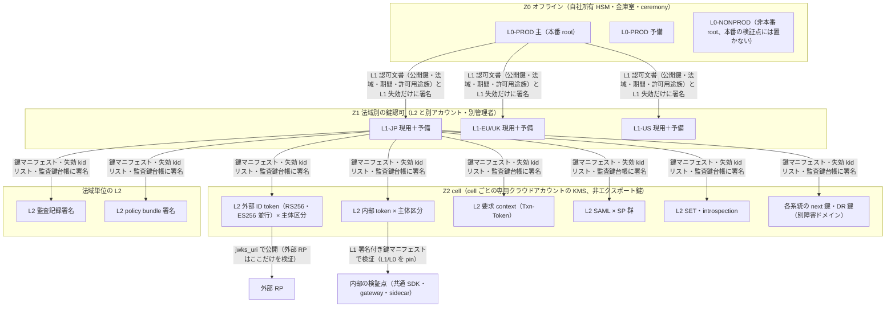
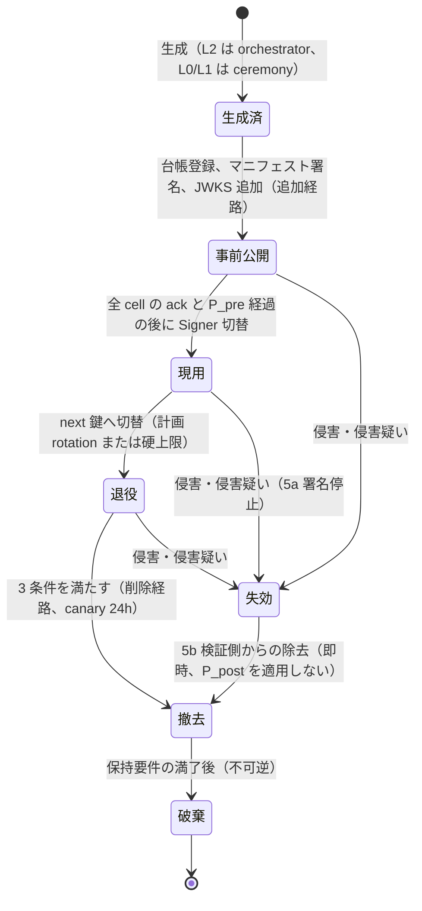
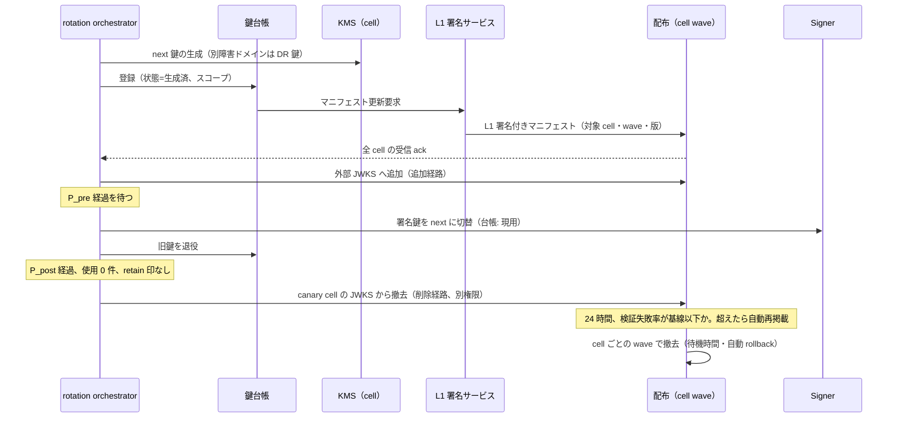
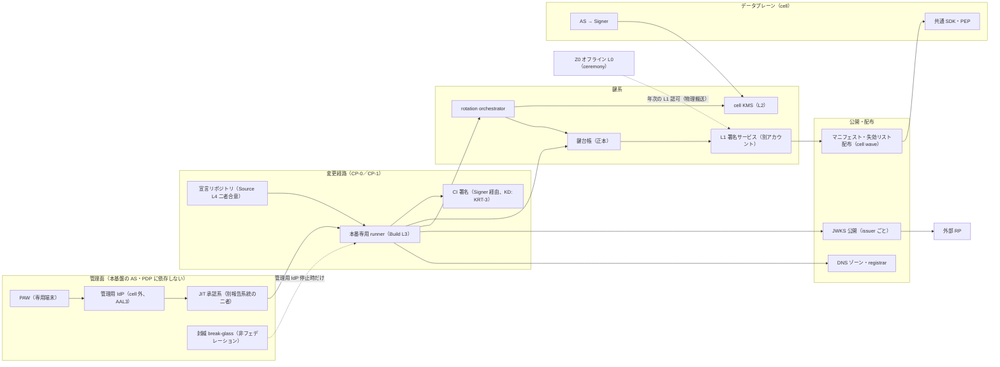

# root of trust・鍵管理設計と鍵 ceremony 手順

> 文書ID: ARC-03 / 版: 0.4 / 状態: review / 最終更新: 2026-10-15（0.4（凍結前是正 FZ-032）: ADR-007 版 0.4 の D7-36a〜D7-36d（案）と申し送り A7-5 に合わせ、§5.1 に kid ごとの状態の表、§7.1 のマニフェストと失効 kid リストの行、§7.3 の欠落の読み方、§13 TC-07-17、§14 RRT-05・RRT-06、残課題、他文書への申し送り、レビュー記録を改めた。模擬パネル ラウンド 10 は自己レビューであり実在の CTO/CISO の決裁ではない。0.3（PoC/R7反映）: PoC 実測レポート POC-02（TC-014 の誤撤去の未検知、MR-8）と独立再現ログ、模擬パネル ラウンド 7 の sre 指摘により、§5.4 の撤去 3 条件の強制点、§7.3 の欠落の読み方、§13 の TC-07-04・TC-07-17、§14 RRT-05、残課題、レビュー記録を加えた。PoC の値は自己実行の参考値で Gate 4 の証拠ではない）
> 対応要求: R-049, R-050, R-051, R-052, R-053, R-054, R-055, R-056, R-189.3, R-189.4, R-268（本書を対応成果物に名指し）, G-084, G-085, G-091（DL-14 を名指し）／関連: R-038, R-113, R-161, R-162, R-168, R-189.5, R-189.6, R-195.4, G-042, G-049, G-055, G-058
> 依存文書: CONVENTIONS.md, traceability/deliverables.md（DL-14）, 05_adr/ADR-007-key-hierarchy-kms-hsm.md, 05_adr/ADR-008-control-plane-cicd-protection.md, 05_adr/ADR-013-cell-partitioning-fail-mode.md, 05_adr/ADR-015-crypto-agility-pqc.md, 05_adr/ADR-019-compromise-response.md, 05_adr/reconciliation-notes.md, 01_governance/assumptions-register.md, 01_governance/stop-authority.md（GOV-06）, 01_governance/raci-governance.md, 01_governance/kri.md, 01_governance/loss-scenarios.md, 01_governance/business-impact-analysis.md, 02_requirements/operation-risk-tiers-assurance.md（REQ-03）, 03_threat-model/attacker-model.md, 03_threat-model/threat-catalog.md, 06_controls/applicability.md, research/RS-05, RS-11, RS-12（各 research/verification/ の検証記録を含む）, research/standards-status.md
> 位置付け: 本書は ADR-007（鍵階層の原則。DEC-3 対象）と ADR-008（管理面）を実装可能な粒度へ展開する設計書であり、ADR が委ねた「鍵台帳スキーマ、ceremony 手順、k/n の根拠、global 部品の障害時影響範囲」（ADR-007 §9.1 の DL-14 行）を定める。ADR の決定と異なる設計は置かない。ADR で未決の点は「未決（ADR-0xx）」と書く。
> 表記: 本書の設計項目は RT-xx、決裁案は KRT-x、試験案は TC-RT-xx（仮番。DL-22 で採番）、新規仮定は NRT-x（前提台帳へ追加要）と書く。ADR の項目は原番号（D7-xx、KD7-x、TC-07-xx など）で引く。表のセルのうちタグのないものは設計推論 [D] であり、本注記で個別タグに代える。
> 誠実性: 本書は AI エージェント（Claude）が起草した。作成者以外による原典照合と、実在の CTO/CISO の決裁は受けていない（CONVENTIONS §8）。演習・第三者立会いはいずれも未実施であり、達成済みとは書かない。

---

## 0. 結論（CTO/CISO 向け要旨）

1. **鍵階層は ADR-007 の 3 層（L0 オフライン root → L1 法域別の鍵認可鍵 → L2 cell 別の運用鍵）をそのまま実装し、鍵目録（§4。系統 ID 19 行＝L0・L1 が 6、L2 が 13。1 cell あたりの L2 は 16 系統）に用途・alg・保管場所・cell/リージョン・寿命・rotation 周期と根拠・併存期間・所有者を割り当てた** [D]。L2 は cell ごとの別アカウントにある KMS の非エクスポート鍵で、Signer 抽象を経由してだけ署名する [D]（ADR-007 D7-06, D7-26）。L1 の保管（KMS か単一テナント HSM か）は未決（ADR-007 KD7-2）である [D]。
2. **root of trust は「鍵そのもの」より「誰が鍵・JWKS・鍵マニフェスト・Signer 権限を変えられるか」で決まる** [D]。外部 RP は jwks_uri から取得した鍵で検証し、L0 からの署名連鎖は検証しない [N][^14][^15]（RS-05#36, #39）。このため JWKS 公開経路・DNS・管理用 IdP・CI 署名系を CP-0（信頼の起点）として二者統制下に置き、本基盤の AS に依存させない（§10）[D]（ADR-008 D8-02, D8-10〜D8-14）。
3. **事故の教訓は向きが逆の 2 つで、両方を同時に満たす** [D]。Storm-0558 は自動 rotation と鍵年齢警報の欠如、検証側の鍵スコープ検証の欠如を示し [I][^10][^11]（RS-05#20〜#22、RS-12#4, #5）、Azure AD 2021-03-15 は鍵削除の自動化が依存アプリ全体の検証失敗を招いたことを示した [I][^13]（RS-09#53〜#55、RS-12#57）。本書は rotation を 30 日周期の定常処理にし（初期案）、削除（JWKS 撤去）と破棄を最も慎重な別経路の操作にする（§5.4〜§5.6）[D]。
4. **検証側は (iss, typ, kid) → 許可鍵集合の表に載らない組合せを共通 SDK の既定で拒否する**（§9）[D]（ADR-007 D7-21）。issuer の粒度（テナント／realm 別か信頼区画別か）は未決（ADR-007 KD7-1／ADR-021 K21-1、reconciliation-notes U-01）であり、本書は両方の結論で成り立つ検証手順を書いた [D]。
5. **二者統制は SP 800-130 の様式で機能ごとに k と n、k 人で可能・k−1 人で不可能の根拠を示した**（§6）[N][^4]（RS-05#9）。L0 は 3-of-7（CTO 系統 4・CISO 系統 3、各系統 1 名以上）とし [D]（ADR-007 D7-50）、系統の組合せ規則を HSM が技術的に強制できるかは製品依存のため RFP の要件にした（KRT-2）[D]。
6. **数値の多くは TBD である** [D]。緊急失効完了時間（R-189.5）、JWKS cache 最大齢（R-189.6）、鍵差替え時間（R-195.4）、L0 緊急 rollover の目標は、BIA と PoC の実測で決める（所有者 CISO、期限 G4）[D]（ADR-007 D7-39, D7-53）。本書が置いた数値は ADR-007 の初期案か、原典・A-ID から導いた制約式だけである [D]。
7. **第三者立会い付きの key ceremony 手順を付録 A に置いた** [D]。証跡様式は IANA Root KSK の公開事例（注釈付き台本、複数カメラ、OS イメージのハッシュ、署名ログ、HSM 破壊証明）に合わせ [V][^29]（RS-05#73）。第三者立会人を quorum 外に置くのは本書の設計判断であり [D]、IANA DPS §7.3 が第三者監査人を multi-person control に参加させないことを参照事例とした。手順の実施（G-085）は未達である [D]。

**経営判断が要る点**（§12）: KD7-1（issuer 粒度、DEC-3）、KD7-2（L1 の保管）、KD7-3／L19-1（緊急失効の発動権限）、KRT-1〜KRT-5（L0 保管拠点、組合せ規則の強制方式、CI 署名鍵の族、L0 バックアップの復元 quorum、第三者立会人の調達）[D]。いずれも決定済みではない [D]。

---

## 1. 範囲と前提

### 1.1 対象範囲（R-056）

| 構成要素 | 本書で扱う信頼 | 主な参照 |
|---|---|---|
| AS（cell ごと） | token・ID token・SAML assertion の署名（Signer 経由）、issuer metadata の内容 | ADR-007 D7-10, D7-26／ADR-001 |
| PAP・policy 配布 | policy bundle の署名鍵（L2 族 8）、版の単調性 | ADR-007 D7-71／ADR-008 D8-80〜D8-84／ADR-011 |
| CI/CD | 成果物・provenance の署名鍵（族は未決、KRT-3）、署名系の管理者認証 | ADR-008 D8-60〜D8-65 |
| KMS | L2（既定）と L1（暫定）の鍵保管、Sign API、鍵ポリシー | ADR-007 D7-06, D7-24, D7-25 |
| HSM | L0（オフライン、自社所有）、L1（KD7-2 で確定した場合）、高保証テナントの専用 cell | ADR-007 D7-05, D7-15, D7-25 |
| JWKS・鍵マニフェスト | 外部向け jwks_uri、L1 署名付き鍵マニフェスト、失効 kid リスト | ADR-007 D7-03, D7-17, D7-21, D7-37 |

- 起点: レビューは管理面・鍵の root of trust が未設計であることを Critical とし、AS/PAP/CI/CD/KMS/HSM/JWKS を含む root of trust と侵害 runbook を承認条件 3 とした [D][^1]（L87、L241）。鍵 rotation 周期と旧鍵併存時間も空欄のまま承認しないとした [D][^1]（L211）。
- 対象外: workload CA・SPIFFE trust bundle は ADR-009 の系統で扱い、本書の L2 とは別系統である [D]（ADR-007 D7-11）。ただし「本番の検証点に非本番の trust anchor を置かない」規則は CA・trust bundle にも及ぶ [D]（ADR-008 D8-51）。TLS サーバ証明書の PQ/T hybrid 化は ADR-015 で扱う [D]。

### 1.2 攻撃者・脅威・損失

| 区分 | ID | 本書で扱う内容 |
|---|---|---|
| 損失シナリオ | S-02（上位 2 位案）、S-08、S-13 | 署名鍵・JWKS 侵害による token 偽造、build・配備経路の侵害、暗号危殆化 [D]（01_governance/loss-scenarios.md） |
| 攻撃者 | ATK-01（L4: 署名鍵の窃取）、ATK-06、ATK-07、ATK-08（クラウド管理者）、ATK-17、ATK-19 | L4 の設計対象範囲は決裁案 AM-1、事業者側運用者の扱いは AM-2 で未決 [D]（03_threat-model/attacker-model.md §7） |
| 脅威 | T-040（未署名・内部 token の受理）、T-041（署名鍵の窃取）、T-042（JWKS 差替え）、T-043（鍵ライフサイクル操作による全域停止）、T-044（緊急失効の遅れ）、T-045（KMS 権限の自己付与・Sign の濫用）、T-051、T-052 | §9、§10、§11 [D]（03_threat-model/threat-catalog.md） |
| KRI | K-07（最長稼働署名鍵年齢）、K-09（常設特権・二者統制の逸脱）、K-19、K-20（段階展開を経ない鍵 metadata 変更）、K-21、K-30（有資格者 1 名以下の重要手順） | §8 [D]（01_governance/kri.md） |

- FAPI 2.0 Attacker Model は JWKS の配布障害や AS 上の RCE を範囲外とするため、FAPI 準拠を示しても本書の主な脅威を統制したことにはならない [D]（ADR-007 §1.2、RS-04#50）。

### 1.3 使う前提（A-ID）と新規仮定

| ID | 値（基準） | 本書での使い方 |
|---|---|---|
| A-007, A-061 | テナント 1 万、地域分布 日本 85% | 封じ込め単位（日本 1 cell で約 1,417 テナント、ADR-007 N7-9） |
| A-027 | access token 寿命 10 分（容量計算用の仮置き） | 退役鍵の公開保持期間の下限（§7.2） |
| A-054 | プラットフォームチーム 24 FTE（前提台帳の内訳: 鍵管理・セキュリティ 2、SRE 6） | 二者の常時確保の制約（§6.3） |
| A-060〜A-063 | 法域 日本・EU/英国・米国、リージョン 4 | L1 の法域分割、鍵の所在 |
| A-074 | 監査記録 オンライン 13 か月＋アーカイブ 7 年 | 監査署名の検証鍵の保持（§5.6） |
| A-081 | 高保証要求テナント 50 | テナント専用 L2 の上限 |
| A-093, A-094 | RTO 1 時間、計画停止なし | DR（§5.7）、無停止 rotation |
| A-114 | SAML 1,800 接続（IdP 証明書の更新は手作業） | SAML 鍵の周期と重複期間 |
| ADR-007 N7-1〜N7-9 | cell 数 10（上限側。正本は ADR-013 N13-1 の 9）、custodian 7 名の指名可能性など | §4、§6、付録 A |

新規仮定（前提台帳へ追加要。本書は前提台帳を編集しない）:

| ID | 内容 | 使う箇所 |
|---|---|---|
| NRT-1 | L0 の主 HSM と予備 HSM を、互いに別の災害影響範囲にある 2 つの保管拠点（自社管理の金庫室）に置ける。拠点の数と所在は KRT-1 で決める | §5.2、§5.7、付録 A |
| NRT-2 | 各 ceremony に、quorum 外の独立立会人を外部の監査・保証業者から 1 名以上確保できる（ADR-007 N7-4 の後段を ceremony 単位に具体化） | 付録 A |
| NRT-3 | L0 HSM のバックアップ（HSM 固有の暗号化バックアップ）を復元する quorum は起動 quorum と別に置ける。k と n は TBD（KRT-4） | §5.7、§6 |
| NRT-4 | 鍵緊急失効の二者（別々の報告系統の鍵管理担当）を 24/365 で揃えられる。GOV-06 新規仮定④と同一であり、台帳登録時に 1 件に統合する | §5.5、§6.3 |

---

## 2. 設計原則（ADR から本書に写す不変条件）

| ID | 原則 | 出典 |
|---|---|---|
| RT-01 | 1 鍵 1 用途 1 alg 1 スコープ。SP 800-57 Rev5 §5.2 の shall を内部要求として維持する（Rev6 は ipd で should に下げた） | [N][^2][^3]（RS-05#1, #7, #8）、ADR-007 D7-10 |
| RT-02 | 1 本の鍵の侵害で失われる範囲を小さくする（cell × 主体区分 × 用途族） | SP 800-57 Rev5 §5.5.2 の should [N][^2]（RS-05#5）、ADR-007 D7-12, D7-13 |
| RT-03 | rotation は高頻度の定常処理とし、緊急 rotation はその最大速度版にする。別系統の緊急手順を持たない | SRS ch.9 [V][^36]（RS-09#35）、ADR-007 D7-30, D7-37 |
| RT-04 | 鍵の追加と削除は別経路・別権限・別の段階展開にする | Azure AD 2021 [I][^13]（RS-09#55）、ADR-007 D7-35 |
| RT-05 | 鍵メタデータの正本は自社の鍵台帳とする。KMS の alias・タグは正本にしない | SP 800-57 Rev5 §6.2.3 [N][^2]（RS-05#6）、ADR-007 D7-27 |
| RT-06 | 鍵の移出（BYOK・export）をしない。事業者・製品の退出は rotation 経路で行う | ADR-007 D7-06, D7-28 |
| RT-07 | 鍵系の管理者認証は本基盤の AS に依存させない | ADR-007 D7-55、ADR-008 D8-10〜D8-14、ADR-013 D13-22 |
| RT-08 | 本番の検証点に非本番の trust anchor を置かない | ADR-007 D7-04、ADR-008 D8-51 |
| RT-09 | 不可逆識別子（issuer URL、kid、マニフェストのスキーマ名）に alg 名・製品名・cell 名・テナント ID を入れない | ADR-007 D7-23, D7-65、tenant-lifecycle INV-1 |

---

## 3. 鍵階層

### 3.1 階層図

- L0 は token に署名せず、L1 認可文書と L1 の失効だけに署名する [D]（ADR-007 D7-02、SP 800-57 §5.2 [N][^2]）。L0 の価値は (1) 内部検証点が鍵スコープまで検証できること、(2) KMS 事業者を替えてもアンカーを変えずに済むこと、(3) 侵害からの回復の起点であること、の 3 点に限る [D]（ADR-007 D7-02）。
- L1 の用途は自法域の鍵マニフェスト、失効 kid リスト、監査鍵台帳への署名の 3 つに限る [D]（ADR-007 D7-03）。法域の間で L1 を共有しない [D]（ADR-007 D7-13）。
- 鍵マニフェストは JWS JSON General Serialization とし、複数署名（PQ 移行時の ES256 と ML-DSA の併記）を持てる形にする [N][^31]（RFC 7515 §1、RS-11#52）[D]。内容（payload の keys・iss・sub・iat・exp）は OpenID Federation 1.0 §5.2.1 の Signed JWK Set（typ `jwk-set+jwt`。同節で keys・iss・sub は Required、iat・exp は Optional）に合わせるが、federation への準拠は主張しない [N][^35][D]（ADR-007 D7-03）。Signed JWK Set は JWT（Compact Serialization）であり、複数署名を持つ本書のマニフェストとは直列化形式が異なる。したがって typ には `jwk-set+jwt` を使わず、自社の typ を割り当てる [D]（RFC 8725 §3.12 の相互排他 [N][^14]）。

### 3.2 global 部品と障害時の影響範囲（G-042 の DL-14 担当分）

ADR-013 は global 部品を 5 つの許可リスト（配置表、routing 層、オフライン L0 trust anchor、配布 pipeline の定義、build 時だけの契約・schema 登録簿）に限っている [D]（ADR-013 要旨・G3 行）。鍵系で global または法域共有になる部品と、その停止・侵害の影響を次に示す [D]。

| 部品 | 範囲 | 停止時の影響 | 侵害時の影響 | 封じ込め |
|---|---|---|---|---|
| L0（本番） | global（オフライン） | 実行時の依存はない。L1 の再認可・L1 rollover ができないだけ（ADR-013 G3 行） | 攻撃者が任意の L1 を認可でき、内部検証点の全法域に偽の鍵マニフェストを通し得る。外部 RP は L0 を検証しないため、外部への直接の影響は JWKS 経路を同時に奪った場合に限る | 3-of-7＋組合せ規則（§6）、オフライン保管、緊急 rollover（付録 A.6、ADR-019 D19-16） |
| L1（法域別） | 法域共有（1 法域の全 cell） | 新しい鍵マニフェストと失効 kid リストに署名できない。既存マニフェストは有効期限（上限時間 H、ADR-008 D8-82）まで使える。したがって L1 停止の許容時間は H で律速される（H は未決、ADR-013 KD13-6）。L2 の硬上限 90 日と周期 30 日の差（約 60 日）は鍵年齢の余裕であり、H を超える L1 停止の余裕にはならない。H 経過後に新しいマニフェストがない場合の検証点の動作（拒否か last known good の継続か）は ADR-013 の fail mode で決まり、本書では定めない（未決（ADR-013 KD13-6））。予備 L1 への切替を H より十分短い時間で完了できることを TC-RT-03 で確かめる | 当該法域の内部検証点に偽の鍵を受理させ得る | 予備 L1（事前認可済み）への切替、L1 の自己付与試験（TC-07-10）、KD7-2 |
| 鍵台帳 | 法域ごと（正本） | rotation・撤去の判断が止まる。署名と検証は継続する | 撤去条件の偽装による誤撤去（T-043）、retain 印の除去 | 撤去 3 条件の発行台帳照合（§5.4）、台帳の変更は CP-0 |
| JWKS 公開 pipeline | issuer ごと（cell 単位で配布） | 新鍵の事前公開ができない。既存 JWKS は配信を継続する | 外部 RP に偽の鍵を受け入れさせ得る（RR7-04） | CP-0 の二者統制、公開内容の外形監視、cell wave 配布 |
| 管理用 IdP | 本基盤の cell の外（global 部品の許可リストに入れない） | 管理操作は break-glass で行う。データプレーンは依存しない | 鍵系の管理者になりすませる | 管理用 IdP 自身の回復は封緘した緊急アカウントだけ（ADR-008 D8-10(4), D8-14） |

---

## 4. 鍵目録

### 4.1 目録の読み方

- 「寿命」は署名に使う期間の上限（硬上限。到達時は事前公開済みの next 鍵へ自動切替）である [D]（ADR-007 D7-31, D7-32）。私有署名鍵の最大 cryptoperiod は SP 800-57 Rev5 が約 1〜3 年を推奨（recommended）しており、全行をその範囲内に置いた [N][^2]（RS-05#3）。
- 「併存期間」は、事前公開（P_pre）と退役後の公開保持（P_post）である。式は §7.2 に置く [D]。
- 「所有者」は RACI-27（オフライン root の ceremony、issuer 署名鍵の rotation）に従い、説明責任（A）を CTO、実行責任（R）を CISO 組織とプラットフォームチームの鍵管理担当とした [D]（01_governance/raci-governance.md RACI-27）。用途族ごとの業務上の所有者を併記する [D]。
- 数値はいずれも ADR-007 の初期案であり、R-189.3（rotation 周期）は KD7-4 で、R-189.4（併存時間）は TC-07-02 で確定する [D]。

### 4.2 L0・L1

| 系統 ID | 用途 | alg（初期案） | 保管場所 | 単位 | 寿命（硬上限） | rotation 周期と根拠 | 併存期間 | 所有者 |
|---|---|---|---|---|---|---|---|---|
| K-L0-P1 / K-L0-P2 | 本番 root（主・予備）。L1 認可文書と L1 失効に署名 | ES256（初期案）。ML-DSA の併記は L0 HSM の ML-DSA 対応が確認できた時点（ADR-015 N15-5） | 自社所有のオフライン HSM（FIPS 140-3 Level 3 以上の有効な CMVP 証明書、ADR-007 D7-05）。主・予備を別拠点（NRT-1） | global（法域で分けるかは未決、ADR-007 KD7-6） | 36 か月 | 30 か月ごとの ceremony。根拠: SP 800-57 の約 1〜3 年 [N][^2]（RS-05#3）の上限内に置き、IANA KSK の 5 年 [V][^27]（RS-05#70）より短くする。年次 ceremony（L1 認可の更新）と同期する [D]（ADR-007 D7-31, D7-52） | 新 L0 の公開鍵を内部 SDK の pin に事前配布してから旧 L0 を退役する。期間は SDK の更新周期で決める（TBD、所有者 プラットフォームチーム、期限 G4、決め方 ADR-016 の SDK 版の deprecation 期間） | A: CTO／R: CISO 組織＋PF 鍵管理（custodian 3-of-7） |
| K-L0-N | 非本番 root | 同上 | 本番と別のオフライン HSM（本番の拠点と同居させるかは KRT-1） | 非本番全体 | 36 か月 | 同上 | 同上 | 同上 |
| K-L1-JP / K-L1-EU / K-L1-US（各 現用＋予備） | 鍵マニフェスト、失効 kid リスト、監査鍵台帳への署名 | ES256。PQ 段 2 以降は ES256＋ML-DSA-87 の両方必須（ADR-015 D15-31） | 暫定: 法域内の KMS（L2 と別アカウント・別管理者 principal）。TC-07-10 で自己付与を防げない、または AM-2 で事業者運用者からの分離を選んだ場合は法域別の単一テナント HSM（未決、ADR-007 KD7-2） | 法域（JP / EU・英国 / US）。鍵の所在国は法域と一致させる（06_controls/applicability.md の ADR-007 行） | 2 年 | 1 年。根拠: L1 の署名回数は「rotation・失効に伴うマニフェスト更新（全体で 1 日約 12 件、ADR-007 D7-14）＋失効 kid リストの更新＋有効期限 H 内の再署名（cell 数 × 24 時間 ÷ 再署名間隔）」で、L2 より桁違いに少なく、取引量による cryptoperiod 短縮要因が小さい（SP 800-57 §5.3.1 の要因 [N][^2]、RS-05#2）。ADR-007 §1.5 の「1 日あたり数件」は H 内の再署名を含まない（§15 ADR への指摘 2）。年次の L0 ceremony で予備 L1 を認可するため周期を合わせる [D]（ADR-007 D7-31） | 予備 L1 は L0 認可済みで常時 SDK に配布済み。旧 L1 の公開鍵は、その L1 が署名した監査鍵台帳の検証に要る期間（§5.6）保持する | A: CTO／R: CISO 組織＋PF 鍵管理 |

### 4.3 L2（cell 単位）

1 cell あたり 16 系統（整合調整後の値）で、版（現用・next・退役保持・DR）を含め全体で約 1,270 版、上限側の試算で約 1,400 版になる [D]（ADR-007 D7-14、reconciliation-notes C-21, C-22）。

| 系統 ID | 用途（ADR-007 D7-10 の族） | alg（初期案） | 保管場所 | 単位 | 寿命（硬上限） | rotation 周期と根拠 | 併存期間 | 所有者（業務） |
|---|---|---|---|---|---|---|---|---|
| K-L2-IDT-RS / K-L2-IDT-ES | 族 1: 外部 ID token（RS256 と ES256 を別鍵で並行公開）。ADR-020 D20-08-4 は層 F の client に PS256 での登録も許すが、PS256 鍵は ADR-007 D7-61・ADR-015 CP v1 になく本表にも置かない。追加の要否は未決（ADR-020／ADR-007。architecture-reconciliation-notes.md XR-04） | RS256（新規鍵は 3072 bit 以上、ADR-015 D15-23）／ES256 | cell 専用アカウントの KMS（非エクスポート、単一リージョン鍵、ADR-007 D7-07） | cell × 主体区分（B2B／B2C realm／従業員） | 90 日 | 30 日。根拠: (1) 主要クラウド KMS は非対称鍵の自動 rotation を提供しない [V][^20][^26]（RS-05#45, #61）ため自社 orchestrator で回す前提であり、(2) CSRB 勧告 6 は頻繁な rotation の例として月次を挙げ [I][^10]（RS-05#27）、(3) 手順を常時動かして故障を平常時に見つける [V][^36]（RS-09#35）[D]（ADR-007 D7-30） | P_pre 7 日、P_post 7 日（§7.2） | AS（認証）チーム |
| K-L2-AT（予約） | 族 2: 外部 access token（RFC 9068） | — | 初期構成では作らない（外部 access token は opaque、ADR-005 D1-1） | — | — | — | — | — |
| K-L2-INT | 族 3: 内部 token（token exchange、代理 token） | ES256（PQ 段 3 で ML-DSA-44 候補、ADR-015） | 同上 | cell × 主体区分 | 90 日 | 30 日（族 1 と同じ根拠） | 内部は全 cell のマニフェスト受信 ack を署名開始の条件にする。P_post 7 日 | AS（認証）チーム |
| K-L2-TXN | 族 3b: 要求 context（Txn-Token）。内部 token と鍵を共有しない（RFC 8725 §3.12 の相互排他の手段 [N][^14]） | ES256（PQ 段 3 で ML-DSA へ切替の対象、ADR-015 段 3） | 同上 | cell × 主体区分（ADR-007 D7-14 の補正値 16 系統は要求 context を 3 主体区分で数える） | 90 日 | 30 日 | 同上 | AS（認証）チーム |
| K-L2-SET | 族 4: SET（採る場合） | ES256 | 同上 | cell | 90 日 | 30 日 | P_pre 7 日、P_post 7 日 | AS（認証）チーム |
| K-L2-INTRO | 族 5: introspection 応答の署名（JWT 応答を採る場合、FAPI 範囲） | ES256（発行 alg。ADR-015 CP v1 は検証側の許可 alg に PS256 も含めるが、ARC-02 補-2 は受理を ES256 に絞る。1 鍵 1 alg なので本系統の鍵は ES256 だけ） | 同上 | cell | 90 日 | 30 日 | 同上 | AS（認証）チーム |
| K-L2-SAML | 族 6: SAML assertion／metadata 署名 | RSA 系（具体の署名方式は未決、ADR-004） | 同上 | cell × SP 群（B2B、従業員） | 2 年 | 1 年。根拠: 顧客側の SAML 設定 1,800 接続の証明書更新が手作業で、30 日周期では顧客の作業が回らない [D][A-114]（ADR-007 D7-70） | 新旧重複 60 日（初期案、ADR-004 と調整） | B2B 連携チーム |
| K-L2-AUD | 族 7: 監査記録の署名 | ES256＋ML-DSA-65（両方必須、ADR-015 D15-32。PQ 段 2 以降） | 法域内の KMS（cell と別の法域用アカウント） | 法域 | 90 日 | 30 日（族 1 と同じ根拠） | 公開鍵は監査鍵台帳に、A-074 と「稼働期間＋2 年以上」の長い方まで保持（§5.6） | 監査基盤チーム |
| K-L2-PB | 族 8: policy bundle の署名 | ES256（初期案。ADR-011 で確定） | 法域内の KMS | 法域 | 90 日 | 30 日 | P_pre は bundle の適用 agent が新鍵を受理するまで（マニフェスト ack） | 認可（PDP）チーム。鍵ポリシーは ADR-008 と共有管理 |
| K-L2-CI（未決） | CI 成果物・provenance の署名 | ES256（初期案） | KMS（Signer 経由、ADR-008 D8-62） | 本番 build 系統（本番専用 runner、ADR-008 D8-52） | 90 日（初期案） | 30 日（初期案） | 配備時の admission 検証が新鍵を受理するまで | プラットフォームチーム。**族の位置付けは未決（ADR-007 D7-10 に族がない。KRT-3）** |
| K-L2-*-NEXT / -DR | 各系統の next 鍵と DR 鍵 | 各系統と同じ | 同じ法域内の別リージョン、無理なら別アカウントの KMS（ADR-007 N7-6） | 各系統と同じ | 各系統と同じ | 平常時から JWKS とマニフェストに事前公開しておく [D]（ADR-007 D7-40） | 常時公開 | 各系統と同じ |
| K-L2-TEN | 高保証テナントの専用 L2（契約で求めた場合）と専用 issuer | 族 1・3 と同じ | KMS。契約で単一テナント HSM を求める場合は専用 cell の L2 を原価回収で提供 | テナント（上限 50、A-081。提供条件は ADR-021 D21-05・K21-3） | 90 日 | 30 日 | 族 1 と同じ | AS（認証）チーム＋契約担当 |

- **鍵の所在**: L2 の鍵は収容 cell のリージョン（法域）から出さない [D]。multi-Region 鍵は鍵素材と鍵 ID をリージョン間で共有するため L2 に使わない [V][^21]（RS-05#48）[D]（ADR-007 D7-07）。所在地は「保存場所・運用者のアクセス元・鍵の所在」を同じ単位で制御する方針に従う [D]（06_controls/applicability.md 結論 5）。DORA 9 条 4 項 (d) は暗号鍵の保護方針を、30 条 2 項 (b) は ICT 第三者契約での処理・保存場所の明示を求める [N][^39]（RS-02#57, #58）。DORA の名宛人は EU の金融機関であり、本基盤には EU 金融顧客との契約を通じて及ぶ（条件付き、06_controls/applicability.md E-05）[D]。
- **製品の rotation 機能**: Azure Managed HSM の自動 rotation は 28 日より短い間隔で版を作れず、1 鍵 100 版が上限である [V][^25]（RS-05#56）。30 日周期は 28 日の下限を満たすが、100 版の上限は 30 日周期で約 8 年分にあたるため、版を積み増さず鍵を新規作成する方式（AWS・Google と同じ自社 orchestrator 方式）に揃える [D]。
- **alg の寿命**: NIST IR 8547 ipd は、112-bit 強度の量子脆弱な署名を 2030 年より後に非推奨、128-bit 以上を含め 2035 年より後に不許可とする案である（ipd、final 未公表）[N][^38]（RS-05#64）。RSA-2048 の新規鍵を作らず 3072 bit 以上にするのはこのためである [D]（ADR-015 D15-23）。社内期限は ADR-015 KD15-2 で未決である [D]。
- **容量**: 署名回数は基準の日本 1 cell・全 session 失効直後で約 359 回/秒、成長・偏り s=1.5 で約 1,241 回/秒と試算されている [D]（ADR-007 §1.5）。ただしこの値は ADR-007 の N7-1（日本 6 cell）による。cell 数の正本である ADR-013 N13-1（日本の標準 cell 4）で計算し直すと、基準の失効直後は 539 回/秒（s=1）・809 回/秒（s=1.5）、成長 5 年目は 1,241 回/秒（s=1）・約 1,860 回/秒（s=1.5）になり、成長シナリオでは s=1 でも既定クォータ 1,000 req/s を超える [D][A-043, A-048, A-061]（ARC-13 §10.3・「ADR への指摘」2、ARC-07 F-15）。AWS KMS の非対称署名の既定クォータは鍵種別ごとに 1,000 req/s（アカウント×リージョン合算、調整可）で、同じ文書に RSA 500・ECC 300 という食い違う説明例が残る [V][^19]（RS-05#44）。実効値は TC-07-07 で確かめる [D]。署名回数の 81% は token exchange であり、ADR-009 の委任方式に従属する [D]（ADR-007 §1.5）。

---

## 5. ライフサイクル手順

### 5.1 鍵の状態遷移

- 状態と状態履歴（失効理由を含む）は鍵台帳に記録する [N][^2]（SP 800-57 §6.2.3、RS-05#6）[D]。台帳スキーマは付録 B に置く [D]。
- **鍵マニフェストに載せる kid ごとの状態（凍結前是正 FZ-032。ADR-007 D7-36a（案）に従う）**: L1 署名付き鍵マニフェスト（§7.1）は、kid ごとに次の状態の欄と状態履歴（各状態に入った時刻）を持つ [D][^45]。ADR-007 D7-36a の active／retiring／retired／revoked は、本書の遷移の現用／退役／撤去／失効に当たる [D][^45]。

| マニフェストの状態値 | 本書の状態 | 検証点（共通 SDK）の扱い | マニフェストへの掲載 |
|---|---|---|---|
| pre-published | 事前公開 | 受理する（署名にはまだ使われない） | 掲載する |
| active | 現用 | 受理する | 掲載する |
| retiring | 退役（P_post 中） | 受理する。退役時刻を状態履歴に持つ（§7.3 の残寿命の計算に使う） | 掲載する |
| retired | 撤去 | 撤去 3 条件（§5.4）を満たした後の記録された消失として扱い、受理しない。欠落として扱わない | 撤去の状態を記録した版を 1 回以上公開した後に、kid を外してよい |
| revoked | 失効 | 即時に拒否する。push 経路（失効 kid リスト）でまだ失効が届いていなくても拒否する（D7-36a） | 状態=失効のまま「その kid で署名された token の最大残寿命＋J_max」の間は掲載し続け、消さない |

- 生成済・破棄はマニフェストに載せない [D]。失効から現用・退役へ戻る遷移は置かない（上図）ため、取得経路と push 経路のどちらかで失効を見たら失効を優先しても、正規の状態を取り違えない [D][^45]。

### 5.2 生成

| 層 | 手順 | 統制 |
|---|---|---|
| L0 | 付録 A.4 の ceremony で、オフライン HSM の内部で生成する。私有鍵は HSM 固有の暗号化バックアップ以外の形で HSM から出さない。escrow しない | IANA DPS §5.2・§5.2.3 の運用を参照 [V][^27]（RS-05#68）。3-of-7（§6） |
| L1 | KMS（または KD7-2 で確定した HSM）で非エクスポート鍵として生成し、公開鍵と鍵台帳の記録を付録 A.5 の ceremony で L0 が認可する | 生成は二者承認（ADR-007 D7-54）。L1 の管理者 principal は L2 と分ける（D7-25） |
| L2 | rotation orchestrator が cell 専用アカウントの KMS で非エクスポート鍵を生成する。鍵素材の import（BYOK）は使わない | orchestrator の手順と周期の定義変更は二者承認（CP-0）。個々の定期実行は事前承認済みの自動処理（ADR-007 D7-54、§6.2 の注） |

- 生成時に台帳へ書く項目: kid（不透明な乱数。alg・テナント・cell・用途・製品名・日付を含めない、ADR-007 D7-23）、alg、用途族、スコープ（iss 集合、typ 集合、cell、主体区分）、backend、生成者（機械主体 ID）、承認記録 ID [D]。
- KMS の調達条件: 有効な FIPS 140-3 Level 3 の CMVP 証明書番号と承認アルゴリズム一覧の提示 [D]（ADR-007 D7-05, D7-64）。FIPS 140-2 の証明書は予定表上 2026-09-22 に Historical List へ移り、米連邦機関は Historical の認証を新規システムに含めるべきでない（should not）とされる [N][^7][^8]（RS-05#15, #16）。AWS KMS HSM の CMVP #4884 は FIPS 140-3・Level 3・Active（sunset 2029-11-17、caveat「Interim validation」）で、確認日時点の承認一覧に ML-DSA は見当たらない [V][^9]（RS-05#17）。Google Cloud HSM の公式文書は確認日時点で「FIPS 140-2 Level 3」と記載しており、証明書を照合するまで採否を保留する [V][^41]（RS-05#57）[D]。

### 5.3 保管と利用

- **Signer 抽象**: すべての署名は自社の Signer を経由し、Signer は sign(key_ref, payload) だけを公開する [D]（ADR-007 D7-26）。アプリと SDK は KMS 製品の API を直接呼ばない [D]。AWS KMS の Sign API はメッセージを 4,096 byte に制限し、ML-DSA では EXTERNAL_MU 経路を使う [V][^40]（RS-05#47）。こうした backend 固有の要件は Signer の内側に閉じ込める [D]。
- **Sign 権限**: 各 L2 鍵の Sign 権限は、その cell の Signer の workload ID だけに付与する [D]。人の principal には Sign 権限を常設しない [D]（ADR-008 D8-21）。
- **発行台帳と偽造検知**: 署名する全 JWT に一意の jti を入れ、発行台帳に (jti, iss, kid, typ, tid, 発行時刻, 由来する認証イベント ID) を記録する [D]（ADR-007 D7-45）。KMS の Sign 呼出し回数と発行台帳の件数を kid ごとに 5 分単位で照合し、台帳にない署名を警報にする（5 分は検知粒度の初期案、MTTD は TBD）[D]。CSRB は偽造 token を検知するための独自データを良い実践として挙げた [I][^10]（RS-05#25, #27）。非エクスポート鍵では主な脅威が Sign API の不正利用（T-045、RR7-05）になるため、この照合を主要な検知手段にする [D]。
- **鍵系へのアクセス記録**: 鍵系・署名系・管理用 IdP への全アクセスをページング警報の対象にし、記録を鍵の稼働期間＋2 年以上保持する [D]（ADR-008 D8-101）。CSRB 勧告 5 はこの保持を推奨し、一部の高価値ログは 10 年以上が適切な場合があるとする [I][^10]（RS-05#26）。

### 5.4 計画 rotation（削除の安全を含む）

- **撤去の 3 条件**（ADR-007 D7-35）[D]: (1) 鍵台帳の状態が「退役」で retain の印がない。(2) 発行台帳で、その kid による過去 P_post の署名が 0 件、かつ未失効・未期限切れの token が 0 件。(3) canary cell で撤去し、24 時間、検証失敗率が基線を超えない。超えた場合は自動で再掲載する。
- **撤去 3 条件の強制点（PoC/R7反映、版 0.3）**: 3 条件の照合は、JWKS・鍵マニフェストの公開処理（L1 署名サービスへのマニフェスト更新要求の受付）の側で常に行い、rotation orchestrator・手動操作・緊急操作のどの経路からも省略できない形にする [D]。PoC 系統 1 では、使用中の鍵の撤去拒否が呼出し側の指定（`check_in_use`）があるときだけ有効で、誤撤去の経路では指定されず、誤撤去が検知されないまま使用中 token 1,980 件中 1,566 件が拒否された（自己実行の参考値。独立再現でも同型）[D][^42][^43]。条件 (3) の「検証失敗率」と「基線」は SLO-01 SLI-029 で読み、24 時間の観測窓とは別に、検知・自動再掲載の上限 T_rk と窓内の誤 deny の上限 X_rk を置く（ARC-08 §4、ADR-007 D7-35 の注記）[D]。
- 撤去は canary の後に cell ごとの wave で待機時間を置いて進め、警報で自動 rollback する [V][^37]（RS-09#33）[D]。Azure AD 2021 では、段階展開の保護が鍵の追加までで削除に及んでいなかった [I][^13]（RS-09#55）。
- 鍵 metadata の変更は binary と同じ cell 単位の wave で配る [D]（ADR-013 要旨「変更の安全」）。緊急 freeze（GOV-06 S2）中は鍵 metadata の計画的変更を止めるが、剥奪・失効の配布と next 鍵への切替は止めない [D]（01_governance/stop-authority.md S2 行）。
- rotation の停止には、期限付きリスク受容（受容者は事業責任者。CTO・CISO の単独受容は不可、G-032）を要する。期限は最長 30 日、更新 1 回まで（初期案）[D]（ADR-007 D7-33）。Storm-0558 では障害後の rotation 停止が無期限になった [I][^10]（RS-05#20）。
- 硬上限に達しても発行は止めず、事前公開済みの next 鍵へ切り替える。next 鍵が事前公開されていない状態は、それ自体を Sev-1 とする [D]（ADR-007 D7-32）。

### 5.5 失効（緊急失効）

鍵緊急失効は GOV-06 §4.5 の 2 段に分ける [D]（01_governance/stop-authority.md）。

| 段 | 操作 | 影響 | 権限（現行の規程案） |
|---|---|---|---|
| 5a 署名の停止 | 侵害・侵害疑いの鍵での署名をやめ、next 鍵（なければ DR 鍵）へ切り替える。内部検証点へ失効 kid リストを push する | 小さい（next 鍵が事前公開済みであることが前提） | ADR-007 D7-38: セキュリティ on-call が単独で宣言。GOV-06 §3.1: CISO またはセキュリティ IC、実行は同時二者。**差は未決（ADR-019 L19-1、KD7-3・DP46-3）** |
| 5b 検証側からの除去 | 外部 JWKS・trust store から鍵を外し、その鍵で署名された発行済み token を受理させない | 大きい（再認証が集中、全 session 失効 S4 と連動） | CISO＋同時二者、CTO へ同時通知（GOV-06 §3.1。ADR-019 L19-1 の提案もこの部分は GOV-06 どおり） |

手順（通常 rotation の系を最大速度で使い、別系統を持たない）[V][^36][D]（ADR-007 D7-37、ADR-019 D19-13）:

1. 宣言者が鍵台帳で kid を「失効」にし、理由を記録する（侵害の「疑い」で発動する。SP 800-152 §6.8.1 は侵害または侵害が疑われる鍵を保護の適用に使ってはならない（must not）とする [N][^5]、RS-05#11）。
2. Signer が直ちに next 鍵（なければ DR 鍵）へ切り替える（5a）。
3. L1 が署名した失効 kid リストを、JWKS 取得とは独立した push 経路で内部の検証点へ配る。同時に、鍵マニフェストでその kid の状態を「失効」にした版を L1 署名で公開する（取得経路。§7.1 の 2 経路、ADR-007 D7-36a（案））[D][^45]。検証点は、どちらか一方で失効を見たら即時に拒否する（§7.3）。
4. 該当 kid で署名した token と関連 session を失効させる（ADR-019 の失効下限時刻、DL-24）。発行台帳から影響テナント・主体を引く。
5. 依拠当事者（外部 RP、顧客管理者）へ通知する（SP 800-152 §6.8.1 の should [N][^5]）。
6. 5b を発動する場合は、外部 JWKS から鍵を即時に除去する。内部のマニフェストでは kid を消さず、状態=失効のまま掲載を続ける（§5.1 の表。SDK がこの除去を欠落として扱わないため）[D][^45]（OIDC Core §10.1.1 の「退役鍵を合理的な期間保持すべき」（SHOULD）[N][^15] から外す理由を記録する）。再ログイン受付制御を同時に起動する（ADR-019 D19-13）。
7. 新しい next 鍵を生成し、事前公開する。
8. 証拠保全: 鍵の破棄より先に legal hold を掛け、発行台帳・KMS 記録・JWKS とマニフェストのスナップショットを本基盤から独立した保存先へ複写する [D]（ADR-019 要旨「証拠保全」）。
9. 事後レビューを 24 時間以内に二者で行う（初期案）[D]（ADR-007 D7-38）。

- 下流 cache の消去が要ることは Storm-0558 の対応でも確認されている [I][^10]（RS-05#23）。外部 RP は自身の cache が切れるまで失効を反映しない（RR7-02）[D]。
- 失効は解除しない。疑いが晴れても旧鍵を戻さず新鍵で継続する [D]（GOV-06 §4.5 解除条件）。
- 完了時間（R-189.5）と鍵差替え時間（R-195.4）は TBD（所有者 CISO、期限 G4、決め方 BIA と TC-07-03 の実測）[D]（ADR-007 D7-39）。
- L0 の侵害は鍵階層の再構築として付録 A.6 の緊急 rollover で扱い、ADR-019 の緊急切替の対象外とする [D]（ADR-019 D19-16）。
- **自動発動の可否（GOV-06 §3.1 の S5 行が DL-14 に委ねた点）**: 本書の案は、5a・5b とも自動発動しない [D]。台帳差分（§8.2）、Signer 以外の Sign 呼出し、L1 署名の照合不一致は自動でページングし、宣言者（§5.5 の表）を呼び出すまでに留める [D]。理由は、(1) GOV-06 §3.1 が 5a の実行を同時二者としており、自動実行は L19-1 の決裁前に権限規程を超えること、(2) 誤検知による自動切替が全 cell の rotation を連鎖させ、T-043（鍵ライフサイクル操作による全域停止）の経路を新たに作ることである [D]。L19-1 で単独宣言が決裁された場合も、自動化の範囲は「next 鍵への切替の準備（next 鍵の事前公開確認と失効 kid リストの起案）」までとし、確定操作は人が行う [D]。

### 5.6 廃棄

| 対象 | 廃棄の条件 | 方法と記録 |
|---|---|---|
| L2 私有鍵 | 撤去（§5.4）の完了。私有署名鍵は cryptoperiod 終了時に破棄する（SP 800-57 Rev5 §5.3.6 の shall [N][^2]、RS-05#3）。legal hold は発行台帳・KMS 記録・スナップショットなどの証跡に掛け、私有鍵の破棄を止める理由にしない。法務が私有鍵そのものの保全を求めた場合は、Sign 権限を外した無効状態で保持し、SP 800-57 からの逸脱として期限付き例外（01_governance/exception-risk-acceptance.md）を起票する [D] | KMS の鍵削除を二者承認で実行し（削除は不可逆、RS-10#58）、台帳に破棄日時・承認記録を残す [D] |
| L2 監査署名の私有鍵 | 同上 | 同上。**公開鍵は破棄しない**。L1 署名付き監査鍵台帳に、A-074 の保持期間と「鍵の稼働期間＋2 年以上」（CSRB 勧告 5 [I][^10]、RS-05#26）の長い方まで保持する [D][A-074]（ADR-007 D7-66） |
| L1 私有鍵 | 後継 L1 の稼働と、旧 L1 が署名したマニフェストの有効期限切れの後 | 二者承認で削除（HSM の場合は付録 A.7）。公開鍵は監査鍵台帳の検証に要る期間保持する |
| L0 私有鍵 | 後継 L0 の pin がすべての SDK 版に配布され、旧 L0 が認可した L1 がすべて退役した後 | 付録 A.7 の破棄 ceremony（HSM のゼロ化または物理破壊、破壊証明。IANA ceremony の HSM 破壊証明を参照 [V][^29]、RS-05#73） |

- JWKS からの撤去と KMS 上の破棄は別の段階とする [D]（ADR-007 D7-35）。alg を移行するときは、監査アーカイブの署名チェーンを新しい alg で再封印し、旧署名を残す [D]（ADR-007 D7-66）。
- ADR への指摘: ADR-007 D7-35 末尾の「監査用の保持要件（D7-65）」は内容から D7-66 を指すと読める。また D7-66 の保持対象は検証用の公開鍵であり、私有鍵の破棄を監査保持期間まで遅らせる意味に読むと SP 800-57 §5.3.6 の shall と衝突する [D]。本書は公開鍵だけを保持すると解釈した（§15）。

### 5.7 DR（災害復旧）

| 事象 | 継続の仕組み | 復旧手順 | 試験 |
|---|---|---|---|
| cell の KMS 停止 | 検証は公開鍵の cache で継続（判定系 A-090）。発行は DR 鍵へ切り替えて継続（認証系 A-091）。切り替えられない範囲は cell 単位で縮退 [D]（ADR-007 D7-41） | KMS 回復後に現用へ戻すのでなく、次の計画 rotation で正規化する | TC-07-14 |
| リージョン喪失 | next・DR 鍵は同じ法域内の別リージョン（無理なら別アカウント）で生成済みで、平常時から JWKS とマニフェストに公開済み [D]（ADR-007 D7-40、N7-6） | 待機 cell へ cell 単位で切替（ADR-013 D13-20）。RTO 1 時間 [A-093] | TC-07-14 |
| JWKS・discovery・マニフェスト配信の停止 | DR 計画の対象に検証経路の metadata を含める。取得失敗の間は last known good のマニフェストを上限時間まで使う。取得に成功した版で状態のない消失が起きた kid は §7.3 の欠落として扱い、受理は min(J_max, 未失効 token の最大残寿命) まで、push 経路の鮮度条件を満たす間に限る [D]（ADR-007 D7-36, D7-36b・D7-36c（案）, D7-42）[^45]。Azure AD 2021 ではバックアップ認証が検証を対象にしていなかった [I][^13]（RS-09#55） | 配信の再開。cache 側は未知 kid のときだけ再取得（再取得の抑止間隔あり） | TC-07-04、TC-07-14 |
| L1 停止 | 既存マニフェストは有効期限 H まで使える（§3.2） | 予備 L1（L0 認可済み）へ切替 | TC-RT-03 |
| L0 主 HSM の喪失 | 実行時の依存なし | 予備拠点の L0 HSM で ceremony を再開（付録 A）。両方を失った場合は新 L0 を生成し、全 SDK の pin を更新する（ADR-016 の SDK 版管理） | TC-07-12、TC-RT-04 |
| L1 を Managed HSM に置いた場合の security domain 喪失 | — | security domain がなければ災害復旧は不可能で、紛失は侵害と見なされ、別ドメインの HSM へ鍵素材を移せない [V][^24]（RS-05#53）。したがって L1 の DR は鍵素材の復元ではなく予備 L1 への rollover で行う [D]（ADR-007 D7-28） | TC-07-05 |
| 事業者・製品の退出 | 秘密鍵を移さず rotation と同じ経路（新 backend で生成→事前公開→切替→退役）[D]（ADR-007 D7-28） | 年 1 回、非本番 cell で第 2 事業者の KMS を backend として訓練（ADR-007 D7-29） | TC-07-05 |

---

## 6. 二者統制（R-054）

### 6.1 方針

- SP 800-130 §6.7.4 は、multiparty control を要する全機能について k と n を特定し（FR:6.98）、k 人で可能かつ k−1 人で不可能である根拠を記すこと（FR:6.99）を shall とする [N][^4]（RS-05#9）。SP 800-53 Rev5 は特権コマンドの二者承認（AC-3(2)）と変更実施の二者承認（CM-5(4)）を統制として持つ [N][^6]（RS-05#12）。本節はこの様式で書く [D]。
- 2 人は別々の報告系統から指名する [D]（01_governance/raci-governance.md §7）。組合せは GOV-05 §7 に従い、(a) L0 ceremony と鍵緊急失効の実行はプラットフォームチームの鍵管理担当と CISO 組織の鍵管理担当（GOV-05 §7 1 行目、GOV-06 §4.5）、(b) rotation orchestrator の定義変更と JWKS・マニフェスト公開経路の変更はプラットフォームチームと SRE（GOV-05 §7 2 行目）、(c) GOV-05 §7 に行のない L1・L2 鍵の生成・無効化・鍵ポリシー変更と鍵破棄は、本書の案として (a) と同じ組合せにする [D]。(c) は GOV-05 §7 への追記を要する（残課題）。承認者は有資格者名簿（DL-27）に載った者に限る [D]（ADR-008 D8-24）。
- 止める方向（権限を縮める・署名を止める）の操作は事前の二者承認を待たない。戻す方向と拡大方向は二者とする [D]（REQ-03 J8、GOV-06 P7）。

### 6.2 機能別の k / n と根拠

| 機能 | k / n | k 人で可能・k−1 人で不可能の根拠（強制の仕組み） | 出典 |
|---|---|---|---|
| L0 の起動（署名・生成・破棄） | k=3 / n=7（CTO 系統 4、CISO 系統 3、各系統 1 名以上） | HSM の起動資格情報を 7 名に分け、HSM が 3 枚を要求する（2 枚では起動しない）。「各系統 1 名以上」の規則は、HSM が系統別の quorum を強制できる製品ならそれで、できなければ金庫の分離（系統ごとに別の金庫と鍵）と独立立会人の確認で強制する（KRT-2） | ADR-007 D7-50。参照: IANA は Crypto Officer 7 名中 3 名 [V][^27]（RS-05#68, #69）、CloudHSM の quorum は承認者数 2〜8 [V][^22]（RS-05#51） |
| L0 バックアップの復元 | k_r / n_r は TBD（KRT-4） | 起動 quorum と別の資格情報集合にする。参照値: IANA は Storage Master Key の再構成に 7 名中 5 名を要する [V][^27]（RS-05#69） | NRT-3 |
| L1 の生成・無効化・鍵ポリシー変更 | k=2 / n=鍵管理の有資格者（CTO 系統・CISO 系統の各名簿） | 変更は宣言リポジトリ→二者レビュー→CI の機械主体による適用の単一経路だけで入る。人に常設の書込み権限がない（0 人）ため 1 人では適用できない | ADR-007 D7-54、ADR-008 D8-02（CP-0）、D8-20, D8-21 |
| L2 の生成・無効化・鍵ポリシー変更（自動 rotation 以外） | k=2 / 同上 | 同上 | 同上 |
| rotation orchestrator の周期・手順・撤去条件の変更 | k=2 / 同上 | 同上。個々の定期 rotation は、この二者承認済みの定義の範囲内で動く事前承認済みの自動処理とし、人の承認を要しない | ADR-007 D7-54。REQ-03 は「署名鍵の rotation、JWKS の変更」を privileged/P・二者統制とするため、本書はこれを「定義の変更」に適用すると解釈した（REQ-03 への申し送り） |
| JWKS・鍵マニフェスト公開パイプラインの変更、Signer の権限付与 | k=2 ＋ 待機時間（KD8-5、初期案 1 時間） | CP-0。待機中は 1 名の当番が取り消せる | ADR-008 D8-02, D8-23 |
| KMS 管理者による自分への Sign 権限・鍵ポリシー変更権限の付与 | 不可（k=2 の経路以外に存在しない） | TC-07-10 で「1 名の管理者が単独で変更・自己付与できない」ことを確かめる。1 件でも成功すれば L1 を HSM に確定する | ADR-007 D7-25、T-045 |
| 緊急失効の宣言と 5a | 未決（ADR-019 L19-1）: k=1（ADR-007 D7-38）か同時二者（GOV-06） | 止める方向のため遅延させない設計が ADR-007 の立場。GOV-06 は鍵の削除が全利用側の不信任を招いた実例 [I][^13] を理由に同時二者とする | ADR-007 D7-38、GOV-06 §4.5 |
| 5b（外部 JWKS からの除去） | 同時二者＋CISO | 同上の経路。CTO へ同時通知 | GOV-06 §3.1 |
| 失効後の再開・事後レビュー | k=2 | 同上 | ADR-007 D7-38 |
| KMS 私有鍵の破棄 | k=2 | 同上（削除経路は追加経路と別権限） | §5.6 |
| break-glass 資格情報の再発行 | k=2 | 封印した資格情報の再発行は二者統制の手順で行う | REQ-03 R-D 行、ADR-008 D8-35 |

### 6.3 要員の制約

- 鍵緊急失効の同時二者を 24/365 で揃えるには、A-054 の鍵管理・セキュリティ 2 FTE だけでは足りない可能性がある [D][A-054]（GOV-06 新規仮定④、NRT-4）。有資格者が 1 名以下の重要手順の数は K-30 で監視する [D]。
- L0 custodian 7 名は年 3〜4 日拘束される（ADR-007 N7-8）[D]。n=7 なら異動の欠員を吸収でき、補充は年次 ceremony で行う [D]（ADR-007 §6.5）。組合せ規則の下で起動できるのは、出席が 3 名以上かつ各系統 1 名以上の場合である。したがって許容できる不在は合計 4 名までで、そのうち CISO 系統は 2 名まで、CTO 系統は 3 名までである（例: CISO 系統 2 名と CTO 系統 2 名の同時不在は可、CISO 系統 2 名と CTO 系統 3 名の同時不在は不可）[D]。

---

## 7. JWKS 配布と cache 最大齢

### 7.1 配布経路

| 経路 | 内容 | 検証者 | 統制 |
|---|---|---|---|
| 外部 jwks_uri（issuer ごと） | その issuer を収容する cell の鍵と、その cell の DR 鍵だけ（KD7-1 がテナント／realm 別の場合、ADR-007 D7-17）。信頼区画 issuer の場合は区画内の全 cell の鍵（ADR-021 D21-07）。**どちらになるかは未決（U-01）** | 外部 RP（標準の OIDC・JWT 検証） | CP-0、cell wave、公開内容の外形監視。consumer 系と enterprise 系をまたぐ共通 JWKS、テナントをまたぐ「全鍵」endpoint は設けない [D]（ADR-007 D7-19、RS-05#21） |
| L1 署名付き鍵マニフェスト（取得経路、pull） | cell ごとの許可鍵集合と各鍵のスコープ（iss, typ, alg, cell, 主体区分）、kid ごとの状態（pre-published／active／retiring／retired／revoked。§5.1 の表）と状態履歴（退役時刻・失効時刻を含む）。失効した kid は状態=失効のまま「その kid の token の最大残寿命＋J_max」の間は掲載し続ける（ADR-007 D7-36a（案））[D][^45] | 内部の検証点（共通 SDK・gateway・sidecar）。L1/L0 を pin して検証 | 配布物の署名・対象 cell 集合・wave・版の単調性・有効期限を検証してから有効化（ADR-008 D8-80〜D8-84、ADR-013 D13-31）。失効の 2 経路の一方 |
| 失効 kid リスト（push 経路） | L1 署名、単調増加の版（epoch） | 内部の検証点 | JWKS 取得とは独立した push 経路（ADR-013 D13-35 の剥奪・失効状態と同じ配布路、ADR-006 D6-04・D6-20 [^46]）。失効の 2 経路の他方。heartbeat に L1 署名付きの最新 epoch を載せ、適用済み epoch との不一致を「古い」と判定する（ADR-007 D7-36c（案）、ADR-006 への申し送りは ADR-007 A7-6）[D][^45] |
| 内部 issuer の JWKS | 公開しない（ADR-007 D7-20） | — | — |

- **失効の 2 経路の独立性（凍結前是正 FZ-032。ADR-007 D7-36a（案））**: 失効は、マニフェストの取得経路（状態=失効）と失効 kid リストの push 経路の両方で伝え、検証点はどちらか一方で失効を見たら即時に拒否する [D][^45]。2 経路を独立とみなす条件は、配信基盤・実行主体・認証情報を共有せず、共有するのは信頼アンカー（L1／L0）の公開鍵だけであることとする [D][^45]。本書の案は次のとおり [D]。(1) 配信基盤: マニフェストは検証点が取得する pull の配布物（ADR-008 D8-80〜D8-84 の配布路）、失効 kid リストは ADR-013 D13-35 の push 配布路とし、同じ配布サーバ・キュー・CDN を使わない。(2) 実行主体: マニフェストの公開は rotation orchestrator（§5.4）、失効 kid リストの送出は失効の配布系（ADR-006 D6-04）とし、workload ID を分ける。(3) 認証情報: 両者の送出・取得に使う資格情報と KMS の Sign 権限を分ける。L1 の署名は両経路で同じ信頼アンカーに連なるが、署名操作の呼出し主体は分ける。いずれも実装での確認は未実施で、TC-07-17 の負例 (b)〜(d) で確かめる [D]。配布系の実際の構成が条件を満たすかは ADR-006 の所有者と確かめる（申し送り RT-H1）。

- 外部 RP にとっての root of trust は issuer metadata、jwks_uri、TLS、JWKS 公開パイプラインである [D]（ADR-007 D7-02）。issuer を全域で 1 つにすると RP は全 cell の鍵を受け入れることになり、cell ごとに鍵を分けても外部には封じ込めが効かない（RFC 9068 §5 は ID Token と access token を別鍵にしても RS が公開された全鍵を受け入れざるを得ないとしており、同型の論理である）[N][^16][D]（ADR-007 D7-17）。RFC 8725 §3.8 は鍵が issuer に属することの検証を MUST とし、結合の手段として issuer metadata → jwks_uri → JWK Set を例示する [N][^14]（RS-05#36）。
- JWK の理解しない追加メンバーは無視しなければならない（MUST）[N][^32]（RFC 7517 §4）ため、自社の追加メンバーは前方互換に使える [D]。JWK Set 内の kid は互いに異なるべき（SHOULD）[N][^32]（RFC 7517 §4.5、RS-11#52）。1 issuer の JWK Set に複数 alg の鍵を同時に載せ、ML-DSA 鍵は RFC 9964 の AKP 鍵型（alg 必須）で追加できるようにする [N][^34]（RS-11#41）[D]（ADR-015 D15-20）。alg は fully-specified な IANA 識別子だけを allowlist に載せる [N][^33]（RFC 9864、RS-11#43）。

### 7.2 併存期間と cache 最大齢の式

| 量 | 式（制約） | 初期案 | 状態 |
|---|---|---|---|
| R-189.6 JWKS cache 最大齢（外部 RP 向けに送る Cache-Control の max-age） | max-age ＋ 余裕 ≤ P_pre。かつ緊急失効時の外部反映遅れ（RR7-02）を BIA の許容内に収める | TBD（所有者 CISO、期限 G4、決め方 BIA と TC-07-02）。外部 RP の実際の cache は本基盤から制御できず、上限の目安は Microsoft が推奨する TTL 24 時間（ADR-007 N7-3）[V][^17]（RS-05#40） | 未決 |
| 内部マニフェストの有効期限 | ＝ ADR-013 の上限時間 H（ADR-008 D8-82。別の値を作らない） | H は TBD（ADR-013 KD13-6、所有者 CTO＋CISO、G4） | 未決（ADR-013） |
| P_pre 事前公開 | ≥ JWKS cache の最大齢＋余裕（内部は全 cell の受信 ack を条件） | 外部 7 日（24 時間の目安に余裕を加えた。Okta は新鍵を通常 rotation の数週間前に生成する [V][^18]、RS-05#41） | ADR-007 D7-34 の初期案 |
| P_post 退役後の公開保持（R-189.4） | ≥ token の最大寿命＋JWKS cache の最大齢＋時刻差の上限 | 7 日（OIDC Core §10.1.1 の SHOULD [N][^15] に対応。A-027 の 10 分寿命を大きく上回る） | ADR-007 D7-34 の初期案。TC-07-02 で確定 |
| SAML 新旧重複 | ≥ 顧客側の更新作業期間 | 60 日 [A-114] | ADR-004 と調整 |
| 未知 kid の再取得抑止 | 再取得の嵐を防ぐ最小間隔 | 参照値: Microsoft は 5 分以内の再取得を抑止する [V][^17]（RS-05#40）。値は TBD（所有者 SRE 責任者、G4、TC-07-02） | 未決 |

### 7.3 欠落と失効の区別

- 共通 SDK は、JWKS・マニフェストから kid が「欠落」した場合と、署名付きの状態（マニフェストの状態=失効、または失効 kid リスト）で明示的に「失効」した場合を区別する [D]（ADR-007 D7-36、D7-36a〜D7-36d（案））[^45]。欠落は限られた範囲と上限で受理を続け、失効は即時に拒否する [D]。前者は Azure AD 2021 の可用性の教訓 [I][^13]（RS-09#54）、後者は SP 800-152 §6.8.1 の must not [N][^5] に対応する [D]。
- **失効の判定（D7-36a（案））**: マニフェストの取得経路で状態=失効を見たか、push 経路の失効 kid リストにその kid が載っていれば、その kid の token を即時に拒否する [D][^45]。他方の経路でその kid が現用に見えても失効を優先する [D][^45]。侵害時の無効化は、この 2 経路（§5.5 の手順 3）で行い、push の 1 経路だけに頼らない [D]。
- **欠落の読み方（凍結前是正 FZ-032。ADR-007 D7-36b（案）に従い、版 0.3 の読み方を置き換える）**: 「欠落」として受理を続けるのは、取得に成功した版で、状態の記録（退役 → 撤去の遷移、または失効）がないまま kid が消えた場合（状態のない消失）だけとする [D][^45]。版 0.3 で扱った誤撤去（POC-02 TC-014）がこれに当たる [D][^42]。撤去の状態が記録された消失は撤去として扱い（撤去 3 条件を満たした後なので受理を続けない）、失効の状態が記録された消失は失効として扱う [D][^45]。
  - SDK は欠落を見たら、kid・cell・検証点種別を付けて警報を出す（SLO-01 SLI-029 の事象として数え、OPS-01 RB-A08 の起動入力にする）[D][^45]。
  - 受理を続ける上限は min(J_max, 当該 kid の未失効 token の最大残寿命) とする [D][^45]。最大残寿命は、直前の last known good でその kid が退役だった場合は「退役時刻＋token の最大寿命＋時刻差の上限」、現用だった場合は「消失を観測した時刻＋同じ寿命＋時刻差の上限」とする（token の最大寿命は ADR-005。access token は A-027 で 10 分を仮置き）[D][^45]。退役時刻はマニフェストの状態履歴（§5.1）から取る [D]。この上限により、欠落による受理の継続は token の寿命（分の桁）で終わり、J_max（R-189.6／H。数値は TBD）まで延びない [D]。
- **欠落継続の鮮度条件（D7-36c（案））**: 欠落した kid の受理を続けてよいのは、push 経路の失効状態が新しい場合（齢が M_rev 以内で、かつ heartbeat が運ぶ L1 署名付きの最新 epoch が検証点で適用済みの epoch と一致）だけとする [D][^45][^46]。満たさない場合は、その kid の token を操作区分によらず拒否する（public・read を含む）[D][^45]。heartbeat だけを通す選択的な遮断は epoch の不一致として検知する [D][^45]。
- **2 経路が同時に古い場合（D7-36d（案）、未決）**: マニフェストの取得失敗（last known good を継続）と push 経路の齢の M_rev 超過が同時に起きると、ADR-006 D6-08 のままでは read-sensitive 以上だけが拒否され、public・read は既存の kid で受理が続く [D][^45][^46]。上限を J_max より短い J_dual にするか、J_max のまま受容するかは未決（ADR-007 D7-36d。DL-19・DL-20、所有者 CTO＋CISO＋SRE 責任者、期限 G4）[D][^45]。残余は RRT-06（§14）に置く [D]。
- **トレードオフ**: 欠落の扱いを広げるほど誤撤去の可用性損失（RRT-05）は減るが、push を遮断された場合の侵害鍵の無効化は遅れる（RRT-06）[D][^45]。PoC の SDK がこの区別を実装していたかは区分していない（ADR-007 残課題）[D][^42]。

---

## 8. 鍵年齢監視

### 8.1 段階と閾値（ADR-007 D7-31 の初期案）

| 層・族 | 通常周期 | 警報 | 呼出しと変更凍結 | 硬上限（到達時は next 鍵へ自動切替） |
|---|---|---|---|---|
| L2 token 系・内部・Txn・SET・introspection・監査・policy bundle | 30 日 | 45 日 | 60 日 | 90 日 |
| L2 SAML [A-114] | 1 年 | 13 か月 | 18 か月 | 2 年 |
| L1 | 1 年 | 13 か月 | 18 か月 | 2 年 |
| L0 | 30 か月（ceremony） | 33 か月 | 34 か月 | 36 か月 |

### 8.2 監視項目

| 指標 | 定義 | 警報 | KRI |
|---|---|---|---|
| 最長稼働鍵年齢 | 署名に使用中または JWKS に掲載中の鍵の最長年齢 ÷ 種別の硬上限 | §8.1 の段階 | K-07(a) |
| rotation 期限超過 | 通常周期を過ぎた系統の件数 | 1 件以上 | K-07(b) |
| JWKS 掲載鍵数と最古鍵の年齢 | issuer ごと | 退役後 P_post を超えて残る鍵 | K-07(c) |
| rotation 失敗回数 | orchestrator の失敗 | 連続失敗 | K-07(d) |
| next 鍵の欠如 | 事前公開済みの next 鍵がない系統 | 1 件で Sev-1（ADR-007 D7-32） | — |
| 台帳差分 | KMS の Sign 回数 − 発行台帳の件数（kid、5 分単位） | 正の差分 | — |
| Signer 以外の Sign 呼出し | Sign を呼んだ principal が当該 cell の Signer 以外 | 1 件でページング | —（KRI 化は残課題。K-09 は常設特権と二者統制の逸脱を数える指標で、本指標を含まない） |
| 鍵ポリシー・Sign 権限の変更 | CP-0 経路以外の変更 | 1 件でページング（ADR-008 D8-101） | K-09(b) |
| 段階展開を経ない鍵 metadata 変更 | canary を経ずに全域に適用 | 1 件以上 | K-20(a) |

- 監視データは鍵台帳（SRC-04）を、鍵の操作系と別の照会経路で読む [D]（01_governance/kri.md SRC-04）。CSRB は、稼働中の署名鍵の年齢を通知する警報があれば 2016 年鍵は 2023 年に有効でなかったとした [I][^10]（RS-05#22）。
- K-07 の閾値は「残余期間が rotation の所要期間を下回る」を警戒とし、所要期間は TBD（TC-07-02 で計測）である [D]（01_governance/kri.md K-07）。

---

## 9. issuer・テナント・token 種別のスコープ結合検証

### 9.1 検証規則（共通 SDK の既定。開発者が足すものにしない）

Storm-0558 では、共通の鍵 metadata endpoint を導入した際にライブラリがスコープ検証を自動化せず、開発者も追加しなかった [I][^11]（RS-05#21、RS-12#5）。このため以下を SDK の既定にし、無効化の設定を持たせない [D]（ADR-007 D7-21）。

| 順 | 検査 | 失敗時 | 根拠 |
|---|---|---|---|
| 1 | 鍵マニフェストの署名を L1 の pin で、L1 の認可を L0 の pin で検証。版の単調性と有効期限（H）を検査 | マニフェストを採用せず、last known good を H まで使う | ADR-007 D7-21、ADR-008 D8-81 |
| 2 | alg が検証側の版付き暗号 profile（CP）の許可集合にあり、alg none でない。alg は metadata からは読まない | 拒否 | RFC 8725 §3.1 [N][^14]、ADR-015 D15-13、ADR-007 D7-22 |
| 3 | typ から検証規則集合を 1 つに決める（種別ごとに相互排他） | 拒否 | RFC 8725 §3.12 の MUST [N][^14]（RS-05#37） |
| 4 | iss がその規則集合の許可 issuer と完全一致 | 拒否 | OIDC Core §3.1.3.7 の MUST [N][^15] |
| 5 | (iss, typ, kid) がマニフェストの許可鍵集合にあり、鍵の alg・用途族・主体区分が一致 | 拒否（未知 kid は抑止間隔の範囲でだけ再取得） | RFC 8725 §3.8 の MUST [N][^14]、ADR-007 D7-21 |
| 6 | kid が失効リストにない | 即時拒否 | SP 800-152 §6.8.1 [N][^5]、§7.3 |
| 7 | テナント結合（下表） | 拒否 | ADR-007 D7-22 |
| 8 | aud・exp・失効下限時刻など token profile の検査 | 拒否 | ADR-005、ADR-019 |
| 9 | privileged の検証では jti が発行台帳にある（stateful 照合） | 拒否 | ADR-007 D7-45、ADR-005 |

テナント結合（検査 7）は issuer 粒度の決裁で変わる（未決、ADR-007 KD7-1／ADR-021 K21-1）[D]。

| U-01 の結論 | 検査 | cell 移動中 |
|---|---|---|
| (a) テナント／realm 別 issuer | token の tid と iss の対応が登録どおり。外部 RP は標準の iss 完全一致と鍵-issuer 結合だけで cell 封じ込めを得る | 当該 issuer の JWKS に旧 cell と新 cell の鍵の和集合を載せ、移動完了後に旧 cell の鍵を外す。(iss, sub) は変えない（ADR-007 D7-18、tenant-lifecycle T10） |
| (b) 信頼区画別 issuer＋cell 別鍵（ADR-021） | tid の収容 cell（署名済み配置スナップショット）と kid の cell が一致（ADR-021 D21-07(b)）。外部 RP に対する cell 封じ込めは失われ、受容者を置く（RR21-01） | 許可鍵集合を旧 cell と新 cell の和集合にする（T10） |

- 内部 token にも署名、発行台帳への記録、テナント結合、失効を必須にし、alg none と未署名の埋込み token を外部・内部・レガシーの全経路で拒否する [D]（ADR-007 D7-22）。CVE-2025-55241 について、発見者の一次報告によれば、未署名の impersonation token をレガシー API がテナント不一致のまま受理し、actor token の発行ログもなかった [I][^12]（RS-05#34）。技術的詳細は発見者の報告だけに基づき、Microsoft の公表は CVSS・CWE・緩和済みである旨に限られる（RS-05#33）[D]。
- SDK を使わない独自実装（レガシーを含む）は ADR-016 の期限付き例外にする [D]（ADR-007 §6.4）。外部 RP には連携契約（ADR-022）で iss の完全一致、issuer metadata からの jwks_uri の取得、kid による鍵選択、Cache-Control の尊重を求める [N][^15][D]。

### 9.2 負例試験

TC-07-01（他の issuer・cell・主体区分・用途族の鍵、未知 kid、alg・typ の取違え、alg none、未署名の内部 token、テナント不一致の代理 token の拒否。受理 0 件）と TC-07-16（配布経路への偽 JWK Set・偽マニフェストの注入の拒否）で確かめる [D]。

### 9.3 連携開発者・各チームが行うこと

| 対象 | 行うこと | 行ってはならないこと | 確認方法 |
|---|---|---|---|
| 依存サービス（約 300）の開発者 | 内部 token・要求 context の検証は共通 SDK（gateway・sidecar を含む）の検証関数だけで行う。SDK の版は ADR-016 のサポート期間内に保つ | JWKS や鍵マニフェストを自前で取得・cache する、alg・iss・kid の検査を自前で書く、検証の無効化・緩和設定を探す（設定項目は存在しない、§9.1） | TC-07-01 の負例を SDK の契約試験として CI で実行する（ADR-022） |
| 同上 | 検証失敗は「拒否」として扱い、再試行で通そうとしない。SDK が返す理由（未知 kid、失効、マニフェスト期限切れ）をログに残す | 検証失敗時に別の issuer・別の鍵で再検証する fallback | 失敗理由の分布を SRE が監視する |
| SDK を使えないレガシー経路の所有者 | ADR-016 の期限付き例外を起票し、期限までに SDK へ移す。例外期間中も alg none と未署名 token の拒否、iss 完全一致、(iss, typ, kid) の許可鍵集合照合を実装する | 例外を期限なしで継続する | 例外台帳の期限超過件数 |
| 外部 RP（顧客・第三者） | 連携契約（ADR-022）に従い、iss の完全一致、issuer metadata からの jwks_uri の取得、kid による鍵選択、Cache-Control の尊重、未知 kid での再取得を行う | 鍵を手で pin する、JWKS を Cache-Control より長く保持する | 連携時の適合確認（DL-26 の顧客向け文書） |
| AS（認証）・監査基盤・認可（PDP）チーム | 署名は Signer の sign(key_ref, payload) だけで行い、発行台帳へ記録する。署名する JWT には一意の jti を入れる | KMS の API を直接呼ぶ、鍵を作る、key_ref を設定で固定して rotation を回避する | TC-07-11（台帳差分）、§8.2 の Signer 以外の Sign 呼出し警報 |
| プラットフォームチーム（鍵管理） | 鍵台帳・orchestrator・L1 署名サービス・SDK の pin 配布を運用し、§8 の警報に対応する | 人の権限で KMS の鍵ポリシーを直接変える（CP-0 の宣言経路以外） | K-07、K-09(b) |

---

## 10. 管理面の信頼境界

### 10.1 境界図

### 10.2 境界ごとの規則

| 境界 | 信頼の向き | 規則 | 出典 |
|---|---|---|---|
| 管理者 → 鍵系・公開経路 | 管理用 IdP だけが鍵系管理者を認証する | KMS/HSM、JWKS 公開、マニフェスト署名、CI 署名、DNS registrar の人のログインは管理用 IdP からの federation か製品の local RBAC に限る。本基盤の AS を経由する federation は作らない | ADR-008 D8-11、ADR-007 D7-55、ADR-013 D13-22 |
| 管理用 IdP の回復 | 管理用 IdP の外 | 最上位管理者は IdP の外にある封緘済みの緊急アカウントでだけ回復できる | ADR-008 D8-10(4) |
| break-glass | 非フェデレーション、別系統の phishing 耐性認証 | Entra の緊急アクセスアカウントの文書は、2 つ以上のクラウド専用アカウント、通常管理者と別系統の phishing 耐性認証、専用の安全な端末、全サインインの警報、少なくとも 90 日ごとの検証を求める [V][^30]（RS-05#74） | ADR-008 D8-35, D8-41 |
| 人 → 本番 | 常設特権 0 人 | 人の JIT 権限は読取り・手動 gate の承認・縮小方向の操作の 3 種に限る。鍵系の操作は privileged/P（AAL3、エクスポート不能な鍵の認証器） | ADR-008 D8-21、REQ-03 §3.1 |
| 端末 | PAW だけ | 管理 session は PAW の端末鍵に束縛し、端末・ネットワークの変化で再認証 | ADR-008 D8-30, D8-31 |
| 非本番 → 本番 | 信頼の経路なし | 非本番の主体・資格情報・trust anchor は本番資源に一切の権限を持たない。別クラウド組織（KD8-4 推奨）・別 runner・別署名鍵 | ADR-008 D8-50〜D8-52、ADR-007 D7-04 |
| L1 ↔ L2 | 管理者 principal を分離 | L1 は L2 と別アカウント・別管理者。L2 の管理者は L1 の Sign 権限を持たない | ADR-007 D7-25 |
| クラウド事業者の運用者 | 未決（AM-2） | KMS 上の L1/L2 は事業者側運用者（ATK-08(b)）からの分離が不足し得る（RR7-03）。単一テナント HSM は、管理グループ・サブスクリプションの管理者でも上書きできない local RBAC を持つ [V][^23]（RS-05#52） | ADR-007 KD7-2、attacker-model AM-2 |
| 外部 RP | jwks_uri だけを信頼 | 外部 RP は鍵マニフェストを検証しないため、jwks_uri または TLS の侵害で偽の鍵を受け入れ得る（RR7-04） | ADR-007 §6.3 |

---

## 11. 構成要素ごとの侵害時の扱い（R-268 の root of trust 部分）

侵害 runbook の正本は DL-24（08_operations/compromise-runbooks.md）と ADR-019 であり、本表は root of trust 側の前提を示す [D]。

| 構成要素 | 侵害で得られるもの | 主な予防・検知 | 封じ込め | runbook |
|---|---|---|---|---|
| L2 鍵（KMS 上） | 当該 cell × 主体区分 × 用途族の偽造 token（日本 1 cell で約 1,417 テナント、RR7-01） | 非エクスポート、Sign 権限の最小化、台帳差分警報 | §5.5 の 5a→5b | ADR-019 D19-12〜D19-15 |
| Signer の実行環境 | KMS 経由の正規署名（鍵は窃取されない、RR7-05） | Signer 以外の Sign 呼出し警報、台帳差分 | Signer の隔離、5a | DL-24 |
| L1 | 当該法域の内部検証点への偽マニフェスト | 別アカウント・別管理者、TC-07-10、L1 署名回数の監視（基線は §4.2 の式から算出し、台帳の更新要求と 1 対 1 に照合。対応のない L1 署名は 1 件でページング） | 予備 L1 への切替と旧 L1 の L0 による失効（付録 A.6） | DL-24 |
| L0 | 任意の L1 の認可 | オフライン、3-of-7、ceremony の立会い | 緊急 rollover（付録 A.6）。目標時間は TBD（参照値: IANA は暫定 trust anchor を 48 時間以内に生成・公表 [V][^27]、RS-05#70） | 付録 A.6、ADR-019 D19-16 |
| JWKS 公開経路・DNS | 外部 RP への偽鍵の受理（RR7-04） | CP-0、外形監視、テナント別 issuer による限定（KD7-1 次第） | 公開内容の既知良好版への復帰（新しい版番号で再発行、ADR-008 D8-83）、関係 RP への通知 | DL-24 |
| PAP・policy bundle 署名 | 全 PDP への不正 policy | 族 8 の鍵分離、版の単調性検証（OPA の公式記述では旧版の再提示を拒否する仕組みが確認できていない [D]、RS-05#82） | 全域 freeze（GOV-06 S2）、既知良好版 | DL-24 |
| CI/CD | 改ざんされた AS・PDP・SDK の配備 | Build L3・Source L4、admission での provenance 検証 | 全域 freeze、署名鍵の rotation | DL-24 |
| 管理用 IdP | 鍵系管理者のなりすまし | AAL3、PAW 束縛、全アクセスのページング | break-glass による管理用 IdP の回復 | ADR-029 |

---

## 12. 決裁案

ADR-007 の KD7-1〜KD7-8 は ADR-007 §2.13 を正本とし、本書は繰り返さない [D]。本書の実装に固有の決裁案を次に置く [D]。いずれも決定済みではない [D]。

| ID | 論点 | 選択肢 | 推奨 | 帰結 | 決める人 |
|---|---|---|---|---|---|
| KRT-1 | L0 の保管拠点（NRT-1） | (a) 自社管理の 2 拠点（主・予備）を別の災害影響範囲に置く (b) 1 拠点に主・予備 (c) 外部の保管業者を併用 | (a)。非本番 L0 は本番と別の金庫に置く | (a) は ceremony の移動と拠点維持の費用が増える。(b) は拠点の喪失で L0 の両方を失い、全 SDK の pin 更新が要る。費用は RFP（DL-30）で取得（ADR-007 N7-5） | CTO＋CISO。G4 |
| KRT-2 | L0 の組合せ規則（各系統 1 名以上）の強制方式 | (a) HSM の機能で系統別 quorum を技術的に強制できる製品を調達条件にする (b) 系統別の金庫分離と独立立会人の確認による手続き的強制 | (a) を RFP の必須要件とし、満たす製品がなければ (b) と残余リスクの受容 | (b) は同一系統 3 名の共謀に対し手続き統制だけになる。受容者は CISO の推奨に基づく経営判断 | CISO。G4（RFP 後） |
| KRT-3 | CI 成果物・provenance 署名鍵の位置付け | (a) L2 の新しい用途族（族 9）として本書の鍵目録・rotation・台帳に入れる (b) ADR-008 の系統として別管理 | (a)。L1 マニフェストで検証者（admission）が鍵スコープを検証でき、鍵年齢監視を共通化できる | ADR-007 D7-10 の族の追加を要する（ADR-007 改訂） | CTO＋CISO。G3 |
| KRT-4 | L0 バックアップの復元 quorum（NRT-3） | (a) 起動 quorum と別の k_r-of-n_r（参照値 IANA 5-of-7 [V][^27]）(b) 起動 quorum と同じ | (a)。値は custodian の指名可能性（N7-4）と合わせて決める | (a) は資格情報の保有者が増える。(b) は起動資格情報の盗難で複製まで可能になる | CISO。G4 |
| KRT-5 | 第三者立会人の調達 | (a) 外部の監査・保証業者（ceremony ごと）(b) 社内監査部門 (c) (a) を年次 ceremony、(b) を緊急 ceremony | (a)。緊急時に (a) が揃わない場合は (b) で実施し、記録を事後に (a) が監査する | G-085 は「第三者の立会い」を合格条件とするため、(b) だけでは G-085 を満たさない | CISO（調達は DL-30）。段階 3 |
| （参照）KD7-3／L19-1 | 緊急失効の発動権限 | 単独宣言 ／ 同時二者 | ADR-007 と ADR-019 の提案は「宣言と 5a・内部への失効 push は単独、外部 JWKS からの除去（5b）は CISO＋同時二者」 | 単独なら初動が速い。GOV-06 の権限水準を一部下げる | CISO と GOV-06 の決裁（DP46-3）を同時に。G3 |

---

## 13. 検証

| 試験 | 確かめること | 合否基準 | 対応 |
|---|---|---|---|
| TC-07-01, TC-07-16 | スコープ結合の負例、JWKS・マニフェストの差替え | 受理 0 件 | §9 |
| TC-07-02 | 30 日周期の rotation を早回しで 12 回以上連続 | 検証失敗 0 件。所要時間を記録 | §5.4, R-051, R-189.4 |
| TC-07-03 | 緊急失効の宣言から全内部検証点の拒否まで | TBD（BIA）以内。値を記録 | §5.5, R-052 |
| TC-07-04 | retain 印・使用実績のある鍵の削除阻止と自動再掲載 | 阻止されない削除 0 件、canary 外への波及 0 件。PoC/R7反映: 誤撤去から検知・自動再掲載まで ≦ T_rk、窓内の誤 deny ≦ X_rk（ARC-08 §4。TBD、決裁前は分布を記録）、検知 0 件は不合格 | §5.4 |
| TC-07-17（PoC/R7反映、ADR-007 で追加。版 0.4 で負例を追加） | SDK の欠落と失効の区別、撤去 3 条件の照合の省略不可。(a) 誤撤去（状態のない消失）の注入、(b) 侵害鍵の状態=失効の掲載と push の遮断の同時注入（遮断の型は配布系の停止、配布エージェントの停止、heartbeat だけを通す選択的な遮断）、(c) 取得経路だけの遮断、(d) 2 経路の同時遮断（ADR-007 §7 TC-07-17）[^45] | 誤撤去の注入での拒否 ≦ X_rk。失効 kid の受理 0 件。照合を省略した撤去の公開 0 件。(a) 欠落の警報 0 件は不合格、受理の継続が min(J_max, 未失効 token の最大残寿命) で終わる。(b)(c) 偽造 token の受理 0 件（全操作区分）。(d) 受理の継続時間と件数を操作区分ごとに記録（J_dual を置いた場合は J_dual 以内） | §5.1, §5.5, §7.1, §7.3 |
| TC-07-05 | 退出訓練（backend を事業者 A→B） | RP の設定変更 0 件 | §5.7 |
| TC-07-07 | KMS の実効クォータと失効直後の p99 署名遅延 | 1 cell 1,241/秒を throttle なし | §4.3 |
| TC-07-09 | L0 quorum（2 名、同一系統 3 名で起動不可） | 起動成功 0 件 | §6.2, R-054 |
| TC-07-10 | KMS 管理者の自己付与 | 成功 0 件 | §6.2, R-054 |
| TC-07-11 | 台帳差分の検知 | 注入分をすべて検知 | §5.3 |
| TC-07-12 | ceremony の模擬実施と L0 緊急 rollover | 逸脱 0 件または理由と是正。所要時間を記録 | 付録 A, R-055 |
| TC-07-13 | 硬上限での next 鍵切替と Sev-1 | 発行エラー 0 件 | §8 |
| TC-07-14 | KMS 停止・片リージョン断 | RTO 1 時間以内 [A-093] | §5.7, R-053 |
| TC-RT-01 | 鍵年齢監視の各警報（§8.2 の 9 指標）が注入した状態で発報する | 全指標で発報。発報までの時間を記録 | §8 |
| TC-RT-02 | 破棄の誤り注入（legal hold・保持要件のある鍵の破棄要求） | 阻止されない破棄 0 件 | §5.6 |
| TC-RT-03 | L1 停止中に H まで内部検証が継続し、予備 L1 へ切り替わる | 検証失敗 0 件 | §5.7 |
| TC-RT-04 | L0 予備拠点からの ceremony 再開（主拠点喪失の想定） | 予備で L1 認可文書に署名できる | §5.7, 付録 A |
| TC-08-01 | 本基盤の AS・管理用 IdP・JIT 承認系・CI を止めても、break-glass で KMS/HSM 管理、JWKS 公開、CI 署名、緊急 rotation を実施できる（ADR-008 の試験を本書の §10 の検証に使う。本書で別番号を設けない） | ADR-008 TC-08-01 の合否基準 | §10、RS-05 §5.2 の 10 |

第三者評価（D 区分）: L0 ceremony への独立立会いと記録の監査（R-055, G-085）、鍵系の設定・二者統制・JWKS 公開経路の変更統制のレビューと供給網レビュー（G-091）、KMS/HSM の CMVP 証明書と承認アルゴリズム一覧の照合 [D]（ADR-007 §7）。

---

## 14. 残余リスク

ADR-007 §6.3 の RR7-01〜RR7-08 を引き継ぐ [D]。本書で追加するものを次に置く [D]。CTO・CISO は単独で受容しない（G-032）[D]。

| ID | 残余リスク | 補完統制 | 受容者案 |
|---|---|---|---|
| RRT-01 | 組合せ規則を HSM が技術的に強制できない場合、同一系統の custodian 3 名の共謀で L0 を起動し得る（KRT-2 (b)） | 系統別金庫、独立立会人、録画、事後監査 | CISO の推奨に基づく経営判断 |
| RRT-02 | 鍵緊急失効の同時二者を夜間・休日に揃えられず、5b が遅れる（NRT-4） | 5a は単独宣言（L19-1 の決裁次第）、当番の拡充 | CISO＋事業責任者 |
| RRT-03 | KRT-1 で 1 拠点を選んだ場合、拠点喪失で L0 の主・予備を同時に失う | 全 SDK の pin 更新手順（ADR-016） | CTO |
| RRT-04 | 外部 RP の JWKS cache が本基盤の送る max-age を守らない | 連携契約（ADR-022）、RP 向け既定値、短命 token | 事業責任者＋CISO（RR7-02 と同じ） |
| RRT-05（PoC/R7反映） | 鍵の誤撤去の窓（T_rk）の間、未失効・未期限切れの token が拒否される（ADR-007 RR7-09 と同じ）。外部 issuer の JWKS は 1 つの公開文書で、cell 単位の canary では影響を閉じ込められない | 撤去 3 条件の公開処理側での強制（§5.4）、欠落の読み方（§7.3。版 0.4 で状態のない消失に限り、上限を min(J_max, 未失効 token の最大残寿命) とした）、SLI-029 の検知と RB-A08、外部 issuer の撤去前の観測期間 | SRE 責任者＋事業責任者 |
| RRT-06（凍結前是正 FZ-032） | 署名鍵を窃取した攻撃者（T-041）が失効の 2 経路（マニフェストの取得と失効 kid の push）を同時に遅延・遮断すると、2 経路が同時に古い間、public・read の偽造 token が D7-36d の上限（J_max、または J_dual）まで受理され得る（ADR-007 RR7-10 と同じ）[^45] | 失効の 2 経路と独立性（§7.1）、欠落の限定と上限・鮮度条件（§7.3）、発行台帳照合（§5.3）、短命 token、2 経路が同時に古いことの警報。TC-07-17 の負例 (b)〜(d) | 事業責任者＋CISO（J_dual は DL-19・DL-20 で決裁） |

---

## 15. ADR・上流文書への指摘

本書は ADR の決定を変えない [D]。レビューで見つけた ADR・上流文書側の誤りと考える点を次に置き、各起草者へ申し送る [D]。

| # | 対象 | 指摘 | 本書での扱い |
|---|---|---|---|
| 1 | ADR-007 D7-35 末尾 | 「監査用の保持要件（D7-65）」は D7-66 を指すと読める。また、私有鍵の破棄を監査保持期間まで遅らせる意味に読むと SP 800-57 Rev5 §5.3.6 の「私有署名鍵は cryptoperiod 終了時に破棄する」（shall）[N][^2] と衝突する | 保持するのは公開鍵だけと解釈した（§5.6） |
| 2 | ADR-007 §1.5（L1・L0 の署名は 1 日数件） | ADR-008 D8-82 によりマニフェストは有効期限 H を持つため、L1 は H ごとに全 cell のマニフェストを再署名する。署名回数の基線は H に依存し「数件」ではない。HSM 性能の制約にならないという結論は変わらない [D] | §4.2 の式で基線を算出し、§11 の監視に使う |
| 3 | ADR-007 §2.2 と ADR-013 KD13-6 | L1 停止の許容時間は H で律速されるが、H 経過後の内部検証点の動作（拒否か継続か）が ADR-007・ADR-008・ADR-013 のいずれにも明記されていない | 未決（ADR-013 KD13-6）として §3.2 に記した |
| 4 | ADR-007 D7-10 | CI 成果物・provenance の署名鍵（ADR-008 D8-62）が用途族に含まれていない | KRT-3 |
| 5 | GOV-05 §7 | L1・L2 鍵の生成・無効化・鍵ポリシー変更と鍵破棄の二者の組合せの行がない | §6.1 (c) に本書の案を置いた |

---

## 付録 A　第三者立会い付き key ceremony 手順

### A.1 適用と原則

- 対象: L0 の生成（A.4）、年次の L1 認可（A.5）、緊急 rollover（A.6）、L0・L1（HSM の場合）の破棄（A.7）[D]。
- 原則: (1) ceremony は台本どおりに行い、台本からの逸脱はすべて記録する。(2) quorum の参加者と立会人を分ける。第三者立会人は multi-person control に参加しない（IANA DPS §7.3 [V][^27]、RS-05#71）。(3) 証跡は IANA Ceremony 62 の公開物（注釈付き台本、事前提案台本、3 台の監査カメラ映像、署名用 OS イメージとその SHA-256、鍵署名ログ、script ログ、TTY 監査ログ、HSM 破壊証明）を様式の参照にする [V][^29]（RS-05#73）[D]。(4) L0 の ceremony は年 1 回の定例（L1 認可文書の更新）と緊急時に限る [D]（ADR-007 D7-52）。IANA は ceremony を通常年 4 回行うが、これは ZSK の署名を四半期ごとに行うためであり [V][^28]（RS-05#72）、本書の L0 は L1 の年次認可だけを署名するので頻度を合わせない [D]。

### A.2 役割

| 役割 | 人数 | 要件 | 禁止 |
|---|---|---|---|
| Ceremony 管理者（CA） | 1 | 台本の読み上げと進行。鍵管理の有資格者（DL-27） | HSM 資格情報を持たない |
| Custodian | 3（7 名中。各系統 1 名以上） | 指名済み（CTO 系統 4・CISO 系統 3、ADR-007 D7-50） | 同一系統だけの 3 名 |
| 社内立会人 | 1 | CISO 組織の監査担当（quorum 外） | HSM 資格情報を持たない |
| 第三者立会人 | 1 以上 | 外部の監査・保証業者（KRT-5）。本基盤の運用・開発に関与しない | multi-person control に参加しない |
| 金庫管理者 | 拠点ごとに 1 | 金庫の開閉と入退室記録 | Custodian を兼ねない |
| 記録担当 | 1 | 録画・ログ・ハッシュの記録、証跡の封緘 | 端末の操作をしない |

### A.3 事前準備

| 手順 | 内容 | 記録 |
|---|---|---|
| P-1 | 台本の起案（事前提案台本）と二者レビュー（CTO 系統・CISO 系統）。署名対象（L1 公開鍵、法域、有効期間、許可する用途族）を台本に固定する | 事前提案台本、レビュー記録 |
| P-2 | 参加者の確定と本人確認方法の決定。IAL3 相当の対面確認（REQ-03 §3.1）を当日行う | 参加者名簿 |
| P-3 | 署名用 OS イメージ（ネットワーク機能なし）を再現可能な手順で作成し、SHA-256 を 2 名が独立に計算して台本に記載する | イメージのハッシュ |
| P-4 | 署名対象のデータ（L1 公開鍵と認可文書の本文）を L1 側で生成し、ハッシュを別経路（CTO 系統と CISO 系統の 2 経路）で ceremony 管理者へ届ける | 2 経路のハッシュの一致記録 |
| P-5 | HSM の CMVP 証明書番号・ファームウェア版を照合する（FIPS 140-3 Level 3 以上、ADR-007 D7-05） | 照合記録 |
| P-6 | 第三者立会人へ台本と前回 ceremony の記録を事前送付する | 送付記録 |
| P-7 | 録画機材（複数カメラ）と時刻同期の準備 | 機材一覧 |

### A.4 L0 生成 ceremony

| 手順 | 操作 | 確認者 | 記録 |
|---|---|---|---|
| G-1 | 入室。全参加者の本人確認、入退室記録、録画開始と時刻の読み上げ | 社内立会人・第三者立会人 | 入退室記録、映像 |
| G-2 | 金庫の開錠（金庫管理者）。HSM と custodian の資格情報の封緘袋を取り出し、封緘番号を読み上げて前回記録と照合 | 第三者立会人 | 封緘番号の照合記録 |
| G-3 | 署名用端末を起動し、OS イメージの SHA-256 を計算して台本の値と照合 | 社内立会人 | ハッシュの表示映像 |
| G-4 | HSM の自己試験とファームウェア版の確認 | CA | HSM 状態記録 |
| G-5 | Custodian 3 名（各系統 1 名以上であることを立会人が名簿で確認）が資格情報を提示して HSM を起動。2 名の時点で起動しないことを確認する（初回 ceremony は TC-07-09 を兼ねる） | 第三者立会人 | 起動ログ |
| G-6 | 鍵対を HSM 内で生成。公開鍵を出力し、ハッシュ（指紋）を読み上げて 2 名が独立に記録 | 社内立会人・第三者立会人 | 鍵生成ログ、指紋 |
| G-7 | 予備 HSM 用の暗号化バックアップを作成（HSM 固有方式）。復元資格情報は KRT-4 の quorum に分配 | 第三者立会人 | バックアップ記録 |
| G-8 | 初期の L1 認可文書に署名（A.5 の S-3〜S-6 と同じ） | 同上 | 署名ログ |
| G-9 | HSM を停止し、資格情報・HSM・バックアップを新しい封緘袋に入れ、封緘番号を読み上げて記録。主拠点と予備拠点の金庫へ収納 | 第三者立会人 | 封緘記録 |
| G-10 | 録画停止の時刻を読み上げ。署名ログ・TTY ログ・映像のハッシュを計算し、本基盤から独立した保存先へ複写 | 記録担当・社内立会人 | 証跡のハッシュ一覧 |
| G-11 | 全参加者が注釈付き台本（逸脱の注記を含む）に署名 | 全員 | 注釈付き台本 |
| G-12 | L0 公開鍵の指紋を共通 SDK の pin として、二者レビューを経て配布（ADR-016 の SDK 版管理） | プラットフォームチーム＋CISO 組織 | 変更記録（E10） |

### A.5 年次 L1 認可 ceremony

| 手順 | 操作 |
|---|---|
| S-1 | A.4 の G-1〜G-5 と同じ（入室・本人確認・封緘照合・OS イメージ照合・3-of-7 での起動） |
| S-2 | 署名対象（各法域の現用 L1 と予備 L1 の公開鍵、法域、有効期間、許可する用途族）を読み込み、ハッシュを 2 経路の事前値（P-4）と照合。不一致なら中止 |
| S-3 | 内容を画面に表示し、CA が読み上げ、custodian のうち別系統の 2 名が台本と一致することを口頭で確認 |
| S-4 | L0 で署名。L1 の失効が必要な場合（予定退役・侵害）は失効文書にも署名 |
| S-5 | 署名済み文書のハッシュを読み上げて記録 |
| S-6 | 署名済み文書を媒体に出力し、2 名が別経路で L1 署名サービス側へ搬送する（物理搬送。Z0 は常時オフライン） |
| S-7 | A.4 の G-9〜G-11 と同じ（停止・封緘・証跡・署名） |
| S-8 | 欠員があれば custodian を補充し、資格情報を再発行する（二者統制、REQ-03 R-D） |

### A.6 緊急 rollover ceremony（L0・L1 の侵害または侵害疑い）

| 手順 | 操作 |
|---|---|
| E-1 | 発動: L1 侵害疑いは CISO が宣言し、L0 侵害疑いは CISO が宣言して CTO へ同時通知する（権限の詳細は未決、ADR-019 L19-1／GOV-06）。侵害が疑われる鍵での署名を直ちに停止する [N][^5] |
| E-2 | L1 侵害: 予備 L1（L0 認可済み・SDK 配布済み）へ署名を切り替え、侵害 L1 の失効文書を L0 で署名する ceremony を招集する（A.5 の手順で S-4 に失効を含める） |
| E-3 | L0 侵害: 予備拠点の L0 は同じ鍵の複製であり使えない。新しい L0 を A.4 で生成し、新 L0 で新 L1 を認可し、全 SDK の pin を更新する。旧 L0 が認可した全 L1 と、その L1 が署名したマニフェストを失効扱いにする |
| E-4 | 第三者立会人が揃わない場合は社内立会人で実施し、記録を事後に第三者立会人が監査する（KRT-5 の推奨） |
| E-5 | 所要時間を記録する。目標時間は TBD（所有者 CISO、期限 G4、決め方 BIA と TC-07-12）。参照値: IANA は暫定 trust anchor を 48 時間以内に生成・公表できる能力を持つ [V][^27]（RS-05#70） |
| E-6 | 証拠保全（legal hold、ハッシュ付き複写）と事後レビュー（DL-24） |

### A.7 破棄 ceremony

| 手順 | 操作 |
|---|---|
| D-1 | 破棄条件（§5.6）を満たすことを鍵台帳・発行台帳・legal hold の記録で確認し、二者が署名 |
| D-2 | A.4 の G-1〜G-5（予備 HSM・バックアップも対象にする） |
| D-3 | HSM のゼロ化を実行し、ゼロ化後に鍵が存在しないことを HSM の状態表示で確認。物理破壊を行う場合は破壊の映像と破壊証明を残す |
| D-4 | バックアップ媒体と資格情報を破壊し、封緘番号を記録 |
| D-5 | 鍵台帳の状態を「破棄」にし、公開鍵は §5.6 の保持期間だけ監査鍵台帳に残す |

### A.8 記録様式（E6・E8・E10。G-085 は E8＋E6 で確認する）

| 証跡 | 内容 | 保管 |
|---|---|---|
| 事前提案台本・注釈付き台本 | 手順、署名対象のハッシュ、逸脱の注記、全参加者の署名 | 本基盤から独立した保存先、改ざん検知付き |
| 映像 | 複数カメラ、時刻の読み上げを含む | 同上。保持は鍵の稼働期間＋2 年以上（CSRB 勧告 5 [I][^10]、RS-05#26） |
| ログ | HSM の起動・署名・停止のログ、TTY ログ、script ログ | 同上 |
| ハッシュ一覧 | OS イメージ、署名対象、署名済み文書、各証跡 | 同上。L1 署名付き監査鍵台帳に登録 |
| 封緘記録 | 封緘番号、金庫の開閉記録、入退室記録 | 同上 |
| 第三者立会人の報告書 | 手順との一致、逸脱と是正、所見 | G-085 の確認資料 |

### A.9 逸脱の扱い

- 台本からの逸脱は、その場で CA が読み上げて注釈付き台本に記録し、第三者立会人が確認する [D]。
- 封緘番号の不一致、ハッシュの不一致、quorum の組合せ規則違反は「中止」とし、ceremony を再招集する [D]。中止は侵害の疑いとして CISO へ報告する [D]。
- G-085 の合格基準は「手順からの逸脱 0 件、または逸脱の理由と是正がある」である [D]（traceability/G-goal-criteria.md G-085）。

### A.10 第三者立会人の要件

- 本基盤の運用・開発・鍵の custodian に関与しないこと、quorum に参加しないこと [V][^27]（RS-05#71）[D]。
- 報告書に、台本との一致、参加者の資格（組合せ規則）、封緘と証跡の連続性、逸脱と是正を記載すること [D]。
- 調達は RFP（DL-30）で行い、費用は未取得（ADR-007 N7-5）[D]。

---

## 付録 B　鍵台帳スキーマ（初期案）

台帳は自社の正本とし、KMS の metadata を正本にしない [D]（ADR-007 D7-27）。項目は SP 800-57 Rev5 §6.2.3 のメタデータ例（識別子、alg、所有者、cryptoperiod の開始・終了、状態、状態履歴と失効理由、wrapping 鍵の識別）に合わせる [N][^2]（RS-05#6）[D]。スキーマ名は不可逆識別子であり、alg 名・製品名を含めない [D]（ADR-007 D7-65）。

| 欄 | 型 | 内容 |
|---|---|---|
| kid | 不透明な乱数文字列 | JWK Set 内で一意（RFC 7517 §4.5）。alg・テナント・cell・用途・日付を含めない |
| layer | 列挙 | L0 / L1 / L2 |
| family | 列挙 | ADR-007 D7-10 の族（1〜8、3b）、L1 用途、L0 用途 |
| alg | IANA 識別子 | fully-specified のみ（RFC 9864） |
| scope | 構造体 | iss 集合、typ 集合、cell、主体区分、法域、tenant（専用鍵のみ） |
| backend | 参照 | Signer の backend 参照（事業者・アカウント・リージョン）。KMS の鍵 ARN 等は内部参照としてだけ持つ |
| state | 列挙 | 生成済 / 事前公開 / 現用 / 退役 / 失効 / 撤去 / 破棄 |
| state_history | 配列 | 遷移時刻、遷移理由（失効理由を含む）、承認記録 ID、実行主体 |
| period | 構造体 | 生成、公開開始、署名開始、退役、撤去、破棄の各時刻と、硬上限の時刻 |
| retain | 真偽＋理由 | 撤去を阻止する印（legal hold、監査検証用など） |
| authorized_by | 参照 | L2 は L1 マニフェストの版、L1 は L0 認可文書のハッシュ |
| owner | 参照 | 業務上の所有者（§4）と RACI-27 の A/R |
| pq_pair | 参照（任意） | 二重署名で対になる鍵の kid |

---

## 対応表

閉じ方: A 机上／B 組織決定／C 実測／D 第三者（CONVENTIONS §6）。抽出条件: traceability/R-requirements.md と G-goal-criteria.md のうち対応成果物欄に `04_architecture/root-of-trust.md` または `DL-14` を含む行（14 件）。

| R/G | 本書の節 | 閉じ方 | 状態 |
|---|---|---|---|
| R-049 鍵階層 | §3（階層図、global 部品）、§4（鍵目録） | A | 本書で記述済み（DEC-3 の KD7-1 決裁を除く） |
| R-050 鍵の生成・保管 | §5.2、§5.3、付録 A.4、TC-07-07、TC-07-10 | C | 要実測 |
| R-051 rotation | §4（周期と根拠）、§5.4、§8、TC-07-02、TC-07-13 | C | 要実測 |
| R-052 失効 | §5.5、§7.3、TC-07-03、付録 A.6 | C | 要実測（完了時間は TBD） |
| R-053 災害復旧 | §5.7、TC-07-14、TC-RT-03、TC-RT-04 | C | 要実測 |
| R-054 二者統制 | §6（k/n と根拠）、付録 A.2、TC-07-09、TC-07-10 | C | 要実測（担い手の指名は B、DL-27） |
| R-055 オフライン root と第三者立会い | 付録 A、KRT-5、§13 第三者評価 | D | 要第三者（未実施） |
| R-056 対象範囲 AS/PAP/CI-CD/KMS/HSM/JWKS | §1.1、§10、§11 | A | 本書で記述済み（CI 署名鍵の族は KRT-3 で未決） |
| R-189.3 鍵 rotation 周期 | §4.2、§4.3（周期と根拠）、§8.1 | B | 決裁案まで（KD7-4） |
| R-189.4 旧鍵併存時間 | §7.2（P_pre、P_post、SAML 重複）、TC-07-02 | C | 要実測 |
| R-268 承認条件 3（root of trust と侵害 runbook） | 本書全体、§11（runbook は DL-24） | A | 本書の担当分は記述済み。構成要求に C/D を含み、承認条件の充足は DL-24 と演習に依存 |
| G-084 root of trust と演習 | §5、§6、§11、TC-07-02、TC-07-03、TC-07-14 | C | 未達（演習未実施）。判定者は CISO と独立立会人のため、演習にも付録 A.2 の第三者立会人（または社内立会人）を置き E8 を残す |
| G-085 ceremony の第三者立会い | 付録 A、TC-07-12 | D | 未達（ceremony 未実施） |
| G-091 管理面・bundle 署名・供給網の第三者レビュー | §10、§4.3（K-L2-PB、K-L2-CI）、§13 | D | 未達（第三者レビュー未実施。設計は ADR-008 と共同） |

- 抽出時に、RS-05 のファイル名（research/RS-05-root-of-trust-keys-supply-chain.md）の部分一致で G-012 と G-150 も検出されたが、対応成果物は DL-89（RS-05）であり DL-14 ではないため対象外とした [D]。
- 関連（本書が入力を与えるが主担当でない）: R-057（構成要素ごとの侵害 runbook。§11、主担当 DL-24。G-084 の構成要求）、R-189.5、R-189.6、R-195.4（§5.5、§7.2。数値は DL-20）、R-168（§7.1、§9）、R-113（§5.5、DL-24）、G-042（§3.2）、G-049（§10.2）[D]。

---

## 残課題

| 残課題 | 担当（案） | 閉じるゲート |
|---|---|---|
| KD7-1（issuer 粒度、U-01）の決裁と、決裁後の §7.1・§9.1 の片側の削除 | CTO＋CISO（DEC-3） | G3 |
| KD7-2（L1 の保管）と AM-1・AM-2 の決裁 | CISO＋CTO（経営判断） | G3 |
| KD7-3／L19-1（緊急失効の発動権限）と GOV-06 DP46-3 の同時決裁 | CISO | G3 |
| KRT-1〜KRT-5 の決裁 | CTO、CISO | G3〜段階 3 |
| TBD の数値: R-189.5、R-189.6（Cache-Control の max-age）、R-195.4、上限時間 H、未知 kid の再取得抑止間隔、L0 緊急 rollover の目標時間、L0 の pin 更新期間、MTTD | CISO、SRE 責任者、CTO（BIA、DL-20） | G4 |
| TC-07-01〜TC-07-16、TC-RT-01〜TC-RT-04、TC-08-01 の実施と実測値の反映 | PoC チーム（DL-22） | G4 |
| ceremony の初回実施（模擬は TC-07-12、本番は第三者立会い） | CISO | G-085（段階 3） |
| 新規仮定 NRT-1〜NRT-4 の前提台帳への追加（NRT-4 は GOV-06 新規仮定④と統合） | 前提台帳の所有者 | 次回の前提台帳更新 |
| ADR-007 への申し送り: §15 の ADR への指摘 1〜3、および KRT-3 の結果による族の追加 | ADR-007 の起草者 | Phase 4 |
| REQ-03 への申し送り: 「署名鍵の rotation、JWKS の変更」を privileged/P・二者とする行は、自動 rotation の定義変更に適用すると解釈した（§6.2）。REQ-03 側の明記 | REQ-03 の起草者 | G3 |
| ADR-015 との論点: 外部 ID token の alg は client 登録値に拘束され、OP 側だけでは切り替えられない（ADR-015 §9.3、ADR-007 TC-07-06 の外部部分との食い違い） | ADR-007／ADR-015 の起草者 | G3 |
| L0 HSM・保管拠点・独立立会人・第 2 事業者の費用（ADR-007 N7-5）と、組合せ規則を強制できる HSM の有無（KRT-2） | CTO（RFP、DL-30） | G4 |
| K-07 の閾値（所要期間）、台帳差分・Signer 以外の Sign 呼出しの KRI 化 | CISO（01_governance/kri.md） | G3 |
| 作成者以外による原典照合（脚注 35 の OpenID Federation §5.2.1 は本書のレビュアーが 2026-10-15 に原典で照合済み。他の脚注は research の検証記録に依拠） | レビュアー | Phase 4 |
| GOV-05 §7 への追記: L1・L2 鍵の生成・無効化・鍵ポリシー変更と鍵破棄の二者の組合せ（§6.1 (c)） | GOV-05 の起草者 | G3 |
| PoC/R7反映（版 0.3）: §5.4 の強制点と §7.3 の欠落の読み方を ADR-007 D7-35・D7-36 の改訂案と同時に決めること、TC-014 で拒否が起きた原因の区分、T_rk・X_rk の値 | CTO＋CISO（改訂案）、PoC リード（原因区分）、SRE 責任者＋CTO（値） | DEC-3 の付議前（改訂案・原因区分）、G4（値） |
| 凍結前是正 FZ-032（版 0.4）: §5.1・§7.1・§7.3 を ADR-007 D7-36a〜D7-36d（案）と同時に決めること、失効の 2 経路の独立性の実装確認、J_dual を置くかと値、TC-07-17 の負例 (b)〜(d) の事前登録と実施、RRT-06 の受容 | CTO＋CISO（改訂案）、SRE 責任者（J_dual）、PoC リード（TC）、事業責任者＋CISO（RRT-06） | DEC-3 の付議前（改訂案）、G4（値・実測） |

---

## 他文書への申し送り

本ラウンド（凍結前是正 FZ-032）で編集したのは本書だけである [D]。次の文書は本書の版 0.4 に合わせた確認・修正が要る。

| ID | 対象文書 | 内容 | 担当（案） | 期限 |
|---|---|---|---|---|
| RT-H1 | 05_adr/ADR-006-revocation-continuous-evaluation.md（D6-04・D6-08・D6-20） | §7.1 の失効の 2 経路の独立性の条件（配信基盤・実行主体・認証情報を共有しない）を、失効状態の push 配布路の構成で満たすか確かめる。heartbeat の L1 署名付き epoch（§7.3 の鮮度条件）は ADR-007 A7-6 と同じ内容 | ADR-006 の所有者 | DEC-3 |
| RT-H2 | 05_adr/ADR-007-key-hierarchy-kms-hsm.md | A7-5 を本書版 0.4 で適用した旨を申し送り表・レビュー記録に反映する。D7-36a の状態値（pre-published を含む 5 値）と本書 §5.1 の表の対応を確かめる | ADR-007 の起草者 | DEC-3 |
| RT-H3 | 00_decision/05-residual-risk-register.md（DCS-05） | RRT-06 は ADR-007 RR7-10 と同じ残余であり、重複登録せず RR7-10 の行に本書を対応文書として加える | 残余リスク台帳の担当 | 次版 |
| RT-H4 | 10_integration 配下の共通 SDK の連携文書 | 欠落の警報（kid・cell・検証点種別）と、失効の 2 経路のどちらかで失効を見たら即時拒否する既定を、連携開発者が上書きできない SDK の既定として記載する | 連携ハンドブックの担当 | G4 |

---

## 参考文献

[^1]: 本リポジトリ『20年運用を前提とした認証・認可基盤提案のCTO CISOレビュー』. 20年運用を前提とした認証・認可基盤提案のCTO CISOレビュー.md （参照箇所: L87、L211、L241、確認日: 2026-10-03）
[^2]: NIST (E. Barker)『SP 800-57 Part 1 Rev. 5』final, 2020-05. https://nvlpubs.nist.gov/nistpubs/SpecialPublications/NIST.SP.800-57pt1r5.pdf （参照箇所: §5.2、§5.3.1、§5.3.6、§5.5.2、§6.2.3、確認日: 2026-10-03。RS-05#1〜#6）
[^3]: NIST CSRC『SP 800-57 Part 1 Rev. 6 (Initial Public Draft)』ipd, 2025-12-05. https://csrc.nist.gov/pubs/sp/800/57/pt1/r6/ipd （参照箇所: 状態と §4.2、確認日: 2026-10-03。RS-05#7, #8。状態は research/standards-status.md SS-E22）
[^4]: NIST『SP 800-130 A Framework for Designing Cryptographic Key Management Systems』final, 2013-08. https://nvlpubs.nist.gov/nistpubs/SpecialPublications/NIST.SP.800-130.pdf （参照箇所: §6.7.4 FR:6.98–6.99、確認日: 2026-10-03。RS-05#9）
[^5]: NIST『SP 800-152 A Profile for U.S. Federal Cryptographic Key Management Systems』final, 2015-10. https://nvlpubs.nist.gov/nistpubs/SpecialPublications/NIST.SP.800-152.pdf （参照箇所: §6.8、§6.8.1、確認日: 2026-10-03。RS-05#11）
[^6]: NIST『SP 800-53 Rev. 5』final. https://nvlpubs.nist.gov/nistpubs/SpecialPublications/NIST.SP.800-53r5.pdf （参照箇所: AC-3(2)、CM-5(4)、SC-12、確認日: 2026-10-03。RS-05#12）
[^7]: NIST CMVP『FIPS 140-3 Transition Effort』. https://csrc.nist.gov/projects/fips-140-3-transition-effort （参照箇所: 移行日程、確認日: 2026-10-03。RS-05#15）
[^8]: NIST CMVP『Validated Modules』. https://csrc.nist.gov/projects/cryptographic-module-validation-program/validated-modules （参照箇所: Historical の説明、確認日: 2026-10-03。RS-05#16）
[^9]: NIST CMVP『Certificate #4884: AWS Key Management Service HSM』2024-11-18. https://csrc.nist.gov/projects/cryptographic-module-validation-program/certificate/4884 （参照箇所: Status、Sunset、Caveat、Approved Algorithms、確認日: 2026-10-03。RS-05#17）
[^10]: Cyber Safety Review Board『Review of the Summer 2023 Microsoft Exchange Online Intrusion』2024-03-20. https://www.cisa.gov/sites/default/files/2025-03/CSRBReviewOfTheSummer2023MEOIntrusion508.pdf （参照箇所: §1.1 p.2、§1.2.3.2 p.6、§2.1.1 p.17、§2.1.2 p.19–21、確認日: 2026-10-03。RS-05#18〜#27、RS-12#4, #11）
[^11]: Microsoft Security Response Center『Results of Major Technical Investigations for Storm-0558 Key Acquisition』2023-09-06（2024-03-12 更新）. https://www.microsoft.com/en-us/msrc/blog/2023/09/results-of-major-technical-investigations-for-storm-0558-key-acquisition （参照箇所: key metadata endpoint とスコープ検証、確認日: 2026-10-03。RS-05#21、RS-12#5）
[^12]: Dirk-jan Mollema（発見者）『One Token to rule them all - obtaining Global Admin in every Entra ID tenant via Actor tokens』2025-09-17. https://dirkjanm.io/obtaining-global-admin-in-every-entra-id-tenant-with-actor-tokens/ （参照箇所: Actor tokens、Azure AD Graph の検証不備、ログの節、確認日: 2026-10-03。RS-05#34）
[^13]: Microsoft Azure『RCA - Authentication errors across multiple Microsoft services (Tracking ID LN01-P8Z)』2021-03-15 事象（Wayback Machine 2021-04-02 取得）. https://web.archive.org/web/20210402023547/https://status.azure.com/en-us/status/history/ （参照箇所: Summary of Impact、Root Cause and Mitigation、Next Steps、確認日: 2026-10-03。RS-09#53〜#55、RS-12#57）
[^14]: Y. Sheffer, D. Hardt, M. Jones『RFC 8725 (BCP 225): JSON Web Token Best Current Practices』2020-02. https://www.rfc-editor.org/rfc/rfc8725.html （参照箇所: §3.1、§3.8、§3.12、確認日: 2026-10-03。RS-05#36, #37、RS-11#51。後継 8725bis は draft（RFC Ed Queue）、standards-status SS-B02）
[^15]: OpenID Foundation『OpenID Connect Core 1.0 incorporating errata set 2』final, 2023-12-15. https://openid.net/specs/openid-connect-core-1_0.html （参照箇所: §3.1.3.7、§10.1.1、確認日: 2026-10-03。RS-05#39）
[^16]: V. Bertocci『RFC 9068: JWT Profile for OAuth 2.0 Access Tokens』2021-10. https://www.rfc-editor.org/rfc/rfc9068 （参照箇所: §5、確認日: 2026-10-03。RS-04#61）
[^17]: Microsoft Learn『Signing Key Rollover in Microsoft identity platform』ms.date 2024-10-28. https://learn.microsoft.com/en-us/entra/identity-platform/signing-key-rollover （参照箇所: Best practices for keys metadata caching and validation、確認日: 2026-10-03。RS-05#40）
[^18]: Okta Developer『Key rotation』（版日付の記載なし）. https://developer.okta.com/docs/concepts/key-rotation/ （参照箇所: 新鍵の事前生成、確認日: 2026-10-03。RS-05#41）
[^19]: AWS『AWS KMS Developer Guide: Request quotas』（版日付の記載なし）. https://docs.aws.amazon.com/kms/latest/developerguide/requests-per-second.html （参照箇所: Shared quotas for cryptographic operations、確認日: 2026-10-03。RS-05#44）
[^20]: AWS『AWS KMS Developer Guide: Rotate AWS KMS keys』（版日付の記載なし）. https://docs.aws.amazon.com/kms/latest/developerguide/rotate-keys.html （参照箇所: How key rotation works、確認日: 2026-10-03。RS-05#45）
[^21]: AWS『AWS KMS Developer Guide: Multi-Region keys in AWS KMS』（版日付の記載なし）. https://docs.aws.amazon.com/kms/latest/developerguide/multi-region-keys-overview.html （参照箇所: 概要、確認日: 2026-10-03。RS-05#48）
[^22]: AWS『AWS CloudHSM User Guide: quorum authentication (M of N access control)』（版日付の記載なし）. https://docs.aws.amazon.com/cloudhsm/latest/userguide/quorum-authentication.html （参照箇所: 承認者数 2〜8、確認日: 2026-10-03。RS-05#51）
[^23]: Microsoft Learn『Azure Key Vault Managed HSM Overview』ms.date 2026-07-06. https://learn.microsoft.com/en-us/azure/key-vault/managed-hsm/overview （参照箇所: Single-tenant、Isolated access control、確認日: 2026-10-03。RS-05#52）
[^24]: Microsoft Learn『About the security domain in Azure Key Vault Managed HSM』ms.date 2026-04-02. https://learn.microsoft.com/en-us/azure/key-vault/managed-hsm/security-domain （参照箇所: quorum、Security domain compromise or loss、移行不可、確認日: 2026-10-03。RS-05#53）
[^25]: Microsoft Learn『Configure key autorotation in Azure Key Vault Managed HSM』ms.date 2026-04-28. https://learn.microsoft.com/en-us/azure/key-vault/managed-hsm/key-rotation （参照箇所: 28 日、100 版の Warning、確認日: 2026-10-03。RS-05#56）
[^26]: Google Cloud『Key rotation』最終更新 2026-09-30. https://docs.cloud.google.com/kms/docs/key-rotation （参照箇所: 非対称鍵の自動 rotation 非対応、確認日: 2026-10-03。RS-05#61）
[^27]: RZ KSK PMA / IANA『DNSSEC Practice Statement for the Root Zone KSK Operator』8th Edition, 2025-04-14. https://www.iana.org/dnssec/procedures/ksk-operator/ksk-dps-20250414.html （参照箇所: §4.2.2、§4.5.3.1、§5.2、§5.2.2、§5.2.3、§6.5、§7.1–7.3、確認日: 2026-10-03。RS-05#68〜#71）
[^28]: IANA『Root KSK Ceremonies』. https://www.iana.org/dnssec/ceremonies （参照箇所: 冒頭説明、確認日: 2026-10-03。RS-05#72）
[^29]: IANA『Root KSK Ceremony 62』2026-08-12. https://www.iana.org/dnssec/ceremonies/62 （参照箇所: Ceremony Materials、確認日: 2026-10-03。RS-05#73）
[^30]: Microsoft Learn『Manage emergency access admin accounts』ms.date 2026-06-04. https://learn.microsoft.com/en-us/entra/identity/role-based-access-control/security-emergency-access （参照箇所: Configuration requirements、確認日: 2026-10-03。RS-05#74）
[^31]: M. Jones, J. Bradley, N. Sakimura『RFC 7515: JSON Web Signature (JWS)』2015-05. https://www.rfc-editor.org/rfc/rfc7515 （参照箇所: §1、確認日: 2026-10-03。RS-11#52）
[^32]: M. Jones『RFC 7517: JSON Web Key (JWK)』2015-05. https://www.rfc-editor.org/rfc/rfc7517 （参照箇所: §4、§4.5、確認日: §4.5 は 2026-10-03（RS-11#52）、§4 は 2026-10-15（ADR-007 の統合者が原典で照合））
[^33]: M.B. Jones, O. Steele『RFC 9864: Fully-Specified Algorithms for JOSE and COSE』Standards Track, 2025-10. https://www.rfc-editor.org/rfc/rfc9864 （参照箇所: Abstract、§4.4、確認日: 2026-10-03。RS-11#43）
[^34]: M. Prorock, O. Steele『RFC 9964: ML-DSA for JOSE and COSE』Standards Track, 2026-05. https://www.rfc-editor.org/rfc/rfc9964 （参照箇所: §3、§5 Table 1、確認日: 2026-10-03。RS-05#63、RS-11#41）
[^35]: OpenID Foundation『OpenID Federation 1.0』Final, 2026-02-17. https://openid.net/specs/openid-federation-1_0.html （参照箇所: §5.2.1 signed_jwks_uri と typ jwk-set+jwt、確認日: 2026-10-15。状態は RS-03#74・standards-status SS-C03。§5.2.1 は ADR-007 の統合者が取得して照合し、本書のレビュアーが 2026-10-15 に原典で再照合（Final、2026-02-17、keys・iss・sub が Required、typ jwk-set+jwt）。research に検証済み項目はない）
[^36]: Google『Building Secure and Reliable Systems』Chapter 9 "Design for Recovery", 2020. https://google.github.io/building-secure-and-reliable-systems/raw/ch09.html （参照箇所: 緊急 push の段落、確認日: 2026-10-03。RS-09#35）
[^37]: Clare Liguori (AWS)『Automating safe, hands-off deployments』Amazon Builders' Library. https://builder.aws.com/content/3ErTKQOTKc5NIw031UePBPxTQ6I/automating-safe-hands-off-deployments （参照箇所: production waves、Bake time、自動 rollback、確認日: 2026-10-03。RS-09#33）
[^38]: NIST『IR 8547 ipd: Transition to Post-Quantum Cryptography Standards』ipd, 2024-11-12. https://csrc.nist.gov/pubs/ir/8547/ipd （参照箇所: §4.1.1 Table 2、確認日: 2026-10-03。RS-05#64。状態は standards-status SS-E32）
[^39]: European Parliament and Council『Regulation (EU) 2022/2554 (DORA)』2022-12-14. https://eur-lex.europa.eu/legal-content/EN/TXT/?uri=CELEX:32022R2554 （参照箇所: Art. 9(4)(d)、Art. 30(2)(b)、確認日: 2026-10-03。RS-02#57, #58）
[^40]: AWS『AWS KMS API Reference: Sign』（版日付の記載なし）. https://docs.aws.amazon.com/kms/latest/APIReference/API_Sign.html （参照箇所: Message の長さ制限、MessageType EXTERNAL_MU、確認日: 2026-10-03。RS-05#47）
[^41]: Google Cloud『Cloud HSM』最終更新 2026-09-30. https://docs.cloud.google.com/kms/docs/hsm （参照箇所: What is Cloud HSM?、確認日: 2026-10-03。RS-05#57）
[^42]: 本リポジトリ『高保証 PoC 実測レポート（系統 1）』POC-02 版 0.1（draft）. 12_poc/measurement-report.md （参照箇所: §4.1 の TC-014 行、§5.6 DEV-16、§6.4 の TC-014 行、§9 MR-8、確認日: 2026-10-15。AI エージェントによる自己実行の報告で、独立立会人・作成者以外の確認を経ていない。Gate 4 の証拠ではない）
[^43]: 本リポジトリ『高保証 PoC 系統 1 独立再現ログ』POC-04（仮）版 0.1（draft）. 12_poc/reproduction-log.md （参照箇所: §3 の TC-014 行、確認日: 2026-10-15。実装者と別の AI エージェントが同じ機械で再実行した記録で、独立立会人による再実行ではない。Gate 4 の証拠ではない）
[^44]: 本リポジトリ『模擬パネル報告』TRC-10 版 0.4. traceability/mock-panel-report.md （参照箇所: §4.2 ラウンド 7、§5.1、確認日: 2026-10-15。模擬パネルは AI エージェントによる自己レビューであり、実在の CTO/CISO の決裁ではない）
[^45]: 本リポジトリ『ADR-007 鍵階層・KMS/HSM』ADR-007 版 0.4（proposed、決裁前）. 05_adr/ADR-007-key-hierarchy-kms-hsm.md （参照箇所: §2.6 D7-36 と「R10反映（版 0.4）」の D7-36a〜D7-36d（案）、§2.7 D7-37 の R10 注記、§6.3 RR7-09・RR7-10、§7 TC-07-17、「版 0.4（R10反映）の申し送り」A7-5・A7-6、確認日: 2026-10-15。D7-36a〜D7-36d は模擬パネル ラウンド 10（AI による自己レビュー）を受けた改訂案で、決裁前）
[^46]: 本リポジトリ『ADR-006 失効・継続評価』ADR-006 版 0.2. 05_adr/ADR-006-revocation-continuous-evaluation.md （参照箇所: D6-04（失効状態の push 配布）、D6-08（heartbeat による齢の測定と M_rev 超過時の扱い）、D6-20（鍵失効の配布と欠落・失効の区別）、確認日: 2026-10-15）

---

## レビュー記録

> 種別: 独立レビュー（作成者以外の AI エージェント Claude による。実在の CTO/CISO の決裁ではない）／実施日: 2026-10-15／対象版: 0.1

観点: (1) ADR・上流文書との整合、(2) 原典による支持と規範の強度・版・状態、(3) 対応表の網羅、(4) 連携開発者が読んで行動できるか、(5) 根拠のない数値・禁止表現・主張タグ。

照合した資料: ADR-007（D7-01〜D7-72、KD7、N7、§1.5）、ADR-008（D8-02、D8-10〜D8-101、KD8-4/5）、ADR-013（D13-10、D13-14、D13-31、D13-35、KD13-6、N13-1）、ADR-015（D15-13〜D15-32、段 3、N15-5）、ADR-019（D19-12〜D19-16、L19-1）、ADR-021（D21-05、D21-07、K21-1、K21-3、RR21-01）、reconciliation-notes（C-21、C-22、U-01）、GOV-05 RACI-27・§7、GOV-06 §3.1・§4.5・P7・DP46-3、REQ-03 J8・R-D・主表、前提台帳（A-007〜A-114）、kri.md（K-07〜K-30、SRC-04）、loss-scenarios、attacker-model、threat-catalog（T-040〜T-052）、06_controls/applicability.md、R-requirements.md・G-goal-criteria.md（DL-14 行）、RS-05#1〜#82、RS-04#50/#61、RS-09#33/#35/#53〜#55、RS-11#41/#43/#52、RS-02#57/#58。原典取得: OpenID Federation 1.0 §5.2.1（2026-10-15）。

| # | 箇所 | 指摘 | 修正 |
|---|---|---|---|
| 1 | §6.3 | 「CISO 系統 2 名と CTO 系統 3 名の不在を同時に許容」は算術誤り（残 2 名で 3-of-7 を満たさない） | 許容不在を合計 4 名以内に訂正し、例を付けた |
| 2 | §3.2 L1 行 | 「約 60 日の余裕」は鍵年齢の余裕で、L1 停止の許容はマニフェスト有効期限 H で律速される。H 経過後の動作が未定義 | H 律速と明記し、H 経過後の動作を未決（ADR-013 KD13-6）とした |
| 3 | §4.2、§11 | L1 の署名「1 日数件」が D8-82 の H 内再署名を含まない | 式に置き換え、監視の基線を台帳との 1 対 1 照合にした。ADR への指摘 2 |
| 4 | §4.3 K-L2-TXN | 単位「cell」が ADR-007 D7-14 補正（要求 context を 3 主体区分で数え 16 系統）と不整合。PQ 段 3 の対象であることが抜けていた | 単位を cell × 主体区分に訂正、ADR-015 段 3 を追記 |
| 5 | §6.1 | 二者を常に「CTO 系統と CISO 組織」とした記述が GOV-05 §7（JWKS・rotation はプラットフォームチームと SRE）と食い違う | GOV-05 §7 の行ごとの組合せに改め、行のない操作は本書の案と明記 |
| 6 | §5.6 | legal hold を私有鍵破棄の停止条件にしており、SP 800-57 Rev5 §5.3.6 の shall と衝突 | legal hold は証跡に掛け、私有鍵の保全は例外起票とした |
| 7 | §5.5 | GOV-06 §3.1 が DL-14 に委ねた 5a 自動切替の可否が未記載 | 自動発動しない案と理由を追加 |
| 8 | §3.1 | Signed JWK Set（JWT、Compact）と本書のマニフェスト（JWS JSON General、複数署名）の直列化の違いと typ の扱いが不明確 | 原典を照合し、typ は自社値とする旨を追記。脚注 35 を更新 |
| 9 | §8.2 | 「Signer 以外の Sign 呼出し」を K-09 に紐付けたが、K-09 の定義（常設特権・二者統制の逸脱）に含まれず、残課題の「KRI 化」とも矛盾 | KRI 欄を「—（残課題）」に訂正 |
| 10 | §13 | TC-RT-05 が ADR-008 TC-08-01 と同一内容の重複採番 | TC-08-01 の参照に置換 |
| 11 | §0 項 7 | 本書の設計判断（立会人を quorum 外に置く）に [V] だけを付けていた | [D] とし、IANA 事例を参照事例として記載 |
| 12 | §4.3 | DORA の名宛人（EU 金融機関）と本基盤への及び方の限定が抜けていた | applicability.md E-05 の条件付きを追記 |
| 13 | §1.3 | A-054 の値が台帳の値（24 FTE）でなく内訳だけだった | 台帳値と内訳を併記 |
| 14 | §6.1 | SP 800-130 の根拠記載要求の FR 番号（FR:6.99）が欠落 | 追記 |
| 15 | §11 | OPA の参照が「RS-05 §2-14」（結論サマリ）で項目番号でない | RS-05#82 に訂正 |
| 16 | 付録 A.8、対応表 | G-085 の確認証跡 E6、G-084 の判定者（独立立会人）、関連 R-057 が抜けていた | 追記 |
| 17 | §9 | 連携開発者・各チームが具体的に何をし、何をしてはならないかが散在 | §9.3 に役割別の作業表を追加 |
| 18 | 全体 | ADR 側の誤りと考える点が本文と残課題に散在 | §15「ADR・上流文書への指摘」に集約 |

確認して問題がなかった点: RS-05 の各項目（SP 800-57 の shall/recommended の区別、SP 800-152 の must not/should、IR 8547 の ipd 状態、CMVP #4884 の状態、IANA DPS の 3-of-7・5-of-7・48 時間・5 年、Ceremony 62 の公開物、Entra 緊急アクセスの要件、AWS KMS のクォータ 1,000 req/s と食い違う説明例）は本文の強度・版・状態と一致した。対応表の抽出（R-049〜R-056、R-189.3、R-189.4、R-268、G-084、G-085、G-091 の 14 件）は R-requirements.md・G-goal-criteria.md と一致した。禁止表現と「〜を検討する」型の記述は検出されなかった。

未解決（本レビューでは閉じない）:
- 数値の TBD（R-189.5、R-189.6、R-195.4、H、再取得抑止間隔、L0 緊急 rollover 目標、pin 更新期間、MTTD）は BIA・PoC 待ち。
- KD7-1／K21-1（U-01）、KD7-2、KD7-3／L19-1、KRT-1〜KRT-5 は未決裁。
- H 経過後の検証点の動作（ADR-013 KD13-6）。
- §15 の指摘 1〜5 は各 ADR・GOV-05 の起草者の対応待ち。
- NRT-1〜NRT-4 の前提台帳への登録。
- 脚注の原典照合は、脚注 35 以外は research の検証記録に依拠しており、本レビューで原典を再取得していない。

### PoC/R7反映（版 0.3）

> 模擬パネルは AI エージェントによる自己レビューであり、実在の CTO/CISO の決裁ではない [D]。

| 指摘・入力 | 対応 |
|---|---|
| 模擬パネル ラウンド 7（sre・cto・ciso）: POC-02 の TC-014（誤撤去の未検知、Azure AD 2021 型）の受け皿が設計文書にない [D][^44]。POC-02 §6.4 の TC-014 行と MR-8、独立再現ログ §3 の TC-014 行 | §5.4 に撤去 3 条件の強制点、§7.3 に欠落の読み方、§13 に TC-07-04 の基準と TC-07-17、§14 に RRT-05、残課題に 1 行を加えた。PoC の値は自己実行の参考値で、Gate 4 の証拠にしていない |

### 凍結前是正（版 0.4）

> 模擬パネルは AI エージェントによる自己レビューであり、実在の CTO/CISO の決裁ではない [D]。

| FZ-ID | 指摘 | 対応 |
|---|---|---|
| FZ-032（High。模擬パネル ラウンド 10 redteam、ADR-007 申し送り A7-5） | §7.3「欠落の読み方」が ADR-007 版 0.3 の D7-36 改訂案（取得に成功した版での kid の消失をすべて欠落とし、last known good を J_max まで受理）のままで、版 0.4 の D7-36a〜D7-36d が入っていない。侵害時の無効化が push の 1 経路に依存する | 是正した。ADR-007 版 0.4 の §2.6 R10反映と A7-5・A7-6、ADR-006 D6-04・D6-08・D6-20 を読んで確かめた [D][^45][^46]。(1) §5.1 に kid ごとの状態（pre-published／active／retiring／retired／revoked）と検証点の扱い・掲載期間の表を加えた。(2) §7.1 のマニフェスト行に状態欄・状態履歴・失効 kid の掲載期間を、失効 kid リスト行に heartbeat の署名付き epoch を加え、2 経路の独立性の条件と本書の案を置いた。(3) §7.3 を D7-36a〜D7-36d に合わせて書き直した（状態のない消失だけを欠落とし、警報を出し、上限を min(J_max, 未失効 token の最大残寿命) とし、鮮度条件を置き、2 経路同時の窓を未決とした）。「侵害時の無効化は失効リストだけで行う」は削除した。(4) §5.5 の手順 3・6、§13 TC-07-17、§14 RRT-05 を改め、RRT-06 を起票した。(5) 残課題に 1 行、「他文書への申し送り」に RT-H1〜RT-H4 を加えた。新たな外部の事実は使っていない。改訂案は決裁前である |
