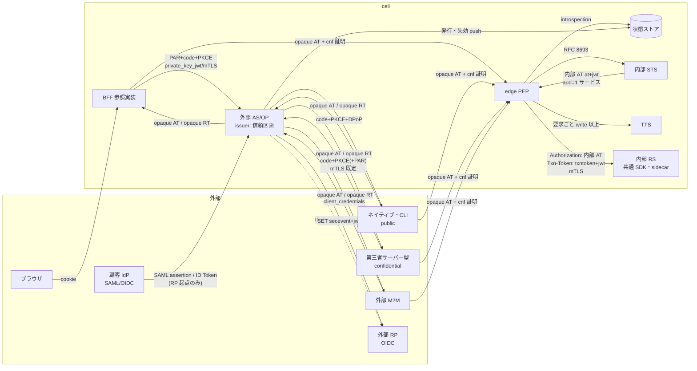
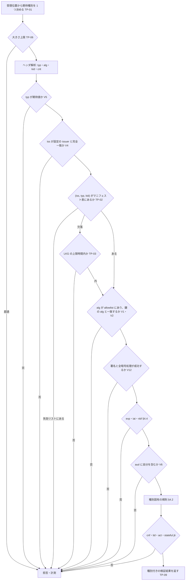
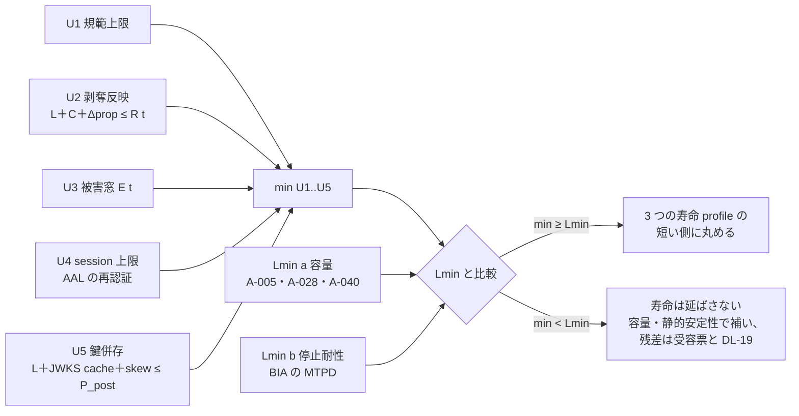

# OAuth/OIDC セキュリティ profile（token profile）

> 文書ID: ARC-02 / 版: 0.2 / 状態: review / 最終更新: 2026-10-15
> 対応要求: R-046, R-158, R-159, R-160, R-161, R-162, R-163, R-189（R-189.1, R-189.2, R-189.6）, R-239, R-240, R-249, R-251, R-259, R-270, R-283／G-087, G-088, G-138（全件と閉じ方は末尾の対応表）
> 依存文書: CONVENTIONS.md, traceability/deliverables.md（DL-16 行）, 05_adr/ADR-005-token-profile.md（正本）, 05_adr/ADR-020-fapi2-applicability.md, 05_adr/ADR-007-key-hierarchy-kms-hsm.md, 05_adr/ADR-015-crypto-agility-pqc.md, 05_adr/ADR-021-irreversible-identifiers.md, 05_adr/ADR-004-b2b-federation-linking-scim.md, 05_adr/ADR-006-revocation-continuous-evaluation.md, 05_adr/ADR-009-workload-identity-token-exchange.md, 05_adr/ADR-022-integration-contract-standards.md, 05_adr/reconciliation-notes.md, 01_governance/assumptions-register.md, 01_governance/business-impact-analysis.md, 01_governance/loss-scenarios.md, 01_governance/kri.md, 02_requirements/operation-risk-tiers-assurance.md, 03_threat-model/threat-catalog.md, 03_threat-model/attacker-model.md, 06_controls/applicability.md, 04_architecture/claims-catalog.md（ARC-15、並行作成）, research/RS-03, RS-04, RS-06, RS-11, RS-13, RS-17, research/standards-status.md
> 作成方法: AI エージェント（Claude）が、上記 ADR の決定を実装可能な profile に展開して起草した。決定の正本は ADR であり、本書は ADR に反する設計を置かない。ADR で未決の点は「未決（ADR-0xx）」と記す。research ノートにない原典（OIDC Back-Channel Logout 1.0、RFC 8417 §2.2・§2.3・§4、RFC 8725 §2・§3.2〜§3.4・§3.10〜§3.12、OIDC Core §3.1.3.7）は起草者が 2026-10-15 に取得して照合した。このうち RFC 8725 §2.1・§3.2・§3.4・§3.10〜§3.12、RFC 8417 §2.2・§2.3・§4.1〜§4.3、OIDC Back-Channel Logout 1.0 §2.4・§2.6・§4 は、作成者以外のレビュアー（AI エージェント）が同日に原典を再取得して照合した（末尾「レビュー記録」）。OIDC Core §3.1.3.7 の作成者以外による照合は未了である。本書の判断は自己レビューであり、実在の CTO/CISO の決裁ではない（CONVENTIONS §8）[D]。
> 表記: 本書の規則は TP-xx、負例ベクタは NV-xx、ライブラリ要件は LR-xx、寿命 profile は LP-x、決裁案は KP-x、新規仮定は NA-TP-x、ADR への指摘は AR-x と書く。ADR-005 の検証規則 V1〜V14、試験仮説 H-xx、決裁案 K-x はそのまま引く。表のセルのうちタグのないものは設計推論 [D] であり、本注記で個別タグに代える。規範を写すセルには個別にタグと脚注を付けた。

---

## 0. 結論（CTO/CISO 向け）

1. **準拠基準と準拠表**: RFC 9700（BCP 240、final）を OAuth の最低基準とし、規範文×適用条件の 39 行の準拠表（§9）を置いた [N][^1][D]。39 行に空欄はない [D]。現時点の判定は、採用 27・強化 8・条件付き 1・逸脱 1・非該当 2 で、MUST を含む行の非準拠は 0 件である [D]。ただし、As-Is に ROPC が残っていれば #18 が非準拠になり、期限付き受容票が要る（件数は未調査）[D]。SHOULD 系からの逸脱は 1 件（#23 end-to-end TLS の部分採用）である [D]。条件付きで逸脱になり得る行が 2 件ある（#14 内部束縛を I2 にした場合と既存 Bearer 連携、#20 既存 client_secret）[D]。RFC 9700 の外では、内部 JWT を ES256 に限ることが RFC 9068 §2.1 の RS256 MUST からの逸脱に当たり得る（当たるかは解釈に依存する。ADR-005 D8-3）。このため受容票（CISO）を起票する（§9.3 X-01）[N][^7][D]。
2. **token 種別の分離**: 9 種の token（ID Token、外部 access token、内部 access token、refresh token、transaction token、DPoP proof、logout token、SET、SAML assertion）と補助 3 種（認可コード、introspection 応答、client assertion）について、形式・typ・alg allowlist・iss/aud・寿命の決め方・sender constraint・受理位置を 1 表に固定した（§3）[D]。種別の取り違えは (iss, typ, 鍵族, aud の形, 必須／禁止 claim, 受理位置) の 6 軸で相互に排他にし、RFC 8725 §3.12 の MUST を満たす（§4.3）[N][^8][D]。logout token は仕様上 ID Token と同じ鍵で署名するため、鍵では区別できない [N][^21]。そこで typ（`logout+jwt`）・`events` の存在・`nonce` の禁止で区別する [N][^21][D]。
3. **寿命は一律値を置かない**: 寿命は種別×操作階層ごとに、規範上限 U1、剥奪反映 U2、被害窓 U3、session 上限 U4、鍵併存 U5 の最小値とし、容量・停止耐性の下限 Lmin と突き合わせて導く（ADR-005 D3）[D]。運用上は寿命 profile を 3 つ（LP-1 privileged・FAPI、LP-2 write、LP-3 read-sensitive）に丸める（§5）[D]。値は BIA の R(t)・E(t) と H-02・H-15 の実測に依存するので、すべて TBD である（所有者 CTO＋CISO、期限 G4、DL-20 で決裁）[D]。規範が上限を定めている箇所だけは上限として先に固定する（認可コード 60 秒以下など）[N][^2][D]。
4. **DPoP は単独では使わない**: DPoP は XSS 下の新規フローによる token 取得 [N][^5][^13]、端末からの鍵の持ち出し [N][^13]、A5 攻撃者による proof の再送と改変要求への流用 [N][^2] を防げない。このため BFF（第一者ブラウザは必須）、CSP、nonce 必須、cell 内の jti 共有ストア、短命化、ハードウェア保護鍵、条件付き rotation と併用し、privileged と FAPI 範囲では DPoP を使わず mTLS に限る（§7）[D]。
5. **FAPI 2.0 の範囲**: ADR-020 のとおり、F1〜F6 を confidential client から呼ぶ経路を層 F（FAPI 2.0 Security Profile 必須）とする [D]。層 F に当てはまるが FAPI を適用できない経路は層 H（FAPI 由来の個別統制）、その他は層 B（RFC 9700 準拠 profile）とする（§8）[D]。「FAPI 2.0 準拠」と表示するのは、層 F の deployment が OIDF 認定を取得した後に限る [N][^2][D]。
6. **検証可能性**: 共通 SDK・sidecar・edge の JWT 検証ライブラリに課す要件 LR-01〜LR-12 と、必須の負例ベクタ NV-01〜NV-58 を定めた（§10）[D]。G-088 の合格条件「全負例が拒否される」は、PoC（DL-22）・契約試験キット（DL-80）・CI の回帰試験で実測して閉じる。本書の時点では未実測である [D]。

---

## 1. 本書の位置付け

### 1.1 正本の関係

| 事項 | 正本 | 本書の役割 |
|---|---|---|
| opaque/JWT 境界、typ 分離、V1〜V14、寿命の決め方、refresh 保護、DPoP/mTLS の選択 | ADR-005 | 実装 profile（種別ごとの値・手順・負例）に展開する |
| FAPI 2.0 の必須範囲と固定値 | ADR-020 | 層 F/H/B を準拠表と client 種別表に写す |
| 鍵階層、(iss, typ, kid) → 許可鍵集合、JWKS の併存期間 | ADR-007 | kid-issuer 結合の検証手順に写す |
| alg の識別子・暗号 profile・PQ 移行の順序 | ADR-015 | alg allowlist の版管理に写す |
| issuer・sub・tid・client_id の形式、claim 名の規則 | ADR-021 | iss/aud 列の値の形を引く |
| claim の名前・型・必須性の一覧 | DL-75（schema）・DL-115（04_architecture/claims-catalog.md、ARC-15） | 本書は claim の名前を新たに定めない。種別の判別に使う claim だけを引き、詳細は ARC-15 に委ねる |
| 数値（寿命、時刻差、cache 齢、受理窓） | DL-20（07_slo/numeric-contracts.md） | 導出式・上限・所有者・決め方を渡す |
| SAML の検証手順 | ADR-004 D04-11・D04-14 | SAML assertion 行の検証規則を引く |
| 失効・継続評価、logout・SET の送受信 | ADR-006 | logout token と SET の受理位置と寿命を引く |

### 1.2 前提（A-ID）と新規仮定

| A-ID | 値（基準） | 本書での使い方 |
|---|---|---|
| A-005 | 同時アクティブ session 11.1 万 | refresh/秒の分子（Lmin） |
| A-006 | 有効 session 86.5 万 | refresh token ストアの件数 |
| A-013 | 外部 client 800・grant 3 万 | 第三者 client の種別表、opaque の便益 |
| A-015 | 複数テナント所属 3% | 1 token 1 テナント（R-283） |
| A-027 | access token 寿命 10 分（容量計算用の仮置き） | 感度表の基準点にのみ使う。決定値には使わない |
| A-028 | 下流 audience 6 | exchange/秒の分子（Lmin） |
| A-040 | edge API ピーク 16,804/秒 | DPoP jti ストア、要求 context の発行量 |
| A-043・A-044 | 発行 1,374/秒、introspection 2,521/秒 | 容量の下限 |
| A-080・A-081 | 規制業種 25%、高保証テナント 50 | 層 F の規模 |
| A-090・A-091 | 判定系・認証系の可用性帯（停止許容時間ではない） | Lmin(b) には使わない |
| A-103・A-104 | 暗号移行・製品置換 各 1 回以上 | alg・kid・opaque 形式の可逆性 |
| A-110 | 独自 session 105 サービス | BFF 移行対象 |
| A-114 | SAML 1,800・OIDC 200 接続 | SAML assertion の検証規模 |

**新規仮定（前提台帳へ追加要。本書から台帳は編集していない）**

| 仮 ID | 内容 | 扱い |
|---|---|---|
| NA-TP-1 | edge から最深の内部 hop までの要求処理時間の p99（transaction token の寿命の下限） | TBD（所有者 SRE 責任者、期限 G4、決め方 H-20 の実測） |
| NA-TP-2 | 顧客 IdP・外部 RP・外部 client と本基盤の時刻差の分布 | TBD（所有者 CTO、期限 G1 で As-Is を観測、G4 で確定） |
| NA-TP-3 | 本基盤を OP とする既存 RP のうち、typ 付き logout token・ES256 の ID Token を処理できない比率 | TBD（所有者 プロダクト責任者、期限 G1 の連携事業者調査） |
| NA-TP-4 | DPoP proof に ES256 以外の alg を要する client の比率 | TBD（所有者 プロダクト責任者、期限 G1） |

ADR-005 の NA-01（DPoP 受理窓 W。計算には 60 秒を使う）、NA-03（end-to-end mTLS を張れる第三者の比率）、NA-04（ハードウェア保護鍵を示せる端末の比率）も、前提台帳への追加が済んでいない [D]。

### 1.3 攻撃者モデル

- FAPI 2.0 Attacker Model は A1・A1a・A2・A3a・A5 を定義している [N][^3]（RS-04#50）。侵害された端末・ブラウザ、AS 上の RCE、誤設定 DB からの資格情報漏えい、JWKS 配布障害はモデルの範囲外である [N][^3]（RS-04#50）。
- 本書は FAPI の範囲外も扱う。token に直接関わる ATK-02・05・06・08・11・12・15・16・17・19 に統制を割り当てるのは ADR-005 §1.6 と同じである [D]。脅威は T-006（認可コード・redirect の悪用）、T-007（同意誘導）、T-008（step-up 鮮度の偽装）、T-013（BFF の token 保管）、T-014（token replay）、T-015（audience 誤用）、T-021（tenant confusion）、T-025（内部 context の偽造）、T-037・T-038（exchange による権限拡大・失効非連動）、T-040（未署名 token の受理）、T-041（署名鍵の窃取）、T-057（ログへの token 混入）、T-061（IdP mix-up）、T-069（連携事業者の token 大量窃取）、T-073（token の素通し）、T-083（claim の過剰開示）、T-085（暗号の危殆化）に対応する [D]。
- 主な損失シナリオは S-02（署名鍵・JWKS 侵害による token 偽造）、S-07（剥奪後の stale allow）、S-15（第三者連携 token の大量窃取）、S-03（顧客 IdP 侵害・IdP 追加によるテナント乗っ取り。本書は IdP mix-up〔T-061〕の経路を扱う）、S-14（AI エージェント濫用）である。関連する KRI は K-06、K-07、K-14、K-15、K-17 である [D]。

---

## 2. 全体像

- 外部に出す access token と refresh token はすべて opaque であり、JWT として外に出るのは ID Token、logout token、SET、（層 F の）introspection 応答だけである [D]（ADR-005 D1-1、D2）。
- 業務サービスが受け取る token は、内部 access token（`at+jwt`）と transaction token（`txntoken+jwt`）の 2 種類に限られる [D]（ADR-005 §6.4）。

---

## 3. token 種別 profile（一覧）

### 3.1 形式・typ・発行者・宛先・受理位置

| # | 種別 | 形式・typ | iss（発行者） | aud | 受理位置（ここ以外では拒否） | 正本 |
|---|---|---|---|---|---|---|
| K1 | ID Token（本基盤が OP として発行） | JWT。typ は要求しない（OIDC Core が typ を定めない）。発行時は typ を付けない | 外部 AS の issuer（信頼区画。U-01 未決） | RP の client_id | 外部 RP のみ。内部 RS・edge は V4・V5 で拒否 | ADR-005 D2、ADR-021 |
| K1' | ID Token（顧客 IdP から受領） | JWT（上流の形式） | 接続台帳に登録した上流 issuer（完全一致） | 本基盤の接続ごとの client_id | AS の federation adapter のみ | ADR-004 D04-10〜D04-12 |
| K2 | 外部 access token | opaque。128 bit 以上のエントロピー。先頭に版・種別・経路識別子 | 外部 AS（発行記録 ID で識別） | 同意した resource（RFC 8707） | edge のみ | ADR-005 D1-1、D10-2・D10-3 |
| K3 | 内部 access token | JWT、typ=`at+jwt` | 内部 issuer（外部 AS と別、cell ごと） | 呼出し先 1 サービス | 内部 RS（Authorization ヘッダ） | ADR-005 D1-4、V4 |
| K4 | refresh token | opaque（保存は hash のみ） | 外部 AS | — | AS token endpoint のみ | ADR-005 D2、D4 |
| K5 | transaction token（要求 context） | JWT、typ=`txntoken+jwt`（draft-11 準拠の社内 profile） | cell の TTS | trust domain（cell ごとの内部値） | 内部 RS（`Txn-Token` ヘッダのみ。Authorization ヘッダでは拒否） | ADR-005 D9-3、ADR-009 |
| K6 | DPoP proof | JWT、typ=`dpop+jwt` | なし（client が生成。`jwk` ヘッダで公開鍵を示す） | なし（`htm`・`htu` で要求に結合） | AS token endpoint・edge の `DPoP` ヘッダのみ | RFC 9449 §4.3 [N][^5] |
| K7 | logout token | JWT、typ=`logout+jwt`（発行時に付ける） | 外部 AS（ID Token と同じ issuer） | RP の client_id | 外部 RP の back-channel logout endpoint のみ | OIDC Back-Channel Logout §2.4 [N][^21]、ADR-006 D6-24 |
| K8 | SET | JWT、typ=`secevent+jwt` | 送信元（本基盤の送信者 issuer、または受信 stream に登録した送信者） | 受信者 | SSF 受信 endpoint のみ | RFC 8417 [N][^22]、ADR-006 |
| K9 | SAML assertion（顧客 IdP から受領） | XML（署名付き assertion） | 接続台帳の IdP entityID（完全一致） | 本基盤の接続ごとの SP entityID | AS の SAML adapter のみ。adapter の外へ assertion を渡さない | ADR-004 D04-14 |
| 補-1 | 認可コード | opaque、一回限り | 外部 AS | — | AS のみ | ADR-005 D2 |
| 補-2 | introspection 応答（層 F） | JWT、typ=`token-introspection+jwt` | 状態ストア | edge | edge のみ | RFC 9701 [N][^10]、ADR-020 D20-07-1 |
| 補-3 | client assertion（private_key_jwt） | JWT（typ は要求しない） | client（iss=sub=client_id） | AS の issuer 識別子（文字列。配列は拒否） | AS token endpoint・PAR endpoint のみ | FAPI 2.0 §5.3.2.1 [N][^2]（RS-04#42）、ADR-020 D20-06-3 |

- typ の強度: `at+jwt` は RFC 9068 で宣言が MUST であり、RS は `at+jwt` と `application/at+jwt` 以外を拒否しなければならない [N][^7]（RS-04#60）。`dpop+jwt` は RFC 9449 §4.3 の MUST である [N][^5]（RS-04#55）。`token-introspection+jwt` は RFC 9701 で定められ、RS は typ で置換攻撃を防がなければならない（MUST）[N][^10]（RS-04#68）。`secevent+jwt` について、RFC 8417 §2.3 は typ に含めてよい（MAY）とし、他の種類の JWT と取り違えられ得る文脈で使われる場合は含めることを MUST とする（値は `application/` を省いた `secevent+jwt` を推奨）[N][^22]。SSF 1.0 は SET の明示的な型付け（typ: secevent+jwt）を MUST とする [N][^46]（RS-04#77）。本基盤の SET は SSF で送受信するので、SSF の MUST が適用される [D]。`logout+jwt` は RECOMMENDED である [N][^21]。`txntoken+jwt` は draft-11 の MUST だが、draft であり規範根拠ではない [N][^20]（RS-06#31）。
- 本基盤は、RECOMMENDED・SHOULD のものを含め、発行するすべての JWT に typ を付ける（K1 と補-3 を除く）[D]。受理側は、K1・K1'・補-3 以外の JWT で typ がないものを拒否する（V5）[D]。ADR-005 V5 は「typ のない JWT は全種別で拒否する」と書くが、同じ ADR-005 D2 は ID Token に typ を要求しないとしており、上流 IdP の ID Token（K1'）と client assertion（補-3）には typ を付けさせる手段がない。本書の 3 種別の除外はこの矛盾を実装上で解いたものであり、ADR-005 側の文言修正を「ADR への指摘」AR-1 に記した [D]。

### 3.2 alg allowlist（検証側の版付き暗号 profile に置く値）

alg の許可集合は、検証側の版付き設定（ADR-015 の暗号 profile、CP）から (issuer 区分, typ) ごとに読む。token や issuer metadata からは読まない（V1）[D]。fully-specified の IANA 識別子だけを使い、多相的な `EdDSA` は採らない [N][^29][D]（RS-11#43、ADR-005 D10-4）。

| 種別 | 発行時の alg | 受理する alg（層 B） | 受理する alg（層 F） | 根拠・備考 |
|---|---|---|---|---|
| K1 ID Token（発行） | client 登録の `id_token_signed_response_alg`。RS256 鍵と ES256 鍵を別の鍵として並行公開する | —（RP 側の検証） | ES256 または PS256 で登録させる。RS256 の ID Token は出さない | OIDC Core §15.1 は OP に RS256 対応を求める [N][^23]。ADR-007 D7-61、ADR-020 D20-08-4。既定値の選び方は KP-1（未決）。ただし ADR-007 D7-61・ADR-015 CP v1 が並行公開するのは RS256 鍵と ES256 鍵だけで、PS256 の ID Token 鍵（1 鍵 1 alg）は鍵目録（ARC-03 §4 族 1）にない。層 F の client に PS256 を許すかは未決（ADR-020 D20-08-4／ADR-007 D7-61・ADR-015 CP v1。architecture-reconciliation-notes.md XR-04）で、決まるまで層 F の client には ES256 で登録させる |
| K1' ID Token（受領） | — | 接続台帳に登録した alg だけ（RS256・ES256・PS256 から接続ごとに選ぶ）。`none` と HMAC 系は拒否 | 同左 | HMAC 系を拒否するのは、新規 client に client_secret を認めない方針（ADR-005 D7-1）に合わせた自社判断 [D] |
| K3 内部 access token | ES256 | ES256。RS256 の検証は SDK に実装するが既定は無効 | ES256 のみ。RS256 は有効化できないよう固定する | ADR-005 D8-3、ADR-020 D20-08-2。RFC 9068 §2.1 の RS256 MUST からの逸脱（§9.3）。PQ 化は ADR-015 段 3 のとおり ML-DSA-44 を初期候補、ML-DSA-65 を上限側の試験対象とし、H-19（ADR-005 は ML-DSA-65 で記述）と ADR-015 の段 0 演習で確かめる [N][^30]（ADR-005 H-19 と ADR-015 の初期候補の差は architecture-reconciliation-notes.md XR-06） |
| K5 transaction token | ES256（専用鍵族 3b） | ES256 | ES256 | ADR-007 D7-10 族 3b |
| K6 DPoP proof | client が生成 | ES256 | ES256 | RFC 9449 §4.3 は、登録済みの非対称 alg で、`none` でなく、ローカルポリシーが許すものに限る（MUST）[N][^5]（RS-04#55）。PS256 を加えるかは NA-TP-4 の調査後に決める（可逆）[D] |
| K7 logout token | ID Token と同じ鍵・alg（client 登録の alg） | — | ES256 または PS256 | 「Logout Token の署名・暗号化には ID Token と同じ鍵を使う」[N][^21]。`none` は使ってはならない（MUST NOT）[N][^21] |
| K8 SET（発行） | ES256（鍵族 4） | 受信 stream に登録した alg | 同左 | ADR-007 D7-10 族 4 |
| K9 SAML assertion | — | SHA-256 系の XML 署名。SHA-1 の署名は検証だけを 2030 年末まで（計画値）許し、新規接続では受理しない | SHA-1 を受理しない | SP 800-131A Rev.3 ipd は、SHA-1 による署名生成を disallow とし、署名検証は legacy use として許容する（ipd、未確定）[N][^37]（RS-11#13, #14）。ADR-015 段 6 |
| 補-2 introspection 応答 | ES256（鍵族 5） | — | ES256 | ADR-020 D20-07-1 |
| 補-3 client assertion | client が生成 | ES256・PS256 | ES256・PS256 | ADR-020 D20-08-3 |

- 共通: 1 鍵 1 alg（MUST）とし、kid で引いた鍵の alg と JWS ヘッダの alg が一致しない場合は拒否する [N][^8]（RS-04#62、RS-11#51）。FAPI 2.0 は JWT の作成・処理に使う alg を PS256・ES256・EdDSA（Ed25519）に限る（shall）[N][^2]（RS-04#47）。本基盤の層 F はその部分集合（ES256、client 由来の JWT に限り PS256）だけを使う [D]（ADR-020 D20-08-3。部分集合への限定が FAPI の mandatory な振る舞いの除去に当たらないことは TC-20-01 で確かめる）。

---

## 4. 検証規則

### 4.1 共通規則（ADR-005 V1〜V14 の実装 profile）

ADR-005 V1〜V14 を、共通 SDK・sidecar・edge が利用側で無効化できない既定動作として実装する [D]。Storm-0558 では、開発者がライブラリが完全な検証を行うと誤認し、issuer・scope の検証を追加していなかった [I][^35]（RS-12#5）。本書が追加する規則は次のとおりである。

| ID | 規則 | 強度・根拠 |
|---|---|---|
| TP-01 | **受理位置で期待種別を決める**: 検証器は、token を受け取ったヘッダ・パラメータ（Authorization、DPoP、Txn-Token、`logout_token` パラメータ、SET の push 本文、SAMLResponse）から期待種別をちょうど 1 つ決め、その種別の規則だけで検証する。token の中身から種別を推測しない | RFC 8725 §3.12 の相互排他（MUST）を実装する手段 [N][^8][D] |
| TP-02 | **(iss, typ, kid) → 許可鍵集合**: 内部の検証点は、L1 が署名した鍵マニフェストを pin で検証した後、表にない (iss, typ, kid) の組を拒否する。外部 issuer の JWT（K1'・補-3、および外部 RP 向け契約で示す K1・K7 の検証）は、issuer metadata（または登録した `jwks_uri`）の鍵集合だけから鍵を取る。未知の kid を受けたら JWKS を 1 回だけ取り直し、取り直し後も無ければ拒否する。取り直しの頻度には上限を置く（値は TBD、所有者 CTO、期限 G3、DL-20）。`jku`・`x5u`・`x5c`・埋込み `jwk`（K6 を除く）は辿らず、使わない | 鍵と issuer の結合は RFC 8725 §3.8 の MUST [N][^8]。ADR-007 D7-21。未知 kid の取り直し規則は ADR-022 の OIDC/OAuth profile（GA 範囲）による。jku・x5u を盲目的に辿ると SSRF の危険がある（RFC 8725 §3.10 は対策を SHOULD とする）[N][^8] |
| TP-03 | **kid の欠落と失効を区別する**: JWKS・マニフェストから kid が欠落した場合は、last known good を上限時間（R-189.6）まで使う。署名付き失効 kid リストに載った kid は直ちに拒否する | ADR-007 D7-36、ADR-006 D6-20 [D] |
| TP-04 | **kid は不透明値として扱う**: kid を DB 検索・ファイルパス・URL の組立てに使わず、マニフェスト表の完全一致の照合だけに使う。kid は JWK Set の中で一意にする | RFC 8725 §3.10 は kid による SQL・LDAP injection に注意を促す（小文字の should で、BCP 14 キーワードではない）[N][^8]。JWK Set 内の kid は互いに異なるべき（SHOULD）[N][^42]（RS-11#52）。FAPI 2.0 も同じ kid の鍵を複数含めるべきでない（should not）とする [N][^2]（RS-04#47）。ADR-007 D7-23 |
| TP-05 | **時刻規則は種別ごとに方向を分ける**（§4.4） | ADR-005 V7・D13-3 [D] |
| TP-06 | **入力の大きさに上限を置く**: ヘッダ・JWT の最大長を種別ごとに設定し、超えたら署名検証の前に拒否する。上限は PQ 署名後の大きさ（ML-DSA-65 の JWT は計算上約 5,031 文字、DPoP proof は約 8,222 文字。RS-11#62）を下回らない値にする | 自社判断 [D]。初期値は ADR-015 D15-40 の初期案（内部 JWT 1 個 6,144 byte、認証系ヘッダ合計 16,384 byte、cookie に JWT を置かない、外部 opaque token の最大長は ML-DSA-87 JWT の約 6,789 文字以上。ARC-12 §7.4 と同じ）とし、確定値は TBD（所有者 CTO、期限 G3、DL-75 と DL-20） |
| TP-07 | **暗号入力の検証**: ES256 の公開鍵（特に client が送る K6 の `jwk`）は、受け取った時点で P-256 の曲線上の点であることを検証する | 自社判断 [D]。RFC 8725 §3.4 が MUST とする SP 800-56A Rev.3 §5.6.2.3.4 の検証は、ECDH-ES などの鍵合意の入力（epk）に対する規定であり、ECDSA の署名検証に直接の規定はない [N][^8]。攻撃者が鍵を選べる K6 に同じ検証を準用する |
| TP-08 | **未知のヘッダ・claim**: `crit` に未理解の拡張がある JWS は無効にする。理解できない claim は無視する。このため制約を強める変更は未知 claim で表さず、typ・profile 版か crit で表す（V13） | RFC 7515 §4.1.11 [N][^28]（RS-16#16）。RFC 7519 §4 は理解できない claim を無視しなければならない（MUST）とする [N][^27]（RS-16#14） |
| TP-09 | **検証結果を種別付きで返す**: SDK は検証済み token を「種別・issuer・profile 版」を持つ型で返し、利用側が別種別として誤用できないようにする | 自社判断 [D] |
| TP-10 | **独自検証の禁止**: 共通 SDK・sidecar・edge 以外の JWT 検証実装を CI で検出して拒否する。例外は受容票で扱う | ADR-005 D2（G-072）、K-06 |

### 4.2 種別ごとの検証規則

| 種別 | 検証規則（すべて満たさなければ拒否） | 主な根拠 |
|---|---|---|
| K1' ID Token（受領） | (1) iss が、その認可要求で保存した送信先 issuer と完全一致する（RFC 9207 の `iss` とも一致する）。(2) aud に自 client_id を含む。aud が複数で `azp` があれば `azp` が自 client_id である。(3) alg が接続台帳の許可集合にあり、鍵はその issuer の `jwks_uri` から取る。(4) exp が現在時刻より後である（時刻差は §4.4）。(5) 要求に入れた nonce と一致し、再利用でない。(6) `events` claim を持たない（logout token・SET の流用を拒否）。(7) acr・amr・auth_time を、要求した値と max_age に照らして確かめる。情報がなければ最も弱い方式とみなす。(8) 連携 ID は (iss, sub)（Entra は tid＋oid）に限り、email で結合しない | OIDC Core §3.1.3.7 は iss の完全一致、aud への client_id の包含、exp を MUST とし、nonce を送った場合は nonce の存在と値の検査を MUST、azp・acr・auth_time の検査を SHOULD とする [N][^23]。SP 800-63C-4 は RP に、署名・発行者・時刻・audience・nonce・xAL・再送でないことの検証を求める（SHALL）[N][^25]（RS-03#51）。(6) は RFC 8417 §4.3 の緩和策（events を持つ JWT を拒否する）を採ったもの（キーワードなし）[N][^22][D]。ADR-004 D04-11・D04-12 |
| K2 外部 access token | (1) 受理位置は edge だけ。query の token は拒否する。(2) 状態ストアに introspection（client 認証付き）で照会し、active・exp・aud（resource）・scope・cnf・tid・profile を得る。cache は応答の exp を超えない。(3) cnf があれば、mTLS 証明書の `x5t#S256`、または DPoP proof の `jkt`・`ath` と照合する。DPoP 束縛の token が Bearer で来たら拒否する。(4) 層 F の操作には、FAPI profile で発行された token だけを受理する | RFC 7662 は introspection に認可を要求し（MUST）、cache が exp を超えることを禁じる（MUST NOT）[N][^9]（RS-04#67）。RFC 9449 §7.2 [N][^5]、RFC 8705 [N][^6]（RS-04#58, #59）。ADR-020 D20-03-3 |
| K3 内部 access token | V1〜V14 の全規則。加えて、(1) iss は内部 issuer（cell ごと）と完全一致する。(2) typ が `at+jwt`／`application/at+jwt` である。(3) aud に自サービスを含み、共通 aud は拒否する。(4) cnf の `x5t#S256` が呼出し元の mTLS 証明書と一致する（I1）。(5) tid は 1 つだけで、資源から導いたテナントと一致する。(6) `act` で判定に使うのは現在の actor だけにする。(7) privileged・break-glass/B・層 F では、jti を発行台帳と毎要求照合する（stateful）。台帳にない jti は拒否し、警報を出す | RFC 9068 §4 の検証（MUST）[N][^7]（RS-04#60）。RFC 8693 の act の扱い（MUST）[N][^12]（RS-04#66）。CSRB は stateful token を偽造検知の仕組みの例に挙げた [I][^36]（RS-12#11）。ADR-005 D1-6、ADR-021 D21-07 |
| K4 refresh token | (1) AS token endpoint でだけ受理する。(2) 発行先 client との結合を確かめる（confidential は client 認証、public は DPoP 鍵）。(3) scope・resource は発行時の同意を超えない。(4) rotation 対象では、使用済みの値が再提示されたら grant の全 token を失効させる。(5) 非活動失効と最大寿命（§5）を超えたら拒否する | RFC 6749 §10.4（MUST）[N][^1]（RS-04#70）、RFC 9700 §4.14.2 [N][^1]（RS-04#35〜#38）、RFC 9449 §5（MUST）[N][^5]（RS-04#57） |
| K5 transaction token | (1) `Txn-Token` ヘッダでだけ受理する。(2) iss は同じ cell の TTS、aud は trust domain の値、typ は `txntoken+jwt`。(3) 同じ要求の内部 access token と、sub・tid・内部 token 系譜の jti が整合する。(4) 呼出し元の認証は mTLS で別に行い、transaction token だけを信頼の根拠にしない。(5) token 全体をログに残さず、txn と hash だけを記録する | draft-11 は replay 耐性がないことと、認証資格情報として使うこと（MUST NOT）、全体のログ記録（MUST NOT）を述べる（draft）[N][^20]（RS-06#36, #41）。ADR-005 D9-3 |
| K6 DPoP proof | (1) `DPoP` ヘッダがちょうど 1 つ。(2) typ が `dpop+jwt`。(3) alg が許可集合にあり `none` でない。(4) `jwk` の公開鍵で署名を検証でき、`jwk` に秘密鍵を含まない。(5) `htm`・`htu` が実際の要求と一致する。(6) nonce を提供済みなら nonce が一致する（nonce のない proof は拒否）。(7) `iat` が受理窓 W の内側にある。(8) `jti` が W の間に未使用である（cell 内共有ストア）。(9) access token と一緒なら、`ath` が token の hash と一致し、鍵が token の `cnf.jkt` と一致する | RFC 9449 §4.3 の全項目（MUST）、§11.1〜§11.3 [N][^5]（RS-04#55, #56） |
| K7 logout token（本基盤が発行） | 発行側の規則: iss・aud・iat・exp・jti・`events`（`http://schemas.openid.net/event/backchannel-logout`）を必ず入れ、sub か sid の少なくとも一方を入れ、`nonce` は入れない。typ は `logout+jwt`。RP 側に求める検証（契約に書く）: 署名・alg・iss・aud・iat・exp を ID Token と同様に検証し、sub か sid の存在、`events` の存在、`nonce` の不存在を確かめ、jti の再受理を拒否する | OIDC Back-Channel Logout §2.4・§2.6 [N][^21]。jti の再受理検査は仕様では任意（Optionally）であり、契約で必須にするのは自社判断 [D] |
| K8 SET（受領） | (1) SSF 受信 endpoint でだけ受理する。(2) typ が `secevent+jwt`。(3) iss・aud・鍵は受信 stream の登録値と一致する。(4) `events` を持ち、1 つの論理事象だけを表す。(5) `exp` を持たない（ID Token への流用を防ぐ）。(6) jti を feed の中で一意として扱い、重複を処理しない。(7) 検証できない SET は処理しない | RFC 8417 §2.2・§2.3・§4.1 [N][^22]。§4.1 は、ID Token と取り違えられ得る SET の profile に exp を含めないことを MUST とする [N][^22]。typ の検査は SSF 1.0 の MUST [N][^46]（RS-04#77）。検証できない SET を処理しないのは ADR-006 D6-23 の受信規則。試験は ADR-006 H6-09 |
| K9 SAML assertion | (1) RP 起点だけを受理し、InResponseTo が本基盤の送った AuthnRequest の ID と一致し、送信した接続と受信した ACS の接続が一致する。(2) assertion への署名を必須にし、Response だけに署名した応答は拒否する。(3) 発行者は接続台帳の IdP entityID と完全一致、audience は接続ごとの SP entityID である。(4) NotBefore・NotOnOrAfter を時刻差の範囲（§4.4）で検査する。(5) assertion ID を NotOnOrAfter まで記録し、再送を拒否する。(6) 外部 subject は persistent NameID か trust agreement で指定した不変属性から取り、email 形式の NameID は使わない。(7) XML Signature Wrapping の既知型とパーサ差分型を拒否する（回帰試験に常設） | SAML Profiles は、要求への応答で InResponseTo の一致を SP に求める（MUST）[N][^26]（RS-03#52）。SP 800-63C-4 は FAL2 で RP 起点を求める（SHALL）[N][^25]（RS-03#49）。XSW は 2012 年の評価で 14 framework 中 11 に見つかった [M][^38]（RS-11#74）。ruby-saml の CVE-2024-45409・CVE-2025-25291 [I][^39]（RS-11#75）。ADR-004 D04-06・D04-14 |
| 補-2 introspection 応答 | typ が `token-introspection+jwt`、iss が状態ストア、aud が edge。access token として提示されたら拒否する | RFC 9701 [N][^10]（RS-04#68） |
| 補-3 client assertion | aud は AS の issuer 識別子の文字列（配列は拒否）。iss=sub=client_id。鍵は登録された `jwks_uri` から取る。jti の再利用を拒否する | FAPI 2.0 §5.3.2.1・§5.3.3 [N][^2]（RS-04#42, #44）、ADR-020 D20-06-3・D20-06-4 |

### 4.3 種別間の相互排他

RFC 8725 §3.12 は、同じ issuer が複数種類の JWT を発行する場合、種類ごとの検証規則を互いに排他にすることを求めている（MUST）[N][^8]（RS-04#62）。手段として、明示的な型付け、必須 claim の違い、鍵の違い、aud の違い、issuer の違いが挙げられている [N][^8]。本書では 6 つの軸を使い、どの 2 種別の組でも 2 軸以上が異なるようにする [D]。

| 種別 | iss | typ | 鍵族（ADR-007 D7-10） | aud の形 | 判別に使う必須／禁止 claim | 受理位置 |
|---|---|---|---|---|---|---|
| K1 ID Token | 外部 AS | なし | 族 1 | RP の client_id | `nonce`（要求に入れた場合は必須）。`events` は禁止 | 外部 RP |
| K3 内部 AT | 内部 issuer（cell） | `at+jwt` | 族 3 | サービス識別子 1 つ | `client_id`・`jti`・`scope` が必須 | Authorization ヘッダ |
| K5 transaction token | TTS（cell） | `txntoken+jwt` | 族 3b | trust domain | `txn`・`tctx` が必須 | Txn-Token ヘッダ |
| K6 DPoP proof | なし | `dpop+jwt` | client の鍵（`jwk`） | なし | `htm`・`htu`・`jti` が必須 | DPoP ヘッダ |
| K7 logout token | 外部 AS | `logout+jwt` | 族 1（ID Token と共有） | RP の client_id | `events` が必須。`nonce` は禁止 | back-channel logout endpoint |
| K8 SET | 送信者 | `secevent+jwt` | 族 4 | 受信者 | `events` が必須。`exp` は禁止 | SSF 受信 endpoint |
| 補-2 introspection 応答 | 状態ストア | `token-introspection+jwt` | 族 5 | edge | `token_introspection` 応答本体 | edge 内部 |
| 補-3 client assertion | client | なし | client の鍵 | AS の issuer | `iss`=`sub`=client_id | token・PAR endpoint |

- **K1 と K7（同じ issuer・同じ鍵）**: 鍵と issuer では区別できない [N][^21]。区別は typ（K7 にだけ付く）、`events`（K7 は必須、K1 は禁止）、`nonce`（K7 は禁止）、受理位置で行う [N][^21][D]。仕様は、logout token を ID Token として流用する攻撃を防ぐために nonce を禁止したと説明している [N][^21]。この鍵の共有は仕様の要求であり、ADR-005 V2（1 鍵 1 alg 1 種別）と D2 の相互排他（iss・typ・鍵集合・aud の形の 4 要素を種別ごとに異ならせる）を K1 と K7 の組では満たせない。本書はこの組に限り typ・必須／禁止 claim・受理位置の 3 軸で排他にし、ADR 側の例外の明記を「ADR への指摘」AR-2 に記した [D]。
- **K1 と K8**: RFC 8417 §4.1 は、typ だけでは ID Token と SET を区別できないと述べている [N][^22]。このため本基盤の SET は `exp` を持たず、鍵族も分ける [N][^22][D]。
- **K1 と K3**: RFC 9068 §5 は、ID Token と access token を別の鍵で署名しても鍵漏えいへの防御にはならないとする [N][^7]（RS-04#61）。このため鍵だけに頼らず、issuer（外部 AS と内部 issuer）と typ を分ける（V4・V5）[D]。
- **K3 と K5**: 同じ cell の内部要素が発行するので、鍵族（3 と 3b）、typ、受理ヘッダの 3 軸で分ける [D]（ADR-007 D7-10 の整合調整 C-22）。
- **SAML（K9）**: JWT と構文が異なり、SAML adapter の外へ出ないので、他の種別との取り違えは adapter の境界で止まる [D]（ADR-004 D04-14）。

### 4.4 時刻と clock skew

| 種別 | exp | iat / nbf（未来方向） | iat（過去方向） | 許容時刻差 |
|---|---|---|---|---|
| K3 内部 AT | 必須。現在時刻より後 | 未来方向の差が S_int 以内なら受理し、超えたら拒否 | 拒否理由にしない（有効期間は exp で律する） | S_int: 初期値 10 秒、上限 60 秒（ADR-005 V7）。確定値は DL-20 |
| K5 transaction token | 必須 | K3 と同じ | 拒否理由にしない | S_int |
| K1' ID Token（受領） | 必須 | 未来方向の差が S_ext 以内なら受理 | ログイン応答の受理窓（KP-2）を超えて古いものは拒否 | S_ext: TBD。OIDC Core は「通常は数分以内の小さな余裕」を許す（MAY）[N][^23]。NA-TP-2 の観測から決める |
| K9 SAML assertion | NotOnOrAfter | NotBefore を S_ext で検査 | assertion ID の再送記録で律する | S_ext |
| K6 DPoP proof | なし | iat が [now−W, now+S_dpop] | W を超えたら拒否 | W と S_dpop は TBD（NA-01、H-05）。RFC 9449 は秒〜分の単位を求める（MUST）[N][^5]（RS-04#56） |
| K7 logout token（発行） | 必須。発行から 2 分以内 | — | — | Back-Channel Logout §4 は、replay を防ぐため exp を短く、望ましくは 2 分以内にするよう OP に勧めている（BCP 14 キーワードではない "encouraged"）[N][^21]。本基盤はこれを上限として採る [D] |
| K8 SET（受領） | 持たない | iat を S_ext で検査 | 受信の受理窓は ADR-006 の受信 profile で決める | — |
| 補-3 client assertion | 必須 | 未来 0〜10 秒は受理、60 秒超は拒否 | jti の記録期間で律する | FAPI 2.0 §5.3.2.1（shall）を全 client に適用する [N][^2]（RS-04#42）[D] |

- FAPI の「未来 10 秒は受理・60 秒超は拒否」は、AS が受け取る JWT への規定である [N][^2]。それを内部 RS の未来方向の許容に準用するのは自社判断である（ADR-005 V7）[D]。
- 時刻差の値（R-189.2）は、NA-TP-2 の観測と H-05 の拒否率で決める（所有者 CTO＋SRE 責任者、期限 G4、DL-20）[D]。値が決まるまで、本書の S_int の初期値は ADR-005 V7 のものを使う [D]。

### 4.5 検証の流れ（共通 SDK・sidecar・edge）

---

## 5. 寿命（一律値を置かない）

### 5.1 導出の枠組み

ADR-005 D3 の枠組みをそのまま使う [D]。寿命 L(k,t) は、種別 k と操作階層 t の組ごとに、上限 U1〜U5 の最小値とし、下限 Lmin と突き合わせる [D]。

- 下限が上限を上回っても寿命は延ばさない。障害時だけ寿命を延ばす grace も設けない [D]（ADR-005 D3）。
- 寿命は、その token の aud と scope で到達できる操作のうち最上位の階層（high-water mark）で決める [D]。
- テナントは寿命を短くする設定だけができる（G-115）[D]。

### 5.2 寿命 profile（3 種類）

| profile | 適用する操作階層 | 支配的な上限（見込み） | 値 |
|---|---|---|---|
| LP-1 | privileged（/T、/P のうち OAuth 経由のもの）、break-glass/B、層 F | U2（stateful 照合が失効状態も返す場合に限り、剥奪反映を寿命から切り離せる。§5.3 K3）、U4（privileged/P・break-glass/P は AAL3 で全体 12h 以内 SHALL・無操作 15 分以内 SHOULD。privileged/T は AAL2 で全体の上限 SHALL・24h 以内 SHOULD・無操作 1h 以内 SHOULD）[N][^24]（RS-03#43）。階層と AAL の対応は operation-risk-tiers-assurance.md §3.1 | TBD |
| LP-2 | write | U2、U3 | TBD |
| LP-3 | read-sensitive（public は token 不要） | U4、Lmin(a) | TBD |

- 値の所有者は CTO＋CISO、期限は G4、決め方は BIA の R(t)・E(t)（ADR-005 K-2）と H-02・H-15・H-24 の実測から DL-20 で決裁する [D]。break-glass/P は本基盤の AS に依存しない経路なので、本書の profile の対象外である（ADR-020 D20-02）[D]。

### 5.3 種別ごとの導出

| 種別 | 寿命を決める式・上限 | 規範上限（U1） | 操作階層への依存 | 決め方・所有者 |
|---|---|---|---|---|
| 認可コード | ≤ U1。token 要求までの往復＋時刻差を下回らない | 60 秒以下（FAPI shall。全 client に拡張）[N][^2]（RS-04#42） | なし | 上限内の値を DL-20（CTO、G3） |
| PAR request_uri | ≤ U1 | 600 秒未満（FAPI shall）[N][^2]（RS-04#43） | 層 F | DL-20（CTO、G4） |
| K2 外部 access token | 毎回照会なので剥奪の速さは C(t)＋Δprop ≤ R(t) で決まり、L_ext は剥奪を律しない（U2'）。L_ext は U4 と Lmin(a)（refresh/秒＝A-005÷L_ext ≤ AS 容量）で決める | DPoP 束縛で nonce を使わない配備では長寿命にすべきでない（SHOULD NOT）[N][^5]。本基盤は nonce 必須 | LP-1〜LP-3 | H-02・H-24（CTO＋CISO、G4） |
| K3 内部 access token | 照会しない経路は L_int＋C(t)＋Δprop ≤ R(t)（U2。RFC 7009 は短命化で失効後の使用時間を制限する設計を挙げる [N][^11]、RS-04#69）。L_int＋JWKS cache 最大齢＋S_int ≤ P_post（U5）。exchange/秒＝A-005×A-028÷L_int ≤ STS 容量（Lmin(a)） | なし | LP-1 は、stateful 照合（ADR-005 D1-6）が発行台帳の有無だけでなく失効状態も返す場合に限り U2 から外れる。ADR-005 D1-6 は偽造検知を目的とし、失効状態を返すかを明記していない（未決。「ADR への指摘」AR-4）。決まるまでは LP-1 にも U2 を適用する。LP-2・LP-3 は U2 が支配 | 同上 |
| K4 refresh token | 絶対寿命と無操作上限は主体の AAL の再認証上限以下（U4）。token の更新で session を延長しない。第三者 grant は scope のリスク区分ごとの grant 寿命（ADR-005 D7-4） | AAL2: 全体の上限を設ける（SHALL）・24h 以内（SHOULD）・無操作 1h 以内（SHOULD）。AAL3: 全体 12h 以内（SHALL）・無操作 15 分以内（SHOULD）[N][^24]（RS-03#43）。ブラウザ向けは最大寿命か非活動失効を設け（MUST）、rotation で延長しない（MUST NOT）[N][^13]（RS-04#74）。PSD2 の支払口座アクセスは無操作 5 分以下 [N][^33]（RS-13#39） | 主体と client が到達できる最上位の階層 | REQ03-D6（プロダクト責任者＋CISO、G1 で案、G4 で DL-20） |
| K1 ID Token（発行） | RP がログイン時に 1 回だけ使う。L_id ≥ token 応答の転送時間＋S_ext。上限は assertion の再利用を抑える観点で決める | 規範上の数値はない。assertion は有効期間を含まなければならない（SHALL）[N][^25]（RS-03#51） | なし | NA-TP-2 の観測後に DL-20（CTO、G3） |
| K5 transaction token | NA-TP-1（要求処理の p99）≤ L_txn ≤ 対応する K3 の残り寿命 | 短命にしなければならない（draft の MUST）[N][^20]（RS-06#36） | write 以上で発行（U-02 未決） | H-20（SRE 責任者、G4） |
| K6 DPoP proof | 受理窓 W ≥ 2×S_dpop＋網の遅延。jti ストアは 16,804/秒×W 件（W=60 秒で約 101 万件、計算用）[A-040][NA-01] | 秒〜分（MUST）[N][^5]（RS-04#56） | なし | H-05（CTO、G4） |
| K7 logout token | ≤ 2 分（§4.4） | "encouraged" の推奨 [N][^21] | なし | 本書で上限を固定。値は DL-20 |
| K8 SET | exp を持たない。受信側の受理窓と jti の重複排除で律する | exp の使用は NOT RECOMMENDED [N][^22] | なし | ADR-006 の受信 profile |
| K9 SAML assertion | 上流 IdP が決める。本基盤は NotOnOrAfter と再送記録で受理を限る | — | なし | ADR-004 |
| 補-2 introspection 応答 | 応答ごと。edge の cache は token の exp を超えない | MUST NOT（cache が exp を超えること）[N][^9]（RS-04#67） | 層 F | — |

**感度（決定値ではない。ADR-005 D3 と同じ計算）** [D][A-005, A-028]

| 寿命 | refresh/秒（A-005÷L_ext） | exchange/秒（A-005×6÷L_int） |
|---|---|---|
| 2 分 | 927 | 5,560 |
| 5 分 | 371 | 2,224 |
| 10 分（A-027、容量計算用の仮置き） | 185 | 1,112 |
| 30 分 | 62 | 371 |

### 5.4 鍵の rotation と JWKS cache（R-189.6）

| 量 | 式 | 値 |
|---|---|---|
| 事前公開 P_pre | ≥ JWKS cache の最大齢＋余裕 | 外部 issuer の初期案 7 日、内部は全 cell の鍵マニフェスト受信 ack を署名開始の条件にする（ADR-007 D7-34） |
| 退役後の公開保持 P_post | ≥ token の最大寿命＋JWKS cache の最大齢＋時刻差の上限 | 初期案 7 日（ADR-007 D7-34） |
| 内部の JWKS（マニフェスト）cache の最大齢 | LKG の上限時間。欠落と失効を区別する（TP-03） | TBD（BIA、DL-20。所有者 CISO＋SRE 責任者、期限 G4） |
| 外部 RP の JWKS cache | 本基盤から制御できない。連携契約で Cache-Control の尊重を求める | ADR-007 N7-3・RR7-02、G-106 |

- U5 により、K3 の寿命を延ばすと P_post が伸び、旧鍵の併存が長くなる [D]。Azure AD 2021-03 の鍵誤削除障害は、撤去の安全条件を寿命と結び付ける理由である [I][^40]（RS-12#57）。

---

## 6. client 種別ごとの grant・認証方式

| client 種別 | 許す grant | client 認証 | sender constraint | refresh token | 層 F | 根拠 |
|---|---|---|---|---|---|---|
| C1 第一者 BFF（confidential） | authorization_code＋PKCE S256＋PAR | private_key_jwt（既定）か mTLS（tls_client_auth） | BFF→edge は mTLS | 発行。client 認証で束縛、rotation なし、AS session に連動 | 対象 | ADR-005 D4・D6-2、ADR-020 D20-04。BFF は confidential client として認可コードを使う（MUST）[N][^13]（RS-04#74） |
| C2 第一者ネイティブ・CLI（public） | authorization_code＋PKCE S256。device authorization grant は業務 API で既定無効 | なし（public） | DPoP＋nonce 必須。`dpop_jkt` で認可コードを束縛 | 発行。DPoP 鍵に束縛（必須）。ハードウェア保護鍵を示せない端末は rotation を併用 | F1〜F6 の scope を発行しない（例外は層 H で受容票） | RFC 9449 §5・§10（MUST）[N][^5]（RS-04#57, #58）。RFC 10027 は機微・高価値の資源では device code を避けるよう述べ、実装前のリスク評価を MUST とする [N][^32]（RS-13#57）。device grant の既定無効は ADR-005 D7-7。ADR-020 D20-04-1。DPoP を実装できない既存ネイティブは rotation を使い、期限付き受容票で扱う（ADR-005 D4） |
| C3 第三者・顧客自作のサーバー型（confidential） | authorization_code＋PKCE S256。層 F では client 認証付き PAR 必須、層 B では推奨 | private_key_jwt か mTLS。新規登録で client_secret を認めない | mTLS 既定。end-to-end mTLS を張れない相手に限り DPoP＋nonce（K-3、K20-2 の決裁による） | 発行。client 認証で束縛、rotation なし。grant の非活動失効・絶対寿命・定期再承認 | F3 などが対象 | ADR-005 D5・D7、ADR-020 D20-05 |
| C4 第三者のブラウザ内 client（public） | authorization_code＋PKCE S256。低リスク scope に限り受容票付き | なし | DPoP | 発行。DPoP＋rotation、最大寿命。rotation で寿命を延ばさない | 発行しない（例外なし） | ADR-005 D6-3、RFC 10017 [N][^13]（RS-04#74） |
| C5 外部 M2M | client_credentials | private_key_jwt か mTLS | mTLS | 発行しない | 対象。ただし client credentials grant は FAPI の詳細解析を経ていないことを準拠表に記す | FAPI 2.0 §5.3.2.1 NOTE 2 [N][^2]（RS-04#48） |
| C6 外部 RP（本基盤を OP とする OIDC RP） | response_type=code のみ（＋PKCE S256）。implicit は無効 | C1・C3 と同じ | 受け取る access token は C1・C3 と同じ | 同上 | client の profile 属性で決まる | ADR-005 D8-2。hybrid（`code id_token` など）の扱いは ADR で明示されていない。本書は code のみを提案する（未決: ADR-005・ADR-020 で確定する） |
| C7 内部 workload・edge | token exchange（RFC 8693）。edge・STS だけが exchange を呼べる | mTLS（workload identity） | cnf `x5t#S256`（I1）。H-16 の費用次第で I2＋受容票（K-6） | 発行しない | 対象外（内部経路） | ADR-005 D1-4・D5、ADR-009 |
| C8 AI エージェント | 委任で動く場合は token exchange（`act` 付き）。自身の資格情報で動く場合は C5 と同じ | 委任元の種別か C5 | 委任元か C5 | 委任元に従う | 自身の資格情報で F1〜F6 を行う場合は層 F | ADR-020 D20-04、ADR-017 |
| C9 本基盤が RP として顧客 IdP に接続 | OIDC: authorization_code＋PKCE。SAML: SP 起点の AuthnRequest（署名付き） | private_key_jwt（OIDC）、AuthnRequest の署名（SAML） | — | — | — | ADR-004 D04-06・D04-11・D04-14 |

- 全 client 共通: ROPC は無効（RFC 9700 §2.4 の MUST NOT）[N][^1]（RS-04#18）。implicit は AS で無効化する（SHOULD NOT を超える自社判断）[N][^1][D]（RS-04#13）。PKCE は S256 だけを受理し、plain は拒否する [N][^1][D]（RS-04#10）。redirect URI は完全一致で照合する（MUST）[N][^1]（RS-04#1）。認可コードは 60 秒以下で一回限りとする [N][^2][D]。
- C1（BFF）の cookie と CSRF: Secure・HttpOnly と CSRF 対策は RFC 10017 の MUST であり、SameSite=Strict と `__Host-Http-` prefix は SHOULD だが本基盤では必須にする [N][^13]（RS-04#74）[D]（ADR-005 D6-2）。BFF はプラットフォームの参照実装を使い、自作は例外審査にかける（ADR-005 D6-2）[D]。
- 利用者本人が同意できるのは、検証済み発行者のアプリの低リスク scope に限る。それ以外はテナント管理者の同意とし、privileged（層 F の F2）として扱う [D]（ADR-005 D7-2、ADR-020 F2）。Microsoft は、悪性アプリを無効化しても既存の access token は期限まで有効と記載している [V][^34]（RS-13#61）。

---

## 7. sender constraint と DPoP の限界

### 7.1 経路ごとの方式

| 経路 × 階層 | 方式 |
|---|---|
| 内部 workload 間、edge→内部 RS | mTLS（workload identity）。内部 token の cnf は `x5t#S256`（I1） |
| BFF→edge | mTLS |
| 第三者サーバー型・外部 M2M（read・write） | mTLS 既定。end-to-end mTLS を張れない相手に限り DPoP＋nonce（K-3） |
| privileged・層 F（F1・F2・F4・F5・F6）を呼ぶサーバー型 | mTLS のみ |
| 層 F の F3 だけを要する外部連携 | mTLS 既定。K20-2 が (b) なら FAPI の DPoP 構成 |
| ネイティブ・CLI | DPoP。nonce 必須、`dpop_jkt` でコードを束縛 |
| ブラウザ内 client（例外） | DPoP |

- edge は sender constraint を `cnf` で抽象化し、introspection 応答の `cnf`（`jkt` または `x5t#S256`）と提示者の証明を照合する [N][^5][^6][D]。方式の追加や PQ 化はこの claim に閉じる [D]。
- mTLS を要求する endpoint はホスト名で分ける。TLS 終端点では証明書ヘッダを sanitize し、proxy とアプリの間を保護する（RFC 9700 §4.13 の MUST）[N][^1][^6]（RS-04#24, #59）。証明書を更新すると束縛 token は無効になるので、SDK は更新前に token を取り直す [N][^6][D]。
- AS ごとに別の DPoP 鍵・証明書を使うことを SDK の既定にする（Cuckoo's Token Attack の緩和）[N][^2][D]（RS-04#49）。

### 7.2 DPoP の限界と併用策（R-163）

| # | 限界 | 原典 | 併用策（本基盤） |
|---|---|---|---|
| D-1 | XSS などでクライアントの実行コンテキストを奪われると、DPoP の安全性は保証されない。鍵が非エクスポートでも、オンラインの間は新しい proof を作られ得る | RFC 9449 §11.4 [N][^5]（RS-04#54） | 第一者ブラウザは BFF を必須にし、token をブラウザに置かない。CSP を XSS の第二層にする。第三者ブラウザ内 client は低リスク scope に限る |
| D-2 | 攻撃者は新しいフローを始め、自分の鍵に束縛した token を得られる | RFC 10017 §6.3.4.2.2 [N][^13]（RS-04#75）、RFC 9449 §11.4 [N][^5] | 同上。加えて、privileged の前に RFC 9470 の step-up を必須にし、step-up のたびに新しい認可要求を出す [N][^14]（RS-04#72） |
| D-3 | WebCrypto の非エクスポート鍵が TPM で守られる保証はなく、malware による鍵の持ち出しはセッションハイジャックと同等の経路になる | RFC 10017 §9.2 [N][^13]（RS-04#75） | ネイティブではハードウェア保護鍵を推奨し、示せない端末では refresh rotation を併用する（二重使用の検知）。H-07 の誤失効率で併用範囲を調整する |
| D-4 | token と鍵を両方盗まれると sender constraint は効かない | RFC 9700 §4.10.1 [N][^1]（RS-04#59） | 短命化（§5）、rotation 併用（D-3）、異常利用の検知（K-15） |
| D-5 | RS 側で要求を読める攻撃者（A5）は proof を再送でき、DPoP は本文や大半のヘッダに署名しないため、改変した要求にも proof を流用され得る | FAPI 2.0 §6.2 [N][^2]（RS-04#49）、RFC 9449 §11.7 [N][^5]（RS-04#58） | nonce 必須、jti の単回使用、privileged・層 F は mTLS のみ。Final の Message Signing はリソース要求の署名を含まないので、本文の否認防止は業務層の署名と監査で補う [N][^4]（RS-04#51） |
| D-6 | proof を事前に生成されると、受理窓の間は使われ得る | RFC 9449 §11.2・§11.3 [N][^5]（RS-04#56） | nonce を必須にし、nonce を提供した後は nonce のない proof を受理しない（MUST NOT）[N][^5] |
| D-7 | 複数のサーバが状態を共有しないと、jti の単回使用を検査できないことがある | RFC 9449 §11.1 [N][^5]（RS-04#56） | jti の再送検査を cell 内の共有ストアで行う（約 101 万件、計算用）[D][A-040][NA-01] |
| D-8 | DPoP と Bearer の両方を受け付ける RS で、DPoP 束縛の token を Bearer として提示される（downgrade） | RFC 9449 §7.2 [N][^5]（RS-04#58） | Bearer として提示された DPoP 束縛 token を拒否する（MUST）。外部 token はすべて sender-constrained にし、Bearer の受付は期限付き受容票の既存連携に限る |
| D-9 | DPoP は TLS の代わりにならない | RFC 9449 §2 [N][^5]（RS-04#54） | HTTPS を必須にする（MUST） |

---

## 8. FAPI 2.0 の適用範囲（ADR-020 の写像）

| 層 | 適用条件 | 本書で適用する固定値 | 表示 |
|---|---|---|---|
| 層 F | F1 管理 API、F2 権限付与、F3 外部連携の write 以上とテナント全体の読取り、F4 大量データ取得、F5 規制プロファイル、F6 契約で FAPI を求めたテナント。いずれも confidential client が呼ぶ経路 | client 認証付き PAR のみ、response_type=code、PKCE S256、認可コード 60 秒以下、RFC 9207 iss、sender constraint は mTLS（F3 の例外は K20-2）、client 認証は private_key_jwt（既定）か mTLS、refresh rotation を使わない、RS は失効状態を毎要求確認、query token 拒否、認可エンドポイントで CORS なし、TLS 1.2 以上と BCP 195、alg は ES256（client 由来の JWT は PS256 も可）、introspection 応答は RFC 9701 | 「FAPI 2.0 Security Profile 準拠」。OIDF 認定の取得後に限る |
| 層 H | F1〜F6 に当たるが FAPI を適用できない経路（public client の期限付き例外、AS が適合試験に不合格の期間） | DPoP＋nonce、ハードウェア保護鍵、step-up、最大寿命 | 「RFC 9700 準拠 profile＋FAPI 由来の個別統制」 |
| 層 B | 上記以外 | §9 の RFC 9700 準拠表。加えて、128 bit エントロピー、query token の拒否、認可コード 60 秒以下、RFC 9207 iss を全 client に適用 | 「RFC 9700 準拠 profile」 |

- 根拠: FAPI 2.0 Security Profile は、金融以外を含む高価値・機微データの API に汎用的に使えるよう設計されているが、public client は範囲外である [N][^2]（RS-04#41）。準拠を名乗る profile は mandatory な振る舞いを除去・上書きしてはならない（shall not）[N][^2]（RS-04#48）。RS は access token の validity・integrity・expiration・revocation status を検証しなければならない（shall）[N][^2]（RS-04#45）。
- 層の判定は client 登録の profile 属性と操作の分類登録（DL-67）の組で行い、edge は introspection 応答で発行時の profile を確かめる（ADR-020 D20-03）[D]。
- 適合試験は、mTLS 構成 2 つと DPoP 構成 2 つの 4 構成で常に行う（ADR-020 D20-10-1）。OIDF は FAPI 2.0 Final の適合試験と認定を提供すると告知している [N][^31]（RS-04#52）。計画は DL-60 で立てる [D]。
- 採否の決裁は ADR-020 K20-1（範囲）、K20-2（F3 の DPoP 構成）、K20-3（public client からの F1・F2）、K20-4（OIDF 認定）、K20-5（層 F の内部 JWT の RS256）である。本書はこれらを決めない（R-160、R-270 は ADR-020 で閉じる）[D]。

---

## 9. RFC 9700 準拠表（R-158、R-159、R-239、G-087）

### 9.1 表の作り方

- 行の単位は BCP 14 キーワードを含む規範文×適用条件とし、RS-04 §3.1 の 39 行を素案にした（RS-04#1〜#39）[D]。§2 と §4 で重なる規定は 1 行にまとめた [D]。MAY だけの規定と、§4.17.2 末尾の「認可応答の保護策を in-browser 通信にも同等に適用する（MUST）」は #26 に含めた [D]。
- 「要求」列は RFC 9700 本文の要約であり、強度は原文の BCP 14 キーワードを写した [N][^1]。採否・実装・逸脱は本書の判断である [D]。
- 判定区分: 採用＝規範どおり、強化＝規範より厳しい自社判断、条件付き＝適用条件を満たす経路だけ、逸脱＝SHOULD 系から外れる（理由・補完統制・受容票が必須）、非準拠＝MUST 系から外れる（期限付き受容票が必須）、非該当＝適用条件に当たる経路がない。
- 検証の略記: 適＝OIDF 適合試験（E7、DL-60）、負＝負例試験（§10、DL-22・DL-80）、設＝設定レビュー（E10）、実＝実装・コードレビュー。

### 9.2 準拠表

| 行 | RFC 9700 § | 主体 | 要求（要約） | 強度 | 適用条件 | 判定 | 実装方法 | 逸脱理由・補完統制・受容票 | 検証 |
|---|---|---|---|---|---|---|---|---|---|
| 01 | 2.1, 4.1.3 | AS | redirect URI は exact string matching で照合する。例外は native app の localhost の port だけで、可変 port を許す | MUST | 全 client | 採用 | client 登録で URI を完全一致で保存し、wildcard を認めない。loopback だけ port を可変にする | なし | 負 NV-40、適 |
| 02 | 2.1, 4.1.3, 4.11.1 | Client・AS・redirect 先 | open redirector を公開しない | MUST NOT | 全 client | 採用 | AS のエラー遷移は登録済み URI だけに送る。第一者アプリの redirect endpoint は外部 URL へ遷移しない | なし | 負 NV-41 |
| 03 | 2.1, 4.7.1 | Client | CSRF を防ぐ。PKCE に依存してよいのは AS の PKCE 対応を確認した場合だけ | MUST（MAY を含む） | 全 client | 採用 | PKCE を全 client 必須にし、PKCE に依存する。OIDC では nonce も併用。BFF は UA に結合した state も使う | なし | 負 |
| 04 | 2.1, 4.4.2 | 複数 AS と対話する Client | mix-up 対策（REQUIRED）。認可要求ごとに送信先 issuer を保存し UA に結合する | REQUIRED / MUST | 本基盤が顧客 IdP の RP になる経路、複数 issuer を扱う SDK・BFF | 採用 | 接続ごとに送信先 issuer を要求状態に保存し、応答の iss と照合する（ADR-004 D04-11） | なし | 負 NV-42（G-088 の issuer mix-up） |
| 05 | 2.1, 4.4.2.1 | Client | RFC 9207 の iss を使う（SHOULD）。不一致なら中止（MUST） | SHOULD / MUST | 同上 | 採用 | 自社 AS は全認可応答に iss を返す。上流が RFC 9207 非対応なら ID Token の iss で照合する | なし | 負 NV-42、適 |
| 06 | 2.1, 4.4.2.2 | Client | issuer ごとの redirect URI は他の方式が使えない場合だけ（MAY / MUST / SHOULD） | MAY / MUST / SHOULD | 同上 | 条件付き | 主は iss 照合とし、接続ごとの redirect URI を補助に使う（ADR-004 D04-11、ADR-021 D21-19） | なし（補助としての併用で、主たる方式ではない） | 設 |
| 07 | 2.1, 4.12 | AS | 資格情報を含む要求のリダイレクトで 307 を使わない（MUST NOT）。303 を使う（SHOULD） | MUST / MUST NOT / SHOULD | AS | 採用 | ログイン画面・同意画面の遷移は 303 に固定する | なし | 負 NV-43 |
| 08 | 2.1.1 | public client | PKCE を使う | MUST | C2・C4 | 採用 | S256 必須 | なし | 適・負 NV-44 |
| 09 | 2.1.1, 4.5.3.2 | confidential client | PKCE は RECOMMENDED。OIDC client は nonce で代替してよい（MAY、条件 MUST） | RECOMMENDED / MAY / MUST | C1・C3・C6 | 強化 | confidential も PKCE 必須。nonce による代替は認めない | なし | 適 |
| 10 | 2.1.1 | Client | challenge・nonce は取引ごとに固有で UA に結合（MUST）。S256 を使う（SHOULD） | MUST / SHOULD | 全 client | 強化 | S256 だけ受理し、plain は拒否する | なし | 負 NV-45 |
| 11 | 2.1.1, 4.7.1 | AS | PKCE を支援し、verifier を強制し、対応の検出手段を提供する（MUST）。metadata 公開は RECOMMENDED | MUST / RECOMMENDED | AS | 採用 | `code_challenge_methods_supported` に S256 だけを載せる | なし | 適 |
| 12 | 2.1.1, 4.8.2 | AS | PKCE downgrade を緩和する。challenge がなかった要求に対する verifier 付き token 要求を拒否する | MUST | AS | 強化 | challenge のない認可要求自体を拒否する | なし | 負 NV-46（G-088） |
| 13 | 2.1.2, 4.1.3 | Client | 認可応答で access token を出す response type（implicit 等）を使わない | SHOULD NOT / SHOULD | 全 client | 強化 | AS で該当 response type を無効化する（自社判断）。R-158 の「implicit 廃止」はこの自社判断として書き分ける | なし | 設・負 NV-47 |
| 14 | 2.2.1, 4.9.3, 4.10 | AS・RS | access token を mTLS・DPoP で sender-constrained かつ audience-restricted にする | SHOULD | 全 token | 強化（条件付きで逸脱） | 外部 token は全件 sender-constrained（§7）。内部は cnf（I1） | 逸脱になり得る場合: (a) H-16 で I1 の費用が過大となり I2（mesh mTLS＋aud＋呼出し元照合）にした場合、(b) sender constraint 未対応の既存連携。いずれも期限付き受容票（受容者案 CISO。K-6、ADR-005 D7-8）。補完統制は短命化と一括失効 | 負 NV-29〜NV-31 |
| 15 | 2.2.2, 4.14.2 | AS | public client の refresh token は sender-constrained か rotation | MUST | C2・C4 | 採用 | DPoP 鍵束縛を必須にし、ハードウェア保護を示せない端末・ブラウザ内 client は rotation を併用する | なし | 負 NV-49（G-088 の盗まれた refresh token） |
| 16 | 2.3 | AS | 権限を最小にし、特定の資源・操作に制限する（SHOULD）。scope・authorization_details を使ってよい（MAY） | SHOULD / MAY | 全 token | 採用 | scope は粗い API 能力だけ。取引単位の内容は F5 の +FIN で authorization_details（ADR-020 D20-09）。JWT では audience ごとに絞った値を置く（RFC 9396 の RECOMMENDED [N][^16]、RS-04#64） | なし | 設 |
| 17 | 2.3, 4.9.3, 4.10.2 | AS・RS | 特定の RS に audience-restricted にする（SHOULD）。RS は自分宛てでない token を拒否する（MUST） | SHOULD / MUST / MAY | 全 token | 強化 | 内部はサービス別 aud、共通 aud は発行しない。外部 opaque は RFC 8707 の resource で同意 resource に結合し、edge で照合する | なし | 負 NV-12・NV-13（G-088 の API A→API B） |
| 18 | 2.4 | 全体 | ROPC を使わない | MUST NOT | 全 client | 採用 | AS で ROPC を無効化する | As-Is に ROPC が残る場合は「非準拠」として期限付き受容票（受容者案 CISO、移行期限は as-is-inventory で決める）。件数は未調査（TBD、所有者 CTO、G1） | 設 |
| 19 | 2.5 | AS | 可能ならクライアント認証を強制する | SHOULD | confidential | 採用 | C1・C3・C5・C6 で client 認証必須 | なし | 設 |
| 20 | 2.5 | AS・Client | 非対称暗号のクライアント認証（mTLS、private_key_jwt） | RECOMMENDED | confidential | 強化（条件付きで逸脱） | 新規登録で非対称認証を必須にする | 既存の client_secret は移行期限付きの受容票（受容者案 CISO）。補完統制は secret の rotation と使用元の制限 | 適 |
| 21 | 2.6 | AS・Client | AS は metadata を公開し、client はそれで自己設定する | RECOMMENDED | 全 | 採用 | RFC 8414・OIDC Discovery を公開する。SDK は metadata の issuer 一致を検査する | なし | 設 |
| 22 | 2.6, 4.15.1 | AS | client_id を利用者と混同され得る claim に影響させない（SHOULD NOT）。避けられないなら RS が区別できる手段を設ける（MUST） | SHOULD NOT / MUST | 全 token | 採用 | client_id の値域を sub と分け、client の自己指定を禁じる。主体類型 claim で区別する（ADR-021 D21-23） | なし | 負 NV-38 |
| 23 | 2.6 | Client と RS の間 | end-to-end TLS | RECOMMENDED | 全経路 | 逸脱（部分採用） | edge・mesh で TLS を終端し、cell 内は mTLS で再暗号化する | 理由: edge で introspection・exchange・WAF を行う構成のため、外部 client から内部 RS まで end-to-end にできない。補完統制: #24（ヘッダ sanitize と区間保護の MUST）、cnf による束縛。受容票（受容者案 CISO、R-259） | 設・負 NV-32 |
| 24 | 4.13 | reverse proxy | 受信要求のセキュリティ関連ヘッダを sanitize し、proxy とアプリの間を盗聴・注入・再送から守る | MUST | edge・ingress・mesh | 採用 | client 証明書ヘッダを外部から受け取らず、終端点が付け直す。区間は mTLS | なし | 負 NV-32 |
| 25 | 2.6 | AS | 認可応答を非暗号化接続で送らない。loopback 以外の http redirect URI を許さない | MUST NOT | AS | 採用 | 登録時に https を必須にする（loopback を除く） | なし | 設 |
| 26 | 2.6, 4.17.2 | AS・Client | postMessage 等のブラウザ内通信で送るなら、origin を完全一致で検証し、`"*"` を使わない | MUST / MUST NOT | ブラウザ内通信で認可応答を送る場合 | 非該当 | 既定では web message 系の response mode を提供しない。提供する場合は本行の MUST を満たすことを条件にする | なし（該当経路がない） | 設 |
| 27 | 2.6 | AS | 認可エンドポイントで CORS を支援しない | MUST NOT / MAY | AS | 採用 | 認可エンドポイントに CORS ヘッダを返さない | なし | 負 NV-48 |
| 28 | 3 | 実装者 | 環境に存在し得る全種類の攻撃者を考慮する | MUST | 全体 | 採用 | 03_threat-model の ATK 類型に対応付ける（§1.3） | なし | 設 |
| 29 | 4.2.4 | AS・Client | 認可応答の結果ページ・認可エンドポイントに第三者資源へのリンクを含めない | SHOULD NOT | AS・BFF | 採用 | ログイン・同意画面は第一者資源だけで構成する | なし | 実 |
| 30 | 4.2.4 | AS | 認可コードは初回使用後に無効化する（MUST）。二重償還では関連 token を失効させる（SHOULD） | MUST / SHOULD | AS | 採用 | 一回限り・60 秒以下。二重償還で grant の全 token を失効 | なし | 適・負 NV-50 |
| 31 | 4.2.4 | Client | state は初回使用後に無効化する | SHOULD | state を使う client | 採用 | BFF 参照実装で実装する | なし | 実 |
| 32 | 4.3.2 | Client | access token を URI の query で送らない | MUST NOT | 全 client | 強化 | RS・edge 側でも query の token を拒否する（V11、FAPI の shall not を全 RS へ拡張） | なし | 負 NV-33 |
| 33 | 4.9.3 | RS | access token を機微な秘密として扱い、平文で保存・転送しない | MUST | 全 RS | 採用 | token をログ・トレース・エラー出力に記録しない（V11、T-057） | なし | 実 |
| 34 | 4.11.2 | AS | 登録済み redirect URI を悪用するフィッシングを予防する。先に利用者を認証し、信頼できる URI にだけ自動リダイレクトする | MUST / SHOULD | AS | 採用 | 認証前にエラーでリダイレクトしない。動的クライアント登録は、ADR-022 が非本番環境に限り preview に置いている。本番での採否はどの ADR でも未決（「ADR への指摘」AR-3）であり、決まるまで本番の AS では無効にする。許す場合は発行者確認（ADR-005 D7-1）を経た client に限る | なし | 負 |
| 35 | 4.14.2 | AS | client ごとに refresh token の発行可否をリスク評価で決める | MUST | AS | 採用 | §6 の client 種別表で決める（M2M には発行しない） | なし | 設 |
| 36 | 4.14.2 | AS | refresh token を同意した scope と RS に結合する | MUST | AS | 採用 | grant 台帳に scope・resource を記録し、refresh 時に超過を拒否する | なし | 負 NV-51 |
| 37 | 4.14.2 | AS | refresh token に grant を符号化するなら完全性を確保する | MUST（条件付き） | 構造化 refresh token を使う場合 | 非該当 | refresh token は opaque で、保存は hash のみ（ADR-005 D2） | なし（該当しない） | 実 |
| 38 | 4.14.2 | AS | 一定期間使われない refresh token を失効させる（SHOULD）。password 変更・logout で失効させてよい（MAY） | SHOULD / MAY | AS | 採用 | 非活動失効と、password 変更・logout・CAEP session-revoked での失効を採る（値は §5） | なし | 負 NV-52 |
| 39 | 4.16 | AS | clickjacking を防ぐ（MUST）。CSP level 2 以上を使い、client ごとに framing の許可 origin を設定でき、他の手法と併用する（SHOULD） | MUST / SHOULD | AS | 採用 | CSP `frame-ancestors` を既定で `'none'` にし、client ごとの例外は登録で管理する | なし | 負 NV-53 |

**集計** [D]

| 区分 | 行数 | 行 |
|---|---|---|
| 採用 | 27 | 01〜05, 07, 08, 11, 15, 16, 18, 19, 21, 22, 24, 25, 27〜31, 33〜36, 38, 39 |
| 強化 | 8 | 09, 10, 12, 13, 14, 17, 20, 32 |
| 条件付き | 1 | 06 |
| 逸脱（SHOULD 系） | 1 | 23 |
| 非該当 | 2 | 26, 37 |
| 非準拠（MUST 系） | 0 | —（#18 は As-Is 調査の結果次第で非準拠になり得る） |

- 計 39 行で、全列の空欄は 0 件である [D]。条件付きで逸脱・非準拠になり得る行は #14・#20（逸脱）と #18（非準拠）であり、各行の逸脱理由欄に条件と受容票を記した [D]。数え方の正本は §9.2 の各行の判定列とする [D]。

### 9.3 関連規範との衝突・強化の記録

| ID | 規範 | 強度 | 本基盤の扱い | 判定 | 受容票・決裁 |
|---|---|---|---|---|---|
| X-01 | RFC 9068 §2.1: AS・RS は RS256 を対応 alg に含める | MUST [N][^7]（RS-04#60） | 内部 issuer は ES256 で署名する。SDK に RS256 検証を実装するが既定は無効。層 F の経路では有効化できない | 逸脱（解釈依存）。外部 access token は opaque なので外部境界では衝突しない | 受容票（受容者案 CISO）。ADR-005 K-4、ADR-020 K20-5（期限 G3） |
| X-02 | FAPI 2.0 §5.4: alg は PS256・ES256・EdDSA に限る | shall [N][^2]（RS-04#47） | 層 F は ES256（client 由来の JWT は PS256 も可） | 採用（部分集合。TC-20-01 で確認） | — |
| X-03 | OIDC Core §15.1: OP は RS256 に対応する | MUST [N][^23] | OP 全体では RS256 鍵を並行公開し、層 F の client には ES256 か PS256 で登録させる | 採用（client 単位で両立） | KP-1 |
| X-04 | RFC 9449 §11.1: nonce の仕組みは任意 | — [N][^5] | nonce 必須 | 強化 | — |
| X-05 | RFC 10017: BFF を "strongly recommended"（BCP 14 キーワードではない） | 推奨 [N][^13]（RS-04#73） | 「公開」以外を扱う第一者ブラウザアプリで BFF 必須。既存の独自 session 105 サービスは移行期限付き受容票 | 強化 | 受容票（ADR-005 D6-1）[A-110] |
| X-06 | FAPI 2.0: refresh rotation を例外を除き使わない | shall not [N][^2]（RS-04#46） | 層 F は rotation を使わない。rotation の併用は層 F の外の public client に限る | 採用（public client は FAPI の範囲外なので衝突しない） | — |
| X-07 | OIDC Back-Channel Logout §2.4: logout token の typ | RECOMMENDED [N][^21] | `logout+jwt` を付けて発行する。RP に typ の検査は要求しない（仕様は、typ 付き logout token の要求が多くの既存配備を壊すと述べる）[N][^21] | 採用 | NA-TP-3 の結果で RP への要求を見直す |
| X-08 | RFC 8417 §2.2: SET の exp | NOT RECOMMENDED [N][^22] | SET に exp を入れない | 採用 | — |
| X-09 | RFC 8725 §3.11: 明示的な型付け | RECOMMENDED [N][^8] | 発行する JWT すべてに typ を付け、受理側で typ なしを拒否する（K1・K1'・補-3 を除く） | 強化 | — |
| X-10 | draft-ietf-oauth-rfc8725bis-10 の防御的検査（alg の大文字小文字、JWT 形式の取り違え等） | draft（規範根拠ではない）[N][^19]（RS-04#63） | 厳しくなる側を先行採用する（V14） | 強化（draft） | RFC 化で正式化（ADR-005 §8） |

- OAuth 2.1（draft-16、IESG 未提出）、Token Status List（draft-21）、Transaction Tokens（draft-11）は規範根拠に使わず、標準ステータス台帳（SS-B01・SS-B03・SS-B04）で追跡する [N][^43][^44][^20][D]。

---

## 10. JWT 検証ライブラリの要件と必須負例ベクタ（R-161、R-162、G-088）

### 10.1 ライブラリ要件

| ID | 要件 | 根拠 |
|---|---|---|
| LR-01 | 呼出し側が alg の許可集合を指定でき、それ以外の alg を使わない | RFC 8725 §3.1（MUST / MUST NOT）[N][^8]（RS-04#62） |
| LR-02 | kid で引いた鍵の alg とヘッダの alg を照合する（1 鍵 1 alg） | RFC 8725 §3.1（MUST）[N][^8] |
| LR-03 | 署名・暗号処理のどれか 1 つでも失敗したら全体を拒否する | RFC 8725 §3.3（MUST）[N][^8] |
| LR-04 | `none` を検証で受理しない。生成も呼出し側の明示指定なしには行わない | RFC 8725 §3.2（SHOULD NOT）[N][^8]、RFC 9068（MUST NOT）[N][^7] |
| LR-05 | typ を期待値と照合できる（`application/` 接頭辞の有無を正規化して比較） | RFC 9068 §4（MUST）[N][^7]、RFC 8725 §3.11 [N][^8] |
| LR-06 | `jku`・`x5u` を辿らない。鍵は設定した issuer の鍵集合からだけ選ぶ | RFC 8725 §3.8（MUST）・§3.10（SHOULD）[N][^8] |
| LR-07 | EC 公開鍵の曲線上の点を検証する（ECDH-ES の epk と、署名検証に使う外部提供の鍵の両方） | epk は RFC 8725 §3.4（MUST）[N][^8]。署名検証の鍵への適用は自社判断（TP-07）[D] |
| LR-08 | 時刻を注入でき、試験で境界値（S、W、exp ちょうど）を再現できる | 自社判断 [D]（G-088 の再現性） |
| LR-09 | `crit` の未理解拡張で JWS を無効にする | RFC 7515 §4.1.11 [N][^28] |
| LR-10 | 入力の最大長を検証前に強制する | 自社判断 [D]（TP-06） |
| LR-11 | 検証失敗の理由を種別コードで返し、token 本体をログに出さない | RFC 9700 §4.9.3（MUST）[N][^1]（RS-04#33）[D] |
| LR-12 | 鍵マニフェストの署名検証、失効 kid リストの受信、欠落と失効の区別を内蔵する | ADR-007 D7-21・D7-36 [D] |

### 10.2 必須負例ベクタ（すべて「拒否」が期待結果）

試験先の略記: S＝共通 SDK・sidecar の単体回帰（CI）、E＝edge、A＝AS、R＝外部 RP 向け契約試験キット（DL-80）、P＝PoC（DL-22、TC-ID は 12_poc で採番）。

| ID | 対象 | 入力（改変） | 期待 | 根拠 | 試験先 |
|---|---|---|---|---|---|
| NV-01 | K3 | alg=`none`、署名なし | 拒否 | RFC 8725 §2.1・§3.1 [N][^8]、V12 | S・P（H-01） |
| NV-02 | K3 | alg=`None`・`NONE`（大文字小文字の変種） | 拒否 | 8725bis（draft）の防御的検査 [N][^19]、V14 | S |
| NV-03 | K3 | RS256 の公開鍵を HMAC 鍵として使った HS256 署名（alg 取り違え） | 拒否 | RFC 8725 §2.1 [N][^8] | S・P |
| NV-04 | K3 | 許可集合にない alg（RS256・PS256）で正しく署名 | 拒否（層 B は既定無効、層 F は有効化不可） | V1、ADR-020 D20-08-2 | S |
| NV-05 | K3 | kid の鍵と異なる alg のヘッダ | 拒否 | LR-02 | S |
| NV-06 | K3 | 未知の kid | 拒否（LKG の上限内でも未知 kid は受理しない） | TP-02 | S |
| NV-07 | K3 | 他の issuer・cell・主体区分・用途族の正しい鍵で署名 | 拒否 | RFC 8725 §3.8 [N][^8]、ADR-007 TC-07-01 | S・P |
| NV-08 | K3 | 失効 kid リストに載った kid | 即時拒否 | TP-03、ADR-007 D7-36 | S |
| NV-09 | K3 | `jku`・`x5u` に攻撃者の URL、`jwk` 埋込み | 拒否し、外部へ取得しない | RFC 8725 §2.9・§3.10 [N][^8] | S |
| NV-10 | K3 | kid に SQL・パス文字列 | 拒否（照合のみで副作用なし） | RFC 8725 §3.10 [N][^8]、TP-04 | S |
| NV-11 | K3 | 署名・ヘッダ・本文の 1 byte 改変 | 拒否 | V12 | S |
| NV-12 | K3 | 別サービス宛て aud（API A 用 token を API B に提示） | 拒否 | RFC 9068 §4 [N][^7]、RFC 9700 §2.3 [N][^1] | S・P（G-088） |
| NV-13 | K3 | 共通 aud、または aud なし | 拒否 | V6 | S |
| NV-14 | K3 | iss の末尾スラッシュ・大文字・別 cell の内部 issuer | 拒否（完全一致） | RFC 9068 §4 [N][^7]、V4 | S |
| NV-15 | K3 | typ なし | 拒否 | V5 | S・P |
| NV-16 | K3 位置 | ID Token（K1）を Authorization ヘッダで提示 | 拒否 | V4・V5、§4.3 | S・P（H-01） |
| NV-17 | K3 位置 | introspection 応答（補-2）を access token として提示 | 拒否 | RFC 9701 [N][^10] | S・P |
| NV-18 | K3 位置 | SET（K8）・logout token（K7）を access token として提示 | 拒否 | RFC 8417 §4.2 [N][^22]、§4.3 | S・P |
| NV-19 | K3 位置 | transaction token（K5）を Authorization ヘッダで提示 | 拒否 | draft-11（MUST NOT、draft）[N][^20]、TP-01 | S・P |
| NV-20 | K5 位置 | 内部 access token を Txn-Token ヘッダで提示 | 拒否 | TP-01 | S |
| NV-21 | K3 | exp が過去（境界: exp ちょうど） | 拒否 | RFC 9068 §4 [N][^7] | S |
| NV-22 | K3 | exp なし | 拒否 | RFC 9068 §2.2 [N][^7] | S |
| NV-23 | K3 | iat・nbf が未来 S_int＋1 秒 | 拒否（S_int 以内は受理） | V7 | S |
| NV-24 | K3 | `crit` に未理解の拡張 | 拒否 | RFC 7515 §4.1.11 [N][^28] | S |
| NV-25 | K3 | 最大長を超える token | 署名検証前に拒否 | TP-06 | S |
| NV-26 | K6 | 曲線上にない EC 点を `jwk` に持つ DPoP proof | 拒否 | TP-07（自社判断。RFC 8725 §3.4 の準用）[D] | S・E |
| NV-27 | K3 | tid が 2 つ、または資源のテナントと不一致 | 拒否 | V9（R-250、R-283）。CVE-2025-55241 は送信元テナントを検証しないレガシー API で越境が起きたと開示されている [I][^45]（RS-12#53） | S・P（H-10） |
| NV-28 | K3 | ネストした `act` の過去の actor に権限があり、現在の actor にはない | 拒否（現在の actor だけで判定） | RFC 8693 [N][^12] | S |
| NV-29 | K2 | DPoP 束縛 token を Bearer として提示 | 拒否 | RFC 9449 §7.2 [N][^5] | E・P（G-088） |
| NV-30 | K3 | cnf `x5t#S256` と異なる mTLS 証明書から提示 | 拒否 | RFC 8705 [N][^6] | S・P |
| NV-31 | K2 | cnf `jkt` と異なる鍵の DPoP proof | 拒否 | RFC 9449 §4.3 [N][^5] | E |
| NV-32 | E | 外部から client 証明書ヘッダを注入 | 除去して拒否 | RFC 9700 §4.13 [N][^1] | E・P |
| NV-33 | K2・K3 | access token を query parameter で提示 | 拒否 | RFC 9700 §4.3.2 [N][^1]、V11 | E・S |
| NV-34 | K3 | privileged 経路で発行台帳にない jti（正しい鍵で署名した偽造） | 拒否し、警報 | ADR-005 D1-6、ADR-007 D7-45 | S・P（H-09） |
| NV-35 | K2 | 失効済み（introspection で inactive） | 拒否（cache は exp を超えない） | RFC 7662 [N][^9] | E・P |
| NV-36 | K2 | 層 F の操作に層 B の profile で発行された token | 拒否 | ADR-020 D20-03-3 | E |
| NV-37 | K2 | 別の AS（攻撃者の AS を含む）が発行した token の注入 | 拒否 | FAPI 2.0 §6.3（Cuckoo's Token Attack）[N][^2] | E・P |
| NV-38 | K3 | client が自己指定した client_id が利用者の sub と同じ値 | 拒否（値域の分離と主体類型） | RFC 9700 §4.15.1 [N][^1]、ADR-021 D21-23 | S |
| NV-39 | K1' | 期待と異なる issuer の ID Token（他テナントの IdP を含む） | 拒否 | RFC 9700 §4.4 [N][^1]、OIDC Core §3.1.3.7 [N][^23] | A・P（T-061） |
| NV-40 | A | 登録と 1 文字異なる redirect URI | 拒否 | RFC 9700 §2.1 [N][^1] | A・P（G-088） |
| NV-41 | A | 登録済み URI を経由した open redirect | 拒否 | RFC 9700 §4.11.1 [N][^1] | A |
| NV-42 | A・C9 | 認可応答の iss が保存した issuer と不一致（mix-up） | 中止 | RFC 9207 [N][^18]、RFC 9700 §4.4.2 [N][^1] | A・P（G-088） |
| NV-43 | A | 資格情報を含む POST の 307 リダイレクト | 発生しない（303） | RFC 9700 §4.12 [N][^1] | A |
| NV-44 | A | public client の PKCE なし認可要求 | 拒否 | RFC 9700 §2.1.1 [N][^1] | A |
| NV-45 | A | code_challenge_method=plain | 拒否 | RFC 9700 §2.1.1 [N][^1] | A |
| NV-46 | A | challenge なしで発行したコードに verifier を付けた token 要求（downgrade） | 拒否 | RFC 9700 §4.8.2 [N][^1] | A・P（G-088） |
| NV-47 | A | response_type=token・id_token token | 拒否 | RFC 9700 §2.1.2 [N][^1] | A |
| NV-48 | A | 認可エンドポイントへの CORS preflight | CORS ヘッダを返さない | RFC 9700 §2.6 [N][^1] | A |
| NV-49 | K4 | 盗まれた refresh token を別の DPoP 鍵、または別 client の認証で使用 | 拒否 | RFC 9449 §5 [N][^5]、RFC 6749 §10.4 [N][^1] | A・P（G-088） |
| NV-50 | 補-1 | 認可コードの二重償還 | 拒否し、関連 token を失効 | RFC 9700 §4.2.4 [N][^1] | A |
| NV-51 | K4 | 同意を超える scope・resource での refresh | 拒否 | RFC 9700 §4.14.2 [N][^1] | A |
| NV-52 | K4 | rotation 対象の使用済み refresh token の再提示 | 拒否し、grant の全 token を失効 | ADR-005 D4 | A・P（H-07） |
| NV-53 | A | 認可・同意画面の第三者 origin からの framing | 表示しない | RFC 9700 §4.16 [N][^1] | A |
| NV-54 | K6 | 同じ jti の proof の再送（受理窓内） | 拒否 | RFC 9449 §11.1 [N][^5] | E・P（G-088） |
| NV-55 | K6 | htm・htu・ath の不一致、nonce の欠落・旧 nonce、jwk に秘密鍵、DPoP ヘッダ 2 つ | 拒否 | RFC 9449 §4.3・§11.3 [N][^5] | E・A |
| NV-56 | K7 | `nonce` を含む、`events` がない、sub と sid の両方がない logout token（RP 向け契約試験） | 拒否 | Back-Channel Logout §2.6 [N][^21] | R |
| NV-57 | K1' | `events` を含む JWT（logout token・SET）を ID Token として提示 | 拒否 | RFC 8417 §4.3 [N][^22]、§4.3 本書 | A |
| NV-58 | K9 | 署名のない assertion、Response だけ署名、InResponseTo 不一致、unsolicited response、再送された assertion ID、XML Signature Wrapping の既知型・パーサ差分型 | すべて拒否 | SAML Profiles [N][^26]、SP 800-63C-4 [N][^25]、XSW [M][^38]・CVE [I][^39]、ADR-004 TC-004-16 | A・P |

- G-088 が名指しする負例（API A 用 token の API B への提示、redirect URI の差異、issuer mix-up、盗まれた refresh token、DPoP replay）は、NV-12・NV-40・NV-42・NV-49・NV-54 に当たる [D]。
- ADR-022 D-6-2 が契約試験キット（DL-80）に凍結する必須の負例ベクタ 13 種との対応は次のとおりである [D]。(1) aud の誤り→NV-12・NV-13、(2) typ の取違え→NV-16〜NV-19・NV-57、(3) issuer mix-up→NV-14・NV-39・NV-42、(4) alg=none と allowlist 外→NV-01・NV-02・NV-04、(5) 未知の kid→NV-06、(6) 未知の crit→NV-24、(7) 期限切れ→NV-21・NV-22、(8) cross-tenant→NV-27、(9) DPoP replay→NV-54、(10) Txn-Token の Authorization ヘッダ提示→NV-19。(11) sandbox 発行 token の本番提示と (12) PDP の timeout・deny・失効は本書の NV にない。(11) は DL-80 で別ベクタにし、(12) は ARC-06（PEP 契約）の負例で扱う。(13) 未知 claim の注入は「無視して動作を続ける」ことの確認であり、本節の「すべて拒否」とは期待結果が逆なので、NV ではなく正例の互換試験として DL-80 に置く（architecture-reconciliation-notes.md XR-17）[D]。
- 合否基準は「拒否率 100%」であり、推定値ではなく規則である（ADR-005 H-01）[D]。全件の拒否を CISO と独立立会人が確認するまで、G-088 は未達である [D]。

---

## 11. 連携インタフェースの profile 一覧（G-138 への入力）

G-138 は、連携パターン（P-xx）が使う外部インタフェースが、契約か版付きの標準 profile に定義されていることを求める [D]。本書が版付き profile として定義するのは次の行である。パターン×インタフェース×契約の行列そのものは DL-64・DL-69 で作る [D]。

| インタフェース | 本書の定義箇所 | 依拠する標準（版・状態） |
|---|---|---|
| client 登録（grant・認証方式・redirect URI） | §6、§9 行 01・19・20 | RFC 9700（BCP 240）[N][^1]、FAPI 2.0 SP Final [N][^2] |
| discovery・JWKS | §4.1 TP-02、§5.4 | RFC 8414・OIDC Discovery（ADR-022 の版管理） |
| token の取得（code・PAR・client_credentials） | §6、§8 | RFC 9126 [N][^17]、RFC 9700 [N][^1] |
| token の更新 | §4.2 K4、§5.3 | RFC 9700 §4.14 [N][^1]、RFC 9449 §5 [N][^5] |
| token の検証（edge・SDK） | §4 | RFC 7662 [N][^9]、RFC 9068 [N][^7]、RFC 8725 [N][^8] |
| sender constraint | §7 | RFC 9449 [N][^5]、RFC 8705 [N][^6] |
| logout と session 終了の伝播 | §4.2 K7、§4.4 | OIDC Back-Channel Logout 1.0（Final, errata set 1）[N][^21]、ADR-006 |
| 失効・継続評価のイベント | §4.2 K8 | RFC 8417 [N][^22]、SSF/CAEP 1.0（ADR-006） |
| token exchange | §6 C7・C8 | RFC 8693 [N][^12]、RFC 8707 [N][^15] |
| 要求 context | §4.2 K5 | Transaction Tokens draft-11（draft。社内 profile として版を固定）[N][^20] |
| federation（顧客 IdP） | §4.2 K1'・K9 | OIDC Core [N][^23]、SAML 2.0 Profiles [N][^26]、SP 800-63C-4 [N][^25] |

- エラー形式（RFC 9457）は本書では定めない。ADR-022 の OIDC/OAuth profile（DL-69 収載）が GA 範囲として持つ [D]。
- profile の版は claim（profile 版）で表し、版の運用は ADR-016、claim 名は DL-75・ARC-15 が持つ [D]。profile 名に alg 名・製品名を含めない（ADR-007 D7-65）[D]。

---

## 12. claim との整合（ARC-15 への委任）

- 本書は claim の名前・型・必須性を新たに定めない [D]。正本は DL-75（schema）と ARC-15（claims-catalog.md）である [D]（reconciliation-notes §3.3）。
- 本書が種別の判別と検証に使う claim は次のものに限る。ARC-15 と食い違う場合は ARC-15 の名前と ADR-005 D9-4 の意味を優先し、本書を改版する [D]。

| 用途 | claim | 本書の節 |
|---|---|---|
| 識別・時刻 | iss, sub, aud, exp, iat, nbf, jti, client_id | §4.2、§4.4 |
| 種別の判別 | typ（ヘッダ）, events, nonce, txn, tctx, htm, htu | §4.3 |
| 束縛 | cnf（`x5t#S256`, `jkt`）, ath | §4.2、§7 |
| テナント | 作用中テナント（内部 token は `tid`。1 token に 1 つ） | §4.2 K3、NV-27 |
| 委任 | act | §4.2 K3、NV-28 |
| 認証文脈 | acr, amr, auth_time | §4.2 K1' |
| session・grant | sid, grant 参照 | §4.2 K7、§6 |
| 版 | profile 版 | §11 |

- 万能 JWT は採らない。groups・roles・entitlements の全量、氏名・メール等の識別属性、trace id は token に載せない（R-249）[D]（ADR-005 D9-1・D9-4、ADR-021 D21-38）。W3C Trace Context は traceparent・tracestate に個人識別情報を入れることを禁じ（MUST NOT）、外部の trace を素直に継続すると trace-id の衝突を偽造され得ると述べる [N][^41]（RS-10#16, #17）。token は「誰が・どの強さで・どの鍵で・誰の代理で・何を・どのテナントで・どの版で」を表す封筒にとどめ、権限は PDP で評価する [D]。
- 複数テナントに所属する主体（A-015 の 3%）は、テナントを切り替えるたびに token を取り直す [D][A-015]（R-283、ADR-005 D9-4）。

---

## 13. 決裁案と未決事項

### 13.1 本書で新たに示す決裁案

| # | 論点 | 選択肢 | 推奨 | 帰結 | 決める人・期限 |
|---|---|---|---|---|---|
| KP-1 | 層 B の client の ID Token の既定 alg | (a) 登録で alg の明示を必須にし、未指定は RS256（OIDC の MTI）／(b) 未指定は ES256 | (a)。新規登録の手引きでは ES256 を勧める | (a) は既存 RP 1,800＋200 接続相当の互換を保つが、RS256 の client が残り PQ 移行の対象が増える（ADR-015 の CBOM で数を追う）。(b) は ES256 を処理できない RP（NA-TP-3）で障害になる | CTO（互換）＋CISO（暗号方針）。G3（NA-TP-3 の調査後） |
| KP-2 | 外部から受ける ID Token・SAML assertion の時刻差 S_ext と受理窓 | 値（秒） | TBD。OIDC Core の「数分以内」[N][^23] を上限の目安とし、NA-TP-2 の観測で決める | 小さすぎると時計のずれた顧客 IdP でログインが失敗し、大きすぎると assertion の再利用窓が広がる | CTO＋CISO。G4（DL-20） |
| KP-3 | DPoP proof の alg に PS256 を加えるか | (a) ES256 のみ／(b) PS256 も受理 | (a)。NA-TP-4 で必要な比率が大きければ (b) | (b) は試験構成が増える。追加は可逆 | CTO。G3 |

### 13.2 ADR の決裁案（本書は決めない）

| 決裁案 | 内容 | 本書への影響 |
|---|---|---|
| ADR-005 K-1 | BFF 経路の形式（opaque／内部 JWT） | (b) になれば K2 の受理位置と §5.3 の L_ext の式が BFF 経路で変わる。層 F の scope は opaque のまま残すことが ADR-020 P-4 の条件 |
| ADR-005 K-2 | 剥奪反映 SLO R(t) と被害窓 E(t) | §5 の値すべて |
| ADR-005 K-3／ADR-020 K20-2 | 第三者の sender constraint 既定 | §6 C3、§7.1 |
| ADR-005 K-4／ADR-020 K20-5 | 内部 RS256 の扱い | §9.3 X-01 |
| ADR-005 K-6 | 内部束縛 I1／I2 | §9.2 行 14 |
| ADR-020 K20-1・K20-3・K20-4 | FAPI の範囲、public client 例外、OIDF 認定 | §8 |

### 13.3 未決（ADR で未決の点）

| 論点 | 状態 | 本書の扱い |
|---|---|---|
| issuer の粒度（テナント／realm 別か、信頼区画別か） | 未決（ADR-007 KD7-1・ADR-021 K21-1、reconciliation-notes U-01、DEC-3） | K1・K7 の iss 列は「外部 AS の issuer」とだけ書く。どちらに決まっても kid-issuer 結合（TP-02）の規則は変わらない。区画別になった場合は、第一者の検証点で tid の収容 cell と kid の cell の一致を追加検査する（ADR-021 D21-07(b)） |
| `txn` を証跡の主キーにする範囲（transaction token を全要求に発行するか） | 未決（ADR-005 §2.15 U2、reconciliation-notes U-02） | K5 は write 以上で発行する前提で書いた |
| 外部 RP 向け hybrid response type の扱い | 層 F は ADR-020（response_type=code のみ、FAPI shall）で決定済み。層 B は未決（ADR-005・ADR-020 に明示なし。AR-3） | §6 C6 で code のみを提案した。決まるまで AS では hybrid を有効にしない |
| 動的クライアント登録の採否（本番） | 未決（ADR-022 は非本番の preview のみ。AR-3） | §9.2 行 34 に条件を記した。決まるまで本番では無効 |
| stateful 照合が失効状態を返すか | 未決（ADR-005 D1-6。AR-4） | §5.3 K3。決まるまで LP-1 にも U2 を適用する |

---

## 14. 検証計画

| 対象 | 方法 | 合否基準 | 証拠・成果物 |
|---|---|---|---|
| 負例 NV-01〜NV-58 | SDK・edge・AS の CI 回帰、PoC（H-01・H-09・H-10）、契約試験キット | 全件拒否（規則） | E4、DL-22・DL-81・DL-80 |
| RFC 9700 準拠表 | 作成者以外の確認者が、各行を RFC 9700 原文と照合し、逸脱行の受容票を確かめる | 空欄 0 件、逸脱行すべてに受容票（G-087） | E2、本書 §9 |
| FAPI 2.0 適合試験 | OIDF conformance suite を 4 構成で自前実行し、層 F の deployment で認定を取る | 全試験合格（ADR-020 D20-10） | E7、DL-60 |
| 寿命の導出 | H-02・H-15・H-24 | U1〜U5 の違反 0 件 | DL-20、DL-81 |
| 時刻差・DPoP 受理窓 | H-05、NA-TP-2 の観測 | 拒否率・再試行率は TBD（所有者 CTO、G4） | DL-20 |
| transaction token | H-20 | 遅延と再構成率は ADR-005 H-20 のとおり | DL-81 |
| PQ 移行 | H-19（ES256→ML-DSA-65 を利用側の改修なしで） | 改修 0 件、到達不可 0 件 | DL-81 |
| pentest | edge 迂回、token scanning、exchange の濫用、transaction token の replay・付け替え、BFF の CSRF、主体種別の偽装、SAML XSW | 指摘の重大度別件数（基準は DL-59） | E5、DL-59 |

- いずれも未実施である。G-088 と R-161・R-162・R-163 は実測で閉じ、G-087 は独立確認と決裁で閉じる [D]。

---

## 対応表（R/G）

抽出条件: traceability/R-requirements.md と traceability/G-goal-criteria.md のうち、対応成果物欄に `04_architecture/token-profile.md` または `DL-16` を含む行（Grep で確認、2026-10-15）。R 18 件、G 3 件の計 21 件である。閉じ方は CONVENTIONS §6（A 机上／B 組織決定／C 実測／D 第三者）による。

| ID | 要求の要点 | 本書の節 | 閉じ方 | 状態 |
|---|---|---|---|---|
| R-046 | FAL2 の assertion injection 対策（RP 起点、期待 IdP・audience の厳格検証） | §4.2 K1'・K9、§9.2 行 04・05、NV-39・NV-42・NV-58 | D | 要第三者（OIDF 適合試験 DL-60、RFP DL-30）。設計は本書で記述済み |
| R-158 | RFC 9700 を明示的な準拠基準にする（implicit、PKCE、redirect 完全一致、refresh 保護、issuer binding、非対称 client 認証） | §9 | C | 要実測（NV-40〜NV-52）。準拠表は本書で作成済み |
| R-159 | OAuth Security BCP 準拠 profile の文書化 | 本書全体、§9 | A | 本書で閉じた（作成者以外の照合は未了） |
| R-160 | 高価値 API への FAPI 2.0 採否 | §8 | B | 決裁案まで（ADR-020 K20-1） |
| R-161 | JWT 厳格検証（alg allowlist、typ、iss、aud、時刻、鍵-issuer 結合） | §3.2、§4.1、§4.2、§4.4、§10 | C | 要実測（NV-01〜NV-26） |
| R-162 | 種類の異なる JWT 間の相互排他的検証規則 | §4.3、TP-01、NV-16〜NV-20・NV-57 | C | 要実測 |
| R-163 | DPoP の限界の明記と BFF・CSP・短命化・鍵保護の併用 | §7.2 | C | 要実測（H-05・H-07、NV-29・NV-54・NV-55） |
| R-189 | 数値契約: token（指標 R-189.1〜R-189.6） | §5（.1・.2・.6 を本書で扱う。.3〜.5 は ADR-007・DL-20） | C | 要実測（値は DL-20） |
| R-189.1 | access と refresh の寿命を別値で定める（一律値は不可） | §5.2・§5.3 | C | 要実測（式と所有者は本書で記述、値は TBD） |
| R-189.2 | clock skew | §4.4、KP-2 | C | 要実測（NA-TP-2、H-05） |
| R-189.6 | JWKS cache 最大齢 | §5.4、TP-03 | C | 要実測（BIA、DL-20） |
| R-239 | RFC 9700・RFC 9068・RFC 8725・RFC 9449 を PKCE、redirect 完全一致、refresh rotation か sender constraint、JWT 厳格検証、DPoP の準拠基準にする | §9、§4、§7、§10 | A | 本書で閉じた |
| R-240 | FAPI 2.0 を高価値 API の攻撃者モデル・PAR・mTLS/DPoP・非対称 client 認証・適合試験の比較基準 profile にする | §1.3、§8、§9.3 | A | 本書で閉じた（採否は R-160） |
| R-249 | 万能 JWT の否定（主体・テナント・API 能力の封筒） | §12 | A | 本書で閉じた（claim の詳細は ARC-15・DL-75） |
| R-251 | 宛先限定（サービス別 aud、token exchange、sub と act の分離） | §4.2 K3、§6 C7、NV-12・NV-13・NV-28 | A | 本書で閉じた（実証は R-206・ADR-009） |
| R-259 | public client の要件（PKCE、refresh の sender constraint か rotation）と end-to-end TLS | §6、§9.2 行 08・15・23・24 | A | 本書で閉じた（#23 は逸脱として受容票が必要） |
| R-270 | 承認条件 5: Security BCP 準拠 profile と FAPI 2.0 採否が決まっている | §8、§9 | B | 決裁案まで（profile は本書、FAPI 採否は ADR-020 K20-1） |
| R-283 | 複数所属の扱いの定義と PoC での検証 | §12、§4.2 K3、NV-27 | C | 要実測（H-10） |
| G-087 | RFC 9700 の準拠表（空欄 0 件）、opaque/JWT 境界、FAPI 2.0 の採否 | §9（空欄 0 件）、§3.1（境界）、§8 | B | 決裁案まで（準拠表は作成済み。独立確認と CTO・CISO の決裁は未達） |
| G-088 | alg・typ・iss・aud・時刻・鍵-issuer 結合と相互排他を含む負例が PoC と契約試験キットで拒否される | §10 | C | 要実測（未実施） |
| G-138 | 連携パターンの外部インタフェースがすべて契約か版付き profile に定義されている | §11 | A | 本書の担当分（OAuth/OIDC の各インタフェースの profile）は記述済み。G-138 全体は DL-64・DL-69 の行列で閉じるので未達 |

---

## ADR への指摘（レビューで追加）

本書は ADR に反する設計を置かない。次の 4 点は、ADR の文言どおりには実装できないか、ADR が決めていない点である。ADR の改版か決裁で解消するまで、本書は右列の扱いで運用する [D]。

| ID | 対象 ADR | 指摘 | 本書の扱い（ADR 改版まで） | 解消の場 |
|---|---|---|---|---|
| AR-1 | ADR-005 V5 | 「typ のない JWT は全種別で拒否する」は、同じ ADR-005 D2 の「ID Token は typ を要求しない」と矛盾する。上流 IdP の ID Token（K1'）と client assertion（補-3）には typ を付けさせる手段がない [D] | V5 の適用を「本基盤が発行し、本基盤の検証点が受理する JWT」に読み、K1・K1'・補-3 を除く（§3.1）。除外した 3 種別は受理位置（TP-01）と issuer・aud の形で排他にする | ADR-005 の改版（V5 の対象の明記） |
| AR-2 | ADR-005 V2・D2、ADR-007 D7-10 | OIDC Back-Channel Logout §2.4 は logout token を ID Token と同じ鍵で署名させる [N][^21]。このため K1 と K7 の組では「1 鍵 1 種別」（V2）と「(iss, typ, 鍵集合, aud の形) の 4 要素を異ならせる」（D2）を満たせない。ADR-007 D7-10 の族 1 も logout token の同居を明記していない [D] | K1 と K7 は typ・必須／禁止 claim（`events`・`nonce`）・受理位置で排他にする（§4.3）。族 1 の鍵で K1 と K7 だけを署名し、他の種別は載せない | ADR-005 の改版（V2・D2 に仕様由来の例外を明記）、ADR-007 の改版（族 1 に logout token を明記） |
| AR-3 | ADR-005、ADR-020、ADR-022 | 層 B の外部 RP に hybrid response type を許すか、本番で動的クライアント登録（RFC 7591）を許すかを決めた ADR がない。ADR-022 は非本番の動的登録を preview に置くだけである [D] | どちらも本番の AS では無効にする（§6 C6、§9.2 行 34）。必要になった時点で ADR を起票する | ADR-022 の改版、または新規 ADR |
| AR-4 | ADR-005 D1-6 | privileged・break-glass/B・層 F の stateful 照合が「発行台帳にあるか」だけを見るのか、失効状態も返すのかが明記されていない。失効状態を返すなら LP-1 の寿命は U2 に縛られないが、返さないなら U2 が効く [D] | 返すと決まるまで LP-1 にも U2 を適用する（§5.3 K3） | ADR-005 の改版（ADR-006 の失効状態配布と合わせる） |

---

## 残課題

| 残課題 | 担当（案） | 閉じるゲート |
|---|---|---|
| 寿命 LP-1〜LP-3、S_int・S_ext・W、JWKS cache 最大齢の値（TBD）を DL-20 で決める | CTO＋CISO、事業責任者（BIA） | G4 |
| NA-TP-1〜NA-TP-4 と ADR-005 の NA-01・NA-03・NA-04 を前提台帳へ追加し、値を確定する | 前提台帳の所有者 | G1〜G4 |
| RFC 9700 準拠表の各行を作成者以外が原文と照合する（G-087） | 独立確認者 | G3 |
| 逸脱行（#23）と条件付き逸脱（#14・#20、X-01）の受容票の起票 | CISO | G3 |
| As-Is の ROPC・client_secret・Bearer 連携の件数調査（#18・#20・#14） | CTO | G1 |
| 負例 NV-01〜NV-58 の試験実装と実測（G-088）。TC-ID の採番 | プラットフォームチーム、12_poc | G4 |
| KP-1〜KP-3 の決裁 | §13.1 の決める人 | G3〜G4 |
| ARC-15（claims-catalog.md、並行作成）との名前・必須性の突合せ | 本書と ARC-15 の作成者 | G3 |
| 本書で新たに照合した原典（OIDC Back-Channel Logout 1.0、RFC 8417、RFC 8725 §2・§3、OIDC Core §3.1.3.7）の照合ログを traceability/ に追記し、作成者以外が検証する | 照合ログの所有者 | G3 |
| OIDF 適合試験・認定と pentest（§14） | CISO、独立評価者 | G5 |
| 「ADR への指摘」AR-1〜AR-4 の ADR 側での解消 | ADR-005・ADR-007・ADR-022 の所有者 | G3 |
| 外部 JWKS の取り直し頻度の上限（TP-02）の値 | CTO | G3（DL-20） |
| OIDC Core §3.1.3.7・Back-Channel Logout §4.1・RFC 8725 §2.7〜§2.9・§3.3 の作成者以外による照合 | 照合ログの所有者 | G3 |
| 本書の判断は自己レビューであり、実在の CTO/CISO の決裁は未達 | CTO・CISO | G3 |

---

## 参考文献

[^1]: IETF (T. Lodderstedt, J. Bradley, A. Labunets, D. Fett)『RFC 9700: Best Current Practice for OAuth 2.0 Security』BCP 240, 2025-01. https://www.rfc-editor.org/rfc/rfc9700 （参照箇所: §2.1, §2.1.1, §2.1.2, §2.2.1, §2.2.2, §2.3, §2.4, §2.5, §2.6, §3, §4.1.3, §4.2.4, §4.3.2, §4.4.2, §4.7.1, §4.8.2, §4.9.3, §4.10.1, §4.11, §4.12, §4.13, §4.14.2, §4.15.1, §4.16, §4.17.2、確認日: 2026-10-03）RS-04#1〜#39。RFC 6749 §10.4 の引用は RS-04#70
[^2]: OpenID Foundation FAPI WG『FAPI 2.0 Security Profile』Final, 2025-02-22. https://openid.net/specs/fapi-security-profile-2_0-final.html （参照箇所: Introduction, §5.2, §5.3.2.1, §5.3.2.2, §5.3.3, §5.3.4, §5.4, §6.2, §6.3、確認日: 2026-10-03）RS-04#41〜#49
[^3]: OpenID Foundation FAPI WG『FAPI 2.0 Attacker Model』Final, 2025-02-22. https://openid.net/specs/fapi-attacker-model-2_0-final.html （参照箇所: §5, §6, §8、確認日: 2026-10-03）RS-04#50
[^4]: OpenID Foundation FAPI WG『FAPI 2.0 Message Signing』Final, 2025-09-25. https://openid.net/specs/fapi-message-signing-2_0-final.html （参照箇所: Introduction, §5、確認日: 2026-10-03）RS-04#51
[^5]: IETF (D. Fett ほか)『RFC 9449: OAuth 2.0 Demonstrating Proof of Possession (DPoP)』2023-09. https://www.rfc-editor.org/rfc/rfc9449 （参照箇所: §2, §4.3, §5, §7.2, §10, §11.1〜§11.4, §11.7、確認日: 2026-10-03）RS-04#54〜#58
[^6]: IETF (B. Campbell, J. Bradley, N. Sakimura, T. Lodderstedt)『RFC 8705: OAuth 2.0 Mutual-TLS Client Authentication and Certificate-Bound Access Tokens』2020-02. https://www.rfc-editor.org/rfc/rfc8705 （参照箇所: §3, §4, §6.2, §6.3, §6.5、確認日: 2026-10-03）RS-04#59
[^7]: IETF (V. Bertocci)『RFC 9068: JSON Web Token (JWT) Profile for OAuth 2.0 Access Tokens』2021-10. https://www.rfc-editor.org/rfc/rfc9068 （参照箇所: §2.1, §2.2, §4, §5, §6、確認日: 2026-10-03）RS-04#60, #61
[^8]: IETF (Y. Sheffer, D. Hardt, M. Jones)『RFC 8725: JSON Web Token Best Current Practices』BCP 225, 2020-02. https://www.rfc-editor.org/rfc/rfc8725 （参照箇所: §3.1, §3.8, §3.11, §3.12 は RS-04#62・RS-11#51 で確認日 2026-10-03。§2.1, §2.7, §2.8, §2.9, §3.2, §3.3, §3.4, §3.10, §3.12 の手段列挙は起草者が 2026-10-15 に原典を取得して照合。§2.1・§3.2・§3.4・§3.10〜§3.12 はレビュアーが 2026-10-15 に再照合し、§3.4 の MUST が ECDH-ES 等の鍵合意入力〔epk〕に対する規定であることを確認して TP-07・LR-07・NV-26 を修正した。§2.7〜§2.9・§3.3 は独立検証未了）
[^9]: IETF (J. Richer, Ed.)『RFC 7662: OAuth 2.0 Token Introspection』2015-10. https://www.rfc-editor.org/rfc/rfc7662 （参照箇所: §2.1, §4、確認日: 2026-10-03）RS-04#67
[^10]: IETF (T. Lodderstedt, V. Dzhuvinov)『RFC 9701: JSON Web Token (JWT) Response for OAuth Token Introspection』2025-01. https://www.rfc-editor.org/rfc/rfc9701 （参照箇所: §5, §8.1、確認日: 2026-10-03）RS-04#68
[^11]: IETF (T. Lodderstedt, Ed. ほか)『RFC 7009: OAuth 2.0 Token Revocation』2013-08. https://www.rfc-editor.org/rfc/rfc7009 （参照箇所: §2, §3 Implementation Note、確認日: 2026-10-03）RS-04#69
[^12]: IETF (M. Jones ほか)『RFC 8693: OAuth 2.0 Token Exchange』2020-01. https://www.rfc-editor.org/rfc/rfc8693 （参照箇所: §2.1, §4.1, §4.4、確認日: 2026-10-03）RS-04#66
[^13]: IETF (A. Parecki, P. De Ryck, D. Waite)『RFC 10017: OAuth 2.0 for Browser-Based Applications』BCP 212, 2026-08. https://www.rfc-editor.org/rfc/rfc10017 （参照箇所: §6.1.3, §6.1.4.3, §6.3.4.2.2, §6.3.4.3, §9.2、確認日: 2026-10-03）RS-04#73〜#75、RS-17#2〜#4
[^14]: IETF (V. Bertocci, B. Campbell)『RFC 9470: OAuth 2.0 Step Up Authentication Challenge Protocol』2023-09. https://www.rfc-editor.org/rfc/rfc9470 （参照箇所: §3, §6.1、確認日: 2026-10-03）RS-04#72
[^15]: IETF (B. Campbell, J. Bradley, H. Tschofenig)『RFC 8707: Resource Indicators for OAuth 2.0』2020-02. https://www.rfc-editor.org/rfc/rfc8707 （参照箇所: §2、確認日: 2026-10-03）RS-04#65
[^16]: IETF (T. Lodderstedt, J. Richer, B. Campbell)『RFC 9396: OAuth 2.0 Rich Authorization Requests』2023-05. https://www.rfc-editor.org/rfc/rfc9396 （参照箇所: §5, §9, §12、確認日: 2026-10-03）RS-04#64
[^17]: IETF (T. Lodderstedt, B. Campbell, N. Sakimura, D. Tonge, F. Skokan)『RFC 9126: OAuth 2.0 Pushed Authorization Requests』2021-09. https://www.rfc-editor.org/rfc/rfc9126 （参照箇所: §1, §2.2, §4, §7.2、確認日: 2026-10-03）RS-04#53
[^18]: IETF (K. Meyer zu Selhausen, D. Fett)『RFC 9207: OAuth 2.0 Authorization Server Issuer Identification』2022-03. https://www.rfc-editor.org/rfc/rfc9207 （参照箇所: §2, §2.4、確認日: 2026-10-03）RS-04#71
[^19]: IETF Datatracker『draft-ietf-oauth-rfc8725bis』rev 10, 2026-08-21（Internet-Draft、状態: draft、RFC Ed Queue、RFC Editor 状態 Blocked）. https://datatracker.ietf.org/doc/draft-ietf-oauth-rfc8725bis/ （参照箇所: Appendix A, §3.1、確認日: 2026-10-03）RS-04#63、SS-B02
[^20]: A. Tulshibagwale, G. Fletcher, P. Kasselman / IETF『Transaction Tokens』draft-ietf-oauth-transaction-tokens-11, 2026-07-30（Internet-Draft、WG Consensus: Waiting for Write-Up、IESG 未提出、状態: draft）. https://datatracker.ietf.org/doc/html/draft-ietf-oauth-transaction-tokens-11 （参照箇所: §6, §13.1, §13.12, §13.13、確認日: 2026-10-03）RS-06#31, #35, #36, #38, #41, #42、SS-B04
[^21]: OpenID Foundation (M. Jones, J. Bradley)『OpenID Connect Back-Channel Logout 1.0 incorporating errata set 1』Final, 2023-12-15. https://openid.net/specs/openid-connect-backchannel-1_0.html （参照箇所: §2.4 Logout Token（claim の必須・禁止、"It is RECOMMENDED that Logout Tokens be explicitly typed"、`logout+jwt`、"The same keys are used to sign and encrypt Logout Tokens as are used for ID Tokens"、既存配備への影響）, §2.6 Logout Token Validation, §4 Security Considerations（exp は望ましくは 2 分以内）, §4.1（ID Token への流用と nonce の禁止）、確認日: 2026-10-15。research ノート外。起草者が原典を取得して照合し、§2.4・§2.6・§4 はレビュアーが同日に再照合した。§4.1 は独立検証未了）
[^22]: IETF (P. Hunt, Ed., M. Jones, W. Denniss, M. Ansari)『RFC 8417: Security Event Token (SET)』Proposed Standard, 2018-07. https://www.rfc-editor.org/rfc/rfc8417 （参照箇所: §2（events）, §2.2（txn OPTIONAL、exp NOT RECOMMENDED、jti の一意性）, §2.3（typ）, §4.1（ID Token と取り違えられ得る profile での exp 不在の MUST、typ だけでは区別できないこと）, §4.2, §4.3、確認日: 2026-10-15。§2.2 の txn は ADR-005 [^25] でも照合済み。それ以外は起草者が原典を取得して照合し、§2.2・§2.3・§4.1〜§4.3 はレビュアーが同日に再照合した。§2.3 の強度は「MAY、取り違えられ得る文脈では MUST」に修正した）
[^23]: OpenID Foundation『OpenID Connect Core 1.0 incorporating errata set 2』Final, 2023-12-15. https://openid.net/specs/openid-connect-core-1_0.html （参照箇所: §2（exp の時刻差の余裕は "usually no more than a few minutes"、MAY。sub の定義は RS-03#58）, §3.1.3.7 ID Token Validation（起草者が 2026-10-15 に取得して照合）, §15.1（OP の RS256 対応。ADR-020 [^12]・RS-11#54 による）、確認日: 2026-10-15）SS-C01
[^24]: NIST『SP 800-63B-4 Digital Identity Guidelines: Authentication and Authenticator Management』Final, 2025-07. https://pages.nist.gov/800-63-4/sp800-63b.html （参照箇所: §2.2.3, §2.3.3, §5.1, §5.2、確認日: 2026-10-03）RS-03#43, #44
[^25]: NIST『SP 800-63C-4 Federation and Assertions』Final, 2025-07. https://pages.nist.gov/800-63-4/sp800-63c.html （参照箇所: §2.3, §3.4, §3.11.1, §4.9、確認日: 2026-10-03）RS-03#49〜#51, #57、SS-E12
[^26]: OASIS『Profiles for the OASIS Security Assertion Markup Language (SAML) V2.0』OASIS Standard, 2005-03-15. https://docs.oasis-open.org/security/saml/v2.0/saml-profiles-2.0-os.pdf （参照箇所: §4.1.4.3, §4.1.4.5, §4.1.5、確認日: 2026-10-03）RS-03#52、SS-D11
[^27]: IETF (M. Jones, J. Bradley, N. Sakimura)『RFC 7519: JSON Web Token (JWT)』2015-05. https://www.rfc-editor.org/rfc/rfc7519 （参照箇所: §4、確認日: 2026-10-03）RS-16#14
[^28]: IETF (M. Jones, J. Bradley, N. Sakimura)『RFC 7515: JSON Web Signature (JWS)』2015-05. https://www.rfc-editor.org/rfc/rfc7515 （参照箇所: §4.1.11 "crit"、確認日: 2026-10-03）RS-16#16
[^29]: M.B. Jones, O. Steele『RFC 9864: Fully-Specified Algorithms for JOSE and COSE』Standards Track, 2025-10. https://www.rfc-editor.org/rfc/rfc9864 （参照箇所: Abstract, §4.1.2, §4.2.2, §4.4、確認日: 2026-10-03）RS-11#43
[^30]: M. Prorock, O. Steele『RFC 9964: ML-DSA for JOSE and COSE』Standards Track, 2026-05. https://www.rfc-editor.org/rfc/rfc9964 （参照箇所: §3, §5 Table 1、確認日: 2026-10-03）RS-11#41
[^31]: OpenID Foundation『FAPI 2.0 Security Profile and FAPI 2.0 Message Signing: Final Conformance Tests and Certifications Now Available』2025-07-09. https://openid.net/fapi2-0-final-conformance-tests-available/ （参照箇所: 本文、確認日: 2026-10-03）RS-04#52
[^32]: IETF (P. Kasselman, D. Fett, F. Skokan)『RFC 10027: Best Current Practice for Security of Cross-Device Flows』BCP 247, 2026-08. https://www.rfc-editor.org/rfc/rfc10027 （参照箇所: §2, §6.2.1.5、確認日: 2026-10-03）RS-13#57
[^33]: European Commission『Commission Delegated Regulation (EU) 2018/389』OJ L 69, 2018-03-13. https://eur-lex.europa.eu/legal-content/EN/TXT/HTML/?uri=CELEX:32018R0389 （参照箇所: Art. 4(3)、確認日: 2026-10-03）RS-13#39
[^34]: Microsoft Learn『Protect against consent phishing』ms.date 2023-12-11. https://learn.microsoft.com/en-us/entra/identity/enterprise-apps/protect-against-consent-phishing （参照箇所: Mitigating consent phishing attacks、確認日: 2026-10-03）RS-13#61
[^35]: Microsoft Security Response Center『Results of Major Technical Investigations for Storm-0558 Key Acquisition』2023-09-06（2024-03-12 追記）. https://www.microsoft.com/en-us/msrc/blog/2023/09/results-of-major-technical-investigations-for-storm-0558-key-acquisition （参照箇所: 「Why a consumer key was able to access enterprise mail」、確認日: 2026-10-03）RS-12#5
[^36]: Cyber Safety Review Board『Review of the Summer 2023 Microsoft Exchange Online Intrusion』2024-03-20. https://www.cisa.gov/sites/default/files/2025-03/CSRBReviewOfTheSummer2023MEOIntrusion508.pdf （参照箇所: p.17, p.20–21 Recommendation 6、確認日: 2026-10-03）RS-12#10, #11
[^37]: NIST『SP 800-131A Rev.3 ipd Transitioning the Use of Cryptographic Algorithms and Key Lengths』Initial Public Draft, 2024-10-21（状態: ipd）. https://csrc.nist.gov/pubs/sp/800/131/a/r3/ipd （参照箇所: §1.2.3, §11、確認日: 2026-10-03）RS-11#13, #14
[^38]: J. Somorovsky, A. Mayer, J. Schwenk, M. Kampmann, M. Jensen『On Breaking SAML: Be Whoever You Want to Be』21st USENIX Security Symposium, 2012. https://www.usenix.org/conference/usenixsecurity12/technical-sessions/presentation/somorovsky （参照箇所: Abstract（14 framework 中 11 で XML Signature Wrapping。著者らの 2012 年時点の評価）、確認日: 2026-10-03）RS-11#74
[^39]: NIST NVD『CVE-2024-45409』2024-09-10 公表. https://nvd.nist.gov/vuln/detail/CVE-2024-45409 （参照箇所: Description、確認日: 2026-10-03）RS-11#75。同じ RS-11#75 の CVE-2025-25291（https://nvd.nist.gov/vuln/detail/CVE-2025-25291 、2025-03-12 公表、パーサ差分による Signature Wrapping）は RS-11 [^65] を参照
[^40]: Microsoft Azure『RCA - Authentication errors across multiple Microsoft services (LN01-P8Z)』2021-03（Wayback 2021-04-02 取得版）. https://web.archive.org/web/20210402023547/https://status.azure.com/en-us/status/history/ （参照箇所: Root Cause and Mitigation、確認日: 2026-10-03）RS-12#57
[^41]: W3C『Trace Context』W3C Recommendation, 2021-11-23. https://www.w3.org/TR/trace-context/ （参照箇所: §6, §7.2、確認日: 2026-10-03）RS-10#16, #17
[^42]: IETF (M. Jones)『RFC 7517: JSON Web Key (JWK)』2015-05. https://www.rfc-editor.org/rfc/rfc7517 （参照箇所: §4.5、確認日: 2026-10-03）RS-11#52
[^43]: IETF Datatracker『draft-ietf-oauth-v2-1』rev 16, 2026-09-03（WG Document、I-D Exists、状態: draft）. https://datatracker.ietf.org/doc/draft-ietf-oauth-v2-1/ （参照箇所: 状態表示、確認日: 2026-10-03）RS-04#76、SS-B01
[^44]: IETF OAuth WG『Token Status List』draft-ietf-oauth-status-list-21, 2026-06-21（Internet-Draft、RFC Ed Queue、状態: draft）. https://datatracker.ietf.org/doc/draft-ietf-oauth-status-list/ （参照箇所: Abstract, §1.1、確認日: 2026-10-03）RS-04#80、SS-B03
[^45]: Dirk-jan Mollema『One Token to rule them all - obtaining Global Admin in every Entra ID tenant via Actor tokens』2025-09-17. https://dirkjanm.io/obtaining-global-admin-in-every-entra-id-tenant-with-actor-tokens/ （参照箇所: 「The fatal flaw leading to cross-tenant compromise」、確認日: 2026-10-03）RS-12#53（発見者による一次開示）
[^46]: OpenID Foundation Shared Signals WG (A. Tulshibagwale ほか)『OpenID Shared Signals Framework Specification 1.0』Final, 2025-08-29. https://openid.net/specs/openid-sharedsignals-framework-1_0-final.html （参照箇所: RS-04 [^30] と同じ Abstract, §4.1.1, §4.1.5, §6.1.1, §6.1.2 のうち SET の明示的な型付け（typ: secevent+jwt、MUST）を述べる箇所、確認日: 2026-10-03）RS-04#77、SS-C09。レビューで追加

---

## レビュー記録

- 実施日: 2026-10-15。レビュアー: 本書の作成者とは別の AI エージェント（Claude）。本記録は自己レビューの一種であり、実在の CTO/CISO の決裁や第三者評価ではない（CONVENTIONS §8）[D]。
- 観点: (1) ADR・上流文書との整合、(2) 原典による支持と規範の強度・版・状態、(3) 対応表の網羅、(4) 連携開発者がこの文書だけで行動できるか、(5) 根拠のない数値・禁止表現・主張タグ。
- 照合した資料: 05_adr/ADR-004・005・006・007・015・020・021・022、reconciliation-notes.md、01_governance/assumptions-register.md（A-005〜A-114 の値）、loss-scenarios.md（S-ID）、kri.md（K-ID）、03_threat-model/threat-catalog.md（T-ID の表題）、02_requirements/operation-risk-tiers-assurance.md、traceability/R-requirements.md・G-goal-criteria.md（DL-16 と本書を対応成果物に持つ行と閉じ方）、research/RS-03#43・RS-04#41〜#77。原典は RFC 8725、RFC 8417、OIDC Back-Channel Logout 1.0 を 2026-10-15 に再取得した。

### 修正一覧（17 件）

| # | 箇所 | 観点 | 指摘 | 処置 |
|---|---|---|---|---|
| 1 | §0 第 1 項 | (1)(2) | RFC 9068 §2.1 からの逸脱を断定していたが、ADR-005 D8-3・§9.3 X-01 は「解釈依存」とする | 「逸脱に当たり得る（解釈に依存）」に揃えた |
| 2 | §1.3 | (1) | S-03 の表題を「IdP mix-up」と誤記（loss-scenarios では「顧客 IdP 侵害・IdP 追加によるテナント乗っ取り」） | 正しい表題に直し、本書が扱う経路（T-061）を併記 |
| 3 | §3.1 typ の強度 | (2) | RFC 8417 §2.3 の強度を「値は SHOULD」としていたが、原典は「含めてよい（MAY）、取り違えられ得る文脈では MUST」 | 原典どおりに修正 |
| 4 | §3.1・§4.2 K8 | (2) | SSF 1.0 が SET の typ を MUST とすること（RS-04#77、ADR-005 D2・ADR-006 N-4 が引く）が欠落 | SSF の MUST を追記し、脚注 [^46] を追加 |
| 5 | §3.1 V5 の除外 | (1) | ADR-005 V5（全種別で typ なしを拒否）と本書の除外（K1・K1'・補-3）の関係が説明されていなかった | 除外の理由を記し、AR-1 として ADR への指摘に記載 |
| 6 | TP-02 | (1)(4) | ADR-022 の GA 規則「未知の kid は取り直し、それでも無ければ拒否」が外部 issuer の検証手順に入っていなかった | 外部 issuer の手順として追記。取り直し頻度の上限を TBD（所有者・期限付き）とした |
| 7 | TP-04 | (2) | FAPI 2.0 の「同じ kid の鍵を複数含めるべきでない（should not）」が欠落 | 追記 |
| 8 | TP-07・LR-07・NV-26 | (2) | RFC 8725 §3.4 の MUST を ES256 の署名検証鍵に当てていたが、原典の MUST は ECDH-ES などの鍵合意の入力（epk）に対する規定 | 署名検証鍵への適用を自社判断（準用）に改め、NV-26 の対象を攻撃者が鍵を選べる K6 にした |
| 9 | §4.2 K8 根拠 | (1) | 「検証できない SET は処理しない」の出所が試験 H6-09 だけになっていた | 決定 ADR-006 D6-23 を併記 |
| 10 | §4.3 K1 と K7 | (1) | logout token と ID Token の鍵共有が ADR-005 V2・D2 の規則と衝突することが書かれていなかった | 衝突と本書の扱いを記し、AR-2 に記載 |
| 11 | §5.2 LP-1 | (1)(2) | U4 を AAL3 の値だけで書いていたが、privileged/T は AAL2（operation-risk-tiers §3.1） | /T（AAL2）と /P（AAL3）の値を分けて記載 |
| 12 | §5.2・§5.3 LP-1 と U2 | (1) | 「stateful 照合なので U2 から外れる」は ADR-005 D1-6 に根拠がない（D1-6 は偽造検知が目的で、失効状態を返すか明記していない） | 条件付きにし、決まるまで LP-1 にも U2 を適用すると明記（AR-4） |
| 13 | §6 C2 | (1)(4) | device grant の既定無効の決定元（ADR-005 D7-7）と、DPoP 非対応の既存ネイティブの扱い（ADR-005 D4）が欠落 | 追記 |
| 14 | §6 C1 | (4) | BFF の cookie 属性・CSRF 対策（ADR-005 D6-2、RFC 10017）が本書から読めなかった | 箇条を追加 |
| 15 | §9.2 行 34・§13.3 | (1)(4) | 動的クライアント登録を「ADR-022 で決める」としていたが、ADR-022 は非本番の preview に置くだけで本番の採否を決めていない | 本番では無効にすると明記し、AR-3 に記載。hybrid は層 F が ADR-020 で決定済みであることを追記 |
| 16 | 対応表 G-138 | (3) | 閉じ方 A に対して状態を「決裁案まで」としていた | 本書の担当分は記述済み、G-138 全体は DL-64・DL-69 の行列で閉じるため未達、に修正 |
| 17 | §11 | (4) | ADR-022 の OIDC/OAuth profile が GA 範囲に持つエラー形式（RFC 9457）の所在が書かれていなかった | 本書では定めず ADR-022（DL-69）が持つと追記 |

このほか、冒頭の作成方法注記、脚注 [^8]・[^21]・[^22] にレビュアーによる再照合の範囲を追記し、版を 0.2・状態を review にした。

### 確認して修正不要とした点

- 準拠表 39 行の判定の集計（採用 27・強化 8・条件付き 1・逸脱 1・非該当 2）は §9.2 の各行と一致した。
- 対応表の 21 件（R 18・G 3）は、traceability の抽出条件に当たる行と一致し、閉じ方の区分も一致した。
- A-ID の値（A-005 11.1 万、A-040 16,804/秒、A-043・A-044 など）、感度表の数値、jti ストアの約 101 万件は、前提台帳と ADR-005 D3・D5 の計算と一致した。
- T-ID の表題、K-ID（K-06・07・14・15・17）は 03_threat-model と kri.md と一致した。
- SHA-1 の 2030 年末（計画値）は ADR-015 段 6 と一致した。
- Back-Channel Logout の「typ は RECOMMENDED」「ID Token と同じ鍵」「nonce は MUST NOT」「exp は望ましくは 2 分以内（encouraged）」「jti の再受理検査は Optionally」、RFC 8725 §3.2（none は SHOULD NOT）・§3.10（kid の injection は小文字の should、jku・x5u の対策は SHOULD）・§3.12（MUST）、RFC 8417 §2.2（exp は NOT RECOMMENDED）・§4.1 は原典と一致した。
- 禁止表現と、曖昧な「〜を検討する」は見つからなかった。

### 未解決事項

- AR-1〜AR-4 は ADR の改版か決裁を要する。本書は暫定の扱いを記したが、決定ではない。
- OIDC Core §3.1.3.7、Back-Channel Logout §4.1、RFC 8725 §2.7〜§2.9・§3.3 は作成者以外の照合が未了である。
- SSF 1.0 の typ の MUST がどの節にあるかは RS-04#77 の記述に依拠し、本レビューで原典の節番号までは再確認していない。
- 前提台帳への NA-TP-1〜NA-TP-4 の追加は未了である（本書からは台帳を編集しない）。
