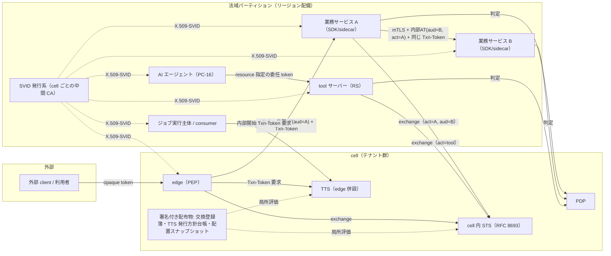
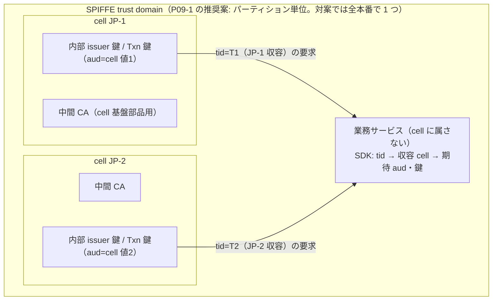
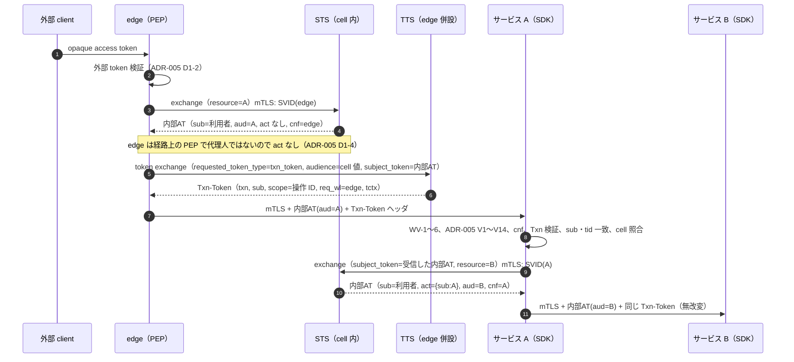
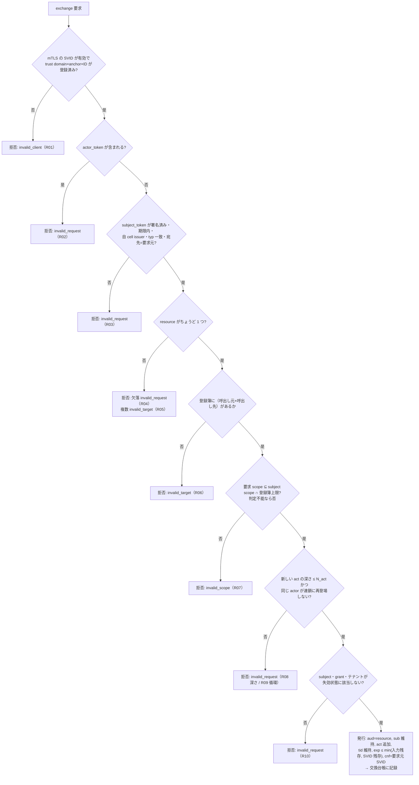
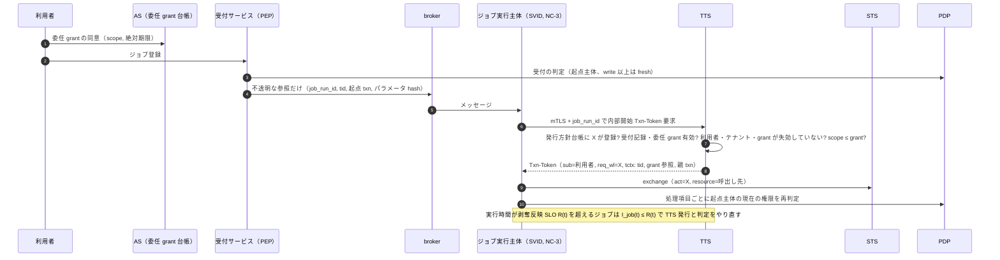
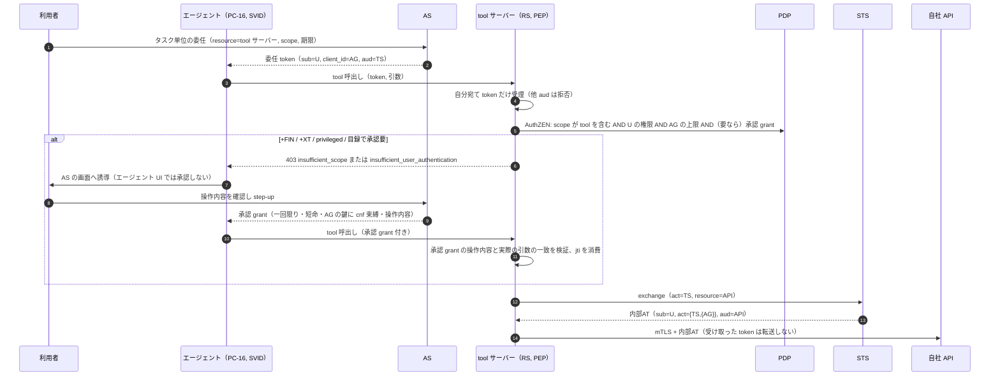
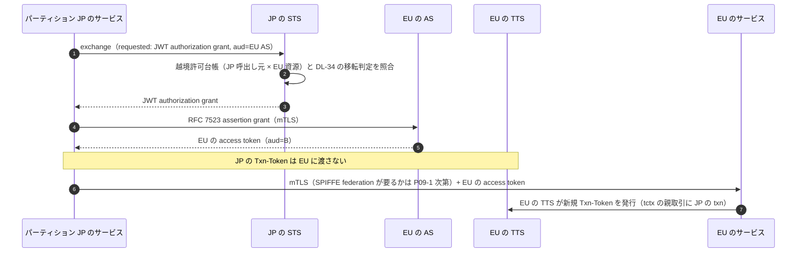
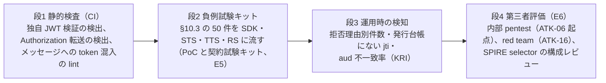

# workload ID・委任（サービス間認証、token exchange profile、Transaction Token、非同期・AI エージェントの委任）

> 文書ID: ARC-04 / 版: 0.2 / 状態: review / 最終更新: 2026-10-15
> 対応要求: R-206, R-230, R-251, R-255, G-102（対応成果物欄に本書のパスまたは DL-55 を含む全行）。関連: R-100, R-044, R-118, R-143, R-207, R-209, R-282, G-099, G-141
> 依存文書: CONVENTIONS.md, traceability/deliverables.md（DL-55 行、§5 の ADR-009・ADR-017・ADR-026 行）, 05_adr/README.md, 05_adr/ADR-005-token-profile.md, 05_adr/ADR-009-workload-identity-token-exchange.md, 05_adr/ADR-013-cell-partitioning-fail-mode.md, 05_adr/ADR-017-non-human-ai-agent-identity.md, 05_adr/ADR-021-irreversible-identifiers.md, 05_adr/ADR-026-async-long-running-delegation.md, 05_adr/reconciliation-notes.md, 01_governance/assumptions-register.md, 01_governance/loss-scenarios.md（S-01, S-07, S-14）, 01_governance/kri.md（K-16, K-17, K-19）, 02_requirements/operation-risk-tiers-assurance.md, 02_requirements/principal-catalog.md, 03_threat-model/attacker-model.md, 03_threat-model/threat-catalog.md, 03_threat-model/incident-casebook.md, research/RS-04, RS-06, RS-17（各 verification 記録を含む）, research/standards-status.md
> 位置付け: ADR-009（workload identity・token exchange・Txn-Token）、ADR-017（非人間 ID・AI エージェント）、ADR-026（非同期・長時間ジョブ）の決定を、連携開発者が実装・試験できる詳細設計に落とす。本書は ADR の決定を変えない。ADR で未決の点は「未決（ADR-0xx）」と書き、本書で新たに決めるものは「本書の提案」と明記する。3 本の ADR はいずれも proposed（決裁前）である（05_adr/README.md §2）。
> 表記: 本書の提案は W55-xx、決裁案は KD55-x、試験案は H55-xx（仮番。TC-ID は 12_poc の DL-22 で採番）、新規仮定は NA55-x。表のセルのうちタグのないものは設計推論 [D] であり、この注記で個別のタグに代える。作成は AI エージェント（Claude）による起草で、別の AI エージェントによる独立レビューを 2026-10-15 に行った（末尾「レビュー記録」）。人による照合と traceability/ への照合ログ追記は未了である（CONVENTIONS §8）。

---

## 0. 結論（CTO/CISO 向け要旨）

1. **サービス間の呼出しは「mTLS（X.509-SVID）で呼出し元を、hop ごとに取り直す aud 1 つの内部 access token で権限を、無改変で運ぶ Transaction Token で取引を」表す 3 点セットにする** [D]（ADR-009 D09-01, D09-10, D09-32）。Txn-Token は replay 耐性がなく認証資格情報としても access token としても使ってはならない（MUST NOT）ため [N][^1]（RS-06#36）、どれか 1 つで他を代替しない [D]。
2. **confused deputy と token 横流しは、受信側の検査ではなく「発行側で作らせない」統制を主にする** [D]。STS は (a) 登録簿にない呼出し元×呼出し先の交換、(b) `resource` が 1 つでない要求、(c) scope・寿命・テナントを広げる派生、(d) `act` 深さ超過と循環を拒否し、出力を要求元インスタンスの SVID に `cnf` 束縛する [D]（ADR-009 D09-11〜D09-16）。RFC 8693 は入れ子の過去 actor をアクセス制御に使わせない（MUST）ので [N][^3]（RS-06#45）、連鎖の深さ・循環の判定は STS だけが行う [D]。
3. **trust domain と cell の整合は 2 層で取る** [D]。Txn-Token の trust domain（`aud`）は cell ごとの内部値で決定済みであり（ADR-005 D9-3、reconciliation-notes C-26）[D]、SPIFFE trust domain の数（本番 3 か 1 か）は **未決（ADR-009 P09-1／ADR-021 D21-28、DEC-3）** である [D]。本書の設計はどちらの決裁でも成り立つよう、cell ごとの中間 CA・鍵と SDK の「tid の収容 cell × `aud` × 署名鍵の cell」照合で cell 単位の封じ込めを取る [D]。
4. **非同期・長時間ジョブと AI エージェントは同じ枠に載せる** [D]。ジョブは enqueue 時の判定を実行の根拠にせず、実行時に TTS が委任 grant・利用者・テナントの現在の状態を確かめて内部開始の Txn-Token を発行する（ADR-026 D26-03）[D]。AI エージェントは 1 主体 1 SPIFFE ID の独立主体とし、利用者のための動作は `sub`＝利用者・`act`＝エージェントの委任で表し、tool 呼出しごとに tool 側 PEP が判定する（ADR-017 D17-06〜D17-16）[D]。
5. **検証は「規則として 100% 拒否」の負例 50 件（§10.3）を中心に、静的検査（E4）・負例試験（PoC の実測 E5 と契約試験キットの CI 結果 E4）・運用時の検知（KRI）・第三者評価（E6）の 4 段で回す（§10.2）** [D]。G-102 の合格基準は「全負例が拒否される」である（traceability/G-goal-criteria.md）[D]。2026-10-15 時点で負例試験は 1 件も実施しておらず、本書の主張はすべて設計段階のものである [D]。
6. **経営判断が要る点は 2 件（KD55-1 登録簿の承認モデル、KD55-2 負例試験を本番接続条件にするか）と、ADR 側の未決 9 件（§12.2）である** [D]。値（N_act、各寿命、再認可間隔）は根拠となる実測がないため TBD とし、所有者・期限・決め方を付けた [D]。

---

## 1. 範囲と前提

### 1.1 範囲

| 範囲内（本書） | 範囲外（正本） |
|---|---|
| workload ID の発行・検証手順、trust domain と cell の対応 | trust domain の数の決裁（ADR-009 P09-1、DEC-3）、SPIFFE ID path の不可逆な形式（ADR-021 D21-28） |
| サービス間認証（P-03）と M2M の既定形 | 外部 token の profile（ADR-005、04_architecture/token-profile.md） |
| 利用者委任の token exchange profile（要求・判定・出力） | API 契約の schema（11_contracts/token-exchange.openapi.yaml、DL-74） |
| Txn-Token の発行・伝播・検証の手順 | claim 名・型・PII 区分（04_architecture/claims-catalog.md、DL-115） |
| 非同期・長時間ジョブの委任の実装手順 | 失効伝播の方式・派生 token の最大寿命の値（ADR-006、DL-20） |
| AI エージェントの委任と tool 呼出し単位の認可の実装手順 | 監査スキーマと保持（ADR-014、DL-77） |
| trust domain 越えの委任 | 顧客 IdP によるエージェント仲介（ADR-004） |
| confused deputy・token 横流し対策の検証方法 | TC-ID の採番と試験計画の正本（12_poc、DL-22） |

### 1.2 前提（A-ID）

| A-ID | 値（基準） | 本書での使い方 |
|---|---|---|
| A-012 | workload ID 5,400、本番インスタンス 1.1 万、資格情報寿命 1 時間・半減時更新で発行約 6/秒 [A-012] | SVID 発行系の容量、静的安定性の窓 |
| A-014 | AI エージェント ID 1 万（範囲 1,000〜10 万）[A-014] | エージェント用 SVID と台帳の規模 |
| A-024 | 機械トラフィック上乗せ率 30% [A-024] | ジョブ・エージェント由来の再認可負荷の上限側 |
| A-028 | 1 session が token 寿命内に要求する下流 audience 数 6 [A-028] | exchange 量の基礎 |
| A-040 | edge API 呼出 16,804/秒（成長 56,444）[A-040] | Txn-Token 発行量（U-02 の (a)） |
| A-043 | token 発行 1,374/秒（うち exchange 1,112/秒）[A-043] | STS の容量 |
| A-050 | 依存サービス 300 [A-050] | 登録簿・SDK の導入対象 |
| A-110 | 共有シークレット/API key だけで認証するサービス 45 [A-110] | 移行の先行条件 |
| A-113 | 静的資格情報 3,000 件、rotation 記録なし 50% [A-113] | 共有秘密の廃止計画 |

ADR が置いた新規仮定（前提台帳へ追加要、本書も依存）: NA09-1（インスタンス分散係数 r）、NA09-2（`act` 深さ上限 N_act の初期案 3）、NA09-3（構築・定常の要員。§11）、NA09-5（業務サービスは cell に属さない）、NA09-6（法域越え同期呼出しの比率）、NA-026-2（委任定期ジョブ 10 万件・内部開始発行約 12/秒）、NA-026-4（queue 最大滞留 7 日）、NA-017-1（承認 grant を要する tool 呼出しの比率）[D]。

**本書の新規仮定（前提台帳へ追加要）**

| 仮 ID | 内容 | 扱い |
|---|---|---|
| NA55-1 | 交換登録簿のエントリ数（呼出し元 workload × 呼出し先サービスの組）。値は置かない | TBD（所有者 プラットフォームチーム長、期限 G1、決め方: As-Is の呼出しグラフ DL-50 から抽出）。KD55-1 の承認負荷の入力 |
| NA55-2 | 依存サービスのうち、受け取った Authorization ヘッダを下流へ転送している実装の数（As-Is の素通し件数）。値は置かない | TBD（所有者 CISO、期限 G1、決め方: As-Is の静的解析と通信記録の抜取り、DL-50）。移行の優先順位に使う |

### 1.3 関連する脅威・攻撃者・損失シナリオ

| 区分 | ID | 本書の統制の所在 |
|---|---|---|
| 脅威 | T-015 audience 誤用・横流し | §4.3、§5.3、§10 |
| 脅威 | T-021 tenant confusion | §4.3（v）、§5.5、§6.3 |
| 脅威 | T-025 内部 context の偽造・欠落（confused deputy） | §4、§6 |
| 脅威 | T-037 token exchange による権限拡大 | §5 |
| 脅威 | T-038 派生 token の失効非連動 | §5.5（寿命の入れ子） |
| 脅威 | T-039 長時間ジョブの委任 | §7 |
| 脅威 | T-040 未署名・内部 token の受理（actor token 型） | §4.3、§5.2、§6.1 |
| 脅威 | T-053 長寿命秘密 | §4.5 |
| 脅威 | T-072〜T-075 エージェントの濫用・素通し・承認迂回・帰属不能 | §8 |
| 攻撃者 | ATK-06 侵害された microservice、ATK-16 濫用される AI エージェント、ATK-03 侵害された一般ユーザー（元従業員・元委託先などの離脱者を前提に含む。attacker-model §4.3）、ATK-07 CI/CD 侵害 | 全節 |
| 損失 | S-01 テナント間漏えい、S-07 剥奪後の stale allow、S-14 AI エージェント濫用 | §10.5 |
| 事故 | CVE-2025-55241（未署名・発行記録なしの actor token、24 時間失効不能）[I][^27]（RS-05#34）。MSRC は CVSS v3.1 基本値 10.0 とした [I][^28]（RS-05#33） | CB-REQ-06 を §4.3・§5.2・§6.1 で受ける |

---

## 2. 全体像

### 2.1 構成要素と経路



- 業務サービスは cell に属さずリージョンに配備され、複数 cell のテナントを処理する [D][NA09-5]。cell 間に同期呼出しは置かない（ADR-013 D13-13）[D]。
- 3 つの資格情報の役割は次のとおり分ける [D]。

| 資格情報 | 何を証明するか | 何を証明しないか | 正本 |
|---|---|---|---|
| X.509-SVID（mTLS） | 呼出し元 workload インスタンスが登録済みの SPIFFE ID を持つこと | 誰のために動いているか、何をしてよいか | ADR-009 D09-01 |
| 内部 access token（at+jwt、aud 1 つ、`cnf`） | 誰の権限（`sub`）で、誰が代理し（`act`）、どのサービスに（`aud`）、どの範囲（scope）を | 取引の起点、連鎖全体の同一性 | ADR-005 D2・D9-4、ADR-009 D09-10 |
| Txn-Token（txntoken+jwt） | 取引の起点が edge（または TTS の内部開始）を通ったこと、起点の主体・テナント・取引 ID（`txn`） | 呼出し元の真正性、認可（access token として使ってはならない MUST NOT）[N][^1]（RS-06#36） | ADR-009 D09-22〜D09-33 |

- 3 点のうち 1 つで他を代替する案は棄却済みである [D]。「Txn-Token＋mTLS だけで下流は認可できる」（RH-085）、「mesh の mTLS で呼出し元を認証すれば利用者の委任は要らない」（RH-091）、「trace id を access token に入れれば証跡になる」（RH-018）、「`purp` を必須にすれば目的の証跡になる」（RH-092）は traceability/rejected-hypotheses.md に記録されており、本書はこれらを再提案しない [D]。

### 2.2 本書が扱う 5 つの経路

| 経路 | 権利の主体（`sub`） | 現在の actor（`act`） | Txn-Token の出所 | 節 |
|---|---|---|---|---|
| E1 利用者要求の同期連鎖（P-03） | 利用者 | 呼出し元サービス（edge→最初の hop は `act` なし） | edge 併設 TTS | §4〜§6 |
| E2 M2M（自身の権限、P-03 の非委任） | workload / service account | なし | edge を通らない内部呼出しは TTS の内部開始（発行範囲は U-02 に従う） | §4.4 |
| E3 非同期・長時間ジョブ（P-04・P-05） | 型により利用者またはジョブ主体 | 実行主体（A1・A2） | TTS の内部開始 | §7 |
| E4 AI エージェント（P-08） | 委任時は利用者、自律時はエージェント主体 | エージェント → tool workload | edge 併設 TTS（+AGT の全要求への発行は未決 L17-2） | §8 |
| E5 trust domain 越え | 利用者 | 越境元の呼出し元 | 越境先の TTS が新規発行 | §9 |

---

## 3. workload ID の発行と検証

### 3.1 識別子（SPIFFE ID）の要件

| # | 要件 | 根拠 |
|---|---|---|
| W55-01 | 呼出し元認証の正本は SPIFFE ID。X.509-SVID は URI SAN をちょうど 1 つ持ち、複数持つものを拒否する | X509-SVID §2（MUST）[N][^6]（RS-06#4）、ADR-009 D09-01 |
| W55-02 | trust domain 名は自社所有ドメイン配下の FQDN、名前にリージョン名・cell 名を入れない | 自社登録ドメインの接尾辞で衝突可能性が下がる [N][^8]（RS-06#7）。ADR-009 D09-07、ADR-021 D21-28 |
| W55-03 | path にチーム名・組織名・リージョン名を入れない。path の具体形式は **未決（ADR-021 D21-28 の採否は ADR-009 に委任、詳細は DL-71）** | ADR-021 D21-28 |
| W55-04 | 1 つの SPIFFE ID を別の workload へ再割当てしない（廃止した ID は墓石化） | WIMSE identifier 草案は再割当てを避けるべき（SHOULD NOT、draft）とする [N][^12]（RS-06#25）。identity-lifecycle INV-1 |
| W55-05 | AI エージェント主体は 1 主体 1 SPIFFE ID。1 つの実行基盤が複数主体を扱う場合も主体ごとに別 SVID・別鍵 | ADR-017 D17-07。AIMS 草案はちょうど 1 つの識別子を MUST とする（-00、Informational）[N][^22]（RS-06#69） |
| W55-06 | 無関係な workload インスタンス間で秘密鍵を共有しない | WIMSE mutual-tls 草案の MUST NOT（draft）[N][^11]（RS-06#25） |

### 3.2 発行（attestation と SVID）

- **W55-07 発行系**: 第一候補は SPIRE（CNCF Graduated、2022-08-22）とし [V][^34]（RS-06#8）、製品の最終選定は ADR-001 の評価枠で行う（ADR-009 D09-02）[D]。
- **W55-08 attestation**: 登録エントリの付与条件（selector）は、基盤が管理し workload 自身が書き換えられない属性（実行基盤の namespace・service account・署名済みイメージの digest 等）の組合せにする [D]。WIMSE practices 草案は、マルチテナント基盤で偽造しやすい属性だけでアクセスや federation を許してはならない（MUST NOT、draft）とする [N][^13]（RS-06#27）。selector の妥当性は第三者の構成レビューで確かめる（ADR-009 §7.2）[D]。
- **W55-09 寿命と更新**: SVID の寿命はインスタンスの寿命以下にし、残存寿命の半分で更新する [D]。WIMSE practices 草案は token の寿命が workload インスタンスの寿命を超えてはならない（MUST NOT、発行基盤が寿命を判定できない場合を除く、draft）とする [N][^13]（RS-06#26）。NIST IR 8587 は workload identity に承認済みの企業 ID 基盤から発行される範囲を絞った短命 token を使うこと（MUST。政策・契約で拘束されない限り任意適合）を求める [N][^16]（RS-06#11）。寿命の値は TBD（所有者 CTO＋CISO、期限 G4、決め方: DL-20 で BIA の停止許容時間と H09-04 の実測から決める）で、容量計算だけ A-012 の 1 時間を使う [D][A-012]。
- **W55-10 cell 単位の中間 CA**: cell 内の基盤部品（edge、STS・TTS、PDP、状態ストア）の SVID は、その cell に置く発行インスタンスから、発行インスタンスごとに分けた中間 CA で発行する（ADR-009 D09-08 の 1）[D]。workload CA は ADR-007 の L2 と別系統にし、root はパーティションごとにオフライン保管する（ADR-009 D09-43）[D]。
- **W55-11 所有者のない主体に発行しない**: 主所有者・副所有者のない非人間主体には SVID を発行しない（ADR-017 D17-02、DL-08 C-01）[D]。

### 3.3 検証（受信側 SDK・sidecar の既定動作）

検証規則は共通 SDK・sidecar の既定動作とし、利用側の設定で外せないようにする（ADR-005 D2 の V1〜V14 と同じ方針）[D]。

| # | 検証 | 失敗時 | 根拠 |
|---|---|---|---|
| WV-1 | 証明書の URI SAN がちょうど 1 つ | 拒否 | X509-SVID §2 MUST [N][^6]（RS-06#4） |
| WV-2 | SVID が属する trust domain に対応する bundle を選んで検証する（他 trust domain の bundle で検証しない） | 拒否 | Trust Domain and Bundle §3（小文字 must）[N][^9] |
| WV-3 | 認可ポリシー（登録簿の照合を含む）は trust domain と検証に使った trust anchor を結合して評価し、path だけで評価しない | 拒否 | WIMSE mutual-tls §5（MUST NOT、draft）[N][^11]（RS-06#25） |
| WV-4 | peer の SPIFFE ID が交換登録簿で「自分を呼べる workload」に登録されている | 拒否 | ADR-009 D09-32 (i) |
| WV-5 | 非本番 trust domain の SVID を本番の検証点で受理しない | 拒否 | ADR-009 D09-07、G-141 |
| WV-6 | JWT-SVID は単一 audience の補助用途（クラウド federation 等）に限り、内部 RS では access token として受理しない（typ 不一致で V5 により拒否） | 拒否 | JWT-SVID は bearer で replay を受けやすく単一 audience が強く推奨される（小文字 strongly recommended）[N][^7]（RS-06#5）。JWT-SVID の `typ` は任意で、設定する場合も `JWT` か `JOSE` に限られる [N][^7]（RS-06#6）ので `at+jwt` と一致せず、`typ` 必須の V5 で拒否される [D]（ADR-009 D09-04） |

- 名前制約（name constraints）は、侵害された署名用証明書の影響を名前付きの trust domain に限るために使えるが任意（MAY）で、URI 型の名前制約は実装支援が乏しく、対応しないライブラリはそのような証明書を拒否して経路検証が失敗する [N][^6]（X509-SVID §4.2）。URI 型の名前制約は URI の host 部（trust domain）にしか効かない [N][^10]。このため path 単位（サービス単位）の封じ込めは名前制約に頼らず、W55-10 の中間 CA 分離と WV-4 の登録簿照合で取る [D]。中間 CA と発行可能な SPIFFE ID 範囲の対応を検証側で照合する規則は標準外の自社規則になるので、H55-03 で効果を測る [D]。

### 3.4 trust domain と cell の整合

本基盤には「trust domain」と呼ばれるものが 2 種類あり、混同すると設計が崩れる [D]（reconciliation-notes C-26）。

| 層 | 単位 | 状態 | 何を区切るか | 正本 |
|---|---|---|---|---|
| SPIFFE trust domain | 推奨: 法域パーティションごとに本番 1（計 3）＋非本番 1。対案: 本番 1＋非本番 1 | **未決（ADR-009 P09-1／ADR-021 D21-28、DEC-3、CTO＋CISO、G3）** | SVID の検証 bundle。workload CA 侵害の波及範囲 | ADR-009 D09-06 |
| Txn-Token の trust domain（`aud`） | cell ごとの内部値（可逆） | 決定済み（ADR-005 D9-3、C-26） | TTS と Txn-Token 署名鍵の単位 | ADR-009 D09-09 |
| 内部 issuer（内部 access token） | cell ごと | 決定済み（ADR-005 V4） | 内部 access token の署名鍵の単位 | ADR-005 D2 |



- **W55-12（cell 照合）** 業務サービスの SDK は、受信した Txn-Token の `tctx` の tid から署名付き配置スナップショット（ADR-013 G1）で収容 cell を引き、(1) Txn-Token の `aud` と署名鍵の cell、(2) 内部 access token の issuer の cell が、収容 cell と一致することを検証する [D]（ADR-009 D09-32 (v)、ADR-021 D21-07(b) と同じ型）。不一致は拒否する [D]。
- **W55-13（P09-1 の決裁に依存しない構成）** W55-10（cell ごとの中間 CA）と W55-12（cell 照合）は、P09-1 がどちらに決まっても同じ形で実装する [D]。P09-1 の決裁で変わるのは、(a) 越境呼出しに SPIFFE federation の設定が要るか、(b) パーティションの workload CA 侵害が他パーティションに及ぶか（RR09-3）の 2 点だけである [D]。
- SPIFFE trust domain を cell ごとには切らない（ADR-009 D09-08）[D]。業務サービスが 9 個以上の trust domain の SVID を同時に持つことになり、cell の追加・分割のたびに 300 サービスの設定が変わるためである [D][A-050]（cell 数は ADR-013 の新規仮定 N13-1 の 9。前提台帳へ追加要）。
- 「1 つの workload が複数の Txn trust domain（cell）の Txn-Token を受ける」構成を草案が許すかは明文がなく、解釈リスク RR09-7 として残る [D]。否定された場合はパーティション単位の論理 TTS に寄せ、`aud` をパーティション値に変える（可逆）[D]（ADR-009 D09-09）。

### 3.5 クラウド事業者 API への federation

- クラウドの資源（KMS、ストレージ、キュー等）を呼ぶときに限り、各社の workload identity federation に SPIFFE の資格情報を外部資格情報として提示する（ADR-009 D09-03）[D]。Google Cloud [V][^31]、Microsoft Entra [V][^33]、AWS IAM Roles Anywhere [V][^32] が公式に提供している（RS-06#77, #79, #80）。
- AWS IAM Roles Anywhere は、信頼ポリシーに条件を付けない限りアカウント内の任意の trust anchor の証明書で任意のロールを引き受けられるので [V][^32]（RS-06#79）、信頼ポリシーへの SPIFFE ID 条件を必須にする [D]。Entra は issuer・subject・audience を大文字小文字を区別して一致させ、外部 IdP の署名鍵を最初の 100 個までしか保存しない [V][^33]（RS-06#80）ので、JWT-SVID の鍵 rotation 計画をこの上限内に置く [D]。
- クラウド固有の ID（IAM role 等）はそのクラウドの資源への権限だけを表し、サービス間の呼出し元識別には使わない [D]。接続の成立と失敗挙動は H09-12 で確かめる [D]。

### 3.6 停止・無効化・fail-mode

| 事象 | 挙動 | 根拠 |
|---|---|---|
| SVID 発行系の停止 | 既発行 SVID は残存寿命まで有効。半減時更新なら停止後おおむね寿命の半分（1 時間なら約 30 分）は新規発行なしで継続 | ADR-009 D09-39 [D][A-012] |
| インスタンス停止 | 発行系が当該 SVID を無効化する。残存寿命が十分短いと示せる場合だけ満了に委ねる | WIMSE practices §5.5（MUST、draft）[N][^13]（RS-06#26）、ADR-009 D09-41 |
| STS・TTS に届かない | exchange 済み token・Txn-Token のない要求を未署名の代替経路で通さない。cache は寿命内だけ使い、以後は操作階層ごとの fail-mode | ADR-009 D09-42、ADR-013 D13-15・D13-23・D13-25 |
| 障害時の寿命延長 | grace は設けない | ADR-009 D09-39、ADR-005 D3 |

- 長時間接続の上限は SVID の更新の窓と揃える [D]。SP 800-207A は接続を長くしないこと（通常は証明書の TTL 程度、構成によって 15〜30 分）で接続単位の認証の安全性を保つと述べる [N][^15]（RS-06#9）。

---

## 4. サービス間認証（P-03 の既定形）

### 4.1 同期呼出しの手順



- 図の 3〜4 の edge の exchange では、ADR-005 D1-4 のとおり出力 token は `sub`＝利用者、`client_id`＝外部 client、`act` なしとする [D]。
- A は受け取った内部 access token を B へ素通しせず、必ず STS で取り直す [D]（ADR-009 D09-32 の 5）。
- 図の 5 の TTS への要求では、subject_token は最初の呼出し先 A 宛て（`aud`＝A）で edge に `cnf` 束縛された内部 access token である [D]（ADR-009 D09-32 の 3）。このため §5.2 の「subject_token の宛先＝要求元」検査（W55-15）は TTS には適用せず、TTS は代わりに「subject_token の `cnf` が要求元（edge）の SVID と一致すること」と「要求元が edge であること（`req_wl` に入る ID）」を確かめる（本書の提案 W55-17、DL-74 で確定）[D]。内部開始の要求（ジョブ・consumer）は W55-17 ではなく §7.2 の J-3 で判定する [D]。

### 4.2 呼出し元が守る義務（依存サービス向け）

ADR-009 §6.4 の 5 義務を、実装上の確認項目に展開する [D]。検証と exchange は SDK・sidecar が行い、依存サービスのコードは Txn-Token の中身を読まない（ADR-009 D09-24）[D]。

| # | 義務 | 違反の検出 |
|---|---|---|
| O-1 | `Txn-Token` ヘッダと `traceparent` を無改変で下流へ渡す | SDK の送出時検査、H09-02 の改変・剥ぎ取り負例 |
| O-2 | 受け取った Authorization の token を下流へ転送しない | 静的解析（CI）、下流での aud 不一致拒否の監視、H55-07 |
| O-3 | 呼ぶ相手・呼ばれる相手を交換登録簿に申請する | STS の未登録拒否の記録 |
| O-4 | 新規の client・連携で共有秘密を使わない | client 登録の審査で client_secret_* の登録を拒否、静的秘密の KRI 候補（残存件数・期限切れ例外件数・静的秘密による認証の成功回数。ADR-009 D09-21 で kri.md 所有者へ申し送り中、§10.5） |
| O-5 | 監査イベントに `txn` を書く | SDK の既定。監査欄の欠落検査（H09-07） |

### 4.3 受信側の検証（1 つでも失敗したら拒否）

| # | 検証 | 主に防ぐもの | 根拠 |
|---|---|---|---|
| (i) | mTLS の peer SPIFFE ID が登録簿で自分を呼べる workload か（WV-1〜WV-5） | 未登録 workload からの呼出し（ATK-06） | ADR-009 D09-32 |
| (ii) | 内部 access token の V1〜V14（iss 完全一致、typ=at+jwt、aud に自サービス、exp、alg allowlist 等）と、TLS の証明書と `cnf`（x5t#S256）の一致 | 横流し（T-015）、窃取 token の再利用 | RS は自分宛てでない token を拒否する（MUST）[N][^17]（RS-04#17）。証明書束縛の一致検証（MUST）[N][^5]（RS-17#22）。at+jwt の typ [N][^38]（RS-04#60） |
| (iii) | Txn-Token の署名・`aud`（期待する cell 値）・`exp` | Txn-Token の偽造・他 cell の流用 | 草案の MUST [N][^1]（RS-06#35） |
| (iv) | 両 token の `sub` の一致、Txn-Token の tid と内部 access token の tid の一致 | 別取引の context の混入（confused deputy、T-025） | ADR-009 D09-32 |
| (v) | tid の収容 cell と、Txn-Token の `aud`・署名鍵の cell、内部 access token の issuer の cell の一致（W55-12） | tenant confusion（T-021）、cell 越えの流用 | ADR-009 D09-32、ADR-005 V9 |
| (vi) | 未署名の内部 token・Txn-Token を受け付ける経路がない | actor token 型（T-040） | ADR-009 D09-24、CB-REQ-06 |

- Txn-Token は Authorization ヘッダではなく `Txn-Token` ヘッダで受け取り、Authorization ヘッダで提示された Txn-Token は拒否する [N][^1]（RS-06#35）[D]。
- PEP は、資源から導いたテナントと token のテナントを突き合わせる（ADR-005 V9、ADR-011 D1-2 規則 1）[D]。(v) は配置の整合、V9 は資源の整合であり、片方で他方を代替しない [D]。
- (i)〜(vi) は「受け取ってよい要求か」の検査であり、認可ではない [D]。各サービスの PEP は自分の資源への操作を自分で判定し（§2.1 の図の PDP 呼出し）、上流 hop の allow や Txn-Token の `scope` を認可の根拠として継承しない [D]。SP 800-207A の ID-SEG-REC-5 は、各サービスアクセスで認証済み利用者が対象リソースに認可されていることを確かめるよう求める [N][^15]（RS-06#10）。これは主張台帳 CL-0167（「上流の allow を無条件に継承しない」、維持）の具体化である [D]。

### 4.4 M2M（利用者の代理でない呼出し）

- 利用者の代理でない M2M は client credentials grant に限り、confidential client だけが使う（MUST）[N][^18]（RS-17#18）。refresh token は発行しない（SHOULD NOT）[N][^18]（ADR-009 D09-19）。
- クライアント認証は、内部 workload は X.509-SVID の mTLS（RFC 8705 `tls_client_auth`）、外部 partner は private_key_jwt か mTLS に限る [D]。RFC 9700 は非対称のクライアント認証を RECOMMENDED とする [N][^17]（RS-17#19）。RFC 7523 はクライアント認証の JWT に `iss`・`sub`・`aud`・`exp` を求め（MUST）[N][^19]（RS-17#20）、`aud` は AS の issuer 識別子を唯一の値にする 7523bis の規則（RFC Ed Queue、RFC 未発行）を先行採用する [N][^20]（RS-06#52、RS-17#21、standards-status SS-B06）[D]。
- M2M の token の `sub` は ADR-021 D21-10 の単一名前空間の主体で、主体種別 claim を workload または service account にする（ADR-005 D9-4）[D]。
- edge を通らない M2M の取引に Txn-Token を付けるかは、発行範囲の未決 U-02 に従う [D]（§6.4）。

### 4.5 共有秘密の廃止と移行

- 新規の client・workload 間認証で共有 client secret（client_secret_basic・client_secret_post・client_secret_jwt、静的 API key）を禁止する（ADR-009 D09-18）[D]。
- 既存の静的資格情報（3,000 件、rotation 記録なし 50%）[A-113] は期限付き例外として登録し、(1) CI の秘密を OIDC 連携の短命資格情報に、(2) 共有秘密だけで認証する 45 サービス [A-110] を workload ID に、(3) 残る service account の秘密を非対称鍵に、の順で置き換える（ADR-009 D09-20）[D]。GitHub Actions はジョブごとに OIDC の JWT を要求し、ジョブの間だけ有効な短命 token を得る方式をとる [V][^30]（RS-17#30）。
- 期限と例外の上限件数は TBD（所有者 CISO＋プラットフォームチーム長、期限 G1、決め方: As-Is 確定後に決める）[D]。

---

## 5. 利用者委任の token exchange profile

### 5.1 要求パラメータ（社内 profile。契約の正本は DL-74）

| パラメータ | 規則 | 根拠 |
|---|---|---|
| `grant_type` | `urn:ietf:params:oauth:grant-type:token-exchange` | RFC 8693 [N][^3] |
| `subject_token` | 署名済みの内部 access token（at+jwt）だけ。外部 opaque token は edge の最初の exchange に限る。未署名 JSON は受け付けない | ADR-009 D09-24。RFC 8693 は AS に種別に応じた検証を求める（MUST）[N][^3]（RS-06#44） |
| `subject_token_type` | `urn:ietf:params:oauth:token-type:access_token`（内部 hop）。Txn-Token 要求時も同じ | RFC 8693 [N][^3]、草案 [N][^1]（RS-06#32） |
| `actor_token` / `actor_token_type` | **送られたら拒否する**。actor の身元は STS への mTLS クライアント認証（SAN URI 照合）から取る | ADR-009 D09-14。RFC 8705 は PKI 方式の client が期待する証明書 subject を metadata のうちちょうど 1 つで示すことを MUST とする [N][^5] |
| `resource` | 呼出し先サービスの正規識別子（ADR-021 の名前空間台帳が払い出す不透明値の絶対 URI）を **ちょうど 1 つ**。欠落・複数は拒否 | ADR-009 D09-11。`resource` は fragment を含まない絶対 URI（MUST）、AS は audience 制限すべき（SHOULD）[N][^4]（RS-04#65） |
| `audience` | access token の要求では受け付けない（`resource` に一本化）。Txn-Token の要求では cell の trust domain 値を指定する | 本書の提案 W55-14（DL-74 で確定）。Txn-Token の `audience` は草案の MUST [N][^1]（RS-06#32） |
| `scope` | 省略時は登録簿の上限と subject_token の scope の共通部分。指定時もその共通部分を超えれば拒否 | ADR-009 D09-15 |
| `requested_token_type` | `urn:ietf:params:oauth:token-type:access_token` または `urn:ietf:params:oauth:token-type:txn_token`（TTS） | 草案 [N][^1]（RS-06#32） |
| `authorization_details` | v1 では予約で発行しない。承認 grant への発行開始は **未決（ADR-017 L17-5）** | reconciliation-notes §3.3、ADR-022 D-9-2 |

### 5.2 STS の判定手順



- **エラー応答の規則（本書の提案 W55-18、DL-74 で確定）**: RFC 8693 は、要求自体が不正な場合と subject_token・actor_token が不正または方針上受け入れられない場合に `invalid_request` を返すことを MUST とし、`resource`・`audience` が示す対象に発行できない場合に `invalid_target` を使うことを SHOULD とし、他のエラーコードも適宜使えるとする [N][^3]（§2.2.2）。クライアント認証の失敗は RFC 6749 の `invalid_client` である [N][^18]（§5.2）。これに従い、図の X1〜X8 のエラーコードを上記のとおりにする [D]。`invalid_grant` は使わない [D]。`invalid_scope` は RFC 6749 §5.2 の定義（要求 scope が無効・未知・不正、または資源所有者が与えた範囲を超える）[N][^18] に当たるので「他のエラーコード」として使う [D]。理由の詳細（R01〜R10 の理由コード）は応答の `error_description` に入れず交換台帳にだけ記録し、要求元への応答から登録簿の内容を推測させない [D]。
- edge の最初の exchange（subject_token が外部 opaque token）は、上図の ST の代わりに ADR-005 D1-2 の外部 token 検証を行い、要求元が edge の SVID である場合に限って受け付ける [D]（§5.1 の `subject_token` 行）。それ以外の判定は上図と同じである [D]。
- 「subject_token の宛先＝要求元」の検査は、A が受け取った token（`aud`＝A）を A 自身が subject_token に使う場合だけ交換を許すための本書の提案（W55-15）である [D]。他サービス宛ての token を拾って交換に持ち込む横流しを STS で止めるためで、DL-74 で確定する [D]。
- 失効状態の照合は、ADR-006 D6-04 の局所評価（署名付き配布物）で行い、cell 外へ同期照会しない（ADR-013 D13-13）[D]。
- 交換台帳には、入力 token の (iss, jti)、出力 token の (iss, jti)、呼出し元 SPIFFE ID、呼出し先、発行 scope、`act` の深さ、受信した Txn-Token の `txn` を記録する（ADR-009 D09-35）[D]。拒否も理由別に記録する [D]。

### 5.3 `act` チェーン

- 委任は RFC 8693 の delegation だけを使い、impersonation（`act` を付けない交換）は使わない [D]（ADR-009 D09-10）。delegation では行為者が委任元と別の ID を保つ [N][^3]（RS-06#43）。
- `act` の現在の actor は、STS がクライアント認証で確かめた要求元の主体とし、要求元が自己申告する値を使わない [D]。現在の actor には actor の主体種別を入れる（ADR-017 D17-50。claim 名は DL-75）[D]。

```json
{
  "sub": "<利用者の不透明 sub>",
  "aud": "<サービス C の正規識別子>",
  "act": {
    "sub": "<サービス B の主体>",
    "act": { "sub": "<サービス A の主体>" }
  }
}
```

| 規則 | 内容 | 根拠 |
|---|---|---|
| 判定に使う actor | RS・PDP は最上位 claim と現在の actor（最外の `act.sub`）だけを使う。入れ子の過去 actor は監査用 | RFC 8693 §4.1（MUST）[N][^3]（RS-06#45）、ADR-005 V10 |
| 深さの上限 N_act | 出力 token の `act` の入れ子の深さが N_act を超える交換を拒否する。初期案 3 | ADR-009 D09-16、NA09-2。**値は TBD**（所有者 CTO、期限 G3、決め方: As-Is の呼出しグラフ DL-50 と H09-01） |
| 循環 | 同じ actor が連鎖に 2 回現れる交換を拒否する | ADR-009 D09-16 |
| エージェント間の再委任 | 上記に加えて「利用者→エージェント→エージェント」の 1 段まで（初期案） | ADR-017 D17-18。**値は TBD**（所有者 CTO、期限 G3、DL-74） |
| ジョブの段 | ジョブの実行主体を 1 段と数える | ADR-026 D26-04a |

- 連鎖長の上限は標準ではなく社内 profile で決める事項である（RS-06 §2 第 7 項）[D]。深さの判定は STS だけが入れ子を読んで行い、RS は行わない（RS が過去 actor で判断するとアクセス制御に過去 actor を使うことになるため）[D]。

### 5.4 `may_act`

- `may_act` は v1 では token に載せない [D]（ADR-009 D09-17）。RFC 8693 は `may_act` を AS が判定に使い得る表明とし処理義務を定めていない [N][^3]（RS-06#45）。
- 「誰が誰の代わりに動けるか」は AS（STS・TTS）側の 3 つの台帳で持つ [D]（reconciliation-notes §3.3 の「may_act は AS 側」）。

| 台帳 | 表す関係 | 変更管理 | 正本 |
|---|---|---|---|
| 交換登録簿 | 呼出し元 workload × 呼出し先サービス × scope 上限 | 呼出し元所有者の申請＋呼出し先所有者の承認（KD55-1）、ADR-016 の版管理 | ADR-009 D09-13 |
| 委任 grant 台帳 | 利用者 → ジョブ定義・エージェント（scope、絶対期限、許可する実行主体） | 利用者の明示同意。AS の grant 台帳（ADR-005 D7-3） | ADR-026 D26-04b、ADR-017 D17-17・D17-43 |
| TTS 発行方針台帳 | どの workload が誰の名で内部開始 Txn-Token を得られるか | privileged 操作として二者承認（テナント内は /T、テナント横断は /P） | ADR-026 D26-12 |

- TTS 発行方針台帳の登録項目は、実行主体の SPIFFE ID、ジョブ定義 ID またはイベント種別、型（A1〜A4）、対象テナントの範囲（単一か横断か）、scope の上限、到達できる操作階層の上限、所有者である（ADR-026 D26-12）[D]。台帳は control plane に置き、cell ごとに署名付きで配布し、TTS が局所で評価する [D]。テナント横断の実行主体でも Txn-Token・内部 access token・PDP の判定は 1 回につき 1 テナントに限り、対象テナントごとに取り直す [D]（ADR-026 D26-12、ADR-005 V9）。
- 登録対象は PC-14 の実行主体と A4 の consumer workload である（ADR-026 D26-12 が「イベント種別」と型 A4 を登録項目に含めるため）[D]。principal-catalog の申し送り表は「PC-14 に限定」と書いているが、ADR-026 を正本としてこれに従う [D]（§12.3 の指摘 3）。
- `may_act` の採否は、次のいずれかが起きたときに CTO が ADR-009 D09-17 を見直す [D]: (a) H09-13 で越境先 AS が越境元の委任関係を判定材料として要すると判明した場合、(b) identity chaining の RFC 発行時に越境先へ委任関係を渡す規定が加わった場合 [D]。ADR-009 D09-17 は「§8 で再検討」と書くが ADR-009 §8 の表にこのトリガー行がないため、ADR への指摘とする（§12.3 の指摘 1）[D]。

### 5.5 audience・resource・権限の縮小（出力 token の不変条件）

| 項目 | 出力 token の規則 | 防ぐもの |
|---|---|---|
| `aud` | `resource` の 1 値だけ。共通 aud は発行しない | 横流し（T-015）。RFC 9700 は access token を特定の RS に絞るべき（SHOULD）とする [N][^17]（RS-04#17） |
| scope | subject_token の scope ∩ 登録簿の上限 以下 | 権限拡大（T-037）。RFC 9700 は権限を特定の資源と操作に制限すべき（SHOULD）とする [N][^17]（RS-04#16） |
| `sub` | 入力と同じ（変更しない） | なりすまし |
| tid | 入力と同じ。交換でテナントを切り替えない（切替は利用者の token 取り直し） | tenant confusion（T-021）、ADR-005 V9 |
| `exp` | min(入力 token の残存寿命, 要求元 SVID の残存寿命, 操作階層の派生 token 最大寿命) | 失効非連動（T-038）。最大寿命の値は ADR-006・DL-20 で決める（**TBD**） |
| `cnf` | 要求元インスタンスの X.509-SVID の x5t#S256 | 窃取 token の別インスタンスでの使用 |
| `act` | 現在の actor を最外に追加 | 帰属の喪失 |
| grant 参照・`sid` | 入力から引継ぐ | 一括失効の範囲（ADR-006） |

- RFC 8693 は入力と出力の token を強く結び付けず、失効の伝播を一般的性質としない [N][^3]（RS-06#44）。このため寿命の入れ子と grant 参照の引継ぎで上限を固定する [D]（ADR-009 D09-40）。
- 束縛の費用が過大な場合に I2（mesh mTLS＋aud＋呼出し元照合）へ切り替えるかは **未決（ADR-005 K-6、CTO＋CISO、G4）** である [D]。I2 は RFC 9700 の SHOULD からの逸脱で受容票を要する（ADR-005 D5）[D]。

### 5.6 exchange 量と cache

- exchange 済み token はインスタンスの SVID に束縛されインスタンスごとに cache されるので、exchange 量は A-043 の 1,112/秒 × r の桁になる [D][A-043][NA09-1]。r＝1, 3, 10 で 1,112／3,336／11,120 回/秒である [D][A-043]。r の値は TBD（所有者 SRE 責任者、期限 G4、決め方: H09-05 の実測）[D]。
- SDK は SVID 更新の前に token を取り直す（証明書の更新で束縛 token は無効になる）[N][^5][D]。cache の TTL には jitter を入れる（ADR-013 D13-19）[D]。

---

## 6. Transaction Token による取引文脈の伝播

### 6.1 社内 profile `txn-v1`

`txn-v1` は draft-ietf-oauth-transaction-tokens-11（2026-07-30）に固定する [D]（ADR-009 D09-23）。同草案は 2026-10-15 時点で IESG 未提出の Internet-Draft であり RFC ではなく、2027-01-31 に失効予定である [N][^2]（RS-06#29、standards-status SS-B04）。

| claim | 草案の強度 | `txn-v1` | 備考 |
|---|---|---|---|
| typ | `txntoken+jwt`（MUST） | 必須 | [N][^1]（RS-06#31） |
| `iat`・`exp` | REQUIRED | 必須。`exp` ≤ subject_token の残存寿命 | 草案は提示 token の期限を超える寿命を方針で許す（MAY）が [N][^1]（RS-06#37）、本基盤は超えさせない（ADR-009 D09-40） |
| `aud` | REQUIRED（trust domain） | cell の内部値 | §3.4 |
| `txn` | REQUIRED | 外部要求 1 件ごと（または内部開始 1 件ごと）に CSPRNG で 1 回払い出す不透明値。時刻・ホスト名・cell 名を埋め込まない | ADR-009 D09-28、ADR-021 D21-36。意味は RFC 8417 で登録済みの一意な取引識別子 [N][^29] |
| `sub` | REQUIRED | 内部 access token の `sub` と同じ | §4.3 (iv) |
| `scope` | REQUIRED | entry point 台帳の操作 ID（外部 client の scope より狭く）。subject_token の scope 以下（MUST） | [N][^1]（RS-06#33, #42） |
| `req_wl` | REQUIRED | 要求元（edge、ジョブ実行主体、consumer）の SPIFFE ID | ADR-009 D09-32 |
| `tctx` | RECOMMENDED | 必須。項目は下表 | ADR-009 D09-29 |
| `rctx` | RECOMMENDED | 発行しない。受信したら無視 | ADR-009 D09-30、ADR-005 D9-3 |
| `purp` | -06 では REQUIRED、-07 以降 `scope` に改名 | 発行も検査もしない（未知 claim として無視） | ADR-009 D09-31。改名は -11 の Document History による [N][^1]（research 外。ADR-009 の起草者が確認）。受信者は理解できない claim を無視する（MUST）[N][^1]（RS-06#31） |

**`tctx` の項目**（名前は DL-115 で決める。ARC-15 §4.2 の名前案は、作用中テナント `tid`、起点 jti `root_jti`、grant 参照 `gref`・`sid`、起点の操作階層 `tier`、親取引 `ptxn`、profile 版 `ver`。起点エージェントは名前未定）[D]

| 項目 | 同期（edge 起点） | 内部開始（ジョブ・consumer） |
|---|---|---|
| 作用中テナント（tid） | 必須 | 必須（TTS が台帳から入れる。メッセージの値を使わない） |
| 内部 token 系譜の起点 jti | 必須 | **未決（ADR-026 L26-1）**: 起点 jti がないため、grant 参照（A3 はジョブ定義 ID）を代わりに必須とする例外を ADR-009・ADR-005 に申し送り中 |
| grant 参照・`sid` | 利用者主体で必須 | 委任 grant 参照を必須 |
| 起点の操作階層 | 必須 | 必須 |
| 親取引の `txn` | なし | 起点の `txn`（あれば） |
| 起点エージェント主体 | **未決（ADR-017 L17-2）** | 同左 |
| profile 版 | 必須 | 必須 |

- 取引の業務パラメータ（金額・対象 ID）と個人識別属性・権限は `tctx` に入れない [D]（ADR-009 D09-29）。Txn-Token を access token として使ってはならない（MUST NOT）[N][^1] ので、認可の根拠を Txn-Token に置かないためである [D]。

### 6.2 伝播の規則

| # | 規則 | 根拠 |
|---|---|---|
| TX-1 | 下流には受け取った Txn-Token を無改変で含める | 草案 MUST [N][^1]（RS-06#35） |
| TX-2 | `Txn-Token` ヘッダで渡し、Authorization ヘッダに入れない | 草案 MUST NOT [N][^1]（RS-06#35） |
| TX-3 | 置換 Txn-Token で許可範囲を広げない、`txn`・`sub`・`aud` を変えない、期限切れ token を置換しない | 草案 MUST NOT [N][^1]（RS-06#40） |
| TX-4 | Txn-Token の全文をログ・メッセージ・永続領域に残さない。記録は `txn` と hash だけ | 草案 MUST NOT（ログ）[N][^1]（RS-06#41）。メッセージへの拡張は ADR-026 D26-11 の設計推論 |
| TX-5 | Txn-Token を trust domain 外で受け入れない。cell・パーティションを越えるときは越境先の TTS が新規発行する | 草案 MUST [N][^1]（RS-06#31）、§9 |
| TX-6 | 生成・検証は SDK・sidecar の adapter に閉じ込める。adapter を自社形式の `txn` に差し替えても依存サービスの差分 0（H09-08） | ADR-009 D09-24〜D09-26、ADR-022 D-8-5 |

- 草案の失効・大改訂時は edge が発行する自社形式の取引 ID を同じ `txn` 欄に入れる退避経路を持つ（ADR-009 D09-26）[D]。

### 6.3 Txn-Token が証明する範囲と限界

- Txn-Token は replay 耐性がない（草案）[N][^1]（RS-06#36）。窃取した Txn-Token を持つ侵害 workload でも、下流へ到達するには登録された SVID と `cnf` 束縛の内部 access token が要るので、Txn-Token 単独では到達できない [D]。これを H09-03 で確かめる [D]。
- 侵害された workload は、自分の登録範囲内で通過した利用者として振る舞える（RR09-1）[D]。この残余は予防できず、登録簿の最小化・短寿命・深さ上限で幅を狭めるだけである [D]。

### 6.4 発行範囲（未決）

- ADR-005 D9-3 は Txn-Token の発行を write・privileged・break-glass/B・FAPI 範囲に限っており、全要求への拡大は **未決（U-02、ADR-005 §2.15 U2、CTO＋CISO、ADR-005 H-20 の後）** である [D]。ADR-009 D09-33 は条件付きで全要求への発行を推奨する入力を出している [D]。
- 本書の設計は両方の結論で動くようにする [D]。(a) 全要求の場合、署名は基準 16,804/秒・成長 56,444/秒になる [D][A-040]。(b) write 以上の場合、public・read-sensitive の要求は (jti, decision_id, X-Request-ID) で相関し、§4.3 の (iii)〜(v) のうち Txn-Token に依存する検査は「Txn-Token がある場合に必須」となる [D]。(b) では、その範囲の (iv)(v) 相当の照合を内部 access token の tid と配置スナップショットで行う [D]。
- 委任ジョブ（A1・A2）は read-sensitive でも内部開始の Txn-Token を必須にする（ADR-026 §2.12 の注記。発行量は約 12/秒の桁）[D][NA-026-2]。

### 6.5 監査上の結合

- 監査イベントは整合調整の 8 欄（iss、jti、sid、grant 参照、txn、decision_id、X-Request-ID、trace_id）に揃える（reconciliation-notes §3.2）[D]。trace id は token に入れない（ADR-009 D09-34）[D]。
- 取引の再構成は「`txn` → TTS 発行台帳（起点 jti・tid・sid）→ 各 PEP の判定記録（decision_id）→ 提示 token の jti から STS 交換台帳を辿り起点 jti に戻る」の順で行い、trace_id は索引にだけ使う（ADR-009 D09-36）[D]。trace の欠落・偽造で結果が変わらないことを H09-07 で確かめる [D]。

---

## 7. 非同期・長時間ジョブの委任

### 7.1 4 つの型（ADR-026 D26-01）

| 型 | 例 | `sub` | `act`（現在の actor） | 実行時の根拠 |
|---|---|---|---|---|
| A1 利用者要求の非同期実行 | エクスポート、一括更新 | 要求した利用者 | 実行 workload | enqueue 受付記録＋実行時の再認可 |
| A2 利用者の名で動く定期・長時間ジョブ | 定期レポート、同期ジョブ | 委任した利用者 | ジョブ実行主体（PC-14） | 委任 grant＋実行ごとの TTS 発行＋再認可 |
| A3 システムジョブ | 索引再構築、期限処理 | ジョブ主体（PC-14） | なし | ジョブ主体自身の relation |
| A4 イベント consumer | 通知、他ドメインへの反映 | 処理による | consumer workload | 処理直前の再認可 |

- 型の宣言がない queue consumer・batch は、PEP coverage 検査で未登録の entry point として扱う [D]（ADR-026 D26-01、ADR-012）。ジョブが実行する操作の階層は同期 API で実行した場合と同じにする（REQ-03 J7）[D]。

### 7.2 A2 の実行手順



| # | 規則 | 根拠 |
|---|---|---|
| J-1 | enqueue 時の判定は「受付の認可」にすぎず、実行の根拠にしない。実行時の判定では受付時の整合性トークンを評価の下限にだけ使い、write 以上は fresh にする | ADR-026 D26-02・D26-03（ADR-010 D-13・D-18）。SpiceDB の `at_least_as_fresh` は指定した ZedToken 以降のデータを使う方式である [V][^41]（RS-07#26）。enqueue 時の ZedToken で評価しても保証されるのは enqueue 時点以上の鮮度だけで、enqueue 後の剥奪の反映は保証されない [D] |
| J-2 | 実行主体は作成者の資格情報を使わず、実行ごとに短命の workload 資格情報（NC-3）を得る | ADR-026 D26-04、ADR-017 D17-03 |
| J-3 | TTS は要求元 workload を認証し（MUST）、発行方針台帳・受付記録・委任 grant・失効状態・scope 上限を確かめて発行する | 草案 MUST [N][^1]（RS-06#34, #33）、ADR-026 D26-03 |
| J-4 | 長時間ジョブのために token の寿命を延ばさない。段ごとに置換ではなく新規発行で取り直す。refresh token をジョブに発行しない | ADR-026 D26-05。草案は長時間のバッチでも Txn-Token を短命のままとする [N][^1]（RS-06#37）。Txn-Token の応答に refresh token を含めない（MUST NOT）[N][^1]（§13.3、RS-17#26） |
| J-5 | 第一者のジョブは `offline_access` と利用者の refresh token を使わない | ADR-026 D26-06。OIDC は `offline_access` の要求に、別の条件がない限り `prompt=consent` を使うことを求め（MUST）、OP は offline access を可能にする refresh token を返すことへの同意を常に得なければならない（MUST）[N][^35]（RS-17#24） |
| J-6 | メッセージには不透明な参照だけを入れ、token・権限・role を入れない。実行主体は `job_run_id` で受付記録を引き、パラメータ hash を照合する | ADR-026 D26-11。CloudEvents の context attributes に機微情報を載せるべきでない（SHOULD NOT）[N][^37]（RS-17#32） |
| J-7 | テナント文脈（DB の `SET LOCAL` 等）はメッセージの tid ではなく Txn-Token の `tctx` の tid から設定し、資源側と照合する | ADR-026 D26-03a |
| J-8 | 委任ジョブで実行できる操作は read-sensitive と write に限る。privileged・+SEC は実行しない。+FIN・+XT は既定で実行しない（例外は **未決 K26-4**） | ADR-026 D26-04c |
| J-9 | 認可の拒否で失敗した run は自動再試行せずデッドレターへ送り監査に記録する。PDP 不達の 503 とは区別する | ADR-026 D26-08 |

- WIMSE arch 草案は、非同期・バッチ要求で元の要求元を subject、非同期処理を行う workload を actor chain の actor とする資格情報を、行為 workload の資格情報に結び付けるべき（小文字 should、draft）とする [N][^14]（RS-06#19）。J-2・J-3 と `act`＝実行主体はこの方向に沿う [D]。
- Txn-Token 草案は内部開始の流れを「特定利用者になり代わって」要求するものと書き、どの workload に発行するかの方針は範囲外とする [N][^1]（RS-06#39）。本基盤は `req_wl` に実行主体を必ず残し、発行方針台帳に載った実行主体にだけ許すことで帰属を失わない形に限る（ADR-026 D26-04 の注記）[D]。

### 7.3 退職・権限喪失時の停止

| 事象 | 既定 | 決裁 |
|---|---|---|
| 代理される利用者の停止・削除・テナント所属停止 | 当該利用者の委任 grant をすべて失効。待ち行列中・実行中の run は次の再認可で拒否。移転しない | ADR-026 D26-07 E-a（決定案） |
| ジョブ所有者（人）の退職 | write 以上を含むジョブは停止、read-sensitive だけのジョブは移転待ちで猶予（初期案 14 日）だけ継続 | **未決（ADR-026 K26-1、各事業責任者＋CISO、G3）** |
| 所有者の権限喪失 | ジョブ主体の付与が所有者の現在の権限を超えた資源を要再承認、write 以上は停止 | ADR-026 D26-07 E-c |

- 停止の効力はライフサイクル事象の受信に依存させず、TTS の発行拒否と PDP の G 段の拒否に置く（ADR-026 D26-08）[D]。G 段規則 2「主体の停止」を現在の actor（実行主体・ジョブ定義）にも適用する解釈は **未決（ADR-026 L26-3／ADR-006 L6-4、ADR-011 の改版、G3）** である [D]。
- 再認可を挟めない処理（夜間バッチの単一トランザクション等）を例外として認めるかは **未決（ADR-026 K26-3、CISO、G4）** である [D]。推奨案は期限付き受容票（最大実行時間と対象階層 write までを記す）で認めるもので、認められるまでは、依存サービスは長時間処理を I_job(t) 以内の段に分割して実装する [D]。
- 委任 grant の絶対期限・非活動期限と I_job(t) の値は **TBD（ADR-026 K26-2、CTO＋CISO＋事業責任者、G4、DL-20）**。初期案は write 90 日・read-sensitive 180 日・非活動 30 日 [D]。

### 7.4 内部開始取引の `txn` の意味（未決）

- 内部開始の取引では TTS が新しい `txn` を払い出し、起点の `txn` とは受付記録と `tctx` の親取引欄で結ぶ [D]（ADR-026 D26-13）。`txn` を「TTS が発行方針に従って払い出した取引の一意識別子」と読み、入口を edge と内部開始の 2 つとする案は **未決（ADR-026 L26-2、DEC-3 の決裁資料、CTO＋CISO）** である [D]。相関 ID 欄の意味は ADR-022 で不可逆とされるため、決裁前にこの読み方を ADR-021・ADR-022 に明記するか別欄にするかを決める必要がある [D]。

---

## 8. AI エージェントの委任と tool 呼出し単位の認可

### 8.1 主体と token の表現（ADR-017）

| 動作 | 外部 token | 下流（tool → 自社 API）の内部 token | 上限 |
|---|---|---|---|
| 委任（利用者のため） | 認可コードフロー（同意、PKCE）。`sub`＝利用者、`client_id`＝エージェントの委任用 client。tool サーバーごとに `resource` を指定 | `sub`＝利用者、`act`＝tool の workload（その内側に入れ子でエージェント） | 利用者の権限 ∩ token の scope ∩ エージェント主体ごとの上限 |
| 自律（利用者に帰属しない） | 自律用の別 `client_id`、別 scope。`sub`＝エージェント主体 | `sub`＝エージェント主体 | write まで。privileged・break-glass を含めない（ADR-017 D17-10） |

- 自律用 client で利用者を `sub` に持つ token、委任用 client でエージェントを `sub` に持つ token は発行しない（ADR-017 D17-09）[D]。WIMSE arch 草案は利用者に帰属しない自律動作を委任動作と明確に区別しなければならない（MUST、draft）とする [N][^14]（RS-06#20）。自律動作を許す範囲は **未決（ADR-017 K17-1、CTO・事業責任者・法務責任者・CISO、G3）** である [D]。
- impersonation、利用者のパスワード・session cookie・refresh token の受け渡し、ブラウザ自動操作による利用者 session の使用、静的 API キーによるエージェント認証は採らない（ADR-017 D17-11）[D]。AIMS 草案は静的 API キーをエージェント ID のアンチパターンとする（-00）[N][^22]（RS-06#69）。
- 第三者が運用するエージェントは PC-15 として登録し委任動作だけを許す（ADR-017 D17-12）[D]。

### 8.2 tool 呼出しの手順



| # | 規則 | 根拠 |
|---|---|---|
| AG-1 | tool サーバー（MCP server を含む）は OAuth の RS として登録し、RFC 9728 の Protected Resource Metadata を公開する | ADR-017 D17-13。RFC 9728 は返された `resource` が要求に使った識別子と同一でなければ内容を使ってはならない（MUST NOT）とする [N][^26]（RS-06#58） |
| AG-2 | tool サーバーは自分宛ての token だけを受け入れ、受け取った token を下流へ転送せず、token exchange で取り直す | MCP は自分宛ての token だけの受入れと中継の禁止を定める（MUST／MUST NOT、SDO 外の仕様）[N][^23][^24]（RS-06#60）。ADR-017 D17-15 |
| AG-3 | 判定は tool サーバー内の PEP が呼出しごとに行い、エージェントの自己申告・MCP の tool annotation を判定に使わない | ADR-017 D17-14・D17-16・D17-35。MCP は信頼できる server から得たもの以外の annotation を信頼してはならない（MUST）とする [N][^39]（RS-06#66） |
| AG-4 | +FIN・+XT・privileged・目録で承認要の tool は、AS が発行する一回限り・短命・エージェントの鍵に束縛した承認 grant を要し、PEP が引数との一致を検証する | ADR-017 D17-20〜D17-21。AIMS 草案はエージェント内 UI の確認だけを認可として扱ってはならない（MUST NOT、-00）とする [N][^22]（RS-06#72）。操作内容は RFC 9396 の `authorization_details` で表す案で、AS は未知の type や型定義に合わない要素を処理せず `invalid_authorization_details` を返さなければならない（MUST）[N][^25]（RS-04#64）。発行開始は **未決（ADR-017 L17-5）** |
| AG-5 | 委任はタスク単位で resource・scope・期間を絞る。全権委任の scope は定義しない | ADR-017 D17-17 |
| AG-6 | +XT の tool はテナント管理者が登録した送信先 allowlist に限る。範囲外は承認 grant があっても拒否する | ADR-017 D17-33 |
| AG-7 | エージェント主体ごとに read-sensitive の取得量と write の件数の上限を置く（値は TBD、プロダクト責任者＋CISO、G4、DL-20） | ADR-017 D17-36 |
| AG-8 | 承認 grant の発行・検証に届かない場合は、承認を要する tool 呼出しを拒否する（grace なし） | ADR-017 D17-25、ADR-013 |
| AG-9 | 基盤の token を受け取る MCP server は MCP 認可仕様（2026-07-28 版）への適合を接続条件にし、認可を実装しない MCP server には基盤の token を渡さない | ADR-017 D17-27。MCP の認可自体は OPTIONAL [N][^23]（RS-06#57）。MCP は版を固定した adapter に閉じ込める（ADR-017 D17-26、standards-status SS-I28） |

- 図の 403 は、scope 不足なら MCP の `insufficient_scope`（SHOULD）[N][^23]（RS-06#65）、認証の保証・鮮度不足なら RFC 9470 の `insufficient_user_authentication`（`acr_values`・`max_age` を添える）[N][^40]（RS-03#48）を返す（ADR-017 D17-22）[D]。利用者が不在のときの承認経路は CIBA 型の帯域外承認であり、DL-52 の様式によるリスク評価を経るまで無効にし、方式は TC-017-10 で決める（ADR-017 D17-22）[D]。tool サーバーの実装者は、帯域外承認が無効の間は承認要の tool 呼出しを利用者在席時に限る [D]。
- エージェント主体ごとの上限（AG の条件 3）を PDP の G 段の第 7 規則で評価する案は **未決（ADR-017 L17-3、ADR-011 の変更審査、CTO）** である [D]。+AGT の要求に操作階層によらず Txn-Token を発行し `tctx` に起点エージェントを入れる案は **未決（ADR-017 L17-2、U-02 と同時）** である [D]。
- 第一候補の AS 製品の公式文書（Nightly 表示）が delegation（`actor_token`・`act`）を Preview とし、token exchange で `resource` に未対応と記している点は **未決（ADR-017 L17-1、CTO、Gate 3）** で、本書の §5 は `act` と `resource` を前提にしているので、TC-017-11 の結果次第で STS の構成基盤が変わる [D]。

### 8.3 エージェントの寿命と停止

- エージェント主体には主・副所有者、自律度区分（A0〜A2）、使う tool サーバー、テナント、有効期限を必須にする（ADR-017 D17-39〜D17-41）[D]。期限・未使用・所有者不在の猶予の値は **TBD（ADR-017 K17-4、CISO、G3）**。初期案は有効期限 1 年、未使用 90 日、所有者不在 14 日 [D]。
- 停止（kill switch）は、エージェント主体、エージェント定義（全テナント分）、所有者、tool サーバー、委任元利用者の各単位で行え、資格情報の新規発行停止・委任 grant の失効・ADR-006 の失効伝播を含む（ADR-017 D17-37）[D]。
- エージェントが登録・起動するジョブは §7 に従わせ、エージェント内 UI の確認だけでは登録させない（ADR-026 D26-15）[D]。

---

## 9. trust domain 越えの委任

| 越える境界 | 方式 | 規則 |
|---|---|---|
| cell 間 | 同期呼出しを置かない。他 cell の状態は署名付き配布物で解決 | ADR-013 D13-13（不可逆）。業務サービスは cell に属さないので、同じパーティション内の別 cell のテナントの要求は、そのテナントの収容 cell の edge・STS・TTS で処理される [D][NA09-5] |
| 法域パーティション間 | identity chaining 草案（-17、RFC Ed Queue、RFC 未発行）[N][^21]（RS-06#46、SS-B05） | 越境元の STS が JWT authorization grant を出し、越境先の AS が RFC 7523 の assertion として検証して自域の access token を出す [N][^21]。grant の `aud` は越境先 AS を示す（MUST）、単一 AS が RECOMMENDED [N][^21]（RS-06#47）。越境先 AS は refresh token を発行すべきでない（SHOULD NOT）[N][^21] |
| 外部（顧客 IdP・第三者 AS） | ADR-004・ADR-017 で扱う。ID-JAG（-04、2026-11-22 失効予定）は任意機能の PoC にとどめる | [N][^36]（RS-06#48）、ADR-009 D09-38 |



- Txn-Token は trust domain を越えて渡さない（MUST）[N][^1]（RS-06#31）。越境先では越境先の TTS が新しい Txn-Token を発行し、`tctx` の親取引欄に越境元の `txn` を入れる [D]（ADR-009 D09-37）。Txn-Token 草案も trust domain を越える場合は identity chaining を使うべき（SHOULD）とする [N][^1]（RS-06#41）。
- 越境は DL-34 の移転判定と ADR-013 D13-02 の境界規則に従い、許可した組だけを SPIFFE federation（P09-1 で推奨案になった場合）と越境先 AS の信頼設定に登録する [D][NA09-6]。越境呼出しの比率は TBD（所有者 CTO＋法務、期限 G1、決め方: As-Is）[D]。
- 越境の成立と未許可越境の拒否は H09-13 で確かめる [D]。
- cell 間の同期呼出しを置かない規則（ADR-013 D13-13）の違反は、K-19 (a)「cell 境界を越える同期依存のうち例外台帳にないものの件数」（目標 0 件、1 件以上で警報）で監視する [D]（01_governance/kri.md）。業務サービスの SDK は、exchange と Txn-Token の要求を、処理中テナントの収容 cell（配置スナップショットで引く）の STS・TTS にだけ送る [D]。

---

## 10. confused deputy・token 横流し対策と検証方法

### 10.1 攻撃の型と統制の対応

| 型 | 攻撃の例 | 予防（発行側） | 予防（受信側） | 検知 |
|---|---|---|---|---|
| CD-1 aud 誤用・横流し | A 宛ての token を B に提示 | `resource` 1 つ、共通 aud なし（§5.5） | V6（aud 照合）、`cnf` 照合 | aud 不一致拒否率（T-015） |
| CD-2 素通し | A が受け取った token を B へ転送 | — | 自分宛て以外の拒否、O-2 | 下流の aud 不一致、静的解析 |
| CD-3 他人宛て token の交換持込み | 盗んだ B 宛て token を STS で C 宛てに交換 | subject_token の宛先＝要求元（W55-15）、`cnf` | — | STS 拒否理由別件数 |
| CD-4 権限拡大 | 交換で scope を広げる、テナントを切り替える | scope ∩、tid 維持（§5.5） | V9（資源テナント照合） | 拒否記録（T-037） |
| CD-5 actor の偽装 | `actor_token` で別 workload を名乗る、`act` を自己申告 | `actor_token` 拒否、actor は mTLS から（§5.1） | 現在の actor だけで判定 | `actor_token` 付き要求の件数 |
| CD-6 連鎖の濫用 | 深い委任・循環で責任を曖昧にする | N_act・循環拒否（§5.3） | — | 深さ超過拒否件数 |
| CD-7 context の混入 | 別取引・別利用者の Txn-Token を添える | — | (iv) `sub`・tid 一致、(v) cell 照合 | Txn 検証失敗件数 |
| CD-8 内部 token の偽造 | 未署名・発行記録なしの内部 token（CVE-2025-55241 型） | 全派生 token の署名と台帳（§5.2、§6.1） | (vi) 未署名経路なし | 発行台帳にない jti の提示 |
| CD-9 非同期の取違え | メッセージの `sub`・tid・`job_run_id`・パラメータを改ざん | 参照だけを運ぶ、TTS が台帳から入れる（J-6, J-7） | パラメータ hash 照合 | デッドレターの理由別件数 |
| CD-10 エージェント経由 | prompt injection で他 tool・外部へ送信、承認迂回 | タスク単位の委任、承認 grant、allowlist（§8.2） | tool 側 PEP の独立判定 | K-16 の (c)(d) |

- 主張台帳は「confused deputy は sub と azp/act の別検証・downscope・resource owner の固定で防ぐ」（CL-0201）と「token 横流しは service 別 aud・token exchange・短命化・DPoP/mTLS で防ぐ」（CL-0198）を維持とした [D]。本書はこれらを CD-1〜CD-8 の統制に具体化した [D]。
- 予防できない残余は、登録範囲内の濫用（RR09-1、T-037 の残余）、委任権限内のエージェントの不正操作（RR17-01、T-072）、再認可の間隔内の剥奪の未反映（RR26-01）である [D]。

### 10.2 検証の 4 段



| 段 | 何を確かめるか | 証拠種別 | 合否 |
|---|---|---|---|
| 1 静的検査 | 規則を外した実装の混入 | E4（CI ログ・コミットハッシュ） | 検出 0 件（例外は受容票 E9、ADR-005 G-072 の方針） |
| 2 負例試験 | 規則ごとの拒否 | E5（PoC の実測生データと測定条件）、E4（契約試験キットの CI 結果） | 規則として 100% 拒否（G-102） |
| 3 運用時の検知 | 本番で規則外の事象が起きていないか、起きたら検知できるか | E5（本番の計測データ）、KRI 報告 | 閾値は TBD（§10.5） |
| 4 第三者評価 | 規則の外にある経路の発見 | E6 | 発見事項の是正と受容者の記録 |

- 段 2 の負例キットは、ADR-022 の契約試験キットに組み込み、依存サービスが SDK を使わずに契約だけで連携する場合にも同じ負例を流せるようにする（本書の提案 W55-16）[D]。これを本番接続条件にするかは KD55-2 で決める [D]。

### 10.3 負例試験カタログ（規則として 100% 拒否）

TC-ID は 12_poc（DL-22）で採番する [D]。既存の仮番（H09・TC-017・H26・CB-TC・TH-TC）と対応づけ、本書で新しく置くものを H55-xx とした [D]。

| # | 負例 | 期待 | 防ぐ型 | 対応する仮番 |
|---|---|---|---|---|
| N-01 | URI SAN が 2 つの X.509-SVID | TLS 層で拒否 | CD-5 | H55-01 |
| N-02 | 他 trust domain の bundle で検証が通る SVID（trust domain 名の詐称） | 拒否 | CD-5 | H55-02 |
| N-03 | path だけ一致し trust domain が異なる SPIFFE ID | 拒否 | CD-5 | H55-02、RS-06 §5.3-4 |
| N-04 | 別 cell の中間 CA で発行された cell 基盤部品の SVID | 拒否 | CD-5 | H55-03 |
| N-05 | 非本番 trust domain の SVID・token を本番に提示 | 拒否 | CD-1 | G-141 |
| N-06 | JWT-SVID を内部 RS に access token として提示 | 拒否 | CD-1 | RS-06 §5.3-5 |
| N-07 | 停止したインスタンスの SVID | 拒否（無効化の反映時間を記録） | — | H09-04 |
| N-08 | 登録簿にない呼出し元からの mTLS 接続 | 拒否 | CD-2 | H09-01 |
| N-09 | 未登録の組の exchange | 拒否 | CD-4 | H09-01、TH-TC-037 |
| N-10 | `resource` 欠落 | 拒否 | CD-1 | H09-01 |
| N-11 | `resource` 複数 | 拒否 | CD-1 | H09-01 |
| N-12 | scope 拡大の exchange | 拒否 | CD-4 | H09-01、TC-017-06 |
| N-13 | subject_token の scope を判定できない exchange | 拒否 | CD-4 | H55-04 |
| N-14 | tid を変える exchange | 拒否 | CD-4 | H55-04 |
| N-15 | `act` 深さ N_act＋1 | 拒否 | CD-6 | H09-01、TC-017-06 |
| N-16 | actor の循環 | 拒否 | CD-6 | H09-01 |
| N-17 | `actor_token` 付きの exchange | 拒否 | CD-5 | H55-05 |
| N-18 | 期限切れ subject_token | 拒否 | CD-4 | H09-01 |
| N-19 | 失効済み grant・停止済み利用者の subject_token | 拒否（反映時間を記録） | — | H55-06、TC-017-07 |
| N-20 | 他サービス宛て（aud≠要求元）の token を subject_token にした exchange | 拒否 | CD-3 | H55-06 |
| N-21 | 未署名の内部 token・未署名 JSON の subject_token | 拒否 | CD-8 | H09-01、CB-TC-03 |
| N-22 | 他 cell の issuer の内部 access token | 拒否 | CD-1 | H55-08 |
| N-23 | aud 不一致の内部 access token（B 宛てを A に） | 拒否 | CD-1 | CB-TC-02、TH-TC-015 |
| N-24 | 他インスタンスの証明書での提示（`cnf` 不一致） | 拒否 | CD-1 | H09-01 |
| N-25 | 受け取った token の下流への素通し | 下流で拒否、静的検査で検出 | CD-2 | H55-07、TC-017-01、TH-TC-073 |
| N-26 | typ のない JWT、ID Token の RS への提示 | 拒否 | CD-1 | ADR-005 V5、G-088 |
| N-27 | Txn-Token を Authorization ヘッダで提示 | 拒否 | CD-7 | H09-02 |
| N-28 | 別 cell の `aud` の Txn-Token | 拒否 | CD-7 | H09-02 |
| N-29 | tid の収容 cell と Txn-Token の `aud`・鍵の不一致 | 拒否 | CD-7 | H09-02 |
| N-30 | `tctx` の tid と資源のテナントの不一致 | 拒否 | CD-7 | H09-02、CB-TC-03 |
| N-31 | Txn-Token と内部 access token の `sub` 不一致 | 拒否 | CD-7 | H09-02 |
| N-32 | 改変・剥ぎ取りされた Txn-Token | 拒否（剥ぎ取りは write 以上で拒否。U-02 の結論で範囲が変わる） | CD-7 | H09-02、TH-TC-025 |
| N-33 | 窃取した Txn-Token だけで別サービスへ到達 | 拒否（`txn` 記録による検知率を測る） | CD-7 | H09-03 |
| N-34 | 置換で scope 拡大・`txn` 変更・期限切れの置換 | 拒否 | CD-4 | H26-06 |
| N-35 | 越境先で越境元の Txn-Token を提示 | 拒否 | CD-7 | H09-13 |
| N-36 | 未許可の組の越境 | 拒否 | CD-1 | H09-13 |
| N-37 | enqueue 後・実行前に剥奪された主体のジョブ | 実行時に拒否 | CD-9 | H26-01、TH-TC-024 |
| N-38 | 実行中の剥奪・テナント停止 | 次の段で拒否（I_job 以内） | CD-9 | H26-02、TH-TC-039 |
| N-39 | 代理される利用者の停止後のジョブ実行 | TTS が発行拒否、allow 0 件 | CD-9 | H26-03（G-102「権限喪失後のジョブ実行」） |
| N-40 | 所有者退職後の write ジョブ | 停止、黙った失敗 0 件 | CD-9 | H26-04 |
| N-41 | メッセージの tid・`sub`・`job_run_id`・パラメータの改ざん | 拒否 | CD-9 | H26-05 |
| N-42 | 発行方針台帳にない workload の内部開始要求、台帳の単独変更 | 拒否 | CD-9 | H26-06 |
| N-43 | メッセージ・broker 保存領域内の token | 検出 0 件 | CD-9 | H26-09 |
| N-44 | 第一者ジョブ client の `offline_access` 要求 | 拒否 | — | H26-11 |
| N-45 | 委任ジョブの privileged・+SEC、承認なしの +FIN・+XT | 拒否 | CD-4 | H26-12 |
| N-46 | tool サーバーへの他 audience の token | 拒否 | CD-1 | TC-017-01 |
| N-47 | エージェント UI の確認だけの +FIN tool 呼出し | 拒否 | CD-10 | TC-017-02、TH-TC-074 |
| N-48 | 承認 grant と異なる引数、承認 grant の再使用、他エージェントの鍵での提示 | 拒否 | CD-10 | TC-017-03、TC-017-04 |
| N-49 | 自律用 client で利用者を `sub` に持つ token の発行、委任用 client でエージェントを `sub` に持つ token の発行 | 発行 0 件 | CD-10 | TC-017-05、TH-TC-075 |
| N-50 | MCP の `resource` 不一致、`iss` 不一致（mix-up） | 拒否 | CD-10 | TC-017-12 |

- G-102 が名指しする 3 つの負例（委任チェーン超過、aud の誤り、権限喪失後のジョブ実行）は、それぞれ N-15・N-16、N-10・N-11・N-22〜N-24、N-37〜N-39 に当たる [D]。
- 拒否の判定は応答だけでなく、拒否記録（理由コード、交換台帳・判定記録）が残ることまでを合格条件にする [D]。STS 宛ての負例（N-09〜N-22、N-34）は、§5.2 の図と W55-18 のエラーコード・理由コード R01〜R10 の一致も確かめる [D]。CB-TC-03 は発行ログの存在確認を含む（incident-casebook §3.2）[D]。

### 10.4 本書で新しく置く試験案

| 仮番 | 仮説 | 方法 | 合否 |
|---|---|---|---|
| H55-01 | 複数 URI SAN の SVID が全検証点で拒否される | 改造した CA で発行し、edge・STS・TTS・SDK・sidecar に提示 | 100% 拒否 |
| H55-02 | trust domain の詐称と path だけ一致する ID が拒否される | 別 trust domain・別 anchor の SVID を用意 | 100% 拒否 |
| H55-03 | cell の中間 CA 分離が、他 cell の基盤部品の詐称を止める | cell 1 の中間 CA で cell 2 の STS・TTS の SPIFFE ID を持つ SVID を作り提示 | 100% 拒否。P09-1 の両案の構成で実施 |
| H55-04 | scope 判定不能・tid 変更の exchange が拒否される | STS に負例を送る | 100% 拒否 |
| H55-05 | `actor_token` を含む exchange が拒否される | 正規に見える actor token を作り提示 | 100% 拒否 |
| H55-06 | 他サービス宛て token・失効済み主体の token を subject_token にした exchange が拒否される | 侵害 workload を模擬 | 100% 拒否。失効の反映時間を記録（値は ADR-006・DL-20） |
| H55-07 | 素通しが静的検査と下流の拒否の両方で捕まる | Authorization ヘッダを転送する実装を混入させた試験サービス | CI で検出、実行時は下流で 100% 拒否 |
| H55-08 | 他 cell issuer の内部 access token が拒否される | cell 2 の STS が出した token を cell 1 収容テナントの要求で提示 | 100% 拒否 |

### 10.5 運用時の検知指標（KRI 候補）

| 指標 | 出所 | 関係 | 閾値 |
|---|---|---|---|
| exchange 拒否の理由別件数（未登録の組、scope 拡大、深さ超過、循環、`actor_token`、宛先不一致） | STS 交換台帳 | T-037、CD-3〜CD-6 | TBD（所有者 CISO、G4、PoC とパイロットの分布から） |
| aud 不一致による拒否率（サービス別） | SDK・RS の拒否記録 | T-015、CD-1・CD-2 | TBD（同上） |
| 発行台帳にない jti の提示件数 | 判定記録と発行台帳の突合 | T-040、CD-8 | 1 件以上で警報（受容の余地を置かない案。所有者 CISO、G3 で確定） |
| Txn-Token 検証失敗（aud・cell 不一致、`sub` 不一致） | SDK | T-021、T-025 | TBD |
| 他 resource 宛て token の受理件数 | 負例試験 | K-16 (d) | 0 件（kri.md） |
| step-up を経ない高リスク tool 実行の件数 | 監査 | K-16 (c) | 0 件（kri.md） |
| 剥奪から全 PEP（非同期 consumer・長時間ジョブを含む）が拒否するまでの時間 | 剥奪注入試験・本番計測 | K-17 (a) | 許容値は R-191 の SLO（TBD、DL-20） |
| 残存する静的秘密の件数、期限切れ例外の件数 | 資格情報台帳 | T-053 | 期限は TBD（G1） |

- 01_governance/kri.md の改訂は本書の範囲外であり、上記のうち K-16・K-17 以外は KRI 所有者への申し送りとする [D]。

---

## 11. 依存サービス・運用への影響

- 依存サービスの義務は §4.2 の O-1〜O-5 と、ジョブ・consumer を持つサービスの型宣言・メッセージ規則（J-6）、tool を提供するサービスの AG-1〜AG-3 に限る [D]。検証・exchange・Txn-Token の処理は SDK・sidecar が行う（ADR-022 D-8-6）[D]。
- 登録簿の変更（呼出し元×呼出し先の追加）は日常業務になる [D]。300 サービス [A-050] の申請・承認の処理量は H09-11 で測る [D]。エントリ数は NA55-1（TBD）である [D]。
- 構築要員は SPIRE と federation、STS の exchange profile、TTS、登録簿、SDK・sidecar の検証部品で 3〜5 FTE × 12〜18 か月、定常 2〜3 FTE と仮置きされている（ADR-009 NA09-3、根拠は弱い）[D]。A-054（24 FTE）の内数に収まるかは未確認である [D][A-054]。
- sandbox は非本番 trust domain を使い、そこで発行した SVID・token は本番で拒否される（G-141）[D]。

---

## 12. 決裁案と未決事項

本節の決裁案は AI エージェントが作成した案であり、実在の CTO/CISO の決裁ではない（CONVENTIONS §8）[D]。

### 12.1 本書の決裁案

| ID | 論点 | 選択肢と帰結 | 推奨 | 決める人・期限 |
|---|---|---|---|---|
| KD55-1 | 交換登録簿の承認モデル（ADR-009 D09-13 は「申請＋呼出し先所有者の承認」とするが、承認の速さと負荷を誰が持つかが未定） | (a) 全件を呼出し先所有者が承認: 宛先限定が最も強いが、300 サービス [A-050] の所有者に承認負荷が分散し、承認待ちが開発の律速になり得る。(b) read 系（scope 上限が read-sensitive 以下）はプラットフォームの自動承認＋事後監査、write 以上は呼出し先所有者の承認: 負荷は下がるが、read-sensitive の横流し経路の審査が事後になる。(c) プラットフォームチームが一括承認: 速いが、業務上の妥当性を判断できない者が承認する | (b) [D]。read-sensitive の自動承認は As-Is の呼出しグラフ（DL-50）に既にある組に限り、新規の組は (a) にする [D] | CTO（開発速度）＋CISO（宛先限定の強さ）。G3（NA55-1 の判明後） |
| KD55-2 | §10.3 の負例キットへの合格を、依存サービスの本番接続条件にするか | (a) 必須: 規則外の実装は本番に入らない。接続前の試験工数が 300 サービスに発生する。(b) SDK 利用サービスは免除、契約だけで連携するサービスにだけ必須: SDK の既定動作を信頼する前提になり、SDK の誤りは全体に波及する。(c) 任意（推奨のみ）: 工数は最小だが、G-102 の合格が PoC の環境に限られ本番の実装に及ばない | (a) [D]。ただし SDK 利用サービスは SDK の版が合格済みであれば、サービス固有の経路（O-2 の素通し、非同期の J-6）だけを試験する簡易版にする [D] | CTO＋CISO。DEC-8（v1 凍結）前 |

### 12.2 ADR 側の未決事項（本書の実装に影響するもの）

| 未決 | 内容 | 本書への影響 | 決める場・期限 |
|---|---|---|---|
| ADR-009 P09-1 | SPIFFE trust domain の数（本番 3 か 1 か） | 越境の federation 設定、RR09-3 の範囲（§3.4 W55-13 で両案対応） | DEC-3、CTO＋CISO、G3 |
| U-02（ADR-005 U2、ADR-009 P09-2） | Txn-Token を全要求に発行するか | §4.3 の (iii)〜(v) の適用範囲（§6.4） | CTO＋CISO、ADR-005 H-20 の後 |
| ADR-005 K-6 | 内部束縛 I1（`cnf`）か I2 か | §5.5 の `cnf`、N-24 | CTO＋CISO、G4 |
| ADR-026 L26-1 | 内部開始の `tctx` で起点 jti の代わりに grant 参照を必須にする例外 | §6.1 `tctx` | ADR-009 の決裁時（G3）、DL-115 凍結前 |
| ADR-026 L26-2 | 内部開始取引の `txn` の意味 | §7.4 | DEC-3 の決裁資料、CTO＋CISO |
| ADR-026 L26-3／ADR-006 L6-4 | G 段規則 2 を現在の actor にも適用するか | §7.3、§5.2 の失効照合 | ADR-011 の改版、G3 |
| ADR-017 L17-1 | AS 製品の delegation（Preview）と `resource` 未対応 | §5 全体の実装基盤 | CTO、Gate 3（TC-017-11 の後） |
| ADR-017 L17-2・L17-3・L17-5 | +AGT への Txn-Token 発行、G 段第 7 規則、承認 grant の `authorization_details` | §8.2 | ADR-005・ADR-011・ADR-022 の各審査、DEC-8 前 |
| ADR-017 K17-1〜K17-4、ADR-026 K26-1〜K26-4 | 自律の範囲、エージェントの privileged、信頼できない内容を読む tool と +XT・+FIN の同居、期限・寿命の値、所有者退職時の既定、委任 grant の期限と I_job(t)、再認可を挟めない処理の例外（K26-3）、+FIN・+XT の委任ジョブ | §7.3、§8 | 各 ADR の決裁者、G3〜G4 |

### 12.3 ADR への指摘（本書では ADR を変えず、各 ADR の所有者へ申し送る）

| # | 対象 | 指摘 | 本書の扱い |
|---|---|---|---|
| 1 | ADR-009 D09-17・§8 | D09-17 は「trust domain 越えで相手 AS に判断材料を渡す必要が出たら再検討する（§8）」とするが、§8 の再検討トリガー表に該当行がない | §5.4 にトリガー (a)(b) と見直す者（CTO）を書いた。ADR-009 §8 への行追加を求める |
| 2 | ADR-026 D26-02 | 「enqueue 時点の整合性トークンによる at_least_as_fresh は … enqueue 後の剥奪を反映しない」は、原典（RS-07#26）からは「反映を保証しない」までしか言えない（enqueue 後のデータが使われることもある） | J-1 を「保証しない」に直した。結論（実行時に再認可する）は変わらない |
| 3 | principal-catalog の申し送り表（DL-55・DL-74 行）と ADR-026 D26-12 | 前者は TTS 発行方針台帳を「PC-14 に限定」とし、後者は A4 の consumer（イベント種別）も登録対象に含める | 決定済みの ADR-026 に従った（§5.4）。principal-catalog 側の表現の更新を求める |
| 4 | ADR-009 D09-32 の 3 と W55-15 | edge が TTS に出す subject_token は A 宛てで、STS 用の「宛先＝要求元」検査をそのまま TTS に当てると正当な要求が拒否される。ADR-009 は TTS 側の検査を `cnf` 照合で書いていない | W55-17（TTS は `cnf`＝要求元 SVID と要求元＝edge を確かめる）を本書の提案として置いた。DL-74 で確定する |

---

## 対応表

抽出方法: traceability/R-requirements.md と traceability/G-goal-criteria.md の対応成果物欄に `04_architecture/workload-identity-delegation.md` または `DL-55` を含む行を 2026-10-15 に Grep で抽出した（R-206、R-230、R-251、R-255、G-102 の 5 行）[D]。deliverables.md の DL-55 行が挙げる R-100 と、内容上関係する行を「関連」として加えた [D]。

| R/G | 区分 | 内容（要約） | 本書の節 | 閉じ方 | 状態 |
|---|---|---|---|---|---|
| R-206 | 必須 | service 別 aud・token exchange・workload identity の方向性を実証で裏付け | §4、§5、§10.3（N-08〜N-24）、§10.4 | C | 方式は本書で詳細化。実証は未実施（PoC の実測待ち、H09-01・H09-05・H55-xx） |
| R-230 | 必須 | 暗黙の信頼を置かない（ネットワーク位置・資産所有で信頼しない） | §3.3、§4.3（各 hop の mTLS と token 検証）、§3.5（クラウド ID を呼出し元識別に使わない） | A | 本書の範囲（サービス間）で閉じた。全体は DL-54 参照アーキテクチャ v2 |
| R-251 | 必須 | 宛先限定（service 別 aud、token exchange、sub と act の分離による confused deputy・横流し対策） | §5.1〜§5.5、§10.1 | A | 本書で詳細設計を閉じた。実証は R-206 の閉じ方に従う |
| R-255 | 必須 | 非人間 ID の分離（ユーザー JWT 流用ではなく workload identity、mTLS、委任を分離） | §2.1（3 資格情報の役割分担）、§3、§4.4、§8.1 | A | 本書で閉じた |
| G-102 | 必須 | workload identity、service 別 aud、token exchange、act 上限、trust domain 越え、非同期ジョブ（退職・権限喪失を含む）、AI エージェントの委任が定義され、PoC で負例が拒否される | §3〜§9（定義）、§10.3（負例 50 件、G-102 名指しの 3 負例の対応） | C | 定義は本書で閉じた。N_act 等の値は TBD。負例の実測は未実施 |
| R-100 | 関連 | ADR: workload identity と token exchange | 全節（ADR-009 の詳細設計） | A | ADR-009 が正本。本書は詳細化（決裁は未了） |
| R-044 | 関連 | 退職・削除 | §7.3、N-39・N-40 | C | 所有者退職時の既定は K26-1 未決。実測は H26-03・H26-04 |
| R-118 | 関連 | 監査ログの目的（一貫したリクエストの証跡） | §6.5 | A | U-02 の決裁で証跡の範囲が確定 |
| R-143 | 関連 | 剥奪から拒否までの最大時間 | §3.6、§5.5、§7.2（I_job）、N-19・N-38 | C | 値は ADR-006・DL-20。要実測 |
| R-207 | 関連 | 被害を 1 テナント／1 サービス／1 期間に封じ込める論証 | §3.4、§5.5、§10.1、H55-03 | C | P09-1 の決裁と H09-03・H09-09・H55-03 の実測に依存 |
| R-209 | 関連 | 非人間 ID 増加・データ所在地・暗号移行への互換性 | §3.1（識別子の非再割当）、§8、§9 | A | 本書の範囲で閉じた（PQ 化は ADR-015） |
| R-282 | 関連 | 非人間主体の状態遷移 | §3.2 W55-11、§3.6、§8.3 | A | 寿命・猶予の値は TBD（K17-4） |
| G-099 | 関連 | P-xx ごとの主体・認証方式・token・aud・委任・テナント context の伝搬 | §2.2（E1〜E5）、§4、§7、§8 | A | 本書は P-03〜P-05・P-08 の既定形。全項目の正本は DL-64 |
| G-141 | 関連 | sandbox の信頼分離 | §3.3 WV-5、§11、N-05 | C | 要実測 |

件数: 必須 5 件、関連 9 件、計 14 件 [D]。

### 主張台帳からの引継ぎ

抽出方法: traceability/claims-ledger.md のうち、引継先の欄に本書のパスを含む行を 2026-10-15 に Grep で抽出した（16 件）[D]。CL-0198・CL-0201 の引継先は 03_threat-model/threat-catalog.md だが、本書 §10.1 が具体化しているので参考に加えた [D]。

| CL | 主張（要約） | 台帳の処置 | 本書での扱い |
|---|---|---|---|
| CL-0015 | 下流へ同じ万能 token を転送し続けない | 維持 | O-2、AG-2、§5.5（共通 aud なし）、N-25 |
| CL-0017 | RFC 8693 は aud・scope を絞る交換と委任元を表す act を定義する | 修正（act は現在の行為者、委任元は sub） | §5.3 で `act`＝現在の actor、`sub`＝利用者と原典どおりに書いた |
| CL-0018 | Microsoft OBO も中間 API 向け token を別宛先へ送らない | 修正 | 本書は OBO を根拠に使わず、RFC 8693・RFC 9700 で同じ規則を立てた（§5） |
| CL-0059 | OBO で API B 専用の token B を得る | 原典差替 | 同上。根拠は RFC 8693 [^3] |
| CL-0060 | OBO で下流は自分向け aud と委任 scope を検証できる | 維持 | §4.3 (ii)、§5.5 で RFC 8693・RFC 9700 を根拠に具体化 |
| CL-0087 | workload の identity と resource access token を分ける | 維持 | §2.1 の 3 資格情報の役割分担 |
| CL-0111 | STS で下流の aud・scope に絞り actor chain を保持する | 維持 | §5.2、§5.3、§5.5 |
| CL-0112 | audience が一致しない要求を拒否する | 維持 | §4.3 (ii)、N-23 |
| CL-0135 | act は delegation 時に必須、RFC 8693 に従う | 修正（必須は設計判断） | §5.3 で「delegation だけを使う」を [D]（ADR-009 D09-10）とし、判定は現在の actor だけ（RFC 8693 §4.1 の MUST） |
| CL-0161 | サービス認証にユーザー JWT を再利用せず短命 workload ID と mTLS | 維持 | §3、§4（R-255） |
| CL-0162 | SPIFFE は X.509-SVID または JWT-SVID を発行する | 修正（WIT を含む 3 種） | §3 は X.509-SVID を既定、JWT-SVID を補助に限る。WIT は採らない（ADR-009 D09-05） |
| CL-0163 | JWT-SVID は sub に SPIFFE ID、aud・exp 必須 | 維持 | WV-6（版は [^7] の Stable 表示で固定） |
| CL-0165 | token exchange/OBO で下流専用 aud・縮小 scope・sub・act の短命 token へ交換 | 修正（原典は RFC 8693） | §5（RFC 8693 [^3]） |
| CL-0167 | 下流は PDP へ再 check し上流の allow を継承しない | 維持 | §4.3 の末尾、AG-3、J-1 |
| CL-0237 | Delegation は RFC 8693/OBO で act・縮小 scope・下流 aud | 修正（OBO と RFC 8693 を同列にしない） | §5 は RFC 8693 だけを方式とする |
| CL-0280 | 内部 network でも service identity を検証する | 維持 | §3.3、§4.3 (i)（R-230） |
| CL-0198（参考） | 横流しは service 別 aud・exchange・短命化・送信者束縛で防ぐ | 維持 | §10.1 CD-1〜CD-3 |
| CL-0201（参考） | confused deputy は sub と act の別検証・downscope・resource owner の固定で防ぐ | 維持 | §10.1 CD-3〜CD-7 |

---

## 残課題

| 項目 | 所有者 | 期限 |
|---|---|---|
| §10.3 の負例 50 件と H55-01〜H55-08 の TC 採番と実測（G-102、R-206） | 12_poc（DL-22）の所有者 | G4 |
| KD55-1・KD55-2 の決裁 | CTO＋CISO | G3／DEC-8 前 |
| §12.2 の ADR 側の未決 9 件の決裁 | 各 ADR の決裁者 | G3〜G4 |
| N_act・SVID 寿命・派生 token 最大寿命・委任 grant 寿命・I_job(t)・エージェントの期限の値（いずれも TBD） | CTO＋CISO（DL-20） | G3〜G4 |
| NA55-1・NA55-2 と ADR 由来の新規仮定（NA09-x、NA-026-x、NA-017-x）の前提台帳への登録 | 前提台帳の所有者 | G1 |
| W55-14（`audience` を access token 要求で受け付けない）、W55-15（subject_token の宛先＝要求元）、W55-16（負例キットの契約試験キットへの組込み）、W55-17（TTS の edge 要求での `cnf` 照合）、W55-18（エラーコードと理由コード R01〜R10）を DL-74・ADR-022 の契約に反映するか | DL-74 の所有者（CTO） | G3 |
| §12.3 の ADR への指摘 4 件の申し送り | ADR-009・ADR-026・principal-catalog の各所有者 | G3 |
| §10.5 の KRI 候補のうち K-16・K-17 以外を kri.md に載せるかの判断 | KRI 所有者（CISO） | G3 |
| 静的秘密の移行期限と例外上限 | CISO＋プラットフォームチーム長 | G1 |
| research 外の原典の照合ログの traceability/ への追記。[^5] §2.1.2、[^6] §4.2、[^9] §3、[^29] §2.2・§7.1、[^3] §2.2.2、[^18] §5.2 は本書のレビュー者が 2026-10-15 に原典を取得して照合した（レビュー記録）。[^10] §4.2.1.10 と [^1] の Document History（`purp` の改名）は本書のレビューでは再取得しておらず、ADR-009 のレビューに依拠する。人による照合は未了 | 作成者以外の検証者 | G3 |
| 第三者評価（内部 pentest、red team、SPIRE selector の構成レビュー）の実施 | CISO | G5 |

---

## 参考文献

[^1]: A. Tulshibagwale, G. Fletcher, P. Kasselman / IETF『Transaction Tokens』draft-ietf-oauth-transaction-tokens-11, 2026-07-30（Internet-Draft、状態: draft、IESG 未提出）. https://www.ietf.org/archive/id/draft-ietf-oauth-transaction-tokens-11.txt （参照箇所: §6, §8.2, §9.1, §9.2, §11.3, §12〜§12.2, §13.1, §13.3, §13.6, §13.10, §13.12〜§13.15, §14, §15.2、確認日: 2026-10-03。RS-06#29〜#42、RS-17#26）
[^2]: IETF Datatracker『draft-ietf-oauth-transaction-tokens』文書記録. https://datatracker.ietf.org/doc/draft-ietf-oauth-transaction-tokens/ （参照箇所: rev 11、iesg_state「I-D Exists」、失効予定 2027-01-31、確認日: 2026-10-03（RS-06#29、standards-status SS-B04）。2026-10-15 の rev 11 継続は ADR-009 [^3] の確認による）
[^3]: M. Jones ほか / IETF『RFC 8693: OAuth 2.0 Token Exchange』Standards Track, 2020-01. https://www.rfc-editor.org/rfc/rfc8693 （参照箇所: §1.1, §2.1, §4.1, §4.4（確認日: 2026-10-03。RS-06#43〜#45、RS-04#66）、§2.2.2 Error Response（research 外。本書のレビュー者が 2026-10-15 に原典を取得して照合）
[^4]: B. Campbell, J. Bradley, H. Tschofenig / IETF『RFC 8707: Resource Indicators for OAuth 2.0』Standards Track, 2020-02. https://www.rfc-editor.org/rfc/rfc8707 （参照箇所: §2、確認日: 2026-10-03。RS-04#65、RS-06#59）
[^5]: B. Campbell, J. Bradley, N. Sakimura, T. Lodderstedt / IETF『RFC 8705: OAuth 2.0 Mutual-TLS Client Authentication and Certificate-Bound Access Tokens』Standards Track, 2020-02. https://www.rfc-editor.org/rfc/rfc8705 （参照箇所: §3, §6.3（RS-17#22、確認日: 2026-10-03）、§2.1.2 の `tls_client_auth_san_uri`（research 外。ADR-009 の起草者が 2026-10-15 に確認し、本書のレビュー者が同日に原典の "MUST use exactly one of the below metadata parameters" を照合））
[^6]: SPIFFE Project『The X.509 SPIFFE Verifiable Identity Document』GitHub spiffe/spiffe main（standards/X509-SVID.md、Stability: Stable）. https://github.com/spiffe/spiffe/blob/main/standards/X509-SVID.md （参照箇所: §2（RS-06#3, #4、確認日: 2026-10-03）、§4.2 Name Constraints（research 外。ADR-009 の起草者が 2026-10-15 に確認し独立レビューで照合済み。本書のレビュー者も同日に MAY と実装支援の乏しさ・非対応ライブラリによる拒否の記述を照合））
[^7]: SPIFFE Project『The JWT SPIFFE Verifiable Identity Document』GitHub spiffe/spiffe main（standards/JWT-SVID.md、Stability: Stable）. https://github.com/spiffe/spiffe/blob/main/standards/JWT-SVID.md （参照箇所: §2.1, §3.2, §7.1, §7.2、確認日: 2026-10-03。RS-06#5, #6）
[^8]: SPIFFE Project『The SPIFFE Identity and Verifiable Identity Document』GitHub spiffe/spiffe main（standards/SPIFFE-ID.md、Stability: Stable）. https://github.com/spiffe/spiffe/blob/main/standards/SPIFFE-ID.md （参照箇所: §2.1.1、確認日: 2026-10-03。RS-06#7）
[^9]: SPIFFE Project『SPIFFE Trust Domain and Bundle』GitHub spiffe/spiffe main（standards/SPIFFE_Trust_Domain_and_Bundle.md、Stability: Stable）. https://github.com/spiffe/spiffe/blob/main/standards/SPIFFE_Trust_Domain_and_Bundle.md （参照箇所: §3 SPIFFE Bundle（"validators must choose the bundle corresponding to the trust domain that the SVID resides in"、小文字 must）、確認日: 2026-10-15。research 外。ADR-009 の独立レビュー者と本書のレビュー者が確認）
[^10]: D. Cooper ほか / IETF『RFC 5280: Internet X.509 Public Key Infrastructure Certificate and Certificate Revocation List (CRL) Profile』Standards Track, 2008-05. https://www.rfc-editor.org/rfc/rfc5280 （参照箇所: §4.2.1.10 Name Constraints（URI の制約は host 部に適用）、確認日: 2026-10-15。research 外。ADR-009 の独立レビュー者が確認）
[^11]: J. Salowey, Y. Rosomakho / IETF『Workload Authentication Using Mutual TLS』draft-ietf-wimse-mutual-tls-02, 2026-07-06（Internet-Draft、WG Document）. https://datatracker.ietf.org/doc/html/draft-ietf-wimse-mutual-tls-02 （参照箇所: §5、確認日: 2026-10-03。RS-06#25）
[^12]: Y. Rosomakho, J. Salowey / IETF『Workload Identifier』draft-ietf-wimse-identifier-03, 2026-07-06（Internet-Draft、WG Document）. https://datatracker.ietf.org/doc/html/draft-ietf-wimse-identifier-03 （参照箇所: §4.5, §7.2、確認日: 2026-10-03。RS-06#25）
[^13]: A. Schwenkschuster, Y. Rosomakho / IETF『Workload Identity Practices』draft-ietf-wimse-workload-identity-practices-07, 2026-09-22（Internet-Draft、Informational、Submitted to IESG・AD Evaluation）. https://datatracker.ietf.org/doc/html/draft-ietf-wimse-workload-identity-practices-07 （参照箇所: §5.4, §5.5, §5.8、確認日: 2026-10-03。RS-06#26, #27）
[^14]: J. Salowey, Y. Rosomakho, H. Tschofenig / IETF『Workload Identity in a Multi System Environment (WIMSE) Architecture』draft-ietf-wimse-arch-08, 2026-07-06（Internet-Draft、Informational、WG Document）. https://datatracker.ietf.org/doc/html/draft-ietf-wimse-arch-08 （参照箇所: §3.4.9, §3.4.11、確認日: 2026-10-03。RS-06#19, #20）
[^15]: R. Chandramouli, Z. Butcher / NIST『SP 800-207A: A Zero Trust Architecture Model for Access Control in Cloud-Native Applications in Multi-Location Environments』Final, 2023-09. https://doi.org/10.6028/NIST.SP.800-207A （参照箇所: p.8〜9 の ID-SEG-REC-2、確認日: 2026-10-03。RS-06#9）
[^16]: R. Galluzzo ほか / NIST・CISA『NIST IR 8587: Protecting Tokens and Assertions from Forgery, Theft, and Misuse』Final, 2026-09. https://doi.org/10.6028/NIST.IR.8587 （参照箇所: §1.2, §5.3.1.6（p.32）、確認日: 2026-10-03。RS-06#11）
[^17]: T. Lodderstedt, J. Bradley, A. Labunets, D. Fett / IETF『RFC 9700: Best Current Practice for OAuth 2.0 Security』BCP 240, 2025-01. https://www.rfc-editor.org/rfc/rfc9700 （参照箇所: §2.3, §2.5、確認日: 2026-10-03。RS-04#16, #17, #20、RS-17#19）
[^18]: D. Hardt, Ed. / IETF『RFC 6749: The OAuth 2.0 Authorization Framework』2012-10. https://www.rfc-editor.org/rfc/rfc6749 （参照箇所: §4.4, §4.4.3（確認日: 2026-10-03。RS-17#18）、§5.2 の `invalid_client`・`invalid_scope` の定義（research 外。本書のレビュー者が 2026-10-15 に原典を取得して照合））
[^19]: M. Jones, B. Campbell, C. Mortimore / IETF『RFC 7523: JSON Web Token (JWT) Profile for OAuth 2.0 Client Authentication and Authorization Grants』2015-05. https://www.rfc-editor.org/rfc/rfc7523 （参照箇所: §2.2, §3、確認日: 2026-10-03。RS-17#20）
[^20]: M. Jones, B. Campbell, C. Mortimore, F. Skokan / IETF『Updates to OAuth 2.0 JSON Web Token (JWT) Client Authentication and Assertion-Based Authorization Grants』draft-ietf-oauth-rfc7523bis-11（文書内日付 2026-03-26、RFC Ed Queue、RFC 未発行）. https://datatracker.ietf.org/doc/html/draft-ietf-oauth-rfc7523bis-11 （参照箇所: Abstract, §4、確認日: 2026-10-03。RS-06#52、RS-17#21、standards-status SS-B06）
[^21]: A. Schwenkschuster ほか / IETF『OAuth Identity and Authorization Chaining Across Domains』draft-ietf-oauth-identity-chaining-17, 2026-07-19（Internet-Draft、Standards Track 予定、RFC Ed Queue）. https://datatracker.ietf.org/doc/html/draft-ietf-oauth-identity-chaining-17 （参照箇所: Abstract, §2.3, §2.3.3, §2.4, §5.4, §5.5、確認日: 2026-10-03。RS-06#46, #47、standards-status SS-B05）
[^22]: P. Kasselman ほか / IETF『AI Identity Management System』draft-ietf-wimse-aims-00, 2026-09-15（Internet-Draft、Informational、WG Document）. https://datatracker.ietf.org/doc/html/draft-ietf-wimse-aims-00 （参照箇所: §4, §6, §7, §10.7、確認日: 2026-10-03。RS-06#69, #72）
[^23]: Model Context Protocol『Authorization』Specification 2026-07-28（SDO 外の仕様）. https://modelcontextprotocol.io/specification/2026-07-28/basic/authorization （参照箇所: Protocol Requirements, Token Handling、確認日: 2026-10-03。RS-06#57〜#60）
[^24]: Model Context Protocol『Authorization Security Considerations』Specification 2026-07-28. https://modelcontextprotocol.io/specification/2026-07-28/basic/authorization/security-considerations （参照箇所: Access Token Privilege Restriction、確認日: 2026-10-03。RS-06#60）
[^25]: T. Lodderstedt, J. Richer, B. Campbell / IETF『RFC 9396: OAuth 2.0 Rich Authorization Requests』Standards Track, 2023-05. https://www.rfc-editor.org/rfc/rfc9396 （参照箇所: §1, §5、確認日: 2026-10-03。RS-06#53、RS-04#64）
[^26]: M. Jones, P. Hunt, A. Parecki / IETF『RFC 9728: OAuth 2.0 Protected Resource Metadata』Standards Track, 2025-04. https://www.rfc-editor.org/rfc/rfc9728 （参照箇所: §3.3、確認日: 2026-10-03。RS-06#58）
[^27]: Dirk-jan Mollema（発見者）『One Token to rule them all - obtaining Global Admin in every Entra ID tenant via Actor tokens』2025-09-17. https://dirkjanm.io/obtaining-global-admin-in-every-entra-id-tenant-with-actor-tokens/ （参照箇所: Actor token の説明、ログの節、確認日: 2026-10-03。RS-05#34。技術的詳細は発見者の一次報告だけに基づく）
[^28]: Microsoft Security Response Center『CVE-2025-55241 Azure Entra ID Elevation of Privilege Vulnerability』Security Update Guide, 2025-09-04（最終改訂 2025-09-18）. https://msrc.microsoft.com/update-guide/vulnerability/CVE-2025-55241 （参照箇所: impact、severity、baseScore、確認日: 2026-10-03。RS-05#33、RS-12#55）
[^29]: P. Hunt, Ed., M. Jones, W. Denniss, M. Ansari / IETF『RFC 8417: Security Event Token (SET)』Proposed Standard, 2018-07. https://www.rfc-editor.org/rfc/rfc8417 （参照箇所: §2.2 "txn" Claim、§7.1、確認日: 2026-10-15。research 外。ADR-009 の起草者と独立レビュー、本書のレビュー者が確認）
[^30]: GitHub『OpenID Connect』GitHub Docs（Actions, Concepts, Security）. https://docs.github.com/en/actions/concepts/security/openid-connect （参照箇所: 仕組み, Benefits of using OIDC、確認日: 2026-10-03。RS-17#30）
[^31]: Google Cloud『Workload Identity Federation』IAM documentation（Last updated 2026-09-30 UTC）. https://docs.cloud.google.com/iam/docs/workload-identity-federation （参照箇所: 概要、対応 IdP、確認日: 2026-10-03。RS-06#77）
[^32]: Amazon Web Services『What is AWS Identity and Access Management Roles Anywhere?』IAM Roles Anywhere User Guide. https://docs.aws.amazon.com/rolesanywhere/latest/userguide/introduction.html （参照箇所: 冒頭、Account trust boundary、確認日: 2026-10-03。RS-06#79）
[^33]: Microsoft『Workload Identity Federation - Microsoft Entra Workload ID』Microsoft Learn（updated_at 2026-08-13）. https://learn.microsoft.com/en-us/entra/workload-id/workload-identity-federation （参照箇所: Supported scenarios、How it works の Note、署名鍵 100 個の記述、確認日: 2026-10-03。RS-06#80）
[^34]: Cloud Native Computing Foundation『SPIRE』プロジェクトページ. https://www.cncf.io/projects/spire/ （参照箇所: Graduated の日付、確認日: 2026-10-03。RS-06#8）
[^35]: OpenID Foundation『OpenID Connect Core 1.0 incorporating errata set 2』Final, 2023-12-15. https://openid.net/specs/openid-connect-core-1_0.html （参照箇所: §11 Offline Access、確認日: 2026-10-03。RS-17#24）
[^36]: A. Parecki, K. McGuinness, B. Campbell / IETF『Identity Assertion JWT Authorization Grant』draft-ietf-oauth-identity-assertion-authz-grant-04, 2026-05-21（Internet-Draft、WG Document、2026-11-22 失効予定）. https://datatracker.ietf.org/doc/html/draft-ietf-oauth-identity-assertion-authz-grant-04 （参照箇所: §1、確認日: 2026-10-03。RS-06#48、standards-status SS-B07）
[^37]: CNCF CloudEvents『CloudEvents - Version 1.0.2』2022-02-06. https://github.com/cloudevents/spec/blob/v1.0.2/cloudevents/spec.md （参照箇所: Privacy and Security、確認日: 2026-10-03。RS-17#32）
[^38]: V. Bertocci / IETF『RFC 9068: JSON Web Token (JWT) Profile for OAuth 2.0 Access Tokens』Standards Track, 2021-10. https://www.rfc-editor.org/rfc/rfc9068 （参照箇所: §2.1, §4、確認日: 2026-10-03。RS-04#60）
[^39]: Model Context Protocol『Tools』Specification 2026-07-28. https://modelcontextprotocol.io/specification/2026-07-28/server/tools （参照箇所: annotations に関する Warning、確認日: 2026-10-03。RS-06#66）
[^40]: V. Bertocci, B. Campbell / IETF『RFC 9470: OAuth 2.0 Step Up Authentication Challenge Protocol』Standards Track, 2023-09. https://www.rfc-editor.org/rfc/rfc9470 （参照箇所: §3（`insufficient_user_authentication`）、確認日: 2026-10-03。RS-03#48）
[^41]: AuthZed『Consistency』SpiceDB 文書（版表記なし）. https://authzed.com/docs/spicedb/concepts/consistency （参照箇所: Levels の At Least As Fresh、ZedTokens、確認日: 2026-10-03。RS-07#26）

---

## レビュー記録

- 実施: 2026-10-15、独立レビュー（作成者とは別の AI エージェント（Claude）。人による照合ではなく、実在の CTO/CISO の決裁でもない（CONVENTIONS §8））[D]。
- 観点: (1) ADR-005・ADR-009・ADR-013・ADR-017・ADR-021・ADR-026・reconciliation-notes と上流文書（前提台帳、KRI、脅威カタログ、principal-catalog、操作階層の正本）との整合、(2) 規範の強度・版・状態と research の項目番号の一致、(3) 対応表の網羅、(4) 連携開発者がこの文書だけで実装できるか、(5) 根拠のない数値・禁止表現・主張タグの欠落 [D]。
- 照合した原典（research 外、2026-10-15 取得）: RFC 8693 §2.2.2、RFC 6749 §5.2、RFC 8705 §2.1.2、SPIFFE X509-SVID §4.2、SPIFFE Trust Domain and Bundle §3、RFC 8417 §2.2・§7.1 [D]。いずれも本文の記述を支持した（RFC 8693 §2.2.2 は本文の旧エラーコードを支持しなかったため修正した。下表 6）[D]。

| # | 箇所 | 指摘 | 修正 |
|---|---|---|---|
| 1 | §0 の 5 | 検証を「3 段」としていたが §10.2 は 4 段 | §10.2 の 4 段と証拠種別に揃えた |
| 2 | §10.2 表 | 段 3 の証拠を E10（IaC/policy 署名付きスナップショット）としていた。段 2 に契約試験キット（CI）の E4 がない | 段 3 を E5 と KRI 報告、段 2 を E5＋E4、段 1 の例外を E9 にした |
| 3 | §5.5 | RFC 9700 の audience 制限（SHOULD）の項目番号を RS-04#20（クライアント認証の項目）としていた | RS-04#17 に直した |
| 4 | AG-4 | RFC 9396 の「未知の type を処理しない（MUST）」の項目番号を RS-06#53 としていた（同項目にこの記述はない） | RS-04#64 に直し、`invalid_authorization_details` を返す義務を原典どおりに書いた |
| 5 | J-1 | [V] の根拠に脚注がなく、「enqueue 後の剥奪を反映しない」は原典（RS-07#26）から言える範囲を超えていた | 脚注 [^41] を追加し「反映を保証しない」[D] に直した。ADR-026 D26-03 の評価下限・fresh の規則を加えた。ADR への指摘 2 |
| 6 | §5.2 図 | エラーコードが RFC 8693 §2.2.2 と食い違っていた（subject_token の不正に `invalid_grant`、SVID の認証失敗に `unauthorized_client`）。未登録の組・深さ超過・失効のエラーコードが未定義で実装者が決められなかった | RFC 8693 の MUST（`invalid_request`）・SHOULD（`invalid_target`）と RFC 6749 §5.2（`invalid_client`）に合わせ、理由コード R01〜R10 を置いた（W55-18） |
| 7 | §4.1・§5.2 | edge が TTS に送る subject_token は A 宛てで、STS の「宛先＝要求元」検査を当てはめると正当な要求が拒否される。edge の最初の exchange（opaque token）が図の分岐にない | TTS 側の検査を W55-17（`cnf` 照合）として置き、opaque token の分岐を注記した。ADR への指摘 4 |
| 8 | §4.2 O-4 | 「K-19 系とは別の静的秘密 KRI」は K-19（cell 間依存違反数）と無関係で意味が通らなかった | ADR-009 D09-21 の KRI 候補を具体的に書いた |
| 9 | §5.4 | 「`may_act` の採否を再検討する（ADR-009 §8）」が曖昧で、ADR-009 §8 に該当トリガーがない | トリガー (a)(b) と見直す者を書いた。ADR への指摘 1 |
| 10 | §5.4 | TTS 発行方針台帳の登録項目・承認区分・テナント横断の規則（ADR-026 D26-12）がなく、登録対象が principal-catalog と食い違っていた | 登録項目と規則を追加し、ADR-026 に従うと明記した。ADR への指摘 3 |
| 11 | §6.1 `purp` 行 | 草案の改名の記述に主張タグと出典がなかった | [N][^1] と ADR-009 D09-31 の確認経緯を付けた |
| 12 | J-4・J-5 | refresh token の MUST NOT に research 項目がない。OIDC の `offline_access` を「毎回の同意」と要約していた | RS-17#26 を付け、OIDC の 2 つの MUST を原典どおりに書いた |
| 13 | §8.2 | 403 の 2 種のうち RFC 9470 に出典がない。不在時（帯域外）の承認経路（ADR-017 D17-22）が抜けていた | [^40] を追加し、帯域外承認が無効の間の実装者の扱いを書いた |
| 14 | §7.3・§12.2 | ADR-026 K26-3（再認可を挟めない処理の例外）が抜けていた | 未決として追加し、決裁までの実装方法（段の分割）を書いた |
| 15 | §4.3 | 受信検査と認可判定の区別、上流 allow を継承しない規則（CL-0167）が明記されていなかった | 末尾に追記し、SP 800-207A ID-SEG-REC-5（RS-06#10）を付けた |
| 16 | §9 | cell 間の同期呼出し禁止の監視手段がなかった | K-19 (a) と SDK の送信先規則を追加した |
| 17 | 対応表 | 主張台帳の引継ぎ 16 件（CL-0015 ほか）が対応表になかった | 「主張台帳からの引継ぎ」表を追加した |
| 18 | §1.2 | §11 で使う NA09-3 が仮定一覧になかった | 追加した |
| 19 | §2.1 | 棄却済み仮説（RH-018・RH-085・RH-091・RH-092）への参照がなかった | 追記した |
| 20 | WV-6、W55-09、§3.3 | JWT-SVID の `typ` の記述が原典より粗い。practices 草案の MUST NOT の例外条件が抜けていた。名前制約の非対応ライブラリの挙動が抜けていた | 原典どおりに補った |
| 21 | §4.1 | 本文が参照する sequence 図の番号（「図の 2」）が autonumber の実番号（edge の exchange は 3〜4）とずれていた | 3〜4、5 に直した |

- 修正件数: 21 件（上表）[D]。禁止表現は検出 0 件だった [D]。根拠のない数値は新たに見つからなかった（数値はすべて A-ID・NA-ID か ADR の初期案を参照している）[D]。
- 未解決（本書の範囲では閉じない）: §12.3 の ADR への指摘 4 件の反映、W55-14〜W55-18 の DL-74 への反映、§12.2 の ADR 側未決 9 件、TBD の値、負例 50 件と H55-01〜H55-08 の実測（未実施）、[^10] と [^1] Document History の本レビューでの再取得、traceability/ への照合ログの追記、人による照合 [D]。
