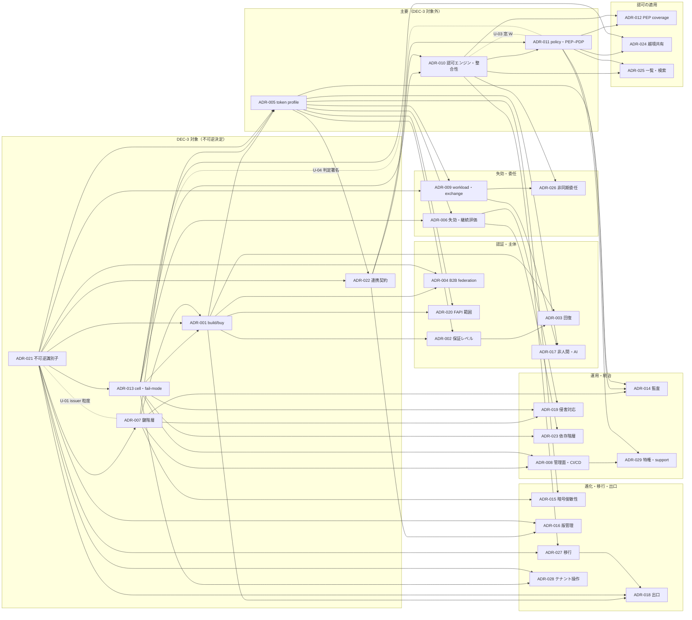

# ADR 索引と様式（05_adr）

> 文書ID: ADR-000 / 版: 0.1 / 状態: draft / 最終更新: 2026-10-15
> 対応要求: G-020（全 ADR の必須節）、R-094〜R-103（レビュー Gate 3 が分離を求めた 10 判断）、R-203、R-204（DL-12 の対応要求）
> 依存文書: CONVENTIONS.md, traceability/deliverables.md（§5、§6.1、§8 の 05_adr）, traceability/R-requirements.md, traceability/G-goal-criteria.md, 05_adr/ADR-001〜ADR-029, 05_adr/reconciliation-notes.md, research/standards-status.md
> 作成方法: AI エージェント（Claude）が ADR-001〜ADR-029 の 29 本について、メタ情報ブロック、要旨、§2 の決裁案・未決の論点・主要 ADR との論点、§7 の PoC 仮説、§8 の再検討トリガー、§9 の依存関係を通読し、索引として要約した。要約と件数の集計は自己レビューであり、実在の CTO/CISO の決裁ではない（CONVENTIONS §8）[D]。本書は ADR の内容を決め直さない。食い違いがあれば各 ADR の記述を正とする [D]。
> 表の注記: 表のセルでタグのないものは、各 ADR の記述を転記・要約した設計推論 [D] であり、この注記で個別のタグに代える。

## 要旨

- deliverables.md §5 が計画した ADR-001〜ADR-029 の 29 本は、2026-10-15 時点ですべて 05_adr/ に存在する。未作成の ADR はない [D]。
- 29 本すべての ADR 状態は proposed（決裁前）であり、文書状態は draft である。決裁済み（accepted）の ADR は 0 本である [D]。
- 不可逆決定として DEC-3 で決裁する ADR は 5 本（ADR-001、ADR-007、ADR-013、ADR-021、ADR-022）である [D]。このほか 4 本の ADR が、自らの論点を DEC-3 の議題に載せるよう提案している（ADR-009 P09-1、ADR-018 K18-5、ADR-020 P-1、ADR-026 L26-2。§5.2）[D]。
- 29 本すべてが PoC の仮説と試験案を持つ。試験案は仮番で計 412 件あり、採番と事前登録は DL-22 で行う [D]。
- 未決論点は重複を除いて 166 件である。内訳は、整合調整の未決 U-01〜U-04 が 4 件、各 ADR の決裁案が 105 件、ADR 間の論点（他の ADR の改版・確認を要するもの）が 57 件である（§6.4）[D]。
- 最も影響が大きい未決は U-01（issuer の粒度）である。ADR-007 KD7-1（テナント／realm 別）と ADR-021 K21-1（信頼区画別）が対立しており、13 本の ADR の記述・試算・手順がその結論に依存する（§4.2）。U-01 は DEC-8（連携契約 v1 の凍結）の前提条件でもある [D]（reconciliation-notes §5、ADR-022 D-10b）。

---

## 1. 本書の位置付けと読み方

- 本書は DL-12（ADR 集）の索引・様式であり、deliverables.md §8 の「05_adr/README.md／ADR-000／索引・様式」に当たる [D]。DL-12 の説明は「ADR 索引、様式、状態一覧を置く。不可逆決定（DEC-3 対象）を区別する」である [D]。
- §2 は ADR の様式、§3 は索引、§4 は依存関係図、§5 は不可逆決定（DEC-3）の一覧、§6 は未決論点の一覧、§7 は索引作成中に見つけた保守上の注意である [D]。
- 決裁事項 DEC-1〜DEC-9 の正式な定義は DL-39（00_decision/03-decision-items.md）が持つ。本書の DEC の記述は deliverables.md §6.1 の暫定対応に従う [D]。

## 2. ADR の様式

### 2.1 メタ情報ブロック

各 ADR の冒頭には、CONVENTIONS §1 の 3 行に次の 3 行を加えたメタ情報を置く [D]。

| 行 | 内容 | 例 |
|---|---|---|
| 文書ID・版・状態・最終更新 | 文書状態は CONVENTIONS §1 の draft／review／frozen。ADR 状態（§2.4）を括弧で併記する | `状態: draft（ADR 状態: proposed＝決裁前）` |
| 可逆性 | 可逆性の区分（§2.4）と、不可逆とする要素・戻す費用が大きい要素の列挙 | ADR-007 の 6 要素 |
| DEC-3 対象 | deliverables.md §5 の DEC-3 列の値と、依存先の DEC-3 対象 ADR | 「いいえ。依存先の ADR-013・ADR-021 は DEC-3 対象」 |
| 対応要求 | 本書を対応成果物とする R/G と関連 R/G | — |
| 依存文書 | 参照した文書と research ノート | — |
| 作成方法 | 起草の方法（§2.5）と自己レビューである旨 | — |

### 2.2 必須節（G-020 との対応）

G-020 は全 ADR に「文脈、選択肢、却下案と理由、決定（未決なら決定条件と期限）、帰結、可逆性、再検討トリガー、証拠」を求める [D]（traceability/G-goal-criteria.md の G-020 行）。29 本は次の節構成をとる [D]。

| 節 | 名前 | G-020 の項目 | 主な内容 |
|---|---|---|---|
| 冒頭 | メタ情報 | 可逆性 | §2.1 |
| — | 要旨（結論） | 決定 | 結論の箇条書き。決裁が要る点と主要 ADR との論点の件数 |
| §1 | 文脈 | 文脈、証拠 | 解くべき問い、規範の制約（強度付き）、製品・標準の事実、攻撃者モデルと事故の一次報告、前提（A-ID と新規仮定） |
| §2 | 決定 | 決定 | 決定（D 系 ID）、決裁案（K・KD 系）、未決の論点、主要 ADR との論点、TBD（所有者・期限・決め方） |
| §3 | 検討した選択肢 | 選択肢 | 主論点と副論点の案 |
| §4 | 評価 | 証拠 | 評価軸、採点、感度、判定者の不一致（主要 8 本） |
| §5 | 決定理由と棄却理由 | 却下案と理由 | — |
| §6 | 帰結 | 帰結 | 良い帰結、悪い帰結、残余リスクと受容者案、依存サービス・連携開発者への影響、運用・要員への影響 |
| §7 | 検証 | 証拠 | PoC の仮説と試験案（仮番）、第三者評価で確かめること |
| §8 | 再検討トリガーと見直し時期 | 再検討トリガー | 標準・製品・実測・前提・規制・事故の各トリガーと定期見直し |
| §9 | 依存関係 | — | 他 ADR、設計文書、契約、Wave A 文書への申し送り |
| 末尾 | 対応表（R/G）、残課題、参考文献、レビュー記録 | 証拠 | 閉じ方（CONVENTIONS §6）、未達事項、脚注、独立レビューの記録 |

- 節の欠落の有無は Phase 4 の自動検査で判定する（G-020 の判定者）[D]。本書の作成では節見出しの有無だけを確かめ、内容の十分性は判定していない [D]。
- ADR-007 と ADR-022 は §7 に「7.1」の小見出しを置かず、§7 の直下に試験案の表を置く [D]。

### 2.3 ADR 内の ID 表記

| 対象 | 表記の例 | 備考 |
|---|---|---|
| 決定 | D1〜D17（ADR-001）、D2-xx、D04-xx、D7-xx、D-xx（ADR-010・ADR-022）、D13-xx、D21-xx、D29-xx | ADR ごとに形式が異なる |
| 決裁案 | K1-x、KD2-x、K04-x、K-x（ADR-005）、K6-x、KD7-x、KD8-x、KD13-x、KD15-x、K16-x、K17-x、K18-x、K20-x、K21-x、KD23-x、K24-x、K26-x、K27-x、K28-x、KD29-x | ADR-011 の K-1〜K-10 は決裁案ではなく、案を切り替える条件の表である |
| 未決・論点 | U-01〜U-04（整合調整）、U1・U2（ADR-001・ADR-005 内の写し）、U2-xx、L-xx、L6-x、P09-x、P16-x、L17-x、L18-x、L19-x、P-x（ADR-020）、L23-x、L26-x、L27-x、RN-028-x、L29-x | 同じ L-01 が別の ADR で別の論点を指すので、ADR 番号と組で引く |
| 試験案 | TC-01-xx、TC-002-xx、H-xx（ADR-005・ADR-010）、H6-xx、H09-xx、H16-x、H-x（ADR-022）、H26-xx ほか | 仮番。DL-22 で TC-ID に採番する |
| 残余リスク・新規仮定 | RRxx-xx、NA-xxx-x、Nxx-x | 新規仮定は前提台帳への登録が要る |

### 2.4 ADR 状態と可逆性の区分

ADR 状態は CONVENTIONS に定義がないため、本書で次のとおり定める [D]。

| ADR 状態 | 意味 | 移る条件 |
|---|---|---|
| proposed | 決裁前。決裁案と選択肢まで | 起草時の既定 |
| accepted | 決裁済み | 決裁者（DEC-3 対象は CTO＋CISO 同意、それ以外は各 ADR の決裁案に書いた決める人）の承認記録（E1 または E2）がある |
| superseded | 後続の ADR に置き換えられた | 置き換える ADR の番号を明記する |
| deprecated | 判断を取り下げた | 理由を明記する。ファイルと番号は削除しない |

可逆性は各 ADR が自ら書いた区分を転記する。区分の意味は次のとおりである [D]。

| 区分 | 意味 |
|---|---|
| 不可逆 | 外部の RP・顧客 IdP・利用者の認証器・依存サービスの保存データに写し取られ、戻すと外部の作業が生じる |
| 一部（部分的に）不可逆 | 不可逆の要素を列挙し、それ以外は可逆とする |
| 可逆（条件付き・非対称） | 製品・設定・数値は差し替えられるが、一方向の変更（緩める・広げる等）だけが容易で、逆向きは移行期間や外部の改修を要する |
| 可逆 | 方式・数値・製品を後から差し替えられる。ただし移行費用が大きい要素を列挙する |

### 2.5 作成方法の違い

- 主要 8 本（ADR-001、ADR-005、ADR-007、ADR-010、ADR-011、ADR-013、ADR-021、ADR-022）は、3 つの起草レンズ（sec、ops、evo）の提案を AI エージェントの判定者 3 名が採点し、統合起草した [D]。8 本の相互の不整合 35 件は 05_adr/reconciliation-notes.md で整合調整した [D]。
- 残る 21 本は単一の AI エージェントが起草し、独立レビュー（末尾の「レビュー記録」）を経た [D]。21 本は主要 8 本を編集せず、食い違いを「主要 ADR との論点」として自らに記した [D]。
- 判定・採点・独立レビューはいずれも AI エージェントによる自己レビューである [D]。

### 2.6 ADR を追加・改版するときの手順

1. 新しい ADR は deliverables.md §5 と §8 に DL を追記してから作る（deliverables.md §1 の規則）[D]。番号は末尾採番とし、欠番は再利用しない [D]。
2. 識別子・claim 名・名前空間は ADR-021、claim の意味と発行条件は ADR-005、凍結区分は ADR-022、cell の定義は ADR-013、認可エンジンと整合性は ADR-010、PEP–PDP 契約と deny semantics は ADR-011 を正本とする（reconciliation-notes §2 の P2〜P4）[D]。
3. 他の ADR と食い違う場合は、相手の ADR を編集せず「主要 ADR との論点」に記し、本書 §6.3 に行を追加する [D]。
4. 状態・可逆性・DEC-3 対象・未決論点が変わった場合は、本書 §3・§5・§6 を同時に更新する [D]。

---

## 3. 索引

### 3.1 一覧（状態・可逆性・DEC-3）

| ID | タイトル | 版 | ADR 状態 | 最終更新 | 可逆性 | DEC-3 | 作成方法 |
|---|---|---|---|---|---|---|---|
| ADR-000 | 本書（索引・様式） | 0.1 | — | 2026-10-15 | — | — | — |
| [ADR-001](ADR-001-build-buy-identity-provider.md) | 認証基盤（IdP/AS）の build/buy/managed | 0.1 | proposed | 2026-10-03 | 部分的に不可逆（D1〜D4） | **対象**（自作しない方針） | 主要・判定 |
| [ADR-002](ADR-002-assurance-levels-by-tier.md) | 主体種別×操作リスク階層ごとの保証レベル、フィッシング耐性、同期 passkey、顧客 IdP の認証強度 | 0.2 | proposed | 2026-10-15 | 可逆（条件付き） | — | 単独＋レビュー |
| [ADR-003](ADR-003-account-recovery-authenticators.md) | アカウント回復と認証器ライフサイクル | 0.2 | proposed | 2026-10-15 | 可逆 | — | 単独＋レビュー |
| [ADR-004](ADR-004-b2b-federation-linking-scim.md) | B2B federation・account linking・domain verification・SCIM | 0.2 | proposed | 2026-10-15 | 部分的に不可逆（非対称） | — | 単独＋レビュー |
| [ADR-005](ADR-005-token-profile.md) | token profile（opaque/JWT 境界・寿命・sender constraint・claim profile） | 0.1 | proposed | 2026-10-03 | 条件付き可逆（非対称） | — | 主要・判定 |
| [ADR-006](ADR-006-revocation-continuous-evaluation.md) | 失効・継続評価 | 0.1 | proposed | 2026-10-15 | 可逆（条件付き） | — | 単独＋レビュー |
| [ADR-007](ADR-007-key-hierarchy-kms-hsm.md) | 鍵階層と KMS/HSM（root of trust） | 0.1 | proposed | 2026-10-03 | 一部不可逆（6 要素） | **対象**（鍵階層の原則） | 主要・判定 |
| [ADR-008](ADR-008-control-plane-cicd-protection.md) | 管理面と CI/CD の保護 | 0.1 | proposed | 2026-10-15 | 可逆（一部は移行費用大） | — | 単独＋レビュー |
| [ADR-009](ADR-009-workload-identity-token-exchange.md) | workload identity・token exchange・委任の伝搬・内部取引 context | 0.1 | proposed | 2026-10-15 | 一部不可逆（3 要素） | —（P09-1 を DEC-3 議題に提案） | 単独＋レビュー |
| [ADR-010](ADR-010-authz-engine-store-consistency.md) | 認可エンジン・relationship store・整合性モデル | 0.1 | proposed | 2026-10-03 | 可逆（条件付き・非対称） | — | 主要・判定 |
| [ADR-011](ADR-011-policy-language-pep-pdp-api.md) | policy 言語・deny semantics・PEP–PDP API | 0.1 | proposed | 2026-10-03 | 部分的に不可逆（非対称） | — | 主要・判定 |
| [ADR-012](ADR-012-pep-coverage-storage-guardrails.md) | PEP の配置・coverage の機械検証・ストレージ側 tenant guardrail・非同期経路の再認可 | 0.1 | proposed | 2026-10-15 | 可逆（条件付き・非対称） | —（不可逆側を DEC-8 凍結対象に提案） | 単独＋レビュー |
| [ADR-013](ADR-013-cell-partitioning-fail-mode.md) | cell 分割・global 部品の最小化・fail-mode 原則 | 0.1 | proposed | 2026-10-03 | 一部不可逆（6 原則） | **対象**（cell の原則） | 主要・判定 |
| [ADR-014](ADR-014-audit-data.md) | 監査データモデル・全件記録・保持と所在地・WORM と削除権の調停 | 0.2 | proposed | 2026-10-15 | 一部不可逆（非対称） | — | 単独＋レビュー |
| [ADR-015](ADR-015-crypto-agility-pqc.md) | 暗号の俊敏性と PQC 移行 | 0.1 | proposed | 2026-10-15 | 一部不可逆（4 要素） | — | 単独＋レビュー |
| [ADR-016](ADR-016-versioning-deprecation.md) | 版管理・後方互換・非推奨 | 0.1 | proposed | 2026-10-15 | 部分的に不可逆（4 要素） | — | 単独＋レビュー |
| [ADR-017](ADR-017-non-human-ai-agent-identity.md) | 非人間 ID と AI エージェントの主体モデル・tool 呼出し単位の認可・人による確認 | 0.1 | proposed | 2026-10-15 | 可逆（条件付き） | — | 単独＋レビュー |
| [ADR-018](ADR-018-exit-strategy.md) | 製品・クラウドからの出口戦略 | 0.1 | proposed | 2026-10-15 | 可逆（条件付き・時間で固まる部分あり） | —（K18-5 を DEC-3 前に決裁） | 単独＋レビュー |
| [ADR-019](ADR-019-compromise-response.md) | 侵害時対応の設計原則 | 0.2 | proposed | 2026-10-15 | 可逆 | — | 単独＋レビュー |
| [ADR-020](ADR-020-fapi2-applicability.md) | FAPI 2.0 の適用範囲 | 0.1 | proposed | 2026-10-15 | 可逆（非対称） | —（P-1 (b) を採る場合は DEC-3） | 単独＋レビュー |
| [ADR-021](ADR-021-irreversible-identifiers.md) | 不可逆識別子（issuer・sub/tid・RP ID・entityID・リソース型名前空間） | 0.1 | proposed | 2026-10-15 | 不可逆（可逆部分を切り出し） | **対象** | 主要・判定 |
| [ADR-022](ADR-022-integration-contract-standards.md) | 連携契約の標準と並行開発の契約凍結範囲 | 0.1 | proposed | 2026-10-15 | 部分的に不可逆 | **対象**（凍結は DEC-8） | 主要・判定 |
| [ADR-023](ADR-023-dependency-tiers.md) | 依存階層（Tier）と本基盤に依存してはならないもの、静的安定性と剥奪反映の調停 | 0.2 | proposed | 2026-10-15 | 可逆（一部は移行費用大） | — | 単独＋レビュー |
| [ADR-024](ADR-024-cross-tenant-sharing.md) | テナント越境共有 | 0.2 | proposed | 2026-10-15 | 可逆（非対称） | — | 単独＋レビュー |
| [ADR-025](ADR-025-list-search-authorization.md) | 一覧・検索の認可 | 0.2 | proposed | 2026-10-15 | 可逆（条件付き） | — | 単独＋レビュー |
| [ADR-026](ADR-026-async-long-running-delegation.md) | 非同期・長時間・定期ジョブとイベント consumer の委任・再認可 | 0.1 | proposed | 2026-10-15 | 可逆（条件付き） | —（L26-2 を DEC-3 資料に提案） | 単独＋レビュー |
| [ADR-027](ADR-027-migration-dual-run-rollback.md) | 移行方式（dual-run・shadow 判定・差分・段階導入・自動 rollback） | 0.2 | proposed | 2026-10-15 | 可逆（片道操作 O-1〜O-7 あり） | — | 単独＋レビュー |
| [ADR-028](ADR-028-tenant-lifecycle-operations.md) | テナントの統合・分割・cell 間移動・解約時エクスポート・削除 | 0.2 | proposed | 2026-10-15 | 可逆（条件付き。T14・T15 は不可逆） | — | 単独＋レビュー |
| [ADR-029](ADR-029-privileged-support-access.md) | 特権・support アクセス | 0.1 | proposed | 2026-10-15 | 可逆（一部は移行費用大） | — | 単独＋レビュー |

- 文書状態は 29 本とも draft である。状態欄の書き方は「draft（ADR 状態: proposed＝決裁前）」と「proposed（決裁前。CONVENTIONS §1 の区分では draft）」の 2 通りがあるが、意味は同じである [D]。
- 「作成方法」の「主要・判定」は §2.5 の判定者による統合、「単独＋レビュー」は単独起草と独立レビューを指す [D]。

### 3.2 決定の要旨・主な依存・PoC・再検討トリガー

「主な依存」は各 ADR §9 のうち決定の前提になるものに限る。全件は各 ADR の §9 にある [D]。「PoC」は §7 の試験案の件数（仮番）である [D]。

| ID | 決定の要旨（1 行） | 主な依存 | PoC | 再検討トリガーの要点 |
|---|---|---|---|---|
| ADR-001 | AS core と資格情報層は cell ごとの self-host OSS（第一候補 Red Hat build of Keycloak、対抗 Ory Enterprise License）で自作せず、識別子の外皮・主体台帳・鍵は自社が持つ（案E）。SRE 確約がなければ資格情報層だけ managed の案D | ADR-021, 007, 013, 005, 022 | 要（19 件） | G3 までに SRE 8 名以上の確約なし、FAPI conformance・hash/passkey export 等の足切り不合格、managed ベンダーの契約保証の変化、製品のライセンス・認定の変化、Transaction Tokens・OAuth 2.1 の RFC 化、EU Data Act の乗換え費用ゼロ化 |
| ADR-002 | 主体類型×操作 5 分類を high-water mark で評価し、privileged/P・break-glass/P は AAL3（device-bound）、同期 passkey は AAL2 の箇所に限り、顧客管理者の最上位保護操作は本基盤の束縛認証器で再認証 | ADR-001, 005, 011, 021, DL-09 | 要（10 件） | SP 800-63-4 系の改訂、PR の登録率・成功率の実測、主要 IdP が acr/amr で同期型を区別できるようになる、規制本文の取得、年 1 回 |
| ADR-003 | AAL2 の回復は SP 800-63B-4 §4.2.2.2 の三択だけで完了させ、helpdesk に認証器のリセット・移転をさせない。回復区分 R-A〜R-D ごとに待機・通知・制限・二者承認 | ADR-001, 002, 004, 021 | 要（11 件） | SP 800-63B-4 の改訂、WebAuthn signal の実装・CXP の Final 化、red team で helpdesk 経路の突破、ADR-002 の決裁、製品選定 |
| ADR-004 | federation は cell の自社 AS で終端し RP 起点に限る。linking は（テナント、上流 IdP、外部 subject）の 3 つ組だけ。DNS TXT のドメイン検証、SCIM テナントは SCIM 正本を既定 | ADR-001, 021, 005, 006 | 要（17 件） | ドメイン検証 I-D・IPSIE の状態変化、nOAuth 型の新しい一次報告、SAML 接続の移行完了率、U-01 の決裁 |
| ADR-005 | 外部 client に渡す access/refresh token は opaque、内部は token exchange で aud 別の RFC 9068 JWT。寿命は種別×階層で導出し、sender constraint は経路で選ぶ | ADR-001, 007, 021, 022, 013 | 要（18 件） | H-02・H-04 不合格なら BFF 経路を案C、H-20 で要求 context の範囲、Transaction Tokens・Token Status List・OAuth 2.1 の状態、bearer token の大量窃取事案 |
| ADR-006 | 失効は基盤所有の少数の強制点で中央強制し、署名付き・単調な失効状態を cell ごとに push。SSF/CAEP/RISC は組織境界だけで送受信。剥奪 SLO を項に分解 | ADR-005, 007, 010, 013, 022 | 要（13 件） | 配布系の飽和、read-sensitive の stale allow が R(rs) を超過、Token Status List の RFC 化、Transaction Tokens の RFC 化または失効 |
| ADR-007 | L0（オフライン root）→ L1（法域別）→ L2（cell×主体区分×用途族×alg）の 3 層。L2 は cell 別アカウントの KMS 非エクスポート鍵、(iss, typ, kid) → 許可鍵集合で検証 | ADR-021, 013, 005 | 要（16 件） | AM-2 の決裁、U-01（issuer の粒度）、TC-07-10 で権限の自己付与が成功、KMS 実効枠の不足、NIST IR 8547 等の final 化、CMVP 証明書の変化 |
| ADR-008 | 管理面の全変更を「宣言→二者レビュー→隔離 build と署名→cell 段階配布」の単一経路に限る。管理用 IdP を独立させ、常設特権なし・PAW・SLSA Build L3/Source L4 | ADR-007, 013, 001, 011, 021 | 要（12 件） | AM-2・AM-3 の決裁、管理用 IdP の global 依存の判明、SLSA 新版、KD13-6 の H の決定、要員不足 |
| ADR-009 | workload identity は SPIFFE/SPIRE の X.509-SVID mTLS。委任は RFC 8693 で hop ごとに aud 1 つの内部 token を取り直し `act` で表す。内部 context は Transaction Tokens に寄せた社内 profile `txn-v1` | ADR-005, 007, 013, 021, 022 | 要（13 件） | Transaction Tokens の新版・RFC 化・失効、WIMSE の状態、exchange 量の分散係数の実測、法域越え同期呼出しの多寡 |
| ADR-010 | 製品は 1 つに決めず OpenFGA と SpiceDB を PoC で比較する。依存先は自社 PDP façade だけ。整合性は操作階層ごとに割り当て、store は cell 単位 | ADR-013, 021, 022, 011 | 要（20 件） | OpenFGA の窓 W 方式の不合格、façade 保守費の超過、製品の買収・ライセンス変更、A-045 実測の逸脱、SRE 増員不可 |
| ADR-011 | 正規認可モデル CAM を正本とし、L0・G 段・R 段の論理積、既定拒否・deny 優先・評価不能は deny。PEP–PDP は AuthZEN 1.0 と版付き自社 profile | ADR-010, 021, 022, 013 | 要（21 件） | CAM の往復試験の不合格（ops 案へ）、CAM 要員の確保不可、A-104 の否定、AuthZEN 後続版、G 段カタログの肥大 |
| ADR-012 | object 単位の判定はサービス内 PEP が担う。entry point を宣言×観測で突合し未宣言を 0 件に保つ。PostgreSQL RLS 等のストレージ側 tenant guardrail、非同期経路で再認可 | ADR-011, 010, 013, 021, 022 | 要（15 件） | 未観測 entry point の比率、言語別の静的ルール検出率、RLS の遅延、テナント別 index の運用不可、L-01・U-03・U-04 の決着 |
| ADR-013 | cell は法域×規制スコープ×テナント群（試算 9）。global 部品は許可リストの 5 つ。認可判定の fail-open 禁止、配布物は cell 単位の wave | ADR-021, 001, 007 | 要（25 件） | KD13-1 の blast radius 予算、SRE 増員不可、製品が cell 単位の AS を作れない、障害が 2 cell 以上に波及、KMS 署名が quota の 80% 超 |
| ADR-014 | 監査は trace と別経路で正準スキーマ（DL-77）に 100% 記録。相関 8 欄、4 層の改ざん検知、WORM と削除権は 3 層で調停 | ADR-005, 007, 010, 011, 013, 021, 022 | 要（15 件） | OCSF 2.0、Transaction Tokens の状態、EDPB 仮名化指針の final・crypto-shredding の法的判断、U-01・U-02・U-04 の決裁、記録率の SLO 割れ |
| ADR-015 | alg は検証側の版付き暗号 profile と鍵マニフェストで決める。鍵交換は PQ/T hybrid、token 署名に composite は採らず、長期成果物は二重署名。移行順序と社内期限案 | ADR-007, 005, 021, 022 | 要（9 件） | NIST IR 8547・SP 800-131A Rev.3 の final、FIPS 206 の公表、composite JOSE の RFC 化、日本政府の移行工程表、TC-15-01 の不合格 |
| ADR-016 | 6 対象ごとに版の表し方・互換判定・交渉・rollback を決める。制約の強化は major、GA の併存は 24 か月以上（初期案）、非推奨は計測と直接通知が主手段 | ADR-021, 022, 005, 011 | 要（9 件） | Token Status List・Transaction Tokens・8725bis の RFC 化、AuthZEN 改訂、未移行 consumer の比率、downgrade の事故 |
| ADR-017 | AI エージェントは認証・監査・棚卸しの上では独立主体、利用者のための認可は委任＋`act`。tool 単位の認可は tool 側 PEP、高リスク操作は一回限りの承認 grant | ADR-001, 005, 009, 011, 021 | 要（14 件） | MCP 新版、AIMS・ID-JAG の状態、Keycloak の delegation の GA 化、エージェント主体数が 10 万超、ATK-16 に当たる事故 |
| ADR-018 | 出口では識別子と鍵を動かさず、データと実装だけを動かす。自社正規 export 形式 EIF を定常機能とし、契約に EU Data Act 第 25 条(2) 相当の最低線、3 層の出口演習 | ADR-001, 007, 010, 011, 013, 021, 027 | 要（14 件） | 製品の LTS 終了・ライセンス変更、export 機能の廃止、CXP の状態、Data Act・DORA の改訂、演習で移出できないデータ種別 |
| ADR-019 | 侵害時の機能は平時に作り込み、平時経路の最大速度版として定期的に動かす。kill switch K1〜K4、範囲ごとの失効下限時刻、PDP 隔離、顧客 IdP 切離し、証拠保全 | ADR-005, 006, 007, 013, 001 | 要（12 件） | U-01・U-04・KD13-6・KD7-3・DP46-3 の決裁、TC-19-02・TC-19-03 の不合格、法定報告期限の改正、新しい侵害の一次報告 |
| ADR-020 | FAPI 2.0 必須範囲を F1〜F6（操作階層×client 種別×規制・契約）とし、mTLS・private_key_jwt・PAR に固定。OIDF conformance を自社で実行し、範囲外は RFC 9700 準拠表が最低基準 | ADR-001, 005, 021 | 要（9 件） | G1 棚卸しの結果、ADR-005 K-3 の決裁、TC-20-01 の不合格、FAPI の改版、EU の PSR・PSD3 の採択 |
| ADR-021 | 識別子は識別子専用の自社所有 domain の下の不透明値で固定する。issuer は信頼区画ごと（U-01 で未決）、RP ID は区画の login ホスト、email 等による結合を禁止 | ADR-007, 001, 005, 022 | 要（16 件） | Transaction Tokens の状態、CXP、規制が発行者の分離を要求、事業売却、識別子の変更で顧客作業が 1 件でも発生（臨時再決裁） |
| ADR-022 | 連携契約 v1 を「不可逆・GA・preview・凍結しない」の 4 区分で凍結する。連携側は契約だけに依存し、SDK は 5 責務の薄いラッパ、負例ベクタ 13 種 | ADR-005, 021, 016 | 要（11 件） | Transaction Tokens の RFC 化または失効、CAEP Interoperability Profile の Final 化、要員見積りの超過、負例にない検証漏れの発見 |
| ADR-023 | 操作階層と依存 Tier を独立の二軸とし、Tier X（依存禁止の 16 項目）に代替手段を置く。剥奪の入力経路を Tier 0 に置き、静的安定性と剥奪反映を切り離す | ADR-013, 006, 008, 005 | 要（11 件） | Tier 1 の上限超過、KD13-6 の決着、CP 停止中の剥奪が R(t, c) を超過、Tier X 項目の演習失敗 |
| ADR-024 | テナント越えは資源側テナント文脈の token と期限付きの外部付与で表し、三者一致規則に例外を作らない。越境共有は既定無効、認証付きリンクを標準 | ADR-011, 010, 013, 021, 005 | 要（10 件） | テナント切替が業務を妨げる実測、越境利用者が 15% 超、主要製品の既定値の変更、ADR-013 の改訂、U-01 の決裁 |
| ADR-025 | 一覧・検索の認可根拠は返却直前ページの post-check だけとし、列挙・検索・ACL 反映索引は候補の生成器とする。件数等は許可集合とテナント内の統計から作る | ADR-010, 011, 013 | 要（13 件） | 打切り率・予算切れ率の超過、AuthZEN search の改訂、OpenFGA の内容版トークン、post-check の負荷超過 |
| ADR-026 | 非同期処理を 4 型に分け、enqueue 時の判定は受付だけにする。実行時に TTS の内部開始 Txn-Token と PDP の再判定を要し、`offline_access` をジョブに持たせない | ADR-005, 009, 010, 011, 021, 022 | 要（12 件） | Transaction Tokens の状態、ADR-009 の決裁、DEC-3 での L26-2 の扱い、TTS・PDP の停止が MTPD を超過、退職後のジョブ実行 |
| ADR-027 | 移行は移行単位ごとの状態機械で進め、判定の正本を常に一方に限る。allow 拡大差分はセキュリティ事象とし、前進は人が承認・rollback は自動 | ADR-001, 010, 011, 013, 021 | 要（12 件） | shadow の負荷超過、related origins の不動作、互換受付の一意写像の不成立、U-01 の決裁、GOV-06 S6 の解除 |
| ADR-028 | 統合・分割・cell 間移動・解約時 export・削除を 1 つの orchestrator で実行する。識別子は書き換えず、削除は論理削除→鍵破棄→消去完了の 3 段 | ADR-013, 021, 010, 007 | 要（15 件） | U-01 の決裁、RN-028-1 の判断、ADR-007 のデータ暗号化鍵族、最大テナントの凍結時間が BIA を超過、KMS の上限・費用 |
| ADR-029 | 事業者要員は常設の権限を持たず、チケットに結び付いた昇格 grant と顧客承認でだけアクセスする。特権を通常の認可 graph に混ぜず、support 経路を分離し、break-glass は封緘・同時二者 | ADR-008, 011, 010, 013, 005 | 要（20 件） | KD29-5（特権 grant の評価位置）の決着、端末束縛の機能不全、token 検出率の不足、break-glass の発動時間が BIA と合わない、製品の impersonation を無効化できない |

- 定期の見直しは、ほぼ全 ADR が G3・G4 と A-101 の再決裁周期（初回は G6 開始から 3 年以内、以後 5 年以内）に合わせる [D][A-101]。標準の状態は research/standards-status.md の周期で追う [D]。
- Transaction Tokens（draft-ietf-oauth-transaction-tokens-11）は IESG 未提出の Internet-Draft で、2027-01-31 に失効する予定である（確認日 2026-10-03）[N][^1]（RS-06#29、SS-B04）。ADR-001、ADR-005、ADR-006、ADR-009、ADR-010、ADR-011、ADR-012、ADR-013、ADR-014、ADR-016、ADR-017、ADR-019、ADR-021、ADR-022、ADR-026 の 15 本が、その状態変化を再検討トリガーにしている [D]。

### 3.3 レビュー Gate 3 の 10 判断との対応

G-020 の合格条件の一部である「Gate 3 の 10 判断がすべて ADR に対応している」ことを確かめた [D]。

| R | Gate 3 の判断 | 対応 ADR | 存在 |
|---|---|---|---|
| R-094 | managed IdP か自営 AS か（認証プロトコル・認証器・回復は自作しない） | ADR-001 | あり |
| R-095 | opaque/JWT 境界 | ADR-005 | あり |
| R-096 | FAPI 2.0 必須 API 範囲 | ADR-020 | あり |
| R-097 | engine/store、整合性モデル、tenant/domain 分割 | ADR-010 | あり |
| R-098 | policy language、schema、deny semantics、conflict resolution | ADR-011 | あり |
| R-099 | PDP topology、cell・fault domain | ADR-013 | あり |
| R-100 | workload identity と token exchange | ADR-009 | あり |
| R-101 | 鍵管理・crypto agility・PQC 移行の抽象境界 | ADR-015、ADR-007 | あり |
| R-102 | 監査データモデル・保持・所在地・顧客開示 | ADR-014 | あり |
| R-103 | migration・dual-write・shadow・rollback・vendor exit | ADR-027、ADR-018 | あり |

### 3.4 未作成の ADR

- 未作成: なし [D]。deliverables.md §5・§8 の ADR-001〜ADR-029 の全ファイルが存在することを 2026-10-15 に確かめた [D]。
- 一部の ADR の §9 には、起草時点の「未起草」「未作成」の表記が残っている（§7 の M-1）[D]。

---

## 4. 依存関係図

### 4.1 ADR 間の主な依存

矢印は「前提を与える ADR → 前提を使う ADR」を表す。主な依存だけを描き、全件は各 ADR の §9 にある [D]。点線は未決の論点で結ばれた組である [D]。

### 4.2 未決論点 U-01〜U-04 の波及

```mermaid
flowchart TB
  U01["U-01 issuer の粒度<br/>決める場: DEC-3（G3）"]
  U02["U-02 txn を証跡の主キーにする範囲<br/>決める場: CTO＋CISO（ADR-005 H-20 の後）"]
  U03["U-03 OpenFGA の窓 W 方式<br/>決める場: CISO 受容票（Gate 3）"]
  U04["U-04 判定記録への PDP 署名<br/>決める場: KD13-6 と同時（G4）"]
  DEC8["DEC-8 連携契約 v1 の凍結"]

  U01 --> A001 & A004 & A005 & A006 & A007 & A013 & A014 & A019 & A020 & A021 & A022 & A027 & A028
  U01 -- "前提条件" --> DEC8
  U02 --> A005 & A009 & A014 & A017 & A021 & A022
  U03 --> A010 & A011 & A012 & A025 & A027
  U04 --> A010 & A011 & A012 & A013 & A019 & A022 & A023 & A025 & A027
  U02 -. "決まらなければ preview" .-> DEC8
  U04 -. "決まらなければ preview" .-> DEC8

  A001["ADR-001"]
  A004["ADR-004"]
  A005["ADR-005"]
  A006["ADR-006"]
  A007["ADR-007"]
  A009["ADR-009"]
  A010["ADR-010"]
  A011["ADR-011"]
  A012["ADR-012"]
  A013["ADR-013"]
  A014["ADR-014"]
  A017["ADR-017"]
  A019["ADR-019"]
  A020["ADR-020"]
  A021["ADR-021"]
  A022["ADR-022"]
  A023["ADR-023"]
  A025["ADR-025"]
  A027["ADR-027"]
  A028["ADR-028"]
```

- U-01 の矢印は、U-01 の結論によって記述・試算・手順が変わると各 ADR が明記したものに限る [D]。ADR-003・ADR-008・ADR-024・ADR-029 は「U-01 のどちらの結論でも本書の決定は変わらない」と書いているので矢印を引いていない [D]。
- U-02・U-04 が DEC-8 の前に決まらない場合、該当要素は preview に置く（ADR-022 D-10b）[D]。U-01 は不可逆区分の値なので preview に置けず、DEC-3 の決裁が DEC-8 の前提条件になる [D]。

---

## 5. 不可逆決定の一覧（DEC-3）

DEC-3 の承認者（暫定）は CTO（アーキテクチャ審査会経由）＋CISO 同意で、決裁内容は「不可逆決定の ADR v1」である（deliverables.md §6.1）[D]。

### 5.1 DEC-3 対象 ADR と不可逆とする決定

| ADR | 不可逆として決裁を求める決定 | DEC-3 で同時に決める決裁案 | 可逆として切り出したもの |
|---|---|---|---|
| ADR-001 | (1) D1 認証プロトコル・認証器・password・回復・AS core を自作しない原則と例外審査。(2) D2 外部に見える識別子と endpoint を自社ドメインの製品非依存 path に固定。(3) D3 主体台帳の正本を自社に置く。(4) D4 依存サービスと外部 client が信頼する issuer を cell 内の自社 AS に限る | K1-1（D1〜D4 を不可逆原則として承認） | 製品の選択（D6〜D7）、資格情報層を managed にするか（D9、D17）。D2・D3 があればテナント単位で戻せる |
| ADR-007 | (1) 3 層の鍵階層と「1 鍵 1 用途 1 alg 1 スコープ」。(2) 結合規則 (iss, typ, kid) → 許可鍵集合。(3) 信頼アンカー（L0 公開鍵）と署名付き鍵マニフェストの配布形式。(4) kid を不透明 ID とする命名規則。(5) 鍵台帳のスキーマ。(6) issuer の粒度（ADR-021 と同時） | KD7-1（issuer の粒度＝U-01）。KD7-2〜KD7-8 は CTO＋CISO 等の決裁で、期限は G3 | KMS/HSM の製品と backend、L1 の保管方式、鍵年齢などの数値、alg、テナント専用鍵の適用範囲 |
| ADR-013 | (1) 分割キーを不透明・不変のテナント ID とし、1 テナントの認可データを複数 cell に分けない。(2) 法域パーティションを越えてデータ・鍵・運用アクセスを共有しない。(3) cell 間で同期呼出しも共有状態も持たない。(4) global 部品を許可リスト方式で限る。(5) cell 識別子を外部識別子と外部 token の claim に出さない（ADR-021 と同時）。(6) 認可判定を fail-open にしない | KD13-1〜KD13-8 は CTO・CISO・事業責任者等の決裁（KD13-6 は G4） | cell の数と寸法、AS を cell に置くか region に置くか、専用 cell の基準、数値、wave の順序、substrate |
| ADR-021 | issuer URL、sub・tid・client_id・SAML 接続 ID の値と「不透明に扱う」契約、WebAuthn RP ID、SAML SP entityID/ACS、pairwise の採否、名前空間の命名規則、claim 名 | K21-1（issuer の粒度＝U-01）、K21-2（ドメイン構成）、K21-3（専用 issuer 枠）、K21-4（pairwise の既定）、K21-5（名前空間台帳の所有者）、K21-6（`<id-domain>` の名称と保有法人） | cell 別の内部 issuer、kid の値、新規払出しの符号化方式、表示用テナント名、製品内部 ID、運用規則、信頼区画・専用 issuer の追加 |
| ADR-022 | 識別子（issuer URL、sub/tid の形式、scope・permission・resource type の名前空間、claim 名の予約名前空間、CloudEvents の type/source の命名、kid の命名規則、相関 ID 欄の意味。形式は ADR-021）と、GA で凍結した claim の意味 | 凍結そのものは DEC-8（D-11 の決裁案。条件付き凍結を推奨） | それ以外の契約要素は「版付き・非推奨期間付き・強制移行なし」で置き換える |

### 5.2 DEC-3 の議題に載せるよう提案されている論点

| 提案元 | 論点 | 提案の内容 | 状態 |
|---|---|---|---|
| reconciliation-notes U-01 | issuer の粒度 | ADR-007 KD7-1 と ADR-021 K21-1 を同時に決裁する。02_requirements/tenant-lifecycle.md の K-8 も 1 つの論点として示す | 未決 |
| ADR-009 P09-1 | SPIFFE trust domain の数 | 法域パーティションごと（本番 3＋非本番 1）を推奨し、ADR-021 D21-28（本番 1・非本番 1）と対立する。ADR-021 K21 系と同時に DEC-3 で決める | 未決 |
| ADR-018 K18-5（L18-1） | 可搬秘密（pairwise の秘密、pepper） | ADR-021 D21-14e の持ち出し要件と ADR-007 D7-06 の非エクスポート既定の調停。DEC-3 の前に CTO＋CISO が決める | 未決 |
| ADR-026 L26-2 | 内部開始取引の `txn` の意味 | 相関 ID 欄の意味は ADR-022 で不可逆とされるため、DEC-3 の決裁前に ADR-021・ADR-022 に読み方を明記するか、内部開始を別欄にするかを決める | 未決 |
| ADR-020 P-1 | 層 F 専用の信頼区画 issuer | ADR-001 T-02（FAPI 足切り不合格）が起きた場合に (b) を採るなら、ADR-021 の区画追加として DEC-3（U-01 と同時）で決める。推奨は (a) | 条件付き |

### 5.3 DEC-3 対象外だが戻しにくい要素を持つ ADR

次の要素は DEC-3 の対象ではないが、各 ADR が「不可逆側」または「戻す費用が大きい」と明記している [D]。多くは ADR-021・ADR-022 の不可逆決定または DEC-8 の凍結に従属する [D]。

| ADR | 戻しにくい要素 | 従属先 |
|---|---|---|
| ADR-002 | 登録させた認証器の種類（同期 passkey 受入れ後に締めると再登録）、trust agreement の acr/amr 対応表、内部 token の `acr` 値の意味 | ADR-021、ADR-022、DL-115 |
| ADR-003 | 発行済み回復コード・登録済み回復用アドレス、生体情報を保持しない判断 | ADR-021 |
| ADR-004 | 結合キーを 3 つ組に限る規則（緩めると nOAuth 型の経路）、顧客 DNS に置くドメイン検証レコードの名前と形式、既存 SAML 接続の接続ごと entityID への移行 | ADR-021 |
| ADR-005 | opaque から JWT へは可逆、外部に JWT を出してから opaque に戻すのは事実上不可逆。契約に載せる typ・claim、opaque token の最大長、相関 ID の意味 | ADR-021、ADR-022、ADR-014 |
| ADR-006 | SSF/CAEP/RISC のイベント種別・SET 形式・受信義務、依存サービスに課す cache 禁止と再確認義務、失効記録の識別子の意味 | ADR-022、ADR-014 |
| ADR-008 | 管理面の全変更を単一の宣言経路に通す原則（外すと証跡 E10 の連続性が途切れる） | — |
| ADR-009 | SPIFFE trust domain の名前と数、SPIFFE ID の path 形式と非再割当、`txn` の意味 | ADR-021（P09-1） |
| ADR-010 | 整合性トークンの形式と最大長、tuple の主体・資源識別子、正規モデルの名前空間、PEP–PDP 契約 | ADR-021、ADR-022、ADR-011 |
| ADR-011 | AuthZEN 準拠部分と自社 profile のキー名・意味、名前空間、deny semantics の基本規則、decision_id と model_revision の形式 | DEC-8、ADR-021、ADR-014 |
| ADR-012 | entry point 台帳の宣言形式、enforcement 記録と span 属性の欄、非同期メッセージの認可 envelope の欄、DB のテナント区画の規約 | DEC-8（凍結対象に含める提案） |
| ADR-014 | WORM に書いた記録（平文の個人属性を置かない規則は初日から必要）、顧客向け監査 API と正準スキーマの欄、監査署名の検証鍵と封印の連鎖 | ADR-016、ADR-022、ADR-007 |
| ADR-015 | hybrid 化前に記録された TLS 通信、量子脆弱な方式だけで署名した長期成果物、暗号の交渉の仕組み、識別子に alg 名を入れない規則 | ADR-007、ADR-021、ADR-022 |
| ADR-016 | 使った名前を意味を変えて再利用しない規則、版 claim と「未対応 major は拒否」、監査イベントのスキーマ版欄、policy・model の版番号の単調性 | ADR-021 |
| ADR-018 | 契約の退出条項（契約期間中は追加できない）、password hash の方式とパラメータ、EIF v1 の識別子 | ADR-021 |
| ADR-023 | 約 300 の依存サービスに課す実装義務、剥奪・停止の入力経路を Tier 0 に置く配置 | ADR-013 |
| ADR-024 | 外部に配布した共有リンクの URL（ドメインと形式） | ADR-021 |
| ADR-025 | 一覧ヘルパの応答の意味論（後段評価の必須、`completeness`、件数の数え方、cursor の束縛） | ADR-011 |
| ADR-026 | 約 300 サービスの実装に入る義務、委任 grant と `job_run_id` の監査上の結合、内部開始取引の `txn` の意味 | ADR-021、ADR-022（L26-2） |
| ADR-027 | 片道操作 O-1〜O-7（旧経路の撤去、旧 IdP の資格情報の消去、顧客への新識別子への切替依頼、旧 grant の失効など）。自動化の対象から外し個別承認を要する | ADR-021 |
| ADR-028 | 実行したテナントについての T14（鍵破棄）と T15（消去完了）。統合（T08）は統合元 KEK の破棄までは戻せる | ADR-013、ADR-021 |
| ADR-029 | 特権を通常の認可 graph に混ぜない原則、顧客に開示する事業者アクセス記録の欄 | ADR-022、ADR-016 |

---

## 6. 未決論点の一覧

本節は「決定していない点」を 3 種に分けて挙げる [D]。各 ADR の TBD（数値の所有者・期限・決め方）と Wave A 文書への申し送りは件数に含めず、各 ADR の §2 と §9 に任せる [D]。

### 6.1 整合調整の未決 U-01〜U-04

正本は 05_adr/reconciliation-notes.md §5 である [D]。

| ID | 論点 | 選択肢の要約 | 関係する ADR | 決める場・期限 |
|---|---|---|---|---|
| U-01 | issuer の粒度 | (a) テナント／realm 別（ADR-007 KD7-1）: 外部 RP も標準の検証だけで cell 封じ込めを得るが、issuer metadata が約 1 万件。(b) 信頼区画別＋cell 別鍵＋専用 issuer 枠（ADR-021 K21-1）: 外部 client は区画ごとに 1 issuer、外部 RP に対する cell 封じ込めは失われる | ADR-001、005、007、013、021、022（ほか §4.2） | DEC-3（CTO＋CISO）。G3。DEC-8 の前提条件 |
| U-02 | `txn` を証跡の主キーにする範囲 | (a) 全要求に要求 context を発行（署名 16,804/秒、成長 56,444/秒）。(b) write 以上に限り、public・read-sensitive は (jti, decision_id, X-Request-ID) で相関 | ADR-005、021、022（入力: ADR-009 P09-2、ADR-014、ADR-017 L17-2） | CTO＋CISO。ADR-005 H-20 の実測の後 |
| U-03 | OpenFGA の窓 W 方式 | (a) 期限付きで受容（時間の上限だけを守る）。(b) 受容しない（ADR-011 D6-3 の常時格上げ、または候補を SpiceDB に絞る） | ADR-010（決裁案 2）、011 | CISO（受容票）。Gate 3、ADR-010 H-05 の後 |
| U-04 | 判定記録への PDP 署名 | (a) KD13-6 で read-sensitive の fail-static を許すなら署名が必須。(b) 許さないなら署名は PoC 項目のまま | ADR-010、011、013、022 | ADR-013 KD13-6 と同時（CISO＋事業責任者＋CTO）。G4 |

### 6.2 各 ADR の決裁案

決裁案は各 ADR が「決定済みではない」と明記した組織決定（CONVENTIONS §6 の B 区分）である [D]。推奨・選択肢・帰結は各 ADR の該当節にある [D]。

| ADR | 決裁案（ID と論点） | 件数 | 主な決める人・期限 |
|---|---|---|---|
| ADR-001（§2.18） | K1-1 D1〜D4 の不可逆原則、K1-2 SRE 8 名以上の確約、K1-3 有償サポート契約、K1-4 AGPL-3.0 製品を候補に残すか、K1-5 退出条項の必須化 | 5 | CTO（DEC-3）＋CISO、経営会議（DEC-4）、法務・調達。G3 |
| ADR-002（§2.12） | KD2-1 PR 必須の範囲、KD2-2 同期 passkey の受入範囲と顧客管理者の最上位保護操作、KD2-3 顧客管理者の IAL、KD2-4 AAL2 の床への移行期間と tailoring の期限 | 4 | CISO＋事業責任者（B2B・B2C・決済）。G1 |
| ADR-004（§2.10） | K04-1 IdP 起点 SAML の例外、K04-2 プロビジョニングの既定、K04-3 証明書の期限切れ、K04-4 ドメイン再検証の頻度・猶予・監視、K04-5 既存 SAML 接続の移行期限 | 5 | CISO、プロダクト責任者、営業・顧客成功責任者、CTO。G3 |
| ADR-005（§2.14） | K-1 BFF 経路の形式、K-2 剥奪反映 SLO R(t) と被害窓 E(t)、K-3 第三者サーバー型の sender constraint 既定、K-4 内部 RS256 の扱い、K-5 AS 置換時の再同意、K-6 内部束縛 I1 か I2 | 6 | CTO＋CISO、事業責任者、プロダクト責任者。G1〜G4 |
| ADR-006（§2.11） | K6-1 剥奪反映 SLO の構造、K6-2 read-sensitive の内部 hop、K6-3 外部連携アプリの受信義務、K6-4 allow cache 禁止の適用時期、K6-5 剥奪書込の RPO | 5 | CTO＋CISO、事業責任者、プロダクト責任者。G3〜G4 |
| ADR-007（§2.13） | KD7-1 issuer の粒度（U-01）、KD7-2 L1 の保管、KD7-3 緊急失効の権限、KD7-4 鍵年齢、KD7-5 鍵侵害の blast radius 予算、KD7-6 L0 を法域で分けるか、KD7-7 要員、KD7-8 第 2 事業者の待機 L1 | 8 | CTO＋CISO（KD7-1 は DEC-3）、事業責任者、経営（DEC-4）。G3 |
| ADR-008（§2.12） | KD8-1 管理用 IdP の形態、KD8-2 Source L4 の適用範囲、KD8-3 PAW の方式、KD8-4 非本番の分離単位、KD8-5 CP-0 の待機時間 | 5 | CTO＋CISO、SRE 責任者。G3（KD8-5 は G4） |
| ADR-010（§2.12） | 1 自社部品の開発（R-204）、2 OpenFGA の窓 W 方式の残余（U-03 と同じ）、3 SRE の on-call 体制、4 剥奪書込の RPO 0、5 剥奪後 stale allow の許容上限 B | 5 | CTO＋CFO、CISO（受容票）、事業責任者。Gate 3〜G4 |
| ADR-013（§2.9） | KD13-1 blast radius 予算と cell 数、KD13-2 専用 cell の基準と価格、KD13-3 AS を cell に置くか region に置くか、KD13-4 EU・米国の DR、KD13-5 SRE 増員か開発者の on-call 参加、KD13-6 read-sensitive の fail-static と B_rs・H・Q_r・Q_w、KD13-7 第二 substrate・DNS 提供者の複数化、KD13-8 バックアップ認証系の採否 | 8 | 事業責任者、CTO＋CISO、法務、人事、CFO。G3〜G4 |
| ADR-015（§2.9） | KD15-1 移行戦略、KD15-2 社内期限、KD15-3 内部 token の発行 alg、KD15-4 PQ 署名鍵の保管水準、KD15-5 外部の量子脆弱な署名の停止日 | 5 | CTO＋CISO、事業責任者、法務 |
| ADR-016（§2.12） | K16-1 GA の最短期間、K16-2 同時提供する GA major の上限、K16-3 S6 有効中の廃止の扱い、K16-4 延長の上限と閾値 | 4 | CTO＋CISO、経営会議（S6）。DEC-8 前・G3 |
| ADR-017（§2.11） | K17-1 エージェントの自律動作の範囲、K17-2 エージェントの privileged 操作、K17-3 信頼できない内容を読む tool と +XT・+FIN の tool の同居、K17-4 期限・猶予・寿命の値 | 4 | CTO、CISO、事業責任者、法務。G3〜G4 |
| ADR-018（§2.11） | K18-1 C1〜C12 を全契約の最低線に、K18-2 撤退時の監査アーカイブと KMS 暗号化データ、K18-3 本番 1 cell の部分退出、K18-4 password hash の cost、K18-5 可搬秘密の扱い | 5 | 法務・調達、CISO、CFO、CTO、経営会議。G3（K18-5 は DEC-3 の前） |
| ADR-020（§2.14） | K20-1 FAPI 必須範囲、K20-2 F3 の DPoP 構成、K20-3 public client からの F1・F2、K20-4 OIDF 認定の取得、K20-5 内部 JWT の RS256 逸脱 | 5 | CTO＋CISO、プロダクト責任者。G2〜G5 |
| ADR-021（§2.12） | K21-1 issuer の粒度（U-01）、K21-2 ドメインの構成、K21-3 専用 issuer 枠の上限、K21-4 第三者 client への pairwise の既定、K21-5 名前空間台帳の所有者、K21-6 `<id-domain>` の名称と保有法人 | 6 | CTO＋CISO（DEC-3）、経営会議、法務、事業責任者、個人情報保護責任者 |
| ADR-022（D-11） | DEC-8 の承認条件（条件付き凍結・段階凍結・凍結延期） | 1 | CTO＋CISO（DEC-8） |
| ADR-023（§2.10） | KD23-1 Tier の判定閾値と Tier 1 の上限数、KD23-2 Tier 1 が上限を超える可用性を求めた場合、KD23-3 帯域外の連絡手段、KD23-4 復旧経路の非依存を全 Tier 必須にするか、KD23-5 過負荷時の shed の順序 | 5 | 事業責任者、CTO、CISO。G3〜G4 |
| ADR-024（§2.9） | K24-1 越境共有の既定値、K24-2 外部付与の期限、K24-3 個人情報の匿名リンク、K24-4 home 側テナント・グループを付与先にする型 | 4 | プロダクト責任者＋CISO、事業責任者。G2〜G3 |
| ADR-026（§2.13） | K26-1 ジョブ所有者の退職・権限喪失時の既定、K26-2 委任 grant の期限と I_job(t)、K26-3 再認可を挟めない処理の例外、K26-4 +FIN・+XT の操作を委任ジョブで実行するか | 4 | 事業責任者、CTO＋CISO。G3〜G4 |
| ADR-027（§2.12） | K27-1 旧識別子の互換受付、K27-2 allow 拡大差分の扱い、K27-3 移行専任の要員、K27-4 JIT 移行の期間 | 4 | CTO＋CISO、事業責任者、CFO。G3〜G4 |
| ADR-028（§2.16） | K28-1 大規模テナントの差分追従の前提、K28-2 テナント KEK の実体、K28-3 顧客管理者 1 名のテナントのエクスポート承認、K28-4 論理削除の待機期間と復元期間 | 4 | CTO＋SRE 責任者、CISO＋CTO（CFO）、事業責任者、個人情報保護責任者。G1〜G4 |
| ADR-029（§2.12） | KD29-1 SL2 の顧客承認の既定、KD29-2 support 端末の水準、KD29-3 break-glass の保管方式、KD29-4 support 担当の主体、KD29-5 特権 grant の評価位置（L29-1）、KD29-6 緊急時の事後承認の契約オプション | 6 | CISO、CTO、事業責任者、法務、support 部門長。G3 |

- ADR-003・ADR-009・ADR-011・ADR-012・ADR-014・ADR-019・ADR-025 は決裁案の表を持たない [D]。これらの決めるべき点は、ADR 間の論点（§6.3）、残課題、または他の文書の決裁案（DL-08 の IL-D1〜IL-D3、DL-09 の REQ03-D1〜D3、DL-26 の決裁案 4、GOV-06 の DP46-3 など）に置かれている [D]。
- ADR-011 の K-1〜K-10 は「案を切り替える条件」の表であり、決裁案には数えない [D]。
- ADR-023 の決裁案表にある KD13-6 の行は ADR-013 の再掲なので数えない [D]。

### 6.3 ADR 間の論点（他の ADR の改版・確認を要するもの）

各 ADR の「主要 ADR との論点」のうち、相手の ADR の改版・注記・確認、または別の決裁を要するものを挙げる [D]。U-01〜U-04 に従属するだけのもの、起票した ADR の中で閉じたもの、§6.2 の決裁案と同じもの（ADR-002 U2-01→KD2-2、ADR-003 論点 1→KD2-2、ADR-018 L18-1→K18-5、ADR-024 L-4・ADR-029 L29-1→KD29-5）は除いた [D]。

| 起票 ADR | ID | 相手 | 論点の要約 | 決める場・期限 |
|---|---|---|---|---|
| ADR-002 | U2-02 | ADR-011、ADR-005 | G 段規則 4 の入力に束縛認証器（FAL3 相当）を経た印を含める。印の載せ方は ADR-005・DL-115 | CTO。DL-72・DL-115 の凍結前 |
| ADR-003 | 論点 2 | ADR-001 | ADR-001 D1-2 の「自作する」一覧に回復の案件管理（待機・承認・取消・制限）を加える | CTO。G3 |
| ADR-003 | 論点 3 | ADR-002 | PC-07・PC-08 の IAL（ADR-002 D2-08 草案は IAL3、本書は IAL2＋補償統制）。IAL3 なら回復に生体照合が要り A-070 と衝突 | CISO。G1 |
| ADR-006 | L6-1 | ADR-022 | RISC account-purged を受けた場合の処理を DL-79 の preview に置く | ADR-022 の改版（DEC-8 前） |
| ADR-006 | L6-2 | ADR-022 | OIDC Back-Channel Logout を OIDC profile の preview に加える | 同上 |
| ADR-006 | L6-4 | ADR-011 | G 段規則 2「主体の停止・無効化」を act 連鎖の主体（委任元とエージェント）の両方に適用する（ADR-026 L26-3 と同じ主題） | ADR-011 の改版 |
| ADR-006 | L6-8 | ADR-022、identity-lifecycle | RISC recovery-activated を受信する場合の扱いを DL-79 の preview に置く | ADR-022 の改版（DEC-8 前） |
| ADR-008 | 論点 1 | ADR-013 | 配布物の有効期限を上限時間 H と同じ値にすることを KD13-6 の決裁文に含める | KD13-6 と同時 |
| ADR-008 | 論点 2 | ADR-001 | ADR-001 の製品評価軸に、管理 API による宣言適用、ローカル break-glass 管理者の分離、管理コンソールの無効化を加える | ADR-001 の製品評価（G3） |
| ADR-008 | 論点 3 | 攻撃者モデル AM-3 | KD8-2（Source L4 の範囲）を AM-3 と同時に決裁する | CISO＋CTO。G3 |
| ADR-009 | P09-1 | ADR-021、ADR-013 | SPIFFE trust domain の数（本番 3＋非本番 1 か、本番 1＋非本番 1 か） | DEC-3。G3 |
| ADR-009 | P09-3 | ADR-005 | `rctx` を v1 で発行しない。PII を除いた 4 項目を v2 以降の候補として提案 | ADR-005 の所有者。DL-115 起草時（G3） |
| ADR-009 | P09-4 | ADR-005、ADR-013 | 業務サービスが複数の Txn trust domain（cell）に属する構成と SDK の tid→cell 照合 | CTO。H09-02 の後 |
| ADR-009 | P09-5 | ADR-007、ADR-005 | exchange 量の前提に分散係数 r を加える（鍵操作 QPS・署名費用が従属） | SRE 責任者。H09-05 の後 |
| ADR-012 | L-01 | ADR-011、ADR-022 | ADR-011 D5-4 を「SDK または契約適合の自前実装を通してだけ」と読む改訂 | ADR-011・ADR-022 の改訂 |
| ADR-012 | L-02 | ADR-013、REQ-03 | ADR-013 D13-28 を「登録済みだが fail-mode 設定を取得できない entry point」に適用すると注記で明確化 | ADR-013 の注記 |
| ADR-012 | L-05 | ADR-011、ADR-010 | PEP の L0 照合失敗の拒否理由を enforcement 記録側の値として DL-72 で定める | DL-72 |
| ADR-012 | L-07 | ADR-022 | ADR-022 D-4-1 の SDK 責務の列挙に enforcement 記録・独立計数・L0 三者一致を明記 | ADR-022 の改訂 |
| ADR-014 | 論点 1 | ADR-007 | 監査用の暗号化鍵と相関用 HMAC 鍵（K 層）を ADR-007 の用途族と鍵台帳に加える（ADR-028 RN-028-2 と関連） | CISO（ADR-007 の所有者）。G3 |
| ADR-014 | 論点 2 | ADR-005、ADR-021 | 監査の jti 欄を `jti_ref` に読み替える注記（C-34 の申送り） | 各 ADR の所有者。DL-77 凍結前 |
| ADR-014 | 論点 3 | ADR-010 | ADR-010 H-16 の参照先（判定記録の個別署名）を U-04 に揃える | ADR-010 の所有者。G4 |
| ADR-015 | L-1 | ADR-007 | TC-07-06 の外部部分（OP 側だけでは外部 ID Token の alg を切り替えられない）の読替え | ADR-007 の改訂 |
| ADR-015 | L-3 | ADR-007 | JWS JSON 二重署名の受理条件（両方の成功を必須）を D7-63 に追記 | ADR-007 の改訂 |
| ADR-015 | L-4 | ADR-007 | composite JOSE の状態表記を -05（2026-10-08）に更新 | ADR-007 の改訂 |
| ADR-016 | P16-1 | ADR-005 | `authorization_details` を v1 で発行するとも読める ADR-005 D9-4 の記述の明確化（統一モデルは予約） | ADR-005 の所有者と契約変更審査会。DEC-8 前 |
| ADR-016 | P16-2 | ADR-011 | AuthZEN 応答の `reason` を閉じた enum のままにするか、開いた enum（未知値は deny 系）にするか | ADR-011 の所有者と契約変更審査会。DEC-8 前 |
| ADR-017 | L17-1 | ADR-001、ADR-005、ADR-009 | 第一候補の Keycloak は delegation を Preview とし token exchange の `resource` に未対応と公式文書に記す。製品評価に加えるか、STS を別基盤にするか、受容票で使うか | CTO（ADR-001 の製品評価、Gate 3） |
| ADR-017 | L17-2 | ADR-005、ADR-009 | +AGT の要求に操作階層によらず Txn-Token を発行し `tctx` に起点エージェントを入れる | ADR-005 の改版（U-02 と同時） |
| ADR-017 | L17-3 | ADR-011 | G 段に第 7 規則（主体種別・自律度・委任経路ごとの操作階層上限と tool allowlist）を追加 | ADR-011 の変更審査（二者承認）。CTO |
| ADR-017 | L17-4 | ADR-005、DL-75 | 主体種別にデバイスを 5 つ目の値として追加 | CTO。DEC-8 前 |
| ADR-017 | L17-5 | ADR-022、ADR-020 | 承認 grant に限り `authorization_details` の発行を開始する | 契約変更審査会、ADR-020 の所有者。DEC-8 前 |
| ADR-019 | L19-1 | ADR-007、GOV-06 | 鍵緊急失効の発動権限（ADR-007 は単独宣言、GOV-06 は CISO と同時二者） | CISO（KD7-3）と DP46-3 を同時。G3 |
| ADR-019 | L19-2 | ADR-013、GOV-06 | 全 session 失効を即時に行い再ログインを受付制御で段階化する例外 | CTO＋CISO。G4（TC-19-03 の後） |
| ADR-019 | L19-3 | ADR-013 | kill switch の遮断状態を D13-35 側（wave と独立）に属させ、K4 の全 cell 同時適用を D13-38 の例外として明記 | CTO（ADR-013 の改版）。G3 |
| ADR-019 | L19-4 | ADR-013、ADR-010、ADR-011 | PDP 隔離時に失効 epoch を進めて known-good を無効にする。D13-24 の known-good 条件 (3) の不等号の向きを確認 | KD13-6 と同時。G4 |
| ADR-019 | L19-5 | ADR-005、ADR-006 | 内部 JWT の検証規則に失効下限時刻との照合を加える | CTO（ADR-005・ADR-006 の改版）。G3 |
| ADR-020 | P-1 | ADR-001、ADR-021 | ADR-001 D12-2 の FAPI 切替単位（テナント）と本書の範囲（操作×client）の不一致 | CTO＋CISO。ADR-001 T-02 発生時（(b) は DEC-3） |
| ADR-020 | P-2 | ADR-005 | ADR-005 D5「FAPI 範囲は mTLS のみ」と F3 の DPoP 構成の読み方 | ADR-005 K-3 と同時 |
| ADR-020 | P-3 | ADR-005 | K-4 の決裁票に層 F では RS256 を有効にできない制約を併記 | CISO（K-4 と同時、G3） |
| ADR-020 | P-4 | ADR-005 | K-1 (b) の場合も BFF の層 F の scope は opaque に残す条件を併記 | CTO＋CISO（K-1 と同時、G4） |
| ADR-023 | L23-1 | ADR-013 | D13-25 の break-glass 行を /P と /B に分ける | CTO＋CISO（ADR-013 の改版、DL-19 と同時）。G3 |
| ADR-023 | L23-2 | ADR-013、ADR-011、ADR-022 | criticality の欄を（操作階層, Tier）の組にする | CTO。DEC-8 の前 |
| ADR-023 | L23-3 | ADR-013、ADR-004 | KD13-6 で H のトレードオフの相手を「付与の停止と配布物の期限」とし、SCIM の無効化・CAEP 受信を Tier 0 で受ける | CTO＋CISO（KD13-6 と同時）。G4 |
| ADR-024 | L-1 | ADR-011、ADR-010 | G 段規則 1 を外部付与を含む 2 段の読み方に書き換える | ADR-011 の所有者。DEC-8 の前 |
| ADR-024 | L-2 | ADR-013 | ゲストの認証で home 側 cell の結果を front channel だけで受け渡すか、back channel を D13-13 の対象外にするか | CTO＋ADR-004 作成者。G3 |
| ADR-024 | L-3 | ADR-013 | 法域パーティションをまたぐ公開鍵（JWKS）の事前配布の扱いを明記 | CTO＋法務責任者。G3 |
| ADR-025 | L-1 | ADR-010、前提台帳 | 一覧の post-check の評価件数（基準 25,200〜42,000 件/秒）を容量モデルに加える | 前提台帳、DL-58 |
| ADR-026 | L26-1 | ADR-005、ADR-009 | 内部開始の取引では `tctx` の起点 jti の代わりに grant 参照・ジョブ定義 ID を必須とする例外 | ADR-009 の決裁時（G3）。DL-115 凍結前 |
| ADR-026 | L26-2 | ADR-021、ADR-022、ADR-005、ADR-009 | `txn` の意味を「TTS が発行方針に従って払い出した取引の一意識別子」と読み、入口を edge と内部開始の 2 つにする | DEC-3 の決裁資料。CTO＋CISO |
| ADR-026 | L26-3 | ADR-011 | G 段規則 2 を現在の actor にも適用する解釈（ADR-006 L6-4 と同じ主題） | ADR-011 の改版または DL-17。G3 |
| ADR-027 | L27-1 | ADR-021 | 旧 SAML 識別子の互換受付の間、D21-20 の audience による結合が働かない（K27-1 で採否、ADR-021 作成者の合意が条件） | CTO＋CISO、事業責任者。G3 |
| ADR-027 | L27-2 | ADR-021 | 旧 RP ID の related origins の運用を ADR-021 の統制（domain の管理対象）に加える | ADR-021 の所有者 |
| ADR-027 | L27-4 | ADR-011 | 移行窓の終了条件と窓の後の読替え（D27-51）を ADR-011 の作成者が確認 | ADR-011 の作成者 |
| ADR-028 | RN-028-1 | ADR-010、ADR-013 | 移動・統合・分割の後、旧 store の整合性トークンを移動フェンスの下限で評価する案 | CTO。G4（ADR-010 H-08 の後） |
| ADR-028 | RN-028-2 | ADR-007 | データ暗号化の鍵族（テナント KEK・DEK・主体別鍵）を ADR-007 の用途族・鍵台帳・ceremony に加える（ADR-014 論点 1 と関連） | CISO＋CTO。G3 |
| ADR-029 | L29-2 | ADR-010 | ADR-010 の整合性表の break-glass 行を /B（engine で評価）と /P（engine 外、緊急権限の記録を最新で確認）に分ける | ADR-010 の次版 |
| ADR-029 | L29-3 | ADR-005、ADR-021、DL-75 | 昇格 grant ID を既存の grant 参照の欄で運ぶ第一案と、外部 opaque token・refresh token への検出可能な接頭辞 | DL-115 の claim 追加審査 |

### 6.4 件数

| 区分 | 件数 | 数え方 |
|---|---|---|
| 整合調整の未決（U-01〜U-04） | 4 | reconciliation-notes §5 |
| 各 ADR の決裁案 | 105 | 表に挙がった 108 件から、U-01 と同じ KD7-1・K21-1 と、U-03 と同じ ADR-010 決裁案 2 の 3 件を除いた |
| ADR 間の論点 | 57 | §6.3 の行数 |
| 合計 | 166 | 重複を除いた件数 |

- 主題が重なる組（ADR-006 L6-4 と ADR-026 L26-3、ADR-014 論点 1 と ADR-028 RN-028-2）は、起票した ADR と相手が異なるので別に数えた [D]。
- 期限は G3 と「DEC-8 の前」に置かれたものが多い。DEC-3（G3）と DEC-8 の決裁資料は、§5.2 と §6.3 の該当行を併せて扱う必要がある [D]。

---

## 7. 索引の保守上の注意（作成中に見つけた不整合）

本書は ADR を編集しない。次の点は各 ADR の所有者が改版時に扱うよう申し送る [D]。

| # | 内容 | 該当 | 処置案 |
|---|---|---|---|
| M-1 | §9 に、起草時点では未作成だった ADR を「未起草」「未作成」と書いた記述が残っている。2026-10-15 時点で 29 本はすべて存在する | ADR-006（ADR-009・012・014・017・019・026・029）、ADR-008（ADR-014・023・027・029）、ADR-012（ADR-006・008・009・014・024〜029）、ADR-018（ADR-003・014・027・028・029）、ADR-023（ADR-004）、ADR-026（ADR-028）、ADR-028（ADR-014・018・024・027・029） | 次の改版で表記を外し、相手の ADR との照合結果を記す |
| M-2 | reconciliation-notes は主要 8 本を整合調整で修正したと記すが、ADR-001・ADR-005・ADR-007・ADR-010・ADR-011・ADR-013 のメタ情報の最終更新は 2026-10-03 のままである | 6 本 | 最終更新日と版の更新、変更履歴の追記 |
| M-3 | 01_governance/durability-charter-20y.md §4.3 は「社内期限の確定は ADR-015 と DEC-3」とするが、ADR-015 は DEC-3 対象ではない（deliverables.md §5） | ADR-015 §9.2 が申し送り済み | durability-charter の改版 |
| M-4 | ADR-007 は U-01 で (a) テナント別 issuer を前提にした記述（要旨の「結合」）を残し、条件付きの記述と併存している | ADR-007 要旨・D7-16 | U-01 の決裁後に片方へ揃える |
| M-5 | 「主要 ADR との論点」の ID が ADR ごとに独立しており、同じ L-01 等が別の論点を指す | ADR-012、ADR-014、ADR-015、ADR-024、ADR-025 | 引用時は「ADR 番号＋ID」で書く（§2.3） |

---

## 残課題

- 本書の要約と件数は作成者以外の照合を受けていない [D]。Phase 4 の自動検査（G-020 の必須節）と、作成者以外による各 ADR との突合が要る [D]。
- 29 本はすべて proposed であり、DEC-3・DEC-8 を含む決裁、PoC の実測（試験案 412 件の事前登録と実行）、第三者評価はいずれも未達である [D]。
- 決裁案の「主な決める人・期限」は各 ADR の表を要約したもので、正式な決裁者は DL-39 で確定する [D]。
- ADR の状態・可逆性・未決論点が変わるたびに本書を更新する運用の所有者は未定である（新規仮定（前提台帳へ追加要）: ADR 集の索引の所有者はプラットフォームのアーキテクチャ審査会事務局とする）[D]。

## 参考文献

[^1]: IETF Datatracker『draft-ietf-oauth-transaction-tokens』文書記録. https://datatracker.ietf.org/doc/draft-ietf-oauth-transaction-tokens/ （参照箇所: rev 11、expires 2027-01-31、WG 状態 WG Consensus: Waiting for Write-Up、IESG 状態 I-D Exists、確認日: 2026-10-03。RS-06#29、research/standards-status.md SS-B04）
