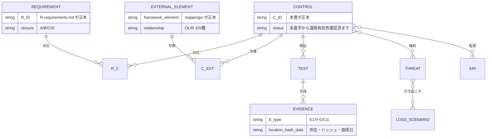
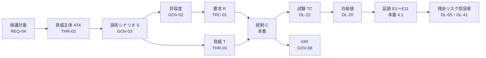

# 統制マッピング台帳（本体）

> 文書ID: CTL-01 / 版: 0.1 / 状態: draft / 最終更新: 2026-10-15
> 対応要求: R-025, R-026, R-165, R-214, R-228, R-229, R-233, R-236, R-237, R-241, R-243, R-247, R-278, G-012
> 依存文書: traceability/seed/seed-01-ciso-assurance.md（§4）, traceability/R-requirements.md, traceability/G-goal-criteria.md, traceability/deliverables.md, 03_threat-model/threat-catalog.md, 05_adr/README.md, 05_adr/ADR-001〜ADR-029, 04_architecture/, 01_governance/（loss-scenarios.md, kri.md, raci-governance.md, exception-risk-acceptance.md）, 06_controls/applicability.md, research/RS-01-governance-risk.md, research/RS-02-regulatory-applicability.md, research/RS-03-identity-lifecycle.md, research/RS-05-root-of-trust-keys-supply-chain.md, research/RS-08-pep-completeness-tenant-isolation.md, research/standards-status.md, CONVENTIONS.md

本書は AI エージェント（Claude）が 2026-10-15 に起草した統制台帳の案である [D]。統制 C-xxx の定義の正本は本書に置く（traceability/deliverables.md §8 の CTL-01 行）[D]。統制の承認、第2線のレビュー、証跡の取得はいずれも済んでいない [D]。外部枠組みの要求を要素単位で写した表と関係型は 06_controls/mappings/ に置く（並行作成中。2026-10-15 時点で identity-appsec.md＝CTL-04、cloud-supplychain.md＝CTL-05、regulations.md＝CTL-06 が draft）[D]。分冊は C-ID の採番前に設計要素で写像しているため、設計要素を本書の C-ID に読み替える作業が残る（残課題 2）[D]。

---

## 0. 結論

1. **統制 C-001〜C-079 の 79 件を採番し、R-001〜R-283 の全 326 行（親 ID 283 件と枝番 43 件）を少なくとも 1 件の統制に対応付けた** [D]。 対応の総数は 420 件で、多対多である（§5）[D]。孤児要求は 0 件、孤児統制は 0 件である [D]（§7.2）。脅威 T-001〜T-086 も全件をいずれかの統制に対応付けた。これで脅威カタログ §11 の申し送り 5（統制の所在を C-xxx に置き換える）に応えた [D]（§6）。
2. **3 つ目の健全性規則（「適用」と判定した外部要件に統制が無い件数を 0 にする）は、まだ満たしたと言えない** [D]。 枠組みの単位では違反は 0 件である [D]。要素の単位で検査を終えたのは NIST CSF 2.0 だけで、106 subcategory のうち 101 件をいずれかの統制に対応付けた [N][^1][^2][D]。残る 5 件には「本基盤の範囲外」の理由を付けたが、この判断は第2線の承認がまだである（決裁案 CM-2）[D]。ISO/IEC 27001:2022 と SOC 2 Trust Services Criteria は本文を取得していない [D]。SP 800-63-4・ASVS 5.0.0・SSDF・SLSA・CCM は、要素単位の写像が mappings/ で完成していない [D]。このため G-012 は未達である（§7.3）[D]。
3. **79 件の統制はどれも「設計の有効性」までしか示せず、証跡はまだ 1 件も取得していない** [D]。 状態は「設計案」が 67 件（ADR・設計文書はあるが決裁前）、「未着手」が 12 件（正本の文書が未作成）である（§3）[D]。設計済・実装済・有効性確認済に当たる統制は 0 件である [D]。運用の有効性は Gate 6 後の運用期間を経て初めて評価できる（seed-01 §1）[D]。
4. **経営・第2線の判断が要る点を 6 件の決裁案（CM-1〜CM-6）にまとめた** [D]。 台帳の所有者、CSF の範囲外判定の承認、CCM の扱い、有料・会員制の規準本文の取得、ISO 本文の取得、供給者の評価周期である（§10）[D]。

---

## 1. 位置付けと範囲

### 1.1 本書が決めるものと決めないもの

| 本書が決める | 本書が決めない（所在） |
|---|---|
| 統制 C-xxx の ID・名称・目的と活動・種別・型・頻度・設計の正本 | 統制の設計の中身（ADR-001〜ADR-029、04_architecture/、02_requirements/） |
| R-ID→C-ID の多対多の対応と、全 R の閉じ方（区分 A〜D は R-requirements.md の値を写す） | R の定義と区分（traceability/R-requirements.md、DL-101） |
| C-ID→試験→証跡→3 線の担当、T・S・K との対応 | TC-xxx の採番と合否値（DL-22）、実測（DL-81）、数値契約（DL-20） |
| 台帳の列定義（seed-01 §4.2 の 17 列）と健全性規則、その検査結果 | 外部枠組みの要素単位の写像と関係型（06_controls/mappings/）、適用性の判定（CTL-02） |
| C-ID 単位の主な外部参照（CSF 2.0 subcategory など） | R→G→DL→C→TC/RB→証跡の全体追跡（traceability/traceability-matrix.md、DL-104） |

### 1.2 読み方

- CTO・CISO は §0、§7（健全性検査）、§10（決裁案）を読めば判断できるように書いた [D]。
- 連携開発チームは、§3 の統制カタログで自チームが第1線の所有者になる統制（「DM」の行）を確認し、§4 の試験と証跡の欄で、何を出せば統制が成立するかを確認する [D]。
- 表のセルにはタグを付けていない [D]。統制の定義、対応付け、担当の割当は、各 ADR・設計文書・R の原文からの設計推論 [D] である [D]。外部規範に由来する記述だけ、表の外に [N] と脚注を付けた [D]。

---

## 2. 台帳の構造

### 2.1 4 つの表

seed-01 §4.1 の正規化 4 表に従う [D]。R と C、C と外部参照は、どちらも多対多である [D]。

| 表 | 正本 | 本書の節 |
|---|---|---|
| Requirements（R-ID） | traceability/R-requirements.md | §5 で全行を引用 |
| Controls（C-ID） | 本書 | §3、§4 |
| Mappings（外部枠組み） | 06_controls/mappings/（並行作成） | §4.2 は C 単位の主な対応だけ |
| Evidence | 本書 §4.1 の所在欄。実体は 12_poc/data/、CI ログ、00_decision の議事録 | §4.1 |

### 2.2 列定義（17 列）と所在

seed-01 §4.2 の 17 列を、上の 4 表に分けて持つ [D]。1 表に 17 列を並べると読めなくなるため、列ごとに所在を決めた [D]。

| 列 | 内容 | 所在 |
|---|---|---|
| 1 R-ID（枝番） | R-001〜R-283、枝番 R-188.1〜R-195.5 | §5 |
| 2 出典 | レビュー原文の行番号と引用 | R-requirements.md（本書は写さない） |
| 3 種別 | 統治／設計／実装／運用／保証 | §3.1 |
| 4 C-ID・統制記述 | 目的・活動・頻度、予防／検知／是正、手動／自動 | §3.1 |
| 5 外部参照 | 枠組みごとの要素 ID | §4.2（主な対応）、mappings/（全件） |
| 6 マッピング関係 | OLIR の 5 種（subset of／intersects with／equal／superset of／not related to）と根拠の 3 種（syntactic／semantic／functional）[N][^3] | mappings/ |
| 7 適用可能性 | 適用／非適用（理由）／条件付き | CTL-02（枠組み単位）、§7.3（本書の判定案） |
| 8 閉じ方 | A／B／C／D（R の区分） | §5 |
| 9 成果物 | DL-ID・版 | §3.1「設計の正本」 |
| 10 試験手順・合否基準 | TC 候補・演習・第三者評価。数値は DL-20・DL-22 | §4.1 |
| 11 証跡 | E 種別・所在・ハッシュ・取得日 | §4.1 |
| 12 3 線担当 | 第1線の所有者／第2線のレビュー者／保証者 | §4.1 |
| 13 状態 | 未着手→設計済→実装済→設計有効性確認済→運用有効性確認済（本書は「設計案」を設計済の前段に置く。§2.3） | §3.2 |
| 14 リスク参照 | S-ID、K-ID（と T-ID） | §3.2 |
| 15 残余リスク | 受容票 ID・期限 | DL-41（未作成）。本書は C-004 で受容票の管理を統制にした |
| 16 Gate | G0〜G6、承認条件 | §3.2（対応する R の Gate 欄を機械集計） |
| 17 枠組みの版・確認日 | 版と確認日 | research/standards-status.md を正本とし、§4.2 と参考文献に版を書く |

NIST の OLIR 仕様は、関係型を集合論の 5 種で表し、関係の根拠を syntactic・semantic・functional の 3 種で表すとしている [N][^3]。本書の C→外部参照は「主な対応」にとどめ、関係型と根拠は mappings/ が要素の組ごとに付ける [D]。関係型を付けないまま「準拠」と称さない [D]。

### 2.3 状態の定義

| 状態 | 判定の条件 | 証跡 |
|---|---|---|
| 未着手 | 設計の正本となる文書が無い | — |
| 設計案 | ADR または設計文書があるが決裁前（ADR 状態 proposed） | E2 の草案 |
| 設計済 | 正本の ADR・文書が承認された | E2（作成者・第2線レビュー者・承認者を明記） |
| 実装済 | 本番相当の環境に実装され、試験手順が実行可能 | E4、E10 |
| 設計有効性確認済 | 事前登録した試験に合格した | E4、E5、E6、E7 |
| 運用有効性確認済 | 運用期間を通じて統制が働いたことを評価した | E6、E8、E11 |

本書の版 0.1 時点で、29 本の ADR はすべて proposed である（05_adr/README.md §3.1）[D]。したがって「設計済」以上の統制は 0 件である [D]。

---

## 3. 統制カタログ（C-001〜C-079）

### 3.1 定義

種別の内訳は、統治 13、設計 19、実装 21、運用 15、保証 11 である [D]。所有者の略号は 01_governance/raci-governance.md に従う（PF＝プラットフォームチーム、DM＝ドメインチーム、RM＝第2線のリスク管理）[D]。

| C-ID | 統制名 | 目的・活動 | 種別 | 型 | 手動/自動 | 頻度 | 設計の正本 |
|---|---|---|---|---|---|---|---|
| C-001 | リスク選好・許容度の承認と見直し | 選好（定性）と許容度（数値）を経営が承認し、年1回以上と臨時トリガーで見直す。テナント間漏えい許容ゼロの運用定義、特権濫用の許容方針、誤 allow 許容値を含む | 統治 | 予防 | 手動 | 年1回以上＋臨時 | GOV-02（DL-01）、RACI-01・02 |
| C-002 | 損失シナリオ・保護対象・データ分類の台帳維持 | 保護対象・データ分類・損失シナリオ（FAIR 形式）を台帳で維持し、T・C・K との対応を更新する | 統治 | 予防 | 手動 | KRI 報告（四半期、R-006）に合わせる＋変更時 | GOV-03（DL-02）、REQ-04（DL-03） |
| C-003 | RACI・責任と権限の対応・三線分離 | 役割ごとに責任・決裁権・予算・人員・独立監査経路を対にし、CISO・内部監査をリスク受容者にしない | 統治 | 予防 | 手動 | 年1回＋組織変更時 | GOV-05（DL-04） |
| C-004 | 例外・残余リスク受容票の管理 | 例外と残余リスクを、期限・補完統制・影響範囲・責任者・失効条件付きの受容票で段1〜段3の受容者が受容する。技術リスク（R-218）を台帳登録する | 統治 | 予防／是正 | 併用（期限超過は自動検出） | 申請時＋期限前 | GOV-07（DL-05）、DL-41 |
| C-005 | 停止権限・本番移行停止・凍結 | 停止権限者が、Critical/High 未解決時の本番移行停止、緊急 freeze、退出基準充足までの不可逆標準化の凍結を発動する | 統治 | 予防／是正 | 手動（発動）＋自動（ゲート） | イベント駆動 | GOV-06（DL-46） |
| C-006 | KRI の四半期報告 | KRI を定義どおり測定し、四半期で経営・取締役会へ報告する。報告に許容度・脅威規模・緩和費用を含める | 統治 | 検知 | 併用 | 四半期 | GOV-08（DL-06） |
| C-007 | 数値契約の決裁（BIA・実測への紐付け） | 数値契約の全指標を「値＋根拠（BIA・実測 TC）」か「TBD＋所有者＋期限＋決め方」で持ち、空欄のままの本番承認を禁止する | 統治 | 予防 | 併用（根拠欄の自動検査） | Gate ごと | SLO-01（DL-20）、GOV-04（DL-21） |
| C-008 | 法域・規制適用性判定と変化追跡 | 法域・業界規制・契約基準の適用性を判定し（法務署名）、標準と法令の版・状態の変化を定期に追跡して再判定する | 統治 | 予防／検知 | 併用（監視は台帳の確認周期） | standards-status の周期（四半期・半年・年次） | CTL-02（DL-34）、research/standards-status.md |
| C-009 | 統制台帳と双方向追跡の健全性検査 | 全 R を C へ写し、C→試験→証跡と外部枠組みを結ぶ。孤児 R・孤児 C・統制なし「適用」要件の 3 規則を自動検査する | 保証 | 検知 | 自動（DL-111）＋レビュー | 変更ごと（CI）＋Gate ごと | CTL-01（本書）、DL-104、DL-111 |
| C-010 | 供給者リスク管理 | 本基盤の供給者（外部 IdP、クラウド、認可 engine・製品、開発・運用の委託先）ごとに重要度・責任者・評価周期・契約上の要求（監査権・通知・出口）を定める | 統治 | 予防／検知 | 手動 | 供給者ごとの評価周期（TBD、§8 CM-6） | OPS-03（DL-33）、ADR-018、ADR-023 |
| C-011 | 主張・引用の検証 | 全主張に区分タグを付け、原典と参照箇所を記録し、作成者以外が照合する。二次情報を根拠にしない。自己評価形容詞を使わない | 保証 | 予防／検知 | 併用（タグ・禁止表現は自動） | 文書変更ごと | traceability/claims-ledger.md、citation-audit（DL-29）、DL-111 |
| C-012 | Gate・決裁範囲・退出基準 | 決裁依頼を Gate 0〜PoC の条件付き承認に限り、Gate ごとの合格・中止基準を明文化して充足判定を記録する | 統治 | 予防 | 手動 | Gate ごと | 00_decision（DL-35〜DL-44） |
| C-013 | 独立保証計画と評価者の独立性 | 独立評価（設計レビュー、conformance、pentest、red team）を Gate 条件にし、評価者の報告系統を実装チームから分ける。範囲は設計・コード・IaC・policy・鍵管理・CI/CD・runbook | 保証 | 検知 | 手動 | Gate ごと | ASR-01（DL-07）、ASR-05（DL-30） |
| C-014 | 継続保証（年次独立評価・定期 red team） | 年次独立評価、定期 red team、統制の継続監視の体制と周期を定める | 保証 | 検知 | 手動 | 年次（R-182）／定期（周期 TBD） | ASR-06（DL-32）、ASR-02（DL-59） |
| C-015 | 是正追跡と Critical/High の closure | 第三者評価・試験・事故の指摘を POA&M で追跡し、Critical/High の closure に再試験の証跡を求める。根本原因を開発標準へ戻す | 保証 | 是正 | 併用 | 指摘ごと | traceability/open-items.md、ASR-02 |
| C-016 | 要員・on-call・bus factor・教育 | 24/365 運用責任、SRE 容量、on-call、教育、bus factor、vendor support を計画し、予算と人員を経営が確約する | 統治 | 予防 | 手動 | 年次＋組織変更時 | OPS-02（DL-27） |
| C-017 | 主体カタログと非人間主体台帳 | 主体類型ごとに登録・所有者・資格情報・棚卸し・廃止を定義し、所有者不在の非人間主体を残さない | 設計 | 予防／検知 | 併用（棚卸しは自動） | 定期棚卸し（周期は DL-48 で確定） | REQ-01（DL-48）、ADR-017 |
| C-018 | ID ライフサイクル状態機械 | 登録・招待・所属変更・複数所属・退職・削除の状態遷移と統制を定め、遷移ごとに監査イベントを出す | 設計 | 予防 | 自動 | イベント駆動 | REQ-02（DL-08）、REQ-05（DL-49） |
| C-019 | 操作階層×保証レベルの割当 | 主体類型×操作 5 分類を high-water mark で評価し、IAL/AAL/FAL・step-up・最大 session・再認証を割り当てる | 設計 | 予防 | 自動（強制） | 変更ごと | REQ-03（DL-09）、ADR-002 |
| C-020 | フィッシング耐性認証の義務化 | 管理者・support・運用者・特権操作をフィッシング耐性方式に限り、手入力 OTP・out-of-band を耐性ありとしない | 実装 | 予防 | 自動 | 常時 | ADR-002、THR-04（DL-52） |
| C-021 | アカウント回復と認証器ライフサイクル | AAL2 の回復を SP 800-63B-4 §4.2.2.2 の三択で完了させ、helpdesk に要素のリセット・移転をさせない。回復区分ごとに待機・通知・二者承認を置く | 実装 | 予防／検知 | 併用 | イベント駆動 | ADR-003 |
| C-022 | 同期 passkey の受入範囲 | 同期 passkey を AAL2 の箇所に限り、AAL3 相当は device-bound 認証器に限る | 設計 | 予防 | 自動 | 登録時 | ADR-002 |
| C-023 | 本人確認（identity proofing） | 主体類型ごとの本人確認手順と、確認結果と資格情報の結び付けを定める | 設計 | 予防 | 手動＋自動 | 登録時 | REQ-02（DL-08） |
| C-024 | federation 終端・linking・IdP 変更の統制 | federation を自社 AS で終端し RP 起点に限る。linking は（テナント、上流 IdP、外部 subject）の 3 つ組だけとし、IdP 追加・自動連結の有効化を二者統制にする | 実装 | 予防／検知 | 自動 | 常時＋変更時 | ADR-004、ADR-021 |
| C-025 | SAML 証明書更新と IdP 停止時の回復 | 顧客 IdP の証明書更新を検証付きで受け、期限切れ・停止時の縮退と回復経路を持つ | 運用 | 予防／是正 | 併用 | 証明書期限前＋障害時 | ADR-004、ARC-08（DL-19） |
| C-026 | SCIM のテナント結合・競合解決・deprovision | SCIM 資格情報をテナントに結合し、SCIM テナントは SCIM を正本とし、停止の上書きと旧権限の残存を防ぐ | 実装 | 予防／検知 | 自動 | 常時 | ADR-004、CON-07（DL-76） |
| C-027 | ドメイン検証 | DNS TXT によるドメイン検証と、ドメイン失効・再登録時の再検証を行う | 実装 | 予防 | 自動 | 登録時＋定期再検証 | ADR-004 |
| C-028 | step-up の鮮度 | auth_time/max_age で再認証の鮮度を検証し、refresh で鮮度を延長しない | 実装 | 予防 | 自動 | 要求ごと | ADR-002、ADR-005 |
| C-029 | 顧客管理者の委任管理と顧客向け監査 | 顧客管理者の委任範囲を限定し、顧客向け監査 API で自テナントの管理操作を開示する。顧客管理者・SAML/OIDC 設定を攻撃面として扱う | 設計 | 予防／検知 | 自動 | 常時 | REQ-06（DL-26） |
| C-030 | 責任分界（共有責任） | 顧客 IdP 侵害時を含む提供者・顧客の責任分界を契約条項と運用手順に落とす | 統治 | 予防 | 手動 | 契約締結・更新時 | REQ-06（DL-26）、CTL-02 §7 |
| C-031 | 不正利用・アカウント乗っ取りの検知 | credential stuffing・bot 登録・ATO の信号を検知し、段階的に封じ込める | 運用 | 検知／是正 | 自動 | 常時 | THR-04（DL-52） |
| C-032 | OAuth/OIDC profile（RFC 9700 準拠表） | implicit 廃止、PKCE、redirect URI 完全一致、refresh 保護、issuer 識別を準拠表で強制する | 実装 | 予防 | 自動 | 常時 | ARC-02（DL-16）、ADR-005 |
| C-033 | FAPI 2.0 の適用範囲と適合試験 | F1〜F6 の範囲に FAPI 2.0（mTLS・private_key_jwt・PAR）を適用し、OIDF conformance を自社で実行する | 実装 | 予防／検知 | 自動 | リリースごと | ADR-020、ASR-03（DL-60） |
| C-034 | JWT の厳格検証と型間の排他 | alg allowlist、typ、iss、aud、時刻、鍵と issuer の結合を検証し、種類の異なる JWT を相互に受理しない | 実装 | 予防 | 自動 | 要求ごと | ARC-02、CON-06（DL-75）、ADR-022（負例ベクタ） |
| C-035 | token 寿命・送信者拘束・BFF | 外部 client へは opaque、内部は aud 別 JWT。寿命は種別×階層で導出し、sender constraint・BFF を経路で選ぶ | 設計 | 予防 | 自動 | 常時 | ADR-005 |
| C-036 | workload identity と token exchange | SPIFFE の X.509-SVID mTLS で workload を認証し、委任は RFC 8693 で hop ごとに aud 1 つの内部 token を取り直し act で表す | 実装 | 予防 | 自動 | 要求ごと | ADR-009 |
| C-037 | AI エージェント・非同期・長時間ジョブの委任 | エージェントを独立主体として登録し、利用者のための認可は委任＋act で表す。非同期処理は実行時に再判定し、ジョブに offline_access を持たせない | 設計 | 予防 | 自動 | 実行ごと | ADR-017、ADR-026 |
| C-038 | 第三者 grant の管理 | 高権限の第三者 app・grant を棚卸しし、過大 scope・利用者を限定しない委任・非本番からの付与を制限する | 運用 | 予防／検知 | 併用 | 定期棚卸し（周期は DL-06 の K-14 に合わせる） | THR-04、REQ-06 |
| C-039 | 鍵階層・用途分離・鍵と issuer の結合 | L0（オフライン root）→L1→L2 の 3 層、1 鍵 1 用途 1 alg 1 スコープ、(iss, typ, kid)→許可鍵集合で検証する | 設計 | 予防 | 自動 | 常時 | ADR-007、ARC-03（DL-14） |
| C-040 | 鍵の生成・保管・二者統制・ceremony | L2 は cell 別アカウントの KMS 非エクスポート鍵とし、鍵操作に二者統制を置く。オフライン root の ceremony に第三者が立ち会う | 運用 | 予防 | 手動（ceremony）＋自動（KMS 権限） | ceremony 時＋常時 | ADR-007、ARC-03 |
| C-041 | rotation と JWKS 配布 | 鍵を cryptoperiod に従い rotation し、旧鍵の併存と JWKS cache 最大齢を数値契約で管理する | 運用 | 予防 | 自動 | cryptoperiod ごと（値は DL-20） | ADR-007、ARC-03 |
| C-042 | 鍵の失効と緊急切替 | 侵害時に鍵を失効し、範囲ごとの失効下限時刻で旧 token を拒否する | 運用 | 是正 | 併用 | 侵害時（演習は C-075） | ADR-019、ADR-007 |
| C-043 | 鍵の災害復旧 | 鍵の DR 手順を持ち、使用中の鍵の誤削除・rotation 失敗から復旧する | 運用 | 是正 | 手動 | DR 演習時 | ADR-007、ARC-03 |
| C-044 | crypto agility と PQC 移行 | 検証側の版付き暗号 profile と鍵マニフェストで alg を決め、移行順序と社内期限を管理する | 設計 | 予防 | 自動 | profile 改版時 | ADR-015、ARC-12（DL-23） |
| C-045 | 管理面変更の単一経路 | 管理面の全変更を「宣言→二者レビュー→隔離 build と署名→cell 段階配布」に限り、管理用 IdP を独立させ常設特権を持たない | 実装 | 予防／検知 | 自動 | 変更ごと | ADR-008 |
| C-046 | ソフトウェア供給網（SLSA・SSDF） | AS・PDP・PEP SDK を隔離 build で作り provenance に署名する。開発環境を分離し、全コードを最小権限で保管する | 実装 | 予防／検知 | 自動 | build ごと | ADR-008、ASR-04（DL-61） |
| C-047 | 識別子と識別子ドメインの保有 | 識別子を自社所有ドメイン下の不透明値で固定し、ドメインを基盤保有法人の名義で保有・更新する | 統治 | 予防 | 手動 | ドメイン更新期限前 | ADR-021（K21-6） |
| C-048 | entry point 台帳と coverage の突合 | entry point を宣言×観測で突合し、未宣言の入口を 0 件に保つ。batch・queue・内部 API・データ直アクセスを含む | 実装 | 検知 | 自動 | 変更ごと（CI）＋常時観測 | ADR-012、ARC-06（DL-15）、THR-01（DL-10） |
| C-049 | サービス内 PEP・既定 deny・PEP/PDP 分離 | object 単位の判定をサービス内 PEP が担い、既定拒否・deny 優先・評価不能は deny とする | 実装 | 予防 | 自動 | 要求ごと | ADR-011、ADR-012、ARC-05（DL-17） |
| C-050 | ストレージ側 tenant guardrail と PEP 外データ | PostgreSQL RLS 等でストレージ側にテナント境界を置き、export・バックアップ・レプリカ・DWH・署名付き URL・RAG に発行記録と境界を付ける | 実装 | 予防／検知 | 自動 | 常時 | ADR-012、ARC-11（DL-57） |
| C-051 | cross-tenant・API 負例試験の CI ゲート | cross-tenant 負例試験と API Top 10 の負例試験を必須ゲートにし、試験を失敗させる変更をデプロイしない | 保証 | 検知 | 自動 | 変更ごと（CI） | ADR-012、CON（mock-contract-test-kit） |
| C-052 | 一覧・検索の post-check | 一覧・検索の認可根拠を返却直前ページの post-check とし、件数等を許可集合から作る | 実装 | 予防 | 自動 | 要求ごと | ADR-025 |
| C-053 | テナント越境共有の制御 | 越境は資源側テナント文脈の token と期限付き外部付与で表し、越境共有は既定無効にする | 設計 | 予防 | 自動 | 要求ごと | ADR-024 |
| C-054 | 認可整合性と剥奪 SLO | 整合性モードを操作階層ごとに割り当て、剥奪→拒否の最大時間を数値契約で守る | 設計 | 予防／検知 | 自動 | 常時 | ADR-010、ARC-05（DL-17） |
| C-055 | 失効の中央強制と継続評価 | 失効を基盤所有の少数の強制点で中央強制し、署名付き・単調な失効状態を cell ごとに push する。組織境界では SSF/CAEP/RISC を使う | 実装 | 是正 | 自動 | 常時 | ADR-006、ARC-09（DL-56） |
| C-056 | model・policy 変更の段階展開と自動 rollback | model ID を pin し、新旧 shadow・差分記録・canary・段階展開を経て、allow 拡大差分を事象として扱い自動 rollback する | 運用 | 予防／検知／是正 | 自動 | 変更ごと | ADR-027、ARC-05、OPS-04（DL-31） |
| C-057 | cell 分割と blast radius の制限 | cell を法域×規制スコープ×テナント群で分け、global 部品を許可リストに限り、quota で noisy neighbor を抑える | 設計 | 予防 | 自動 | 常時 | ADR-013、ARC-07（DL-18） |
| C-058 | 操作階層別の失敗モード | 操作 5 分類ごとに PDP 不達・監査不能時の挙動とキャッシュ最大齢を定め、認可判定の fail-open を禁止する | 設計 | 予防 | 自動 | 常時 | ADR-013、ARC-08（DL-19） |
| C-059 | 依存 Tier | 操作階層と依存 Tier を二軸で管理し、Tier X（依存禁止）に代替手段を置く | 設計 | 予防 | 手動（設計審査） | 連携審査時 | ADR-023、INT-01（DL-63） |
| C-060 | 容量と性能・可用性の SLO | Check 遅延・可用性・graph 深さ・query budget・RTO/RPO・切替時間を数値契約で管理し、容量を確保する | 運用 | 予防／検知 | 自動（監視） | 常時 | ARC-13（DL-58）、SLO-01 |
| C-061 | 製品選定・PoC・出口 | build/buy/managed を比較し、engine 候補を PoC で比べ、識別子と鍵を動かさない出口と演習を持つ | 設計 | 予防 | 手動 | 選定時＋出口演習 | ADR-001、ADR-010、ADR-018、ARC-14（DL-13） |
| C-062 | 版管理・後方互換・非推奨と連携契約 | policy・model・schema・token・audit の版・互換判定・rollback を定め、連携契約を凍結区分で管理する | 設計 | 予防 | 自動（互換検査） | 変更ごと | ADR-016、ADR-022、CON-01（DL-70） |
| C-063 | 特権アクセス（JIT・二者・break-glass） | 常設特権を持たず、JIT 昇格・フィッシング耐性認証・二者承認・理由・session 記録を課す。break-glass を封緘・同時二者で通常権限から分ける | 実装 | 予防／検知 | 併用 | 要求ごと＋break-glass 検証は定期 | ADR-029、ADR-008 |
| C-064 | support アクセスの分離 | support 経路を分離し、チケットに結び付いた昇格 grant と顧客承認でだけ顧客テナントへアクセスする | 実装 | 予防／検知 | 自動 | 要求ごと | ADR-029 |
| C-065 | テナントライフサイクル操作 | 統合・分割・cell 間移動・解約時 export・削除を 1 つの orchestrator で行い、削除は論理削除→鍵破棄→消去完了の 3 段とする | 運用 | 予防／是正 | 自動 | 操作ごと | ADR-028、REQ-05 |
| C-066 | 監査の独立経路・全件記録・欠損検知 | 監査を trace と別経路で正準スキーマに全件記録し、記録率と欠損を測って監査経路停止時の挙動を定める | 実装 | 検知 | 自動 | 常時 | ADR-014、ARC-10（DL-25） |
| C-067 | 監査記録の改ざん検知と WORM | 4 層の改ざん検知と WORM 保管で、監査記録の改ざん・削除・相手ごとに異なる提示を検知する | 実装 | 予防／検知 | 自動 | 常時 | ADR-014 |
| C-068 | 監査の最小化・アクセス統制・保持・削除調停 | 監査項目を目的に照らして最小化し、閲覧を統制し、保持期間を規制プロファイルで決め、WORM と削除権を 3 層で調停する | 設計 | 予防 | 併用 | 常時＋保持期間到来時 | ADR-014、ARC-10 |
| C-069 | データ所在地の制御 | 保存場所・運用者のアクセス元・鍵の所在を同じ単位（cell・規制プロファイル）で制御する | 設計 | 予防 | 自動 | 常時 | ADR-013、ARC-10、CTL-02 §3.5 |
| C-070 | IAM 変更の監視と判定記録の追跡項目 | 権限・ロール・relation・設定の全変更を監視し、判定記録に decision ID・policy/model revision・actor chain を持たせる | 運用 | 検知 | 自動 | 常時 | ADR-014、CON-08（DL-77） |
| C-071 | 侵害 runbook・kill switch・PDP 隔離 | 侵害対象別 runbook と kill switch K1〜K4、PDP 隔離、顧客 IdP 切離しを平時経路の最大速度版として持つ | 運用 | 是正 | 併用 | 侵害時（演習は C-075） | ADR-019、OPS-01（DL-24） |
| C-072 | 全 session 失効 | 利用者・テナント・全域の単位で全 session・refresh token を失効し、CAEP で依存側へ伝える | 運用 | 是正 | 自動 | 侵害時 | ADR-006、ADR-019 |
| C-073 | 証拠保全 | 侵害時に監査記録・鍵操作記録・構成の証拠を保全し、完全性と来歴を保つ | 運用 | 是正 | 併用 | 侵害時 | ADR-019、ADR-014 |
| C-074 | 顧客通知・法定報告 | 顧客通知の判断基準・判断者を定め、法定報告期限より前に顧客へ通知する | 運用 | 是正 | 手動 | 侵害時 | CTL-02 §3.7・§6.2、OPS-01 |
| C-075 | 侵害・移行・出口演習 | 鍵・IdP・PDP 侵害、schema migration、vendor exit の演習を行い、時系列・計測値・事後レビュー・是正追跡を残す | 保証 | 検知／是正 | 手動 | 定期（周期は DL-32） | OPS-01、ASR-06（DL-32） |
| C-076 | 脅威モデリング工程 | DFD・攻撃者類型・脅威カタログを反復可能な工程として維持し、各脅威に 5 統制と残余リスクを付ける | 保証 | 予防 | 手動 | 設計変更時＋年次 | THR-01〜THR-03（DL-10、DL-51、DL-11） |
| C-077 | PoC の事前登録（攻撃・障害主目的） | PoC を happy path でなく攻撃・障害注入で行い、TC ごとに仮説・合否基準・中止基準を事前登録する | 保証 | 検知 | 併用 | PoC ごと | DL-22、DL-81 |
| C-078 | SDLC の受入基準（ASVS・SSDF） | ASVS 5.0 の要件 ID を受入基準にし、SSDF の task を全開発チーム・ベンダーの SDLC と契約に組み込む | 保証 | 予防 | 併用 | 変更ごと＋年次自己評価 | ASR-04（DL-61）、INT-05（DL-67） |
| C-079 | クラウド設定レビュー | クラウドの IAM・KMS・ネットワーク設定を基準と照合し、逸脱を是正する | 保証 | 検知 | 併用 | 定期＋変更時（周期は DL-32） | ASR-05（DL-30）、ADR-007 |

### 3.2 リスク・Gate・状態

T・S・K の対応は、脅威カタログ（THR-03）の各脅威の統制欄、損失シナリオ（GOV-03）、KRI（GOV-08）から導いた [D]。Gate 欄は、統制に対応する R の「関連ゲート」欄を機械的に集めた値である [D]。

| C-ID | 脅威 T | 損失 S | KRI | 対応 R の件数 | Gate（対応 R から機械集計） | 状態 |
|---|---|---|---|---|---|---|
| C-001 | — | S-01, S-05, S-11 | K-24 | 9 | G0/G4 | 設計案 |
| C-002 | — | S-01〜S-19 | K-24 | 6 | G0/G1/G5 | 設計案 |
| C-003 | — | — | K-30 | 8 | G0/G5 | 設計案 |
| C-004 | — | 全 S | K-26 | 8 | G0/G2/G3/G5 | 設計案 |
| C-005 | — | S-05, S-06 | K-27, K-25 | 4 | G0/G4/G5/G6 | 設計案 |
| C-006 | — | 全 S | K-01〜K-32 | 4 | G0/G6 | 設計案 |
| C-007 | — | S-06, S-07 | K-18 | 17 | G0/G1/G3/G4/G6 | 未着手 |
| C-008 | — | S-16, S-17 | K-23 | 5 | G0/G3/G6 | 設計案 |
| C-009 | — | — | — | 11 | G0/G1/G5 | 設計案 |
| C-010 | T-086 | S-12, S-08 | K-32 | 4 | G0/G3/G6 | 未着手 |
| C-011 | — | — | — | 8 | G0/G3 | 設計案 |
| C-012 | — | — | K-24 | 8 | G0/G6 | 未着手 |
| C-013 | — | 全 S | K-25 | 7 | G0/G5 | 未着手 |
| C-014 | — | 全 S | K-25 | 4 | G0/G5/G6 | 未着手 |
| C-015 | — | 全 S | K-25 | 4 | G5/G6 | 未着手 |
| C-016 | T-047 | S-06, S-11 | K-30 | 7 | G0/G3/G6 | 未着手 |
| C-017 | T-053 | S-14 | K-08, K-16 | 3 | G1/G3 | 設計案 |
| C-018 | T-010, T-059 | S-07, S-18 | K-13 | 8 | G1/G4 | 設計案 |
| C-019 | T-001, T-008 | S-18, S-04 | K-11 | 7 | G0/G1 | 設計案 |
| C-020 | T-001, T-007 | S-18, S-04 | K-11 | 3 | G1/G2/G4 | 設計案 |
| C-021 | T-002, T-003, T-005 | S-04 | K-12 | 6 | G0/G1/G2/G4/G5 | 設計案 |
| C-022 | T-001 | S-18 | K-11 | 1 | G1/G3 | 設計案 |
| C-023 | T-010 | S-18 | — | 1 | G1 | 設計案 |
| C-024 | T-061, T-062, T-063, T-064, T-066 | S-03 | K-13 | 7 | G1/G2/G4/G5 | 設計案 |
| C-025 | T-065, T-068 | S-03, S-06 | K-18 | 3 | G1/G3/G4 | 設計案 |
| C-026 | T-058, T-059, T-060 | S-07, S-03 | K-17 | 4 | G1/G4 | 設計案 |
| C-027 | T-067 | S-03 | K-13 | 1 | G1/G4 | 設計案 |
| C-028 | T-008 | S-18 | — | 1 | G1/G4 | 設計案 |
| C-029 | T-062, T-070 | S-03 | K-13, K-14 | 4 | G1/G2/G3/G4 | 設計案 |
| C-030 | T-066 | S-03 | — | 2 | G0/G1 | 設計案 |
| C-031 | T-004, T-010 | S-18 | K-28, K-12 | 3 | G1/G2/G4/G6 | 設計案 |
| C-032 | T-006, T-007, T-014 | S-02, S-15 | K-15 | 6 | G3/G4 | 設計案 |
| C-033 | T-006, T-014 | S-15 | K-15 | 5 | G2/G3/G5 | 設計案 |
| C-034 | T-015, T-040 | S-02 | K-06 | 4 | G3/G4 | 設計案 |
| C-035 | T-011, T-012, T-013, T-014, T-083 | S-15, S-18 | K-15 | 6 | G0/G3/G4 | 設計案 |
| C-036 | T-016, T-017, T-025, T-037, T-040, T-073 | S-14 | K-06 | 5 | G3/G4 | 設計案 |
| C-037 | T-024, T-039, T-072, T-074, T-075 | S-14, S-07 | K-16 | 2 | G1/G3 | 設計案 |
| C-038 | T-007, T-069, T-070, T-071 | S-15 | K-14, K-15 | 2 | G1/G3/G4 | 設計案 |
| C-039 | T-041, T-042 | S-02 | K-07 | 4 | G3 | 設計案 |
| C-040 | T-041, T-045 | S-02 | K-09 | 3 | G0/G3/G4/G5 | 設計案 |
| C-041 | T-042, T-043, T-044 | S-02, S-06 | K-07 | 4 | G0/G3/G4 | 設計案 |
| C-042 | T-041, T-044 | S-02 | K-07 | 4 | G3/G4 | 設計案 |
| C-043 | T-043 | S-06 | K-07 | 1 | G3/G4 | 設計案 |
| C-044 | T-085 | S-13 | K-32 | 3 | G3/G4 | 設計案 |
| C-045 | T-027, T-028, T-033, T-046, T-050 | S-05, S-08 | K-20, K-09 | 5 | G0/G3/G4/G6 | 設計案 |
| C-046 | T-051, T-052, T-053 | S-08 | K-08, K-20 | 3 | G1/G3/G5/G6 | 設計案 |
| C-047 | T-010, T-067 | S-12 | K-32 | 2 | G3 | 設計案 |
| C-048 | T-018, T-022 | S-01 | K-01, K-06 | 5 | G1/G4/G6 | 設計案 |
| C-049 | T-020, T-021, T-022, T-023, T-026, T-029 | S-01 | K-04 | 7 | G3/G4 | 設計案 |
| C-050 | T-021, T-033, T-034, T-077, T-078, T-079 | S-01, S-09 | K-05 | 3 | G3/G4 | 設計案 |
| C-051 | T-020, T-021, T-026 | S-01 | K-03 | 6 | G4/G5/G6 | 設計案 |
| C-052 | T-076 | S-01 | K-03 | 2 | G4 | 設計案 |
| C-053 | T-080 | S-01 | K-02 | 2 | G3/G4 | 設計案 |
| C-054 | T-032, T-035 | S-07 | K-17 | 12 | G0/G3/G4 | 設計案 |
| C-055 | T-019, T-032, T-038 | S-07 | K-17 | 4 | G0/G3/G4 | 設計案 |
| C-056 | T-027, T-028, T-050 | S-05 | K-04, K-20 | 15 | G3/G4/G6 | 設計案 |
| C-057 | T-009, T-031, T-036 | S-06, S-05 | K-19 | 9 | G3/G4/G5 | 設計案 |
| C-058 | T-009, T-023 | S-06, S-01 | K-18 | 12 | G3/G4/G6 | 設計案 |
| C-059 | T-009 | S-06 | K-19 | 2 | G3/G4 | 設計案 |
| C-060 | T-031, T-004 | S-06 | K-18 | 16 | G0/G3/G4 | 設計案 |
| C-061 | T-086 | S-12 | K-32 | 13 | G3/G4/G6 | 設計案 |
| C-062 | T-027, T-086 | S-05, S-12 | K-29 | 10 | G0/G3/G4/G6 | 設計案 |
| C-063 | T-046, T-047, T-048 | S-11, S-19 | K-09, K-10, K-11 | 4 | G0/G1/G3/G4 | 設計案 |
| C-064 | T-003, T-049 | S-04 | K-12 | 3 | G0/G2/G3/G5 | 設計案 |
| C-065 | T-036, T-048, T-082 | S-19, S-01 | K-02 | 2 | G0/G1/G3/G4 | 設計案 |
| C-066 | T-030, T-054 | S-10 | K-21 | 9 | G0/G3/G4 | 設計案 |
| C-067 | T-055 | S-10 | K-21 | 3 | G3/G4 | 設計案 |
| C-068 | T-056, T-057, T-082, T-084 | S-10, S-17 | K-21 | 8 | G0/G3/G4 | 設計案 |
| C-069 | T-081 | S-17 | K-23 | 2 | G0/G3 | 設計案 |
| C-070 | T-005, T-050, T-062 | S-05, S-03 | K-13, K-20 | 2 | G3/G4 | 設計案 |
| C-071 | T-028, T-041, T-066 | S-02, S-03, S-05 | K-22 | 7 | G2/G3/G4/G6 | 設計案 |
| C-072 | T-001, T-011 | S-18, S-02 | K-22 | 2 | G4 | 設計案 |
| C-073 | T-055 | S-10 | K-22 | 2 | G4/G6 | 設計案 |
| C-074 | T-066, T-081 | S-16 | K-22 | 2 | G0/G4 | 未着手 |
| C-075 | T-043, T-047 | S-02, S-03, S-06, S-12 | K-22, K-10 | 8 | G0/G4/G5/G6 | 未着手 |
| C-076 | T-001〜T-086（工程として全件） | 全 S | K-28 | 7 | G0/G1/G2/G4 | 設計案 |
| C-077 | T-020, T-021, T-032, T-061, T-014 | S-01, S-06, S-07 | K-03, K-04 | 7 | G4 | 未着手 |
| C-078 | T-051, T-057 | S-08, S-01 | K-06 | 5 | G1/G5/G6 | 未着手 |
| C-079 | T-045, T-034 | S-09, S-02 | K-09 | 2 | G1/G5 | 未着手 |

---

## 4. 統制→試験→証跡

### 4.1 試験・証跡・3 線

- 試験手順は、脅威カタログが DL-22 へ持ち込む試験候補 TH-TC-nnn（nnn は対応する T の番号）と、ADR が名指しした試験（TC-07-10、TC-15-01 など）、演習、第三者評価で書いた [D]。TC-xxx の採番と合否基準の数値は DL-22 が事前登録で決める [D]。本書は数値を置かない [D]。
- 証跡はまだ 1 件も取得していないので、ハッシュ・取得日の欄はすべて「未取得」とした [D]。
- 保証者の「独立評価者」は DL-07 の独立性要件を満たす評価者を指す。評価者の選定はまだである [D]。

| C-ID | 試験手順（TC 候補・演習・第三者） | 合否基準 | 証跡（E 種別） | 証跡の所在（予定） | ハッシュ・取得日 | 第1線（所有者） | 第2線（レビュー） | 保証者 |
|---|---|---|---|---|---|---|---|---|
| C-001 | 承認議事録の確認、見直し周期の遵守確認 | DL-20／DL-22 で事前登録（TBD） | E1 | 00_decision（DEC-1 議事録） | 未取得 | 経営 | CISO・第2線RM | 内部監査 |
| C-002 | 台帳の更新記録と T/C 対応の差分確認（DL-111） | DL-20／DL-22 で事前登録（TBD） | E2 | 01_governance/loss-scenarios.md、02_requirements/data-classification.md | 未取得 | CISO（第2線として作成・提示） | 第2線RM | 内部監査 |
| C-003 | RACI 表と決裁記録の照合（受容者に CISO・内部監査が無いこと） | DL-20／DL-22 で事前登録（TBD） | E1 | 01_governance/raci-governance.md | 未取得 | 経営 | 第2線RM | 内部監査 |
| C-004 | 受容票の必須欄と期限の自動検査、期限超過 0 件の確認 | DL-20／DL-22 で事前登録（TBD） | E9 | 00_decision/05-residual-risk-register.md（未作成） | 未取得 | 事業責任者／経営（段に応じる） | 第2線RM・CISO（意見） | 内部監査 |
| C-005 | 停止権限の机上演習、発動記録の確認 | DL-20／DL-22 で事前登録（TBD） | E1、E8 | 01_governance/stop-authority.md | 未取得 | 経営（停止権限者は DL-46） | CISO | 内部監査 |
| C-006 | 報告様式の充足確認、KRI 値の再計算 | DL-20／DL-22 で事前登録（TBD） | E2 | 01_governance/kri.md | 未取得 | CISO（報告作成） | 第2線RM | 内部監査 |
| C-007 | 数値契約台帳の根拠欄の自動検査（根拠なし数値 0 件） | DL-20／DL-22 で事前登録（TBD） | E1、E5 | 07_slo/numeric-contracts.md（未作成） | 未取得 | CTO | CISO | 内部監査 |
| C-008 | 判定表と standards-status の確認日の鮮度検査 | DL-20／DL-22 で事前登録（TBD） | E2（法務署名） | 06_controls/applicability.md、research/standards-status.md | 未取得 | 法務 | CISO | 内部監査 |
| C-009 | §5 の健全性検査の再実行（作成者以外） | DL-20／DL-22 で事前登録（TBD） | E3 | 06_controls/control-mapping-ledger.md、traceability/traceability-matrix.md | 未取得 | CISO（台帳の所有者） | 第2線RM | 内部監査 |
| C-010 | 供給者台帳の欄充足と評価期限の確認 | DL-20／DL-22 で事前登録（TBD） | E2（調達・法務署名） | 08_operations/tco-vendor-lts.md（未作成） | 未取得 | CTO（技術）・調達（契約） | CISO・第2線RM | 内部監査 |
| C-011 | 照合ログの抽出検査、禁止表現の自動検査 | DL-20／DL-22 で事前登録（TBD） | E3 | traceability/claims-ledger.md、traceability/citation-audit-*.md | 未取得 | 各文書の作成者 | CISO | 内部監査（照合ログの確認） |
| C-012 | Gate 判定記録と退出基準の照合 | DL-20／DL-22 で事前登録（TBD） | E1 | 00_decision/06-gate-plan-and-plan-b.md（未作成） | 未取得 | 経営 | CISO・CTO | 内部監査 |
| C-013 | RFP の独立性要件と利益相反申告の確認 | DL-20／DL-22 で事前登録（TBD） | E2、E6 | 09_assurance/independent-assurance-plan.md（未作成） | 未取得 | 経営（予算） | CISO | 内部監査／独立評価者 |
| C-014 | 年次計画と実施記録の照合 | DL-20／DL-22 で事前登録（TBD） | E6、E11 | 09_assurance/continuous-assurance-plan.md（未作成） | 未取得 | CISO | 第2線RM | 内部監査／独立評価者 |
| C-015 | 再試験記録の確認、closure の抜取り検査 | DL-20／DL-22 で事前登録（TBD） | E11、E6 | traceability/open-items.md（未作成） | 未取得 | PF（技術是正） | CISO | 内部監査 |
| C-016 | 要員計画と実配置の照合、on-call 演習記録 | DL-20／DL-22 で事前登録（TBD） | E1 | 08_operations/operating-model.md（未作成） | 未取得 | CTO | CISO | 内部監査 |
| C-017 | 棚卸しの差分試験（所有者不在 0 件） | DL-20／DL-22 で事前登録（TBD） | E4 | 02_requirements/principal-catalog.md | 未取得 | PF | CISO | 内部監査 |
| C-018 | IL-TC 群の負例試験（DL-22 で TC 採番） | DL-20／DL-22 で事前登録（TBD） | E4、E5 | 02_requirements/identity-lifecycle.md | 未取得 | PF | CISO | 独立評価者 |
| C-019 | acr/amr の強制試験 | DL-20／DL-22 で事前登録（TBD） | E2、E4 | 02_requirements/operation-risk-tiers-assurance.md | 未取得 | PF | CISO | 独立評価者 |
| C-020 | TH-TC-001（AiTM 再現） | DL-20／DL-22 で事前登録（TBD） | E4、E6 | 12_poc/data/（未作成） | 未取得 | PF | CISO | 独立評価者（red team） |
| C-021 | TH-TC-002、TH-TC-003、helpdesk 経路の red team | DL-20／DL-22 で事前登録（TBD） | E4、E6 | 12_poc/data/（未作成） | 未取得 | PF | CISO | 独立評価者（red team） |
| C-022 | 登録時の認証器属性の検証試験 | DL-20／DL-22 で事前登録（TBD） | E4 | 12_poc/data/（未作成） | 未取得 | PF | CISO | 独立評価者 |
| C-023 | 手順の机上検証と偽装登録の負例試験 | DL-20／DL-22 で事前登録（TBD） | E2、E4 | 02_requirements/identity-lifecycle.md | 未取得 | PF | CISO | 独立評価者 |
| C-024 | TH-TC-061〜TH-TC-064、TH-TC-066 | DL-20／DL-22 で事前登録（TBD） | E4、E6、E7 | 12_poc/data/（未作成） | 未取得 | PF | CISO | 独立評価者（conformance・pentest） |
| C-025 | TH-TC-065、TH-TC-068 | DL-20／DL-22 で事前登録（TBD） | E4、E5 | 12_poc/data/（未作成） | 未取得 | PF | CISO | 独立評価者 |
| C-026 | TH-TC-058〜TH-TC-060 | DL-20／DL-22 で事前登録（TBD） | E4、E5 | 12_poc/data/（未作成） | 未取得 | PF | CISO | 独立評価者 |
| C-027 | TH-TC-067 | DL-20／DL-22 で事前登録（TBD） | E4 | 12_poc/data/（未作成） | 未取得 | PF | CISO | 独立評価者 |
| C-028 | TH-TC-008 | DL-20／DL-22 で事前登録（TBD） | E4 | 12_poc/data/（未作成） | 未取得 | PF | CISO | 独立評価者 |
| C-029 | AS-1〜AS-12 の負例試験 | DL-20／DL-22 で事前登録（TBD） | E4 | 02_requirements/customer-admin-responsibility.md | 未取得 | PF | CISO | 独立評価者 |
| C-030 | 契約条項の照合 | DL-20／DL-22 で事前登録（TBD） | E2（法務署名） | 02_requirements/customer-admin-responsibility.md | 未取得 | 法務 | CISO | 内部監査 |
| C-031 | TH-TC-004、TH-TC-010、検知規則の試験 | DL-20／DL-22 で事前登録（TBD） | E4、E5 | 12_poc/data/（未作成） | 未取得 | PF（ITDR） | CISO | 独立評価者（red team） |
| C-032 | TH-TC-006、TH-TC-014、OIDF suite の自前実行 | DL-20／DL-22 で事前登録（TBD） | E4、E7 | 09_assurance（未作成） | 未取得 | PF | CISO | 独立評価者（conformance） |
| C-033 | OIDF conformance suite の実行ログ | DL-20／DL-22 で事前登録（TBD） | E7 | 09_assurance/oidf-conformance-plan.md（未作成） | 未取得 | PF | CISO | 独立評価者（conformance） |
| C-034 | 負例ベクタ 13 種（ADR-022）、TH-TC-015、TH-TC-040 | DL-20／DL-22 で事前登録（TBD） | E4 | CI ログ（DL-111） | 未取得 | PF（SDK）・DM（組込み） | CISO | 独立評価者 |
| C-035 | TH-TC-011〜TH-TC-014 | DL-20／DL-22 で事前登録（TBD） | E4、E5 | 12_poc/data/（未作成） | 未取得 | PF | CISO | 独立評価者 |
| C-036 | TH-TC-016、TH-TC-025、TH-TC-037 | DL-20／DL-22 で事前登録（TBD） | E4 | 12_poc/data/（未作成） | 未取得 | PF | CISO | 独立評価者 |
| C-037 | TH-TC-024、TH-TC-039、TH-TC-072 | DL-20／DL-22 で事前登録（TBD） | E4 | 12_poc/data/（未作成） | 未取得 | PF | CISO | 独立評価者（red team） |
| C-038 | TH-TC-069〜TH-TC-071 | DL-20／DL-22 で事前登録（TBD） | E4 | 12_poc/data/（未作成） | 未取得 | PF | CISO | 独立評価者 |
| C-039 | TH-TC-041、TH-TC-042 | DL-20／DL-22 で事前登録（TBD） | E2、E4 | 04_architecture/root-of-trust.md | 未取得 | PF | CISO | 独立評価者 |
| C-040 | TC-07-10（KMS 権限の自己付与試験、ADR-007）、ceremony の立会い記録 | DL-20／DL-22 で事前登録（TBD） | E8、E10、E6 | 04_architecture/root-of-trust.md | 未取得 | PF | CISO | 独立評価者（立会い） |
| C-041 | TH-TC-042〜TH-TC-044 | DL-20／DL-22 で事前登録（TBD） | E4、E5 | 12_poc/data/（未作成） | 未取得 | PF | CISO | 独立評価者 |
| C-042 | TH-TC-044、鍵侵害演習 | DL-20／DL-22 で事前登録（TBD） | E8 | 08_operations/compromise-runbooks.md（未作成） | 未取得 | SRE（実行）・PF | CISO | 独立評価者 |
| C-043 | TH-TC-043、DR 演習 | DL-20／DL-22 で事前登録（TBD） | E8 | 08_operations/compromise-runbooks.md（未作成） | 未取得 | SRE | CISO | 独立評価者 |
| C-044 | TC-15-01（ADR-015） | DL-20／DL-22 で事前登録（TBD） | E4 | 12_poc/data/（未作成） | 未取得 | PF | CISO | 独立評価者 |
| C-045 | 二者レビュー迂回の負例試験 | DL-20／DL-22 で事前登録（TBD） | E4、E10 | CI ログ（DL-111） | 未取得 | PF | CISO | 独立評価者 |
| C-046 | provenance 検証の CI ゲート、R-073 の第三者レビュー | DL-20／DL-22 で事前登録（TBD） | E4、E6、E10 | CI ログ（DL-111） | 未取得 | PF | CISO | 独立評価者（供給網レビュー） |
| C-047 | ドメイン保有状態の確認 | DL-20／DL-22 で事前登録（TBD） | E2 | 05_adr/ADR-021-irreversible-identifiers.md | 未取得 | 事業責任者＋法務 | CISO | 内部監査 |
| C-048 | 宣言と観測の差分試験（未宣言 0 件） | DL-20／DL-22 で事前登録（TBD） | E4 | CI ログ（DL-111） | 未取得 | PF（仕組み）・DM（宣言） | CISO | 独立評価者 |
| C-049 | TH-TC-020〜TH-TC-023、TH-TC-026、TH-TC-029 | DL-20／DL-22 で事前登録（TBD） | E4、E6 | CI ログ（DL-111） | 未取得 | DM（組込み）・PF（SDK） | CISO | 独立評価者（pentest） |
| C-050 | TH-TC-077〜TH-TC-079、RLS 迂回の負例試験 | DL-20／DL-22 で事前登録（TBD） | E4 | CI ログ（DL-111） | 未取得 | PF・DM | CISO | 独立評価者 |
| C-051 | cross-tenant property test、API Top 10 負例 | DL-20／DL-22 で事前登録（TBD） | E4、E6 | CI ログ（DL-111） | 未取得 | PF（試験基盤）・DM | CISO | 独立評価者（pentest） |
| C-052 | TH-TC-076 | DL-20／DL-22 で事前登録（TBD） | E4 | CI ログ（DL-111） | 未取得 | DM・PF | CISO | 独立評価者 |
| C-053 | TH-TC-080 | DL-20／DL-22 で事前登録（TBD） | E4 | CI ログ（DL-111） | 未取得 | PF | CISO | 独立評価者 |
| C-054 | TH-TC-032、TH-TC-035、R-171 の剥奪直後試験 | DL-20／DL-22 で事前登録（TBD） | E5 | 12_poc/data/（未作成） | 未取得 | PF | CISO | 独立評価者 |
| C-055 | TH-TC-019、TH-TC-038 | DL-20／DL-22 で事前登録（TBD） | E5 | 12_poc/data/（未作成） | 未取得 | PF | CISO | 独立評価者 |
| C-056 | TH-TC-027、TH-TC-028、differential test | DL-20／DL-22 で事前登録（TBD） | E4、E5 | 12_poc/data/（未作成） | 未取得 | PF | CISO | 独立評価者 |
| C-057 | TH-TC-031、TH-TC-036、障害注入 | DL-20／DL-22 で事前登録（TBD） | E5 | 12_poc/data/（未作成） | 未取得 | PF・SRE | CISO | 独立評価者 |
| C-058 | TH-TC-023、障害注入（R-174） | DL-20／DL-22 で事前登録（TBD） | E5 | 12_poc/data/（未作成） | 未取得 | PF | CISO | 独立評価者 |
| C-059 | Tier X 項目の演習 | DL-20／DL-22 で事前登録（TBD） | E8 | 10_integration/dependency-tiers.md（未作成） | 未取得 | PF | CISO | 独立評価者 |
| C-060 | 負荷試験・障害注入（R-078） | DL-20／DL-22 で事前登録（TBD） | E5 | 12_poc/data/（未作成） | 未取得 | SRE | CISO | 独立評価者 |
| C-061 | engine 比較 PoC、出口演習 | DL-20／DL-22 で事前登録（TBD） | E5、E8 | 04_architecture/product-evaluation-exit.md | 未取得 | CTO | CISO | 独立評価者 |
| C-062 | schema 互換の CI 検査、schema migration 演習 | DL-20／DL-22 で事前登録（TBD） | E4、E8 | CI ログ（DL-111） | 未取得 | PF | CISO | 独立評価者 |
| C-063 | TH-TC-046〜TH-TC-048、R-176 の特権操作試験 | DL-20／DL-22 で事前登録（TBD） | E4、E8 | 12_poc/data/（未作成） | 未取得 | SRE・PF | CISO | 内部監査／独立評価者 |
| C-064 | TH-TC-049 | DL-20／DL-22 で事前登録（TBD） | E4 | 12_poc/data/（未作成） | 未取得 | PF・support 組織 | CISO | 独立評価者 |
| C-065 | TH-TC-036、TH-TC-082 | DL-20／DL-22 で事前登録（TBD） | E4、E5 | 12_poc/data/（未作成） | 未取得 | PF | CISO | 独立評価者 |
| C-066 | TH-TC-030、TH-TC-054 | DL-20／DL-22 で事前登録（TBD） | E4、E5 | 12_poc/data/（未作成） | 未取得 | PF | CISO | 独立評価者 |
| C-067 | TH-TC-055、R-176 の監査改ざん試験 | DL-20／DL-22 で事前登録（TBD） | E4、E10 | 12_poc/data/（未作成） | 未取得 | PF | CISO | 独立評価者 |
| C-068 | TH-TC-056、TH-TC-057、TH-TC-084 | DL-20／DL-22 で事前登録（TBD） | E2、E4 | 04_architecture/audit-privacy.md | 未取得 | PF | CISO・法務 | 内部監査 |
| C-069 | TH-TC-081 | DL-20／DL-22 で事前登録（TBD） | E2、E4 | 04_architecture/audit-privacy.md | 未取得 | PF | CISO・法務 | 内部監査 |
| C-070 | IAM 変更の検知試験 | DL-20／DL-22 で事前登録（TBD） | E4 | 12_poc/data/（未作成） | 未取得 | PF（検知規則） | CISO | 独立評価者 |
| C-071 | kill switch 演習、PDP 隔離演習 | DL-20／DL-22 で事前登録（TBD） | E8 | 08_operations/compromise-runbooks.md（未作成） | 未取得 | SRE・PF | CISO | 独立評価者 |
| C-072 | 全 session 失効演習 | DL-20／DL-22 で事前登録（TBD） | E8 | 08_operations/compromise-runbooks.md（未作成） | 未取得 | PF・SRE | CISO | 独立評価者 |
| C-073 | 証拠保全演習 | DL-20／DL-22 で事前登録（TBD） | E8 | 08_operations/compromise-runbooks.md（未作成） | 未取得 | CISO 組織（運用は第1線の活動） | 第2線RM | 内部監査 |
| C-074 | 通知判断の机上演習 | DL-20／DL-22 で事前登録（TBD） | E8 | 08_operations/compromise-runbooks.md（未作成） | 未取得 | 法務・事業責任者 | CISO | 内部監査 |
| C-075 | 演習計画の事前登録と合否 | DL-20／DL-22 で事前登録（TBD） | E8、E11 | 08_operations/compromise-runbooks.md（未作成） | 未取得 | SRE・PF | CISO | 内部監査／独立評価者 |
| C-076 | 作成者以外による再導出（G-004） | DL-20／DL-22 で事前登録（TBD） | E2 | 03_threat-model/ | 未取得 | PF | CISO | 独立評価者（外部レビュー） |
| C-077 | 事前登録の凍結確認と実測の照合 | DL-20／DL-22 で事前登録（TBD） | E4、E5 | 12_poc/preregistered-test-plan.md（未作成） | 未取得 | PF（PoC 責任者） | CISO | 独立評価者 |
| C-078 | ASVS 自己評価、契約の SSDF 条項の照合 | DL-20／DL-22 で事前登録（TBD） | E3、E4 | 09_assurance/self-assessments.md（未作成） | 未取得 | PF・DM・調達（契約） | CISO | 独立評価者 |
| C-079 | 設定スキャンと第三者レビュー（R-072） | DL-20／DL-22 で事前登録（TBD） | E6、E10 | 09_assurance/rfp-sow.md（未作成） | 未取得 | SRE | CISO | 独立評価者 |

### 4.2 外部枠組みとの主な対応

要素単位の写像、関係型、写像しなかった理由は mappings/ に置く [D]。本表は、統制がどの枠組みのどこに関わるかを探す索引である [D]。CSF 2.0 の subcategory ID と文言は CSWP 29 の Appendix A[^1] に従い、ID の全件は NIST の CSF 2.0 Reference Tool の出力[^2]で数えた [N]。

| C-ID | CSF 2.0 subcategory（主な対応） | 他の枠組み（主な対応。要素単位の写像と関係型は mappings/） |
|---|---|---|
| C-001 | GV.RM-01, GV.RM-02, GV.RM-03 | — |
| C-002 | GV.RM-06, ID.AM-05, ID.AM-07, ID.RA-03, ID.RA-04, ID.RA-05 | — |
| C-003 | GV.RR-01, GV.RR-02, GV.RM-05, GV.PO-01, GV.PO-02, GV.OC-01, GV.OC-02 | — |
| C-004 | GV.RM-04, ID.RA-06, ID.RA-07 | — |
| C-005 | GV.RR-02, RS.MA-04 | — |
| C-006 | GV.OV-01, GV.OV-02, GV.OV-03 | — |
| C-007 | GV.RM-02, GV.RM-06 | — |
| C-008 | GV.OC-03, GV.PO-02 | — |
| C-009 | GV.OV-01, ID.IM-01 | OLIR 関係型（NIST IR 8278A Rev.1 §3.2.6） |
| C-010 | GV.SC-01, GV.SC-02, GV.SC-03, GV.SC-04, GV.SC-05, GV.SC-06, GV.SC-07, GV.SC-08, GV.SC-09, GV.SC-10, ID.AM-04, ID.RA-09, ID.RA-10, DE.CM-06 | CCM v4.1（供給網関係ドメイン。写像は mappings/） |
| C-011 | GV.OV-03 | — |
| C-012 | GV.RM-01, GV.OV-01, GV.OC-04, GV.OC-05 | — |
| C-013 | ID.IM-01, ID.IM-02 | SP 800-53 CA-2・CA-8（R-234 の原文の指定。本文照合は mappings/） |
| C-014 | ID.IM-02, GV.OV-03, DE.AE-07, ID.RA-02 | — |
| C-015 | ID.RA-01, ID.RA-06, ID.RA-08, ID.IM-01, ID.IM-03, PR.PS-02 | SSDF RV.3（R-187 の指定。task 本文の照合は mappings/） |
| C-016 | GV.RR-03, GV.RR-04, PR.AT-01, PR.AT-02 | — |
| C-017 | PR.AA-01, ID.AM-02, ID.AM-08 | — |
| C-018 | PR.AA-01, PR.AA-02, ID.AM-08 | SP 800-63-4 系（写像は mappings/） |
| C-019 | PR.AA-02, PR.AA-03, PR.AA-05 | SP 800-63B-4（AAL 別 SHALL 文。写像は mappings/） |
| C-020 | PR.AA-03 | SP 800-63B-4 §3.2.5（RS-03#16） |
| C-021 | PR.AA-01, PR.AA-02, DE.CM-03 | SP 800-63B-4 §4.2.2.2（ADR-003） |
| C-022 | PR.AA-03 | SP 800-63B-4 §2.3.2（RS-03#15） |
| C-023 | PR.AA-02 | SP 800-63A-4（写像は mappings/） |
| C-024 | PR.AA-04, PR.AA-01 | SP 800-63C-4（FAL。写像は mappings/） |
| C-025 | PR.AA-04, PR.IR-03 | — |
| C-026 | PR.AA-01, ID.AM-08 | — |
| C-027 | PR.AA-01 | — |
| C-028 | PR.AA-03 | — |
| C-029 | PR.AA-05, DE.CM-03 | CSA SSCF v1.0.1（参照。CTL-02 X-13） |
| C-030 | GV.SC-02, GV.OC-02 | — |
| C-031 | DE.CM-01, DE.CM-03, DE.AE-02, DE.AE-03, DE.AE-04, DE.AE-06, DE.AE-08, RS.MI-01 | — |
| C-032 | PR.AA-04, PR.DS-02 | RFC 9700（BCP 240。準拠表は ARC-02） |
| C-033 | PR.AA-04 | FAPI 2.0 Security Profile Final（SS-C05） |
| C-034 | PR.AA-04 | RFC 8725・RFC 9068（準拠表は ARC-02） |
| C-035 | PR.AA-04, PR.DS-02 | RFC 9449（DPoP。準拠表は ARC-02） |
| C-036 | PR.AA-01, PR.AA-03, PR.AA-04, PR.IR-01 | — |
| C-037 | PR.AA-01, PR.AA-05 | — |
| C-038 | PR.AA-05, DE.CM-06 | — |
| C-039 | PR.AA-04, PR.DS-01 | — |
| C-040 | PR.AA-05, PR.AA-06, PR.DS-01 | — |
| C-041 | PR.AA-04, ID.AM-08 | — |
| C-042 | RS.MI-01, RS.MI-02 | — |
| C-043 | PR.DS-11, RC.RP-01, RC.RP-03 | — |
| C-044 | PR.DS-02, ID.AM-08, PR.PS-02 | — |
| C-045 | PR.PS-01, PR.AA-05, ID.RA-07 | SLSA v1.2 Source L4 two-party review（RS-05#78） |
| C-046 | PR.PS-06, GV.SC-05, ID.RA-09, PR.PS-05 | SLSA v1.2 Build L3（RS-05#77）、SSDF 1.1 PO.5.1・PS.1.1・PS.2.1（RS-05#79） |
| C-047 | ID.AM-08, GV.OC-05 | — |
| C-048 | ID.AM-02, ID.AM-03 | ASVS v5.0.0-13.1.1・16.1.1 の組合せ（RS-08#6） |
| C-049 | PR.AA-05 | ASVS v5.0.0-8.2.1・8.2.2・8.3.1（RS-08#3, #4）、API5:2023（RS-08#11） |
| C-050 | PR.AA-05, PR.DS-01, PR.DS-10 | ASVS v5.0.0-8.4.1（RS-08#5） |
| C-051 | ID.RA-01, PR.PS-06 | API1:2023・API3:2023（RS-08#8〜#10）、ASVS v5.0.0-8.4.1（RS-08#5） |
| C-052 | PR.AA-05 | — |
| C-053 | PR.AA-05 | — |
| C-054 | PR.AA-05 | — |
| C-055 | PR.AA-05, RS.MI-01 | — |
| C-056 | PR.PS-01, ID.RA-07 | — |
| C-057 | PR.IR-03, PR.IR-04 | — |
| C-058 | PR.IR-03 | — |
| C-059 | PR.IR-03, GV.OC-05 | — |
| C-060 | PR.IR-03, PR.IR-04, DE.CM-09 | — |
| C-061 | GV.SC-06, GV.SC-10, ID.RA-10 | — |
| C-062 | ID.AM-08, PR.PS-01 | — |
| C-063 | PR.AA-05, DE.CM-03 | — |
| C-064 | PR.AA-05, DE.CM-03 | — |
| C-065 | ID.AM-08, PR.DS-11 | — |
| C-066 | PR.PS-04, DE.CM-09 | ASVS v5.0.0-16.3.2（RS-08#34） |
| C-067 | PR.PS-04, RS.AN-06, RS.AN-07 | — |
| C-068 | PR.PS-04, PR.DS-01, GV.OC-03 | — |
| C-069 | GV.OC-03, PR.DS-01 | — |
| C-070 | DE.CM-03, DE.AE-02, DE.AE-03 | — |
| C-071 | RS.MA-01, RS.MA-02, RS.MA-03, RS.MA-05, RS.MI-01, RS.MI-02, RC.RP-01, RC.RP-02, RC.RP-04, RC.RP-05, RC.RP-06, ID.IM-04 | SP 800-61r3（版は standards-status） |
| C-072 | RS.MI-01 | — |
| C-073 | RS.AN-03, RS.AN-06, RS.AN-07, RS.AN-08 | — |
| C-074 | RS.CO-02, RS.CO-03, RC.CO-03, RC.CO-04 | — |
| C-075 | ID.IM-02, ID.IM-04, RC.RP-03, GV.SC-08 | — |
| C-076 | ID.RA-03, ID.RA-04, ID.RA-05, DE.AE-07, ID.RA-02 | — |
| C-077 | ID.IM-02 | — |
| C-078 | PR.PS-06, GV.SC-05 | ASVS 5.0.0（参照形式 v5.0.0-章.節.要件、RS-08#1）、SSDF 1.1（RS-05#79） |
| C-079 | PR.PS-01, PR.IR-01, DE.CM-09 | CSA CCM v4.1 IAM ドメイン、Security Guidance v5.0 Domain 5（写像は mappings/） |

主な外部規範の要点は次のとおりである。

- CSF 2.0 は成果の分類であり、成果の達成方法を規定しない [N][^1]（RS-01#2）。したがって CSF の subcategory に統制を対応付けても、統制が有効であることの証拠にはならない [D]。有効性は §4.1 の試験と証跡（E4〜E8）で示す [D]。
- ASVS 5.0.0 は要件（must）だけを含むとし、他文書からは `v<version>-<chapter>.<section>.<requirement>` の形式で参照するよう推奨している [N][^4]（RS-08#1）。C-049・C-050・C-051・C-066・C-078 の参照はこの形式で書いた [D]。
- ASVS v5.0.0-8.4.1（L2）は、マルチテナントのアプリケーションに cross-tenant 統制を求める [N][^5]（RS-08#5）。API1:2023 は、認可機構の脆弱性を評価する試験を書き、試験を失敗させる変更をデプロイしないことを予防策に挙げる [N][^6]（RS-08#9）。C-051 はこの 2 つを CI の必須ゲートとして統制にした [D]。
- SP 800-63B-4 は、同期型認証器を AAL3 で使ってはならない（SHALL NOT）とする [N][^7]（RS-03#15）。手入力の OTP と out-of-band をフィッシング耐性ありとみなしてはならない（SHALL NOT）[N][^8]（RS-03#16）。C-022 と C-020 はこの規定を統制にした [D]。
- SLSA v1.2 の Build L3 は、強化された build 基盤を求める [N][^9]（RS-05#77）。Source L4 は、保護ブランチへの変更を提出前に 2 名以上の信頼された者が合意することを MUST とする [N][^10]（RS-05#78）。SSDF 1.1 は、開発環境の分離・保護（PO.5.1）と、全コードの最小権限での保管（PS.1.1）を task としている [N][^11]（RS-05#79）。C-045 と C-046 はこれらを統制にした [D]。
- CSA CCM の現行版は v4.1 で、17 のドメインと 197 の統制目的から成り、Identity & Access Management のドメインを持つ [N][^12]。CSA Security Guidance の現行版は v5.0 で、Domain 5 が Identity & Access Management である [N][^13]。どちらも公式ページに公表日の記載が無く、公表日は未確認である [D]。

---

## 5. R→C 対応（全 326 行）

- 全 R に少なくとも 1 件の統制を対応付けた [D]。1 件の R に対応する統制の数は、1 件が 244 行、2 件が 72 行、3 件が 9 行、5 件が 1 行である [D]。
- 「閉じ方」は R-requirements.md の区分を写した。A は机上、B は組織決定、C は実測、D は第三者評価で閉じる [D]。区分別の件数は A 77、B 83、C 147、D 19 である（R-requirements.md §2.2 と一致する）[D]。
- 統制を対応付けても、R が閉じたことにはならない [D]。R が閉じるのは、対応する統制が R の区分に応じた証跡（例: C なら E5 の実測）を得たときである [D]。
- 要求の要約は R-requirements.md の要求欄を 38 字で切ったものである。原文は R-requirements.md で確認する [D]。

| R-ID | 閉じ方 | 要求（要約） | C-ID |
|---|---|---|---|
| R-001 | B | 保護対象（資産・データ・業務）の定義 | C-002 |
| R-002 | A | 脅威主体の定義 | C-076 |
| R-003 | B | 重大損失シナリオの確定 | C-002 |
| R-004 | B | データ分類の確定 | C-002 |
| R-005 | B | リスク許容度の経営承認 | C-001 |
| R-006 | B | KRI定義と四半期報告 | C-006 |
| R-007 | B | 残余リスク受容者の指名 | C-004 |
| R-008 | B | 最大許容損失 | C-001 |
| R-009 | B | 最大停止時間 | C-001 |
| R-010 | B | 規制・契約要件と対象法域 | C-008 |
| R-011 | B | テナント間漏えい許容ゼロの承認と測定可能な定義 | C-001 |
| R-012 | B | 特権濫用リスクの許容方針 | C-001, C-063, C-064 |
| R-013 | B | 顧客IdP侵害時の責任境界 | C-030 |
| R-014 | B | 役割分担: CISO=リスク提示、CTO=実現性・費用・可用性、事業責任者=… | C-003 |
| R-015 | B | RACI | C-003 |
| R-016 | B | 例外承認手順 | C-004 |
| R-017 | B | 停止権限 | C-005 |
| R-018 | B | 独立保証計画 | C-013 |
| R-019 | B | 責任と対になる決裁権・予算・人員・独立監査経路 | C-003 |
| R-020 | B | 故意・虚偽・重大な管理不履行と、合理的統制後の残余リスクとを区別（辞任型にし… | C-003 |
| R-021 | B | セキュリティを劣後させる判断はCEO/取締役会が透明に所有 | C-003, C-004 |
| R-022 | B | 退出基準充足まで不可逆な標準化・強制移行・対外的安全性表明を凍結 | C-005, C-012 |
| R-023 | A | 残余リスクの受容理由と検証可能性を記録 | C-004 |
| R-024 | B | 適用基準ごとの適用可能性判定（全部取るではない） | C-008 |
| R-025 | A | 全要求を単一統制台帳へ載せ証跡所有者を割当 | C-009 |
| R-026 | A | FAPI 2.0/800-63-4/SSDF/ASVS 5/CSF 2.0へ… | C-009 |
| R-214 | A | 保護対象→脅威主体→損失シナリオ→リスク許容度→制御要件→検証方法→合格値→… | C-002, C-009 |
| R-216 | B | 退出基準（Gate ごとの合格・中止基準）を明文化し、充足判定を記録する | C-012 |
| R-027 | B | ユースケース別IAL/AAL/FAL | C-019 |
| R-028 | A | 認証全イベント（登録〜削除）の状態機械 | C-018 |
| R-029 | A | 主体8類型カタログ（ユーザー、人事ID、顧客管理者、support、serv… | C-017 |
| R-030 | B | 操作ごとの保証要件割当（IAL/AAL/FAL、step-up、SoD、最大… | C-019 |
| R-031 | B | フィッシング耐性要求範囲（手入力OTPは耐性なし） | C-020 |
| R-032 | C | AAL2回復要件（異なる2回復要素/既存認証器組合せ/再本人確認） | C-021 |
| R-033 | A | 本人確認(identity proofing)手順 | C-023 |
| R-034 | C | 招待 | C-018 |
| R-035 | C | 所属変更 | C-018 |
| R-036 | C | IdP発見・複数IdP | C-024 |
| R-037 | C | メール再利用とaccount linking | C-024 |
| R-038 | C | SAML署名鍵更新 | C-025 |
| R-039 | C | IdP停止時の回復 | C-025 |
| R-040 | C | SCIM競合・遅延 | C-026 |
| R-041 | C | 認証器の紛失・変更 | C-021 |
| R-042 | D | support経由の回復（ソーシャルエンジニアリング対策） | C-021, C-064 |
| R-043 | B | passkey同期の扱い | C-022 |
| R-044 | C | 退職・削除 | C-018, C-026 |
| R-045 | C | step-upの鮮度（auth_time/max_age） | C-028 |
| R-046 | D | FAL2 assertion injection対策（RP起点、期待IdP・… | C-024 |
| R-047 | C | 「どのテナントのどのIdPがこの主体を保証したか」の結合 | C-024 |
| R-048 | A | federation・SCIM・session lifecycleのユースケ… | C-018 |
| R-260 | C | アカウント乗っ取りの主要経路のうちIdP再連携（既存アカウントへのIdP付替… | C-024 |
| R-049 | A | 鍵階層 | C-039 |
| R-050 | C | 鍵の生成・保管 | C-040 |
| R-051 | C | rotation | C-041 |
| R-052 | C | 失効 | C-042 |
| R-053 | C | 災害復旧 | C-043 |
| R-054 | C | 二者統制 | C-040, C-045 |
| R-055 | D | オフラインroot（ceremonyに第三者立会い） | C-040 |
| R-056 | A | 対象範囲 AS/PAP/CI-CD/KMS/HSM/JWKS | C-039, C-045 |
| R-057 | C | 構成要素ごとの侵害runbook | C-071 |
| R-058 | C | 全entry point inventory（batch/queue/内部A… | C-048 |
| R-059 | C | enforcement coverageの機械的検証 | C-048 |
| R-060 | D | bypass test | C-051 |
| R-061 | C | DB/storage側tenant guardrail（RLS等） | C-050 |
| R-062 | C | 上記のCI継続自動検証 | C-048, C-051 |
| R-063 | D | 外部アーキテクチャレビュー | C-013 |
| R-064 | D | OAuth/OIDC/FAPI適合試験 | C-033 |
| R-065 | D | 独立pentest（cross-tenant含む） | C-051 |
| R-066 | D | red team | C-014 |
| R-067 | B | 独立保証のgate化 | C-013 |
| R-068 | B | 評価者の報告系統を実装チームから分離 | C-013 |
| R-069 | D | 評価範囲: 設計・コード・IaC・policy・鍵管理・CI/CD・runb… | C-013 |
| R-070 | D | ASVS 5.0ベース検証 | C-078 |
| R-071 | D | API Top 10負例試験 | C-051 |
| R-072 | D | クラウド設定レビュー | C-079 |
| R-073 | D | 供給網レビュー（SLSA 1.2: 来歴・署名・隔離ビルド） | C-046 |
| R-074 | B | Critical/High未解決なら本番移行停止 | C-005, C-015 |
| R-075 | B | 例外は期限・補完統制・影響範囲・責任者・失効条件付きの経営承認のみ（CISO… | C-004 |
| R-076 | D | Critical/High closureの証跡 | C-015 |
| R-077 | B | 操作リスク階層ごとの数値決裁 | C-007 |
| R-078 | C | 負荷・障害・分断試験で証明 | C-058, C-077 |
| R-079 | A | 操作5分類（public/read-sensitive/write/priv… | C-019 |
| R-080 | C | 分類ごとのキャッシュ最大齢 | C-058 |
| R-081 | C | 分類ごとの必要整合性 | C-054 |
| R-082 | C | 分類ごとのPDP不達時挙動 | C-058 |
| R-083 | C | 分類ごとの監査不能時挙動 | C-058, C-066 |
| R-084 | A | 分類ごとの代替経路 | C-058 |
| R-085 | B | read/write/admin/緊急業務ごとの安全な失敗モードと限定gra… | C-058 |
| R-086 | B | 高リスクはfresh decision必須、低リスクreadのみ署名済み既知… | C-004, C-058 |
| R-087 | B | 一律値（5〜15分token、全fail-closed）を撤回しリスク階層と… | C-007, C-035, C-058 |
| R-262 | A | 既定deny（不明ならdeny）を認可の安全側原則として維持し、可用性との調… | C-049, C-058 |
| R-088 | A | build/buy/managed比較 | C-061 |
| R-089 | C | engine候補PoC | C-061, C-077 |
| R-090 | A | 出口戦略 | C-061 |
| R-091 | C | データ移行可能性 | C-061 |
| R-092 | B | 必要要員 | C-016 |
| R-093 | C | 選定評価軸13項目（整合性、最大深度、tail latency、障害モード、… | C-061 |
| R-094 | A | ADR: managed IdPか自営ASか（認証プロトコル・認証器・回復は… | C-061 |
| R-095 | A | ADR: opaque/JWT境界 | C-035 |
| R-096 | A | ADR: FAPI 2.0必須API範囲 | C-033 |
| R-097 | C | ADR: engine/store、整合性モデル、tenant/domain… | C-054, C-061 |
| R-098 | A | ADR: policy language、schema、deny seman… | C-049 |
| R-099 | C | ADR: PDP topology、cell・fault domain | C-057 |
| R-100 | A | ADR: workload identityとtoken exchange | C-036 |
| R-101 | A | ADR: 鍵管理・crypto agility・PQC移行の抽象境界 | C-039, C-044 |
| R-102 | B | ADR: 監査データモデル・保持・所在地・顧客開示 | C-066, C-068, C-069 |
| R-103 | A | ADR: migration・dual-write・shadow・rollb… | C-061 |
| R-104 | C | crypto agility | C-044 |
| R-105 | C | version negotiation | C-062 |
| R-106 | C | schema migration | C-062 |
| R-107 | C | dual-run | C-056 |
| R-108 | B | deprecation policy | C-062 |
| R-109 | C | policy/model/schema/token/auditのversio… | C-062 |
| R-110 | A | 侵害対象別runbook（token/鍵/IdP/PDP/監査基盤） | C-071 |
| R-111 | C | kill switch | C-071 |
| R-112 | C | 全session失効 | C-055, C-072 |
| R-113 | C | 鍵切替 | C-042 |
| R-114 | B | 顧客通知（判断基準と法定報告連動） | C-074 |
| R-115 | C | 証拠保全 | C-073 |
| R-116 | C | PDP隔離 | C-071 |
| R-117 | C | 上記演習の合格 | C-075 |
| R-118 | A | 監査ログの目的 | C-066 |
| R-119 | A | 最小化 | C-068 |
| R-120 | B | 保持期間 | C-068 |
| R-121 | B | 保存地域 | C-069 |
| R-122 | A | アクセス統制 | C-068 |
| R-123 | C | WORM | C-067 |
| R-124 | B | 削除 | C-065, C-068 |
| R-125 | C | コスト | C-060 |
| R-126 | C | SIEM障害時挙動 | C-066 |
| R-127 | C | 記録率・欠損検知・backpressure・監査経路停止時挙動の定義 | C-066 |
| R-128 | C | 監査をtrace samplingに依存させず独立経路 | C-066 |
| R-129 | C | federation onboarding | C-024 |
| R-130 | C | offboarding | C-026, C-065 |
| R-131 | C | domain verification | C-027 |
| R-132 | C | SCIM | C-026 |
| R-133 | C | delegated admin | C-029 |
| R-134 | A | 顧客向け監査API | C-029 |
| R-135 | A | 顧客管理者・SAML/OIDC設定を攻撃面として脅威モデル化 | C-029, C-076 |
| R-136 | B | platform/domain/security/SREの責任分界 | C-003 |
| R-137 | B | on-call | C-016 |
| R-138 | B | 教育 | C-016 |
| R-139 | B | bus factor | C-016 |
| R-140 | B | 変更承認 | C-045 |
| R-141 | B | 24/365運用責任・SRE容量・vendor support・TCO承認 | C-010, C-016 |
| R-142 | A | 「Zanzibar相当」と主張せず採用engineの実保証範囲を明記 | C-011 |
| R-143 | C | 剥奪→拒否の最大時間（操作単位） | C-054, C-055 |
| R-144 | C | 変更直後読取のconsistency mode | C-054 |
| R-145 | C | コンテンツ更新とrelation更新の原子的結合 | C-054 |
| R-146 | C | cache/replica由来stalenessの測定 | C-054 |
| R-147 | C | model ID pin | C-056 |
| R-148 | C | 新旧モデルshadow check | C-056 |
| R-149 | C | 段階展開 | C-056 |
| R-150 | C | tenant/domain単位の障害封じ込め | C-057 |
| R-151 | A | policy store分割（per-tenant store検討） | C-057 |
| R-152 | C | quotaによるnoisy neighbor対策 | C-057 |
| R-153 | A | cell architecture | C-057 |
| R-154 | C | 段階rollout | C-056 |
| R-155 | C | 緊急freeze | C-005 |
| R-156 | C | 既知良好版への即時復帰 | C-056 |
| R-157 | D | global store/PDP集約時はblast radius・noisy… | C-057 |
| R-158 | C | RFC 9700を明示準拠基準化（implicit廃止、PKCE、redir… | C-032 |
| R-159 | A | OAuth Security BCP準拠profileの文書化 | C-032 |
| R-160 | B | 高価値APIへのFAPI 2.0採否 | C-033 |
| R-161 | C | JWT厳格検証（alg allowlist、typ、iss、aud、時刻、鍵… | C-034 |
| R-162 | C | 種類の異なるJWT間で相互排他的検証規則 | C-034 |
| R-163 | C | DPoPの限界明記とBFF・CSP・短命化・鍵保護の併用 | C-035 |
| R-261 | C | 共有PDPの全体波及シナリオ（誤ったglobal deny/allow、sc… | C-057 |
| R-164 | A | DFD（全entry point、trust boundary、非同期経路、… | C-048, C-076 |
| R-165 | A | ASVSで受入基準化（アーキ・認証・session・アクセス制御） | C-009, C-078 |
| R-166 | A | 攻撃者12類型（外部攻撃者、悪意あるテナント管理者、侵害された一般ユーザー、… | C-076 |
| R-167 | A | 各脅威に予防・検知・封じ込め・復旧・証拠を記載 | C-076 |
| R-168 | C | 具体脅威10（フィッシング耐性、recovery bypass、sessio… | C-020, C-021, C-024, C-031, C-076 |
| R-169 | C | PoCはhappy pathでなく攻撃・障害主目的 | C-077 |
| R-170 | C | PoC: ID・所属シナリオ群（2テナント、複数IdP、同一メール、複数所属… | C-018, C-077 |
| R-171 | C | PoC: 認可graph（folder移動・外部共有・nesting・cus… | C-052, C-053, C-077 |
| R-172 | C | PoC: cross-tenant property test | C-051 |
| R-173 | C | PoC: token誤用（API A用tokenのAPI B提示、redir… | C-032, C-034, C-077 |
| R-174 | C | PoC: 障害注入（PDP timeout、全断、片リージョン断、read … | C-058, C-077 |
| R-175 | C | PoC: differential test・shadow・rollback | C-056 |
| R-176 | C | PoC: 特権操作・監査改ざん・監査基盤停止 | C-063, C-067 |
| R-177 | C | 新旧認可のdual-runと差分記録 | C-056 |
| R-178 | C | 新基盤allowが広い差分は即時調査、deny差分は業務影響確認 | C-056 |
| R-179 | B | 導入順序（read-only→低リスクtenant→限定resource t… | C-056 |
| R-180 | C | 各段階の自動rollback条件 | C-056 |
| R-181 | B | 四半期KRI | C-006 |
| R-182 | D | 年次独立評価 | C-014 |
| R-183 | D | 定期red team | C-014 |
| R-184 | C | 鍵・IdP・PDP侵害演習 | C-075 |
| R-185 | C | schema migration演習 | C-062, C-075 |
| R-186 | C | vendor exit演習 | C-061, C-075 |
| R-187 | C | 脆弱性根本原因の将来開発への反映（SSDF RV.3） | C-015, C-078 |
| R-215 | A | 脅威モデリングを反復可能な工程（対象の分解→脅威の特定・順位付け→緩和→レビ… | C-076 |
| R-188 | C | 数値契約: 認証（指標は R-188.1〜R-188.7） | C-007, C-060 |
| R-188.1 | C | 認証: login成功率 | C-060 |
| R-188.2 | C | 認証: login 遅延 p95/p99 | C-060 |
| R-188.3 | C | 認証: IdP障害時挙動（挙動の定義と復帰・縮退の数値） | C-025, C-058 |
| R-188.4 | B | 認証: session最大時間 | C-007, C-019 |
| R-188.5 | B | 認証: 再認証間隔 | C-007, C-019 |
| R-188.6 | C | 認証: 回復完了SLO | C-021 |
| R-188.7 | C | 認証: 不正回復検知時間 | C-021 |
| R-189 | C | 数値契約: token（指標は R-189.1〜R-189.6） | C-007, C-035 |
| R-189.1 | C | token: access/refresh寿命（access と refre… | C-035 |
| R-189.2 | C | token: clock skew | C-035 |
| R-189.3 | B | token: 鍵rotation周期 | C-041 |
| R-189.4 | C | token: 旧鍵併存時間 | C-041 |
| R-189.5 | C | token: 緊急失効完了時間 | C-042 |
| R-189.6 | C | token: JWKS cache最大齢 | C-041 |
| R-190 | C | 数値契約: 認可（指標は R-190.1〜R-190.6） | C-007, C-060 |
| R-190.1 | C | 認可: Check p95/p99/p99.9 | C-060 |
| R-190.2 | C | 認可: availability | C-060 |
| R-190.3 | C | 認可: 最大graph depth/fanout | C-060 |
| R-190.4 | C | 認可: query budget | C-060 |
| R-190.5 | C | 認可: 誤allow許容値 | C-001 |
| R-190.6 | C | 認可: 誤deny予算 | C-060 |
| R-191 | C | 数値契約: 剥奪（指標は R-191.1〜R-191.3） | C-007, C-054 |
| R-191.1 | C | 剥奪: 通常・高権限・tenant停止ごとの最大反映時間（3区分で別値） | C-054, C-055 |
| R-191.2 | C | 剥奪: stale allowの最大継続 | C-054 |
| R-191.3 | C | 剥奪: cache invalidation成功率 | C-054 |
| R-192 | C | 数値契約: 可用性（指標は R-192.1〜R-192.5） | C-007, C-060 |
| R-192.1 | C | 可用性: control/decision plane別SLO（2面で別値） | C-060 |
| R-192.2 | C | 可用性: RTO | C-060 |
| R-192.3 | C | 可用性: RPO | C-060 |
| R-192.4 | C | 可用性: リージョン切替時間 | C-060 |
| R-192.5 | C | 可用性: dependency budget | C-059 |
| R-193 | C | 数値契約: 監査（指標は R-193.1〜R-193.6） | C-007, C-066 |
| R-193.1 | C | 監査: 重要decision記録率 | C-066 |
| R-193.2 | C | 監査: 欠損検知時間 | C-066 |
| R-193.3 | C | 監査: WORM転送遅延 | C-067 |
| R-193.4 | B | 監査: 保持期間 | C-068 |
| R-193.5 | C | 監査: 検索SLO | C-068 |
| R-193.6 | C | 監査: 時刻同期精度 | C-068 |
| R-194 | C | 数値契約: 変更（指標は R-194.1〜R-194.5） | C-007, C-062 |
| R-194.1 | B | 変更: policy/model canary期間 | C-007, C-056 |
| R-194.2 | B | 変更: diff許容条件 | C-007, C-056 |
| R-194.3 | C | 変更: rollback時間 | C-056 |
| R-194.4 | B | 変更: schema互換期間 | C-062 |
| R-194.5 | C | 変更: 未移行consumer数 | C-062 |
| R-195 | C | 数値契約: インシデント（指標は R-195.1〜R-195.5） | C-007, C-075 |
| R-195.1 | C | インシデント: MTTD | C-075 |
| R-195.2 | C | インシデント: 封じ込め時間 | C-075 |
| R-195.3 | C | インシデント: 全session失効時間 | C-072 |
| R-195.4 | C | インシデント: 鍵差替え時間 | C-042 |
| R-195.5 | C | インシデント: 顧客通知判断時間 | C-074 |
| R-196 | B | 数値はBIAと実測で決め任意値を置かない、空欄の本番承認不可 | C-007 |
| R-197 | A | 引用番号と主張の不一致を全件是正 | C-011 |
| R-198 | A | Q&A等二次情報を一次仕様へ差替 | C-011 |
| R-199 | A | 主張を6区分（規範RFC、NIST/ISO、ベンダー正式仕様、適合試験結果、… | C-011 |
| R-200 | A | 「非常に高い」自己評価削除、「高セキュリティを目標とする設計候補」と表記 | C-011 |
| R-201 | A | 評価は実装証拠・適合性・攻撃試験・運用実績・SLO・監査結果でのみ上げる | C-011 |
| R-263 | A | 主張ごとに原典と参照箇所を記録し、作成者以外が「標準が要求する事項」「ベンダ… | C-011 |
| R-202 | B | 決裁依頼をPhase 0〜高保証PoCの条件付き承認に限定 | C-012 |
| R-203 | B | 認証器・password・回復・AS全面自作は原則しない、例外審査要件を明記 | C-061 |
| R-204 | B | 認可domain modelとPEP統合は自社開発候補、engine/sto… | C-049, C-061 |
| R-205 | C | typed ReBAC＋限定ABAC＋resource-local PEPの… | C-049 |
| R-206 | C | service別aud・token exchange・workload id… | C-036 |
| R-264 | B | 現提案を完成アーキテクチャとして扱わない（次回決裁で完成扱い・即時承認を求め… | C-012 |
| R-265 | A | 単一のglobal policy store/PDPへ全テナントを集約しない… | C-057 |
| R-207 | C | 被害を1テナント/1サービス/1期間に封じ込められることの論証 | C-057, C-059 |
| R-208 | A | 特定製品・クラウド・少数専門家・独自言語への過度依存回避 | C-010, C-047, C-061 |
| R-209 | A | 組織再編・M&A・データ所在地規制・非人間ID増加・暗号移行への互換性 | C-044, C-047 |
| R-210 | C | 安全な縮退・復旧・rollback・証拠保全 | C-058, C-071, C-073 |
| R-217 | B | 事業戦略を技術戦略へ変換し、本基盤の目的・範囲・非目標を事業戦略と紐付けて示… | C-012 |
| R-218 | B | CTOが引き受ける技術リスク（可用性、変更容易性、運用能力、供給者依存、総所… | C-004, C-010 |
| R-219 | B | レジリエンスを売上継続・信頼・規制対応へ結び付けて評価する（BIA で事業影… | C-007 |
| R-220 | C | 認可判断の正しさに加え、可用性・遅延・整合性・変更安全性を数値で保証する | C-007, C-060 |
| R-221 | A | サイバーリスクを経営が理解できる損失シナリオ（損失額・停止時間等）へ翻訳する | C-002 |
| R-222 | B | 統制・監視・対応・保証を継続的に成立させる体制と周期を定める | C-014, C-016 |
| R-223 | B | 経営への報告にリスク許容度・脅威規模・緩和費用の3点を含める | C-006 |
| R-224 | B | CISOの責務範囲（セキュリティアーキテクチャ、運用、ガバナンス、リスク、コ… | C-003 |
| R-225 | A | 事故ゼロを約束・前提にせず、残余リスクの存在を前提に説明する | C-004, C-011 |
| R-226 | B | サイバーリスクの最終所有者をCISO個人に帰属させない（経営・事業責任者が所… | C-003 |
| R-227 | B | 取締役会がリスク許容度を定め、経営が継続評価と透明な報告を伴うリスクベースの… | C-001 |
| R-228 | B | 原則1 経営リスクとして扱う: サイバーリスクを財務・評判等と並ぶ企業リスク… | C-001, C-006 |
| R-229 | A | 原則2 リスク許容度から制御を導く: 組織の文脈に即したリスク評価・処置から… | C-002, C-009 |
| R-230 | A | 原則3 暗黙の信頼を置かない: ネットワーク位置・資産所有で信頼せず、主体・… | C-036, C-049 |
| R-231 | C | 原則4 最小権限と職務分離を証明する: MFA・JIT・PBAC/ABAC・… | C-020, C-038, C-063 |
| R-232 | C | 全IAM変更（権限・ロール・relation・設定の変更）を監視する | C-038, C-070 |
| R-233 | B | 原則5 Secure by DesignをSDLCへ埋め込む: SSDFの組… | C-046, C-078 |
| R-234 | D | 原則6 独立した保証を得る: 独立評価者による統制評価（CA-2）と独立侵入… | C-013 |
| R-235 | C | 原則7 侵害を前提に検知・封じ込め・復旧する: インシデント対応をCSF 2… | C-031, C-071 |
| R-236 | A | 経営・統治: NIST CSF 2.0・ISO/IEC 27001:2022… | C-008, C-009 |
| R-237 | A | デジタルID: NIST SP 800-63-4・63B-4・63C-4 を… | C-009, C-019 |
| R-238 | A | Zero Trust: NIST SP 800-207 を人・端末・ワークロ… | C-055 |
| R-239 | A | OAuth/OIDC: RFC 9700・RFC 9068・RFC 8725… | C-032 |
| R-240 | A | 高保証API: FAPI 2.0 Security Profile を金融に… | C-033 |
| R-241 | A | セキュア開発: NIST SSDF 1.1・OWASP ASVS 5.0 を… | C-009, C-078 |
| R-242 | C | API脅威: OWASP API Security Top 10 のBOLA… | C-051, C-052 |
| R-243 | A | クラウド統制: CSA Security Guidance v5・CCM を… | C-009, C-079 |
| R-244 | B | SaaS提供者・顧客の責任分界（共有責任）を明文化する | C-030 |
| R-245 | A | 顧客向け設定可能なセキュリティ機能を CSA SSCF を基準に設計する | C-029 |
| R-246 | C | ソフトウェア供給網: SLSA 1.2 をビルド来歴・署名・隔離されたビルド… | C-046 |
| R-247 | A | 監査・保証: SOC 2 Trust Services Criteria（S… | C-009 |
| R-248 | B | PCI DSS: 決済対象時の適用判定と、アカウント・MFA・ログ要件の適用 | C-008 |
| R-249 | A | 維持: 万能JWTの否定（JWTを権限DBにせず、主体・テナント・API能力… | C-034 |
| R-250 | A | 維持: テナント境界の多層化（tokenのtidに加え、resource-d… | C-050, C-053 |
| R-251 | A | 維持: 宛先限定（サービス別aud、token exchange、subとa… | C-036, C-037 |
| R-252 | A | 維持: 細粒度認可（typed ReBACを中核に固定RBACと限定ABAC… | C-049 |
| R-253 | A | 維持: 一貫性認識（権限剥奪、新旧ACL、transactional out… | C-054 |
| R-254 | A | 維持: PEP/PDP分離（判定と強制を分け、各サービスでbypass不能に… | C-049 |
| R-255 | A | 維持: 非人間IDの分離（ユーザーJWT流用ではなく、workload id… | C-017, C-036 |
| R-256 | A | 維持: 変更統制（schema-first、policy-as-code、r… | C-045, C-056 |
| R-257 | A | 維持: 監査の追跡項目（decision ID、policy/model r… | C-070 |
| R-258 | A | 維持: 特権アクセスの分離（JIT、MFA、二者承認、理由、セッション記録、… | C-063, C-064 |
| R-259 | A | 維持: 宛先限定・短命化・DPoP/mTLSの方向。RFC 9700 の p… | C-032 |
| R-266 | B | 承認条件1: 経営承認済みのrisk appetite、対象法域、データ分類… | C-001 |
| R-267 | B | 承認条件2: IAL/AAL/FAL、認証器、account recover… | C-019 |
| R-268 | A | 承認条件3: AS/PAP/CI/CD/KMS/HSM/JWKSを含むroo… | C-039, C-045, C-071 |
| R-269 | C | 承認条件4: 全entry pointのPEP coverageを機械的に検… | C-048, C-050 |
| R-270 | B | 承認条件5: OAuth 2.0 Security BCP準拠profile… | C-032, C-033 |
| R-271 | C | 承認条件6: authorization engine/storeの整合性・… | C-054 |
| R-272 | A | 承認条件7: policy/model/schema/token/audit… | C-062 |
| R-273 | D | 承認条件8: 独立設計レビュー、conformance、cross-tena… | C-013, C-015 |
| R-274 | B | 承認条件9: 24時間365日の運用責任、SRE容量、on-call、教育、… | C-016 |
| R-275 | C | 承認条件10: 顧客通知、全session失効、鍵交換、PDP隔離、監査証拠… | C-075 |
| R-211 | B | 次回提出物を「有望な参照アーキテクチャと論点集」から、20年の経営リスクを判… | C-012 |
| R-212 | A | 参照アーキテクチャを実装仕様（連携契約・profile・スキーマ）へ具体化す… | C-062 |
| R-213 | A | 保証証跡を要求単位で収集・追跡する仕組み（追跡表と是正追跡）を備える | C-009 |
| R-276 | B | 「この設計なら20年戦える」と署名しない。20年の約束を検証可能な性質・証拠… | C-012 |
| R-277 | B | Phase 0を経営リスク定義からやり直し、Gate 0を起点に順に進める（… | C-012 |
| R-278 | B | 供給者（サプライチェーン）リスクを統治の骨格に含め、本基盤の供給者（外部 I… | C-010 |
| R-279 | C | ユーザー登録（利用者の初回登録）の手順と統制を定義し、PoC で検証する | C-018, C-031 |
| R-280 | C | 製品比較の対象に、原文が挙げる候補（OpenFGA、Cedar、OPA、AV… | C-061 |
| R-281 | A | 標準と法規制の変化（標準の改版・状態変更、法令の改正・施行）を継続的に追跡し… | C-008 |
| R-282 | A | 非人間主体（service account、workload、外部integ… | C-017, C-037 |
| R-283 | C | 複数所属（1 主体が複数のテナントに同時に所属する場合）の扱いを定義し、Po… | C-018 |

---

## 6. T→C 逆引き（脅威カタログ §11 申し送り 5 への回答）

脅威カタログは、統制の所在を ADR・DL で仮に示し、C-xxx への置き換えを DL-28 に申し送った（03_threat-model/threat-catalog.md §1.2、§11 の 5）[D]。次の表で T-001〜T-086 の 86 件すべてに C-ID を付けた [D]。置き換えの結果を脅威カタログ本文へ反映する作業は THR-03 の改版で行う [D]（残課題 4）。

| T-ID | C-ID | T-ID | C-ID | T-ID | C-ID |
|---|---|---|---|---|---|
| T-001 | C-019, C-020, C-022, C-072 | T-030 | C-066 | T-059 | C-018, C-026 |
| T-002 | C-021 | T-031 | C-057, C-060 | T-060 | C-026 |
| T-003 | C-021, C-064 | T-032 | C-054, C-055, C-077 | T-061 | C-024, C-077 |
| T-004 | C-031, C-060 | T-033 | C-045, C-050 | T-062 | C-024, C-029, C-070 |
| T-005 | C-021, C-070 | T-034 | C-050, C-079 | T-063 | C-024 |
| T-006 | C-032, C-033 | T-035 | C-054 | T-064 | C-024 |
| T-007 | C-020, C-032, C-038 | T-036 | C-057, C-065 | T-065 | C-025 |
| T-008 | C-019, C-028 | T-037 | C-036 | T-066 | C-024, C-030, C-071, C-074 |
| T-009 | C-057, C-058, C-059 | T-038 | C-055 | T-067 | C-027, C-047 |
| T-010 | C-018, C-023, C-031, C-047 | T-039 | C-037 | T-068 | C-025 |
| T-011 | C-035, C-072 | T-040 | C-034, C-036 | T-069 | C-038 |
| T-012 | C-035 | T-041 | C-039, C-040, C-042, C-071 | T-070 | C-029, C-038 |
| T-013 | C-035 | T-042 | C-039, C-041 | T-071 | C-038 |
| T-014 | C-032, C-033, C-035, C-077 | T-043 | C-041, C-043, C-075 | T-072 | C-037 |
| T-015 | C-034 | T-044 | C-041, C-042 | T-073 | C-036 |
| T-016 | C-036 | T-045 | C-040, C-079 | T-074 | C-037 |
| T-017 | C-036 | T-046 | C-045, C-063 | T-075 | C-037 |
| T-018 | C-048 | T-047 | C-016, C-063, C-075 | T-076 | C-052 |
| T-019 | C-055 | T-048 | C-063, C-065 | T-077 | C-050 |
| T-020 | C-049, C-051, C-077 | T-049 | C-064 | T-078 | C-050 |
| T-021 | C-049, C-050, C-051, C-077 | T-050 | C-045, C-056, C-070 | T-079 | C-050 |
| T-022 | C-048, C-049 | T-051 | C-046, C-078 | T-080 | C-053 |
| T-023 | C-049, C-058 | T-052 | C-046 | T-081 | C-069, C-074 |
| T-024 | C-037 | T-053 | C-017, C-046 | T-082 | C-065, C-068 |
| T-025 | C-036 | T-054 | C-066 | T-083 | C-035 |
| T-026 | C-049, C-051 | T-055 | C-067, C-073 | T-084 | C-068 |
| T-027 | C-045, C-056, C-062 | T-056 | C-068 | T-085 | C-044 |
| T-028 | C-045, C-056, C-071 | T-057 | C-068, C-078 | T-086 | C-010, C-061, C-062 |
| T-029 | C-049 | T-058 | C-026 |  |  |

---

## 7. 健全性検査

### 7.1 規則と検査方法

| 規則 | 定義 | 検査方法 | 判定者 |
|---|---|---|---|
| 規則 1 孤児要求 0 件 | R-requirements.md の全行（親 ID と枝番）が、少なくとも 1 件の C-ID に対応している | R-requirements.md の表から R-ID を機械抽出し、§5 の対応と突き合わせる | 自動検査（DL-111）、作成者以外のレビュアー（G-012） |
| 規則 2 孤児統制 0 件 | 全 C-ID が、少なくとも 1 件の R に対応している | §3 の C-ID と §5 の C-ID を突き合わせる | 同上 |
| 規則 3 統制なしの「適用」要件 0 件 | CTL-02 が「適用」「採用」「条件付き（条件成立時）」とした枠組みの要件が、すべて C-ID に対応しているか、非適用の理由を持つ | 枠組みの単位で C-ID の有無を見る。続いて要素の単位で mappings/ の写像表を見る | 同上。非適用の理由は第2線が承認する |

### 7.2 規則 1・規則 2 の結果

| 項目 | 結果 |
|---|---|
| R の総行数（親 ID 283＋枝番 43） | 326 |
| C に対応付けた R の行数 | 326 |
| 孤児要求 | **0 件** |
| C の総数 | 79 |
| R に対応付けた C の数 | 79 |
| 孤児統制 | **0 件** |
| 参考: T-001〜T-086 のうち C に対応付けた件数 | 86（未対応 0 件） |

検査は本書の作成者（Claude）が、R-requirements.md の表を機械抽出して行った（2026-10-15）[D]。作成者以外による再実行と DL-111 への組込みはまだである（残課題 1）[D]。

### 7.3 規則 3 の結果

#### 7.3.1 枠組みの単位

CTL-02（06_controls/applicability.md §2.5）の判定ごとに、統制の有無を確認した [D]。

| CTL-02 の ID | 枠組み（版の正本は standards-status） | CTL-02 の判定 | 規則 3 の対象 | 対応する C-ID | 要素単位の検査 |
|---|---|---|---|---|---|
| X-03 | NIST CSF 2.0 | 採用（統治の骨格） | 対象 | §4.2 のとおり 79 件すべて | **済**（§7.3.2） |
| X-04 | ISO/IEC 27001:2022 | 採用（ISMS の骨格）。認証取得は条件付き | 対象 | C-001〜C-016（統治）ほか | **未実施**。本文と Annex A を取得していない（RS-01 §6、CM-5） |
| X-06 | NIST SP 800-63-4（63A/63B/63C） | 採用（逸脱は記録） | 対象 | C-017〜C-028、C-063 | **未実施**。SHALL 文単位の写像は mappings/ |
| X-08 | RFC 9700 | 採用 | 対象 | C-032、C-034、C-035 | **未実施**。ARC-02 の準拠表の各行を C-032 へ写す（mappings/） |
| X-09 | FAPI 2.0 Security Profile | 条件付き（範囲は ADR-020） | 条件成立時に対象 | C-033 | **未実施**。OIDF conformance の試験項目で代える案（ASR-03） |
| X-10 | NIST SSDF 1.1 | 採用（開発統制） | 対象 | C-015、C-045、C-046、C-078 | **未実施**。task 単位の写像は mappings/ |
| X-11 | OWASP ASVS 5.0.0 | 採用（検証基準） | 対象 | C-048〜C-052、C-066、C-078 | **未実施**。L2/L3 の範囲は DL-61 |
| X-12 | OWASP API Security Top 10 2023 | 採用（負例試験の観点） | 対象 | C-049、C-051 | **未実施**（10 項目と C の対応は mappings/） |
| X-15 | SLSA 1.2 | 採用（ADR-008 の目標水準） | 対象 | C-045、C-046 | **未実施** |
| X-01 | PCI DSS v4.0.1 | 条件付き（A-072） | 条件成立時に対象 | C-008（スコープ判定）、C-069、C-057（CDE 用の分離 cell） | **未実施**。本文を取得していない（CTL-02 X-01） |
| X-02 | SOC 2（2017 TSC、2022 改訂注目点） | 条件付き | 条件成立時に対象 | C-009（証跡の設計） | **未実施**。規準本文を取得していない[^14]（RS-02#63、CM-4） |
| X-14 | CSA CCM v4.1、Security Guidance v5.0 | 判定保留 | 本書の案では対象（CM-3） | C-079、C-010、C-017、C-063 | **未実施** |
| X-05 | 経済産業省 サイバーセキュリティ経営ガイドライン Ver3.0 | 参照（非拘束） | 対象外 | （参考）C-001〜C-016 | — |
| X-07 | NIST SP 800-207 | 参照（設計原則） | 対象外 | （参考）C-036、C-049、C-055 | — |
| X-13 | CSA SSCF v1.0.1 | 参照 | 対象外 | （参考）C-029 | — |

- 枠組みの単位では、規則 3 の対象で統制が無いものは **0 件** である [D]。
- 日本の業界規制（ISMAP、FISC、金融庁ガイドライン、医療情報 GL など）は、CTL-02 §2.1・§2.2 でいずれも条件付きと判定されている [D]。条件が成立する顧客が確定した時点で、mappings/ に要素単位の表を作り、規則 3 の対象に加える [D]（残課題 5）。

#### 7.3.2 CSF 2.0 の subcategory 単位

CSF 2.0 の 106 subcategory を、統制の CSF 欄（§4.2）と突き合わせた [D]。

| 項目 | 件数 |
|---|---|
| CSF 2.0 の subcategory | 106 [N][^2] |
| いずれかの C に対応付けたもの | 101 |
| 非適用（本基盤の範囲外）としたもの | 5 |
| 統制も理由も無いもの | **0** |

非適用とした 5 件と理由は次のとおりである。いずれも第2線の承認前である（CM-2）[D]。

| subcategory | 文言（要約）[N][^1] | 非適用の理由（案） | 受け手（案） |
|---|---|---|---|
| GV.RM-07 | 戦略上の機会（正のリスク）を特徴付ける | 本基盤の統制ではなく、全社のリスク管理の活動である [D] | 全社 ERM（第2線 RM） |
| ID.AM-01 | 組織が管理するハードウェアの台帳を維持する | 本基盤はクラウド上に構築し、自社管理のハードウェアを持たない前提である [D]。オフライン root の保管媒体は C-040 の ceremony 記録で管理する [D] | 全社 ISMS |
| PR.IR-02 | 技術資産を環境上の脅威から守る | 物理環境はクラウド事業者の責任範囲である [D]。事業者の評価は C-010 で行う [D] | C-010（供給者評価） |
| PR.PS-03 | ハードウェアをリスクに応じて保守・更新・廃棄する | ID.AM-01 と同じ理由 [D] | 全社 ISMS |
| DE.CM-02 | 物理環境を監視する | PR.IR-02 と同じ理由 [D] | C-010（供給者評価） |

#### 7.3.3 判定

規則 3 は、CSF 2.0 で違反 0 件（範囲外 5 件の承認待ち）、その他の採用枠組みで要素単位が未検査である [D]。G-012 の合格基準（3 種の健全性規則違反 0 件）は、要素単位の検査が全採用枠組みで済むまで満たさない [D]。

### 7.4 検査の再現手順

1. traceability/R-requirements.md の表から、行頭が `| R-` の行の第 1 列を重複なく抽出する（326 件になる）[D]。
2. 本書 §5 の表の C-ID 列が空の行を数える（規則 1）[D]。
3. 本書 §3.1 の C-ID の集合から、§5 の C-ID 列に現れる集合を引く（規則 2）[D]。
4. CSF 2.0 の subcategory 一覧（脚注 2 の出力）から、§4.2 の CSF 列に現れる ID と §7.3.2 の非適用 5 件を引く（規則 3 の CSF 部分）[D]。

---

## 8. 連鎖の閉鎖（R-214）と個別要求への応答

### 8.1 連鎖の形

R-214 は、保護対象→脅威主体→損失シナリオ→リスク許容度→制御要件→検証方法→合格値→残余リスク受容者の連鎖を、要求ごとに双方向に閉じることを求める [D]。本書は、その中央の「制御要件→検証方法→証跡」を C-ID で結ぶ [D]。両端は他の文書が持つ [D]。

連鎖の例を 3 件示す [D]。合格値はすべて TBD であり、DL-20・DL-22 で決める [D]。

| 損失シナリオ | 脅威 | 要求 | 統制 | 検証 | 証跡 | 受容者案（THR-03 §2.5） |
|---|---|---|---|---|---|---|
| S-01 テナント間漏えい | T-020 BOLA、T-021 tenant confusion | R-061、R-172、R-250 | C-049、C-050、C-051 | TH-TC-020、TH-TC-021、cross-tenant property test | E4（CI ログ）、E6（pentest） | 自テナント内は段1、テナント間は段2（CEO） |
| S-02 署名鍵・JWKS 侵害 | T-041、T-042 | R-049〜R-055、R-189.5 | C-039〜C-042 | TC-07-10、TH-TC-041、鍵侵害演習 | E8、E10 | 段2（基盤横断） |
| S-07 剥奪後の stale allow | T-032、T-038 | R-143、R-191.1〜R-191.3 | C-054、C-055 | TH-TC-032、TH-TC-038 | E5 | 許容窓は TD-3（THR-03 §8）で決める |

全 R について双方向の連鎖を並べる表は DL-104（traceability-matrix.md）が持つ [D]。本書は、その表の C 列と、C から先（試験・証跡・3 線）の正本である [D]。

### 8.2 CSF 2.0 の 6 機能の並行運用（R-228）

R-228 は、CSF 2.0 の Govern・Identify・Protect・Detect・Respond・Recover を同時並行で運用することを求める [D]。79 件の統制が CSF の各機能に関わる件数は次のとおりである（1 件の統制が複数の機能に関わる）[D]。

| 機能 | 関わる統制の数 |
|---|---|
| GV（Govern） | 23 |
| ID（Identify） | 25 |
| PR（Protect） | 51 |
| DE（Detect） | 13 |
| RS（Respond） | 9 |
| RC（Recover） | 4 |

- Recover に関わる統制は 4 件（C-043、C-071、C-074、C-075）と少ない [D]。復旧の統制は runbook（DL-24）と演習計画（DL-32）が未作成であり、状態は未着手か設計案にとどまる [D]。
- 6 機能を並行して運用する体制と予算は、経営が C-016 と C-001 で確約する事項である [D]。決裁は GOV-02 の決裁案に委ね、本書は機能ごとの統制の分布を示すにとどめる [D]。

### 8.3 リスク評価から統制を導く（R-229）

本書の統制は、THR-03 の脅威（T）と GOV-03 の損失シナリオ（S）から導き、§3.2 と §6 で双方向に辿れるようにした [D]。ISMS の継続的改善には、C-006（KRI の四半期報告）、C-015（是正追跡）、C-014（継続保証）で組み込む [D]。ISO/IEC 27001:2022 は 2022-10 発行の第 3 版で、改正は Amd 1:2024 の 1 件である [N][^15]（RS-01#34）。条項の本文は未確認であり、条項番号との対応は CM-5 の後に mappings/ で行う [D]。

### 8.4 Secure by Design の SDLC への組込み（R-233、R-241、R-165）

- SSDF の task を全開発チーム・ベンダーの SDLC に組み込む統制は C-078（受入基準）と C-046（供給網）、脆弱性の根本原因を開発標準へ戻す統制は C-015 である [D]。
- ASVS 5.0.0 の要件 ID を、アーキテクチャ・認証・session・アクセス制御の受入基準にする（R-165）[D]。章と L2/L3 の範囲は DL-61 で決める [D]。ASVS の V8 には entry point の棚卸しや coverage の自動検証を直接求める要件がない [N][^5]（RS-08#6）。そのため棚卸しは、C-048 に自社の追加要件として置いた [D]。
- ベンダーへの義務付けは契約で行う [D]。契約条項（SSDF の task の遵守、ASVS 自己評価の提出、試験失敗時のデプロイ禁止）を調達の標準条項にするかは、経営と調達の判断が要る [D]。この決裁は R-233 の対応成果物の一つである DL-67（INT-05）と DL-27 で扱う [D]。

### 8.5 クラウド統制（R-243）と SOC 2（R-247）

- CCM v4.1 と Security Guidance v5.0 の版と、IAM ドメインがあることを原典で確認した [N][^12][^13]。CTL-02 は両者を「判定保留」とし、原典の確認を本書に委ねている（X-14）[D]。本書の案は「採用（IAM と供給網関係のドメインを写像の対象にする）」である（CM-3）[D]。
- SOC 2 の規準本文（CC6 系の論理アクセス規準を含む）は会員登録が必要で、調査では取得していない [N][^14]（RS-02#63）。本書は C-009 で証跡の形式（E 種別・所在・ハッシュ・取得日）を SOC 2 の評価で使えるように揃えた [D]。規準の要素単位の写像は、本文を取得するまで行わない [D]（CM-4）。

### 8.6 供給者リスク（R-278）

供給者ごとの重要度・責任者・評価周期を、C-010 の台帳に置く [D]。重要度は、ADR-023 の依存 Tier と、ADR-018 の出口の難しさから仮に付けた [D]。評価周期の値は根拠がまだ無いため置かない（CM-6）[D]。

| 供給者の区分 | 例（ADR の候補） | 重要度（案） | 責任者（案） | 評価周期 | 根拠 |
|---|---|---|---|---|---|
| クラウド（計算・KMS・ストレージ） | 未選定 | 高（鍵と全 cell が依存） | CTO＋調達 | TBD（CM-6） | ADR-007、ADR-013 |
| AS core・資格情報層の製品 | Red Hat build of Keycloak（第一候補）、Ory Enterprise License（対抗） | 高（認証の全経路） | CTO | TBD（CM-6） | ADR-001 |
| 認可 engine・relationship store | OpenFGA、SpiceDB（PoC で比較） | 高（判定の全経路） | CTO | TBD（CM-6） | ADR-010 |
| 外部 IdP（顧客 IdP） | 顧客ごと | 中（影響は 1 テナント。ただし T-066 の波及あり） | 事業責任者（契約）＋PF（接続） | 証明書・鍵の期限ごと（C-025） | ADR-004、CTL-02 §7 |
| CI/CD・build 基盤 | 未選定 | 高（S-08） | CTO | TBD（CM-6） | ADR-008 |
| 開発・運用の委託先 | 開発組織 25・チーム 60（基準シナリオ）[A-052] | 中〜高（担当範囲で異なる） | 調達＋ドメイン責任者 | TBD（CM-6） | DL-67、DL-27 |

CSF 2.0 の GV.SC-04 は、供給者を把握し重要度で優先付けることを成果としている [N][^1]。GV.SC-10 は、供給者との関係の終了後の活動を計画に含めることを成果としている [N][^1]。本書は前者を C-010、後者を C-010 と C-061（出口）で受ける [D]。

### 8.7 デジタル ID（R-237）

R-237 の主たる閉じ先は REQ-03（DL-09）である [D]。本書は、SP 800-63-4 系の基準を統制 C-017〜C-028 と C-063 に割り当てた（§4.2）[D]。SHALL 文単位の写像は mappings/ で行う（§7.3.1）[D]。

---

## 9. 台帳の運用

| 事象 | 台帳の更新 | 誰が | いつまでに |
|---|---|---|---|
| R の追加・枝番の追加 | §5 に行を追加し、C を対応付ける。対応する C が無ければ C を新設する | 本書の所有者（CM-1） | R 追加と同じ変更で |
| ADR の決裁（proposed→accepted） | 該当 C の状態を「設計済」に上げる | 同上 | 決裁の翌版 |
| 試験の合格（DL-81） | 状態を「設計有効性確認済」に上げ、証跡欄に所在・ハッシュ・取得日を書く | 同上（証跡の提出は第1線の所有者） | 実測レポートの公開と同じ版 |
| 外部枠組みの改版（standards-status） | mappings/ を差分更新し、§4.2 と §7.3 を再検査する | 同上 | standards-status の確認周期 |
| C の廃止 | 廃止理由と代替 C を書き、ID は再利用しない | 同上 | — |

C-ID は再利用しない [D]。統制を分割するときは枝番（例 C-049.1）を使う [D]。

---

## 10. 決裁案

本書の判定はすべて設計推論であり、決裁ではない [D]。

### CM-1 統制台帳の所有者

| 項目 | 内容 |
|---|---|
| 論点 | 台帳（本書）と健全性検査の所有者を誰にするか |
| 選択肢 | (a) CISO 組織（第2線）が所有し、各 C の第1線所有者が証跡を出す。(b) プラットフォームチーム（第1線）が所有し、CISO 組織がレビューする。(c) 内部監査が所有する |
| 推奨 | (a) [D] |
| 帰結 | (a) 統制の基準を定める役割（RACI の CISO）と一致する。CISO 組織の運用統制（C-031、C-073 など）を自ら評価しないよう、その部分のレビューは第2線 RM に回す必要がある。(b) 第1線が自らの統制の網羅を判定するため、孤児統制・統制なし要件の検出が甘くなるおそれがある。(c) 内部監査が統制の設計に関与すると、第3線の独立性を損なう（RS-01#58 の趣旨） |
| 決める人 | CISO（案を作る）、CTO と合意のうえ経営が承認 |
| 期限 | G1 |

### CM-2 CSF 2.0 の範囲外 5 件の承認

| 項目 | 内容 |
|---|---|
| 論点 | §7.3.2 の 5 件を「本基盤の範囲外」とし、全社 ISMS・供給者評価へ委ねてよいか |
| 選択肢 | (a) 承認する。(b) 本基盤の統制を新設して受ける。(c) 判断を保留する（規則 3 は未達のまま） |
| 推奨 | (a)。ただし受け手の統制 ID を全社 ISMS 側で採番し、本書から参照する [D] |
| 帰結 | (a) 規則 3 の CSF 部分が閉じる。(b) 範囲外の活動まで本基盤が持つことになり、統制の所有がぼやける。(c) G-012 が閉じない |
| 決める人 | CISO（第2線）と全社 ISMS の責任者 |
| 期限 | G1 |

### CM-3 CSA CCM v4.1 の扱い

| 項目 | 内容 |
|---|---|
| 論点 | CTL-02 で判定保留の CCM・Security Guidance を、採用・参照・非適用のどれにするか |
| 選択肢 | (a) 採用（IAM と供給網関係のドメインだけを写像の対象にする）。(b) 全 17 ドメインを採用する。(c) 参照にとどめる |
| 推奨 | (a)。R-243 の求める範囲（IAM 統制の基準）に一致し、写像の工数を絞れる [D] |
| 帰結 | (a) mappings/ に CCM の IAM ドメインの表を作る。CSA STAR の取得は CTL-02 の L-10（第三者認証の取得範囲）で別に決める。(b) 工数が増え、本基盤に関係しないドメインに非適用の理由を書く作業が増える。(c) R-243 の「適用・マッピング」を満たさない |
| 決める人 | CISO（CTL-02 の改版は法務と共同） |
| 期限 | G1 |

### CM-4 SOC 2 規準本文の取得

| 項目 | 内容 |
|---|---|
| 論点 | AICPA の Trust Services Criteria の本文を、会員登録・利用規約への同意を経て取得するか |
| 選択肢 | (a) 法務が規約を確認したうえで取得する。(b) 取得しない（R-247 は未達のまま） |
| 推奨 | (a) [D] |
| 帰結 | (a) C→TSC の写像ができ、R-247 を閉じられる。(b) SOC 2 を求める顧客への説明ができない |
| 決める人 | 法務・調達 |
| 期限 | G1 |

### CM-5 ISO/IEC 27001:2022 本文の取得

| 項目 | 内容 |
|---|---|
| 論点 | 有料の規格本文（Annex A を含む）を購入し、条項単位の写像を行うか |
| 選択肢 | (a) 購入して mappings/ で写像する。(b) 購入せず、CSF 2.0 の写像で代える |
| 推奨 | (a)。CTL-02 は ISO/IEC 27001 を ISMS の骨格として採用しており（X-04）、本文なしでは規則 3 を検査できない [D] |
| 帰結 | (a) 規則 3 の ISO 部分を検査できる。(b) 採用した枠組みの要素単位の検査が欠け、G-012 が閉じない |
| 決める人 | CISO（予算は経営） |
| 期限 | G1 |

### CM-6 供給者の評価周期の決め方

| 項目 | 内容 |
|---|---|
| 論点 | §8.6 の評価周期を何で決めるか |
| 選択肢 | (a) 重要度の段ごとに周期を決め、契約更新と重大事象で臨時評価する。(b) 全供給者を同じ周期で評価する |
| 推奨 | (a)。周期の値は、BIA（DL-21）の停止影響と、供給者の事故の一次報告（RS-12）を入力に、調達と CISO が案を作る [D] |
| 帰結 | (a) 重要度の高い供給者に評価の工数を集中できる。(b) 工数が分散し、重要度の高い供給者の評価が浅くなる |
| 決める人 | CTO＋調達（案）、経営（承認） |
| 期限 | G3（製品選定と同時） |

---

## 11. 対応表

本書を対応成果物とする R・G を、R-requirements.md と G-goal-criteria.md から抽出した（13 件と 1 件）[D]。

| ID | 要求（要約） | 本書の節 | 閉じ方 | 状態 |
|---|---|---|---|---|
| R-025 | 全要求を単一統制台帳へ載せ証跡所有者を割当 | §3、§4.1、§5、§7.2 | A | 本書で閉じた（全 326 行に C、全 C に第1線の所有者。作成者以外の再検査は残課題 1） |
| R-026 | FAPI 2.0／800-63-4／SSDF／ASVS 5／CSF 2.0 への明示マッピング | §4.2、§7.3 | A | 一部（C 単位の対応と CSF の subcategory 単位は本書で済。他は mappings/ の完成待ち） |
| R-214 | 保護対象→…→残余リスク受容者の連鎖を要求ごとに双方向に閉じる | §3.2、§6、§8.1 | A | 一部（C を中心とする区間は本書で閉じた。全 R の連鎖表は DL-104） |
| R-165 | ASVS で受入基準化 | §4.2、§8.4（C-078） | A | 一部（統制は定義した。要件 ID の一覧は DL-61） |
| R-228 | CSF 2.0 の 6 機能を同時並行で運用 | §8.2 | B | 決裁案まで（機能ごとの統制の分布を示した。体制と予算は GOV-02 の決裁） |
| R-229 | リスク評価・処置から統制を導出し ISMS の継続的改善に組み込む | §3.2、§6、§8.3 | A | 本書で閉じた（T・S→C の導出と継続改善の統制。ISO 条項との対応は CM-5 の後） |
| R-233 | SSDF を全開発チーム・ベンダーの SDLC へ統合 | §8.4（C-046、C-078、C-015） | B | 決裁案まで（統制は定義した。契約への組込みは DL-67・DL-27 で決裁） |
| R-236 | CSF 2.0・ISO/IEC 27001:2022 を統治の骨格として適用 | §7.3、§8.2、§8.3、§8.6 | A | 一部（CSF は subcategory 単位で済。ISO は本文未取得、CM-5） |
| R-237 | SP 800-63-4 系を IAL/AAL/FAL 等の基準として適用 | §4.2、§8.7 | A | 一部（統制への割当は済。SHALL 文単位は mappings/。主たる閉じ先は REQ-03） |
| R-241 | SSDF 1.1・ASVS 5.0 を検証可能なチェックリストとして適用 | §4.2、§8.4 | A | 一部（統制は定義した。チェックリスト本体は DL-61、task・要件単位の写像は mappings/） |
| R-243 | CSA Security Guidance v5・CCM を IAM 統制の基準として適用・マッピング | §4.2、§7.3.1、§8.5 | A | 一部（版と IAM ドメインを原典で確認。扱いは CM-3、写像は mappings/） |
| R-247 | SOC 2 TSC に対する統制証跡の設計・マッピング | §4.1、§8.5 | A | 未達（証跡の形式は揃えた。規準本文が未取得、CM-4） |
| R-278 | 供給者リスクを統治の骨格に含め、重要度・責任者・評価周期を定める | §8.6（C-010） | B | 決裁案まで（重要度と責任者の案。評価周期は CM-6） |
| G-012 | 適用と判定した統制枠組みの要求が単一の統制台帳に写像され、3 種の健全性規則違反 0 件 | §7 | A | 一部（規則 1・2 は 0 件。規則 3 は CSF 以外が未検査） |

件数: 14 件（R 13 件、G 1 件）。本書で閉じた 2 件、一部 8 件、決裁案まで 3 件、未達 1 件 [D]。

---

## 12. 残課題

| # | 課題 | 所有者 | 期限 | 決め方・完了条件 |
|---|---|---|---|---|
| 1 | §7 の規則 1・2 の検査を作成者以外が再実行し、DL-111 の自動検査に組み込む | DL-111 の作成者、作成者以外のレビュアー | Phase 4 | 再実行の結果が本書と一致する |
| 2 | 外部枠組みの要素単位の写像（SP 800-63-4、ASVS 5.0.0、SSDF 1.1、SLSA 1.2、API Top 10、RFC 9700、FAPI 2.0、CCM v4.1）と OLIR 関係型の付与 | mappings/ の作成者 | G1 | 規則 3 の要素単位の検査で違反 0 件 |
| 3 | ISO/IEC 27001:2022、SOC 2 TSC、PCI DSS v4.0.1 の本文取得と写像 | CISO、法務・調達 | G1 | CM-4・CM-5 の決裁と本文の取得 |
| 4 | 脅威カタログ（THR-03）本文の統制欄を、§6 の C-ID に置き換える | THR-03 の所有者 | G2 | 置き換え後、T→C の不一致 0 件 |
| 5 | 条件付きの日本の業界規制（ISMAP、FISC、金融庁 GL、医療情報 GL 等）を、条件成立時に規則 3 の対象へ加える | CISO、法務 | 対象顧客の確定時 | CTL-02 の条件成立の判定 |
| 6 | 第2線による統制カタログのレビュー（統制の粒度、型、所有者の妥当性） | CISO 組織、第2線 RM | G1 | E2 のレビュー記録 |
| 7 | 証跡の取得を始めた時点で、所在・ハッシュ・取得日を記入する手順を定める | 本書の所有者（CM-1） | G4 | 最初の DL-81 の公開と同時 |
| 8 | 状態が「未着手」の 12 件（C-007、C-010、C-012〜C-016、C-074、C-075、C-077〜C-079）の正本文書の作成 | 各 DL の作成者 | 各 DL の Gate | 正本が draft になった時点で「設計案」に上げる |
| 9 | CTL-02 の X-14（CCM）の判定を、CM-3 の決裁に合わせて改版する | CTL-02 の所有者 | G1 | CTL-02 の改版 |
| 10 | 統制の頻度のうち「TBD」「周期は DL-xx で確定」としたものの値を決める | 各統制の第1線所有者 | 各 DL の Gate | 根拠（BIA・実測・規範）付きの値 |
| 11 | 本書の 17 列の表を機械可読形式（CSV など）でも持ち、Markdown と同期させる | 本書の所有者（CM-1） | Phase 4 | DL-111 が機械可読形式を入力にできる |

---

## 参考文献

[^1]: NIST『The NIST Cybersecurity Framework (CSF) 2.0』CSWP 29, 2024-02-26. https://doi.org/10.6028/NIST.CSWP.29 （参照箇所: §2、Appendix A（GV.OC、GV.RM、GV.RR、GV.PO、GV.OV、GV.SC、ID.AM、ID.RA、ID.IM、PR.AA、PR.AT、PR.DS、PR.PS、PR.IR、DE.CM、DE.AE、RS.MA、RS.AN、RS.CO、RS.MI、RC.RP、RC.CO）、確認日: 2026-10-03（RS-01#2、#3）、subcategory の文言は 2026-10-15 に脚注 2 の出力と照合）
[^2]: NIST CSRC『NIST Cybersecurity Framework (CSF) 2.0 Reference Tool』Core のダウンロード（xlsx）. https://csrc.nist.gov/extensions/nudp/services/json/csf/download?olirIds=all （参照箇所: 全シート。subcategory 106 件の ID と文言。出力ファイル自身が「user generated version of the Core versus an official NIST publication」と注記しているため、ID の数え上げにだけ使い、文言の正本は脚注 1 とする、確認日: 2026-10-15）
[^3]: NIST『National Online Informative References (OLIR) Program: Submission Guidance for OLIR Developers』NIST IR 8278A Rev. 1, 2024-02（Final）. https://doi.org/10.6028/NIST.IR.8278Ar1 （参照箇所: §3.2.5 Rationale、§3.2.6 Relationship、確認日: 2026-10-15）
[^4]: OWASP『Application Security Verification Standard 5.0.0 — What is the ASVS?』v5.0.0, 2025-05-30. https://github.com/OWASP/ASVS/blob/v5.0.0_release/5.0/en/0x03-What-is-the-ASVS.md （参照箇所: Levels、requirements (must) の段落、Requirement identifiers、確認日: 2026-10-03（RS-08#1））
[^5]: OWASP『ASVS 5.0.0 — V8 Authorization』v5.0.0, 2025-05-30. https://github.com/OWASP/ASVS/blob/v5.0.0_release/5.0/en/0x17-V8-Authorization.md （参照箇所: 8.2.1、8.2.2、8.3.1、8.4.1、V8 全文、確認日: 2026-10-03（RS-08#3〜#6））
[^6]: OWASP『API1:2023 Broken Object Level Authorization』API Security Top 10 2023. https://github.com/OWASP/API-Security/blob/master/editions/2023/en/0xa1-broken-object-level-authorization.md （参照箇所: How To Prevent、確認日: 2026-10-03（RS-08#9））
[^7]: NIST『SP 800-63B-4 Digital Identity Guidelines: Authentication and Authenticator Management』Final, 2025-07. https://pages.nist.gov/800-63-4/sp800-63b.html （参照箇所: §2.3、§2.3.2、確認日: 2026-10-03（RS-03#15））
[^8]: NIST『SP 800-63B-4 Digital Identity Guidelines: Authentication and Authenticator Management』Final, 2025-07. https://pages.nist.gov/800-63-4/sp800-63b.html （参照箇所: §3.2.5、§3.2.5.1、§3.2.5.2、確認日: 2026-10-03（RS-03#16））
[^9]: SLSA (OpenSSF)『SLSA v1.2: Build Track Basics』Approved. https://slsa.dev/spec/v1.2/build-track-basics （参照箇所: Build levels 表、Build L3 の要件、確認日: 2026-10-03（RS-05#77））
[^10]: SLSA (OpenSSF)『SLSA v1.2: Source Track requirements』Approved. https://slsa.dev/spec/v1.2/source-requirements （参照箇所: Source levels、Two-party review、確認日: 2026-10-03（RS-05#78））
[^11]: NIST (M. Souppaya, K. Scarfone, D. Dodson)『SP 800-218: Secure Software Development Framework (SSDF) Version 1.1』final, 2022-02. https://nvlpubs.nist.gov/nistpubs/SpecialPublications/NIST.SP.800-218.pdf （参照箇所: Table 1 PO.5、PS.1、PS.2、確認日: 2026-10-03（RS-05#79））
[^12]: Cloud Security Alliance『Cloud Controls Matrix (CCM)』research page. https://cloudsecurityalliance.org/research/cloud-controls-matrix （参照箇所: 「Version 4.1 of the CCM and CAIQ are now combined」、17 domains、197 control objectives、ドメイン一覧の Identity & Access Management。公表日の記載なし、確認日: 2026-10-15）
[^13]: Cloud Security Alliance『Security Guidance for Critical Areas of Focus in Cloud Computing v5.0』research page. https://cloudsecurityalliance.org/research/guidance （参照箇所: 見出し「Security Guidance v5.0」、Domain 5 Identity & Access Management の説明。公表日の記載なし、確認日: 2026-10-15）
[^14]: AICPA & CIMA『2017 Trust Services Criteria (With Revised Points of Focus – 2022)』Resources 掲載ページ. https://www.aicpa-cima.com/resources/download/2017-trust-services-criteria-with-revised-points-of-focus-2022 （参照箇所: 資料の説明文と掲載日（Sep 30, 2023）。本文 PDF は未取得、確認日: 2026-10-03（RS-02#63））
[^15]: ISO『ISO/IEC 27001:2022 Information security, cybersecurity and privacy protection — Information security management systems — Requirements』standard page. https://www.iso.org/standard/27001 （参照箇所: Status、Publication date、Edition、Amendments、確認日: 2026-10-03（RS-01#34））
