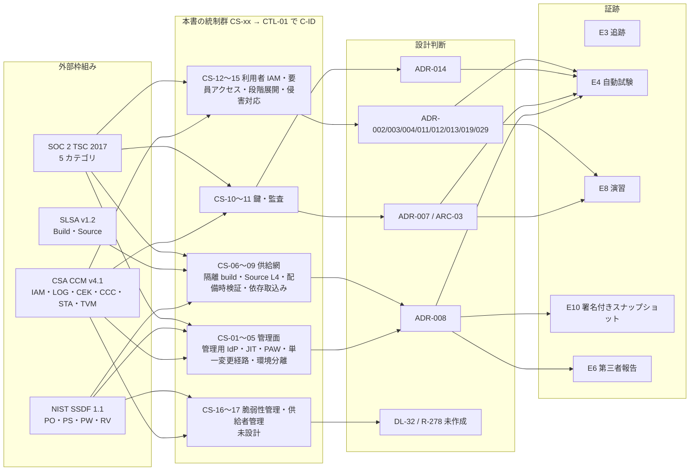
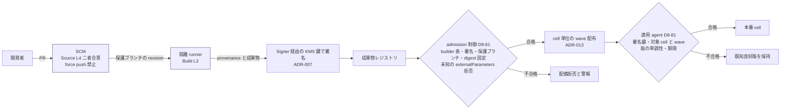

# 統制マッピング: CSA CCM / SSDF / SLSA / SOC 2 TSC

> 文書ID: CTL-05 / 版: 0.1 / 状態: draft / 最終更新: 2026-10-15
> 対応要求: R-025, R-026, R-233, R-236, R-241, R-243, R-247, R-278, G-012（DL-28 の対応成果物欄から抽出した行）。関連: R-073, R-187, R-246, G-090, G-091, G-150（全件と閉じ方は末尾「対応表」）
> 依存文書: CONVENTIONS.md, traceability/deliverables.md（DL-28）, traceability/R-requirements.md, traceability/G-goal-criteria.md, traceability/dissent-log.md（DS-07, DS-10）, 06_controls/applicability.md（CTL-02。X-02, X-10, X-14, X-15, L-10）, 06_controls/control-mapping-ledger.md（CTL-01。C-ID の定義場所、並行作成中）, 05_adr/ADR-002, ADR-003, ADR-004, ADR-006, ADR-007, ADR-008, ADR-011, ADR-012, ADR-013, ADR-014, ADR-015, ADR-019, ADR-021, ADR-022, ADR-028, ADR-029, 05_adr/reconciliation-notes.md, 04_architecture/root-of-trust.md（ARC-03）, 01_governance/assumptions-register.md, 01_governance/kri.md, 03_threat-model/attacker-model.md, research/RS-01, RS-02, RS-05, RS-14, RS-16, research/standards-status.md
> 位置付け: DL-28（統制マッピング台帳、正本は CTL-01）のうち、クラウド統制（CSA CCM）、セキュア開発（NIST SSDF）、ソフトウェア供給網（SLSA）、第三者保証の基準（SOC 2 TSC）の 4 枠組みを扱う分冊である。本書の統制群 ID（CS-xx）は仮番であり、CTL-01 が C-ID を採番するときに取り込む [D]。
> 誠実性: 本書は AI エージェント（Claude）が起草した。作成者以外による原典照合と、実在の CTO/CISO の決裁は受けていない（CONVENTIONS §8）。本書の「状態」はすべて設計段階のものであり、実装・運用の有効性は確認していない [D]。
> 表記: 表のセルのうちタグのないものは設計推論 [D] であり、本注記で個別タグに代える。事実を述べるセルには個別にタグと脚注を付けた。新規仮定は NC5-x（前提台帳へ追加要）、決裁案は KC5-x、試験案は各 ADR の仮番（TC-08-xx、TC-07-xx、TC-014-xx、TC-29-xx。DL-22 で採番）で書く。

---

## 0. 結論（CTO/CISO 向け要旨）

1. **4 枠組みの性格は異なるため、同じ表に並べず、役割を分けて写像する** [D]。CCM は統制の基準（クラウド事業者としての統制目録）、SSDF は開発組織の実践の枠組み（チェックリストではない）[N][^6]（RS-05#79、DS-10）、SLSA は成果物と source の完全性の水準、SOC 2 TSC は第三者保証の規準として扱う [D]。証跡は 1 つを複数の枠組みに使い回し、枠組みごとに別の証跡を作らない（§6）[D]。
2. **SLSA と SSDF の PS 群・PO.5 群は、ADR-008 の決定でほぼ埋まる** [D]。SLSA v1.2（Approved）の目標水準は ADR-008 D8-60（基盤の成果物・bundle・IaC・JWKS 公開物に Build L3、リポジトリに Source L4）であり [N][^8][^9][^10]（RS-05#76〜#78）、本書は変更しない [D]。一方で、**SSDF の RV 群（脆弱性の受付・開示・修正期限・根本原因）と PS.3.2 の SBOM は設計がまだない**（CS-16、CS-09 の一部）[D]。これらは G-150 と R-187 の閉じ方（DL-32）に依存し、現時点で最大の空白である [D]。
3. **CCM の IAM・LOG・CEK・CCC の各ドメインは、ADR-002〜ADR-029 の決定で大半が「設計済」になる**（§2 の 73 行のうち 59 行）[D]。未決は CEK-08（顧客が自分の鍵を管理する機能。ADR-028 RN-028-2 から ADR-007 の改訂待ち）、アクセスレビューの周期（IAM-08）など 4 行、未着手は SBOM（STA-09）と脆弱性管理（TVM 群）など 7 行である [D]。
4. **原典の取得に制約がある**。CCM v4.1 は 207 統制・17 ドメインで 2026-01 に公表されたことを CSA の公式ページで確認した [N][^1][^2]。しかし、統制本文（xlsx）は取得していない [D]。本書の CCM 統制 ID と文言は、CSA が GitHub で公開する AICM 1.1.0 の機械可読版で照合した [N][^4]。**CCM v4.1 と同じ ID・文言かどうかは未確認**であり、仮定 NC5-1 として扱う [D]。SOC 2 TSC の本文（CC 系の基準番号）は会員登録が必要なため取得しておらず [N][^12]（RS-02#63）、本書はカテゴリ単位の写像までにとどめる [D]。
5. **経営判断が要るのは 3 点**（§8）。KC5-1 は CCM の適用区分と CSA STAR への登録、KC5-2 は SSDF を 300 の依存サービス（A-050）と約 25 の開発組織（A-052）にどこまで課すか、KC5-3 は SOC 2 の対象カテゴリと対象システムの範囲（applicability L-10 と連動）である [D]。

---

## 1. 範囲・方法・前提

### 1.1 枠組みの版と状態（確認日 2026-10-15。正本は research/standards-status.md）

| 枠組み | 版・状態 | 本書での扱い | 根拠 |
|---|---|---|---|
| CSA Cloud Controls Matrix | v4.1。2026-01 公表、207 統制・17 ドメイン [N][^1][^2]。STAR Level 1・2 は 2027-12 まで v4.0 と v4.1 の両方を受け付け、v4.0.x は 2028-01 に撤回される [N][^2] | 統制の基準として写像。適用区分は KC5-1 | applicability X-14 は「判定保留」で、本書（DL-28）に原典確認を委ねた |
| CSA AI Controls Matrix（AICM） | 1.1.0（機械可読版の valid_from 2026-06-22）[N][^4] | CCM の統制 ID・文言の照合に代用（NC5-1） | CSA は Security Controls Catalog を CCM と AICM の統合・発展と位置付け、AICM を初版の出発点とする [N][^5] |
| NIST SP 800-218 SSDF | 1.1 final（2022-02）。1.2 は ipd（2025-12-17 公表、意見募集 2026-01-30 締切、final 未公表）[N][^6][^7]（RS-05#79, #80） | task 単位で写像。1.2 は監視のみ | standards-status SS-E36, SS-E37 |
| SLSA | v1.2 Approved（2025-11-24）[N][^8]（RS-05#76） | track・level 単位で写像。目標水準は ADR-008 D8-60 | standards-status SS-I25 |
| AICPA Trust Services Criteria | 2017（Revised Points of Focus 2022）final。本文未取得 [N][^12]（RS-02#63） | カテゴリ単位で写像。CC 系の番号は本文取得後 | standards-status SS-I03 |
| CSA SSCF | v1.0.1（2026-04-09）[N][^13]（RS-14#57） | 顧客向け IAM・LOG 機能の参照（§2.5） | applicability X-13 は「参照」 |

- **NC5-1（新規仮定、前提台帳へ追加要）**: CCM v4.1 の IAM・LOG・CEK・CCC・AIS・STA・TVM・SEF・BCR の統制 ID と統制名は、AICM 1.1.0 の同じ ID と一致する [D]。根拠は間接的である [D]。CCM v4.0 は 197 統制、v4.1 は新規 11・削除 1（IAM）で 207 になり [N][^1][^2]、AICM 1.1.0 の IAM でも IAM-13 が Strong Authentication になっていて、v4.0 から 1 件繰り上がった並びに見える [D]。崩れた場合は §2 の ID 列を差し替える（統制の内容と設計要素の対応は変わらない）[D]。確認方法は CCM v4.1 の xlsx を取得して ID・統制名の差分を機械照合すること、所有者は CISO 組織の統制担当、期限は G1 とする [D]。
- CSA Security Guidance v5 は、本文 PDF がログインを要し、確認できていない（DS-07）[D]。R-243 の「Security Guidance v5 を IAM 統制の基準として適用」は、本書では CCM 側だけで閉じ、Guidance v5 は残課題とする [D]。

### 1.2 写像の規則

- 写像関係は seed-01 §4.2 の 6 列目に従い、NIST OLIR の 4 区分（等価／部分集合／上位集合／交差）で書く [D]。向きは「本基盤の統制群（CS）から見た外部要求」とする [D]。たとえば「上位集合」は、本基盤の統制が外部要求を包含しより強いことを表す [D]。判定はすべて起草者の設計推論であり、作成者以外のレビューで確定する [D]。
- 状態は seed-01 §4.2 の 13 列目の 5 段階（未着手 → 設計済 → 実装済 → 設計有効性確認済 → 運用有効性確認済）に、「未決」（ADR で未決）と「非適用」を加える [D]。ADR はすべて proposed（決裁前）なので、「設計済」は「ADR に決定案がある」の意味であり、決裁済みではない [D]。
- 外部要求の強度は原典どおりに写す（DS-01）。SSDF の task は推奨であり shall ではない [N][^6]（RS-05#79）。SLSA の MUST/SHOULD はそのまま写す [N][^10][^11]。本基盤が推奨を必須に引き上げる場合は [D] として理由を書く [D]。

### 1.3 本書の統制群（仮番。CTL-01 で C-ID を採番）

| CS | 統制群 | 主な設計要素 | 目的・型 |
|---|---|---|---|
| CS-01 | 管理者認証の独立と break-glass | ADR-008 D8-10〜D8-14, D8-40〜D8-42 | 予防・自動＋手動 |
| CS-02 | 常設特権なし・JIT・別報告系統の二者承認 | ADR-008 D8-21〜D8-24、ADR-007 D7-54 | 予防・自動 |
| CS-03 | 特権アクセス端末（PAW）と管理 session の束縛 | ADR-008 D8-30〜D8-35 | 予防・自動 |
| CS-04 | 単一変更経路（宣言 → 二者レビュー → 署名 → 段階配布）と乖離検出 | ADR-008 D8-20, D8-64 | 予防＋検知・自動 |
| CS-05 | 非本番と本番の信頼分離 | ADR-008 D8-50〜D8-55、ADR-007 D7-04 | 予防＋検知・自動 |
| CS-06 | 隔離 build と provenance 署名（Build L3） | ADR-008 D8-60, D8-62, D8-63 | 予防・自動 |
| CS-07 | source の二者合意と履歴保護（Source L4） | ADR-008 D8-60, D8-64, D8-70〜D8-73 | 予防・自動 |
| CS-08 | 配備時・配布時の検証（provenance、署名、版の単調性、期限、wave） | ADR-008 D8-61, D8-80〜D8-84 | 予防・自動 |
| CS-09 | 依存の取込み（digest 固定、更新の二者レビュー、SBOM） | ADR-008 D8-65。SBOM は未設計 | 予防・自動（SBOM は未着手） |
| CS-10 | 鍵階層・鍵台帳・rotation・失効・破棄 | ADR-007、ARC-03 | 予防＋是正・自動＋手動 |
| CS-11 | 監査記録（独立経路、100% 記録、改ざん検知、WORM、時刻） | ADR-014 | 検知・自動 |
| CS-12 | 利用者・顧客向けの IAM 機能（保証レベル、回復、federation、SCIM、認可） | ADR-002, ADR-003, ADR-004, ADR-006, ADR-011, ADR-012, ADR-021 | 予防・自動 |
| CS-13 | 事業者要員の顧客テナントアクセス（昇格 grant、顧客承認） | ADR-029 | 予防＋検知 |
| CS-14 | 段階展開・自動 rollback・緊急変更 | ADR-013 D13-30〜D13-36、ADR-008 D8-90〜D8-93 | 予防＋是正・自動 |
| CS-15 | 侵害対応（kill switch、全件回転、証拠保全） | ADR-019、DL-24 | 是正・手動＋自動 |
| CS-16 | 脆弱性管理と開示（受付、重大度別期限、根本原因） | 未設計（G-150、R-187、DL-32） | 是正・手動 |
| CS-17 | 供給者管理と責任共有（SSRM） | 未設計（R-278、DL-33） | 統治・手動 |

### 1.4 使う前提

| A-ID | 値（基準） | 本書での使い方 |
|---|---|---|
| A-050 | 依存サービス 300 | SSDF・SLSA を依存サービスに課す範囲（KC5-2）の規模 |
| A-052 | 開発組織 25・開発チーム 60 | 契約で課す相手の数（KC5-2） |
| A-053 | 開発者 1,500 | Source L4 のレビュー要員・開発端末（PO.5.2）の対象数 |
| A-054 | 基盤チーム 24 FTE | 基盤自身の SSDF 実施体制 |
| A-011 | 社内 service account 1,200 | IAM-03（棚卸し）・IAM-14（資格情報管理）の対象数 |
| A-081 | 高保証要求テナント 50 | CEK-08（顧客の鍵管理）の需要 |
| N8-1（ADR-008） | PC-07（基盤運用者）40 名 | PAW 台数、二者承認の要員 |

---

## 2. CSA CCM v4.1 マッピング

統制 ID と統制名は AICM 1.1.0 で照合した（NC5-1）[N][^4]。「要旨」は統制本文の要約である [N][^4]。

### 2.1 IAM（Identity & Access Management）

| CCM ID | 統制名・要旨 [N][^4] | 本基盤の設計要素 | 関係 | 検証方法 | 状態 |
|---|---|---|---|---|---|
| IAM-01 | IAM の方針・手順。少なくとも年 1 回見直す | GOV-05（RACI）、REQ-03（操作 5 分類）、ADR-002 | 交差 | 文書の承認記録（E2） | 設計済 |
| IAM-02 | 認証資格情報（password を含む）の管理方針 | ADR-003（回復）、ADR-002（AAL の床） | 交差 | 文書の承認記録（E2） | 設計済 |
| IAM-03 | ID の目録を管理・定期レビューし、アクセス水準を監視する | principal-catalog、ADR-008 D8-54（全環境の OAuth アプリ・app-only 権限の台帳化と停止） | 上位集合 | 台帳と実体の突合（E4） | 設計済 |
| IAM-04 | 職務分離 | ADR-008 D8-21（申請者≠承認者、CP-0・CP-1 は別報告系統） | 上位集合 | TC-08-04 | 設計済 |
| IAM-05 | 最小権限 | ADR-008 D8-21（JIT 権限を 3 種に限定）、ADR-012（既定拒否）、ADR-029 D29-02 | 上位集合 | TC-08-03、TC-29-01 | 設計済 |
| IAM-06 | アクセス付与の手順（認可・記録・通知） | ADR-004（SCIM）、ADR-008 D8-21（JIT 付与の記録）、ADR-014 D14-08 | 等価 | TC-08-04、監査記録の照合 | 設計済 |
| IAM-07 | アクセスの適時の剥奪・変更 | ADR-006（失効の中央強制）、ADR-004（SCIM の deprovision） | 部分集合（「適時」の値は R-189.x で TBD） | ADR-006 の剥奪 SLO の実測（DL-22） | 設計済（数値 TBD） |
| IAM-08 | 最小権限・職務分離の観点でのアクセスレビュー。リスクに応じた頻度で、少なくとも年 1 回 | ADR-008 D8-24（承認者名簿の四半期確認）、K-09 | 部分集合 | 基盤全体のアクセスレビュー周期は**未決**（所有者 CISO、期限 G3、決め方: K-09 の閾値と同時に DL-06 で決める） | 未決 |
| IAM-09 | 特権ロールの分離 | ADR-008 D8-02（CP-0／CP-1／CP-2 の区分）、ADR-029 D29-10（昇格 grant の store を分離） | 上位集合 | TC-08-04、TC-29-02 | 設計済 |
| IAM-10 | 特権を期限付きで付与し、特権の蓄積を防ぐ | ADR-008 D8-21（常設特権 0 人、K-09 (a)）、ADR-029 D29-02 | 等価 | TC-29-03、K-09 の計測 | 設計済 |
| IAM-11 | 高リスクの特権ロールの付与に顧客が参加できる | ADR-029（チケットに結び付いた昇格 grant と顧客承認） | 等価 | TC-29-04 | 設計済 |
| IAM-12 | 一意の ID で活動を識別できる | ADR-021（不透明な不変識別子）、ADR-014 D14-18（相関 8 欄） | 上位集合 | TC-014-11 | 設計済 |
| IAM-13 | 強い認証。少なくとも特権利用者と機微データのアクセスに MFA、system identity に証明書等 | ADR-002（人の床は AAL2、privileged/P は AAL3 device-bound）、ADR-009（X.509-SVID の mTLS）、ADR-008 D8-10 | 上位集合 | ADR-002・ADR-009 の TC、TC-08-10 | 設計済 |
| IAM-14 | 認証資格情報の安全な管理 | ADR-008 D8-63（CI は OIDC と workload federation の短命資格情報、PAT は例外台帳で 7 日以下）、ADR-003 | 上位集合 | 例外台帳の監査、TC-08-11 | 設計済 |
| IAM-15 | データ・機能へのアクセスが認可されていることを検証する仕組み | ADR-011（CAM、既定拒否・deny 優先）、ADR-012（PEP 網羅、三者一致） | 上位集合 | ADR-012 の entry point 突合（未宣言 0 件） | 設計済 |

- CCM v4.0 の IAM-12（Safeguard Logs Integrity）に相当する統制は、AICM 1.1.0 の IAM には見当たらない [D]。v4.1 で削除された IAM の 1 件がこれかどうかは未確認である（NC5-1）[D]。監査ログの完全性は LOG-02・LOG-10 で扱う [D]。

### 2.2 LOG（Logging & Monitoring）

| CCM ID | 統制名・要旨 [N][^4] | 本基盤の設計要素 | 関係 | 検証方法 | 状態 |
|---|---|---|---|---|---|
| LOG-01 | 記録・監視の方針と手順 | ADR-014 | 等価 | 文書の承認記録（E2） | 設計済 |
| LOG-02 | 監査ログの保護と保持 | ADR-014 D14-29（4 層の改ざん検知）、D14-30（WORM）、D14-36（保持は記録区分×規制プロファイル） | 部分集合（保持の値は法務の L-03 で TBD） | TC-014-06 | 設計済（保持値 TBD） |
| LOG-03 | セキュリティ事象の監視と担当者への警報 | ADR-008 D8-101（CP-0 操作・鍵系への全アクセスでページング）、K-09・K-10・K-20 | 部分集合 | 警報の注入試験（TC-08-03 の「警報される」） | 設計済 |
| LOG-04 | 監査ログへのアクセスを認可済みの ID に限り、アクセス記録を残す | ADR-014（監査経路の分離、運用者権限の改ざん検知） | 部分集合 | 監査ログ自体の閲覧を記録する族の有無は**要確認**（ADR-014 D14-08 の 10 族との照合。所有者: ARC-10 の作成者、期限 G1） | 要確認 |
| LOG-05 | 監査ログを相関・監視して異常を検知し、レビュー手順を持つ | ADR-014 D14-18（相関 8 欄）、D14-19（4 照合） | 部分集合 | TC-014-11 | 設計済 |
| LOG-06 | 信頼できる時刻源 | ADR-014 D14-27（UTC と 3 種の時刻） | 等価 | TC-014-09 | 設計済 |
| LOG-07 | 記録する事象の範囲を定め、年 1 回以上見直す | ADR-014 D14-08（10 族）、D14-14〜D14-16（100% 記録の範囲） | 上位集合 | スキーマ（DL-77）の版管理 | 設計済 |
| LOG-08 | 顧客がログ中の機微データを検出・除去・トークン化できる | ADR-014 D14-09（欄の 4 区分）、D14-10（token・資格情報を記録しない）、D14-21（jti の HMAC 化） | 交差（「顧客が行う」ではなく、記録側で入れない設計） | TC-014-13 | 設計済 |
| LOG-09 | 関連する情報を含む監査レコード | ADR-014 D14-06（正準スキーマ）、DL-77 | 等価 | スキーマ検査（E4） | 設計済 |
| LOG-10 | 監査レコードを無権限のアクセス・変更・削除から守る | ADR-014 D14-29, D14-30 | 上位集合 | TC-014-06 | 設計済 |
| LOG-11 | 暗号・鍵管理の運用の監視と内部報告 | ARC-03 §8（鍵年齢監視）、ADR-007 D7-31 | 等価 | TC-07-13 | 設計済 |
| LOG-12 | 鍵のライフサイクル事象を記録・監視する | ADR-008 D8-101、ADR-007 D7-54、ARC-03 §8.2 | 上位集合 | TC-07-11（KMS の署名回数と発行台帳の照合） | 設計済 |
| LOG-13 | 物理アクセスの記録・監視 | クラウド上の部品は事業者の責任（SSRM）。L0 のオフライン HSM の保管拠点は ARC-03 付録 A（ceremony の録画） | 条件付き（L0 拠点だけ適用） | ceremony 演習（TC-07-12、E8） | 未決（L0 保管拠点は KRT-1） |
| LOG-14 | 監視系の障害・異常の報告と担当者への即時通知 | ADR-014 D14-26（6 つの照合による欠損検知）、D14-28（停止の定義） | 等価 | TC-014-02、TC-014-03 | 設計済 |

### 2.3 CEK（Cryptography, Encryption & Key Management）

| CCM ID | 統制名・要旨 [N][^4] | 本基盤の設計要素 | 関係 | 検証方法 | 状態 |
|---|---|---|---|---|---|
| CEK-01 | 暗号・鍵管理の方針と手順 | ADR-007、ARC-03 | 等価 | 文書の承認記録（E2） | 設計済 |
| CEK-02 | 暗号・鍵管理の役割と責任 | ARC-03 §6（機能別の k/n）、ADR-007 D7-50（L0 は 3-of-7） | 上位集合 | TC-07-09 | 設計済 |
| CEK-03 | 承認済み標準に認証された暗号ライブラリで保存時・転送時のデータを保護する | ADR-007（FIPS 140-3 Level 3 の有効な CMVP 証明書を調達要件にする）、ADR-028（テナント KEK・DEK） | 部分集合（ML-DSA・Ed25519 が FIPS 境界内かは未確認。RS-05 §6） | 証明書番号の照合（E6 または調達記録） | 設計済（照合未了） |
| CEK-04 | データ分類とリスクに応じた業界標準のアルゴリズム | ADR-007 D7-60（fully-specified な IANA 識別子の allowlist）、ADR-015 | 等価 | 負例試験（TC-07-01 の alg 取違え） | 設計済 |
| CEK-05 | 暗号技術の変更の変更管理 | ADR-007 D7-54（鍵の作成・無効化・鍵ポリシー変更の二者承認）、ADR-015（alg 移行の順序） | 上位集合 | TC-08-04、TC-07-10 | 設計済 |
| CEK-06 | 暗号変更の下流影響・残余リスク・費用便益の評価 | ADR-015（移行順序と社内期限案）、TC-07-06・TC-07-08（PQ の容量と token サイズ） | 等価 | TC-07-06, TC-07-08 | 設計済（実測待ち） |
| CEK-07 | 暗号・鍵管理のリスク管理プログラム | ARC-03 §14（残余リスク）、KRI（鍵年齢） | 部分集合 | KRI 報告（DL-06） | 設計済 |
| CEK-08 | 顧客が自分のデータ暗号鍵を管理できる機能を提供する | A-081 の高保証テナントの「顧客管理鍵」。ADR-028 D28-26 は鍵材料の import を禁じ、衝突は RN-028-2 で ADR-007 の改訂に送られた | 未決 | — | **未決（ADR-007 改訂、RN-028-2）** |
| CEK-09 | 鍵管理の監査。リスクに比例した頻度で、少なくとも年 1 回とセキュリティ事象の後 | ADR-007 D7-52（L0 ceremony は年 1 回）、ARC-03 付録 A（quorum 外の第三者立会い）、DL-30（第三者評価） | 部分集合（KMS 側の監査周期は未定） | 第三者立会いの記録（E6・E8） | 設計済（周期の一部 TBD） |
| CEK-10 | 業界で受け入れられたライブラリで鍵を生成する | ADR-007 D7-06（KMS 内で生成した非エクスポート鍵）、L0 は ceremony で生成 | 上位集合 | TC-07-12 | 設計済 |
| CEK-11 | 鍵を単一の目的に割り当てる | ADR-007 D7-10（1 族 1 鍵 1 alg。SP 800-57 の shall を内部要求として維持） | 上位集合 | TC-07-01 | 設計済 |
| CEK-12 | 計算した cryptoperiod に従って rotation する | ADR-007 D7-30（L2 は 30 日周期の初期案）、D7-31（鍵年齢の段階） | 上位集合 | TC-07-02, TC-07-13 | 設計済 |
| CEK-13 | cryptoperiod 前の失効・撤去（侵害時など） | ADR-007 D7-36〜D7-39（欠落と失効の区別、緊急失効は通常系の最大速度） | 等価（完了時間は R-189.5 で TBD） | TC-07-03 | 設計済（数値 TBD） |
| CEK-14 | 不要になった鍵の安全な破棄 | ARC-03 §5.6、ADR-028（論理削除 → 鍵破棄 → 消去完了の 3 段） | 等価 | TC-014-07、TC-07-04 | 設計済 |
| CEK-15 | 生成後・使用許可前の鍵を pre-activated 状態で作る | ARC-03 §5.1（状態遷移）、ADR-007 D7-40（next 鍵を事前生成） | 等価 | TC-07-02 | 設計済 |
| CEK-16 | suspension 状態との遷移の監視・承認 | ARC-03 §5.1 の状態遷移 | 要確認（suspension 状態を持つかを ARC-03 と照合。所有者: ARC-03 作成者、期限 G1） | — | 要確認 |
| CEK-17 | 有効期限での鍵の deactivation | ADR-007 D7-31・D7-32（硬上限で next 鍵へ切替） | 等価 | TC-07-13 | 設計済 |
| CEK-18 | アーカイブ鍵の最小権限での保管 | ADR-014 D14-34（監査署名の検証鍵を保持期間と「稼働期間＋2 年以上」の長い方で保持） | 部分集合 | TC-07-15 | 設計済 |
| CEK-19 | 侵害鍵の扱い | ADR-019、ADR-007 D7-37。署名鍵は侵害後に署名へ使わない | 交差（CEK-19 は暗号化鍵の文言） | DL-24 の鍵侵害 runbook 演習（E8） | 設計済 |
| CEK-20 | 鍵の回復（事業継続と露出リスクの評価） | ADR-007 D7-40（別障害ドメインの DR 鍵）、ARC-03 §5.7、KRT-4（L0 バックアップの復元 quorum） | 等価 | TC-07-14 | 設計済（KRT-4 は未決） |
| CEK-21 | 鍵管理システムで全暗号材料と状態変化を追跡・報告する | ADR-007 D7-27（鍵台帳を正本とし、KMS の metadata を正本にしない） | 上位集合 | TC-07-11 | 設計済 |

### 2.4 CCC・AIS・STA・TVM・SEF（変更管理と供給網に関わるもの）

| CCM ID | 統制名・要旨 [N][^4] | 本基盤の設計要素 | 関係 | 検証方法 | 状態 |
|---|---|---|---|---|---|
| CCC-01 | 変更管理の方針・手順 | ADR-008 §2.3、ADR-013 | 等価 | 文書の承認記録（E2） | 設計済 |
| CCC-02 | 品質・承認・試験の変更統制 | ADR-008 D8-71（自動検査と shadow 判定の差分の添付を必須化）、D8-91（validator の負例コーパス） | 上位集合 | TC-08-08 | 設計済 |
| CCC-03 | 変更管理の技術 | CS-04（宣言 → 二者レビュー → 署名 → 段階配布の単一経路） | 上位集合 | TC-08-03 | 設計済 |
| CCC-04 | 資産の追加・削除・更新の認可を強制する | CS-08（admission 制御で provenance・署名・保護ブランチ・digest 固定を検証） | 上位集合 | TC-08-06 | 設計済 |
| CCC-05 | 顧客環境（テナント）に直接影響する変更を明示的な要求に限る | ADR-013 D13-36、ADR-008 D8-93（テナントが受ける ring を選べる）、ADR-016（非推奨の直接通知） | 交差 | TC-08-07（wave 未到達の拒否） | 設計済 |
| CCC-06 | 変更管理と構成のベースライン | IaC の宣言を正本にする（D8-20） | 等価 | 署名付きスナップショット（E10） | 設計済 |
| CCC-07 | ベースライン逸脱の検知と通知 | D8-20 の乖離検出（break-glass か侵害として事後レビューを起票） | 等価 | TC-08-12 | 設計済（検出時間 TBD） |
| CCC-08 | 緊急を含む例外の管理 | ADR-008 D8-92（緊急変更は通常 pipeline の最大速度＋同時二者）、DL-05（例外・リスク受容） | 上位集合 | TC-08-09、K-20 (a) | 設計済 |
| CCC-09 | 既知良好状態への事前の rollback | ADR-008 D8-83（旧内容を新しい版番号で再発行）、ADR-013（自動 rollback） | 上位集合 | TC-08-07, TC-08-08 | 設計済 |
| AIS-04 | セキュアな SDLC | §3（SSDF）、R-233 | 交差 | DL-61 の自己評価 | 設計済（依存サービスは KC5-2） |
| AIS-05 | 受入基準を含む試験戦略、可能な限り自動化 | ASVS 5.0 による受入基準（CTL-01、DL-61）、DL-22 | 部分集合 | DL-61 | CTL-01 で扱う |
| AIS-06 | 標準化・自動化した安全な配備 | CS-06・CS-08 | 上位集合 | TC-08-06 | 設計済 |
| AIS-07 | アプリケーション脆弱性の修正（可能な限り自動化） | CS-16 | 未設計 | G-150 の演習（E8） | 未着手 |
| STA-02〜STA-07 | 責任共有モデル（SSRM）の方針・供給網への適用・顧客への指針・統制の所有の明示・文書のレビュー・自分の担当分の実施と監査 | §2.5 の 3 者分界（クラウド事業者／基盤／依存サービス・顧客）、applicability §7、customer-admin-responsibility | 部分集合 | SSRM 表のレビュー記録（E2） | 設計済（文書化は CTL-01） |
| STA-08 | 供給網の関係の目録 | R-278（供給者ごとの重要度・責任者・評価周期） | 未設計 | — | 未着手（DL-33） |
| STA-09 | サービスの部品表（BOM）を年 1 回以上見直す | CS-09 の SBOM | 未設計 | — | 未着手（G-150） |
| STA-10, STA-16 | 供給網のリスク要因の定期レビュー、リスクに基づくセキュリティ評価 | R-278、ADR-001（製品評価）、ADR-018（出口） | 部分集合 | — | 未着手（DL-33） |
| STA-11, STA-12, STA-14 | 契約に入れる条項、年 1 回以上の契約レビュー、供給者への要件の適用 | ADR-022（連携契約）、DL-30（RFP/SOW）、KC5-2 | 部分集合 | 契約レビュー記録（E2） | 未決（KC5-2） |
| TVM-03 | 少なくとも月 1 回の脆弱性検出 | CS-16 | 未設計 | — | 未着手 |
| TVM-06 | 第三者・OSS ライブラリの更新の識別 | CS-09（digest 固定と更新の二者レビュー）、CS-16 | 部分集合 | — | 設計済（識別手段は未着手） |
| TVM-07 | 独立した第三者による定期的な pentest | DL-59（pentest・red team 計画）、DL-30 | 等価 | 第三者報告書（E6） | 未着手（DL-59） |
| TVM-08, TVM-09, TVM-11 | 修正の予定（通常と緊急）、リスクに基づく優先順位付け、追跡と報告 | CS-16、G-150（重大度別の修正期限） | 未設計 | G-150 の演習（E8） | 未着手 |
| SEF-03〜SEF-08 | 対応計画、演習、指標、triage、対応、侵害通知（供給網の侵害を含む） | ADR-019、DL-24、applicability §3.7（通知期限） | 部分集合 | DL-24 の演習（E8） | 設計済（runbook は DL-24） |

- BCR（事業継続）は ADR-013（cell と静的安定性）と ADR-007 D7-40〜D7-42（DR 鍵）で扱う [D]。本書の範囲（クラウド統制の IAM・LOG・CEK と供給網）を超えるので、写像は CTL-01 に送る [D]。
- CCM v4.1 で新設された 11 統制（DCS・LOG・SEF・STA・TVM を含む）[N][^2]が AICM 1.1.0 の上記 ID に含まれているかは未確認である（NC5-1）[D]。

### 2.5 責任共有（SSRM）の分界

CCM は事業者と顧客の役割を定めるものと説明されている [N][^3]。本基盤は、クラウド事業者の利用者であると同時に、依存サービスと B2B 顧客に認証・認可を提供する側でもある [D]。3 者の分界を次のとおりとする [D]。

| 層 | 責任を負う者 | 本基盤が提供・要求するもの | 根拠 |
|---|---|---|---|
| クラウド事業者 | 物理（LOG-13 等）、KMS/HSM の実装、事業者の管理面 | 本基盤は事業者の第三者保証報告を受け取り（DL-33）、管理面の操作を管理用 IdP と local RBAC に限る（D8-11） | ADR-008 RR8-07 |
| 本基盤（認証・認可プラットフォーム） | CS-01〜CS-15 | 依存サービスへ SDK・連携契約・PEP の規則を、顧客へ IAM・LOG 機能を提供する | ADR-022、ADR-012 |
| 依存サービス（300）・顧客テナント | サービス内の object 単位の PEP（ADR-012）、自テナントの利用者管理と設定（SSCF の顧客責任）[N][^13]（RS-14#58） | SSDF・SLSA の最低線（KC5-2）、顧客管理者の保護操作（ADR-004・DL-26） | KC5-2、RS-14#58 |

- 顧客向けの機能（federation、SCIM、監査ログ配信）の基準線は CSA SSCF を参照する [D]。SSCF の LOG 領域は programmatic 配信、最低 7 日の保持、24 時間以内の配信を must とする [N][^13]（RS-14#52）。ADR-014 はこれを最低線とし、顧客監査 API を設計する（RS-14 §5 の申し送り）[D]。SSCF の各統制と CCM v4.1 の対応は確認していない [D]（RS-14 §6）。

---

## 3. NIST SSDF 1.1 マッピング

SSDF は「従うべきチェックリストを作ることではなく、リスクに基づく実践の採用の基礎を与えること」を意図している [N][^6]（§1、PDF p.12）。本書は task ごとに「基盤で行うこと」と「依存サービスに求める最低線（KC5-2 の推奨案）」を分けて写像する [D]。task の文言は Table 1 による [N][^6]。

| 群 | task [N][^6] | 基盤の設計要素 | 依存サービスへの最低線（KC5-2 推奨案） | 検証方法 | 状態 |
|---|---|---|---|---|---|
| PO.1 | PO.1.1 開発基盤・工程のセキュリティ要件、PO.1.2 自社開発ソフトウェアの要件、PO.1.3 部品を提供する第三者への要件の伝達（PDF p.14） | 02_requirements（R/G 台帳）、ADR-022（連携契約）、DL-30 | PO.1.3 を連携契約と RFP に入れる | 要件→統制→試験の追跡（E3） | 設計済 |
| PO.2 | PO.2.1 役割と責任、PO.2.2 役割別の訓練、PO.2.3 経営の確約 | GOV-05（RACI）、DL-27（有資格者名簿）、DEC 決裁 | PO.2.2 の訓練は SDK 利用者向けに提供 | 名簿と訓練記録（E2） | 設計済（訓練は未着手） |
| PO.3 | PO.3.1 toolchain の指定、PO.3.2 toolchain の安全な運用、PO.3.3 実践の証跡を生む設定（PDF p.16） | CS-06（隔離 runner、builder の設定は CP-0）、CS-04 | 基盤が提供する CI テンプレートを既定にする | TC-08-06、E10 | 設計済 |
| PO.4 | PO.4.1 セキュリティ検査の基準と追跡、PO.4.2 基準を支える情報の収集・保護（PDF p.17） | DL-22（事前登録した合否基準）、D8-71 | 連携の適合試験（ADR-022 の負例ベクタ） | E4 | 設計済 |
| PO.5 | PO.5.1 開発に関わる各環境の分離・保護、PO.5.2 開発端末の堅牢化（PDF p.17。RS-05#79） | CS-05（非本番→本番の到達 0 件）。PO.5.2 は管理面の端末（PAW）に強めて適用（ADR-008 D8-30） | PO.5.1 は必須、PO.5.2 は開発端末の基準を契約で示す | TC-08-05 | 設計済（開発者 1,500 名の端末基準は未決） |
| PS.1 | PS.1.1 configuration-as-code を含む全コードを最小権限で保管（PDF p.18） | CS-07（Source L4、保護設定の変更は CP-0）、D8-63（PAT の例外台帳） | Source L2（history）を既定（ADR-008 D8-60） | TC-08-11 | 設計済 |
| PS.2 | PS.2.1 完全性検証情報を取得者に提供（PDF p.19） | CS-06・CS-08（KMS 鍵での署名、公開鍵は鍵台帳で配布。D8-61, D8-62） | 基盤の SDK・sidecar の署名と検証手順を公開 | TC-08-06 | 設計済 |
| PS.3 | PS.3.1 リリースごとの完全性検証情報・provenance の保管、PS.3.2 全部品の provenance（例: SBOM）の収集・保護・共有（PDF p.19） | PS.3.1 は E10 と provenance の保管。PS.3.2 の SBOM は未設計（CS-09） | SBOM の提出を最低線に含める案（形式と保管期間は TBD） | — | PS.3.1 設計済（保管期間 TBD）、PS.3.2 未着手 |
| PW.1 | PW.1.1 脅威モデリング等、PW.1.2 要件・リスク・設計判断の追跡（PDF p.20） | 03_threat-model、05_adr | DL-09 の高リスク階層を扱うサービスに脅威モデルを要求 | 独立レビュー記録 | 設計済 |
| PW.2 | PW.2.1 設計に関与していない有資格者または自動処理による設計レビュー（PDF p.21） | ADR の独立レビュー、D8-70 の M3（別報告系統のレビュアー） | 高リスク階層のサービスに限る | レビュー記録（E2） | 設計済 |
| PW.4 | PW.4.1 よく保護された第三者部品の取得、PW.4.2 社内共通部品、PW.4.4 第三者部品が要件に適合し続けることの検証（PDF p.21〜22） | CS-09（digest 固定、更新の二者レビュー）、ADR-001（製品評価）、PEP SDK を共通部品として提供 | 基盤の SDK を使う（自前実装は ADR-022 の適合試験） | — | 部分設計（継続検証は CS-16 待ち） |
| PW.5 | PW.5.1 安全なコーディング実践 | ASVS 5.0 の検証要件（DS-10。CTL-01、DL-61） | 同左 | DL-61 | CTL-01 で扱う |
| PW.6 | PW.6.1・PW.6.2 build ツールのセキュリティ機能の選択と承認済み設定（PDF p.23） | Build L3 の builder 設定を CP-0 として二者承認（D8-02） | 基盤の CI テンプレート | TC-08-06 | 設計済 |
| PW.7 | PW.7.1 code review／analysis の要否、PW.7.2 実施と記録（PDF p.23） | CS-07（Source L4 の二者合意）、D8-71（自動検査の添付） | 二者レビューの範囲は KD8-2 | TC-08-04 | 設計済 |
| PW.8 | PW.8.1・PW.8.2 実行コードの試験の要否と実施（PDF p.24） | 負例試験（TC-07-01、TC-08-07、ADR-022 の負例ベクタ）、DL-59 | 連携の適合試験 | E4 | 設計済 |
| PW.9 | PW.9.1 安全な既定値のベースライン、PW.9.2 既定値の実装と文書化（PDF p.25） | ADR-012（既定拒否）、applicability §4（規制フロアの既定値） | SDK の既定値をそのまま使う | E4 | 設計済 |
| RV.1 | RV.1.1 脆弱性情報の収集、RV.1.2 未発見の脆弱性の確認、RV.1.3 開示と修正の方針（PDF p.25〜26） | CS-16（受付窓口と開示方針は G-150 で求められているが未設計） | 依存サービスへの通知と対応期限（G-150） | G-150 の演習（E8） | 未着手 |
| RV.2 | RV.2.1 各脆弱性の分析、RV.2.2 リスク対応の計画と実施（PDF p.27） | CS-16（重大度別の修正期限。値は TBD） | 同左 | E11 | 未着手 |
| RV.3 | RV.3.1〜RV.3.4 根本原因の分析、傾向分析、同種の脆弱性の掃討、SDLC の更新（PDF p.27） | R-187（DL-32、E11） | — | E11 | 未着手 |

- **SSDF 1.2（ipd）**: final 公表時に 1.1 との差分を取り、本表を更新する [D]。監視は DL-84 で行う（standards-status SS-E37）[D]。
- **RV 群と SBOM の空白**: 基盤が依存サービスに配る SDK・sidecar は 300 サービスに入る（A-050）[D][A-050]。このため、基盤の脆弱性修正の遅れは全サービスの修正の遅れになる [D]。CS-16 の設計（受付窓口、重大度別期限、依存サービスへの通知と期限、SBOM による影響範囲の特定）は G-150 の範囲であり、DL-32 で閉じる [D]。期限の値は TBD とする（所有者 CISO、期限 G3、決め方: BIA の MTPD と、脆弱性公表を模した演習の実測）[D]。

---

## 4. SLSA v1.2 マッピング

### 4.1 目標水準（ADR-008 D8-60 の写し。本書では変えない）

| 対象 | Build | Source | 本書の統制群 |
|---|---|---|---|
| 基盤の成果物（AS の container image、PDP・façade、PEP SDK、sidecar、適用 agent、変換器） | L3 | L4 | CS-06, CS-07, CS-08 |
| policy・model・カタログ・基盤設定の bundle | L3 | L4 | CS-06〜CS-08、CS-14 |
| IaC（cell template、組織の guardrail、KMS の鍵ポリシー） | L3 | L4 | CS-04, CS-06, CS-07 |
| JWKS・鍵マニフェストの公開物 | L3 | L4 | CS-10 |
| 依存サービス（300） | ADR-008 では定めない（L2 を推奨） | L2 を推奨。L4 の範囲は KD8-2 | KC5-2 |

### 4.2 要件ごとの設計要素と検証

| SLSA の要件 | 原典の強度 | 設計要素 | 検証方法 | 状態 |
|---|---|---|---|---|
| Build L1: build の過程を示す provenance [N][^9]（RS-05#77） | level の定義 | 全 build で provenance を生成 | TC-08-06（provenance のない成果物の配備拒否） | 設計済 |
| Build L2: hosted build platform が生成する署名付き provenance [N][^9] | level の定義 | provenance の署名は KMS 上の鍵（Signer 経由）。Sigstore keyless は補助（D8-62）[V][^16]（RS-05#81） | TC-08-06 | 設計済 |
| Build L3: 実行同士の非干渉、provenance 署名の秘密を利用者定義の build 手順から隔離 [N][^9] | level の定義 | 使い捨ての隔離 runner、build 手順と分離した provenance 生成・署名（D8-60） | TC-08-06、第三者の供給網レビュー（R-073、E6） | 設計済 |
| Source L2: 履歴の連続・不変・保持、SCS による source provenance の発行。branch は現 revision の子孫にのみ更新（MUST）[N][^10]（RS-05#78） | MUST | force push の禁止を全リポジトリの既定（D8-60） | TC-08-11 | 設計済 |
| Source L3: 組織の技術的統制の継続的強制の証拠（MUST）、source provenance を branch 更新と同時に作成（MUST）[N][^10] | MUST | 保護設定を宣言で管理し、署名付きスナップショット（E10）を定期に取る（D8-64） | E10 の定期取得 | 設計済 |
| Source L4: 保護ブランチの変更は提出前に 2 名以上の信頼された者が合意（MUST）。レビューはセキュリティ関連の性質を扱うべき（SHOULD）[N][^10]（RS-05#78） | MUST／SHOULD | D8-70〜D8-72（承認後の追加 commit で承認を無効化） | TC-08-04 | 設計済 |
| Source VSA: SCS は Source Level を示す source verification summary attestation を発行する（MUST）。発行しない revision は Source Level 0 [N][^10] | MUST | SCM 製品の選定要件に Source VSA の発行能力を加える [D] | 製品評価（ADR-001 の評価軸への申送り） | **未決（SCM 製品の選定）** |
| 検証: builder ID を「信頼する builder → 最大 Build level」の表で確かめる、provenance の署名を検証する、buildType と externalParameters を期待値と比べる（SHOULD）。未知の externalParameters は検証を失敗させるべき（SHOULD）[N][^11] | SHOULD | D8-61 の admission 制御。信頼する builder の表は CP-0 の管理面資産とし、未知の externalParameters は拒否する（SHOULD を必須に引き上げる。理由: CI の侵害 ATK-07 で build 引数を差し替えられる経路を残さないため）[D] | TC-08-06 に「未知の externalParameters」の負例を追加（DL-22 へ申送り） | 設計済（負例の追加は申送り） |

- SLSA の verifying-artifacts は、利用者が要求すべき最低の Build level を定めず、verifier の信頼の表に委ねている [N][^11]。最低 level は本基盤の決定（D8-60）である [D]。
- bundle の rollback（署名済み旧版の再提示）は SLSA の範囲外であり、ADR-008 D8-81〜D8-84（TUF の版の単調性と期限）で扱う [D]。OPA は署名検証に成功した bundle だけを有効化するが、旧版の再提示を拒否する仕組みは公式記述で確認できていない [V][^17]（RS-05#82）。
- SLSA の自己評価（G-090）は DL-61、第三者の供給網レビュー（R-073、G-091）は DL-30 の範囲である [D]。本書は、その評価の対象表（§4.2）を提供する [D]。

図の各段と枠組みの対応: SCM は SSDF PS.1.1・CCM CCC-04、CI は SSDF PO.3・PW.6、署名は SSDF PS.2.1・CCM CEK-11、admission は CCM CCC-04・AIS-06、wave と適用 agent は CCM CCC-05・CCC-09 に当たる [D]。

---

## 5. SOC 2 Trust Services Criteria マッピング

### 5.1 扱いの前提

- TSC は AICPA の保証業務執行委員会（ASEC）が定めた統制規準であり、Security・Availability・Processing Integrity・Confidentiality・Privacy を対象とする [N][^12]（RS-02#63）。規準本文（CC 系の番号を含む）は会員登録が必要なため取得していない [N][^12]（RS-02 §6）。
- SOC 2 は法定ではなく、顧客契約・調達要件で求められる場合に取得する、と applicability（X-02）は判定した [D]。医療 GL 保守委託機関編は、委託先が P マーク・ISMS を持たない場合の能力確認手段の 1 つに SOC 2／SOC 3 を挙げる [N][^15]（RS-02#39）。報告書の取得は R-247 の範囲でも必須とされていない（R-247 備考）[D]。
- このため本書は、**報告書を取得すると決めた時点で説明できる統制と証跡を、カテゴリ単位で用意する**ことを目的にする [D]。CC 系の基準番号への写像は、本文の取得後に行う（所有者: CISO 組織の統制担当、期限: G1、決め方: AICPA の無償アカウントで本文を取得し、本表の各行に基準番号を付ける）[D]。

### 5.2 カテゴリ単位の写像

| TSC カテゴリ [N][^12] | 対応する統制群 | 主な証跡（E 種別） | 状態 |
|---|---|---|---|
| Security | CS-01〜CS-13（論理アクセス、変更管理、供給網、鍵、監査） | E4（TC-08-xx、TC-07-xx、TC-29-xx）、E10、E8（break-glass・ceremony 演習）、E6 | 設計済（CC 番号は未付与） |
| Availability | CS-14（段階展開）、ADR-013（cell・静的安定性）、ADR-007 D7-40〜D7-42（DR 鍵） | E5（PoC 実測）、E8（障害注入） | 設計済（数値は DL-20 で TBD） |
| Confidentiality | CS-11（記録しない欄、仮名化）、ADR-028（KEK・DEK、暗号消去）、CS-05（本番データを非本番へ複製しない） | E4（TC-014-13、TC-014-07） | 設計済 |
| Processing Integrity | CS-08（版の単調性・署名付き配布）、ADR-011（判定の正しさ） | E4（TC-08-07） | 候補（対象にするかは KC5-3） |
| Privacy | ARC-10（監査・プライバシー）、applicability §3 | E2、E4 | 候補（対象にするかは KC5-3） |

- 証跡の共通化: CCM・SSDF・SLSA・TSC で同じ証跡を引く（§6）[D]。SOC 2 のために別の証跡を作らない [D]。

---

## 6. 証跡の設計（枠組み共通）

| 証跡 | E 種別 | 引く枠組み | 生成者（第 1 線） | 第 2 線のレビュー | 取得周期 |
|---|---|---|---|---|---|
| 保護ブランチ・builder 設定・組織 guardrail の署名付きスナップショット | E10 | SLSA Source L3、CCM CCC-06・CCC-07、SSDF PS.1.1、TSC Security | CI の機械主体 | CISO 組織 | 定期（周期は TBD。所有者 SRE 責任者、期限 G4、決め方: TC-08-12 の検出時間と同じ値以下） |
| admission の拒否ログと provenance の検証記録 | E4 | SLSA Build、CCM CCC-04・AIS-06、SSDF PS.2.1 | 配備基盤 | CISO 組織 | 常時 |
| 二者合意の記録（PR の承認と自動検査の添付） | E4 | SLSA Source L4、SSDF PW.7、CCM IAM-04 | SCM | 基盤のレビュアー（M1 以上） | 常時 |
| JIT 付与・break-glass の使用と事後レビュー | E4・E8 | CCM IAM-10・IAM-11、TSC Security | JIT 承認系 | 第 2 線 | 常時（K-09・K-10 を四半期報告） |
| 鍵台帳と KMS の署名回数の照合 | E4 | CCM CEK-21・LOG-12 | 鍵管理担当 | CISO 組織 | TBD（ARC-03 §8.2 に従う） |
| ceremony の記録（台本、録画、ハッシュ、署名ログ） | E8 | CCM CEK-02・CEK-09・CEK-10 | ceremony 管理者 | quorum 外の第三者立会人 | 年 1 回と緊急時（ADR-007 D7-52） |
| 第三者の供給網レビュー・クラウド設定レビュー報告 | E6 | SLSA、CCM STA・TVM-07、TSC 全般 | DL-30 の評価者 | CISO | DL-07 の計画に従う |

- 3 線の担当（seed-01 §4.2 の 12 列目）は、CTL-01 が C-ID ごとに確定する [D]。本表は候補である [D]。

---

## 7. 健全性の確認（本分冊の範囲）

G-012 の 3 ルール（孤児要求・孤児統制・統制のない「適用」要求が 0 件）を、本分冊の範囲で先行して数えた [D]。最終判定は DL-111 の自動検査と CTL-01 で行う [D]。

| ルール | 本分冊の結果 | 内訳 |
|---|---|---|
| 統制が未決の「適用」外部要求 | 5 件（未決として明示） | CCM の CEK-08（RN-028-2）、IAM-08（周期）、LOG-13（L0 保管拠点 KRT-1）、STA-11/12/14（KC5-2）と、SLSA の Source VSA（SCM 選定）。いずれも所有者・期限付き |
| 設計要素が未着手の外部要求 | 11 件 | SSDF の RV.1、RV.2、RV.3、PS.3.2（4 件）と、CCM の AIS-07、STA-08、STA-09、STA-10/16、TVM-03、TVM-07、TVM-08/09/11（7 件）。CS-16・CS-17 と DL-59 に集約し、DL-32・DL-33・DL-59 で閉じる。このほか SSDF PO.2.2（訓練）と PO.5.2（開発者端末）は部分的に未着手 |
| 外部参照のない統制群（孤児統制） | 0 件 | CS-01〜CS-17 はいずれも 1 つ以上の外部要求に写像した |
| 要確認 | 2 件 | LOG-04（監査ログ閲覧の記録）、CEK-16（suspension 状態） |
| CCM の写像行の内訳 | 73 行（統合行を含む） | 設計済 59（IAM 14、LOG 12、CEK 19、§2.4 の 14）、未決 4、未着手 7、要確認 2、CTL-01 へ送付 1 |

- 数え方: §2.1〜§2.4 の表の各行を 1 件とした（STA-02〜STA-07 のような統合行は 1 件）[D]。行の状態欄に「設計済」を含むもの（数値 TBD・照合未了を含む）を設計済に数えた [D]。

---

## 8. 決裁案

### KC5-1 CCM の適用区分と CSA STAR への登録

- 論点: applicability X-14 は CCM を「判定保留」とした [D]。本書の写像で、CCM の IAM・LOG・CEK・CCC は ADR の決定で大半が埋まることが分かった（§7）[D]。
- 選択肢:
  - (a) 参照のみ。CCM は統制台帳の外部参照列の 1 つとして持つだけにする [D]。
  - (b) 採用（統制の基準）。CCM v4.1 を IAM・LOG・CEK・CCC・STA の統制基準として台帳に組み込み、CAIQ v4.1 による自己評価を内部で作る。STAR への登録はしない [D]。
  - (c) 採用＋STAR Level 1 登録（自己評価の公開）[D]。
  - (d) 採用＋STAR Level 2（第三者）[D]。
- 推奨: (b) [D]。R-243 は CCM を IAM 統制の基準として「適用・マッピング」することを求めており、(a) では満たせない [D]。STAR の登録は顧客の調達要件が出た時点で L-10（第三者認証の取得範囲）と合わせて判断する [D]。STAR Level 1・2 は 2027-12 から v4.1 だけを受け付ける [N][^2]ので、自己評価は最初から v4.1 で作る [D]。
- 帰結: (b) は統制担当の工数が増えるが、証跡は §6 で共通化しているので新規の証跡は少ない [D]。(c) は自己評価の公開により顧客の質問票への回答負荷を下げ得るが、公開内容の法務確認が要る [D]。(d) は評価費用を先に負う [D]。
- 決める人: CISO（(c)(d) は事業責任者と合議）。期限: G1（(c)(d) は G3、L-10 と同時）[D]。

### KC5-2 SSDF・SLSA を依存サービスにどこまで課すか

- 論点: 基盤は SSDF の全 task と SLSA Build L3・Source L4 を目標にする（ADR-008）[D]。300 の依存サービス（A-050）、25 の開発組織（A-052）に同じ水準を課すと、レビュー要員と CI の整備費が大きい [D][A-050, A-052]。課さないと、R-233（SSDF を全開発チーム・ベンダーの SDLC に統合）を満たせない [D]。
- 選択肢:
  - (a) 基盤だけに適用する [D]。
  - (b) 最低線を全依存サービスに課す: SSDF PO.1.3・PO.5.1・PS.1.1・PS.3.2（SBOM）・RV.1.3 と SLSA Source L2・Build L2。DL-09 の高リスク階層を扱うサービスには Source L4 を加える（KD8-2 の推奨と同じ）[D]。
  - (c) 全依存サービスに基盤と同じ水準を課す [D]。
- 推奨: (b) [D]。基盤の CI テンプレートと SDK を既定として配れば、依存サービス側の追加作業は主に SBOM の提出と保護ブランチの設定になる [D]。Source L4 の範囲は ADR-008 KD8-2（攻撃者モデル AM-3 と連動）の決裁に従い、本決裁で別の値を作らない [D]。
- 帰結: (b) は連携契約（ADR-022）と RFP/SOW（DL-30）の改訂が要る [D]。開発者 1,500 名（A-053）の端末基準（PO.5.2）は (b) に含めず、別途 DL-27 で扱う [D][A-053]。(a) は R-233 を満たせない [D]。(c) はレビュー要員の不足が二者統制の名目化（K-30）を招き得る [D]。
- 決める人: CTO（調達責任者と合議、CISO 同意）。期限: G3（KD8-2 と同時）[D]。

### KC5-3 SOC 2 の対象カテゴリと対象システムの範囲

- 論点: 取得するかどうかは L-10 で決める [D]。本決裁は、取得する場合に何を範囲にするかを先に決め、証跡の設計（§6）を合わせる [D]。
- 選択肢: (a) Security のみ、(b) Security・Availability・Confidentiality、(c) 5 カテゴリすべて [D]。対象システムは、いずれも「認証・認可・監査ログ基盤」を含める（RS-02 の申送り）[D]。
- 推奨: (b) [D]。R-247 が Security・Availability・Confidentiality を例示している [D]。Processing Integrity と Privacy は、ARC-10 と顧客の要求を見て追加する [D]。
- 帰結: (b) は Availability の数値（DL-20）が確定するまで報告書の対象期間を始められない [D]。(c) は Privacy の統制を ARC-10 の確定前に固めることになる [D]。
- 決める人: CISO＋事業責任者（費用は CFO）。期限: G3（L-10 と同時）[D]。

---

## 対応表

閉じ方は CONVENTIONS §6 の区分。状態は本書の範囲での状態である。

| ID | 要求の要旨 | 本書の節 | 閉じ方 | 状態 |
|---|---|---|---|---|
| R-025 | 全要求を単一統制台帳へ載せ証跡所有者を割当 | §1.3、§6（証跡所有者の候補）、§7 | A（本書は分冊。単一台帳は CTL-01） | 部分（CCM・SSDF・SLSA・TSC の範囲で写像済。所有者の確定は CTL-01） |
| R-026 | FAPI 2.0／800-63-4／SSDF／ASVS 5／CSF 2.0 への明示マッピング | §3（SSDF） | A | 部分（SSDF は済。他の枠組みは CTL-01 と他分冊） |
| R-233 | SSDF を全開発チーム・ベンダーの SDLC へ統合 | §3、§8 KC5-2 | B | 決裁案まで（KC5-2） |
| R-236 | CSF 2.0・ISO 27001 を、サプライチェーンを含む統治の骨格に | §2.4（STA）、§2.5 | A | 部分（供給網の統制要素のみ。CSF・ISO の写像は CTL-01） |
| R-241 | SSDF 1.1・ASVS 5.0 を検証可能なチェックリストとして適用 | §1.2、§3（SSDF は実践の枠組みとして写像。DS-10） | A | 部分（ASVS は CTL-01・DL-61） |
| R-243 | CSA Security Guidance v5・CCM を IAM 統制の基準として適用・マッピング | §2、§8 KC5-1 | A | 部分（CCM は写像済、ID 照合は NC5-1。Guidance v5 は未確認） |
| R-247 | SOC 2 TSC に対する統制証跡を設計・マッピング | §5、§6、§8 KC5-3 | A | 部分（カテゴリ単位。CC 番号は本文取得後） |
| R-278 | 供給者ごとの重要度・責任者・評価周期 | §2.4（STA-08・STA-10）、§2.5、CS-17 | B | 未着手（DL-33 で閉じる。本書は要求の写像のみ） |
| R-214 | 保護対象→脅威→損失→許容度→統制→検証→残余リスク受容者の連鎖 | §1.3（CS と ADR の対応） | A | 本書の範囲外（連鎖の全体は traceability-matrix と CTL-01） |
| R-228 | CSF 2.0 の 6 機能を並行運用 | — | B | 本書の範囲外（CTL-01） |
| R-229 | リスク評価・処置から統制を導出 | — | A | 本書の範囲外（CTL-01） |
| R-237 | SP 800-63-4 を保証の基準として適用 | §2.1（IAM-13 の写像先が ADR-002） | A | 本書の範囲外（CTL-01） |
| R-165 | ASVS で受入基準化 | §2.4（AIS-05）、§3（PW.5） | A | 本書の範囲外（CTL-01、DL-61） |
| G-012 | 適用と判定した枠組み（CCM・SSDF・SLSA 等）を単一台帳へ写像し、健全性違反 0 件 | §7 | A | 未達（本分冊で未決 5 件・未着手 11 件・要確認 2 件。最終判定は DL-111） |
| R-073（関連） | 供給網レビュー（SLSA 1.2） | §4.2（評価対象表） | D | 未達（第三者評価は DL-30） |
| R-246（関連） | SLSA 1.2 を CI/CD・policy bundle に適用 | §4 | C | 設計済（ADR-008。実測は DL-22） |
| R-187（関連） | 脆弱性の根本原因の反映（SSDF RV.3） | §3（RV.3） | C | 未着手（DL-32） |
| G-090（関連） | SLSA の自己評価 | §4.2 | C | 未達（DL-61） |
| G-091（関連） | 管理面・署名・ビルド来歴の設計・実装と第三者レビュー | §4、§6 | D | 未達（第三者報告書が必要） |
| G-150（関連） | SBOM・修正期限・開示方針・演習 | §3（PS.3.2、RV 群）、CS-16 | C | 未着手（DL-32） |

件数: DL-28 の対応成果物欄から抽出した 14 件（R 13 件、G 1 件）と、関連 6 件の計 20 件。

---

## 残課題

| # | 課題 | 所有者 | 期限 | 決め方・閉じ方 |
|---|---|---|---|---|
| 1 | CCM v4.1 本体（xlsx）を取得し、NC5-1（AICM 1.1.0 と ID が一致）を照合する。v4.1 の新規 11 統制を特定して §2 に加える | CISO 組織の統制担当 | G1 | 機械照合（A） |
| 2 | AICPA TSC の本文を取得し、§5.2 に CC 系の基準番号を付ける | CISO 組織の統制担当 | G1 | 本文照合（A） |
| 3 | CSA Security Guidance v5 の本文を取得し、R-243 の残り（Guidance v5 の IAM 領域）を写像する（DS-07） | CISO 組織の統制担当 | G1 | 本文照合（A） |
| 4 | CS-16（脆弱性管理・開示・SBOM）の設計。重大度別の修正期限は TBD | CISO | G3 | DL-32 で設計、G-150 の演習（C） |
| 5 | CS-17（供給者管理・SSRM の文書化） | 調達責任者＋CISO | G3 | DL-33、R-278（B） |
| 6 | CEK-08 の扱い（顧客管理鍵）。ADR-007 の改訂（RN-028-2） | CTO＋CISO | ADR-007 改訂時 | 決裁（B） |
| 7 | SCM 製品の選定要件に Source VSA の発行能力を加える | CTO | G3 | ADR-001 の評価軸への申送り（A） |
| 8 | TC-08-06 に「未知の externalParameters の拒否」の負例を加える | PoC チーム | DL-22 凍結時 | DL-22 へ申送り（C） |
| 9 | LOG-04（監査ログ閲覧の記録）と CEK-16（suspension 状態）の確認 | ARC-10・ARC-03 の作成者 | G1 | 文書照合（A） |
| 10 | IAM-08 のアクセスレビュー周期 | CISO | G3 | DL-06 で K-09 と同時に決定（B） |
| 11 | 本書の CS-xx を CTL-01 の C-ID に取り込み、3 線の担当を確定する | CTL-01 の作成者 | G1 | CTL-01（A） |
| 12 | SSDF 1.2 の final 公表時の差分更新 | CISO 組織の統制担当 | final 公表時 | DL-84 の監視（A） |
| 13 | 本書の写像関係（等価／部分集合／上位集合／交差）の作成者以外によるレビュー | 第 2 線 | G1 | レビュー記録（A） |
| 14 | 前提台帳に NC5-1 を追加する | 01_governance の所有者 | G1 | 台帳更新（A） |

---

## 参考文献

[^1]: Cloud Security Alliance『Cloud Controls Matrix v4.1』Released 2026-01-27. https://cloudsecurityalliance.org/artifacts/cloud-controls-matrix-v4-1 （参照箇所: 公開日、"207 controls across 17 security domains"、最新版である旨、確認日: 2026-10-15）
[^2]: Cloud Security Alliance『CCM v4.1 Transition Timeline』2026-02-19. https://cloudsecurityalliance.org/blog/2026/02/19/ccm-v4-1-transition-timeline （参照箇所: 公開の記述（1 月 28 日）、新規 11 統制と対象ドメイン、IAM の 1 統制の削除、STAR Level 1・2 の移行表（2027-12 以降 v4.1 のみ、2028-01 に v4.0.x 撤回）、確認日: 2026-10-15）
[^3]: Cloud Security Alliance『Cloud Controls Matrix and CAIQ』研究ページ. https://cloudsecurityalliance.org/research/cloud-controls-matrix （参照箇所: 17 ドメインの名称と略号、"CCM defines the security roles between CSPs and customers"、確認日: 2026-10-15）
[^4]: Cloud Security Alliance『Security Controls Catalog』AICM 1.1.0 の x-control オブジェクト（framework_version 1.1.0、valid_from 2026-06-22）. https://github.com/CloudSecurityAlliance/SecurityControlsCatalog/tree/main/objects/x-control/cloudsecurityalliance.org/aicm/1.1.0 （参照箇所: IAM-01〜IAM-15、LOG-01〜LOG-14、CEK-01〜CEK-21、CCC-01〜CCC-09、AIS-04〜AIS-07、STA-02〜STA-16、TVM-03〜TVM-11、SEF-03〜SEF-08 の name と specification、確認日: 2026-10-15。CCM v4.1 本体ではない。NC5-1）
[^5]: Cloud Security Alliance『Security Controls Catalog』README. https://github.com/CloudSecurityAlliance/SecurityControlsCatalog （参照箇所: "Relationship to CCM and AICM"、確認日: 2026-10-15）
[^6]: NIST (M. Souppaya, K. Scarfone, D. Dodson)『SP 800-218: Secure Software Development Framework (SSDF) Version 1.1』final, 2022-02. https://nvlpubs.nist.gov/nistpubs/SpecialPublications/NIST.SP.800-218.pdf （参照箇所: §1（PDF p.12、"not to create a checklist to follow"）、Table 1 の PO.1（p.14）、PO.3（p.16）、PO.4・PO.5（p.17）、PS.1（p.18）、PS.2・PS.3（p.19）、PW.1（p.20）、PW.2・PW.4（p.21〜22）、PW.6・PW.7（p.23）、PW.8（p.24）、PW.9・RV.1（p.25〜26）、RV.2・RV.3（p.27）、確認日: 2026-10-15。RS-05#79 は PO.5・PS.1・PS.2 を 2026-10-03 に照合済み）
[^7]: NIST CSRC『SP 800-218 Rev. 1 (Initial Public Draft): SSDF Version 1.2』ipd, 2025-12-17. https://csrc.nist.gov/pubs/sp/800/218/r1/ipd （参照箇所: 状態・公表日・意見募集締切、確認日: 2026-10-03。RS-05#80）
[^8]: SLSA (OpenSSF)『SLSA specification v1.2』Status: Approved. https://slsa.dev/spec/v1.2/ （参照箇所: 仕様状態表示、確認日: 2026-10-03。RS-05#76）
[^9]: SLSA (OpenSSF)『SLSA v1.2: Build Track Basics』. https://slsa.dev/spec/v1.2/build-track-basics （参照箇所: Build levels 表、Build L2/L3 の要件、確認日: 2026-10-03。RS-05#77）
[^10]: SLSA (OpenSSF)『SLSA v1.2: Source Track requirements』. https://slsa.dev/spec/v1.2/source-requirements （参照箇所: Source levels（L1〜L4 の名称）、History、Two-party review、L3 の継続的強制と source provenance、Source VSA、確認日: 2026-10-03（RS-05#78）、L2・L3・VSA の記述は 2026-10-15 に追加照合）
[^11]: SLSA (OpenSSF)『SLSA v1.2: Verifying artifacts』. https://slsa.dev/spec/v1.2/verifying-artifacts （参照箇所: provenance の検証手順（builder の信頼の表、署名検証、buildType・externalParameters の期待値比較、未知の externalParameters の扱い）、最低 level を定めない点、確認日: 2026-10-15。research 未収録の新規取得）
[^12]: AICPA & CIMA『2017 Trust Services Criteria (With Revised Points of Focus – 2022)』Resources 掲載ページ. https://www.aicpa-cima.com/resources/download/2017-trust-services-criteria-with-revised-points-of-focus-2022 （参照箇所: 資料の説明文と掲載日（Sep 30, 2023）。本文 PDF は無償アカウントが必要で未取得、確認日: 2026-10-15。RS-02#63）
[^13]: Cloud Security Alliance『SaaS Security Capability Framework (SSCF)』v1.0.1, 2026-04-09. https://cloudsecurityalliance.org/artifacts/saas-security-capability-framework-sscf （参照箇所: Introduction §1.9（責任共有）、LOG-SaaS-03〜05、確認日: 2026-10-03。RS-14#52, #57, #58）
[^14]: NIST Joint Task Force『SP 800-53 Rev. 5: Security and Privacy Controls for Information Systems and Organizations』final, 2020-09（2020-12-10 更新版 PDF）. https://nvlpubs.nist.gov/nistpubs/SpecialPublications/NIST.SP.800-53r5.pdf （参照箇所: CM-5(4) p.102、CM-14 p.114、確認日: 2026-10-03。RS-05#12。ADR-008 D8-20・D8-61 の根拠として間接参照）
[^15]: 厚生労働省『医療情報システムの安全管理に関するガイドライン 第 7.0 版 保守委託機関編』2026 年 6 月. https://www.mhlw.go.jp/content/10808000/001716297.pdf （参照箇所: 委託先選定の遵守項目と解説、確認日: 2026-10-03。RS-02#39）
[^16]: Sigstore『Sigstore overview』. https://docs.sigstore.dev/about/overview/ （参照箇所: How Sigstore works（Cosign/Fulcio/Rekor、keyless signing）、確認日: 2026-10-03。RS-05#81）
[^17]: Open Policy Agent『Bundles』（Signing 節）. https://www.openpolicyagent.org/docs/management-bundles （参照箇所: 検証失敗時の挙動、確認日: 2026-10-03。RS-05#82）
