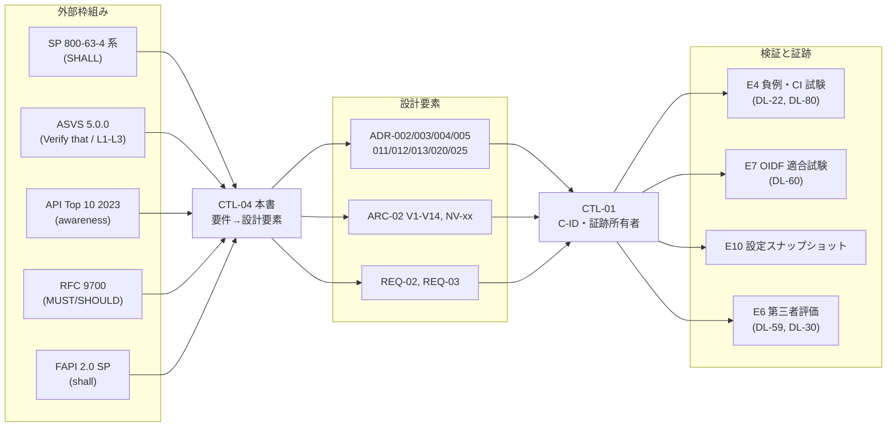
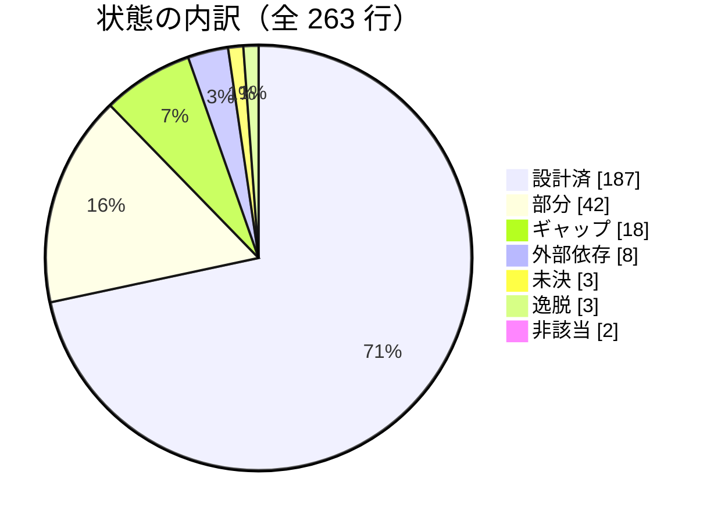

# 統制マッピング: SP 800-63-4 / ASVS 5.0 / API Top 10 / RFC 9700 / FAPI 2.0

> 文書ID: CTL-04 / 版: 0.1 / 状態: draft / 最終更新: 2026-10-15
> 対応要求: R-026, R-165, R-237, R-241, R-025, R-214, G-012（全件と閉じ方は末尾の対応表。DL-28 を対応成果物とする R 13 件・G 1 件）
> 依存文書: CONVENTIONS.md, traceability/deliverables.md（DL-28 行）, 06_controls/control-mapping-ledger.md（CTL-01、C-ID の正本。並行作成中）, 06_controls/applicability.md（CTL-02 の X-06・X-08・X-09・X-11・X-12）, 02_requirements/operation-risk-tiers-assurance.md（REQ-03、操作 5 分類の正本）, 02_requirements/identity-lifecycle.md（REQ-02）, 04_architecture/token-profile.md（ARC-02、RFC 9700 準拠表の正本）, 05_adr/README.md, 05_adr/ADR-001〜ADR-029（特に ADR-002, ADR-003, ADR-004, ADR-005, ADR-011, ADR-012, ADR-013, ADR-020, ADR-025）, 05_adr/reconciliation-notes.md, 01_governance/assumptions-register.md, 01_governance/kri.md, 03_threat-model/fraud-abuse-controls.md（THR-04）, research/RS-03, RS-04, RS-08, RS-13, research/standards-status.md, traceability/dissent-log.md（DS-01, DS-11）
> 作成方法: AI エージェント（Claude）が research の検証済み主張と ADR・設計文書を読み、外部枠組みの要件ごとに設計要素・検証方法・状態を対応付けた。research ノートにない原典（ASVS 5.0.0 の V6・V7 の未掲載要件、V9、V10、OWASP API Security Top 10 2023 の一覧、SP 800-63B-4 §3.1.1.2 のパスワード要件）は起草者が 2026-10-15 に取得して照合した。対応付けは自己レビューであり、実在の CTO/CISO の決裁でも第三者評価でもない（CONVENTIONS §8）[D]。
> 表の注記: 表のセルでタグのないもの（設計要素、検証方法、状態の各欄）は、各 ADR・設計文書の記述から導いた設計推論 [D] であり、この注記で個別のタグに代える。原典の強度を写した欄は、節冒頭の脚注と RS 番号で根拠を示す。

---

## 0. 結論（CTO/CISO 向け）

1. **5 枠組みの対応付けを要件単位で作った**: SP 800-63-4 系 45 行（63B-4 の SHALL を中心に 63-4・63A-4・63C-4 の主要 SHALL を含む）、ASVS 5.0.0 127 行（V6〜V10 の全要件 122 件と V15・V16 の関連要件 5 件）、API Security Top 10 2023 10 行、RFC 9700 39 行（ARC-02 §9.2 と同じ行番号）、FAPI 2.0 42 行の計 263 行である（§2〜§6、集計は §7）[D]。全行に設計要素・検証方法・状態を記入し、空欄は 0 件である [D]。どの行も検証（試験・適合試験・第三者評価）は未実施であり、「設計済」は ADR 案（全 29 本が proposed）に決定の記述がある、という意味にとどまる（05_adr/README.md 要旨）[D]。
2. **規範の強い要求（SHALL / MUST / shall）で設計要素がない行は 5 行あり、うち 3 行が 63B-4 のパスワード検証要件（§3.1.1.2）である** [D]。password hashing（ADR-001 N-b）と侵害時の強制変更（REQ-02）以外の、単要素時 15 文字・多要素時 8 文字の最小長、組成規則の禁止、ブロックリスト照合、パスワードマネージャの許可を定めた ADR・設計文書がない [N][^1][D]。自社認証の利用者 47.5 万人のうち password のみが 55% と仮置きされているため [A-115]、この空白は S-18（大規模アカウント乗っ取り）の統制に直結する [D]。持込み先は REQ-02（DL-08）の資格情報規則と ADR-001 D1-1 の製品設定要件である（残課題 1）[D]。
3. **ASVS の適用レベルは決裁が要る（決裁案 KM-1）**: ASVS 5.0.0 を全経路 L3 で受入基準にすると、決定済みの ADR 案と 4 点で衝突する [D]。6.6.1（L3 は SMS・電話を提供しない）と ADR-002 D2-13、6.3.3（L3 はフィッシング耐性のハードウェア要素）と D2-14（privileged/T の通常操作で同期 passkey を受け入れる）、10.4.13（L3 は常に PAR）と ADR-020 D20-11-3（層 B で PAR を必須にしない）、7.4.1（終了後は self-contained token も使えない）と ADR-005 D3 の剥奪反映 R(t) 内の残存である [N][^6][^7][^10][D]。推奨は「全経路 L2＋層 F・privileged/P・break-glass/P・support の昇格経路は L3」である（§8 KM-1）[D]。
4. **ASVS と SP 800-63B-4 の食い違いは 63B-4 を優先し、逸脱として記録する（決裁案 KM-2）**: ASVS 6.4.4（L2）は MFA 要素を失った場合に登録時と同じ水準の本人確認を求めるが、63B-4 §4.2.2.2 は AAL2 の回復に回復コードによる経路を認めており、ADR-003 RC2-2 は後者を採っている [N][^6][^1][D]。ASVS 自体の適合を名乗る範囲では、この 1 件を受容票付きの逸脱として扱う必要がある [D]。
5. **API Security Top 10 2023 は 10 件中 5 件が設計済、4 件（API3・API4・API7・API10）が部分、1 件（API6）がギャップである（§4）** [D]。API Top 10 は awareness 文書であり規範要求ではないので [N][^13]（RS-08#7）、CTL-02 X-12 のとおり負例試験の観点として扱う [D]。業務フロー単位の濫用（API6）、業務 API での外向きの URL 取得（API7）、業務 API が呼ぶ外部 API の応答の扱い（API10）は、所有者を決める必要がある（§8 KM-4）[D]。
6. **RFC 9700 と FAPI 2.0 は ARC-02・ADR-020 で設計が最も進んでいる** [D]。RFC 9700 は 39 行のうち MUST 系の非準拠 0 件（ARC-02 §9.2 の判定）であり、本書は各行に検証方法と未決の決裁を付け加えた [D]。FAPI 2.0 は層 F（F1〜F6）で全 shall を適用し、未決は ADR-020 K20-1〜K20-5 と ADR-005 K-3・K-4・K-6 に集約される [D]。「FAPI 2.0 準拠」の表示は層 F の deployment が OIDF 認定を取得した後に限る（ADR-020 D20-10-4）[D]。

---

## 1. 本書の位置付けと読み方

### 1.1 正本の関係

| 対象 | 正本 | 本書の役割 |
|---|---|---|
| 社内統制 C-xxx の定義、R-ID→C-ID、健全性ルールの検査結果 | CTL-01（06_controls/control-mapping-ledger.md） | 外部枠組みの要件→設計要素の写像を CTL-01 へ渡す。C-ID が採番されるまでは設計要素（ADR の決定 ID 等）で記述する [D] |
| 枠組みの適用判定 | CTL-02 X-06（SP 800-63-4：採用・参照基準）、X-08（RFC 9700：採用）、X-09（FAPI 2.0：条件付き、範囲は ADR-020）、X-11（ASVS 5.0.0：採用、L2/L3 の範囲は DL-61）、X-12（API Top 10：採用、負例試験の観点） | 判定を前提に要件単位へ展開する [D] |
| RFC 9700 の規範文×適用条件の判定（採用・強化・逸脱等） | ARC-02 §9.2 | 判定を引用し、検証方法と状態を加える。判定を変えない [D] |
| FAPI 2.0 の適用範囲 | ADR-020（層 F・H・B） | shall/shall not を行として載せ、層ごとの適用を写す（ADR-020 D20-12-2）[D] |
| 操作 5 分類と保証の床 | REQ-03 | 63-4 系の行の適用条件に使う [D] |

- 本書は DL-28 の分冊であり、deliverables.md の DL-28 行が求める 17 列構造（R-ID→C-xxx→外部枠組み→試験→証跡）のうち「外部枠組み→設計要素→検証→状態」の部分を担う [D]。R-ID→C-ID と証跡所有者の割当は CTL-01 が持つ [D]。
- 決定の正本は ADR である。本書は ADR に反する設計を置かない [D]。ADR で未決の点は「未決（ADR-0xx）」と書く [D]。

### 1.2 対応付けの流れ

### 1.3 列と区分の定義

- **強度**: 原典の規範語をそのまま写す [D]。SP 800-63-4 系は SHALL / SHALL NOT、RFC 9700 は BCP 14 キーワード、FAPI 2.0 は小文字の shall / shall not / should である [N][^2][^19][^20]。ASVS は MUST/SHALL の形をとらず、「Verify that」と検証レベル（L1〜L3）で強度を表す [N][^5]（RS-08#1）。API Top 10 は awareness 文書であり、強度を持たない [N][^13]（RS-08#7）。
- **検証方法**: CONVENTIONS が参照する証拠種別 E1〜E11（seed-01 §1）で書く [D]。主に使うのは E3（双方向トレーサビリティ、机上）、E4（再現可能な自動試験。負例試験 NV-xx は ARC-02 §10.2、その他の試験は ADR の仮番で DL-22 が TC-ID を採番する）、E6（第三者報告）、E7（OIDF 適合試験ログまたは認定）、E9（リスク受容記録）、E10（設定スナップショット）である [D]。
- **状態**（設計の状態。検証の状態はすべて「未実施」）[D]:

| 状態 | 意味 |
|---|---|
| 設計済 | ADR 案または設計文書に、要件を満たす決定の記述がある（ADR は全件 proposed のため決裁待ち）|
| 部分 | 要件の一部だけに決定がある。残りは本書の残課題に載せる |
| 未決（ADR-0xx） | ADR が論点・決裁案として未決にしている |
| 逸脱 | ADR の決定が要件より弱い。受容票（E9）または決裁が要る |
| ギャップ | 対応する設計要素がない。残課題に持込み先を書く |
| 外部依存 | 要件の主体が本基盤ではない（OS・ブラウザ・同期事業者など）。本基盤は確認だけを行う |
| 非該当 | 適用条件に当たる経路を本基盤が持たない |

### 1.4 前提（A-ID）

| A-ID | 値（基準） | 本書での使い方 |
|---|---|---|
| A-001 | 登録ユーザー 100 万 | 63B-4 の対象者規模 [A-001] |
| A-007 | B2B テナント 1 万 | 顧客管理者（PC-03）の規模、KM-1 の影響範囲 [A-007] |
| A-013 | 外部 client 800・grant 3 万 | API Top 10 API10・RFC 9700 の適用対象数 [A-013] |
| A-081 | 高保証要求テナント 50 | FAPI F6・AAL3 の契約対象 [A-081] |
| A-114 | 顧客 federation 接続 SAML 1,800・OIDC 200、IdP 起点 30% | 63C-4 の RP 起点要件の移行負荷 [A-114] |
| A-115 | 自社認証の利用者 47.5 万人、password のみ 55%・password＋OTP 38%・PR 7% | 63B-4 パスワード要件と KM-3 の影響範囲 [A-115] |

新規仮定: NA-CTL04-1「ASVS L3 を適用する経路の要求数は全要求の少数である」（値は TBD、所有者 CTO、期限 G2、決め方: DL-67 の操作分類登録から層 F・privileged/P・break-glass/P の比率を集計）。前提台帳へ追加要 [D]。

---

## 2. NIST SP 800-63-4 系（63B-4 の SHALL を中心に）

SP 800-63-4 系は 2025-07-31 に Final として公表された連邦政府向けの指針であり、民間組織は「may consider」とされる [N][^2]（RS-03#1, #2）。本基盤は参照基準として採用し、逸脱は DIAS 相当の記録（ADR-002 §2.11）に残す（CTL-02 X-06）[D]。非人間主体は 63-4 の対象外であり、xAL を割り当てない（ADR-002 D2-07）[N][^2][D]。

### 2.1 SP 800-63B-4（認証と認証器の管理）

| ID | 63B-4 § | 要件（原典の強度を保持した要約） | 強度 | 設計要素 | 検証 | 状態 |
|---|---|---|---|---|---|---|
| B-01 | 2.2.2 | AAL2 の verifier はフィッシング耐性（PR）の選択肢を少なくとも 1 つ提供する[^1]（RS-03#14） | SHALL | ADR-002 D2-10（一般利用者に PR を提供・推奨、テナントが必須化可）、D2-09（PR 必須範囲） | E10、E4（TC-002-04） | 設計済（範囲は KD2-1 決裁待ち） |
| B-02 | 2.3.2 | AAL3 の認証器は非エクスポート鍵と PR を持つ。同期型認証器を AAL3 で使わない[^1]（RS-03#15） | SHALL / SHALL NOT | ADR-002 D2-15、D2-16(2)（BE=0 を条件、運用者等は attestation も検証）、ADR-001 D8-1 | E4（TC-002-02：BE=1 で privileged/P を拒否 100%） | 設計済（KD2-2 決裁待ち） |
| B-03 | 3.2.13 | 「エクスポート不能」は独立したハードウェアか組込み実行環境（SE、TEE、TPM）に限る[^1]（RS-03#15） | SHALL | ADR-002 D2-16(2)（attestation の検証） | E4、E10（attestation 信頼リスト） | 設計済 |
| B-04 | 2.1.3, 2.2.3, 2.3.3 | 再認証の全体上限を設ける（AAL1・AAL2）。AAL3 は全体 12h 以内[^1]（RS-03#43） | SHALL | REQ-03 §3.3、ADR-002 D2-34、D2-35（PC-03・PC-06 の管理 session は AAL3 の数値） | E10、E4（session 期限の試験） | 部分（階層別の値は TBD、DL-20、所有者 プロダクト責任者＋CISO、期限 G4） |
| B-05 | 5.2 | 適用する上限を文書化する。再認証要件を満たしたかの判断権は RP にある[^1]（RS-03#43, #45） | SHALL | REQ-03 §3.3（文書）、ADR-002 D2-26（顧客 IdP の session を上限にしない） | E3、E4（TC-002-01） | 設計済 |
| B-06 | 5.1, 5.1.2 | session の AAL を元の認証の AAL より高く扱わない。access token の存在を在席の証拠と解釈しない[^1]（RS-03#44） | SHALL NOT | REQ-03 §3.4 S6、ADR-005 D3 U4（token 更新で session を延長しない）、D6-4（step-up は新しい認可要求） | E4（TC-002-06） | 設計済 |
| B-07 | 5.1 | 所有証明型のセッション秘密（DBSC 等）を永続化する場合も時間制限を守る[^1]（RS-03#44） | SHALL | 該当する決定なし（DBSC の採否は ADR に記載がない） | E3 | ギャップ（採否を ADR-005 D6 の BFF 参照実装で決める。残課題 5） |
| B-08 | 3.2.5 | 手入力 OTP・out-of-band を PR とみなさない。DNS 名で束縛する場合は認証済みホスト名か public suffix より下の親ドメイン[^1]（RS-03#16） | SHALL NOT / SHALL | ADR-002 D2-11（PR は WebAuthn と PKI に限る）、ADR-021（RP ID は信頼区画の login ホスト） | E3、E4（TC-002-04） | 設計済 |
| B-09 | 3.1.3.3, 3.2.9 | PSTN は restricted authenticator。代替の提供・リスク告知・移行計画の DIAS 記載。RP が受容できなければ使わない。電話番号の設定・変更は新しい認証器の binding[^1]（RS-03#17、RS-13#6） | SHALL / SHALL NOT | ADR-002 D2-13（受容票付きで一般利用者の read-sensitive・write のみ）、ADR-003 RC2-7、RC6-4 | E9（受容票）、E4（privileged での SMS 拒否） | 設計済 |
| B-10 | 3.1.3.1 | 電子メールを out-of-band 認証に使わない（確認コード・回復コードは対象外）[^1]（RS-13#7） | SHALL NOT | ADR-002 D2-11（email は PR でも認証要素でもない）、ADR-003 RC2-1（email は発行型回復コードの送付先に限る） | E3、E10 | 部分（ログインの要素として email OTP を提供しないことを明記した決定がない。REQ-02 に追記要。残課題 2） |
| B-11 | 3.1.1.2 | 単要素で使うパスワードは最小 15 文字、多要素の一部としてだけ使う場合は最小 8 文字を要求する[^1] | SHALL | 該当する決定なし（ADR-001 D1-1 は資格情報層を製品機能で実現するとするが値を定めない） | E10（製品設定）、E4 | ギャップ（残課題 1、KM-3） |
| B-12 | 3.1.1.2 | 組成規則（文字種の混在など）を課さない[^1] | SHALL NOT | 該当する決定なし | E10 | ギャップ（残課題 1） |
| B-13 | 3.1.1.2 | 設定・変更時にブロックリスト（漏えいコーパス等）と照合する[^1]（RS-13#9） | SHALL | THR-04 FA-01（credential stuffing）は対策を挙げるが、照合を課す ADR の決定はない | E4、E10 | ギャップ（残課題 1） |
| B-14 | 3.1.1.2 | salt 付きの password hashing scheme で保存する[^1] | SHALL | ADR-001 N-b、D1-1（製品の password hashing を使う）、D3-2 | E10、E6 | 設計済 |
| B-15 | 3.1.1.2 | パスワードマネージャと自動入力を許可する。定期変更を要求しない。侵害の証拠があれば変更を強制する[^1]（RS-13#9） | SHALL / SHALL NOT / SHALL | REQ-02 S-07（侵害の証拠で強制変更し他 session を失効）。マネージャ許可と定期変更の禁止は REQ-02 §7 のアクセシビリティ記述に例示があるが規則化されていない | E4、E10 | 部分（残課題 1） |
| B-16 | 3.2.2 | 認証器ごと・アカウントごとの連続失敗を 100 回以下に制限し、超えたら当該認証器を無効化する[^1]（RS-13#8） | SHALL | ADR-013 D13-23（login・回復・token endpoint の rate limit を保護機能として fail-static）、THR-04 FA-01・FA-02・FA-18 | E4（失敗回数の試験）、E10 | 部分（上限値と無効化の規則は TBD。所有者 CISO、期限 G3、決め方: THR-04 と PoC の誤ロック率） |
| B-17 | 3.2.11.3 | hybrid 接続は視覚表示＋到達距離 240m 以下の無線、またはキャッシュ済み鍵で確立し、キャッシュ削除手段を提供する[^1]（RS-03#18） | SHALL | 本基盤は RP であり、hybrid の確立は OS・ブラウザ・認証器が担う | E3（対応ブラウザの確認） | 外部依存 |
| B-18 | App. B.2 | sync fabric の鍵は暗号化して保存し、fabric へのアクセスは AAL2 相当の MFA で守る。要件を文書化し公衆向けに周知する[^1]（RS-03#21） | SHALL | 保存と MFA は同期事業者の義務。周知は ADR-002 D2-16(4) | E3（公開ヘルプの記載） | 設計済（周知分）／外部依存（保存・MFA） |
| B-19 | App. B.3 | UV を preferred で要求し応答の UV を確認する。UV がなければ単要素として扱う[^1]（RS-03#22） | SHALL | ADR-002 D2-16(1) | E4 | 設計済 |
| B-20 | 4.1 | account に結び付いた全認証器を記録し、特性（単要素/多要素、PR の有無）を判定し、ライフサイクル事象の日時を記録する[^1]（RS-03#31） | SHALL | ADR-002 §2.9（AS の認証器台帳：BE・BS・PR の有無）、REQ-02 SM-A、ADR-003 RC9-1 | E4、E10 | 設計済 |
| B-21 | 4.1.2.1 | 追加 binding は「現在使える最高 AAL」と「新しい認証器の最高 AAL」の低い方で認証させる。独立した経路で通知する。複数の認証器を許可する[^1]（RS-03#32） | SHALL | ADR-002 D2-12、ADR-003 RC6-1、RC6-7、ADR-002 D2-16(6) | E4（TC-002-05、TC-002-09） | 設計済 |
| B-22 | 4.1.2.2 | 別端末からの binding code は識別子併用で 40 ビット以上・非併用で 112 ビット以上、1 回限り・最大 10 分、email で送らない[^1]（RS-03#32） | SHALL | REQ-02 §16（束縛コードの有効期限 最大 10 分）、ADR-003 RC3-5（束縛コードを表示・保存しない） | E4 | 部分（エントロピーと email 送付禁止の明記がない。残課題 2） |
| B-23 | 4.2.1 | 回復方法 4 類型のうち 1 つ以上を提供する。アプリ固有の方法（担当者とのやり取り等）はリスク分析に基づき文書化する[^1]（RS-03#37） | SHALL | ADR-003 RC2-1（保存型・発行型・再本人確認。recovery contact は v1 で提供しない）、RC3-1（helpdesk の位置付けと文書化） | E3 | 設計済 |
| B-24 | 4.2.1.1, 4.2.1.2 | 保存型回復コードは 64 ビット以上・ハッシュ保存・使用後無効化と再発行。発行型は 10 進 6 桁以上、期限は SMS・音声 10 分・email 24 時間。回復用アドレスを 2 つ以上登録可能にする[^1]（RS-03#38） | SHALL | ADR-003 RC2-3、RC2-6 | E4、E10 | 設計済 |
| B-25 | 4.2.2.2 | AAL2 の回復は (a) 異なる方法の回復コード 2 つ、(b) 回復コード＋単要素認証器、(c) 再本人確認のいずれか。本人確認していない account は回復コードか recovery contact[^1]（RS-03#39） | SHALL | ADR-003 RC2-2（三択だけで完了。helpdesk に認証器のリセット・移転をさせない） | E4（ADR-003 §7 の試験案） | 設計済 |
| B-26 | 4.2.2.3 | IAL3 で本人確認した AAL3 account の回復は初回の対面で採取した生体情報と照合する[^1]（RS-03#40） | SHALL | ADR-003 RC2-5 | E3、E8（演習） | 設計済 |
| B-27 | 4.2.3 | 回復は必ず利用者または指定者への通知を発生させる[^1]（RS-13#12） | SHALL | ADR-003 RC4-2（検証成功時と実行時に全通知先へ。通知できなければ先へ進めない） | E4 | 設計済 |
| B-28 | 4.3, 4.5 | 侵害された認証器を速やかに停止・無効化する。無効化要求の真正性はリスクに基づき判断する。届出用の予備認証器はパスワードか物理認証器[^1]（RS-03#33） | SHALL | ADR-003 RC7-1、RC7-2、REQ-02 A-04・A-06 | E4、E8 | 設計済（処理期限の値は TBD、ADR-003 RC4） |
| B-29 | 4.6 | 通知先を 2 つ以上サポートし、郵便以外の全通知先に、否認時の連絡先を含めて通知する。AAL3 の回復通知は郵便にも送る[^1]（RS-03#34, #40） | SHALL | ADR-003 RC2-6、RC4-2（AAL3 は郵便の通知先登録を利用開始の条件にする） | E4 | 設計済 |

- 規範値の強度は本文から写した。63B-4 §2.5 の要約表は非規範である（REQ-03 §3.3）[D]。
- B-11〜B-15 の対象は自社認証の利用者に限られる [D]。顧客 IdP で認証する利用者（基準 52.5 万人）の資格情報は顧客 IdP の責任であり（ADR-003 RC8-1）、本基盤は trust agreement と保証区分の判定（ADR-002 D2-21〜D2-24）で扱う [D][A-082, A-115]。

### 2.2 SP 800-63-4（DIRM）・63A-4・63C-4 の主要な SHALL

| ID | 原典 § | 要件（要約） | 強度 | 設計要素 | 検証 | 状態 |
|---|---|---|---|---|---|---|
| G-01 | 63-4 §3.2 | 影響度は user group ごとに、その group が実行できる transaction を基に評価する[^2]（RS-03#4） | SHALL | REQ-03 §1.3、ADR-002 D2-01（主体類型×操作 5 分類） | E3 | 設計済 |
| G-02 | 63-4 §3.2, 3.2.4 | 5 つの影響カテゴリを含め、統合方法を文書化し全サービスに一貫適用する[^2]（RS-03#5） | SHALL | ADR-002 D2-01、D2-02（high-water mark） | E3 | 設計済 |
| G-03 | 63-4 §3.3.3.3 | High のサービスは IdP 侵害リスクを評価し FAL2 と FAL3 を選ぶ[^2]（RS-03#7） | SHALL | ADR-002 D2-17、D2-27（最上位保護操作は本基盤の束縛認証器）、REQ-03 §1.3 | E3、E4（TC-002-03） | 設計済 |
| G-04 | 63-4 §3.4.3, 3.4.4 | tailoring・補償統制を文書化し DIAS にまとめる。利用する CSP/IdP の DIAS を確認する[^2]（RS-03#8） | SHALL | ADR-002 D2-04、§2.11（DIAS 相当の様式と初版の tailoring 6 件） | E2（承認済み文書） | 設計済 |
| G-05 | 63A-4 §4.3.1 | IAL3 は on-site attended に限る[^4]（RS-03#11） | SHALL | ADR-002 D2-08（PC-07・PC-08 は IAL3 対面、困難な場合は tailoring） | E3、E8 | 設計済 |
| G-06 | 63A-4 §3.14 | 遠隔の本人確認では、正規センサーからの入力を確かめる技術的統制と媒体の改ざん解析を実装する[^4]（RS-03#12） | SHALL | ADR-003 RC2-1（再本人確認は外部の本人確認事業者で実施）、ADR-002 D2-04（依拠する CSP の DIAS 確認） | E3（事業者の DIAS 相当情報）、E6 | 外部依存（事業者の選定条件に入れる。残課題 3） |
| C-01 | 63C-4 §2.3 | FAL2 では assertion を injection から強く保護し、federation transaction は RP が開始する[^3]（RS-03#49） | SHALL | ADR-004 D04-05、D04-06、D04-07（IdP 起点 SAML の扱い）、D04-09 | E4（IdP 起点応答の拒否） | 設計済（IdP 起点 30% の移行は A-114 [A-114]） |
| C-02 | 63C-4 §2.4 | FAL3 では assertion に加え利用者の認証器の制御を RP が確かめる[^3]（RS-03#49） | SHALL | ADR-002 D2-17、D2-18（binding ceremony は 63C-4 §3.16 に従う） | E4（TC-002-03、TC-002-09） | 設計済 |
| C-03 | 63C-4 §2.5 | RP は機能ごとに受け入れる最低 xAL を決める。IdP は結果の xAL を常に assertion に示す。IAL 申告なしは IAL なし[^3]（RS-03#9） | SHALL | REQ-03 §4（主体×階層）、ADR-002 D2-21、D2-23、REQ-03 S7 | E3、E4（TC-002-01） | 設計済 |
| C-04 | 63C-4 §3.8.1 | linking 機能はすべて認証済み session で行う。連携 ID の追加・削除を通知し、削除した連携 ID からのアクセスを拒否する[^3]（RS-03#59） | SHALL | ADR-004 D04-22（email 一致の自動 linking を禁止）、D04-23、D04-24、ADR-003 RC8-4 | E4 | 設計済 |
| C-05 | 63C-4 §3.9, 4.9 | 期待した IdP が発行者である assertion からだけ session を作る。署名・発行者・時刻・audience・nonce・xAL・再送でないことを検証する[^3]（RS-03#51） | SHALL | ADR-004 D04-04、D04-10、D04-11、D04-12 | E4 | 設計済 |
| C-06 | 63C-4 §4.9 | subject を IdP をまたいで一意と扱わない。FAL2 以上では連携 ID に平文の個人情報を含めない[^3]（RS-03#57） | SHALL NOT | ADR-004 D04-20（tid・上流 IdP・外部 subject の 3 つ組）、D04-21、ADR-021 | E4 | 設計済 |
| C-07 | 63C-4（allowlist） | IdP の allowlist でワイルドカードを使わない[^3]（RS-03#68） | SHALL NOT | ADR-004 D04-10 | E10 | 設計済 |
| C-08 | 63C-4 §4.8 | trust agreement に共有シグナルの用途を記載する[^3]（RS-03#72） | SHALL | ADR-003 RC4-2、RC8-2、ADR-002 D2-21 | E2（trust agreement 様式） | 設計済 |
| C-09 | 63B-4 §5.2 と 63C-4 | identity API へのアクセスを根拠に RP の session を確立・延長しない[^3]（RS-03#46） | SHALL NOT | ADR-002 D2-26 | E4 | 設計済 |
| C-10 | 63A-4 §3.16 | IAL を引き上げる前に、その account で使える最高 AAL で認証させる[^4]（RS-03#11） | SHALL | 該当する決定なし（ADR-002 D2-05 は IAL2 を取引の要否で付けるが、引上げ手順を定めない） | E4 | ギャップ（REQ-02 の状態遷移に追加要。残課題 2） |

- EU/英国の保証レベル体系（eIDAS の LoA、UK DIATF）との対応は調査しておらず、本書の対象外である（ADR-002 D2-33）[D]。
- 日本の DS-511 は 63-4 と保証レベルの考え方が近いが、同期 passkey の扱いが異なる（DS-512 は同期・device-bound を区別せずにレベル 3 を実現できると説明）[N][^2]（RS-03#25）。両法域にまたがる最上位の箇所には厳しい側（NIST）を適用する（ADR-002 D2-16 の注記）[D]。DS-511 の統制写像は CTL-06（regulations.md）で扱う [D]。

---

## 3. OWASP ASVS 5.0.0

ASVS 5.0.0（2025-05-30、GitHub release `v5.0.0_release`）は「要件（must）のみを含む」と自らを定義し、強度を検証レベル L1〜L3 で表す [N][^5]（RS-08#1）。要件は `v5.0.0-x.y.z` の形式で参照する（RS-08 §5.1）[D]。4.0.3 の章構成で 5.0 を説明した旧レビューの記述は使わない（DS-11）[D]。

- **適用レベル（KM-1 の推奨案を前提に記入）**: 全経路 L2、層 F（ADR-020）・privileged/P・break-glass/P・support の昇格経路（PC-06 /T）は L3 [D]。L3 列の「L3 経路のみ」は、この推奨案のもとで L3 を求める経路だけに適用することを示す [D]。決裁前であり、DL-61（自己評価）で確定する [D]。
- 要件の要約は原典の要件文の要約であり、V6 の一部（RS-13#54 の 10 件）、V7 の一部（RS-13#55 の 6 件）、V8（RS-08 の範囲）以外は起草者が 2026-10-15 に原典を取得して照合した [N][^6][^7][^8][^9][^10]。

### 3.1 V6 Authentication

| 要件 | L | 要件（要約） | 設計要素 | 検証 | 状態 |
|---|---|---|---|---|---|
| 6.1.1 | 1 | rate limit・反自動化・アダプティブ対応の構成と悪意あるロックアウトの防止を文書化する（RS-13#54） | THR-04 FA-01・FA-02・FA-18、ADR-013 D13-23 | E3 | 部分（閾値 TBD、B-16 と同じ） |
| 6.1.2 | 2 | パスワードに使えない文脈固有の語のリストを文書化する | 該当する決定なし | E3 | ギャップ（残課題 1） |
| 6.1.3 | 2 | 全認証経路と、経路間で一貫して課す統制・強度を文書化する | REQ-03 §2.2 J7（入口で階層を下げない）、ADR-002 D2-05、§2.9 | E3 | 設計済 |
| 6.2.1 | 1 | 利用者が設定するパスワードは 8 文字以上（15 文字以上を推奨） | 該当する決定なし（B-11） | E10 | ギャップ（残課題 1） |
| 6.2.2 | 1 | 利用者がパスワードを変更できる | ADR-001 D1-1（製品機能）、REQ-02 SM-A | E4 | 設計済 |
| 6.2.3 | 1 | 変更には現在と新しいパスワードを要する | ADR-002 D2-12（+SEC は再認証）、ADR-003 RC2-8 | E4 | 設計済 |
| 6.2.4 | 1 | 新しいパスワードを上位 3,000 以上の頻出パスワードと照合する | 該当する決定なし（B-13） | E4 | ギャップ（残課題 1） |
| 6.2.5 | 1 | 文字組成を自由にし、文字種の下限を課さない | 該当する決定なし（B-12） | E10 | ギャップ（残課題 1） |
| 6.2.6 | 1 | 入力欄をマスクする（一時的な表示は可） | ADR-001 D1-1（製品のログイン画面） | E10 | 外部依存（製品設定の確認） |
| 6.2.7 | 1 | 貼付け・ブラウザの補助・パスワードマネージャを許可する | REQ-02 §7（代替手段の例） | E4 | 部分（B-15） |
| 6.2.8 | 1 | 入力どおりに検証し、切詰め・大小変換をしない | ADR-001 D1-1（製品機能） | E4 | 外部依存（製品の確認） |
| 6.2.9 | 2 | 64 文字以上のパスワードを許可する | 該当する決定なし（63B-4 は SHOULD） | E10 | ギャップ（残課題 1） |
| 6.2.10 | 2 | 侵害または自発的変更まで有効とし、定期変更を強制しない | 該当する決定なし（B-15） | E10 | 部分（残課題 1） |
| 6.2.11 | 2 | 文書化した文脈固有の語のリストで推測容易なパスワードを拒否する | 該当する決定なし | E4 | ギャップ（残課題 1） |
| 6.2.12 | 2 | 漏えいパスワード集合と照合する（RS-13#54） | 該当する決定なし（B-13） | E4 | ギャップ（残課題 1） |
| 6.3.1 | 1 | 文書どおりに credential stuffing・総当たり対策を実装する（RS-13#54） | ADR-013 D13-23、THR-04 FA-01・FA-02 | E4 | 部分 |
| 6.3.2 | 1 | 既定アカウント（root、admin 等）を削除・無効化する | ADR-029（常設権限なし）、ADR-008（管理面の単一経路） | E10 | 部分（製品の既定アカウントの棚卸し規則が未記載。残課題 4） |
| 6.3.3 | 2 | MFA を要求する。L3 は利用者の意図確認を伴う PR のハードウェア要素 | ADR-002 D2-03（AAL2 の床）、D2-15（AAL3 は device-bound） | E4 | 設計済（L2）／逸脱（L3 を全経路に課すと D2-14 と衝突。KM-1） |
| 6.3.4 | 2 | 文書にない認証経路がなく、統制が一貫している | ADR-012 D12-08〜D12-11（entry point 台帳の突合）、REQ-03 J7 | E4（未宣言 entry point 0 件、K-01） | 設計済 |
| 6.3.5 | 3 | 不審な認証試行（成功・失敗）を利用者に通知する（RS-13#54） | THR-04（通知方針）、ADR-003 RC3-7 | E4 | 部分（L3 経路のみ。通知条件は THR-04 で確定） |
| 6.3.6 | 3 | email を単要素・多要素の認証手段に使わない | ADR-002 D2-11、B-10 | E3 | 部分（B-10 と同じ） |
| 6.3.7 | 3 | 認証情報・ユーザー名・email の変更後に通知する（RS-13#54） | ADR-003 RC2-8、RC6-2、ADR-002 D2-12 | E4 | 設計済 |
| 6.3.8 | 3 | 失敗時の応答（文言・コード・時間）から有効な利用者を推測できない（RS-13#54） | ADR-012 D12-39（応答の非区別。資源への要求）、ADR-001 D1-1（ログイン画面） | E4 | 部分（login・登録・パスワード忘れの応答規則が未記載。残課題 4） |
| 6.4.1 | 1 | 初期パスワード・有効化コードは乱数で短命、長期利用させない | REQ-02（初回束縛、束縛コード 10 分） | E4 | 設計済 |
| 6.4.2 | 1 | パスワードのヒント・秘密の質問を使わない | ADR-003 RC3-4（知識情報だけで本人と判断しない） | E3 | 部分（秘密の質問の禁止の明記がない。残課題 2） |
| 6.4.3 | 2 | パスワードリセットが有効な MFA を迂回しない（RS-13#54） | ADR-003 RC2-2（(b) との緊張を記録し PR 保有者は PR 経路） | E4 | 設計済（緊張は RC2-2 に記録） |
| 6.4.4 | 2 | MFA 要素を失った場合、登録時と同じ水準の本人確認を行う | ADR-003 RC2-2（63B-4 §4.2.2.2 の回復コード経路を採る）、RC5（R-B〜R-D の二者承認） | E9 | 逸脱（63B-4 優先。KM-2） |
| 6.4.5 | 3 | 期限のある認証手段の更新案内を十分前に送る | 該当する決定なし | E3 | ギャップ（L3 経路の証明書・セキュリティキーが対象。残課題 4） |
| 6.4.6 | 3 | 管理者は利用者のパスワードリセットを開始できるが値を設定・選択できない | ADR-003 RC5-5（管理者による MFA リセットは保護操作）、RC3-3 | E4 | 部分（パスワード値の選択禁止は未記載） |
| 6.5.1 | 2 | lookup secret・OOB・TOTP は 1 回だけ使える | ADR-003 RC2-3（回復コードは単回） | E4 | 部分（TOTP・OOB は製品設定。ADR-001 D1-1） |
| 6.5.2 | 2 | 112 ビット未満の lookup secret は salt 付き password hash で保存する | ADR-003 RC2-3（ハッシュ保存） | E10 | 部分（方式の指定なし） |
| 6.5.3 | 2 | lookup secret・OOB コード・TOTP seed を CSPRNG で生成する | ADR-001 D1-1（製品機能） | E6 | 外部依存（製品の確認） |
| 6.5.4 | 2 | lookup secret・OOB コードは 20 ビット以上 | ADR-003 RC2-3（保存型 64 ビット以上、発行型 6 桁以上） | E4 | 設計済 |
| 6.5.5 | 2 | OOB は最大 10 分、TOTP は 30 秒の寿命 | ADR-003 RC2-3（SMS・音声 10 分）、ADR-001 D1-1 | E10 | 部分（TOTP の期間は製品設定） |
| 6.5.6 | 3 | 盗難・紛失した要素（物理デバイスを含む）を失効できる | ADR-003 RC7-1、RC7-6（失効の正本は認証器台帳） | E4 | 設計済 |
| 6.5.7 | 3 | 生体は所持・知識要素と組み合わせた二次要素としてだけ使う | ADR-002 D2-16(1)（UV は認証器内の生体または PIN） | E3 | 設計済 |
| 6.5.8 | 3 | TOTP は信頼できる時刻源で照合する | ADR-001 D1-1（製品機能） | E10 | 外部依存（製品の確認） |
| 6.6.1 | 2 | PSTN の OTP は検証済み番号・より強い方式の併設・リスク説明がある場合に限る。L3 は電話・SMS を提供しない（RS-13#54） | ADR-002 D2-13、ADR-003 RC2-7 | E9、E4 | 設計済（L2）／逸脱（全経路 L3 なら D2-13 と衝突。KM-1） |
| 6.6.2 | 2 | OOB の要求・コードを元の認証要求に結び付ける | ADR-001 D1-1（製品機能） | E4 | 外部依存（製品の確認） |
| 6.6.3 | 2 | コード型 OOB を rate limit で総当たりから守る | ADR-013 D13-23 | E4 | 設計済 |
| 6.6.4 | 3 | push 通知の MFA には push bombing を防ぐ rate limit（RS-13#54） | THR-04 FA-04 | E4 | 部分（push 方式の採否が未記載） |
| 6.7.1 | 3 | 暗号認証の検証に使う証明書を改変できない形で保管する | ADR-002 D2-16(2)（attestation 信頼リスト）、ADR-008 | E10 | 部分（信頼リストの保管規則は ADR-007/008 で確定） |
| 6.7.2 | 3 | challenge nonce は 64 ビット以上で一意 | ADR-001 D1-1（WebAuthn は製品機能） | E4 | 外部依存（製品の確認） |
| 6.8.1 | 2 | 複数 IdP 間の利用者なりすましを防ぐ（IdP ID＋IdP 内 ID で名前空間化） | ADR-004 D04-20、ADR-021 | E4 | 設計済 |
| 6.8.2 | 2 | 認証 assertion の署名を常に検証し、未署名・不正署名を拒否する | ADR-004 D04-11、D04-18 | E4 | 設計済 |
| 6.8.3 | 2 | SAML assertion を有効期間内で 1 回だけ処理する | ADR-004 D04-11（再送でないことを検証） | E4 | 設計済 |
| 6.8.4 | 2 | IdP の acr/amr/auth_time を検証し、情報がなければ最弱方式を仮定する文書化済みの代替手順を持つ（RS-13#54） | ADR-002 D2-23、REQ-03 S4 | E4（TC-002-01） | 設計済 |

### 3.2 V7 Session Management

| 要件 | L | 要件（要約） | 設計要素 | 検証 | 状態 |
|---|---|---|---|---|---|
| 7.1.1 | 2 | 無操作タイムアウトと最大寿命を文書化し、63B からの逸脱は理由を記す（RS-13#55） | REQ-03 §3.3、DL-20 | E3 | 部分（値 TBD、B-04） |
| 7.1.2 | 2 | 1 アカウントの同時 session 数と上限到達時の動作を文書化する | 該当する決定なし | E3 | ギャップ（残課題 4） |
| 7.1.3 | 2 | federation で session を管理する全システムと、寿命・終了の連携を文書化する | ADR-002 D2-26、ADR-006（失効の伝播）、ARC-02 §5 | E3 | 設計済 |
| 7.2.1 | 1 | session token を信頼できる backend で検証する | ADR-005 D1-2（edge が状態ストアに照会）、D6-1（BFF） | E4 | 設計済 |
| 7.2.2 | 1 | 静的な API secret・鍵でなく動的に生成した token を使う | ADR-005 D7-1（新規 client に client_secret を認めない）、ADR-009（workload は X.509-SVID） | E10 | 設計済 |
| 7.2.3 | 1 | reference token は CSPRNG で 128 ビット以上 | ADR-005 D2（全 client に 128 ビット以上） | E4 | 設計済 |
| 7.2.4 | 1 | 認証・再認証時に新しい session token を発行し現 token を終了する | ADR-005 D6-2（BFF 参照実装） | E4 | 部分（session 固定化対策の明記がない。BFF 参照実装の要件に追加要。残課題 5） |
| 7.3.1 | 2 | 無操作タイムアウト後に再認証を強制する | REQ-03 §3.3、ADR-002 D2-34 | E4 | 設計済（値 TBD） |
| 7.3.2 | 2 | 絶対寿命後に再認証を強制する | REQ-03 §3.3、ADR-005 D3 U4 | E4 | 設計済（値 TBD） |
| 7.4.1 | 1 | 終了後の session の使用を、self-contained token を含めて止める | ADR-006（中央強制点・失効状態の push）、ADR-005 D1-6（privileged・break-glass/B・FAPI は jti を毎要求照合）、D3 U2（JWT は L＋C＋Δprop ≤ R(t)） | E4、E5（剥奪反映の実測） | 逸脱（write・read-sensitive の内部 JWT は R(t) 内の残存を許容。R(t) は ADR-005 K-2 で決裁待ち） |
| 7.4.2 | 1 | アカウントの無効化・削除で全 session を終了する | REQ-02 S-07、ADR-006 | E4 | 設計済 |
| 7.4.3 | 2 | 認証要素の変更後に他 session を終了する選択肢を示す（RS-13#55） | ADR-003 RC6-3 | E4 | 設計済 |
| 7.4.4 | 2 | 認証が必要な全ページに見やすいログアウトを置く | ADR-005 D6-2（BFF 参照実装） | E4 | 部分（UI 要件は連携ハンドブック DL-62 へ） |
| 7.4.5 | 2 | 管理者が個人または全利用者の session を終了できる（RS-13#55） | ADR-019（kill switch・範囲ごとの失効下限時刻）、REQ-03 J8 | E4、E8 | 設計済 |
| 7.5.1 | 2 | 認証に影響する属性の変更前に完全な再認証を求める（RS-13#55） | ADR-003 RC2-8、RC6-2、ADR-002 D2-12 | E4 | 設計済 |
| 7.5.2 | 2 | 利用者が稼働中 session を確認し、一要素で再認証して終了できる（RS-13#55） | 該当する決定なし | E4 | ギャップ（REQ-02・DL-26 の利用者機能に追加要。残課題 4） |
| 7.5.3 | 3 | 非常に機微な操作の前に追加の要素か二次確認を求める（RS-13#55） | ADR-005 D6-4（privileged 前の step-up 必須）、REQ-03 §3.2（+FIN・+SEC） | E4（TC-002-06） | 設計済 |
| 7.6.1 | 2 | RP と IdP の間の session 寿命と終了を定義・強制する | ADR-002 D2-26、ADR-006 | E4 | 設計済 |
| 7.6.2 | 2 | 新しいアプリ session の作成に利用者の同意か明示操作を要する | 該当する決定なし（SSO による無言の session 作成の扱いが未記載） | E4 | ギャップ（ARC-02 と BFF 参照実装で検討。残課題 5） |

### 3.3 V8 Authorization

| 要件 | L | 要件（要約） | 設計要素 | 検証 | 状態 |
|---|---|---|---|---|---|
| 8.1.1 | 1 | 機能レベルとデータ固有のアクセス規則を認可文書に定義する（RS-08#2） | ADR-011（正規認可モデル CAM を正本）、REQ-03 §2.4（操作の分類登録） | E3 | 設計済 |
| 8.1.2 | 2 | フィールド単位の読み書き規則を状態等に応じて文書化する | ADR-012 D12-20（object・field 単位の判定は層 S の PEP） | E3 | 部分（field 規則の表現形式は ADR-011 に未記載。残課題 6） |
| 8.1.3 | 3 | 判定に使う環境・文脈属性（時刻・場所・IP・端末）を文書化する | ADR-011（G 段の入力）、ADR-002 D2-22（保証区分） | E3 | 部分 |
| 8.1.4 | 3 | 文脈要因の使い方（評価属性・閾値・結果）を文書化する | 同上、THR-04（リスクエンジン） | E3 | 部分 |
| 8.2.1 | 1 | 機能レベルのアクセスを明示的に許可された consumer に限る（RS-08#2） | ADR-011（既定拒否・deny 優先）、ADR-012 D12-01・D12-07 | E4 | 設計済 |
| 8.2.2 | 1 | データ項目単位のアクセスを明示許可された consumer に限る（IDOR・BOLA の緩和）（RS-08#2） | ADR-012 D12-04（三者一致）、D12-05、D12-41 | E4（K-03） | 設計済 |
| 8.2.3 | 2 | フィールド単位のアクセスを明示許可に限る（BOPLA の緩和）（RS-08#2） | ADR-012 D12-20 | E4 | 部分（8.1.2 と同じ） |
| 8.2.4 | 3 | 文脈属性による適応的な統制を session 開始時と継続中に適用する | ADR-006（継続評価）、ADR-002 D2-25（step-up） | E4 | 部分 |
| 8.3.1 | 1 | 認可規則を信頼できるサービス層で強制する（RS-08#2） | ADR-012 D12-01（層 S の PEP） | E4 | 設計済 |
| 8.3.2 | 3 | 認可に関わる変更を即時に適用し、できなければ警告と巻戻しを行う | REQ-03 §3.6（write 以上は fresh）、ADR-006、ADR-013（fail-open 禁止） | E5（剥奪反映の実測） | 部分（read-sensitive は bounded。R(t) は ADR-005 K-2 決裁待ち） |
| 8.3.3 | 3 | 中継サービスでなく起点主体の権限で object アクセスを判断する（RS-08#2） | ADR-009（hop ごとの token exchange と `act`）、ADR-005 V10 | E4 | 設計済 |
| 8.4.1 | 2 | マルチテナントで、consumer の操作が権限のないテナントに及ばない | ADR-012 D12-04、D12-20〜D12-29、ADR-013、ADR-024 | E4（K-03、D12-41） | 設計済 |
| 8.4.2 | 3 | 管理インタフェースを継続的な本人確認・端末状態・文脈リスクで多層に守る | ADR-008（管理用 IdP・PAW）、ADR-029（JIT 昇格・顧客承認） | E4、E6 | 設計済 |

### 3.4 V9 Self-contained Tokens

| 要件 | L | 要件（要約） | 設計要素 | 検証 | 状態 |
|---|---|---|---|---|---|
| 9.1.1 | 1 | 内容を信頼する前に署名・MAC を検証する | ADR-005 V12 | E4（ARC-02 NV） | 設計済 |
| 9.1.2 | 1 | 文脈ごとの alg allowlist で生成・検証する（unsigned なし）。対称・非対称併用時は鍵混同対策 | ADR-005 V1、V2、ADR-020 D20-08-3 | E4 | 設計済 |
| 9.1.3 | 1 | 検証鍵は issuer ごとに事前設定した信頼元からだけ取得する。jku・x5u・jwk は allowlist で確認する | ADR-005 V3（jku・x5u を辿らない） | E4 | 設計済 |
| 9.2.1 | 1 | 有効期間内でだけ受理する（nbf・exp） | ADR-005 V7 | E4 | 設計済 |
| 9.2.2 | 2 | 正しい種別・用途の token かを確認する | ADR-005 V5、相互排他規則（RFC 8725 §3.12） | E4 | 設計済 |
| 9.2.3 | 2 | audience に自サービスを含む token だけを受理する | ADR-005 V6 | E4 | 設計済 |
| 9.2.4 | 2 | 1 鍵で複数 audience に発行する場合、audience 制限で宛先を一意に識別する | ADR-005 V6（共通 aud を発行しない）、D1-4（呼出し先 1 サービスを aud） | E4 | 設計済 |

### 3.5 V10 OAuth and OIDC

| 要件 | L | 要件（要約） | 設計要素 | 検証 | 状態 |
|---|---|---|---|---|---|
| 10.1.1 | 2 | token を必要な部品にだけ渡す（BFF で browser JS から隔離） | ADR-005 D6-1、D6-2 | E4 | 設計済 |
| 10.1.2 | 2 | 同じ UA session で開始したフローの応答だけを受理する | ARC-02 §9.2 行 03・10（PKCE・nonce を UA に結合） | E4（NV-45） | 設計済 |
| 10.2.1 | 2 | code flow の client は PKCE か state で CSRF を防ぐ | ARC-02 行 03、ADR-020 D20-11-2（全 client で PKCE S256） | E4（NV-44） | 設計済 |
| 10.2.2 | 2 | 複数 AS と対話する client は mix-up を防ぐ（iss 検証等） | ARC-02 行 04・05、ADR-004 D04-11 | E4 | 設計済 |
| 10.2.3 | 3 | 必要な scope・パラメータだけを要求する | ADR-005 D7-1（最小 scope を審査） | E3 | 設計済 |
| 10.3.1 | 2 | audience が自 RS の access token だけを受理する | ADR-005 V6 | E4 | 設計済 |
| 10.3.2 | 2 | 委任認可の claim（sub、scope、authorization_details）で判断する | ADR-005 V10、ADR-020 D20-09 | E4 | 設計済 |
| 10.3.3 | 2 | 再割当てされない claim（iss＋sub）で利用者を識別する | ADR-005 D10-1、ADR-004 D04-20、D04-21 | E4 | 設計済 |
| 10.3.4 | 2 | 強度・方式・鮮度が要る場合、token の acr・amr・auth_time を検証する | ADR-002 D2-23、ADR-005 D6-4、REQ-03 S1〜S4 | E4（TC-002-06） | 設計済 |
| 10.3.5 | 3 | sender-constrained token（mTLS・DPoP）で窃取・再送を防ぐ | ADR-005 D5 | E4 | 設計済（外部）／未決（内部束縛 I1/I2、ADR-005 K-6） |
| 10.4.1 | 1 | redirect URI を事前登録の allowlist と完全一致で照合する | ADR-005 D7-1、ARC-02 行 01 | E4、E7 | 設計済 |
| 10.4.2 | 1 | 認可コードは 1 回だけ。再利用時は拒否し関連 token を失効する | ARC-02 行 30 | E4、E7 | 設計済 |
| 10.4.3 | 1 | 認可コードは短命（L1/L2 は 10 分以内、L3 は 1 分以内） | ADR-005 D2（全 client で 60 秒以下） | E7 | 設計済 |
| 10.4.4 | 1 | client に必要な grant だけを許し、implicit と password grant を使わない | ADR-020 D20-11-2（implicit 無効化・ROPC 無効化） | E10 | 設計済（As-Is の ROPC は ARC-02 行 18 の受容票） |
| 10.4.5 | 1 | public client の refresh token 再送を sender constraint か rotation で緩和する | ADR-005 D4 | E4（NV-51） | 設計済 |
| 10.4.6 | 2 | code grant で PKCE を必須にし、plain を禁止し、verifier を検証する | ARC-02 行 08〜12 | E4（NV-44〜NV-46） | 設計済 |
| 10.4.7 | 2 | 認証なしの動的 client 登録では metadata 検証・同意・警告を行う | ARC-02 §13.3（本番での RFC 7591 の採否は未決、AR-3） | E3 | 未決（ADR-022・ADR-005。ARC-02 AR-3） |
| 10.4.8 | 2 | refresh token に絶対期限を設ける | ADR-005 D4（U4・最大寿命）、D7-4（grant の絶対寿命） | E4 | 設計済（値 TBD、DL-20） |
| 10.4.9 | 2 | 利用者が AS の UI で refresh token と参照型 access token を失効できる | ADR-005 D7-6（grant 単位の一括失効は管理者機能） | E4 | 部分（利用者向け UI が未記載。残課題 4） |
| 10.4.10 | 2 | token・PAR・失効要求など back-channel で confidential client を認証する | ADR-005 D7-1、ARC-02 行 19 | E7 | 設計済 |
| 10.4.11 | 2 | client ごとに必要な scope だけを割り当てる | ADR-005 D7-1、ADR-020 D20-03-2 | E10 | 設計済 |
| 10.4.12 | 3 | 必要な response_mode だけを許す（検証・PAR・JAR で強制） | ADR-020 D20-07（層 F は PAR のみ） | E7 | 設計済（L3 経路のみ） |
| 10.4.13 | 3 | code grant で常に PAR を使う | ADR-020 D20-07（層 F）、D20-11-3（層 B では必須にしない） | E7 | 設計済（L3 経路のみ）／逸脱（全経路 L3 なら D20-11-3 と衝突。KM-1） |
| 10.4.14 | 3 | sender-constrained access token だけを発行する | ADR-005 D5、ADR-020 D20-05 | E4、E7 | 設計済（外部 token） |
| 10.4.15 | 3 | server-side client の authorization_details が backend 由来で改ざんされていない（PAR・JAR） | ADR-020 D20-09-2（完全性は PAR） | E7 | 設計済 |
| 10.4.16 | 3 | confidential client に mTLS・private_key_jwt など再送耐性のある認証を要求する | ADR-020 D20-06-1、ADR-005 D7-1 | E7 | 設計済 |
| 10.5.1 | 2 | ID Token の nonce を要求時の値と照合する | ARC-02 §4.2（ID Token の検証規則） | E4 | 設計済 |
| 10.5.2 | 2 | 再割当てされない claim（sub）で利用者を識別する | ADR-005 D10-1、ADR-021 | E4 | 設計済 |
| 10.5.3 | 2 | AS metadata の issuer が事前設定の issuer URL と完全一致しなければ拒否する | ARC-02 行 21（SDK が metadata の issuer 一致を検査） | E4 | 設計済 |
| 10.5.4 | 2 | ID Token の aud が自 client_id であることを確認する | ARC-02 §4.2 | E4 | 設計済 |
| 10.5.5 | 2 | back-channel logout では logout token の型・event claim・nonce 不在・短い期限を検証する | ARC-02 §3（logout token を独立種別として固定） | E4 | 設計済 |
| 10.6.1 | 2 | OP は code・ciba・id_token・id_token code の response mode だけを許し、implicit の token を許さない | ADR-020 D20-11-2、ARC-02 行 13 | E10 | 部分（層 B の hybrid の扱いは未決。ARC-02 AR-3） |
| 10.6.2 | 2 | 強制ログアウトを利用者確認か id_token_hint 等の検証で緩和する | 該当する決定なし | E4 | ギャップ（ARC-02 に RP 起点 logout の規則を追加要。残課題 5） |
| 10.7.1 | 2 | 認可要求ごとに利用者の同意を確認し、client の身元を保証できない場合は常に確認する | ADR-005 D7-2（本人同意は検証済み発行者の低リスク scope に限る） | E4 | 設計済 |
| 10.7.2 | 2 | 権限・アプリの身元・期間を明示した同意情報を示す | ADR-005 D7-2、D7-3（grant 台帳） | E3 | 部分（同意画面の表示項目が未記載） |
| 10.7.3 | 2 | 利用者が付与した同意を確認・変更・取消できる | ADR-005 D7-3〜D7-6 | E4 | 部分（利用者向け UI が未記載。10.4.9 と同じ） |

### 3.6 V15・V16（認可・監査の関連要件）

| 要件 | L | 要件（要約） | 設計要素 | 検証 | 状態 |
|---|---|---|---|---|---|
| 15.3.1 | 1 | 必要なフィールドのサブセットだけを返す（RS-08#10）[^11] | ADR-012 D12-20、ADR-025（許可集合だけから応答を作る） | E4 | 部分（8.1.2 と同じ） |
| 15.3.3 | 2 | mass assignment を防ぐ（RS-08#10）[^11] | ADR-022（契約のスキーマ検証） | E4 | 部分（スキーマで書込み可能 field を限る規則の明記がない。残課題 6） |
| 15.4.2 | 3 | 資源の状態確認と依存する動作を単一の原子的操作で行う（TOCTOU）（RS-08 §3.6）[^11] | ADR-012 D12-32（consumer での再認可）、ADR-026（実行時の再判定） | E4 | 設計済 |
| 16.1.1 | 2 | ログの在庫を作る（RS-08 §5.1）[^12] | ADR-014（正準スキーマ DL-77） | E3 | 設計済 |
| 16.3.2 | 3 | 全認可判断を記録する（RS-08#34）[^12] | ADR-014（100% 記録）、ADR-012 D12-17（decision_id で coverage を突合） | E4（K-21） | 設計済 |

- V6〜V10 の 122 件（V6 47・V7 19・V8 13・V9 7・V10 36）と V15・V16 の 5 件、計 127 件を載せた [D]。V4・V11〜V14 の対応付けは、本書の範囲（認証・session・認可・token・OAuth）の外であり、DL-61（自己評価）で行う（残課題 7）[D]。

---

## 4. OWASP API Security Top 10 2023

API Security Top 10 2023 は自らを awareness 文書と位置付け、2019 年版の Excessive Data Exposure と Mass Assignment を API3 に統合した [N][^13]（RS-08#7）。CTL-02 X-12 のとおり、負例試験の観点として使う [D]。

| ID | 項目（原典の説明の要約） | 設計要素 | 検証 | 状態 |
|---|---|---|---|---|
| API1 | Broken Object Level Authorization：利用者が渡す object ID で取得する全機能に認可確認が要る。JWT の利用者 ID と ID パラメータの比較だけでは不十分[^14]（RS-08#8, #9） | ADR-012 D12-04（三者一致）、D12-05、D12-39、D12-41（cross-tenant property test）、ASVS 8.2.2 | E4（K-03 cross-tenant 負例の失敗件数と検出力） | 設計済 |
| API2 | Broken Authentication：認証の実装の誤りで token の侵害や他人へのなりすましを許す[^13] | ADR-005 V1〜V14（利用側で無効化不可）、ADR-002、ADR-013 D13-23、ARC-02 §10（NV-01〜NV-58） | E4（NV 全件拒否、G-088）、E7 | 設計済 |
| API3 | Broken Object Property Level Authorization：property 単位の認可の欠如で開示・改変を許す。汎用シリアライザを避け、スキーマで応答を検証する[^15]（RS-08#10） | ADR-012 D12-20、ASVS 8.2.3・15.3.1・15.3.3 | E4 | 部分（field 規則の表現が未設計。残課題 6） |
| API4 | Unrestricted Resource Consumption：帯域・CPU・メモリ・有料の外部サービスの過剰利用で DoS や費用増を招く。1 ページの件数上限などの欠如を含む[^18] | ADR-025（一覧・検索の件数上限と予算）、ADR-013 D13-23（認証系 rate limit）、ADR-013（cell 単位の分離） | E4、E5（負荷試験） | 部分（業務 API のテナント別 quota の決定がない。残課題 8） |
| API5 | Broken Function Level Authorization：管理機能と一般機能の分離が不明瞭で、他人の資源や管理機能に届く[^16]（RS-08#11） | ADR-011（G 段・既定拒否）、ADR-012 D12-01〜D12-03（層 E・M の粗粒度 PEP）、REQ-03 J10（未分類操作を本番に出さない） | E4（未登録操作の拒否） | 設計済 |
| API6 | Unrestricted Access to Sensitive Business Flows：購入・投稿などの業務フローが自動化で濫用される。設計の問題であることが多い[^13] | THR-04 FA-11（bot）、FA-14（正規資格情報による大量 export）、REQ-03 §2.3 +FIN・+XT の step-up | E4 | ギャップ（業務フロー単位の棚卸しと濫用対策の所有者がない。KM-4、残課題 8） |
| API7 | Server Side Request Forgery：利用者が渡す URI を検証せずに遠隔資源を取得する[^13] | ADR-005 V3（jku・x5u を辿らない）、ADR-004 D04-17・D04-19（登録済み metadata・jwks_uri だけを取得）、ADR-020 D20-06-4 | E4 | 部分（基盤の範囲は設計済。webhook 送信先・利用者指定 URL を取得する業務 API の規則がない。KM-4） |
| API8 | Security Misconfiguration：複雑な設定の誤り・安全でない既定値[^13] | ADR-008（管理面の宣言→二者レビュー→署名→段階配布）、ADR-012 D12-10（OpenAPI の security 宣言の lint）、ADR-020 D20-07（TLS・CORS） | E10、E4（K-06） | 設計済 |
| API9 | Improper Inventory Management：host・版の正確な在庫がなく、旧版や debug endpoint が露出する[^17]（RS-08#21） | ADR-012 D12-08〜D12-11（IDL から生成した entry point 台帳と実行時観測の突合）、ADR-016（版管理・非推奨） | E4（K-01 未網羅 entry point 数） | 設計済 |
| API10 | Unsafe Consumption of APIs：第三者 API のデータを利用者入力より信頼して弱い統制で扱う[^13] | ADR-004 D04-11（上流 IdP の assertion 検証）、ADR-002 D2-20（上流の acr・amr を転記しない）、ADR-006（SSF 受信の検証） | E4 | 部分（基盤の IdP・SSF 受信は設計済。業務サービスが外部 API を呼ぶ場合の規則は連携ハンドブック DL-62 に未記載。KM-4） |

---

## 5. RFC 9700（OAuth 2.0 Security BCP、BCP 240）

RFC 9700 は 2025-01 発行の Best Current Practice である [N][^19]（RS-04 §4）。行番号・要求・強度・判定は ARC-02 §9.2 を正本とし、本書は設計要素・検証・状態を付ける [D]。強度は ARC-02 と RS-04#1〜#39 が原典から写したものである [N][^19]。implicit は SHOULD NOT であり、「廃止」は自社の採否判断として書き分ける（ARC-02 行 13、DS-01）[N][^19][D]。

| 行 | § | 強度 | 要求（要約） | ARC-02 判定 | 設計要素 | 検証 | 状態 |
|---|---|---|---|---|---|---|---|
| 01 | 2.1, 4.1.3 | MUST | redirect URI の完全一致 | 採用 | ADR-005 D7-1 | E4、E7 | 設計済 |
| 02 | 2.1, 4.1.3, 4.11.1 | MUST NOT | open redirector を公開しない | 採用 | ARC-02 行 02、ADR-020（FAPI shall not） | E4 | 設計済 |
| 03 | 2.1, 4.7.1 | MUST | CSRF 防止（PKCE 依存は AS の対応確認後） | 採用 | ADR-020 D20-11-2 | E4 | 設計済 |
| 04 | 2.1, 4.4.2 | REQUIRED / MUST | 複数 AS と対話する client の mix-up 対策 | 採用 | ADR-004 D04-11、ADR-020 D20-11-2 | E4 | 設計済 |
| 05 | 2.1, 4.4.2.1 | SHOULD / MUST | RFC 9207 の iss で照合、不一致なら中止 | 採用 | ADR-020 D20-11-2（全 client に iss） | E4 | 設計済 |
| 06 | 2.1, 4.4.2.2 | MAY / MUST / SHOULD | issuer ごとの redirect URI は代替手段 | 条件付き | ADR-004（接続ごとの URI を補助） | E10 | 設計済 |
| 07 | 2.1, 4.12 | MUST / MUST NOT / SHOULD | 307 を使わず 303 | 採用 | ADR-020 D20-07 | E4 | 設計済 |
| 08 | 2.1.1 | MUST | public client は PKCE | 採用 | ADR-020 D20-11-2 | E4（NV-44）、E7 | 設計済 |
| 09 | 2.1.1, 4.5.3.2 | RECOMMENDED / MAY / MUST | confidential client の PKCE | 強化 | ADR-005 D8-2、ADR-020 D20-11-2 | E7 | 設計済 |
| 10 | 2.1.1 | MUST / SHOULD | challenge は取引ごと・UA に結合、S256 | 強化 | ARC-02 行 10 | E4（NV-45） | 設計済 |
| 11 | 2.1.1, 4.7.1 | MUST / RECOMMENDED | AS の PKCE 支援と metadata | 採用 | ARC-02 行 11 | E7 | 設計済 |
| 12 | 2.1.1, 4.8.2 | MUST | PKCE downgrade の緩和 | 強化 | ARC-02 行 12 | E4（NV-46） | 設計済 |
| 13 | 2.1.2, 4.1.3 | SHOULD NOT / SHOULD | implicit 等を使わない | 強化 | ADR-020 D20-11-2 | E10、E4 | 設計済 |
| 14 | 2.2.1, 4.9.3, 4.10 | SHOULD | sender-constrained かつ audience-restricted | 強化（条件付きで逸脱） | ADR-005 D5、V6 | E4 | 未決（内部束縛 I1/I2 は ADR-005 K-6、F3 の DPoP は ADR-005 K-3・ADR-020 K20-2） |
| 15 | 2.2.2, 4.14.2 | MUST | public client の refresh token は sender constraint か rotation | 採用 | ADR-005 D4 | E4 | 設計済 |
| 16 | 2.3 | SHOULD / MAY | 最小権限、資源・操作への制限 | 採用 | ADR-020 D20-03-2、D20-09 | E10 | 設計済 |
| 17 | 2.3, 4.9.3, 4.10.2 | SHOULD / MUST | RS への audience 制限、自分宛てでない token の拒否 | 強化 | ADR-005 V6、D1-4 | E4 | 設計済 |
| 18 | 2.4 | MUST NOT | ROPC を使わない | 採用 | ADR-020 D20-11-2 | E10 | 未決（As-Is の ROPC 残存件数は未調査。残れば受容票 E9、受容者案 CISO） |
| 19 | 2.5 | SHOULD | client 認証の強制 | 採用 | ADR-005 D7-1 | E10 | 設計済 |
| 20 | 2.5 | RECOMMENDED | 非対称の client 認証 | 強化（条件付きで逸脱） | ADR-005 D7-1（既存 client_secret は移行期限付き受容票） | E7、E9 | 設計済 |
| 21 | 2.6 | RECOMMENDED | AS metadata の公開と client の自己設定 | 採用 | ARC-02 行 21 | E10 | 設計済 |
| 22 | 2.6, 4.15.1 | SHOULD NOT / MUST | client_id と利用者識別子の混同防止 | 採用 | ARC-02 行 22、ADR-021 | E4 | 設計済 |
| 23 | 2.6 | RECOMMENDED | client と RS の間の end-to-end TLS | 逸脱（部分採用） | ADR-005 D5（edge・mesh で終端し cell 内は mTLS） | E9、E10 | 逸脱（受容票が要る。受容者案 CISO） |
| 24 | 4.13 | MUST | reverse proxy のヘッダ sanitize と経路保護 | 採用 | ADR-005 D5、ADR-020 D20-05-1 | E4 | 設計済 |
| 25 | 2.6 | MUST NOT | 非暗号化接続の認可応答・http redirect URI を許さない | 採用 | ARC-02 行 25 | E10 | 設計済 |
| 26 | 2.6, 4.17.2 | MUST / MUST NOT | ブラウザ内通信（postMessage）の origin 検証 | 非該当 | 既定で web message を使わない | E3 | 非該当 |
| 27 | 2.6 | MUST NOT / MAY | 認可エンドポイントで CORS を支援しない | 採用 | ADR-020 D20-11-2 | E4（NV-48） | 設計済 |
| 28 | 3 | MUST | 環境に存在し得る全攻撃者を考慮する | 採用 | 03_threat-model（ATK 類型）、ARC-02 §1.3 | E3 | 設計済 |
| 29 | 4.2.4 | SHOULD NOT | 認可応答の結果ページに第三者資源を含めない | 採用 | ARC-02 行 29 | E4（実装レビュー） | 設計済 |
| 30 | 4.2.4 | MUST / SHOULD | 認可コードの単回使用、二重償還時の失効 | 採用 | ADR-005 D2、ARC-02 行 30 | E4、E7 | 設計済 |
| 31 | 4.2.4 | SHOULD | state の単回使用 | 採用 | ADR-005 D6-2（BFF 参照実装） | E4 | 設計済 |
| 32 | 4.3.2 | MUST NOT | access token を query で送らない | 強化 | ADR-005 V11 | E4（NV-33） | 設計済 |
| 33 | 4.9.3 | MUST | access token を平文で保存・転送しない | 採用 | ADR-005 V11（ログ・トレースに記録しない） | E4（T-057） | 設計済 |
| 34 | 4.11.2 | MUST / SHOULD | 登録済み redirect URI を悪用するフィッシングの予防 | 採用 | ARC-02 行 34 | E4 | 部分（本番の動的 client 登録の採否が未決。ARC-02 AR-3） |
| 35 | 4.14.2 | MUST | client ごとの refresh token 発行可否のリスク評価 | 採用 | ADR-005 D4（M2M には発行しない） | E3 | 設計済 |
| 36 | 4.14.2 | MUST | refresh token を scope と RS に結合 | 採用 | ARC-02 行 36、ADR-005 D7-3 | E4（NV-51） | 設計済 |
| 37 | 4.14.2 | MUST（条件付き） | 構造化 refresh token の完全性 | 非該当 | ADR-005 D2（opaque・hash 保存） | E3 | 非該当 |
| 38 | 4.14.2 | SHOULD / MAY | 未使用 refresh token の失効、セキュリティ事象での失効 | 採用 | ADR-005 D4 | E4 | 設計済（値 TBD、DL-20） |
| 39 | 4.16 | MUST / SHOULD | clickjacking 防止（CSP frame-ancestors 等） | 採用 | ARC-02 行 39 | E4 | 設計済 |

---

## 6. FAPI 2.0（Security Profile・Attacker Model・Message Signing）

FAPI 2.0 Security Profile と Attacker Model は 2025-02 に、Message Signing は 2025-09 に OIDF Final になった [N][^20][^21][^22]（RS-04#40）。Security Profile は金融以外を含む高価値・機微データの API に汎用的に使えるよう設計されているが、public client は範囲外であり、AS は confidential client だけを支援する（shall）[N][^20]（RS-04#41）。準拠を名乗る profile は mandatory な振る舞いを除去・上書きしてはならない（shall not）ので、部分採用の範囲は「FAPI 準拠」と称さない [N][^20]（RS-04#48）。

- **層の写像（ADR-020 D20-12-2）**: 層 F（F1 管理 API、F2 権限付与、F3 外部連携、F4 大量データ取得、F5 規制プロファイル、F6 契約。confidential client が呼ぶ経路）は「適用」、層 H（F1〜F6 に当たるが FAPI を適用できない経路）は「条件付き（FAPI 由来の個別統制）」、層 B は「非該当（RFC 9700 準拠表が最低基準）」である [D]。下表の「層」欄が H・B にも及ぶ行は、ADR-020 D20-11-2・ARC-02 §8 が値を全 client に広げたものである [D]。
- 範囲（K20-1）、F3 の DPoP 構成（K20-2）、public client からの F1・F2（K20-3）、OIDF 認定（K20-4）、層 F の内部 JWT の RS256（K20-5）は決裁待ちである [D]。

| ID | FAPI § | 要件（要約） | 強度 | 層 | 設計要素 | 検証 | 状態 |
|---|---|---|---|---|---|---|---|
| FA-01 | SP 5.3.2.1 | AS は metadata（OIDD / RFC 8414）を配布する（RS-04#42） | shall | F・H・B | ARC-02 行 21 | E7 | 設計済 |
| FA-02 | SP 5.3.2.1 | ROPC を拒否する（RS-04#42） | shall | F・H・B | ADR-020 D20-11-2 | E7、E10 | 設計済 |
| FA-03 | SP 5.3.2.1 | sender-constrained な access token（mTLS か DPoP）だけを発行する（RS-04#42） | shall | F（H は DPoP＋nonce） | ADR-005 D5、ADR-020 D20-05 | E7 | 設計済（F3 の DPoP は K20-2 未決） |
| FA-04 | SP 5.3.2.1 | client 認証は mTLS か private_key_jwt（RS-04#42） | shall | F | ADR-020 D20-06-1（private_key_jwt 既定、mTLS 選択可、client_secret 不可） | E7 | 設計済 |
| FA-05 | SP 5.3.2.1 | open redirector を公開しない（RS-04#42） | shall not | F・H・B | RFC 9700 行 02 | E4、E7 | 設計済 |
| FA-06 | SP 5.3.2.1 | client assertion の aud は自 AS の issuer 識別子の文字列だけを受け入れる（RS-04#42） | shall | F | ADR-020 D20-06-3 | E7 | 設計済 |
| FA-07 | SP 5.3.2.1 | 認可コードの最大寿命 60 秒（RS-04#42） | shall | F・H・B | ADR-005 D2（全 client） | E7 | 設計済 |
| FA-08 | SP 5.3.2.1 | DPoP を使う場合、認可コードと DPoP 鍵の結合（dpop_jkt）を支援する（RS-04#42） | shall | F（DPoP 構成）・H | ADR-005 D5（ネイティブは dpop_jkt でコードを束縛） | E7 | 設計済 |
| FA-09 | SP 5.3.2.1 | iat/nbf が未来 0〜10 秒の JWT を受け入れ、60 秒を超える未来の JWT を拒否する（RS-04#42） | shall | F | ADR-005 V7（許容値 S は初期 10 秒・上限 60 秒） | E4、E7 | 設計済（S は R-189.2・DL-20 で確定） |
| FA-10 | SP 5.3.2.1 | access token の権限を最小に制限する（RS-04#42） | should | F・H・B | ADR-020 D20-03-2、D20-09 | E10 | 設計済 |
| FA-11 | SP 5.3.2.2 | response_type は code だけ（RS-04#43） | shall | F | ADR-020 D20-07 | E7 | 設計済 |
| FA-12 | SP 5.3.2.2 | client 認証付き PAR を支援し、PAR なしの要求と client 認証のない PAR を拒否する（RS-04#43） | shall | F | ADR-020 D20-07、D20-11-3（層 B は推奨） | E7 | 設計済 |
| FA-13 | SP 5.3.2.2 | PKCE S256 を要求し、PAR で redirect_uri を必須にする（RS-04#43） | shall | F（PKCE は H・B も） | ADR-020 D20-07、D20-11-2 | E7 | 設計済 |
| FA-14 | SP 5.3.2.2 | 認可応答に RFC 9207 の iss を返す（RS-04#43） | shall | F・H・B | ADR-020 D20-07、D20-11-2 | E7 | 設計済 |
| FA-15 | SP 5.3.2.2 | 一度使われた認可コードを拒否する（RS-04#43） | shall | F・H・B | RFC 9700 行 30 | E7 | 設計済 |
| FA-16 | SP 5.3.2.2 | 資格情報を含む要求のリダイレクトに 307 を使わない。303 を使うべき（RS-04#43） | shall not / should | F・H・B | ADR-020 D20-07 | E7 | 設計済 |
| FA-17 | SP 5.3.2.2 | request_uri の expires_in は 600 秒未満（RS-04#43） | shall | F | ADR-020 D20-07 | E7 | 設計済（運用値は TBD、所有者 CTO、期限 G4、DL-20） |
| FA-18 | SP 5.3.3 | client は sender constraint と client 認証を支援する（RS-04#44） | shall | F | ADR-020 D20-10-5（参照 SDK・BFF 参照実装で client 側試験）、ADR-005 D6-2 | E7 | 設計済 |
| FA-19 | SP 5.3.3 | private_key_jwt の aud は AS の issuer 識別子を文字列で入れる（RS-04#44） | shall | F | ADR-020 D20-06-3、参照 SDK | E7 | 設計済 |
| FA-20 | SP 5.3.3 | DPoP を使う client はサーバ提供の nonce を支援する（RS-04#44） | shall | F（DPoP 構成）・H | ADR-005 D5（nonce 必須） | E7 | 設計済 |
| FA-21 | SP 5.3.3 | 信頼できる取得元の issuer URL から metadata を取り、issuer の一致を確認する（RS-04#44） | shall | F | ARC-02 行 21 | E7 | 設計済 |
| FA-22 | SP 5.3.3 | 認可コードフローで PAR と PKCE S256 を使う（RS-04#44） | shall | F | ADR-005 D6-2（BFF は PAR）、ADR-020 D20-10-5（第三者は試験を登録条件） | E7 | 設計済 |
| FA-23 | SP 5.3.3 | 認可応答の iss を RFC 9207 に従って検査する（RS-04#44） | shall | F | 参照 SDK、RFC 9700 行 05 | E7 | 設計済 |
| FA-24 | SP 5.3.3 | 認可エンドポイントに client_id と request_uri だけを送る（RS-04#44） | shall | F | 参照 SDK、ADR-020 D20-10-5 | E7 | 設計済 |
| FA-25 | SP 5.3.4 | RS は access token を query で受け付けない（RS-04#45） | shall not | F・H・B | ADR-005 V11 | E4（NV-33） | 設計済 |
| FA-26 | SP 5.3.4 | RS は access token の validity・integrity・expiration・revocation status を検証する（RS-04#45） | shall | F | ADR-005 D1-2（edge の introspection）、D1-6（内部の stateful jti 照合）、ADR-020 D20-07 | E4、E7 | 設計済（検証手段は FAPI が定めず、毎要求照合は自社判断） |
| FA-27 | SP 5.3.4 | RS は sender-constrained token を支援し検証する（RS-04#45） | shall | F | ADR-005 V8、D5（edge が cnf と提示者の証明を照合） | E4 | 設計済 |
| FA-28 | SP 5.3.2.1 | AS は例外的状況を除き refresh token rotation を使わない（RS-04#46） | shall not | F | ADR-005 D4、ADR-020 D20-07 | E7 | 設計済 |
| FA-29 | SP 5.3.3 | client は refresh token と rotation の両方を支援する（RS-04#46） | shall | F | 参照 SDK（ADR-020 D20-10-5） | E7 | 部分（rotation 受信の SDK 要件が ARC-02 LR に未記載。残課題 9） |
| FA-30 | SP 5.4 | JWT は RFC 8725 に従い、alg は PS256・ES256・EdDSA に限り、none を使わない（RS-04#47） | shall | F | ADR-020 D20-08-3（ES256 既定、client 由来 JWT は PS256 も受理。EdDSA は受理しない＝部分集合） | E7 | 設計済（RFC 9068 §2.1 の RS256 MUST との衝突は K20-5・ADR-005 K-4 で未決） |
| FA-31 | SP 5.4 | 鍵長は RSA 2048 bit 以上、EC 224 bit 以上（RS-04#47） | shall | F | ADR-007（L2 鍵の alg）、ADR-015（暗号 profile） | E10 | 設計済 |
| FA-32 | SP 5.4 | 利用者が扱わない資格情報は 128 bit 以上のエントロピー（RS-04#47） | shall | F・H・B | ADR-005 D2（全 client に拡張） | E4 | 設計済 |
| FA-33 | SP 5.4 | jwks_uri は TLS でだけ提供する。x5u・jku を使うべきでなく、同じ kid の鍵を複数含めるべきでない（RS-04#47） | shall / should not | F | ADR-005 V3、ADR-020 D20-06-4（辿らない＝should not より厳しい） | E7 | 設計済 |
| FA-34 | SP 5.2 | TLS 1.2 以上と BCP 195。DNSSEC を使うべき。新しい BCP 195 に 12 か月以内の追随が期待される（RS-04#47） | shall / should / 期待（NOTE） | F | ADR-020 D20-07（12 か月追随を必須化し ADR-016 の周期に入れる） | E10 | 部分（DNSSEC の採否を定めた決定がない。残課題 9） |
| FA-35 | SP 5.4 | 認可エンドポイントで CORS を支援しない（RS-04#47） | shall not | F・H・B | ADR-020 D20-07、RFC 9700 行 27 | E4（NV-48） | 設計済 |
| FA-36 | SP（profiling） | 準拠を名乗る profile は mandatory な振る舞いを除去・上書きしない（RS-04#48） | shall not | F | ADR-020 D20-12-1、ADR-005 D8-4（層 H・B で「FAPI 準拠」と称さない） | E3 | 設計済 |
| FA-37 | SP（範囲） | AS は confidential client だけを支援し、public client は範囲外（RS-04#41） | shall | F | ADR-020 D20-04（public client に F1〜F6 の scope を発行しない。例外は D20-04-1 の層 H） | E7、E4 | 設計済（K20-3 未決） |
| FA-38 | SP 5.3.2.1 NOTE 2 | 詳細なセキュリティ解析を経たのは認可コードフローと CIBA だけ（client credentials は含まれない）（RS-04#48） | 事実（規範ではない） | F | ADR-020 D20-04（外部 M2M を層 F に入れ、準拠表に未解析である旨を記す） | E3 | 設計済 |
| FA-39 | MS 5 | Message Signing：introspection 応答の署名（RFC 9701）（RS-04#51） | shall（選択した要素） | F | ADR-020 D20-07-1、ADR-005 D2（token-introspection+jwt） | E7 | 設計済 |
| FA-40 | MS 5 | Message Signing：JAR による PAR の署名と JARM（RS-04#51） | shall（選択した要素） | F（F6 の契約テナントのみ） | ADR-020 D20-07-2 | E7 | 設計済 |
| FA-41 | MS（範囲外） | リソース要求・応答の署名は Final の範囲外（HTTP Signatures は Draft）（RS-04#51） | 事実（規範ではない） | F | ADR-020 D20-07-2（業務層の署名と ADR-014 の監査で補う） | E3 | 設計済 |
| FA-42 | AM 5〜8 | Attacker Model の範囲は A1・A1a・A2・A3a・A5。TLS の破綻、端末の侵害、AS 上の RCE、DB からの漏えい等は範囲外（RS-04#50） | 事実（規範ではない） | F | ADR-020 D20-10-1〜D20-10-6（OIDF conformance を本番投入条件とし、範囲外は負例試験・pentest・鍵演習で確かめる） | E7（適合試験）、E6（DL-59）、E8 | 設計済（OIDF 認定の取得は K20-4 未決） |

- OIDF は FAPI 2.0 Security Profile と Message Signing の最終版に対する適合試験と認定を、AS と client の双方向けに提供すると告知している [N][^23]（RS-04#52）。適合試験で確かめられるのは Attacker Model の範囲のプロトコル実装の正しさに限られる [N][^21][D]（ADR-020 D20-10-6）。

---

## 7. 集計

| 枠組み | 行数 | 設計済 | 部分 | 未決 | 逸脱 | ギャップ | 外部依存 | 非該当 |
|---|---|---|---|---|---|---|---|---|
| SP 800-63-4 系（§2） | 45 | 33 | 5 | 0 | 0 | 5 | 2 | 0 |
| ASVS 5.0.0（§3） | 127 | 76 | 30 | 1 | 2 | 12 | 6 | 0 |
| API Top 10 2023（§4） | 10 | 5 | 4 | 0 | 0 | 1 | 0 | 0 |
| RFC 9700（§5） | 39 | 33 | 1 | 2 | 1 | 0 | 0 | 2 |
| FAPI 2.0（§6） | 42 | 40 | 2 | 0 | 0 | 0 | 0 | 0 |
| 計 | 263 | 187 | 42 | 3 | 3 | 18 | 8 | 2 |

- 数え方: 状態欄の先頭の区分で数えた [D]。1 行に複数の状態を書いた行（例: 「設計済（L2）／逸脱（全経路 L3 なら…）」）は、KM-1 の推奨案（全経路 L2＋特定経路 L3）のもとでの状態で数えた [D]。推奨案が否決され全経路 L3 になると、ASVS の 6.3.3・6.6.1・10.4.13 の 3 行が「逸脱」に移る [D]。B-18（同期 fabric）は周知分の「設計済」で数えた [D]。10.3.5 は「設計済」で数えた（内部束縛の未決は RFC 9700 行 14 で数える）[D]。「設計済（決裁待ち）」「設計済（値 TBD）」は設計済に含めた [D]。
- 集計値は本書の表から数えた設計推論であり、Phase 4 の自動検査（DL-111）で再計数する [D]。
- 規範の強い要求（SHALL / MUST / shall）のギャップは B-07、B-11、B-12、B-13、C-10 の 5 行である [D]。ASVS・API Top 10 のギャップ 13 行は検証要件・awareness の観点であり、SHALL 系とは強度が異なる [D]。

---

## 8. 決裁案

本書の決裁案は自己レビューによる案であり、決裁ではない（CONVENTIONS §8）[D]。

### KM-1 ASVS 5.0.0 の適用レベル（DL-61 への入力）

| 項目 | 内容 |
|---|---|
| 論点 | ASVS を受入基準にする際、どの経路に L3 を課すか（CTL-02 X-11 は「L2/L3 の範囲は DL-61」とする）[D] |
| 選択肢 | (a) 全経路 L2、層 F・privileged/P・break-glass/P・PC-06 の昇格経路は L3。(b) 全経路 L3。(c) 全経路 L2 だけ [D] |
| 推奨 | (a) [D] |
| 帰結 | (a) は ADR-002・ADR-005・ADR-020 の決定と衝突しない。L3 経路の比率は NA-CTL04-1（TBD）[D]。(b) は 6.3.3 と D2-14、6.6.1 と D2-13、10.4.13 と D20-11-3、7.4.1 と ADR-005 D3 の 4 点で ADR の改版を要し、同期 passkey と SMS を使う一般利用者の移行（A-115 の PR 未保有 約 44.2 万人）を伴う [D][A-115]。(c) は FAPI 範囲で ASVS の L3 要件（10.4.13〜10.4.16 等）を受入基準から外すことになり、ADR-020 の固定値を ASVS 側で検証できない [D] |
| 決める人 | CISO（範囲）。ADR 改版を伴う (b) を選ぶ場合は CTO の同意 [D] |
| 期限 | G1（DL-61 の自己評価計画の前）[D] |

### KM-2 ASVS と SP 800-63B-4 の食い違いの扱い

| 項目 | 内容 |
|---|---|
| 論点 | ASVS 6.4.4（L2）は MFA 要素を失った場合に登録時と同じ水準の本人確認を求める [N][^6]。63B-4 §4.2.2.2 は AAL2 の回復に回復コードによる経路を認め [N][^1]（RS-03#39）、ADR-003 RC2-2 は後者を採る [D] |
| 選択肢 | (a) 63B-4 を優先し、6.4.4 を受容票付きの逸脱として記録する。(b) ADR-003 を改版し、MFA を失った回復は全件で再本人確認にする。(c) R-B〜R-D（管理者・特権者）だけ 6.4.4 に合わせる [D] |
| 推奨 | (a)。ただし R-B〜R-D は ADR-003 RC5 の二者承認と RC5-3 の監督付き再本人確認がすでにあるので、(c) の範囲は実質的に満たされている [D] |
| 帰結 | (a) は ASVS の L2 適合を名乗る範囲に 1 件の逸脱が残る。(b) は本人確認をしていない B2C の account（RS-03#39 の対象）を回復できなくなり、回復不能による離脱と helpdesk 負荷が増える（値は TBD、所有者 事業責任者（B2C）、期限 G3、決め方 ADR-003 §7 の試験案と BIA の F3）[D] |
| 決める人 | CISO [D] |
| 期限 | G1 [D] |

### KM-3 自社認証パスワードの規則（63B-4 §3.1.1.2 のギャップの閉じ方）

| 項目 | 内容 |
|---|---|
| 論点 | 63B-4 の SHALL（単要素 15 文字・多要素 8 文字、組成規則の禁止、ブロックリスト照合、マネージャの許可）を満たす規則を、どこで・どの移行方法で定めるか [N][^1][D]。規則そのものは SHALL であり選択の余地は小さいが、既存パスワード（password のみ 55% [A-115]）への適用方法は原典で確認できていない（未確認）[D] |
| 選択肢 | (a) 新規設定・変更時から適用し、既存パスワードは次回変更時に適用。同時に ADR-002 D2-03 の AAL2 床への移行（KD2-4）で多要素化を進める。(b) 次回ログイン時に、単要素で使われていて規則に合わないパスワードの変更を強制する。(c) password を新規には発行せず passkey を既定にする [D] |
| 推奨 | (a)。規則の本文は REQ-02（DL-08）に置き、ADR-001 D1-1 の製品設定要件に入れる [D] |
| 帰結 | (a) は移行期間中、規則に合わない既存の単要素パスワードが残る（件数は TBD、所有者 プロダクト責任者、期限 G3、決め方: As-Is 棚卸し（02_requirements/as-is-inventory.md）と PoC の測定）[D]。(b) は 26 万人規模（47.5 万×55% の概算）に一度に変更を求め、回復・helpdesk 負荷が集中する [D][A-115]。(c) は KD2-1 の PR 義務化期限の決裁と一体で扱う必要がある [D] |
| 決める人 | CISO（規則）＋事業責任者（B2C・B2B）（移行方法）[D] |
| 期限 | G1（規則）、G3（移行方法）[D] |

### KM-4 API Top 10 のギャップの所有者

| 項目 | 内容 |
|---|---|
| 論点 | API6（業務フロー濫用）、API7 の業務 API 部分（利用者指定 URL・webhook 送信先の取得）、API10 の業務 API 部分（外部 API の応答の扱い）は、基盤の ADR の範囲外で所有者がいない [D] |
| 選択肢 | (a) 基盤チームが連携ハンドブック（DL-62）と準備完了条件（DL-67）に共通規則を置き、各ドメインが実装する。(b) 各ドメインに委ね、基盤は負例試験の観点だけを提供する [D] |
| 推奨 | (a)。API6 は THR-04（FA-11・FA-14）の所有者、API7・API10 は ADR-022 の所有者に割り当てる [D] |
| 帰結 | (a) は基盤の要員負担が増える（値は DL-27 で算定、TBD）[D]。(b) は約 300 サービス・20〜30 組織で規則がばらつく [D][A-052] |
| 決める人 | CTO [D] |
| 期限 | G2 [D] |

---

## 対応表

traceability/R-requirements.md と traceability/G-goal-criteria.md の「対応成果物」欄に、本書のパス（06_controls/mappings/identity-appsec.md）または DL-28（パス 06_controls/control-mapping-ledger.md を含む）を含む行を Grep で全件抽出した。R 13 件、G 1 件である [D]。本書のパスを直接挙げた行は 0 件であり、全件が DL-28 経由の抽出である [D]。

| R/G-ID | 要求（要約） | 本書の節 | 閉じ方 | 状態 |
|---|---|---|---|---|
| R-026 | FAPI 2.0/800-63-4/SSDF/ASVS 5/CSF 2.0 への明示マッピング | §2（800-63-4）、§3（ASVS 5）、§6（FAPI 2.0）、§5（RFC 9700） | A 机上 | 本書の範囲（800-63-4・ASVS・FAPI）は写像済。SSDF は CTL-05、CSF 2.0 は CTL-03 が担う。C-ID との結合は CTL-01 待ち |
| R-165 | ASVS で受入基準化（アーキ・認証・session・アクセス制御） | §3.1〜§3.6、§8 KM-1 | A 机上（自己評価は C、第三者評価は D） | 要件 ID 単位の写像は済。適用レベルは KM-1 決裁待ち、自己評価（DL-61）未実施 |
| R-237 | NIST SP 800-63-4・63B-4・63C-4 を IAL/AAL/FAL・認証器・PR・回復・再認証・連携保証の基準として適用 | §2.1、§2.2 | A 机上 | 写像済。ギャップ 5 行（B-07、B-11〜B-13、C-10）は残課題 1〜3・5 |
| R-241 | SSDF 1.1・ASVS 5.0 を要件・設計・認証・session・アクセス制御・暗号・API の検証可能なチェックリストとして適用 | §3（ASVS のうち認証・session・認可・token・OAuth）、§4 | A 机上 | ASVS の V6〜V10・V15・V16 の一部は済。V4・V11〜V14（暗号・API の一部）は DL-61（残課題 7）、SSDF は CTL-05 |
| R-025 | 全要求を単一統制台帳へ載せ証跡所有者を割当 | §1.1、§1.2（CTL-01 への受渡し） | A 机上 | 本書は外部枠組み側の写像を提供。単一台帳と証跡所有者の割当は CTL-01 で閉じる |
| R-214 | 保護対象→脅威→損失シナリオ→許容度→制御要件→検証方法→合格値→残余リスク受容者の連鎖を双方向に閉じる | §2〜§6 の「検証」「状態」列、§8 | A 机上 | 本書は「制御要件→設計要素→検証方法」の区間を担う。合格値・受容者は ADR の試験案・受容票と CTL-01・traceability-matrix で閉じる。未達 |
| R-228 | CSF 2.0 の 6 機能を同時並行で運用（経営リスク） | — | B 組織決定 | 本書の範囲外。CTL-03（nist-csf-iso27001.md）と DL-01 が担う |
| R-229 | リスク許容度から制御を導出し ISMS に組み込む | — | A 机上 | 本書の範囲外。CTL-03 と 01_governance/loss-scenarios.md が担う |
| R-233 | SSDF を全チーム・ベンダーの SDLC に統合（Secure by Design） | §4（API Top 10 を負例試験の観点として提供）、KM-4 | B 組織決定 | 主担当は CTL-05（SSDF）と DL-67。本書は API Top 10 のギャップの所有者案（KM-4）だけを示す |
| R-236 | CSF 2.0・ISO/IEC 27001:2022 を統治の骨格に適用 | — | A 机上 | 本書の範囲外。CTL-03 が担う |
| R-243 | CSA Security Guidance v5・CCM を IAM 統制の基準に | — | A 机上 | 本書の範囲外。CTL-05 が担う |
| R-247 | SOC 2 TSC に対する統制証跡の設計・写像 | — | A 机上 | 本書の範囲外。CTL-05 が担う |
| R-278 | 供給者リスクを統治の骨格に含める | §2.2 G-06（本人確認事業者の DIAS 確認）、§3.1（外部依存の製品確認 6 件） | B 組織決定 | 主担当は DL-33・CTL-01・残余リスク登録簿。本書は外部依存の行を供給者評価への入力として示すだけ |
| G-012 | 適用と判定した統制枠組みの要求が単一の統制台帳に写像され、孤児要求・孤児統制・統制なしの「適用」要求が各 0 件 | §2〜§7 | A 机上 | 本書の 5 枠組みで「設計要素なし」の適用要求は 18 行（ギャップ）残る。健全性ルールの判定は CTL-01 と DL-111 の自動検査で行う。未達 |

---

## 残課題

| # | 内容 | 持込み先 | 所有者 | 期限 | 決め方 |
|---|---|---|---|---|---|
| 1 | 63B-4 §3.1.1.2 のパスワード規則（B-11〜B-13、B-15）と ASVS 6.1.2・6.2.1・6.2.4・6.2.5・6.2.9〜6.2.12 の規則化 | REQ-02（DL-08）、ADR-001 D1-1 の製品設定要件 | CISO | G1 | KM-3 |
| 2 | 規則の明記漏れ: email OTP をログイン要素にしない（B-10）、binding code のエントロピーと email 送付禁止（B-22）、IAL 引上げ時の最高 AAL での認証（C-10）、秘密の質問の禁止（6.4.2） | REQ-02（DL-08） | プロダクト責任者 | G1 | 63B-4・63A-4 の SHALL を転記 |
| 3 | 外部の本人確認事業者の選定条件に 63A-4 §3.14 の統制と DIAS 相当情報を入れる（G-06） | ADR-003 RC2-1、DL-33（供給者評価） | CISO＋調達 | G3 | 事業者の DIAS 相当情報の確認 |
| 4 | session・利用者機能のギャップ: 同時 session 数（7.1.2）、利用者による session 一覧と終了（7.5.2）、利用者による grant の確認・取消 UI（10.4.9、10.7.3）、認証応答の非区別（6.3.8）、既定アカウントの棚卸し（6.3.2）、更新案内（6.4.5） | REQ-02、DL-26、ADR-029 | プロダクト責任者 | G2 | ASVS 要件を受入基準に転記 |
| 5 | BFF 参照実装と ARC-02 への追加: session 固定化対策（7.2.4）、SSO による無言の session 作成の扱い（7.6.2）、RP 起点 logout と強制ログアウト対策（10.6.2）、DBSC 等の永続 session 秘密の採否（B-07） | ADR-005 D6-2、ARC-02 | CTO | G2 | ASVS・63B-4 の要件を設計に転記 |
| 6 | field 単位の認可規則の表現形式（8.1.2、8.2.3、15.3.1、15.3.3、API3） | ADR-011（CAM）、ADR-022（スキーマ） | CTO | G2 | CAM で field 規則を表せるかの PoC |
| 7 | ASVS の本書で扱わない章（V1〜V5、V11〜V14、V15・V16 の残り、その他の章）の写像と全章の自己評価 | DL-61（09_assurance/self-assessments.md） | CISO | G3 | KM-1 決裁後に DL-61 で実施 |
| 8 | 業務 API の資源消費 quota（API4）と業務フロー濫用（API6）の規則 | THR-04、DL-62、DL-67 | KM-4 で決める | G2 | KM-4 |
| 9 | FAPI の細目: client の rotation 受信支援（FA-29）の SDK 要件、DNSSEC の採否（FA-34） | ARC-02 §10.1（LR）、ADR-020 | CTO | G3 | FAPI SP の shall/should を転記し判定 |
| 10 | 全行の検証（E4・E7・E6）が未実施。TC-ID の採番と事前登録 | DL-22、DL-60、DL-59 | CISO | G4（PoC）、G5（第三者） | 本書の「検証」列を試験計画へ転記 |
| 11 | C-ID の採番と本書の行への付与、証跡所有者の割当 | CTL-01 | CISO | G1 | CTL-01 の健全性ルール |
| 12 | 状態の集計（§7）の再計数 | DL-111（自動検査） | 作成者以外のレビュアー | Phase 4 | 自動検査 |
| 13 | 前提台帳への追加: NA-CTL04-1 | 01_governance/assumptions-register.md | CTO | G2 | DL-67 の分類登録から集計 |
| 14 | 本書の対応付けは AI エージェントの自己レビューであり、作成者以外の照合（脚注の参照箇所と本文の一致）が未実施 | traceability/（原典照合ログ） | 作成者以外のレビュアー | Phase 4 | CONVENTIONS §4 |

---

## 参考文献

[^1]: NIST『SP 800-63B-4 Digital Identity Guidelines: Authentication and Authenticator Management』Final, 2025-07. https://pages.nist.gov/800-63-4/sp800-63b.html （参照箇所: §2.1.3, §2.2.2, §2.2.3, §2.3.2, §2.3.3, §3.1.1.2, §3.1.3.1, §3.1.3.3, §3.2.2, §3.2.5, §3.2.9, §3.2.11.3, §3.2.13, §4.1, §4.1.2.1, §4.1.2.2, §4.2, §4.2.1, §4.2.1.1, §4.2.1.2, §4.2.2.2, §4.2.2.3, §4.2.3, §4.3, §4.5, §4.6, §5.1, §5.1.2, §5.2, Appendix B.2, B.3。RS-03#14〜#45、RS-13#6〜#13。§3.1.1.2 の最小長・組成規則・ブロックリスト・salt 付き hash・パスワードマネージャは起草者が取得して照合、確認日: 2026-10-15）
[^2]: NIST『SP 800-63-4 Digital Identity Guidelines』Final, 2025-07-31. https://pages.nist.gov/800-63-4/sp800-63.html （参照箇所: §1.1, §3.1, §3.2, §3.2.4, §3.3.3, §3.3.3.3, §3.4.3, §3.4.4。RS-03#1, #2, #4〜#8、確認日: 2026-10-03）
[^3]: NIST『SP 800-63C-4 Digital Identity Guidelines: Federation and Assertions』Final, 2025-07. https://pages.nist.gov/800-63-4/sp800-63c.html （参照箇所: §2.3, §2.4, §2.5, §3.8.1, §3.9, §4.8, §4.9。RS-03#9, #46, #49, #51, #57, #59, #68, #72、確認日: 2026-10-03）
[^4]: NIST『SP 800-63A-4 Digital Identity Guidelines: Identity Proofing and Enrollment』Final, 2025-07. https://pages.nist.gov/800-63-4/sp800-63a.html （参照箇所: §3.14, §3.16, §4.3.1。RS-03#11, #12、確認日: 2026-10-03）
[^5]: OWASP『Application Security Verification Standard 5.0.0 — What is the ASVS?』v5.0.0, 2025-05-30. https://github.com/OWASP/ASVS/blob/v5.0.0_release/5.0/en/0x03-What-is-the-ASVS.md （参照箇所: Levels, "requirements (must)" の段落, Requirement identifiers。RS-08#1、確認日: 2026-10-03）
[^6]: OWASP『ASVS 5.0.0 — V6 Authentication』v5.0.0, 2025-05-30. https://github.com/OWASP/ASVS/blob/v5.0.0_release/5.0/en/0x15-V6-Authentication.md （参照箇所: 6.1.1〜6.8.4 の全要件。RS-13#54 の 10 件は確認日 2026-10-03、その他は起草者が取得して照合、確認日: 2026-10-15）
[^7]: OWASP『ASVS 5.0.0 — V7 Session Management』v5.0.0, 2025-05-30. https://github.com/OWASP/ASVS/blob/v5.0.0_release/5.0/en/0x16-V7-Session-Management.md （参照箇所: 7.1.1〜7.6.2 の全要件。RS-13#55 の 6 件は確認日 2026-10-03、その他は起草者が取得して照合、確認日: 2026-10-15）
[^8]: OWASP『ASVS 5.0.0 — V8 Authorization』v5.0.0, 2025-05-30. https://github.com/OWASP/ASVS/blob/v5.0.0_release/5.0/en/0x17-V8-Authorization.md （参照箇所: 8.1.1〜8.4.2。RS-08#2〜#6 は確認日 2026-10-03、8.1.3・8.1.4・8.2.4・8.3.2・8.4.2 は起草者が取得して照合、確認日: 2026-10-15）
[^9]: OWASP『ASVS 5.0.0 — V9 Self-contained Tokens』v5.0.0, 2025-05-30. https://github.com/OWASP/ASVS/blob/v5.0.0_release/5.0/en/0x18-V9-Self-contained-Tokens.md （参照箇所: 9.1.1〜9.2.4。起草者が取得して照合、確認日: 2026-10-15）
[^10]: OWASP『ASVS 5.0.0 — V10 OAuth and OIDC』v5.0.0, 2025-05-30. https://github.com/OWASP/ASVS/blob/v5.0.0_release/5.0/en/0x19-V10-OAuth-and-OIDC.md （参照箇所: 10.1.1〜10.7.3。起草者が取得して照合、確認日: 2026-10-15）
[^11]: OWASP『ASVS 5.0.0 — V15 Secure Coding and Architecture』v5.0.0, 2025-05-30. https://github.com/OWASP/ASVS/blob/v5.0.0_release/5.0/en/0x24-V15-Secure-Coding-and-Architecture.md （参照箇所: 15.3.1, 15.3.3, 15.4.2。RS-08#10、確認日: 2026-10-03）
[^12]: OWASP『ASVS 5.0.0 — V16 Security Logging and Error Handling』v5.0.0, 2025-05-30. https://github.com/OWASP/ASVS/blob/v5.0.0_release/5.0/en/0x25-V16-Security-Logging-and-Error-Handling.md （参照箇所: 16.1.1, 16.3.2。RS-08#34、確認日: 2026-10-03）
[^13]: OWASP『API Security Top 10 2023』（一覧ページと Release Notes）. https://github.com/OWASP/API-Security/blob/master/editions/2023/en/0x11-t10.md および https://github.com/OWASP/API-Security/blob/master/editions/2023/en/0x04-release-notes.md （参照箇所: API1〜API10 の説明、"awareness document" の段落と統合カテゴリ。Release Notes は RS-08#7（確認日 2026-10-03）、一覧は起草者が取得して照合、確認日: 2026-10-15。公表月日は原典で未確認）
[^14]: OWASP『API1:2023 Broken Object Level Authorization』. https://github.com/OWASP/API-Security/blob/master/editions/2023/en/0xa1-broken-object-level-authorization.md （参照箇所: Is the API Vulnerable?, How To Prevent。RS-08#8, #9、確認日: 2026-10-03）
[^15]: OWASP『API3:2023 Broken Object Property Level Authorization』. https://github.com/OWASP/API-Security/blob/master/editions/2023/en/0xa3-broken-object-property-level-authorization.md （参照箇所: Is the API Vulnerable?, How To Prevent。RS-08#10、確認日: 2026-10-03）
[^16]: OWASP『API5:2023 Broken Function Level Authorization』. https://github.com/OWASP/API-Security/blob/master/editions/2023/en/0xa5-broken-function-level-authorization.md （参照箇所: Is the API Vulnerable?, How To Prevent。RS-08#11、確認日: 2026-10-03）
[^17]: OWASP『API9:2023 Improper Inventory Management』. https://github.com/OWASP/API-Security/blob/master/editions/2023/en/0xa9-improper-inventory-management.md （参照箇所: Is the API Vulnerable?, How To Prevent。RS-08#21、確認日: 2026-10-03）
[^18]: OWASP『API4:2023 Unrestricted Resource Consumption』. https://github.com/OWASP/API-Security/blob/master/editions/2023/en/0xa4-unrestricted-resource-consumption.md （参照箇所: Is the API Vulnerable?（1 ページあたりの件数等の上限）。ADR-025 N-6 の引用、確認日: 2026-10-15）
[^19]: IETF (T. Lodderstedt, J. Bradley, A. Labunets, D. Fett)『RFC 9700: Best Current Practice for OAuth 2.0 Security』BCP 240, 2025-01. https://www.rfc-editor.org/rfc/rfc9700 （参照箇所: §2.1〜§2.6, §3, §4.1.3〜§4.17.2。RS-04#1〜#39、確認日: 2026-10-03）
[^20]: OpenID Foundation FAPI WG (D. Fett, D. Tonge, J. Heenan)『FAPI 2.0 Security Profile』Final, 2025-02-22. https://openid.net/specs/fapi-security-profile-2_0-final.html （参照箇所: Introduction, §5.2, §5.3.2.1, §5.3.2.2, §5.3.3, §5.3.4, §5.4, §6.2, §6.3。RS-04#40〜#49、確認日: 2026-10-03）
[^21]: OpenID Foundation FAPI WG (D. Fett)『FAPI 2.0 Attacker Model』Final, 2025-02-22. https://openid.net/specs/fapi-attacker-model-2_0-final.html （参照箇所: §5〜§8。RS-04#50、確認日: 2026-10-03）
[^22]: OpenID Foundation FAPI WG (D. Tonge, D. Fett, J. Heenan)『FAPI 2.0 Message Signing』Final, 2025-09-25. https://openid.net/specs/fapi-message-signing-2_0-final.html （参照箇所: Introduction, §5。RS-04#51、確認日: 2026-10-03）
[^23]: OpenID Foundation『FAPI 2.0 Security Profile and FAPI 2.0 Message Signing: Final Conformance Tests and Certifications Now Available』2025-07-09. https://openid.net/fapi2-0-final-conformance-tests-available/ （参照箇所: 本文。RS-04#52、確認日: 2026-10-03）
