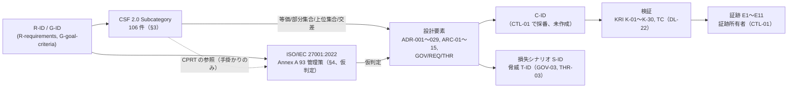

# 統制マッピング: NIST CSF 2.0 / ISO/IEC 27001:2022

> 文書ID: CTL-03 / 版: 0.1 / 状態: draft / 最終更新: 2026-10-15
> 対応要求: R-025, R-026, R-214, R-228, R-229, R-233, R-236, R-278, G-012（主なもの。R-165, R-237, R-241, R-243, R-247 は §8 で接続先を示す）
> 依存文書: CONVENTIONS.md, traceability/deliverables.md（DL-28）, traceability/R-requirements.md, traceability/G-goal-criteria.md, 06_controls/applicability.md（CTL-02）, 05_adr/README.md, 05_adr/ADR-001〜ADR-029, 05_adr/reconciliation-notes.md, 04_architecture/（ARC-01〜ARC-15）, 01_governance/（GOV-02〜GOV-09）, 02_requirements/operation-risk-tiers-assurance.md（REQ-03）, 03_threat-model/（THR-02〜THR-05）, research/RS-01-governance-risk.md, research/RS-08-pep-completeness-tenant-isolation.md, research/RS-13-fraud-abuse.md, research/standards-status.md
> 作成方法: AI エージェント（Claude）が 2026-10-15 に、CSF 2.0 の原典（CSWP 29）と NIST が配布する CSF 2.0 Reference Tool の一括出力を取得し、ADR-001〜ADR-029 と 04_architecture の各文書の要旨・決定と突き合わせて起草した。関係（等価・部分集合・上位集合・交差）の判定は起草者の設計推論であり、作成者以外の照合と第三者の確認を経ていない [D]。
> 表の注記: 表のセルでタグのないものは、本文で示した原典の記述（Subcategory の和訳要約は [N]）と各 ADR・ARC の記述を要約した設計推論 [D] であり、この注記で個別のタグに代える。

---

## 0. 結論

1. **CSF 2.0 の 106 Subcategory すべてに、本基盤の設計要素・組織文書・範囲外の理由のいずれかを割り当てた。設計要素が無いのは 2 件（GV.RM-07 戦略的機会、ID.RA-08 脆弱性開示）だけである** [D]。106 件の内訳は、本基盤が成果の主要部分を担う「主」67 件、組織全体の成果に入力を出す「従」36 件、物理・環境でクラウド事業者に依拠する「外」3 件である（§2.2）[D]。ID.RA-08 は本基盤が直接担うべき成果であり、決裁案 DC-5 で受付窓口を決める [D]。
2. **関係の大半は「部分集合」であり、「等価」は 3 件にとどまる** [D]。106 件中 91 件で、本基盤の設計要素は CSF の成果の一部だけを満たす（部分集合）[D]。等価は PR.AA-02（文脈に応じた身元確認と資格情報の結び付け）、PR.AA-04（ID アサーションの保護・伝達・検証）、RS.AN-07（インシデントデータの完全性と来歴）の 3 件、上位集合は 4 件、交差は 4 件である（§3.8）[D]。CSF は成果の達成方法を規定せず、成果は実施すべき行動のチェックリストではないと述べているので、この表は統制が有効であることの証拠にならない [N][^1]（RS-01#2）。有効性は KRI・試験・証跡（CTL-01、ASR 系）で示す [D]。
3. **ISO/IEC 27001:2022 側の関係はすべて「仮判定」であり、原典の取得を決裁事項にする** [D]。Annex A の管理策名と条項本文は有料で、本リポジトリの調査は原典を確認していない（RS-01 §6）[D]。本書は NIST の CSF 2.0 Reference Tool の出力に含まれる ISO/IEC 27001:2022 の参照（93 管理策の番号）を手掛かりに写像したが、同出力は NIST の公式出版物ではないと明記されており、NIST は NIST 以外が提出した写像の正しさを試験していない [N][^3][^4]。ISO 側の写像を ISMS の適用宣言書の入力や認証審査の説明に使う前に、原典を取得して照合する（決裁案 DC-1）[D]。
4. **写像の単位は「設計要素（将来の C-ID）」に置き、枠組みの要素を統制とみなさない** [D]。CSF は Informative References が Subcategory より範囲の狭いものであり、1 つの Subcategory の成果に多くの参照が要り得ると述べている [N][^1]。NIST の SP 800-53 の頁も、関係表だけから等価を仮定しないよう注意している [N][^6]。そこで C-ID は CTL-01 で設計要素の単位に採番し、CSF・ISO は C-ID への多対多の写像として持つ案を推奨する（決裁案 DC-3）[D]。
5. **閉じたものはない** [D]。対応表の 14 件（R 13 件、G 1 件）は、いずれも本書だけでは閉じない [D]。CSF の写像（R-026 の CSF 部分）は机上で揃ったが、作成者以外の照合、CTL-01 での C-ID 採番、ISO 原典との照合が残る（§残課題）[D]。

---

## 1. 位置付けと読み方

### 1.1 位置付け

- 本書は統制マッピング台帳（DL-28、CTL-01 `06_controls/control-mapping-ledger.md`）のうち、NIST CSF 2.0 と ISO/IEC 27001:2022 への写像を切り出した付属文書である [D]。deliverables.md §8 には本書のパスと文書ID（CTL-03）がまだ登録されていない [D]。登録は成果物計画の管理者に依頼する（残課題 1）[D]。
- CTL-01 は 2026-10-15 時点で未作成であり、社内統制 C-ID は未採番である [D]。本書は C-ID の代わりに設計要素（ADR・ARC・GOV・REQ・THR の文書 ID と ADR 内の決定 ID）で写像を書く [D]。CTL-01 が C-ID を採番した時点で、本書の「設計要素」列を C-ID に置き換える [D]。
- 適用性の判定（CSF 2.0 を統治の骨格として採用、ISO/IEC 27001:2022 を ISMS の骨格として採用・認証は条件付き）は CTL-02 の X-03・X-04 が正本である [D]。本書はその判定を前提にし、決め直さない [D]。
- 決定済みの ADR は 0 本で、29 本すべてが proposed である（ADR-000 の要旨）[D]。本書の設計要素は proposed の ADR を指しており、ADR が改版されれば写像も改める [D]。

### 1.2 対象とした版

| 枠組み | 版・状態 | 確認日 | 根拠 |
|---|---|---|---|
| NIST CSF 2.0（CSWP 29） | final、2024-02-26。後継版・draft の掲示なし [N] | 2026-10-03（RS-01）、Core 本文は 2026-10-15 に再取得 | [^1][^2]（RS-01#1）、standards-status SS-E01 |
| ISO/IEC 27001:2022 | 第 3 版、Published（60.60）、改訂中の表示なし [N] | 2026-10-03 | [^7]（RS-01#34）、standards-status SS-D13 |
| ISO/IEC 27001:2022/Amd 1:2024 | Published（60.60）[N] | 2026-10-03 | [^8]（RS-01#34）、standards-status SS-D14 |
| CSF 2.0 Reference Tool の一括出力 | Change Log「Final」、生成日 2026-10-14 [N] | 2026-10-15 | [^3] |

- Amd 1:2024 は「Climate action changes」と題する改正であり（RS-01#34）、本書の写像対象である Annex A の管理策との関係は原典未確認のため判断していない [D]。

### 1.3 関係の定義

関係の語彙は NIST の OLIR 提出指針（IR 8278Ar1）の集合論的関係（subset of、intersects with、equal、superset of、not related to）に合わせる [N][^5]。同指針は関係の根拠を syntactic・semantic・functional の 3 種に分け、functional を「文言ではなく成果を分析した」根拠としている [N][^5]。本書の判定はすべて functional であり、最も解釈に依存する種類である [D]。

| 本書の語 | IR 8278Ar1 の語 | 本書での意味（f＝枠組みの要素、r＝本基盤の設計要素群） |
|---|---|---|
| 等価 | equal | f を「本基盤の範囲に限定」したとき、r と f の概念が一致する |
| 部分集合 | subset of | r は f の一部だけを満たす。f の残りは他の組織統制か未対応 |
| 上位集合 | superset of | r は本基盤の範囲で f の全部を満たし、f に無い統制も含む |
| 交差 | intersects with | r と f は重なるが、互いに相手に無い部分を持つ |
| 無関係 | not related to | 本基盤の設計要素は f に関係しない（範囲外） |

- 「本基盤の範囲」は、認証・認可基盤とそれが連携開発者・顧客に課す契約（ADR-022）、およびそれを運営する要員と手順とする [D]。全社の ISMS や事業全体の統治は範囲に含めない [D]。
- 等価・上位集合は「本基盤の範囲に限定した f」に対する判定であり、組織として f を達成したことを意味しない [D]。

### 1.4 区分の定義

| 区分 | 意味 |
|---|---|
| 主 | 本基盤の設計・運用が、その成果の主要部分を担う |
| 従 | 組織全体の成果であり、本基盤は入力・証跡・一部の手順を提供する |
| 外 | 本基盤の範囲外。依拠先（例: クラウド事業者の第三者報告）を記す |

### 1.5 原典と制約

- CSF 2.0 の Subcategory の文言は CSWP 29 の Appendix A から取得し、和訳要約を表に載せた [N][^1]。RS-13#71 が既に照合した PR.AA-03、DE.CM-03、DE.AE-02、DE.AE-03、RS.MI-01 の文言は、本書の取得分と一致した [D]（RS-13#71、research/verification/RS-13-verification.md の脚注 71 の行）。
- Subcategory の総数（取り下げを除く 106 件）は、Reference Tool の一括出力から起草者が数えた値である [D][^3]。
- ISO/IEC 27001:2022 の参照番号は、同出力の Informative References 列にある「ISO/IEC 27001:2022」の項から取った [N][^3]。この列には「Annex A Controls: x」と「Control x」の 2 つの表記が混在しており、NIST の Informative References 頁は ISO/IEC 27001:2022 から CSF 2.0 への写像を 2 本（「ISO/IEC-27001:2022-to-CSFv2.0 (1.0.0)」と「ISO/IEC-27001:2022-to-Cybersecurity-Framework-v2.0」）掲載している [N][^3][^4]。2 本の提出者・状態と、どちらがどの表記に当たるかは、詳細頁が動的に描画されるため確認できなかった（未確認）[D]。
- 同出力の Read Me は「This export is a user generated version of the Core versus an official NIST publication.」と述べている [N][^3]。NIST は、NIST 以外が提出した写像の正しさを試験せず、カタログへの掲載は NIST の推奨を意味しないと述べている [N][^4]。したがって CPRT の ISO 参照は「どの管理策を検討すべきかの手掛かり」にだけ使い、本書の関係判定の根拠にはしない [D]。
- Annex A の管理策名と本文、条項 4〜10 の本文は未確認である（RS-01 §6）[D]。表の「主題」列は起草者の要約であり、原典と照合していない（未確認）[D]。

---

## 2. 全体像

### 2.1 写像の連鎖

- R-214 が求める「保護対象→脅威主体→損失シナリオ→リスク許容度→制御要件→検証方法→合格値→残余リスク受容者」の連鎖のうち、本書が受け持つのは「制御要件（設計要素）↔ 外部枠組み ↔ 検証方法（KRI）」の区間である [D]。損失シナリオと KRI の結び付きは GOV-08 の KRI 表（各 K-ID の S-ID 列）が持つ [D]。合格値・受容者は CTL-01 と残余リスク登録簿（00_decision、計画）で閉じる [D]。

### 2.2 件数（CSF 2.0）

| Function | Subcategory 数 | 主 | 従 | 外 | 等価 | 上位集合 | 交差 | 部分集合 | 無関係 | 設計要素なし |
|---|---|---|---|---|---|---|---|---|---|---|
| GOVERN（GV） | 31 | 12 | 19 | 0 | 0 | 0 | 2 | 28 | 0 | 1 |
| IDENTIFY（ID） | 21 | 16 | 5 | 0 | 0 | 1 | 1 | 18 | 0 | 1 |
| PROTECT（PR） | 22 | 17 | 3 | 2 | 2 | 3 | 1 | 15 | 1 | 0 |
| DETECT（DE） | 11 | 8 | 2 | 1 | 0 | 0 | 0 | 10 | 1 | 0 |
| RESPOND（RS） | 13 | 10 | 3 | 0 | 1 | 0 | 0 | 12 | 0 | 0 |
| RECOVER（RC） | 8 | 4 | 4 | 0 | 0 | 0 | 0 | 8 | 0 | 0 |
| 計 | 106 | 67 | 36 | 3 | 3 | 4 | 4 | 91 | 2 | 2 |

- 6 つの Function のすべてに、本基盤の設計要素が対応している [D]。R-228 が求める「6 機能の同時並行の運用」のうち、設計の側の前提はこれで揃う [D]。CSF 2.0 は機能を同時並行で扱うことを should で書いており（"The Functions should be addressed concurrently."）、義務ではない [N][^1]（dissent-log DS-01 と同じ強度の扱い）。
- GOVERN は 31 件中 19 件が「従」である [D]。統治の成果の大半は全社の経営判断で決まり、本基盤は決裁案（GOV-02、GOV-05〜GOV-07）と指標（GOV-08）を出す立場にとどまる [D]。

### 2.3 件数（ISO/IEC 27001:2022 Annex A）

| 区分 | 管理策数 | 備考 |
|---|---|---|
| 主（§4.1 の表で設計要素あり） | 49 | — |
| 従（同上） | 12 | — |
| 外（物理的管理策 7.1〜7.14 を 1 行に集約） | 14 | クラウド事業者の第三者報告に依拠 |
| 組織全体の管理策として本書の写像外（§4.2） | 18 | CTL-01 で全社統制に割り当てる |
| 計 | 93 | CPRT の出力に現れる番号の数 [D][^3] |

- §4.1 の 62 行の関係（仮判定）は、部分集合 49、上位集合 9、交差 2、等価 1、無関係 1 である [D]。

---

## 3. CSF 2.0 Subcategory の写像

### 3.1 列の読み方

- 「成果（和訳の要約）」は CSWP 29 Appendix A の Subcategory の文言を起草者が要約したもの [N][^1] であり、正本は英文である [D]。
- 「CPRT の ISO/IEC 27001:2022 参照」は、Reference Tool の出力がその Subcategory に挙げた Annex A の番号である [N][^3]。8 件を超える場合は先頭 8 件だけを示した [D]。条項 4〜10 の参照は §4.3 にまとめた [D]。
- 「検証・指標」は GOV-08 の KRI である [D]。KRI が無い行は、CTL-01 で試験（TC）か証跡（E）を割り当てる [D]。
- 「（計画）」を付けた文書は deliverables.md に計画されているが、2026-10-15 時点で存在しない [D]。

### 3.2 GOVERN（GV）

| Subcategory | 成果（和訳の要約） | 区分 | 設計要素（ADR/ARC ほか） | 関係 | CPRT の ISO/IEC 27001:2022 参照（Annex A） | 検証・指標 |
|---|---|---|---|---|---|---|
| GV.OC-01 | 組織の使命を理解し、サイバーリスク管理に反映する | 従 | GOV-02（リスク選好案）、GOV-04（BIA） | 部分集合 | — | K-24 |
| GV.OC-02 | 内外の利害関係者とその期待を理解・考慮する | 従 | GOV-05（RACI）、REQ-06（顧客管理者の責任分界） | 部分集合 | — | — |
| GV.OC-03 | 法令・規制・契約上の要件（プライバシーを含む）を理解し管理する | 主 | CTL-02（適用性判定・規制フロア）、REQ-03 §5（規制プロファイル）、ADR-014（保持・所在地） | 部分集合 | 5.20, 5.31 | K-23（E2 法務署名は未取得） |
| GV.OC-04 | 外部が依存する重要な目的・能力・サービスを理解し伝達する | 主 | GOV-04（BIA）、ADR-023（依存 Tier）、ADR-022（連携契約）、SLO-01（計画） | 部分集合 | 5.20, 5.31 | K-18 |
| GV.OC-05 | 組織が依存する成果・能力・サービスを理解し伝達する | 主 | ADR-023（Tier X・依存してはならないもの）、ADR-001（製品依存）、ADR-018（出口）、ARC-14 | 部分集合 | 5.3, 5.8 | K-19 |
| GV.RM-01 | リスク管理目的を確立し利害関係者が合意する | 従 | GOV-02、DEC 系決裁（00_decision、計画） | 部分集合 | 5.1 | — |
| GV.RM-02 | リスク選好と許容度のステートメントを確立・伝達・維持する | 従 | GOV-02（リスク選好・許容度の決裁案） | 部分集合 | 5.1 | K-24 |
| GV.RM-03 | サイバーリスク管理の活動と結果を ERM に組み込む | 従 | GOV-02、GOV-08（KRI） | 部分集合 | 5.1 | K-24、K-25 |
| GV.RM-04 | 適切なリスク対応の選択肢を示す戦略的方向を確立し伝達する | 従 | GOV-07（例外・リスク受容） | 部分集合 | 5.1 | K-26 |
| GV.RM-05 | 供給者・第三者由来を含むリスクの伝達経路を確立する | 従 | GOV-05、GOV-06（停止権限）、R-278 の供給者台帳（OPS-03、計画） | 部分集合 | 5.1, 5.19 | K-27 |
| GV.RM-06 | リスクの算定・記録・分類・優先付けの標準化手法を確立し伝達する | 従 | GOV-03（損失シナリオ S-ID）、THR-03（T-ID） | 部分集合 | 5.1 | K-25 |
| GV.RM-07 | 戦略的機会（正のリスク）を特定し議論に含める | 従 | なし（ギャップ G-1） | — | — | — |
| GV.RR-01 | 指導層がサイバーリスクに責任と説明責任を負う | 従 | GOV-05、R-228 の決裁案（GOV-02） | 部分集合 | 5.4 | — |
| GV.RR-02 | 役割・責任・権限を確立・伝達・理解・強制する | 主 | GOV-05、GOV-06、ADR-029（事業者要員の権限）、ADR-008（二者承認） | 部分集合 | 5.2, 5.3 | K-09、K-27 |
| GV.RR-03 | リスク戦略に見合う資源を配分する | 従 | ADR-001 D17・ADR-013 KD13-5（SRE 要員の決裁案） | 部分集合 | 6.6 | K-30 |
| GV.RR-04 | 人事の実務にサイバーセキュリティを含める | 従 | REQ-02（従業員・委託先の入社・異動・退職） | 交差 | 6.1, 6.2, 6.3, 6.4, 6.5, 6.6, 6.7, 6.8 | K-08 |
| GV.PO-01 | 組織の文脈に基づく方針を確立・伝達・強制する | 従 | GOV-02、ADR 集（05_adr） | 部分集合 | 5.1, 5.37, 6.1, 6.2, 6.4, 6.5, 6.7, 6.8 | — |
| GV.PO-02 | 方針を要件・脅威・技術の変化に応じて見直す | 従 | 各 ADR §8 の再検討トリガー、standards-status（DL-84） | 部分集合 | 5.1, 5.31, 5.32, 5.34 | K-23 |
| GV.OV-01 | リスク管理戦略の成果を評価し方向を調整する | 従 | GOV-08、ASR-06（継続的保証、計画） | 部分集合 | 5.1, 5.5, 5.6, 5.19, 5.24 | K-24、K-25 |
| GV.OV-02 | 戦略を見直し、組織の要件とリスクを網羅させる | 従 | GOV-08、本書と CTL-01 の健全性ルール | 部分集合 | 5.1, 5.19, 5.27, 5.35, 5.36 | — |
| GV.OV-03 | リスク管理の実績を評価・レビューする | 従 | GOV-08 | 部分集合 | 5.1, 5.19, 5.20, 8.30, 8.32, 8.34 | K-01〜K-30 |
| GV.SC-01 | サプライチェーンリスク管理の計画・方針を確立し合意する | 従 | R-278（OPS-03・計画）、ADR-018 | 部分集合 | 5.1, 5.19, 5.20, 5.21, 5.22 | — |
| GV.SC-02 | 供給者・顧客・パートナーの役割と責任を確立し調整する | 主 | REQ-06、ADR-004（trust agreement）、ADR-022（連携契約） | 部分集合 | 5.2, 5.4 | K-13 |
| GV.SC-03 | SCRM をリスク評価・改善のプロセスに統合する | 従 | GOV-03、R-278 | 部分集合 | 5.1, 5.19, 5.20, 5.21 | — |
| GV.SC-04 | 供給者を把握し重要度で優先付けする | 主 | ARC-14（製品評価）、ADR-001・ADR-010・ADR-007（主要供給者の特定） | 部分集合 | 5.19, 5.22 | —（重要度区分は未作成。R-278） |
| GV.SC-05 | 供給網のリスク要件を契約・合意に組み込む | 主 | ADR-018（契約の最低線: export 項目）、CTL-02 §3.8 | 部分集合 | 5.19, 5.20, 5.31 | — |
| GV.SC-06 | 関係の開始前に計画とデュー・デリジェンスを行う | 主 | ARC-14、ADR-001・ADR-010 の PoC | 部分集合 | 5.19, 5.20, 5.31 | — |
| GV.SC-07 | 供給者のリスクを関係の全期間で評価・対応・監視する | 主 | ADR-018（四半期 export 検証・年次往復演習）、standards-status | 部分集合 | 5.19, 5.20, 5.22, 5.31 | K-29 |
| GV.SC-08 | 関係する供給者・第三者をインシデント対応・復旧に含める | 主 | ADR-019（顧客 IdP 切離し・通知）、CTL-02 §3.7 | 部分集合 | 5.26 | K-22 |
| GV.SC-09 | 供給網セキュリティの実務を統合し実績を監視する | 主 | ADR-008（SLSA Build L3・Source L4、配備時の provenance 検証） | 部分集合 | 5.19, 5.20, 5.21, 5.22 | K-20 |
| GV.SC-10 | 契約終了後の活動を SCRM 計画に含める | 主 | ADR-018（出口）、ADR-028（解約時 export・削除） | 交差 | 5.19, 5.20, 5.21, 5.22 | — |

### 3.3 IDENTIFY（ID）

| Subcategory | 成果（和訳の要約） | 区分 | 設計要素（ADR/ARC ほか） | 関係 | CPRT の ISO/IEC 27001:2022 参照（Annex A） | 検証・指標 |
|---|---|---|---|---|---|---|
| ID.AM-01 | 組織が管理するハードウェアの台帳を維持する | 従 | ADR-007（HSM・鍵台帳）、ADR-008（PAW） | 部分集合 | 5.9 | — |
| ID.AM-02 | ソフトウェア・サービス・システムの台帳を維持する | 主 | ADR-012（entry point 台帳）、ADR-016（consumer 台帳）、ADR-015（CBOM） | 部分集合 | 5.9 | K-01、K-29 |
| ID.AM-03 | 許可された通信とデータフローの表現を維持する | 主 | ADR-012（宣言集合と観測集合の突合、DB 直接接続の計数）、ADR-009（交換可能な組の登録簿） | 部分集合 | 5.14, 8.20, 8.21, 8.22 | K-01、K-05 |
| ID.AM-04 | 供給者が提供するサービスの台帳を維持する | 主 | ARC-14、OPS-03（計画） | 部分集合 | 5.22 | — |
| ID.AM-05 | 分類・重要度・影響に基づき資産を優先付けする | 主 | REQ-04（データ分類）、REQ-03（操作 5 分類）、ADR-023（依存 Tier） | 部分集合 | 5.9, 5.12, 5.13 | — |
| ID.AM-07 | 指定したデータ種別とメタデータの台帳を維持する | 主 | REQ-04、ARC-15（claim 目録）、ADR-014（監査データモデル） | 部分集合 | 5.9 | K-21 |
| ID.AM-08 | システム・ソフトウェア・サービス・データをライフサイクル全体で管理する | 主 | ADR-016（版・非推奨）、ADR-028（テナント）、ADR-007（鍵）、REQ-02・ADR-017（主体） | 交差 | 5.8, 5.9, 5.11, 5.12, 5.13, 5.19, 5.22, 7.10 ほか 2 件 | K-07、K-29 |
| ID.RA-01 | 資産の脆弱性を特定・検証・記録する | 従 | ASR-02・ASR-04（計画） | 部分集合 | 8.8 | — |
| ID.RA-02 | 情報共有の場から脅威インテリジェンスを受け取る | 従 | THR-05（事故ケースブック） | 部分集合 | 5.7, 5.22, 8.16 | — |
| ID.RA-03 | 内外の脅威を特定し記録する | 主 | THR-02（ATK-ID）、THR-03（T-ID） | 部分集合 | 5.7, 5.22, 8.16 | K-28 |
| ID.RA-04 | 脅威が脆弱性を突く影響と可能性を特定し記録する | 主 | GOV-03（S-ID）、GOV-04 | 部分集合 | — | — |
| ID.RA-05 | 脅威・脆弱性・可能性・影響から固有リスクを理解し対応の優先付けに使う | 主 | GOV-03、THR-03 | 部分集合 | 5.7 | K-24、K-25 |
| ID.RA-06 | リスク対応を選択・計画・追跡・伝達する | 主 | GOV-07、残余リスク登録簿（00_decision、計画） | 部分集合 | 5.7 | K-26 |
| ID.RA-07 | 変更と例外を管理し、リスク影響を評価・記録・追跡する | 主 | ADR-008（単一変更経路・二者承認）、ADR-013（cell 単位 wave）、GOV-07（例外） | 上位集合 | 8.32 | K-20、K-26 |
| ID.RA-08 | 脆弱性開示の受付・分析・対応のプロセスを確立する | 主 | なし（ギャップ G-2） | — | — | — |
| ID.RA-09 | 取得・使用前にハードウェア・ソフトウェアの真正性と完全性を評価する | 主 | ADR-008（配備時の署名・provenance 検証） | 部分集合 | 5.19, 5.20, 5.22 | K-20 |
| ID.RA-10 | 重要な供給者を取得前に評価する | 主 | ARC-14、ADR-001（選定と PoC） | 部分集合 | 5.19, 5.20, 5.22 | — |
| ID.IM-01 | 評価から改善点を特定する | 従 | ASR-06（計画）、Phase 4 模擬パネル（自己レビュー） | 部分集合 | 5.35 | — |
| ID.IM-02 | 供給者と協調した試験・演習から改善点を特定する | 主 | ADR-019（平時の最大速度演習）、ADR-018（退出演習）、ASR-02（計画） | 部分集合 | 5.19, 5.35 | K-10 |
| ID.IM-03 | 運用プロセスの実行から改善点を特定する | 従 | GOV-08、OPS-01（計画） | 部分集合 | 5.27 | — |
| ID.IM-04 | インシデント対応計画等を確立・伝達・維持・改善する | 主 | ADR-019、OPS-01（計画）、GOV-06 | 部分集合 | 5.24, 5.26, 5.27 | K-22 |

### 3.4 PROTECT（PR）

| Subcategory | 成果（和訳の要約） | 区分 | 設計要素（ADR/ARC ほか） | 関係 | CPRT の ISO/IEC 27001:2022 参照（Annex A） | 検証・指標 |
|---|---|---|---|---|---|---|
| PR.AA-01 | 利用者・サービス・ハードウェアの ID と資格情報を組織が管理する | 主 | ADR-001（AS・主体台帳）、REQ-01・REQ-02、ADR-004（SCIM・linking）、ADR-009（SPIFFE）、ADR-017（非人間主体）、ADR-021（識別子） | 上位集合 | 5.15, 5.16, 5.18, 8.2, 8.5 | K-08、K-13 |
| PR.AA-02 | やり取りの文脈に応じて ID を確認し資格情報に結び付ける | 主 | ADR-002（主体×操作階層の IAL 割当）、ADR-003（回復・再束縛）、REQ-03 | 等価 | 8.2, 8.3, 8.5 | K-12 |
| PR.AA-03 | 利用者・サービス・ハードウェアを認証する | 主 | ADR-002（AAL・フィッシング耐性）、ADR-009（mTLS・X.509-SVID）、ADR-020（FAPI 2.0 範囲） | 部分集合 | 5.15, 5.16, 5.17, 5.18, 8.5 | K-11 |
| PR.AA-04 | ID アサーションを保護・伝達・検証する | 主 | ADR-005（token profile）、ADR-007（鍵階層）、ADR-021（issuer）、ADR-004（federation 検証）、ADR-009（token exchange）、ADR-015（暗号俊敏性） | 等価 | 5.16 | K-07、K-15 |
| PR.AA-05 | アクセス権限を方針で定義・管理・強制・見直し、最小権限と職務分離を組み込む | 主 | ADR-010・ADR-011（判定）、ADR-012（PEP coverage）、ADR-024・ADR-025・ADR-026、ADR-029（JIT・二者承認）、ADR-008 | 交差 | 5.1, 5.3, 5.14, 5.15, 5.16, 5.17, 5.18, 8.2 ほか 4 件 | K-01、K-04、K-09 |
| PR.AA-06 | 物理アクセスをリスクに応じて管理・監視・強制する | 外 | クラウド事業者の第三者報告に依拠。break-glass 資格情報の封緘・二重保管（ADR-029）だけ本基盤 | 部分集合 | 7.1, 7.2, 7.3, 7.4, 7.12 | K-10 |
| PR.AT-01 | 要員に一般的な意識向上と訓練を提供する | 従 | OPS-02（計画）、INT-00（連携ハンドブック、計画） | 部分集合 | 6.3 | — |
| PR.AT-02 | 特別な役割の要員に意識向上と訓練を提供する | 主 | ADR-003（helpdesk 手続）、ADR-029（support）、OPS-02（計画） | 部分集合 | 5.2, 6.3 | K-12 |
| PR.DS-01 | 保存データの機密性・完全性・可用性を保護する | 主 | ADR-007（KMS）、ADR-028（テナント KEK・DEK）、ADR-012（RLS 等の storage guardrail）、ARC-11 | 部分集合 | 5.1, 5.3, 5.10, 5.12, 5.13, 5.14, 5.15, 5.33 ほか 20 件 | K-02、K-05 |
| PR.DS-02 | 伝送中データの機密性・完全性・可用性を保護する | 主 | ADR-009（mTLS）、ADR-015（hybrid 鍵交換）、ADR-005（sender constraint） | 部分集合 | 5.3, 5.10, 5.13, 5.14, 5.15, 6.1, 6.2, 6.5 ほか 8 件 | — |
| PR.DS-10 | 使用中データの機密性・完全性・可用性を保護する | 主 | ADR-029（認証秘密は昇格しても閲覧不可）、ADR-007（非エクスポート鍵） | 部分集合 | 5.3, 5.10, 5.13, 5.14, 5.15, 5.23, 6.1, 6.2 ほか 7 件 | — |
| PR.DS-11 | データのバックアップを作成・保護・維持・試験する | 主 | ADR-014（WORM・封印）、ADR-018（EIF の定常 export 検証）、ADR-028 | 部分集合 | 8.13 | K-21 |
| PR.PS-01 | 構成管理の実務を確立し適用する | 主 | ADR-008（宣言・二者レビュー・署名・段階配布）、ADR-013（署名付き配布の検証） | 上位集合 | 8.8, 8.9 | K-20 |
| PR.PS-02 | ソフトウェアをリスクに応じて保守・更新・撤去する | 主 | ADR-016、ADR-001（製品の LTS）、ADR-018、OPS-03（計画） | 部分集合 | 5.9, 8.7 | K-29 |
| PR.PS-03 | ハードウェアをリスクに応じて保守・更新・撤去する | 従 | ADR-007（HSM の寿命） | 部分集合 | 5.9, 8.1 | — |
| PR.PS-04 | ログを生成し継続的監視に使えるようにする | 主 | ADR-014（独立監査経路・全件記録・欠損検知）、REQ-03 §3.7（AU-1〜AU-5） | 上位集合 | 8.15, 8.17 | K-21 |
| PR.PS-05 | 未許可ソフトウェアの導入と実行を防ぐ | 従 | ADR-008（未署名・provenance 不一致の成果物を配備しない） | 部分集合 | 8.19 | K-20 |
| PR.PS-06 | 安全な開発の実務を SDLC に統合し実績を監視する | 主 | ADR-008（SLSA）、CTL-02 X-10（SSDF 採用）、ADR-012（CI 必須ゲート）、ADR-022（負例ベクタ） | 部分集合 | 8.25, 8.26, 8.28, 8.29, 8.31 | K-06 |
| PR.IR-01 | ネットワークと環境を無権限の論理アクセスから保護する | 主 | ADR-013（cell 分割）、ADR-012（deny-by-default）、ADR-008（非本番→本番の信頼経路なし）、ADR-009（trust domain） | 部分集合 | 8.20, 8.21, 8.22, 8.23 | K-02、K-19 |
| PR.IR-02 | 技術資産を環境上の脅威から保護する | 外 | クラウド事業者の第三者報告に依拠 | 無関係 | 7.5, 7.6, 7.7, 7.8, 7.11, 7.12, 7.13, 7.14 | — |
| PR.IR-03 | 平常時・異常時の回復性要件を満たす仕組みを実装する | 主 | ADR-013（cell・fail-mode）、ADR-023（静的安定性）、ARC-08 | 部分集合 | 5.29, 8.14, 8.17, 8.27 | K-18、K-19 |
| PR.IR-04 | 可用性を保つ十分な資源容量を維持する | 主 | ARC-13（容量モデル）、ADR-023（Tier 別 shed） | 部分集合 | 8.6 | K-18 |

### 3.5 DETECT（DE）

| Subcategory | 成果（和訳の要約） | 区分 | 設計要素（ADR/ARC ほか） | 関係 | CPRT の ISO/IEC 27001:2022 参照（Annex A） | 検証・指標 |
|---|---|---|---|---|---|---|
| DE.CM-01 | ネットワークとネットワークサービスを監視する | 従 | edge gateway・mesh の拒否記録（ADR-012） | 部分集合 | 8.15, 8.16 | — |
| DE.CM-02 | 物理環境を監視する | 外 | クラウド事業者の第三者報告に依拠 | 無関係 | 7.4 | — |
| DE.CM-03 | 要員の活動と技術利用を監視する | 主 | THR-04（ITDR）、ADR-029（support アクセスの記録）、ADR-008（特権操作） | 部分集合 | 7.4, 8.16 | K-09、K-12 |
| DE.CM-06 | 外部サービス提供者の活動とサービスを監視する | 主 | ADR-029（ベンダー support）、ADR-006（顧客 IdP からの SSF 受信） | 部分集合 | 5.22, 8.16 | K-13、K-14 |
| DE.CM-09 | 計算資源・実行環境・データを監視する | 主 | ADR-012（K-01(b) 実行時計数）、ADR-014（欠損検知）、ADR-007（KMS 署名回数と発行台帳の照合） | 部分集合 | 8.6, 8.16 | K-01、K-21 |
| DE.AE-02 | 有害事象を分析して関連活動を理解する | 主 | THR-04（ITDR） | 部分集合 | 5.24, 5.25 | K-28 |
| DE.AE-03 | 複数の情報源の情報を相関させる | 主 | ADR-014・ADR-009（jti・sid・txn・decision_id 等による結合） | 部分集合 | 8.15, 8.16 | — |
| DE.AE-04 | 有害事象の影響と範囲を見積もる | 主 | ADR-019（影響テナント・主体・データ種別の引当て） | 部分集合 | 5.25 | K-22 |
| DE.AE-06 | 有害事象の情報を権限ある要員・ツールに提供する | 主 | ADR-014（顧客監査 API・SIEM への下流配信） | 部分集合 | 5.26 | — |
| DE.AE-07 | 脅威インテリジェンス等を分析に統合する | 従 | THR-05 | 部分集合 | 5.7 | — |
| DE.AE-08 | 基準を満たす有害事象をインシデントとして宣言する | 主 | GOV-06（停止権限）、ADR-019（4 時刻の記録） | 部分集合 | 5.25, 5.26 | K-22 |

### 3.6 RESPOND（RS）

| Subcategory | 成果（和訳の要約） | 区分 | 設計要素（ADR/ARC ほか） | 関係 | CPRT の ISO/IEC 27001:2022 参照（Annex A） | 検証・指標 |
|---|---|---|---|---|---|---|
| RS.MA-01 | インシデント宣言後に第三者と協調して対応計画を実行する | 主 | ADR-019、OPS-01（計画） | 部分集合 | 5.26, 5.27, 5.28 | K-22 |
| RS.MA-02 | インシデント報告をトリアージし検証する | 従 | OPS-01（計画） | 部分集合 | 5.24, 5.26, 5.27, 5.28, 6.8 | — |
| RS.MA-03 | インシデントを分類し優先付けする | 主 | ADR-019（K1〜K4 の粒度）、GOV-06 | 部分集合 | 5.25 | — |
| RS.MA-04 | 必要に応じてエスカレーションする | 主 | GOV-06 | 部分集合 | 5.26 | K-27 |
| RS.MA-05 | インシデント復旧を開始する基準を適用する | 従 | OPS-01（計画） | 部分集合 | 5.25 | — |
| RS.AN-03 | 何が起きたかと根本原因を分析する | 従 | ADR-014（取引の再構成） | 部分集合 | 5.25, 5.27 | — |
| RS.AN-06 | 調査中の行動を記録し、記録の完全性と来歴を保つ | 主 | ADR-019（証拠保全）、ADR-014（ハッシュ連鎖・封印） | 部分集合 | 5.28 | K-21 |
| RS.AN-07 | インシデントのデータとメタデータを収集し、完全性と来歴を保つ | 主 | ADR-019（legal hold、独立保存先へのハッシュ付き複写）、ADR-014（4 層の完全性） | 等価 | 5.28 | K-21 |
| RS.AN-08 | インシデントの規模を見積もり検証する | 主 | ADR-019、ADR-014 | 部分集合 | 5.25 | K-22 |
| RS.CO-02 | 内外の利害関係者にインシデントを通知する | 主 | CTL-02 §3.7（通知時計）、ADR-019（顧客への先行通知） | 部分集合 | 5.26 | K-22（E2 法務署名は未取得） |
| RS.CO-03 | 指定した内外の利害関係者と情報を共有する | 主 | ADR-006・ADR-019（SSF による signal 送信） | 部分集合 | 5.26 | — |
| RS.MI-01 | インシデントを封じ込める | 主 | ADR-019（kill switch K1〜K4、失効下限時刻）、ADR-006（失効伝播） | 部分集合 | 5.26 | K-17、K-22 |
| RS.MI-02 | インシデントを根絶する | 主 | ADR-007（鍵の緊急切替）、ADR-019（PDP 隔離と既知良好 bundle での再開） | 部分集合 | 5.26 | K-07 |

### 3.7 RECOVER（RC）

| Subcategory | 成果（和訳の要約） | 区分 | 設計要素（ADR/ARC ほか） | 関係 | CPRT の ISO/IEC 27001:2022 参照（Annex A） | 検証・指標 |
|---|---|---|---|---|---|---|
| RC.RP-01 | 対応プロセスから復旧計画を実行する | 従 | OPS-01（計画） | 部分集合 | 5.26, 5.29 | — |
| RC.RP-02 | 復旧行動を選択・範囲設定・優先付け・実行する | 主 | ADR-023（Tier 別・テナント順の段階受付）、ADR-019 | 部分集合 | 5.26, 5.30 | K-18 |
| RC.RP-03 | 復元前にバックアップ等の完全性を検証する | 主 | ADR-019（最低許容版付きの既知良好 bundle）、ADR-014（封印の検証） | 部分集合 | 8.13 | — |
| RC.RP-04 | 重要業務とリスク管理を考慮して事後の運用基準を定める | 従 | GOV-04（BIA） | 部分集合 | — | — |
| RC.RP-05 | 復元資産の完全性を検証し、正常稼働を確認する | 主 | ADR-023、ADR-027（dual-run の差分判定） | 部分集合 | 5.26 | K-04 |
| RC.RP-06 | 基準に基づき復旧終了を宣言し文書を完成させる | 従 | OPS-01（計画） | 部分集合 | 5.27, 8.13 | — |
| RC.CO-03 | 復旧の進捗を内外の利害関係者に伝える | 主 | ADR-023（status page を Tier X に置く） | 部分集合 | 5.28 | — |
| RC.CO-04 | 承認された方法で復旧の公表を行う | 従 | GOV-05（広報の役割） | 部分集合 | — | — |

### 3.8 等価・上位集合・交差とした理由

部分集合以外の判定は、主張が強くなるので理由を個別に記す [D]。

| Subcategory | 関係 | 理由 | 判定が崩れる条件 |
|---|---|---|---|
| PR.AA-02 | 等価 | ADR-002 は SP 800-63-4 の DIRM に倣い、主体類型×操作 5 分類の影響度から IAL を割り当て、ADR-003 は回復・再束縛を認証と同じ強さで扱う。CSF の「やり取りの文脈に応じた身元確認と資格情報の結び付け」の概念と、本基盤の範囲で一致する | IAL を課さない主体類型で、取引が身元確認を要するのに割当が漏れた場合（ADR-002 の割当表の網羅性は REQ-03 §4 の検査に依存） |
| PR.AA-04 | 等価 | アサーション（token・ID Token・SAML assertion・内部 token）の保護（ADR-007 の鍵階層、ADR-015）、伝達（ADR-005 の sender constraint、ADR-009 の token exchange）、検証（ADR-005 の検証規則 V1〜V14、ADR-021 の issuer 完全一致、ADR-004 の RP 起点限定）を網羅する | U-01（issuer の粒度、ADR-007 KD7-1 と ADR-021 K21-1 の対立）の決裁で検証規則が変わる場合 |
| RS.AN-07 | 等価 | ADR-019 は legal hold を鍵破棄・削除・保持期限より先に掛け、発行台帳・KMS 記録・JWKS・判定記録・policy 版を独立した保存先へハッシュ付きで複写する。ADR-014 は監査記録の完全性を 4 層で守る | 独立保存先が本基盤と同じ管理者権限で消せる構成になった場合 |
| PR.AA-01 | 上位集合 | 利用者・サービス・ハードウェア（PC-17 IoT・自律デバイスを含む）の ID と資格情報を主体台帳で管理し、加えて顧客 IdP の連携 ID の linking（ADR-004）と、不変・不透明な識別子の払出し規則（ADR-021）を持つ | 主体台帳に載らない ID（製品が生成する ID の外部露出など）が見つかった場合 |
| ID.RA-07 | 上位集合 | 変更は単一経路（宣言→二者レビュー→署名→cell 単位の段階配布）でだけ本番に入り（ADR-008）、例外は GOV-07 で記録・期限管理する。配布物の署名・対象 cell・wave の機械検証（ADR-013）は CSF の成果に無い追加である | break-glass による直接変更が事後レビューから漏れた場合（K-10） |
| PR.PS-01 | 上位集合 | 構成は版管理された宣言として管理し、配布時に署名・版の単調性・有効期限を検証する（ADR-008、ADR-013） | 管理 API の宣言適用に対応しない製品を採用した場合（ADR-008 が ADR-001 へ申し送った評価軸） |
| PR.PS-04 | 上位集合 | 監査は telemetry と独立した経路で全件記録し（ADR-014 D14-02）、欠損を検知し、操作階層ごとに記録レベル（AU-1〜AU-5）を定める | AU-2 の allow 記録率を ADR-014 で全件未満に決めた場合は、継続的監視の対象範囲を改めて判定する |
| GV.RR-04 | 交差 | REQ-02 の入社・異動・退職に伴う ID の失効は人事の実務に結び付くが、採用時の審査・懲戒など人事の他の部分は本基盤に無い | — |
| GV.SC-10 | 交差 | ADR-018 は供給者からの出口、ADR-028 は顧客の解約時の export・削除を扱う。後者は CSF の SCRM（供給者側）の範囲外であり、前者のうち供給者要員のアクセス撤去は ADR-029 に部分的にしか無い | — |
| ID.AM-08 | 交差 | 鍵・版・テナント・主体のライフサイクルを持つ一方、ハードウェアのライフサイクルは HSM に限る | — |
| PR.AA-05 | 交差 | 定義（CAM、ADR-011）・強制（PEP coverage の機械検証、ADR-012）・最小権限（JIT、ADR-029）・職務分離（二者承認、ADR-008）は CSF の成果を超える。一方、権限の定期的な見直し（access review）は、顧客管理者への棚卸しの促し（REQ-06）と外部付与の棚卸し（ADR-024 D24-22）にとどまり、基盤の事業者要員・依存サービスの権限を周期的に見直す手順と周期が無い | 見直しの周期と手順を CTL-01 で定めれば上位集合に改める（残課題 6） |

---

## 4. ISO/IEC 27001:2022 の写像（仮判定）

### 4.1 Annex A 管理策

- 「主題」は起草者の要約であり、ISO の原典と照合していない（未確認）[D]。管理策名の正式な表記は DC-1 の原典取得後に差し替える [D]。
- 「CPRT でこの管理策を参照する CSF Subcategory」は、§3 の写像から ISO 側へ引き直したもの [N][^3] であり、ISO の管理策と CSF の Subcategory の関係そのものは判定していない [D]。
- 関係はすべて仮判定（functional、原典未照合）である [D]。

| Annex A | 主題（起草者の要約・ISO 原典未照合） | 区分 | 設計要素（ADR/ARC ほか） | 関係（仮判定） | CPRT でこの管理策を参照する CSF Subcategory |
|---|---|---|---|---|---|
| 5.1 | 情報セキュリティの方針群 | 従 | GOV-02、ADR 集 | 部分集合 | GV.OV-01, GV.OV-02, GV.OV-03, GV.PO-01, GV.PO-02, GV.RM-01, GV.RM-02, GV.RM-03, GV.RM-04, GV.RM-05, GV.RM-06, GV.SC-01, GV.SC-03, PR.AA-05, PR.DS-01 |
| 5.2 | 役割と責任 | 主 | GOV-05、GOV-06、ADR-029 | 部分集合 | GV.RR-02, GV.SC-02, PR.AT-02 |
| 5.3 | 職務の分離 | 主 | ADR-008（二者レビュー・別報告系統の二者承認）、ADR-029（申請者と別の承認者）、ADR-003（回復の 2 名承認） | 上位集合 | GV.OC-05, GV.RR-02, PR.AA-05, PR.DS-01, PR.DS-02, PR.DS-10 |
| 5.5 | 関係当局との連絡 | 主 | CTL-02 §3.7（当局への報告経路と期限）、ADR-019（4 時刻） | 部分集合 | GV.OV-01 |
| 5.7 | 脅威インテリジェンス | 従 | THR-02、THR-03、THR-05 | 部分集合 | DE.AE-07, ID.RA-02, ID.RA-03, ID.RA-05, ID.RA-06 |
| 5.8 | プロジェクトマネジメントにおける情報セキュリティ | 主 | ADR-022（連携契約）、10_integration の準備完了条件（DL-67、計画） | 部分集合 | GV.OC-05, ID.AM-08 |
| 5.9 | 情報と関連資産の目録 | 主 | ADR-012（entry point 台帳）、ADR-015（CBOM）、ADR-007（鍵台帳）、ADR-016（consumer 台帳） | 部分集合 | ID.AM-01, ID.AM-02, ID.AM-05, ID.AM-07, ID.AM-08, PR.PS-02, PR.PS-03 |
| 5.12 | 情報の分類 | 主 | REQ-04 | 部分集合 | ID.AM-05, ID.AM-08, PR.DS-01 |
| 5.14 | 情報の転送 | 主 | ADR-024（越境共有）、ADR-009（委任の伝搬）、ARC-10（越境移転の記録） | 部分集合 | ID.AM-03, PR.AA-05, PR.DS-01, PR.DS-02, PR.DS-10 |
| 5.15 | アクセス制御 | 主 | ADR-010、ADR-011（3 層の論理積・deny semantics）、ADR-012、ADR-025 | 上位集合 | PR.AA-01, PR.AA-03, PR.AA-05, PR.DS-01, PR.DS-02, PR.DS-10 |
| 5.16 | 識別情報の管理 | 主 | REQ-01、REQ-02、ADR-021（不変・不透明な識別子）、ADR-004（linking・SCIM）、ADR-017 | 上位集合 | PR.AA-01, PR.AA-03, PR.AA-04, PR.AA-05 |
| 5.17 | 認証情報 | 主 | ADR-002、ADR-003（回復・認証器ライフサイクル） | 部分集合 | PR.AA-03, PR.AA-05 |
| 5.18 | アクセス権 | 主 | ADR-004（SCIM の active=false）、ADR-024（期限付き外部付与・棚卸し）、ADR-029（昇格 grant）、ADR-006（剥奪の反映） | 交差 | PR.AA-01, PR.AA-03, PR.AA-05 |
| 5.19 | 供給者関係の情報セキュリティ | 従 | ARC-14、R-278（OPS-03、計画） | 部分集合 | GV.OV-01, GV.OV-02, GV.OV-03, GV.RM-05, GV.SC-01, GV.SC-03, GV.SC-04, GV.SC-05, GV.SC-06, GV.SC-07, GV.SC-09, GV.SC-10, ID.AM-08, ID.IM-02, ID.RA-09, ID.RA-10 |
| 5.20 | 供給者合意での情報セキュリティ | 主 | ADR-018（契約の最低線）、CTL-02 §3.8 | 部分集合 | GV.OC-03, GV.OC-04, GV.OV-03, GV.SC-01, GV.SC-03, GV.SC-05, GV.SC-06, GV.SC-07, GV.SC-09, GV.SC-10, ID.RA-09, ID.RA-10 |
| 5.21 | ICT サプライチェーンの管理 | 主 | ADR-008（SLSA・provenance）、ADR-015（CBOM） | 部分集合 | GV.SC-01, GV.SC-03, GV.SC-09, GV.SC-10 |
| 5.22 | 供給者サービスの監視・レビュー・変更管理 | 主 | ADR-018（定常 export 検証）、standards-status | 部分集合 | DE.CM-06, GV.SC-01, GV.SC-04, GV.SC-07, GV.SC-09, GV.SC-10, ID.AM-04, ID.AM-08, ID.RA-02, ID.RA-03, ID.RA-09, ID.RA-10 |
| 5.23 | クラウドサービス利用の情報セキュリティ | 主 | ADR-001、ADR-007（cell 別アカウントの KMS）、ADR-013、ADR-018 | 部分集合 | PR.DS-10 |
| 5.24 | インシデント管理の計画と準備 | 主 | ADR-019、OPS-01（計画） | 部分集合 | DE.AE-02, GV.OV-01, ID.IM-04, RS.MA-02 |
| 5.25 | 事象の評価と決定 | 主 | GOV-06、ADR-019（4 時刻） | 部分集合 | DE.AE-02, DE.AE-04, DE.AE-08, RS.AN-03, RS.AN-08, RS.MA-03, RS.MA-05 |
| 5.26 | インシデントへの対応 | 主 | ADR-019（kill switch・全 session 失効・PDP 隔離・顧客 IdP 切離し） | 部分集合 | DE.AE-06, DE.AE-08, GV.SC-08, ID.IM-04, RC.RP-01, RC.RP-02, RC.RP-05, RS.CO-02, RS.CO-03, RS.MA-01, RS.MA-02, RS.MA-04, RS.MI-01, RS.MI-02 |
| 5.27 | インシデントからの学習 | 従 | THR-05、OPS-01（計画） | 部分集合 | GV.OV-02, ID.IM-03, ID.IM-04, RC.RP-06, RS.AN-03, RS.MA-01, RS.MA-02 |
| 5.28 | 証拠の収集 | 主 | ADR-019（legal hold・独立保存先）、ADR-014 | 等価 | RC.CO-03, RS.AN-06, RS.AN-07, RS.MA-01, RS.MA-02 |
| 5.29 | 中断時の情報セキュリティ | 主 | ADR-013（fail-open 禁止）、ADR-023（剥奪経路を Tier 0 に置く） | 部分集合 | PR.IR-03, RC.RP-01 |
| 5.30 | 事業継続のための ICT の備え | 主 | ADR-013、ADR-023、ARC-08、GOV-04 | 部分集合 | RC.RP-02 |
| 5.31 | 法令・規制・契約上の要求事項 | 主 | CTL-02、REQ-03 §5 | 部分集合 | GV.OC-03, GV.OC-04, GV.PO-02, GV.SC-05, GV.SC-06, GV.SC-07 |
| 5.33 | 記録の保護 | 主 | ADR-014（WORM・封印・保持と削除権の調停） | 部分集合 | PR.DS-01 |
| 5.34 | プライバシーと PII の保護 | 主 | ARC-10、ADR-014（目的の限定）、ADR-028（削除の 3 段） | 部分集合 | GV.PO-02 |
| 5.35 | 情報セキュリティの独立したレビュー | 従 | ASR-01（計画） | 部分集合 | GV.OV-02, ID.IM-01, ID.IM-02 |
| 5.37 | 操作手順書 | 従 | OPS-01（計画） | 部分集合 | GV.PO-01 |
| 6.3 | 意識向上・教育・訓練 | 従 | OPS-02（計画） | 部分集合 | GV.RR-04, PR.AT-01, PR.AT-02 |
| 6.5 | 雇用の終了・変更後の責任 | 従 | REQ-02（退職・異動時の失効）、ADR-006 | 交差 | GV.PO-01, GV.RR-04, PR.DS-01, PR.DS-02, PR.DS-10 |
| 6.8 | 情報セキュリティ事象の報告 | 従 | ADR-029（support 経路での token 検出と自動失効）、OPS-01（計画） | 部分集合 | GV.PO-01, GV.RR-04, RS.MA-02 |
| 6.7 | リモートワーク | 従 | ADR-008（PAW からだけ特権操作） | 部分集合 | GV.PO-01, GV.RR-04 |
| 7.1〜7.14 | 物理的管理策 | 外 | クラウド事業者の第三者報告に依拠。break-glass の封緘保管（ADR-029）だけ本基盤 | 無関係 | DE.CM-02, DE.CM-03, ID.AM-08, PR.AA-06, PR.DS-01, PR.IR-02 |
| 8.2 | 特権的アクセス権 | 主 | ADR-008（常設特権なし・JIT・PAW）、ADR-029、ADR-002（privileged/P は AAL3） | 上位集合 | PR.AA-01, PR.AA-02, PR.AA-05, PR.DS-01, PR.DS-02, PR.DS-10 |
| 8.3 | 情報へのアクセス制限 | 主 | ADR-011、ADR-012（object 単位の PEP・RLS）、ADR-025（post-check） | 部分集合 | PR.AA-02, PR.AA-05, PR.DS-01, PR.DS-02, PR.DS-10 |
| 8.4 | ソースコードへのアクセス | 主 | ADR-008（Source L4 の二者合意） | 部分集合 | PR.AA-05, PR.DS-01, PR.DS-02, PR.DS-10 |
| 8.5 | セキュアな認証 | 主 | ADR-002、ADR-005、ADR-009、ADR-020 | 部分集合 | PR.AA-01, PR.AA-02, PR.AA-03, PR.AA-05 |
| 8.6 | 容量・能力の管理 | 主 | ARC-13、ADR-023 | 部分集合 | DE.CM-09, PR.IR-04 |
| 8.8 | 技術的脆弱性の管理 | 従 | ASR-02・ASR-04（計画）。脆弱性開示はギャップ G-2 | 部分集合 | ID.RA-01, PR.DS-01, PR.PS-01 |
| 8.9 | 構成管理 | 主 | ADR-008、ADR-013 | 上位集合 | PR.PS-01 |
| 8.10 | 情報の削除 | 主 | ADR-028（論理削除→鍵破棄→全コピー消去と削除証明） | 部分集合 | PR.DS-01 |
| 8.12 | データ漏えいの防止 | 主 | ADR-025（一括取得の別経路）、THR-04（大量 export 検知） | 部分集合 | PR.DS-01 |
| 8.13 | 情報のバックアップ | 主 | ADR-014、ADR-018、ADR-028 | 部分集合 | PR.DS-01, PR.DS-11, RC.RP-03, RC.RP-06 |
| 8.14 | 情報処理施設の冗長性 | 主 | ADR-013（cell 内 3 AZ） | 部分集合 | PR.IR-03 |
| 8.15 | ログ取得 | 主 | ADR-014、REQ-03 §3.7 | 上位集合 | DE.AE-03, DE.CM-01, PR.PS-04 |
| 8.16 | 監視活動 | 主 | THR-04、ADR-012（K-01）、ADR-014（欠損検知） | 部分集合 | DE.AE-03, DE.CM-01, DE.CM-03, DE.CM-06, DE.CM-09, ID.RA-02, ID.RA-03 |
| 8.17 | クロックの同期 | 主 | ADR-014 D14-27（UTC 記録。精度は TBD、TC-014-09） | 部分集合 | PR.DS-01, PR.DS-02, PR.DS-10, PR.IR-03, PR.PS-04 |
| 8.19 | 運用システムへのソフトウェアの導入 | 主 | ADR-008（署名・provenance を検証できない成果物を配備しない） | 部分集合 | PR.DS-01, PR.PS-05 |
| 8.20 | ネットワークセキュリティ | 主 | ADR-012（gateway・mesh の既定拒否） | 部分集合 | ID.AM-03, PR.DS-02, PR.IR-01 |
| 8.22 | ネットワークの分離 | 主 | ADR-013（cell）、ADR-008（本番・非本番）、ADR-009（trust domain） | 部分集合 | ID.AM-03, PR.DS-01, PR.DS-02, PR.DS-10, PR.IR-01 |
| 8.24 | 暗号の利用 | 主 | ADR-007、ADR-015 | 上位集合 | PR.DS-02 |
| 8.25 | セキュアな開発ライフサイクル | 主 | ADR-008、CTL-02 X-10（SSDF） | 部分集合 | PR.PS-06 |
| 8.26 | アプリケーションのセキュリティ要求事項 | 主 | ADR-022（連携契約・負例ベクタ）、CTL-02 X-11（ASVS） | 部分集合 | PR.DS-01, PR.DS-02, PR.DS-10, PR.PS-06 |
| 8.27 | セキュアなシステムアーキテクチャと工学の原則 | 主 | ARC-01、ADR-013、ADR-023 | 部分集合 | PR.IR-03 |
| 8.28 | セキュアコーディング | 主 | ADR-012（PEP 呼出し規約のカスタム静的ルール） | 部分集合 | PR.PS-06 |
| 8.29 | 開発・受入でのセキュリティ試験 | 主 | ADR-012（変異体による検出力測定）、ASR-02（計画） | 部分集合 | PR.PS-06 |
| 8.30 | 外部委託による開発 | 主 | ADR-022（連携契約と負例ベクタを全ベンダーに同一適用）、ADR-012（CI 必須ゲートを SDK のない言語にも課す） | 部分集合 | GV.OV-03 |
| 8.31 | 開発・試験・本番環境の分離 | 主 | ADR-008 D8-50〜D8-55（非本番から本番への権限 0 件を機械検査） | 上位集合 | PR.PS-06 |
| 8.32 | 変更管理 | 主 | ADR-008、ADR-013（cell 単位 wave）、ADR-027（移行単位の状態機械） | 上位集合 | GV.OV-03, ID.RA-07 |
| 8.33 | 試験用情報 | 従 | ADR-008（非本番の主体・資格情報の分離） | 部分集合 | PR.DS-01 |

### 4.2 本書の写像外とした管理策

| Annex A（番号のみ） | 扱い | 理由 |
|---|---|---|
| 5.4, 5.6, 5.10, 5.11, 5.13, 5.32, 5.36, 6.1, 6.2, 6.4, 6.6, 8.1, 8.7, 8.11, 8.18, 8.21, 8.23, 8.34 | CTL-01 で全社統制に割り当てる | 本基盤に固有の設計要素が無いか、全社の人事・端末・ネットワーク運用の統制で担うと判断した [D]。番号の主題は原典未照合のため、DC-1 の後にこの 18 件を個別に再判定する [D] |

- 8.11 と 8.34 は監査データの仮名化（ARC-10）や pentest（ASR-02）と関係し得るが、原典の管理策本文を確認するまで写像しない [D]。

### 4.3 ISMS の要求事項（条項 4〜10）との対応（R-229）

CPRT の出力は主に GOVERN と IDENTIFY の Subcategory に、条項 4.1〜10.2 を参照として挙げている [N][^3]。条項の本文は未確認のため、下表は「CPRT がその条項を参照する Subcategory」と本基盤の文書を結んだものにとどめる [D]。

| 条項（番号のみ） | CPRT がその条項を参照する Subcategory | 本基盤の対応文書 | 状態 |
|---|---|---|---|
| 4.1, 4.2, 4.4 | GV.OC-01〜04、GV.SC-05、GV.SC-06、PR.DS-01、PR.DS-02、PR.DS-10、PR.IR-03 | GOV-02、REQ-06、CTL-02 | 文書あり・原典未照合 |
| 5.2, 5.3 | GV.PO-01、GV.PO-02、GV.SC-02、PR.DS-01、PR.DS-02、PR.DS-10 | GOV-02、GOV-05、GOV-06 | 同上 |
| 6.1, 6.1.1〜6.1.3 | GV.RM-01〜06、GV.SC-04・07・09・10、ID.RA-03〜05・07・08、PR.IR-03 | GOV-03（S-ID）、THR-03（T-ID）、GOV-07（処置と受容） | 同上 |
| 7.1〜7.4 | GV.RR-01〜04、PR.AT-01・02、RS.CO-02・03、RC.CO-03・04 | GOV-05、OPS-02（計画）、CTL-02 §3.7 | 一部未作成 |
| 8.1〜8.3 | GV.OC-01・02、GV.SC-01・03、RC.RP-04 | ADR-008・ADR-013（変更の運用）、GOV-04 | 文書あり・原典未照合 |
| 9.1 | GV.OV-01〜03、ID.IM-03・04、DE.CM-03 | GOV-08（KRI） | 同上 |
| 9.2, 9.3 | ID.IM-01・02、PR.PS-01 | ASR-01（計画）、経営決裁（00_decision、計画） | 未作成 |
| 10.1, 10.2 | ID.IM-01・02 | 各 ADR §8 の再検討トリガー、GOV-08 | 文書あり・原典未照合 |

- 出力には、GV.RM-07 に「6.11」、ID.RA-06 に「6.13」という条項参照が原文のまま載っている [N][^3]。表記の誤りの可能性があるが、条項構成を原典で確認していないため判断せず、表から除いた [D]。

- R-229 の「リスク評価・処置から統制を導出し、ISMS の継続的改善に組み込む」について、本基盤の側は S-ID（GOV-03）→ T-ID（THR-03）→ 設計要素（ADR）→ KRI（GOV-08）の導出経路を持つ [D]。これを ISMS の手続（リスク対応計画と適用宣言書）に載せるかは、認証取得の範囲（CTL-02 の L-10）と DC-1 の結論に依存する [D]。

---

## 5. 健全性ルール（G-012 のうち CSF・ISO 部分）

G-012 は、適用と判定した枠組みの要求を単一の統制台帳に写像し、孤児要求・孤児統制・統制のない「適用」要求をいずれも 0 件にすることを求める [D]。本書は CTL-01 の自動検査（DL-111）が使う規則を、CSF・ISO の部分について次のとおり提案する [D]。

| 規則 | 定義 | 本書時点の件数 | 0 件にする方法 |
|---|---|---|---|
| H-1 枠組み側の孤児 | 「主」「従」の CSF Subcategory のうち、設計要素が 1 つも無いもの | 2（GV.RM-07、ID.RA-08） | §6 の G-1・G-2 を CTL-01 で C-ID に割り当てる |
| H-2 範囲外の理由欠落 | 「外」の要素のうち、依拠先か理由が無いもの | 0 | — |
| H-3 設計要素側の孤児 | ADR-001〜ADR-029 のうち、どの CSF Subcategory にも現れないもの | 0（ADR-001〜029 の 29 本すべてが §3 に 1 回以上現れる） | ADR を追加したら写像を追記する |
| H-4 未照合の関係 | ISO 側の関係のうち、原典と照合していないもの | 62 行すべて | DC-1 で原典を取得して照合する |
| H-5 計画文書への依存 | 設計要素が「（計画）」の文書だけで構成される CSF の行 | 6（ID.RA-01、ID.IM-01、RS.MA-02、RS.MA-05、RC.RP-01、RC.RP-06） | 当該文書（ASR-02・ASR-04・ASR-06・OPS-01）の作成時に再判定する |

- H-3 の 29 本の確認は、§3 の設計要素列に各 ADR 番号が現れるかを起草者が目視で数えた結果であり、自動検査ではない [D]。ADR-020・ADR-024・ADR-025・ADR-026・ADR-027 は PR.AA-03、PR.AA-05、RC.RP-05 の各行に現れる [D]。
- H-5 の 6 件は、設計要素列を読点で区切った全要素が計画中の文書（ID.IM-01 は Phase 4 の自己レビューを含む）である行を、起草者がスクリプトで数えた値である [D]。DL-111 の自動検査で同じ規則を実装する [D]。

---

## 6. ギャップと設計への申し送り

| ID | 対象 | 内容 | 申し送り先 | 閉じ方 |
|---|---|---|---|---|
| G-1 | GV.RM-07 | 戦略的機会（正のリスク）を扱う文書が無い。本基盤では、共通基盤による連携開発の短縮や規制対応の共通化が該当し得る [D] | GOV-02（リスク選好）の改版 | B 組織決定 |
| G-2 | ID.RA-08、Annex A 8.8 | 脆弱性開示の受付・分析・対応の手順が、本リポジトリのどの文書にも無い（起草者が全文検索で確認）[D] | DC-5、OPS-01（計画） | B 組織決定 |
| G-3 | PR.AA-05（見直し） | 事業者要員・依存サービス・非人間主体の権限を周期的に見直す手順と周期が無い（§3.8） | CTL-01、ADR-017（棚卸し）、ADR-029 | A 机上 |
| G-4 | GV.SC-04、ID.AM-04 | 供給者の重要度区分・責任者・評価周期の台帳が無い（R-278） | OPS-03（計画） | B 組織決定 |
| G-5 | PR.AT-01、PR.AT-02 | 訓練の対象・内容・頻度を定めた文書が無い。helpdesk・support の手続は ADR-003・ADR-029 にあるが、訓練計画ではない | OPS-02（計画） | A 机上 |
| G-6 | ISO 側全般 | Annex A・条項本文の原典照合（H-4） | DC-1 | A 机上（原典取得後） |

---

## 7. 決裁案

### DC-1 ISO/IEC 27001:2022 の原典取得

| 項目 | 内容 |
|---|---|
| 論点 | ISO 側の写像（§4）を仮判定のまま使うか、原典を取得して照合するか |
| 選択肢 | (a) ISO/IEC 27001:2022（Amd 1:2024 を含む）と、管理策の手引きである ISO/IEC 27002:2022 を購入し、作成者以外が照合する。(b) 対応する JIS（版は standards-status で確認）を購入して照合する。(c) 購入せず、CPRT の参照だけに依拠する |
| 推奨 | (a) [D]。認証審査や顧客の監査で ISMS との対応を示すとき、照合していない写像は説明に使えない [D]。(c) は NIST 自身が正しさを試験していないと明言する写像に依拠することになる [N][^4] |
| 帰結 | (a) は購入費と照合工数が要る（金額は TBD。所有者: CISO、期限: G1、決め方: 調達見積）。(b) は日本語の用語が揃うが、国際規格との版の対応を DL-84 で追跡する手間が増える。(c) は §4 の全行が H-4 違反のまま残る |
| 決める人 | CISO |

### DC-2 CSF の Organizational Profile の作り方

| 項目 | 内容 |
|---|---|
| 論点 | CSF 2.0 の Current／Target Profile を、本基盤についてどの単位で作るか |
| 選択肢 | (a) 全社の Organizational Profile の一部として作る。(b) 本基盤単独の Target Profile を先に作り、全社 Profile ができたら統合する。(c) 作らない（本書の写像だけで代える） |
| 推奨 | (b) [D]。CSF は Current と Target の Profile を作ることで現状と目標を比べ、統制の実装と評価を早められると述べている [N][^1]。本書の「主」67 件は Target Profile の候補になる [D]。全社 Profile の有無を待つと G1 に間に合わない [D] |
| 帰結 | (b) は全社 Profile との二重管理の期間が生じる。Tier（統治の厳密さの特性）の目標値は TBD（所有者: CISO、期限: G1、決め方: GOV-02 の許容度から導く）[D]。(c) は「現状と目標の差」を経営に示す手段を持たない |
| 決める人 | CISO が起案し、GOV-05 の RACI に従って経営会議が承認する |

### DC-3 写像の単位と C-ID の粒度

| 項目 | 内容 |
|---|---|
| 論点 | CTL-01 で C-ID を何の単位で採番するか |
| 選択肢 | (a) 枠組みごとに別の統制台帳を持つ。(b) 本基盤の設計要素（ADR の決定群）を単位に C-ID を採番し、CSF・ISO・SP 800-63-4・ASVS 等を C-ID への多対多の写像として持つ。(c) CSF の Subcategory をそのまま C-ID とみなす |
| 推奨 | (b) [D]。CSF の成果はチェックリストではなく [N][^1]、関係表だけから等価を仮定すべきでない [N][^6]。(b) なら 1 つの試験・証跡を複数の枠組みに再利用でき、R-025 の「単一統制台帳」と両立する [D] |
| 帰結 | (b) は C-ID の採番を ADR の改版に追随させる手間が要る。(a) は同じ統制の証跡を枠組みの数だけ集める。(c) は「部分集合」の行（91 件）で統制の中身が空洞になる |
| 決める人 | CISO（CTL-01 の所有者）＋CTO |

### DC-4 ISMS 認証の範囲（CTL-02 L-10 への入力）

本書は認証取得の要否を決めない [D]。L-10 の決裁で本基盤を認証範囲に含める場合、§4 の表は適用宣言書の作成に使う入力になり、その前提として DC-1 の (a) か (b) が必要になる [D]。

### DC-5 脆弱性開示の受付（G-2）

| 項目 | 内容 |
|---|---|
| 論点 | 外部の研究者・顧客から本基盤の脆弱性報告を受け付ける経路を持つか |
| 選択肢 | (a) 全社の受付窓口に本基盤を含め、受付後の分析・対応を OPS-01 の手順に接続する。(b) 本基盤専用の窓口を設ける。(c) 設けない |
| 推奨 | (a) [D]。ID.RA-08 は受付・分析・対応のプロセスの確立を成果としている [N][^1]。窓口を分けると、依存サービス側の脆弱性と本基盤の脆弱性の切分けを報告者に求めることになる [D] |
| 帰結 | (a) は全社窓口の運営者と本基盤の on-call の引継ぎ手順が要る。(c) は ID.RA-08 が H-1 違反のまま残る |
| 決める人 | CISO |

---

## 8. 他の枠組みへの接続

本書の担当は CSF 2.0 と ISO/IEC 27001:2022 に限る [D]。CTL-01 の他の写像との接続点を次に示す [D]。

| 対象 R | 枠組み | 本書との接点 | 写像の正本 |
|---|---|---|---|
| R-237 | SP 800-63-4・63B-4・63C-4 | PR.AA-02・PR.AA-03・PR.AA-04 の設計要素（ADR-002、ADR-003、ADR-004）が 800-63-4 の xAL 割当を担う | REQ-03 §1.3、ADR-002、CTL-01 |
| R-165, R-241 | OWASP ASVS 5.0.0、NIST SSDF 1.1 | PR.PS-06、Annex A 8.25〜8.29 の設計要素（ADR-008、ADR-012、ADR-022）。ASVS・SSDF の採用判定は CTL-02 X-10・X-11 | CTL-01、ASR-04（計画） |
| R-233 | SSDF（SDLC への統合） | PR.PS-06、GV.SC-09、Annex A 8.25・8.30 | 同上 |
| R-243 | CSA CCM、Security Guidance v5 | NIST の Informative References 頁は「Cloud Controls Matrix (CCM) Version 4.0 to CSF 2.0」を掲載している [N][^4]。本書の CSF 写像を経由して CCM に到達できるが、CCM の原典と同写像の内容は未確認である（CTL-02 X-14 も判定保留）[D] | CTL-01 |
| R-247 | SOC 2 Trust Services Criteria | 本書の調査範囲では原典を取得していない（未確認）[D] | CTL-01 |

---

## 対応表

R-requirements.md と G-goal-criteria.md のうち、対応成果物欄に DL-28（`06_controls/control-mapping-ledger.md`）を含む行を全件抽出した（R 13 件、G 1 件）[D]。本書は DL-28 の付属文書なので、各行の CSF 2.0・ISO/IEC 27001:2022 に関わる部分に応える [D]。閉じ方の区分は R/G の台帳の値を写した [D]。

| R/G-ID | 要求（要約） | 本書の節 | 閉じ方 | 状態 | 本書での扱いと残り |
|---|---|---|---|---|---|
| R-025 | 全要求を単一統制台帳へ載せ、証跡所有者を割り当てる | §1.1、§2.1、§7 DC-3 | A 机上 | 一部 | CSF・ISO の写像を C-ID 採番前の設計要素単位で用意した。C-ID と証跡所有者の割当は CTL-01（未作成）で行う |
| R-026 | FAPI 2.0／800-63-4／SSDF／ASVS 5／CSF 2.0 への明示マッピング | §3、§8 | A 机上 | 一部 | CSF 2.0 の 106 Subcategory の写像を作った。作成者以外の照合が未了。他の枠組みは §8 の接続先（CTL-01） |
| R-214 | 保護対象から残余リスク受容者までの連鎖を双方向に閉じる | §2.1、§3（検証・指標列） | A 机上 | 一部 | 設計要素↔枠組み↔KRI の区間を持つ。合格値と受容者は CTL-01・残余リスク登録簿 |
| R-228 | CSF 2.0 の 6 機能を同時並行で運用し、サイバーリスクを企業リスクとして扱う | §2.2 | B 組織決定 | 一部 | 6 機能すべてに設計要素があることを示した。経営リスクとしての扱いの決裁は GOV-02（決裁案）。should の強度を原典どおりに写した |
| R-229 | リスク評価・処置から統制を導出し、ISMS の継続的改善に組み込む | §4.3 | A 机上 | 一部 | S-ID→T-ID→ADR→KRI の導出経路と ISMS 条項の対応を示した。条項本文は未照合（DC-1） |
| R-233 | SSDF を既存 SDLC（全開発チーム・ベンダー）へ統合する | §3（PR.PS-06、GV.SC-09）、§4.1（8.25〜8.30）、§8 | B 組織決定 | 一部 | CSF・ISO 側の受け皿を示した。SSDF の実務単位の写像と全ベンダーへの適用決定は CTL-01・DL-67 |
| R-236 | CSF 2.0・ISO/IEC 27001:2022 を、リスク許容度・役割・サプライチェーン・指標・継続改善・取締役会報告の骨格として適用する | §3（GV 31 件）、§4.3、§6 | A 机上 | 一部 | 6 要素を GV.RM（許容度）、GV.RR（役割）、GV.SC（サプライチェーン）、GV.OV と GOV-08（指標）、ID.IM と条項 10（継続改善）、GV.RR-01・GV.OV（取締役会報告）に写した。供給者の重要度区分（G-4）と取締役会報告の様式は未作成 |
| R-237 | SP 800-63-4 系を IAL/AAL/FAL 等の基準として適用する | §3（PR.AA-02〜04）、§8 | A 机上 | 一部（接続のみ） | 正本は REQ-03 §1.3・ADR-002。本書は CSF との接続点だけを示す |
| R-241 | SSDF 1.1・ASVS 5.0 を検証可能なチェックリストとして適用する | §8 | A 机上 | 未着手（本書範囲外） | CTL-01・ASR-04（計画）で写像する |
| R-165 | ASVS で受入基準化する | §8 | A 机上 | 未着手（本書範囲外） | 同上 |
| R-243 | CSA Security Guidance v5・CCM を IAM 統制の基準として適用・写像する | §8 | A 机上 | 未着手（本書範囲外） | NIST が掲載する CCM v4.0→CSF 2.0 の写像を経由する経路を示した。CCM 原典は未確認 |
| R-247 | SOC 2 TSC に対する統制証跡を設計・写像する | §8 | A 机上 | 未着手（本書範囲外） | 原典未取得 |
| R-278 | 供給者リスクを統治の骨格に含め、供給者ごとに重要度・責任者・評価周期を定める | §3（GV.SC-01〜10、ID.AM-04）、§6 G-4 | B 組織決定 | 一部 | CSF の GV.SC 10 件の受け皿を示した。供給者台帳は OPS-03（計画）で作る |
| G-012 | 適用枠組みの要求を単一統制台帳に写像し、孤児要求・孤児統制・統制のない「適用」要求を 0 件にする | §5 | A 机上 | 一部 | CSF・ISO 部分の健全性ルール H-1〜H-5 を提案し、本書時点の件数を示した（H-1 は 2 件、H-4 は 62 行）。自動検査（DL-111）は未実装 |

---

## 残課題

| # | 内容 | 所有者 | 期限 | 決め方 |
|---|---|---|---|---|
| 1 | deliverables.md §8 に本書（`06_controls/mappings/nist-csf-iso27001.md`、CTL-03、DL-28 の付属）を登録する | 成果物計画の管理者 | 次回の deliverables.md 改版 | deliverables.md §1 の規則 |
| 2 | ISO/IEC 27001:2022（Amd 1 を含む）・27002:2022 の原典を取得し、§4 の 62 行と §4.2 の 18 件を照合する（H-4） | CISO | G1（TBD） | DC-1 |
| 3 | 作成者以外が §3 の 106 行の関係判定を照合する（CONVENTIONS §4）。特に等価 3 件・上位集合 4 件 | 作成者以外のレビュアー | Phase 4 | 照合ログを traceability/ に残す |
| 4 | CTL-01 を作成し、設計要素を C-ID に置き換え、証跡所有者を割り当てる | CISO（CTL-01 の所有者） | G1（TBD） | DC-3 |
| 5 | G-1（GV.RM-07）・G-2（ID.RA-08）を閉じ、H-1 を 0 件にする | G-1: 経営企画責任者、G-2: CISO | G1（TBD） | GOV-02 の改版、DC-5 |
| 6 | 事業者要員・依存サービス・非人間主体の権限の定期見直し（access review）の手順と周期を定める（G-3） | CISO | G2（TBD） | CTL-01 で ADR-017・ADR-029 と合わせて決める |
| 7 | CSF の Target Profile と Tier 目標を作る | CISO（起案）、経営会議（承認） | G1（TBD） | DC-2 |
| 8 | CPRT 出力にある ISO/IEC 27001:2022 写像 2 本の提出者・状態・関係種別を、OLIR カタログの詳細から確認する | 起草者（AI エージェント）または統制担当 | Phase 4 | OLIR カタログの詳細頁を人が閲覧して記録する |
| 9 | ADR が accepted になった時点、または改版された時点で、§3・§4 の設計要素列と関係を再判定する | CTL-01 の所有者 | ADR の状態変更ごと | ADR-000 §2.6 の手順に本書の更新を加える |
| 10 | CSF 2.0 と ISO/IEC 27001:2022 の版・状態を年次で再確認する | standards-status（DL-84）の管理者 | 2027-10-03（SS-D13、SS-E01 の次回確認日） | DL-84 の手順 |
| 11 | 本書の関係判定は AI エージェントによる自己判定であり、実在の CTO/CISO の承認と第三者の確認を経ていない（未達） | CISO | — | 独立保証計画（ASR-01、計画） |

---

## 参考文献

[^1]: NIST『The NIST Cybersecurity Framework (CSF) 2.0』CSWP 29, 2024-02-26. https://doi.org/10.6028/NIST.CSWP.29 （参照箇所: Abstract, Executive Summary（Current／Target Profile の効用）, §2（"These outcomes are not a checklist of actions to perform"、"The Functions should be addressed concurrently."）, §3.1, §4（"Informative References are narrower in scope than a Subcategory."）, Appendix A（全 Subcategory）、確認日: 2026-10-15。RS-01#1, #2、RS-13#71）
[^2]: NIST CSRC『CSWP 29 The NIST Cybersecurity Framework (CSF) 2.0』publication page. https://csrc.nist.gov/pubs/cswp/29/the-nist-cybersecurity-framework-csf-20/final （参照箇所: Date Published, Planning Note (09/24/2024), Document History、確認日: 2026-10-03。RS-01#1）
[^3]: NIST『CSF 2.0 Reference Tool』一括ダウンロード（Core と全 Informative References、xlsx、Change Log: Final、Generated Date: 2026-10-14）. https://csrc.nist.gov/extensions/nudp/services/json/csf/download?olirids=all （参照箇所: シート "Introduction" の Read Me、シート "CSF 2.0" の Subcategory 列と Informative References 列の「ISO/IEC 27001:2022」の項、確認日: 2026-10-15）
[^4]: NIST『CSF 2.0 Informative References』web page. https://www.nist.gov/cyberframework/informative-references （参照箇所: Recent Additions の注記（"NIST does not conduct correctness testing on non-NIST submitted mappings, and the listing for non-NIST mappings in the catalog does not imply NIST endorsement."）と掲載一覧（ISO/IEC-27001:2022-to-CSFv2.0 (1.0.0)、ISO/IEC-27001:2022-to-Cybersecurity-Framework-v2.0、Cloud Controls Matrix (CCM) Version 4.0 to CSF 2.0）、確認日: 2026-10-15）
[^5]: NIST『National Online Informative References (OLIR) Program: Submission Guidance for OLIR Developers』NIST IR 8278Ar1, February 2024. https://doi.org/10.6028/NIST.IR.8278Ar1 （参照箇所: §3.2.5 Rationale, §3.2.6 Relationship、確認日: 2026-10-15）
[^6]: NIST CSRC『SP 800-53 Rev. 5 Security and Privacy Controls for Information Systems and Organizations』publication page. https://csrc.nist.gov/pubs/sp/800/53/r5/upd1/final （参照箇所: Supplemental Material の "Mappings and crosswalks between 800-53 Rev. 5 and other frameworks and standards" の注記（"Do not assume equivalency based solely on relationship tables; mappings and crosswalks are not always one-to-one and relationship analysis can be subjective."）、確認日: 2026-10-15）
[^7]: ISO『ISO/IEC 27001:2022 Information security, cybersecurity and privacy protection — Information security management systems — Requirements』standard page. https://www.iso.org/standard/27001 （参照箇所: Status, Publication date, Stage, Edition, Amendments、確認日: 2026-10-03。RS-01#34）
[^8]: ISO『ISO/IEC 27001:2022/Amd 1:2024 Climate action changes』standard page. https://www.iso.org/standard/88435.html （参照箇所: Status, Publication date, Stage、確認日: 2026-10-03。RS-01#34）
