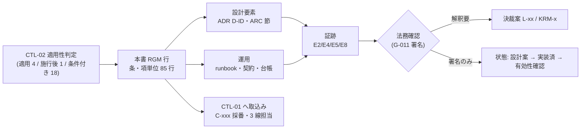
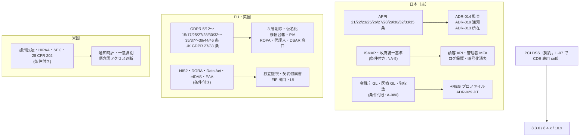

# 統制マッピング: 日本・EU/英国・米国・業界規制

> 文書ID: CTL-06 / 版: 0.2 / 状態: draft / 最終更新: 2026-10-15
> 対応要求: R-025, R-026, R-165, R-214, R-228, R-229, R-233, R-236, R-237, R-241, R-243, R-247, R-278, G-012（R-requirements.md・G-goal-criteria.md の対応成果物欄に DL-28 または 06_controls/control-mapping-ledger.md を含む全 14 行。本書のパス 06_controls/mappings/regulations.md を含む行は 0 件。末尾の対応表）。関連: R-010, R-024, R-248, G-011, G-054, G-094, G-139
> 依存文書: CONVENTIONS.md, traceability/deliverables.md（DL-28 行）, 06_controls/applicability.md（CTL-02。適用判定の正本）, 04_architecture/audit-privacy.md（ARC-10）, 05_adr/README.md, 05_adr/ADR-002, ADR-003, ADR-004, ADR-007, ADR-011, ADR-012, ADR-013, ADR-014, ADR-018, ADR-019, ADR-020, ADR-028, ADR-029, 05_adr/reconciliation-notes.md, 01_governance/assumptions-register.md, 01_governance/loss-scenarios.md, 01_governance/kri.md, 02_requirements/operation-risk-tiers-assurance.md, 02_requirements/customer-admin-responsibility.md, research/RS-02-regulatory-applicability.md, research/RS-10-audit-privacy-residency.md, research/standards-status.md, traceability/seed/seed-01-ciso-assurance.md（§4 の 17 列）
> 作成方法: AI エージェント（Claude）が、CTL-02 で「適用」「適用（施行後）」「条件付き」と判定された法令・規制ごとに、条・項の要求を RS-02・RS-10 の検証済み項目から拾い、ADR-001〜ADR-029 と ARC-10 の設計要素に写した。版 0.1 では新しい原典を取得していない。版 0.2 では、模擬パネル（ラウンド 1）の指摘に応じ、GDPR・UK GDPR・個人情報保護法の条文を起草者が原典で取得・確認し（脚注 1・45・46）、RGM-75〜RGM-85 を加えた。模擬パネルは自己レビューであり、実在の CTO/CISO の決裁ではない。写像と状態の判定も自己レビューであり、実在の法務・CISO の確認ではない（CONVENTIONS §8）[D]。
> 表記: 本書の写像行は RGM-xx、本書の決裁案は KRM-x と書く。統制 ID（C-xxx）の採番は CTL-01（control-mapping-ledger.md）が行い、本書の RGM 行はその入力になる [D]。表のセルでタグのないものは設計推論 [D] であり、「要求」列だけは原典の強度を写した [N] である（行ごとの原典は「根拠」列の脚注と RS 項目）。

---

## 0. 結論

1. **CTL-02 で適用・適用（施行後）・条件付きとした 23 の法令・規制（Q&A・ガイドライン等の解釈資料は親の法令に含めて数えた）から 85 の条項単位の要求を拾い、全行に設計要素・運用・証跡のいずれかを割り当てた。直接適用の要求で統制のないものは、確認した条項の範囲で 0 件である。確認していない条項は §5.1 に列挙した** [D]。版 0.1 は、直接適用の法令の透明性・説明責任の条項（GDPR 12 条 3 項・13・14・27・28 条 2 項・4 項・30・37〜39 条、UK GDPR 27 条、個人情報保護法 21・29・30・32・33 条）を判定も写像もしないまま「0 件」と書いており、過大な主張だった [D]。版 0.2 で原典を確認し、RGM-75〜RGM-85 の 11 行を加えた [D][^1][^45][^46]。追加した 11 行のうち 8 行は設計要素を持たず、運用（台帳・公表文・通知文・窓口・代理人の指定・DPO 選任の判定）だけで受ける [D]。条件付きのうち 4 行（RGM-19・25・40・52）は条項の特定や前提の確定を待っており、設計要素をまだ持たない [D]。写した設計要素はすべて ADR 状態 proposed（決裁前）の案である [D]（05_adr/README §3.1）。このため、G-012 の健全性ルールのうち「統制のない適用要求 0 件」は**確認した条項の範囲で、設計上の写像として**満たしているだけであり、統制の有効性（運用・実測）はまだ示せていない [D]。直接適用の 4 法令（個人情報保護法、GDPR、UK GDPR、障害者差別解消法）の 33 行のうち、法務の解釈が残る行は 19 行ある（§2.6）[D]。
2. **多くの規制要求は、少数の共通の設計要素に集まる** [D]。全 85 行の約 78% にあたる 66 行が、次の 6 つのどれかで受けられる（§2.7）[D]。ただし、版 0.2 で加えた透明性・説明責任の 11 行のうち共通要素で受けるのは 2 行だけであり、残りは規制プロファイルではなく台帳・公表文・窓口の運用で受ける [D]（§2.7 から集計）。(a) ADR-014 の 100% 監査と 4 層の改ざん検知、(b) ADR-013 の法域パーティション×規制スコープの cell と、所在地の 3 点固定（保存国・運用者のアクセス元・鍵の所在）、(c) ADR-002 の保証レベル割当と規制プロファイル（+REG）の上乗せ、(d) ADR-019 の 4 時刻記録と、顧客への通知を最初の期限として扱う方針、(e) ADR-029 の常設特権なしと事業者アクセスの開示、(f) ADR-014・ADR-028 の 3 層削除。規制ごとに別の統制を作らず、これらを「規制プロファイル」（テナント単位の設定値）で強めるのが本書の写像方針である [D]（CTL-02 §0-2 から導出）。
3. **残る問題は「値」と「解釈」であり、構造ではない** [D]。保持期間（L-03）、顧客通知の社内目標時間（L-06）、PCI DSS v4.0.1 本文の未取得（DS-12）、crypto-shredding の法的評価（L-05）、英国データの EU 収容（L-11）が、写像の状態を「設計案」から先へ進めるのを止めている [D]。本書が新たに求める経営判断は 3 件である（KRM-1: 証跡所有者と 3 線の割当、KRM-2: 条件付き規制の機能を先に作るか契約時に作るか、KRM-3: 法域ごとの外部法律意見の取得範囲。§6）[D]。

---

## 1. 範囲と読み方

### 1.1 範囲

- 対象は、CTL-02 §2 で「適用」「適用（施行後）」「条件付き」と判定した法令・規制・業界基準である [D]。「非適用」「監視」「判定保留」の項目は §5 に扱いを示し、条項の写像は行わない [D]。
- NIST CSF 2.0、ISO/IEC 27001、SP 800-63-4、ASVS、SSDF、SLSA、CCM、SOC 2 TSC、FAPI 2.0 などの**枠組み**への写像は本書の範囲外であり、CTL-01（DL-28 の本体）が担う [D]。ただし規制が枠組みの採用を求める場合（例: DORA 9 条 4 項 (d) の「関連標準に基づく強い認証」）は、その接点を本書に書く [D]。
- 本書は法的助言ではない [D]。条項の要旨は RS-02・RS-10 が原典で検証した範囲に限り、検証範囲を超える条項は「未確認」と書く [D]。

### 1.2 列の意味

| 列 | 意味 | seed-01 §4.2 の列 |
|---|---|---|
| ID | 本書の写像行（RGM-xx） | 1（R-ID に相当する外部要求側の ID） |
| 条項 | 法令・規制の条・項・号、または項目番号 | 2・5 |
| 要求（強度） | 原典の要求と強度（shall／しなければならない／努める 等） | 5 |
| 設計要素 | 要求を受ける ADR の決定（D-ID）と設計文書の節 | 4 |
| 運用 | 手順・契約・台帳・体制 | 4 |
| 証跡 | 証拠種別（E1〜E11）と具体物 | 11 |
| 関係 | 要求と設計要素の関係（等価／部分集合／上位集合／交差。NIST OLIR の区分） | 6 |
| 状態 | 設計案（設計要素が ADR proposed にある）／一部設計（要素の一部が未決）／未設計 | 13 |
| 法務 | 要（解釈が残る）／署名（G-011 の判定表署名で足りる） | — |

- 「関係」は、設計要素が要求より広い場合を「上位集合」、要求の一部だけを満たす場合を「部分集合」、重なるが互いに含まない場合を「交差」とする [D]。部分集合の行は残りを誰が満たすかを「運用」列に書く [D]。
- 試験手順は ADR §7 の仮番（TC-014-xx 等）を引き、採番は DL-22 で行う [D]。仮番がない行は「TC 未採番」と書く [D]。

---

## 2. 条項別の写像

### 2.1 日本（直接適用）

| ID | 法令・条項 | 要求（強度） | 設計要素 | 運用 | 証跡 | 関係 | 状態 | 法務 |
|---|---|---|---|---|---|---|---|---|
| RGM-01 | 個人情報保護法 23 条（安全管理措置）、通則編 GL 10（技術的安全管理措置） | 識別した結果に基づき認証「しなければならない」。手法の例示は ID・パスワード・IC カード等で MFA の明示要求はない [N][^1][^3]（RS-02#7） | ADR-002 D2-03（人間の主体の AAL の床を AAL2）、ADR-011（既定拒否・評価不能は deny）、ADR-012（PEP coverage の機械検証） | 規制フロアは CTL-02 §4 の既定値 | E2（REQ-03 割当表）、E4（負例試験。TC 未採番） | 上位集合 | 設計案 | 署名 |
| RGM-02 | 同 23 条、通則編 GL 10（組織的安全管理措置 (2)(3)） | 個人データの取扱状況を確認する手段を整備しなければならない。例示にログイン実績・アクセスログ [N][^3]（RS-10#64） | ADR-014 D14-14・D14-15（E1〜E9 を 100% 記録）、ARC-10 §4.2（E3・E7） | 運用者による個人データ参照に purpose_code を必須（D14-11） | E4（TC-014-01〜TC-014-05）、E5（記録率の実測） | 上位集合 | 設計案 | 署名 |
| RGM-03 | 同 22 条 | 利用する必要がなくなった個人データを遅滞なく消去するよう努める（努力義務）[N][^1]（RS-10#63） | ADR-014 D14-43・D14-50（3 層と期間消去）、ADR-028（論理削除→鍵破棄→消去完了の 3 段） | 保持上限は L-03 | E2（保持表）、E4（消去の自動試験。TC 未採番） | 上位集合 | 一部設計（期間は L-03） | 要（L-03） |
| RGM-04 | 同 25 条（委託先の監督） | 委託元は委託先を必要かつ適切に監督しなければならない [N][^1]（RS-02#10） | ADR-014 D14-52〜D14-56（顧客監査 API）、ADR-029 D29-36（事業者アクセスを顧客 API に開示） | 当社が委託先として監督に要る情報（監査報告・運用者アクセス記録）を出す。再委託先（クラウド・SOC）を当社が監督する台帳（R-278） | E2（再委託先台帳）、E6（第三者報告書。範囲は L-10） | 交差 | 一部設計（台帳は未作成） | 署名 |
| RGM-05 | 同 26 条 1 項、施行規則 7〜10 条 | 委託先は委託元へ通知すれば委員会への報告を要しない。速報は速やかに（目安概ね 3〜5 日）、確報は 30 日（不正目的は 60 日）[N][^2][^3]（RS-02#1, #4, #5） | ADR-019 D19-30（4 時刻と「知った」時刻の記録）、D19-31（顧客通知を最初の期限）、D19-32（影響範囲照会） | OPS-01 の通知時計（CTL-02 H-O02）。社内目標時間は TBD（L-06） | E8（演習記録。H-O07）、E2（runbook） | 部分集合（期限の値は L-06） | 一部設計 | 要（L-02 の立場） |
| RGM-06 | 同 27 条 1 項・28 条、外国移転編 GL、通則編 GL 10-7 | 外国にある第三者への提供は本人同意・基準適合体制・同等水準国のいずれかによる。外国で扱うなら外的環境を把握して安全管理措置を講じなければならない [N][^1][^3][^4]（RS-02#8, #9, RS-10#68） | ADR-013 D13-02（第 1 段を法域パーティション、データ・鍵・運用アクセスを共有しない）、ADR-014 D14-38〜D14-40、ARC-10 §9.2 AP-40 | cell ごとに保存国と運用者のアクセス元の国を記録する台帳 | E2（所在台帳）、E10（cell 配置の IaC スナップショット） | 上位集合 | 設計案 | 要（L-04） |
| RGM-07 | 個人情報保護委員会 Q&A（A7-53、A10-25、A12-3、A12-4） | 外国事業者のクラウドを使う場合は事業者の所在国名とサーバ所在国名を本人の知り得る状態に置く [N][^5]（RS-10#69） | ARC-10 §9.1（監査データの保存国と複写先を契約に明示） | 公開情報の版管理（所在国・事業者名） | E2（公表文と版履歴） | 等価 | 設計案 | 署名 |
| RGM-08 | 同 35 条 5 項 | 本人は所定の場合に利用停止等を請求できる [N][^1]（RS-10#66） | ADR-014 D14-46〜D14-48（消去請求の処理と完了時刻）、ARC-10 §11.2 | B2B は顧客（委託元）の指示経由（DL-26） | E4（請求処理の試験。TC 未採番）、E2（請求記録） | 上位集合 | 設計案 | 署名 |
| RGM-09 | 2026 年改正（26 条 2 項の本人通知緩和、委託先義務の見直し、課徴金ほか） | 公布済未施行。政令・規則は未確定 [N][^6][^7]（RS-02#11〜#14） | 規制プロファイルの設定値として追跡（ADR-002 D2-29 の構造） | §8 の監視（CTL-02 §8.2） | E2（DL-84 の行） | — | 未設計（施行待ち） | 要 |
| RGM-10 | 障害者差別解消法 8 条 2 項、5 条 | 事業者は、意思の表明があり負担が過重でないとき、必要かつ合理的な配慮を「しなければならない」。環境の整備は努力義務 [N][^8] | ADR-003（回復の代替経路）、ADR-002 D2-10（PR の選択肢を複数提供）、G-149 の代替経路と保証レベル | 合理的配慮の申出窓口と、代替経路の保証レベル決定（G-060） | E2（適合目標 L-12）、E5（利用者試験） | 部分集合（窓口運用は事業側） | 一部設計 | 要（L-12） |
| RGM-75 | 個人情報保護法 21 条 1〜3 項（B2C・従業員で当社が取扱事業者の場合。版 0.2 で追加） | 個人情報を取得した場合は、あらかじめ利用目的を公表している場合を除き、速やかに利用目的を本人に通知し、又は公表しなければならない。本人から直接書面（電磁的記録を含む）に記載された個人情報を取得する場合は、あらかじめ利用目的を明示しなければならない。変更した利用目的も通知又は公表しなければならない（4 項の適用除外あり）[N][^1] | 設計要素なし。オンライン登録は本人から電磁的記録で直接取得する場合に当たり得るため、登録・同意画面（G-149 の UI）に利用目的の明示欄を置く案 [D]（ADR はない） | 利用目的の公表文（プライバシーポリシー）と版管理。B2B テナントの利用者は委託元（顧客）が通知・公表する（DL-26） | E2（公表文と版履歴、登録画面の表示記録） | — | 未設計（公表文未作成） | 署名 |
| RGM-76 | 同 29 条・30 条（第三者提供の記録、提供を受ける際の確認。版 0.2 で追加） | 個人データを第三者に提供したときは、規則で定めるところにより提供年月日・第三者の氏名又は名称等の記録を作成し、規則で定める期間保存しなければならない。第三者から提供を受けるに際しては、第三者の氏名又は名称・住所・代表者と取得の経緯を確認し、記録を作成・保存しなければならない。27 条 1 項各号・5 項各号に当たる提供は除く [N][^1] | 設計要素なし。B2B の利用者情報は、委託に伴う提供（27 条 5 項 1 号）として当社は第三者に当たらない [N][^1]。効くのは B2C・従業員で、外部 IdP からの属性の受領や当社以外の RP への属性の提供が第三者提供に当たる場合に限られる [D]。ADR-014 D14-14 の federation の記録を、この記録の素材にできるかは未判定 [D] | 第三者提供・受領の台帳（相手方、年月日、項目）。記録の項目と保存期間は施行規則で未確認（§5.1） | E2（台帳） | — | 未設計（該当性の判定待ち） | 要（該当性・規則の確認） |
| RGM-77 | 同 32 条 1〜3 項（保有個人データに関する事項の公表等。版 0.2 で追加） | 保有個人データに関し、事業者の名称・住所・代表者、全ての保有個人データの利用目的、求め・請求に応じる手続（手数料を含む）、政令で定める事項を、本人の知り得る状態（求めに応じて遅滞なく回答する場合を含む）に置かなければならない。利用目的の通知を求められたときは遅滞なく通知しなければならない [N][^1] | 設計要素なし | 公表事項の公表文と版管理、利用目的の通知の求めへの回答手順。政令で定める事項の範囲は施行令で未確認（§5.1） | E2（公表文、回答記録） | — | 未設計（公表文未作成） | 署名 |
| RGM-78 | 同 33 条 1〜3 項・5 項（開示請求。版 0.2 で追加） | 本人は電磁的記録の提供による方法等による開示を請求できる。事業者は請求された方法（困難な場合は書面の交付）で遅滞なく開示しなければならない（同条 2 項 1〜3 号の不開示事由あり）。不開示・不存在等の場合は遅滞なく通知しなければならない。29 条 1 項・30 条 3 項の記録（第三者提供記録）にも準用する [N][^1] | ADR-014 D14-51・D14-56（主体単位の照会履歴の抽出）。主体の保有個人データ全体を電磁的に抽出する設計要素はない [D] | 開示請求の窓口（受付、本人確認、期限管理）。B2B は委託元経由（DL-26） | E2（請求記録）、E4（抽出の試験。TC 未採番） | 部分集合（主体データ全体の抽出は未設計） | 一部設計 | 署名 |

- RGM-75〜RGM-78 は、B2C・従業員について当社が個人情報取扱事業者になる（CTL-02 J-01 の判定）ことから生じる [D]。B2B テナントの利用者については当社は委託先であり、これらの義務は委託元が負い、当社は委託元の対応を支援する（RGM-04・RGM-08 と同じ経路）[D][NA-2]。
- RGM-03 と RGM-08 は、ADR-014 の W 層（仮名・暗号文・ハッシュ）に残るものが「消去」に当たるかという同じ論点を持つ [D]。法的評価は L-05 の 1 件にまとめる [D]。

### 2.2 日本（条件付き: 政府調達・重要インフラ・業界規制）

| ID | 法令・条項（CTL-02 判定） | 要求（強度） | 設計要素 | 運用 | 証跡 | 関係 | 状態 | 法務 |
|---|---|---|---|---|---|---|---|---|
| RGM-11 | ISMAP 管理基準（J-03）管理者認証の項目（.PB・.B。項番は CTL-02 脚注の 9.2.3.11.PB・9.4.2.2.B の範囲で照合要） | 利用者の管理者認証に十分に強固な認証技術（例: MFA）を提供する。強い認証が要る場合はパスワードに代えて暗号による手段等 [N][^9]（RS-02#16） | ADR-002 D2-05・D2-09（privileged の PR 必須）、D2-17（顧客管理者の最上位保護操作の束縛認証器） | — | E2、E4（TC-002 系。仮番） | 上位集合 | 設計案 | 署名（項番照合） |
| RGM-12 | ISMAP 12.4.1.15.PB | 利用者にログ取得機能を提供する [N][^9]（RS-02#17） | ADR-014 D14-52〜D14-55（顧客監査 API）、ARC-10 §12 | 顧客 API の既定保持（DL-26 決裁案 4） | E4（API 契約試験） | 等価 | 設計案 | 署名 |
| RGM-13 | ISMAP 12.4.2、12.4.3 | ログを改ざん・無権限アクセスから保護する。実務管理者・運用担当者の作業を記録し定期レビューする [N][^9]（RS-02#17） | ADR-014 D14-29（4 層の改ざん検知）、D14-41（閲覧統制）、ADR-029 D29-60〜D29-63（特権記録） | E7 の定期レビュー（第 2 線） | E4（改ざん検知試験）、E2（レビュー記録） | 上位集合 | 設計案 | 署名 |
| RGM-14 | ISMAP 1.3.14 | 消去の方法に暗号化消去を含める [N][^9]（RS-02#18） | ADR-014 D14-45・D14-48（主体 DEK と完了時刻）、ADR-028 | crypto-shredding は補完手段（L-05） | E4、E2（消去証跡。SP 800-88r2 §3.2.5 の項目） | 等価 | 設計案 | 署名 |
| RGM-15 | ISMAP 15.1.1.16.B | 国内法以外の法令が適用されるリスクを評価し、必要に応じ取扱場所と準拠法・裁判管轄を指定する [N][^9]（RS-02#19） | ADR-013 D13-02・D13-03（法域パーティション、規制スコープ cell） | 再委託先の所在国・準拠法の台帳 | E2（台帳） | 交差 | 一部設計（台帳未作成） | 要（NA-5） |
| RGM-16 | 政府統一基準（J-05）7.1.1・7.1.3（主体認証・アクセス制御・権限管理。項の割当は照合要） | 主体認証機能を設ける、権限を必要最小限にする、管理者の認証情報窃取時の被害最小化策を講じる（遵守事項）[N][^10]（RS-02#22） | ADR-029 D29-02（常設特権なし）、D29-23〜D29-25（申請者≠承認者、AAL3 相当の再認証、失効）、ADR-008（管理面の単一経路） | — | E2、E4（TC 未採番） | 上位集合 | 設計案 | 署名（項番照合） |
| RGM-17 | 政府統一基準 7.1.4 | ログの取得目的・対象機器・取得項目・保存期間・取扱方法を定める（具体値なし）[N][^10]（RS-02#23） | ADR-014 D14-36（記録区分×規制プロファイル）、ARC-10 §8.2 | 保存期間はテナント設定（L-10 の判断時） | E2（ログ管理規程） | 等価 | 一部設計（値は TBD） | 署名 |
| RGM-18 | サイバー対処能力強化法（J-07）報告制度（制度の解説 5-5・6-1・6-2） | 特別社会基盤事業者は特定侵害事象を報告する。速報 3〜5 日、詳報 30 日（顧客が当たる場合は顧客の義務）[N][^11]（RS-02#29〜#31） | ADR-019 D19-30・D19-32（4 時刻、影響範囲照会）、D19-25（保全対象） | 顧客の報告様式に要る技術情報の提供手順（CTL-02 H-O04）。当社自身の指定（NA-6）は法務 | E8（演習）、E2（契約付属書） | 部分集合（顧客側の報告は顧客） | 一部設計 | 要（NA-6） |
| RGM-19 | 重要インフラ統一基準（J-08） | 所管省庁の安全基準等・業法を通じて顧客に及ぶ。当社への直接の法的拘束力の経路は未確認 [N][^12]（RS-02#32） | 条項が特定できないため設計要素を割り当てない。RGM-18・RGM-20 で受ける | 顧客の安全基準等を受入時に確認 | — | — | 未設計（条項未特定） | 要 |
| RGM-20 | 金融庁 GL（JF-01）基本的な対応事項（2.3.x。項番の対応は照合要） | 特権アカウントの厳格な管理（MFA、ダブルチェック、時間制限等）、重要システムへのリモートアクセスに MFA、SSO・外部認証連携の機密性・完全性・真正性の確保 [N][^13]（RS-02#34, #35） | ADR-002 D2-29（JP-金融の上乗せ）、ADR-029 D29-11〜D29-25（JIT・二者・時間上限）、ADR-004（federation の署名・audience 検証） | — | E4（TC-002・TC-004 系。仮番） | 上位集合 | 設計案 | 署名（項番照合） |
| RGM-21 | 金融庁 GL（同） | アクセスしたユーザを特定できる措置、処理内容のログ記録、操作内容との対応付け [N][^13]（RS-02#34） | ADR-014 D14-18（相関 8 欄）、ARC-10 §4.2（actor.act_chain） | — | E4（TC-014 系） | 上位集合 | 設計案 | 署名 |
| RGM-22 | 金融庁 GL（同） | 外部委託先によるアクセス権の利用を適切に管理する [N][^13]（RS-02#34） | ADR-029 D29-20〜D29-36（support の 5 段階、顧客承認、開示） | — | E2、E4 | 上位集合 | 設計案 | 署名 |
| RGM-23 | 犯収法施行規則 6 条 1 項 1 号の改正（JF-03。2027-04-01 施行） | なりすまし等のリスクの高い本人特定事項の確認方法を廃止し、対面の確認方法も改める [N][^14][^15]（RS-02#41, #42） | 本人確認を差し替えられるモジュール（CTL-02 §3.1）、ADR-002・ADR-003 | 方式名・確認日時・確認記録の保存 | E2、E4（方式の切替試験。TC 未採番） | 部分集合（号ごとの対応は未確認） | 一部設計 | 要（号の対応） |
| RGM-24 | 医療 GL 第 7.0 版（JM-01）概要 1〜3、保守委託機関編 | クライアント端末とサーバで二要素認証。保守委託機関編は令和 9 年度までに二要素を採用 [N][^16][^17]（RS-02#37, #38） | ADR-002 D2-29（JP-医療の上乗せ）、D2-32（本基盤側では緩和措置を使わない） | 顧客側システムの改修計画は顧客責任（DL-26） | E4 | 上位集合 | 設計案 | 署名 |
| RGM-25 | 医療 GL 保守委託機関編（委託先選定） | 委託先選定で P マーク・ISMS をまず確認し、無い場合は ISMAP・SOC2／SOC3 等で能力を確認する [N][^17]（RS-02#39） | 設計要素ではなく第三者認証の取得範囲（L-10） | ISMS 認証の取得計画（DL-07） | E6（認証書・報告書） | — | 未設計（L-10 待ち） | 署名 |
| RGM-26 | 医療 GL（同）、A-071 | 要配慮個人情報の混入時の保護 | ADR-007（属性暗号化と鍵分離）、ADR-014 D14-45（保護欄の暗号化）、ADR-002 D2-29（要配慮情報の読取は全件記録） | 医療テナントの規制プロファイル | E4 | 交差 | 設計案 | 署名 |

### 2.3 EU・英国

| ID | 法令・条項（CTL-02 判定） | 要求（強度） | 設計要素 | 運用 | 証跡 | 関係 | 状態 | 法務 |
|---|---|---|---|---|---|---|---|---|
| RGM-27 | GDPR 5 条 1 項 (e)（E-01 適用） | 識別できる形での保存は目的に必要な期間を超えない [N][^18]（RS-10#50） | ADR-014 D14-31・D14-36・D14-50（下限で WORM を固定し、上限は K 層の削除で実現） | 保持表（記録区分 RC-A〜RC-E × 規制プロファイル） | E2（保持表）、E4（期間消去の試験） | 等価 | 一部設計（値は L-03） | 要（L-03） |
| RGM-28 | GDPR 17 条 1 項・3 項 (b)(e) | 不要になった個人データ等を不当な遅滞なく消去する。法的義務・法的請求に必要な範囲では適用しない [N][^18]（RS-10#49） | ADR-014 D14-43〜D14-48、ARC-10 §11 | 例外判定は法務（ARC-10 §11.2 の図） | E4、E2（請求記録と例外判定） | 等価 | 設計案 | 要（L-05） |
| RGM-29 | GDPR 25 条 1 項 | 処理の手段の決定時と処理時に、データ保護原則を実装する適切な技術的・組織的措置（例: 仮名化）を実施する（shall）[N][^19]（RS-02#43） | ADR-014 D14-09・D14-44（欄の区分と仮名 ID）、D14-04（trace に識別子を載せない）、D14-10（記録しないもの） | ARC-10 §14 の PIA | E2（PIA）、E4（スキーマ検査） | 上位集合 | 設計案 | 署名 |
| RGM-30 | GDPR 28 条 3 項（処理者契約: (e) 権利対応の支援、(f) 32〜36 条の遵守の支援、(g) 役務終了後の削除・返却、監査への協力） | 管理者と処理者の契約にこれらを定める（shall stipulate）[N][^18]（RS-14 §2-12。(e)(f)(g) は ARC-10 の起草者が原典で確認） | ADR-028（解約時 export・削除）、ADR-018（EIF）、ADR-014 D14-49、ARC-10 §14（PIA 要約の提供） | DPA 様式（DL-26）。監査受入の手順 | E2（DPA 様式） | 交差（契約は法務） | 一部設計（DPA 未作成） | 要 |
| RGM-31 | GDPR 32 条 1 項 | リスクに見合ったセキュリティ水準を確保する適切な技術的・組織的措置（仮名化・暗号化、継続的な機密性・完全性・可用性・回復性）を実施する（shall）[N][^19]（RS-02#44） | ADR-007（鍵階層）、ADR-013（cell と fail-mode）、ADR-011・ADR-012（PEP/PDP）、ADR-014 D14-45 | CTL-01 の枠組み写像（ISO/IEC 27001 等）で網羅を確認 | E4、E5、E6 | 交差（範囲が広い） | 設計案 | 署名 |
| RGM-32 | GDPR 33 条 1 項・2 項 | 管理者は原則 72 時間以内に監督機関へ通知。処理者は管理者へ不当な遅延なく通知（shall）[N][^19]（RS-02#45） | ADR-019 D19-30・D19-31 | OPS-01 の通知時計。DPO の判断 | E8、E2 | 部分集合（社内目標時間は L-06） | 一部設計 | 要（L-02） |
| RGM-33 | GDPR 34 条 1 項・3 項 (a) | 高リスクの侵害は本人へ通知。暗号化等で判読不能なら不要 [N][^19]（RS-02#46） | ADR-014 D14-45（保護欄の暗号化）、CTL-02 H-A10（鍵が漏えいしていない証跡） | 本人通知の免除判断（CTL-02 H-O05） | E2（鍵アクセスログの照会結果） | 部分集合 | 一部設計 | 要 |
| RGM-34 | GDPR 35 条、28 条 3 項 (f) | DPIA（管理者の義務）。処理者は管理者を支援する [N][^18]（ARC-10 §14.1。起草者が原典で確認） | ARC-10 §14（PIA を記入済み、承認は未了） | 顧客へ PIA 要約を提供。承認者は KAP-2 | E2（承認済み PIA） | 等価 | 一部設計（承認未了） | 要（KAP-2） |
| RGM-35 | GDPR 44 条・46 条 1 項、EDPB Guidelines 05/2021 | 第三国移転は Chapter V の条件を満たす場合に限る。十分性認定がなければ適切な保護措置。第三国からの画面表示だけの遠隔アクセスも 3 要件を満たせば移転 [N][^18][^20]（RS-02#47, RS-10#70〜#73） | ADR-013 D13-02、ADR-014 D14-38〜D14-40（越境参照は構造欄・仮名欄だけ）、ARC-10 AP-40 | 移転根拠の台帳（十分性・SCC）。法域外 SOC の方式は KAP-3 | E2（台帳）、E4（越境参照の遮断試験。TC 未採番） | 上位集合 | 一部設計（KAP-3） | 要（L-04） |
| RGM-36 | GDPR 15 条、CJEU C-579/21 Pankki S | 本人データへの照会操作の日時と目的は、本人がアクセス権で得られる情報 [N][^21]（RS-10#60） | ADR-014 D14-11（目的欄）、D14-51・D14-56（照会履歴の抽出） | 照会者の身元は原則として含めない | E4 | 等価 | 設計案 | 署名 |
| RGM-37 | EU-US DPF 十分性認定（E-02 条件付き） | DPF 参加組織への移転だけ依拠できる。上訴 C-703/25 P 係属、EDPB が精査を要請 [N][^22][^23]（RS-10#74〜#76） | DPF に依存しない SCC への切替手順（CTL-02 L-04、ARC-10 §9.2） | 切替手順の演習 | E2、E8 | 部分集合 | 一部設計 | 要（L-04） |
| RGM-38 | UK GDPR 33 条（E-03 適用） | 72 時間以内に情報委員会へ。2026-09-30 以降の宛先は Information Commission [N][^24]（RS-02#50） | ADR-019 D19-30・D19-31 | 宛先・様式の追跡（CTL-02 H-O08） | E2、E8 | 部分集合 | 一部設計 | 署名 |
| RGM-39 | UK GDPR（英国データの EU 収容。A-063） | 英国から EU への移転規律は未確認（CTL-02 §6.1） | ADR-013（英国を EU パーティションに収容する前提）、ADR-007（L1 は法域別） | — | — | — | 未設計（L-11 待ち） | 要（L-11） |
| RGM-79 | GDPR 27 条 1〜3 項（E-01。NA-1 で場合分け。版 0.2 で追加） | 3 条 2 項が適用される場合、管理者又は処理者は域内の代理人を書面で指定しなければならない（shall）。時折の処理で特別カテゴリ等の大規模処理を含まずリスクが低い場合と、公的機関・団体は除く。代理人はデータ主体がいる加盟国のいずれかに置く [N][^45] | 設計要素なし | NA-1 による場合分け [D][NA-1]: (i) EU に拠点を置き 3 条 1 項で適用される場合、27 条は効かない。(ii) 拠点を置かず 3 条 2 項で適用される場合（CTL-02 E-01 は少なくともこの場合に当たると判定）、認証は継続的な処理であり「時折」の例外に当たらない見込みのため、代理人を書面で指定する。代理人は 13 条・14 条の情報と 30 条の記録に載る [N][^45] | E2（指定書面、公表文） | — | 未設計（NA-1 待ち） | 要（L-02） |
| RGM-80 | UK GDPR 27 条 1 項・2 項（E-03。NA-1 で場合分け。版 0.2 で追加） | 3 条 2 項が適用される場合、管理者又は処理者は英国内の代理人を書面で指定しなければならない。例外は GDPR 27 条 2 項と同じ文言 [N][^46] | 設計要素なし | 英国に拠点を置かない場合は、EU の代理人とは別に英国の代理人を指定する [D][NA-1]。UK GDPR 3 条の本文は本書では確認していない（§5.1） | E2（指定書面） | — | 未設計（NA-1 待ち） | 要（L-02、L-11） |
| RGM-81 | GDPR 30 条 1〜5 項（処理活動の記録。版 0.2 で追加） | 管理者は、管理者・代理人・DPO の名称と連絡先、目的、データ主体と個人データの種類、受領者、第三国移転と保護措置、可能なら消去期限と 32 条 1 項の措置の概要を含む記録を保持する（shall）。処理者は、管理者ごとの処理の種類、移転、措置の概要を含む記録を保持する。記録は書面（電子を含む）で、監督機関の求めに応じて提供する。250 人未満の企業等の例外は、処理が時折でない場合等には効かない [N][^45] | ADR-014 D14-36（記録区分×規制プロファイル）を消去期限の入力に、ADR-013 D13-01（明示の配置表）を移転の入力に使う [D] | ROPA 台帳を 2 系統で持つ: 管理者として（B2C・従業員）と処理者として（B2B テナントごと）。認証は継続的な処理であり、5 項の例外には当たらない見込み [D] | E2（ROPA 台帳と版履歴） | 部分集合（台帳は運用） | 一部設計（台帳未作成） | 署名 |
| RGM-82 | GDPR 28 条 2 項・4 項（処理者としての再処理者。版 0.2 で追加） | 処理者は、管理者の事前の個別又は一般の書面承認なしに他の処理者を使ってはならない。一般承認の場合は、追加・交代の予定を管理者に知らせ、異議の機会を与える。再処理者には 28 条 3 項の契約と同じ義務を契約等で課し、再処理者が義務を果たさない場合は当初の処理者が管理者に対して全面的に責任を負う [N][^45] | 設計要素なし（RGM-04 の再委託先台帳と同じ台帳を使う） | 再処理者台帳（クラウド、SOC、support 委託先等。所在国・処理内容）、追加・交代の事前通知と異議受付の手順、再処理者契約への義務の承継（DPA 様式、DL-26）。R-278 の供給者台帳と統合する | E2（台帳、通知記録、再処理者契約） | — | 未設計（台帳・手順未作成） | 要（DPA 様式） |
| RGM-83 | GDPR 12 条 3 項・4 項、28 条 3 項 (e)（権利行使への回答期限。版 0.2 で追加） | 管理者は 15〜22 条の請求への対応に関する情報を、不当な遅滞なく、遅くとも受領から 1 か月以内に提供する。複雑さと件数により 2 か月延長でき、延長は受領から 1 か月以内に理由とともに知らせる。対応しない場合も 1 か月以内に理由を知らせる。処理者は権利対応で管理者を支援する [N][^45][^18] | ADR-014 D14-46〜D14-48（消去請求の処理と完了時刻）、D14-51・D14-56（照会履歴の抽出） | DSAR 窓口と期限管理（受領時刻の記録、1 か月の期限の警報、延長の通知）。B2B では顧客の 1 か月の期限の内側に当社の支援期限を置く（値は TBD。所有者: 法務責任者、期限: G3、決め方: 顧客の処理日数を差し引いた逆算）[D] | E2（請求記録と期限遵守率）、E4（TC 未採番） | 部分集合（窓口は運用） | 一部設計 | 署名 |
| RGM-84 | GDPR 13 条 1 項・2 項、14 条 1〜3 項（情報提供。版 0.2 で追加） | 本人から取得する場合は取得時に、管理者と代理人の身元・連絡先、DPO の連絡先、目的と法的根拠、受領者、第三国移転、保存期間（又はその基準）、権利、苦情申立権等を提供する。本人以外から取得した場合は、同様の情報と取得元を、合理的な期間内（遅くとも 1 か月以内）等に提供する [N][^45] | 設計要素なし。登録画面（G-149）と、外部 IdP 連携（B2C のソーシャルログイン等）の初回ログインで通知を示す案 [D] | EU・英国向けのプライバシー通知と版管理。法的根拠（6 条）の特定は法務（6 条の本文は §5.1 で未確認） | E2（通知文と版履歴、表示記録） | — | 未設計（通知文未作成） | 要（法的根拠） |
| RGM-85 | GDPR 37 条 1 項・7 項、38 条、39 条（DPO の選任義務の判定。版 0.2 で追加） | 公的機関、中核的活動が大規模な定期的・系統的監視、中核的活動が特別カテゴリ等の大規模処理、のいずれかに当たる場合、管理者と処理者は DPO を選任する（shall）。選任した場合は連絡先を公表し、監督機関へ通知する。DPO は適時の関与を確保され、任務について指示を受けず、最上位の経営層に直接報告する [N][^45] | 設計要素なし | 選任義務の判定記録: 当社の中核的活動にあたる認証・監査記録が「大規模な定期的・系統的監視」に当たるか、医療テナントの要配慮情報の処理が「特別カテゴリの大規模処理」に当たるか [D]。ARC-10（§14 ほか）と CTL-02（§3.7、L-02、L-05）は当社の DPO の存在を前提にしているため、義務がない場合に任意で選任するか、役割名を改めるかも決める [D] | E2（判定記録、選任と通知の記録） | — | 未設計（判定未了） | 要（L-02） |
| RGM-40 | NIS2 20 条 1 項（E-04 条件付き） | 対象主体の経営機関がリスク管理措置を承認・監督する [N][^25]（RS-01#64） | 統治（GOV 文書）。設計要素なし | 取締役会報告（R-236） | E1 | — | 未設計（NA-1・NA-6 待ち） | 要 |
| RGM-41 | NIS2 21 条 2 項 (i)(j) | アクセス制御方針、MFA または継続的認証を where appropriate で用いる [N][^25]（RS-02#52） | ADR-002 D2-03・D2-09、ADR-006（継続評価） | — | E2、E4 | 上位集合 | 設計案 | 署名 |
| RGM-42 | NIS2 23 条 4 項 | 早期警報 24 時間、通知 72 時間、最終報告 1 か月 [N][^25]（RS-02#53） | ADR-019 D19-30〜D19-32 | 当社が対象なら直接、顧客が対象なら契約上の通知 | E8 | 部分集合 | 一部設計 | 要（NA-6） |
| RGM-43 | 実施規則 (EU) 2024/2690 Annex 11.3.2 (a)、11.7.1 | 特権・システム管理アカウントに MFA 等の強い識別・認証を定める（shall）。MFA は資産分類に応じ where appropriate [N][^26]（RS-02#55） | ADR-002 D2-05・D2-15（privileged/P は AAL3 device-bound） | — | E4 | 上位集合 | 設計案 | 署名 |
| RGM-44 | 同 Annex 3.2.3 | 必要に応じ、利用者・権限の作成・変更・削除、認証関連イベント、特権操作をログに含める [N][^26]（RS-10#28） | ADR-014 D14-14（E3・E6・E7 を 100%） | — | E4（TC-014 系） | 上位集合 | 設計案 | 署名 |
| RGM-45 | 同 Annex 3.2.5 | 予め定めた期間の保持とバックアップ（日数の定めなし）[N][^26]（RS-10#29） | ADR-014 D14-36・D14-37 | 期間の文書化（L-03） | E2 | 等価 | 一部設計 | 署名 |
| RGM-46 | 同 Annex 3.2.6 | 監視・ログ系の可用性を監視対象と独立に監視する（shall）[N][^26]（RS-10#29） | ADR-014 D14-26（監査経路と別系統の完全性監視、照合 C1〜C6）、D14-28 | K-21（監査欠損率） | E4、E5（検知時間。目標は TBD、DL-20） | 等価 | 設計案 | 署名 |
| RGM-47 | DORA 9 条 4 項 (c)(d)（E-05 条件付き） | 関連標準に基づく強い認証の仕組みの方針・プロトコルと暗号鍵の保護 [N][^27]（RS-02#57） | ADR-002 D2-29（EU-DORA 行: 割当と DIAS の提示）、ADR-007、ADR-020（高価値 API の FAPI 2.0 F1〜F6） | 金融顧客への割当表と DIAS の提示 | E2（DIAS） | 部分集合（顧客の方針は顧客） | 設計案 | 署名 |
| RGM-48 | DORA 30 条 1 項、2 項 (b)(f) | 権利義務の書面での配分。データの処理・保存場所（地域または国）と変更の事前通知を契約に含める。インシデント時の支援を追加費用なし又は事前に定めた費用で提供 [N][^27]（RS-02#58, RS-14#66） | ADR-013 D13-01（明示の配置表）、ADR-028（cell 間移動の手順） | 金融顧客向け契約付属書（REQ-06）、所在変更の事前通知手順 | E2（付属書） | 交差（契約は法務） | 一部設計（付属書未作成） | 要 |
| RGM-49 | RTS (EU) 2024/1774 12 条 2 項・23 条 2 項 | アクセス制御・ID 管理イベントの記録、改ざん・削除・無権限アクセスからの保護、ログ系障害の検知。ログ収集の完全性に影響する異常の自動警報 [N][^28]（RS-10#30, #31） | ADR-014 D14-14、D14-26、D14-29 | — | E4、E5 | 上位集合 | 設計案 | 署名 |
| RGM-50 | RTS 2024/1774 12 条（保持） | 保持期間は金融機関が目的とリスク評価から定める [N][^28]（RS-10#78） | ADR-014 D14-36（顧客指定値を受けられる構造） | 契約で期間を受ける | E2 | 等価 | 設計案 | 署名 |
| RGM-51 | 委任規則 (EU) 2025/301 5 条 1 項 | 初期通知は重大分類から 4 時間かつ認知から 24 時間、中間 72 時間、最終 1 か月（顧客が報告）[N][^29]（RS-02#59） | ADR-019 D19-30（重大分類時刻と認知時刻） | 顧客通知の社内目標時間はこの時計から逆算（L-06） | E8 | 部分集合 | 一部設計 | 要（L-06） |
| RGM-52 | eIDAS 改正規則 (EU) 2024/1183 5f 条 2 項・3 項（E-06 条件付き） | 強い利用者認証が求められる民間 RP は、利用者の任意の求めに応じて EU デジタル ID ウォレットを受け入れる [N][^30]（RS-02#60, #61） | 本人確認・認証方式の追加点（CTL-02 §3.1）。ウォレット受入の ADR はない | 受入期限は起算点未確認 | — | 部分集合 | 未設計（KRM-2） | 要 |
| RGM-53 | EU データ法 25 条・29 条 1 項（E-07 条件付き） | 切替（移行期間、エクスポート可能データ）を契約に定める。切替料金は 2027-01-12 から禁止 [N][^31]（RS-02#62） | ADR-018 D18-1〜D18-5（EIF を定常機能）、ADR-028 | 契約の最低線（ADR-018） | E8（出口演習）、E2 | 上位集合 | 設計案 | 要（該当性） |
| RGM-54 | EU データ法 28 条・32 条 1 項 | インフラが服する法域をウェブサイトで公表。EU 域内の非個人データへの第三国政府のアクセス・移転を防ぐ措置 [N][^31]（RS-02#62） | ADR-013 D13-02、ADR-007（鍵の所在を cell と一致） | 公表文、第三国政府アクセス要求の対応手順 | E2 | 交差 | 一部設計（手順未作成） | 要（該当性） |
| RGM-55 | 欧州アクセシビリティ法 2 条 2 項 (d)(f)、4 条 5 項、附属書 I 第 IV 節（AC-02 条件付き） | 消費者向け銀行・e-commerce の本人確認方法・電子署名・セキュリティ・決済を知覚・操作・理解・堅牢にする [N][^32] | ログイン・登録・回復の UI（G-149）、WCAG 2.2 3.3.8 を採用候補（L-12） | 適合試験・利用者試験（パイロット） | E5、E6 | 部分集合 | 一部設計 | 要（NA-7） |

### 2.4 米国

| ID | 法令・条項（CTL-02 判定） | 要求（強度） | 設計要素 | 運用 | 証跡 | 関係 | 状態 | 法務 |
|---|---|---|---|---|---|---|---|---|
| RGM-56 | 加州民法 1798.82 (a)(2)(A)(B)、(b)（U-02 条件付き） | 個人へは発見・通知から 30 暦日以内。所有しないデータは所有者へただちに通知 [N][^33]（RS-02#67） | ADR-019 D19-30・D19-31 | OPS-01 の通知時計 | E8 | 部分集合 | 一部設計 | 署名 |
| RGM-57 | 加州民法 1798.105 (d)(2) | セキュリティと完全性の確保に合理的に必要かつ比例的な範囲等では削除請求に応じなくてよい [N][^34]（RS-10#61） | ADR-014 D14-46（例外判定）、監査ログの保持理由の記録 | 例外判定は法務 | E2 | 等価 | 設計案 | 署名 |
| RGM-58 | HIPAA 45 CFR 164.312 (a)(1)(2)、(d)（U-03 条件付き） | 一意の利用者識別（Required）と主体認証。現行条文に MFA の名指しはない [N][^35]（RS-02#68） | ADR-021（不変の sub/tid）、ADR-002 D2-29（US-HIPAA 行: AAL2 の床で満たす） | — | E4 | 上位集合 | 設計案 | 署名 |
| RGM-59 | 45 CFR 164.312 (b) | 電子保護医療情報を扱うシステムの活動を記録・検査する仕組み [N][^35]（RS-10#62） | ADR-014 D14-14 | 医療テナントの監査レビュー | E4 | 上位集合 | 設計案 | 署名 |
| RGM-60 | 45 CFR 164.316 (b)(2)(i) | 164.316(b)(1) の文書を 6 年保持 [N][^36]（RS-10#62） | ADR-014 D14-36（上限を 6 年以上に設定できる構造。ARC-10 §8.2） | 監査ログ自体に及ぶかの判定 | E2 | 部分集合（及ぶ範囲が未判定） | 一部設計 | 要（L-03） |
| RGM-61 | 45 CFR 164.410 (a)(1)、(b) | BA は CE へ、不合理な遅延なく、発見から 60 暦日以内に通知 [N][^37]（RS-02#69） | ADR-019 D19-30・D19-31 | BAA の締結を医療テナント受入の条件にする（BAA の契約要件の条文は未確認） | E2（BAA）、E8 | 部分集合 | 一部設計 | 要（BAA） |
| RGM-62 | SEC Form 8-K Item 1.05、Regulation S-K Item 106 (b)(c)（U-05 条件付き） | 重要性の判断から 4 営業日（判断は不当な遅延なく）。リスク管理と取締役会の監督の記述 [N][^38][^39]（RS-02#76, RS-01#46） | ADR-019 D19-30（重要性判断の時刻） | 当社が登録者なら法務＋CFO。顧客が登録者なら事実提供 | E1（取締役会報告）、E8 | 部分集合 | 一部設計 | 要（NA-4） |
| RGM-63 | 28 CFR 202.401 (a)、202.205（U-08 条件付き） | bulk 閾値を超える機微データについて、懸念国関係者との vendor・employment 取引を所定のセキュリティ要件なしに故意に行ってはならない [N][^40]（RS-02#78） | ADR-013 D13-02（運用アクセスも法域で分ける）、ARC-10 §9.2（米国 cell は懸念国からのアクセスを遮断・記録）、ADR-029 D29-27（support 昇格系は cell ごと） | 運用者・委託先の所在国台帳（NA-3） | E2、E4 | 部分集合（対象個人識別子の該当性は未確認） | 一部設計 | 要（NA-1・NA-3） |

### 2.5 業界基準（契約経由）: PCI DSS

PCI DSS は法令ではないが、カード会員データを扱う顧客の契約を通じて基盤に要求が及び得るため、本書で扱う [D]（CTL-02 X-01）。要件番号は v4.0 の SAQ D で確認したものであり、v4.0.1 本体での照合は未了である（DS-12）[D][^41][^42]。基盤はカード会員データを保存・処理・伝送しない前提であり [A-072]、CDE への認証に基盤を使う場合に限って次の行が効く [D]。分離方式は L-07 の推奨②（専用 cell・専用 issuer・専用鍵）とし、ADR-013 D13-03 の「入る場合は別の規制スコープ cell を分ける」と整合する [D]。

| ID | 要件 | 要求（強度） | 設計要素 | 証跡 | 関係 | 状態 | 法務 |
|---|---|---|---|---|---|---|---|
| RGM-64 | 8.3.6 | パスワードを使う場合は最低 12 文字（非対応システムは 8 文字）かつ英数字混在 [N][^41]（RS-02#72） | CDE 用 cell の password policy（ADR-001 の製品設定） | E10（設定スナップショット） | 等価 | 設計案 | 署名（v4.0.1 照合） |
| RGM-65 | 8.4.1、8.4.3 | CDE への管理アクセスとリモートアクセスに MFA。フィッシング耐性要素だけでは MFA にならない [N][^41][^43]（RS-02#75） | ADR-002 D2-31（管理・リモート経路に単一要素の passkey だけの構成を許さない） | E4 | 等価 | 設計案 | 署名（同上） |
| RGM-66 | 8.4.2 | CDE への全アクセスに MFA（2025-03-31 から）。FIDO2 要件に従う同期 passkey は 8.4.2 で単一要素として使える [N][^41][^44]（RS-02#71, #75） | ADR-002 D2-29（PCI 行: 非管理アクセスは PR、同期 passkey 可） | E4 | 等価 | 設計案 | 署名（同上） |
| RGM-67 | 10.2.1.1〜10.2.1.7、10.2.2 | 全件記録の対象（個別アクセス、管理者操作、監査ログへのアクセス、無効なアクセス試行、識別・認証情報の変更、ログの初期化・停止、オブジェクトの作成・削除）と 6 つの記録項目 [N][^41]（RS-10#23） | ADR-014 D14-14、ARC-10 §4.2（E3・E6・E7・E9 と actor・outcome 等の欄。10.2.1.1 は A-072 により基盤では生じない前提） | E4（TC-014 系） | 上位集合 | 設計案 | 署名（同上） |
| RGM-68 | 10.3.1〜10.3.4 | 監査ログの読取りを業務上必要な者に限り、改変から保護する [N][^41]（RS-10#25） | ADR-014 D14-29・D14-41、ARC-10 §10.1 | E4、E2 | 上位集合 | 設計案 | 署名（同上） |
| RGM-69 | 10.5.1 | 監査ログを少なくとも 12 か月保持し、直近 3 か月は即時に分析できる [N][^41]（RS-02#73） | ARC-10 §8.2（PCI プロファイル: WORM 下限 12 か月、オンライン 3 か月以上） | E10、E4 | 等価 | 設計案（L-07 で適用判定） | 署名（同上） |
| RGM-70 | 10.7.2、10.7.3 | 監査ログ機構の障害の検知・警報と、障害期間の記録 [N][^41]（RS-10#26） | ADR-014 D14-26・D14-28、ADR-019 D19-29 | E4、E5 | 等価 | 設計案 | 署名（同上） |

### 2.6 規制横断の補足行

| ID | 対象 | 要求 | 設計要素 | 状態 | 法務 |
|---|---|---|---|---|---|
| RGM-71 | 侵害通知の起算点（J-01、E-01、E-03、E-04、E-05、J-07、U-02、U-03、U-05 の和集合） | 起算点が規制ごとに異なる（最初の兆候、認知、重大分類、重要性判断、委託先・処理者・BA として「知った」時刻）（CTL-02 §3.7）| ADR-019 D19-30 の 4 時刻＋「知った」時刻 | 設計案 | 署名 |
| RGM-72 | 所在地の 3 点（J-01 28 条、E-01 44 条・EDPB 05/2021、E-05 30 条 2 項 (b)、E-07 32 条、U-08） | 保存場所・運用者のアクセス元・鍵の所在を同じ単位で制御する（CTL-02 §0-5） | ADR-013 D13-02、ADR-007（L1 法域別）、ADR-014 D14-38〜D14-40 | 設計案 | 要（L-04） |
| RGM-73 | 規制プロファイル（全条件付き規制） | 既定値を下回る設定を許さず、引上げはテナント単位の設定値で行う（CTL-02 §4） | ADR-002 D2-29・D2-30（項目ごとに厳しい側、割当を下げられない）、ADR-014 D14-36 | 設計案 | 署名 |
| RGM-74 | 顧客 IdP 侵害時の責任分界（J-01 25 条・26 条、E-01 28 条 3 項・33 条 2 項、E-05 30 条） | 監督・通知・監査受入・出口の分担（CTL-02 §7） | ADR-019 D19-21〜D19-23（K2 と顧客同意を待たない停止）、ADR-029 D29-36 | 一部設計（条項は L-09） | 要（L-09） |

- 直接適用の 4 法令の 33 行（RGM-01〜RGM-10、RGM-27〜RGM-36、RGM-38、RGM-39、RGM-75〜RGM-85）のうち「法務: 要」は 19 行（RGM-03、05、06、09、10、27、28、30、32、33、34、35、39、76、79、80、82、84、85）であり、解釈が残る論点に束ねると L-02（立場。版 0.2 で域内・英国の代理人と DPO の選任判定を含める）、L-03（保持）、L-04（所在地）、L-05（消去）、L-06（通知時間）、L-11（英国）、L-12（アクセシビリティ）、KAP-2（PIA 承認）の 8 件と、CTL-02 にまだ論点番号のない 3 件（個人情報保護法の第三者提供記録の該当性＝RGM-76、GDPR の処理の法的根拠＝RGM-84、DPA 様式＝RGM-30・RGM-82）になる [D]。後者 3 件の論点化は「他文書への申し送り」に書いた [D]。

### 2.7 共通設計要素への集約

| 共通設計要素 | 受ける RGM 行 | 行数 |
|---|---|---|
| (a) ADR-014 の 100% 監査・改ざん検知・閲覧統制・顧客 API | 02, 04, 12, 13, 17, 21, 29, 36, 44, 45, 46, 49, 50, 59, 67, 68, 69, 70, 78 | 19 |
| (b) ADR-013 の法域パーティション×規制スコープ cell と所在地の 3 点 | 06, 07, 15, 35, 37, 39, 48, 54, 63, 72 | 10 |
| (c) ADR-002 の保証レベル割当と規制プロファイル | 01, 11, 20, 24, 26, 41, 43, 47, 58, 64, 65, 66, 73 | 13 |
| (d) ADR-019 の 4 時刻と顧客通知を最初の期限 | 05, 18, 32, 33, 38, 42, 51, 56, 61, 62, 71 | 11 |
| (e) ADR-029 の常設特権なし・事業者アクセスの開示 | 16, 22, 74 | 3 |
| (f) ADR-014・ADR-028 の 3 層削除と出口 | 03, 08, 14, 27, 28, 30, 53, 57, 60, 83 | 10 |
| 上記で受けない行（統治・契約・UI・公表文・台帳・未特定） | 09, 10, 19, 23, 25, 31, 34, 40, 52, 55, 75, 76, 77, 79, 80, 81, 82, 84, 85 | 19 |

- 各行は主たる受け手 1 つにだけ数えた（重複なし）。6 要素のどれかで受ける行は 66 行（85 行の 77.6%）、どれでも受けない行は 19 行である [D]。複数の要素にまたがる行（例: RGM-26 は ADR-002・ADR-007・ADR-014、RGM-60 は (a) と (f)）は、主たる受け手の列に置いた [D]。RGM-81（ROPA）は ADR-014 D14-36 と ADR-013 D13-01 を入力に使うが、主たる受け手は台帳の運用であるため「受けない行」に置いた [D]。
- 版 0.2 で加えた透明性・説明責任の 11 行（RGM-75〜85）のうち、6 要素で受けるのは RGM-78 と RGM-83 の 2 行だけである [D]。これらの義務は、公表文・通知文・台帳・窓口・代理人・DPO という運用と統治の要素で受けるため、6 要素の PoC が合格しても満たされない [D]。所有者の割当は KRM-1 で扱う [D]。
- この集約は、規制ごとの個別統制を作らないという設計判断の根拠であり、6 要素のどれかの PoC が不合格になると多数の規制行が同時に未達になることも意味する [D]。特に (a) は 19 行を受けるため、ADR-014 の記録率と欠損検知の実測（TC-014-01〜TC-014-05、K-21）が規制対応の単一障害点になる [D]（S-10）。

---

## 3. 法域別の要約

| 法域 | 行数 | うち設計案 | うち一部設計 | うち未設計 | 法務: 要 | 最大の未決 |
|---|---|---|---|---|---|---|
| 日本（直接） | 14 | 5 | 5 | 4 | 6 | L-06（通知の社内目標時間）、公表文の未作成（RGM-75・77） |
| 日本（条件付き） | 16 | 10 | 4 | 2 | 4 | 金融庁 GL・ISMAP・統一基準の項番照合 |
| EU・英国 | 36 | 12 | 16 | 8 | 22 | L-04（所在・越境）、L-11（英国）、NA-1（代理人） |
| 米国 | 8 | 3 | 5 | 0 | 4 | NA-1・NA-3（拠点・運用者所在） |
| PCI DSS | 7 | 7 | 0 | 0 | 0（v4.0.1 照合は 7 行とも要） | DS-12（本文取得） |
| 横断 | 4 | 3 | 1 | 0 | 2 | L-09（責任分界） |
| 計 | 85 | 40 | 31 | 14 | 38 | — |

件数は §2 の表から数えた [D]。版 0.1（計 74 行）からの増分は RGM-75〜85 の 11 行である [D]。

---

## 4. 損失シナリオ・KRI・試験への連鎖（R-214 の規制部分）

R-214 は「保護対象→脅威主体→損失シナリオ→リスク許容度→制御要件→検証方法→合格値→残余リスク受容者」の連鎖を求める [D]。規制部分の連鎖を下表に示す [D]。合格値は本書では置かず、BIA・DL-20 の TBD に結ぶ [D]。

| 損失シナリオ | 規制上の帰結（例） | 制御要件（RGM） | 検証方法 | 合格値 | KRI | 残余リスク受容者（案） |
|---|---|---|---|---|---|---|
| S-16 規制当局・顧客への報告期限超過 | DORA 初期通知 4 時間/24 時間、GDPR 72 時間、APPI 速報の目安 3〜5 日 [N]（RGM-05, 32, 42, 51） | RGM-05, 18, 32, 38, 42, 51, 56, 61, 62, 71 | 演習（H-O07、TC 未採番）で影響特定時間と通知時間を測る | TBD（所有者: CISO＋法務責任者、期限: G4、決め方: L-06 の逆算と実測） | K-22 | 法務責任者＋CISO |
| S-17 データ所在地・越境移転の違反 | GDPR 44 条違反、APPI 28 条違反、28 CFR 202 違反 [N]（RGM-06, 35, 63） | RGM-06, 07, 15, 35, 37, 39, 48, 54, 63, 72 | 越境参照の遮断試験、所在台帳と IaC の差分検査（TC 未採番） | 指定外保存 0 件（定義は L-04） | K-23 | 法務責任者＋CTO |
| S-10 監査経路欠損による立証・法定報告不能 | PCI 10.5.1・10.7.x、DORA RTS 12・23 条、NIS2 IR 3.2.6 の不充足 [N] | RGM-02, 13, 44, 46, 49, 67, 68, 69, 70 | TC-014-01〜TC-014-05 | TBD（DL-20、G4） | K-21 | CISO |
| S-09 クラウド管理者・DB read 権限者による大量読取 | 金融庁 GL・統一基準の特権管理要求の不充足 [N] | RGM-13, 16, 20, 22 | ADR-029 の TC（仮番 20 件） | TBD（ADR-029） | K-09 | CISO |
| S-18 大規模アカウント乗っ取り | 医療 GL・PCI 8.4.x・NIS2 IR 11.3.2 の不充足 [N] | RGM-01, 11, 24, 41, 43, 58, 64〜66 | ADR-002 の TC（仮番 10 件） | TBD（ADR-002・K-11） | K-11 | 事業責任者＋CISO |

- 損失の金額換算と許容度は 01_governance（loss-scenarios、risk-appetite-draft）が持ち、本書は値を置かない [D]。

---

## 5. 写像しなかった項目の扱い

| CTL-02 ID | 項目 | 判定 | 本書での扱い | 再開の条件 |
|---|---|---|---|---|
| J-04 | ISMAP 改定案 | 監視 | 写像しない | 改定の公表（2027-05 以降の予定） |
| J-06 | DS-511 | 非適用・参照 | ADR-002 の参照基準として間接に使う | — |
| JF-02 | FISC 第 14 版 | 判定保留 | 写像しない（本文未取得） | 本文取得（L-01 の判定保留項目） |
| JM-02 | 2 省 GL 第 2.0 版 | 判定保留 | 同上 | 本文精読 |
| U-01 | CCPA 規則 | 判定保留 | 同上（RGM-56・57 は加州民法として写像済み） | 事業者要件の確認 |
| U-04 | HIPAA 改正 NPRM | 監視 | 写像しない。MFA は AAL2 の床で先行して満たす（RGM-58） | 最終規則の公表 |
| U-06 | CIRCIA | 監視 | 写像しない。RGM-71 の時刻記録で受けられる構造 | 最終規則の公表 |
| U-07 | FedRAMP | 非適用 | 写像しない | NA-5 の変更 |
| U-09 | SEC 17a-4 | 判定保留 | 写像しない | 記録種別の調査 |
| U-10 | 他州法・NYDFS Part 500 | 判定保留 | 写像しない | 一次資料の確認 |
| X-02 | SOC 2 | 条件付き（契約） | 規制ではなく保証報告書。TSC への写像は CTL-01（R-247） | L-10 |
| X-03〜X-15 | CSF 2.0、ISO/IEC 27001、SP 800-63-4、FAPI 2.0 ほか | 採用・参照 | CTL-01 の枠組み写像 | — |
| AC-03〜AC-05 | WCAG 2.2、JIS X 8341-3、米英のアクセシビリティ法 | 採用候補・判定保留 | RGM-55 で WCAG 2.2 3.3.8 だけ接点を示す | L-12、原典確認 |

### 5.1 直接適用の法令で、条項を確認していないもの（§0 結論 1 の「0 件」の範囲外）

§0 結論 1 の「統制のない直接適用の要求 0 件」は、§2 に行を持つ条項の範囲での主張である [D]。次の条項は、本書の起草者も RS-02・RS-10 も原典で確認しておらず、行を持たない [D]。統制がないとも、あるとも言えない状態であり、確認した時点で行を加える [D]。

| 法令 | 確認していない条項（主なもの） | 本書との関係 | 再開の条件 |
|---|---|---|---|
| 個人情報保護法（J-01） | 17 条（利用目的の特定）、18 条（利用目的による制限）、20 条（適正な取得）、31 条（個人関連情報）、34 条（訂正等）、35 条 1〜4 項、36〜39 条（理由の説明、手続、手数料、事前の請求）、40 条（苦情の処理） | RGM-75〜78 の前後の条文。とくに 37・38 条は開示請求の手続と手数料で RGM-77・78 に直結する [D] | research 担当が e-Gov で原典確認（G1） |
| 個人情報保護法施行規則・施行令 | 29 条・30 条の記録の項目と保存期間、32 条 1 項 4 号の政令事項 | RGM-76・77 の具体値 [D] | 同上 |
| 個人情報保護法 2026 年改正 | 本書の追加条項（21・29・30・32・33 条）への影響 | 公布済未施行（RGM-09）。政令・規則が未確定 [D] | 施行日・政令の公表（CTL-02 §8） |
| GDPR（E-01） | 6 条（法的根拠）、7 条・8 条（同意）、16 条、18 条、20〜22 条（権利の個別条文）、26 条（共同管理者）、29 条、31 条、36 条（事前協議）、45 条・49 条（RS-02 §6-9）、9 条（特別カテゴリの処理条件） | RGM-83・84 の権利と法的根拠の中身。28 条 3 項 (h) も未確認（残課題） | research 担当が原典確認（G1） |
| UK GDPR（E-03） | 3 条、12〜14 条、28 条、30 条、37〜39 条（英国版の現行文言。Data (Use and Access) Act 2025 による改正の有無を含む） | RGM-80 は 27 条だけを確認した。他の条項は GDPR と同じ扱いになるかを確認していない [D] | legislation.gov.uk の revised 版で確認（G1）。L-11 と併せる |
| 障害者差別解消法（AC-01） | 5 条・8 条 2 項以外の条項 | RGM-10 以外の行を持たない | L-12 |

---

## 6. 決裁案

以下は決裁案であり、決定済みではない [D]。CTL-02 の L-01〜L-12 と ARC-10 の KAP-1〜KAP-4 は重複させず、本書の写像に固有の 3 件だけを置く [D]。

### KRM-1 規制写像の証跡所有者と 3 線の割当（R-025）

- 選択肢 A: 規制行（RGM）の第 1 線所有者を設計要素の ADR 所有者、第 2 線レビュー者を法務責任者（解釈）とコンプライアンス責任者（証跡）、保証者を内部監査とする。選択肢 B: 規制行をすべて法務責任者が所有する。選択肢 C: 法域ごとに担当を置き、設計要素の所有者とは分ける [D]。
- 推奨: A [D]。§2.7 のとおり 66 行が 6 つの共通設計要素に集まるため、設計要素の所有者が第 1 線を持てば、規制が増えても所有者の数は増えない [D]。B は法務が実装の証跡（E4・E5）を集めることになり、3 線の分離（第 1 線＝実装）と合わない [D]。設計要素を持たない 19 行（公表文・通知文・台帳・窓口・代理人・DPO の判定を含む）は、A でも B と同じく法務責任者（解釈・公表文）と個人情報保護責任者（台帳・窓口）を第 1 線とする [D]。
- 帰結: A は ADR-014・ADR-019 の所有者に多数の規制行が集中する（(a) だけで 19 行）[D]。C は所有者が増え、証跡の重複収集が生じる [D]。
- 決める人: CISO＋法務責任者（第 2 線の任命）、内部監査責任者（保証者の受諾）。期限: G1 [D]。

### KRM-2 条件付き規制の機能を先に作るか、契約時に作るか

- 対象: eIDAS ウォレット受入（RGM-52）、DORA 契約付属書と所在変更の事前通知（RGM-48）、HIPAA BAA（RGM-61）、28 CFR 202 の懸念国アクセス遮断（RGM-63）、EAA の UI 要件（RGM-55）[D]。
- 選択肢 A: 拡張点（方式の差替え口、設定値、契約様式）だけを先に作り、機能本体は該当顧客の契約時に作る。選択肢 B: すべて先に作る。選択肢 C: すべて契約時に作る [D]。
- 推奨: A [D]。ただし不可逆に近いもの（運用アクセスの法域分離＝RGM-63、所在地の 3 点＝RGM-72）は ADR-013 の DEC-3 対象の原則に含まれるため、先に作る側に入れる [D]。
- 帰結: A は該当顧客の受注から機能提供までの期間が延びる（期間は TBD。所有者: CTO、期限: G3、決め方: 拡張点ごとの実装見積り）[D]。B は需要が不確かな機能の開発費を先に負う [D]。C は cell・鍵・運用体制のような後から変えにくい構造まで後回しにし、改修費が大きくなる [D]。
- 決める人: CTO＋事業責任者。期限: G3 [D]。

### KRM-3 法域ごとの外部法律意見の取得範囲

- 背景: 本書の 38 行は「法務: 要」であり、うち EU・英国が 22 行ある（§3）[D]。社内法務だけで外国法の解釈を確定できるかは前提台帳にない [D]（前提台帳へ追加要: 社内法務の外国法対応能力）。
- 選択肢 A: 直接適用の法域（日本・EU・英国）の解釈論点（L-02〜L-05、L-11）について外部の現地法律意見を G3 までに取得し、条件付きは顧客契約の発生時に取得する。選択肢 B: 全法域・全論点を一括で取得する。選択肢 C: 社内法務の判断だけで進める [D]。
- 推奨: A [D]。直接適用は顧客の有無に関わらず効くが、条件付きは顧客構成（A-080）で効き方が変わるからである [D]。
- 帰結: A は費用を直接適用の論点に限れる（金額は TBD。所有者: 法務責任者、期限: G1、決め方: 論点数×見積り依頼）[D]。C は G-011 の法務署名の根拠が弱く、外国の監督機関への説明で不利になり得る [D]。
- 決める人: 法務責任者（費用は CFO）。期限: G1 [D]。

---

## 7. CTL-01 への引渡し

| 項目 | 内容 |
|---|---|
| 取込み単位 | RGM-01〜RGM-85 を CTL-01 の Mappings 表に「日本の枠組み・海外法令」として取り込み、C-xxx を採番する [D] |
| 健全性ルール | 「適用」の外部要求で統制なし 0 件（本書の時点で、確認した条項の範囲で 0 件。§5.1 の未確認条項は判定外であり、確認後に行を加えて再判定する。RGM-19 は条件付きで条項未特定のため対象外）[D] |
| 状態の更新 | ADR が accepted になった行を「設計済」へ、実装と TC の合格で「実装済」「設計有効性確認済」へ進める（seed-01 §4.2 列 13）[D] |
| 版と確認日 | 列 17 の版・確認日は CTL-02 と RS-02 の確認日（2026-10-03）を写し、DL-84 の周期（四半期）で更新する [D] |
| 重複の扱い | 同じ設計要素が複数の規制行を受ける場合、C-xxx は 1 つにし、外部参照を多対多で結ぶ（§2.7）[D] |

---

## 8. 変化の追跡

- 法令・規制の変化は CTL-02 §8（R-281）の仕組みで追い、判定の変更があれば本書の該当 RGM 行を同じ周期で改版する [D]。
- 本書固有の起点として、(1) ADR が accepted・改版になったとき（設計要素列の更新）、(2) PoC の TC が不合格になったとき（§2.7 の集約先が未達になる行の洗出し）、(3) 規準本文の取得（PCI DSS v4.0.1、FISC、ISMAP 改定）を加える [D]。

---

## 対応表

traceability/R-requirements.md と traceability/G-goal-criteria.md の対応成果物欄を Grep で抽出した。本書のパス（06_controls/mappings/regulations.md）を含む行は 0 件、DL-28（G 表）または 06_controls/control-mapping-ledger.md（R 表。R 表はパスで書くため、DL-28 の本体ファイル名で抽出）を含む行は R 13 件・G 1 件の計 14 件である [D]。本書は DL-28 のうち法令・規制の部分だけを担うため、枠組み（CSF、ISO、SP 800-63-4、ASVS、SSDF、CCM、SOC 2、FAPI）の写像を求める行は「CTL-01 へ」と書いた [D]。

| ID | 要求の要旨 | 本書の節 | 閉じ方 | 状態 |
|---|---|---|---|---|
| R-025 | 全要求を単一統制台帳へ載せ証跡所有者を割当 | §2（全 85 行の証跡列）、§6 KRM-1、§7 | A（所有者の任命は B） | 規制部分は本書で写像済み。証跡所有者は KRM-1 の決裁案まで |
| R-026 | FAPI 2.0/800-63-4/SSDF/ASVS 5/CSF 2.0 への明示マッピング | §1.1、§5（X-03〜X-15）、RGM-47（DORA と FAPI 2.0 の接点） | A | 規制との接点だけ本書。枠組みの写像は CTL-01 へ |
| R-165 | ASVS で受入基準化 | §5（範囲外の明示） | A | CTL-01・DL-61 へ（本書では扱わない） |
| R-214 | 保護対象→…→残余リスク受容者の連鎖を閉じる | §4 | A | 規制部分の連鎖を 5 シナリオで提示。合格値は TBD（DL-20） |
| R-228 | CSF 2.0 の 6 機能を企業リスクとして運用 | §1.1（範囲外）、RGM-40・RGM-62（取締役会報告の法的経路） | B | 法的経路だけ本書。統治の運用は CTL-01・01_governance へ |
| R-229 | リスク評価から統制を導出し ISMS に組み込む | §4（S-ID からの導出）、§7 | A | 規制部分は本書で提示。ISMS への組込みは CTL-01 |
| R-233 | SSDF を SDLC へ統合 | §5（範囲外の明示） | B | CTL-01・DL-67 へ |
| R-236 | CSF 2.0・ISO/IEC 27001 を統治の骨格に適用 | RGM-40（NIS2 20 条 1 項）、RGM-62（S-K Item 106） | A | 適用判定は CTL-02 で閉。本書は法的な取締役会報告の経路を写像 |
| R-237 | SP 800-63-4 を IAL/AAL/FAL の基準に適用 | RGM-01・11・20・43・58・65・66（規制要求と ADR-002 の割当の接点） | A | 規制との接点を写像済み。SHALL 文単位の写像は CTL-01 |
| R-241 | SSDF・ASVS を検証チェックリストに適用 | §5（範囲外の明示） | A | CTL-01・DL-61 へ |
| R-243 | CSA Security Guidance v5・CCM の適用・マッピング | §5（X-14 は CTL-02 で判定保留） | A | CTL-01 へ |
| R-247 | SOC 2 TSC に対する統制証跡の設計・マッピング | §5（X-02）、RGM-25（医療 GL が SOC2 を能力確認手段に挙げる接点） | A | 接点だけ本書。TSC の写像は CTL-01（TSC 本文は未取得） |
| R-278 | 供給者リスクを統治に含め、供給者ごとに重要度・責任者・評価周期 | RGM-04（APPI 25 条: 再委託先の監督台帳）、RGM-82（GDPR 28 条 2 項・4 項: 再処理者台帳と変更通知）、RGM-15（ISMAP 15.1.1.16.B）、RGM-63（28 CFR 202） | B | 規制が求める台帳項目を提示。重要度・評価周期は DL-33・CTL-01 |
| G-012 | 適用と判定した統制枠組みの要求が単一台帳に写像され、孤児要求・孤児統制・統制なしの「適用」要求が 0 件 | §0-1、§2、§5.1、§7 | A | 規制部分: 統制なしの「適用」要求は、確認した条項の範囲で 0 件（設計上の写像）。§5.1 の未確認条項は判定外。孤児統制の判定と自動検査（DL-111）は CTL-01 の C-xxx 採番後 |

件数: 14 件。本書で規制部分を閉じたもの 6 件（R-025、R-214、R-229、R-236、R-237、G-012。いずれも規制部分に限り、全体は CTL-01 で閉じる）、決裁案まで 2 件（R-228、R-278）、CTL-01 等へ送るもの 6 件（R-026、R-165、R-233、R-241、R-243、R-247）、要実測 0 件、要第三者 0 件 [D]。

---

## 残課題

| 残課題 | 担当（案） | 閉じるゲート |
|---|---|---|
| 本書の全 RGM 行の法務署名（G-011 の署名と同時）と、「法務: 要」38 行の解釈の確定 | 法務責任者 | G0（署名）、G3（解釈） |
| §5.1 の未確認条項の原典確認と、行の追加・再判定（G-012 の「0 件」を確認範囲の外へ広げる） | research 担当＋法務責任者 | G1 |
| 公表文・プライバシー通知（RGM-75・77・84）、ROPA 台帳（RGM-81）、再処理者台帳と変更通知の手順（RGM-82）、DSAR・開示請求の窓口と期限管理（RGM-78・83）の作成 | 法務責任者＋個人情報保護責任者 | G3 |
| 域内・英国の代理人の指定（RGM-79・80。NA-1 の確定後）と DPO の選任義務の判定（RGM-85） | 法務責任者（NA-1 は経営企画責任者と共同） | G0（判定）、G3（指定） |
| 版 0.2 で追加した条項（脚注 1 の追加分、脚注 45・46）の作成者以外による照合 | 引用監査の担当 | Phase 4 |
| CTL-01 への取込みと C-xxx の採番、孤児統制の判定 | CTL-01 の所有者 | Phase 4 |
| 項番の照合: ISMAP 管理者認証（RGM-11）、政府統一基準 7.1.1/7.1.3（RGM-16）、金融庁 GL 2.3.x（RGM-20〜22）、医療 GL 保守委託機関編（RGM-24・25） | research 担当＋法務責任者 | G1 |
| PCI DSS v4.0.1 本文の取得と RGM-64〜70 の照合（DS-12） | 法務責任者＋CISO | G3 |
| 犯収法施行規則改正の号ごとの対応（RGM-23） | 法務責任者 | G3 |
| GDPR 28 条 3 項 (h) 等、RS で未検証の号の原典確認（RGM-30） | research 担当 | G1 |
| 再委託先台帳・所在台帳・移転根拠台帳の作成（RGM-04、06、15、35、63） | 法務責任者＋CISO | G3 |
| DPA 様式・金融顧客向け契約付属書・BAA 方針（RGM-30、48、61） | 法務責任者（DL-26） | G3 |
| eIDAS ウォレット受入の ADR の要否（RGM-52）と KRM-2 の決裁 | CTO＋事業責任者 | G3 |
| 新規仮定の前提台帳への追加: 社内法務の外国法対応能力（KRM-3） | 前提台帳の所有者 | G0 |
| 共通設計要素 (a)〜(f) の PoC の実測（とくに TC-014-01〜TC-014-05） | 各 ADR 所有者 | G4 |
| 本書の作成者以外による写像・引用の照合（DL-29） | 引用監査の担当 | Phase 4 |

---

## 参考文献

[^1]: e-Gov 法令検索『個人情報の保護に関する法律』（平成 15 年法律第 57 号）現行版. https://laws.e-gov.go.jp/law/415AC0000000057 （参照箇所: 第 22 条、第 23 条、第 25 条、第 26 条、第 27 条第 1 項、第 28 条、第 35 条。RS-02#1〜#10、RS-10#63, #66, #68、確認日: 2026-10-03。第 21 条、第 27 条第 5 項、第 29 条、第 30 条、第 32 条、第 33 条は、本書の起草者が e-Gov 法令 API（https://laws.e-gov.go.jp/api/1/lawdata/415AC0000000057）の現行版の本文で確認した。RS-02 に未収載で、作成者以外の照合は未了、確認日: 2026-10-15）
[^2]: e-Gov 法令検索『個人情報の保護に関する法律施行規則』（平成 28 年個人情報保護委員会規則第 3 号）現行版. https://laws.e-gov.go.jp/law/428M60020000003 （参照箇所: 第 7 条〜第 10 条。RS-02#1, #3, #4, #6、確認日: 2026-10-03）
[^3]: 個人情報保護委員会『個人情報の保護に関する法律についてのガイドライン（通則編）』令和 8 年 6 月一部改正. https://www.ppc.go.jp/files/pdf/260614_guidelines01.pdf （参照箇所: 3-5-3-1〜3-5-3-4、10-6、10-7、10（別添）。RS-02#3, #5, #7, #8、RS-10#64、確認日: 2026-10-03）
[^4]: 個人情報保護委員会『個人情報の保護に関する法律についてのガイドライン（外国にある第三者への提供編）』令和 7 年 12 月一部改正. https://www.ppc.go.jp/files/pdf/251212_guidelines02.pdf （参照箇所: 3、法第 28 条第 3 項の措置の節。RS-10#68、確認日: 2026-10-03）
[^5]: 個人情報保護委員会『「個人情報の保護に関する法律についてのガイドライン」に関するＱ＆Ａ』. https://www.ppc.go.jp/personalinfo/faq/APPI_QA/ （参照箇所: A7-53、A10-25、A12-3、A12-4。RS-10#69、確認日: 2026-10-03）
[^6]: 個人情報保護委員会『「個人情報の保護に関する法律等の一部を改正する法律」の公布について』2026-07-17. https://www.ppc.go.jp/news/press/2026/260717 （参照箇所: 本文。RS-02#11、確認日: 2026-10-03）
[^7]: 個人情報保護委員会事務局『個人情報の保護に関する法律等の一部を改正する法律案（概要）』2026-04-07. https://www.ppc.go.jp/files/pdf/260407_gaiyou.pdf （参照箇所: 改正内容 2・4、施行期日。RS-02#12、確認日: 2026-10-03）
[^8]: e-Gov 法令検索『障害を理由とする差別の解消の推進に関する法律』（平成 25 年法律第 65 号）現行版. https://laws.e-gov.go.jp/law/425AC0000000065 （参照箇所: 第 5 条、第 8 条第 2 項。CTL-02 の起草者が取得・確認。作成者以外の照合は未了、確認日: 2026-10-03）
[^9]: ISMAP 運営委員会『ISMAP 管理基準』令和 6 年 7 月 1 日最終改定. https://www.ismap.go.jp/csm/sys_attachment.do?sys_id=23f1a570c3f7825041e39551150131b1 （参照箇所: 1.3.14、9.2.3.11.PB、9.4.2.2.B、12.4.1.15.PB、12.4.2、12.4.3、15.1.1.16.B。RS-02#15〜#19、確認日: 2026-10-03）
[^10]: サイバーセキュリティ戦略本部『政府機関等のサイバーセキュリティ対策のための統一基準（令和７年度版）』2026-09-14 一部改定. https://www.cyber.go.jp/pdf/policy/general/kijyunr7.pdf （参照箇所: 7.1.1、7.1.3、7.1.4。RS-02#21〜#23、確認日: 2026-10-03）
[^11]: 内閣府ほか『サイバー対処能力強化法に基づく特別社会基盤事業者による特定侵害事象等の報告等に関する制度の解説』2026-10-01. https://www.cyber.go.jp/pdf/policy/infra/cyber_kaisetau_202610.pdf （参照箇所: 3、5-5、6-1、6-2、7。RS-02#29〜#31、確認日: 2026-10-03）
[^12]: 国家サイバー統括室『重要インフラ対策関連』. https://www.cyber.go.jp/policy/group/infra/policy.html （参照箇所: 「重要インフラのサイバーセキュリティ対策のための統一基準」の項。RS-02#32、確認日: 2026-10-03）
[^13]: 金融庁『金融分野におけるサイバーセキュリティに関するガイドライン』2024-10-04. https://www.fsa.go.jp/news/r6/sonota/20241004/18.pdf （参照箇所: 1.1（注）、2.3.1、2.3.4.4 ⑤。RS-02#33〜#35、確認日: 2026-10-03）
[^14]: 内閣府ほか『犯罪による収益の移転防止に関する法律施行規則の一部を改正する命令』（令和 7 年共同命令第 3 号）2025-06-24. https://www.npa.go.jp/sosikihanzai/jafic/hourei/250624/anbun02.pdf （参照箇所: 附則。RS-02#41、確認日: 2026-10-03）
[^15]: 内閣府ほか『犯罪による収益の移転防止に関する法律施行規則の一部を改正する命令』（令和 8 年共同命令第 1 号）2026-03-06. https://www.npa.go.jp/sosikihanzai/jafic/hourei/260306/anbun.pdf （参照箇所: 第六条第一項第一号の改正部分、附則。RS-02#42、確認日: 2026-10-03）
[^16]: 厚生労働省『「医療情報システムの安全管理に関するガイドライン第7.0版」の策定について』産情発0629第1号、2026-06-29. https://www.mhlw.go.jp/content/10808000/001716656.pdf （参照箇所: 記 第１ 改定の概要 1〜3。RS-02#37、確認日: 2026-10-03）
[^17]: 厚生労働省『医療情報システムの安全管理に関するガイドライン 第 7.0 版 保守委託機関編』2026 年 6 月. https://www.mhlw.go.jp/content/10808000/001716297.pdf （参照箇所: 2. 遵守項目 9-④、3. 遵守項目解説 5。RS-02#38, #39、確認日: 2026-10-03）
[^18]: European Parliament and Council『Regulation (EU) 2016/679 (General Data Protection Regulation)』27 April 2016. https://eur-lex.europa.eu/eli/reg/2016/679/oj/eng （参照箇所: Art. 5(1)(e), Art. 17(1)(3), Art. 28(3), Art. 35, Art. 44, Art. 46(1)。RS-02#47、RS-10#49, #50, #70、RS-14 §2-12。Art. 28(3)(e)(f)(g) と Art. 35 は ARC-10 の起草者が 2026-10-15 に原典で確認、確認日: 2026-10-03）
[^19]: European Parliament and Council『Regulation (EU) 2016/679 (General Data Protection Regulation)』27 April 2016. https://eur-lex.europa.eu/eli/reg/2016/679/oj/eng （参照箇所: Art. 25(1), Art. 32(1), Art. 33(1)(2), Art. 34(1)(3)。RS-02#43〜#46、確認日: 2026-10-03）
[^20]: European Data Protection Board『Guidelines 05/2021 on the Interplay between the application of Article 3 and the provisions on international transfers as per Chapter V of the GDPR』Version 2.0, 2023-02-14. https://www.edpb.europa.eu/system/files/documents/2023-02/edpb_guidelines_05-2021_interplay_between_the_application_of_art3-chapter_v_of_the_gdpr_v2_en_0.pdf （参照箇所: §2、§2.2、Example 11、§3。RS-10#71〜#73、確認日: 2026-10-03）
[^21]: Court of Justice of the European Union『Judgment of 22 June 2023, Pankki S, Case C-579/21』. https://eur-lex.europa.eu/legal-content/EN/TXT/?uri=CELEX:62021CJ0579 （参照箇所: 主文 2・3。RS-10#60、確認日: 2026-10-03）
[^22]: European Commission『Adequacy decisions』. https://commission.europa.eu/law/law-topic/data-protection/international-dimension-data-protection/adequacy-decisions_en （参照箇所: Japan、United Kingdom、United States の各項。RS-10#74, #75、確認日: 2026-10-03）
[^23]: European Data Protection Board『EDPB Letter to the European Commission on US Supreme Court judgment Trump v. Slaughter』2026-07-31. https://www.edpb.europa.eu/system/files/2026-08/edpb_letter_20260731_us_supremecourt_judgment_trump_v_slaughter_en.pdf （参照箇所: 本文。RS-10#76、確認日: 2026-10-03）
[^24]: legislation.gov.uk『United Kingdom General Data Protection Regulation, Article 33』revised version. https://www.legislation.gov.uk/eur/2016/679/article/33 （参照箇所: Art. 33(1)(2) と Textual Amendments。RS-02#50、確認日: 2026-10-03）
[^25]: European Parliament and Council『Directive (EU) 2022/2555 (NIS2 Directive)』14 December 2022. https://eur-lex.europa.eu/eli/dir/2022/2555/oj/eng （参照箇所: Art. 20(1), Art. 21(2)(i)(j), Art. 23(4)。RS-02#51〜#53、RS-01#64、確認日: 2026-10-03）
[^26]: European Commission『Commission Implementing Regulation (EU) 2024/2690』17 October 2024. https://eur-lex.europa.eu/eli/reg_impl/2024/2690/oj/eng （参照箇所: Annex 3.2.3, 3.2.5, 3.2.6, 11.3.2, 11.7.1。RS-02#54〜#56、RS-10#28, #29、確認日: 2026-10-03）
[^27]: European Parliament and Council『Regulation (EU) 2022/2554 (DORA)』14 December 2022. https://eur-lex.europa.eu/legal-content/EN/TXT/?uri=CELEX:32022R2554 （参照箇所: Art. 9(4)(c)(d), Art. 30(1), 30(2)(b)(f)。RS-02#57, #58、RS-14#66、確認日: 2026-10-03）
[^28]: European Commission『Commission Delegated Regulation (EU) 2024/1774』2024-06-25. https://eur-lex.europa.eu/eli/reg_del/2024/1774/oj （参照箇所: Article 12、Article 23(2)。RS-10#30, #31, #78、確認日: 2026-10-03）
[^29]: European Commission『Commission Delegated Regulation (EU) 2025/301』20.2.2025. https://eur-lex.europa.eu/eli/reg_del/2025/301/oj/eng （参照箇所: Art. 5(1)(a)(b)(c)。RS-02#59、確認日: 2026-10-03）
[^30]: European Parliament and Council『Regulation (EU) 2024/1183 (European Digital Identity Framework)』11 April 2024. https://eur-lex.europa.eu/eli/reg/2024/1183/oj/eng （参照箇所: Art. 5a(1), Art. 5f(2)(3)。RS-02#60, #61、確認日: 2026-10-03）
[^31]: European Parliament and Council『Regulation (EU) 2023/2854 (Data Act)』13 December 2023. https://eur-lex.europa.eu/eli/reg/2023/2854/oj/eng （参照箇所: Art. 25, Art. 28, Art. 29(1), Art. 32(1), Art. 50。RS-02#62、確認日: 2026-10-03）
[^32]: European Parliament and Council『Directive (EU) 2019/882 on the accessibility requirements for products and services』17 April 2019. https://publications.europa.eu/resource/celex/32019L0882 （参照箇所: Art. 2(2)(d)(f), Art. 4(5), Annex I Section IV。CTL-02 の起草者が取得・確認。作成者以外の照合は未了、確認日: 2026-10-03）
[^33]: California Legislative Information『Civil Code §1798.82』. https://leginfo.legislature.ca.gov/faces/codes_displaySection.xhtml?lawCode=CIV&sectionNum=1798.82 （参照箇所: (a)(2)(A)(B), (b)。RS-02#67、確認日: 2026-10-03）
[^34]: State of California『Civil Code §1798.105』. https://leginfo.legislature.ca.gov/faces/codes_displaySection.xhtml?lawCode=CIV&sectionNum=1798.105 （参照箇所: (d)(2)。RS-10#61、確認日: 2026-10-03）
[^35]: eCFR『45 CFR 164.312 Technical safeguards』. https://www.ecfr.gov/current/title-45/subtitle-A/subchapter-C/part-164/subpart-C/section-164.312 （参照箇所: (a)(1)(2), (b), (d)。RS-02#68、RS-10#62、確認日: 2026-10-03）
[^36]: eCFR『45 CFR Part 164 Subpart C』. https://www.ecfr.gov/current/title-45/subtitle-A/subchapter-C/part-164 （参照箇所: §164.316(b)(2)(i)。RS-10#62、確認日: 2026-10-03）
[^37]: eCFR『45 CFR 164.410 Notification by a business associate』. https://www.ecfr.gov/current/title-45/subtitle-A/subchapter-C/part-164/subpart-D/section-164.410 （参照箇所: (a)(1)(2), (b)。RS-02#69、確認日: 2026-10-03）
[^38]: U.S. Securities and Exchange Commission『Form 8-K General Instructions』. https://www.sec.gov/files/form8-k.pdf （参照箇所: General Instruction B.1、Item 1.05 Instruction 1。RS-02#76、確認日: 2026-10-03）
[^39]: U.S. eCFR『17 CFR §229.106 (Item 106) Cybersecurity』. https://www.ecfr.gov/current/title-17/section-229.106 （参照箇所: (b)(1)–(2), (c)(1)–(2)。RS-01#46、確認日: 2026-10-03）
[^40]: eCFR『28 CFR Part 202』. https://www.ecfr.gov/current/title-28/chapter-I/part-202 （参照箇所: §202.205, §202.401(a)。RS-02#78、確認日: 2026-10-03）
[^41]: PCI Security Standards Council『PCI DSS v4.0 Self-Assessment Questionnaire D for Service Providers and Attestation of Compliance』April 2022. https://listings.pcisecuritystandards.org/documents/PCI-DSS-v4-0-SAQ-D-Service-Provider.pdf （参照箇所: Requirements 8.3.6, 8.4.1〜8.4.3, 10.2.1.1〜10.2.1.7, 10.2.2, 10.3.1〜10.3.4, 10.5.1, 10.7.2, 10.7.3。v4.0 の文書であり v4.0.1 本体ではない（DS-12）。RS-02#71〜#73、RS-10#23〜#26、確認日: 2026-10-03）
[^42]: 本リポジトリ『見解相違ログ』DL-106. traceability/dissent-log.md （参照箇所: DS-12。確認日: 2026-10-15）
[^43]: PCI Security Standards Council『FAQ 1596』May 2025. https://www.pcisecuritystandards.org/faq/articles/Frequently_Asked_Question/is-phishing-resistant-authentication-alone-acceptable-as-multi-factor-authentication-for-pci-dss-requirements-8-4-1-and-8-4-3 （参照箇所: 回答本文。RS-02#75、確認日: 2026-10-03）
[^44]: PCI Security Standards Council『FAQ 1595』May 2025. https://www.pcisecuritystandards.org/faq/articles/Frequently_Asked_Question/are-passkeys-synced-across-devices-implemented-according-to-the-fido2-requirements-acceptable-for-use-as-phishing-resistant-authentication-to-meet-pci-dss-requirement-8-4-2 （参照箇所: 回答本文。RS-02#75、確認日: 2026-10-03）
[^45]: European Parliament and Council『Regulation (EU) 2016/679 (General Data Protection Regulation)』OJ L 119, 4.5.2016, p. 1. Publications Office of the European Union 配信版. https://publications.europa.eu/resource/celex/32016R0679 （参照箇所: Art. 12(3)(4), Art. 13(1)(2), Art. 14(1)(2)(3), Art. 27(1)–(3), Art. 28(2), 28(3)(e), 28(4), Art. 30(1)–(5), Art. 37(1)(7), Art. 38(1)(3), Art. 39(1)。官報掲載時の本文であり、その後の正誤表の反映は確認していない。EUR-Lex は自動取得に応答しなかったため Publications Office の配信を用いた。本書の起草者が逐語確認し、RS-02 に未収載で作成者以外の照合は未了、確認日: 2026-10-15）
[^46]: legislation.gov.uk『United Kingdom General Data Protection Regulation, Article 27』revised version. https://www.legislation.gov.uk/eur/2016/679/article/27 （参照箇所: Art. 27(1)(2)。本書の起草者が確認し、RS-02 に未収載で作成者以外の照合は未了、確認日: 2026-10-15）

---

## 他文書への申し送り

本書だけを編集する作業範囲のため、次の修正は各文書の所有者へ申し送る [D]。

| 宛先 | 申し送り内容 | 理由（本書の箇所） |
|---|---|---|
| research/RS-02-regulatory-applicability.md、research/verification/RS-02-verification.md | §3.1 に個人情報保護法 21・27 条 5 項・29・30・32・33 条、§3.5 に GDPR 12 条 3 項・4 項・13・14・27・28 条 2 項・4 項・30・37〜39 条と UK GDPR 27 条を検証項目として追加し、検証ノートで作成者以外が照合する。§6 に本書 §5.1 の未確認条項を追加する | 脚注 1 の追加分と脚注 45・46 は本書の起草者だけが確認しており、CONVENTIONS §4 の「作成者以外の検証」が未了（§0-1、§5.1） |
| 06_controls/applicability.md（CTL-02） | §2.1 J-01 行と §2.3 E-01・E-03 行に、取扱事業者・管理者としての透明性・記録・権利対応の条項（RGM-75〜85）の判定を追記する。§3 に要件行（利用目的の通知・公表、第三者提供記録、公表事項と開示、ROPA、権利対応の 1 か月の期限、情報提供、代理人、DPO 選任の判定）を加え、§3.8 に GDPR 28 条 2 項・4 項を加える。L-02 に域内・英国の代理人（NA-1 の場合分け）と DPO の選任判定を含め、論点番号のない 3 件（第三者提供記録の該当性、GDPR の法的根拠、DPA 様式）を L 項目にする | §2.1・§2.3 の追加行、§2.6 |
| 06_controls/control-mapping-ledger.md（CTL-01） | RGM-75〜85 を取り込み、C-xxx を採番する。健全性ルールの「0 件」を「確認した条項の範囲で 0 件」と改める | §7 |
| 04_architecture/audit-privacy.md（ARC-10） | DPO を前提にした記述（役割表、L-05・KAP-2 の判断者）を、RGM-85 の判定までは「DPO（選任した場合）」とする。PIA の記録と ROPA（RGM-81）の関係を書く | RGM-81、RGM-85 |
| 02_requirements/customer-admin-responsibility.md（DL-26） | DPA 様式に、再処理者の一般承認・変更の事前通知と異議の手順（RGM-82）、権利対応の支援期限（RGM-83）を入れる | RGM-82、RGM-83 |
| 01_governance/assumptions-register.md | NA-1 の登録時に、EU・英国に拠点を置かない場合は域内・英国の代理人の指定が要ることを帰結に書く | RGM-79、RGM-80 |
| traceability/claims-ledger.md | CTL-06 §0 結論 1 の主張を「確認した条項の範囲で 0 件」に改め、件数（85 行、法務: 要 38 行、共通要素 66 行）を更新する | §0 |

---

## レビュー記録

模擬パネルは自己レビューであり、実在の CTO/CISO の決裁ではない（CONVENTIONS §8）。

### ラウンド 1（2026-10-15）

| 重大度 | 指摘（要旨、指摘者: legal） | 対応 | 本書の箇所 |
|---|---|---|---|
| High | 直接適用と判定した GDPR・UK GDPR・個人情報保護法の次の条項に判定と写像がない: GDPR 27 条（域内代理人。NA-1 で拠点未定のまま 3 条 2 項で適用と判定）、30 条（処理活動の記録）、37〜39 条（DPO の選任義務の判定）、28 条 2 項・4 項（再処理者）、12 条 3 項・13〜14 条（回答期限と情報提供）、UK GDPR 27 条、個人情報保護法 21 条・29〜30 条・32〜33 条。RS-02 §6 の未確認事項にもないため未開示であり、§0 結論 1 の「0 件」は過大な主張 | 対応済み（本書の範囲）。(1) 各条項を原典で取得・逐語確認した（GDPR は Publications Office 配信の官報本文、UK GDPR 27 条は legislation.gov.uk の revised 版、個人情報保護法は e-Gov 法令 API の現行版。脚注 1・45・46、確認日 2026-10-15）。(2) RGM-75〜78（日本）と RGM-79〜85（EU・英国）の 11 行を加えた。27 条は NA-1 の場合分けで書いた（RGM-79・80）。(3) §0 結論 1 を「確認した条項の範囲で 0 件。未確認の条項は §5.1 に列挙」と改め、§5.1 を新設した。(4) 件数（§0、§2.6、§2.7、§3、KRM-1、KRM-3、§7、対応表）を更新した。(5) RS-02 への条項追加と検証ノートでの照合、CTL-02 §2.1・§2.3・§3 への判定行・要件行の追加は、本書を編集範囲とする作業のため「他文書への申し送り」に書いた | §0-1・§0-2、§2.1（RGM-75〜78）、§2.3（RGM-79〜85）、§2.6、§2.7、§3、§5.1、§6、§7、対応表、残課題、脚注 1・45・46、他文書への申し送り |

- 残る点: 追加条項の確認は本書の起草者だけが行っており、作成者以外の照合（RS-02 の検証ノート）は未了である [D]。§5.1 の条項は未確認のままであり、確認後に行が増える可能性がある [D]。
