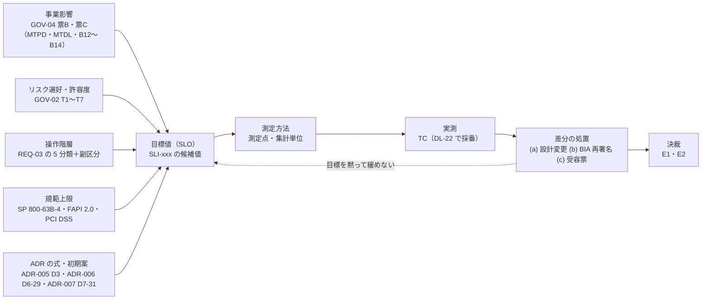
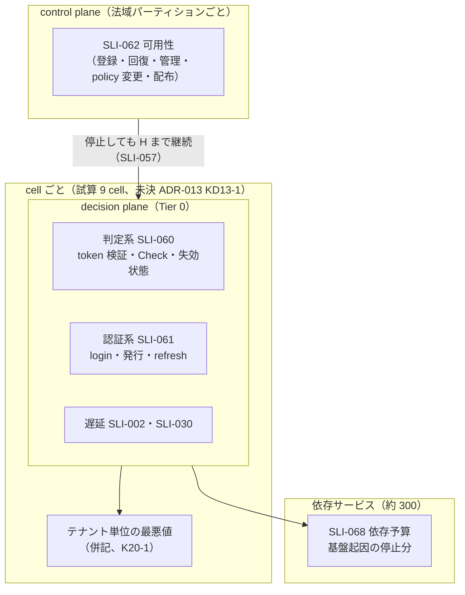

# 数値契約台帳（SLI/SLO）

> 文書ID: SLO-01 / 版: 0.6 / 状態: draft / 最終更新: 2026-10-15（0.6（PoC/R7反映）: PoC 系統 1 の実測レポート（POC-02）・独立再現ログ（POC-04）と模擬パネル ラウンド 7 の指摘を反映した。SLI-029 に基線に依存しない副指標 2 件、SLI-025・SLI-035・SLI-038・SLI-071 に PoC で見えた弱点の受け、§3.2・§3.3 にラウンド 3・5 から未処理だった SRE の Medium（MP-3-08・MP-5-08。ラウンド 7 MP-7-07）の受けを加えた。SLI の件数は変えていない。系統 1 の値は立会人なしの自己実行であり、Gate 4 の証拠ではない。末尾「変更履歴」「レビュー記録」）
> 対応要求: R-077, R-087, R-188〜R-196（子要求 R-188.1〜R-195.5 を含む）, R-220, R-271, G-024, G-057, G-060, G-106, G-144, G-147（R-requirements.md・G-goal-criteria.md で対応成果物欄に本書のパスまたは DL-20 を含む全行。末尾の対応表を参照）／関連: CL-0108, CL-0131, CL-0168, CL-0169, CL-0193, CL-0204, CL-0236, CL-0255, CL-0262、RH-001, RH-013〜RH-015
> 依存文書: CONVENTIONS.md, traceability/deliverables.md（DL-20 行）, traceability/R-requirements.md, traceability/G-goal-criteria.md, traceability/claims-ledger.md, traceability/rejected-hypotheses.md, 01_governance/assumptions-register.md（GOV-01）, 01_governance/business-impact-analysis.md（GOV-04）, 01_governance/risk-appetite-draft.md（GOV-02）, 01_governance/kri.md, 01_governance/loss-scenarios.md（GOV-03）, 02_requirements/operation-risk-tiers-assurance.md（REQ-03）, 02_requirements/identity-lifecycle.md, 03_threat-model/fraud-abuse-controls.md, 04_architecture/reference-architecture-v2.md（ARC-01）, 04_architecture/capacity-model.md（ARC-13）, 04_architecture/fail-mode-matrix.md（ARC-08）, 04_architecture/revocation-continuous-evaluation.md（ARC-09）, 05_adr/README.md と ADR-005, ADR-006, ADR-007, ADR-010, ADR-013, ADR-014, ADR-015, ADR-016, ADR-019, ADR-023, ADR-027, 10_integration/developer-faq.md, 12_poc/preregistered-test-plan.md, research/RS-03, RS-04, RS-05, RS-07, RS-09, RS-10, RS-16, research/standards-status.md
> 作成方法: AI エージェント（Claude）が上記文書の数値・TBD・決め方を集約し、SLI-ID を採番した。新しい数値は導出していない（候補値はすべて上流文書の A-ID・規範・ADR 初期案からの転記）。本書の判断と決裁案は自己レビューであり、実在の CTO/CISO の決裁ではない（CONVENTIONS §8）[D]。research に収載のない原典（SRE 本 第 4 章、SRE Workbook 付録 B、Dean・Barroso「The Tail at Scale」）は本書の作成者が 2026-10-15 に取得して照合した [D]。版 0.2 で模擬パネル（自己レビューであり実在の CTO/CISO の決裁ではない）のラウンド 3 指摘に、版 0.3 でラウンド 4 指摘（SLI-038 と FM-13 の検知前の窓）に、版 0.4 でラウンド 5 指摘（SLI-038 が引く TC-010 の自己実行の扱い）に、版 0.5 でラウンド 7 指摘（鍵の誤撤去を検知する token 検証失敗率の SLI がない）に対応した（末尾「レビュー記録」）[D]。
> 表の注記: 表のセルでタグのないものは、同じ行の「根拠」列・脚注に示した文書の記述を転記・要約した設計推論 [D] であり、この注記で個別のタグに代える。

## 0. 結論（要旨）

1. **レビューの 8 分類 43 指標と、G-060・G-106・G-144・G-147 が求める追加指標を、SLI-001〜SLI-106 の 81 件として定義した（分類ごとに番号帯を分け、空き番号は予約。版 0.5 で SLI-029 を追加）。値を置いたのは 27 件で、すべて「仮置き」である。決裁済の指標は 0 件である** [D]。候補値は、前提台帳の A-ID、規範の上限（SP 800-63B-4、FAPI 2.0、PCI DSS など）、ADR の初期案、リスク選好の選択肢のいずれかに紐付けたものだけである [D]。残る 54 件は TBD とし、所有者・期限・決め方を付けた [D]。旧提案の一律値（token 寿命 5〜15 分、全操作 fail-closed）は採らない [D]（R-087、CL-0131、CL-0236、CL-0108、RH-001）。レビューは数値を事業影響分析と PoC 実測で決めるよう求め、空欄のまま本番承認してはならないとしている [D][^5]。本書の現状では本番承認の条件（R-196、G-057）を満たさない [D]。
2. **SLI を「予算型」「限度型」「設定上限型」の 3 種に分け、error budget を使うのは予算型だけとする** [D]。予算型は、可用性、遅延、誤 deny、login 成功率など、目標を下回る時間や件数を一定量まで許すものである [D]。限度型は、誤 allow、stale allow、剥奪反映時間、監査の欠損、鍵年齢の硬上限など、超過をインシデントとして扱い予算として消費させないものである [D]。設定上限型は、token 寿命、session、clock skew、鍵 rotation 周期など、CI と実行時検査で違反件数を数えるものである [D]。この区分によって、可用性の余裕を安全側の窓（stale allow など）に振り替える圧力を構造的に断つ [D]。fail-mode と依存 Tier を別の軸で決めた ADR-023 と同じ考え方である [D]。
3. **SLO は plane 別・cell 別に置き、テナント単位の最悪値を併記する** [D]。decision plane は cell ごとに判定系・認証系の 2 つの SLO を持つ [D]。control plane は法域パーティションごとに SLO を持つ [D]。依存サービスへは依存予算（SLI-068）として配分する [D]。全体の平均は報告用にとどめ、決裁と error budget の判定には使わない [D]。cell の平均は、1 テナントが 100% 失敗している状態を隠すからである [D]。AWS の cell 白書は、判断の材料として「全顧客の 5% が失敗するのと、5% の顧客が 100% 失敗するのと、どちらがよいか」を問うている [V][^30]（RS-09#4）。error budget の窓は BIA と同じ 30 日（43,200 分）とする [D][^7]。予算を使い切った cell では、緊急でない policy・model・binary の変更を止める [D]。ただし剥奪・失効の配布と、セキュリティ修正は止めない（ADR-013 D13-36）[D]。
4. **経営判断が要る点は 5 件ある**（§8）[D]。SLO の構成単位（K20-1）、error budget 方針（K20-2）、決裁前の暫定運用（K20-3）、指標ごとの決裁権限（K20-4）、状態の昇格に独立立会を要するか（K20-5）である [D]。

---

## 1. 位置付けと読み方

### 1.1 本書が決めること・決めないこと

| 区分 | 内容 | 正本 |
|---|---|---|
| 本書が決める | SLI-ID の採番、各 SLI の定義・測定方法・集計単位、導出の鎖、状態、決める人、検証 TC の紐付け。SLO の構成単位（plane・cell・テナント）と error budget 方針の案 | 本書 |
| 本書が引き継ぐ（変えない） | 候補値の出所（A-ID、BIA の行、規範値、ADR の初期案）。操作 5 分類（REQ-03）。fail-mode の各セル（ARC-08）。剥奪反映時間の分解式（ADR-006 D6-29、ARC-09）。寿命の導出規則（ADR-005 D3）。鍵年齢の段階（ADR-007 D7-31） | 各上流文書 |
| 本書が決めない | 値そのものの決裁（経営会議・事業責任者・CISO・CTO・法務が §8 と §9 の様式で行う）。TC の正式採番（DL-22）。BIA の値（GOV-04） | DL-22、DL-21、DEC-1 |

- 成果物計画は本書に次の 3 点を求めている [D][^2]。8 分類で SLI-xxx を定義すること、導出の鎖（事業影響→操作階層→目標値→測定方法→実測値→差分）と状態（仮置き／導出済／実測済／決裁済）を付すこと、根拠のない数値を置かず「TBD＋所有者＋期限」とすることである [D][^2]。
- 本書は、ADR がすべて proposed（決裁前）である状態で作成した [D][^14]。ADR の決定に反する値は置かず、ADR で未決の点は「未決（ADR-0xx）」と書く [D]。

### 1.2 読み手別の入口

| 読み手 | 最初に読む節 | 持ち帰るもの |
|---|---|---|
| CTO/CISO | §0、§2、§3、§8 | SLI の 3 種別、plane・cell 別の構成、error budget 方針、決裁案 5 件 |
| 事業責任者 | §2.2、§5.5（可用性）、§8 | BIA の署名がどの SLI を「導出済」に上げるか |
| 連携開発者 | §3.4、§3.5、§5.2、§5.3、§6 | 依存予算、要求あたりの認可遅延予算の合成規則と申告事項、SDK の既定値（timeout、cache 最大齢、retry 予算）の SLI-ID |
| SRE・PoC 担当（DL-22） | §4、§5、§7 | 測定点、集計単位、TC との対応 |

### 1.3 用語

| 用語 | 本書での意味 | 根拠 |
|---|---|---|
| SLI | サービスの水準のある側面を、注意深く定義して量で表した指標 | SRE 本の定義 "a carefully defined quantitative measure of some aspect of the level of service that is provided" [V][^31] |
| SLO | SLI で測る水準の目標値または範囲 | SRE 本の定義 "a target value or range of values for a service level that is measured by an SLI" [V][^31] |
| error budget | 30 日の窓で、予算型 SLI が目標を下回ってよい量（時間・件数・率） | 30 日窓は BIA の換算規則に合わせた [D][^7] |
| 状態 | 仮置き／導出済／実測済／決裁済（成果物計画の定義）。値がないものは「TBD」と併記する | [D][^2]。昇格条件は GOV-04 §6.4 の連動規則に従う [D][^7] |

- 遅延は平均でなく分位点（p95・p99・p99.9）で表す [D]。SRE 本は、一般に算術平均より分位点で扱うほうを好むとしている [V][^31]。
- 前提台帳の値は SLO ではなく帯であり、設計比較と PoC 負荷の起点にだけ使う入力である [D][^6]。本書はこの扱いを変えない [D]。

## 2. 導出の鎖と状態の規則

### 2.1 導出の鎖



- 鎖の入口は 5 つある [D]。事業影響（GOV-04）、許容度（GOV-02）、操作階層（REQ-03）、規範上限、ADR の導出式である [D]。各 SLI の行には、どの入口から値が来たかを「導出の鎖」列に書く [D]。
- 実測が目標に届かないときは、目標を黙って緩めない [D]。GOV-04 §6.1 は、差を (a) 設計の変更、(b) BIA の見直しと再署名、(c) 受容票（DL-05）による期限付きの受容のいずれかで解消し、DL-20 に記録するとしている [D][^7]。本書もこれに従う [D]。
- 規範上限は、事業影響から導いた値がどうであれ超えてはならない上限として扱う [D]。たとえば AAL3 の session 全体の上限 12 時間は SHALL である [N][^20]（RS-03#43）。

### 2.2 状態と昇格条件

| 状態 | 意味 | 昇格の条件 | 根拠 |
|---|---|---|---|
| TBD | 値がない | 所有者・期限・決め方が書かれていること（書かれていなければ本書の欠陥） | [D][^2] |
| 仮置き | A-ID・規範・ADR 初期案・GOV-02 の選択肢から候補値を置いた | 候補値の出所が行に書かれていること | [D] |
| 導出済 | 署名済の BIA 行（または規範・決裁済 ADR）から導出規則で値を得た | GOV-04 の行が「署名済」で、導出規則が確定していること | GOV-04 §6.4 [D][^7] |
| 実測済 | 導出済の値に対し、TC で実測し生データの所在がある | TC-ID・測定条件・生データの所在（DL-81）が記録されていること | GOV-04 §6.4 [D][^7] |
| 決裁済 | 実測済の値を承認者が承認した | E1（経営会議または指定承認者の記録）があること | GOV-04 §6.4 [D][^7] |

- 署名されていない BIA の値から導いた目標は、「仮置き」より上の状態にしない [D][^7]。2026-10-15 時点で GOV-04 の署名は 0 行である [D][^7]。したがって本書の全 SLI の状態は「仮置き」または「TBD」である [D]。
- BIA を改版したときは、影響を受ける SLI の状態を「導出済」以下に戻す [D][^7]。

### 2.3 SLI の 3 種別

| 種別 | 意味 | 30 日窓での扱い | 超過時 | 例 |
|---|---|---|---|---|
| 予算型 | 目標を下回る量を一定まで許す | error budget を計上し、消費率で変更の速度を調整する（§3.3） | 予算の枯渇で変更を止める | SLI-001、SLI-002、SLI-030、SLI-039、SLI-060〜SLI-062 |
| 限度型 | 超過そのものを事故として扱う | 予算を持たない。超過 1 件ごとに記録し原因を分析する | インシデントとして扱い、KRI（K-04、K-17、K-21 など）に計上する | SLI-038、SLI-050〜SLI-054、SLI-070、SLI-071 |
| 設定上限型 | 設定値の上限を守っているか | 違反件数を数える | CI で阻止する。本番で見つかれば是正期限を付ける | SLI-005、SLI-006、SLI-020〜SLI-024、SLI-027 |

- 限度型を予算化しない理由は 2 つある [D]。第 1 に、GOV-02 は cross-tenant の誤 allow を全選択肢で 0 件としており、予算として消費できる余地がない [D][^8]。第 2 に、可用性の目標を守るために stale allow の窓を延ばす圧力がかかると、安全側の性質が可用性と取引されてしまう [D]。ADR-023 は、fail-mode と依存 Tier を独立の二軸とし、Tier が fail-mode を緩めないとしている [D][^28]。本書の 3 種別はその考え方を数値契約に写したものである [D]。
- 誤 deny は予算型とする [D]。BIA は誤 deny を業務影響（B13）として扱い、許容できる誤 deny 率を R-190.6 の入力としている [D][^7]。

## 3. SLO の構成（plane 別・cell 別）と error budget 方針

### 3.1 構成



- plane の分け方は ARC-01 に従う [D][^17]。control plane（変更・登録・配布）は法域パーティションごと、decision plane（認証・token 発行・判定・失効状態）は cell ごとに置く [D][^17]。ADR-023 は判定系・認証系をまとめて「cell の data plane」と呼んでいる [D][^17]。
- decision plane を判定系と認証系の 2 つの SLO に分ける [D]。前提台帳が両者に異なる可用性帯を置いており（A-090、A-091）、BIA も障害形態 F1（新規認証ができない）と F2（判定ができない）を分けて記入しているためである [D][^7][A-090, A-091]。
- control plane の SLO は管理系の帯（A-092）を候補とする [D][A-092]。A-092 の対象（登録、回復、管理コンソール、policy/model 変更）が control plane の機能と重なるという読みは本書の設計推論である [D]。
- control plane が止まっても、decision plane は上限 H（SLI-057）まで最終状態で判定を続ける [D]（ADR-013 D13-14、ADR-023）[^27][^28]。このため control plane の停止は、H を超えない限り decision plane の error budget を消費しない [D]。

| 単位 | 持つ SLO | 決裁の単位 | 報告 |
|---|---|---|---|
| cell × decision plane 判定系 | SLI-060、SLI-030、SLI-039 | cell ごと（規制スコープ cell・専用 cell は別値を取り得る。GOV-04 決裁案 4） | 日次・30 日窓 |
| cell × decision plane 認証系 | SLI-061、SLI-001、SLI-002 | cell ごと | 同上 |
| 法域パーティション × control plane | SLI-062 | パーティションごと | 同上 |
| テナント | 上記のテナント単位の値（最悪値と分位点） | 決裁の単位にしない。高保証テナント（A-081 で 50）は契約値として別に持つ | 月次。KRI K-18 の入力 |
| 依存サービス | SLI-068 | 依存サービスの申告と基盤の集計（ADR-023 D23-45） | 月次 |
| 全体 | 加重平均 | 決裁に使わない | 経営報告用 |

- 全体の平均を決裁に使わない理由は、BIA が基盤の拘束値を「同時に止まる行の最小値」とし、区画を分ける場合は区画ごとの最小値とする案（GOV-04 決裁案 2）を推奨しているためである [D][^7]。平均では最も厳しい業務の許容を超える停止を許してしまう [D][^7]。

### 3.2 測定点の原則

1. 可用性と遅延は、PEP SDK（依存サービス側）で測った値を正とする [D]。サーバ側の値は内訳の分析に使う [D]。PDP や AS に届かなかった要求はサーバ側に記録が残らないからである [D]。
2. 可用性の「不良」は、`deny_unavailable`、HTTP 5xx、deadline 超過とする [D]。ADR-011 は評価不能を `deny_indeterminate`、engine の停止・timeout を `deny_unavailable` とする閉じた列挙を決めている [D][^12]（ARC-13 §7.3 経由）。`deny_indeterminate` と通常の deny は意味論上の判定なので、可用性の不良に数えない [D]。ただし、query budget 超過による `deny_indeterminate` は別に数え、SLI-034 の超過率として報告する [D]。query budget 超過の reason は未決である（未決（ADR-011））[D][^11]。
3. 集計は cell × 操作階層 × テナントで行う [D]。操作階層は判定記録の criticality から取る [D]。
4. 測定に使う時計の誤差は、予算の値と比べて無視できる大きさに抑える前提を置く [D]（ARC-09 の新規仮定 NA-ARC09-1。前提台帳へ追加要）[^13]。
5. **テナント単位の値は、実時間の指標系列にしない（版 0.6。PoC/R7反映。ラウンド 3 MP-3-08、ラウンド 7 MP-7-07 の受け）** [D]。実時間の系列（警報と error budget の判定に使うもの）は cell × 操作階層 × SLI の粒度に限る [D]。テナント単位の値（最悪値と分位点、§3.1 の表）は、判定記録・検証イベントから日次のバッチで算出し、K-18 の入力と月次報告に使う [D]。例外は 2 つである [D]。(a) 高保証テナント（A-081 で 50）は契約値を持つので、実時間の系列を持つ [D][A-081]。(b) cell 内で値の悪い上位 N テナントだけを実時間の系列にする（N は TBD）[D]。テナント約 1 万（A-007）に操作階層と SLI を掛けた全組合せを系列にすると、観測基盤の系列数がテナント数に比例して増えるためである [D][A-007]。SLI-029 の kid × cell × 検証点種別のラベルはテナントを含まないので、この規則の対象外である [D]。系列数の上限・観測基盤の容量と費用・N の値は TBD とする（所有者 SRE 責任者、期限 G4、決め方: G1 の As-Is の観測基盤の実績と ARC-13 の cell 数から見積もる。残課題 15）[D]。

### 3.3 error budget 方針（案。決裁は K20-2）

| 項目 | 案 | 根拠 |
|---|---|---|
| 対象 | 予算型 SLI だけ（§2.3） | [D] |
| 窓 | 30 日の移動窓 | GOV-04 §6.1 の 6（累積停止は 30 日・43,200 分の窓）[D][^7] |
| 予算量 | 30 日の分数 ×（1 − SLO）。例: SLO 99.95% なら 21.6 分 | 前提台帳 A-090 の換算と同じ [D][A-090] |
| 単位 | cell ごと・plane ごと。テナント単位の最悪値は警報だけに使う | §3.1 [D] |
| 枯渇時 | 当該 cell で、緊急でない policy・model・binary・設定の変更を止める。ただし剥奪・失効の配布、セキュリティ修正、既知良好版への復帰は止めない | SRE Workbook の例示方針は、4 週間の窓で予算を超えたら P0 とセキュリティ修正以外の変更とリリースを止めるとしている [V][^32]。ADR-013 は freeze 中も剥奪・失効を配るとしている（D13-36）[D][^27] |
| wave への波及 | 同じ変更の wave（canary cell → 標準 cell → …）は、どれか 1 cell で予算が枯渇したら次の wave に進めない | ADR-013 D13-30 の wave 順と、canary の効果は露出量に比例するという SRE Workbook の記述 [V][^33]（RS-09#31）から導いた [D] |
| 単一事象 | 1 事象が 30 日予算の 20% を超えて消費したら事後分析を必須にする | SRE Workbook の例示方針（4 週間で 20% 超なら postmortem）[V][^32]。値は本書の新規仮定 NA-SLO-2（前提台帳へ追加要）[D] |
| 意見の相違 | 停止権限（GOV-06）の手続に従う。例示方針は CTO へ上げるとしている | [V][^32]、[D] |
| 限度型の超過 | 予算と無関係に、インシデントとして扱う | §2.3 [D] |
| 災害規模の事象（版 0.6。PoC/R7反映。ラウンド 5 MP-5-08、ラウンド 7 MP-7-07 の受け） | リージョン切替（OPS-01 RB-A01）や cell 退避（RB-A02）を宣言した事象も、予算から除かずに計上する（利用者が受けた停止であるため）。ただし、(1) 枯渇時の変更の停止は、事象の復旧作業（切替・格上げ・既知良好版への復帰）を止めない。(2) 事象の消費分を「災害事象」として別掲し、平常の消費率と分けて報告する。(3) 30 日窓は事象の後も移動窓のまま進め、窓を初期化しない。(4) 1 事象で予算を超えた場合の扱い（停止を続けるか、経営判断で解除するか）は K20-2 の論点に加える。BIA の MTPD（GOV-04）を超える停止は、予算ではなく BIA の超過として経営へ報告する | 設計推論 [D]。値と除外の可否は K20-2 で決める（所有者 SRE 責任者＋CTO、期限 G4） |

- SRE Workbook の値は Google の例示であり、本基盤の値の根拠ではない [D]。本書は「4 週間」を BIA の 30 日にそろえ、「20%」を新規仮定として置いた [D]。値は運用 1 年目の実績で見直す（所有者 SRE 責任者、期限 G6 開始から 12 か月、決め方: 事後分析の件数と変更の停止期間の実績）[D]。

### 3.4 連携開発者への含意

- 依存サービスは、基盤を重要依存として扱う操作の割合と自サービスの目標を申告する（ADR-023 D23-45）[D][^28]。基盤の判定系が 99.95% なら、依存サービスは約 99.5%、99.99% なら約 99.9% を超える目標を約束しにくい [D][A-090]（ADR-023 の新規仮定 NA-023-5 による試算。前提台帳へ追加要）[^28]。
- SDK の既定値（PDP 呼出しの deadline、retry 予算、JWKS cache 最大齢、判定 cache の最大齢）は、本書の SLI-ID を参照して決める（G-106）[D]。値はすべて TBD であり、連携開発者は個別値を設定しない [D]。寿命 profile を 3 種類以内に絞り API ごとの個別値を認めない ADR-005 D3 と同じ理由による [D][^21]。
- Check 1 回の遅延（SLI-030）と deadline（SLI-035）は、それだけでは業務の応答時間を約束しない [D]。1 回の edge 要求は複数の Check・token exchange・introspection を経るので、依存サービスは §3.5 の合成規則で自分の遅延 SLO と deadline の伝播を設計し、直列 Check の深さを申告する [D]。

### 3.5 要求あたりの認可遅延予算

**目的**: 約 300 の依存サービス・20〜30 チームが、基盤側の決裁（G4）を待たずに、自サービスの遅延 SLO と deadline の伝播を同じ規則で並行して設計できるようにする [D][A-050]。Check 1 回の分位点（SLI-030）を、業務がタイムアウトとみなす時間（GOV-04 B14）に直結させない [D]。B14 は 1 回の利用者操作の全体に対する値であり（GOV-04 §3.2）、1 回の edge 要求は平均 2.5 回の Check（A-025）に加え、token exchange・introspection を経るからである [D][^7][A-025]。

**(1) 直列 hop の合成**

1 回の edge 要求 req の認可に起因する追加遅延を、直列に並ぶ hop について足し合わせる [D]。

```
L_authz(req) = Σ_{h ∈ 直列 hop} ( L_check(h) + L_exchange(h) + L_introspect(h) )

予算条件:  L_authz(req) ≦ α × B14(o)          （o は req が属する業務操作）
Check 1 回の目標:  SLI-030 の目標分位点 ≦ ( α × B14(o) − L_exch,intro ) ÷ k_serial
Check 1 回の deadline:  SLI-035 の D(t) ≦ min( 設定上限, 呼出し元から伝播した残り deadline )
```

| 記号 | 意味 | 値・状態 | 所有者・期限・決め方 |
|---|---|---|---|
| B14(o) | 業務操作 o がタイムアウトとみなす応答時間（GOV-04 票B） | TBD。GOV-04 では任意欄であり、署名は 0 行 [D][^7] | 事業責任者。G0（署名）。B14 の必須化は他文書への申し送り 1 |
| α | B14 のうち認可（Check・token exchange・introspection）に割り当てる比率（0 ＜ α ＜ 1） | TBD（NA-SLO-4） | SRE 責任者＋CTO（値の承認に事業責任者）。G4。決め方: As-Is のトレース（G1）で業務処理・DB・外部呼出しの所要時間を差し引いた残りと、TC-101・TC-120 の端から端の実測 |
| k_serial | 1 回の edge 要求の中で、前の Check の結果を待ってから次の Check を始める（直列の）Check の最大段数 | TBD（NA-SLO-5）。A-025 の内訳（gateway 段 1＋resource-local 1＋子リソース・フィールド 0.5）[A-025] から読める直列段は gateway 段と resource-local 段の 2 段であり、これは内部 hop 数 f＝1（ADR-015 N15-2 の試算の下限）の場合に限る [D] | CTO＋プラットフォームチーム長。G4。決め方: G1 の As-Is トレースで直列 Check 数の分布を実測し、SDK の既定上限（超過時は警告と申告の再提出）として置く |
| L_exch,intro | 直列 hop 上の token exchange と introspection の遅延の合計 | TBD。交換済み token を寿命内 cache すれば平常時は 0 に近い（ARC-13 §12 の 4）[^11] | SRE 責任者。G4。TC-120 |
| n_par | 1 回の edge 要求で並列に呼ぶ Check の数（`evaluateAccessBatch` 1 回は SDK 上 1 回として数え、batch の遅延は SLI-030 の batch 区分で別に測る） | TBD。申告事項（下記 (3)） | 依存サービスの申告。G4 前の連携申請時 |

- 分位点は足し算で合成できない [D]。各 hop の p99.9 の和は、和（L_authz）の p99.9 と一致しない [D]。上の式は設計時の割付け（予算の配分）に使う近似であり、合否は端から端の L_authz(req) の実測分位点で判定する [D]（TC-101・TC-120 の拡張。他文書への申し送り 5）。
- k_serial の上限がないと、Check 1 回の目標をいくら厳しくしても L_authz は直列段数に比例して伸びる [D]。このため k_serial を SDK の既定上限と申告事項の両方で押さえる [D]。
- deadline は hop ごとに独立に置かず、呼出し元から残り時間を伝播し、残りが足りなければ待たずに失敗させる [D]。SRE 本は deadline の伝播と、backend が使えないときの早い失敗を勧めている [V][^50]（RS-09#38）。D(t) の超過は従来どおり `deny_unavailable` として階層別の fail-mode に回す（§5.3 SLI-035、ARC-08 §4）[D][^12]。

**(2) 並列 Check による tail の増幅**

並列に n 回の Check を呼び、業務がそのすべての応答を待つ場合、各 Check が閾値 x 以内に応答する確率を q（例: x を p99 に取れば q＝0.99）とすると、少なくとも 1 回が x を超える確率は 1 − qⁿ である [D]（各 Check の遅延が独立という仮定の下での計算。同じ PDP・同じ store を共有すると相関が生じ、実際の値は実測で確かめる）。

| n | q＝0.99（各 Check の p99 を閾値） | q＝0.999（各 Check の p99.9 を閾値） |
|---|---|---|
| 1 | 1.00% | 0.10% |
| 3 | 2.97% | 0.30% |
| 5 | 4.90% | 0.50% |
| 10 | 9.56% | 1.00% |
| 25 | 22.22% | 2.47% |
| 100 | 63.40% | 9.52% |

- 上表は本書の計算である [D]。n＝100・q＝0.99 の値は、各 server の p99 が 1 秒のとき 100 台へ並列に要求すると利用者要求の 63% が 1 秒を超えるという Dean・Barroso の例示と一致する [V][^51]。同論文は、個々の構成要素の遅延のばらつきがサービス全体の水準で拡大されるとしている [V][^51]。
- 要求単位で分位点 Q（例: p99）を守るには、各 Check に q ≧ Q^(1/n) を求める必要がある [D]。Q＝0.99 なら、n＝3 で各 Check に約 p99.67、n＝10 で約 p99.9、n＝25 で約 p99.96 が要る [D]。SLI-030 が p99.9 まで定義するのはこのためであり、目標分位点は申告された n_par の上位値から決める [D]。
- 一覧は 1 件ずつ並列に Check せず、`evaluateAccessBatch` で 1 回にまとめる（INT-03・FQ-67）[D]。上表の n を小さく保つことが、Check 1 回の分位点を厳しくするより安い [D]。

**(3) 依存サービスが申告・実装すること（並行開発の規則）**

| # | すること | 理由 |
|---|---|---|
| 1 | 連携の申請時に、業務操作ごとに B14(o)（未署名なら事業部門の暫定値と所有者）、1 edge 要求あたりの Check の平均数、直列の深さ（k_serial の見込み）、並列数 n_par、token exchange・introspection を直列 hop 上で呼ぶか否かを申告する | ARC-13 §12 の 6 は平均数と一覧比率だけを申告させており、直列の深さと並列数がない [D][^11]。平均だけでは L_authz と tail を見積もれない [D]。様式の拡張は他文書への申し送り 2 |
| 2 | 自サービスの遅延 SLO は、α × B14(o) の範囲で、§3.5 (1) の式と (2) の表を使って Check 1 回あたりの許容値を逆算して設計する。基盤の SLI-030 の決裁値が出るまでは TBD のまま仮値を明記して試験する（K20-3 案 A） | 決裁前でも同じ式で設計でき、値が決まった時点で代入して再判定できる [D] |
| 3 | deadline は SDK の既定（呼出し元からの残り時間の伝播）を使い、hop ごとに独自の timeout を足さない | §3.5 (1)。SDK の既定値は SLI-035・SLI-044 を参照する（§3.4）[D] |
| 4 | 同じ txn の中で、前段で同じ（主体、操作、資源、文脈）について判定済みの Check を下流で繰り返さない。ただし hop ごとの token の取り直し（aud の検査）と、下流が自分の資源について行う resource-local の判定は省かない | 直列段数を増やさないため [D]。下流での判定の省略を許す範囲と条件は ADR-009・ADR-011 の決定に従う必要があり、本書は規則案の提示に留める（他文書への申し送り 3）[D] |
| 5 | 申告値を超えた直列の深さ・並列数を本番で観測した場合は、申告を出し直す | 申告値と本番の PDP メトリクスの照合（ARC-13 §10.4、§12 の 6）[D][^11] |

- B14 が未記入の業務操作では、α × B14(o) を計算できない [D]。この場合、当該操作の SLI-030・SLI-035 の目標は「導出済」に上げず、ADR-023 の Tier 1（重要依存サービス）の業務では本番承認（§7.1）の前に B14 の署名を必須とする [D]。BIA 側で B14 を Tier 0・Tier 1 の業務に必須とするか、未記入時の既定値と所有者を置く変更は、他文書への申し送り 1 とする [D][^28]。

## 4. 新規仮定（前提台帳へ追加要）

本書は前提台帳を編集しない [D]。次の仮定は採番前の仮番号で書き、前提台帳の所有者が採番した時点で置き換える [D]。

| 仮番号 | 内容 | 値 | 根拠 | 確定の所有者・期限・決め方 |
|---|---|---|---|---|
| NA-SLO-1 | 予算型 SLI の測定点は PEP SDK 側とし、到達しなかった要求を不良に数える | — | §3.2 [D] | SRE 責任者、G4、TC-13-04 で SDK 側とサーバ側の差を測る |
| NA-SLO-2 | 単一事象で事後分析を必須にする予算消費の閾値 | 30 日予算の 20% | SRE Workbook の例示 [V][^32] | SRE 責任者＋CTO、G6 開始から 12 か月、運用実績 |
| NA-SLO-3 | テナント単位の最悪値の監視に使う分位点 | TBD | — | SRE 責任者＋事業責任者（B2B）、G4、K20-1 の決裁 |
| NA-SLO-4 | 業務操作がタイムアウトとみなす時間 B14 のうち、認可（Check・token exchange・introspection）に割り当てる比率 α | TBD | §3.5 (1) [D] | SRE 責任者＋CTO（値の承認に事業責任者）、G4、G1 の As-Is トレースと TC-101・TC-120 の端から端の実測 |
| NA-SLO-5 | 1 回の edge 要求あたりの直列 Check 数の上限 k_serial（SDK の既定上限と申告事項） | TBD | §3.5 (1)、A-025 の内訳 [D][A-025] | CTO＋プラットフォームチーム長、G4、G1 の As-Is トレースで直列 Check 数の分布を実測 |
| NA-SLO-6 | 並列 Check の tail 増幅の見積り（1 − qⁿ）で、各 Check の遅延を独立とみなす | — | §3.5 (2) [D] | SRE 責任者、G4、TC-101 で並列数を変えた端から端の分位点と計算値を比べる |

- 上流文書が置いた新規仮定のうち本書が使うものは、GOV-04 の NA-01・NA-02、ARC-13 の NA-58-x、ARC-09 の NA-ARC09-1、ADR-016 の NA-016-1・NA-016-7、ADR-023 の NA-023-5、ADR-015 の N15-2（内部 hop 数 f）である [D]。いずれも前提台帳へ追加要のまま本書で参照している [D]。

## 5. SLI 台帳

各分類は、(a) 定義と測定方法、(b) 導出の鎖・候補値・状態・決める人・検証 TC の 2 表で示す [D]。TC は各 ADR・設計文書の仮番であり、正式な採番と事前登録は DL-22 で行う [D]。「決める人」は暫定で、RACI（DL-04）の確定後にそろえる [D]。期限はゲート（G0〜G6）で示す [D]。

### 5.1 認証（R-188、G-060）

**(a) 定義と測定方法**

| SLI | 名称（R-ID） | 種別 | 定義 | 測定方法・集計単位 |
|---|---|---|---|---|
| SLI-001 | login 成功率（R-188.1） | 予算型 | 完了した認証 ÷ 開始された認証。利用者の入力誤りによる失敗と基盤起因の失敗を分けて集計し、SLO の判定には基盤起因（5xx、timeout、上流 IdP の応答不能）を使う | AS の認証イベント（E 系）。cell × 主体種別 × 認証方式 × テナント。REQ-03 §4.1 の定義を採る |
| SLI-002 | login 遅延 p95/p99（R-188.2） | 予算型 | 認証開始から認可コード（または session 確立）までの時間。利用者の操作時間（入力・認証器の操作）を除く | AS の内部時刻の差。cell × 認証方式。上流 IdP の時間は別掲 |
| SLI-003 | IdP・AS 障害時の既存 session 継続時間（R-188.3） | 限度型（下限） | AS（FM-06）または上流 IdP（FM-05）が止まってから、既存 session で業務 API を使えなくなるまでの時間 | 障害注入。refresh 停止後に access token の寿命で失効する時刻を記録する |
| SLI-004 | IdP・AS 復旧後の追随時間（R-188.3） | 予算型 | AS の復旧から、login 成功率が平常の帯に戻るまでの時間（再ログイン集中を含む） | 障害注入。GOV-04 の X5 と同じ量 |
| SLI-005 | session 最大時間（R-188.4） | 設定上限型 | 操作階層ごとの session 全体の上限 | 設定値の CI 検査と、実 session の最長値の監視。違反件数 |
| SLI-006 | 再認証間隔・無操作上限（R-188.5） | 設定上限型 | 操作階層ごとの無操作の上限と、step-up の鮮度（max_age） | 同上 |
| SLI-007 | 回復の処理時間（R-188.6） | 予算型 | 回復開始から完了までの時間から、意図的な待機と承認待ちを除いた時間。区分（R-A〜R-D）・経路別の p50・p95 | identity-lifecycle §11.7 の定義を採る [D][^23] |
| SLI-008 | 回復の総所要時間（R-188.6） | 予算型 | 回復開始から完了までの時間（待機・承認待ちを含む） | 同上。待機時間（IL-D1）の決定に従属する |
| SLI-009 | 不正回復検知時間（R-188.7） | 限度型 | 不正な回復の完了時刻 t_r から、検知時刻 t_d（自動対応の発動か ITDR アラート起票の早いほう）まで。p50・p95・最大と検知漏れ率 | fraud-abuse-controls §13.3 の定義を採る [D][^24]。PoC は注入、本番は確定事案の事後分析 |
| SLI-010 | step-up 発生率・完了率（G-060） | 予算型 | challenge 数 ÷ 保護対象操作の要求数。完了数 ÷ challenge 数 | 階層・修飾子・主体種別。REQ-03 §4.1 |
| SLI-011 | passkey 登録率（G-060） | 予算型（目標は上向き） | PR 認証器を 1 つ以上持つアクティブ主体 ÷ MAU | 主体種別、同期／device-bound。REQ-03 §4.1 |
| SLI-012 | 回復の発生率（G-060） | 予算型 | 回復開始数 ÷ MAU（月次） | 区分・経路別。REQ-03 §4.1 |

**(b) 導出の鎖・候補値・状態**

| SLI | 導出の鎖 | 候補値（根拠） | 状態 | 決める人・期限 | 検証 TC |
|---|---|---|---|---|---|
| SLI-001 | GOV-04 B12（業務が許容できるログイン失敗率）→ 階層は全階層（新規開始）→ 1 − 成功率 ≦ 許容失敗率 → PT-11 | TBD（所有者 プロダクト責任者、期限 G4、決め方: B12 の署名値と PT-11 の実測） | TBD | 事業責任者（B12）＋プロダクト責任者 | PT-11（REQ-03） |
| SLI-002 | GOV-04 B14（業務がタイムアウトとみなす応答時間）→ p99 ＜ B14 → 負荷段階（ARC-13 §9）で実測 | TBD（所有者 SRE 責任者、期限 G4、決め方: B14 と TC の実測） | TBD | CTO | ARC-13 §9 の負荷段階（TC 未採番） |
| SLI-003 | GOV-04 X2 の MTPD（F1）→ 既存 session を続けられる時間 ≧ AS の RTO（GOV-04 §6.2）→ 続けられない時間帯は F2 として扱う | TBD。下限の条件として「AS の RTO 以上」を固定する。寿命を障害時に延ばす grace は設けない（ADR-005 D3）[^21] | TBD | CTO＋事業責任者（BIA） | RS-09 §5.2-3、ADR-005 H-15、TC-13-xx（FM-05・FM-06 の注入） |
| SLI-004 | GOV-04 X5 → RTO＋X5＋再処理 ＜ MTPD（GOV-04 §6.2） | TBD（所有者 SRE 責任者、期限 G4、決め方: X5 の実測）。Azure AD 2021-03-15 では、緩和後も依存サービスの回復が翌日まで遅れた [I][^34]（RS-09#53） | TBD | SRE 責任者＋CTO | TC-19-03（再ログイン集中 556/秒 [A-048]） |
| SLI-005 | 規範上限（SP 800-63B-4）→ 操作階層（REQ-03 §3.3）→ PT-3 の比較と BIA → 階層別の設定値 | 上限: AAL2（read-sensitive・write・privileged/T）は全体 24 時間以内（SHOULD）、AAL3（privileged/P・break-glass/P）は 12 時間以内（SHALL）[N][^20]（RS-03#43）。設定値は TBD（所有者 プロダクト責任者＋CISO、期限 G4、決め方 REQ03-D6 案 B） | 仮置き（上限のみ） | プロダクト責任者＋CISO。/P は CISO＋SRE 責任者 | PT-3（REQ-03） |
| SLI-006 | 同上 | 上限: AAL2 は無操作 1 時間以内（SHOULD）、AAL3 は 15 分以内（SHOULD）[N][^20]（RS-03#43）。設定値と max_age は TBD（同上） | 仮置き（上限のみ） | 同上 | PT-3 |
| SLI-007 | GOV-04（回復が止まった場合の業務影響、票B の privileged 行）→ 回復区分 R-A〜R-D → IL-TC15 | TBD（所有者 CISO＋プロダクト責任者、期限 G1 で候補・G4 で確定、決め方: BIA と IL-TC15） | TBD | CISO＋プロダクト責任者 | IL-TC15 |
| SLI-008 | 同上。待機時間（統制）に従属 | TBD（同上） | TBD | 同上 | IL-TC15 |
| SLI-009 | BIA の損失時間（不正回復の後に攻撃者が到達できる操作とその損失）→ 回復後の保留期間は p95 より長くする → 試験案 6 | TBD（所有者 CISO＋事業責任者、期限 G4 で測定方法凍結・G5 までに目標値、決め方 fraud-abuse-controls §13.3） | TBD | CISO＋事業責任者 | fraud-abuse-controls 試験案 6（FA-07） |
| SLI-010 | REQ-03 §4.1 → PT-11 | TBD（所有者 プロダクト責任者、期限 G4、決め方 PT-11） | TBD | プロダクト責任者 | PT-11 |
| SLI-011 | REQ-03 §4.1 → PT-11 | 現状値の仮置き: 自社認証の人間利用者で PR 7% [A-115]。これは現状の起点であり目標値ではない。目標値は TBD（同上） | TBD（起点のみ仮置き） | プロダクト責任者＋CISO | PT-11、K-11 |
| SLI-012 | REQ-03 §4.1 → PT-11 | TBD（同上） | TBD | プロダクト責任者 | PT-11 |

### 5.2 token（R-189、G-106）

**(a) 定義と測定方法**

| SLI | 名称（R-ID） | 種別 | 定義 | 測定方法・集計単位 |
|---|---|---|---|---|
| SLI-020 | access token・内部 token の寿命 L(k,t)（R-189.1） | 設定上限型 | token 種別 k × 操作階層 t ごとの寿命。運用上は寿命 profile 3 種類以内に丸める（短い側） | AS・STS の設定の CI 検査（ADR-005 H-24）。発行台帳の exp − iat の最大値 |
| SLI-021 | refresh token・BFF session の絶対寿命と非活動失効（R-189.1） | 設定上限型 | client 種別ごとの絶対寿命と非活動失効。rotation で延長しない | 同上 |
| SLI-022 | clock skew 許容 S（R-189.2） | 設定上限型 | 検証側が iat・nbf の未来方向の時刻差を受理する上限。iat の古さは拒否理由にしない | 検証 SDK の設定。時刻差による拒否率を別に測る（ADR-005 H-05） |
| SLI-023 | 鍵 rotation 周期（R-189.3） | 設定上限型 | 層・族ごとの計画 rotation の周期と、警報・変更凍結・硬上限の鍵年齢 | 鍵台帳の鍵年齢。KRI K-07 |
| SLI-024 | 旧鍵併存時間（R-189.4） | 設定上限型 | 事前公開 P_pre と退役後の公開保持 P_post | 鍵台帳と JWKS・鍵マニフェストの公開記録 |
| SLI-025 | 緊急失効完了時間（R-189.5） | 限度型 | 鍵の緊急失効の宣言から、全内部検証点が当該 kid を拒否するまで | canary cell での演習。kid ごとの最初の拒否と最後の受理の時刻 |
| SLI-026 | JWKS cache 最大齢 J_max（R-189.6、G-106） | 設定上限型 | 取得に失敗したときに last known good の JWKS を使い続ける上限 | SDK の設定と、JWKS 取得失敗の注入 |
| SLI-027 | 認可コード・request_uri の寿命（R-189.1 の内数） | 設定上限型 | 認可コードと PAR の request_uri の寿命 | AS の設定の CI 検査 |
| SLI-028 | introspection cache 最大齢 C_edge(t)（G-106） | 設定上限型 | edge が introspection 応答を cache してよい最大齢（階層別） | edge の設定と、失効注入時の stale allow |
| SLI-029 | token 検証失敗率 V(k, c, p)（R-189.6 の関連。版 0.5 で追加） | 予算型（平常時）。基線の超過は警報（ARC-08 §3.5 の FM-08 誤撤去の行） | 検証点の種別 p、cell c、kid k ごとに、署名・kid の検証に失敗した token の件数 ÷ 検証を試みた token の件数。失敗理由を「未知 kid（JWKS に欠落）」「署名不一致」「失効 kid（失効状態による拒否）」「期限切れ・audience 等」に分ける。誤撤去・JWKS 不整合の検知に使うのは前 2 者だけで、失効 kid と期限切れは分子から除く（意図した拒否であるため）。p は (1) PEP SDK、(2) edge、(3) 外部 RP の代理指標の 3 種である。外部 RP の検証は本基盤から観測できないため、(3) は次の 3 つで代える: (a) 外部 RP 向けの issuer の JWKS・discovery の取得要求数の急増（未知 kid による再取得）、(b) 外部 RP の client_id ごとの認可要求・refresh の急増（RP が拒否した token を取り直す）、(c) 顧客受付（ADR-023 NX-09）の認証エラー件数 | SDK・edge の検証イベントを kid・cell・理由のラベル付きで集計する（1 分窓）。基線 b(c, p) は、同じ cell・検証点種別について過去 W_b の同じ曜日・時間帯の 1 分窓の率の分布の上側 q_b 分位とする。計画 rotation（SLI-024 の P_pre・P_post）の期間は除かず基線に含める（計画 rotation で検証失敗が増えないことが ADR-007 TC-07-02 の基準であるため）。要求数が n_min 未満の窓は判定しない。W_b・q_b・n_min は TBD（下表）。**副指標（版 0.6。PoC/R7反映）**: (i) 基線に依存しない即時警報。発行台帳上で未失効・未期限切れの token が残る kid について、検証点で「未知 kid」による拒否が 1 件でも出たら警報する（基線・閾値の決裁を待たずに置ける規則。限度型として件数を数える）。(ii) 能動プローブ。撤去の前後に、撤去対象の kid で署名した期限内の合成 token（canary テナント用）を各検証点種別へ定期的に流し、その拒否件数を数える（通信量が少なく基線を作れない cell・時間帯の補完）。どちらも OPS-01 RB-A08 の PoC/R7反映の追加統制 (b)(c) の信号である |

**(b) 導出の鎖・候補値・状態**

| SLI | 導出の鎖 | 候補値（根拠） | 状態 | 決める人・期限 | 検証 TC |
|---|---|---|---|---|---|
| SLI-020 | U1 規範上限・U2 剥奪反映（L＋C(t)＋Δprop ≦ R(t)）・U3 被害窓 E(t)・U4 session・U5 鍵併存の最小値を Lmin（容量・停止耐性）と突き合わせる（ADR-005 D3）→ 3 profile に丸める | TBD（所有者 CTO＋CISO、期限 G4、決め方: BIA の R(t)・E(t) と H-02・H-15 から DL-20 で決裁）[^21]。A-027 の 10 分は容量計算用の仮置きであり、本 SLI の値に使わない [A-027]。一律値は採らない（R-087、RH-001） | TBD | CTO＋CISO（値に事業責任者が加わる） | ADR-005 H-02、H-15、H-24 |
| SLI-021 | U4（AAL の再認証上限以下）→ client 種別（ADR-005 D6）| 上限: SLI-005 以下。ブラウザ向け refresh token は最大寿命か非活動失効を設けなければならず、rotation で延長してはならない（MUST / MUST NOT）[N][^21]（ADR-005 U1 表、RS-04#74）。値は TBD（同上） | 仮置き（上限のみ） | 同上 | ADR-005 H-24 |
| SLI-022 | FAPI 2.0 §5.3.2.1（AS が受け取る JWT の iat/nbf: 未来 10 秒は受理、60 秒超は拒否）を内部 RS の未来方向の許容に準用（自社判断、ADR-005 V7・D13-3） | 初期値 10 秒、上限 60 秒（ADR-005 V7）[^21]。FAPI の規定は AS が受け取る JWT に対する shall であり [N][^35]（RS-04#42）、内部 RS への準用は自社判断である [D] | 仮置き | CTO（技術）＋CISO。G4 | ADR-005 H-05 |
| SLI-023 | Storm-0558 と Azure AD 2021 の教訓（ADR-007 §1）→ SP 800-57 の私有署名鍵の推奨（約 1〜3 年）以内 → 30 日周期で手順を常時動かす | L2 token 系・内部・SET・introspection、L2 監査・policy bundle: 通常 30 日・警報 45 日・凍結 60 日・硬上限 90 日。L2 SAML: 1 年（硬上限 2 年）。L1: 1 年（硬上限 2 年）。L0: 30 か月（硬上限 36 か月）（ADR-007 D7-31 の初期案）[^22]。いずれも SP 800-57 Rev5 の推奨範囲内 [N][^36]（RS-05#3） | 仮置き | CTO＋CISO（BIA）。ADR-007 KD7-4 で PoC 後に再決裁 | TC-07-xx（ADR-007 §7）、K-07 |
| SLI-024 | ADR-005 U5（L_int＋JWKS cache 最大齢＋時刻差 ≦ 併存時間）、ADR-007 D7-34 | P_pre: 外部 issuer 7 日（内部は全 cell の鍵マニフェスト受信 ack を条件）。P_post: 7 日。SAML 新旧重複: 60 日（ADR-007 D7-34 の初期案）[^22]。SLI-020・SLI-026 が決まった時点で U5 を満たすか再計算する | 仮置き | CTO＋CISO。G4 | TC-07-xx、TC-19-04 |
| SLI-025 | GOV-04 の MTPD と、S-02・S-15 の被害窓 → 宣言から全検証点の拒否まで（ADR-007 D7-37、ADR-019 D19-12） | TBD（所有者 CISO、期限 G4、決め方: BIA と TC-07-03 の実測）。運用案の「15 分」は導出がないため採らない（ADR-007 D7-39）[^22]。**PoC/R7反映（版 0.6）**: 系統 1 の TC-014 では、宣言から最後の受理までが、失効状態の配布がある検証点で p50 97 ms・最大 186 ms、JWKS の再取得だけに頼る検証点で p50 4,027 ms・最大 14,062 ms だった（POC-04 の再現値。立会人なしの自己実行で証拠に使わない）[D][^56][^57]。含意: 本 SLI は検証点種別（配布の有無）ごとに測り、全検証点の最大で判定する。平均や配布ありの検証点だけの値で判定しない。系統 2 で配布なしの内部検証点が上限を超えた場合は、内部の検証点すべてに失効状態の配布を必須にするよう ADR-007 D7-37 の改訂を CTO に上げる（見直しトリガー。OPS-01 RB-01 の PoC/R7反映の注記）[D] | TBD | CISO＋SRE 責任者 | TC-07-03（配布あり・なしの検証点の混在を追加する候補。申し送り 16）、TC-19-04、TC-014（系統 1、参考） |
| SLI-026 | ADR-005 U5、R-189.5 との整合（失効 kid は別経路で配るので J_max は失効の反映時間に効かない。ARC-08 §4） | TBD（所有者 CTO＋SRE 責任者、期限 G4、決め方 TC-13-22・TC-07-04）[^12] | TBD | CTO＋SRE 責任者 | TC-13-22、TC-07-04 |
| SLI-027 | 規範上限 | 認可コード 60 秒以下、PAR request_uri 600 秒未満（FAPI 2.0 の shall。ADR-005 は認可コードの上限を全 client に適用）[N][^35]（RS-04#42–#43）[^21] | 仮置き（規範上限） | CTO。G3 | ADR-005 H-24 |
| SLI-028 | RFC 7662 は応答の cache を許すが、性能と安全のトレードオフの検討を求める [N][^37]（RS-04#67）→ 応答の exp を超えない（ADR-005 U1、ARC-08 §4）→ C_edge(t) ≦ R(t) − D_w − Δ_E1（ARC-09 §4.3） | 上限: 応答の exp 以下（ADR-005 U1 の表）[^21]。値は TBD（所有者 CTO、期限 G4、決め方 ADR-005 H-02・ADR-006 H6-03） | 仮置き（上限のみ） | CTO | TC-ARC09-04 |
| SLI-029 | ADR-007 D7-35 の 3（canary cell で撤去し、24 時間、検証失敗率が基線を超えなければ撤去を進め、超えたら自動で再掲載する）が依存する信号を定義する [D][^22] → 誤撤去から検知・自動再掲載までの時間 T_rk（ARC-08 §4）と窓内の誤 deny 件数を、V(k, c, p) の基線超過で測る → OPS-01 RB-A08 の検知（A0）。Azure AD 2021-03-15 では、使われなくなった鍵の自動削除が retain の印を無視して鍵を消し、metadata の変更後に依存アプリがその鍵の token を信頼しなくなった。metadata を戻した後も、利用側の cache の扱いの差で回復時間が分かれた [I][^34]（RS-09#53, #54）。PoC 系統 1 の TC-014 では、使用中の旧鍵を JWKS から撤去した後、検証 1,980 件のうち 1,566 件（実 PEP で 168 件）が拒否され、検知の警報は 0 件だった（自己実行の参考値。立会人なし・git_dirty で、DCS-01 §10.1 の区分 W-1〜W-5 を満たさない。証拠に使わない）[D][^55] | 値は TBD。対象は V の閾値（基線 b からの超過の判定規則）、W_b、q_b、n_min、T_rk。所有者は SRE 責任者、期限は G4。決め方: 平常時の V の分布（G1 の As-Is 実測、または系統 2 の平常負荷）から基線を作り、TC-014・TC-07-04・TC-109 の誤撤去の注入で検知時間 T_rk の分布と誤検知率を測って決める。決裁前の PoC では閾値を複数水準で試し、T_rk と窓内の誤 deny 件数を記録する。**PoC/R7反映（版 0.6）**: 実装者と別の AI エージェントによる同一機械での再実行（POC-04）でも、誤撤去は検知されず、2,004 件のうち 1,584 件（実 PEP で 180 件）が拒否された。独立立会人の再実行ではないので証拠に使わない [D][^57]。設計上の含意は次の 4 つである [D]。(a) 見直しトリガー: 立会い下の TC-014（改訂後の基準）で検知 0 件または T_rk 超過が再現したら、基線超過による検知を主たる防御から外し、撤去の前提条件（撤去 3 条件の照合の強制。OPS-01 RB-A08 の追加統制 (a)）を主にする。(b) 残余リスク: 基線と閾値が決まるまで、本 SLI の主指標は警報に使えない。副指標 (i)(ii) はその間の補完である。(c) 追加統制: 副指標 (i)(ii) の値（警報の件数閾値は 1 件、プローブの間隔は TBD）。(d) 追加 TC 候補: 副指標 (i) の検知時間と誤検知率、副指標 (ii) の検知時間を通信量の複数水準で測る（DL-22 で採番。申し送り 15） | TBD（副指標 (i) の閾値 1 件は仮置き） | SRE 責任者（値）＋CTO（ADR-007 D7-35 の撤去手順への組込み）。G4 | TC-014（POC-01 系統 1）、TC-07-04、TC-109（系統 2）、EX-A08（OPS-01）、副指標の TC 候補（申し送り 15） |

### 5.3 認可（R-190、G-106、G-147）

**(a) 定義と測定方法**

| SLI | 名称（R-ID） | 種別 | 定義 | 測定方法・集計単位 |
|---|---|---|---|---|
| SLI-030 | Check 遅延 p95/p99/p99.9（R-190.1） | 予算型 | PEP SDK が PDP façade に要求を送ってから応答を受けるまで（Check 1 回）。要求あたりの認可遅延 L_authz(req) は §3.5 の合成規則で別に扱い、本 SLI の値を業務の応答時間とみなさない | PEP SDK 側（NA-SLO-1）。cell × 操作階層 × 一致性（fresh／bounded）× 単発／batch × テナント。端から端の L_authz(req) は edge の trace で別掲する |
| SLI-031 | Check 可用性（R-190.2） | 予算型 | 有効な Check 要求のうち、`deny_unavailable`・5xx・deadline 超過にならなかった割合 | PEP SDK 側。cell × 操作階層。SLI-060 の内数として報告する |
| SLI-032 | 最大 graph depth（R-190.3） | 設定上限型 | モデルで強制する深さの上限（Q1） | モデルの静的検査（CI）と PDP の評価記録 |
| SLI-033 | 最大 fanout（R-190.3） | 設定上限型 | 1 userset の最大構成員数 | store の統計。テナント別 |
| SLI-034 | query budget（R-190.4） | 設定上限型 | 要求あたりの部分問題数（Q2）、store 読取数（Q3）。超過は `deny_indeterminate` とし超過率を報告 | PDP の評価記録 |
| SLI-035 | PEP→PDP deadline D(t)（R-190.4、G-106） | 設定上限型 | 操作階層別の deadline（Q4）。超過は `deny_unavailable` として fail-mode に回す。D(t) は、名前解決・接続確立・TLS・送信・応答の受信を含む、要求全体の締切とする（版 0.6。PoC/R7反映。POC-02 §6.2 X-A、MR-3）[D] | SDK の設定。**違反件数（版 0.6。PoC/R7反映）**: PEP SDK 側で、要求の開始から D(t) を過ぎてから返した allow の件数を、cell × 操作階層 × 検証点種別で数える（目標 0 件。限度型の扱いで、1 件でもインシデント）。サーバ側の遅延では接続確立の待ちが見えないので、SDK 側で測る（§3.2 の 1） |
| SLI-036 | 一覧 1 回の評価件数（R-190.4） | 設定上限型 | 一覧 1 回で post-check する件数の上限（Q5） | façade の設定と評価記録 |
| SLI-037 | テナント quota q_t（R-190.4、G-106） | 設定上限型 | テナントごとの Check 受付上限。超過は再試行可能な受付拒否 | edge・façade の受付記録 |
| SLI-038 | 誤 allow 件数・率（R-190.5） | 限度型 | 比較の基準（参照実装または旧実装）が deny とし、照合で誤りと確定した allow。PDP の誤応答（ARC-08 FM-13）による誤 allow は、PEP が既知解の判定で検知する前（検知窓内）と後（検知窓外）に分けて数える（版 0.3 で追加）[D][^12] | differential・shadow 試験（R-175）。cross-tenant と操作階層別。K-04。FM-13 の検知窓内の件数 E は、障害注入試験（TC-010、TC-13-05）と本番の事後照合（判定記録の参照実装による再評価）で数える |
| SLI-039 | 誤 deny 率（R-190.6） | 予算型 | 正当な要求の拒否の率。旧実装または参照実装が allow とし、照合で誤りと確定した deny | shadow・differential 試験、本番の問い合わせ記録。操作階層別 |
| SLI-040 | 表現力（G-147①） | 予算型（目標は上向き） | 認可要件カタログ（G-108）のうち、モデル・policy の変更だけで表現できる割合 | カタログの判定記録 |
| SLI-041 | 変更速度（G-147②） | 予算型 | モデル変更の申請から本番相当環境への反映までの所要時間（p50・p95）と、自動審査だけで反映できた割合 | 変更パイプラインの記録 |
| SLI-042 | テナント側の設定範囲（G-147③） | 予算型（目標は上向き） | 顧客管理者が基盤チームへの依頼なしに行える設定の割合 | 設定要求の分類記録 |
| SLI-043 | 誤 allow の検出率（G-147④） | 限度型（下限） | 意図的に混入させた誤 allow のうち、自動解析・shadow 判定で検出できた割合 | 注入試験 |
| SLI-044 | PDP 呼出しの retry 予算と circuit breaker の既定値（G-106） | 設定上限型 | 要求あたりの再試行回数、cell 内の別 worker への再試行の上限、circuit breaker の開閉条件 | SDK の設定 |

**(b) 導出の鎖・候補値・状態**

| SLI | 導出の鎖 | 候補値（根拠） | 状態 | 決める人・期限 | 検証 TC |
|---|---|---|---|---|---|
| SLI-030 | GOV-04 B14(o) × α（NA-SLO-4）＝要求あたりの認可遅延予算 → (α × B14 − L_exch,intro) ÷ k_serial（NA-SLO-5）＝Check 1 回の許容値 → 申告された並列数 n_par から目標分位点を q ≧ Q^(1/n) で選ぶ（§3.5 (2)）→ SLI-035（deadline）より短いこと → ARC-13 の負荷（最大テナント区画 14,745/秒、全体 117,626/秒）で実測し、端から端の L_authz(req) で合否を判定 | TBD（所有者 CTO、期限 G4、決め方 TC-010-03 と TC-13-04 の p99/p99.9、TC-101・TC-120 の多 hop 端から端の p99、B14・α・k_serial）。B14 が未署名の業務操作では導出済に上げない（§3.5 (3)）。公開性能値は容量判断の根拠にしない（ARC-13 要旨 4）[^11] | TBD | CTO | TC-010-03、TC-13-04、TC-010-08、TC-010-11、TC-101・TC-120（多 hop の端から端。申し送り 5） |
| SLI-031 | SLI-060 の内数 | SLI-060 と同じ候補帯 | 仮置き（帯） | SLI-060 と同じ | TC-13-04 |
| SLI-032 | A-036（深度 8、範囲 4〜25）→ 組合せ上限の感度（b=3 で深さ 8 から 10 に増えると上限 9 倍）→ モデルで強制 | 初期案 10（A-036 の規制強化値。基準 8 を含む）。製品の既定上限は OpenFGA `resolveNodeLimit` 25 [V][^38]（RS-07#19）（ARC-13 §7.3 Q1）[^11] | 仮置き | ARB（CTO）。G4 | TC-010-03（深さ 8・10・25） |
| SLI-033 | A-036・A-009（最大 fanout 10 万＝最大テナントの全員 group） | TBD（所有者 CTO、期限 G4、決め方 TC-010-03 の最悪形モデル）。10 万は負荷条件であり上限値ではない [A-036] | TBD | CTO | TC-010-03 |
| SLI-034 | ARC-13 §7.3 Q2・Q3 | TBD（所有者 CTO、期限 G4、決め方 TC-010-03 の p99.9）[^11]。超過の reason は未決（ADR-011） | TBD | CTO | TC-010-03 |
| SLI-035 | GOV-04 B14(o) × α ÷ k_serial（§3.5 (1)）を上限 → 呼出し元から伝播した残り deadline との最小値 → TC-13-04 の p99 → DL-19 の fail-mode と同時に決める（短くすると fail-mode の発動が増える） | TBD（所有者 CTO、期限 G4、決め方 TC-13-04 の p99、B14・α・k_serial、TC-101・TC-120 の多 hop 端から端の実測）（ARC-08 §4 D(t)）[^12]。deadline の伝播は SRE 本の勧め [V][^50]（RS-09#38）。**PoC/R7反映（版 0.6）**: 系統 1 の TC-010 の正式実行（W1）では、接続確立を 5,000 ms 遅らせた注入（D(t)=3,000 ms）で PEP が待って判定を得て、write 以上を 12 件許可した。実施者は PoC の HTTP クライアントの欠陥と記録し、修正後の参考実行では 0 件だった。原因区分は作成者以外が確かめておらず、修正前のコードは残っていない（POC-04 RL-P1）[D][^56][^57]。値の決め方は変えない。D(t) の定義に接続確立を含め、違反件数（定義欄）を置いた。立会い下の再実行で W1 由来の allow が再現した場合は、ARC-08 FM-01 の「拒否」の実証を取り下げる（見直しトリガー）[D] | TBD | CTO | TC-13-04（接続確立の遅延の注入点を追加する候補。申し送り 17）、TC-101・TC-120（申し送り 5）、TC-010（系統 1、参考） |
| SLI-036 | ADR-025 の post-check → ARC-13 §7.3 Q5 | ページ長 25（上限 100）× f（ADR-025 の新規仮定 NA-025-1・NA-025-2。前提台帳へ追加要）[^11]。OpenFGA の ListObjects 既定（3 秒・1,000 件で打切り）[V][^38]（RS-07#20）は打切りによる欠落の判定に使う | 仮置き | CTO。G4 | TC-025-xx（ADR-025 §7） |
| SLI-037 | ARC-13 §5.3 の q_t の導出式 → H-11 で補正 | TBD（所有者 CTO、期限 G4、決め方 ARC-13 §5.3 と TC-010-11）[^11] | TBD | CTO＋SRE 責任者 | TC-010-11 |
| SLI-038 | GOV-02 T4 の選択肢 → 操作階層 → differential 試験（R-175）→ FM-13 の検知前の窓（ARC-08 §6.13 の T_win ＝ P_ka × N_ka ＋ t_ka ＋ T_prop、E ＝ Σ_cell λ_w+,cell × T_win × ρ_deny）で検知窓内と窓外に分ける | cross-tenant: 全選択肢で 0 件。privileged・break-glass、write: 検知窓外は選択肢 A・B で 0 件。FM-13 の検知窓内は 1 事象・cell あたり E ≦ E_max（E_max は TBD。所有者 CISO、期限 G4、決め方 K-04 の許容度と TC-010・TC-13-05 の実測。P_ka・N_ka と組で決める。ARC-08 §4）[D][^12]。read-sensitive: 選択肢 B では率の上限 TBD（GOV-02 §3.4.3）[^8]。「0 件」は見つかった不一致をすべて原因分析し本番化前に是正すること [D][^8]。検知窓内を 0 件と置かない理由: 誤応答は形式が正しく、PEP は検知までの allow を誤りと区別できない（ADR-013 D13-27 の検知は事後）[D]。TC-010 の自己実行の参考値（立会人なし・git_dirty、DCS-01 §10.1 の区分 W-1〜W-5 を満たさない。証拠に使わない）（P_ka 250 ms、N_ka 1）でも、検知（39〜203 ms）前に write 以上の誤 allow が実行ごとに 4 件出た [D][^52][^53]。同じ正式実行（`5418a7`）では、FM-01（窓 W1、D(t) 超過の timeout 注入）の間にも write 以上の allow 12 件・read-sensitive の allow 24 件があった。Cedar 構成の正式実行（`01d308`）では評価不能から許可が 18 件あった。TC-010 は事前登録の基準（write 以上の allow 0 件）で不合格であり、この結果は正式な結果として残る（ARC-08 §0 の 1・§6.1、DCS-01 §10.1 の X-1）[D][^52][^53][^54]。FM-13 以外の障害での write 以上の allow は検知窓内の E に含めず、検知窓外（目標 0 件）の側に数える [D]。原因区分（試験ハーネス・PoC 実装・設計）は未確定である（残課題 13）[D]。**PoC/R7反映（版 0.6）**: (1) POC-04 の再実行（現行コード、正式な params）では、W10・W13 の検知が 63〜370 ms で、並行負荷の下の実行が最大だった（元の正式実行は 150〜203 ms）。検知前の write 以上の誤 allow は 4〜5 件だった [D][^57]。T_win は負荷で伸びるので、E_max と P_ka・N_ka は負荷の水準ごとに決める（決め方の補足）[D]。(2) cross-tenant の目標（全選択肢で 0 件）は、判定の allow だけでなく、関係書込の経路で他テナントの主体を関係に入れた受理も数える。系統 1 の TC-021 では、関係書込 API が他テナントの role を subject として受理し昇格が 1 件成立した（POC-02 §6.2 X-D。POC-04 でも再現）[D][^56][^57]。TC-002 では、わざと全域 permit にした誤りモデルで外部ゲストの付与外資源への allow が出た（X-C。OpenFGA 構成 275 件、Cedar 構成 90 件）[D][^56]。いずれも自己実行の参考値で証拠に使わないが、本 SLI の cross-tenant の測定方法に「subject の所属テナント ≠ object のテナントの書込の受理件数」を加える根拠にする [D]。日本の標準 cell（Check 7,742/秒）では、窓が秒単位なら E の上限は 1 秒あたり 7,742 × p_w 件になる（p_w は TBD）[D][^11] | 仮置き（GOV-02 の選択肢に依存）。E_max は TBD | 経営会議（GOV-02 決裁案 1）、率の上限と E_max は CISO。G4 | differential・shadow 試験（R-175、DL-22）、K-04、TC-010・TC-13-05（検知窓内の E と検知時間の分布）。TC-010 の合否基準を「検知窓外 0 件」に変えるには、POC-01 §2.4 の「データを見た後」の変更として開示する（申し送り 10） |
| SLI-039 | GOV-04 B13（誤 deny の業務影響）→ 階層ごとに許容できる誤 deny 率の拘束値（最小値）（GOV-04 §6.2） | TBD（所有者 CTO、期限 G4、決め方 B13 の署名値と shadow 試験）。ADR-027 D27-22 の差分許容条件の入力になる | TBD | 事業責任者（B13）＋CTO | shadow・differential 試験（DL-22）、TC-027-xx |
| SLI-040 | G-108 の認可要件カタログ | TBD（所有者 CTO、期限 G4、決め方 カタログの判定とパイロット） | TBD | CTO | TC 未採番（DL-65・DL-22） |
| SLI-041 | 同上。ARC-13 の容量見直しと異なり、事業側の変更要求の待ち時間 | TBD（同上）。中央チームの審査待ちは K-31 で報告する | TBD | CTO | TC 未採番 |
| SLI-042 | 同上 | TBD（同上） | TBD | CTO＋事業責任者（B2B） | TC 未採番 |
| SLI-043 | GOV-02 T4 → 検出できない誤 allow が本番に出る確率 | TBD（所有者 CISO、期限 G4、決め方 注入試験） | TBD | CISO | TC 未採番（DL-22）、ADR-010 H-07 |
| SLI-044 | SRE 本は再試行の指数 backoff と回数制限を求める（RS-09#37〜#39）→ ADR-013 D13-16 の再試行予算付きの別 worker への再試行 | TBD（所有者 CTO＋SRE 責任者、期限 G4、決め方 TC-13-04 の注入と ARC-13 の容量） | TBD | CTO | TC-13-04 |

### 5.4 剥奪（R-191、R-271）

**(a) 定義と測定方法**

| SLI | 名称（R-ID） | 種別 | 定義 | 測定方法・集計単位 |
|---|---|---|---|---|
| SLI-050 | 剥奪反映時間 R(t, 通常)（R-191.1） | 限度型 | 失効の正本への確定書込 T0 から、全経路で最後に allow された時刻 T_last の最大まで。対象は RC-1・RC-2・RC-4・RC-5 | 合成の剥奪事象（canary）と経路ごとの probe（ARC-09 §8）。p99 と最大。階層 × 経路 |
| SLI-051 | 剥奪反映時間 R(t, 高権限)（R-191.1） | 限度型 | 同上。対象は privileged の剥奪、管理者、RC-6・RC-7、EV-08 | 同上 |
| SLI-052 | 剥奪反映時間 R(t, tenant 停止)（R-191.1） | 限度型 | 同上。対象は RC-3 | 同上 |
| SLI-053 | stale allow の最大継続（R-191.2） | 限度型 | T_last,p − T0 の、各セル（階層 × 区分）の最大値 | 同上。KRI K-17(a) |
| SLI-054 | cache invalidation 成功率（R-191.3） | 限度型 | SDK 判定 cache の破棄と長時間接続の切断が、予算内に完了した比率 | 同上。K-17(b) |
| SLI-055 | 失効状態の最大齢 M_rev | 設定上限型 | 強制点の失効状態の齢の上限。超えたら read-sensitive 以上を拒否 | 強制点の epoch 適用記録 |
| SLI-056 | read-sensitive の known-good 最大齢 B_rs | 設定上限型 | PDP 不達時に read-sensitive で既知良好判定を使う上限。決裁までは使わない（全 deny） | SDK の設定と判定記録 |
| SLI-057 | control plane 停止中の継続上限 H | 設定上限型 | 署名付き配布物の有効期限。自動延長しない | 配布物の署名記録 |

**(b) 導出の鎖・候補値・状態**

| SLI | 導出の鎖 | 候補値（根拠） | 状態 | 決める人・期限 | 検証 TC |
|---|---|---|---|---|---|
| SLI-050〜SLI-052 | BIA の R(t)・E(t)（ADR-005 K-2）を上限 → R(t, c) ＝ D_w(c)＋max_p[Δ_p＋C_p(t)＋Z_p(t)]（ADR-006 D6-29）→ 割付け規則 R(privileged) ≦ R(write) ≦ R(read-sensitive)（D6-30）→ TC-ARC09 で達成可能性 | すべて TBD（所有者 CTO＋CISO、値の決裁に事業責任者、期限 G4、決め方 ADR-006 D6-31）[^13][^26]。決裁表の構造は ARC-09 §4.4 のとおり。IPSIE AL SCIM 草案の「受信後 5 分以内」（SHOULD、Draft 00）は比較対象にだけ使い、根拠にしない（ADR-006 D6-31）[^13] | TBD | CTO＋CISO＋事業責任者 | TC-ARC09-01〜-12、TC-010-02、TC-13-02 |
| SLI-053 | SLI-050〜SLI-052 の各セルの最大値（ADR-006 D6-30 項 3） | TBD（同上） | TBD | 同上 | 同上。K-17 |
| SLI-054 | 同上 | TBD（同上） | TBD | 同上 | TC-ARC09-04、TC-ARC09-07、TC-19-11 |
| SLI-055 | R(t, c) の構成要素 → ADR-006 H6-02 | TBD（所有者 CTO＋SRE 責任者、期限 G4、決め方 TC-13-02・TC-ARC09-03）。決裁前の PoC 構成値を本番値にしない（ARC-08 §4）[^12] | TBD | CTO＋SRE 責任者 | TC-ARC09-03、TC-13-02 |
| SLI-056 | GOV-04 E01 の MTPD（仮置き 4 時間、GOV-04 NA-01。前提台帳へ追加要）→ KD08-1／KD13-6 で許すか → TC-13-02・TC-13-24 | TBD（所有者 CISO＋事業責任者＋CTO、期限 G4）。許すかどうか自体が未決（ADR-013 KD13-6、ARC-08 KD08-1）[^12][^27] | TBD | CISO＋事業責任者＋CTO | TC-13-02、TC-13-24 |
| SLI-057 | 同上（ADR-023 D23-23） | TBD（所有者 CTO＋CISO、期限 G4、決め方 TC-13-02・TC-23-04） | TBD | CTO＋CISO | TC-13-02、TC-23-04 |

- R-271（承認条件 6）は「実測して剥奪 SLO を満たしている」ことを求める [D][^3]。本書は SLI-050〜SLI-054 の定義と測定方法までを置いた [D]。値の決裁と独立立会人の実測（G-111）はいずれも未達である [D][^13]。

### 5.5 可用性（R-192、G-057）

**(a) 定義と測定方法**

| SLI | 名称（R-ID） | 種別 | 定義 | 測定方法・集計単位 |
|---|---|---|---|---|
| SLI-060 | decision plane 判定系の可用性（R-192.1） | 予算型 | token 検証・既存 session の継続・認可 Check の有効要求のうち、不良（§3.2）にならなかった割合 | PEP SDK 側。cell ごと、テナント単位の最悪値を併記。30 日窓 |
| SLI-061 | decision plane 認証系の可用性（R-192.1） | 予算型 | login・token 発行・refresh の有効要求のうち、基盤起因で失敗しなかった割合 | AS 側と client 側。cell ごと |
| SLI-062 | control plane の可用性（R-192.1） | 予算型 | 登録・回復・管理コンソール・policy/model 変更・配布の有効要求のうち成功した割合 | 法域パーティションごと |
| SLI-063 | RTO（R-192.2） | 限度型 | 1 cell または 1 リージョンの喪失から、判定系・認証系が SLO の水準で再開するまで | 演習（E8） |
| SLI-064 | RPO（ID・属性・付与）（R-192.3） | 限度型 | 復元で失われてよい書込の時間幅 | 演習（E8）。復元後の差分照合 |
| SLI-065 | RPO（剥奪・失効）（R-192.3） | 限度型 | 復元で失われた剥奪・session 失効・テナント停止の時間幅 | 同上。rollback 後に剥奪済み権限が復活した件数（K-17(c)） |
| SLI-066 | RPO（監査の重要イベント）（R-192.3） | 限度型 | 復元で失われた重要イベントの時間幅 | 同上 |
| SLI-067 | リージョン切替時間（R-192.4） | 限度型 | 切替の宣言から、待機側で判定・認証が再開するまで | 演習 |
| SLI-068 | dependency budget（R-192.5） | 予算型 | 依存サービスごとの、基盤に起因する停止分（PEP の `deny_unavailable`・503 と decision event から集計） | 月次（ADR-023 D23-45 の 4） |
| SLI-069 | 復旧後の追随時間（R-192.2 の内数） | 予算型 | 基盤の復旧から依存業務の回復まで（キャッシュ、再ログイン集中、再処理） | 障害注入と実事象。GOV-04 X5 |

**(b) 導出の鎖・候補値・状態**

| SLI | 導出の鎖 | 候補値（根拠） | 状態 | 決める人・期限 | 検証 TC |
|---|---|---|---|---|---|
| SLI-060 | GOV-04 X2 の 30 日累積許容（F2）→ SLO ＝ 1 − 累積許容 ÷ 43,200 分（GOV-04 §6.2）→ cell ごと | 帯 99.95〜99.99%（30 日あたり停止 21.6〜4.3 分）[A-090]。GOV-02 の選択肢は A 99.99%、B 99.95%、C 99.9% [^8] | 仮置き（帯） | 事業責任者（BIA）＋CTO、選択肢は経営会議（GOV-02 決裁案 1）。G4 | TC-13-04、TC-13-01、K-18 |
| SLI-061 | 同上（F1） | 帯 99.9〜99.95%（43.2〜21.6 分）[A-091]。GOV-02 は A 99.95%、B 99.9%、C 99.5% [^8] | 仮置き（帯） | 同上 | FM-06 の注入（ARC-08）、K-18 |
| SLI-062 | 同上（F3） | 帯 99.5〜99.9%（216〜43.2 分）[A-092]。管理系は月 1 回 2 時間以内の計画停止を許容し得る [A-094]。GOV-02 は A 99.9%、B 99.5%、C 99.0% [^8] | 仮置き（帯） | 事業責任者（BIA）＋CISO。G4 | TC-13-02、K-18 |
| SLI-063 | GOV-04 §6.2: RTO＋X5（SLI-069）＋再処理 ＜ MTPD（write 仮置き 2 時間、GOV-04 NA-01。前提台帳へ追加要） | 1 時間 [A-093]。GOV-02 は A 0.5 時間未満（A-093 の改訂が要る）、B 1 時間、C 4 時間 [^8] | 仮置き | 事業責任者（BIA）＋CTO。G4 | TC-13-13（ADR-013）、DL-24 の演習 |
| SLI-064 | GOV-04 票C (a) の MTDL → RPO ≦ MTDL | 5 分 [A-093] | 仮置き | 事業責任者（BIA）＋CTO | 同上 |
| SLI-065 | GOV-04 票C (b) と決裁案 3 → RPO ≦ MTDL | 0（GOV-04 決裁案 3 の推奨 A、GOV-02 の選択肢 A・B）[^7][^8]。書込の遅延と費用が PoC で許容できなければ、階層別（privileged・break-glass は 0、他は 5 分）を再提案する [D][^7] | 仮置き | CISO（許容度）＋CTO（実現性）。残余リスクの受容は事業責任者。G4 | ADR-010 H 系（剥奪書込の同期耐久化）、DL-24 の演習 |
| SLI-066 | GOV-04 票C (c) → RPO ≦ MTDL | 1 分以内 [A-093] | 仮置き | CISO＋CTO | TC-014-05 |
| SLI-067 | 切替時間 ≦ RTO（GOV-04 §6.2） | 上限は SLI-063 と同じ。値は TBD（所有者 SRE 責任者、期限 G4、決め方 TC の実測） | 仮置き（上限のみ） | SRE 責任者＋CTO | TC 未採番（DL-22、RS-09 §5.2） |
| SLI-068 | GOV-04 X1・X7 → 依存先ごとの停止予算を DL-63 で配分し、合計が X2 の累積許容を超えない（GOV-04 §6.2）→ ADR-023 D23-45 | 配分規則の試算: 依存サービスは自身の誤り予算の半分を 5 つの重要依存に等分（ADR-023 の新規仮定 NA-023-5。前提台帳へ追加要）[^28]。値は TBD（所有者 SRE 責任者、期限 G4、決め方 依存サービスの申告と TC-23-11） | TBD | SRE 責任者＋CTO | TC-23-11 |
| SLI-069 | GOV-04 X5 | TBD（所有者 SRE 責任者、期限 G4、決め方 実測） | TBD | SRE 責任者 | TC 未採番（GOV-04 #9） |

- GOV-03 は、S-06（PDP・AS 障害による全サービス停止）の 1 事象の停止時間を下限 30 分・最頻 150 分・上限 900 分と置いている（GOV-03 NA-15、未校正）[D][^19]。最頻 150 分は、選択肢 B の write の MTPD 2 時間を超える [D][^8]。このため SLI-060・SLI-063 の候補値は、cell 分割で停止を一部のテナントに閉じ込めることを前提にしている [D][^8]。共通基盤の判定停止が全サービスの同時停止になった実例として、Google 2020-12-14 の 47 分間がある [I][^39]（RS-09#47）。

### 5.6 監査（R-193）

**(a) 定義と測定方法**

| SLI | 名称（R-ID） | 種別 | 定義 | 測定方法・集計単位 |
|---|---|---|---|---|
| SLI-070 | 重要 decision 記録率（R-193.1） | 限度型 | 監査基盤が受理した decision event 数 ÷ PEP が発行した decision_id 数（重要 decision＝privileged・write・cross-tenant 関連を別掲） | 監査経路と別の完全性監視で突合する（ADR-014 D14-26 の C2・C3）。K-21(a) |
| SLI-071 | 欠損検知時間（R-193.2） | 限度型 | 欠損（欠落・重複・順序逆転、および版 0.6 で加えた結果欄の不一致）の発生から、完全性監視が警報を出すまで。結果欄の不一致は、監査記録の outcome が PEP の判定記録（decision_id ごとの allow/deny）と食い違うものをいう（PoC/R7反映。POC-02 §6.3 の TC-022 F-5：拒否された support アクセスが spool 再送後に outcome=success と記録された。自己実行の参考値で証拠に使わない）[D][^56] | 6 つの照合（C1〜C6）ごとに注入。K-21(c)。結果欄の不一致は件数の突合では見つからないので、監査基盤の外で判定記録と outcome を突き合わせる照合を加え、spool 再送を経た記録への注入で測る（C1〜C6 のどれに入れるかは ADR-014 の所有者が決める。申し送り 18） |
| SLI-072 | WORM 転送遅延（R-193.3） | 限度型 | 発生（event_time）から WORM のロック済みまで | 重要イベントの p99 と最大 |
| SLI-073 | 保持期間（R-193.4） | 設定上限型（下限） | 記録区分・法域ごとの保持期間（オンライン層とアーカイブ層） | WORM の保持設定と保持の監査。K-21(d) |
| SLI-074 | 検索 SLO（R-193.5） | 予算型 | 代表的な調査クエリ（主体・資源・期間・テナント）の応答時間 p95・p99 と成功率 | オンライン層、負荷下 |
| SLI-075 | 時刻同期精度（R-193.6） | 限度型 | producer の event_time と基準時刻の差（cell 間・リージョン間を含む） | heartbeat による時計のずれの監視 |
| SLI-076 | 監査 spool の上限 Q_r・Q_w | 設定上限型 | 監査経路停止時に read-sensitive・write がローカル spool を使える上限（Q_w < Q_r） | SDK の設定と注入 |

**(b) 導出の鎖・候補値・状態**

| SLI | 導出の鎖 | 候補値（根拠） | 状態 | 決める人・期限 | 検証 TC |
|---|---|---|---|---|---|
| SLI-070 | ADR-014 は decision event の 100% 記録を設計として決めた（D14-15）→ 記録率の SLO は K-21 の限度と同時に決める | TBD（所有者 CISO＋法務責任者、期限 G4、決め方 ADR-014 §7.2 と K-21）[^25]。100% は設計方針であり、達成値ではない（CL-0193 の処置「要実測」） | TBD | CISO＋法務責任者 | TC-014-02、TC-13-24、K-21 |
| SLI-071 | GOV-04 票C (c) の MTDL → 検知時間 | TBD（所有者 CISO＋SRE 責任者、期限 G4、決め方 TC-014-02 と BIA の MTDL）。初期案は heartbeat 間隔の 2 倍以内の警報で、heartbeat 間隔そのものが TBD（ADR-014 D14-26）[^25] | TBD | CISO＋SRE 責任者 | TC-014-02 |
| SLI-072 | GOV-04 票C (c) の MTDL（1 分、A-093）→ 重要イベントの p99 ≦ MTDL（ADR-014 TC-014-05 の合否基準） | 重要イベントの p99 が 1 分以内 [A-093][^25] | 仮置き | CISO＋SRE 責任者。G4 | TC-014-05 |
| SLI-073 | 法域・業界ごとの保持要件（DL-34、L-03）→ WORM は確定した下限に固定し延長で調整（ADR-014 D14-31） | PCI 対象の cell: 少なくとも 12 か月、うち直近 3 か月は即時に分析できること [N][^40]（RS-10#77）。その他は TBD（所有者 法務責任者＋CISO、期限 G3、決め方 L-03 の法務署名）。A-074（オンライン 13 か月＋アーカイブ 7 年）は容量計算用で保持期間の根拠にしない [A-074] | 仮置き（PCI 範囲のみ） | 法務責任者（E2）＋CISO | 保持設定の監査（DL-22 で採番） |
| SLI-074 | SOC の調査時間と顧客 API の既定（DL-26 決裁案 4）→ 検索の応答 | TBD（所有者 CISO、期限 G4、決め方 TC-014-14） | TBD | CISO | TC-014-14 |
| SLI-075 | NIS2 実施規則 Annex 3.2.6 は時刻源の同期を求める（可能な範囲で）[N][^41]（RS-10#29）。DORA の ICT リスク管理 RTS 第 12 条もログの手順を求める [N][^42]（RS-10#30）。→ 剥奪の測定分解能（NA-ARC09-1）とも整合させる | TBD（所有者 SRE 責任者、期限 G4、決め方 TC-014-09）[^25] | TBD | SRE 責任者 | TC-014-09、TC-ARC09-00 |
| SLI-076 | GOV-04 MTPD と監査の MTDL → ADR-013 D13-29 | TBD（所有者 CISO＋SRE 責任者、期限 G4、決め方 TC-13-16・TC-014-03）（ARC-08 §4）[^12] | TBD | CISO＋SRE 責任者 | TC-13-16、TC-014-03 |

### 5.7 変更（R-194、G-144）

**(a) 定義と測定方法**

| SLI | 名称（R-ID） | 種別 | 定義 | 測定方法・集計単位 |
|---|---|---|---|---|
| SLI-080 | policy/model canary 期間（bake time）（R-194.1） | 設定上限型（下限） | wave の各段で次の段へ進む前に待つ時間 | 配布 pipeline の記録 |
| SLI-081 | diff 許容条件（R-194.2） | 限度型 | 新旧判定差分の許容条件。構造は「未登録の allow 拡大差分 X ＝ 0」「誤 deny 率 ≦ B13 の予算（階層別）」「E の率 ≦ DL-20 の予算」「経路網羅 100%」「n ≧ 3/p」の 5 条件の積（ADR-027 D27-22） | dual-run の差分記録 |
| SLI-082 | rollback 時間（R-194.3） | 限度型 | 不良の検知（または rollback の宣言）から、利用側のキャッシュ更新と再接続を含めて既知良好版で動くまで | 演習（TC-027-06、TC-13-08） |
| SLI-083 | schema 互換期間（R-194.4） | 設定上限型（下限） | GA の major の併存期間と、非推奨告知から廃止までの最短期間 | 契約レジストリ |
| SLI-084 | 未移行 consumer 数（R-194.5） | 予算型 | 非推奨版を使う consumer の数と比率、移行期限超過の件数 | client_id／workload ID 単位の利用計測（ADR-016）。K-29 |
| SLI-085 | freeze から全 cell の配布停止までの時間（R-194 の内数） | 限度型 | 緊急 freeze の宣言から、全 cell で配布が止まるまで | TC-13-08 |
| SLI-086 | オンボーディング: 登録のリードタイム（G-144） | 予算型 | 申請から consumer 台帳への登録完了まで | オンボーディング記録（DL-66）。p50・p95 |
| SLI-087 | オンボーディング: sandbox 資格情報の発行（G-144） | 予算型 | 登録完了から sandbox の資格情報発行まで | 同上 |
| SLI-088 | オンボーディング: モデル・resource type の審査（G-144） | 予算型 | 審査申請から判定まで | 同上。K-31 |
| SLI-089 | オンボーディング: 契約試験の判定（G-144） | 予算型 | 契約試験の提出から合否判定まで | 同上 |
| SLI-090 | オンボーディング: shadow 期間（G-144） | 設定上限型（下限） | shadow 運転の最短期間と、終了条件を満たすまでの期間 | 同上 |
| SLI-091 | オンボーディング: 本番切替（G-144） | 予算型 | 切替承認から本番トラフィック受付まで | 同上 |

**(b) 導出の鎖・候補値・状態**

| SLI | 導出の鎖 | 候補値（根拠） | 状態 | 決める人・期限 | 検証 TC |
|---|---|---|---|---|---|
| SLI-080 | BIA と PoC（ADR-013 D13-30、R-194.1） | TBD（所有者 SRE 責任者＋CTO、期限 G4、決め方 TC-13-08 と BIA）。AWS の待機値（one-box 後 1 時間以上など）[V][^43]（RS-09#33）は AWS の文脈の値であり、本基盤の目標値に転用しない（ADR-013）[^27] | TBD | CTO＋SRE 責任者 | TC-13-08、TC-13-01 |
| SLI-081 | GOV-04 B13（SLI-039）、SLI-038 → ADR-027 D27-22 の 5 条件 | 構造の条件のうち「未登録 X ＝ 0」「経路網羅 100%」は ADR-027 で固定。率の閾値は TBD（所有者 CTO＋CISO、期限 G4、決め方 DL-31 と PoC）[^29] | 仮置き（構造のみ） | CTO＋CISO | TC-027-01 |
| SLI-082 | RS-09 結論 9（戻す機構と利用側の追随の両方で決まる）→ BIA の MTPD | TBD（所有者 SRE 責任者＋CTO、期限 G4、決め方 TC-027-06 と BIA）（ADR-027 D27-34）[^29] | TBD | SRE 責任者＋CTO | TC-027-06、TC-13-08 |
| SLI-083 | Microsoft Graph（削除の 24 か月以上前に非推奨を宣言）[V][^44]（RS-16#28）などの先例 → ADR-016 の新規仮定 NA-016-1 | GA major: 新 major の GA から 24 か月以上併存、告知から廃止まで 24 か月以上。preview: 告知から廃止まで 6 か月以上（ADR-016 初期案。前提台帳へ追加要）[^49] | 仮置き | CTO＋CISO（DL-70 の SLA として承認）。DEC-8 前 | 契約レジストリの監査 |
| SLI-084 | A-050（300 サービスが未移行から始まる）→ ADR-016 NA-016-7 | 延長判定の閾値: 廃止予定日の 6 か月前に、未移行 consumer が当該版の利用 consumer の 10% 超、または BIA の最上位区分で移行計画のない consumer が 1 件以上（ADR-016 NA-016-7。根拠は自社の推定であり前提台帳へ追加要）[^49]。計画線は TBD（所有者 CTO＋各ドメイン責任者、期限 G3、決め方 DL-31・DL-70） | 仮置き | CTO。DEC-8 前 | K-29 |
| SLI-085 | GOV-06 の停止権限 → ADR-013 D13-36 | TBD（所有者 SRE 責任者、期限 G4、決め方 TC-13-08） | TBD | SRE 責任者 | TC-13-08 |
| SLI-086〜SLI-091 | 依存サービスの開発計画（DL-31）→ 中央チームの審査能力（A-054）→ パイロット | すべて TBD（所有者 CTO、期限 G4、決め方 パイロットの実測と DL-66 の手順）。SLI-090 の下限は ADR-027 の段階（P1〜P4）と差分許容条件（SLI-081）から導く [^29] | TBD | CTO（目標値の決裁）、独立立会人（実測） | TC 未採番（DL-66・DL-22）、K-31 |

### 5.8 インシデント（R-195）

**(a) 定義と測定方法**

| SLI | 名称（R-ID） | 種別 | 定義 | 測定方法・集計単位 |
|---|---|---|---|---|
| SLI-100 | MTTD（R-195.1） | 限度型 | 侵害・異常の発生（事後に特定した最初の兆候）から検知まで。自力検知率を併記 | 演習と実事象の時刻（K-22(a)(f)） |
| SLI-101 | 封じ込め時間（R-195.2） | 限度型 | 認知から封じ込め（攻撃経路の遮断）まで（GOV-02 の Z2） | 同上（K-22(b)） |
| SLI-102 | 影響範囲確定時間（R-195.2 の内数） | 限度型 | 認知から影響テナント・主体・データ種別の確定まで（Z3） | 同上（K-22(c)） |
| SLI-103 | 全 session 失効時間（R-195.3） | 限度型 | T_rev ＝ T_decide＋T_issue＋Δprop＋C_rev。範囲（主体・IdP・テナント・cell・全域）別 | canary cell の game day（TC-19-02） |
| SLI-104 | 鍵差替え時間（R-195.4） | 限度型 | 緊急切替の宣言から、新鍵で署名し全内部検証点が旧 kid を拒否するまで（5a と 5b を分けて測る） | TC-19-04、TC-07-03 |
| SLI-105 | 顧客通知判断時間（R-195.5） | 限度型 | 認知から、顧客への一次通知を行うかの判断まで | 演習と実事象。CTL-02 L-06 |
| SLI-106 | kill switch の発動から全 PEP 拒否まで | 限度型 | K1〜K4 の発動から、control plane と IdP が止まった条件でも全 PEP が拒否するまで | TC-19-01 |

**(b) 導出の鎖・候補値・状態**

| SLI | 導出の鎖 | 候補値（根拠） | 状態 | 決める人・期限 | 検証 TC |
|---|---|---|---|---|---|
| SLI-100 | S-01・S-16 の被害窓（GOV-03）→ 演習 | TBD（所有者 CISO＋SRE 責任者、期限 G4、決め方 演習の実測）（K-22）[^9] | TBD | CISO＋SRE 責任者 | DL-24 の演習（TC 未採番） |
| SLI-101 | 顧客側の最短の規制時計より前に封じ込めを終える（GOV-02 §3.4.2）。DORA の初期通知は重大と分類してから 4 時間以内かつ認知から 24 時間以内 [N][^45]（RS-02#59） | GOV-02 の候補: A 1 時間、B 4 時間、C 24 時間（テナント間漏えいの Z2）[^8] | 仮置き | 経営会議（GOV-02 決裁案 3）、運用は CISO。G4 の演習で確認 | 演習（RS-02 §5.3 の 1、TC 未採番） |
| SLI-102 | 同上。NIS2 の早期警報は認知から 24 時間 [N][^46]（RS-02#53）、GDPR の監督機関への通知は原則 72 時間 [N][^47]（RS-02#45） | GOV-02 の候補: A 4 時間、B 24 時間、C 72 時間（Z3）[^8] | 仮置き | 同上 | 同上、TC-19-08 |
| SLI-103 | BIA の MTPD と S-02・S-15 の被害窓 → T_rev の分解（ADR-019 D19-10）。token 寿命 L は T_rev に入れない設計（失効下限時刻との照合が前提。未決（ADR-019 L19-5）） | TBD（所有者 CISO＋SRE 責任者、期限 G4、決め方 TC-19-02）[^48] | TBD | CISO＋SRE 責任者 | TC-19-02、TC-19-03 |
| SLI-104 | SLI-025 と同じ | TBD（所有者 CISO、期限 G4、決め方 BIA と TC-07-03）（ADR-007 D7-39）[^22] | TBD | CISO＋SRE 責任者 | TC-19-04、TC-07-03 |
| SLI-105 | 処理者・委託先として、顧客（管理者・委託元）への通知を最初の期限として扱う（ADR-019 D19-31）→ 顧客側の最短期限から逆算 | TBD（所有者 CISO＋法務責任者、期限 G4、決め方 CTL-02 L-06 の決裁と演習）。判断基準そのものは R-114（B）[^48] | TBD | CISO＋法務責任者 | TC-19-08 |
| SLI-106 | SLI-101 の内数 | TBD（所有者 CISO＋SRE 責任者、期限 DEC-4、決め方 BIA と本書）（ADR-019 TC-19-01）[^48] | TBD | CISO＋SRE 責任者 | TC-19-01 |

### 5.9 集計

| 分類 | SLI 数 | 値あり（仮置き） | TBD | 決裁済 |
|---|---|---|---|---|
| 認証 | 12 | 2（SLI-005、SLI-006。上限のみ） | 10 | 0 |
| token | 10 | 6（SLI-021〜SLI-024、SLI-027、SLI-028） | 4 | 0 |
| 認可 | 15 | 4（SLI-031、SLI-032、SLI-036、SLI-038） | 11 | 0 |
| 剥奪 | 8 | 0 | 8 | 0 |
| 可用性 | 10 | 8（SLI-060〜SLI-067） | 2 | 0 |
| 監査 | 7 | 2（SLI-072、SLI-073） | 5 | 0 |
| 変更 | 12 | 3（SLI-081、SLI-083、SLI-084） | 9 | 0 |
| インシデント | 7 | 2（SLI-101、SLI-102） | 5 | 0 |
| 計 | 81 | 27 | 54 | 0 |

- 上表は本書の表から数えた [D]。SLI-011 は現状の起点だけを置いたので TBD に数えた [D]。上限だけを置いた SLI（SLI-005、SLI-006、SLI-021、SLI-028、SLI-067）は「値あり」に数えた [D]。
- 値を置いた 27 件はすべて「仮置き」であり、署名済の BIA・実測・決裁のいずれも経ていない [D]。
- 版 0.6（PoC/R7反映）で加えた SLI-029 の副指標 (i)(ii) と SLI-035 の違反件数は、既存の SLI の内訳として置いたもので、上表の件数（81 件）に数えていない。SLI-029 は副指標 (i) の閾値（1 件）を仮置きしたが、主指標の値が TBD なので TBD に数えたままとした [D]。

## 6. 連携側の既定値（G-106）の索引

| 既定値 | SLI | 状態 |
|---|---|---|
| token 検証のキャッシュ最大齢（introspection） | SLI-028 | 仮置き（上限のみ） |
| SDK 判定 cache の最大齢（read-sensitive） | SLI-056（≦ min(B, B_rs)） | TBD |
| JWKS cache の最大齢 | SLI-026 | TBD |
| token 検証失敗率の報告（SDK・edge が kid・cell・理由のラベルで出す。版 0.5 で追加） | SLI-029 | TBD |
| PDP 呼出しの timeout（deadline） | SLI-035 | TBD |
| retry・circuit breaker | SLI-044 | TBD |
| レート上限（テナント quota） | SLI-037 | TBD |
| clock skew | SLI-022 | 仮置き |

- G-106 の合格条件は「全既定値に SLI-ID・根拠・状態＝決裁済」である [D][^4]。本書で SLI-ID と根拠（または TBD の決め方）は付いたが、決裁済は 0 件である [D]。

## 7. 本番承認の条件と旧主張の処置

### 7.1 本番承認の条件（R-196）

1. 本書の全 SLI が「決裁済」であること [D]。TBD または仮置きの SLI が 1 件でも残る場合は、本番承認を求めない [D][^7]。
2. 限度型の SLI は、実測値（実測済）があり、超過時の手順（インシデントの起票、KRI への計上）が runbook（DL-24）にあること [D]。
3. 予算型の SLI は、cell ごとの error budget の計測が稼働していること [D]。
4. 段階導入（G6）の範囲を限ってから承認する場合は、範囲外の SLI を決裁対象から外すのではなく、範囲を限ったことを受容票（DL-05）で記録する [D]。

### 7.2 旧主張・棄却仮説の処置

| 旧主張 | 処置先 | 本書での扱い |
|---|---|---|
| CL-0131・CL-0236 token 寿命を一律 5〜15 分（RH-001） | SLI-020 | 一律値を置かず、ADR-005 D3 の導出で TBD [D] |
| CL-0108 PDP の timeout・error は一律 deny（RH-002） | SLI-035、SLI-056 | 階層別の fail-mode（ARC-08）。read-sensitive の B_rs は決裁まで使わない [D] |
| CL-0168 判定の「短時間」cache | SLI-056 | 最大齢の SLI として TBD [D] |
| CL-0169 剥奪を「即時」に無効化（RH-013） | SLI-050〜SLI-054 | 分解式と実測で置換 [D] |
| CL-0193 100% 監査 | SLI-070〜SLI-072 | 記録率・欠損検知・転送遅延の SLI に置換 [D] |
| CL-0204 depth/fanout limit・query budget（値なし）（RH-015） | SLI-032〜SLI-037 | 深さは初期案 10、その他は TBD [D] |
| CL-0255・CL-0262 SLO 化すれば Phase 0 で決裁できる（RH-014） | 本書全体 | 決裁の前に BIA の署名と実測が要る。§7.1 [D] |

## 8. 決裁案

本節は自己レビューによる案であり、決裁ではない（CONVENTIONS §8）[D][^1]。

### K20-1: SLO の構成単位

| 項目 | 内容 |
|---|---|
| 選択肢 | A: cell × plane ごとに SLO を決裁し、テナント単位の最悪値を警報と KRI に併記する。B: 全体の平均だけを決裁する。C: テナントごとに SLO を決裁する |
| 推奨 | A [D] |
| 理由 | 拘束値は同時に止まる業務の最小値で決まり、区画を分ければ区画ごとの最小値となる（GOV-04 決裁案 2）[D][^7]。平均は 1 テナントの全面失敗を隠す [D]。 |
| 帰結 | A: cell 数（試算 9、未決（ADR-013 KD13-1））× 3 SLO の決裁と計測が要る [D]。B: 最も厳しい業務の許容を超える停止を設計上許す [D][^7]。C: 1 万テナント分の値になり管理できない [D][A-007]。高保証テナント（50 [A-081]）は契約値として別に扱う [D] |
| 決める人 | 経営会議（DEC-1）。起案は CTO と SRE 責任者 [D] |

### K20-2: error budget 方針

| 項目 | 内容 |
|---|---|
| 選択肢 | A: 予算型だけを予算化し、枯渇した cell で緊急でない変更を止める。剥奪・失効の配布とセキュリティ修正は止めない（§3.3）。B: 全 SLI（限度型を含む）を予算化する。C: error budget を置かず、SLO 違反ごとに個別判断する |
| 推奨 | A [D] |
| 理由 | 限度型を予算化すると、可用性の余裕と安全側の窓が取引される（§2.3）[D]。SRE Workbook の例示方針は、予算超過時に P0 とセキュリティ修正以外の変更を止めるとしている [V][^32]。 |
| 帰結 | A: 予算の枯渇でドメインの変更要求が待たされる（K-31 に表れる）[D]。B: 誤 allow や stale allow が「予算内」として許容される構造になる [D]。C: 変更の速度と安定性の調停が属人的になる [D] |
| 決める人 | CTO＋CISO。停止の運用は GOV-06 の停止権限に従う [D] |

### K20-3: 決裁前（G4 まで）の暫定運用

| 項目 | 内容 |
|---|---|
| 選択肢 | A: 規範上限と ADR の初期案を強制上限とし、TBD の SLI は PoC の構成値として計測だけ行う。PoC の構成値を本番値に流用しない。B: PoC の構成値をそのまま暫定 SLO にする。C: 決裁まで計測もしない |
| 推奨 | A [D] |
| 理由 | REQ-03 は session の値が決まるまで規範の上限を強制上限として適用する案を推奨している（REQ03-D6 案 B）[D][^10]。ARC-08 は M_rev の決裁前の値を本番値にしないとしている [D][^12]。 |
| 帰結 | A: G4 まで目標のない計測が続く [D]。B: 根拠のない値が本番に残り、G-024 の合格条件に反する [D][^4]。C: G4 で決裁に使う実測が得られない [D] |
| 決める人 | CTO＋CISO [D] |

### K20-4: 指標ごとの決裁権限

| 項目 | 内容 |
|---|---|
| 選択肢 | A: 分類ごとに分ける。可用性・RTO・RPO・誤 deny は事業責任者（BIA）＋CTO。誤 allow・剥奪・インシデントは CISO（許容値）＋CTO（実現性）＋事業責任者（残余リスクの受容）。保持期間は法務責任者。token・鍵・設定上限は CTO＋CISO。B: CTO が全指標を決裁する。C: 経営会議が全指標を決裁する |
| 推奨 | A [D] |
| 理由 | リスクを所有するのは第一線であり（GOV-04 §7.1）、残余リスクの受容は CTO・CISO の単独では行わない（G-032）[D][^7] |
| 帰結 | A: 81 件の SLI ごとに決裁者が異なり、決裁の記録（E1）の管理が要る [D]。B: 事業影響と残余リスクを技術部門が単独で負う [D]。C: 経営会議の議題が過大になる [D] |
| 決める人 | 経営会議（DEC-1）。RACI（DL-04）で確定する [D] |

### K20-5: 「実測済」への昇格に独立立会を要するか

| 項目 | 内容 |
|---|---|
| 選択肢 | A: 限度型と可用性の SLI は独立立会人の実測を要件にし、その他は作成者以外のレビューで足りるとする。B: 全 SLI に独立立会を求める。C: 立会を求めない |
| 推奨 | A [D] |
| 理由 | G-111（剥奪 SLO）と G-144（オンボーディング）は独立立会人の実測を合格条件にしている [D][^4][^13]。全件に求めると PoC の費用が増える [D] |
| 帰結 | A: 立会の対象は §5 の種別列で限度型・可用性に当たる SLI に限られる [D]。B: 立会の費用と期間が増える（DEC-4 の予算）[D]。C: G-111 などの合格条件を満たせない [D] |
| 決める人 | CISO＋CTO（DEC-4 の予算は CFO）[D] |

## 9. 決裁の記録様式

本表は空欄の様式であるため、主張タグを付けない [D]。

| SLI | 版 | 決裁値 | 根拠（GOV-04 の行・版、A-ID、規範、TC と生データの所在） | 実測値と差分 | 差分の処置（(a)〜(c)） | 決裁者（役職） | 日付 | 次回見直し |
|---|---|---|---|---|---|---|---|---|
| | | | | | | | | |

- 見直しは、BIA の改版、ADR の改版、規範の改訂（research/standards-status.md の周期）、A-101 の再決裁周期、および error budget の枯渇が 2 か月続いた場合に行う [D]。

## 対応表

R-requirements.md と G-goal-criteria.md から、対応成果物欄に本書のパスまたは DL-20 を含む行をすべて抽出した [D][^3][^4]。R が 56 件、G が 6 件、計 62 件である [D]。閉じ方は各台帳の区分欄の値を写した [D]。状態は「本書の範囲で閉じた」「決裁案まで」「要実測」のいずれかで示す [D]。

| ID | 要旨 | 本書の節 | 閉じ方 | 状態 |
|---|---|---|---|---|
| R-077 | 操作リスク階層ごとの数値決裁 | §2、§5（全表の階層別の定義）、§8 K20-4 | B | 決裁案まで |
| R-087 | 一律値を撤回しリスク階層と実測で決定 | §0、§5.2 SLI-020、§7.2 | B | 決裁案まで（一律値の撤回は本書で記録。値は G4） |
| R-188 | 数値契約: 認証 | §5.1 | C | 要実測 |
| R-188.1 | login 成功率 | §5.1 SLI-001 | C | 要実測 |
| R-188.2 | login 遅延 p95/p99 | §5.1 SLI-002 | C | 要実測 |
| R-188.3 | IdP 障害時挙動 | §5.1 SLI-003、SLI-004 | C | 要実測 |
| R-188.4 | session 最大時間 | §5.1 SLI-005 | B | 決裁案まで（規範上限のみ） |
| R-188.5 | 再認証間隔 | §5.1 SLI-006 | B | 決裁案まで（規範上限のみ） |
| R-188.6 | 回復完了 SLO | §5.1 SLI-007、SLI-008 | C | 要実測 |
| R-188.7 | 不正回復検知時間 | §5.1 SLI-009 | C | 要実測 |
| R-189 | 数値契約: token | §5.2 | C | 要実測 |
| R-189.1 | access/refresh 寿命 | §5.2 SLI-020、SLI-021、SLI-027 | C | 要実測 |
| R-189.2 | clock skew | §5.2 SLI-022 | C | 要実測（初期値 10 秒は仮置き） |
| R-189.3 | 鍵 rotation 周期 | §5.2 SLI-023 | B | 決裁案まで（初期案 30 日は仮置き） |
| R-189.4 | 旧鍵併存時間 | §5.2 SLI-024 | C | 要実測 |
| R-189.5 | 緊急失効完了時間 | §5.2 SLI-025 | C | 要実測 |
| R-189.6 | JWKS cache 最大齢 | §5.2 SLI-026、SLI-029（誤撤去の検知。版 0.5） | C | 要実測 |
| R-190 | 数値契約: 認可 | §5.3 | C | 要実測 |
| R-190.1 | Check p95/p99/p99.9 | §3.5、§5.3 SLI-030 | C | 要実測 |
| R-190.2 | availability | §5.3 SLI-031、§5.5 SLI-060 | C | 要実測 |
| R-190.3 | 最大 graph depth/fanout | §5.3 SLI-032、SLI-033 | C | 要実測 |
| R-190.4 | query budget | §3.5、§5.3 SLI-034〜SLI-037 | C | 要実測 |
| R-190.5 | 誤 allow 許容値 | §5.3 SLI-038、§2.3 | C | 要実測（許容値は GOV-02 で決裁案） |
| R-190.6 | 誤 deny 予算 | §5.3 SLI-039 | C | 要実測 |
| R-191 | 数値契約: 剥奪 | §5.4 | C | 要実測 |
| R-191.1 | 通常・高権限・tenant 停止ごとの最大反映時間 | §5.4 SLI-050〜SLI-052 | C | 要実測 |
| R-191.2 | stale allow の最大継続 | §5.4 SLI-053 | C | 要実測 |
| R-191.3 | cache invalidation 成功率 | §5.4 SLI-054 | C | 要実測 |
| R-192 | 数値契約: 可用性 | §3、§5.5 | C | 要実測 |
| R-192.1 | control/decision plane 別 SLO | §3.1、§5.5 SLI-060〜SLI-062 | C | 要実測 |
| R-192.2 | RTO | §5.5 SLI-063、SLI-069 | C | 要実測 |
| R-192.3 | RPO | §5.5 SLI-064〜SLI-066 | C | 要実測 |
| R-192.4 | リージョン切替時間 | §5.5 SLI-067 | C | 要実測 |
| R-192.5 | dependency budget | §3.4、§5.5 SLI-068 | C | 要実測 |
| R-193 | 数値契約: 監査 | §5.6 | C | 要実測 |
| R-193.1 | 重要 decision 記録率 | §5.6 SLI-070 | C | 要実測 |
| R-193.2 | 欠損検知時間 | §5.6 SLI-071 | C | 要実測 |
| R-193.3 | WORM 転送遅延 | §5.6 SLI-072 | C | 要実測 |
| R-193.4 | 保持期間 | §5.6 SLI-073 | B | 決裁案まで（法務署名待ち） |
| R-193.5 | 検索 SLO | §5.6 SLI-074 | C | 要実測 |
| R-193.6 | 時刻同期精度 | §5.6 SLI-075 | C | 要実測 |
| R-194 | 数値契約: 変更 | §5.7 | C | 要実測 |
| R-194.1 | policy/model canary 期間 | §5.7 SLI-080 | B | 決裁案まで |
| R-194.2 | diff 許容条件 | §5.7 SLI-081 | B | 決裁案まで（構造のみ） |
| R-194.3 | rollback 時間 | §5.7 SLI-082 | C | 要実測 |
| R-194.4 | schema 互換期間 | §5.7 SLI-083 | B | 決裁案まで |
| R-194.5 | 未移行 consumer 数 | §5.7 SLI-084 | C | 要実測 |
| R-195 | 数値契約: インシデント | §5.8 | C | 要実測 |
| R-195.1 | MTTD | §5.8 SLI-100 | C | 要実測 |
| R-195.2 | 封じ込め時間 | §5.8 SLI-101、SLI-102 | C | 要実測 |
| R-195.3 | 全 session 失効時間 | §5.8 SLI-103 | C | 要実測 |
| R-195.4 | 鍵差替え時間 | §5.8 SLI-104 | C | 要実測 |
| R-195.5 | 顧客通知判断時間 | §5.8 SLI-105 | C | 要実測 |
| R-196 | 数値は BIA と実測で決め、空欄の本番承認不可 | §2、§7.1、§9 | B | 決裁案まで |
| R-220 | 可用性・遅延・整合性・変更安全性を数値で保証 | §5.3、§5.4、§5.5、§5.7 | C | 要実測 |
| R-271 | 承認条件 6: 実測して剥奪 SLO を満たす | §5.4 | C | 要実測 |
| G-024 | 全数値に導出の鎖と状態、根拠のない数値 0 件 | §2、§4、§5 の全表 | A | 本書の範囲で閉じた（条件: NA-SLO-1〜6 と上流の新規仮定の前提台帳への登録。全体の判定は DL-111 の自動検査と作成者以外のレビュー） |
| G-057 | plane 別 SLO・RTO・RPO・切替時間・dependency budget を BIA と実測から導出し決裁 | §3、§5.5 | C（B 併用） | 要実測 |
| G-060 | session・再認証・利用者負担の指標の定義と測定 | §5.1 SLI-001、SLI-005、SLI-006、SLI-008、SLI-010〜SLI-012 | C（B 併用） | 要実測 |
| G-106 | 連携側の既定値に SLI-ID と根拠、決裁 | §3.4、§3.5、§6 | C（B 併用） | 決裁案まで（SLI-ID と根拠は付与済、決裁 0 件） |
| G-144 | オンボーディング各段階のリードタイム SLI | §5.7 SLI-086〜SLI-091 | C（B 併用） | 要実測 |
| G-147 | 柔軟性 4 指標の目標値と実測 | §5.3 SLI-040〜SLI-043 | C（B 併用） | 要実測 |

| 状態 | R | G | 計 |
|---|---|---|---|
| 本書の範囲で閉じた | 0 | 1 | 1 |
| 決裁案まで | 10 | 1 | 11 |
| 要実測 | 46 | 4 | 50 |
| 要第三者 | 0 | 0 | 0 |
| 計 | 56 | 6 | 62 |

## 残課題

| # | 残課題 | 担当（役割） | 閉じるゲート | 関連 |
|---|---|---|---|---|
| 1 | GOV-04 の BIA 行の署名（E2）を得て、SLI-001・SLI-002・SLI-039・SLI-060〜SLI-069 を「導出済」に上げる | 各事業責任者 | G0 | R-196、G-057 |
| 2 | 新規仮定 NA-SLO-1〜6 と、本書が参照する上流の新規仮定（GOV-04 NA-01・NA-02、ADR-016 NA-016-1・NA-016-7、ADR-023 NA-023-5、ARC-09 NA-ARC09-1、ADR-025 NA-025-1・NA-025-2）を前提台帳に登録する | 前提台帳（GOV-01）の所有者 | G0 | G-024 |
| 3 | TC の仮番（TC-13-xx、TC-010-xx、TC-014-xx、TC-19-xx、TC-027-xx、TC-ARC09-xx、PT-3、PT-11、IL-TC15 ほか）を DL-22 で採番・事前登録し、本書の検証 TC 列を置き換える | PoC 担当（DL-22） | G4 入場前 | R-188〜R-195 |
| 4 | 「TC 未採番」の SLI（SLI-002、SLI-040〜SLI-043、SLI-067、SLI-069、SLI-086〜SLI-091、SLI-100〜SLI-102）の試験案を作る | PoC 担当、CTO | G4 入場前 | G-144、G-147 |
| 5 | 決裁案 K20-1〜K20-5 を決める | 経営会議、CTO、CISO | G0〜G3 | R-077、R-196 |
| 6 | 全 SLI の実測（E5）と決裁（E1）。本番承認の条件（§7.1）を満たす | 各決める人 | G4〜G6 | 全 R |
| 7 | 未決の ADR 論点（ADR-013 KD13-1・KD13-6、ADR-011 の予算超過 reason、ADR-019 L19-5、ADR-025 L-1、ADR-006 K6-1）の決着を受けて、該当 SLI を再定義する | CTO＋CISO | G3〜G4 | SLI-034、SLI-050〜SLI-057、SLI-103 |
| 8 | 本書で新たに参照した原典（SRE 本 第 4 章、SRE Workbook 付録 B）を作成者以外が照合する | 引用監査（DL-29） | Phase 4 | G-024 |
| 9 | 保持期間（SLI-073）の PCI 以外の区分を法務の判定（L-03、DL-34）で決める | 法務責任者 | G3 | R-193.4 |
| 10 | §3.5 の α（NA-SLO-4）と k_serial（NA-SLO-5）を、G1 の As-Is トレース（内部 hop 数 f と直列 Check 数の分布）と TC-101・TC-120 の多 hop 端から端の実測から決める | SRE 責任者、CTO、プラットフォームチーム長 | G1（実測）→G4（決裁） | R-190.1、R-190.4、G-106 |
| 11 | 他文書への申し送り 1〜13 の反映を各文書の所有者が確認する | 各文書の所有者 | G1 | R-190.1、G-106、R-190.5 |
| 12 | SLI-038 の FM-13 検知窓内の上限 E_max と、ARC-08 §4 の P_ka・N_ka を K-04 の許容度・TC-010・TC-13-05 の実測から決める。p_w（ADR-005 NA-02）を G1 で実測し、日本の標準 cell の E の上限を再計算する | CISO（E_max）、SRE 責任者＋CISO（P_ka・N_ka）、CTO（p_w） | G1（p_w）→G4 | R-190.5、K-04 |
| 13 | SLI-038 が引く TC-010 の正式な実行 2 件の不合格（DCS-01 §10.1 の X-1。`5418a7` の W1 の write 以上の allow 12 件・read-sensitive の allow 24 件、W10・W13 の検知前の 4 件、`01d308` の評価不能から許可 18 件）の原因区分（試験ハーネス・PoC 実装・設計）を確定する。確定と立会い下の再実行までは、SLI-038 の write 以上の目標の達成見込みを示す数値として使わない（版 0.4 で追加） | PoC リード（DL-22）＋CTO（ARC-08 の所有者）。設計の欠陥が否定できない場合の残余リスクの判断は CISO | 原因区分は DEC-4 第 1 段の付議前、再実行は G4 | R-190.5、K-04 |
| 14 | SLI-029（token 検証失敗率）の基線の作り方（W_b、q_b、n_min）、閾値、T_rk（ARC-08 §4）の値を決める。外部 RP の代理指標 (a)〜(c) で誤撤去を検知できるかを TC-109（系統 2）と EX-A08 で確かめる。系統 1 の TC-014 は検知 0 件だった（自己実行の参考値、証拠に使わない）（版 0.5 で追加） | SRE 責任者（値）、CTO（ADR-007 D7-35 への組込み） | G4 | R-189.6、R-210 |
| 15 | PoC/R7反映（版 0.6）の残り。(1) SLI-029 の副指標 (i)(ii) の値（プローブの間隔、副指標 (i) の閾値 1 件の妥当性）と検知時間の分布を、系統 2 と EX-A08 で測る。(2) SLI-025 を検証点種別（失効状態の配布の有無）ごとに測る TC を登録する。(3) SLI-035 の違反件数（D(t) 超過後の allow）を TC-13-04・EX-A03 で測る。(4) SLI-071 の結果欄の不一致を照合 C1〜C6 のどれで扱うかを ADR-014 で決め、注入試験を登録する。(5) SLI-038 の cross-tenant の測定に関係書込の subject 側の越境受理を加える TC（TC-021 の指標追加）を登録する。(6) §3.2 の 5 のテナント単位の系列数の上限・観測基盤の容量と費用・上位 N を決める（MP-3-08）。(7) §3.3 の災害規模の事象の扱いを K20-2 で決める（MP-5-08）。引いた PoC の値はすべて立会人なしの自己実行（POC-02）と同一機械での再現（POC-04）で、Gate 4 の証拠ではない | SRE 責任者（(1)(3)(6)(7)）、CISO＋SRE 責任者（(2)）、監査データの所有者（(4)）、PoC リード（(1)〜(5) の TC）、CTO（(7) の共同） | G4（(6) は G1 の As-Is 実測の後） | R-189.5、R-189.6、R-190.4、R-190.5、R-193.2 |

## 他文書への申し送り（版 0.2、版 0.3 で 7〜9、版 0.4 で 10、版 0.5 で 11〜14、版 0.6 で 15〜18 を追加）

本書は指示された範囲外の文書を編集しない [D]。§3.5 の新設に伴い、次の変更を各文書の所有者に申し送る [D]。

| # | 対象文書 | 申し送る内容 | 理由 |
|---|---|---|---|
| 1 | 01_governance/business-impact-analysis.md（GOV-04 §3.2 票B の B14、§6.2 の導出規則の表） | B14 を ADR-023 の Tier 0・Tier 1 に当たる業務の行では必須欄にする。必須にしない場合は、未記入時の既定の扱い（当該行の SLI-030・SLI-035 を導出済に上げない）と B14 の記入の所有者を置く。導出規則の行（「p99 ＜ 業務がタイムアウトとみなす時間」）に、認可については「α × B14 を要求あたりの予算とし、DL-20 §3.5 の合成規則で Check 1 回に配分する」と注記する | B14 は 1 回の利用者操作全体に対する任意欄であり、Check 1 回へ直結できない（§3.5）[D][^7] |
| 2 | 04_architecture/capacity-model.md（ARC-13 §12 の 6、連携の申告様式。DL-72 とオンボーディング手順） | 申告事項に、平均 Check 数と一覧比率に加えて、業務操作ごとの B14(o)、直列 Check の深さ、並列 Check 数 n_par、直列 hop 上の token exchange・introspection の有無を加える | 平均値だけでは要求あたりの遅延と tail の増幅を見積もれない（§3.5 (3) の 1）[D][^11] |
| 3 | 10_integration/integration-patterns.md（INT-02） | 「同じ txn の中で、前段で同じ（主体、操作、資源、文脈）について判定済みの Check を下流で繰り返さない。hop ごとの token の取り直しと、下流自身の資源についての resource-local 判定は省かない」という規則案を、ADR-009・ADR-011 の所有者の確認を経て明記するか、採らない理由を記録する | 直列段数 k_serial を増やさないため（§3.5 (3) の 4）。Txn-Token は判定結果を運ぶ仕組みではないので、省略を許す条件は ADR 側で決める必要がある [D] |
| 4 | 10_integration/developer-faq.md（FQ-66） | 「値は未決」に加え、(a) 要求あたりの認可遅延は直列 hop の和で、α × B14 の範囲に収めること、(b) 並列 n 回の Check では少なくとも 1 回が p99 を超える確率が 1 − 0.99ⁿ になること、(c) 連携申請時に直列の深さ・並列数を申告すること、(d) deadline は SDK の既定で残り時間を伝播すること、を追記し DL-20 §3.5 を根拠に挙げる | 約 300 サービス・20〜30 チームが値の決裁を待たずに同じ規則で設計できるようにする（§3.5）[D] |
| 5 | 12_poc/preregistered-test-plan.md（POC-01 の TC-101・TC-120） | TC-101 に、直列 Check を 1・2・k_serial 段、並列 Check を 1・3・10・25 回に変えた多 hop の連鎖で、端から端の L_authz(req) の p99・p99.9 を測る測定点を加える。TC-120 に、token exchange・introspection を直列 hop に含めた場合と cache 済みの場合の差を加える。計算値（1 − qⁿ）と実測の差を記録する | 分位点は足し算で合成できず、合否は端から端の実測で判定する（§3.5 (1)、NA-SLO-6）[D] |
| 6 | 01_governance/assumptions-register.md（G1 の実測項目）、02_requirements/as-is-inventory.md（DL-50）、05_adr/ADR-015（N15-2） | G1 の As-Is 実測項目に、edge 要求あたりの内部 hop 数 f の分布と、直列 Check 数・並列 Check 数の分布（業務操作別）を加える。NA-SLO-4〜6 を前提台帳に登録する | k_serial・α を実測から決めるため。f は ADR-015 N15-2 でも TBD のまま（決め方は As-Is のトレース）である [D] |
| 7 | 01_governance/kri.md（K-04） | 閾値の行で、write 以上を「検知窓外 0 件」と「FM-13 の検知窓内は E_max 以下」に分ける（SLI-038 と同じ構造。ARC-08 申し送り 5 と同一） | SLI-038 と K-04 の閾値を一致させるため [D][^9] |
| 8 | 00_decision/05-residual-risk-register.md（DCS-05 RRG-032） | FM-13 の検知前の窓の誤 allow を、RRG-032 の枝番（案 RRG-032-1、AT-1・段2（CEO））として独立の残余にする。文案は ARC-08「他文書への申し送り」4 | SLI-038 が検知窓内に 0 件でない上限を置くので、その残りを受容の対象にする必要がある [D][^12] |
| 9 | 01_governance/risk-appetite-draft.md（GOV-02 §3.4.3） | write の誤 allow「選択肢 A・B で 0 件」に、FM-13 の検知窓内の扱い（E_max、CISO）を決裁案 1 の論点として加える（ARC-08 申し送り 8 と同一） | SLI-038 の目標の出典が GOV-02 であるため [D][^8] |
| 10 | 12_poc/preregistered-test-plan.md（POC-01 §2.4.1、§4.10 TC-010）、DL-81 | TC-010 の合否基準「write 以上の allow 0 件」を FM-13 について「検知窓外 0 件」と「検知窓内は E を記録」に分ける変更（ARC-08 申し送り 7）は、v1（`5418a7`）・v2（`01d308`）の不合格を見た後の変更である。§2.4 の「手順・閾値の変更（当該 TC のデータを見た後）」として §2.4.1 の様式で開示し、DEV 番号（DEV-05 以降の空き番号）を付ける。理由、見たデータの範囲、差分を DL-81 に開示する。v1・v2 の旧基準での不合格を正式な結果として残し、新基準の結果は参考として併記する。TC-010 の数値は自己実行の参考値（[D]）として扱う（ARC-08 申し送り 7 の版 0.5 の追記と同一） | SLI-038 の目標の分け方が、結果を見た後の基準緩和として扱われずに TC-010 の合否に入るのを防ぐため [D][^54] |
| 11 | 05_adr/ADR-007-key-hierarchy-kms-hsm.md（D7-35 の 3、§8 の実測行、TC-07-04） | D7-35 の 3 の「検証失敗率」と「基線」を SLO-01 SLI-029 の定義（kid・cell・検証点種別ごと、失効 kid と期限切れを分子から除く、基線は過去 W_b の同時間帯の上側 q_b 分位）で読むと明記し、「24 時間」の観測窓とは別に、検知・自動再掲載までの上限 T_rk（ARC-08 §4）を置く。TC-07-04 の合否に「誤撤去から自動再掲載までの時間 ≦ T_rk」と「窓内の誤 deny 件数の記録」を加える。外部 issuer の JWKS は 1 つの公開文書で、cell 単位の canary で影響を閉じ込められない。そのため外部 issuer の撤去にどの canary 方式を使うかを決める（POC-02 の MR-8 の受け） | D7-35 の 3 が依存する信号が数値契約になく、PoC 系統 1 の TC-014 では誤撤去を検知できなかった [D][^55] |
| 12 | 12_poc/preregistered-test-plan.md（POC-01 §4.14 TC-014、§2.4.1） | TC-014 の仮説「誤撤去は検知される」に対応する合否基準（誤撤去から検知・自動再掲載までの時間 ≦ T_rk。決裁前は複数水準で記録。窓内の誤 deny 件数の記録）を加える。これは正式実行 `ece5ac` の結果（検知 0 件）を見た後の変更なので、§2.4 の「手順・閾値の変更（当該 TC のデータを見た後）」として §2.4.1 の様式で開示する（POC-02 の DEV-16 候補）。`ece5ac` の「合格」は旧基準での正式な結果として残し、仮説の「誤撤去の検知」が不成立だったことを併記する | 仮説と合否基準のずれにより、検知 0 件でも合格になった（POC-02 §5.6 DEV-16、§6.4）[D][^55] |
| 13 | 00_decision/05-residual-risk-register.md（DCS-05 RRG-011） | RRG-011 の枝番（案 RRG-011-1）を置く。残余は「鍵の誤撤去・JWKS 不整合が canary の外へ波及した場合の全域の検証失敗。外部 RP の JWKS cache（RRG-010 の目安 24 時間）の間は、再掲載後も外部 RP 側の回復が遅れる。検知信号 SLI-029 は値が TBD で、系統 1 では検知 0 件」とする。補完統制は D7-35 の 3 条件、SLI-029 の警報、OPS-01 RB-A08、EX-A08。処置所有は SRE 責任者＋CTO、期限は G4 とする。失効条件は「TC-07-04・TC-014・TC-109・EX-A08 で T_rk の超過、または canary cell 外への波及が 1 件以上」とする。受容の段は RRG-011 と同じ AT-5・段2（CEO）を案とする | 100 万人・約 300 サービスに同時に及ぶ相関障害の類型で、台帳の RRG-011 は「自動再掲載」を統制に挙げるだけで、検知の信号と復旧の手順を持たない [D] |
| 14 | 04_architecture/fail-mode-matrix.md（ARC-08）、08_operations/compromise-runbooks.md（OPS-01） | 本ラウンドで同時に改めた（ARC-08 版 0.6 の §3.5・§4・§6.8・§8、OPS-01 版 0.5 の RB-A08・EX-A08）。反映済みであり、申し送りではなく記録として置く | 3 文書の記号（SLI-029、T_rk）をそろえるため [D] |
| 15 | 05_adr/ADR-007-key-hierarchy-kms-hsm.md（D7-35）、12_poc/preregistered-test-plan.md（TC-014、TC-07-04） | （版 0.6。PoC/R7反映）SLI-029 の副指標 (i)（基線に依存しない即時警報）と (ii)（能動プローブ）を D7-35 の 3 の検知信号に加えるかを判断する。副指標の検知時間と誤検知率の測定を TC-014 の改訂（申し送り 12）と TC-07-04 に加える。OPS-01 申し送り 45 と同件 | 系統 1 の TC-014 は正式実行・再現とも検知 0 件で、基線超過だけに依存する検知が働く根拠がないため [D][^56][^57] |
| 16 | 05_adr/ADR-007（D7-37、TC-07-03） | （版 0.6。PoC/R7反映）SLI-025 の完了判定を検証点種別ごとの最後の受理の最大で行うと明記し、TC-07-03 に失効状態の配布あり・なしの検証点の混在を加える。OPS-01 申し送り 39 と同件 | 系統 1 では配布なしの検証点が配布ありより 1 桁以上遅かったため [D][^57] |
| 17 | 04_architecture/pep-contract.md、04_architecture/fail-mode-matrix.md（§6.1 FM-01）、12_poc/preregistered-test-plan.md（TC-13-04） | （版 0.6。PoC/R7反映）SLI-035 の D(t) を接続確立を含む要求全体の締切として定義し、違反件数（D(t) 超過後の allow）を SDK の出力に加える。TC-13-04 に接続確立の遅延の注入点を加える。POC-02 MR-3、OPS-01 申し送り 44 と同件 | TC-010 W1 で、接続確立の遅延の間に PEP が write 以上を許可したため（原因区分は未確定）[D][^56] |
| 18 | 05_adr/ADR-014-audit-data.md（D14-26 の照合 C1〜C6）、12_poc/preregistered-test-plan.md（TC-022、TC-011） | （版 0.6。PoC/R7反映）SLI-071 の欠損の型に加えた結果欄の不一致を、照合 C1〜C6 のどれで検知するか、または C7 を新設するかを決める。spool 再送時の outcome の記録規則を決める（POC-02 MR-7、OPS-01 申し送り 40 と同件） | TC-022 F-5 の型は件数の突合で見つからないため [D][^56] |

## 変更履歴

| 版 | 日付 | 内容 |
|---|---|---|
| 0.1 | 2026-10-15 | 初版。8 分類と G-060・G-106・G-144・G-147 の指標を SLI-001〜SLI-106（80 件）として採番。SLI の 3 種別、plane・cell 別の構成、error budget 方針案、決裁案 5 件を記載 |
| 0.2 | 2026-10-15 | 模擬パネル ラウンド 3 の指摘（sre、High）に対応。§3.5「要求あたりの認可遅延予算」を新設（直列 hop の合成式、α、k_serial、並列 Check の tail 増幅 1 − qⁿ、申告・実装の規則）。SLI-030・SLI-035 の導出の鎖を「B14 × α ÷ k_serial」に改め、多 hop 端から端の TC を加えた。新規仮定 NA-SLO-4〜6、残課題 10・11、他文書への申し送り 1〜6、レビュー記録を追加 |
| 0.3 | 2026-10-15 | 模擬パネル ラウンド 4 の指摘（sre、High）に対応。SLI-038 の write 以上の目標を「検知窓外 0 件、FM-13 の検知窓内は E ≦ E_max」に分け、定義・測定方法・導出の鎖・検証 TC を改めた。残課題 12、他文書への申し送り 7〜9、脚注 52 を追加 |
| 0.4 | 2026-10-15 | 模擬パネル ラウンド 5 の指摘（sre、High）に対応。SLI-038 が引く TC-010 の数値のタグを [M] から [D] に改め、自己実行の参考値（証拠に使わない）と明記した。同じ正式実行の FM-01 の不合格と Cedar の評価不能から許可 18 件を併記し、旧基準での不合格が正式な結果として残ることを書いた。残課題 13、他文書への申し送り 10、脚注 53・54 を追加し、脚注 52 を改めた |
| 0.5 | 2026-10-15 | 模擬パネル ラウンド 7 の指摘（sre、High）に対応。§5.2 に SLI-029（token 検証失敗率。kid・cell・検証点種別ごと、基線の算出法つき）を追加し、§0・§5.9 の件数（81 件、TBD 54 件）、§6 の索引、対応表 R-189.6 を改めた。残課題 14、他文書への申し送り 11〜14、脚注 55 を追加し、脚注 34 の参照箇所を広げた |
| 0.6 | 2026-10-15 | PoC/R7反映。PoC 系統 1 の実測レポート（POC-02）・独立再現ログ（POC-04）と模擬パネル ラウンド 7 の指摘（MP-7-07 が挙げた SRE の Medium MP-3-08・MP-5-08 を含む）に対応。SLI-029 に副指標 (i)(ii) と再現値・見直しトリガー・残余リスク・追加 TC 候補、SLI-025 に検証点種別ごとの判定、SLI-035 に接続確立を含む定義と違反件数、SLI-038 に負荷による T_win の伸びと関係書込の越境受理、SLI-071 に結果欄の不一致、§3.2 の 5（テナント単位の系列）、§3.3 の災害規模の事象の行を加えた。SLI の件数（81 件）は変えていない。残課題 15、他文書への申し送り 15〜18、脚注 56・57 を追加。PoC の値は立会人なしの自己実行で Gate 4 の証拠ではない |

## 参考文献

[^1]: 本リポジトリ『執筆規約（全成果物共通）』. CONVENTIONS.md （参照箇所: §1, §3, §6, §8、確認日: 2026-10-15）
[^2]: 本リポジトリ『成果物計画』. traceability/deliverables.md （参照箇所: DL-20 行、DL-21 行、§8 の SLO-01、確認日: 2026-10-15）
[^3]: 本リポジトリ『原子要求追跡表』TRC-01 版 0.2. traceability/R-requirements.md （参照箇所: R-077, R-087, R-188〜R-196 と子要求, R-220, R-271 の各行、確認日: 2026-10-15）
[^4]: 本リポジトリ『/goal 受入基準』TRC-02 版 0.2. traceability/G-goal-criteria.md （参照箇所: G-024, G-057, G-060, G-106, G-111, G-144, G-147 の各行、確認日: 2026-10-15）
[^5]: 『20年運用を前提とした認証・認可基盤提案のCTO/CISOレビュー』. 20年運用を前提とした認証・認可基盤提案のCTO CISOレビュー.md （参照箇所: L206〜L217 必須の数値契約, L232 意思決定マトリクス, L244 承認条件 6、確認日: 2026-10-15）
[^6]: 本リポジトリ『前提台帳』GOV-01 版 0.1. 01_governance/assumptions-register.md （参照箇所: §1, A-007, A-009, A-027, A-036, A-048, A-050, A-074, A-081, A-090〜A-094, A-101, A-115、確認日: 2026-10-15）
[^7]: 本リポジトリ『BIA（事業影響分析）票』GOV-04 版 0.1. 01_governance/business-impact-analysis.md （参照箇所: §2.4, §3.2（B12〜B14）, §3.3, §4.1（NA-01・NA-02）, §4.2, §4.3, §5.2, §6.1〜§6.4, §7.1, §8 決裁案 2・3・4、確認日: 2026-10-15）
[^8]: 本リポジトリ『リスク選好・許容度ステートメント（決裁案）』GOV-02 版 0.1. 01_governance/risk-appetite-draft.md （参照箇所: §3.3, §3.4.2, §3.4.3、確認日: 2026-10-15）
[^9]: 本リポジトリ『KRI』. 01_governance/kri.md （参照箇所: K-04, K-07, K-17, K-18, K-21, K-22, K-29, K-31 の定義・閾値行、確認日: 2026-10-15）
[^10]: 本リポジトリ『操作リスク階層×保証レベル割当』REQ-03. 02_requirements/operation-risk-tiers-assurance.md （参照箇所: §3.3, §4.1, §8.6 REQ03-D6、確認日: 2026-10-15）
[^11]: 本リポジトリ『容量モデル』ARC-13 版 0.2. 04_architecture/capacity-model.md （参照箇所: 要旨, §5.3, §7.1〜§7.3, §9, §11、確認日: 2026-10-15）
[^12]: 本リポジトリ『失敗モード表』ARC-08 版 0.4. 04_architecture/fail-mode-matrix.md （参照箇所: §0, §1.3, §1.4, §4（P_ka・N_ka・E_max を含む）, §5, §6.13（検知前の窓）、確認日: 2026-10-15）
[^13]: 本リポジトリ『失効・継続評価』ARC-09 版 0.2. 04_architecture/revocation-continuous-evaluation.md （参照箇所: 要旨, §1.3, §4.1〜§4.5, §8、確認日: 2026-10-15）
[^14]: 本リポジトリ『ADR 索引と様式』ADR-000 版 0.1. 05_adr/README.md （参照箇所: 要旨, §3.2、確認日: 2026-10-15）
[^17]: 本リポジトリ『参照アーキテクチャ v2』ARC-01. 04_architecture/reference-architecture-v2.md （参照箇所: 要旨 2, §1.2 の plane の表と用語の注意、確認日: 2026-10-15）
[^19]: 本リポジトリ『重大損失シナリオ』GOV-03. 01_governance/loss-scenarios.md （参照箇所: S-06 の LM 一次, NA-15、確認日: 2026-10-15）
[^20]: NIST『SP 800-63B-4』Final, 2025-07. https://pages.nist.gov/800-63-4/sp800-63b.html （参照箇所: §2.2.3, §2.3.3（再認証の全体・無操作の上限）。RS-03#43 で検証済み。状態は final（research/standards-status.md SS-E11）。確認日: 2026-10-03）
[^21]: 本リポジトリ『ADR-005 token profile』. 05_adr/ADR-005-token-profile.md （参照箇所: D3（U1〜U5、Lmin、3 profile、感度表）, V7, D13-3, §2.14 K-1・K-2、確認日: 2026-10-15）
[^22]: 本リポジトリ『ADR-007 鍵階層・KMS/HSM』. 05_adr/ADR-007-key-hierarchy-kms-hsm.md （参照箇所: D7-30〜D7-39, KD7-4、確認日: 2026-10-15）
[^23]: 本リポジトリ『ID ライフサイクル』. 02_requirements/identity-lifecycle.md （参照箇所: §11.7、確認日: 2026-10-15）
[^24]: 本リポジトリ『不正・濫用対策』THR-04. 03_threat-model/fraud-abuse-controls.md （参照箇所: §13.3、確認日: 2026-10-15）
[^25]: 本リポジトリ『ADR-014 監査データ』. 05_adr/ADR-014-audit-data.md （参照箇所: D14-15, D14-23〜D14-28, D14-31, §7 の TC-014-02・-05・-09・-14、§7.2、確認日: 2026-10-15）
[^26]: 本リポジトリ『ADR-006 失効・継続評価』. 05_adr/ADR-006-revocation-continuous-evaluation.md （参照箇所: D6-28〜D6-31, K6-1（ARC-09 経由で参照）、確認日: 2026-10-15）
[^27]: 本リポジトリ『ADR-013 cell 分割・fail-mode』. 05_adr/ADR-013-cell-partitioning-fail-mode.md （参照箇所: D13-14, D13-16, D13-29, D13-30, D13-36, KD13-1, KD13-6, §7 TC-13-01・-02・-04・-08、確認日: 2026-10-15）
[^28]: 本リポジトリ『ADR-023 依存 Tier』. 05_adr/ADR-023-dependency-tiers.md （参照箇所: 要旨, NA-023-5, D23-45, TC-23-11、確認日: 2026-10-15）
[^29]: 本リポジトリ『ADR-027 移行・dual-run・rollback』. 05_adr/ADR-027-migration-dual-run-rollback.md （参照箇所: D27-22, D27-34, TC-027-01・-06、確認日: 2026-10-15）
[^30]: Amazon Web Services『Reducing the Scope of Impact with Cell-Based Architecture』AWS Well-Architected whitepaper, 2023-09-20. https://docs.aws.amazon.com/wellarchitected/latest/reducing-scope-of-impact-with-cell-based-architecture/reducing-scope-of-impact-with-cell-based-architecture.html （参照箇所: When to use a cell-based architecture?, FAQ。RS-09#4 で検証済み。非規範の whitepaper。確認日: 2026-10-03）
[^31]: Chris Jones, John Wilkes, Niall Murphy, Cody Smith（Google）『Site Reliability Engineering』Chapter 4 "Service Level Objectives", 2016. https://sre.google/sre-book/service-level-objectives/ （参照箇所: Service Level Terminology（Indicators, Objectives）, Indicators in Practice（percentiles の段落）。research に収載されていないため、本書の作成者が取得して確認した。確認日: 2026-10-15）
[^32]: Steven Thurgood（Google）『The Site Reliability Workbook』Appendix B "Example Error Budget Policy", 2018. https://sre.google/workbook/error-budget-policy/ （参照箇所: SLO Miss Policy, Outage Policy, Escalation Policy。research に収載されていないため、本書の作成者が取得して確認した。確認日: 2026-10-15）
[^33]: Alec Warner, Štěpán Davidovič（Google）『The Site Reliability Workbook』Chapter 16 "Canarying Releases", 2018. https://sre.google/workbook/canarying-releases/ （参照箇所: Canarying, Error budget の段落。RS-09#31 で検証済み。確認日: 2026-10-03）
[^34]: Microsoft Azure『RCA - Authentication errors across multiple Microsoft services (Tracking ID LN01-P8Z)』Azure status history, 2021-03-15 事象（Wayback Machine 2021-04-02 取得）. https://web.archive.org/web/20210402023547/https://status.azure.com/en-us/status/history/ （参照箇所: Summary of Impact、Root Cause and Mitigation。RS-09#53, #54 で検証済み。#54 は版 0.5 で SLI-029 の根拠に追加し、research の記述と照合した。確認日: 2026-10-03）
[^35]: OpenID Foundation FAPI WG (D. Fett, D. Tonge, J. Heenan)『FAPI 2.0 Security Profile』Final, 2025-02-22. https://openid.net/specs/fapi-security-profile-2_0-final.html （参照箇所: §5.3.2.1, §5.3.2.2。RS-04#42–#43 で検証済み。状態は final（SS-C05）。確認日: 2026-10-03）
[^36]: NIST (E. Barker)『SP 800-57 Part 1 Rev. 5: Recommendation for Key Management: Part 1 – General』final, 2020-05. https://nvlpubs.nist.gov/nistpubs/SpecialPublications/NIST.SP.800-57pt1r5.pdf （参照箇所: §5.3.6, Table 1。RS-05#3 で検証済み。確認日: 2026-10-03）
[^37]: IETF (J. Richer, Ed.)『RFC 7662: OAuth 2.0 Token Introspection』2015-10. https://www.rfc-editor.org/rfc/rfc7662 （参照箇所: §4。RS-04#67 で検証済み。確認日: 2026-10-03）
[^38]: OpenFGA『Configuration』（ページ表示 v1.20.0）. https://openfga.dev/docs/getting-started/setup-openfga/configuration （参照箇所: resolveNodeLimit, listObjectsDeadline, listObjectsMaxResults。RS-07#19, #20 で検証済み。確認日: 2026-10-03）
[^39]: Google Cloud『Google Cloud Infrastructure Components Incident #20013』Google Cloud Status Dashboard, Issue Summary 2020-12-18, 訂正 2020-12-22. https://status.cloud.google.com/incident/zall/20013 （参照箇所: ISSUE SUMMARY。RS-09#47 で検証済み。確認日: 2026-10-03）
[^40]: PCI Security Standards Council『PCI DSS v4.0 Self-Assessment Questionnaire D for Service Providers and Attestation of Compliance』2022-04. https://listings.pcisecuritystandards.org/documents/PCI-DSS-v4-0-SAQ-D-Service-Provider.pdf （参照箇所: Requirement 10.5.1。RS-10#77 で検証済み。現行版 v4.0.1 の本文は未取得。確認日: 2026-10-03）
[^41]: European Commission『Commission Implementing Regulation (EU) 2024/2690 of 17 October 2024』OJ L 2024/2690, 2024-10-18. https://eur-lex.europa.eu/eli/reg_impl/2024/2690/oj （参照箇所: Annex 3.2.6。RS-10#29 で検証済み。確認日: 2026-10-03）
[^42]: European Commission『Commission Delegated Regulation (EU) 2024/1774 of 13 March 2024 (ICT risk management framework RTS)』OJ L 2024/1774, 2024-06-25. https://eur-lex.europa.eu/eli/reg_del/2024/1774/oj （参照箇所: Article 12。RS-10#30 で検証済み。確認日: 2026-10-03）
[^43]: Clare Liguori（Amazon Web Services）『Automating safe, hands-off deployments』Amazon Builders' Library（AWS Builder Center 掲載 2026-06-12、最終更新 2026-07-07）. https://builder.aws.com/content/3ErTKQOTKc5NIw031UePBPxTQ6I/automating-safe-hands-off-deployments （参照箇所: Bake time。RS-09#33 で検証済み。確認日: 2026-10-03）
[^44]: Microsoft『Versioning, support, and breaking change policies for Microsoft Graph』Microsoft Learn, ms.date 2024-11-07（更新 2025-08-06）. https://learn.microsoft.com/en-us/graph/versioning-and-support （参照箇所: Support policy and deprecation information。RS-16#28 で検証済み。確認日: 2026-10-03）
[^45]: European Commission『Commission Delegated Regulation (EU) 2025/301 of 23 October 2024』OJ L series, 20.2.2025. https://eur-lex.europa.eu/eli/reg_del/2025/301/oj/eng （参照箇所: Art. 5(1)(a)。RS-02#59 で検証済み。確認日: 2026-10-03）
[^46]: European Parliament and Council『Directive (EU) 2022/2555 (NIS 2 Directive)』OJ L 333, 27.12.2022. https://eur-lex.europa.eu/eli/dir/2022/2555/oj/eng （参照箇所: Art. 23(4)。RS-02#53 で検証済み。確認日: 2026-10-03）
[^47]: European Parliament and Council『Regulation (EU) 2016/679 (General Data Protection Regulation)』. https://eur-lex.europa.eu/eli/reg/2016/679/oj/eng （参照箇所: Art. 33(1)。RS-02#45 で検証済み。確認日: 2026-10-03）
[^48]: 本リポジトリ『ADR-019 侵害時対応』. 05_adr/ADR-019-compromise-response.md （参照箇所: D19-10〜D19-14, D19-31, §7 TC-19-01〜TC-19-08, L19-5、確認日: 2026-10-15）
[^49]: 本リポジトリ『ADR-016 版管理・非推奨』. 05_adr/ADR-016-versioning-deprecation.md （参照箇所: 要旨, NA-016-1, NA-016-7, §2 の期間表、確認日: 2026-10-15）
[^50]: Mike Ulrich（Google）『Site Reliability Engineering』Chapter 22 "Addressing Cascading Failures", 2016. https://sre.google/sre-book/addressing-cascading-failures/ （参照箇所: Latency and Deadlines（deadline の伝播）、Retries。RS-09#38 で検証済み。確認日: 2026-10-03）
[^51]: Jeffrey Dean, Luiz André Barroso（Google）『The Tail at Scale』Communications of the ACM, Vol. 56, No. 2, pp. 74–80, 2013-02. https://www.barroso.org/publications/TheTailAtScale.pdf （参照箇所: p. 76「Variability in the latency distribution of individual components is magnified at the service level」の段落と、100 台への並列要求で 63% が 1 秒を超える例示。research に収載されていないため、本書の作成者が取得して確認した。確認日: 2026-10-15）
[^52]: 本リポジトリ『POC-01 TC-010 の実行記録』（AI エージェントによる自己実行。独立立会人なし、run.json の git_dirty は true。DCS-01 §10.1 の区分 W-1〜W-5 を満たさず、[M] の証拠に使わない）. 12_poc/data/resilience-keys/TC-010/20261015T025031Z-5418a7/eval.json（正式実行 v1、OpenFGA。不合格。検知 46〜203 ms。per_window.W1: fault「inj-pep delay 5000 ms (> D(t) = 3000 ms)」、n 72、allowed 42、write_plus_allow 12、rs_allow 24。summary.checks: write_plus_allow 16、rs_allow_in_outage 24）、12_poc/data/resilience-keys/TC-010/20261015T025322Z-01d308/eval.json（正式実行 v2、Cedar。不合格。summary.checks: indeterminate_to_allow 18、write_plus_allow 6、empty_list_in_outage 6、rs_allow_in_outage 12）、12_poc/data/resilience-keys/TC-010/20261015T030247Z-8882ff/eval.json（結果を見た後の参考用 params による参考実行。検知 39〜156 ms）（参照箇所: per_window の W1・W10・W13 の write_plus_allow、fm13_detection.detect_ms）、各 run.json（git_dirty、witness）、構成値 12_poc/code/tests/resilience-keys/params/TC-010.ref.json（known_answer_probe_interval_ms ＝ 250、`$comment`）、12_poc/code/CHANGES-resilience-keys.md（RK-08、RK-EV-02、RK-EV-03）、12_poc/code/tests/resilience-keys/README.md（RK-DEV-01、RK-DEV-07）. 確認日: 2026-10-15
[^53]: 本リポジトリ『経営向け要約』DCS-01 版 0.5. 00_decision/01-executive-summary.md （参照箇所: 要旨の系統 1 の扱い（[M] の証拠として扱わない）、§10.1 の逸脱 X-1、§10.1.1 の実行区分の表（W-1〜W-5。TC-010 の行 20〜22）、申し送り 32、確認日: 2026-10-15）
[^54]: 本リポジトリ『高保証 PoC 試験計画（事前登録）』POC-01. 12_poc/preregistered-test-plan.md （参照箇所: §2.4 の「手順・閾値の変更（当該 TC のデータを見た後）」の行（旧版の基準での合否を正式な結果とする）、§2.4.1 の逸脱の様式（DEV-01〜DEV-04）、§4.10 TC-010 の合否基準、確認日: 2026-10-15）
[^55]: 本リポジトリ『POC-01 TC-014 の実行記録』と『高保証 PoC 実測レポート（系統 1）』POC-02 版 0.1（AI エージェントによる自己実行。独立立会人なし、run.json の git_dirty は true、witness は null。DCS-01 §10.1 の区分 W-1〜W-5 を満たさず、[M] の証拠に使わない）. 12_poc/data/resilience-keys/TC-014/20261015T025035Z-ece5ac/eval.json（mistaken_removal: removal_status 200、inflight_verifications 1980、inflight_rejected 1566、pep_inflight_rejected 168、detection_alarm_files 0、detected false。verdict pass）と run.json、12_poc/measurement-report.md（参照箇所: §4.1 の TC-014 行、§5.6 の DEV-16、§6.4 の TC-014 行、§9 の MR-8）、12_poc/preregistered-test-plan.md（§4.14 TC-014 の仮説と合否基準）. 確認日: 2026-10-15
[^56]: 本リポジトリ『高保証 PoC 実測レポート（系統 1）』POC-02 版 0.1（AI エージェントによる自己実行。全 50 件で立会人なし、witness null。Gate 4 の証拠ではない）. 12_poc/measurement-report.md （参照箇所: 要旨 1〜4、§6.2 の X-A〜X-D、§6.3 の TC-010・TC-022 行（F-5）、§6.4 の TC-014 行、§9 の MR-3・MR-4・MR-7・MR-8）、確認日: 2026-10-15
[^57]: 本リポジトリ『高保証 PoC 系統 1 独立再現ログ』POC-04（仮）版 0.1（実装者と別の AI エージェントによる同一機械での再実行。独立立会人ではなく、Gate 4 の証拠ではない）. 12_poc/reproduction-log.md （参照箇所: 要旨 1〜3、§3 の TC-010 行（W10・W13 の検知 63〜370 ms、write 以上 4〜5 件）、TC-014 行（誤撤去は検知されず 1,584/2,004、実 PEP 180、緊急失効は配布ありで p50 97・最大 186 ms、配布なしで p50 4,027・最大 14,062 ms）、TC-021 行（昇格 1 件）、§4 の RL-P1・RL-P13）、確認日: 2026-10-15

## レビュー記録

模擬パネルは自己レビュー（AI エージェントによる役割別の点検）であり、実在の CTO/CISO の決裁ではない（CONVENTIONS §8）[D]。

| ラウンド | 指摘者（役割） | 重大度 | 指摘 | 対応 | 箇所 |
|---|---|---|---|---|---|
| 3 | sre | High | SLI-030（Check 遅延）と SLI-035（deadline）を GOV-04 B14 に Check 1 回で直結している。B14 は利用者操作全体の値で任意欄。edge 要求は平均 2.5 Check（A-025）・token exchange・introspection を経て、hop 数 f も TBD（N15-2）。直列 hop の合成と並列 fan-out の tail 増幅（1 − 0.99ⁿ）が導出の鎖になく、直列 Check 数の上限もない。FQ-66 は「値は未決」とだけ答え、並行開発の設計規則がない | (1) §3.5 を新設し、L_authz(req) の直列和、α（NA-SLO-4、TBD・所有者・期限・決め方付き）、並列の 1 − qⁿ の表と q ≧ Q^(1/n) の逆算を置いた。tail 増幅は Dean・Barroso の原典で確認した [^51]。deadline の伝播は SRE 本（RS-09#38）[^50]。SLI-030・SLI-035 の導出の鎖を「B14 × α ÷ k_serial」に改めた。(2) k_serial を NA-SLO-5 として置き、SDK の既定上限と申告事項にした。ARC-13 §12 の 6 の様式拡張と、integration-patterns の再判定しない規則は申し送り 2・3。(3) B14 未記入の業務では SLI-030・SLI-035 を導出済に上げない規則を本書に置き、B14 の必須化は申し送り 1。(4) G1 の As-Is 実測項目（f、直列・並列 Check 数の分布）と TC-101・TC-120 の多 hop 端から端の測定を申し送り 5・6、残課題 10 に置いた。(5) FQ-66 の追記は申し送り 4。本書の範囲は対応済、他文書の反映は申し送り待ち | §3.4、§3.5、§4、§5.3 (a)(b)、対応表、残課題 10・11、他文書への申し送り |
| 4 | sre | High | ARC-08 FM-13 の w・pT・pP 行は「拒否、最大齢 0」とするが、拒否は既知解の判定（ADR-013 D13-27）で検知した後に限られ、検知前の窓の allow は防げない。SLI-038 は write の誤 allow を「選択肢 A・B で 0 件」としており、構造上達成できない目標になっている。TC-010 の自己実行では検知 39〜203 ms の間に write 以上の allow 4 件。日本の標準 cell（Check 7,742/秒）では窓が秒単位なら数千件規模。RRG-032 はこの量を扱っていない | (1) SLI-038 の定義・目標を「検知窓外 0 件」と「FM-13 の検知窓内は 1 事象・cell あたり E ≦ E_max（TBD、CISO、G4、決め方 K-04 の許容度と TC-010・TC-13-05 の実測）」に分けた。窓の式（T_win、E）と P_ka・N_ka・E_max は ARC-08 §4・§6.13（版 0.4）に置き、本書から参照した [^12]。(2) TC-010 の数値は生データで確かめた。4 件は正式・参考の各実行で W10・W13 の注入直後に出た件数、39〜203 ms は両実行の検知時間の範囲である [D][^52]（ラウンド 5 で [M] から [D] に訂正。自己実行の参考値であり証拠に使わない）。7,742/秒は ARC-13 §5.1 で確かめた [^11]。(3) K-04・RRG-032・GOV-02 の対応は申し送り 7〜9（ARC-08 の申し送り 4・5・8 と同一）。新たな外部原典は使っていない。本書の範囲は対応済、他文書の反映は申し送り待ち | §5.3 (a)(b) SLI-038、残課題 12、他文書への申し送り 7〜9、変更履歴 0.3、脚注 52 |
| 5 | sre | High | (1) SLI-038 が TC-010 の自己実行（立会人なし、git_dirty）の数値を [M] で引いており、DCS-01 などの「[M] の証拠として扱える実測は 0 件。系統 1 の記録は証拠にしない」と矛盾する。(2) 同じ正式実行の FM-13 の窓（W10・W13 の 4 件）だけを引き、W1（FM-01）の write 以上の allow 12 件・read-sensitive の allow 24 件と、Cedar（`01d308`）の評価不能から許可 18 件に触れていない。(3) SLI-038 の目標の分け方に合わせて TC-010 の基準を緩めることは、不合格を見た後の変更（POC-01 §2.4）に当たるのに、その開示と、旧基準での不合格（v1・v2）が正式な結果として残ることが書かれていない | (1) SLI-038 と脚注 52 の TC-010 の数値を [D] に改め、「自己実行の参考値（立会人なし・git_dirty、DCS-01 §10.1 の区分 W-1〜W-5 を満たさない。証拠に使わない）」と明記した [^52][^53]。ラウンド 4 の記録のタグも [D] に訂正した。(2) 生データ（eval.json の per_window.W1 と summary.checks、run.json）で数値を確かめ、SLI-038 に W1 と Cedar の結果、FM-13 以外の allow を検知窓外に数えること、原因区分が未確定であることを書いた。原因区分は残課題 13 に置いた（所有者 PoC リード＋CTO、残余リスクの判断は CISO、期限は DEC-4 第 1 段の付議前、再実行は G4）。§0 の 1 の注記は ARC-08 版 0.5 で行った。(3) SLI-038 の検証 TC 欄と申し送り 10 に、POC-01 §2.4.1 の DEV 番号での開示と、v1・v2 の不合格が正式な結果として残ることを書いた [^54]。新たな外部原典は使っていない。対応 3 件 | §5.3 (b) SLI-038、残課題 13、他文書への申し送り 10、変更履歴 0.4、脚注 52〜54、ラウンド 4 の記録 |
| 7 | sre | High | 署名鍵の誤撤去（ADR-007 が教訓に挙げる Azure AD 2021 LN01-P8Z 型）による全域の検証失敗について、token の検証失敗率の SLI がない。ADR-007 D7-35 の 3 の「canary で 24 時間、検証失敗率が基線を超えなければ撤去、超えたら自動再掲載」が依存する信号（検証失敗率とその基線）が数値契約に定義されていない。POC-02 §6.4 の TC-014 では誤撤去を検知できず、使用中の token 1,980 件のうち 1,566 件（実 PEP で 168 件）が拒否されたが、合否基準の欠落（DEV-16 候補）で「合格」になっている | (1) §5.2 に SLI-029「token 検証失敗率 V(k, c, p)」を新設した。kid・cell・検証点種別（PEP SDK／edge／外部 RP の代理指標 (a)〜(c)）ごとに集計し、失効 kid と期限切れは分子から除く。基線 b(c, p) の算出法（過去 W_b の同時間帯の 1 分窓の率の上側 q_b 分位。計画 rotation の期間を含める。n_min 未満の窓は判定しない）を定義した。値は TBD（所有者 SRE 責任者、期限 G4、決め方: 平常時の分布と TC-014・TC-07-04・TC-109 の注入での T_rk と誤検知率）。(2) TC-014 の数値は生データ（eval.json の mistaken_removal）で 1,980・1,566・168・警報 0 を確かめ、自己実行の参考値として [D] で引いた [^55]。Azure AD 2021 は既存の脚注 34 の参照箇所を RS-09#54 まで広げて引いた。(3) 警報（ARC-08 §3.5）・T_rk と FM-08 の試験基準（ARC-08 §4・§8）・RB-A08 と EX-A08（OPS-01 §3A・§5.2A）は同時に改めた（申し送り 14）。(4) ADR-007 D7-35・TC-07-04、POC-01 TC-014 の合否基準（DEV-16・MR-8、§2.4.1 の開示）、DCS-05 RRG-011 の枝番は担当外のため申し送り 11〜13 とした。新たな外部原典は使っていない。対応 5 件（指摘の修正項目 1〜5） | §0、§5.2 (a)(b) SLI-029、§5.9、§6、K20-4 の帰結、対応表 R-189.6、残課題 14、他文書への申し送り 11〜14、変更履歴 0.5、脚注 34・55 |
| 7（PoC/R7反映、版 0.6） | sre | Medium（MP-7-07。MP-3-08・MP-5-08 の 3 ラウンド未処理） | テナント単位 SLI のテレメトリ系列数・観測基盤の容量と費用が未設計（MP-3-08）。災害規模の事象を error budget でどう数えるかが未定義（MP-5-08） | §3.2 に 5（テナント単位の値は日次バッチで算出し、実時間の系列は cell × 操作階層 × SLI と高保証テナント・上位 N テナントに限る。値は TBD）を、§3.3 に災害規模の事象の行（予算から除かず別掲、復旧作業は止めない、窓は初期化しない、1 事象での超過は K20-2 の論点）を加えた。MP-3-07・MP-5-07（ARC-13）は本書の担当外 | §3.2、§3.3、残課題 15 |
| PoC 反映（版 0.6） | —（POC-02・POC-04） | — | 系統 1 の不利な結果のうち数値契約に関わるもの: TC-014 の誤撤去の未検知（再現でも同じ）と失効状態の配布なしの検証点の遅さ、TC-010 の W1（D(t) 超過後の allow）と W10・W13 の検知窓の負荷による伸び、TC-021・TC-002 の越境、TC-022 の F-5 | SLI-029（副指標 (i)(ii)、見直しトリガー等）、SLI-025、SLI-035、SLI-038、SLI-071 に PoC/R7反映の注記を加えた。値はすべて [D] の参考値として引き、Gate 4 の証拠・SLI の値の根拠には使っていない | §5.2、§5.3、§5.6、§5.9、残課題 15、申し送り 15〜18、脚注 56・57 |
