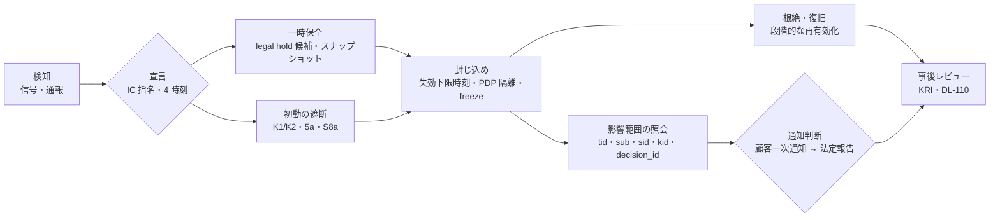
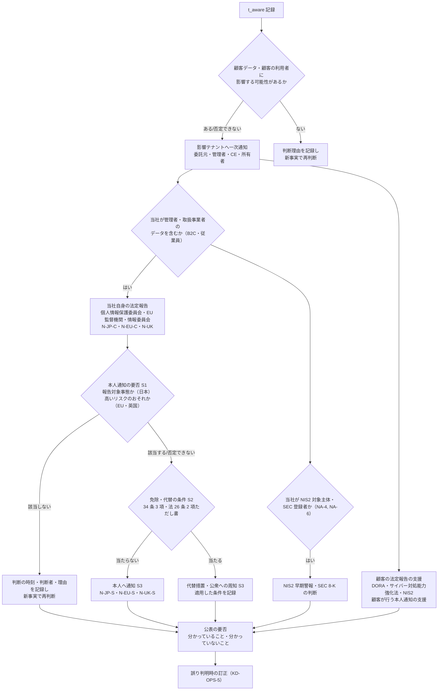

# 侵害別 runbook・演習計画

> 文書ID: OPS-01 / 版: 0.8 / 状態: draft / 最終更新: 2026-10-15（0.8（R10）: 模擬パネル ラウンド 10 の legal 指摘（High。模擬パネルは自己レビューであり実在の CTO/CISO の決裁ではない）により、侵害を伴わない可用性事象（cell・所在地群・全域の停止）でも顧客側の規制報告・契約上の通知の時計が動くことを受け、RB-A00 に A1b「通知判断」を加え、§2.4 の記録票に停止開始時刻・見込み復旧時刻・次回更新時刻の欄を、RB-A08 に A1b の行を、KD-OPS-4 に可用性事象への適用を加えた。停止を起点とする米国の銀行のサービス提供者の通知規則（12 CFR 53.4 ほか）と日本の金融機関のシステム障害報告を §2.8 に判定保留の候補として記し、CTL-02・DCS-05・research ほかへの申し送り 54〜59、残課題 21、脚注 60、末尾「レビュー記録」ラウンド 10 を加えた。0.7（R8）: 模擬パネル ラウンド 8 の redteam 指摘により、乗っ取られたテナント管理者が侵害の窓の間に与えた app-only client への同意（CON-14 AR-8）と、その同意で払い出された client・grant を除去する部品 P-CNS を §2.5 に加え、RB-03・RB-04・RB-09 の封じ込め、EX-06・EX-09・EX-15 から呼ぶようにした。§3 に共通手順「テナント管理者の乗っ取りによる同意の持続化」を置いた。CON-14・THR-03・DCS-05 などの修正は担当外のため申し送り 46〜53 とした。末尾「レビュー記録」ラウンド 8。0.6（PoC/R7反映）: PoC 系統 1 の実測レポート（POC-02）・独立再現ログ（POC-04）と模擬パネル ラウンド 7 の指摘を反映した。(1) RB-A08 に再現結果と設計上の含意（見直しトリガー・残余リスク・追加統制・追加 TC 候補）を加えた。(2) RB-12（T-092 と TC-021 の subject 側の越境書込）と RB-15（T-093 と CON-13 の lcsig 欠落）に同じ含意を加えた。(3) 共有エージェント実行環境での主体間の資格情報流用（T-094 案）の手順として RB-16 を加え、EX-17 に場面を加えた。(4) RB-01・RB-07・RB-09・RB-A03 に、PoC で見えた弱点（失効状態の配布がない検証点の遅さ、監査の結果欄の不一致 F-5、PEP の締切の不履行 X-A）の受けを加えた。系統 1 の値は立会人なしの自己実行であり、Gate 4 の証拠ではない。末尾「レビュー記録」PoC/R7反映。0.5: 模擬パネル ラウンド 7 の指摘により、(1) RB-13（破壊・恐喝）の起票期限を残課題 14 で G3 から G2 に改め、DEC-1 決議文案 12・DCS-05 RRG-071 の失効条件に揃えた（ciso）。(2) ライフサイクル事象の publisher・broker・照会 API の侵害（T-093）の手順として RB-15 と演習 EX-20 を加え、越境ゲストの付与外資源への到達（T-092）を RB-12 の対象に加えた（redteam）。(3) 署名鍵の誤撤去・JWKS 不整合による全域の検証失敗の手順として §3A に RB-A08 を、§5.2A に EX-A08 を加え、§3A.2 に FM-08・FM-09・FM-10 の受けを明記した（sre）。末尾「レビュー記録」ラウンド 7。0.4: 模擬パネル ラウンド 6 の legal 指摘により、§2.7 に本人通知の判断 S1〜S4 を、§2.8 に N-JP-S・N-EU-S・N-UK-S を加え、RB-02・RB-03・RB-12 の通知判断から参照した。末尾「レビュー記録」ラウンド 6）
> 対応要求: R-057, R-110〜R-117, R-184〜R-186, R-189.5, R-195, R-195.1〜R-195.5, R-210, R-235, R-268, R-275 ／ G-059, G-084, G-093, G-094（全 27 件と閉じ方は末尾「対応表」）／関連: R-155, R-188.3, R-192.2, R-192.4（§3A の可用性事象 runbook が演習の対象手順を与える。対応成果物欄に本書は未記載で、申し送り 4）
> 依存文書: CONVENTIONS.md, traceability/deliverables.md（DL-24）, traceability/R-requirements.md, traceability/G-goal-criteria.md, traceability/dissent-log.md（DS-04）, 05_adr/README.md, 05_adr/ADR-019-compromise-response.md, 05_adr/ADR-006-revocation-continuous-evaluation.md, 05_adr/ADR-007-key-hierarchy-kms-hsm.md, 05_adr/ADR-029-privileged-support-access.md, 05_adr/ADR-009-workload-identity-token-exchange.md（D09-06, D09-08, D09-12〜D09-14, D09-32, D09-35, D09-39, D09-41, D09-43、RR09-3、H09-04、H09-09。版 0.3 で追加）, 11_contracts/authorization-api.openapi.yaml（CON-03 §4.2・§4.3）, 11_contracts/relationship-model-registry.openapi.yaml（CON-04 §6.1〜§6.3）, 05_adr/ADR-004, ADR-008, ADR-013, ADR-014, ADR-016, ADR-017, ADR-018, ADR-024, ADR-027, 04_architecture/root-of-trust.md（ARC-03）, 06_controls/applicability.md（CTL-02）, 01_governance/stop-authority.md（GOV-06）, 01_governance/assumptions-register.md, 01_governance/loss-scenarios.md, 01_governance/kri.md, 01_governance/risk-appetite-draft.md（GOV-02）, 01_governance/business-impact-analysis.md, 04_architecture/fail-mode-matrix.md（ARC-08）, 04_architecture/capacity-model.md（ARC-13 §3.4・§5.5・§10.3・§10.4）, 05_adr/ADR-001, ADR-013, ADR-023（D23-42, D23-43, NX-12）, 07_slo/numeric-contracts.md（SLI-063, SLI-067）, 08_operations/operating-model.md（OPS-02 §3.3・§6.2）, 00_decision/05-residual-risk-register.md（RRG-040）, 02_requirements/operation-risk-tiers-assurance.md（REQ-03）, 03_threat-model/incident-casebook.md（THR-05）, 03_threat-model/threat-catalog.md, 03_threat-model/attacker-model.md, research/RS-01, RS-02, RS-05, RS-09, RS-10, RS-12, RS-13, RS-14, research/standards-status.md
> 作成方法: AI エージェント（Claude）が上記文書を読んで起草した。設計判断は ADR-019（侵害時対応の設計原則）と GOV-06（停止権限）に従い、それらに無い機能を新たに作らない。ADR はすべて proposed（決裁前）であり、ADR 間で未決の点は「未決（ADR-0xx Lxx）」と書いた。判定は自己レビューであり、実在の CTO/CISO の決裁ではない（CONVENTIONS §8）。作成者以外の照合は未実施である。research にない原典は SP 800-61 Rev.3 の CSRC 公表頁だけで、2026-10-15 に取得して題名・状態・抄録を確認した。
> 表記: runbook は RB-00（共通骨格）と RB-01〜RB-12・RB-14（版 0.3 で追加）・RB-15（版 0.5 で追加）。RB-13 は attacker-model の申し送り 4 の「破壊・恐喝」案のために欠番として残し、起票期限は G2 とする（残課題 14）、可用性事象の runbook は RB-A00（共通骨格）と RB-A01〜RB-A08（版 0.2 で追加、§3A。RB-A08 は版 0.5 で追加）、演習は EX-01〜EX-20（EX-19 は版 0.3、EX-20 は版 0.5 で追加）と EX-A01〜EX-A08（EX-A08 は版 0.5 で追加）、決裁案は KD-OPS-1〜KD-OPS-8、新規仮定は NA-OPS-1〜NA-OPS-4（前提台帳へ追加要）、残余リスクは RR-OPS-1〜RR-OPS-5 と書く。TC の仮番（TC-19-xx、TC-07-xx 等）は各 ADR の仮番をそのまま引き、採番は DL-22 で行う。表のセルのうちタグのないものは設計推論 [D] であり、この注記で個別のタグに代える。事実を述べるセルには個別にタグと脚注を付けた。

---

## 0. 結論（CTO/CISO 向け要旨）

1. **侵害 15 類型（RB-01〜RB-12、版 0.3 で加えた RB-14、版 0.5 で加えた RB-15、版 0.6 で加えた RB-16。PoC/R7反映）を、1 つの共通骨格（RB-00）の上に定義した** [D]。どの RB も「検知 → 宣言 → 初動（一時保全と最小範囲の遮断）→ 封じ込め → 証拠保全 → 根絶・復旧 → 通知判断 → 事後レビュー」の同じ順で進み、使う封じ込め部品は ADR-019 §2.10 が平時に作り込むと決めた 18 機能だけである。ただし RB-14 は、中間 CA の拒否と宣言の一時停止という 2 操作を、RB-15 は破壊的なライフサイクル処理の全域保留という 1 操作を追加で使う。これらは §2.10 になく、平時の作り込みを申し送った（§2.5 注記）[D]。侵害の最中にコードを書いて止める手順は 1 つも置いていない（GOV-06 §4.3、ADR-019 D19-01）[D]。未試験の緊急手順は必要なときに働かないと Google の SRS は述べている [V][^13]（RS-09#35）。
2. **順序の原則は「止めるのは狭く速く、戻すのは証拠と上位権限で遅く、壊す前に残す」である** [D]。鍵の破棄・テナント削除・PDP 実行環境の再作成・ログの rotation より前に証拠を保全する（ADR-019 D19-24）[D]。Storm-0558 では標準のログ保持 30 日のため侵害期間の起点を確定できなかった [I][^2]（RS-12#8）。
3. **通知の最初の期限は顧客への通知である** [D]。基盤は多くの顧客にとって委託先・処理者であり、委託先は委託元へ「速やかに」、処理者は管理者へ「不当な遅延なく」通知する [N][^20][^21][^17]（RS-02#1, #45）。顧客側の時計は DORA の初期通知（重大分類から 4 時間以内かつ認知から 24 時間以内）が最短である [N][^18]（RS-02#59）。このため全 RB で 4 時刻（最初の兆候・認知・重大分類・重要性判断）を記録し、顧客一次通知の判断を最初の判断点に置く（CTL-02 H-O01〜H-O03）[D]。社内目標時間は未決（CTL-02 L-06）である [D]。
4. **演習計画は 3 層で、侵害演習 20 件（EX-01〜EX-20。EX-19 は版 0.3、EX-20 は版 0.5 で追加）に schema migration（EX-M1）と vendor exit（EX-V1〜EX-V3）の 4 件を同じ計画に含めた** [D]。平常経路の常時運転、cell 単位の game day（初期案は四半期 1 回）、経営層を含む机上演習（年 1 回以上）である（ADR-019 D19-35）[D]。合否の時間値はすべて TBD（BIA・DL-20 から導く）で、0 件基準など二値の合否だけを確定値として置いた [D]。演習は 1 件も実施していないので、R-117・R-275・G-093 はすべて**未達**である [D]。
5. **経営・法務の判断が要る点は 8 件ある**（§6 の KD-OPS-1〜KD-OPS-8。KD-OPS-8 は版 0.2 で追加したリージョン切替の宣言権限）[D]。runbook の分岐に直接効くのは、鍵緊急失効の発動権限（ADR-019 L19-1）、全 session 失効の即時方式の例外（L19-2）、legal hold の一時保全、公表の訂正期限（THR-05 DA-4）、顧客の同意を待たない停止条項（CTL-02 L-09）の 5 件である [D]。
6A. **workload の信頼の根（法域ごとの workload CA・中間 CA、SPIFFE trust bundle）と STS・TTS の侵害の手順として RB-14 を置いた（版 0.3）** [D]。workload CA の侵害者はパーティション内の任意の SPIFFE ID を名乗れ（ADR-009 RR09-3）、STS の交換、`cnf` の束縛先、CON-03 `caller_scope`・CON-04 書込宣言・テナント横断の実行者の宣言の前提がまとめて崩れる [D]。RB-01（署名鍵）とは対象の鍵系統が別である（ADR-007 D7-11）[D]。演習は EX-19（ADR-009 H09-09 を受ける）で、未実施である [D]。
6B. **ライフサイクル事象の publisher・broker・照会 API の侵害（THR-03 T-093）の手順として RB-15 を置いた（版 0.5）** [D]。偽造した削除・付け替えの事象は約 300 の受信サービスで不可逆な処理を起こし得る [D][A-050]。RB-15 は、受信側の照会（RO-12）が必ず通る照会 API で破壊的処理を全域保留し、照会 API まで侵害された場合は遮断状態の配布路で停止を配る。そのうえで族 9 の鍵を失効・回転し、保全 → 付け替え → 猶予内の削除 → 論理削除の順に戻す [D]。演習は EX-20 で、未実施である [D]。越境ゲストの付与外資源への到達（T-092）は RB-12 の対象に加えた [D]。
6C. **PoC 系統 1 の不利な結果を、該当する RB の見直しトリガー・残余リスク・追加統制・追加 TC 候補として書き込んだ（版 0.6。PoC/R7反映）** [D]。対象は、鍵の誤撤去の未検知（TC-014、RB-A08）、越境ゲストの付与外資源への allow（TC-002 の X2、RB-12）、関係書込 API の subject 側の越境受理（TC-021、RB-12）、監査の結果欄の不一致（TC-022 の F-5、RB-07・RB-09）、PEP の締切の不履行（TC-010 の W1、RB-A03）である [D][^53]。いずれも立会人なしの自己実行（POC-02）と、実装者と別の AI エージェントによる同一機械での再現（POC-04）の結果であり、Gate 4 の証拠ではない [D][^53][^54]。手順の妥当性を示す材料にも使わず、手順を見直す契機としてだけ使う [D]。
6. **侵害でない可用性事象の手順として RB-A01〜RB-A07 を §3A に置いた（版 0.2）** [D]。対象はリージョン切替、cell 退避と待機 cell の格上げ、PDP 過負荷の shed、KMS 署名枠の枯渇（RRG-040）、全 session 失効後の再ログイン集中、顧客 IdP の停止、freeze と既知良好版への復帰の 7 件で、どれも「検知 → 宣言 → 縮退 → 切替 → 段階受付 → 正常化 → 事後分析」の同じ順（RB-A00）で進む [D]。各 RB に ARC-08 の FM 列、ARC-13 §5.5.1 の時間項、TC を対応付け、演習 EX-A01〜EX-A07 を置いた [D]。ARC-13 §5.5.1 が「リージョン切替の runbook」に委ねた T_declare の決め方は、RB-A01 の宣言条件と KD-OPS-8（宣言者）である [D]。演習は未実施で、R-210・SLI-063 は**未達**のままである [D]。版 0.5 で、署名鍵の誤撤去・JWKS 不整合による全域の検証失敗（Azure AD 2021 型）の RB-A08 と演習 EX-A08 を加えた。検知の信号は SLO-01 SLI-029（token 検証失敗率）で、値は TBD である [D]。
7. **対応表 27 件（R 23 件、G 4 件）のうち、本書だけで閉じたものはない** [D]。机上（A）で骨格を示したのが 2 件（R-110、R-268）、組織決定（B）が要るのが 2 件（R-114、G-094）、演習の実測（C）が要るのが 23 件である [D]。

---

## 1. 位置付け・範囲・読み方

### 1.1 本書が決めること・決めないこと

| 本書が決める | 他文書が決める（本書は参照する） |
|---|---|
| RB-xx の定義（12 類型）と、各 RB の検知・初動・封じ込め・復旧・証拠保全・通知判断・事後レビューの手順 | 侵害時に使う機能の方式・粒度・権限の原則（ADR-019） |
| 演習計画（EX-xx）、演習の前提条件と記録様式（E8） | 停止の権限者・代行者・発動・解除条件（GOV-06、DL-46） |
| インシデント数値（R-195.1〜R-195.5、R-189.5）の測定点と計算式 | 数値の値（DL-20、BIA）、試験の事前登録（DL-22） |
| 通知判断の手順と、RB ごとに検討すべき通知時計 | 法域ごとの通知期限の正本（CTL-02 §3.7）、判断基準の決裁（CTL-02 L-06） |
| legal hold の一時保全の扱い（ADR-019 D19-26 が本書に委ねた TBD。KD-OPS-3） | 保持期間と WORM の調停（ADR-014） |
| R-235 の 6 段階（予防・準備・検知・封じ込め・復旧・教訓反映）と本書の節の対応 | 継続保証計画への組込み（DL-32） |
| 侵害でない可用性事象の手順（RB-A01〜RB-A08、§3A）と演習（EX-A01〜EX-A08）、リージョン切替の宣言条件（ARC-13 §5.5.1 の T_declare の決め方） | 障害種別ごとの階層別挙動（ARC-08）、時間項の式と容量（ARC-13）、数値の値（DL-20 の SLI-063・SLI-067） |

- 本書は ADR-019 D19-37 の「演習計画（DL-24）は侵害対象 7 種のそれぞれに、ADR-019 の機能のどれを使うかを対応付ける」を受けて書いた [D]。依頼された 12 類型は、この 7 種（token、署名鍵、IdP、PDP、監査基盤、CI/CD、support 経路）を細分し、誤配布・第三者連携・AI エージェント・テナント越境を加えたものである（§1.3）[D]。
- 版 0.2 で、DL-24 の範囲（deliverables.md の DL-24 行は侵害対象別の RB-xx と演習計画を挙げる）を、侵害でない可用性事象の runbook まで広げた [D]。別の DL を起票せず本書に置いたのは、(1) ARC-13 §5.5.1 が T_declare の決め方を「リージョン切替の runbook（08_operations、DL-24 の演習計画）」としており参照先を変えずに済むこと、(2) 共通の記録票（§2.4）・部品（§2.5）・停止権限（GOV-06）・演習の年次計画（§5.4）と要員（A-054）を侵害の RB と共有すること、(3) 侵害と可用性事象は宣言の時点で相互に移る（§3A.1 の分岐）ことによる [D]。deliverables.md の DL-24 行の範囲の改訂は申し送り 1 とする [D]。
- runbook の手順文は「何を、どの部品で、誰の権限で行うか」までとし、製品固有のコマンドは書かない [D]。製品（ADR-001・ADR-010）が未決のため、コマンド粒度の手順は製品選定後に付録として追加する（残課題 1）[D]。

### 1.2 読み手別の入口

| 読み手 | 読む節 |
|---|---|
| CTO・CISO | §0、§2.1、§3 の各 RB 冒頭の「要点」行、§5.1、§6、対応表 |
| セキュリティ当番・IC | §2（共通骨格）、該当する RB |
| SRE 当番 | §2.5、RB-01、RB-03、RB-05、RB-06、RB-14、RB-15、§3A（RB-A01〜RB-A08）、§5 |
| 法務・広報 | §2.7（本人通知の判断 S1〜S4 を含む）、§2.8、各 RB の「通知判断」行、KD-OPS-4・KD-OPS-5 |
| 連携開発者（依存サービス・外部連携） | §2.10「依存サービスに求めること」、RB-02、RB-10、RB-11 |

### 1.3 12 類型と ADR-019 の侵害対象 7 種の対応

| RB | 類型 | ADR-019 D19-37 の 7 種 | 主な損失シナリオ | 主な攻撃者 | 主な脅威 |
|---|---|---|---|---|---|
| RB-01 | 署名鍵漏えい | 署名鍵 | S-02 | ATK-01, ATK-07, ATK-08 | T-041, T-042, T-044, T-045 |
| RB-02 | token 大量窃取 | token | S-15, S-18, S-07 | ATK-05, ATK-13, ATK-14 | T-011, T-014, T-038, T-019 |
| RB-03 | 自社 IdP・AS 侵害 | IdP（自社 AS・上流 managed IdP・管理用 IdP） | S-02, S-06, S-11 | ATK-01, ATK-08 | T-005, T-046, T-047 |
| RB-04 | 顧客 IdP 侵害 | IdP（顧客 IdP） | S-03 | ATK-04, ATK-02 | T-062, T-063, T-065, T-066, T-005（app-only client への同意。版 0.7） |
| RB-05 | PDP・policy 改ざん | PDP | S-05, S-01 | ATK-10, ATK-17, ATK-07 | T-027, T-033, T-050 |
| RB-06 | 誤 policy 配布による global allow | PDP（非敵対） | S-05 | ATK-19, ATK-10 | T-028, T-029 |
| RB-07 | 監査基盤停止・改ざん | 監査基盤 | S-10, S-16 | ATK-08, ATK-12, ATK-19 | T-054, T-055 |
| RB-08 | CI/CD 侵害 | CI/CD | S-08, S-02, S-05 | ATK-07, ATK-17, ATK-18 | T-051, T-052, T-053 |
| RB-09 | support 経路悪用 | support 経路 | S-04 | ATK-09, ATK-01 | T-003, T-049, T-011, T-005（回復後の同意。版 0.7） |
| RB-10 | 第三者連携アプリ侵害 | token（第三者 grant） | S-15 | ATK-15, ATK-05 | T-069, T-070 |
| RB-11 | AI エージェント濫用 | token（委任） | S-14 | ATK-16 | T-072〜T-075 |
| RB-12 | テナント越境漏えい発覚 | （横断） | S-01, S-09, S-05 | ATK-02, ATK-03, ATK-06, ATK-10, ATK-19 | T-020, T-021, T-076〜T-078, T-080, T-092（版 0.5 で追加） |
| RB-14 | workload CA・STS・TTS 侵害（版 0.3） | 署名鍵（workload の信頼の根）・token（派生 token の発行系）。D19-37 の 7 種には明示されていない（申し送り 10） | S-01, S-14 | ATK-06, ATK-07, ATK-08 | T-025, T-037, T-040 |
| RB-15 | ライフサイクル事象の publisher・broker・照会 API 侵害（版 0.5） | 署名鍵（ADR-007 族 9 案）・（横断）。D19-37 の 7 種には明示されていない（申し送り 31） | S-01, S-19 | ATK-06, ATK-07, ATK-08, ATK-17, ATK-19 | T-093 |
| RB-16 | 共有エージェント実行環境での主体間の資格情報流用（版 0.6。PoC/R7反映） | token（委任）・（横断） | S-14, S-01 | ATK-16 | T-094 案（THR-03 に未起票。ADR-017 H17-1） |

- RB-13 は attacker-model（申し送り 4）が「破壊・恐喝」の RB-13 案として予約した番号であり、本書の版 0.5 でも未作成である（残課題 14）[D]。起票期限は G2、所有者は CISO とする。DEC-1 決議文案 12 と DCS-05 RRG-071 の失効条件（G2 までに RB-13 が起票されなければ RRG-071 を一段上の段で扱う）に合わせた（レビュー記録 R7-1）[D]。
- RB-15 は、THR-03 T-093（P1、版 0.3 で追加）の復旧欄が「runbook は未採番（DL-24）」とし、検証欄が「publisher の侵害を想定した机上演習（DL-24）」を挙げていたのに、本書に該当がなかったため追加した（レビュー記録 R7-2）[D]。T-092（P1、THR-03 版 0.2 で追加）は封じ込めと復旧がテナント間漏えいの扱い（GOV-02 §3.4 の Z1〜Z3）であるため、新しい RB を作らず RB-12 の対象に加えた [D]。RB-14 は、ADR-009 が「workload CA・STS・TTS の侵害 runbook（H09-09）」を ADR-019・DL-24 に申し送ったのに、ADR-019 にも本書の版 0.2 にも該当がなかったため追加した（レビュー記録 R3-1）[D]。

### 1.4 前提（A-ID）と新規仮定

| A-ID | 値（基準） | 本書で効く箇所 |
|---|---|---|
| A-001 | 登録ユーザー 100 万 | 全域の失効・通知の規模 |
| A-005, A-006 | 同時アクティブ session 11.1 万、有効 session 保持数 86.5 万 | 全 session 失効の対象件数（RB-01, RB-02, RB-03） |
| A-033, A-041, A-048 | 全 session 失効後の再ログイン集中 約 556/秒（平常ピーク 51/秒の約 11 倍） | 再ログイン受付制御（G-059、EX-05） |
| A-011, A-113 | 社内 service account 1,200、静的資格情報 3,000 件のうち 50% に rotation 記録なし | 侵害通知時の全件回転（RB-08, RB-09） |
| A-013 | 外部 client 800・第三者 grant 3 万 | 連携事業者単位の一括失効（RB-10） |
| A-014 | AI エージェント主体 1 万 | エージェント停止の単位（RB-11） |
| A-050 | 依存サービス 300 | SDK による失効照合の展開対象 |
| A-054 | プラットフォームチーム 24 FTE（SRE 6、鍵管理・セキュリティ 2） | 当番・二者の確保（RR-OPS-1） |
| A-080 | B2B 利用者の業界構成（金融 10%・医療 7%・公共 5%・決済 3%） | 顧客側の通知時計（DORA 等）の適用範囲 |
| A-090, A-091 | 判定系 99.95〜99.99%、認証系 99.9〜99.95% | 誤発動の可用性上限 |
| A-114 | 顧客側 SAML 1,800・OIDC 200 接続、IdP 証明書の更新は手作業 | RB-01 の SAML 鍵、RB-04 |

新規仮定（前提台帳へ追加要）:

| 番号 | 新規仮定（前提台帳へ追加要） | 効く箇所 | 確定責任者（案） |
|---|---|---|---|
| NA-OPS-1 | 本基盤の SSO とそれに依存するチャット・会議から独立した帯域外の連絡手段（当番招集・IC 会議・顧客連絡）を、G3 までに用意できる | §2.2、全 RB の初動、EX-12 | CISO＋SRE 責任者 |
| NA-OPS-2 | 顧客のセキュリティ連絡先（委託元の窓口、DPO、CE の窓口）を、本基盤とその管理データから独立した台帳に、テナント契約時に登録してもらえる | §2.7、全 RB の通知判断 | 営業・顧客成功責任者＋法務責任者 |
| NA-OPS-3 | game day と年次机上演習に立ち会う独立立会人（DL-59・DL-30 の独立評価者、または社外）を、四半期ごとに確保できる | §5、G-093 の判定者 | CISO |
| NA-OPS-4 | 本番の canary cell で障害注入（鍵の緊急切替、PDP 隔離、テナント範囲の失効）を行うことを、canary cell に収容する顧客が契約上許容する（または合成テナントだけで canary cell を構成する） | §5.4、KD-OPS-6 | 事業責任者＋法務責任者 |

- ADR-019 の新規仮定 NA-019-1〜NA-019-4（緊急管理者の登録率、顧客 IdP の SSF 対応率、証拠の独立保存先、外部 RP の JWKS キャッシュ最大齢 24 時間）と、GOV-06 の新規仮定①〜④（24/365 のセキュリティ当番、強制停止条項、CEO 代行順位、鍵二者の常時確保）にも依存する [D]。いずれも前提台帳に未登録である [D]。

---

## 2. 共通骨格（RB-00）

全 RB は本節の骨格に従い、各 RB（§3）は差分だけを書く [D]。

### 2.1 段階と完了条件

| 段階 | 目的 | 完了条件（次へ進む条件） | 記録する時刻 |
|---|---|---|---|
| 0 検知 | 信号・通報を受ける | IC が指名され、事案 ID が起票された | t_signal（信号の受領）、後から t_first（最初の兆候） |
| 1 宣言 | 侵害（疑いを含む）として扱うと決める | 範囲（主体／client・grant・連携事業者／テナント・IdP 信頼／cell／全域）の暫定値と RB 番号が決まった | t_aware（認知＝合理的判断）、t_major（重大分類） |
| 2 初動 | これ以上の悪用を止め、証拠を消さない | 一時保全（§2.6）と最小範囲の遮断（K1・K2・5a・S8a）が完了した | t_hold、t_block |
| 3 封じ込め | 侵害範囲の全経路で拒否する | 範囲内の全検証点で拒否を確認した（GOV-06 §6.1「効果の確認」） | t_contain |
| 4 影響範囲の確定 | 通知に要る「どのテナント・主体・データ種別」を確定する | 照会（ADR-019 D19-32）の結果が IC と法務に渡った | t_scope |
| 5 通知判断 | 顧客一次通知 → 法定報告 → 本人通知の判断（§2.7 S1〜S4）→ 公表 | 判断結果と根拠が記録された | t_notify_decision、t_notify_sent、t_material（重要性判断） |
| 6 根絶・復旧 | 原因を除き、段階的に再有効化する | 解除条件（GOV-06 §4.3 (a)〜(d) ほか）を証拠で示し、解除権限者が承認した | t_release |
| 7 事後レビュー | 教訓を是正追跡に載せる | レビュー記録が DL-110 に登録された | t_review |

- 段階 2 の「一時保全」と「最小範囲の遮断」は並行して行う [D]。どちらも権限を縮める方向の操作であり、事前の二者承認を待たない（REQ-03 規則 J8、ADR-019 D19-02）[D]。
- 段階 4 と 5 は段階 3 の完了を待たない [D]。顧客の時計は認知から進むので、封じ込めが続いていても「分かっていること・分かっていないこと」を分けて一次通知する（ADR-019 D19-33、THR-05 DA-4）[D]。

### 2.2 役割と権限

| 役割 | 担うこと | 権限の正本 |
|---|---|---|
| IC（インシデント指揮者） | 宣言、RB の選択、K3 の発動、顧客一次通知の決定（CTL-02 §3.7 判断者案） | GOV-06 §3.1、§3.2。IC は RACI の 12 役割にないため DL-04 への追加が要る（GOV-06 §12）[D] |
| セキュリティ当番 | K1 の発動、主体単位の S4、一時保全の実行 | GOV-06 §3.1 |
| SRE 当番 | 遮断状態・失効状態の配布の実行、再ログイン受付制御、段階的再有効化 | GOV-06 §3.1、ADR-013 D13-38 |
| 鍵管理担当（二者） | 鍵緊急失効の実行（5a・5b） | GOV-06 §4.5、DL-14。発動権限は未決（ADR-019 L19-1、KD-OPS-1） |
| CISO | K2、テナント以上の S4、5b、S8a、通常の legal hold 前の一時保全の承認（KD-OPS-3） | GOV-06 §3.1 |
| CTO | cell・全域の S4 と 5b の同時通知先、K4 の協議 | GOV-06 §3.1 |
| CEO（経営会議） | K4 | GOV-06 §3.1、DP46-4 |
| 法務責任者 | legal hold の設定・解除、法定報告の要否、顧客通知文の確認 | REQ-05 §2 の法的保全 H、CTL-02 L-06 |
| 広報責任者 | 公表と訂正（THR-05 DA-4） | THR-05 DA-4 |
| 事業責任者 | 影響顧客への連絡の協議、K2 の解除時の協議 | GOV-06 §3.1 |

- 当番の招集・IC の会議・顧客連絡は帯域外の手段で行う（ADR-019 D19-34、NA-OPS-1）[D]。Scattered Spider は侵入後に標的組織の Slack・Teams・Exchange Online を検索して検知の有無を確かめ、インシデント対応の会議にも参加した [I][^6]（RS-12#50）。

### 2.3 宣言の基準

- 宣言は「侵害の確証」を待たない [D]。GOV-06 §4.3 の発動条件 C1（侵害の確証または高確度の検知があり、範囲内の主体・経路が使われている）に加え、本書は次のいずれかで宣言する [D]。
  - (a) 自社の発行規則に合わない token・署名の検知（発行台帳と KMS Sign 記録の差分。ADR-007 D7-45）[D]。CSRB は、自社の token 生成方式に合わない偽造 token を検知する仕組みがあれば Microsoft 単独で検知できた可能性が高いと述べた [I][^2]（RS-12#10）。
  - (b) 上流事業者・連携事業者・顧客からの侵害通知 [D]。
  - (c) 既知解判定の不一致、allow 率の急変、policy 版の後退（ADR-013 D13-27）[D]。
  - (d) 監査記録の欠損・改ざん検知（K-21）[D]。
  - (e) 管理面の操作（管理者グループへの追加、高権限 scope の付与）の異常 [D]。Cloudflare 2023 では管理者グループへの追加から 2 分で自動警報が出た [I][^5]（RS-12#30）。
- 侵害通知を受けた資格情報は、未使用と判断したものも含めて全件回転する（THR-05 CB-REQ-13、ADR-019 D19-07）[D]。Cloudflare は Okta 侵害で取られたもののうち未使用と誤判断した 1 token・3 アカウントを回転せず、それが侵入に使われた [I][^5]（RS-12#28）。

### 2.4 4 時刻と記録票

- 記録票は GOV-06 §6.1 の項目に、CTL-02 H-O01 の 4 時刻と「委託先・処理者・BA として知った時刻」を加えたものとする [D]。記録票は本基盤の監査基盤と独立した改ざん検知可能な保管先に置く（GOV-06 §6.2）[D]。
- 時刻を 1 つの記録に段階ごとに残すのは、同じ事象の日付が資料で食い違うと後から封じ込め時間を確定できないためである [D]。Storm-0558 の鍵の無効化日は、CSRB が 2023-06-24 とし、Microsoft は 06-27 に使用を遮断し 06-29 に置換を完了したとしている [I][^2][^3]（RS-12#9）。

| 欄 | 内容 | 出所 |
|---|---|---|
| t_first | 最初の兆候（事後に確定。暫定値と確定値を分ける） | CTL-02 H-O01 |
| t_signal | 信号・通報の受領 | 本書 |
| t_aware | 認知（侵害が起きたと合理的に判断した時刻） | CTL-02 H-O01 |
| t_major | 重大分類（顧客が DORA 等で使う分類の材料を確定した時刻） | CTL-02 H-O01 |
| t_material | 重要性判断（SEC 等。当社が登録者の場合） | CTL-02 H-O01、NA-4 |
| t_knew_as_processor | 委託先・処理者・BA として「知った」時刻 | CTL-02 H-O01 |
| t_hold / t_block / t_contain / t_scope / t_notify_decision / t_notify_sent / t_release / t_review | §2.1 の各段階 | 本書、GOV-06 §6.1 |
| t_outage_start / t_eta_recovery / t_next_update（版 0.8。R10-1） | 停止・縮退の開始時刻（暫定値と確定値を分ける。顧客や外部監視が先に観測した時刻があれば併記する）、見込み復旧時刻、顧客への次回の更新予定時刻。可用性事象（§3A）と侵害の両方で使い、A1b（§3A.1）で顧客へ渡す欄を t_major・範囲と共通にする | 本書 §3A.1 A1b |
| 範囲・件数 | 範囲識別子（型付き）、主体数、テナント数、cell 数 | GOV-06 §5.1-2 |
| 権限 | 発動者・実行者（同時二者の場合は両名）、代行の経過 | GOV-06 §6.1 |
| 受容票 | 本番移行停止の例外や受容票（DL-05）が事案に関わる場合、その ID（顧客への可視性の判断に使う。DS-04） | dissent-log DS-04 |

### 2.5 封じ込め部品の一覧（RB から呼ぶ部品）

本表は ADR-019 §2.10 の機能を、runbook から呼ぶ単位に並べ直したものである [D]。新しい部品は加えていない [D]。ただし版 0.3 の RB-14 は、本表にない 2 操作を使う。1 つは workload CA の中間 CA・root を検証側で拒否する操作（bundle の更新または拒否リストの配布）、もう 1 つは CON-03・CON-04 の宣言の一時停止と `subject_evidence: required` の一括適用である。いずれも侵害の最中に作るものではなく、平時に工具として作り込む前提である。方式・権限は未決で、他文書への申し送り 10・11・16・18 とした [D]。版 0.5 の RB-15 も本表にない操作を 1 つ使う。破壊的なライフサイクル処理（CON-12 RO-12 の対象）の全域保留であり、照会 API（CON-15 案）の保留状態と、遮断状態の配布路（ADR-013 D13-35）で配る停止状態の 2 経路で行う。どちらも CON-12・CON-15 に未定義で、申し送り 27・28・30 とした [D]。版 0.7 の P-CNS（同意の遡及取消）は新しい部品である。CON-14 の CRN-41 は所有テナントの管理者による同意の撤回とテナントの状態遷移を契機とし、管理者が乗っ取られた場合に基盤側から撤回する経路を持たないため、既存の P-K1・P-REV・P-SCOPE・P-OOB を組み合わせて本表に置いた。基盤側からの撤回の規則（CRN-42 案）は申し送り 46 とした [D]。

| 部品 | 内容 | 権限（GOV-06 §3.1） | 方式の正本 |
|---|---|---|---|
| P-K1 | K1 遮断（主体・client・grant・連携事業者の全 grant・テナント内 1 機能） | セキュリティ当番（ITDR の自動対応を含む） | ADR-019 D19-04、ADR-005 D7-6 |
| P-K2 | K2 遮断（1 テナントの強制停止、1 顧客 IdP 信頼の遮断） | CISO（代行: 指名代行 → セキュリティ IC は REQ-05 K-7 の条件に限る） | ADR-019 D19-04, D19-21 |
| P-K3 | K3 遮断（1 機能の全域、1 cell の新規ログイン） | IC、同時二者 | ADR-019 D19-04 |
| P-K4 | K4（基盤全体の提供停止） | CEO（経営会議）、同時二者 | ADR-019 D19-04、DP46-4 |
| P-REV | 範囲別の失効下限時刻の前進（主体・IdP・client・テナント・cell・全域） | 主体: 当番。テナント・IdP 由来: CISO。cell・全域: CISO＋同時二者＋CTO 同時通知 | ADR-019 D19-08〜D19-11、ADR-006 |
| P-5A | 鍵の署名停止と next 鍵への切替、内部検証点への失効 kid の push | 未決（ADR-019 L19-1、KD-OPS-1） | ADR-007 D7-37、ARC-03 §5.5 |
| P-5B | 検証側からの除去（外部 JWKS・trust store） | CISO＋同時二者、CTO 同時通知 | GOV-06 §4.5、ADR-019 D19-13 |
| P-PDPI | PDP 隔離（不達扱い → 別系統 PDP＋既知良好 bundle で再開 → freeze → 保全） | IC（K3 相当。cell 内）| ADR-019 D19-17, D19-18 |
| P-FRZ | 緊急 freeze（S2。剥奪・失効の配布は止めない） | 全当番 | GOV-06 §4.2、ADR-013 D13-36 |
| P-KG | 既知良好版への復帰（最低許容版・不良版 deny list 付き） | プラットフォームチーム長（緊急 push は ADR-008 の二者統制） | ADR-013 D13-34、ADR-019 D19-20 |
| P-S8A | 特権・support 経路の停止 | CISO（代行: 指名代行 → セキュリティ IC） | GOV-06 §4.8、ADR-029 |
| P-BG | break-glass（管理面の復旧、既知良好版、鍵緊急失効、AS 設定の IaC 再配備に限る） | SRE 当番＋CISO 組織当番の同時二者 | ADR-008 D8-40〜D8-42、ADR-029 D29-70〜D29-79 |
| P-RLC | 再ログイン受付制御（AS 前段の待合せ、再試行間隔の指示、テナント順受付） | SRE 当番 | ADR-019 D19-11、DL-58 |
| P-SSF | SSF による signal 送信（CAEP session-revoked、RISC credential-compromise 等） | IC | ADR-019 D19-22、ADR-006、DL-78・DL-79 |
| P-HOLD | 一時保全 → legal hold | §2.6、KD-OPS-3 | ADR-019 D19-24〜D19-27、ADR-014 D14-32 |
| P-SCOPE | 影響範囲の照会（tid・sub・sid・grant 参照・kid・decision_id・時間範囲） | IC が依頼、法務が受領 | ADR-019 D19-32、ADR-014 |
| P-ROT | 資格情報の全件回転（所有者台帳に基づく K1 単位の一括無効化） | セキュリティ当番 | ADR-019 D19-07、ADR-007、DL-50 |
| P-OOB | 帯域外の連絡手段と、基盤から独立した顧客連絡先台帳 | IC | ADR-019 D19-34、ADR-023、NA-OPS-1・NA-OPS-2 |
| P-CNS | 同意の遡及取消（版 0.7。R8-1）。侵害の窓の間に、侵害された管理者アカウントが与えた AR-8 の同意と、その同意で払い出された client・grant を列挙し、P-K1（client 単位）と P-REV（client 範囲）で止めたうえで CRN-41 の経路で retire し、顧客のセキュリティ連絡先へ P-OOB で通知する。手順は §3「テナント管理者の乗っ取りによる同意の持続化」 | 列挙と P-K1・P-REV: セキュリティ当番。retire の確定: 所有テナントの緊急管理者（PC-08(b)）による撤回。基盤側からの撤回（CRN-42 案）の権限は未定（申し送り 46・50） | CON-14 AR-8・CRN-41（基盤側の撤回は未定義）、ADR-019 D19-04・D19-08 |

- 遮断状態・失効状態は cell ごとの署名付き・単調増加の配布路で配り、control plane・管理面 login・IdP に依存させない（ADR-019 D19-05、ADR-013 D13-35）[D]。複数 cell に適用するときは工具が 1 cell ずつ順に適用し、cell ごとの適用完了を確認してから次へ進む [D]。K4 の全 cell 同時適用は ADR-013 D13-38 の例外になり、その扱いは未決（ADR-019 L19-3）である [D]。
- 内部 JWT について「失効時間が token の寿命に依存しない」が成り立つのは、共通 SDK の検証規則に失効下限時刻との照合が入った場合に限る（未決: ADR-019 L19-5）[D]。L19-5 が採られない間は、内部 JWT の失効完了は寿命 L_int の満了を待つ前提で、RB の「封じ込め完了」の判定に L_int を加える [D]。

### 2.6 証拠保全の共通手順

| 順 | 操作 | 担当 | 根拠 |
|---|---|---|---|
| H1 | 宣言と同時に、範囲内のテナント・cell の監査記録、発行台帳、KMS Sign 記録、JWKS・鍵マニフェスト・issuer metadata、PDP 判定記録・policy 版・bundle・配布記録、停止操作記録を「一時保全」に入れる（保持期限による消去を止める） | セキュリティ当番（KD-OPS-3 の推奨案） | ADR-019 D19-24, D19-25 |
| H2 | 上記をハッシュ付きで、本基盤と監査基盤から独立した保存先（別アカウント・別認証。法域パーティションごと）へ複写し、取扱記録（取得者・取得時刻・ハッシュ・引渡し先）を起票する | セキュリティ当番 | ADR-019 D19-27、NA-019-3 |
| H3 | 侵害が疑われる構成要素（PDP、Signer、CI runner、support 端末等）の実行環境のイメージ・メモリを取得してから隔離する。再利用しない | SRE 当番 | ADR-019 D19-17 手順 4、D19-25 |
| H4 | 法務責任者が legal hold に移す（一時保全の追認）。設定・解除は記録する | 法務責任者 | REQ-05 §2、ADR-014 D14-32 |
| H5 | 監査基盤・セキュリティ統制が停止した期間を、開始と終了の時刻とともに記録する | SRE 当番 | ADR-019 D19-29。PCI DSS 10.7.3 は重要なセキュリティ統制の障害への対応として障害期間の記録などを求める [N][^29]（RS-10#26） |
| H6 | 鍵の破棄・テナント削除・ログの rotation は、H1〜H4 の完了と保持要件の充足を確認してから行う | IC | ADR-019 D19-24、ADR-007 D7-35 |

- SP 800-57 Part 1 Rev.5 は侵害回復計画を文書化し容易に参照できるようにすること（shall）を求めている [N][^12]（RS-05#4）。本書の RB と §2.6 の保全手順は、その計画の一部として DL-14 の鍵管理文書から参照される [D]。
- 鍵系・管理面・発行系の記録の保持期間は ADR-014 が決める [D]。CSRB は ID 基盤と root 鍵素材へのアクセス記録を、鍵の使用期間全体に加えて失効後少なくとも 2 年保持するよう勧告した [I][^2]（RS-12#12）。
- WORM を S3 Object Lock の compliance mode で使う場合、保持期限前に object を削除する唯一の方法は関連する AWS アカウントの削除である [V][^30]（RS-10#44）。一時保全と legal hold は WORM の保持とは別の機能として扱い、調停は ADR-014 に従う [D]。

### 2.7 通知判断の共通手順

- 推奨する判断基準は CTL-02 L-06 の選択肢 A「顧客データに影響する可能性があると判断した時点で影響テナントへ一次通知し、確定情報を後続で送る」である [D]。L-06 は未決であり、社内目標時間も TBD（所有者 CISO＋法務責任者、期限 G0 で方式・G4 で値、決め方: 最短の顧客側時計から逆算し、影響特定時間の実測 EX-08 で確認）である [D]。
- 委託元（B2B 顧客）への通知は、個人情報保護委員会への速報と同じ項目で行う（施行規則 9 条）[N][^20]（RS-02#1）。
- 影響を受け得る顧客への可視性は、受容票（DL-05）でセキュリティより他を優先した判断が事案に関わる場合にも、通知判断の入力に加える（dissent-log DS-04）[D]。
- 通知判断に要る影響範囲は P-SCOPE で引く [D]。照会結果を顧客ごとに分けて配信し、影響テナント以外へ誤配信しないことを演習で確かめる（CTL-02 H-O07、EX-08）[D]。

**本人通知の判断（S1〜S4。版 0.4 で追加）**

当社が管理者・取扱事業者となる B2C 利用者・従業員のデータを含む場合（上図の E が「はい」）、当局への法定報告（N-JP-C、N-EU-C、N-UK）の判断で止めず、続けて本人への通知を判断する [D]。当局への報告と本人への通知は、要件・期限・免除条件・判断者が異なるため、別の判断として記録する（CTL-02 §3.7。同書は法務署名前の案）[D]。

| 段 | 判断すること | 日本（N-JP-S） | EU（N-EU-S）・英国（N-UK-S） |
|---|---|---|---|
| S1 要否 | 本人通知の義務が生じるか | 報告対象事態（規則 7 条の 4 類型。うち不正利用により財産的被害が生じるおそれ、不正の目的をもって行われたおそれを含む）に当たれば、報告義務を負う事業者は本人にも通知する（法 26 条 2 項、規則 7 条）[N][^21][^20]（RS-02#2, #3） | 侵害が自然人の権利と自由に高いリスクをもたらすおそれがあれば、管理者は不当な遅延なくデータ主体に通知する（34 条 1 項）[N][^17][^49]（RS-02#46） |
| S2 免除・代替 | 通知に代わる措置や免除の条件に当たるか | 本人への通知が困難な場合は、本人の権利利益を保護するため必要な代替措置をとれば足りる（法 26 条 2 項ただし書）[N][^21]（RS-02#2）。高度な暗号化等の秘匿化がされている場合等は報告を要しないとされる（通則編 GL 3-5-3-1）[N][^22]（RS-02#3）。改正法の本人通知の緩和（RS-02#12）は施行後に反映し、追跡は OI-L06 による [D] | (a) 暗号化等で権限のない者に判読不能にする措置が影響を受けたデータに適用されていた、(b) 事後措置で高リスクが生じるおそれがなくなった、(c) 不均衡な労力を要する（この場合は公衆への周知等で同等に効果的に知らせる）のいずれかなら通知を要しない（34 条 3 項）[N][^49]。EU 版の 3 項 (a) は RS-02#46 で確認済み、(b)(c) は英国版の原典でだけ確認した [D] |
| S3 実施 | 通知の時期・内容・手段 | 報告対象事態を知った後、事態の状況に応じて速やかに、本人の権利利益を保護するために必要な範囲で行う（規則 10 条）[N][^20]（RS-02#6）。委員会への速報・確報とは別の時計である [D] | 明確で平易な言葉で侵害の性質を記述し、33 条 3 項 (b)(c)(d) の情報・措置を含める（英国版 34 条 2 項）[N][^49]。英国では、管理者が通知していない場合に情報委員会が通知を求めるか、3 項の条件を満たすと決定できる（同 4 項）[N][^49] |
| S4 記録 | 記録票（§2.4）に残す項目 | 判断した時刻、判断者、S1 の当てはめ（該当する類型）、S2 で適用した条件と理由、通知・代替措置の実施時刻と手段、対象本人の数 [D] | 同左。加えて高リスクの評価に使った事実（漏えいした資格情報・token の種類、失効の完了時刻）と、DPO を選任した場合はその助言 [D] |

- 判断者は法務責任者とし、DPO を選任した場合は DPO が助言する案である [D]。CISO は S1・S2 の当てはめに使う事実（漏えいの範囲、暗号化・ハッシュ化の方式、失効の完了時刻）を確定し、事業責任者（B2C）が連絡を実施する（CTL-02 §3.7 判断者（案）、L-06）[D]。
- 資格情報（パスワード、認証器の秘密）や session・refresh token の漏えいはなりすましに直結するため、S1 で「該当する」側に当たりやすい類型とみなし、S1〜S4 を省略しない（CTL-02 §3.7「本人通知の判断」）[D]。ハッシュ化した資格情報や失効済みの token が S2 の免除・代替の条件に当たるかは法的判断であり、本書では決めない（CTL-02 L-06、H-O05）[D]。
- 当社が委託先・処理者の立場にある B2B 顧客のデータでは、本人への通知は委託元・管理者（顧客）の義務である [D]（RS-02#1, #45, #46 から導出）。当社は影響を受けた主体の特定結果を P-SCOPE で顧客ごとに分けて渡し、顧客の S1〜S3 を支援する（CTL-02 H-O04）[D]。
- 34 条は起算点を明示しない。N-EU-S・N-UK-S の起算点は、33 条の「管理者が侵害を知った時点」にそろえる案とする（CTL-02 §3.7 の案）[D]。

### 2.8 通知時計（runbook 用の抜粋）

正本は CTL-02 §3.7 であり、食い違いがあれば CTL-02 を正とする [D]。本表は RB の「通知判断」行から記号で引くための抜粋である [D]。判定（適用・条件付き）は CTL-02 の案であり、法務署名前である [D]。

| 記号 | 規制（CTL-02 の判定） | 宛先 | 期限 | 起算点 | 根拠 |
|---|---|---|---|---|---|
| N-JP-E | 個人情報保護法・委託先（適用） | 委託元（B2B 顧客） | 速やかに。委託元へ通知すれば委託先の委員会報告は免除 [N][^21][^20] | 委託先が事態を知った時点 | RS-02#1 |
| N-JP-C | 個人情報保護法・取扱事業者 → 委員会（適用、B2C・従業員） | 個人情報保護委員会 | 速報は速やかに（目安概ね 3〜5 日）、確報は 30 日（不正目的は 60 日）[N][^20][^22] | 法人のいずれかの部署が知った時点 [N][^22] | RS-02#4, #5 |
| N-JP-S | 個人情報保護法・取扱事業者 → 本人（適用、B2C・従業員。版 0.4 で N-JP-C から分離） | 本人 | 報告対象事態を知った後、事態の状況に応じて速やかに、本人の権利利益を保護するために必要な範囲で（規則 10 条）[N][^20]。通知が困難な場合は必要な代替措置で足りる（法 26 条 2 項ただし書）[N][^21]。委員会の速報・確報とは別の時計で、日数の目安は RS-02 の原典に無く未確認 [D]。判断は §2.7 S1〜S4 | 報告対象事態を知った時点 [N][^20] | RS-02#2, #6 |
| N-EU-P | GDPR・処理者（適用） | 管理者（顧客） | 不当な遅延なく [N][^17] | 処理者が知った時点 | RS-02#45 |
| N-EU-C | GDPR・管理者（適用、EU の B2C・従業員） | 監督機関 | 原則 72 時間以内（超過時は遅延理由）[N][^17] | 管理者が知った時点 | RS-02#45 |
| N-EU-S | GDPR・管理者 → データ主体（適用、EU の B2C・従業員。版 0.4 で追加） | データ主体（本人） | 高いリスクのおそれがある場合、不当な遅延なく（34 条 1 項）。暗号化等の条件に当たれば不要（34 条 3 項 (a)）[N][^17]。判断は §2.7 S1〜S4 | 34 条は起算点を明示しない。33 条の「管理者が知った時点」にそろえる案（CTL-02 §3.7）[D] | RS-02#46 |
| N-UK | UK GDPR（適用） | 情報委員会／管理者 | 72 時間以内／遅滞なく [N][^23] | 知った時点 | RS-02#50 |
| N-UK-S | UK GDPR・管理者 → データ主体（適用、英国の B2C・従業員。版 0.4 で追加） | データ主体（本人） | 高いリスクのおそれがある場合、不当な遅延なく（34 条 1 項）。3 項 (a)〜(c) のいずれかなら不要（(c) は公衆への周知等で代える）。通知しない場合、情報委員会は通知を求めるか 3 項の該当を決定できる（4 項）[N][^49]。判断は §2.7 S1〜S4 | 34 条は起算点を明示しない。33 条の「知った時点」にそろえる案（CTL-02 §3.7）[D] | 脚注 49（research 未登録。残課題 16） |
| N-NIS2 | NIS2（条件付き。当社が対象主体なら直接、NA-6） | CSIRT・所管当局 | 早期警報 24 時間、通知 72 時間、最終報告 1 か月 [N][^19] | 重大インシデントの認知 | RS-02#53 |
| N-DORA | DORA（条件付き。顧客の時計） | 所管当局（顧客が報告） | 初期通知は重大分類から 4 時間以内かつ認知から 24 時間以内、中間 72 時間、最終 1 か月 [N][^18] | 重大分類・認知 | RS-02#59 |
| N-JP-CY | サイバー対処能力強化法（条件付き。顧客の時計） | 所管大臣等（顧客が報告） | 速報 3〜5 日、詳報 30 日 [N][^24] | 認知（合理的判断） | RS-02#30, #31 |
| N-SEC | SEC Form 8-K Item 1.05（条件付き、NA-4） | SEC（公衆） | 重要性の判断から 4 営業日（判断は不当な遅延なく）[N][^25] | 重要性の判断 | RS-02#76 |
| N-CA | 加州民法 1798.82（条件付き） | 個人／データ所有者 | 個人へは 30 暦日以内、非所有者から所有者へはただちに [N][^26] | 発見・通知 | RS-02#67 |
| N-HIPAA | HIPAA・BA（条件付き、BAA） | CE（顧客） | 不合理な遅延なく、発見から 60 暦日以内 [N][^27] | 知った日、または合理的な注意で知り得た最初の日 | RS-02#69 |
| N-CIRCIA | CIRCIA（監視。効力未発生） | CISA | 72 時間、ランサム支払いは 24 時間 [N][^28] | 合理的に信じた時点 | RS-02#77 |

- 顧客が DORA 対象の金融機関である場合、当社は ICT インシデント時の支援を追加費用なし又は事前に定めた費用で提供する契約条項の対象になる [N][^42]（RS-14#66）。顧客の初期通知に要る技術情報（影響範囲、封じ込め状況、時刻）を t_major から先に渡せるよう、P-SCOPE の出力様式を顧客報告の項目に合わせる（CTL-02 H-O04）[D]。
- **停止を起点とする業界の報告規制（版 0.8。R10-1。判定保留の候補）** [D]。本表と CTL-02 §2.2・§2.4 には、侵害でなく停止そのものを起点とする銀行・金融の報告規制の行がない [D]。米国では、銀行のサービス提供者は、コンピュータ・セキュリティ・インシデント（定義は情報システムの機密性・完全性・可用性への実害を含む）で、銀行顧客への対象サービスを 4 時間以上重大に途絶・劣化させた（またはそのおそれが合理的にある）と判断したら、できるだけ速やかに銀行顧客の指定連絡先へ通知する。事前に知らせた計画保守・試験・更新は除かれる（12 CFR 53.2(b)(4)、53.4）[N][^60]。日本の金融機関のシステム障害の当局報告は、根拠条文と顧客が委託先に求める事項の原典を取得していない [D]。いずれも CTL-02 に判定保留の行（所有者 法務責任者、期限 G1）として起票し、原典を research に登録して検証してから判定するよう申し送った（申し送り 55〜57）[D]。CTL-02 の U-10（加州以外の州法、NYDFS Part 500）の判定保留の範囲には、この銀行のサービス提供者の規則は含まれていない [D]。判定までの間、本書は §3A.1 A1b で、否定できない場合に技術情報を渡す側に倒して扱う [D]。
- 規制の時計は通知の期限であり、封じ込めの期限ではない（GOV-02 §3.4.2）[D]。封じ込め（Z2）と影響範囲確定（Z3）の時間値は GOV-02 の選択肢 A/B/C（Z2: 1/4/24 時間、Z3: 4/24/72 時間）のどれを採るかで決まり、未決である [D]。

### 2.9 根絶・復旧の共通規則

- 解除は「再有効化」として別の操作にし、cell 順・テナント順に段階的に行う（ADR-019 D19-06、GOV-06 §5.2）[D]。Google の 2025-06-12 の障害では、再起動の herd effect で us-central1 の回復が最長約 2 時間 40 分に延びた [I][^15]（RS-09#66）。Cloudflare は 2025-06-12 の是正策に、キャッシュ再充填で自社基盤を DoS しないよう段階的に再有効化する工具を挙げた [I][^14]（RS-09#70）。
- 失効は戻さない [D]。全 session 失効の「解除」は、範囲内の有効な session・token が 0 件であることの計測と、再発行を止めていた場合の再開をいう（GOV-06 §4.4）[D]。侵害が疑われた鍵は疑いが晴れても再使用しない（GOV-06 §4.5）[D]。
- 既知良好版への rollback は、最低許容版と不良版 deny list で範囲を制御し、署名済み旧版の再提示を拒否する（ADR-019 D19-20）[D]。rollback で取り消した権限を戻さない（GOV-06 P4）[D]。
- テナント単位の復元（cell 全体を戻さずに 1 テナントの tuple・設定・連絡先を戻す）を使う（ADR-013 D13-39）[D]。Atlassian 2022 では多サイトの復旧を自動化できず、一部顧客で最長 14 日停止した [I][^41]（RS-09#60, #62）。

### 2.10 依存サービス・連携開発者に求めること

| 対象 | 平時に済ませておくこと | 侵害時に起きること |
|---|---|---|
| 依存サービス（約 300） | 共通 SDK・sidecar を使い、独自の JWT 検証・allow cache を持たない。長時間接続には SDK の再照合フックを使う。entry point ごとに fail-mode の階層を宣言する（ADR-013 D13-28） | 失効下限時刻・失効 kid・遮断状態を SDK が自動で受け、該当要求を拒否し、該当接続を閉じる。サービス側の作業は原則ない |
| 外部連携開発者 | 失効 kid の通知の受け方、SSF の受信（任意）、侵害時の再同意の流れを連携契約（DL-78・DL-79・DL-26）で確認する | grant の一括失効（K1）後、利用者の再同意が必要になる。JWKS を自前で cache する RP は、キャッシュ最大齢まで旧鍵を受理し得る（RR19-01） |
| 顧客管理者 | 緊急管理者（PC-08(b)）の登録、SAML 次証明書の事前登録、セキュリティ連絡先の登録 | 顧客 IdP 切離し後は緊急管理者で管理を続ける。SAML 鍵切替は事前登録の有無で顧客作業が変わる |

---

## 3. 侵害別 runbook（RB-01〜RB-12、RB-14〜RB-16）

各 RB の表の行は §2.1 の段階に揃えた [D]。「部品」欄の P-xx は §2.5、「H」は §2.6、「N-xx」は §2.8 の記号である [D]。

### RB-01 署名鍵漏えい（L2 運用鍵・Signer・L1・L0・SAML 署名鍵）

| 項目 | 内容 |
|---|---|
| 要点 | 5a（next 鍵への切替と失効 kid の push）を疑いの段階で起動し、発行台帳から影響範囲を引いて失効下限時刻を進め、5b は確証または信頼不能の場合に再ログイン受付制御と同時に行う |
| 想定 | L2 鍵（KMS 上の非エクスポート鍵）の Sign API 不正利用、Signer 実行環境の侵害、L1 による偽マニフェスト、JWKS 公開経路の差替え（T-042）、SAML 署名鍵の流出。1 cell の L2 鍵侵害は日本の 1 cell で約 1,417 テナントに偽造 token を受理させ得る（ADR-007 RR7-01） |
| 検知 | 発行台帳と KMS Sign 回数の kid ごとの照合差分（初期案 5 分粒度、ADR-007 D7-45、TC-07-11）、Signer 以外の Sign 呼出し、L1 署名回数と台帳更新要求の不一致（ARC-03 §11）、JWKS・metadata の外形監視、鍵素材流出の通報 |
| 宣言・権限 | 侵害の「疑い」で宣言する。SP 800-152 §6.8.1 は侵害または侵害が疑われる鍵を保護の適用（署名生成等）に使ってはならない（must not）とし、迅速な失効・交換と依拠当事者への通知の能力を持つべき（should）とする [N][^11]（RS-05#11）。5a の発動者は未決（ADR-007 D7-38 は on-call 単独、GOV-06 §3.1 は CISO またはセキュリティ IC＋同時二者。ADR-019 L19-1、KD-OPS-1）。5b は CISO＋同時二者、CTO 同時通知 |
| 初動 | (1) H1・H2（発行台帳・KMS 記録・JWKS とマニフェストのスナップショット）。(2) P-5A: 鍵台帳で kid を失効 → Signer を next 鍵（なければ DR 鍵）へ切替 → L1 署名の失効 kid リストを JWKS と独立した push 経路で内部検証点へ配布（ADR-007 D7-37 手順 1〜3） |
| 封じ込め | (3) 発行台帳から該当 kid で署名された jti・sid・grant 参照・tid を引き、該当範囲の P-REV を進める。範囲が特定できなければ、その鍵を信頼する範囲全体を進める（ADR-019 D19-12 手順 4）。(4) 確証または発行済み token を信頼できない場合は P-5B と P-RLC を同時に起動する（D19-13）。(5) 依拠当事者（自社サービス、外部 client、顧客 SP）へ P-OOB と P-SSF で通知する（D19-12 手順 5）。封じ込め完了は「全内部検証点が旧 kid を拒否」と「範囲内の session・token が 0 件」の両方の確認とする |
| 証拠保全 | H1〜H4。KMS 上の鍵の破棄は保持要件を満たした後に行う（ADR-007 D7-35）。鍵系へのアクセス記録は鍵の稼働期間＋2 年以上保持する（ADR-007 D7-45）[D]。CSRB 勧告 5 は失効後少なくとも 2 年の保持を求める [I][^2]（RS-12#12） |
| 根絶・復旧 | (6) JWKS から鍵を除去し、新しい next 鍵を生成・事前公開する（D7-37 手順 6）。(7) Signer の場合は実行環境を再作成し、L1 の場合は予備 L1 への切替と L0 による失効文書の ceremony（ARC-03 付録 A.6 E-2）、L0 の場合は鍵階層の再構築（A.6 E-3。ADR-019 D19-16 により本 RB の対象外で、ceremony を runbook とする）。(8) SAML 署名鍵は事前登録済みの次証明書へ切り替え、未登録の SP は顧客作業を個別に依頼する（D19-15、RR19-02）。(9) 通常運用への復帰は、新鍵の稼働、全利用側の更新（JWKS cache 最大齢の経過）、ceremony 記録の完了で判定する（GOV-06 §4.5） |
| 通知判断 | 偽造 token が使われた可能性のあるテナントへ一次通知（N-JP-E、N-EU-P、N-HIPAA、N-CA の所有者通知）。顧客の時計（N-DORA、N-JP-CY）向けに影響範囲を先に渡す。外部 RP（自社 SDK を使わない）には、JWKS キャッシュ最大齢の目安 24 時間（NA-019-4）まで旧鍵の token が受理され得ることを通知に含める。Microsoft は検証側に kid 単位・TTL 24 時間のキャッシュを推奨している [V][^40]（RS-05#40） |
| 事後レビュー | 鍵年齢（K-07）、台帳差分の検知時間（MTTD）、5a・5b の時刻、鍵差替え時間（R-195.4）。事後レビューは 24 時間以内に二者（ADR-007 D7-38 の初期案） |
| 演習・試験 | EX-01、EX-02、EX-03。TC-19-04、TC-19-05、TC-07-03、TC-07-11、CB-TC-16、CB-TC-20、GOV-06 SA-6 |
| 未決 | ADR-019 L19-1（5a の発動権限）、L19-5（内部 JWT の失効下限時刻照合）、U-01（issuer の粒度。影響範囲を「その鍵を信頼する範囲」と書いた） |

- 鍵の失効は JWKS からの除去だけでは終わらない [D]。Storm-0558 では、盗まれた鍵から派生した全資格情報を無効化するため、Microsoft は下流の各システムの関連キャッシュを消去した [I][^2]（RS-05#23）。
- **RB-14 との境界（版 0.3）**: 本 RB の対象は ADR-007 の鍵階層（L0・L1・L2）と SAML 署名鍵である [D]。workload CA（パーティションの root と発行インスタンスごとの中間 CA）と SPIFFE trust bundle は ADR-007 の L2 と別系統であり（ADR-007 D7-11、ADR-009 D09-43）、その侵害は RB-14 で扱う [D]。STS・TTS が使う内部 token の署名鍵（cell ごとの L2 鍵）の流出、または Signer の侵害は本 RB で扱い、STS・TTS の実行環境や発行方針（登録簿・発行方針台帳）の侵害で正規の鍵が不正な発行に使われた場合は RB-14 で扱う [D]。両方が疑われる場合は本 RB を先に起動し、RB-14 を並行して起動する [D]。
- 5b（検証側からの除去）は可用性への影響が大きい [D]。Azure AD 2021-03-15 では鍵削除の自動化が「retain」状態を無視して鍵を消し、依存アプリはその鍵の token を信頼しなくなり、依存サービスの回復は翌日まで分かれた [I][^10]（RS-12#57）。このため 5a と 5b を工具上も別操作にし、5b には P-RLC を必ず同時起動する [D]。
- **PoC/R7反映（版 0.6）: 失効状態の配布がない検証点の遅さ**。系統 1 の TC-014 では、鍵の緊急失効の宣言から最後の受理までが、失効状態の配布がある検証点で p50 97 ms・最大 186 ms、JWKS の再取得だけに頼る検証点で p50 4,027 ms・最大 14,062 ms だった（POC-04 の再現値。POC-02 の正式実行では配布なしで p50 3,999 ms・最大 14,066 ms）[D][^53][^54]。立会人なしの自己実行の参考値であり、SLI-025 の値の根拠にも Gate 4 の証拠にも使わない [D]。設計上の含意は次の 4 つである [D]。(a) **追加統制**: 5a の封じ込め完了（初動 (2)）の確認は、検証点種別（PEP SDK、edge、失効状態の配布を受けない検証点）ごとに最後の受理の時刻を取り、最も遅い種別で判定する。配布を受けない検証点を検証点台帳で列挙し、5a の宣言時に一覧を IC に渡す。(b) **残余リスク**: 配布を受けない検証点では、JWKS の再取得の間隔と cache の齢の分だけ偽造 token の受理が続く。外部 RP は本基盤から制御できない（RRG-010）。(c) **見直しトリガー**: 系統 2 の TC-109 または EX-01 で、配布を受けない内部の検証点が SLI-025 の上限（TBD）を超えた場合は、内部の検証点すべてに失効状態の配布を必須にするよう ADR-007 D7-37 の改訂を CTO に上げる。(d) **追加 TC 候補**: TC-07-03 に、配布あり・なしの検証点を混在させた cell での「最後の受理」の測定を加える（DL-22 で採番。申し送り 39）。
- **PoC/R7反映（版 0.6）: 撤去 3 条件の照合が任意だった点**。TC-014 では、撤去条件（未失効 token 0 件の確認）が撤去の呼出しで `check_in_use` を指定したときだけ働いた（POC-02 §6.4、MR-8）[D][^53]。本 RB の根絶 (6)「JWKS から鍵を除去」は意図した撤去なので照合の対象外とするが、撤去の操作を誤撤去と区別できるよう、撤去の記録に「緊急失効（5a）による撤去」の印と IC の承認記録を必ず残す（RB-A08 の侵害との分岐が、この印で意図した撤去を除外するため）[D]。

### RB-02 token 大量窃取（session・refresh token・access token）

| 項目 | 内容 |
|---|---|
| 要点 | 窃取された範囲を主体・テナント・client の単位で特定して P-REV で失効させ、範囲が特定できなければ一段広い範囲を即時失効し、再ログインは受付制御で段階化する |
| 想定 | infostealer・AiTM による session 窃取（T-011）、盗まれた refresh token・bearer token の再使用（T-014）、派生 token の残存（T-038）、長時間接続の失効未反映（T-019）、BFF のサーバ側 token 保管からの漏えい（T-013）、状態ストアの侵害 |
| 検知 | 管理者 session の ASN・端末の変化（CB-REQ-11）、refresh token の再使用検知、DPoP・mTLS 束縛の不一致、ITDR のリスク段階、顧客・研究者からの通報 |
| 宣言・権限 | 主体単位: セキュリティ当番（ITDR 自動を含む）。テナント・IdP 由来: CISO。cell・全域: CISO＋同時二者＋CTO 同時通知（GOV-06 §3.1 S4） |
| 初動 | (1) H1。(2) 主体単位の P-REV と、該当 client の P-K1。(3) 窃取元が support 経路なら RB-09、連携事業者なら RB-10 を並行起動 |
| 封じ込め | (4) 範囲別の失効: browser session、refresh token、外部 opaque access token、内部 JWT、派生 token、第三者 grant、管理者・特権 session、長時間接続をまとめて失効（ADR-019 D19-08）。(5) 既定は段階失効（テナント順・cell 順）。攻撃者が稼働中の session・token を保持している確度が高い場合（状態ストア・session 署名鍵の侵害、範囲を特定できない流出）は、下限時刻を一度に進めて失効を先に完了させ、P-RLC で再ログインを段階化する（D19-11。この例外は未決、ADR-019 L19-2、KD-OPS-2）。(6) 長時間接続は SDK の再照合で閉じる（TC-19-11） |
| 証拠保全 | H1・H2。session store と発行台帳の該当範囲、edge の introspection 記録 |
| 根絶・復旧 | (7) 窃取経路（端末、BFF、状態ストア）の除去。状態ストアの侵害なら AS 側の発行再開は鍵切替（RB-01）の完了後とする（GOV-06 §4.4 解除条件）。(8) 範囲内の有効 session・token 0 件を計測して完了確認 |
| 通知判断 | 窃取された token で顧客データにアクセスされた可能性があれば一次通知（N-JP-E、N-EU-P ほか）。当社の B2C・従業員の範囲なら当社の法定報告（N-JP-C、N-EU-C、N-UK）に続けて、本人通知（N-JP-S、N-EU-S、N-UK-S）の要否を §2.7 S1〜S4 で判断し記録する。token の窃取はなりすましに直結する類型として S1〜S4 を省略しない。顧客のデータでは顧客の本人通知を影響主体の特定結果で支援する |
| 事後レビュー | 全 session 失効時間（R-195.3）を T_rev の 4 項に分解して記録、再ログイン率、受付制御の待ち時間分布 |
| 演習・試験 | EX-04、EX-05。TC-19-02、TC-19-03、TC-19-11、CB-TC-05、CB-TC-09、GOV-06 SA-5 |
| 未決 | ADR-019 L19-2、L19-5 |

- 全域の失効対象は有効 session 86.5 万件と仮置きしている [A-006]。件数に比例する削除を侵害時の所要時間に入れないため、失効は下限時刻で表し、削除・掃除は後から非同期で行う（ADR-019 D19-09）[D]。
- 全 session 失効後の再ログイン集中は約 556/秒と見積もられ、平常ピーク 51/秒の約 11 倍になる [D][A-048]。G-059 は、この集中で認証基盤と顧客 IdP 連携が過負荷にならない制御を容量モデルの負荷で実測することを求めており、EX-05 で扱う [D]。
- 管理者が個人または全利用者の稼働中 session を終了できることは、ASVS 5.0.0 の 7.4.5（L2）の検証要件である [N][^39]（RS-13#55）。

### RB-03 自社 IdP・AS 侵害（cell の AS、上流 managed IdP、管理用 IdP）

| 項目 | 内容 |
|---|---|
| 要点 | 侵害 cell の新規ログインを K3 で止め、当該 cell の失効下限時刻を進め、AS の署名鍵を RB-01 で切り替え、AS 設定は IaC から再配備する。管理用 IdP の侵害は break-glass で回復する |
| 想定 | AS 実行環境・設定の改ざん、持続化（認証器の追加、認証方針の変更、T-005。乗っ取ったテナント管理者として app-only client の申請に同意すること〔CON-14 AR-8〕を含む。版 0.7）、管理者・運用者 session の乗っ取り（T-046）、上流 managed IdP の侵害、管理用 IdP の侵害。ADR-001 は依存サービスが信頼する issuer を cell 内の自社 AS に限っている（ADR-019 §3.4） |
| 検知 | 管理面の操作の異常（管理者グループ追加、IdP 追加、認証方針の変更）、AS 設定と IaC 宣言の差分、発行台帳と KMS 記録の差分、上流事業者の侵害通知 |
| 宣言・権限 | K3（1 cell の新規ログイン停止）: IC＋同時二者。cell の S4: CISO＋同時二者＋CTO 同時通知。複数 cell に及び S4・S5 で封じ込められない場合に限り K4（CEO。GOV-06 §4.3） |
| 初動 | (1) H1・H3（AS 実行環境のイメージ）。(2) P-K3 で当該 cell の新規ログインを停止。(3) 管理面への人の書込みを P-S8A で止める |
| 封じ込め | (4) 当該 cell（または侵害された IdP 由来の範囲）の P-REV。(5) AS が署名に使う鍵を RB-01 の手順で 5a → 必要なら 5b。(6) 上流 managed IdP の侵害なら、その IdP 信頼を P-K2 相当で停止し、その IdP 由来の session を IdP 単位の下限時刻で失効（ADR-019 D19-21 の方式を自社の上流 IdP に適用）。(7) 再ログインは P-RLC で段階化。(7a)（版 0.7）当該 cell または当該 IdP 由来で乗っ取られた可能性のあるテナント管理者アカウントごとに P-CNS を行う。session と refresh token の失効（(4)・(6)）は、その管理者が与えた AR-8 の同意と、同意で払い出された client_credentials の client には及ばない。CRN-40 によりその token の tid は被害テナントに固定され、管理者の session と独立に発行され続けるためである [D]。封じ込めの完了は、(4)〜(6) に加えて P-CNS の列挙分の P-K1 適用を確かめてから宣言する [D] |
| 証拠保全 | H1〜H4。AS の設定の版履歴、管理 API の呼出し記録、管理用 IdP の認証記録。AR-8 の同意記録（承認 API の記録 ID と署名付き同意票）と、その client の token 発行記録・PEP の判定記録（版 0.7） |
| 根絶・復旧 | (8) AS の設定を版管理された宣言から IaC で再配備する（ADR-008 D8-12。復旧経路が AS の管理 login に依存しない）。(9) 管理用 IdP の侵害は、その IdP の外にある封緘済み緊急アカウント（ADR-008 D8-41）で回復する。break-glass で行えるのは、管理用 IdP・JIT 承認系・CI の復旧、既知良好版への復帰と freeze、鍵の緊急失効、AS 設定の IaC 再配備に限る（ADR-008 D8-42）。新しい権限の付与と新しい鍵の作成は復旧後の通常経路で行う。(10) 新規ログインの再開は cell 順に段階的に行う |
| 通知判断 | 当該 cell に収容する全テナントへ一次通知（N-JP-E、N-EU-P、N-HIPAA）。B2C・従業員の範囲なら当社の法定報告（N-JP-C、N-EU-C、N-UK）に続けて、本人通知（N-JP-S、N-EU-S、N-UK-S）の要否を §2.7 S1〜S4 で判断し記録する（認証器の追加・資格情報の窃取があればなりすましに直結する類型として省略しない）。全域に及ぶ場合は N-SEC・N-NIS2 の該当性（NA-4、NA-6）を法務が判断 |
| 事後レビュー | IaC 再配備の所要時間、break-glass の発動窓と事後レビュー（GOV-06 S8b）、K3 の発動から全 PEP 拒否までの時間。P-CNS で列挙した同意・client の件数、宣言から P-K1 適用までの時間、封じ込め完了の宣言後に受理された当該 client の要求件数（目標 0 件。版 0.7） |
| 演習・試験 | EX-06（版 0.7 で P-CNS の場面を追加）、EX-07、EX-05。TC-19-01、GOV-06 SA-4、SA-8。CRN-42 案の TC（申し送り 46・49） |
| 未決 | ADR-008 KD8-1（管理用 IdP の形態）、ADR-013 KD13-3（AS を cell に置くか region に置くか）、ADR-001 の製品選定 |

- break-glass の資格情報は SSO や federated IdP から導出してはならない（低依存の代替がある場合を除く）と SRS は述べる [V][^13]（RS-09#41）。本 RB の回復経路は、この前提が成り立つこと（ADR-029 D29-70〜D29-79）に依存する [D]。

### RB-04 顧客 IdP 侵害

| 項目 | 内容 |
|---|---|
| 要点 | 1 つの K2 操作で、テナントの IdP 信頼の一時停止、その IdP 由来 session の失効、緊急管理者への切替、SSF 送信、顧客セキュリティ連絡先への通知を行う |
| 想定 | 侵害された顧客 IdP が、適切に認証していない者を主張する（ATK-04）。悪意ある IdP の追加と自動連結（T-062）、SAML 署名証明書の差替え（T-065）。Scattered Spider は標的組織の SSO テナントへ federated IdP を追加し、自動のアカウント連結を有効化した [I][^6]（RS-12#49）。侵害された顧客 IdP で被害テナントの管理者として認証し、app-only client の申請に AR-8 の同意を与える持続化（T-005 の拡張。版 0.7） |
| 検知 | 顧客 IdP からの SSF（RISC credential-compromise 等）の受信、IdP 追加・自動連結の有効化（CB-REQ-18 で二者承認・待機・顧客通知付き）、ログインの異常、顧客からの通報 |
| 宣言・権限 | K2: CISO（代行: 指名代行 → セキュリティ IC は REQ-05 K-7 の列挙条件に限る）。事前の二者は不要、事後の二者確認（時間は TBD、GOV-06 §4.3） |
| 初動 | (1) H1（その IdP 由来の認証イベント、linking 記録）。(2) P-K2: テナント単位の IdP 信頼の一時停止（ADR-001 D4-3、ADR-004 D04-29。接続単位で遮断し、その接続の連携 ID を凍結） |
| 封じ込め | (3) その IdP 由来の session と派生 refresh token を、IdP 単位の失効下限時刻で失効。上流 IdP の識別は token の claim ではなく session store と認証イベント記録で行う（ADR-019 D19-21 手順 2）。(4) P-SSF（CAEP session-revoked 等）。(5) そのテナントの外部付与を受けたゲスト session（資源側テナント）を凍結する（ADR-024 の侵害対応行）。(6) 顧客の緊急管理者（PC-08(b)）で管理を続ける。(6a)（版 0.7）その IdP 由来で認証したテナント管理者アカウントごとに P-CNS を行う。窓の始点は、顧客 IdP の侵害の始点（顧客の報告、SSF の受信、IdP 追加・証明書差替えの時刻のうち最も早いもの）とする。(3) の失効はその IdP 由来の session と refresh token に限られ、その管理者の同意で払い出された client_credentials の client は (3) では止まらない [D]。封じ込めの完了は P-CNS の列挙分の P-K1 適用を確かめてから宣言する [D] |
| 証拠保全 | H1・H2。顧客へ提供する証跡（認証イベント、linking 変更）を顧客ごとに分けて保全。AR-8 の同意記録と、P-CNS で列挙した client の token 発行記録・PEP の判定記録（版 0.7） |
| 根絶・復旧 | (7) 再有効化は、顧客 IdP の回復確認（鍵・管理者・認証方針の点検結果の受領）の後に CISO が行う（D19-21 手順 5）。(8) IdP 復旧後の一斉再認証は P-RLC で段階化（G-059）。(9)（版 0.7）P-CNS で止めた client は、IdP の再有効化に連動して自動で再開しない。回復した別の管理者の新しい AR-8 の同意と AR-4 を経た場合に限り再開する（RB-10 (5) と同じ扱い） |
| 通知判断 | 当社から顧客への通知は「検知した異常と自らの対応」（CTL-02 §7）。顧客 IdP 起因の侵害の法定報告は顧客が行い、当社は技術情報で支援（CTL-02 H-O04）。他テナントへの波及（ゲスト付与）があれば資源側テナントにも一次通知。P-CNS で列挙した同意・client・scope と、窓内の M2M アクセス記録を、顧客のセキュリティ連絡先へ P-OOB で通知する（版 0.7） |
| 事後レビュー | 遮断までの時間、残存 session、緊急管理者の有無（NA-019-1）、契約条項の有無による分岐（KD-OPS-7）。P-CNS の列挙件数、宣言から P-K1 適用までの時間、封じ込め完了の宣言後に受理された当該 client の要求件数（目標 0 件。版 0.7） |
| 演習・試験 | EX-08 の一部、EX-09（版 0.7 で P-CNS の場面を追加）。TC-19-06、TC-004-10、TC-01-14、CB-TC-12。CRN-42 案の TC（申し送り 46・49） |
| 未決 | 顧客の同意を待たない停止の契約条項（CTL-02 L-09、KD-OPS-7）。緊急管理者の登録必須化（principal-catalog 決裁案 4） |

- 送受信するイベント、含める情報、受信時の期待処理は trust agreement に記載することが求められ、signal に対象の特定に要る範囲を超える個人情報を含めてはならない（SP 800-63C-4 §4.8、SHALL／SHALL NOT）[N][^34]（RS-14#61）。SSF 1.0・CAEP 1.0・RISC 1.0 は Final である [N][^32][^33]（RS-14#62）。
- 契約に停止条項が無いテナントでは、K2 の発動が顧客との調整待ちになり runbook が分岐する（CTL-02 L-09 の帰結）[D]。分岐先は「顧客の同意を得るまで、当該 IdP 由来の高リスク操作（privileged・write）だけを K1 で止める」とする [D]。

### 共通手順: テナント管理者の乗っ取りによる同意の持続化（P-CNS。版 0.7 で追加。R8-1）

本手順は RB-03 (7a)、RB-04 (6a)、RB-09 (5) から呼ぶ。テナント管理者アカウントの乗っ取りが判明した場合は、経路（自社 IdP・AS、顧客 IdP、ヘルプデスク経由の回復 T-003、認証器の追加 T-005）を問わず適用する [D]。

**攻撃の流れ** [D]。(1) 攻撃者が T-003 または顧客 IdP の侵害（RB-04）で被害テナントの管理者になる。(2) その管理者として、悪意のある社内チーム（ATK-17）や侵害された consumer（ATK-06）が出した app-only client の申請に AR-8 の同意を与える。承認 API でも署名付き同意票でも同意できる（CON-14 §5 の AR-8 (a)(b)）。(3) 払い出された client の token は、CRN-40 により tid が被害テナントに固定され、管理者の session と独立に発行され続ける。RB-03・RB-04 の session・refresh token の失効はこの client に及ばないため、封じ込めの完了を宣言した後も被害テナントのデータへの M2M アクセスが続く。CON-14 H-18 が残余リスクとしたのは「欺かれた管理者の同意」と「悪意のある管理者の同意」であり、乗っ取られた管理者の同意を除去する手順はどの文書にもなかった（ラウンド 8 の指摘）。

**事例** [I]。Midnight Blizzard は、初期アクセスの後に悪意のある OAuth アプリを追加で作成し、同意を与えるための新規ユーザーを作成した [I][^57]（RS-12#16）。Microsoft の防御ガイダンスは、すべての ID と service principal の権限の監査と、app-only 権限を持つアプリへの特別な注意を推奨している [I][^57]（RS-12#21）。侵害された管理者の権限が、session の失効の後も残るアプリへの権限として持続化に使われ得ることを示す [D]。

**既存の統制では除去されない理由** [V][D]。Microsoft Entra ID は、同意設定の変更は今後の同意操作にしか影響せず、既存の同意（grant）はそのまま残ると明記している [V][^58]（RS-17#62）。本基盤でも、AR-8 の要件を後から強めても窓内に与えた同意は残るため、同意の記録から列挙して個別に取り消す必要がある [D]。また Microsoft は、悪性アプリを無効化すると新しい token と refresh token の要求は拒否されるが、既存の access token は期限まで有効のまま残ると記載している [V][^59]（RS-13#61）。本基盤でも client の retire だけでは既発行の token が残り得るため、失効下限時刻の前進（P-REV）と組み合わせる [D]。

| 段 | 内容 | 権限 |
|---|---|---|
| C1 窓の確定 | 侵害の窓は、最も早い侵害の兆候から当該アカウントの封じ込め完了までとする。始点の候補は、不審な login、ヘルプデスク経由の回復・要素移転（T-003）、認証器の追加・方針の緩和（T-005）、顧客 IdP の侵害の始点（RB-04）の時刻で、最も早いものを採る。始点を特定できない場合は、そのアカウントが管理者の役割を得た時刻まで遡り、それも不明なら同意の監査記録の保持の始点まで遡る [D] | IC |
| C2 列挙 | AR-8 の同意記録（`tenant_consent`）のうち、同意者がそのアカウントで同意時刻が窓内のものを、承認 API の記録 ID と署名付き同意票の両方から引く。同じ窓内のその管理者による scope 追加の update への同意（CRN-36 の型）と、`platform_owning_tenant` の変更への同意（CRN-39 の型）を含める。束縛された申請（request_id・target_client_id）、払い出された client と grant、scope、払出し後の token 発行記録と PEP の判定記録を P-SCOPE（client_id・tid・時間範囲）で引く [D] | セキュリティ当番（IC が依頼） |
| C3 停止 | 列挙した client を P-K1（client 単位。AS の client 無効化と edge の client_id 拒否）で止め、P-REV の client 範囲で失効下限時刻を進める。内部 JWT は L19-5 が採られない間は寿命 L_int を待つ（§2.5 の注記）。正当な業務の client が含まれ得るが、止めるのを先にし、正当性の確認は C5 で行う [D] | セキュリティ当番 |
| C4 retire | C3 の後に、CRN-41 の経路（同意の撤回を AR-0 の retire と同じに扱い、grant と token を無効化する）で retire する。CRN-41 の契機は所有テナントの管理者による撤回とテナントの状態遷移だけなので、当面は所有テナントの緊急管理者（PC-08(b)）が撤回する。緊急管理者がいない場合は、基盤側からの撤回（CRN-42 案。申し送り 46）が定まるまで P-K1 を維持し、retire は保留とする [D] | 所有テナントの緊急管理者。基盤側の撤回は未定（申し送り 50） |
| C5 再開 | 自動で再開しない。回復した別の管理者による新しい AR-8 の同意と AR-4 を経た場合に限り再開する（RB-10 (5) と同じ扱い）[D] | 所有テナントの管理者＋AR-4 の承認者 |
| C6 通知 | 顧客のセキュリティ連絡先へ P-OOB（基盤から独立した顧客連絡先台帳）で、列挙した同意・client・scope、窓内の M2M アクセス記録、C3・C4 の実施時刻を通知する。連絡先が侵害されたアカウント自身である場合は、別の管理者か緊急管理者へ送る。通知判断の続きは各 RB の通知判断と §2.7 による [D] | IC |
| C7 申請者の調査 | 列挙した申請の申請者（社内チーム・consumer）と、AR-1〜AR-4 の基盤側承認者の記録を保全し、内部不正（ATK-17）または consumer の侵害（ATK-06）として調査する。申請者が侵害の一部と疑われる場合は RB-08・RB-12 に移す [D] | IC、セキュリティ当番 |

- 検知の補助として、ヘルプデスク経由の回復・要素移転（T-003）、認証器の追加（T-005）、顧客 IdP の異常（RB-04 の検知）の後の一定時間内に同じ管理者が AR-8 の同意を与えた場合を警報にする案を置く。時間の値は TBD で、THR-03 T-005 の検知欄への追加として申し送った（申し送り 47）[D]。
- 封じ込めの完了の判定: RB-03・RB-04・RB-09 は、P-CNS の C2 の列挙が終わり、列挙分のすべてに C3 が適用されたことを確かめるまで封じ込めの完了を宣言しない [D]。C4 の retire が保留でも、C3 が維持されていれば封じ込めは完了とし、retire の保留は事後レビューの未了項目に記す [D]。
- 残余リスク [D]。(1) 窓の始点の推定が遅すぎれば、窓より前に与えられた同意は列挙されない。始点を特定できない場合に遡る規則（C1）で補うが、監査記録の保持期間を超えるものは残る。(2) 正当な業務の client を止めることによる可用性の影響。(3) C4 の基盤側からの撤回の規則がない間は、緊急管理者のいないテナントで retire が確定しない（P-K1 の維持で補う）。(4) 同意の時点でのフィッシング耐性のある step-up（申し送り 46）は、窓内の同意を除去しない。step-up は、セッションの乗っ取りだけによる同意を防ぐもので、ヘルプデスク経由の回復（T-003）で攻撃者が自分の認証器を登録した場合や、T-005 で認証器を追加された場合には効かない。
- 本手順と P-CNS は 2026-10-15 時点で実装も演習もない。前提の CON-14 の AR-8・CRN-40・CRN-41 も実装・実行されていない（CON-14 §10）[D]。見直しトリガー: EX-06・EX-09・EX-15 の P-CNS の場面、または CRN-42 案の TC で、封じ込め完了の宣言後に列挙済みの client の要求が 1 件でも受理された場合は、C3 の部品と完了の判定を見直す [D]。

### RB-05 PDP・policy 改ざん

| 項目 | 内容 |
|---|---|
| 要点 | 疑わしい PDP を cell 内で不達扱いにし、同じ cell の別系統 PDP と既知良好 bundle で再開する。policy・relationship store の改ざんならテナント単位で復元し、改ざん期間の allow 判定を洗い出す |
| 想定 | PDP 実行環境の侵害、policy・model の不正変更（T-050）、署名済み旧版の再提示（policy rollback、T-027）、relationship store への不正書込（T-033）、bundle 署名鍵の侵害 |
| 検知 | 既知解判定の不一致、allow 率・deny 率の急変、policy 版・データ版の後退（ADR-013 D13-27）、bundle 署名の検証失敗、二者レビューを経ない変更の検知（K-20） |
| 宣言・権限 | PDP 隔離は cell 内の操作として IC が行う（K3 相当、同時二者）。freeze は全当番 |
| 初動 | (1) H3（疑わしい PDP の実行環境・ログ・判定記録・bundle）。(2) P-PDPI 手順 1: 疑わしい PDP 実例を不達扱いにする遮断状態を配る。PEP は ADR-013 D13-25 の不達時の行に従う（write・privileged は拒否、read-sensitive は条件付き known-good、public は静的規則） |
| 封じ込め | (3) P-PDPI 手順 2: 同じ cell の別系統（別 AZ・別実行環境）の PDP を既知良好 bundle（署名検証済み、最低許容版以上）で起動し、合成テナントの既知解判定に合格してから受付を再開。(4) P-FRZ（当該 cell の policy・model 配布を freeze。剥奪・失効は配る）。(5) 隔離と同時に当該 cell の失効状態の版を 1 つ進め、隔離前の known-good 判定記録を使わせない（ADR-019 D19-18）。(6) bundle 署名鍵の侵害なら RB-01 の手順で鍵を失効 |
| 証拠保全 | H1〜H3。判定記録（decision_id、policy 版、データ版、cell_id、失効 epoch）、policy・model の版と配布記録 |
| 根絶・復旧 | (7) policy・relationship store の改ざんは PDP の再起動では足りないため、テナント単位の復元（ADR-013 D13-39）を行い、改ざん期間に行われた allow 判定を decision_id と policy 版で抽出する（ADR-019 D19-19）。(8) allow が拡大した差分はセキュリティ事象として調査する。(9) 改ざん元の経路（PAP、CI/CD、管理者 session）を RB-08・RB-03 で閉じる |
| 通知判断 | 改ざん期間に誤 allow があったテナントへ一次通知（N-JP-E、N-EU-P）。誤 allow が無いと確定するまでは「影響の可能性あり」として扱う（CTL-02 L-06 推奨 A） |
| 事後レビュー | 誤 allow 件数（K-04）、隔離から再開までの時間、既知解判定の検知時間 |
| 演習・試験 | EX-10。TC-19-07、TC-13-24、CB-TC-19、GOV-06 SA-2、SA-3 |
| 未決 | ADR-019 L19-4（判定記録の扱い、U-04、ADR-013 D13-24 の不等号の向き）。製品（ADR-010） |

- cell をまたいで他 cell の PDP へ切り替えることはしない [D]。ADR-013 は cell 間で同期呼出しも共有状態も持たないことを不可逆原則としている [D]。
- OPA は署名検証に失敗すると既存 bundle を使い続ける [V][^37]（RS-05#82）。ただし署名済み旧版の再提示を拒否する仕組みは公式記述で確認できていないため、版の単調性検査は自前で実装する（ADR-013 D13-31）[D]。

### RB-06 誤 policy 配布による global allow（非敵対を含む）

| 項目 | 内容 |
|---|---|
| 要点 | 誤配布の検知で当該 cell の配布を自動 freeze し、既知良好版を配布 queue に差し込んで戻す。allow 拡大差分をセキュリティ事象として洗い出す。誤配布が wave の範囲を越えていないことを先に確かめる |
| 想定 | policy・model・設定の誤配布（T-028）、評価エラーの skip による forbid ガードの無効化（T-029）、自動化の誤り（ATK-19）。CrowdStrike 2024・Google 2025-06 型の「データの変更」の全域配布（THR-05 CB-REQ-28） |
| 検知 | ADR-013 D13-27 の 3 条件（既知解の不一致、allow 率の急変、版の後退）で当該 cell の配布を自動 freeze し alarm、canary cell での bake 中の alarm、differential・shadow の誤 allow（K-04） |
| 宣言・権限 | freeze は自動または全当番。既知良好版への復帰はプラットフォームチーム長（緊急 push は ADR-008 の二者統制）。誤 allow が複数 cell に及ぶ場合は P-K3（当該機能の全域停止）を IC が判断 |
| 初動 | (1) 自動 freeze の作動確認（P-FRZ）。(2) H1（配布記録、判定記録）。(3) 誤配布が届いた cell の範囲を配布記録で確定する（D13-31 の wave 強制が働いたか） |
| 封じ込め | (4) P-KG: 各 cell に事前に置いた既知良好版を配布 queue へ差し込む（ADR-013 D13-34）。(5) 誤 allow が write・privileged に及ぶ場合、該当 entry point を P-K1（テナント内 1 機能）または P-K3 で止める。(6) 不良版を deny list に入れ、最低許容版を更新する |
| 証拠保全 | H1。配布物の版・署名・wave 番号、判定記録 |
| 根絶・復旧 | (7) 誤 allow 期間の allow 判定を decision_id と policy 版で抽出し、各テナントの資源アクセスと突合する（ADR-019 D19-19 の方式）。(8) 修正版を通常 pipeline（canary → wave）で配る。緊急変更も通常 pipeline の最大速度版で行い、別系統を持たない（ADR-008 D8-92） |
| 通知判断 | 誤 allow による実アクセスが確認されたテナントへ一次通知。実アクセスなしが確定したテナントには通知しないが、判断理由を記録する |
| 事後レビュー | 配布から検知・freeze までの時間、wave の範囲の遵守、誤 allow 件数と影響テナント数 |
| 演習・試験 | EX-11。CB-TC-19、TC-19-09、GOV-06 SA-2、SA-3 |
| 未決 | KD13-6（read-sensitive の fail-static と B_rs）、bake time の値（R-194.1） |

- Cloudflare 2025-11-18 では、既知良好 file を配布 queue に手で差し込んで復旧し、機能ごとの global kill switch の追加を是正策に挙げた [I][^16]（RS-09#74）。
- 誤った応答（全 allow）は可用性事象ではなくセキュリティ事象として調査する（ADR-013 D13-27）[D]。このため RB-06 は SRE 当番だけで閉じず、IC が通知判断を行う [D]。

### RB-07 監査基盤停止・改ざん

| 項目 | 内容 |
|---|---|
| 要点 | 監査記録を確定できない間は privileged と break-glass を止め、停止期間を記録し、改ざんの範囲を封印の連鎖で特定する。監査基盤自体を証拠の保存先にしない |
| 想定 | 監査経路の欠損（収集経路の障害、sampling、T-054）、監査記録の改ざん・削除・相手ごとに異なる内容の提示（T-055）、痕跡を消す攻撃者、クラウド管理者（ATK-08） |
| 検知 | PEP の decision_id 発行連番と監査基盤の受理記録の、監査基盤外での突合（K-21 (a)(c)）、封印（セグメント署名）の検証失敗、WORM 設定の変更 |
| 宣言・権限 | S8a（特権経路の停止）は監査経路の停止・欠損で自動発動（REQ-03 AU-5、GOV-06 §4.8 (d)）。手動は CISO |
| 初動 | (1) P-S8A（privileged/P と break-glass/P の拒否。break-glass は独立経路に記録できる場合のみ）。(2) H5（停止期間の開始時刻の記録）。(3) PEP 側のローカル耐久 spool の残量を確認（ADR-013 D13-25 の Q_r・Q_w。超えたら read-sensitive・write も拒否） |
| 封じ込め | (4) 改ざんが疑われる場合は、監査基盤の管理権限を P-S8A で止め、封印の連鎖とハッシュで改ざん範囲を特定。(5) 監査基盤の外の独立保存先へ H2 を行う（監査基盤は証拠の保存先にしない。ADR-019 D19-27） |
| 証拠保全 | H2・H5。停止期間の記録そのものが PCI DSS 10.7.3 の対応記録になる [N][^29]（RS-10#26） |
| 根絶・復旧 | (6) 収集経路の復旧後、spool の連番で欠損を埋め、埋められない欠損を件数で記録（K-21 (b)）。(7) S8a の解除条件: 原因の除去、監査経路の復旧、停止期間の監査記録の完全性確認（GOV-06 §4.8） |
| 通知判断 | 監査記録の欠損は単独では通知事由にならない場合があるが、他の RB の影響範囲を確定できなくなる（S-10）。欠損期間に他の侵害が重なる場合は、影響範囲を「確定できない」として一次通知に含める。顧客向け監査 API の欠損期間は顧客へ告知する |
| 事後レビュー | 監査欠損率、欠損の検知時間（R-193.2）、S8a の発動から privileged 拒否までの時間 |
| 演習・試験 | EX-13。GOV-06 SA-7、TC-19-10 |
| 未決 | 保持期間（CTL-02 L-03、ADR-014）、U-04（判定記録の個別署名） |

- Okta のサポートシステム侵害では、ダウンロードが別種のログイベントとして記録されていたため、14 日間特定できなかった [I][^4]（RS-12#24）。監査イベント種別の網羅は ADR-014 と ADR-029 D29-47 が持ち、本 RB は欠損を前提にした対応を定める [D]。
- **PoC/R7反映（版 0.6）: 監査の結果欄が実際の結果と食い違う型（F-5）**。TC-022 の参考実行では、監査 producer が privileged の同期送信に失敗した記録を spool から再送した際、拒否された support アクセスが outcome=success の E7 として後から記録された（POC-02 §6.3、MR-7。POC-04 では TC-022 は中止（C-8）のまま一致）[D][^53][^54]。立会人なしの自己実行の観察であり、証拠には使わない [D]。この型は欠落・重複・順序逆転と違い、件数の突合（検知の K-21 (a)(c)）では見つからない [D]。設計上の含意は次の 4 つである [D]。(a) **追加統制（検知）**: 監査記録の outcome と、PEP の判定記録（decision_id ごとの allow/deny）を監査基盤の外で突き合わせ、不一致を 1 件でも見つけたら本 RB の改ざん疑いと同じ扱いで宣言する（SLO-01 SLI-071 の欠損の型に「結果欄の不一致」を加えた。同版）。(b) **追加統制（証拠保全）**: H2 の対象に PEP 側の判定記録と spool の再送記録（再送の時刻、元の送信の失敗理由）を加え、監査基盤の outcome だけで影響範囲を確定しない。(c) **残余リスク**: ADR-014・ADR-029 が再送時の結果の記録規則を決めるまで（MR-7）、spool 経由の記録は outcome を信頼できない。特権操作の事後調査で「成功」と見える記録は、判定記録との突合を終えるまで確定扱いにしない。(d) **見直しトリガー・追加 TC 候補**: TC-011（未実施）と TC-022 の立会い下の再実行で同じ型が再現した場合は、ADR-014 の記録形式の改訂を CISO に上げる。TC-022 に「spool 再送後の outcome と判定記録の一致率 100%（規則）」の指標を加える（DL-22。申し送り 40）。

### RB-08 CI/CD 侵害

| 項目 | 内容 |
|---|---|
| 要点 | 全域 freeze で配布を止め、侵害期間に作られた成果物を provenance で特定して既知良好版へ戻し、CI の秘密と署名鍵を全件回転する |
| 想定 | build 基盤の侵害による AS・PDP・PEP SDK の改ざん（T-051）、開発者 session・PAT の窃取による保護ブランチの迂回（T-052）、CI の長寿命秘密の漏えい（T-053）、供給網の侵害（ATK-18） |
| 検知 | admission での provenance 検証の失敗、二者レビューを経ない保護ブランチ変更、CI runner の異常な秘密取得、開発者端末の侵害通報 |
| 宣言・権限 | 全域 freeze（S2）は全当番、解除はプラットフォームチーム長＋SRE 責任者（セキュリティ起因は CISO 同意） |
| 初動 | (1) P-FRZ（全域。剥奪・失効の配布は止めない）。(2) H1・H3（CI の実行記録、runner のイメージ、provenance、署名記録）。(3) 侵害が疑われる開発者・CI 機械主体の session と PAT を P-K1 で失効 |
| 封じ込め | (4) 侵害期間に署名・配備された成果物を provenance で列挙し、cell ごとに既知良好版へ戻す（P-KG）。(5) CI の秘密、成果物署名鍵、bundle 署名鍵を P-ROT で全件回転（RB-01 の手順を準用） |
| 証拠保全 | H1〜H3。リポジトリの変更履歴（force push の有無）、レビュー記録 |
| 根絶・復旧 | (6) build 基盤を再構築し、Build L3・Source L4 の統制（ADR-008）の作動を確認してから freeze を段階的に解除。(7) 長寿命の CI 秘密を OIDC 連携に置き換える（CB-REQ-20） |
| 通知判断 | 改ざんされた成果物が本番に届いた場合は、届いた cell のテナントへ一次通知。届いていないことが確定した場合は判断理由を記録 |
| 事後レビュー | 侵害期間の確定、未回転の資格情報（K-08）、freeze から全 cell 配布停止までの時間 |
| 演習・試験 | EX-14。CB-TC-07、CB-TC-15、GOV-06 SA-2 |
| 未決 | ADR-008 KD8-2（Source L4 の適用範囲） |

- SLSA v1.2 の Build L3 は、provenance 署名に使う秘密を利用者定義の build 手順から触れられないことを求める [N][^36]（RS-05#77）。Source L4 は保護ブランチへの変更を提出前に 2 名以上の信頼された者が合意することを MUST とし、L2 以上の History 要件は git では force push を禁止する技術的統制を要するとする [N][^35]（RS-05#78）。
- CircleCI では、2FA 済みの有効な SSO session がマルウェアで盗まれ、本番システムへの権限昇格に使われ、持ち出されたデータの暗号鍵は実行中のプロセスから抽出された [I][^9]（RS-12#46）。検知は顧客の通知が契機だった [I][^9]（RS-12#47）。

### RB-09 support 経路悪用

| 項目 | 内容 |
|---|---|
| 要点 | support 経路を S8a で止め、添付物・ケース本文から流出し得た token を自動失効させ、ヘルプデスク経由の要素リセット・移転を遡って点検する |
| 想定 | support システムからの添付物（HAR 等）の窃取による session 乗っ取り、support・運用者の越権アクセス（T-049）、ヘルプデスク経由の要素リセット・移転（T-003）、support 用 service account の資格情報の窃取 |
| 検知 | 添付物無害化での基盤 token の検出（ADR-029 D29-43）、昇格 grant の異常、support tool の全取得経路の監査（D29-47）、顧客からの不審 session の通報 |
| 宣言・権限 | S8a: CISO（代行: 指名代行 → セキュリティ IC）。事前の二者不要 |
| 初動 | (1) P-S8A（新規の JIT 付与、有効な昇格 grant と特権 session、support tool から顧客テナントへのアクセスを停止）。(2) H1（ケース管理システムの取得記録、昇格 grant の記録） |
| 封じ込め | (3) 期間内に受け付けた添付物・ケース本文から検出された基盤 token の session・grant を P-REV で失効し、利用者とテナントのセキュリティ連絡先へ通知（D29-43）。(4) support 用資格情報・連携 token を P-ROT で全件回転（未使用判定に頼らない）。(5) 期間内のヘルプデスク経由の回復・要素移転を列挙し、元の連絡先へ確認する（CB-REQ-19）。回復・移転の対象がテナント管理者で、乗っ取りが否定できない場合は、そのアカウントについて P-CNS を行う（版 0.7。窓の始点は回復・移転の時刻より遅くしない） |
| 証拠保全 | H1・H2。support 端末のイメージ（H3） |
| 根絶・復旧 | (6) 経路分離（D29-40）、端末束縛（D29-46）の作動を確認し、S8a を解除。解除条件は原因の除去と停止期間の監査記録の完全性確認 |
| 通知判断 | 乗っ取られた session があったテナントへ一次通知（N-JP-E、N-EU-P）。support が顧客データを閲覧していた場合は、その事実も含める |
| 事後レビュー | 添付物からの token 検出率・誤検知率（CB-TC-06）、S8a の発動時刻、ヘルプデスク回復の点検件数。P-CNS の列挙件数（版 0.7） |
| 演習・試験 | EX-15。CB-TC-06、CB-TC-13（red team、DL-59）、GOV-06 SA-7 |
| 未決 | ADR-029 L29-3（昇格 grant ID の claim と token の検出可能な形式） |

- Okta では 2023-09-28 から 10-17 まで、攻撃者が顧客サポートシステム内で 134 顧客に関係するファイルにアクセスし、その一部は session token を含む HAR ファイルで、5 顧客の正規 session の乗っ取りに使われた [I][^4]（RS-12#22）。
- **PoC/R7反映（版 0.6）**: support アクセスの事後点検（封じ込め (5)、事後レビュー）で監査記録を引くときは、RB-07 の F-5 の注記のとおり、outcome を PEP の判定記録と突き合わせてから使う [D]。系統 1 では、拒否された support アクセスが spool 再送の後に outcome=success と記録された観察がある（自己実行の参考値。証拠に使わない）[D][^53]。突合しないと、拒否されたアクセスを「顧客データを閲覧した」と誤って通知判断に載せるおそれがある [D]。再送時の記録規則（MR-7）が決まるまでは、逆向きの不一致（成功したアクセスが失敗と記録される）も否定できない [D]。

### RB-10 第三者連携アプリ侵害

| 項目 | 内容 |
|---|---|
| 要点 | 連携事業者単位で全 grant を一括失効し（K1）、大量 export の痕跡を調べ、連携事業者に保存された token は全件侵害済みとして扱う |
| 想定 | 連携事業者に保存された token の大量窃取と大量取得（T-069）、過大 scope の grant（T-070）。1 回の侵害で多数テナントの grant に及ぶ（ATK-15） |
| 検知 | 大量 export・異常な query 量の検知（CB-REQ-16）、refresh token の再使用、IP 制限違反、連携事業者・研究者からの通知 |
| 宣言・権限 | K1（連携事業者の全 grant）: セキュリティ当番。事前の二者不要 |
| 初動 | (1) P-K1（当該 publisher の全 client・grant を無効化。AS の client 無効化、edge の client_id 拒否）。(2) H1（grant 台帳、token 利用記録、export 記録） |
| 封じ込め | (3) 当該 grant から派生した token と第三者 grant を失効（ADR-019 D19-08）。外部 opaque token は edge が毎回照会するので、状態ストアでの失効で即時に効く。(4) 連携事業者が持つ当社の client secret・API 鍵を P-ROT で回転 |
| 証拠保全 | H1・H2。テナントごとの export 量と時刻を顧客へ提供できる形で保全 |
| 根絶・復旧 | (5) 連携事業者の是正確認（侵入経路、token 保管）を受けてから、テナントの管理者の再同意で grant を再開する。一括での自動再開はしない |
| 通知判断 | 当該連携の grant を持つ全テナントへ一次通知し、テナントごとのアクセス記録を提供（N-JP-E、N-EU-P）。連携事業者への通知と調整（ADR-018 の契約） |
| 事後レビュー | 一括失効の完了時間、export 検知から遮断までの時間（K-15）、高権限 grant 数（K-14） |
| 演習・試験 | EX-16。CB-TC-09、CB-TC-10、GOV-06 SA-4 |
| 未決 | THR-05 DA-3（第三者連携事業者に求める契約条件） |

- Salesloft Drift では、侵害された OAuth token が遅くとも 2025-08-08 から使われ、GTIG は Drift に保存・接続されたすべての token を侵害済みとして扱うよう勧告した [I][^7]（RS-12#37, #38）。被害者の一社 Cloudflare では、サポートケース本文の持ち出しは Bulk API 2.0 で約 3 分で、持ち出された本文から API token 104 件を見つけて回転した [I][^8]（RS-12#41）。
- RFC 9700 は refresh token を送信者拘束するか rotation することを求める（MUST）[N][^38]（RS-12#62）。平時のこの統制が、RB-10 での再使用検知の前提になる [D]。

### RB-11 AI エージェント濫用

| 項目 | 内容 |
|---|---|
| 要点 | エージェント主体・定義・所有者・tool サーバー・委任元利用者の 5 単位から最小の単位で止め、委任 grant を失効し、委任権限内で行われた操作を監査で洗い出す |
| 想定 | 間接 prompt injection による委任権限内の不正操作・情報持出し（T-072）、受け取った token の素通し（T-073）、承認の迂回（T-074）、自律動作と委任動作の混同による帰属不能（T-075） |
| 検知 | エージェント単位の量の上限超過、外部送信先 allowlist 違反、承認 grant と実際の呼出し引数の不一致（tool 側 PEP）、所有者・利用者からの通報 |
| 宣言・権限 | 停止は K1 の単位（エージェント主体・所有者・委任元）。エージェント定義の全テナント停止と tool サーバーの全域停止は K3（IC＋同時二者）。侵害の疑いでは所有者の判断を待たずに停止できる（ADR-017 D17-37） |
| 初動 | (1) P-K1: 該当エージェント主体の資格情報の新規発行停止と委任 grant の失効（D17-37）。(2) H1（`act` を含む委任記録、tool 呼出しの判定記録） |
| 封じ込め | (3) 同じ定義・tool サーバーを使う他テナントへの波及があれば P-K3。(4) 失効は ADR-006 の伝播で行う |
| 証拠保全 | H1・H2。委任元（`sub`）とエージェント（`act`）の区別を保った記録 |
| 根絶・復旧 | (5) tool 目録の操作階層と承認 grant の要否を見直し、所有者 2 名の確認後に再開 |
| 通知判断 | 委任権限内で他テナント・個人データが持ち出された場合は一次通知。エージェントが外部パートナーの MCP server 経由なら連携事業者として RB-10 の通知も行う |
| 事後レビュー | 停止の反映時間（TC-017-13）、委任権限内の不正操作の範囲（ADR-017 の残余リスク） |
| 演習・試験 | EX-17。TC-017-13 |
| 未決 | ADR-017 L17-1（製品の delegation 対応）、エージェント関係の寿命値（ADR-017 §2.7 の TBD） |

- 委任権限内の不正操作は予防できない残余リスクとされている（ADR-017 要旨）[D]。本 RB は、その範囲を止めて洗い出すことだけを扱う [D]。

### RB-12 テナント越境漏えい発覚

| 項目 | 内容 |
|---|---|
| 要点 | 既知の越境経路を 1 件でも識別した時点で、その経路を K1（テナント内 1 機能）または K3（1 機能の全域）で止め、影響範囲（どのテナントのデータが、どのテナントの主体に見えたか）を確定し、双方のテナントへ通知する |
| 想定 | BOLA・tenant confusion（T-020、T-021）、一覧・検索からの漏えい（T-076）、PEP 外データ（バックアップ、export、署名付き URL、T-077）、RAG・ベクトル DB（T-078）、越境共有の濫用（T-080）、越境ゲストの付与外資源への到達（T-092。版 0.5 で追加）。T-092 は、外部付与を持つ主体が、ドメインモデル（CAM）の誤変更（T-050）や誤った版の配布（T-028）と組み合わさって、資源側テナントの付与されていない資源に届く経路である。G 段規則 1 は外部付与の資源範囲を見ない（ADR-024 D24-08）ので、モデルの誤りが有効な間は到達し得る（THR-03 T-092、DCS-05 RRG-072）[D] |
| 検知 | cross-tenant 負例試験の失敗（K-03）、誤 allow（K-04）、PEP 未網羅の入口（K-01）、顧客・研究者からの通報。T-092 では、外部付与を持つ主体の allow のうち、付与の起点資源の子孫でない資源への allow の件数（判定記録から事後に算出する。THR-03 T-092 の検知欄、KRI の候補）と、CAM の CI 検査（外部付与の relation から到達できる permission が「外部付与可」の集合を超える変更）の違反件数を使う。RB-06（誤 policy 配布）の canary の allow 率の変化は、部分的な誤りでは小さく、T-092 の検知には足りない（THR-03 T-092 の攻撃経路）[D] |
| 宣言・権限 | 具体的な経路が 1 件でも識別された時点から Z1〜Z3 の対象になる（GOV-02 §3.4.1）。経路の遮断は K1 または K3 |
| 初動 | (1) 経路の遮断（P-K1 または P-K3）。(2) H1（該当 entry point の判定記録、資源アクセス記録） |
| 封じ込め | (3) 同じ実装パターンを持つ他の entry point を entry point 台帳から列挙し、同じ負例試験で確認。(4) 正規の越境共有（ADR-024 D24-26 の定義を満たすもの）は漏えい事象から除き、それ以外を漏えいとして扱う。外部付与の起点資源の子孫でない資源への allow は、付与が正規でも漏えいとして扱う（T-092）。(5) T-092 では、誤りを含むモデルの版を P-KG で既知良好版に戻し（RB-06 の手順、T-027・T-028 の手順）、誤りが有効だった期間の資源側テナントの外部付与を ADR-024 D24-21 の即時凍結で止める。凍結は付与外到達が確認された資源側テナントに限る。全域の外部付与の凍結は越境共有の業務を止めるため、誤りのモデルの範囲が特定できない場合に限り IC が判断する [D] |
| 証拠保全 | H1・H2。資源側テナントと home 側テナントの両方の記録。T-092 では、誤りを含むモデルの版・CAM の変更記録・二者レビューの記録・配布記録と、誤りが有効だった期間の外部付与を持つ主体の判定記録を加える [D] |
| 根絶・復旧 | (5) 修正を通常 pipeline で配り、負例試験を CI に常設。(6) 封じ込め期限（Z2）を過ぎた経路は K-02 に計上 |
| 通知判断 | データが見えたテナント（資源側）と、見た主体が属するテナントの双方へ一次通知（N-JP-E、N-EU-P、N-HIPAA）。資源側テナントが規制顧客なら顧客の時計（N-DORA）に向けて影響範囲を先に渡す。見えたデータの本人通知は顧客（委託元・管理者）が判断するため、影響を受けた主体の特定結果を顧客ごとに渡して支援する。当社が管理者・取扱事業者となる B2C・従業員のデータが含まれる場合は、当社の法定報告（N-JP-C、N-EU-C、N-UK）と本人通知（N-JP-S、N-EU-S、N-UK-S。§2.7 S1〜S4）も判断する |
| 事後レビュー | Z2・Z3 の実績（K-22）、同型経路の件数、負例試験の検出力 |
| 演習・試験 | EX-08（影響範囲の照会と影響テナントだけへの通知。版 0.5 で T-092 の場面を追加）、EX-18。T-092 は TC-002 の K2（X2）と TC-24-11 案（ADR-024 §7.1）、EX-11（誤配布）と組み合わせる [D] |
| 未決 | GOV-02 の Z2・Z3 の選択肢（A/B/C）、R-011 の「テナント間漏えいゼロ」の運用定義の承認。T-092 の G 段での資源範囲の検査（ADR-024 D24-08 の改訂案。DEC-3 の同時決裁論点 5）と CAM の CI 検査（ADR-011 D2-5 への追加）の採否 |

**PoC/R7反映（版 0.6）: 系統 1 の結果から見た RB-12 の設計上の含意**

系統 1 では、テナント境界の多層防御の独立性（ICR-02）に対して不利な兆候が 2 件出た（POC-02 §6.2 の X-C・X-D、MR-4）[D][^53]。どちらも POC-04 の再実行で同じ値が出た（TC-002 はコード同一、TC-021 は昇格 1 件が再現）[D][^54]。立会人なしの自己実行であり、Gate 4 の証拠にも原因の確定にも使わない [D]。

| 観点 | X-C（T-092。TC-002 の K2） | X-D（TC-021。関係書込の subject 側の越境受理） |
|---|---|---|
| 観測（参考値） | わざと全域 permit にした誤りモデルで、外部ゲストが付与されていない資源に allow を得た（OpenFGA 構成 275 件・一覧 480 件、Cedar 構成 90 件・一覧 178 件。すべて X2、文脈 tid・所属の不一致 X1 は 0 件）[D][^53] | façade の関係書込 API が、他テナントで作った role を自テナントの folder の viewer の subject として、ドメイン writer の資格情報で受理した（昇格の成立 1 件。参照の role サービスは拒否）[D][^53] |
| RB への含意 | 本 RB の T-092 の想定（G 段は外部付与の資源範囲を見ない。ADR-024 D24-08）が、PoC 実装でもそのとおりに現れた。モデルの誤りが有効な間は、L0 のテナント照合では止まらない [D] | 本 RB の想定（T-020・T-021）は読取り・判定の経路を主に扱っており、書込経路で他テナントの主体を関係に入れる経路を列挙していない。成立すると、以後の判定は正規の関係として allow を返すため、判定記録だけでは越境と見分けにくい [D] |
| 追加統制（検知） | 検知欄の「付与の起点資源の子孫でない資源への allow 件数」を、決裁前でも日次で算出し、1 件でも宣言する（閾値 0。KRI 化は申し送り 32 のとおり THR-03 の所有者）[D] | 関係 tuple の書込記録を走査し、subject の所属テナントと object のテナントが異なり、正規の越境共有（ADR-024 D24-26）の登録がない tuple を数える。1 件でも本 RB を宣言する。既存の tuple にも同じ走査を一度かける [D] |
| 追加統制（封じ込め） | 封じ込め (5) のとおり（既知良好版への戻しと D24-21 の即時凍結）[D] | 該当の書込 API の経路を P-K3（1 機能の全域）で止める。判定と読取りは続ける。走査で見つけた越境の tuple を削除する前に H1 で保全し、その tuple で allow された判定を decision_id で引いて影響範囲を確定する [D] |
| 残余リスク | ゲストの閉じ込めが R 段だけに依存する構造上の弱点（DCS-05 RRG-072、段2）。DEC-3 論点 5（D24-08 の改訂）の決定まで続く [D] | 書込 API が subject の所属テナントを検証する層が決まっていない（authorization-model.md の書込の不変条件か、ADR-011 の G 段か。MR-4）。決まるまでは既知の具体経路の候補であり、DCS-05 X-01（受容しない）の扱いになる [D] |
| 見直しトリガー | 立会い下の再実行で OB-TI-02 と異なる原因が見つかった場合、または DEC-3 で D24-08 の改訂が決まった場合に、本 RB の T-092 の検知・封じ込めを改める（ADR-024 §8 のトリガーと同じ）[D] | 立会い下の再実行で再現した場合、または原因が設計（検証する層が未定）と確定した場合に、本 RB の想定に書込経路を正式に加え、EX-08 の場面を改める [D] |
| 追加 TC 候補（DL-22 で採番） | TC-24-11 案（ADR-024 §7.1）を系統 2 の前に事前登録する。K2 の基準を変える場合は、データを見た後の変更として旧基準の中止を併記する（POC-02 §6.2）[D] | TC-021 に「subject の所属テナント ≠ object のテナントの書込の受理 0 件（規則）」の指標を加え、TC-002 の object 側の検査と対にする。EX-08 に、書込経路の越境 tuple の走査と影響範囲の照会の場面を加える（申し送り 41）[D] |

### RB-14 workload CA・STS・TTS 侵害（版 0.3 で追加）

| 項目 | 内容 |
|---|---|
| 要点 | 不正な SVID と不正な派生 token を検知したら、侵害の層（中間 CA／パーティションの root／STS・TTS）を切り分ける。最も狭い層で拒否し（中間 CA の拒否、STS の K3）、宣言（CON-03 `caller_scope`、CON-04 の書込宣言とテナント横断の実行者）の悪用を一時停止で止める。回復は中間 CA の再発行と全 SVID の再発行を cell 順に段階受付で行う |
| 想定 | (a) パーティションの workload CA（オフライン root、または発行インスタンスごとの中間 CA。ADR-009 D09-08 手順 1、D09-43）の秘密鍵の流出・不正署名。(b) SVID の発行系（SPIRE server 等。ADR-009 D09-02）の侵害による不正発行（登録エントリの改ざんを含む）。(c) STS・TTS の実行環境、または交換可能な組の登録簿（D09-13）・TTS 発行方針台帳の侵害による不正な派生 token・Txn-Token の発行。署名鍵は流出していない（鍵の流出は RB-01）。(a)(b) の侵害者はパーティション内の任意の SPIFFE ID を名乗れる（P09-1 で本番 1 trust domain（T1）を選んだ場合は全域。ADR-009 RR09-3）[D]。edge の SVID を名乗って外部 opaque token を内部 token へ交換させ、`cnf` を自分の SVID に束縛した token を得られる（D09-12）。CON-03 `caller_scope`、CON-04 の書込宣言（X-8）とテナント横断の実行者の宣言は SPIFFE ID の全体を鍵に引く（CON-03 §4.2、CON-04 §6.3）ので、どの宣言の主体も詐称できる。CON-03・CON-04 のテナント結合の前提がまとめて崩れる [D] |
| 検知 | (1) SVID の発行記録（シリアル、SPIFFE ID、発行インスタンス、中間 CA、有効期間）と、mTLS 終端（sidecar・SDK・STS・TTS・façade）が記録する提示 SVID のシリアル・発行者を突き合わせ、記録にないシリアルや登録外の配置からの提示を検知する（RB-01 の発行台帳と KMS Sign 記録の照合（ADR-007 D7-45）と同じ型。発行記録の欄は ADR-009 に未定義で、申し送り 11）。(2) STS の発行量の異常を検知する。呼出し元 SPIFFE ID × 呼出し先ごとの exchange 量の急増（基準は A-043 の 1,112/秒 × NA09-1 の r [A-043]）や、登録簿で拒否した件数の急増が対象である。(3) TTS の発行台帳と edge の受付記録の差（外部要求のない `txn`）と、STS の交換台帳で起点 jti に戻れない token（ADR-009 D09-35 の系譜の連続性）。(4) CON-03 `deny_guardrail:caller_scope`・`subject_binding`、CON-04 `tenant_binding_violation` の急増、照会の広がり（CON-03 §4.4）。(5) root の ceremony 記録と中間 CA の発行記録の不一致 |
| 宣言・権限 | 侵害の「疑い」で宣言する（§2.3）[D]。STS の K3（token exchange の全域または 1 cell）は IC＋同時二者（ADR-019 D19-04）。中間 CA・root を検証側で拒否する操作は、検証側からの除去（P-5B）に相当するものとして CISO＋同時二者、CTO 同時通知を推奨する。GOV-06 §4.5 は ADR-007 の鍵を対象にしており、workload CA への適用は未決である（申し送り 18）[D]。宣言の一時停止の権限者も未決とし、暫定は IC（K3 相当）とする（申し送り 16）[D] |
| 初動 | (1) H1・H2 を拡張して保全する。対象は SVID の発行記録、発行系の datastore と登録エントリ、CA の署名記録、STS の交換台帳、TTS の発行台帳、登録簿・発行方針台帳・DL-73 の宣言の版、mTLS 終端の提示記録である。(2) 侵害の層を切り分ける。中間 CA の 1 つか、root か、STS・TTS だけかを決める。(3) 中間 CA だけの侵害では、その中間 CA が発行した SVID を全検証点で拒否する。STS・TTS の侵害、または root の侵害では、該当範囲に P-K3（token exchange と Txn-Token 発行の停止）を掛ける。(4) 該当パーティションで、CON-04 のテナント横断の実行者の宣言と bulk import を一時停止し、書込宣言による tuple の書込みを一時停止する（判定と読取りは続ける。書込みが止まる間の扱いは操作階層ごとの fail-mode（ADR-013 D13-25）に従う）。CON-03 の判定宣言は変更を freeze し、該当パーティションの全呼出し元に `subject_evidence: required` を一時適用する（CON-03 §4.3 の「判定宣言の属性で必須化し、依存サービスの改修を要しない」を使う）。偽造した SVID だけでは署名済みの Txn-Token・内部 access token を作れないので、この適用で詐称の効果を落とせる。ただし前提は、内部 token の署名鍵（RB-01）と TTS が侵害されていないことである [D] |
| 封じ込め | (5) bundle を更新する。SPIFFE の bundle では、鍵の追加と失効は新しい bundle の発行で行い、失効した鍵は新しい bundle に含めない [N][^48]。bundle に root だけを載せる構成では中間 CA を bundle から外せない。その場合は、検証点に失効中間 CA の拒否リストを失効状態の配布路（ADR-013 D13-35）で配るか（自社規則で標準外。ADR-009 §3.3 の T1 欄と同じ扱い）、root を交換する。方式は H09-04 で決める（D09-41）[D]。(6) 新しい bundle を wave で配る。canary cell から 1 cell ずつ順に配り、cell ごとの適用完了を確かめてから次へ進む（§2.5、ADR-013 D13-38）。federation 先（他パーティション、D09-37）とクラウドの workload identity federation の信頼設定（D09-03）も対象に含める。bundle の refresh hint は鍵の失効の速さに効く [N][^48]。値は封じ込め時間の項として DL-20 で決める（TBD）[D]。(7) STS・TTS の侵害期間の交換台帳・発行台帳から不正に発行された token を特定し、派生元の `sid`・grant 参照の P-REV を進める。STS は失効した派生元からの exchange を拒否する（ADR-019 D19-09 の派生 token 行）。特定できなければ、該当 cell の内部 token の失効下限時刻を進める。L19-5 が採られない間は寿命 L_int の満了を待つ（§2.5）。(8) 偽造 SVID に `cnf` で束縛された token は、TLS 層で偽造 SVID が拒否されれば使えない（D09-12 の束縛検証）。封じ込め完了は次の 3 つの確認による。全検証点が拒否対象の SVID を拒否すること、範囲内の不正発行 token の受理が 0 件であること、宣言の一時停止が全 façade に反映されたことである [D] |
| 証拠保全 | H1〜H4。H3 として、発行系・STS・TTS の実行環境のイメージを取得してから再作成する。CA の秘密鍵素材と HSM の記録の破棄は、保持要件を満たした後に行う（H6、ADR-007 D7-35 と同じ扱い）[D] |
| 根絶・復旧 | (9) 中間 CA を再発行する。root による ceremony で行い、二者統制は ADR-007 の様式に従う（ADR-009 D09-43）。発行インスタンスは再作成する。root の侵害では、パーティションの root を交換する ceremony を行い、新 root を載せた bundle を (6) と同じ wave で配る。(10) 全 SVID を再発行する。新しい中間 CA の SVID を cell 順に発行し、旧 SVID を拒否するのは、各 cell で新 SVID への置換を確かめてからにする。ただし侵害した中間 CA の SVID は (3)(5) で先に拒否済みである。SVID を更新すると束縛 token は無効になり、取り直しの exchange が集中する（D09-12、A-043、NA09-1）。そのため P-RLC と同じ考え方で exchange の段階受付を行い、受付順は cell 順・操作階層順とする。平常の SVID 発行は約 6/秒で（A-012）、パーティション全体の再発行はその桁を超えるため、発行系の容量は EX-19 で測る [D][A-012]。(11) 宣言の一時停止を解除する。条件は、再発行の完了と、侵害期間中の宣言・登録簿・発行方針台帳の差分を監査した結果の確認である。解除は二者で行い、テナント横断の実行者から最後に戻す [D]。(12) 通常運用への復帰は、旧中間 CA・旧 root を参照する検証点が 0 件であること、全 SVID の置換、ceremony 記録の完了で判定する [D] |
| 通知判断 | 侵害期間中の tuple の改ざん、テナントを越えた照会・書込み、不正な派生 token による資源アクセスがあれば、影響テナントへ一次通知する（N-JP-E、N-EU-P、N-HIPAA）。影響範囲は STS の交換台帳、TTS の発行台帳、decision event の呼出し元 SPIFFE ID（CON-03 §4.4）から P-SCOPE で引く。クラウド federation（D09-03）経由でクラウド資源に触れた可能性があれば、その資源も範囲に含める [D] |
| 事後レビュー | 不正 SVID の検知時間（MTTD）、bundle の配布完了時間、全 SVID の再発行時間（H09-09 の回復時間）、宣言の一時停止の反映時間、テナント横断の実行主体の数（RRG-006 の KRI）[D] |
| 演習・試験 | EX-19（ADR-009 H09-09 を受ける）。H09-04（無効化方式）、H09-01（委任の負例）。TC は DL-22 で採番（TBD）[D] |
| 未決 | ADR-009 P09-1（trust domain の数。T1 なら範囲は全域）、H09-04（中間 CA の拒否の方式）、中間 CA・root の拒否の発動権限（申し送り 18）、宣言の一時停止の operation（CON-03・CON-04 に未定義。申し送り 16）、SVID 発行記録の欄（申し送り 11）、ADR-019 L19-5 |

- 本 RB は ADR-009 RR09-3 の統制欄「侵害 runbook（ADR-019）」と H09-09（パーティションの workload CA 侵害からの回復）の受けである [D]。ADR-009 は回復時間の値を TBD とし、ADR-019 と共同で決めるとしている [D]。本書も値を置かず、EX-19 の実測から BIA に照らして決める（§5.5）[D]。
- 宣言の一時停止は可用性を下げる [D]。tuple の書込みとテナント横断の同期が止まり、`subject_evidence` を持たない呼出し元の判定が deny になる [D]。そのため範囲は該当パーティションに限り、解除の条件を (11) に置いた [D]。

### RB-15 ライフサイクル事象の publisher・broker・照会 API 侵害（版 0.5 で追加）

| 項目 | 内容 |
|---|---|
| 要点 | 偽造・注入・再送したライフサイクル事象（削除、付け替え、保全の解除）の兆候を 1 件でも捉えたら、全受信サービスの破壊的処理を全域で保留する。保留は照会 API の保留状態と遮断状態の配布路の 2 経路で配り、片方が侵害されていても止まるようにする。次に族 9 の鍵を失効・回転し、隔離した事象を鑑識する。最後に、保全 → 付け替え → 猶予内の削除 → 論理削除の順に戻す。止める判断は狭く速く、再開は正本の監査を経て遅く行う（§0 項 2）[D] |
| 想定 | THR-03 T-093 の攻撃経路 (a)〜(e) [D]。(a) broker の事象 channel に書き込める workload の侵害による注入（PO-10 の ACL の誤り・侵害）。(b) 非本番・別 cell・別用途族の鍵の誤受理（鍵マニフェストの誤配布、(iss, typ, kid) 表の欠落）。(c) 重複判定の記録の保持（W_replay）を過ぎた正規の事象の再送。(d) publisher の侵害。署名が真正なので RO-11 では見分けられない。照会 API が同時に侵害されると RO-12 の照会も通り、効くのは RO-14 の保留と G_del だけである（CON-12 RO-14）。(e) 受信側の完了報告（deletion.report）の偽造（LC-OI-9、未決）。成立すると、約 300 の受信サービスが他テナントの資源を攻撃者のテナントへ付け替えるか、対象テナントのデータを削除する [D][A-050]。族 9 の鍵の流出だけ（publisher・broker は健全）でも (b) と同じく偽造が成立する。その範囲は当該環境 × cell のパーティションに限る（ADR-007 D7-10a）[D] |
| 検知 | (1) RO-11 による隔離の件数と警報（署名なし、検証不能、封筒と payload の不一致、許可されない (iss, typ, kid)）。(2) RO-12 の正本不一致。特に LQ09（事象が正本側の outbox の記録にない＝偽造の疑い）、LQ01（request_id が正本にない）、LQ05・LQ06（保全中の解除事象）、LQ07（mapping_ref の不一致）である（CON-15 §4、QC-3）。(3) RO-14 の閾値超過による保留（W_burst・N_burst は TBD、LC-OI-10）。(4) PO-10 の broker ACL の日次走査の差分。(5) publisher の送信記録と受信側の完了報告の突合（PO-12）の差。(6) 照会 API の監査記録（CON-15 QS-4）で、同じ事象 id への verdict が受信サービス間で食い違うこと（照会 API の応答の改ざんの兆候）[D] |
| 宣言・権限 | 次のいずれかで、侵害の「疑い」として宣言する（§2.3）[D]。(i) 破壊的な type（tenant/user.deletion.requested、tenant/user.legal_hold.released、tenant.merge.cutover・tenant.split.cutover、membership.removed）の事象が RO-11 で 1 件でも隔離された。(ii) RO-12 で LQ09・LQ01・LQ03・LQ05・LQ06・LQ07 が 1 件でも返った。(iii) RO-14 の保留が 1 受信サービスでも発火した。(iv) PO-10 の走査で、publisher 以外の workload ID に書込権限が見つかった。いずれも平常の発生は 0 件を想定する（隔離件数と正本不一致件数の目標は 0。THR-03 T-093 の検知欄）。破壊的でない type の隔離だけなら、宣言せず受信サービスの所有者と SOC で原因を調べる [D]。全域保留は K3（1 機能の全域）に相当するものとして IC＋同時二者で発動し、CISO・CTO に同時に通知する（ADR-019 D19-04 の K3 の権限を準用。GOV-06 への追加は申し送り 30）[D]。族 9 の鍵の失効は P-5A で、発動権限は未決（KD-OPS-1）[D] |
| 初動 | (1) H1・H2 を拡張して保全する。対象は、publisher の outbox と送信記録、broker の channel の保持分と ACL の構成・変更記録、族 9 の鍵台帳と KMS Sign 記録、鍵マニフェストの版、照会 API の監査記録（QS-4）、受信側の隔離領域と完了報告、正本（テナント状態・主体台帳）の変更記録と二者承認の記録である。RFC 9967 は SET の受信者に、受信の確認応答の前に自身の復旧要件を満たすよう事象を永続化することを MUST としている [N][^50]（RS-14#35）。受信側の隔離領域と未処理の事象は消さずに保全の対象にする [D]。(2) 全域保留をかける。(2a) 照会 API（CON-15）を保留状態に切り替え、verifyLifecycleAction が全 action に do_not_proceed を返すようにする。受信側は破壊的処理の直前に必ずこの照会を通る（RO-12）ので、受信サービスの改修なしに止まる。保留用の理由コードは CON-15 に未定義である（申し送り 27）。定義されるまでは LQ11（最新の正本を読めない）を返す。受信側は照会不能として保留し、再照会する（QC-3・QC-4）。期限内に proceed を得られなければ outcome=failed（照会不能）で報告する。これは削除の遅延を偽造の受理より優先する CON-12 RO-12 の原則と同じ向きである [D]。(2b) 照会 API も侵害が疑われる場合（宣言 (ii) の verdict の食い違い、または publisher と照会 API の配備・権限の共有が見つかった場合）は、(2a) に頼らない。遮断状態の配布路（cell ごとの署名付き・単調増加。control plane・管理面 login・IdP に依存しない。ADR-019 D19-05、ADR-013 D13-35）で「破壊的なライフサイクル処理の停止」を配り、共通 SDK が RO-12 の照会の前にこれを確かめる。SDK の照合点は CON-12 に未定義である（申し送り 28）。実装されるまでは、P-OOB で受信サービスの所有者に消費の停止を依頼する。この間に効く統制は RO-14 と G_del だけである [D]。(3) broker の事象 channel への書込権限を、健全と確認した publisher の workload ID だけに絞り直す（PO-10）。publisher 自体が疑わしければ、当該環境・cell の publisher を停止する（THR-03 T-093 の封じ込め欄）。停止事象をライフサイクル channel 自体で配る案は採らない。侵害された channel・鍵と同じ経路に依存し、broker が侵害されていれば届かないためである [D] |
| 封じ込め | (4) 侵害された環境 × cell の族 9 の鍵を失効し、next 鍵へ回転する（P-5A。ADR-007 D7-37 の手順を族 9 に適用する）。L1 署名付きの鍵マニフェストを更新し、旧 kid を (iss, typ, kid) 表から除く。以後、旧 kid で署名された事象は RO-11 で隔離される（ADR-007 D7-21）[D]。鍵マニフェストの誤配布（経路 (b)）では、誤って許可された組を除いた版を配る [D]。(5) 隔離した事象を鑑識する。事象ごとに、署名の kid と鍵台帳・KMS Sign 記録の照合、outbox の記録の有無（LQ09）、broker の書込み元の workload ID、正本の request_id・hold_ref・mapping_ref の有無を記録する。鑑識は隔離領域の複写で行い、原本は H2 の保存先に置く [D]。(6) 実行済みの破壊的処理を特定する。publisher の送信記録、受信側の完了報告（PO-12）、照会 API の監査記録（QS-4。proceed を返した事象）を突き合わせ、テナント × 受信サービス × 処理（削除・付け替え・保全の解除）の一覧を作る。報告の偽造（経路 (e)）があり得るので、完了報告だけに依らず、受信サービスの所有者がデータの実在を確かめる [D]。封じ込め完了は次の 3 つの確認による。全受信サービスで保留が効いていること（照会 API の監査記録と SDK の停止状態の適用記録）、旧 kid の事象の受理が 0 件であること、broker の書込権限が publisher だけであることである [D] |
| 証拠保全 | H1〜H4。H3 として、publisher・照会 API・broker の実行環境のイメージを取得してから再作成する。族 9 の鍵素材と HSM の記録の破棄は、保持要件を満たした後に行う（H6、ADR-007 D7-35）[D] |
| 根絶・復旧 | (7) publisher・照会 API を再作成し、別の workload ID・別の配備であることを確かめる（CON-12 RO-12、CON-15 QS-1）[D]。(8) 戻す順序は次のとおりとする [D]。①保全の再設定: 偽造された legal_hold.released で再開された削除を止めるため、正本の hold を確かめ、新しい鍵で legal_hold.set を送り直す。set は受信後すぐ反映される（CON-12 §2）。②付け替えの戻し: テナント越境が続いている状態なので、削除の復元より先に行う。正本の mapping と照合して戻す（C-065、DL-49 の rollback、TL-1〜TL-4）。付け替えで他テナントに見えた期間は RB-12 の手順で影響範囲を確定する。③猶予内の削除の取消し: G_del 内の要求は、正本の request_id を撤回状態にしたうえで、新しい鍵で deletion.withdrawn を送る。猶予満了時の照会は LQ02 を返し、受信側は可逆な準備を戻す（RO-13、QC-3）。④論理削除の復元: G_del を過ぎた削除は、C-065 の 3 段の削除（論理削除 → 鍵破棄 → 消去完了）の途中から復元する。鍵破棄の段に進んだテナントの鍵は、削除の待機期間内に削除予約を取り消す。AWS KMS では、待機期間は 7〜30 日で、待機期間の終了前なら鍵の削除を取り消せる。終了後は取り消せず、削除した鍵で暗号化したデータは復号できない [V][^51]（RS-10#58）。⑤戻せないもの: 論理削除の保持期間と鍵の待機期間を過ぎた削除は戻せない。テナント・データ種別・件数を記録し、通知の範囲に入れる（THR-03 T-093 の残余リスク (4)）[D]。(9) 真正な事象を取り直す。再作成した publisher が新しい鍵で署名し、受信側は RO-4 の replay で取り直す。PO-9 の再配送で署名を付け直すかは CON-12 に未定義である（申し送り 29）[D]。(10) 全域保留を解除する。条件は、(6) の一覧の全行の処置、正本の変更記録の二者による監査、族 9 の新鍵での事象の受理の確認である。解除は cell 順に行い、W_burst・N_burst を一時的に絞った値で再開する [D] |
| 通知判断 | 削除・付け替え・保全の解除が実行されたテナントへ一次通知する（N-JP-E、N-EU-P、N-HIPAA）。付け替えでは、データが他テナントに見えた資源側テナントと、付け替え先のテナントの双方を対象にする（RB-12 と同じ）。保留だけで実行されなかったテナントへの通知の要否は、法務責任者が判断する。データの削除・消失が当社自身の法定報告や本人通知に当たるかは法務の判断であり、当社が管理者・取扱事業者となる B2C・従業員のデータが含まれる場合は、N-JP-C・N-EU-C・N-UK と §2.7 S1〜S4 を通す。偽造された完了報告で顧客に誤った削除証明を出していた場合は、KD-OPS-5 の訂正の手順で訂正する [D] |
| 事後レビュー | 隔離から宣言までの時間（MTTD）、全域保留の反映時間（照会 API 経路と配布路の別）、保留中に実行された破壊的処理の件数、族 9 の鍵の失効・回転の時間、戻した件数と戻せなかった件数、RO-14 の W_burst・N_burst の妥当性（DCS-05 RRG-073 の KRI）[D] |
| 演習・試験 | EX-20（版 0.5 で追加）。TC: LC-CV-09〜LC-CV-16（CON-12、MK-08）、TC-07-01 の族 9 の負例（ADR-007）、TL-1〜TL-4（統合・分割）。TC は DL-22 で採番（TBD）[D] |
| 未決 | 照会 API の保留用の理由コード（申し送り 27）、遮断状態の配布路による停止と SDK の照合点（申し送り 28）、replay 時の署名の付け直し（申し送り 29）、全域保留の発動・解除の権限（申し送り 30）、ADR-007 族 9・KD7-9（DEC-3）、CON-15 の GA、LC-OI-9（報告の署名）、W_burst・N_burst（LC-OI-10）、G_del（LC-OI-7）、ADR-019 L19-1 |

- 本 RB は THR-03 T-093 の復旧欄「runbook は未採番（DL-24）」と検証欄「publisher の侵害を想定した机上演習（DL-24）」の受けである [D]。
- **RB-01・RB-12 との境界**: 族 9 の鍵の流出は、鍵としては RB-01 の対象である。ただし偽造の影響（破壊的処理）の封じ込めと復旧は本 RB で行う。両方を並行して起動し、鍵の失効・回転は RB-01 の P-5A の手順に一本化する [D]。付け替えでデータが他テナントに見えた範囲の確定と通知は RB-12 で行う [D]。正本に誤った要求を書ける者（二者承認を通った誤り・悪意）の事象は、署名も照会も通るので本 RB の検知 (1)(2) では捉えられない。捉えられるのは RO-14 と G_del の間の検知だけである（THR-03 T-093 の残余リスク (2)）[D]。
- 全域保留は可用性を下げる [D]。正規のテナント削除・統合・分割と、法定期限のある削除も止まる。そのため解除の条件を (10) に置き、保留が法定期限に掛かる削除は法務責任者に報告する [D]。CON-12 §2 は削除の未報告をサービス所有者へのエスカレーションとしており、法務への報告は本書で加えた扱いである [D]。
- **PoC/R7反映（版 0.6）: 系統 1 に T-093 の試験はなく、RB-15 を支える実測は 0 件である** [D]。POC-02 の 23 TC にライフサイクル事象の配送を扱うものはない [D][^53]。RB-15 の宣言基準・全域保留・復元の順序は、すべて設計推論のまま EX-20 を待つ [D]。
- **PoC/R7反映（版 0.6）: CON-13 の Envelope に `lcsig` がない（模擬パネル ラウンド 7 MP-7-16）** [D][^56]。CON-12 は全事象に `lcsig` を付け（PO-13）、受信側は処理の前に検証する（RO-11）としている [D]。しかし CON-13 の JSON Schema（11_contracts/schemas/lifecycle-event.schema.json）は `lcsig` と withdrawn 系の type を定義していない（2026-10-15 時点で文字列 `lcsig` の出現 0 件）[D]。このままだと、署名のない事象が schema 適合と判定される [D]。RB-15 への含意は次の 4 つである [D]。(a) **追加統制（検知）**: 宣言基準 (i) の「RO-11 で隔離」は、schema 検証ではなく JWS の検証の結果で数える。受信サービスが schema 適合だけで受理していないかを、EX-20 の注入 (b)（署名なしの事象）で確かめる。(b) **残余リスク**: CON-13 が直るまで、受信サービスが schema 検証を署名検証の代わりに実装する余地が残る。その受信サービスでは、検知 (1) が働かず、検知 (2)（RO-12 の正本照会）と (3)（RO-14）だけが残る。(c) **見直しトリガー**: CON-13 の改訂で `lcsig` が必須になった時点で、EX-20 の注入 (b) の合否を改める。復元の順序 ③ は deletion.withdrawn に依存するので、CON-13 に withdrawn 系の type が入るまでは、③ を「正本の request_id の撤回と受信サービスの所有者への P-OOB の依頼」で代える。(d) **追加 TC 候補**: LC-CV に「schema に適合し `lcsig` がない事象の受理 0 件（規則）」を加える（CON-11 MK-08。申し送り 42）[D]。

### RB-16 共有エージェント実行環境での主体間の資格情報流用（T-094 案。版 0.6 で追加。PoC/R7反映）

| 項目 | 内容 |
|---|---|
| 要点 | 他テナントのエージェント主体の資格情報（SVID・委任 token・鍵・承認 grant）が、別テナントのタスクの実行単位から使われた兆候を 1 件でも捉えたら、テナント間の既知の経路として扱う（受容しない。DCS-05 X-01）。該当の実行環境を K3 で止め、両テナントの主体の資格情報を失効し、tool 側 PEP の判定記録から越境の操作を洗い出す [D] |
| 想定 | ADR-017 §1.3 の T-094 案 [D][^55]。テナント A の文書・tool 応答に埋め込んだ間接 prompt injection（ATK-16）で、同じ実行環境に同居するテナント B のエージェント主体の資格情報を使わせ、tool 側 PEP に正規の B 主体として allow させる。前提として、D17-07 (a)（実行単位をテナント主体ごとに分ける）か (b)（tool 側 PEP が実行中タスクのテナントと資格情報の `tid` の一致を検査し、token を提示元主体の鍵に束縛する）の実装不備がある（RR17-08 (i)）[D][^55]。(a)(b) を正しく実装しても残る同一物理基盤のサイドチャネル（RR17-08 (ii)、RRG-075）は、観測した時点で本 RB に移す [D]。RB-11 の対象（委任権限の内側での不正操作）と違い、本 RB はテナントの境界を越える [D] |
| 検知 | (1) tool 側 PEP の `tid` 不一致による拒否（D17-07 (b)）。平常の発生は 0 件を想定し、1 件でも宣言の材料にする。(2) sender-constrained の束縛検証の失敗（他主体の token を自主体の鍵で提示した）。(3) 実行単位の割当て記録（タスクのテナント → 実行単位）と、実行単位が提示した SVID の主体のテナントの不一致。(4) RB-11 の検知（外部送信先の allowlist 違反、承認 grant と呼出し引数の不一致）のうち、資源のテナントがタスクのテナントと異なるもの。(5) 利用者・顧客・研究者からの通報 [D] |
| 宣言・権限 | 検知 (2)(3) は 1 件で宣言する。検知 (1) は拒否で止まっているが、同じ実行環境の別の呼出しが (b) の検査を通った可能性を否定できないため、1 件で調査を始め、同じ実行環境で 2 件目または (2)(3)(4) が重なれば宣言する（閾値は初期案。EX-17 で見直す）[D]。具体的な経路が 1 件でも識別された時点から GOV-02 §3.4.1 の Z1〜Z3 の対象になる（RB-12 と同じ）[D]。実行環境の全域停止は K3（IC＋同時二者）。エージェント主体・所有者の単位の停止は K1 で、所有者の判断を待たない（ADR-017 D17-37）[D] |
| 初動 | (1) H1（実行単位の割当て記録、提示 SVID・token の記録、tool 側 PEP の判定記録（`sub`・`act`・`tid` を区別したもの）、注入元の文書・tool 応答）。(2) 該当の実行環境（同じ物理基盤・同じプール）を P-K3 で止め、新しいタスクを受けない。(3) A・B 両テナントの、その実行環境で動いたエージェント主体の資格情報の新規発行を止め、委任 grant を失効する（P-K1、D17-37）[D] |
| 封じ込め | (4) 同じ実行形態の他のプールを列挙し、割当て記録と提示 SVID の突合を同じ規則でかける。(5) 注入元の文書・索引を隔離する（T-078 の索引は RB-12）。(6) 失効は ADR-006 の伝播で行い、反映時間を記録する（TC-017-13 と同じ測り方）。封じ込め完了は次の 3 つの確認による: 該当の実行環境で tool 呼出しの受理が 0 件、両テナントの該当主体の資格情報の受理が 0 件、他プールの突合で不一致 0 件 [D] |
| 証拠保全 | H1〜H3。H3 として、実行単位のイメージ・メモリ・一時領域を取得してから再作成する（他テナントの資格情報が載っていたかの鑑識に要る）[D] |
| 根絶・復旧 | (7) D17-07 (a)(b) の実装を是正し、TC-017-15 を通してから再開する。(c)（分離できない実行形態は本番に配備しない）に当たる形態であれば再開しない。受容票による例外は置かない（ADR-017 D17-07 (c)）[D][^55]。(8) 再開は canary cell から 1 プールずつ行う [D] |
| 通知判断 | 他テナントの主体として操作が実行された場合は、資源側（B）と注入元のタスクのテナント（A）の双方へ一次通知する（RB-12 と同じ。N-JP-E、N-EU-P、N-HIPAA）。当社が管理者・取扱事業者となるデータが含まれる場合は §2.7 S1〜S4 も通す [D] |
| 事後レビュー | 宣言までの時間、実行環境の停止から tool 呼出しの受理 0 件までの時間、越境の操作の件数、他プールの不一致件数。サイドチャネル（RR17-08 (ii)）が原因と判明した場合は、DCS-05 RRG-075 の失効条件（X-01 への移動）に当たるかを判定する [D] |
| 演習・試験 | EX-17（版 0.6 で T-094 案の場面を追加）。TC-017-15（ADR-017 §7.1。POC-01 に未登録で、DCS-05 §12.1 の 55 で登録を申し送り済み）[D][^55] |
| 未決 | THR-03 への T-094 の起票（ADR-017 H17-1、DCS-05 §12.1 の 54）。TC-017-15 の POC-01 への登録。実行環境の停止の権限（K3 の準用。GOV-06 への追加は申し送り 43）。宣言の閾値（検知 (1) の件数） |

- **PoC/R7反映（版 0.6）**: 模擬パネル ラウンド 7 では、redteam が判定要旨で「T-092・T-093 の runbook」と並べて「T-094 の連鎖」を穴に挙げ、ciso が T-094 の未起票を指摘した（MP-7-04。連鎖は DCS-05 §12.1 の 54〜56）[D][^56]。本 RB はその連鎖のうち運用手順の部分だけを埋める [D]。THR-03 の起票と TC-017-15 の登録は本書の担当外であり、未完了のままである [D]。系統 1 に TC-017-15 はなく、本 RB を支える実測は 0 件である [D][^53]。
- **見直しトリガー**: (1) TC-017-15 が系統 2 または立会い下の実行で不合格になった場合。(2) 実行単位をテナント別に分けられない製品を採る提案が出た場合（D17-07 (c) により本番に配備しないので、本 RB の範囲ではなく導入判断で止める）。(3) サイドチャネル経由の越境を 1 件でも観測した場合（RRG-075 の失効条件）[D]。
- **残余リスク**: (a)(b) の実装不備による越境（RR17-08 (i)）は受容の対象にしない（X-01）[D]。本 RB は、起きた場合に止めて洗い出す手順であり、予防ではない [D]。(a)(b) を正しく実装しても残るサイドチャネル（RR17-08 (ii)）は RRG-075（段2）の範囲である [D]。

## 3A. 可用性事象 runbook（RB-A01〜RB-A08。版 0.2 で追加、RB-A08 は版 0.5 で追加）

本節は侵害ではない可用性事象（基盤の部品・リージョン・依存先の障害と過負荷、誤配布からの復帰）の手順を置く [D]。R-210（安全な縮退・復旧・rollback）と SLI-063（RTO、検証は演習 E8）は演習で閉じる設計であり、演習の対象となる手順を本書に置く必要があるためである（07_slo/numeric-contracts.md の SLI-063 行、R-requirements.md の R-210 行）[D]。各セルの挙動（どの操作階層を止め、どこまで継続するか）の正本は ARC-08（失敗モード表）であり、本節はその挙動へ「誰が、どの順で、どの部品で」移すかだけを書く [D]。新しい機能は加えず、§2.5 の部品と ADR-013・ADR-023・ADR-007 が平時に作り込むと決めた工具（ADR-023 NX-12 の復旧工具を含む）だけを呼ぶ [D]。

### 3A.1 共通骨格（RB-A00）

| 段階 | 目的 | 完了条件 | ARC-13 §5.5.1 の時間項 |
|---|---|---|---|
| A0 検知 | 警報（ARC-08 §3.5）・依存サービスの当番・顧客受付（ADR-023 NX-09）から信号を受ける | R1 SRE 一次が事案を起票し、ARC-08 の FM 列を暫定で付けた | T_detect |
| A1 宣言 | 可用性事象として扱い、RB-A 番号と範囲（cell／所在地群／リージョン／顧客 IdP／全域）を決める。侵害の疑いがあれば RB-00 へ移す（下記） | 範囲・FM 列・RB-A 番号・宣言者が記録票（§2.4）に入った | T_declare |
| A1b 通知判断（版 0.8。R10-1） | 範囲と影響テナントの規制プロファイルから、顧客の規制報告・契約上の通知に要る情報を渡すか（RB-00 §2.7 の一次通知、選択肢 A）を判断し、渡す（下記「A1b 通知判断」） | t_notify_decision と、起動した場合の t_notify_sent が記録票（§2.4）に入った。起動しない場合はその理由と再判断の条件が入った | （T_declare と並行。A2 以降を待たない） |
| A2 縮退 | ARC-08 の該当セルの挙動へ移したことを確かめ、依存サービスへ 503＋Retry-After と `deny_unavailable` の理由区分で知らせる（ARC-08 §7） | 該当 cell の全 PEP が定義どおりの階層別挙動にある | （T_total に含まれる停止時間） |
| A3 切替 | 待機 cell・DR 鍵・既知良好版など、事前に用意した代替へ移す | 代替の稼働を確認した | T_prov、T_switch |
| A4 段階受付 | cache の再充填と再ログインを速度制御して受ける（ADR-023 D23-43 の 1〜4 の順） | 受付待ちが平常の分布に戻った | T_warm、T_admit |
| A5 正常化 | write 以上の再開条件（KD08-4）を満たし、縮退を解除する | ARC-08 §7「復旧の確認」の突合（known-good で allow した要求と剥奪の突合、K-17）が済んだ | T_KD08-4 |
| A6 事後分析 | 時間項の実績、依存予算の消費（ADR-023 TC-23-11）、是正事項を記録する | DL-110 に登録された | — |

- 時刻の記録は §2.4 の記録票を使い、A0〜A6 の時刻を T_detect〜T_KD08-4 の実績値として残す [D]。ARC-13 §5.5.1 の各項は TBD であり、本節の演習（§5.2A）の記録が値の決定の入力になる [D]。リージョン以外の事象では §5.5.1 の式を n＝1（1 cell）として読み替え、該当しない項は 0 とする [D]。
- **侵害との分岐**: 次のいずれかに当たれば A1 の時点で RB-00 の宣言（§2.3）に移し、可用性の手順はその IC の指揮下で続ける [D]。(a) allow が拡大する方向の誤応答（ARC-08 FM-13。ADR-013 D13-27 はセキュリティ事象として扱う）、(b) 障害の原因に不正な変更・不正な署名・管理面の異常操作が含まれる、(c) 監査記録の欠損（K-21）が同時に起きている [D]。逆に RB-01〜RB-04 が全 session 失効・5b を起動した後の再ログイン集中は RB-A05 で受ける [D]。
- **A1b 通知判断（版 0.8。R10-1）**: 版 0.7 までは、顧客への通知判断（§2.7）に移るのは侵害の疑いがある場合（上の (a)〜(c)）に限られ、侵害を伴わない停止では技術的な告知（status page、外部 RP への cache 再取得の依頼）しか置いていなかった [D]。しかし顧客側の時計は停止でも動き得る [D]。DORA 顧客の初期通知は重大分類から 4 時間以内かつ認知から 24 時間以内であり [N][^18]（RS-02#59）、その分類の材料は当社の停止情報である（§2.8 の N-DORA）[D]。米国では、銀行のサービス提供者は、可用性への実害を含むコンピュータ・セキュリティ・インシデントで銀行顧客への対象サービスが 4 時間以上重大に途絶・劣化した（またはそのおそれが合理的にある）と判断したら、できるだけ速やかに銀行顧客へ通知する（12 CFR 53.2(b)(4)、53.4(a)）[N][^60]。GOV-04 BIA §0 の 3 も、規制上の期限は基盤が止まっている間も進むとしている（01_governance/business-impact-analysis.md）[D]。PoC 系統 1 の TC-014 では誤撤去の検知が 0 件だったので（RB-A08）、全域の停止では顧客の観測が当社の検知より先に立つ場合がある [D][^52]。そこで A1 と並行して次を行う [D]。
  - **起動条件（次のいずれか。否定できない場合も起動する）** [D]。(1) 範囲が全域、または外部 issuer の JWKS に及ぶ（RB-A08 の (b) を含む）。(2) 範囲が cell・所在地群で、影響テナントに規制プロファイル（金融・決済・医療・公共。A-080 の基準で B2B 利用者の 10% が金融、3% が決済）を持つテナント、DORA の対象として登録されたテナント、または特別社会基盤事業者として登録されたテナントを含む。(3) 見込み復旧時刻 t_eta_recovery が停止開始から 4 時間を超えるか、見込みを出せない。(4) 顧客の受付（ADR-023 NX-09）から、停止の問合せや顧客側での報告の要否の照会が来た。どの規制プロファイルのテナントが cell・所在地群に収容されているかは、配置表と顧客連絡先台帳（NA-OPS-2）から停止中でも引ける状態にしておく（申し送り 58）。
  - **渡す情報（記録票の欄と共通）** [D]。t_outage_start（暫定値。顧客や外部監視が先に観測した時刻を併記）、t_major（当社が顧客の分類の材料を確定した時刻。§2.4）、範囲（cell／所在地群／全域、影響テナント、止まっている操作階層と継続している操作階層。ARC-08 の該当セル）、t_eta_recovery（出せない場合はその旨）、侵害の疑いの現時点の判断（「現時点で侵害の兆候は確認していない」等。未確定であることを明示する）、t_next_update。顧客ごとに分けて渡し、他の顧客の情報を含めない（§2.7 の P-SCOPE の規則、CTL-02 H-O07）。
  - **手段と担当** [D]。帯域外の顧客連絡先台帳（P-OOB、ADR-023 NX-10、NA-OPS-2）で送る。停止中の基盤の管理画面・通知機能には依存しない（GOV-04 BIA §0 の 3）。定型様式の送信は可用性事象の指揮者（R1 SRE 一次、または引き継いだ SRE 責任者）が行い、法務責任者と CISO へ同時に知らせる。法務責任者は、当社自身の報告義務（§2.7 の E・H の分岐）と顧客契約上の通知の有無を続けて判断する。判断基準の正本は KD-OPS-4・CTL-02 L-06 であり、本段は「技術情報を顧客の時計より先に渡す」ことだけを決める。
  - **時間と続報** [D]。初回の送信は A1 の宣言から TBD 分以内とする（所有者 CISO＋法務責任者、期限 G4、決め方: N-DORA の 4 時間と米国の銀行のサービス提供者の「4 時間以上」の閾値から逆算し、EX-A01・EX-A08 で送信までの実測を取る。KD-OPS-4 の値と同時に決める）。以後 t_next_update ごとに続報し、正常化（A5）と事後分析（A6）の結果を最終報として送る。侵害の疑いが後から立った場合は RB-00 へ移し、同じ宛先・同じ記録票で §2.7 の一次通知に続ける（取消し・訂正は KD-OPS-5）。
  - **限界** [D]。DORA の重大分類の基準に可用性の影響がどう効くか、米国の銀行のサービス提供者の規則が当社と顧客の契約関係に当たるか、日本の金融機関のシステム障害報告で顧客が当社に何を求めるかは、法務署名前であり判定していない（§2.8 の注記、申し送り 55・56）。本段は判定を待たず、否定できない場合に情報を渡す側に倒す設計である。
- **役割**: 可用性事象の指揮は R1 SRE 一次が始め、範囲が cell を超えるか RB-A01 を宣言する場合は SRE 責任者（不在時は事前指名の代行）が指揮を引き継ぐ [D]。この役割名は OPS-02 §3.3 のエスカレーション経路の R1・R2・R5 に揃えた [D]。停止（GOV-06 S2〜S5）を伴う場合の権限は §2.2 と GOV-06 に従う [D]。
- **使う工具**: 待機 cell への切替、既知良好版の差込み、配置表の編集、IaC からの再配備は ADR-023 NX-12 の復旧工具で行い、本基盤の control plane・管理面 login に依存させない（ADR-023 NX-12、ADR-013 D13-14）[D]。

### 3A.2 対応付け（RB-A × ARC-08 FM 列 × ARC-13 時間項 × TC）

| RB | 事象 | ARC-08 の FM 列 | ARC-13 の時間項（主） | 主な TC | 運用の重要手順（OPS-02 §6.2） |
|---|---|---|---|---|---|
| RB-A01 | リージョン切替 | FM-12（主）、FM-11 | T_detect、T_declare、m、T_prov、T_switch、T_warm、T_admit、T_KD08-4 の全項 | TC-13-13、TC-13-14、TC-07-14、TC-010-12、TC-ARC08-12、TC-106、TC-23-06 | CP-08 |
| RB-A02 | cell 退避と待機 cell の格上げ | FM-04、FM-06、FM-02 の持続、FM-12 の 1 cell 版 | n＝1 の T_detect、T_declare、T_prov、T_switch、T_warm、T_admit、T_KD08-4 | TC-13-03、TC-13-07、TC-13-15、TC-13-20、TC-13-25、TC-ARC08-12 | CP-08、CP-11 |
| RB-A03 | PDP 過負荷と brownout（shed） | FM-01（主）、FM-02、FM-03 | T_detect、T_warm（cold cache の再充填） | TC-23-07、TC-13-04、TC-13-07、TC-13-15、TC-011-03、TC-13-24 | — |
| RB-A04 | KMS 署名枠の枯渇（RRG-040） | FM-07（throttle を含む部分停止） | T_detect、T_admit（署名枠で律速される受付速度） | TC-13-23、TC-07-07、TC-07-14 | CP-02 |
| RB-A05 | 全 session 失効後の再ログイン集中の段階受付 | FM-06 の復旧側、FM-04(b) の復旧側 | T_admit、T_warm | TC-19-03、TC-23-06、TC-13-07 | CP-04 |
| RB-A06 | 顧客 IdP の停止 | FM-05（主）、FM-10(a) | T_detect、テナント単位の T_admit | TC-ARC08-05、TC-23-02、TC-13-03 | — |
| RB-A07 | 配布物の freeze と既知良好版への復帰 | FM-13（allow 拡大以外）、FM-14、FM-15 | T_detect、T_declare（S2 は全当番が発動）、T_warm | TC-13-01、TC-13-08、TC-13-09、TC-13-10、TC-23-08、CB-TC-19、TC-19-09 | CP-06、CP-07、CP-16 |
| RB-A08 | 鍵の誤撤去・JWKS 不整合による全域の検証失敗（版 0.5 で追加） | FM-08（取得は成功するが公開内容が誤っている場合）、FM-07 の DR 鍵切替の後に公開が追随しない場合 | T_detect（ARC-08 §4 の T_rk の前半）、T_declare、T_warm（検証点の cache の再取得）、T_admit（再ログイン・再発行） | TC-014、TC-07-04、TC-109、TC-13-22 | CP-07（既知良好版の差込み）。割当ては OPS-02 で確認（申し送り 38） |

- TC の番号は各 ADR・ARC-08・POC-01 の仮番をそのまま引いた [D]。採番は DL-22 で行う（表記注記と同じ）[D]。
- **ARC-08 の FM 列のうち上表にない列の受け（版 0.5 で追加）** [D]。FM-08 の取得失敗（JWKS の取得が止まる場合）は、SDK・edge が last known good を J_max まで使う既定の挙動で受ける（ARC-08 §6.8）。運用の作業は JWKS の齢の警報（J_max/2）を受けて配信を再開することだけなので、RB-A 番号を置かない。FM-08 の誤撤去・JWKS 不整合は RB-A08 で受ける。FM-09（監査 sink 停止）は、侵害の有無にかかわらず RB-07 で受ける。非敵対の停止では RB-07 の初動 (1)〜(3) と根絶・復旧 (6)(7) を使い、封じ込め (4)(5) は改ざんの疑いがある場合だけ行う。FM-10 は、(a) 受信途絶を RB-A06 で受ける。(b) 送信失敗は、継続と再送だけで縮退がない（ARC-08 §6.10）ので RB-A 番号を置かない。FM-16（リスク判定停止）は対応する RB を置いていない（残課題 18）。

### RB-A01 リージョン切替

| 項目 | 内容 |
|---|---|
| 要点 | 主リージョンの喪失を宣言したら、待機 cell へ cell ごとに（m 個ずつ）切り替え、canary cell を先頭に Tier 順・テナント順で受け付け、write 以上は KD08-4 の確認後に再開する。全 cell を同時に切り替えない（ADR-013 D13-20） |
| 想定 | 日本の主リージョン喪失で canary＋標準 4 の 5 cell、利用者の 85% が同時に影響を受ける（ARC-13 §5.5、[A-061]）。RTO 1 時間・ID と tuple の RPO 5 分・監査 RPO 1 分以内を仮置き [A-093]。EU・米国の DR は未決（ADR-013 KD13-4） |
| 検知（A0、T_detect） | cell・リージョンの到達性、配置表の版の停滞（ARC-08 §3.5 の FM-11・FM-12 行）。外形監視は基盤から独立させる（ADR-023 NX-06）。クラウド事業者の障害告知は補助信号であり、宣言の必須条件にしない |
| 宣言（A1、T_declare） | 宣言条件: 1 リージョンの全 cell で外形監視・到達性が TBD 分続けて失敗し、かつ同リージョン内の別 AZ で回復していない。宣言者は KD-OPS-8 で決める（推奨: SRE 責任者または事前指名の代行の単独宣言、CTO へ同時通知）。宣言の時刻を記録票に入れ、T_detect＋T_declare の実績を残す。ARC-13 §5.5.1 の感度では T_detect＋T_declare を 15 分と置くと m＝1 の 1 wave の上限は 9 分である |
| 縮退（A2） | 切替までは ARC-08 §6.12 の各行（rs・w・pT・bgB は停止、public は静的配信の複数配置で継続、bgP は本基盤に依存しない経路で継続）。status page と顧客連絡は帯域外（ADR-023 NX-07、NX-08、NX-10）で出す |
| 切替（A3、T_prov・T_switch） | (1) 最初の wave は canary cell（従業員・合成テナントを収容し、運用・侵害対応の要員が使う。ARC-13 §5.5.1 の提案）。(2) 以後 m 個ずつ、規制顧客・高保証テナント（A-081）を含む cell を先に。(3) 各 wave で経路切替・store の格上げ・配置表の更新を NX-12 の工具で行い、wave の完了を確認してから次へ進む（§2.5 の 1 cell ずつの規則と同じ）。(4) 待機 cell では障害 cell の PDP が署名した known-good 記録を使わず fresh 判定から始める（ARC-08 §6.12 rs 行、ADR-013 D13-26）。(5) 障害中のテナント移動は回復手段にしない（ADR-013 D13-20） |
| 段階受付（A4、T_warm・T_admit） | session store を失うので同時アクティブの全員が再ログインする前提で RB-A05 を起動する（ARC-13 §5.5.1 は 100% で T_admit を中央推定約 200 秒/cell と置いた）。cache の再充填は速度を制御する（ADR-013 D13-20） |
| 正常化（A5、T_KD08-4） | write・pT・bgB は、RPO 内に失われた剥奪の巻戻りがないことを確認してから再開する（ARC-08 §6.12 w 行、KD08-4）。障害が解消した旧主リージョンへの切戻しは、本 RB の範囲外の計画作業（S1・変更承認）とし、自動で戻さない |
| 事後分析（A6） | T_total と T_write の実績を RTO 1 時間・write の MTPD 2 時間と照合（ARC-13 §5.5.1、SLI-063、SLI-067）。容量の確保失敗があれば K58-5 と RRG-040 の枝番（ARC-13 申し送り 3）へ記録 |
| 演習・試験 | EX-A01。TC-13-13、TC-13-14、TC-07-14、TC-010-12、TC-ARC08-12、TC-106（POC-01 系統 2 は 1 cell 相当で、複数 cell の総所要時間は「1 cell の実測 × wave 数」の推定に留まる。ARC-13 §5.5.3） |
| 未決 | KD-OPS-8（宣言者と宣言条件の時間値）、m（ARC-13、TC-13-13）、F_s（K58-5）、KD08-4、KD13-4 |

### RB-A02 cell 退避と待機 cell の格上げ

| 項目 | 内容 |
|---|---|
| 要点 | 1 cell の部品（store、AS、PDP）の障害が cell 内の冗長（3 AZ）で回復しないとき、その cell だけを対の待機 cell へ格上げする。他 cell には触れず、テナントの移動では回復しない |
| 想定 | relationship store の primary 停止（FM-04(a)）、token 状態ストア・session store の停止（FM-04(b)）、AS 停止（FM-06）、PDP 全断の持続（FM-02）。cell 内の冗長は 3 AZ を基本とする（ADR-013 D13-20） |
| 検知（A0） | ARC-08 §3.5 の cell 単位の Sev（store の quorum・primary の喪失、新規 login・refresh の失敗率、`deny_unavailable` の率） |
| 宣言（A1） | cell 内の自動復旧（AZ 内の再配置）が TBD 分で効かない場合に、R1 が SRE 責任者へ上げて宣言する。CP-08 は二者を要しない（OPS-02 §6.2） |
| 縮退（A2） | ARC-08 §6.4・§6.6・§6.2 の該当列の挙動。1 cell の障害は SDK の bulkhead で他 cell に波及させない（ARC-08 §6.2 注記、TC-13-15） |
| 切替（A3） | RB-A01 の (3)〜(5) を 1 cell に適用する。複数 cell に同時に指定する操作は運用工具が拒否する（ADR-013 TC-13-18 の工具制限） |
| 段階受付（A4） | session store を失った場合は RB-A05 を cell 範囲で起動する。cold cache の PDP 群は backoff・jitter 付きで段階的に戻す（ADR-013 D13-20、TC-13-07） |
| 正常化（A5） | RB-A01 の正常化と同じ。1 テナントのデータだけが壊れた場合は cell を戻さずテナント単位の復元を使う（ADR-013 D13-39、TC-13-25） |
| 事後分析（A6） | n＝1 の T_total の実績、依存予算の消費（TC-23-11）、1 シフトあたりのインシデント数（TC-13-20 の fleet 運用演習の基準） |
| 演習・試験 | EX-A02。TC-13-03、TC-13-07、TC-13-15、TC-13-20、TC-13-25、TC-ARC08-12 |
| 未決 | 宣言までの待ち時間（TBD、所有者 SRE 責任者、期限 G4、決め方: EX-A02 で cell 内自動復旧の所要時間を測り、RTO から逆算） |

### RB-A03 PDP 過負荷と brownout（shed）

| 項目 | 内容 |
|---|---|
| 要点 | 過負荷では PDP を落とさず、同じ操作階層の中で Tier 3 → Tier 2 → Tier 1 の順に拒否し（ADR-023 D23-42）、Tier 1 は閲覧専用モードで受ける（ADR-023 D23-11）。過負荷を理由に known-good・cache の最大齢を延ばさない |
| 想定 | 1 cell の PDP の p99 が deadline D(t) を超える（FM-01）。原因は最大テナントの急増、noisy neighbor、再試行の集中、cold cache |
| 検知（A0） | SDK の deadline 超過率、cell 別 circuit breaker の開放（ARC-08 §3.5）、テナント quota の超過件数（ADR-013 D13-17）、query budget 超過件数（ARC-13 §10.4） |
| 宣言（A1） | R1 が宣言する。全 allow・全 deny・古い版の応答（FM-13）であれば本 RB ではなく RB-A07（allow 拡大なら RB-06）へ移す |
| 縮退（A2） | (1) テナント quota は fail-static で最後の閾値のまま動かす（ADR-013 D13-17）。(2) 要求に載った操作階層を criticality として低い方から拒否する。SRE 本は要求に 4 段階の criticality を付け、低い criticality の要求をすべて拒否している場合に限ってその criticality を拒否すると述べる [V][^45]（RS-09#39）。(3) 拒否は 503＋Retry-After とし、client に再試行させない区分を返す。SRE 本はランダム化した指数 backoff、request ごとの再試行回数の制限、過負荷時に client が再試行しない専用の status を求める [V][^46]（RS-09#38） |
| 切替（A3） | 同じ cell の別 worker・別 AZ の PDP へ寄せる（shuffle shard、ARC-08 §6.1 rs 行）。cell 外の PDP・正本 store・primary への迂回はしない（ARC-08 §6.2 前提、TC-13-06） |
| 段階受付（A4） | 再起動が要る場合は cold cache の PDP 群を段階的に戻す。SRE 本は cold cache で要求を捌けないサービスは障害の危険が高いとし、大規模再起動後の挙動を試験するよう求める [V][^46]（RS-09#40） |
| 正常化（A5） | shed を Tier 1 → Tier 2 → Tier 3 の順に解除する。過負荷が 1 テナントに起因する場合は、そのテナントの quota の見直しと専用 cell への移動を平時の作業として起票する（ARC-13 §5.4、TC-13-19）。障害中の移動はしない |
| 事後分析（A6） | shed の順序の逸脱件数（TC-23-07）、known-good で allow した件数と K-17、依存予算の消費 |
| 演習・試験 | EX-A03。TC-23-07、TC-13-04、TC-13-07、TC-13-15、TC-011-03、TC-13-24 |
| 未決 | KD23-5（shed の Tier 細分、ADR-023）、quota の値（DL-20） |

- **PoC/R7反映（版 0.6）: PEP が締切 D(t) を守らない型（TC-010 の W1、POC-02 §6.2 の X-A）**。系統 1 の正式実行では、PEP→façade の接続確立を 5,000 ms 遅らせた注入（D(t)=3,000 ms）で、PEP が待って判定を得て、write 以上を 12 件、read-sensitive を 24 件許可した [D][^53]。実施者は PoC の HTTP クライアントの欠陥（timeout が接続確立に効かない）と記録し、修正後の参考実行では 0 件だった。原因区分は作成者以外が確かめていない [D][^53]。修正前のコードは残っておらず、POC-04 でも正式な値は再現できない（RL-P1）[D][^54]。本 RB への含意は次の 4 つである [D]。(a) **追加統制（検知）**: 本 RB の宣言の後、PEP SDK 側で「要求の開始から D(t) を過ぎてから返した allow」の件数を検証点種別ごとに数え、1 件でも出たら、その cell の縮退は fail-closed として働いていないものとして SRE 責任者へ上げる（SLO-01 SLI-035 の違反件数。同版）。サーバ側の遅延だけを見ると、接続確立の待ちは PDP に記録が残らないため見落とす（SLO-01 §3.2 の 1）。(b) **残余リスク**: D(t) が接続確立を含む全体の締切であることが pep-contract と SDK の仕様に明記されるまで（MR-3）、依存サービス独自の HTTP クライアントで同じ欠陥が起こり得る。過負荷の時ほど接続確立が遅れるので、本 RB の事象の最中に fail-open が起きる組合せになる。(c) **見直しトリガー**: 立会い下の再実行で W1 由来の allow が再現した場合、または (a) の件数が本番で 1 件でも出た場合は、ARC-08 §6.1 FM-01 の w 行の「拒否」の実証を取り下げ、ADR-013 §8 の見直しに上げる。(d) **追加 TC 候補**: EX-A03 に、接続確立の遅延（PDP の応答遅延とは別）の注入と、(a) の件数の記録を加える。TC-13-04 に同じ注入点を加える（DL-22。申し送り 44）[D]。

### RB-A04 KMS 署名枠の枯渇（RRG-040）

| 項目 | 内容 |
|---|---|
| 要点 | 署名要求が KMS の実効枠に達して throttle されたら、token の寿命は延ばさず、署名需要を受付制御で絞り、それでも足りなければ DR 鍵（別の障害ドメインの KMS）へ発行を移す。枠の引上げ申請は平時の作業であり、本 RB の手段にしない |
| 想定 | 全 session 失効直後の再署名で日本の標準 cell 1 つが 539/秒（s＝1）〜809/秒（s＝1.5）に達し、ADR-013 の再検討トリガー（実効枠の 80%、800/秒）に到達または接近する（ARC-13 §10.3）。AWS KMS の非対称暗号操作の既定枠は鍵種別ごとに 1,000 req/s で、アカウント×リージョン単位の共有枠である [V][^47]（RS-05#44）。説明例の値（ECC 300）が実効値なら基準で超える（ARC-13 §10.3）。残余リスクは RRG-040 |
| 検知（A0） | cell ごとの Sign 要求のピーク ÷ 実効枠、throttle 件数（ARC-13 §10.4）、署名の失敗率（ARC-08 §3.5 の FM-07 行） |
| 宣言（A1） | R1 が宣言する。発行台帳と Sign 回数の照合差分（ADR-007 D7-45）が同時に出ていれば、需要増ではなく不正な Sign の可能性があるので RB-01 へ移す |
| 縮退（A2） | ARC-08 §6.7 の「DR 切替失敗時」の挙動（発行済み token の寿命内で継続、新規発行・token exchange を停止）を上限とし、寿命は延ばさない（ARC-08 §6.6 rs 行） |
| 切替（A3） | (1) 受付制御（P-RLC）の速度を下げ、署名需要を枠の 80% 以下に収める。Tier 1 の M2M・サービス主体の token 発行を利用者の再ログインより先に通す（ADR-023 D23-43 の順）。(2) なお不足する場合は、発行を事前公開済みの DR 鍵へ切り替える（ADR-007 D7-40, D7-41）。DR 鍵は別リージョンまたは別アカウントの KMS にあるので（D7-40）、枠がアカウント×リージョン単位であれば別の枠を使える [D]（RS-05#44 から導いた推論。実効値は TC-13-23 で確認）。(3) 外部 issuer の鍵種別の並行公開（ADR-007 D7-61）がある場合、鍵種別ごとの枠を分けて使う |
| 段階受付（A4） | RB-A05 の速度を「署名枠 × 0.8 − 平常の署名」で上限化する。ARC-13 §10.3 の申請値の式（平常の設計値＋受付制御上限 × 2 回）と同じ考え方である |
| 正常化（A5） | 通常鍵へ戻すのは計画 rotation と同じ手順で行い、DR 鍵の使用期間を記録する。DR 鍵を使い切った場合の次の DR 鍵の生成・事前公開を起票する |
| 事後分析（A6） | ピーク ÷ 実効枠の実績、throttle 件数、受付待ちの分布。RRG-040 の失効条件（TC-13-19・TC-13-23 の不合格）に該当するかを判定し、残余リスク台帳の所有者（CTO）へ渡す |
| 演習・試験 | EX-A04。TC-13-23、TC-07-07、TC-07-14 |
| 未決 | KMS の実効枠（1,000 か 300 か。ARC-13 残課題 5）、枠の申請値（ARC-13 §10.3） |

### RB-A05 全 session 失効後の再ログイン集中の段階受付

| 項目 | 内容 |
|---|---|
| 要点 | 失効と再ログインの受付を分け（ADR-019 D19-11）、AS の前段で待合せと Retry-After を返し、Tier 1 の M2M → 利用者（テナント順・cell 順）→ Tier 2・3 の順で受ける（ADR-023 D23-43） |
| 想定 | 全 session 失効後の再ログイン集中は全体で基準 556/秒、平常ピーク 51/秒の約 11 倍（[A-033, A-048]）。日本の標準 cell 1 つで約 105/秒、canary cell で約 53/秒（ARC-13 §3.4）。最大テナントが顧客 IdP 連携なら、その IdP 1 つへ 70/秒が集中し、顧客 IdP の受入可能な要求率は不明（ARC-13 §3.4、NA-58-11）。起動元は RB-01（5b）、RB-02、RB-03、RB-04、RB-A01、RB-A02、AS 停止からの復旧 |
| 検知（A0） | 受付制御の待ち時間分布、顧客 IdP 別のエラー率（ARC-13 §10.4 の認証行） |
| 宣言（A1） | 起動元の RB の指揮者（IC または SRE 責任者）が起動する。P-RLC の権限は SRE 当番（§2.5） |
| 縮退（A2） | 既存 session は FM-06 の rs・w 行どおり寿命内で継続し、寿命は延ばさない（ARC-08 §6.6） |
| 切替（A3） | — （本 RB は受付の制御だけを行う） |
| 段階受付（A4） | (1) Tier 0 部品の再起動と cache の再充填（速度制御）。(2) Tier 1 の M2M・サービス主体の token 発行。(3) 利用者の再ログインをテナント順・cell 順に受け、顧客 IdP ごとの上限を置く。(4) Tier 2・3 の再開（ADR-023 D23-43）。Google 2025-06-12 では再起動の herd effect で回復が延びた [I][^15]（RS-09#66）。KMS の署名枠が律速する場合は RB-A04 の上限に従う |
| 正常化（A5） | 受付待ちが平常の分布に戻ったら受付制御を解除する。解除は段階的に行い、一度に開けない（§2.9） |
| 事後分析（A6） | 再ログイン待ちの分布、T_admit の実績（ARC-13 §5.5.1 の中央推定約 200 秒/cell との比）、顧客 IdP 別のエラー率 |
| 演習・試験 | EX-A05（侵害側の EX-05 と同じ負荷を可用性の起動元で投入）。TC-19-03、TC-23-06、TC-13-07 |
| 未決 | KD-OPS-2（即時方式の例外）、受付制御の容量（DL-58、G-059 の実測） |

### RB-A06 顧客 IdP の停止

| 項目 | 内容 |
|---|---|
| 要点 | 顧客 IdP が止まっても、その IdP の利用者の既存 session と refresh は session 上限まで継続し、新規 login だけが失敗する（ADR-001 D14-1）。第 2 の IdP への自動 fallback はしない（ADR-001 D14-2）。管理は顧客テナントの緊急管理者（PC-08(b)）で続ける。侵害の疑いがあれば RB-04 へ移す |
| 想定 | 顧客側 SAML 1,800・OIDC 200 接続（[A-114]）のうち 1 つ以上の停止、SSF 受信の途絶（FM-10(a)） |
| 検知（A0） | 顧客 IdP 別の新規 login 失敗率（ARC-08 §3.5 の FM-05 行）、SSF の最終受信時刻 S_ssf と Verification Event の未着（FM-10 行） |
| 宣言（A1） | R1 が宣言し、テナント管理者へ通知する（宛先は基盤から独立した顧客連絡先台帳、ADR-023 NX-10、NA-OPS-2）。顧客 IdP の侵害通知、異常な発行、SSF での credential-compromise の受信があれば RB-04 |
| 縮退（A2） | ARC-08 §6.5 の各行。当該 IdP の利用者の拡大方向の privileged 操作は拒否し、縮小方向は KD08-2 の決裁まで拒否して代替経路で行う。IdP 停止中も基盤側の失効は効き続け、顧客 IdP 側の無効化が届かない遅れは顧客側の責任分界として計上する（ADR-006 D6-29） |
| 切替（A3） | 基盤側の切替はしない。顧客が緊急管理者（PC-08(b)、ADR-023 D23-18）で管理を続ける |
| 段階受付（A4） | 顧客 IdP の復旧後、その IdP の利用者の再ログインをテナント範囲の受付制御（RB-A05 の (3)）で受け、顧客 IdP への集中（最大テナントで 70/秒、ARC-13 §3.4）を抑える |
| 正常化（A5） | SSF stream の再確認（Verification Event の到着）と、停止期間中に顧客側で無効化された主体の照合を顧客管理者へ依頼する |
| 事後分析（A6） | 既存 session の継続時間（R-188.3 の復帰・縮退の数値の入力）、緊急管理者の使用有無 |
| 演習・試験 | EX-A06。TC-ARC08-05、TC-23-02、TC-13-03 |
| 未決 | KD08-2（IdP 停止中の縮小方向の扱い）、session 上限（REQ-03 §3.3、TBD） |

### RB-A07 配布物の freeze と既知良好版への復帰

| 項目 | 内容 |
|---|---|
| 要点 | 不良な配布物（policy、model、schema、SDK 判定規則、設定 file）を検知したら緊急 freeze（S2）で計画的変更を止め、剥奪・失効の配布は止めずに、事前に各 cell に置いた既知良好版を通常 pipeline の最大速度で差し込む（ADR-013 D13-34, D13-36、GOV-06 S2）。allow が拡大する差分は RB-06 へ移す |
| 想定 | 全 deny・古い版の応答（FM-13 のうち allow 拡大でないもの）、control plane 停止で配布物の有効期限 H に近づく（FM-14）、失効配布路の停止（FM-15） |
| 検知（A0） | 合成テナントへの既知解判定の不一致、deny 率の急変、版の後退（ADR-013 D13-27）、配布物の有効期限（H/2）と失効状態の heartbeat の齢（ARC-08 §3.5 の FM-14・FM-15 行） |
| 宣言（A1） | S2 は当番名簿に載った全当番が発動でき、事前の承認を要しない（GOV-06 S2）。全域の freeze は複数 cell での同時検知を条件とし、継続が TBD 時間を超えたら CTO が継続を判断する（GOV-06 §4.2 の表） |
| 縮退（A2） | freeze 中も、剥奪・失効の配布、既知良好版への rollback、承認済みの緊急修正は止めない（GOV-06 S2、ARC-08 §7）。FM-15 で失効状態の齢が M_rev を超えた強制点は rs 以上を拒否する（ARC-08 §6.15） |
| 切替（A3） | 既知良好版を配布 queue へ差し込む（CP-07）。最低許容版と不良版 deny list で範囲を制御し、署名済み旧版の再提示は拒否する（ADR-013 D13-34、TC-13-10）。Cloudflare 2025-11-18 は、不良 file の生成・配布を止め、既知良好の file を配布 queue へ手作業で差し込んで復旧した [I][^16]（RS-09#74）。FM-14 で H を過ぎる見込みなら、break-glass による既知良好版の再発行で回復し、自動延長はしない（ARC-08 §6.14、ADR-023 D23-23） |
| 段階受付（A4） | 差込み後の cache の再充填を速度制御する。Tier 別 wave（ADR-023 D23-41）で SDK 判定規則を戻す場合は Tier 3 から |
| 正常化（A5） | rollback で剥奪済み権限が復活していないことを確かめ（TC-13-09、GOV-06 P4）、freeze を解除する。不良版の再投入を防ぐため deny list を維持する |
| 事後分析（A6） | 検知から freeze まで、freeze から全 cell の配布停止までの時間（TC-13-08）、既知良好版の差込みの所要時間 |
| 演習・試験 | EX-A07（侵害側の EX-11 と組み合わせる）。TC-13-01、TC-13-08、TC-13-09、TC-13-10、TC-23-08、CB-TC-19、TC-19-09 |
| 未決 | 全域 freeze の継続判断の時間値（GOV-06、TBD） |

### RB-A08 鍵の誤撤去・JWKS 不整合による全域の検証失敗（版 0.5 で追加）

| 項目 | 内容 |
|---|---|
| 要点 | 使用中の kid が JWKS・鍵マニフェストから誤って撤去された場合、または公開内容が鍵台帳と食い違った場合に、未失効・未期限切れの token の検証失敗がその kid に集中して増える。そうなったら、(1) 撤去の自動化を止め、(2) 撤去前の公開内容（既知良好版）を再掲載し、(3) 検証点の cache の再取得を促し、(4) 外部 RP へ告知し、(5) 段階受付で受ける。token の寿命は延ばさず、kid の検査も外さない（ADR-005 D3）。失効した kid は再掲載しない（ADR-007 D7-36） |
| 想定 | Azure AD 2021-03-15（LN01-P8Z）型の事象である。この事象では、使われなくなった鍵の自動削除が retain の印を無視して鍵を消し、metadata が変わった時点で依存アプリがその鍵の token を信頼しなくなった [I][^10]（RS-12#57、RS-09#54）。Azure AD の緩和は 21:05 UTC だったが、依存サービスの回復は翌 09:37 UTC まで分かれた。利用側の cache の扱いが実装ごとに違ったためで、Storage の一部は cache を無効化する更新の配備を要した [I][^10]（RS-09#53, #54）。段階展開の保護は削除に及んでおらず、下流の利用者への告知も伝えきれなかった [I][^10]（RS-09#55）。本基盤では、内部の L2 鍵は ADR-007 D7-35 の canary・wave に従えば影響が canary cell に留まる。しかし次の 2 つの場合は全域に及ぶ [D]。(a) 撤去の自動化そのものが誤って canary を飛ばす。(b) 外部 issuer の JWKS（1 つの公開文書）から撤去する。100 万人・約 300 サービスに同時に及ぶ相関障害の類型である [D]。PoC 系統 1 の TC-014 では、使用中の旧鍵を撤去した後、検証 1,980 件のうち 1,566 件（実 PEP で 168 件）が拒否され、検知の警報は 0 件だった（自己実行の参考値。立会人なし・git_dirty で、DCS-01 §10.1 の区分 W-1〜W-5 を満たさない。証拠に使わない）[D][^52]。PoC/R7反映（版 0.6）: 実装者と別の AI エージェントが同じ機械で再実行した POC-04 でも、誤撤去は検知されず、2,004 件のうち 1,584 件（実 PEP で 180 件）が拒否された。retain の印のある鍵の撤去は 3/3 件で阻止された。独立立会人の再実行ではないので、これも証拠に使わない [D][^54] |
| 検知（A0、T_detect） | (1) SLO-01 SLI-029（token 検証失敗率。kid・cell・検証点種別ごと、失効 kid と期限切れを除く）が基線を超え、増分が「未知 kid」「署名不一致」に集中する（ARC-08 §3.5 の FM-08（誤撤去）の行）。(2) 鍵台帳の撤去イベントや、JWKS・鍵マニフェストの版の変更と時刻が相関する。(3) 発行台帳で、撤去した kid の未失効・未期限切れの token が残っている（D7-35 の 2 の事後照合）。(4) 外部 RP の代理指標が出る。外部 issuer の JWKS の再取得の急増、client_id ごとの認可要求・refresh の急増、顧客受付の認証エラーである（SLI-029 (3)）。JWKS の齢の警報は取得が成功するため鳴らない（ARC-08 §6.8） |
| 宣言（A1、T_declare） | canary cell での基線超過は、D7-35 の 3 により自動で再掲載する。R1 は事後に起票する（宣言は不要）。canary 外の cell か外部 issuer で検知した場合は R1 が宣言する。2 cell 以上か外部 issuer に及ぶ場合は SRE 責任者が指揮を引き継ぐ（RB-A00 の役割）。**侵害との分岐**: 次のいずれかに当たれば RB-01 または RB-08 へ移す。撤去が D7-35 の別承認経路を経ていない。retain の印が除かれている。発行台帳と Sign 回数の照合に差分がある（ADR-007 D7-45）。撤去が緊急失効（5a）によるもの（意図した撤去）であれば本 RB の対象外であり、再掲載しない。その後の再ログインは RB-A05 で受ける |
| 通知判断（A1b。版 0.8。R10-1） | 範囲が 2 cell 以上・外部 issuer・全域に及ぶ場合は、§3A.1 A1b の起動条件 (1) または (2) に当たるものとして、A1 の宣言と並行して影響テナントへ技術情報（t_outage_start、t_major、範囲、t_eta_recovery、侵害の疑いの現時点の判断、t_next_update）を P-OOB で渡す。canary cell だけで自動再掲載により閉じた場合は、canary に収容した従業員・合成テナント以外に影響がないことを記録票で確かめ、通知しない理由として記録する。検知 0 件の PoC の結果（上の想定）から、t_outage_start は撤去の公開時刻（鍵台帳・JWKS の版の変更時刻）まで遡って暫定値を置き、顧客の受付で先に観測された時刻を併記する。DCS-05 RRG-011-1 の補完統制・失効条件への写像は申し送り 54 |
| 縮退（A2） | ARC-08 §6.8 の各行のとおり、検証できない token は拒否する。署名検証を省く迂回や、別の鍵での受理はしない。依存サービスには、検証失敗が利用者の権限の問題ではないことを status page と帯域外の連絡（ADR-023 NX-07、NX-08、NX-10）で知らせる |
| 切替（A3） | (1) **撤去の自動化を止める**: S2（緊急 freeze）の対象に、鍵の撤去・削除の自動化と進行中の wave を含めて発動する。S2 は当番名簿の全当番が発動できる（GOV-06 S2）。KMS 上の鍵の破棄が予定されていれば止める。破棄は撤去と別の段階で、不可逆である（ADR-007 D7-35）。(2) **再掲載**: 撤去前の JWKS・鍵マニフェストのうち、鍵台帳で失効していない kid だけを含む版を、既知良好版として通常 pipeline の最大速度で差し込む（CP-07。freeze 中も既知良好版への rollback は止めない。GOV-06 S2、ARC-08 §7）。再掲載は D7-35 の「追加」の経路で行う。(3) KMS 上の鍵が既に破棄されていた場合は、再掲載では回復しない。事前公開済みの next 鍵・DR 鍵（ADR-007 D7-40）で発行を続け、撤去された kid の token は再発行に回す（RB-A05） |
| 段階受付（A4、T_warm・T_admit） | (1) **cache の再取得を促す**: 内部の SDK・edge は、未知 kid に当たると再取得の抑止間隔を置いて JWKS を取り直す（ARC-03 の JWKS 配信停止の行）。再掲載の版を鍵マニフェストの配布路で push し、抑止間隔を待たずに再取得させる。push での再取得を SDK が持つかは未確認である（申し送り 35）。(2) **外部 RP への告知**: status page、テナント管理者、外部 RP の連絡先（帯域外、ADR-023 NX-10）で、JWKS の cache を破棄して取り直すよう依頼する。外部 RP の cache は本基盤から制御できない（RRG-010 の目安 24 時間）。(3) **段階受付**: token を拒否された client の取り直しと再ログインを、RB-A05 の順と速度で受ける。KMS の署名枠が律速する場合は RB-A04 の上限に従う |
| 正常化（A5） | 検証点種別ごとに SLI-029 が基線の内側へ戻ったら縮退を解除する。撤去の自動化は次の 3 つを満たしてから再開する。(a) 原因を是正した。(b) D7-35 の 3 条件の照合を撤去の経路で常に強制している（PoC では未失効 token 0 件の確認が `check_in_use` 指定時だけ有効だった。POC-02 §6.4）。(c) TC-07-04 を再試験した |
| 事後分析（A6） | 次を記録する。T_rk の実績（撤去の公開 → 検知 → 再掲載の公開。ARC-08 §4）。窓内の誤 deny 件数（検証点種別ごと）。再掲載から SLI-029 が基線に戻るまでの時間（外部 RP は代理指標で）。canary cell 外への波及の有無。依存予算の消費（TC-23-11）。T_rk の超過や canary 外への波及があれば、DCS-05 の RRG-011 の枝番（申し送り 37）の失効条件に当たるかを判定する |
| 演習・試験 | EX-A08。TC-014（POC-01 系統 1）、TC-07-04、TC-109（系統 2）、TC-13-22 |
| 未決 | T_rk と SLI-029 の基線・閾値（SLO-01、ARC-08 §4。期限 G4）。cache の再取得を push で促す仕組みの有無（ADR-007・ARC-03）。外部 issuer の撤去の段階展開の方式（ADR-007）。D7-36 の欠落規則が TC-014 で働かなかった原因の区分（ARC-08 申し送り 12） |

**PoC/R7反映（版 0.6）: TC-014 の結果から見た RB-A08 の設計上の含意**

系統 1 の TC-014 は旧基準で「合格」だが、仮説「誤撤去は検知される」は正式実行（POC-02）でも再現（POC-04）でも成り立たなかった [D][^53][^54]。retain の印による阻止は働き、撤去 3 条件の照合（未失効 token 0 件の確認）は `check_in_use` を指定した呼出しでだけ働いた（POC-02 §6.4）[D][^53]。つまり、Azure AD 2021 型のうち「印を無視した削除」は止まり、「印のない使用中の鍵の撤去」は止まらず、検知もされなかった [D]。立会人なしの自己実行であり、Gate 4 の証拠ではない [D]。

| 観点 | 内容 |
|---|---|
| 見直しトリガー | (1) 立会い下の TC-014 の再実行（改訂後の基準。POC-01 §4.14、申し送り 36）で、検知 0 件または T_rk 超過が再現した場合は、ADR-007 D7-35 の 3 の「検証失敗率の基線超過で検知し自動再掲載する」方式を主たる防御から外し、撤去の前提条件（下の追加統制 (a)）を主にするよう CTO に上げる [D]。(2) 系統 2 の TC-109 または EX-A08 で、外部 RP の代理指標 (a)〜(c)（SLI-029 (3)）が誤撤去を検知できなかった場合は、外部 issuer の撤去を段階展開できない前提で ADR-007 の外部 issuer の撤去手順を見直す [D]。(3) 本番で canary cell の外へ波及した事象が 1 件でも起きた場合は、DCS-05 RRG-011 の枝番（申し送り 37）の失効条件に当たるかを判定する [D] |
| 残余リスク | (a) 検知の信号 SLI-029 は値が TBD で、系統 1 では検知 0 件である。決裁前の本番相当の環境では、検知 (2)〜(4)（撤去イベントとの時刻の相関、発行台帳の照合、外部の代理指標）と人の判断に依存する [D]。(b) 系統 1 では、撤去した kid の使用中 token の約 8 割（1,566/1,980、再現 1,584/2,004）が拒否された（参考値）。検知と再掲載までの間、その kid の token を使う依存サービスでは同程度の拒否が続き得る [D]。(c) 外部 RP の JWKS cache は本基盤から制御できず、再掲載後も回復が遅れる（RRG-010 の目安 24 時間）[D]。これらは RRG-011 の枝番（案 RRG-011-1、申し送り 37）に写す前提であり、本書では受容しない [D] |
| 追加統制 | (a) **撤去の前提条件の強制**: 撤去の自動化の入口で、撤去 3 条件の照合（未失効・未期限切れ token 0 件の確認を含む）を常に実行し、呼出し側の指定で省けないようにする。照合を経ない撤去の要求は拒否して警報する。緊急失効（5a）による意図した撤去は、IC の承認記録と「緊急失効」の印を持つ場合だけ照合を省く（RB-01 の PoC/R7反映の注記）[D]。(b) **基線に依存しない即時警報**: 発行台帳上で未失効・未期限切れの token が残る kid について、検証点で「未知 kid」による拒否が 1 件でも出たら警報する（SLO-01 SLI-029 の副指標 (i)。同版）。基線と閾値の決裁（G4）を待たずに置ける規則であり、検知 (1) の前段とする [D]。(c) **能動プローブ**: 撤去の前後に、撤去対象の kid で署名した期限内の合成 token（canary テナント用）を各検証点種別へ定期的に流し、拒否されたら自動再掲載の判定に入れる（SLI-029 の副指標 (ii)）。依存サービスの通信量が少ない cell・時間帯でも検知できる [D]。(d) **撤去と鍵の破棄の間隔**: KMS 上の鍵の破棄は、撤去の後、少なくとも T_rk と外部 RP の cache の目安（RRG-010）を経てから行う。再掲載で回復できる期間を残すためである（切替 (3) の「破棄済みなら再掲載で回復しない」の予防）[D] |
| 追加 TC 候補（DL-22 で採番。申し送り 45） | (1) TC-014 改訂: 撤去の呼出しで `check_in_use` を指定しない経路から撤去し、追加統制 (a) で拒否されること（拒否率 100%、規則）。(2) 基線に依存しない警報 (b) の検知時間の分布と誤検知率。(3) 能動プローブ (c) による検知時間の分布（通信量を 0〜平常の複数水準で）。(4) 外部 issuer の撤去での外部 RP の代理指標の検知力（TC-109 に追加）。(5) 撤去後の鍵の破棄の予定が、(d) の間隔より前に設定できないこと [D] |

---

## 4. インシデント数値の測定設計（R-195.1〜R-195.5、R-189.5）

### 4.1 指標の定義と測定点

| 指標 | 要求 | 定義（§2.4 の時刻で表す） | 測定点 | 値 |
|---|---|---|---|---|
| MTTD | R-195.1 | t_signal − t_first（t_first は事後に確定した最初の兆候）。演習では注入時刻を t_first とする | 発行台帳照合、ITDR、既知解判定、K-21 の突合 | TBD（所有者 CISO、期限 G4、決め方: BIA と ADR-007 D7-45 の検知粒度（初期案 5 分）から上限を置き EX-02 で実測） |
| 封じ込め時間 | R-195.2 | t_contain − t_aware（GOV-02 の Z2 と同じ起点） | 範囲内の全 PEP・全 cell での拒否確認 | GOV-02 の選択肢（1/4/24 時間）の決裁待ち。演習で達成可能性を確認 |
| 全 session 失効時間 | R-195.3 | T_rev ＝ T_decide＋T_issue＋Δprop＋C_rev（ADR-019 D19-10） | 失効下限時刻の署名時刻、各 cell・PEP の受信時刻、範囲内の受理 0 件の確認時刻 | TBD（所有者 CISO＋SRE 責任者、期限 G4、決め方: BIA の最大許容停止時間と S-02・S-15 の被害窓から上限を置き TC-19-02 で確認） |
| 鍵差替え時間 | R-195.4 | 5a 宣言から、全内部検証点が旧 kid を拒否し、かつ next 鍵で署名が続いている状態の確認まで | 失効 kid push の受信時刻、各検証点の拒否確認 | TBD（ADR-007 D7-39。所有者 CISO、期限 G4、決め方 BIA と TC-07-03） |
| 緊急失効完了時間 | R-189.5 | 失効決定から、範囲内の全検証点で失効対象の token が拒否されるまで（R-195.3 と R-195.4 の範囲別の値を含む） | 同上 | TBD（同上） |
| 顧客通知判断時間 | R-195.5 | t_notify_decision − t_aware | 記録票 | TBD（CTL-02 L-06。所有者 CISO＋法務責任者、期限 G4） |

- 内部 JWT について T_rev が token の寿命に依存しないのは、ADR-019 L19-5 が採られた場合に限る [D]。採られない場合は T_rev に L_int を加えて測る [D]。
- 外部 RP（自社 SDK を使わない）での反映は R-189.5 の対象外として別掲し、通知した時刻と NA-019-4 の目安（24 時間）を記録する [D]。
- 演習と実事象の値は K-22（検知・封じ込め・影響範囲確定・通知の時間）と K-27（停止権限の運用）に集計する [D]。

### 4.2 事後レビューの共通項目

- 全件で事後レビューを行い、個人の責任追及を目的にしない（GOV-06 §7）[D]。CircleCI は、セキュリティインシデントはシステムの失敗であると明言している [I][^9]（RS-12#47）。
- 確認事項は、宣言の妥当性、検知から宣言までの時間、範囲の適否、付随する被害（誤 deny・再ログイン待ち）、解除の妥当性、止めるべきだったのに止めなかった点（ニアミス）、通知の適時性、改善事項（DL-110）とする [D]。
- 公表と訂正は「分かっていること・分かっていないこと」を分けて行い、誤りが判明したら訂正する（ADR-019 D19-33）[D]。CSRB は Microsoft が誤りを認めてから訂正まで 6 か月以上を要したことを問題にした [I][^2]（RS-12#13）。訂正期限は KD-OPS-5 で決める [D]。

---

## 5. 演習計画

### 5.1 3 層構成

| 層 | 内容 | 頻度（初期案） | 根拠 |
|---|---|---|---|
| L1 平常経路の常時運転 | 署名鍵の計画 rotation（ADR-007 D7-30 の初期案 30 日）、テナント単位の失効、K1 の client 無効化、四半期の自動 export 検証（ADR-018 X1）を平常業務として動かす | 平常業務 | 緊急手順を通常手順の最大速度版にする（ADR-019 D19-35）。SRS は緊急 push を通常 push の最大速度版にすべきだとする [V][^13]（RS-09#35） |
| L2 cell 単位の game day | canary cell で RB ごとの障害注入（鍵の緊急切替、PDP 隔離、全 session 失効、K2・K3、監査停止）を行う | 四半期に 1 回（ADR-019 D19-35 の初期案。KD-OPS-6 で確定） | ADR-019 D19-35 |
| L3 机上演習（経営層を含む） | K4 の判断、通知判断、公表と訂正、代行連鎖、vendor exit の stressed exit | 年 1 回以上 | 英国の Cyber Governance Code of Practice は、対応計画の演習を少なくとも年 1 回、関係者を交えて行うことの保証を取締役会の行動に挙げる [N][^44]（RS-01#63。法的拘束力の記載はない） |

- 全演習は、本基盤の control plane・管理面 login・IdP を止めた条件でも行う（ADR-019 D19-36、GOV-06 SA-2・SA-8）[D]。止める手段が止める対象に依存していないことを確かめるためである [D]。Cloudflare 2025-06-12 では、緊急切断機能が同じ依存先の障害で使えなかった [I][^14]（RS-09#69）。

### 5.2 演習一覧

| EX | 層 | 対象 RB・要求 | 内容 | 統合する試験 | 合否（二値基準は確定、時間値は TBD） |
|---|---|---|---|---|---|
| EX-01 | L2 | RB-01、R-113、R-184、R-195.4、R-189.5 | 侵害を宣言して L2 署名鍵を 5a で切り替え、失効 kid を push し、発行台帳から範囲を引いて失効 | TC-19-04、TC-07-03、CB-TC-20、GOV-06 SA-6 | 5a で検証失敗 0 件。時間は TBD（BIA） |
| EX-02 | L2 | RB-01、R-195.1 | 台帳外の署名を注入して検知 | TC-07-11 | 注入分をすべて検知。検知時間を記録 |
| EX-03 | L2 | RB-01 | 5b と再ログイン受付制御の同時起動、SAML 次証明書の事前登録あり・なしの比較、retain 鍵の誤削除注入 | TC-19-05、CB-TC-16 | 事前登録ありで顧客作業 0 件。誤削除が拒否され影響が cell 内に収まる |
| EX-04 | L2 | RB-02、R-112、R-195.3 | 主体・テナント・cell の範囲で失効、token 寿命を変えて比較、長時間接続の切断 | TC-19-02、TC-19-11、CB-TC-05 | 範囲内の受理 0 件、切断漏れ 0 件。寿命を変えても差が測定誤差内（L19-5 採用時） |
| EX-05 | L2 | RB-02・RB-03・RB-04、G-059 | 段階失効と「即時失効＋受付制御」の両方式で A-048 の 556/秒を投入 | TC-19-03、GOV-06 SA-5 | 事前登録基準（TBD、DL-58）内。再ログイン待ちの分布を記録 |
| EX-06 | L2 | RB-03、R-111 | K1〜K3 を control plane・管理面 login・IdP 停止下で発動。（版 0.7）乗っ取った管理者として窓内に AR-8 の同意を与えた app-only client を置き、P-CNS を行う場面 | TC-19-01、GOV-06 SA-4、CRN-42 案の TC（未採番。申し送り 49） | 停止条件での発動失敗 0 件。全 PEP 拒否までの時間を記録。封じ込め完了の宣言後の当該 client の受理 0 件 |
| EX-07 | L2 | RB-03 | 管理用 IdP を止めた状態での break-glass、AS 設定の IaC 再配備 | GOV-06 SA-8 | 二者・警報・独立経路への記録・発動窓の自動失効がすべて作動 |
| EX-08 | L2＋L3 | RB-12 ほか全 RB、R-114、R-195.5、G-094 | 合成データで侵害を模擬し、影響範囲の照会と影響テナントだけへの一次通知。L3 の机上部分で、当社が管理者・取扱事業者となる B2C・従業員の資格情報・token の漏えいを想定し、本人通知の判断 S1〜S4（§2.7）を通す（版 0.4 で追加）。L2 の部分で、外部付与を持つ合成ゲストと部分的な誤りを含むモデルを canary cell に入れ、付与外 allow の検知、既知良好版への戻し、資源側テナントの外部付与の即時凍結、資源側テナントだけへの一次通知を通す（T-092。版 0.5 で追加） | TC-19-08、CTL-02 H-O07、TC-002 の K2（X2）、TC-24-11 案 | 誤配信 0 件。影響特定時間を記録。S1〜S4 の判断の時刻・判断者・理由・適用した免除条件が記録票に残る。T-092 の場面では、凍結後のゲストの付与外 allow 0 件、付与外 allow の対象資源と主体の特定漏れ 0 件 |
| EX-09 | L2 | RB-04、R-184 | 侵害 IdP を模擬し K2 を一括実行。（版 0.7）侵害 IdP 由来の管理者が窓内に AR-8 の同意を与えた app-only client を置き、P-CNS を行う場面 | TC-19-06、TC-004-10、TC-01-14、CB-TC-12、CRN-42 案の TC（未採番。申し送り 49） | 遮断後の受理 0 件、残存 session 0 件、列挙済み client の P-K1 後の受理 0 件 |
| EX-10 | L2 | RB-05、R-116、R-184 | 改ざんした bundle を持つ PDP を注入し、隔離・再開・判定記録の扱いを確認 | TC-19-07、TC-13-24 | 隔離後に疑わしい PDP の判定・旧 known-good による allow 0 件 |
| EX-11 | L2 | RB-06、R-210 | 不良な policy bundle・設定を canary cell に投入、既知良好版の差込み | CB-TC-19、TC-19-09、GOV-06 SA-2、SA-3 | データプレーンが拒否し既知良好版を保持。freeze 中も失効が配られ、rollback 後も剥奪済み権限が復活しない |
| EX-12 | L3 | 全 RB | 本基盤の SSO とチャットを止め、帯域外手段だけで当番招集・IC 指名・顧客一次通知 | TC-19-12、GOV-06 SA-9 | 招集・通知が完了する。所要時間を記録 |
| EX-13 | L2 | RB-07、R-115、R-275 | 監査基盤の停止・改ざんを注入、S8a の自動発動、証拠保全の先行 | GOV-06 SA-7、TC-19-10 | privileged の拒否、保全前の破壊的操作 0 件、ハッシュ不一致 0 件 |
| EX-14 | L2 | RB-08 | 上流事業者の侵害通知を想定した CI 秘密・署名鍵の全件回転と全域 freeze | CB-TC-07、GOV-06 SA-2 | 未回転の検出 0 件（目標時間は TBD） |
| EX-15 | L2＋red team | RB-09 | 添付物への token 混入、ヘルプデスクへのなりすまし依頼、S8a。（版 0.7）なりすましで回復した管理者による AR-8 の同意と P-CNS | CB-TC-06、CB-TC-13、CRN-42 案の TC（未採番。申し送り 49） | 検出率・誤検知率を記録。混入 token の自動失効。列挙漏れ 0 件 |
| EX-16 | L2 | RB-10 | 連携事業者単位の一括失効と大量取得の検知 | CB-TC-09、CB-TC-10 | 失効後の受理 0 件。一括失効の完了時間を記録 |
| EX-17 | L2 | RB-11、RB-16（版 0.6 で追加。PoC/R7反映） | エージェント・定義・所有者・tool・委任元の各単位の停止。版 0.6 で T-094 案の場面を追加: 合成テナント A の文書に、同居する合成テナント B のエージェント主体の資格情報の使用を促す指示を埋め込み、RB-16 の検知 (1)〜(3) → 実行環境の K3 → 両テナントの主体の失効 → 他プールの突合を通す | TC-017-13、TC-017-15（POC-01 に未登録） | 停止後の tool 呼出しの許可 0 件。反映時間を記録。T-094 案の場面: 他テナント主体での tool 実行 0 件、`tid` 不一致・鍵不一致の提示の拒否率 100%（TC-017-15 の規則）、宣言から実行環境の受理 0 件までの時間を記録 |
| EX-18 | L3 | R-117、R-275、R-210 | 承認条件 10 の統合演習（顧客通知・全 session 失効・鍵交換・PDP 隔離・監査証拠保全）を 1 つのシナリオで通す机上＋実地演習。年 1 回、経営層の K4 判断と公表・訂正（GOV-06 SA-10）を含む | EX-01・EX-04・EX-08・EX-10・EX-13 の部分 | 5 要素すべての作動と記録の完全性。独立立会人の確認 |
| EX-19 | L2 | RB-14、R-184、R-268、G-084、G-093、ADR-009 H09-09（版 0.3 で追加） | canary cell で (a) 発行記録にない中間 CA の SVID を注入し、(b) STS への登録外 exchange を大量に投入して検知を確かめる。続けて、中間 CA の拒否、bundle の wave 配布、STS の K3、宣言の一時停止（`subject_evidence: required` の一時適用を含む）、中間 CA の再発行、全 SVID の再発行を cell 順に通す | H09-09、H09-04、H09-01（TC は DL-22 で採番、TBD） | 次がすべて 0 件であること: 拒否後の不正 SVID の受理、不正発行 token の受理、一時停止中のテナント横断の書込み、wave の順序逸脱、再発行時の依存ストアの飽和。検知時間・bundle 配布完了時間・全 SVID 再発行時間（H09-09 の回復時間）を記録する。値は TBD（BIA、ADR-019 と共同） |
| EX-20 | L2＋L3 | RB-15、RB-12、R-057、R-184、G-093、THR-03 T-093（版 0.5 で追加） | canary cell と合成テナントで、MK-08（CON-11）の注入を使う。(a) 族 9 の別 cell の鍵で署名した tenant.deletion.requested、(b) broker に書き込める別 workload からの署名なしの tenant.merge.cutover、(c) 正しく署名され照会 API のモックも proceed を返す削除事象を N_burst を超える数（publisher と照会 API の同時侵害の模擬）、を順に注入する。続けて、宣言、照会 API の保留状態と遮断状態の配布路による全域保留、族 9 の鍵の失効・回転、隔離した事象の鑑識、保全 → 付け替え → 猶予内の削除 → 論理削除の順の復元を通す。L3 の机上部分で、戻せない削除の通知判断と、誤った削除証明の訂正（KD-OPS-5）を行う | LC-CV-09〜LC-CV-16、TC-07-01（族 9 の負例）、TL-1〜TL-4（TC は DL-22 で採番、TBD） | 次がすべて 0 件であること: 隔離した事象による破壊的処理の実行、全域保留の発動後の破壊的処理の実行（照会 API 経路と配布路のそれぞれ）、旧 kid の事象の受理、復元順序の逸脱、(6) の一覧の特定漏れ。検知時間・保留の反映時間・鍵の回転時間・復元時間を記録する。値は TBD（BIA） |

### 5.2A 可用性事象の演習（EX-A01〜EX-A08。版 0.2 で追加、EX-A08 は版 0.5 で追加）

| EX | 層 | 対象 RB・要求 | 内容 | 統合する試験 | 合否（二値基準は確定、時間値は TBD） |
|---|---|---|---|---|---|
| EX-A01 | L2（G4 は 1 cell、G6 で複数 cell）＋L3 | RB-A01、R-210、R-192.2、R-192.4、SLI-063、SLI-067 | 1 リージョンの遮断を注入し、宣言（KD-OPS-8 の宣言者）→ canary から順の wave 切替 → 段階受付 → KD08-4 の確認 → write 再開を通す。L3 では宣言判断の机上を行う | TC-13-13、TC-13-14、TC-07-14、TC-010-12、TC-ARC08-12、TC-106 | 他の所在地群への波及 0 件、障害 cell の known-good の使用 0 件、全 cell 同時切替 0 件。T_detect〜T_KD08-4 の各項を記録し、T_total を RTO 1 時間、T_write を MTPD 2 時間と照合（G4 は「1 cell の実測 × wave 数」の推定） |
| EX-A02 | L2 | RB-A02、R-210 | 1 cell の primary store・session store・AS を順に止め、待機 cell へ格上げ。1 テナントの復元を併せて行う | TC-13-03、TC-13-07、TC-13-15、TC-13-20、TC-13-25、TC-ARC08-12 | 他 cell の誤り率が平常の変動幅内、複数 cell 指定の操作の拒否 100%、他テナントへの影響 0 件。n＝1 の T_total を記録 |
| EX-A03 | L2 | RB-A03、R-210 | PDP の容量を絞って負荷をかけ、shed の順序と Tier 1 の閲覧専用モードを確認 | TC-23-07、TC-13-04、TC-13-15、TC-011-03、TC-13-24 | 順序の逸脱 0 件、cache・known-good の最大齢の延長 0 件、迂回の問合せ 0 件 |
| EX-A04 | L2 | RB-A04、RRG-040 | 全 session 失効直後の署名負荷を再現し、受付制御での需要抑制と DR 鍵への切替を確認 | TC-13-23、TC-07-07、TC-07-14 | token 寿命の延長 0 件、DR 鍵への切替で検証失敗 0 件。ピーク ÷ 実効枠と throttle 件数を記録 |
| EX-A05 | L2 | RB-A05、G-059 | AS 停止からの復旧を起動元として A-048 の 556/秒を投入し、D23-43 の順の段階受付を確認（侵害側の EX-05 と同じ負荷） | TC-19-03、TC-23-06、TC-13-07 | 依存ストアの飽和 0 件、受付順の逸脱 0 件。再ログイン待ちの分布と T_admit を記録 |
| EX-A06 | L2 | RB-A06、R-188.3 | 顧客 IdP 役のモックを止め、既存 session の継続、緊急管理者での管理継続、復旧後のテナント範囲の受付を確認 | TC-ARC08-05、TC-23-02、TC-13-03 | 自動 fallback 0 件、token 寿命の延長 0 件。既存 session の継続時間を記録 |
| EX-A07 | L2 | RB-A07、R-155、R-210 | 不良な配布物を canary cell に投入し、S2 の発動、既知良好版の差込み、freeze 中の失効配布を確認（侵害側の EX-11 と組み合わせる） | TC-13-01、TC-13-08、TC-13-09、TC-13-10、TC-23-08、CB-TC-19、TC-19-09 | freeze 中の失効配布の停止 0 件、剥奪済み権限の復活 0 件、署名済み旧版の受理 0 件。freeze から全 cell の配布停止までの時間を記録 |
| EX-A08 | L2 | RB-A08、R-210、R-174、SLO-01 SLI-029（版 0.5 で追加） | canary cell で、retain の印がない使用中の kid を、撤去 3 条件の照合を経ない経路で JWKS から撤去する。検知 → S2 → 再掲載 → cache の再取得 → 外部 RP 役への告知 → 段階受付を通す。外部 issuer の撤去は外部 RP 役のモック（cache の最大齢を短縮）で行う。侵害側の EX-01・EX-02（鍵）と同じ環境を共用する | TC-014、TC-07-04、TC-109、TC-13-22 | 誤撤去の検知 1 件以上で、撤去の公開から再掲載の公開までが T_rk 以内（T_rk は TBD。決裁前は分布を記録し、検知 0 件は不合格とする）。canary cell 外への波及 0 件。失効 kid の再掲載 0 件。token 寿命の延長 0 件。窓内の誤 deny 件数（検証点種別ごと）と、SLI-029 が基線に戻るまでの時間を記録する |

- EX-A01 の複数 cell の総所要時間は G6（本番相当の複数 cell 構成）まで実測できない（ARC-13 §5.5.3）[D]。G4 までは「1 cell の実測 × wave 数」の推定値で照合し、推定であることを記録様式（§5.6）の「逸脱」欄に明記する [D]。
- EX-A の記録様式・事前登録・独立立会いは EX-01〜EX-18 と同じ（§5.5、§5.6）とする [D]。

### 5.3 schema migration 演習と vendor exit 演習（R-185、R-186）

方式は ADR-016・ADR-027（schema migration）と ADR-018（vendor exit）が決め、本書は演習の置き場所・頻度・記録を同じ計画に置く（ADR-019 D19-37）[D]。

| EX | 対象 | 内容 | 頻度（ADR の初期案） | 合否 | 正本 |
|---|---|---|---|---|---|
| EX-M1 | schema migration（R-185） | 移行単位の状態機械での前進と自動 rollback、剥奪フェンスの確認、互換受付の停止（O-7）。allow 拡大差分はセキュリティ事象とする | 年 1 回（出口演習と同じ年次窓、ADR-027 D27-55） | 自動 rollback が作動し、rollback 後も剥奪済み権限が復活しない | ADR-027、ADR-016 |
| EX-V1 | vendor exit X1（R-186） | 自動 export 検証 | 四半期 | ADR-018 D18-19 の基準 | ADR-018 |
| EX-V2 | vendor exit X2 | 全データ種別（利用者と認証器、linking、client と grant、tuple、CAM と policy、監査、構成）を候補 A→B→A で往復。AS 製品・認可 engine・KMS backend（TC-07-05）の演習を同じ年次窓で行う | 年 1 回 | 所要時間と失敗件数を記録、独立立会人（G-070） | ADR-018 D18-19 |
| EX-V3 | vendor exit X3 | 本番 1 cell での部分退出と、事業者破綻を想定した経営机上演習（stressed exit） | 再決裁（A-101）ごと | ADR-018 の基準 | ADR-018 |

- schema migration と vendor exit の演習に侵害 runbook の部品（freeze、既知良好版、失効状態の配布）を使う場面があるため、同じ計画に置いて年次窓を共有する [D]。

### 5.4 年間計画（初期案）

| 四半期 | L2 game day の組合せ（例） | L3 |
|---|---|---|
| 第 1 | EX-01・EX-02（鍵）、EX-19（workload CA・STS。版 0.3 で追加）、EX-06（K1〜K3）、EX-A08（鍵の誤撤去。版 0.5 で追加）、EX-A07（freeze） | — |
| 第 2 | EX-04・EX-05（失効と再ログイン集中）、EX-09（顧客 IdP）、EX-A05・EX-A06（同じ負荷・同じモックを共用） | — |
| 第 3 | EX-10・EX-11（PDP・policy）、EX-13（監査）、EX-20（ライフサイクル事象。版 0.5 で追加）、EX-A03・EX-A04（PDP 過負荷・KMS 枠） | EX-12（帯域外）、EX-20 の机上部分 |
| 第 4 | EX-14〜EX-17 から 2 件、EX-M1、EX-V2、EX-A01・EX-A02（リージョン・cell 切替） | EX-18（承認条件 10 の統合）、EX-V3（再決裁年）、EX-A01 の宣言判断の机上 |

- 組合せは例であり、確定は KD-OPS-6 で行う [D]。四半期ごとに全 RB を回す案は、1 回あたり 10^1 人日の桁（ADR-019 §3.1 の見積り）× 4〜6 件となり、A-054 の SRE 6 FTE の on-call と両立しない可能性がある [D][A-054]。このため 1 年で全 RB を一巡する案を初期案とした [D]。版 0.2 で EX-A01〜EX-A07 を加えたが、注入の環境と負荷を侵害側の演習と共用する組合せ（EX-A05 と EX-05、EX-A06 と EX-09、EX-A07 と EX-11）にし、追加の game day は置いていない [D]。それでも 1 回あたりの件数が増えるので、A-054 との両立は KD-OPS-6 で併せて判断する [D][A-054]。版 0.3 で加えた EX-19 は、鍵系の EX-01・EX-02 と同じ四半期に置いた。証拠保全（H1・H2）と検知の照合を共用できるためである。追加の game day は置いていない [D]。版 0.5 で加えた EX-20 は、配布物と既知良好版を扱う EX-10・EX-11 と、証拠保全を扱う EX-13 と同じ四半期に置いた。EX-08 に加えた T-092 の場面は EX-11 の誤配布の注入を共用する。追加の game day は置いていない [D]。版 0.5 で加えた EX-A08 は、鍵の環境（JWKS 配信、鍵台帳、検証点の並び）を共用できる EX-01・EX-02 と同じ四半期に置き、追加の game day は置いていない [D]。

### 5.5 合否基準の紐付け

- 時間の上限は BIA（DL-21）の最大許容停止時間と、S-02・S-15・S-16 の被害窓・期限から導く（ADR-019 §7.2）[D]。紐付けは TBD とする（所有者 CISO＋SRE 責任者、期限 DEC-4（Gate 4 入場）、決め方: BIA の値と DL-20 の数値契約の確定後に DL-22 へ事前登録）[D]。
- 容量側の基準は A-048 と DL-58 の容量モデルに紐付ける [D][A-048]。通知側の基準は CTL-02 L-06 の社内目標時間に紐付ける [D]。
- G-093 の判定者は CISO と独立立会人である [D]。独立立会人は時刻と結果を確認して記録に署名する（NA-OPS-3）[D]。

### 5.6 演習記録様式（E8）

| 欄 | 内容 |
|---|---|
| EX 番号・版・実施日・cell | — |
| 事前登録 | DL-22 の TC-ID、事前登録した合否基準と登録日 |
| 注入 | 注入した事象、注入時刻（= t_first）、注入者 |
| 前提条件 | 停止させた依存（control plane、管理面 login、IdP、SSO、チャット） |
| 時刻 | §2.4 の全時刻 |
| 部品 | 使った P-xx と、その作動結果（成功・失敗・手作業で代替） |
| 権限 | 発動者・実行者・二者の両名、代行の有無 |
| 測定値 | §4.1 の指標、生データの所在 |
| 合否 | 二値基準ごとの結果、時間値と事前登録基準の比 |
| 逸脱 | runbook から外れた手順とその理由 |
| 立会い | 独立立会人の氏名・所属・署名 |
| 是正 | DL-110 の追跡 ID |

### 5.7 R-235（予防・準備・検知・封じ込め・復旧・教訓反映）との対応

レビューは原則 7 として、インシデント対応を CSF 2.0 の全 6 機能へ統合し、「予防、準備、検知、封じ込め、復旧、教訓反映」を一体化することを求めた（L43、R-235）[D][^1]。SP 800-61 Rev.3（final、2025-04）は、インシデント対応の推奨と考慮事項を CSF 2.0 に記されたサイバーセキュリティリスク管理の活動全体に組み込むことを支援する文書である [N][^31]。CSF 2.0 は成果の分類体系であり、成果の達成方法を規定しない [N][^43]（RS-01#2）。

| 段階（レビューの語） | 本書の該当 | 他文書 |
|---|---|---|
| 予防 | §2.10（依存サービスの平時の準備）、各 RB の「想定」行の平時統制 | ADR-005、ADR-007、ADR-008、ADR-029 |
| 準備 | §2.5（部品の事前作り込み）、§5（演習）、NA-OPS-1〜NA-OPS-4 | ADR-019 §2.10、GOV-06 |
| 検知 | §2.3、各 RB の「検知」行、§4.1 の MTTD | ADR-007 D7-45、ADR-013 D13-27、THR-04（ITDR） |
| 封じ込め | §2.1 段階 2〜3、各 RB の「初動」「封じ込め」行 | ADR-019、GOV-06 |
| 復旧 | §2.9、各 RB の「根絶・復旧」行、§3A（可用性事象の RB-A01〜RB-A08） | ADR-013 D13-20, D13-34, D13-39、ADR-023 D23-43 |
| 教訓反映 | §4.2、§5.6 の是正欄 | DL-110、K-22、K-27 |

- CSF 2.0 の Function・Category 単位の対応表は、CSF 2.0 本文の Core と照合したうえで DL-32（継続保証計画）で作る [D]。本書の起草時に CSF 2.0 本文 PDF から Function の定義文を取り出せなかったため、Function 名による対応はここでは置かない（残課題 5）[D]。

---

## 6. 決裁案

### KD-OPS-1 鍵緊急失効（5a）の発動権限（ADR-019 L19-1）

| 項目 | 内容 |
|---|---|
| 背景 | ADR-007 D7-38 は宣言をセキュリティ on-call の単独とし、GOV-06 §3.1 は 5a の発動を CISO またはセキュリティ IC、実行を同時二者とする。RB-01 の初動が分岐する |
| 選択肢 | A: ADR-019 L19-1 の提案どおり、宣言・5a・内部検証点への失効 kid push を単独宣言で即時起動し、外部 JWKS からの除去（5b の外部部分）は CISO＋同時二者。B: GOV-06 どおり 5a も同時二者。C: 自動発動（台帳差分で自動切替） |
| 推奨 | A [D]。SP 800-152 §6.8.1 は侵害が疑われる鍵での署名を must not とする [N][^11]（RS-05#11）。二者の招集で署名停止を遅らせないためである。5a は next 鍵が事前公開済みであれば利用者影響が小さい（GOV-06 §4.5）[D] |
| 帰結 | A は誤宣言時に計画外の rotation が起きるが発行は継続する。B は GOV-06 新規仮定④（二者の常時確保）が成り立たない時間帯に署名停止が遅れる。C は誤検知が全 cell の rotation を連鎖させ T-043 の経路を作る（ARC-03 §5.5） |
| 決める人・期限 | CISO（ADR-007 KD7-3）と GOV-06 の決裁（DP46-3）を同時に。G3 |

### KD-OPS-2 全 session 失効の即時方式の例外（ADR-019 L19-2）

| 項目 | 内容 |
|---|---|
| 選択肢 | A: 既定は段階失効、攻撃者が稼働中の session を保持している確度が高い場合に限り「即時失効＋再ログイン受付制御」を許す。B: 常に段階失効。C: 常に即時失効 |
| 推奨 | A [D]。封じ込めの時間を再ログインの容量に縛られないようにするためである（ADR-019 D19-11） |
| 帰結 | A は受付制御の容量（556/秒 [A-048]）を実測で確かめる必要がある（EX-05）。B は状態ストア侵害時に攻撃者の session が段階の間残る。C は 1 テナントの事案でも受付待ちを広げる |
| 決める人・期限 | CTO＋CISO。G4（EX-05、TC-19-03 の実測後） |

### KD-OPS-3 legal hold の前の一時保全（ADR-019 D19-26 の TBD）

| 項目 | 内容 |
|---|---|
| 背景 | legal hold の設定・解除は法務責任者だけが行う（REQ-05 §2）。ADR-014 D14-32 は設定を CISO 系統の単独としており、両者の調整と、宣言から法務の判断までの間に保持期限で記録が消える危険が残る |
| 選択肢 | A: セキュリティ当番（または IC）が宣言と同時に「一時保全」（保持期限による消去の停止とハッシュ付き複写。削除権は持たない）を掛け、法務責任者が TBD 時間内に追認して legal hold に移す。追認がなければ CISO が継続か解除かを判断し記録する。B: 法務責任者の判断を待つ。C: CISO だけが一時保全を掛けられる |
| 推奨 | A [D]。一時保全は記録を消さない方向の操作であり、REQ-03 J8 と同じく承認待ちで遅らせない。Storm-0558 では標準のログ保持 30 日のため侵害期間の起点を確定できなかった [I][^2]（RS-12#8） |
| 帰結 | A は一時保全の解除漏れで保持期間の上限（データ最小化）を超える記録が残り得るため、解除期限の監視が要る。B は夜間・休日に保全が遅れる。C は CISO 不在時に遅れる |
| 追認期限 | TBD（所有者 CISO＋法務責任者、期限 G4、決め方: EX-13 で宣言から法務の判断までの所要時間を測り、記録区分ごとの最短保持期間（ADR-014 D14-31）より十分短い値にする） |
| 決める人・期限 | 法務責任者＋CISO。G4 |

### KD-OPS-4 顧客一次通知の判断基準と社内目標時間（CTL-02 L-06 の runbook 側の受け）

| 項目 | 内容 |
|---|---|
| 位置付け | 決裁の正本は CTL-02 L-06 である。本書はその決裁を runbook に写す前提として、次の運用値を併せて決めることを求める |
| 選択肢 | A: 「影響の可能性」で一次通知（L-06 推奨 A）し、続報の周期を固定する。B: 影響範囲の確定後に通知する |
| 推奨 | A [D]。DORA 顧客の初期通知（重大分類から 4 時間かつ認知から 24 時間）[N][^18]（RS-02#59）に向けて影響範囲を先に渡すためである。版 0.8（R10-1）で、侵害を伴わない可用性事象の A1b（§3A.1）も同じ基準と目標時間の適用範囲に含めた [D]。米国の銀行のサービス提供者の通知（4 時間以上の重大な途絶。12 CFR 53.4(a)）[N][^60] も、判定（申し送り 55）の後に目標時間の逆算の入力に加える [D] |
| 帰結 | A は誤報と取消しが増えるため、取消しの文面と手順を runbook に持つ。B は DORA・NIS2 顧客の期限を守れない可能性がある |
| 決める人・期限 | CISO＋法務責任者（顧客契約の SLA は事業責任者）。G0（方式）、G4（値） |

### KD-OPS-5 公表と訂正の方針・訂正期限（THR-05 DA-4）

| 項目 | 内容 |
|---|---|
| 背景 | THR-05 DA-4 は訂正期限の値を TBD とし、所有者を法務責任者、期限を「DL-24 の初版」、決め方を法定報告（DL-34）と顧客契約（DL-26）に整合させることとした |
| 選択肢 | A: 誤りを確認したら、次に到来する続報期限（顧客への続報周期、または各法域の中間・確報の期限のうち最も早いもの）までに訂正する。B: 誤り確認から固定の時間内に訂正する（値は別途決める）。C: 事案ごとに判断する |
| 推奨 | A [D]。法定の続報期限（DORA 中間 72 時間、個人情報保護法の確報 30 日等）と整合し、固定値の根拠を新たに置かずに済むためである [D]。CSRB は誤りを認めてから訂正まで 6 か月以上を要したことを問題にした [I][^2]（RS-12#13） |
| 帰結 | A は続報周期を短くすると訂正の負荷が上がる。B は値の根拠が要る。C は CSRB が問題にした遅れを防げない |
| 本書の状態 | DA-4 は「DL-24 の初版」までに値を決めるとしたが、本書は方式の推奨までとし、値は法務の決裁待ちとする（残課題 2）[D] |
| 決める人・期限 | 法務責任者、広報責任者、CISO。経営会議の承認。G0 |

### KD-OPS-6 演習の頻度・本番 canary cell での障害注入・独立立会い

| 項目 | 内容 |
|---|---|
| 選択肢 | A: L2 game day を四半期 1 回、本番の canary cell（合成テナントだけで構成）で行い、1 年で全 RB を一巡。独立立会いは全 L2 と L3。B: L2 を非本番 cell だけで行う。C: 四半期ごとに全 RB を回す |
| 推奨 | A [D]。非本番だけの演習は本番の配布路・cache・容量を試せず、未試験の緊急手順は働かないとする SRS の指摘 [V][^13]（RS-09#35）に応えられない [D]。C は要員と両立しない可能性がある（§5.4）[D][A-054] |
| 帰結 | A は canary cell の顧客影響の契約上の扱い（NA-OPS-4）と、独立立会人の費用（NA-OPS-3）を要する。B は R-117・R-275 の合格を本番相当で示せない |
| 決める人・期限 | CISO＋CTO（要員は経営、KD13-5 と同時）、canary cell の契約は事業責任者＋法務責任者。G3 |

### KD-OPS-7 顧客の同意を待たない停止条項（CTL-02 L-09 の runbook 側の受け）

| 項目 | 内容 |
|---|---|
| 位置付け | 決裁の正本は CTL-02 L-09（推奨 A: 責任分界をそのまま標準契約に入れる）。RB-04 の分岐に直接効く |
| 推奨 | L-09 の A [D]。条項が無いテナントでは K2 が顧客との調整待ちになる（ADR-019 D19-23）[D] |
| runbook の分岐 | 条項あり: RB-04 の手順どおり。条項なし: 同意を得るまで当該 IdP 由来の privileged・write を K1 で止め、顧客の緊急管理者へ連絡（§3 RB-04 注記） |
| 決める人・期限 | 法務責任者（条項）、事業責任者（営業上の受容）。G0 |

### KD-OPS-8 リージョン切替の宣言者と宣言条件（ARC-13 §5.5.1 の T_declare。版 0.2 で追加）

| 項目 | 内容 |
|---|---|
| 背景 | ARC-13 §5.5.1 は T_declare（切替の判断・承認）の決め方を、リージョン切替の runbook の承認手順に委ねた（所有者 SRE 責任者＋CTO、期限 G3）。GOV-06 の停止 S1〜S8 にリージョン切替は含まれず、OPS-02 §6.2 は CP-08（cell 退避・待機 cell への切替）を二者不要とする。T_detect＋T_declare を 15 分と置くと m＝1 の 1 wave の上限は 9 分であり（ARC-13 §5.5.1 の感度）、宣言に時間をかけるほど各 wave の持ち時間が減る |
| 選択肢 | A: SRE 責任者（不在時は事前指名の代行）が RB-A01 の宣言条件を満たした時点で単独で宣言し、CTO・CISO へ同時通知する。B: CTO の承認を得てから宣言する。C: 宣言条件を満たしたら自動で切替を開始する |
| 推奨 | A [D]。B は夜間・休日に承認の待ちが T_declare を伸ばす。C は gray failure（ARC-08 FM-13）や一時的な到達性の揺れで誤って切り替える危険があり、待機 cell では known-good を使えず fresh から始めるので（ARC-08 §6.12）誤切替の代償が大きい [D]。自動化は宣言後の工具（ADR-023 NX-12）に限る [D] |
| 帰結 | A は誤宣言時に不要な切替が起きるので、宣言条件の時間値（RB-A01 の「TBD 分」）を EX-A01 で校正する必要がある。B は RTO 1 時間を満たせない可能性が上がる。C は誤切替の頻度を事前に示す根拠がない |
| 値 | 宣言条件の時間値と T_declare の上限は TBD（所有者 SRE 責任者＋CTO、期限 G3 で方式・G4 で値、決め方: RTO 1 時間 [A-093] から wave 数 × 1 wave の実測（TC-106、EX-A01）を引いた残りを T_detect と T_declare に配分） |
| 決める人・期限 | CTO（GOV-06 の停止権限表へ追加するかを含む）、SRE 責任者。G3 |

---

## 7. 残余リスク

| ID | 残余リスク | 統制 | 検証 | 受容者案 |
|---|---|---|---|---|
| RR-OPS-1 | 当番・二者を 24/365 で揃えられず、K3・5b・cell 以上の S4 の実行が遅れる [A-054] | GOV-06 の代行順位、新規仮定①④の確定 | EX-12、GOV-06 SA-9 | CISO（要員は経営、KD13-5 と同時） |
| RR-OPS-2 | 演習が canary cell・合成テナントで行われるため、実テナントの多様な設定（SAML 証明書、独自 RP）での作動は実事象まで確かめられない | L1 の常時運転、EX-03 の SAML 比較 | 実事象の事後レビュー | 事業責任者＋CISO |
| RR-OPS-3 | 帯域外の連絡手段・顧客連絡先台帳が整わない間は、本基盤停止時に顧客通知が遅れる（NA-OPS-1・NA-OPS-2） | ADR-023・DL-63 の独立設計 | EX-12 | CISO |
| RR-OPS-4 | 製品が未決のため、runbook はコマンド粒度に達しておらず、初回の実事象では手順の解釈に時間を要する | 製品選定後の付録化（残課題 1） | EX-06 以降の各演習 | CTO |
| RR-OPS-5 | 法域ごとの判定（適用・条件付き）が法務署名前であり、通知時計の適用を誤る可能性がある | CTL-02 の法務署名、§2.8 の正本参照 | EX-08 の机上部分 | 法務責任者 |

---

## 対応表

R-requirements.md と G-goal-criteria.md を Grep し、対応成果物欄に本書のパス（08_operations/compromise-runbooks.md）または DL-24 を含む行を全件抽出した [D]。R は 23 行（枝番を含む）、G は 4 行である [D]。

| 要求 | 内容 | 本書の該当箇所 | 閉じ方 | 状態 |
|---|---|---|---|---|
| R-057 | 構成要素ごとの侵害 runbook | §1.3、§3（RB-01〜RB-12、RB-14、RB-15）、ARC-03 §11 との対応 | C | open。runbook は定義済み（draft）、演習は未実施 |
| R-110 | 侵害対象別 runbook（token/鍵/IdP/PDP/監査基盤） | §1.3、§3 の RB-01〜RB-07、RB-14（workload の信頼の根と派生 token の発行系） | A | 机上部分は本書で記述（draft）。作成者以外の確認待ち |
| R-111 | kill switch | §2.5（P-K1〜P-K4）、RB-03・RB-10・RB-11、EX-06 | C | open。EX-06（TC-19-01、SA-4）未実施 |
| R-112 | 全 session 失効 | §2.5（P-REV）、RB-02、EX-04・EX-05 | C | open。EX-04・EX-05 未実施。L19-2・L19-5 未決 |
| R-113 | 鍵切替 | RB-01、EX-01・EX-03、KD-OPS-1 | C | open。EX-01 未実施。L19-1 未決 |
| R-114 | 顧客通知（判断基準と法定報告連動） | §2.7（S1〜S4）、§2.8、各 RB の通知判断行、KD-OPS-4 | B | open。CTL-02 L-06 の決裁と法務署名が要る |
| R-115 | 証拠保全 | §2.6、各 RB の証拠保全行、KD-OPS-3、EX-13 | C | open。EX-13（TC-19-10）未実施。一時保全は KD-OPS-3 待ち |
| R-116 | PDP 隔離 | RB-05、EX-10 | C | open。EX-10 未実施。L19-4 未決 |
| R-117 | 上記演習の合格 | §5（EX-18 ほか）、§5.5、§5.6 | C | 未達。演習計画のみ |
| R-184 | 鍵・IdP・PDP 侵害演習 | EX-01〜EX-03、EX-06、EX-07、EX-09、EX-10、EX-19、EX-20（族 9 の鍵） | C | 未達 |
| R-185 | schema migration 演習 | §5.3 EX-M1 | C | 未達。方式は ADR-027・ADR-016 |
| R-186 | vendor exit 演習 | §5.3 EX-V1〜EX-V3 | C | 未達。方式は ADR-018 |
| R-189.5 | token: 緊急失効完了時間 | §4.1、RB-01、EX-01 | C | open。値 TBD（BIA）、実測待ち |
| R-195 | 数値契約: インシデント | §4.1 | C | open。指標定義と測定点を記述。値は DL-20 |
| R-195.1 | MTTD | §4.1、EX-02 | C | open。測定設計のみ |
| R-195.2 | 封じ込め時間 | §4.1、EX-06 | C | open。GOV-02 の Z2 選択肢の決裁待ち |
| R-195.3 | 全 session 失効時間 | §4.1、EX-04 | C | open。L19-5 次第で式が変わる |
| R-195.4 | 鍵差替え時間 | §4.1、EX-01 | C | open |
| R-195.5 | 顧客通知判断時間 | §4.1、EX-08、KD-OPS-4 | C | open。判断基準は R-114（B） |
| R-210 | 安全な縮退・復旧・rollback・証拠保全 | §2.6、§2.9、RB-05・RB-06、§3A（RB-A01〜RB-A08）、EX-11・EX-18、EX-A01〜EX-A08 | C | open。縮退の全セルは DL-19。可用性事象の手順は §3A（draft）、演習は未実施 |
| R-235 | 原則 7: 予防・準備・検知・封じ込め・復旧・教訓反映の一体化 | §5.7 | C | open。CSF 2.0 の Function 単位の対応は DL-32（残課題 5）。演習未実施 |
| R-268 | 承認条件 3: root of trust と侵害 runbook がある | RB-01・RB-03・RB-05・RB-08（ARC-03 §11 の構成要素）、RB-14（workload CA・STS・TTS。版 0.3） | A | 一部。版 0.2 までは workload CA・STS・TTS の runbook がなかった（R3-1）。版 0.3 で RB-14 を置いたが draft で、作成者以外の確認と EX-19 は未実施。破壊・恐喝の RB-13 は未作成（所有者 CISO、期限 G2。残課題 14）。版 0.5 で RB-15（ライフサイクル事象）を置いたが draft で、EX-20 は未実施。構成要求の C/D は残る |
| R-275 | 承認条件 10: 顧客通知・全 session 失効・鍵交換・PDP 隔離・監査証拠保全を含む演習に合格 | EX-18（EX-01・EX-04・EX-08・EX-10・EX-13 を統合） | C | 未達 |
| G-059 | 全 session 失効・IdP 復旧直後の一斉再認証の制御と実測 | RB-02・RB-03・RB-04 の P-RLC、RB-A05・RB-A06、EX-05、EX-A05・EX-A06、KD-OPS-2 | C | 未達。DL-58 の負荷での実測が要る |
| G-084 | root of trust の侵害 runbook と rotation・緊急失効・DR の演習 | RB-01、RB-08、RB-14、EX-01〜EX-03、EX-19、§5.1 L1 | C | 未達。主担当は ADR-007・ARC-03（DL-14） |
| G-093 | 7 種の侵害別 runbook、5 要素を含む演習の合格、インシデント数値の計測 | §1.3、§3、§4、§5 | C | 未達。演習の実施と事前登録基準での合格が要る |
| G-094 | 法域ごとの報告義務・期限と連動した顧客通知の判断基準と判断者、法務の確認 | §2.2、§2.7（本人通知の判断 S1〜S4）、§2.8（N-JP-S、N-EU-S、N-UK-S を含む）、KD-OPS-4・KD-OPS-5 | B | 未達。CTL-02 L-06 の決裁と法務署名が要る（本人通知の行と S1〜S4 は OI-L12） |

- 件数: 27 件（R 23 件、G 4 件）。閉じ方の内訳は A 2 件、B 2 件、C 23 件である [D]。本書だけで閉じた（closed）ものは 0 件である [D]。

---

## 残課題

| # | 事項 | 所有者（案） | 期限 |
|---|---|---|---|
| 1 | 製品（ADR-001・ADR-010・KMS）選定後に、各 RB のコマンド粒度の手順を付録として追加する | CTO＋SRE 責任者 | G4 |
| 2 | THR-05 DA-4 は訂正期限の値を「DL-24 の初版」までに決めるとしたが、本書は方式の推奨（KD-OPS-5）までに留めた。値は法務の決裁待ち | 法務責任者 | G0 |
| 3 | ADR-019 L19-1〜L19-5、CTL-02 L-06・L-09、GOV-02 の Z2・Z3 の決裁が出たら、RB の分岐と §4.1 の式を改版する | CISO（本書の所有者） | 各決裁時 |
| 4 | EX-01〜EX-18、EX-M1、EX-V1〜EX-V3 を DL-22 で TC 採番し事前登録する。合否の時間値は BIA・DL-20 の確定後 | CISO＋SRE 責任者 | DEC-4 |
| 5 | CSF 2.0 の Function・Category 単位の対応表（R-235）を、CSF 2.0 本文と照合して DL-32 に置く。本書の起草時は CSF 2.0 本文 PDF から定義文を抽出できず照合していない | DL-32 の作成者 | G3 |
| 6 | 新規仮定 NA-OPS-1〜NA-OPS-4 を前提台帳（DL-45）へ登録する。ADR-019 の NA-019-1〜4、GOV-06 の新規仮定①〜④も未登録 | 前提台帳の確定責任者 | G1 |
| 7 | IC の役割を RACI（DL-04）の役割に追加する（GOV-06 §12 と同じ指摘） | RACI の所有者 | G0 |
| 8 | 演習は 1 件も実施していない。R-117・R-275・G-093 を含む C 区分 23 件は未達である | CISO | G4〜G6 |
| 9 | 作成者以外による本書の照合（ADR・GOV-06・CTL-02 との整合、脚注と本文の一致）を行う | 独立レビュー担当 | Phase 4 |
| 10 | SP 800-61 Rev.3 は CSRC 公表頁の題名・状態・抄録だけを確認した。本文の個別推奨との照合は未実施 | 次の照合者 | G3 |
| 11 | §3A（RB-A01〜RB-A07）の宣言条件・待ち時間の時間値（RB-A01 の「TBD 分」、RB-A02 の宣言までの待ち）と KD-OPS-8 を決め、ARC-13 §5.5.1 の T_declare に値を入れる | SRE 責任者＋CTO | G3（方式）、G4（値） |
| 12 | EX-A01〜EX-A07 は 1 件も実施していない。EX-A01 の複数 cell の総所要時間は G6 まで推定に留まる（ARC-13 §5.5.3）。R-210・SLI-063・SLI-067 は未達 | SRE 責任者＋CISO | G4〜G6 |
| 13 | §3A は製品未決のため、侵害の RB と同じくコマンド粒度に達していない（残課題 1 と同じ扱い） | CTO＋SRE 責任者 | G4 |
| 14 | RB-13（破壊・恐喝。attacker-model の申し送り 4）は未作成である。番号は欠番として残した。起票の内容は DCS-05 §12.1 の 21 と THR-02 §11 申し送り 4 による（削除予約の取消し、締出しからの回復、隔離バックアップからの復元順序、恐喝時の法域別報告、演習 E8。RB-01・RB-07・RB-15 と接続する）。期限は版 0.5 で G3 から G2 に改めた。DEC-1 決議文案 12 と DCS-05 RRG-071 の失効条件が G2 であり、G3 のままでは G2 の時点で RRG-071 が一段上の段に上がるためである（R7-1）。起票は G2、作成者以外の検証記録は R-268 を DEC-7 の候補に戻す条件、演習は G4（TRC-11 OI-X04・OI-C12） | CISO（本書の所有者） | G2（起票）、G4（演習） |
| 15 | RB-14 と EX-19 は版 0.3 の draft で、作成者以外の照合（ADR-009・CON-03・CON-04 との整合）も EX-19 も未実施である。中間 CA の拒否の方式（H09-04）、拒否の発動権限、宣言の一時停止の operation、SVID 発行記録の欄、bundle の refresh hint の値が決まったら RB-14 を改版する。H09-09（G-093、RR09-3、RRG-006 の失効条件）は未達である | CISO＋SRE 責任者 | G3（方式）、G4（EX-19） |
| 16 | 本人通知の判断 S1〜S4（§2.7）と §2.8 の N-JP-S・N-EU-S・N-UK-S（版 0.4）は CTL-02 §3.7 の案を写したもので、法務署名前である。(1) 法務責任者による S1〜S4 と判断者の確認、(2) S2 の免除・代替の条件の当てはめ（ハッシュ化した資格情報、失効済み token。CTL-02 L-06・H-O05）、(3) 脚注 49（UK GDPR 34 条）と EU 版 34 条 2 項・3 項 (b)(c)・4 項の research への登録と作成者以外の照合、(4) 日本の本人通知の時期の目安の有無の確認、(5) EX-08 の机上部分での S1〜S4 の実施。POA&M では OI-L12 で追跡する | CISO＋法務責任者 | G0（(3)(4)）、G2（(1)(2)）、G4（(5)） |
| 17 | RB-15・EX-20 と RB-12 の T-092 の追加（版 0.5）は draft で、作成者以外の照合（CON-12・CON-15・ADR-007 族 9・THR-03 T-092・T-093 との整合）も EX-20 も未実施である。照会 API の保留用の理由コード、遮断状態の配布路による停止の SDK の照合点、replay 時の署名の付け直し、全域保留の権限（申し送り 27〜30）と、族 9（DEC-3）、W_burst・N_burst、G_del が決まったら RB-15 を改版する。脚注 51 の待機期間内の取消しの記述は research（RS-10#58）にない部分で、作成者以外の照合が未実施である | CISO＋SRE 責任者 | G3（方式）、G4（EX-20） |
| 18 | RB-A08・EX-A08（版 0.5）は draft で、作成者以外の照合も演習も未実施である。T_rk と SLI-029 の基線・閾値は TBD（SLO-01 残課題 14）。push による cache の再取得、外部 issuer の撤去の段階展開の方式、TC-014 で D7-36 が働かなかった原因の区分は ADR-007・POC-01 側で未決。ARC-08 の FM-16 に対応する RB は置いていない | SRE 責任者＋CTO（RB-A08・EX-A08、FM-16 の要否）、CISO（RRG-011 の枝番の受容） | G4 |
| 19 | PoC/R7反映（版 0.6）の追加（RB-16、RB-01・RB-07・RB-09・RB-12・RB-15・RB-A03・RB-A08 の PoC/R7反映の注記、EX-17 の T-094 案の場面）は draft で、作成者以外の照合も演習も未実施である。引いた PoC の値はすべて立会人なしの自己実行（POC-02）と同一機械での再現（POC-04）で、Gate 4 の証拠ではない。(1) 立会い下の再実行（POC-02 §7.1）の結果で各注記の見直しトリガーを判定する。(2) 追加 TC 候補（申し送り 39〜42・44・45）を DL-22 で採番・事前登録する。データを見た後の基準の変更に当たるものは POC-01 §2.4.1 の様式で開示する。(3) RB-16 の前提の T-094 の THR-03 への起票と TC-017-15 の POC-01 への登録（DCS-05 §12.1 の 54・55）が終わるまで、RB-16 は起票前の脅威に対する手順である | CISO（RB-16・RB-12・RB-07・RB-09）、SRE 責任者（RB-A03・RB-A08・RB-01 の検証点台帳）、PoC リード（TC） | 各 TC は G4 入場前。RB-16 の前提は DEC-1 の付議前 |
| 20 | P-CNS と共通手順「テナント管理者の乗っ取りによる同意の持続化」（版 0.7。R8-1）は draft で、作成者以外の照合（CON-14 AR-8・CRN-40・CRN-41、THR-03 T-003・T-005、GOV-06 との整合）も演習（EX-06・EX-09・EX-15 の P-CNS の場面）も未実施である。基盤側からの同意の撤回（CRN-42 案）、同意時の step-up、同意の監査記録を同意者と時刻で引ける照会、基盤側の撤回の権限（申し送り 46〜50）が決まったら C4 と §2.5 の P-CNS 行を改版する。T-005 の検知欄の警報の時間値は TBD | CISO（本書の所有者）＋認証・IdP チーム（CON-14 の受け） | G3（方式）、G4（演習と CRN-42 案の TC の実行） |
| 21 | A1b 通知判断（§3A.1、RB-A08。版 0.8。R10-1）は draft で、作成者以外の照合も演習も未実施である。初回送信までの目標時間（TBD）、規制プロファイル別の収容表の引き方、定型様式の文面、米国の銀行のサービス提供者の規則と日本の金融機関のシステム障害報告の判定（申し送り 55・56）が決まったら、A1b の起動条件と §2.8 の注記を改版する。EX-A01・EX-A08 に A1b の場面（送信までの時間、誤配信 0 件）を加える | CISO（本書の所有者）＋法務責任者＋SRE 責任者 | G1（判定保留の行の起票と判定の方針）、G4（目標時間の値と演習） |

## 他文書への申し送り（版 0.2）

本書の担当外のため、次の修正を各文書の所有者へ申し送る [D]。本書はこれらの文書を編集していない [D]。

| # | 文書 | 申し送る内容 |
|---|---|---|
| 1 | traceability/deliverables.md（DL-24 行） | 名称を「侵害別・可用性事象 runbook・演習計画」とし、内容欄に「侵害でない可用性事象（リージョン切替、cell 退避と待機 cell の格上げ、PDP 過負荷の shed、KMS 署名枠の枯渇、再ログイン集中の段階受付、顧客 IdP の停止、freeze と既知良好版への復帰）の RB-A01〜RB-A07 と演習 EX-A01〜EX-A07」を加える。対応要求欄に関連として R-155、R-188.3、R-192.2、R-192.4 を加えるかを判断する |
| 2 | 04_architecture/capacity-model.md（ARC-13 §5.5.1 T_declare 行、残課題 13、申し送り 5） | T_declare の決め方の参照先を「08_operations/compromise-runbooks.md §3A RB-A01 の宣言条件と KD-OPS-8」に改める。T_detect・T_prov・T_switch・T_warm・T_admit・T_KD08-4 の実績の取得元として EX-A01・EX-A02 を加える |
| 3 | traceability/open-items.md（OI-C12） | 演習の列挙に EX-A01〜EX-A07 を加え、出典欄に「compromise-runbooks #11・#12」を加える。KD-OPS-8 を決裁待ちの項目（OI-B 系または OI-T05 の時間値）に加える |
| 4 | traceability/R-requirements.md（R-192.2、R-192.4、R-188.3） | 演習の対象手順として本書（DL-24）を対応成果物に加えるかを判断する。R-210 は既に本書を対応成果物に含む |
| 5 | 07_slo/numeric-contracts.md（SLI-063、SLI-067 の検証欄） | 「DL-24 の演習」を「DL-24 の EX-A01・EX-A02」に具体化する |
| 6 | 04_architecture/fail-mode-matrix.md（ARC-08 §6・§8） | FM-01〜FM-07、FM-10〜FM-15 の各列から、その列の運用手順として §3A.2 の RB-A 番号を参照する |
| 7 | 08_operations/operating-model.md（OPS-02 §6.2） | CP-08 の正本に RB-A01・RB-A02、CP-07 に RB-A07、CP-04 に RB-A05 を加える。KMS 署名枠の枯渇時の受付制御（RB-A04）と PDP の shed（RB-A03）を重要手順に加えるかを判断する（§6.2 末尾の「DL-24 の runbook が確定した時点で照合」の受け） |
| 8 | 00_decision/05-residual-risk-register.md（RRG-040） | 処置欄に「枯渇時の運用手順 RB-A04（DL-24）、演習 EX-A04」を加える |
| 9 | 01_governance/stop-authority.md（GOV-06 §3.1） | リージョン切替の宣言権限を停止権限表に置くかを KD-OPS-8 の決裁に合わせて判断する |

## 他文書への申し送り（版 0.3）

レビュー記録 R3-1 の是正のうち、本書の担当外の修正を各文書の所有者へ申し送る [D]。本書はこれらの文書を編集していない [D]。番号は版 0.2 の続きとする。

| # | 文書 | 申し送る内容 |
|---|---|---|
| 10 | 05_adr/ADR-019-compromise-response.md（D19-37、ADR-009 からの申し送りの受け） | D19-37 の侵害対象 7 種に「workload の信頼の根（workload CA・trust bundle）と派生 token の発行系（STS・TTS）」を加える。または、署名鍵・token の内数として OPS-01 RB-14 を対応付ける。ADR-009 §申し送りの「workload CA・STS・TTS の侵害 runbook（H09-09）」の受け先を OPS-01 RB-14・EX-19 と記す |
| 11 | 05_adr/ADR-009-workload-identity-token-exchange.md（RR09-3、H09-09、D09-35、D09-41、§申し送り） | (1) RR09-3 の統制欄「侵害 runbook（ADR-019）」を「侵害 runbook（OPS-01 RB-14）」に改める。(2) H09-09 の検証方法に EX-19 を記す。(3) D09-35 の台帳に SVID の発行記録（シリアル、SPIFFE ID、発行インスタンス、中間 CA、有効期間）を加え、mTLS 終端で提示 SVID のシリアル・発行者を記録することを定める（RB-14 の検知 (1) の前提）。(4) H09-04 で無効化方式を決めるときに、中間 CA の拒否（bundle からの除外か、拒否リストか）と bundle の refresh hint を含める |
| 12 | 00_decision/05-residual-risk-register.md（RRG-006） | 補完統制の「侵害 runbook（C-071）」を「侵害 runbook RB-14（C-071、OPS-01）」に改め、失効条件の「CA 侵害演習（H09-09）」を「CA 侵害演習（H09-09、OPS-01 EX-19）」に改める |
| 13 | 00_decision/02-prior-findings-crosswalk.md（R-268） | 判定「本書で閉じた」を「一部（workload CA・STS・TTS は OPS-01 版 0.3 の RB-14 で draft を置いたが、作成者以外の確認と EX-19 は未実施）」に改める。対応箇所に OPS-01 RB-14 を加える。版 0.3 の RB-14 を採らない場合は、指摘どおり「一部（workload CA・STS・TTS は未作成）」とする |
| 14 | traceability/open-items.md | 次の 2 件を起票する。(a) H09-09: パーティションの workload CA 侵害からの回復演習（OPS-01 EX-19）。所有者は CISO＋SRE 責任者、期限は G4、出典は ADR-009 RR09-3・H09-09、RRG-006、G-093。(b) RB-14: 作成者以外の照合と未決 5 件（H09-04 の方式、拒否の発動権限、宣言の一時停止の operation、SVID 発行記録、refresh hint）。出典は OPS-01 残課題 15 |
| 15 | 04_architecture/root-of-trust.md（ARC-03 §1 の対象外、§11） | 対象外とした workload CA・SPIFFE trust bundle の侵害手順は OPS-01 RB-14 であると記す。§11 の侵害 runbook の構成要素に RB-14 を加える |
| 16 | 11_contracts/authorization-api.openapi.yaml（CON-03 §4.2・§4.3）、11_contracts/relationship-model-registry.openapi.yaml（CON-04 §6.1〜§6.3）、DL-73 | パーティション単位の宣言の一時停止（CON-04 の書込宣言とテナント横断の実行者の宣言）と、`subject_evidence: required` の一括適用を行う operation と権限を定義する。いずれも v1 凍結（DEC-8）前に予約するかを判断する |
| 17 | 06_controls/control-mapping-ledger.md（C-071） | 内容欄に workload CA・STS・TTS の侵害手順（RB-14）を加え、証拠欄の演習に EX-19 を加える |
| 18 | 01_governance/stop-authority.md（GOV-06 §3.1、§4.5） | workload CA の中間 CA・root を検証側で拒否する操作と、宣言の一時停止の発動・解除の権限を停止権限表に置く。§4.5 の鍵の扱いを workload CA に適用するかも判断する |

## 他文書への申し送り（版 0.4）

レビュー記録 R6-1 の是正のうち、本書の担当外の修正を各文書の所有者へ申し送る [D]。本書はこれらの文書を編集していない [D]。番号は版 0.3 の続きとする。

| # | 文書 | 申し送る内容 |
|---|---|---|
| 19 | 06_controls/applicability.md（CTL-02 §12 の OPS-01 §2.7・§2.8 の行） | 申し送りの内容は OPS-01 版 0.4 で反映済み（§2.7 S1〜S4、§2.8 の N-JP-S・N-EU-S・N-UK-S、フローの「ICO」を「情報委員会」に改めた）と記す。CTL-02 §3.7 の行と OPS-01 §2.8 の記号の対応（N-JP-C／N-JP-S、N-EU-C／N-EU-S、N-UK／N-UK-S）を §3.7 に注記するかを判断する |
| 20 | 00_decision/00-cover.md（§8 残課題） | 承認条件 3（侵害 runbook）の残課題として、本人通知の判断 S1〜S4 の法務署名と EX-08 での実施（OI-L12）を紐付ける |
| 21 | traceability/claims-ledger.md、research 担当（RS-02） | 本書脚注 49（UK GDPR 34 条 1〜4 項）の [N] の主張を登録し、RS-02 に取り込んで作成者以外が照合する。CTL-02 の同じ申し送り（§12）と一本で処理してよい |
| 22 | 06_controls/applicability.md（§6.2 H-O01・H-O02） | 記録票の項目に、本人通知の判断（S1〜S4）の時刻・判断者・理由・適用した免除条件を加える（本書 §2.7 S4 の受け） |

## 他文書への申し送り（版 0.5）

レビュー記録 R7-1・R7-2・R7-3 の是正のうち、本書の担当外の修正を各文書の所有者へ申し送る [D]。本書はこれらの文書を編集していない [D]。番号は版 0.4 の続きとする。

| # | 文書 | 申し送る内容 |
|---|---|---|
| 23 | 00_decision/06-gate-plan-and-plan-b.md（DCS-06 §7 #3、表の下の注記、§11 H4-1・H4-4、脚注 83） | §7 #3 の現状「未達（RB-13 未作成。所有者 CISO、期限 G3）」を「未達（RB-13 未作成。所有者 CISO、期限 G2）」に改める。表の下の注記の「所有者と期限は OPS-01 残課題 14（所有者 CISO、期限 G3）に揃えた」を、OPS-01 版 0.5 の残課題 14（CISO、G2）に改める。承認条件 3 の閉じるゲート（G3）は変えず、RB-13 の起票（G2）はその前提とする。H4-1・H4-4 の「G3」を「G2」に改め、OPS-01 版 0.5 で反映済みと記す。脚注 83 を OPS-01 版 0.5 に改める（R7-1） |
| 24 | 00_decision/02-prior-findings-crosswalk.md（DCS-02 §8 申し送り 6） | 承認条件 3 の現状を「未達（RB-13 未作成。所有者 CISO、期限 G2）」とする。所有者を「SRE 責任者＋CISO」から「CISO」に改め、期限は G2 のまま維持する。正本は OPS-01 残課題 14 とする（R7-1） |
| 25 | 03_threat-model/attacker-model.md（THR-02 §6.1「承認条件との対応」行、§11 申し送り 4） | RB-13 の期限を G2（所有者 CISO）と記す。TRC-11 申し送り 21 の採番の改訂（「T-087 案」→ DCS-05 の採番）と一本で処理してよい（R7-1） |
| 26 | traceability/open-items.md（TRC-11 §4.12 OI-X04、申し送り 18、残課題 16） | OI-X04 の状態に「OPS-01 版 0.5 で残課題 14 の期限を G2 に改めた（申し送り 18 を受諾）」と記す。DCS-06・DCS-02・THR-02 の反映（本書申し送り 23〜25）が終わったら、前書きの期限の不一致の記述を閉じる。あわせて次を起票する。(a) RB-15・EX-20 の作成者以外の照合と未決 4 件（本書申し送り 27〜30）。出典は OPS-01 残課題 17、THR-03 T-093、DCS-05 RRG-073。所有者は CISO＋SRE 責任者、期限は G3（方式）・G4（EX-20）。(b) EX-08 の T-092 の場面（TC-002 の K2、TC-24-11 案）。出典は THR-03 T-092、DCS-05 RRG-072。期限は G4。E8 の演習の列挙（OI-C12）に EX-20 を加える |
| 27 | 11_contracts/lifecycle-events.asyncapi.yaml（CON-15 `x-state-query-api` §4 の理由コード、QS-6、QC-3） | 基盤が破壊的処理を全域保留していることを表す理由コード（例 LQ12）を加える。受信側の扱いは「保留し、解除まで再照会する。期限内に proceed を得られなければ outcome=failed（保留中）で報告する」とし、正本不一致の警報とは分ける。QS-6 の判定順の先頭に置く。保留状態の設定・解除の operation と権限（本書申し送り 30）を定める。定義されるまで OPS-01 RB-15 は LQ11 を流用する |
| 28 | 11_contracts/lifecycle-events.asyncapi.yaml（CON-12 §4 RO-12）、05_adr/ADR-013（D13-35）、共通 SDK の契約 | 照会 API も侵害された場合の停止経路として、遮断状態の配布路（ADR-019 D19-05、ADR-013 D13-35）で「破壊的なライフサイクル処理の停止」を配り、共通 SDK が RO-12 の照会の前に確かめることを RO-12 に加える。停止中の受信側の扱いは申し送り 27 の保留と同じにする。v1 凍結（DEC-8 第 1 段）の前に予約するかを判断する |
| 29 | 11_contracts/lifecycle-events.asyncapi.yaml（CON-12 PO-9、RO-4、RO-11） | 族 9 の鍵の失効後に replay で再配送する事象を新しい鍵で署名し直すかを定める。同じ id・sequence の事象の署名が変わることを RO-3 の重複判定と RO-11 がどう扱うかも定める |
| 30 | 01_governance/stop-authority.md（GOV-06 §3.1） | 破壊的なライフサイクル処理の全域保留（照会 API の保留状態と遮断状態の配布路による停止）の発動・解除の権限を停止権限表に置く。OPS-01 RB-15 の暫定は、発動 IC＋同時二者（K3 相当）、解除 CISO＋二者で、CTO に同時に通知する |
| 31 | 05_adr/ADR-019-compromise-response.md（D19-37） | 侵害対象 7 種に「ライフサイクル事象の配送（publisher・broker・照会 API、ADR-007 族 9 案の鍵）」を加えるか、署名鍵の内数として OPS-01 RB-15 を対応付ける（申し送り 10 と同じ扱い） |
| 32 | 03_threat-model/threat-catalog.md（THR-03 T-093 の復旧欄・検証欄、T-092 の封じ込め欄・検証欄） | T-093 の復旧欄の「runbook は未採番（DL-24）」を「OPS-01 RB-15」に、検証欄の「publisher の侵害を想定した机上演習（DL-24）」を「OPS-01 EX-20」に改める。T-092 の封じ込め欄・検証欄に OPS-01 RB-12 と EX-08 の T-092 の場面を記す |
| 33 | 00_decision/05-residual-risk-register.md（RRG-073、RRG-072、RRG-071） | RRG-073 の補完統制に「侵害 runbook RB-15（OPS-01）、演習 EX-20」を加える。RRG-072 の補完統制に「OPS-01 RB-12（T-092 の封じ込め）、EX-08」を加える。RRG-071 の RB-13 の行（§12.1 の 21）は、OPS-01 版 0.5 で期限を G2 に揃えたと記す（受容者表の「RB-13 案は運用責任者」は起票者の記述として残し、所有者は CISO とする） |
| 34 | 11_contracts/mock-contract-test-kit.md（CON-11 MK-08） | EX-20 の注入（別 cell の族 9 の鍵、broker に書き込める別 workload からの署名なし事象、N_burst を超える正規署名の事象、照会 API のモックの保留状態）を MK-08 に加える |
| 35 | 05_adr/ADR-007-key-hierarchy-kms-hsm.md（D7-35、D7-36、TC-07-04）、04_architecture/root-of-trust.md（ARC-03 の JWKS 配信停止の行） | （R7-3 の受け）(1) D7-35 の 3 の「検証失敗率」と「基線」を SLO-01 SLI-029 で定義すると明記し、検知・再掲載の上限 T_rk（ARC-08 §4）を置く。(2) 再掲載の版を鍵マニフェストの配布路で push し、SDK・edge に抑止間隔を待たずに再取得させる仕組みを持つかを決める。(3) 外部 issuer の JWKS の撤去の段階展開の方式を決める。(4) D7-36 の欠落規則が取得に成功した版での欠落を含むかを明記する（ARC-08 申し送り 11・12、SLO-01 申し送り 11 と同一） |
| 36 | 12_poc/preregistered-test-plan.md（POC-01 §4.14 TC-014、§2.4.1） | （R7-3 の受け）TC-014 の仮説「誤撤去は検知される」に対応する合否基準（T_rk 以内の検知・自動再掲載、窓内の誤 deny 件数の記録）を加える。正式実行 `ece5ac` の結果を見た後の変更なので、§2.4.1 の様式で開示する（POC-02 DEV-16 候補、MR-8）。`ece5ac` の「合格」は旧基準での正式な結果として残す（ARC-08 申し送り 13、SLO-01 申し送り 12 と同一） |
| 37 | 00_decision/05-residual-risk-register.md（DCS-05 RRG-011） | （R7-3 の受け）RRG-011 の枝番（案 RRG-011-1）として、鍵の誤撤去・JWKS 不整合が canary の外へ波及した場合の全域の検証失敗と、外部 RP の cache による回復の遅れを置く。補完統制に OPS-01 RB-A08・EX-A08 と SLI-029 を、失効条件に「EX-A08・TC-07-04・TC-014・TC-109 で T_rk の超過、または canary cell 外への波及 1 件以上」を入れる（文案は SLO-01 申し送り 13） |
| 38 | 08_operations/operating-model.md（OPS-02 §6.2）、01_governance/stop-authority.md（GOV-06 S2）、traceability/deliverables.md（DL-24 行）、traceability/open-items.md（OI-C12） | （R7-3 の受け）CP-07 の正本に RB-A08 の再掲載を加えるか判断する。S2 の対象に鍵の撤去・削除の自動化を含めることを GOV-06 に明記する。DL-24 の内容欄と OI-C12 の演習の列挙に RB-A08・EX-A08 を加える |

## 他文書への申し送り（版 0.6。PoC/R7反映）

PoC 系統 1 の結果（POC-02・POC-04）と模擬パネル ラウンド 7 の指摘の反映のうち、本書の担当外の修正を各文書の所有者へ申し送る [D]。本書はこれらの文書を編集していない [D]。番号は版 0.5 の 38 からの通し番号である [D]。

| # | 文書 | 申し送る内容 |
|---|---|---|
| 39 | 05_adr/ADR-007-key-hierarchy-kms-hsm.md（D7-37、TC-07-03）、12_poc/preregistered-test-plan.md（POC-01） | 鍵の緊急失効の完了判定を、検証点種別（失効状態の配布の有無）ごとの最後の受理の時刻の最大で行うと明記する。TC-07-03 に、配布あり・なしの検証点を混在させた cell での測定を加える（RB-01 の PoC/R7反映の注記。系統 1 の参考値は配布なしで p50 約 4 秒・最大約 14 秒） |
| 40 | 05_adr/ADR-014-audit-data.md、05_adr/ADR-029-privileged-support-access.md、12_poc/preregistered-test-plan.md（TC-022、TC-011） | spool から再送する記録の outcome の規則を決める（POC-02 MR-7 と同件）。TC-022 に「spool 再送後の outcome と PEP の判定記録の一致率 100%（規則）」を加える。データを見た後の追加なので POC-01 §2.4.1 の様式で開示する（RB-07 の PoC/R7反映の注記） |
| 41 | 12_poc/preregistered-test-plan.md（TC-021、TC-24-11 案）、04_architecture/authorization-model.md（書込の不変条件）、05_adr/ADR-011、00_decision/05-residual-risk-register.md（X-01） | TC-021 に「subject の所属テナント ≠ object のテナントの書込の受理 0 件（規則）」を加える。書込 API で subject の所属テナントを検証する層を決める（POC-02 MR-4 と同件）。決まるまで X-D の経路を X-01 の既知の経路の候補として記す（RB-12 の PoC/R7反映の表） |
| 42 | 11_contracts/schemas/lifecycle-event.schema.json（CON-13）、11_contracts/mock-contract-test-kit.md（CON-11 MK-08） | CON-13 の Envelope に `lcsig` を必須の拡張属性として加え、withdrawn 系の type を定義する（模擬パネル ラウンド 7 MP-7-16 と同件）。LC-CV に「schema に適合し `lcsig` がない事象の受理 0 件（規則）」を加える（RB-15 の PoC/R7反映の注記） |
| 43 | 01_governance/stop-authority.md（GOV-06 §3.1）、05_adr/ADR-017（H17-1〜H17-5）、03_threat-model/threat-catalog.md（THR-03） | 共有エージェント実行環境の停止（RB-16 の K3）の発動・解除の権限を GOV-06 に加える。THR-03 に T-094 を起票する際、復旧欄・検証欄に RB-16 と EX-17 を記す。ADR-017 の RR17-08 の統制欄に RB-16 を加える |
| 44 | 04_architecture/pep-contract.md、04_architecture/fail-mode-matrix.md（ARC-08 §6.1 FM-01）、12_poc/preregistered-test-plan.md（TC-13-04） | D(t) が接続確立を含む要求全体の締切であることを明記する（POC-02 MR-3 と同件）。TC-13-04 と EX-A03 に、PDP の応答遅延と別に接続確立の遅延の注入点を加え、D(t) 超過後の allow 件数（SLO-01 SLI-035 の違反件数）を記録する（RB-A03 の PoC/R7反映の注記） |
| 45 | 05_adr/ADR-007-key-hierarchy-kms-hsm.md（D7-35）、12_poc/preregistered-test-plan.md（TC-014、TC-109）、00_decision/05-residual-risk-register.md（RRG-011 の枝番） | RB-A08 の PoC/R7反映の追加統制 (a)〜(d)（撤去 3 条件の照合の強制、基線に依存しない即時警報、能動プローブ、撤去と鍵の破棄の間隔）を D7-35 に入れるかを判断する（POC-02 MR-8 と同件）。追加 TC 候補 (1)〜(5) を登録する。RRG-011 の枝番の残余に「系統 1 では撤去した kid の使用中 token の約 8 割が拒否された（参考値）」を加える |

## 他文書への申し送り（版 0.7。R8）

模擬パネル ラウンド 8 の指摘 R8-1 の是正のうち、本書の担当外の修正を各文書の所有者へ申し送る [D]。本書はこれらの文書を編集していない [D]。番号は版 0.6 の 45 からの通し番号である [D]。

| # | 文書 | 申し送る内容 |
|---|---|---|
| 46 | 11_contracts/client-registration.openapi.yaml（CON-14 §5 AR-8、x-approval-rules、x-negative-examples、§9） | (1) AR-8 の同意（承認 API・署名付き同意票の両方）の時点で、同意者にフィッシング耐性のある認証による step-up を必須にし、同意記録に step-up の時刻と認証方式を残す。署名付き同意票では、署名の時点の step-up を同じ基準で求める。(2) 連動撤回の規則（CRN-42 案）を加える。同意を出した管理者アカウントが侵害と宣言されたら（OPS-01 RB-00 の宣言、または RB-03・RB-04・RB-09 の P-CNS の起動）、侵害の窓の間にそのアカウントが与えた同意を基盤側から撤回し、CRN-41 と同じく AR-0 の retire として grant と token を無効化する。撤回を記録できる者と権限は GOV-06 で定める（申し送り 50）。負例は「侵害と宣言された管理者が窓内に与えた同意で払い出された client が、宣言後に token を得るか、既発行の token が受理される」とし、期待は発行・受理とも 0 件とする。(3) 同意の監査記録を、同意者・同意時刻・テナントで引ける照会を承認 API（H-17）の契約に含める（P-CNS の C2 の前提）。(4) H-18 の残余に「乗っ取られた管理者の同意は P-CNS と CRN-42 案で除去する。窓の始点の推定が遅れた分は残る」を加える |
| 47 | 03_threat-model/threat-catalog.md（THR-03 T-005、T-003） | T-005 の題名と分類に「app-only client への同意（CON-14 AR-8）による持続化」を加える。予防欄に AR-8 の同意時の step-up（申し送り 46 (1)）、検知欄に「回復・要素移転・認証器追加・顧客 IdP の異常の後の一定時間内の同意」の警報（時間値は TBD）、封じ込め欄に OPS-01 P-CNS、復旧欄に「窓内の同意で払い出された client の retire と再同意」、検証欄に CRN-42 案の TC と OPS-01 EX-06・EX-09・EX-15 の P-CNS の場面を加える。T-003 の封じ込め欄に「回復の対象が管理者なら P-CNS」を加える。H-16 の起票（所有テナントの詐称）と一本で処理してよい |
| 48 | 00_decision/05-residual-risk-register.md（DCS-05。CON-14 H-18 の受け） | H-18 で起票する残余リスクの記述に、乗っ取られた管理者の同意を加え、補完統制に OPS-01 P-CNS・CRN-42 案・同意時の step-up を、失効条件に「EX-06・EX-09・EX-15 または CRN-42 案の TC で、封じ込め完了の宣言後に列挙済みの client の要求が受理された場合」を入れる |
| 49 | 12_poc/preregistered-test-plan.md（DL-22）、11_contracts/mock-contract-test-kit.md（CON-11 §6.3、MK-01） | CON-14 H-20 と同じく、CRN-42 案の TC-ID を採番する。PoC（POC-03）には登録の部品がないので、DL-120 の受入れか系統 2 で立会い下に実行する。モックは、制御 API で「管理者アカウントの侵害の宣言」を inject し、窓内の同意で払い出された client の token 発行と受理を拒否する（CRN-41 の inject の拡張）。EX-06・EX-09・EX-15 の P-CNS の場面を DL-22 で事前登録する |
| 50 | 01_governance/stop-authority.md（GOV-06 §3.1） | 基盤側からの同意の撤回（CRN-42 案）の発動・解除の権限を停止権限表に置く。OPS-01 の暫定は、列挙と P-K1・P-REV（client 範囲）はセキュリティ当番、基盤側の撤回の記録は CISO（K2 と同じ。所有テナントの意思に代わるため）とする |
| 51 | 07_slo/numeric-contracts.md（DL-20。CON-14 H-21 の受け） | CON-14 H-21 で採番する「同意の撤回から token の拒否までの時間」の SLI の起点に、基盤側の撤回（CRN-42 案）と P-K1 の適用を加える。封じ込め完了の宣言後の当該 client の受理件数（目標 0 件）を事後レビューの指標にするかを判断する |
| 52 | 10_integration/onboarding.md（INT-04 §4.3 OB-2(d)）、05_adr/ADR-005（D7-2） | AR-8 の同意を privileged 操作として扱う D7-2 の規定に、同意時のフィッシング耐性のある step-up と、侵害宣言による連動撤回（CRN-42 案）を加えるかを判断する（CON-14 H-17 と一本で処理してよい） |
| 53 | traceability/open-items.md（TRC-11） | 本書の残課題 20（P-CNS の照合と演習、CRN-42 案・step-up・照会・権限の未決）を起票する。所有者は CISO＋認証・IdP チーム、期限は G3（方式）・G4（演習と TC の実行）。出典は OPS-01 R8-1、CON-14 H-18・H-20 |

## 他文書への申し送り（版 0.8。R10）

模擬パネル ラウンド 10 の指摘 R10-1 の是正のうち、本書の担当外の修正を各文書の所有者へ申し送る [D]。本書はこれらの文書を編集していない [D]。番号は版 0.7 の 53 からの通し番号である [D]。

| # | 文書 | 申し送る内容 |
|---|---|---|
| 54 | 00_decision/05-residual-risk-register.md（DCS-05 §4 RRG-011-1） | 補完統制に「OPS-01 §3A.1 A1b による影響テナントへの一次通知（技術情報の受渡し。N-DORA・N-JP-CY の顧客の時計。米国の銀行のサービス提供者の通知は判定後にその時計）」を加える。失効条件に「顧客側の初期通知の期限内（N-DORA の分類から 4 時間・認知から 24 時間）に、影響テナントへ技術情報（t_outage_start、t_major、範囲、t_eta_recovery）を渡せなかった事象が 1 件以上あった」を加える。記述の欄に、TC-014 の検知 0 件のため顧客の時計が当社の検知より先に動き得ることを加える |
| 55 | 06_controls/applicability.md（CTL-02 §2.4、§3.7、§11） | §2.4 に、米国の銀行のサービス提供者への通知規則（OCC 12 CFR Part 53。FRB・FDIC の同旨の規則の条番号は未確認）を判定保留の行として起票する。行の段階では所有者（法務責任者）と期限（G1）だけを記し、判定は原典を research に登録して検証してからとする。参考として、是正担当が 2026-10-15 に 12 CFR 53.2・53.4 を取得し、可用性への実害を含む定義と 4 時間以上の重大な途絶の閾値を確かめた（本書脚注 60。research 未登録）。U-10 の範囲にこの規則が含まれないことを判定表の注記で明示する。§3.7 の通知時計の表には、判定の後に停止起点の時計として加える |
| 56 | 06_controls/applicability.md（CTL-02 §2.2、§11） | §2.2 に、日本の金融機関のシステム障害の当局報告（顧客が金融機関の場合に顧客が負う報告と、顧客が委託先に求める事項）を判定保留の行として起票する。所有者は法務責任者、期限は G1。根拠条文・監督指針の原典は未取得であり、本書は事実を記していない |
| 57 | research（RS-02）、research/verification/RS-02-verification.md、traceability/claims-ledger.md | 申し送り 55・56 の原典（12 CFR Part 53 と FRB・FDIC の同旨の規則、日本の金融機関のシステム障害報告の根拠条文・監督指針）を RS-02 に登録し、作成者以外が照合する。本書脚注 60 の [N] の主張を claims-ledger に登録する |
| 58 | 04_architecture（配置表の所有文書。ARC-13）、05_adr/ADR-023（NX-10）、01_governance/assumptions-register.md（NA-OPS-2） | A1b の起動条件 (2) のため、cell・所在地群ごとに、規制プロファイル（金融・決済・医療・公共、DORA 対象、特別社会基盤事業者、米国の銀行）を持つテナントを、基盤から独立した顧客連絡先台帳と配置表の写しから停止中でも引けるようにする |
| 59 | traceability/open-items.md（TRC-11）、01_governance/business-impact-analysis.md（GOV-04 票D） | 本書の残課題 21 を起票する（所有者 CISO＋法務責任者＋SRE 責任者、期限 G1・G4）。GOV-04 票D の規制上の期限の目盛りに、停止起点の時計（米国の銀行のサービス提供者の 4 時間以上。判定後）を加えるかを判断する |

---

## 参考文献

[^1]: 著者表記なし『20年運用を前提とした認証・認可基盤提案のCTO/CISOレビュー』2026-10-03 時点の版. 20年運用を前提とした認証・認可基盤提案のCTO CISOレビュー.md （参照箇所: L43, L94, L202, L211, L217, L248、確認日: 2026-10-15）
[^2]: Cyber Safety Review Board (CISA/DHS)『Review of the Summer 2023 Microsoft Exchange Online Intrusion』2024-03-20. https://www.cisa.gov/sites/default/files/2025-03/CSRBReviewOfTheSummer2023MEOIntrusion508.pdf （参照箇所: Executive Summary p.iii、§1.1 p.1–3、§2.1 p.17、§2.1.2 p.20（Recommendation 5）、確認日: 2026-10-03。RS-12#8, #9, #10, #12, #13、RS-05#23）
[^3]: Microsoft Threat Intelligence『Analysis of Storm-0558 techniques for unauthorized email access』2023-07-14（2023-09-06 追記）. https://www.microsoft.com/en-us/security/blog/2023/07/14/analysis-of-storm-0558-techniques-for-unauthorized-email-access/ （参照箇所: Mitigation の日付列記、確認日: 2026-10-03。RS-12#9）
[^4]: Okta Security (D. Bradbury)『Unauthorized Access to Okta's Support Case Management System: Root Cause and Remediation』2023-11-03. https://sec.okta.com/articles/2023/11/unauthorized-access-oktas-support-case-management-system-root-cause/ （参照箇所: 冒頭 3 段落、「Failure to identify file downloads...」、確認日: 2026-10-03。RS-12#22, #24）
[^5]: Cloudflare (M. Prince, J. Graham-Cumming, G. Bourzikas)『Thanksgiving 2023 security incident』2024-02-01. https://blog.cloudflare.com/thanksgiving-2023-security-incident/ （参照箇所: 冒頭 5 段落、Timeline の 11-23、確認日: 2026-10-03。RS-12#28, #30）
[^6]: CISA / FBI ほか『Scattered Spider』Cybersecurity Advisory AA23-320A, 2023-11-16（2025-07-29 改訂）. https://www.cisa.gov/news-events/cybersecurity-advisories/aa23-320a （参照箇所: Technical Details の Persistence と Discovery/Exfiltration、確認日: 2026-10-03。RS-12#49, #50）
[^7]: Google Threat Intelligence Group (A. Larsen ほか)『Widespread Data Theft Targets Salesforce Instances via Salesloft Drift』2025-08-26（2025-08-28 追記）. https://cloud.google.com/blog/topics/threat-intelligence/data-theft-salesforce-instances-via-salesloft-drift （参照箇所: 冒頭の Update 段落、Overview、確認日: 2026-10-03。RS-12#37, #38）
[^8]: Cloudflare『The impact of the Salesloft Drift breach on Cloudflare and our customers』2025-09-02. https://blog.cloudflare.com/response-to-salesloft-drift-incident/ （参照箇所: 冒頭 2 段落、Timeline、Exposure analysis（104 API tokens）、確認日: 2026-10-03。RS-12#41）
[^9]: CircleCI『CircleCI Jan 4, 2023 security incident report』2023-01-13（UTC）. https://circleci.com/blog/jan-4-2023-incident-report/ （参照箇所: What happened?、What we learned、A note on employee responsibility vs. systems safeguards、確認日: 2026-10-03。RS-12#46, #47）
[^10]: Microsoft Azure『Azure status history: RCA - Authentication errors across multiple Microsoft services (Tracking ID LN01-P8Z)』2021-03. Wayback Machine 2021-04-02 取得版 https://web.archive.org/web/20210402023547/https://status.azure.com/en-us/status/history/ （参照箇所: Summary of Impact、Root Cause and Mitigation、確認日: 2026-10-03。RS-12#57。版 0.5 で RB-A08 の根拠として、同じ原典の research 検証済み項目 RS-09#53〜#55 も参照した）
[^11]: NIST (E. Barker ほか)『SP 800-152: A Profile for U.S. Federal Cryptographic Key Management Systems』final, 2015-10. https://nvlpubs.nist.gov/nistpubs/SpecialPublications/NIST.SP.800-152.pdf （参照箇所: §6.8, §6.8.1 p.67–68、確認日: 2026-10-03。RS-05#11。連邦機関の CKMS profile で、本基盤への適用は類推）
[^12]: NIST (E. Barker)『SP 800-57 Part 1 Rev. 5: Recommendation for Key Management: Part 1 – General』final, 2020-05. https://nvlpubs.nist.gov/nistpubs/SpecialPublications/NIST.SP.800-57pt1r5.pdf （参照箇所: §5.5.2 p.50–52、確認日: 2026-10-03。RS-05#4）
[^13]: Google『Building Secure and Reliable Systems』Chapter 9 "Design for Recovery", 2020. https://google.github.io/building-secure-and-reliable-systems/raw/ch09.html （参照箇所: 緊急 push の段落、Rollbacks Represent a Tradeoff Between Security and Reliability、緊急アクセスの段落、確認日: 2026-10-03。RS-09#35, #41）
[^14]: Cloudflare『Cloudflare service outage June 12, 2025』The Cloudflare Blog, 2025-06-12. https://blog.cloudflare.com/cloudflare-service-outage-june-12-2025/ （参照箇所: 影響表の Access・WARP・Dashboard 行、Remediation and follow-up steps、確認日: 2026-10-03。RS-09#69, #70）
[^15]: Google Cloud『Incident details（Service Control, 2025-06-12）』Google Cloud Service Health, Incident Report 2025-06-13 16:45 PDT. https://status.cloud.google.com/incidents/ow5i3PPK96RduMcb1SsW （参照箇所: What happened?、確認日: 2026-10-03。RS-09#66）
[^16]: Matthew Prince（Cloudflare）『Cloudflare outage on November 18, 2025』The Cloudflare Blog, 2025-11-18. https://blog.cloudflare.com/18-november-2025-outage/ （参照箇所: 冒頭、Remediation and follow-up steps、確認日: 2026-10-03。RS-09#74）
[^17]: European Parliament and Council『Regulation (EU) 2016/679 (General Data Protection Regulation)』2016-04-27. https://eur-lex.europa.eu/eli/reg/2016/679/oj/eng （参照箇所: Art. 33(1)(2)、Art. 34(1)(3)(a)、確認日: 2026-10-03。RS-02#45, #46。Art. 34 は版 0.4 で追加）
[^18]: European Commission『Commission Delegated Regulation (EU) 2025/301 (content and time limits for reporting of major ICT-related incidents)』OJ L series, 2025-02-20. https://eur-lex.europa.eu/eli/reg_del/2025/301/oj/eng （参照箇所: Art. 5(1)(a)(b)(c)、確認日: 2026-10-03。RS-02#59）
[^19]: European Parliament and Council『Directive (EU) 2022/2555 (NIS2 Directive)』2022-12-14. https://eur-lex.europa.eu/eli/dir/2022/2555/oj/eng （参照箇所: Art. 23(4)、確認日: 2026-10-03。RS-02#53）
[^20]: e-Gov 法令検索『個人情報の保護に関する法律施行規則』（平成 28 年個人情報保護委員会規則第 3 号）現行版. https://laws.e-gov.go.jp/law/428M60020000003 （参照箇所: 第 7 条、第 8 条、第 9 条、第 10 条、確認日: 2026-10-03。RS-02#1, #3, #4, #6。第 7 条・第 10 条は版 0.4 で追加）
[^21]: e-Gov 法令検索『個人情報の保護に関する法律』（平成 15 年法律第 57 号）現行版. https://laws.e-gov.go.jp/law/415AC0000000057 （参照箇所: 第 26 条第 1 項、第 2 項（ただし書を含む）、確認日: 2026-10-03。RS-02#1, #2。第 2 項は版 0.4 で追加）
[^22]: 個人情報保護委員会『個人情報の保護に関する法律についてのガイドライン（通則編）』平成 28 年 11 月（令和 8 年 6 月一部改正）. https://www.ppc.go.jp/files/pdf/260614_guidelines01.pdf （参照箇所: 3-5-3-1（※5 の後の「なお」書き）、3-5-3-3、3-5-3-4、確認日: 2026-10-03。RS-02#3, #5。3-5-3-1 は版 0.4 で追加。RS-02 は同じ通則編を ppc.go.jp の掲載ページで引く）
[^23]: legislation.gov.uk『United Kingdom General Data Protection Regulation, Article 33』revised version. https://www.legislation.gov.uk/eur/2016/679/article/33 （参照箇所: Art. 33(1)(2)、確認日: 2026-10-03。RS-02#50）
[^24]: 内閣府ほか『サイバー対処能力強化法に基づく特別社会基盤事業者による特定侵害事象等の報告等に関する制度の解説』2026-10-01. https://www.cyber.go.jp/pdf/policy/infra/cyber_kaisetau_202610.pdf （参照箇所: 6-1、6-2、確認日: 2026-10-03。RS-02#30, #31）
[^25]: U.S. Securities and Exchange Commission『Form 8-K General Instructions』. https://www.sec.gov/files/form8-k.pdf （参照箇所: General Instruction B.1、Item 1.05 Instruction 1、確認日: 2026-10-03。RS-02#76）
[^26]: California Legislative Information『Civil Code §1798.82』. https://leginfo.legislature.ca.gov/faces/codes_displaySection.xhtml?lawCode=CIV&sectionNum=1798.82 （参照箇所: (a)(2)(A)(B), (b)、確認日: 2026-10-03。RS-02#67）
[^27]: eCFR『45 CFR 164.410 Notification by a business associate』. https://www.ecfr.gov/current/title-45/subtitle-A/subchapter-C/part-164/subpart-D/section-164.410 （参照箇所: (a)(1)(2), (b)、確認日: 2026-10-03。RS-02#69）
[^28]: U.S. Government Publishing Office『United States Code, 2024 Edition, Title 6, §681b』. https://www.govinfo.gov/content/pkg/USCODE-2024-title6/html/USCODE-2024-title6-chap1-subchapXVIII-partD-sec681b.htm （参照箇所: (a)(1)(A)(B)、確認日: 2026-10-03。RS-02#77。CIRCIA の最終規則は未公表で効力未発生）
[^29]: PCI Security Standards Council『PCI DSS Self-Assessment Questionnaire D for Service Providers and Attestation of Compliance — For use with PCI DSS Version 4.0』2022-04. https://listings.pcisecuritystandards.org/documents/PCI-DSS-v4-0-SAQ-D-Service-Provider.pdf （参照箇所: Requirement 10.7.3、確認日: 2026-10-03。RS-10#26）
[^30]: Amazon Web Services『Locking objects with Object Lock（Amazon S3 User Guide）』. https://docs.aws.amazon.com/AmazonS3/latest/userguide/object-lock.html （参照箇所: Retention modes、Legal holds、確認日: 2026-10-03。RS-10#44）
[^31]: NIST (A. Nelson ほか)『SP 800-61 Rev. 3: Incident Response Recommendations and Considerations for Cybersecurity Risk Management: A CSF 2.0 Community Profile』final, 2025-04-03. https://csrc.nist.gov/pubs/sp/800/61/r3/final （参照箇所: 公表頁の題名、状態、公表日、Supersedes（SP 800-61 Rev. 2）、Abstract、確認日: 2026-10-15。research ノート外。本書の起草者が取得し、ADR-019 の独立レビューでも同頁を確認済み）
[^32]: OpenID Foundation (A. Tulshibagwale ほか)『OpenID Shared Signals Framework Specification 1.0』Final, 2025-08-29. https://openid.net/specs/openid-sharedsignals-framework-1_0-final.html （参照箇所: 仕様の状態表示、確認日: 2026-10-03。RS-14#62）
[^33]: OpenID Foundation (T. Cappalli, A. Tulshibagwale)『OpenID Continuous Access Evaluation Profile 1.0』Final, 2025-08-29. https://openid.net/specs/openid-caep-1_0-final.html （参照箇所: Abstract、イベント種別、確認日: 2026-10-03。RS-14#62）
[^34]: NIST (D. Temoshok ほか)『SP 800-63C-4 Digital Identity Guidelines: Federation and Assertions』Final, 2025-07. https://pages.nist.gov/800-63-4/sp800-63c.html （参照箇所: §4.8、確認日: 2026-10-03。RS-14#61）
[^35]: SLSA (OpenSSF)『SLSA v1.2: Source Track requirements』. https://slsa.dev/spec/v1.2/source-requirements （参照箇所: Source levels、Two-party review、Change history、確認日: 2026-10-03。RS-05#78）
[^36]: SLSA (OpenSSF)『SLSA v1.2: Build Track Basics』. https://slsa.dev/spec/v1.2/build-track-basics （参照箇所: Build levels 表、Build L3 の要件、確認日: 2026-10-03。RS-05#77）
[^37]: Open Policy Agent『Bundles』（Signing 節）. https://www.openpolicyagent.org/docs/management-bundles （参照箇所: Signing（検証失敗時の挙動）、確認日: 2026-10-03。RS-05#82）
[^38]: T. Lodderstedt, J. Bradley, A. Labunets, D. Fett『RFC 9700: Best Current Practice for OAuth 2.0 Security』(BCP 240) 2025-01. https://www.rfc-editor.org/rfc/rfc9700 （参照箇所: §2.2.2、§4.14.2、確認日: 2026-10-03。RS-12#62）
[^39]: OWASP『Application Security Verification Standard 5.0.0, V7 Session Management』2025-05. https://github.com/OWASP/ASVS/blob/v5.0.0_release/5.0/en/0x16-V7-Session-Management.md （参照箇所: 7.4.5、確認日: 2026-10-03。RS-13#55）
[^40]: Microsoft Learn『Signing Key Rollover in Microsoft identity platform』ms.date 2024-10-28. https://learn.microsoft.com/en-us/entra/identity-platform/signing-key-rollover （参照箇所: Best practices for keys metadata caching and validation、確認日: 2026-10-03。RS-05#40）
[^41]: Atlassian『Post-Incident Review on the Atlassian April 2022 outage』2022-04-30（2024-11-18 更新）. https://www.atlassian.com/blog/how-we-build/post-incident-review-april-2022-outage （参照箇所: Executive summary、Restoration、Support experience & customer outreach、確認日: 2026-10-03。RS-09#60, #62）
[^42]: European Parliament and Council『Regulation (EU) 2022/2554 (DORA)』2022-12-14. https://eur-lex.europa.eu/legal-content/EN/TXT/?uri=CELEX:32022R2554 （参照箇所: Art. 30(2)(f)、確認日: 2026-10-03。RS-14#66）
[^43]: NIST『The NIST Cybersecurity Framework (CSF) 2.0』CSWP 29, 2024-02-26. https://doi.org/10.6028/NIST.CSWP.29 （参照箇所: Abstract、§2、確認日: 2026-10-03。RS-01#1, #2。2026-10-15 に CSRC 公表頁の抄録「The CSF does not prescribe how outcomes should be achieved.」を再確認）
[^44]: Department for Science, Innovation and Technology (UK)『Cyber Governance Code of Practice』2025-04-08. https://www.gov.uk/government/publications/cyber-governance-code-of-practice/cyber-governance-code-of-practice （参照箇所: Principle D の Action 2、確認日: 2026-10-03。RS-01#63。法的拘束力の記載はない）
[^45]: Alejandro Forero Cuervo（Google）『Site Reliability Engineering』Chapter 21 "Handling Overload", 2016. https://sre.google/sre-book/handling-overload/ （参照箇所: Criticality、確認日: 2026-10-03。RS-09#39。ARC-08 脚注 13 と同じ原典）
[^46]: Mike Ulrich（Google）『Site Reliability Engineering』Chapter 22 "Addressing Cascading Failures", 2016. https://sre.google/sre-book/addressing-cascading-failures/ （参照箇所: Retries、Latency and Deadlines、Slow Startup and Cold Caching、確認日: 2026-10-03。RS-09#38, #40。ARC-08 脚注 12 と同じ原典）
[^47]: AWS『AWS KMS Developer Guide: Request quotas』（版日付の記載なし）. https://docs.aws.amazon.com/kms/latest/developerguide/requests-per-second.html （参照箇所: Request quotas for each AWS KMS API operation、Shared quotas for cryptographic operations、確認日: 2026-10-03。RS-05#44。表の値 1,000 req/s と説明例の値の食い違いは RS-05 §6 に記録。ARC-13 脚注 20 と同じ原典）
[^48]: SPIFFE Project『SPIFFE Trust Domain and Bundle』GitHub spiffe/spiffe main（standards/SPIFFE_Trust_Domain_and_Bundle.md、Stability: Stable）. https://github.com/spiffe/spiffe/blob/main/standards/SPIFFE_Trust_Domain_and_Bundle.md （参照箇所: §3 SPIFFE Bundles "Keys are added and revoked by issuing a new bundle with new keys included and revoked keys omitted."、§6.1 SPIFFE Bundle Refresh Hint "...it also impacts how quickly keys can be redacted."、確認日: 2026-10-15。research ノート外。本書の起草者が raw 版を取得して確認した。§3 の bundle 選択の記述は ADR-009 脚注 39 と同じ原典で、独立レビュー者が確認済み）
[^49]: legislation.gov.uk『United Kingdom General Data Protection Regulation, Article 34』revised version. https://www.legislation.gov.uk/eur/2016/679/article/34 （参照箇所: 第 1 項〜第 4 項と Textual Amendments（第 4 項の "Commission" は S.I. 2026/386 と S.I. 2026/1015 により 2026-09-30 に置換）、確認日: 2026-10-15。research ノート外。CTL-02 脚注 104 と同じ原典で、本書の是正の担当エージェントが 2026-10-15 に再取得して第 1 項〜第 4 項の文言を確認した。作成者以外の照合は未実施（残課題 16）。本書では英国の行（N-UK-S）の根拠とし、EU 版の第 2 項・第 3 項 (b)(c)・第 4 項の根拠には使わない）
[^50]: P. Hunt ほか『RFC 9967 System for Cross-Domain Identity Management (SCIM) Profile for Security Event Tokens (SETs)』Proposed Standard, 2026-05. https://www.rfc-editor.org/rfc/rfc9967 （参照箇所: §5（受信者による SET の署名の検証と、確認応答の前の永続化）、確認日: 2026-10-03。RS-14#35。CON-12 が PO-13・RO-11 の根拠に引くものと同じ原典。本書では RB-15 の初動 (1)（受信側の事象の保全）の根拠とし、ライフサイクル事象への準用は CON-12 の設計推論である）
[^51]: Amazon Web Services『Delete an AWS KMS key（AWS KMS Developer Guide）』. https://docs.aws.amazon.com/kms/latest/developerguide/deleting-keys.html （参照箇所: 冒頭（削除は不可逆で、削除後はその鍵で暗号化したデータを復号できない）、About the waiting period（"AWS KMS requires you to set a waiting period of 7 – 30 days." "To recover the KMS key, you can cancel key deletion before the waiting period ends. After the waiting period ends you cannot cancel key deletion"）、確認日: 2026-10-15。RS-10#58 と同じ原典。待機期間と不可逆性は RS-10#58 で検証済み。待機期間内の取消しは、本書の是正の担当エージェントが 2026-10-15 に原典を再取得して確認した部分で、research ノート外であり、作成者以外の照合は未実施（残課題 17）。KMS の製品は未決（残課題 1）であり、AWS KMS の挙動は鍵の待機期間を持つ製品の例として引く）
[^52]: 本リポジトリ『POC-01 TC-014 の実行記録』と『高保証 PoC 実測レポート（系統 1）』POC-02 版 0.1（AI エージェントによる自己実行。独立立会人なし）. 12_poc/data/resilience-keys/TC-014/20261015T025035Z-ece5ac/eval.json（mistaken_removal: removal_status 200、inflight_verifications 1980、inflight_rejected 1566、pep_inflight_rejected 168、detection_alarm_files 0、detected false。verdict pass）と run.json（git_dirty true、witness null）、12_poc/measurement-report.md（参照箇所: §4.1 の TC-014 行、§5.6 の DEV-16、§6.4 の TC-014 行、§9 の MR-8）. 確認日: 2026-10-15
[^53]: 本リポジトリ『高保証 PoC 実測レポート（系統 1）』POC-02 版 0.1（AI エージェントによる自己実行。全 50 件で立会人なし、witness null。Gate 4 の証拠ではない）. 12_poc/measurement-report.md （参照箇所: 要旨 1〜4、§6.2 の X-A〜X-D、§6.3 の TC-010・TC-022 行（F-5）、§6.4 の TC-014 行（誤撤去の未検知、失効状態の配布なしの検証点の p50 3,999 ms・最大 14,066 ms）、§6.5、§9 の MR-3・MR-4・MR-7・MR-8）、確認日: 2026-10-15
[^54]: 本リポジトリ『高保証 PoC 系統 1 独立再現ログ』POC-04（仮）版 0.1（実装者と別の AI エージェントによる同一機械での再実行。独立立会人ではなく、Gate 4 の証拠ではない）. 12_poc/reproduction-log.md （参照箇所: 要旨 1〜3、§3 の TC-002・TC-010・TC-014・TC-021・TC-022 の行（TC-014: 誤撤去は検知されず 1,584/2,004、実 PEP 180、retain 3/3 阻止、緊急失効は配布ありで p50 97・最大 186 ms、配布なしで p50 4,027・最大 14,062 ms）、§4 の RL-P1）、確認日: 2026-10-15
[^55]: 本リポジトリ『ADR-017 非人間 ID と AI エージェントの主体モデル・tool 呼出し単位の認可・人による確認』. 05_adr/ADR-017-non-human-ai-agent-identity.md （参照箇所: §1.3 の T-094（案）の行、D17-07 (a)〜(c)、D17-35、D17-37、§6.3 RR17-08、§7.1 TC-017-13・TC-017-15、他文書への申し送り H17-1〜H17-3）、確認日: 2026-10-15
[^56]: 本リポジトリ『模擬パネル報告』TRC-10 版 0.4（模擬パネルは自己レビューであり、実在の CTO/CISO の決裁ではない）. traceability/mock-panel-report.md （参照箇所: §2 の表のラウンド 7 の行（論点 (a)(d)）、§4.2 ラウンド 7 の MP-7-04・MP-7-16、§5.1 のレッドチームの行）、確認日: 2026-10-15。あわせて 11_contracts/schemas/lifecycle-event.schema.json を 2026-10-15 に文字列検索し、`lcsig` の出現 0 件を確かめた
[^57]: Microsoft Threat Intelligence『Midnight Blizzard: Guidance for responders on nation-state attack』2024-01-25（2024-02-13 微修正）. https://www.microsoft.com/en-us/security/blog/2024/01/25/midnight-blizzard-guidance-for-responders-on-nation-state-attack/ （参照箇所: 「Malicious use of OAuth applications」「Defend against malicious OAuth applications」、確認日: 2026-10-03。RS-12#16, #21、RS-13#62。版 0.7 で追加）
[^58]: Microsoft『Configure how users consent to applications』Microsoft Entra ID, Microsoft Learn, ms.date 2025-06-15. https://learn.microsoft.com/en-us/entra/identity/enterprise-apps/configure-user-consent （参照箇所: 既存の同意に関する注記、確認日: 2026-10-03。RS-17#62。版 0.7 で追加）
[^59]: Microsoft Learn『Protect against consent phishing』ms.date 2023-12-11. https://learn.microsoft.com/en-us/entra/identity/enterprise-apps/protect-against-consent-phishing （参照箇所: What is consent phishing?, Mitigating consent phishing attacks、確認日: 2026-10-03。RS-13#61。版 0.7 で追加）
[^60]: 米国通貨監督庁（OCC）規則『12 CFR Part 53 — Computer-Security Incident Notification』（現行版。Cornell LII 掲載の条文で確認）. https://www.law.cornell.edu/cfr/text/12/53.4 、https://www.law.cornell.edu/cfr/text/12/53.2 （参照箇所: 53.2(b)(4) の computer-security incident の定義（情報システムの機密性・完全性・可用性への実害）、53.4(a)（4 時間以上の重大な途絶・劣化、できるだけ速やかに、銀行が指定した連絡先へ）、53.4(b)（事前に知らせた計画保守・試験・更新の除外））。是正担当が 2026-10-15 に取得。research 未登録（申し送り 57）。FRB・FDIC の同旨の規則は未確認

---

## レビュー記録

模擬パネルの判定は自己レビューであり、実在の CTO/CISO の決裁ではない（CONVENTIONS §8）[D]。本書の版 0.1 にはレビュー記録の節がなかったため、本節は版 0.2 で新設し、ラウンド 2 から記録する [D]。

### ラウンド 2（模擬パネル、版 0.2）

| # | 重大度・指摘者 | 指摘 | 対応 | 修正箇所 |
|---|---|---|---|---|
| R2-1 | High・sre | 運用手順は侵害 12 類型（RB-01〜RB-12）だけで、非侵害の可用性事象（リージョン切替、cell 退避と待機 cell の格上げ、PDP 過負荷と brownout、KMS 署名枠の枯渇（RRG-040）、全 session 失効後の再ログイン集中の段階受付、顧客 IdP の停止、freeze と既知良好版への復帰）の runbook が成果物計画にも本文にもない。ARC-13 §5.5.1 は T_declare の決め方を存在しない「リージョン切替の runbook」に委ねている。R-210 と SLI-063 は演習（E8）で閉じる設計だが演習対象の手順がない | (1) DL-24 の範囲を広げ、§3A に RB-A00（検知 → 宣言 → 縮退 → 切替 → 段階受付 → 正常化 → 事後分析）と RB-A01〜RB-A07 を置いた。別 DL にしなかった理由は §1.1 に記した。(2) §3A.2 と各 RB で ARC-08 の FM 列、ARC-13 §5.5.1 の時間項、TC（TC-13-xx ほか）を対応付けた。(3) 演習 EX-A01〜EX-A07（§5.2A）と年間計画（§5.4）を加え、T_declare の決め方として RB-A01 の宣言条件と KD-OPS-8 を置いた。deliverables.md の DL-24 行、ARC-13 §5.5.1 の参照先、OI-C12 への EX-A 追加は本書の担当外のため「他文書への申し送り」1〜3 とした | ヘッダ、§0 項 5・6、§1.1、§1.2、§3A、§5.2A、§5.4、KD-OPS-8、対応表（R-210、G-059）、残課題 11〜13、他文書への申し送り、参考文献 45〜47 |

- 新たに引いた外部の事実は、SRE 本の criticality（RS-09#39）、再試行と cold cache（RS-09#38, #40）、AWS KMS の request quota（RS-05#44）の 3 件で、いずれも research の検証済み項目と、同じ原典を引く ARC-08・ARC-13 の脚注に一致させた [D]。原典の再取得はしていない [D]。Google 2025-06-12（脚注 15）と Cloudflare 2025-11-18（脚注 16）は本書の既存の脚注を再使用した [D]。
- 作成者以外による §3A の照合（ARC-08・ARC-13・ADR-023 との整合）は未実施であり、残課題 9 に含める [D]。

### ラウンド 3（模擬パネル、版 0.3）

模擬パネルの判定は自己レビューであり、実在の CTO/CISO の決裁ではない（CONVENTIONS §8）[D]。

| # | 重大度・指摘者 | 指摘 | 対応 | 修正箇所 |
|---|---|---|---|---|
| R3-1 | High・redteam | workload の信頼の根（法域ごとの workload CA・中間 CA、SPIFFE trust bundle）と STS・TTS の侵害に対する runbook と演習がない。ADR-009 は H09-09 の runbook を ADR-019・DL-24 に申し送ったが、どちらにも記述がなく、本書の SPIRE・SVID・trust bundle・STS・TTS は 0 件だった。RB-01 の対象は L2/L1/L0/SAML 署名鍵だけで、ARC-03 も workload CA を対象外にしている。workload CA の侵害者はパーティション内の任意の SPIFFE ID を名乗れる。その結果、edge の SVID での交換、`cnf` の束縛、`caller_scope`・書込宣言・テナント横断の実行者の宣言の詐称が可能になり、CON-03・CON-04 のテナント結合の前提が崩れる。それなのに RRG-006 は補完統制に侵害 runbook（C-071）を、失効条件に H09-09 を挙げ、DCS-02 R-268 は「本書で閉じた」としていた。H09-09 は POA&M でも追跡されていない | (1) §3 に RB-14「workload CA・STS・TTS 侵害」を追加した。内容は、検知（SVID の発行記録と提示 SVID の突合、STS 発行量の異常、TTS・STS 台帳の系譜）、封じ込め（中間 CA の拒否、bundle の wave 配布、STS の K3、宣言の一時停止と `subject_evidence: required` の一時適用）、回復（中間 CA の再発行、全 SVID の cell 順の再発行と exchange の段階受付）、証拠、通知である。(2) RB-01 に RB-14 との境界を明記した。(3) §5.2 に EX-19（H09-09 を受ける）を追加し、§5.4 の第 1 四半期に置いた。(4) §0・§1.3・表記・対応表（R-057、R-110、R-184、R-268、G-084）・残課題 14・15 を改めた。R-268 は「一部」に改めた。(5) RRG-006、DCS-02 R-268、open-items への H09-09 と RB-14 の起票、ADR-019、ADR-009、ARC-03、CON-03・CON-04、C-071、GOV-06 の修正は担当外のため、他文書への申し送り 10〜18 とした | ヘッダ、§0 項 6A、§1.2、§1.3、§3 見出し、RB-01 注記、RB-14、§5.2 EX-19、§5.4、対応表、残課題 14・15、他文書への申し送り（版 0.3）、参考文献 48 |

- 新たに引いた外部の事実は SPIFFE Trust Domain and Bundle の §3（鍵の失効は失効鍵を含めない新しい bundle の発行で行う）と §6.1（refresh hint は鍵の失効の速さに効く）の 2 点である [D]。いずれも 2026-10-15 に原典（GitHub の raw 版、Stability: Stable）を取得して確認し、脚注 48 に置いた [D]。research ノート外であり、作成者以外の照合は未実施である（残課題 15）[D]。
- その他の記述（ADR-009 の D09-xx・RR09-3・H09-xx、CON-03 §4.2〜§4.4、CON-04 §6.1〜§6.3、ADR-019 D19-04・D19-09）は本リポジトリの文書の参照で、外部の事実を新たに主張していない [D]。中間 CA の拒否を拒否リストで行う方式は標準外の自社規則であり（ADR-009 §3.3 の T1 欄）、設計推論 [D] として書いた [D]。

### ラウンド 6（模擬パネル、版 0.4）

模擬パネルの判定は自己レビューであり、実在の CTO/CISO の決裁ではない（CONVENTIONS §8）[D]。

| # | 重大度・指摘者 | 指摘 | 対応 | 修正箇所 |
|---|---|---|---|---|
| R6-1 | High・legal | ラウンド 5 の法務 High（GDPR・UK GDPR 34 条、個人情報保護法の本人通知の行が CTL-02 §3.7 にも OPS-01 §2.8 にもない）の是正が CTL-02 にしか入っていない。OPS-01 §2.8 は N-JP-C の宛先を「個人情報保護委員会と本人」とする 1 行のままで、期限も委員会の速報・確報の値しかない。N-EU-S・N-UK-S の行がなく、§2.7 に本人通知の要否（高リスクか、免除条件に当たるか）の分岐がない。RB-02・RB-03 の通知判断も当社の法定報告だけを挙げ、資格情報・token の漏えいで本人通知の判断が落ちる。修正は CTL-02 §12 の申し送りにあるだけで、POA&M に行がない（承認条件 3） | 対応した。(1) §2.8 で N-JP-C を委員会宛て（N-JP-C）と本人宛て（N-JP-S。規則 10 条、法 26 条 2 項ただし書。RS-02#2, #6）に分けた。(2) N-EU-S（GDPR 34 条 1 項・3 項 (a)。RS-02#46）と N-UK-S（UK GDPR 34 条 1〜4 項。脚注 49）を加え、起算点は CTL-02 §3.7 の案（33 条の「知った」時点にそろえる）を [D] で写した。(3) §2.7 のフローで「当社自身の法定報告」の後に本人通知の要否 S1・免除と代替 S2・実施 S3 の分岐を置き、判断表 S1〜S4（判断者は法務責任者、DPO を選任した場合は助言、記録項目）と、処理者・委託先の立場での顧客支援を加えた。フローの「ICO」は「情報委員会」に改めた（RS-02#50）。(4) RB-02・RB-03・RB-12 の通知判断から S1〜S4 を参照し、資格情報・token の漏えいでは省略しないと明記した。(5) §2.1 の段階 5、§1.2、EX-08、対応表 R-114・G-094 を改めた。(6) 法務署名・免除条件の当てはめ・原典登録・演習の残りを残課題 16 とし、TRC-11 に OI-L12（所有者 CISO＋法務責任者、期限 G0／G2／G4）を同時に起票した。表紙 §8 への紐付け、CTL-02 §12・H-O02、claims-ledger は担当外のため申し送り 19〜22 とした | ヘッダ、§1.2、§2.1、§2.7（フローと「本人通知の判断」）、§2.8、RB-02、RB-03、RB-12、EX-08、対応表（R-114、G-094）、残課題 16、他文書への申し送り（版 0.4）、脚注 17・20・21・22・49 |

- 新たに引いた外部の事実は UK GDPR 34 条 1〜4 項（脚注 49）だけである [D]。是正の担当エージェントが 2026-10-15 に legislation.gov.uk で原典を再取得し、第 1 項〜第 4 項の文言と第 4 項の Textual Amendments（"Commission"、2026-09-30、S.I. 2026/386・S.I. 2026/1015）を確認した [D]。research ノート外であり、作成者以外の照合は未実施である（残課題 16）[D]。
- 日本の本人通知（法 26 条 2 項、規則 7 条・10 条、通則編 GL 3-5-3-1）と GDPR 34 条 1 項・3 項 (a) は research の検証済み項目（RS-02#2, #3, #6, #46）であり、既存の脚注 17・20・21・22 の参照箇所を広げて引いた [D]。原典の再取得はしていない [D]。EU 版の 34 条 2 項・3 項 (b)(c)・4 項は RS-02 に未登録のため、本書では EU の行の根拠に使っていない [D]。

### ラウンド 7（模擬パネル、版 0.5）

模擬パネルの判定は自己レビューであり、実在の CTO/CISO の決裁ではない（CONVENTIONS §8）[D]。

| # | 重大度・指摘者 | 指摘 | 対応 | 修正箇所 |
|---|---|---|---|---|
| R7-1 | High・ciso | RB-13（破壊・恐喝）の期限が文書間で食い違ったままである（ラウンド 5 の CISO 条件で、未是正）。DEC-1 決議文案 12 と RRG-071 の期限・失効条件は G2、OPS-01 残課題 14 と DCS-06 §7 #3（H4-1 で G3 に揃えたもの）は G3 である。このまま DEC-1 を決議すると、RRG-071 は G2 の時点で失効条件に当たり、段が自動で上がる。TRC-11 の申し送り 18〜21 が反映されていない | 対応した（G2 に揃えた）。DCS-03 の決議文案 12（起票は〔G2〕まで、G2 までに起票されなければ RRG-071 は一段上の段）、DCS-05 の RRG-071 の注記（期限 G2、§12.1 の 21・27）、TRC-11 の OI-X04 と申し送り 18、DCS-06 §7 #3・H4-1・H4-4（G3）を読んで確かめた [D]。決議文案と失効条件は決裁の対象であり、G3 に揃えると決裁文書の側を改めることになるため、本書の側を G2 に改めた [D]。(1) 残課題 14 の期限を G3 から G2（起票）・G4（演習）に改め、所有者を CISO のまま明記し、理由と RB-13 の起票内容の出典（DCS-05 §12.1 の 21、THR-02 §11 申し送り 4）を記した。(2) 表記、§1.3 の注記、対応表 R-268 に期限 G2 を記した。(3) DCS-06 §7 #3・注記・H4-1・H4-4・脚注 83、DCS-02 §8 申し送り 6、THR-02 §6.1・§11、TRC-11 OI-X04、DCS-05 RRG-071 の修正は担当外のため、申し送り 23〜26・33 とした。承認条件 3 の閉じるゲート（G3）は変えない。DCS-03 の決議文案 12 は G2 のままでよく、修正は要らない [D] | ヘッダ、表記、§1.3 の注記、対応表 R-268、残課題 14、他文書への申し送り（版 0.5）23〜26・33 |
| R7-2 | High・redteam | ラウンド 4・5 で追加した P1 の脅威 T-093（ライフサイクル事象の注入・偽造による全テナントの大量削除と付け替え）と T-092（越境ゲストの付与外資源への到達）に対応する侵害 runbook がない。§1.3 は T-080 までしか載せていない。T-093 は不可逆な破壊であり、publisher と照会 API が同時に侵害された場合は RO-14 の保留しか効かないのに、全受信サービスへの破壊的処理の一斉停止、隔離した事象の鑑識、削除済みデータの復元順序を決める手順がない。承認条件 3 の不足として開示していない | 対応した。THR-03 の T-092・T-093、CON-12 の PO-9・PO-10・PO-12・PO-13・RO-3・RO-4・RO-11〜RO-14・§7、CON-15 の QS-1・QS-4・QS-6・QC-3・QC-4・理由コード LQ00〜LQ11、ADR-007 の D7-10a・D7-21・D7-37・KD7-9、ADR-024 D24-08・D24-21 を読んで確かめた [D]。(1) §3 に RB-15 を加えた。内容は、宣言基準（破壊的な type の RO-11 隔離 1 件、RO-12 の LQ09 等 1 件、RO-14 の発火、PO-10 の走査差分）、全域保留（照会 API の保留状態。照会 API も疑わしい場合は遮断状態の配布路による停止。署名付きの停止事象をライフサイクル channel で配る案は、侵害された経路に依存するため採らない）、族 9 の鍵の失効・回転、隔離した事象の鑑識、実行済み処理の特定、復元の順序（保全 → 付け替え → 猶予内の削除 → 論理削除 → 戻せないものの記録）、通知判断である。(2) §5.2 に EX-20 を加え、§5.4 の第 3 四半期に置き、TC（LC-CV-09〜LC-CV-16、TC-07-01 の族 9 の負例、TL-1〜TL-4）と対応させた。(3) T-092 は RB-12 の想定・検知・封じ込め（既知良好版への戻しと ADR-024 D24-21 の即時凍結）・証拠・演習・未決に加え、EX-08 に場面を加えた。(4) §0、§1.2、§1.3、§2.5 の注記、対応表（R-057、R-184、R-268）、残課題 17 を改めた。(5) 照会 API の保留用の理由コード、遮断状態の配布路による停止の SDK の照合点、replay 時の署名、全域保留の権限、ADR-019 D19-37、THR-03 の T-092・T-093 の欄、DCS-05 RRG-072・RRG-073、CON-11 MK-08、TRC-11 への起票は担当外のため、申し送り 26〜34 とした | ヘッダ、表記、§0 項 1・6B、§1.2、§1.3、§2.5 の注記、§3 見出し、RB-12、RB-15、§5.2（EX-08、EX-20）、§5.4、対応表、残課題 17、他文書への申し送り（版 0.5）、脚注 50・51 |
| R7-3 | High・sre | 署名鍵の誤撤去（ADR-007 が教訓に挙げる Azure AD 2021 LN01-P8Z 型）による全域の検証失敗について、可用性の受け皿がない。§3A.2 の対応表（RB-A01〜A07）は FM-08（と FM-09・FM-10）を持たない。誤撤去の後に再掲載し、SDK・edge・外部 RP の JWKS cache を回復させる手順がない。§5.2A に演習がない。POC-02 §6.4 の TC-014 では誤撤去を検知できず、使用中の token 1,980 件のうち 1,566 件（実 PEP で 168 件）が拒否された。検知・縮退・復旧の 3 点がどれも文書化されていない | (1) §3A に RB-A08 を新設した。手順は、撤去の自動化の停止（S2 freeze）→ 再掲載（失効していない kid だけの既知良好版、CP-07）→ cache の再取得を促す（未知 kid の再取得と、配布路での push。push の有無は未確認）→ 外部 RP への告知（帯域外）→ 段階受付（RB-A05・RB-A04）である。侵害との分岐（RB-01・RB-08 へ）と、緊急失効による意図した撤去の除外を置いた。(2) §3A.2 に RB-A08 の行と、FM-08 の取得失敗・FM-09（RB-07）・FM-10（(a) は RB-A06、(b) は縮退なし）の受けを明記した。FM-16 は残課題 18 とした。(3) §5.2A に EX-A08 を加え、§5.4 の第 1 四半期に置いた。(4) Azure AD 2021 の事実は既存の脚注 10 で、research の検証済み項目 RS-12#57・RS-09#53〜#55 の範囲で引いた。TC-014 の数値は生データ（eval.json の mistaken_removal）で確かめ、自己実行の参考値として [D] で引いた（脚注 52）。(5) SLO-01 SLI-029 と、ARC-08 の §3.5・§4（T_rk）・§8 の FM-08 行は同じラウンドで改めた。ADR-007、POC-01 TC-014、DCS-05 RRG-011、OPS-02・GOV-06・DL-24・OI-C12 は担当外のため申し送り 35〜38 とした。新たな外部原典は使っていない。対応 5 件（指摘の修正項目 1〜5） | ヘッダ、表記、§0 項 6、§1.1、§1.2、§3A 見出し・§3A.2・RB-A08、§5.2A EX-A08、§5.4、§5.7、対応表 R-210、残課題 18、他文書への申し送り（版 0.5）35〜38、脚注 10・52 |

- 新たに引いた外部の事実は 2 点である [D]。(1) RFC 9967 の受信者による永続化の MUST（脚注 50）は research の検証済み項目（RS-14#35）を引いた。(2) AWS KMS の鍵削除の待機期間（7〜30 日）と不可逆性（脚注 51）は RS-10#58 の検証済み項目である。待機期間の終了前なら削除を取り消せるという記述は、是正の担当エージェントが 2026-10-15 に原典を再取得して確認した。research ノート外であり、作成者以外の照合は未実施である（残課題 17）[D]。
- RB-15 の全域保留の 2 経路と復元の順序は設計推論 [D] であり、CON-12・CON-15・GOV-06 に受けの規定がまだない（申し送り 27〜30）[D]。RB-15・EX-20 は作成者以外の照合も演習も未実施である（残課題 17）[D]。

### PoC/R7反映（版 0.6）

模擬パネルの判定は自己レビューであり、実在の CTO/CISO の決裁ではない（CONVENTIONS §8）[D]。本節は、ラウンド 7 の指摘（Critical/High の是正は版 0.5 で済み）のうち本書に関わる残りと、ラウンド 7 の後に作られた PoC 実測レポート（POC-02）・再現ログ（POC-04）の結果を反映したものである [D]。PoC の値はすべて立会人なしの自己実行で、Gate 4 の証拠ではない [D]。本版の反映を確かめるパネルは予定されていない（TRC-10 申し送り 9）[D]。

| # | 契機 | 内容 | 対応 | 修正箇所 |
|---|---|---|---|---|
| P7-1 | POC-02 §6.4・POC-04 §3（TC-014）、ラウンド 7 sre | 誤撤去は正式実行でも再現でも検知されず、撤去 3 条件の照合は `check_in_use` の指定時だけ働いた | RB-A08 の想定に再現値を加え、見直しトリガー・残余リスク・追加統制 (a)〜(d)・追加 TC 候補 (1)〜(5) の表を加えた。RB-01 に意図した撤去の印の注記を加えた | RB-A08、RB-01、申し送り 45 |
| P7-2 | POC-02 §6.4・POC-04 §3（TC-014 の緊急失効） | 失効状態の配布がない検証点は、配布ありより 1 桁以上遅い | RB-01 に、検証点種別ごとの完了判定、残余リスク、見直しトリガー、追加 TC 候補を加えた | RB-01、申し送り 39 |
| P7-3 | POC-02 §6.2 X-C・X-D、MR-4、ラウンド 7 redteam | 越境ゲストの付与外資源への allow（T-092）と、関係書込の subject 側の越境受理（TC-021）が、テナント境界の多層防御への不利な兆候として出た | RB-12 に、両者の観測・含意・追加統制（検知と封じ込め）・残余リスク・見直しトリガー・追加 TC 候補の表を加えた | RB-12、申し送り 41 |
| P7-4 | ラウンド 7 MP-7-16、POC-02（T-093 の TC なし） | CON-13 に `lcsig` がなく、署名のない事象が schema 適合になる。系統 1 に T-093 の試験がない | RB-15 に、実測 0 件の開示と、宣言基準を JWS 検証で数える規則、残余リスク、見直しトリガー（withdrawn 系の type が入るまでの復元の代替）、追加 TC 候補を加えた | RB-15、申し送り 42 |
| P7-5 | ラウンド 7 MP-7-04・redteam の判定要旨（T-094 の連鎖） | 共有エージェント実行環境での主体間の資格情報流用（T-094 案）に runbook がない | RB-16 を新設し、§0 項 1、§1.3、§3 見出し、EX-17 を改めた。THR-03 の起票・TC-017-15 の登録は担当外のまま（残課題 19） | §0 項 1、§1.3、§3 見出し、RB-16、EX-17、申し送り 43 |
| P7-6 | POC-02 §6.3（TC-022 F-5）、MR-7 | 拒否された support アクセスが spool 再送後に outcome=success と記録された | RB-07 に検知（判定記録との突合）・証拠保全・残余リスク・見直しトリガー・追加 TC 候補を、RB-09 に突合の注記を加えた | RB-07、RB-09、申し送り 40 |
| P7-7 | POC-02 §6.2 X-A、MR-3 | PEP が接続確立の遅延で締切 D(t) を守らず、write 以上を許可した | RB-A03 に、D(t) 超過後の allow 件数の検知、残余リスク、見直しトリガー、追加 TC 候補を加えた | RB-A03、申し送り 44 |

- 新たに引いた外部の原典はない [D]。引いた値は、POC-02・POC-04 の本文（脚注 53・54）と、ADR-017（脚注 55）、TRC-10（脚注 56）による [D]。生データ（12_poc/data/）は本版の作成で再読していない。値は POC-02・POC-04 の転記である [D]。
- 追加統制と見直しトリガーはすべて設計推論 [D] であり、ADR-007・ADR-014・ADR-017・CON-13 などの受けの規定がまだない（申し送り 39〜45）[D]。変更件数は 7 件（P7-1〜P7-7）である [D]。

### ラウンド 8（模擬パネル、版 0.7）

模擬パネルの判定は自己レビューであり、実在の CTO/CISO の決裁ではない（CONVENTIONS §8）[D]。

| # | 重大度・指摘者 | 指摘 | 対応 | 修正箇所 |
|---|---|---|---|---|
| R8-1 | High・redteam | ラウンド 7 の是正で入れた CON-14 AR-8（所有テナントの管理者の同意）が新しい持続化の経路を作ったが、封じ込めの手順がこれを除去しない。攻撃者が T-003 または顧客 IdP の侵害（RB-04）で被害テナントの管理者になり、ATK-17 が出した app-only client の申請に同意する（同意票の署名でもよい）。払い出された client の token は CRN-40 で tid が被害テナントに固定され、管理者の session と独立に発行され続ける。RB-04 の封じ込め (3) と RB-03 は IdP 由来の session と refresh token しか失効させないので、封じ込めの完了を宣言した後も M2M アクセスが続く。CON-14 H-18 は「欺かれた管理者の同意」を残余としたが、乗っ取られた管理者の同意を除去する手順がない | 対応した。CON-14 の AR-8・CRN-40・CRN-41・H-18・H-20・H-21、THR-03 の T-005 を読んで確かめた。CRN-41 の契機は所有テナントの管理者による撤回とテナントの状態遷移だけで、基盤側から撤回する経路がないことも確かめた [D]。(1) §2.5 に部品 P-CNS（同意の遡及取消）を加え、§3 に共通手順を置いた。内容は、窓の確定（最も早い侵害の兆候から封じ込めまで。始点が不明なら管理者の役割の取得時刻、さらに監査記録の保持の始点まで遡る）、同意の監査記録（承認 API の記録 ID と署名付き同意票の両方）からの列挙、P-K1（client 単位）と P-REV（client 範囲）による停止、CRN-41 の経路での retire（当面は緊急管理者の撤回。基盤側の撤回 CRN-42 案が定まるまで P-K1 を維持）、自動再開しないこと、顧客のセキュリティ連絡先への P-OOB での通知、申請者の調査である。(2) RB-03 (7a)、RB-04 (6a)・(9)、RB-09 (5) から P-CNS を呼び、封じ込めの完了の判定に P-CNS の列挙分の P-K1 適用を加えた。RB-03・RB-04 の想定、証拠保全、通知判断、事後レビュー、§1.3 の RB-04・RB-09 の行に T-005 の拡張を加えた。(3) EX-06・EX-09・EX-15 に P-CNS の場面と合否基準（封じ込め完了の宣言後の当該 client の受理 0 件）を加えた。(4) 根拠として、Midnight Blizzard が侵害後に悪性 OAuth アプリを作成して同意させた事例 [I]（RS-12#16・#21。脚注 57）、同意設定の変更が既存の grant に及ばないこと [V]（RS-17#62。脚注 58）、アプリの無効化後も既存の access token が期限まで有効なこと [V]（RS-13#61。脚注 59）を、research の検証済み項目から引いた。(5) THR-03 T-005 への「app-only client への同意」の追加、CON-14 AR-8 への同意時のフィッシング耐性のある step-up と連動撤回の規則（CRN-42 案）の追加と H-20 と同じ TC の採番、DCS-05・GOV-06・SLO-01・INT-04・ADR-005・TRC-11 の修正は担当外のため申し送り 46〜53 とした。対応 1 件 | ヘッダ、§1.3（RB-04・RB-09 の行）、§2.5（注記と P-CNS 行）、RB-03、RB-04、共通手順「テナント管理者の乗っ取りによる同意の持続化」、RB-09、§5.2（EX-06・EX-09・EX-15）、残課題 20、他文書への申し送り（版 0.7）46〜53、脚注 57〜59 |

- 新たに引いた外部の事実は 3 点で、いずれも research の検証済み項目（RS-12#16・#21、RS-17#62、RS-13#61）の範囲である。本版の作成で原典を再取得していない [D]。Microsoft の製品の挙動（脚注 58・59）は本基盤の挙動の根拠ではなく、既存の grant と token が設定変更や無効化の後に残り得ることの先行例として引いた [D]。
- P-CNS の各段、窓の規則、封じ込めの完了の判定、CRN-42 案はすべて設計推論 [D] であり、CON-14・THR-03・GOV-06 に受けの規定がまだない（申し送り 46〜53）。実装・演習・TC の実行はない（残課題 20）[D]。

### ラウンド 10（模擬パネル、版 0.8）

模擬パネルの判定は自己レビューであり、実在の CTO/CISO の決裁ではない（CONVENTIONS §8）[D]。

| # | 重大度・指摘者 | 指摘 | 対応 | 修正箇所 |
|---|---|---|---|---|
| R10-1 | High・legal | 侵害を伴わない可用性事象（全域・cell の停止）に、顧客側の規制報告と契約上の通知を判断する段がない。RB-A00 の A0〜A6 は技術的な告知だけで、§2.7 へ移るのは侵害の疑い（A1 の (a)〜(c)）に限られる。DORA の時計は停止でも動き得、GOV-04 BIA §0 の 3 も規制上の期限は停止中も進むとする。TC-014 では誤撤去の検知 0 件・1,980 件中 1,566 件の拒否で、全域に及び得る RRG-011-1 では顧客の時計が当社の検知より先に動き得るのに、RRG-011-1 に顧客通知の欄がない。停止起点の業界の報告規制（米国の銀行のサービス提供者の通知、日本の金融機関のシステム障害報告）が CTL-02 に行としてなく、U-10 の範囲にも明示されていない | 対応済み（本書の範囲）。(1) RB-A00 に A1b「通知判断」を加え、起動条件（全域・外部 issuer、規制プロファイルのテナントを含む cell・所在地群、見込み復旧 4 時間超、顧客からの照会）、渡す情報、手段（P-OOB）、担当、続報、限界を定めた。記録票（§2.4）に t_outage_start・t_eta_recovery・t_next_update を加え、t_major・範囲と共通の欄にした。RB-A08 に A1b の行を加え、KD-OPS-4 の適用範囲に可用性事象を含めた。(2) RRG-011-1 の補完統制・失効条件の追加は DCS-05 へ申し送った（申し送り 54）。(3) CTL-02 §2.4・§2.2 の判定保留の行（所有者 法務責任者、期限 G1）の起票と、research への原典登録を申し送った（申し送り 55〜57）。米国の規則は是正担当が 12 CFR 53.2・53.4 の原典を取得して確かめ、脚注 60 に置いた（research 未登録）。日本の金融機関のシステム障害報告は原典未取得のため事実を記していない | 前文、§2.4、§2.8 の注記、§3A.1（A1b の行と「A1b 通知判断」）、RB-A08 の通知判断の行、KD-OPS-4 の推奨、残課題 21、申し送り 54〜59、脚注 60 |

- 新たに引いた外部の事実は 12 CFR 53.2(b)(4)・53.4 の 1 点で、是正担当が原典（Cornell LII 掲載の条文）を取得して確かめた。research の検証済み項目ではないため、research への登録と作成者以外の照合を申し送った（申し送り 57）[D]。DORA の時計（RS-02#59）と GOV-04 BIA §0 の 3 は、既存の検証済み項目と本リポジトリの文書の範囲である [D]。
- A1b の起動条件・渡す情報・担当・時間はすべて設計推論 [D] であり、目標時間は TBD、演習は未実施である（残課題 21）[D]。
