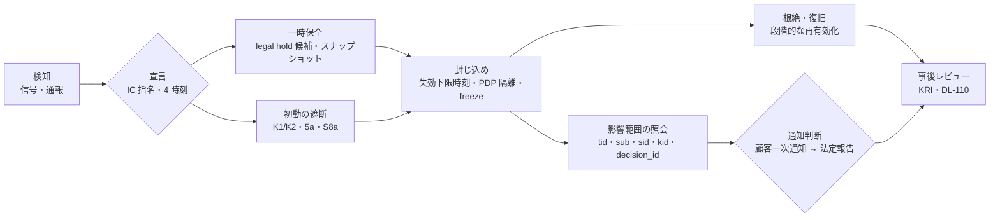
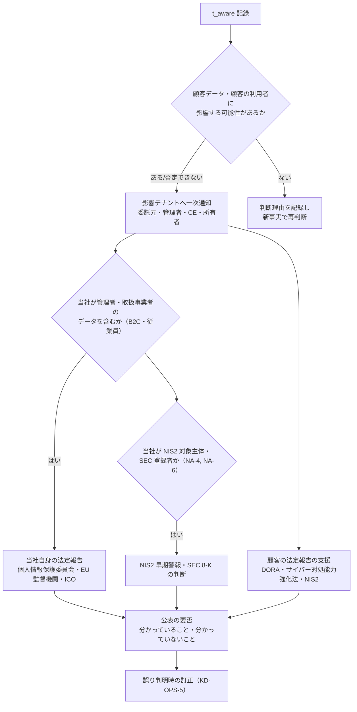

# 侵害別 runbook・演習計画

> 文書ID: OPS-01 / 版: 0.1 / 状態: draft / 最終更新: 2026-10-15
> 対応要求: R-057, R-110〜R-117, R-184〜R-186, R-189.5, R-195, R-195.1〜R-195.5, R-210, R-235, R-268, R-275 ／ G-059, G-084, G-093, G-094（全 27 件と閉じ方は末尾「対応表」）
> 依存文書: CONVENTIONS.md, traceability/deliverables.md（DL-24）, traceability/R-requirements.md, traceability/G-goal-criteria.md, traceability/dissent-log.md（DS-04）, 05_adr/README.md, 05_adr/ADR-019-compromise-response.md, 05_adr/ADR-006-revocation-continuous-evaluation.md, 05_adr/ADR-007-key-hierarchy-kms-hsm.md, 05_adr/ADR-029-privileged-support-access.md, 05_adr/ADR-004, ADR-008, ADR-013, ADR-014, ADR-016, ADR-017, ADR-018, ADR-024, ADR-027, 04_architecture/root-of-trust.md（ARC-03）, 06_controls/applicability.md（CTL-02）, 01_governance/stop-authority.md（GOV-06）, 01_governance/assumptions-register.md, 01_governance/loss-scenarios.md, 01_governance/kri.md, 01_governance/risk-appetite-draft.md（GOV-02）, 01_governance/business-impact-analysis.md, 02_requirements/operation-risk-tiers-assurance.md（REQ-03）, 03_threat-model/incident-casebook.md（THR-05）, 03_threat-model/threat-catalog.md, 03_threat-model/attacker-model.md, research/RS-01, RS-02, RS-05, RS-09, RS-10, RS-12, RS-13, RS-14, research/standards-status.md
> 作成方法: AI エージェント（Claude）が上記文書を読んで起草した。設計判断は ADR-019（侵害時対応の設計原則）と GOV-06（停止権限）に従い、それらに無い機能を新たに作らない。ADR はすべて proposed（決裁前）であり、ADR 間で未決の点は「未決（ADR-0xx Lxx）」と書いた。判定は自己レビューであり、実在の CTO/CISO の決裁ではない（CONVENTIONS §8）。作成者以外の照合は未実施である。research にない原典は SP 800-61 Rev.3 の CSRC 公表頁だけで、2026-10-15 に取得して題名・状態・抄録を確認した。
> 表記: runbook は RB-00（共通骨格）と RB-01〜RB-12、演習は EX-01〜EX-18、決裁案は KD-OPS-1〜KD-OPS-7、新規仮定は NA-OPS-1〜NA-OPS-4（前提台帳へ追加要）、残余リスクは RR-OPS-1〜RR-OPS-5 と書く。TC の仮番（TC-19-xx、TC-07-xx 等）は各 ADR の仮番をそのまま引き、採番は DL-22 で行う。表のセルのうちタグのないものは設計推論 [D] であり、この注記で個別のタグに代える。事実を述べるセルには個別にタグと脚注を付けた。

---

## 0. 結論（CTO/CISO 向け要旨）

1. **侵害 12 類型（RB-01〜RB-12）を、1 つの共通骨格（RB-00）の上に定義した** [D]。どの RB も「検知 → 宣言 → 初動（一時保全と最小範囲の遮断）→ 封じ込め → 証拠保全 → 根絶・復旧 → 通知判断 → 事後レビュー」の同じ順で進み、使う封じ込め部品は ADR-019 §2.10 が平時に作り込むと決めた 18 機能だけである [D]。侵害の最中にコードを書いて止める手順は 1 つも置いていない（GOV-06 §4.3、ADR-019 D19-01）[D]。未試験の緊急手順は必要なときに働かないと Google の SRS は述べている [V][^13]（RS-09#35）。
2. **順序の原則は「止めるのは狭く速く、戻すのは証拠と上位権限で遅く、壊す前に残す」である** [D]。鍵の破棄・テナント削除・PDP 実行環境の再作成・ログの rotation より前に証拠を保全する（ADR-019 D19-24）[D]。Storm-0558 では標準のログ保持 30 日のため侵害期間の起点を確定できなかった [I][^2]（RS-12#8）。
3. **通知の最初の期限は顧客への通知である** [D]。基盤は多くの顧客にとって委託先・処理者であり、委託先は委託元へ「速やかに」、処理者は管理者へ「不当な遅延なく」通知する [N][^20][^21][^17]（RS-02#1, #45）。顧客側の時計は DORA の初期通知（重大分類から 4 時間以内かつ認知から 24 時間以内）が最短である [N][^18]（RS-02#59）。このため全 RB で 4 時刻（最初の兆候・認知・重大分類・重要性判断）を記録し、顧客一次通知の判断を最初の判断点に置く（CTL-02 H-O01〜H-O03）[D]。社内目標時間は未決（CTL-02 L-06）である [D]。
4. **演習計画は 3 層で、侵害演習 18 件（EX-01〜EX-18）に schema migration（EX-M1）と vendor exit（EX-V1〜EX-V3）の 4 件を同じ計画に含めた** [D]。平常経路の常時運転、cell 単位の game day（初期案は四半期 1 回）、経営層を含む机上演習（年 1 回以上）である（ADR-019 D19-35）[D]。合否の時間値はすべて TBD（BIA・DL-20 から導く）で、0 件基準など二値の合否だけを確定値として置いた [D]。演習は 1 件も実施していないので、R-117・R-275・G-093 はすべて**未達**である [D]。
5. **経営・法務の判断が要る点は 7 件ある**（§6 の KD-OPS-1〜KD-OPS-7）[D]。runbook の分岐に直接効くのは、鍵緊急失効の発動権限（ADR-019 L19-1）、全 session 失効の即時方式の例外（L19-2）、legal hold の一時保全、公表の訂正期限（THR-05 DA-4）、顧客の同意を待たない停止条項（CTL-02 L-09）の 5 件である [D]。
6. **対応表 27 件（R 23 件、G 4 件）のうち、本書だけで閉じたものはない** [D]。机上（A）で骨格を示したのが 2 件（R-110、R-268）、組織決定（B）が要るのが 2 件（R-114、G-094）、演習の実測（C）が要るのが 23 件である [D]。

---

## 1. 位置付け・範囲・読み方

### 1.1 本書が決めること・決めないこと

| 本書が決める | 他文書が決める（本書は参照する） |
|---|---|
| RB-xx の定義（12 類型）と、各 RB の検知・初動・封じ込め・復旧・証拠保全・通知判断・事後レビューの手順 | 侵害時に使う機能の方式・粒度・権限の原則（ADR-019） |
| 演習計画（EX-xx）、演習の前提条件と記録様式（E8） | 停止の権限者・代行者・発動・解除条件（GOV-06、DL-46） |
| インシデント数値（R-195.1〜R-195.5、R-189.5）の測定点と計算式 | 数値の値（DL-20、BIA）、試験の事前登録（DL-22） |
| 通知判断の手順と、RB ごとに検討すべき通知時計 | 法域ごとの通知期限の正本（CTL-02 §3.7）、判断基準の決裁（CTL-02 L-06） |
| legal hold の一時保全の扱い（ADR-019 D19-26 が本書に委ねた TBD。KD-OPS-3） | 保持期間と WORM の調停（ADR-014） |
| R-235 の 6 段階（予防・準備・検知・封じ込め・復旧・教訓反映）と本書の節の対応 | 継続保証計画への組込み（DL-32） |

- 本書は ADR-019 D19-37 の「演習計画（DL-24）は侵害対象 7 種のそれぞれに、ADR-019 の機能のどれを使うかを対応付ける」を受けて書いた [D]。依頼された 12 類型は、この 7 種（token、署名鍵、IdP、PDP、監査基盤、CI/CD、support 経路）を細分し、誤配布・第三者連携・AI エージェント・テナント越境を加えたものである（§1.3）[D]。
- runbook の手順文は「何を、どの部品で、誰の権限で行うか」までとし、製品固有のコマンドは書かない [D]。製品（ADR-001・ADR-010）が未決のため、コマンド粒度の手順は製品選定後に付録として追加する（残課題 1）[D]。

### 1.2 読み手別の入口

| 読み手 | 読む節 |
|---|---|
| CTO・CISO | §0、§2.1、§3 の各 RB 冒頭の「要点」行、§5.1、§6、対応表 |
| セキュリティ当番・IC | §2（共通骨格）、該当する RB |
| SRE 当番 | §2.5、RB-01、RB-03、RB-05、RB-06、§5 |
| 法務・広報 | §2.7、§2.8、各 RB の「通知判断」行、KD-OPS-4・KD-OPS-5 |
| 連携開発者（依存サービス・外部連携） | §2.10「依存サービスに求めること」、RB-02、RB-10、RB-11 |

### 1.3 12 類型と ADR-019 の侵害対象 7 種の対応

| RB | 類型 | ADR-019 D19-37 の 7 種 | 主な損失シナリオ | 主な攻撃者 | 主な脅威 |
|---|---|---|---|---|---|
| RB-01 | 署名鍵漏えい | 署名鍵 | S-02 | ATK-01, ATK-07, ATK-08 | T-041, T-042, T-044, T-045 |
| RB-02 | token 大量窃取 | token | S-15, S-18, S-07 | ATK-05, ATK-13, ATK-14 | T-011, T-014, T-038, T-019 |
| RB-03 | 自社 IdP・AS 侵害 | IdP（自社 AS・上流 managed IdP・管理用 IdP） | S-02, S-06, S-11 | ATK-01, ATK-08 | T-005, T-046, T-047 |
| RB-04 | 顧客 IdP 侵害 | IdP（顧客 IdP） | S-03 | ATK-04, ATK-02 | T-062, T-063, T-065, T-066 |
| RB-05 | PDP・policy 改ざん | PDP | S-05, S-01 | ATK-10, ATK-17, ATK-07 | T-027, T-033, T-050 |
| RB-06 | 誤 policy 配布による global allow | PDP（非敵対） | S-05 | ATK-19, ATK-10 | T-028, T-029 |
| RB-07 | 監査基盤停止・改ざん | 監査基盤 | S-10, S-16 | ATK-08, ATK-12, ATK-19 | T-054, T-055 |
| RB-08 | CI/CD 侵害 | CI/CD | S-08, S-02, S-05 | ATK-07, ATK-17, ATK-18 | T-051, T-052, T-053 |
| RB-09 | support 経路悪用 | support 経路 | S-04 | ATK-09, ATK-01 | T-003, T-049, T-011 |
| RB-10 | 第三者連携アプリ侵害 | token（第三者 grant） | S-15 | ATK-15, ATK-05 | T-069, T-070 |
| RB-11 | AI エージェント濫用 | token（委任） | S-14 | ATK-16 | T-072〜T-075 |
| RB-12 | テナント越境漏えい発覚 | （横断） | S-01, S-09 | ATK-02, ATK-03, ATK-06 | T-020, T-021, T-076〜T-078, T-080 |

### 1.4 前提（A-ID）と新規仮定

| A-ID | 値（基準） | 本書で効く箇所 |
|---|---|---|
| A-001 | 登録ユーザー 100 万 | 全域の失効・通知の規模 |
| A-005, A-006 | 同時アクティブ session 11.1 万、有効 session 保持数 86.5 万 | 全 session 失効の対象件数（RB-01, RB-02, RB-03） |
| A-033, A-041, A-048 | 全 session 失効後の再ログイン集中 約 556/秒（平常ピーク 51/秒の約 11 倍） | 再ログイン受付制御（G-059、EX-05） |
| A-011, A-113 | 社内 service account 1,200、静的資格情報 3,000 件のうち 50% に rotation 記録なし | 侵害通知時の全件回転（RB-08, RB-09） |
| A-013 | 外部 client 800・第三者 grant 3 万 | 連携事業者単位の一括失効（RB-10） |
| A-014 | AI エージェント主体 1 万 | エージェント停止の単位（RB-11） |
| A-050 | 依存サービス 300 | SDK による失効照合の展開対象 |
| A-054 | プラットフォームチーム 24 FTE（SRE 6、鍵管理・セキュリティ 2） | 当番・二者の確保（RR-OPS-1） |
| A-080 | B2B 利用者の業界構成（金融 10%・医療 7%・公共 5%・決済 3%） | 顧客側の通知時計（DORA 等）の適用範囲 |
| A-090, A-091 | 判定系 99.95〜99.99%、認証系 99.9〜99.95% | 誤発動の可用性上限 |
| A-114 | 顧客側 SAML 1,800・OIDC 200 接続、IdP 証明書の更新は手作業 | RB-01 の SAML 鍵、RB-04 |

新規仮定（前提台帳へ追加要）:

| 番号 | 新規仮定（前提台帳へ追加要） | 効く箇所 | 確定責任者（案） |
|---|---|---|---|
| NA-OPS-1 | 本基盤の SSO とそれに依存するチャット・会議から独立した帯域外の連絡手段（当番招集・IC 会議・顧客連絡）を、G3 までに用意できる | §2.2、全 RB の初動、EX-12 | CISO＋SRE 責任者 |
| NA-OPS-2 | 顧客のセキュリティ連絡先（委託元の窓口、DPO、CE の窓口）を、本基盤とその管理データから独立した台帳に、テナント契約時に登録してもらえる | §2.7、全 RB の通知判断 | 営業・顧客成功責任者＋法務責任者 |
| NA-OPS-3 | game day と年次机上演習に立ち会う独立立会人（DL-59・DL-30 の独立評価者、または社外）を、四半期ごとに確保できる | §5、G-093 の判定者 | CISO |
| NA-OPS-4 | 本番の canary cell で障害注入（鍵の緊急切替、PDP 隔離、テナント範囲の失効）を行うことを、canary cell に収容する顧客が契約上許容する（または合成テナントだけで canary cell を構成する） | §5.4、KD-OPS-6 | 事業責任者＋法務責任者 |

- ADR-019 の新規仮定 NA-019-1〜NA-019-4（緊急管理者の登録率、顧客 IdP の SSF 対応率、証拠の独立保存先、外部 RP の JWKS キャッシュ最大齢 24 時間）と、GOV-06 の新規仮定①〜④（24/365 のセキュリティ当番、強制停止条項、CEO 代行順位、鍵二者の常時確保）にも依存する [D]。いずれも前提台帳に未登録である [D]。

---

## 2. 共通骨格（RB-00）

全 RB は本節の骨格に従い、各 RB（§3）は差分だけを書く [D]。

### 2.1 段階と完了条件

| 段階 | 目的 | 完了条件（次へ進む条件） | 記録する時刻 |
|---|---|---|---|
| 0 検知 | 信号・通報を受ける | IC が指名され、事案 ID が起票された | t_signal（信号の受領）、後から t_first（最初の兆候） |
| 1 宣言 | 侵害（疑いを含む）として扱うと決める | 範囲（主体／client・grant・連携事業者／テナント・IdP 信頼／cell／全域）の暫定値と RB 番号が決まった | t_aware（認知＝合理的判断）、t_major（重大分類） |
| 2 初動 | これ以上の悪用を止め、証拠を消さない | 一時保全（§2.6）と最小範囲の遮断（K1・K2・5a・S8a）が完了した | t_hold、t_block |
| 3 封じ込め | 侵害範囲の全経路で拒否する | 範囲内の全検証点で拒否を確認した（GOV-06 §6.1「効果の確認」） | t_contain |
| 4 影響範囲の確定 | 通知に要る「どのテナント・主体・データ種別」を確定する | 照会（ADR-019 D19-32）の結果が IC と法務に渡った | t_scope |
| 5 通知判断 | 顧客一次通知 → 法定報告 → 公表 | 判断結果と根拠が記録された | t_notify_decision、t_notify_sent、t_material（重要性判断） |
| 6 根絶・復旧 | 原因を除き、段階的に再有効化する | 解除条件（GOV-06 §4.3 (a)〜(d) ほか）を証拠で示し、解除権限者が承認した | t_release |
| 7 事後レビュー | 教訓を是正追跡に載せる | レビュー記録が DL-110 に登録された | t_review |

- 段階 2 の「一時保全」と「最小範囲の遮断」は並行して行う [D]。どちらも権限を縮める方向の操作であり、事前の二者承認を待たない（REQ-03 規則 J8、ADR-019 D19-02）[D]。
- 段階 4 と 5 は段階 3 の完了を待たない [D]。顧客の時計は認知から進むので、封じ込めが続いていても「分かっていること・分かっていないこと」を分けて一次通知する（ADR-019 D19-33、THR-05 DA-4）[D]。

### 2.2 役割と権限

| 役割 | 担うこと | 権限の正本 |
|---|---|---|
| IC（インシデント指揮者） | 宣言、RB の選択、K3 の発動、顧客一次通知の決定（CTL-02 §3.7 判断者案） | GOV-06 §3.1、§3.2。IC は RACI の 12 役割にないため DL-04 への追加が要る（GOV-06 §12）[D] |
| セキュリティ当番 | K1 の発動、主体単位の S4、一時保全の実行 | GOV-06 §3.1 |
| SRE 当番 | 遮断状態・失効状態の配布の実行、再ログイン受付制御、段階的再有効化 | GOV-06 §3.1、ADR-013 D13-38 |
| 鍵管理担当（二者） | 鍵緊急失効の実行（5a・5b） | GOV-06 §4.5、DL-14。発動権限は未決（ADR-019 L19-1、KD-OPS-1） |
| CISO | K2、テナント以上の S4、5b、S8a、通常の legal hold 前の一時保全の承認（KD-OPS-3） | GOV-06 §3.1 |
| CTO | cell・全域の S4 と 5b の同時通知先、K4 の協議 | GOV-06 §3.1 |
| CEO（経営会議） | K4 | GOV-06 §3.1、DP46-4 |
| 法務責任者 | legal hold の設定・解除、法定報告の要否、顧客通知文の確認 | REQ-05 §2 の法的保全 H、CTL-02 L-06 |
| 広報責任者 | 公表と訂正（THR-05 DA-4） | THR-05 DA-4 |
| 事業責任者 | 影響顧客への連絡の協議、K2 の解除時の協議 | GOV-06 §3.1 |

- 当番の招集・IC の会議・顧客連絡は帯域外の手段で行う（ADR-019 D19-34、NA-OPS-1）[D]。Scattered Spider は侵入後に標的組織の Slack・Teams・Exchange Online を検索して検知の有無を確かめ、インシデント対応の会議にも参加した [I][^6]（RS-12#50）。

### 2.3 宣言の基準

- 宣言は「侵害の確証」を待たない [D]。GOV-06 §4.3 の発動条件 C1（侵害の確証または高確度の検知があり、範囲内の主体・経路が使われている）に加え、本書は次のいずれかで宣言する [D]。
  - (a) 自社の発行規則に合わない token・署名の検知（発行台帳と KMS Sign 記録の差分。ADR-007 D7-45）[D]。CSRB は、自社の token 生成方式に合わない偽造 token を検知する仕組みがあれば Microsoft 単独で検知できた可能性が高いと述べた [I][^2]（RS-12#10）。
  - (b) 上流事業者・連携事業者・顧客からの侵害通知 [D]。
  - (c) 既知解判定の不一致、allow 率の急変、policy 版の後退（ADR-013 D13-27）[D]。
  - (d) 監査記録の欠損・改ざん検知（K-21）[D]。
  - (e) 管理面の操作（管理者グループへの追加、高権限 scope の付与）の異常 [D]。Cloudflare 2023 では管理者グループへの追加から 2 分で自動警報が出た [I][^5]（RS-12#30）。
- 侵害通知を受けた資格情報は、未使用と判断したものも含めて全件回転する（THR-05 CB-REQ-13、ADR-019 D19-07）[D]。Cloudflare は Okta 侵害で取られたもののうち未使用と誤判断した 1 token・3 アカウントを回転せず、それが侵入に使われた [I][^5]（RS-12#28）。

### 2.4 4 時刻と記録票

- 記録票は GOV-06 §6.1 の項目に、CTL-02 H-O01 の 4 時刻と「委託先・処理者・BA として知った時刻」を加えたものとする [D]。記録票は本基盤の監査基盤と独立した改ざん検知可能な保管先に置く（GOV-06 §6.2）[D]。
- 時刻を 1 つの記録に段階ごとに残すのは、同じ事象の日付が資料で食い違うと後から封じ込め時間を確定できないためである [D]。Storm-0558 の鍵の無効化日は、CSRB が 2023-06-24 とし、Microsoft は 06-27 に使用を遮断し 06-29 に置換を完了したとしている [I][^2][^3]（RS-12#9）。

| 欄 | 内容 | 出所 |
|---|---|---|
| t_first | 最初の兆候（事後に確定。暫定値と確定値を分ける） | CTL-02 H-O01 |
| t_signal | 信号・通報の受領 | 本書 |
| t_aware | 認知（侵害が起きたと合理的に判断した時刻） | CTL-02 H-O01 |
| t_major | 重大分類（顧客が DORA 等で使う分類の材料を確定した時刻） | CTL-02 H-O01 |
| t_material | 重要性判断（SEC 等。当社が登録者の場合） | CTL-02 H-O01、NA-4 |
| t_knew_as_processor | 委託先・処理者・BA として「知った」時刻 | CTL-02 H-O01 |
| t_hold / t_block / t_contain / t_scope / t_notify_decision / t_notify_sent / t_release / t_review | §2.1 の各段階 | 本書、GOV-06 §6.1 |
| 範囲・件数 | 範囲識別子（型付き）、主体数、テナント数、cell 数 | GOV-06 §5.1-2 |
| 権限 | 発動者・実行者（同時二者の場合は両名）、代行の経過 | GOV-06 §6.1 |
| 受容票 | 本番移行停止の例外や受容票（DL-05）が事案に関わる場合、その ID（顧客への可視性の判断に使う。DS-04） | dissent-log DS-04 |

### 2.5 封じ込め部品の一覧（RB から呼ぶ部品）

本表は ADR-019 §2.10 の機能を、runbook から呼ぶ単位に並べ直したものである [D]。新しい部品は加えていない [D]。

| 部品 | 内容 | 権限（GOV-06 §3.1） | 方式の正本 |
|---|---|---|---|
| P-K1 | K1 遮断（主体・client・grant・連携事業者の全 grant・テナント内 1 機能） | セキュリティ当番（ITDR の自動対応を含む） | ADR-019 D19-04、ADR-005 D7-6 |
| P-K2 | K2 遮断（1 テナントの強制停止、1 顧客 IdP 信頼の遮断） | CISO（代行: 指名代行 → セキュリティ IC は REQ-05 K-7 の条件に限る） | ADR-019 D19-04, D19-21 |
| P-K3 | K3 遮断（1 機能の全域、1 cell の新規ログイン） | IC、同時二者 | ADR-019 D19-04 |
| P-K4 | K4（基盤全体の提供停止） | CEO（経営会議）、同時二者 | ADR-019 D19-04、DP46-4 |
| P-REV | 範囲別の失効下限時刻の前進（主体・IdP・client・テナント・cell・全域） | 主体: 当番。テナント・IdP 由来: CISO。cell・全域: CISO＋同時二者＋CTO 同時通知 | ADR-019 D19-08〜D19-11、ADR-006 |
| P-5A | 鍵の署名停止と next 鍵への切替、内部検証点への失効 kid の push | 未決（ADR-019 L19-1、KD-OPS-1） | ADR-007 D7-37、ARC-03 §5.5 |
| P-5B | 検証側からの除去（外部 JWKS・trust store） | CISO＋同時二者、CTO 同時通知 | GOV-06 §4.5、ADR-019 D19-13 |
| P-PDPI | PDP 隔離（不達扱い → 別系統 PDP＋既知良好 bundle で再開 → freeze → 保全） | IC（K3 相当。cell 内）| ADR-019 D19-17, D19-18 |
| P-FRZ | 緊急 freeze（S2。剥奪・失効の配布は止めない） | 全当番 | GOV-06 §4.2、ADR-013 D13-36 |
| P-KG | 既知良好版への復帰（最低許容版・不良版 deny list 付き） | プラットフォームチーム長（緊急 push は ADR-008 の二者統制） | ADR-013 D13-34、ADR-019 D19-20 |
| P-S8A | 特権・support 経路の停止 | CISO（代行: 指名代行 → セキュリティ IC） | GOV-06 §4.8、ADR-029 |
| P-BG | break-glass（管理面の復旧、既知良好版、鍵緊急失効、AS 設定の IaC 再配備に限る） | SRE 当番＋CISO 組織当番の同時二者 | ADR-008 D8-40〜D8-42、ADR-029 D29-70〜D29-79 |
| P-RLC | 再ログイン受付制御（AS 前段の待合せ、再試行間隔の指示、テナント順受付） | SRE 当番 | ADR-019 D19-11、DL-58 |
| P-SSF | SSF による signal 送信（CAEP session-revoked、RISC credential-compromise 等） | IC | ADR-019 D19-22、ADR-006、DL-78・DL-79 |
| P-HOLD | 一時保全 → legal hold | §2.6、KD-OPS-3 | ADR-019 D19-24〜D19-27、ADR-014 D14-32 |
| P-SCOPE | 影響範囲の照会（tid・sub・sid・grant 参照・kid・decision_id・時間範囲） | IC が依頼、法務が受領 | ADR-019 D19-32、ADR-014 |
| P-ROT | 資格情報の全件回転（所有者台帳に基づく K1 単位の一括無効化） | セキュリティ当番 | ADR-019 D19-07、ADR-007、DL-50 |
| P-OOB | 帯域外の連絡手段と、基盤から独立した顧客連絡先台帳 | IC | ADR-019 D19-34、ADR-023、NA-OPS-1・NA-OPS-2 |

- 遮断状態・失効状態は cell ごとの署名付き・単調増加の配布路で配り、control plane・管理面 login・IdP に依存させない（ADR-019 D19-05、ADR-013 D13-35）[D]。複数 cell に適用するときは工具が 1 cell ずつ順に適用し、cell ごとの適用完了を確認してから次へ進む [D]。K4 の全 cell 同時適用は ADR-013 D13-38 の例外になり、その扱いは未決（ADR-019 L19-3）である [D]。
- 内部 JWT について「失効時間が token の寿命に依存しない」が成り立つのは、共通 SDK の検証規則に失効下限時刻との照合が入った場合に限る（未決: ADR-019 L19-5）[D]。L19-5 が採られない間は、内部 JWT の失効完了は寿命 L_int の満了を待つ前提で、RB の「封じ込め完了」の判定に L_int を加える [D]。

### 2.6 証拠保全の共通手順

| 順 | 操作 | 担当 | 根拠 |
|---|---|---|---|
| H1 | 宣言と同時に、範囲内のテナント・cell の監査記録、発行台帳、KMS Sign 記録、JWKS・鍵マニフェスト・issuer metadata、PDP 判定記録・policy 版・bundle・配布記録、停止操作記録を「一時保全」に入れる（保持期限による消去を止める） | セキュリティ当番（KD-OPS-3 の推奨案） | ADR-019 D19-24, D19-25 |
| H2 | 上記をハッシュ付きで、本基盤と監査基盤から独立した保存先（別アカウント・別認証。法域パーティションごと）へ複写し、取扱記録（取得者・取得時刻・ハッシュ・引渡し先）を起票する | セキュリティ当番 | ADR-019 D19-27、NA-019-3 |
| H3 | 侵害が疑われる構成要素（PDP、Signer、CI runner、support 端末等）の実行環境のイメージ・メモリを取得してから隔離する。再利用しない | SRE 当番 | ADR-019 D19-17 手順 4、D19-25 |
| H4 | 法務責任者が legal hold に移す（一時保全の追認）。設定・解除は記録する | 法務責任者 | REQ-05 §2、ADR-014 D14-32 |
| H5 | 監査基盤・セキュリティ統制が停止した期間を、開始と終了の時刻とともに記録する | SRE 当番 | ADR-019 D19-29。PCI DSS 10.7.3 は重要なセキュリティ統制の障害への対応として障害期間の記録などを求める [N][^29]（RS-10#26） |
| H6 | 鍵の破棄・テナント削除・ログの rotation は、H1〜H4 の完了と保持要件の充足を確認してから行う | IC | ADR-019 D19-24、ADR-007 D7-35 |

- SP 800-57 Part 1 Rev.5 は侵害回復計画を文書化し容易に参照できるようにすること（shall）を求めている [N][^12]（RS-05#4）。本書の RB と §2.6 の保全手順は、その計画の一部として DL-14 の鍵管理文書から参照される [D]。
- 鍵系・管理面・発行系の記録の保持期間は ADR-014 が決める [D]。CSRB は ID 基盤と root 鍵素材へのアクセス記録を、鍵の使用期間全体に加えて失効後少なくとも 2 年保持するよう勧告した [I][^2]（RS-12#12）。
- WORM を S3 Object Lock の compliance mode で使う場合、保持期限前に object を削除する唯一の方法は関連する AWS アカウントの削除である [V][^30]（RS-10#44）。一時保全と legal hold は WORM の保持とは別の機能として扱い、調停は ADR-014 に従う [D]。

### 2.7 通知判断の共通手順

- 推奨する判断基準は CTL-02 L-06 の選択肢 A「顧客データに影響する可能性があると判断した時点で影響テナントへ一次通知し、確定情報を後続で送る」である [D]。L-06 は未決であり、社内目標時間も TBD（所有者 CISO＋法務責任者、期限 G0 で方式・G4 で値、決め方: 最短の顧客側時計から逆算し、影響特定時間の実測 EX-08 で確認）である [D]。
- 委託元（B2B 顧客）への通知は、個人情報保護委員会への速報と同じ項目で行う（施行規則 9 条）[N][^20]（RS-02#1）。
- 影響を受け得る顧客への可視性は、受容票（DL-05）でセキュリティより他を優先した判断が事案に関わる場合にも、通知判断の入力に加える（dissent-log DS-04）[D]。
- 通知判断に要る影響範囲は P-SCOPE で引く [D]。照会結果を顧客ごとに分けて配信し、影響テナント以外へ誤配信しないことを演習で確かめる（CTL-02 H-O07、EX-08）[D]。

### 2.8 通知時計（runbook 用の抜粋）

正本は CTL-02 §3.7 であり、食い違いがあれば CTL-02 を正とする [D]。本表は RB の「通知判断」行から記号で引くための抜粋である [D]。判定（適用・条件付き）は CTL-02 の案であり、法務署名前である [D]。

| 記号 | 規制（CTL-02 の判定） | 宛先 | 期限 | 起算点 | 根拠 |
|---|---|---|---|---|---|
| N-JP-E | 個人情報保護法・委託先（適用） | 委託元（B2B 顧客） | 速やかに。委託元へ通知すれば委託先の委員会報告は免除 [N][^21][^20] | 委託先が事態を知った時点 | RS-02#1 |
| N-JP-C | 個人情報保護法・取扱事業者（適用、B2C・従業員） | 個人情報保護委員会と本人 | 速報は速やかに（目安概ね 3〜5 日）、確報は 30 日（不正目的は 60 日）[N][^20][^22] | 法人のいずれかの部署が知った時点 [N][^22] | RS-02#4, #5 |
| N-EU-P | GDPR・処理者（適用） | 管理者（顧客） | 不当な遅延なく [N][^17] | 処理者が知った時点 | RS-02#45 |
| N-EU-C | GDPR・管理者（適用、EU の B2C・従業員） | 監督機関 | 原則 72 時間以内（超過時は遅延理由）[N][^17] | 管理者が知った時点 | RS-02#45 |
| N-UK | UK GDPR（適用） | 情報委員会／管理者 | 72 時間以内／遅滞なく [N][^23] | 知った時点 | RS-02#50 |
| N-NIS2 | NIS2（条件付き。当社が対象主体なら直接、NA-6） | CSIRT・所管当局 | 早期警報 24 時間、通知 72 時間、最終報告 1 か月 [N][^19] | 重大インシデントの認知 | RS-02#53 |
| N-DORA | DORA（条件付き。顧客の時計） | 所管当局（顧客が報告） | 初期通知は重大分類から 4 時間以内かつ認知から 24 時間以内、中間 72 時間、最終 1 か月 [N][^18] | 重大分類・認知 | RS-02#59 |
| N-JP-CY | サイバー対処能力強化法（条件付き。顧客の時計） | 所管大臣等（顧客が報告） | 速報 3〜5 日、詳報 30 日 [N][^24] | 認知（合理的判断） | RS-02#30, #31 |
| N-SEC | SEC Form 8-K Item 1.05（条件付き、NA-4） | SEC（公衆） | 重要性の判断から 4 営業日（判断は不当な遅延なく）[N][^25] | 重要性の判断 | RS-02#76 |
| N-CA | 加州民法 1798.82（条件付き） | 個人／データ所有者 | 個人へは 30 暦日以内、非所有者から所有者へはただちに [N][^26] | 発見・通知 | RS-02#67 |
| N-HIPAA | HIPAA・BA（条件付き、BAA） | CE（顧客） | 不合理な遅延なく、発見から 60 暦日以内 [N][^27] | 知った日、または合理的な注意で知り得た最初の日 | RS-02#69 |
| N-CIRCIA | CIRCIA（監視。効力未発生） | CISA | 72 時間、ランサム支払いは 24 時間 [N][^28] | 合理的に信じた時点 | RS-02#77 |

- 顧客が DORA 対象の金融機関である場合、当社は ICT インシデント時の支援を追加費用なし又は事前に定めた費用で提供する契約条項の対象になる [N][^42]（RS-14#66）。顧客の初期通知に要る技術情報（影響範囲、封じ込め状況、時刻）を t_major から先に渡せるよう、P-SCOPE の出力様式を顧客報告の項目に合わせる（CTL-02 H-O04）[D]。
- 規制の時計は通知の期限であり、封じ込めの期限ではない（GOV-02 §3.4.2）[D]。封じ込め（Z2）と影響範囲確定（Z3）の時間値は GOV-02 の選択肢 A/B/C（Z2: 1/4/24 時間、Z3: 4/24/72 時間）のどれを採るかで決まり、未決である [D]。

### 2.9 根絶・復旧の共通規則

- 解除は「再有効化」として別の操作にし、cell 順・テナント順に段階的に行う（ADR-019 D19-06、GOV-06 §5.2）[D]。Google の 2025-06-12 の障害では、再起動の herd effect で us-central1 の回復が最長約 2 時間 40 分に延びた [I][^15]（RS-09#66）。Cloudflare は 2025-06-12 の是正策に、キャッシュ再充填で自社基盤を DoS しないよう段階的に再有効化する工具を挙げた [I][^14]（RS-09#70）。
- 失効は戻さない [D]。全 session 失効の「解除」は、範囲内の有効な session・token が 0 件であることの計測と、再発行を止めていた場合の再開をいう（GOV-06 §4.4）[D]。侵害が疑われた鍵は疑いが晴れても再使用しない（GOV-06 §4.5）[D]。
- 既知良好版への rollback は、最低許容版と不良版 deny list で範囲を制御し、署名済み旧版の再提示を拒否する（ADR-019 D19-20）[D]。rollback で取り消した権限を戻さない（GOV-06 P4）[D]。
- テナント単位の復元（cell 全体を戻さずに 1 テナントの tuple・設定・連絡先を戻す）を使う（ADR-013 D13-39）[D]。Atlassian 2022 では多サイトの復旧を自動化できず、一部顧客で最長 14 日停止した [I][^41]（RS-09#60, #62）。

### 2.10 依存サービス・連携開発者に求めること

| 対象 | 平時に済ませておくこと | 侵害時に起きること |
|---|---|---|
| 依存サービス（約 300） | 共通 SDK・sidecar を使い、独自の JWT 検証・allow cache を持たない。長時間接続には SDK の再照合フックを使う。entry point ごとに fail-mode の階層を宣言する（ADR-013 D13-28） | 失効下限時刻・失効 kid・遮断状態を SDK が自動で受け、該当要求を拒否し、該当接続を閉じる。サービス側の作業は原則ない |
| 外部連携開発者 | 失効 kid の通知の受け方、SSF の受信（任意）、侵害時の再同意の流れを連携契約（DL-78・DL-79・DL-26）で確認する | grant の一括失効（K1）後、利用者の再同意が必要になる。JWKS を自前で cache する RP は、キャッシュ最大齢まで旧鍵を受理し得る（RR19-01） |
| 顧客管理者 | 緊急管理者（PC-08(b)）の登録、SAML 次証明書の事前登録、セキュリティ連絡先の登録 | 顧客 IdP 切離し後は緊急管理者で管理を続ける。SAML 鍵切替は事前登録の有無で顧客作業が変わる |

---

## 3. 侵害別 runbook（RB-01〜RB-12）

各 RB の表の行は §2.1 の段階に揃えた [D]。「部品」欄の P-xx は §2.5、「H」は §2.6、「N-xx」は §2.8 の記号である [D]。

### RB-01 署名鍵漏えい（L2 運用鍵・Signer・L1・L0・SAML 署名鍵）

| 項目 | 内容 |
|---|---|
| 要点 | 5a（next 鍵への切替と失効 kid の push）を疑いの段階で起動し、発行台帳から影響範囲を引いて失効下限時刻を進め、5b は確証または信頼不能の場合に再ログイン受付制御と同時に行う |
| 想定 | L2 鍵（KMS 上の非エクスポート鍵）の Sign API 不正利用、Signer 実行環境の侵害、L1 による偽マニフェスト、JWKS 公開経路の差替え（T-042）、SAML 署名鍵の流出。1 cell の L2 鍵侵害は日本の 1 cell で約 1,417 テナントに偽造 token を受理させ得る（ADR-007 RR7-01） |
| 検知 | 発行台帳と KMS Sign 回数の kid ごとの照合差分（初期案 5 分粒度、ADR-007 D7-45、TC-07-11）、Signer 以外の Sign 呼出し、L1 署名回数と台帳更新要求の不一致（ARC-03 §11）、JWKS・metadata の外形監視、鍵素材流出の通報 |
| 宣言・権限 | 侵害の「疑い」で宣言する。SP 800-152 §6.8.1 は侵害または侵害が疑われる鍵を保護の適用（署名生成等）に使ってはならない（must not）とし、迅速な失効・交換と依拠当事者への通知の能力を持つべき（should）とする [N][^11]（RS-05#11）。5a の発動者は未決（ADR-007 D7-38 は on-call 単独、GOV-06 §3.1 は CISO またはセキュリティ IC＋同時二者。ADR-019 L19-1、KD-OPS-1）。5b は CISO＋同時二者、CTO 同時通知 |
| 初動 | (1) H1・H2（発行台帳・KMS 記録・JWKS とマニフェストのスナップショット）。(2) P-5A: 鍵台帳で kid を失効 → Signer を next 鍵（なければ DR 鍵）へ切替 → L1 署名の失効 kid リストを JWKS と独立した push 経路で内部検証点へ配布（ADR-007 D7-37 手順 1〜3） |
| 封じ込め | (3) 発行台帳から該当 kid で署名された jti・sid・grant 参照・tid を引き、該当範囲の P-REV を進める。範囲が特定できなければ、その鍵を信頼する範囲全体を進める（ADR-019 D19-12 手順 4）。(4) 確証または発行済み token を信頼できない場合は P-5B と P-RLC を同時に起動する（D19-13）。(5) 依拠当事者（自社サービス、外部 client、顧客 SP）へ P-OOB と P-SSF で通知する（D19-12 手順 5）。封じ込め完了は「全内部検証点が旧 kid を拒否」と「範囲内の session・token が 0 件」の両方の確認とする |
| 証拠保全 | H1〜H4。KMS 上の鍵の破棄は保持要件を満たした後に行う（ADR-007 D7-35）。鍵系へのアクセス記録は鍵の稼働期間＋2 年以上保持する（ADR-007 D7-45）[D]。CSRB 勧告 5 は失効後少なくとも 2 年の保持を求める [I][^2]（RS-12#12） |
| 根絶・復旧 | (6) JWKS から鍵を除去し、新しい next 鍵を生成・事前公開する（D7-37 手順 6）。(7) Signer の場合は実行環境を再作成し、L1 の場合は予備 L1 への切替と L0 による失効文書の ceremony（ARC-03 付録 A.6 E-2）、L0 の場合は鍵階層の再構築（A.6 E-3。ADR-019 D19-16 により本 RB の対象外で、ceremony を runbook とする）。(8) SAML 署名鍵は事前登録済みの次証明書へ切り替え、未登録の SP は顧客作業を個別に依頼する（D19-15、RR19-02）。(9) 通常運用への復帰は、新鍵の稼働、全利用側の更新（JWKS cache 最大齢の経過）、ceremony 記録の完了で判定する（GOV-06 §4.5） |
| 通知判断 | 偽造 token が使われた可能性のあるテナントへ一次通知（N-JP-E、N-EU-P、N-HIPAA、N-CA の所有者通知）。顧客の時計（N-DORA、N-JP-CY）向けに影響範囲を先に渡す。外部 RP（自社 SDK を使わない）には、JWKS キャッシュ最大齢の目安 24 時間（NA-019-4）まで旧鍵の token が受理され得ることを通知に含める。Microsoft は検証側に kid 単位・TTL 24 時間のキャッシュを推奨している [V][^40]（RS-05#40） |
| 事後レビュー | 鍵年齢（K-07）、台帳差分の検知時間（MTTD）、5a・5b の時刻、鍵差替え時間（R-195.4）。事後レビューは 24 時間以内に二者（ADR-007 D7-38 の初期案） |
| 演習・試験 | EX-01、EX-02、EX-03。TC-19-04、TC-19-05、TC-07-03、TC-07-11、CB-TC-16、CB-TC-20、GOV-06 SA-6 |
| 未決 | ADR-019 L19-1（5a の発動権限）、L19-5（内部 JWT の失効下限時刻照合）、U-01（issuer の粒度。影響範囲を「その鍵を信頼する範囲」と書いた） |

- 鍵の失効は JWKS からの除去だけでは終わらない [D]。Storm-0558 では、盗まれた鍵から派生した全資格情報を無効化するため、Microsoft は下流の各システムの関連キャッシュを消去した [I][^2]（RS-05#23）。
- 5b（検証側からの除去）は可用性への影響が大きい [D]。Azure AD 2021-03-15 では鍵削除の自動化が「retain」状態を無視して鍵を消し、依存アプリはその鍵の token を信頼しなくなり、依存サービスの回復は翌日まで分かれた [I][^10]（RS-12#57）。このため 5a と 5b を工具上も別操作にし、5b には P-RLC を必ず同時起動する [D]。

### RB-02 token 大量窃取（session・refresh token・access token）

| 項目 | 内容 |
|---|---|
| 要点 | 窃取された範囲を主体・テナント・client の単位で特定して P-REV で失効させ、範囲が特定できなければ一段広い範囲を即時失効し、再ログインは受付制御で段階化する |
| 想定 | infostealer・AiTM による session 窃取（T-011）、盗まれた refresh token・bearer token の再使用（T-014）、派生 token の残存（T-038）、長時間接続の失効未反映（T-019）、BFF のサーバ側 token 保管からの漏えい（T-013）、状態ストアの侵害 |
| 検知 | 管理者 session の ASN・端末の変化（CB-REQ-11）、refresh token の再使用検知、DPoP・mTLS 束縛の不一致、ITDR のリスク段階、顧客・研究者からの通報 |
| 宣言・権限 | 主体単位: セキュリティ当番（ITDR 自動を含む）。テナント・IdP 由来: CISO。cell・全域: CISO＋同時二者＋CTO 同時通知（GOV-06 §3.1 S4） |
| 初動 | (1) H1。(2) 主体単位の P-REV と、該当 client の P-K1。(3) 窃取元が support 経路なら RB-09、連携事業者なら RB-10 を並行起動 |
| 封じ込め | (4) 範囲別の失効: browser session、refresh token、外部 opaque access token、内部 JWT、派生 token、第三者 grant、管理者・特権 session、長時間接続をまとめて失効（ADR-019 D19-08）。(5) 既定は段階失効（テナント順・cell 順）。攻撃者が稼働中の session・token を保持している確度が高い場合（状態ストア・session 署名鍵の侵害、範囲を特定できない流出）は、下限時刻を一度に進めて失効を先に完了させ、P-RLC で再ログインを段階化する（D19-11。この例外は未決、ADR-019 L19-2、KD-OPS-2）。(6) 長時間接続は SDK の再照合で閉じる（TC-19-11） |
| 証拠保全 | H1・H2。session store と発行台帳の該当範囲、edge の introspection 記録 |
| 根絶・復旧 | (7) 窃取経路（端末、BFF、状態ストア）の除去。状態ストアの侵害なら AS 側の発行再開は鍵切替（RB-01）の完了後とする（GOV-06 §4.4 解除条件）。(8) 範囲内の有効 session・token 0 件を計測して完了確認 |
| 通知判断 | 窃取された token で顧客データにアクセスされた可能性があれば一次通知（N-JP-E、N-EU-P ほか）。当社の B2C・従業員の範囲なら N-JP-C、N-EU-C、N-UK |
| 事後レビュー | 全 session 失効時間（R-195.3）を T_rev の 4 項に分解して記録、再ログイン率、受付制御の待ち時間分布 |
| 演習・試験 | EX-04、EX-05。TC-19-02、TC-19-03、TC-19-11、CB-TC-05、CB-TC-09、GOV-06 SA-5 |
| 未決 | ADR-019 L19-2、L19-5 |

- 全域の失効対象は有効 session 86.5 万件と仮置きしている [A-006]。件数に比例する削除を侵害時の所要時間に入れないため、失効は下限時刻で表し、削除・掃除は後から非同期で行う（ADR-019 D19-09）[D]。
- 全 session 失効後の再ログイン集中は約 556/秒と見積もられ、平常ピーク 51/秒の約 11 倍になる [D][A-048]。G-059 は、この集中で認証基盤と顧客 IdP 連携が過負荷にならない制御を容量モデルの負荷で実測することを求めており、EX-05 で扱う [D]。
- 管理者が個人または全利用者の稼働中 session を終了できることは、ASVS 5.0.0 の 7.4.5（L2）の検証要件である [N][^39]（RS-13#55）。

### RB-03 自社 IdP・AS 侵害（cell の AS、上流 managed IdP、管理用 IdP）

| 項目 | 内容 |
|---|---|
| 要点 | 侵害 cell の新規ログインを K3 で止め、当該 cell の失効下限時刻を進め、AS の署名鍵を RB-01 で切り替え、AS 設定は IaC から再配備する。管理用 IdP の侵害は break-glass で回復する |
| 想定 | AS 実行環境・設定の改ざん、持続化（認証器の追加、認証方針の変更、T-005）、管理者・運用者 session の乗っ取り（T-046）、上流 managed IdP の侵害、管理用 IdP の侵害。ADR-001 は依存サービスが信頼する issuer を cell 内の自社 AS に限っている（ADR-019 §3.4） |
| 検知 | 管理面の操作の異常（管理者グループ追加、IdP 追加、認証方針の変更）、AS 設定と IaC 宣言の差分、発行台帳と KMS 記録の差分、上流事業者の侵害通知 |
| 宣言・権限 | K3（1 cell の新規ログイン停止）: IC＋同時二者。cell の S4: CISO＋同時二者＋CTO 同時通知。複数 cell に及び S4・S5 で封じ込められない場合に限り K4（CEO。GOV-06 §4.3） |
| 初動 | (1) H1・H3（AS 実行環境のイメージ）。(2) P-K3 で当該 cell の新規ログインを停止。(3) 管理面への人の書込みを P-S8A で止める |
| 封じ込め | (4) 当該 cell（または侵害された IdP 由来の範囲）の P-REV。(5) AS が署名に使う鍵を RB-01 の手順で 5a → 必要なら 5b。(6) 上流 managed IdP の侵害なら、その IdP 信頼を P-K2 相当で停止し、その IdP 由来の session を IdP 単位の下限時刻で失効（ADR-019 D19-21 の方式を自社の上流 IdP に適用）。(7) 再ログインは P-RLC で段階化 |
| 証拠保全 | H1〜H4。AS の設定の版履歴、管理 API の呼出し記録、管理用 IdP の認証記録 |
| 根絶・復旧 | (8) AS の設定を版管理された宣言から IaC で再配備する（ADR-008 D8-12。復旧経路が AS の管理 login に依存しない）。(9) 管理用 IdP の侵害は、その IdP の外にある封緘済み緊急アカウント（ADR-008 D8-41）で回復する。break-glass で行えるのは、管理用 IdP・JIT 承認系・CI の復旧、既知良好版への復帰と freeze、鍵の緊急失効、AS 設定の IaC 再配備に限る（ADR-008 D8-42）。新しい権限の付与と新しい鍵の作成は復旧後の通常経路で行う。(10) 新規ログインの再開は cell 順に段階的に行う |
| 通知判断 | 当該 cell に収容する全テナントへ一次通知（N-JP-E、N-EU-P、N-HIPAA）。B2C・従業員の範囲なら当社の法定報告（N-JP-C、N-EU-C、N-UK）。全域に及ぶ場合は N-SEC・N-NIS2 の該当性（NA-4、NA-6）を法務が判断 |
| 事後レビュー | IaC 再配備の所要時間、break-glass の発動窓と事後レビュー（GOV-06 S8b）、K3 の発動から全 PEP 拒否までの時間 |
| 演習・試験 | EX-06、EX-07、EX-05。TC-19-01、GOV-06 SA-4、SA-8 |
| 未決 | ADR-008 KD8-1（管理用 IdP の形態）、ADR-013 KD13-3（AS を cell に置くか region に置くか）、ADR-001 の製品選定 |

- break-glass の資格情報は SSO や federated IdP から導出してはならない（低依存の代替がある場合を除く）と SRS は述べる [V][^13]（RS-09#41）。本 RB の回復経路は、この前提が成り立つこと（ADR-029 D29-70〜D29-79）に依存する [D]。

### RB-04 顧客 IdP 侵害

| 項目 | 内容 |
|---|---|
| 要点 | 1 つの K2 操作で、テナントの IdP 信頼の一時停止、その IdP 由来 session の失効、緊急管理者への切替、SSF 送信、顧客セキュリティ連絡先への通知を行う |
| 想定 | 侵害された顧客 IdP が、適切に認証していない者を主張する（ATK-04）。悪意ある IdP の追加と自動連結（T-062）、SAML 署名証明書の差替え（T-065）。Scattered Spider は標的組織の SSO テナントへ federated IdP を追加し、自動のアカウント連結を有効化した [I][^6]（RS-12#49） |
| 検知 | 顧客 IdP からの SSF（RISC credential-compromise 等）の受信、IdP 追加・自動連結の有効化（CB-REQ-18 で二者承認・待機・顧客通知付き）、ログインの異常、顧客からの通報 |
| 宣言・権限 | K2: CISO（代行: 指名代行 → セキュリティ IC は REQ-05 K-7 の列挙条件に限る）。事前の二者は不要、事後の二者確認（時間は TBD、GOV-06 §4.3） |
| 初動 | (1) H1（その IdP 由来の認証イベント、linking 記録）。(2) P-K2: テナント単位の IdP 信頼の一時停止（ADR-001 D4-3、ADR-004 D04-29。接続単位で遮断し、その接続の連携 ID を凍結） |
| 封じ込め | (3) その IdP 由来の session と派生 refresh token を、IdP 単位の失効下限時刻で失効。上流 IdP の識別は token の claim ではなく session store と認証イベント記録で行う（ADR-019 D19-21 手順 2）。(4) P-SSF（CAEP session-revoked 等）。(5) そのテナントの外部付与を受けたゲスト session（資源側テナント）を凍結する（ADR-024 の侵害対応行）。(6) 顧客の緊急管理者（PC-08(b)）で管理を続ける |
| 証拠保全 | H1・H2。顧客へ提供する証跡（認証イベント、linking 変更）を顧客ごとに分けて保全 |
| 根絶・復旧 | (7) 再有効化は、顧客 IdP の回復確認（鍵・管理者・認証方針の点検結果の受領）の後に CISO が行う（D19-21 手順 5）。(8) IdP 復旧後の一斉再認証は P-RLC で段階化（G-059） |
| 通知判断 | 当社から顧客への通知は「検知した異常と自らの対応」（CTL-02 §7）。顧客 IdP 起因の侵害の法定報告は顧客が行い、当社は技術情報で支援（CTL-02 H-O04）。他テナントへの波及（ゲスト付与）があれば資源側テナントにも一次通知 |
| 事後レビュー | 遮断までの時間、残存 session、緊急管理者の有無（NA-019-1）、契約条項の有無による分岐（KD-OPS-7） |
| 演習・試験 | EX-08 の一部、EX-09。TC-19-06、TC-004-10、TC-01-14、CB-TC-12 |
| 未決 | 顧客の同意を待たない停止の契約条項（CTL-02 L-09、KD-OPS-7）。緊急管理者の登録必須化（principal-catalog 決裁案 4） |

- 送受信するイベント、含める情報、受信時の期待処理は trust agreement に記載することが求められ、signal に対象の特定に要る範囲を超える個人情報を含めてはならない（SP 800-63C-4 §4.8、SHALL／SHALL NOT）[N][^34]（RS-14#61）。SSF 1.0・CAEP 1.0・RISC 1.0 は Final である [N][^32][^33]（RS-14#62）。
- 契約に停止条項が無いテナントでは、K2 の発動が顧客との調整待ちになり runbook が分岐する（CTL-02 L-09 の帰結）[D]。分岐先は「顧客の同意を得るまで、当該 IdP 由来の高リスク操作（privileged・write）だけを K1 で止める」とする [D]。

### RB-05 PDP・policy 改ざん

| 項目 | 内容 |
|---|---|
| 要点 | 疑わしい PDP を cell 内で不達扱いにし、同じ cell の別系統 PDP と既知良好 bundle で再開する。policy・relationship store の改ざんならテナント単位で復元し、改ざん期間の allow 判定を洗い出す |
| 想定 | PDP 実行環境の侵害、policy・model の不正変更（T-050）、署名済み旧版の再提示（policy rollback、T-027）、relationship store への不正書込（T-033）、bundle 署名鍵の侵害 |
| 検知 | 既知解判定の不一致、allow 率・deny 率の急変、policy 版・データ版の後退（ADR-013 D13-27）、bundle 署名の検証失敗、二者レビューを経ない変更の検知（K-20） |
| 宣言・権限 | PDP 隔離は cell 内の操作として IC が行う（K3 相当、同時二者）。freeze は全当番 |
| 初動 | (1) H3（疑わしい PDP の実行環境・ログ・判定記録・bundle）。(2) P-PDPI 手順 1: 疑わしい PDP 実例を不達扱いにする遮断状態を配る。PEP は ADR-013 D13-25 の不達時の行に従う（write・privileged は拒否、read-sensitive は条件付き known-good、public は静的規則） |
| 封じ込め | (3) P-PDPI 手順 2: 同じ cell の別系統（別 AZ・別実行環境）の PDP を既知良好 bundle（署名検証済み、最低許容版以上）で起動し、合成テナントの既知解判定に合格してから受付を再開。(4) P-FRZ（当該 cell の policy・model 配布を freeze。剥奪・失効は配る）。(5) 隔離と同時に当該 cell の失効状態の版を 1 つ進め、隔離前の known-good 判定記録を使わせない（ADR-019 D19-18）。(6) bundle 署名鍵の侵害なら RB-01 の手順で鍵を失効 |
| 証拠保全 | H1〜H3。判定記録（decision_id、policy 版、データ版、cell_id、失効 epoch）、policy・model の版と配布記録 |
| 根絶・復旧 | (7) policy・relationship store の改ざんは PDP の再起動では足りないため、テナント単位の復元（ADR-013 D13-39）を行い、改ざん期間に行われた allow 判定を decision_id と policy 版で抽出する（ADR-019 D19-19）。(8) allow が拡大した差分はセキュリティ事象として調査する。(9) 改ざん元の経路（PAP、CI/CD、管理者 session）を RB-08・RB-03 で閉じる |
| 通知判断 | 改ざん期間に誤 allow があったテナントへ一次通知（N-JP-E、N-EU-P）。誤 allow が無いと確定するまでは「影響の可能性あり」として扱う（CTL-02 L-06 推奨 A） |
| 事後レビュー | 誤 allow 件数（K-04）、隔離から再開までの時間、既知解判定の検知時間 |
| 演習・試験 | EX-10。TC-19-07、TC-13-24、CB-TC-19、GOV-06 SA-2、SA-3 |
| 未決 | ADR-019 L19-4（判定記録の扱い、U-04、ADR-013 D13-24 の不等号の向き）。製品（ADR-010） |

- cell をまたいで他 cell の PDP へ切り替えることはしない [D]。ADR-013 は cell 間で同期呼出しも共有状態も持たないことを不可逆原則としている [D]。
- OPA は署名検証に失敗すると既存 bundle を使い続ける [V][^37]（RS-05#82）。ただし署名済み旧版の再提示を拒否する仕組みは公式記述で確認できていないため、版の単調性検査は自前で実装する（ADR-013 D13-31）[D]。

### RB-06 誤 policy 配布による global allow（非敵対を含む）

| 項目 | 内容 |
|---|---|
| 要点 | 誤配布の検知で当該 cell の配布を自動 freeze し、既知良好版を配布 queue に差し込んで戻す。allow 拡大差分をセキュリティ事象として洗い出す。誤配布が wave の範囲を越えていないことを先に確かめる |
| 想定 | policy・model・設定の誤配布（T-028）、評価エラーの skip による forbid ガードの無効化（T-029）、自動化の誤り（ATK-19）。CrowdStrike 2024・Google 2025-06 型の「データの変更」の全域配布（THR-05 CB-REQ-28） |
| 検知 | ADR-013 D13-27 の 3 条件（既知解の不一致、allow 率の急変、版の後退）で当該 cell の配布を自動 freeze し alarm、canary cell での bake 中の alarm、differential・shadow の誤 allow（K-04） |
| 宣言・権限 | freeze は自動または全当番。既知良好版への復帰はプラットフォームチーム長（緊急 push は ADR-008 の二者統制）。誤 allow が複数 cell に及ぶ場合は P-K3（当該機能の全域停止）を IC が判断 |
| 初動 | (1) 自動 freeze の作動確認（P-FRZ）。(2) H1（配布記録、判定記録）。(3) 誤配布が届いた cell の範囲を配布記録で確定する（D13-31 の wave 強制が働いたか） |
| 封じ込め | (4) P-KG: 各 cell に事前に置いた既知良好版を配布 queue へ差し込む（ADR-013 D13-34）。(5) 誤 allow が write・privileged に及ぶ場合、該当 entry point を P-K1（テナント内 1 機能）または P-K3 で止める。(6) 不良版を deny list に入れ、最低許容版を更新する |
| 証拠保全 | H1。配布物の版・署名・wave 番号、判定記録 |
| 根絶・復旧 | (7) 誤 allow 期間の allow 判定を decision_id と policy 版で抽出し、各テナントの資源アクセスと突合する（ADR-019 D19-19 の方式）。(8) 修正版を通常 pipeline（canary → wave）で配る。緊急変更も通常 pipeline の最大速度版で行い、別系統を持たない（ADR-008 D8-92） |
| 通知判断 | 誤 allow による実アクセスが確認されたテナントへ一次通知。実アクセスなしが確定したテナントには通知しないが、判断理由を記録する |
| 事後レビュー | 配布から検知・freeze までの時間、wave の範囲の遵守、誤 allow 件数と影響テナント数 |
| 演習・試験 | EX-11。CB-TC-19、TC-19-09、GOV-06 SA-2、SA-3 |
| 未決 | KD13-6（read-sensitive の fail-static と B_rs）、bake time の値（R-194.1） |

- Cloudflare 2025-11-18 では、既知良好 file を配布 queue に手で差し込んで復旧し、機能ごとの global kill switch の追加を是正策に挙げた [I][^16]（RS-09#74）。
- 誤った応答（全 allow）は可用性事象ではなくセキュリティ事象として調査する（ADR-013 D13-27）[D]。このため RB-06 は SRE 当番だけで閉じず、IC が通知判断を行う [D]。

### RB-07 監査基盤停止・改ざん

| 項目 | 内容 |
|---|---|
| 要点 | 監査記録を確定できない間は privileged と break-glass を止め、停止期間を記録し、改ざんの範囲を封印の連鎖で特定する。監査基盤自体を証拠の保存先にしない |
| 想定 | 監査経路の欠損（収集経路の障害、sampling、T-054）、監査記録の改ざん・削除・相手ごとに異なる内容の提示（T-055）、痕跡を消す攻撃者、クラウド管理者（ATK-08） |
| 検知 | PEP の decision_id 発行連番と監査基盤の受理記録の、監査基盤外での突合（K-21 (a)(c)）、封印（セグメント署名）の検証失敗、WORM 設定の変更 |
| 宣言・権限 | S8a（特権経路の停止）は監査経路の停止・欠損で自動発動（REQ-03 AU-5、GOV-06 §4.8 (d)）。手動は CISO |
| 初動 | (1) P-S8A（privileged/P と break-glass/P の拒否。break-glass は独立経路に記録できる場合のみ）。(2) H5（停止期間の開始時刻の記録）。(3) PEP 側のローカル耐久 spool の残量を確認（ADR-013 D13-25 の Q_r・Q_w。超えたら read-sensitive・write も拒否） |
| 封じ込め | (4) 改ざんが疑われる場合は、監査基盤の管理権限を P-S8A で止め、封印の連鎖とハッシュで改ざん範囲を特定。(5) 監査基盤の外の独立保存先へ H2 を行う（監査基盤は証拠の保存先にしない。ADR-019 D19-27） |
| 証拠保全 | H2・H5。停止期間の記録そのものが PCI DSS 10.7.3 の対応記録になる [N][^29]（RS-10#26） |
| 根絶・復旧 | (6) 収集経路の復旧後、spool の連番で欠損を埋め、埋められない欠損を件数で記録（K-21 (b)）。(7) S8a の解除条件: 原因の除去、監査経路の復旧、停止期間の監査記録の完全性確認（GOV-06 §4.8） |
| 通知判断 | 監査記録の欠損は単独では通知事由にならない場合があるが、他の RB の影響範囲を確定できなくなる（S-10）。欠損期間に他の侵害が重なる場合は、影響範囲を「確定できない」として一次通知に含める。顧客向け監査 API の欠損期間は顧客へ告知する |
| 事後レビュー | 監査欠損率、欠損の検知時間（R-193.2）、S8a の発動から privileged 拒否までの時間 |
| 演習・試験 | EX-13。GOV-06 SA-7、TC-19-10 |
| 未決 | 保持期間（CTL-02 L-03、ADR-014）、U-04（判定記録の個別署名） |

- Okta のサポートシステム侵害では、ダウンロードが別種のログイベントとして記録されていたため、14 日間特定できなかった [I][^4]（RS-12#24）。監査イベント種別の網羅は ADR-014 と ADR-029 D29-47 が持ち、本 RB は欠損を前提にした対応を定める [D]。

### RB-08 CI/CD 侵害

| 項目 | 内容 |
|---|---|
| 要点 | 全域 freeze で配布を止め、侵害期間に作られた成果物を provenance で特定して既知良好版へ戻し、CI の秘密と署名鍵を全件回転する |
| 想定 | build 基盤の侵害による AS・PDP・PEP SDK の改ざん（T-051）、開発者 session・PAT の窃取による保護ブランチの迂回（T-052）、CI の長寿命秘密の漏えい（T-053）、供給網の侵害（ATK-18） |
| 検知 | admission での provenance 検証の失敗、二者レビューを経ない保護ブランチ変更、CI runner の異常な秘密取得、開発者端末の侵害通報 |
| 宣言・権限 | 全域 freeze（S2）は全当番、解除はプラットフォームチーム長＋SRE 責任者（セキュリティ起因は CISO 同意） |
| 初動 | (1) P-FRZ（全域。剥奪・失効の配布は止めない）。(2) H1・H3（CI の実行記録、runner のイメージ、provenance、署名記録）。(3) 侵害が疑われる開発者・CI 機械主体の session と PAT を P-K1 で失効 |
| 封じ込め | (4) 侵害期間に署名・配備された成果物を provenance で列挙し、cell ごとに既知良好版へ戻す（P-KG）。(5) CI の秘密、成果物署名鍵、bundle 署名鍵を P-ROT で全件回転（RB-01 の手順を準用） |
| 証拠保全 | H1〜H3。リポジトリの変更履歴（force push の有無）、レビュー記録 |
| 根絶・復旧 | (6) build 基盤を再構築し、Build L3・Source L4 の統制（ADR-008）の作動を確認してから freeze を段階的に解除。(7) 長寿命の CI 秘密を OIDC 連携に置き換える（CB-REQ-20） |
| 通知判断 | 改ざんされた成果物が本番に届いた場合は、届いた cell のテナントへ一次通知。届いていないことが確定した場合は判断理由を記録 |
| 事後レビュー | 侵害期間の確定、未回転の資格情報（K-08）、freeze から全 cell 配布停止までの時間 |
| 演習・試験 | EX-14。CB-TC-07、CB-TC-15、GOV-06 SA-2 |
| 未決 | ADR-008 KD8-2（Source L4 の適用範囲） |

- SLSA v1.2 の Build L3 は、provenance 署名に使う秘密を利用者定義の build 手順から触れられないことを求める [N][^36]（RS-05#77）。Source L4 は保護ブランチへの変更を提出前に 2 名以上の信頼された者が合意することを MUST とし、L2 以上の History 要件は git では force push を禁止する技術的統制を要するとする [N][^35]（RS-05#78）。
- CircleCI では、2FA 済みの有効な SSO session がマルウェアで盗まれ、本番システムへの権限昇格に使われ、持ち出されたデータの暗号鍵は実行中のプロセスから抽出された [I][^9]（RS-12#46）。検知は顧客の通知が契機だった [I][^9]（RS-12#47）。

### RB-09 support 経路悪用

| 項目 | 内容 |
|---|---|
| 要点 | support 経路を S8a で止め、添付物・ケース本文から流出し得た token を自動失効させ、ヘルプデスク経由の要素リセット・移転を遡って点検する |
| 想定 | support システムからの添付物（HAR 等）の窃取による session 乗っ取り、support・運用者の越権アクセス（T-049）、ヘルプデスク経由の要素リセット・移転（T-003）、support 用 service account の資格情報の窃取 |
| 検知 | 添付物無害化での基盤 token の検出（ADR-029 D29-43）、昇格 grant の異常、support tool の全取得経路の監査（D29-47）、顧客からの不審 session の通報 |
| 宣言・権限 | S8a: CISO（代行: 指名代行 → セキュリティ IC）。事前の二者不要 |
| 初動 | (1) P-S8A（新規の JIT 付与、有効な昇格 grant と特権 session、support tool から顧客テナントへのアクセスを停止）。(2) H1（ケース管理システムの取得記録、昇格 grant の記録） |
| 封じ込め | (3) 期間内に受け付けた添付物・ケース本文から検出された基盤 token の session・grant を P-REV で失効し、利用者とテナントのセキュリティ連絡先へ通知（D29-43）。(4) support 用資格情報・連携 token を P-ROT で全件回転（未使用判定に頼らない）。(5) 期間内のヘルプデスク経由の回復・要素移転を列挙し、元の連絡先へ確認する（CB-REQ-19） |
| 証拠保全 | H1・H2。support 端末のイメージ（H3） |
| 根絶・復旧 | (6) 経路分離（D29-40）、端末束縛（D29-46）の作動を確認し、S8a を解除。解除条件は原因の除去と停止期間の監査記録の完全性確認 |
| 通知判断 | 乗っ取られた session があったテナントへ一次通知（N-JP-E、N-EU-P）。support が顧客データを閲覧していた場合は、その事実も含める |
| 事後レビュー | 添付物からの token 検出率・誤検知率（CB-TC-06）、S8a の発動時刻、ヘルプデスク回復の点検件数 |
| 演習・試験 | EX-15。CB-TC-06、CB-TC-13（red team、DL-59）、GOV-06 SA-7 |
| 未決 | ADR-029 L29-3（昇格 grant ID の claim と token の検出可能な形式） |

- Okta では 2023-09-28 から 10-17 まで、攻撃者が顧客サポートシステム内で 134 顧客に関係するファイルにアクセスし、その一部は session token を含む HAR ファイルで、5 顧客の正規 session の乗っ取りに使われた [I][^4]（RS-12#22）。

### RB-10 第三者連携アプリ侵害

| 項目 | 内容 |
|---|---|
| 要点 | 連携事業者単位で全 grant を一括失効し（K1）、大量 export の痕跡を調べ、連携事業者に保存された token は全件侵害済みとして扱う |
| 想定 | 連携事業者に保存された token の大量窃取と大量取得（T-069）、過大 scope の grant（T-070）。1 回の侵害で多数テナントの grant に及ぶ（ATK-15） |
| 検知 | 大量 export・異常な query 量の検知（CB-REQ-16）、refresh token の再使用、IP 制限違反、連携事業者・研究者からの通知 |
| 宣言・権限 | K1（連携事業者の全 grant）: セキュリティ当番。事前の二者不要 |
| 初動 | (1) P-K1（当該 publisher の全 client・grant を無効化。AS の client 無効化、edge の client_id 拒否）。(2) H1（grant 台帳、token 利用記録、export 記録） |
| 封じ込め | (3) 当該 grant から派生した token と第三者 grant を失効（ADR-019 D19-08）。外部 opaque token は edge が毎回照会するので、状態ストアでの失効で即時に効く。(4) 連携事業者が持つ当社の client secret・API 鍵を P-ROT で回転 |
| 証拠保全 | H1・H2。テナントごとの export 量と時刻を顧客へ提供できる形で保全 |
| 根絶・復旧 | (5) 連携事業者の是正確認（侵入経路、token 保管）を受けてから、テナントの管理者の再同意で grant を再開する。一括での自動再開はしない |
| 通知判断 | 当該連携の grant を持つ全テナントへ一次通知し、テナントごとのアクセス記録を提供（N-JP-E、N-EU-P）。連携事業者への通知と調整（ADR-018 の契約） |
| 事後レビュー | 一括失効の完了時間、export 検知から遮断までの時間（K-15）、高権限 grant 数（K-14） |
| 演習・試験 | EX-16。CB-TC-09、CB-TC-10、GOV-06 SA-4 |
| 未決 | THR-05 DA-3（第三者連携事業者に求める契約条件） |

- Salesloft Drift では、侵害された OAuth token が遅くとも 2025-08-08 から使われ、GTIG は Drift に保存・接続されたすべての token を侵害済みとして扱うよう勧告した [I][^7]（RS-12#37, #38）。被害者の一社 Cloudflare では、サポートケース本文の持ち出しは Bulk API 2.0 で約 3 分で、持ち出された本文から API token 104 件を見つけて回転した [I][^8]（RS-12#41）。
- RFC 9700 は refresh token を送信者拘束するか rotation することを求める（MUST）[N][^38]（RS-12#62）。平時のこの統制が、RB-10 での再使用検知の前提になる [D]。

### RB-11 AI エージェント濫用

| 項目 | 内容 |
|---|---|
| 要点 | エージェント主体・定義・所有者・tool サーバー・委任元利用者の 5 単位から最小の単位で止め、委任 grant を失効し、委任権限内で行われた操作を監査で洗い出す |
| 想定 | 間接 prompt injection による委任権限内の不正操作・情報持出し（T-072）、受け取った token の素通し（T-073）、承認の迂回（T-074）、自律動作と委任動作の混同による帰属不能（T-075） |
| 検知 | エージェント単位の量の上限超過、外部送信先 allowlist 違反、承認 grant と実際の呼出し引数の不一致（tool 側 PEP）、所有者・利用者からの通報 |
| 宣言・権限 | 停止は K1 の単位（エージェント主体・所有者・委任元）。エージェント定義の全テナント停止と tool サーバーの全域停止は K3（IC＋同時二者）。侵害の疑いでは所有者の判断を待たずに停止できる（ADR-017 D17-37） |
| 初動 | (1) P-K1: 該当エージェント主体の資格情報の新規発行停止と委任 grant の失効（D17-37）。(2) H1（`act` を含む委任記録、tool 呼出しの判定記録） |
| 封じ込め | (3) 同じ定義・tool サーバーを使う他テナントへの波及があれば P-K3。(4) 失効は ADR-006 の伝播で行う |
| 証拠保全 | H1・H2。委任元（`sub`）とエージェント（`act`）の区別を保った記録 |
| 根絶・復旧 | (5) tool 目録の操作階層と承認 grant の要否を見直し、所有者 2 名の確認後に再開 |
| 通知判断 | 委任権限内で他テナント・個人データが持ち出された場合は一次通知。エージェントが外部パートナーの MCP server 経由なら連携事業者として RB-10 の通知も行う |
| 事後レビュー | 停止の反映時間（TC-017-13）、委任権限内の不正操作の範囲（ADR-017 の残余リスク） |
| 演習・試験 | EX-17。TC-017-13 |
| 未決 | ADR-017 L17-1（製品の delegation 対応）、エージェント関係の寿命値（ADR-017 §2.7 の TBD） |

- 委任権限内の不正操作は予防できない残余リスクとされている（ADR-017 要旨）[D]。本 RB は、その範囲を止めて洗い出すことだけを扱う [D]。

### RB-12 テナント越境漏えい発覚

| 項目 | 内容 |
|---|---|
| 要点 | 既知の越境経路を 1 件でも識別した時点で、その経路を K1（テナント内 1 機能）または K3（1 機能の全域）で止め、影響範囲（どのテナントのデータが、どのテナントの主体に見えたか）を確定し、双方のテナントへ通知する |
| 想定 | BOLA・tenant confusion（T-020、T-021）、一覧・検索からの漏えい（T-076）、PEP 外データ（バックアップ、export、署名付き URL、T-077）、RAG・ベクトル DB（T-078）、越境共有の濫用（T-080） |
| 検知 | cross-tenant 負例試験の失敗（K-03）、誤 allow（K-04）、PEP 未網羅の入口（K-01）、顧客・研究者からの通報 |
| 宣言・権限 | 具体的な経路が 1 件でも識別された時点から Z1〜Z3 の対象になる（GOV-02 §3.4.1）。経路の遮断は K1 または K3 |
| 初動 | (1) 経路の遮断（P-K1 または P-K3）。(2) H1（該当 entry point の判定記録、資源アクセス記録） |
| 封じ込め | (3) 同じ実装パターンを持つ他の entry point を entry point 台帳から列挙し、同じ負例試験で確認。(4) 正規の越境共有（ADR-024 D24-26 の定義を満たすもの）は漏えい事象から除き、それ以外を漏えいとして扱う |
| 証拠保全 | H1・H2。資源側テナントと home 側テナントの両方の記録 |
| 根絶・復旧 | (5) 修正を通常 pipeline で配り、負例試験を CI に常設。(6) 封じ込め期限（Z2）を過ぎた経路は K-02 に計上 |
| 通知判断 | データが見えたテナント（資源側）と、見た主体が属するテナントの双方へ一次通知（N-JP-E、N-EU-P、N-HIPAA）。資源側テナントが規制顧客なら顧客の時計（N-DORA）に向けて影響範囲を先に渡す |
| 事後レビュー | Z2・Z3 の実績（K-22）、同型経路の件数、負例試験の検出力 |
| 演習・試験 | EX-08（影響範囲の照会と影響テナントだけへの通知）、EX-18 |
| 未決 | GOV-02 の Z2・Z3 の選択肢（A/B/C）、R-011 の「テナント間漏えいゼロ」の運用定義の承認 |

---

## 4. インシデント数値の測定設計（R-195.1〜R-195.5、R-189.5）

### 4.1 指標の定義と測定点

| 指標 | 要求 | 定義（§2.4 の時刻で表す） | 測定点 | 値 |
|---|---|---|---|---|
| MTTD | R-195.1 | t_signal − t_first（t_first は事後に確定した最初の兆候）。演習では注入時刻を t_first とする | 発行台帳照合、ITDR、既知解判定、K-21 の突合 | TBD（所有者 CISO、期限 G4、決め方: BIA と ADR-007 D7-45 の検知粒度（初期案 5 分）から上限を置き EX-02 で実測） |
| 封じ込め時間 | R-195.2 | t_contain − t_aware（GOV-02 の Z2 と同じ起点） | 範囲内の全 PEP・全 cell での拒否確認 | GOV-02 の選択肢（1/4/24 時間）の決裁待ち。演習で達成可能性を確認 |
| 全 session 失効時間 | R-195.3 | T_rev ＝ T_decide＋T_issue＋Δprop＋C_rev（ADR-019 D19-10） | 失効下限時刻の署名時刻、各 cell・PEP の受信時刻、範囲内の受理 0 件の確認時刻 | TBD（所有者 CISO＋SRE 責任者、期限 G4、決め方: BIA の最大許容停止時間と S-02・S-15 の被害窓から上限を置き TC-19-02 で確認） |
| 鍵差替え時間 | R-195.4 | 5a 宣言から、全内部検証点が旧 kid を拒否し、かつ next 鍵で署名が続いている状態の確認まで | 失効 kid push の受信時刻、各検証点の拒否確認 | TBD（ADR-007 D7-39。所有者 CISO、期限 G4、決め方 BIA と TC-07-03） |
| 緊急失効完了時間 | R-189.5 | 失効決定から、範囲内の全検証点で失効対象の token が拒否されるまで（R-195.3 と R-195.4 の範囲別の値を含む） | 同上 | TBD（同上） |
| 顧客通知判断時間 | R-195.5 | t_notify_decision − t_aware | 記録票 | TBD（CTL-02 L-06。所有者 CISO＋法務責任者、期限 G4） |

- 内部 JWT について T_rev が token の寿命に依存しないのは、ADR-019 L19-5 が採られた場合に限る [D]。採られない場合は T_rev に L_int を加えて測る [D]。
- 外部 RP（自社 SDK を使わない）での反映は R-189.5 の対象外として別掲し、通知した時刻と NA-019-4 の目安（24 時間）を記録する [D]。
- 演習と実事象の値は K-22（検知・封じ込め・影響範囲確定・通知の時間）と K-27（停止権限の運用）に集計する [D]。

### 4.2 事後レビューの共通項目

- 全件で事後レビューを行い、個人の責任追及を目的にしない（GOV-06 §7）[D]。CircleCI は、セキュリティインシデントはシステムの失敗であると明言している [I][^9]（RS-12#47）。
- 確認事項は、宣言の妥当性、検知から宣言までの時間、範囲の適否、付随する被害（誤 deny・再ログイン待ち）、解除の妥当性、止めるべきだったのに止めなかった点（ニアミス）、通知の適時性、改善事項（DL-110）とする [D]。
- 公表と訂正は「分かっていること・分かっていないこと」を分けて行い、誤りが判明したら訂正する（ADR-019 D19-33）[D]。CSRB は Microsoft が誤りを認めてから訂正まで 6 か月以上を要したことを問題にした [I][^2]（RS-12#13）。訂正期限は KD-OPS-5 で決める [D]。

---

## 5. 演習計画

### 5.1 3 層構成

| 層 | 内容 | 頻度（初期案） | 根拠 |
|---|---|---|---|
| L1 平常経路の常時運転 | 署名鍵の計画 rotation（ADR-007 D7-30 の初期案 30 日）、テナント単位の失効、K1 の client 無効化、四半期の自動 export 検証（ADR-018 X1）を平常業務として動かす | 平常業務 | 緊急手順を通常手順の最大速度版にする（ADR-019 D19-35）。SRS は緊急 push を通常 push の最大速度版にすべきだとする [V][^13]（RS-09#35） |
| L2 cell 単位の game day | canary cell で RB ごとの障害注入（鍵の緊急切替、PDP 隔離、全 session 失効、K2・K3、監査停止）を行う | 四半期に 1 回（ADR-019 D19-35 の初期案。KD-OPS-6 で確定） | ADR-019 D19-35 |
| L3 机上演習（経営層を含む） | K4 の判断、通知判断、公表と訂正、代行連鎖、vendor exit の stressed exit | 年 1 回以上 | 英国の Cyber Governance Code of Practice は、対応計画の演習を少なくとも年 1 回、関係者を交えて行うことの保証を取締役会の行動に挙げる [N][^44]（RS-01#63。法的拘束力の記載はない） |

- 全演習は、本基盤の control plane・管理面 login・IdP を止めた条件でも行う（ADR-019 D19-36、GOV-06 SA-2・SA-8）[D]。止める手段が止める対象に依存していないことを確かめるためである [D]。Cloudflare 2025-06-12 では、緊急切断機能が同じ依存先の障害で使えなかった [I][^14]（RS-09#69）。

### 5.2 演習一覧

| EX | 層 | 対象 RB・要求 | 内容 | 統合する試験 | 合否（二値基準は確定、時間値は TBD） |
|---|---|---|---|---|---|
| EX-01 | L2 | RB-01、R-113、R-184、R-195.4、R-189.5 | 侵害を宣言して L2 署名鍵を 5a で切り替え、失効 kid を push し、発行台帳から範囲を引いて失効 | TC-19-04、TC-07-03、CB-TC-20、GOV-06 SA-6 | 5a で検証失敗 0 件。時間は TBD（BIA） |
| EX-02 | L2 | RB-01、R-195.1 | 台帳外の署名を注入して検知 | TC-07-11 | 注入分をすべて検知。検知時間を記録 |
| EX-03 | L2 | RB-01 | 5b と再ログイン受付制御の同時起動、SAML 次証明書の事前登録あり・なしの比較、retain 鍵の誤削除注入 | TC-19-05、CB-TC-16 | 事前登録ありで顧客作業 0 件。誤削除が拒否され影響が cell 内に収まる |
| EX-04 | L2 | RB-02、R-112、R-195.3 | 主体・テナント・cell の範囲で失効、token 寿命を変えて比較、長時間接続の切断 | TC-19-02、TC-19-11、CB-TC-05 | 範囲内の受理 0 件、切断漏れ 0 件。寿命を変えても差が測定誤差内（L19-5 採用時） |
| EX-05 | L2 | RB-02・RB-03・RB-04、G-059 | 段階失効と「即時失効＋受付制御」の両方式で A-048 の 556/秒を投入 | TC-19-03、GOV-06 SA-5 | 事前登録基準（TBD、DL-58）内。再ログイン待ちの分布を記録 |
| EX-06 | L2 | RB-03、R-111 | K1〜K3 を control plane・管理面 login・IdP 停止下で発動 | TC-19-01、GOV-06 SA-4 | 停止条件での発動失敗 0 件。全 PEP 拒否までの時間を記録 |
| EX-07 | L2 | RB-03 | 管理用 IdP を止めた状態での break-glass、AS 設定の IaC 再配備 | GOV-06 SA-8 | 二者・警報・独立経路への記録・発動窓の自動失効がすべて作動 |
| EX-08 | L2＋L3 | RB-12 ほか全 RB、R-114、R-195.5、G-094 | 合成データで侵害を模擬し、影響範囲の照会と影響テナントだけへの一次通知 | TC-19-08、CTL-02 H-O07 | 誤配信 0 件。影響特定時間を記録 |
| EX-09 | L2 | RB-04、R-184 | 侵害 IdP を模擬し K2 を一括実行 | TC-19-06、TC-004-10、TC-01-14、CB-TC-12 | 遮断後の受理 0 件、残存 session 0 件 |
| EX-10 | L2 | RB-05、R-116、R-184 | 改ざんした bundle を持つ PDP を注入し、隔離・再開・判定記録の扱いを確認 | TC-19-07、TC-13-24 | 隔離後に疑わしい PDP の判定・旧 known-good による allow 0 件 |
| EX-11 | L2 | RB-06、R-210 | 不良な policy bundle・設定を canary cell に投入、既知良好版の差込み | CB-TC-19、TC-19-09、GOV-06 SA-2、SA-3 | データプレーンが拒否し既知良好版を保持。freeze 中も失効が配られ、rollback 後も剥奪済み権限が復活しない |
| EX-12 | L3 | 全 RB | 本基盤の SSO とチャットを止め、帯域外手段だけで当番招集・IC 指名・顧客一次通知 | TC-19-12、GOV-06 SA-9 | 招集・通知が完了する。所要時間を記録 |
| EX-13 | L2 | RB-07、R-115、R-275 | 監査基盤の停止・改ざんを注入、S8a の自動発動、証拠保全の先行 | GOV-06 SA-7、TC-19-10 | privileged の拒否、保全前の破壊的操作 0 件、ハッシュ不一致 0 件 |
| EX-14 | L2 | RB-08 | 上流事業者の侵害通知を想定した CI 秘密・署名鍵の全件回転と全域 freeze | CB-TC-07、GOV-06 SA-2 | 未回転の検出 0 件（目標時間は TBD） |
| EX-15 | L2＋red team | RB-09 | 添付物への token 混入、ヘルプデスクへのなりすまし依頼、S8a | CB-TC-06、CB-TC-13 | 検出率・誤検知率を記録。混入 token の自動失効 |
| EX-16 | L2 | RB-10 | 連携事業者単位の一括失効と大量取得の検知 | CB-TC-09、CB-TC-10 | 失効後の受理 0 件。一括失効の完了時間を記録 |
| EX-17 | L2 | RB-11 | エージェント・定義・所有者・tool・委任元の各単位の停止 | TC-017-13 | 停止後の tool 呼出しの許可 0 件。反映時間を記録 |
| EX-18 | L3 | R-117、R-275、R-210 | 承認条件 10 の統合演習（顧客通知・全 session 失効・鍵交換・PDP 隔離・監査証拠保全）を 1 つのシナリオで通す机上＋実地演習。年 1 回、経営層の K4 判断と公表・訂正（GOV-06 SA-10）を含む | EX-01・EX-04・EX-08・EX-10・EX-13 の部分 | 5 要素すべての作動と記録の完全性。独立立会人の確認 |

### 5.3 schema migration 演習と vendor exit 演習（R-185、R-186）

方式は ADR-016・ADR-027（schema migration）と ADR-018（vendor exit）が決め、本書は演習の置き場所・頻度・記録を同じ計画に置く（ADR-019 D19-37）[D]。

| EX | 対象 | 内容 | 頻度（ADR の初期案） | 合否 | 正本 |
|---|---|---|---|---|---|
| EX-M1 | schema migration（R-185） | 移行単位の状態機械での前進と自動 rollback、剥奪フェンスの確認、互換受付の停止（O-7）。allow 拡大差分はセキュリティ事象とする | 年 1 回（出口演習と同じ年次窓、ADR-027 D27-55） | 自動 rollback が作動し、rollback 後も剥奪済み権限が復活しない | ADR-027、ADR-016 |
| EX-V1 | vendor exit X1（R-186） | 自動 export 検証 | 四半期 | ADR-018 D18-19 の基準 | ADR-018 |
| EX-V2 | vendor exit X2 | 全データ種別（利用者と認証器、linking、client と grant、tuple、CAM と policy、監査、構成）を候補 A→B→A で往復。AS 製品・認可 engine・KMS backend（TC-07-05）の演習を同じ年次窓で行う | 年 1 回 | 所要時間と失敗件数を記録、独立立会人（G-070） | ADR-018 D18-19 |
| EX-V3 | vendor exit X3 | 本番 1 cell での部分退出と、事業者破綻を想定した経営机上演習（stressed exit） | 再決裁（A-101）ごと | ADR-018 の基準 | ADR-018 |

- schema migration と vendor exit の演習に侵害 runbook の部品（freeze、既知良好版、失効状態の配布）を使う場面があるため、同じ計画に置いて年次窓を共有する [D]。

### 5.4 年間計画（初期案）

| 四半期 | L2 game day の組合せ（例） | L3 |
|---|---|---|
| 第 1 | EX-01・EX-02（鍵）、EX-06（K1〜K3） | — |
| 第 2 | EX-04・EX-05（失効と再ログイン集中）、EX-09（顧客 IdP） | — |
| 第 3 | EX-10・EX-11（PDP・policy）、EX-13（監査） | EX-12（帯域外） |
| 第 4 | EX-14〜EX-17 から 2 件、EX-M1、EX-V2 | EX-18（承認条件 10 の統合）、EX-V3（再決裁年） |

- 組合せは例であり、確定は KD-OPS-6 で行う [D]。四半期ごとに全 RB を回す案は、1 回あたり 10^1 人日の桁（ADR-019 §3.1 の見積り）× 4〜6 件となり、A-054 の SRE 6 FTE の on-call と両立しない可能性がある [D][A-054]。このため 1 年で全 RB を一巡する案を初期案とした [D]。

### 5.5 合否基準の紐付け

- 時間の上限は BIA（DL-21）の最大許容停止時間と、S-02・S-15・S-16 の被害窓・期限から導く（ADR-019 §7.2）[D]。紐付けは TBD とする（所有者 CISO＋SRE 責任者、期限 DEC-4（Gate 4 入場）、決め方: BIA の値と DL-20 の数値契約の確定後に DL-22 へ事前登録）[D]。
- 容量側の基準は A-048 と DL-58 の容量モデルに紐付ける [D][A-048]。通知側の基準は CTL-02 L-06 の社内目標時間に紐付ける [D]。
- G-093 の判定者は CISO と独立立会人である [D]。独立立会人は時刻と結果を確認して記録に署名する（NA-OPS-3）[D]。

### 5.6 演習記録様式（E8）

| 欄 | 内容 |
|---|---|
| EX 番号・版・実施日・cell | — |
| 事前登録 | DL-22 の TC-ID、事前登録した合否基準と登録日 |
| 注入 | 注入した事象、注入時刻（= t_first）、注入者 |
| 前提条件 | 停止させた依存（control plane、管理面 login、IdP、SSO、チャット） |
| 時刻 | §2.4 の全時刻 |
| 部品 | 使った P-xx と、その作動結果（成功・失敗・手作業で代替） |
| 権限 | 発動者・実行者・二者の両名、代行の有無 |
| 測定値 | §4.1 の指標、生データの所在 |
| 合否 | 二値基準ごとの結果、時間値と事前登録基準の比 |
| 逸脱 | runbook から外れた手順とその理由 |
| 立会い | 独立立会人の氏名・所属・署名 |
| 是正 | DL-110 の追跡 ID |

### 5.7 R-235（予防・準備・検知・封じ込め・復旧・教訓反映）との対応

レビューは原則 7 として、インシデント対応を CSF 2.0 の全 6 機能へ統合し、「予防、準備、検知、封じ込め、復旧、教訓反映」を一体化することを求めた（L43、R-235）[D][^1]。SP 800-61 Rev.3（final、2025-04）は、インシデント対応の推奨と考慮事項を CSF 2.0 に記されたサイバーセキュリティリスク管理の活動全体に組み込むことを支援する文書である [N][^31]。CSF 2.0 は成果の分類体系であり、成果の達成方法を規定しない [N][^43]（RS-01#2）。

| 段階（レビューの語） | 本書の該当 | 他文書 |
|---|---|---|
| 予防 | §2.10（依存サービスの平時の準備）、各 RB の「想定」行の平時統制 | ADR-005、ADR-007、ADR-008、ADR-029 |
| 準備 | §2.5（部品の事前作り込み）、§5（演習）、NA-OPS-1〜NA-OPS-4 | ADR-019 §2.10、GOV-06 |
| 検知 | §2.3、各 RB の「検知」行、§4.1 の MTTD | ADR-007 D7-45、ADR-013 D13-27、THR-04（ITDR） |
| 封じ込め | §2.1 段階 2〜3、各 RB の「初動」「封じ込め」行 | ADR-019、GOV-06 |
| 復旧 | §2.9、各 RB の「根絶・復旧」行 | ADR-013 D13-34, D13-39 |
| 教訓反映 | §4.2、§5.6 の是正欄 | DL-110、K-22、K-27 |

- CSF 2.0 の Function・Category 単位の対応表は、CSF 2.0 本文の Core と照合したうえで DL-32（継続保証計画）で作る [D]。本書の起草時に CSF 2.0 本文 PDF から Function の定義文を取り出せなかったため、Function 名による対応はここでは置かない（残課題 5）[D]。

---

## 6. 決裁案

### KD-OPS-1 鍵緊急失効（5a）の発動権限（ADR-019 L19-1）

| 項目 | 内容 |
|---|---|
| 背景 | ADR-007 D7-38 は宣言をセキュリティ on-call の単独とし、GOV-06 §3.1 は 5a の発動を CISO またはセキュリティ IC、実行を同時二者とする。RB-01 の初動が分岐する |
| 選択肢 | A: ADR-019 L19-1 の提案どおり、宣言・5a・内部検証点への失効 kid push を単独宣言で即時起動し、外部 JWKS からの除去（5b の外部部分）は CISO＋同時二者。B: GOV-06 どおり 5a も同時二者。C: 自動発動（台帳差分で自動切替） |
| 推奨 | A [D]。SP 800-152 §6.8.1 は侵害が疑われる鍵での署名を must not とする [N][^11]（RS-05#11）。二者の招集で署名停止を遅らせないためである。5a は next 鍵が事前公開済みであれば利用者影響が小さい（GOV-06 §4.5）[D] |
| 帰結 | A は誤宣言時に計画外の rotation が起きるが発行は継続する。B は GOV-06 新規仮定④（二者の常時確保）が成り立たない時間帯に署名停止が遅れる。C は誤検知が全 cell の rotation を連鎖させ T-043 の経路を作る（ARC-03 §5.5） |
| 決める人・期限 | CISO（ADR-007 KD7-3）と GOV-06 の決裁（DP46-3）を同時に。G3 |

### KD-OPS-2 全 session 失効の即時方式の例外（ADR-019 L19-2）

| 項目 | 内容 |
|---|---|
| 選択肢 | A: 既定は段階失効、攻撃者が稼働中の session を保持している確度が高い場合に限り「即時失効＋再ログイン受付制御」を許す。B: 常に段階失効。C: 常に即時失効 |
| 推奨 | A [D]。封じ込めの時間を再ログインの容量に縛られないようにするためである（ADR-019 D19-11） |
| 帰結 | A は受付制御の容量（556/秒 [A-048]）を実測で確かめる必要がある（EX-05）。B は状態ストア侵害時に攻撃者の session が段階の間残る。C は 1 テナントの事案でも受付待ちを広げる |
| 決める人・期限 | CTO＋CISO。G4（EX-05、TC-19-03 の実測後） |

### KD-OPS-3 legal hold の前の一時保全（ADR-019 D19-26 の TBD）

| 項目 | 内容 |
|---|---|
| 背景 | legal hold の設定・解除は法務責任者だけが行う（REQ-05 §2）。ADR-014 D14-32 は設定を CISO 系統の単独としており、両者の調整と、宣言から法務の判断までの間に保持期限で記録が消える危険が残る |
| 選択肢 | A: セキュリティ当番（または IC）が宣言と同時に「一時保全」（保持期限による消去の停止とハッシュ付き複写。削除権は持たない）を掛け、法務責任者が TBD 時間内に追認して legal hold に移す。追認がなければ CISO が継続か解除かを判断し記録する。B: 法務責任者の判断を待つ。C: CISO だけが一時保全を掛けられる |
| 推奨 | A [D]。一時保全は記録を消さない方向の操作であり、REQ-03 J8 と同じく承認待ちで遅らせない。Storm-0558 では標準のログ保持 30 日のため侵害期間の起点を確定できなかった [I][^2]（RS-12#8） |
| 帰結 | A は一時保全の解除漏れで保持期間の上限（データ最小化）を超える記録が残り得るため、解除期限の監視が要る。B は夜間・休日に保全が遅れる。C は CISO 不在時に遅れる |
| 追認期限 | TBD（所有者 CISO＋法務責任者、期限 G4、決め方: EX-13 で宣言から法務の判断までの所要時間を測り、記録区分ごとの最短保持期間（ADR-014 D14-31）より十分短い値にする） |
| 決める人・期限 | 法務責任者＋CISO。G4 |

### KD-OPS-4 顧客一次通知の判断基準と社内目標時間（CTL-02 L-06 の runbook 側の受け）

| 項目 | 内容 |
|---|---|
| 位置付け | 決裁の正本は CTL-02 L-06 である。本書はその決裁を runbook に写す前提として、次の運用値を併せて決めることを求める |
| 選択肢 | A: 「影響の可能性」で一次通知（L-06 推奨 A）し、続報の周期を固定する。B: 影響範囲の確定後に通知する |
| 推奨 | A [D]。DORA 顧客の初期通知（重大分類から 4 時間かつ認知から 24 時間）[N][^18]（RS-02#59）に向けて影響範囲を先に渡すためである |
| 帰結 | A は誤報と取消しが増えるため、取消しの文面と手順を runbook に持つ。B は DORA・NIS2 顧客の期限を守れない可能性がある |
| 決める人・期限 | CISO＋法務責任者（顧客契約の SLA は事業責任者）。G0（方式）、G4（値） |

### KD-OPS-5 公表と訂正の方針・訂正期限（THR-05 DA-4）

| 項目 | 内容 |
|---|---|
| 背景 | THR-05 DA-4 は訂正期限の値を TBD とし、所有者を法務責任者、期限を「DL-24 の初版」、決め方を法定報告（DL-34）と顧客契約（DL-26）に整合させることとした |
| 選択肢 | A: 誤りを確認したら、次に到来する続報期限（顧客への続報周期、または各法域の中間・確報の期限のうち最も早いもの）までに訂正する。B: 誤り確認から固定の時間内に訂正する（値は別途決める）。C: 事案ごとに判断する |
| 推奨 | A [D]。法定の続報期限（DORA 中間 72 時間、個人情報保護法の確報 30 日等）と整合し、固定値の根拠を新たに置かずに済むためである [D]。CSRB は誤りを認めてから訂正まで 6 か月以上を要したことを問題にした [I][^2]（RS-12#13） |
| 帰結 | A は続報周期を短くすると訂正の負荷が上がる。B は値の根拠が要る。C は CSRB が問題にした遅れを防げない |
| 本書の状態 | DA-4 は「DL-24 の初版」までに値を決めるとしたが、本書は方式の推奨までとし、値は法務の決裁待ちとする（残課題 2）[D] |
| 決める人・期限 | 法務責任者、広報責任者、CISO。経営会議の承認。G0 |

### KD-OPS-6 演習の頻度・本番 canary cell での障害注入・独立立会い

| 項目 | 内容 |
|---|---|
| 選択肢 | A: L2 game day を四半期 1 回、本番の canary cell（合成テナントだけで構成）で行い、1 年で全 RB を一巡。独立立会いは全 L2 と L3。B: L2 を非本番 cell だけで行う。C: 四半期ごとに全 RB を回す |
| 推奨 | A [D]。非本番だけの演習は本番の配布路・cache・容量を試せず、未試験の緊急手順は働かないとする SRS の指摘 [V][^13]（RS-09#35）に応えられない [D]。C は要員と両立しない可能性がある（§5.4）[D][A-054] |
| 帰結 | A は canary cell の顧客影響の契約上の扱い（NA-OPS-4）と、独立立会人の費用（NA-OPS-3）を要する。B は R-117・R-275 の合格を本番相当で示せない |
| 決める人・期限 | CISO＋CTO（要員は経営、KD13-5 と同時）、canary cell の契約は事業責任者＋法務責任者。G3 |

### KD-OPS-7 顧客の同意を待たない停止条項（CTL-02 L-09 の runbook 側の受け）

| 項目 | 内容 |
|---|---|
| 位置付け | 決裁の正本は CTL-02 L-09（推奨 A: 責任分界をそのまま標準契約に入れる）。RB-04 の分岐に直接効く |
| 推奨 | L-09 の A [D]。条項が無いテナントでは K2 が顧客との調整待ちになる（ADR-019 D19-23）[D] |
| runbook の分岐 | 条項あり: RB-04 の手順どおり。条項なし: 同意を得るまで当該 IdP 由来の privileged・write を K1 で止め、顧客の緊急管理者へ連絡（§3 RB-04 注記） |
| 決める人・期限 | 法務責任者（条項）、事業責任者（営業上の受容）。G0 |

---

## 7. 残余リスク

| ID | 残余リスク | 統制 | 検証 | 受容者案 |
|---|---|---|---|---|
| RR-OPS-1 | 当番・二者を 24/365 で揃えられず、K3・5b・cell 以上の S4 の実行が遅れる [A-054] | GOV-06 の代行順位、新規仮定①④の確定 | EX-12、GOV-06 SA-9 | CISO（要員は経営、KD13-5 と同時） |
| RR-OPS-2 | 演習が canary cell・合成テナントで行われるため、実テナントの多様な設定（SAML 証明書、独自 RP）での作動は実事象まで確かめられない | L1 の常時運転、EX-03 の SAML 比較 | 実事象の事後レビュー | 事業責任者＋CISO |
| RR-OPS-3 | 帯域外の連絡手段・顧客連絡先台帳が整わない間は、本基盤停止時に顧客通知が遅れる（NA-OPS-1・NA-OPS-2） | ADR-023・DL-63 の独立設計 | EX-12 | CISO |
| RR-OPS-4 | 製品が未決のため、runbook はコマンド粒度に達しておらず、初回の実事象では手順の解釈に時間を要する | 製品選定後の付録化（残課題 1） | EX-06 以降の各演習 | CTO |
| RR-OPS-5 | 法域ごとの判定（適用・条件付き）が法務署名前であり、通知時計の適用を誤る可能性がある | CTL-02 の法務署名、§2.8 の正本参照 | EX-08 の机上部分 | 法務責任者 |

---

## 対応表

R-requirements.md と G-goal-criteria.md を Grep し、対応成果物欄に本書のパス（08_operations/compromise-runbooks.md）または DL-24 を含む行を全件抽出した [D]。R は 23 行（枝番を含む）、G は 4 行である [D]。

| 要求 | 内容 | 本書の該当箇所 | 閉じ方 | 状態 |
|---|---|---|---|---|
| R-057 | 構成要素ごとの侵害 runbook | §1.3、§3（RB-01〜RB-12）、ARC-03 §11 との対応 | C | open。runbook は定義済み（draft）、演習は未実施 |
| R-110 | 侵害対象別 runbook（token/鍵/IdP/PDP/監査基盤） | §1.3、§3 の RB-01〜RB-07 | A | 机上部分は本書で記述（draft）。作成者以外の確認待ち |
| R-111 | kill switch | §2.5（P-K1〜P-K4）、RB-03・RB-10・RB-11、EX-06 | C | open。EX-06（TC-19-01、SA-4）未実施 |
| R-112 | 全 session 失効 | §2.5（P-REV）、RB-02、EX-04・EX-05 | C | open。EX-04・EX-05 未実施。L19-2・L19-5 未決 |
| R-113 | 鍵切替 | RB-01、EX-01・EX-03、KD-OPS-1 | C | open。EX-01 未実施。L19-1 未決 |
| R-114 | 顧客通知（判断基準と法定報告連動） | §2.7、§2.8、各 RB の通知判断行、KD-OPS-4 | B | open。CTL-02 L-06 の決裁と法務署名が要る |
| R-115 | 証拠保全 | §2.6、各 RB の証拠保全行、KD-OPS-3、EX-13 | C | open。EX-13（TC-19-10）未実施。一時保全は KD-OPS-3 待ち |
| R-116 | PDP 隔離 | RB-05、EX-10 | C | open。EX-10 未実施。L19-4 未決 |
| R-117 | 上記演習の合格 | §5（EX-18 ほか）、§5.5、§5.6 | C | 未達。演習計画のみ |
| R-184 | 鍵・IdP・PDP 侵害演習 | EX-01〜EX-03、EX-06、EX-07、EX-09、EX-10 | C | 未達 |
| R-185 | schema migration 演習 | §5.3 EX-M1 | C | 未達。方式は ADR-027・ADR-016 |
| R-186 | vendor exit 演習 | §5.3 EX-V1〜EX-V3 | C | 未達。方式は ADR-018 |
| R-189.5 | token: 緊急失効完了時間 | §4.1、RB-01、EX-01 | C | open。値 TBD（BIA）、実測待ち |
| R-195 | 数値契約: インシデント | §4.1 | C | open。指標定義と測定点を記述。値は DL-20 |
| R-195.1 | MTTD | §4.1、EX-02 | C | open。測定設計のみ |
| R-195.2 | 封じ込め時間 | §4.1、EX-06 | C | open。GOV-02 の Z2 選択肢の決裁待ち |
| R-195.3 | 全 session 失効時間 | §4.1、EX-04 | C | open。L19-5 次第で式が変わる |
| R-195.4 | 鍵差替え時間 | §4.1、EX-01 | C | open |
| R-195.5 | 顧客通知判断時間 | §4.1、EX-08、KD-OPS-4 | C | open。判断基準は R-114（B） |
| R-210 | 安全な縮退・復旧・rollback・証拠保全 | §2.6、§2.9、RB-05・RB-06、EX-11・EX-18 | C | open。縮退の全セルは DL-19 |
| R-235 | 原則 7: 予防・準備・検知・封じ込め・復旧・教訓反映の一体化 | §5.7 | C | open。CSF 2.0 の Function 単位の対応は DL-32（残課題 5）。演習未実施 |
| R-268 | 承認条件 3: root of trust と侵害 runbook がある | RB-01・RB-03・RB-05・RB-08（ARC-03 §11 の構成要素） | A | 「侵害 runbook がある」は本書（draft）で机上充足。構成要求の C/D は残る |
| R-275 | 承認条件 10: 顧客通知・全 session 失効・鍵交換・PDP 隔離・監査証拠保全を含む演習に合格 | EX-18（EX-01・EX-04・EX-08・EX-10・EX-13 を統合） | C | 未達 |
| G-059 | 全 session 失効・IdP 復旧直後の一斉再認証の制御と実測 | RB-02・RB-03・RB-04 の P-RLC、EX-05、KD-OPS-2 | C | 未達。DL-58 の負荷での実測が要る |
| G-084 | root of trust の侵害 runbook と rotation・緊急失効・DR の演習 | RB-01、RB-08、EX-01〜EX-03、§5.1 L1 | C | 未達。主担当は ADR-007・ARC-03（DL-14） |
| G-093 | 7 種の侵害別 runbook、5 要素を含む演習の合格、インシデント数値の計測 | §1.3、§3、§4、§5 | C | 未達。演習の実施と事前登録基準での合格が要る |
| G-094 | 法域ごとの報告義務・期限と連動した顧客通知の判断基準と判断者、法務の確認 | §2.2、§2.7、§2.8、KD-OPS-4・KD-OPS-5 | B | 未達。CTL-02 L-06 の決裁と法務署名が要る |

- 件数: 27 件（R 23 件、G 4 件）。閉じ方の内訳は A 2 件、B 2 件、C 23 件である [D]。本書だけで閉じた（closed）ものは 0 件である [D]。

---

## 残課題

| # | 事項 | 所有者（案） | 期限 |
|---|---|---|---|
| 1 | 製品（ADR-001・ADR-010・KMS）選定後に、各 RB のコマンド粒度の手順を付録として追加する | CTO＋SRE 責任者 | G4 |
| 2 | THR-05 DA-4 は訂正期限の値を「DL-24 の初版」までに決めるとしたが、本書は方式の推奨（KD-OPS-5）までに留めた。値は法務の決裁待ち | 法務責任者 | G0 |
| 3 | ADR-019 L19-1〜L19-5、CTL-02 L-06・L-09、GOV-02 の Z2・Z3 の決裁が出たら、RB の分岐と §4.1 の式を改版する | CISO（本書の所有者） | 各決裁時 |
| 4 | EX-01〜EX-18、EX-M1、EX-V1〜EX-V3 を DL-22 で TC 採番し事前登録する。合否の時間値は BIA・DL-20 の確定後 | CISO＋SRE 責任者 | DEC-4 |
| 5 | CSF 2.0 の Function・Category 単位の対応表（R-235）を、CSF 2.0 本文と照合して DL-32 に置く。本書の起草時は CSF 2.0 本文 PDF から定義文を抽出できず照合していない | DL-32 の作成者 | G3 |
| 6 | 新規仮定 NA-OPS-1〜NA-OPS-4 を前提台帳（DL-45）へ登録する。ADR-019 の NA-019-1〜4、GOV-06 の新規仮定①〜④も未登録 | 前提台帳の確定責任者 | G1 |
| 7 | IC の役割を RACI（DL-04）の役割に追加する（GOV-06 §12 と同じ指摘） | RACI の所有者 | G0 |
| 8 | 演習は 1 件も実施していない。R-117・R-275・G-093 を含む C 区分 23 件は未達である | CISO | G4〜G6 |
| 9 | 作成者以外による本書の照合（ADR・GOV-06・CTL-02 との整合、脚注と本文の一致）を行う | 独立レビュー担当 | Phase 4 |
| 10 | SP 800-61 Rev.3 は CSRC 公表頁の題名・状態・抄録だけを確認した。本文の個別推奨との照合は未実施 | 次の照合者 | G3 |

---

## 参考文献

[^1]: 著者表記なし『20年運用を前提とした認証・認可基盤提案のCTO/CISOレビュー』2026-10-03 時点の版. 20年運用を前提とした認証・認可基盤提案のCTO CISOレビュー.md （参照箇所: L43, L94, L202, L211, L217, L248、確認日: 2026-10-15）
[^2]: Cyber Safety Review Board (CISA/DHS)『Review of the Summer 2023 Microsoft Exchange Online Intrusion』2024-03-20. https://www.cisa.gov/sites/default/files/2025-03/CSRBReviewOfTheSummer2023MEOIntrusion508.pdf （参照箇所: Executive Summary p.iii、§1.1 p.1–3、§2.1 p.17、§2.1.2 p.20（Recommendation 5）、確認日: 2026-10-03。RS-12#8, #9, #10, #12, #13、RS-05#23）
[^3]: Microsoft Threat Intelligence『Analysis of Storm-0558 techniques for unauthorized email access』2023-07-14（2023-09-06 追記）. https://www.microsoft.com/en-us/security/blog/2023/07/14/analysis-of-storm-0558-techniques-for-unauthorized-email-access/ （参照箇所: Mitigation の日付列記、確認日: 2026-10-03。RS-12#9）
[^4]: Okta Security (D. Bradbury)『Unauthorized Access to Okta's Support Case Management System: Root Cause and Remediation』2023-11-03. https://sec.okta.com/articles/2023/11/unauthorized-access-oktas-support-case-management-system-root-cause/ （参照箇所: 冒頭 3 段落、「Failure to identify file downloads...」、確認日: 2026-10-03。RS-12#22, #24）
[^5]: Cloudflare (M. Prince, J. Graham-Cumming, G. Bourzikas)『Thanksgiving 2023 security incident』2024-02-01. https://blog.cloudflare.com/thanksgiving-2023-security-incident/ （参照箇所: 冒頭 5 段落、Timeline の 11-23、確認日: 2026-10-03。RS-12#28, #30）
[^6]: CISA / FBI ほか『Scattered Spider』Cybersecurity Advisory AA23-320A, 2023-11-16（2025-07-29 改訂）. https://www.cisa.gov/news-events/cybersecurity-advisories/aa23-320a （参照箇所: Technical Details の Persistence と Discovery/Exfiltration、確認日: 2026-10-03。RS-12#49, #50）
[^7]: Google Threat Intelligence Group (A. Larsen ほか)『Widespread Data Theft Targets Salesforce Instances via Salesloft Drift』2025-08-26（2025-08-28 追記）. https://cloud.google.com/blog/topics/threat-intelligence/data-theft-salesforce-instances-via-salesloft-drift （参照箇所: 冒頭の Update 段落、Overview、確認日: 2026-10-03。RS-12#37, #38）
[^8]: Cloudflare『The impact of the Salesloft Drift breach on Cloudflare and our customers』2025-09-02. https://blog.cloudflare.com/response-to-salesloft-drift-incident/ （参照箇所: 冒頭 2 段落、Timeline、Exposure analysis（104 API tokens）、確認日: 2026-10-03。RS-12#41）
[^9]: CircleCI『CircleCI Jan 4, 2023 security incident report』2023-01-13（UTC）. https://circleci.com/blog/jan-4-2023-incident-report/ （参照箇所: What happened?、What we learned、A note on employee responsibility vs. systems safeguards、確認日: 2026-10-03。RS-12#46, #47）
[^10]: Microsoft Azure『Azure status history: RCA - Authentication errors across multiple Microsoft services (Tracking ID LN01-P8Z)』2021-03. Wayback Machine 2021-04-02 取得版 https://web.archive.org/web/20210402023547/https://status.azure.com/en-us/status/history/ （参照箇所: Summary of Impact、Root Cause and Mitigation、確認日: 2026-10-03。RS-12#57）
[^11]: NIST (E. Barker ほか)『SP 800-152: A Profile for U.S. Federal Cryptographic Key Management Systems』final, 2015-10. https://nvlpubs.nist.gov/nistpubs/SpecialPublications/NIST.SP.800-152.pdf （参照箇所: §6.8, §6.8.1 p.67–68、確認日: 2026-10-03。RS-05#11。連邦機関の CKMS profile で、本基盤への適用は類推）
[^12]: NIST (E. Barker)『SP 800-57 Part 1 Rev. 5: Recommendation for Key Management: Part 1 – General』final, 2020-05. https://nvlpubs.nist.gov/nistpubs/SpecialPublications/NIST.SP.800-57pt1r5.pdf （参照箇所: §5.5.2 p.50–52、確認日: 2026-10-03。RS-05#4）
[^13]: Google『Building Secure and Reliable Systems』Chapter 9 "Design for Recovery", 2020. https://google.github.io/building-secure-and-reliable-systems/raw/ch09.html （参照箇所: 緊急 push の段落、Rollbacks Represent a Tradeoff Between Security and Reliability、緊急アクセスの段落、確認日: 2026-10-03。RS-09#35, #41）
[^14]: Cloudflare『Cloudflare service outage June 12, 2025』The Cloudflare Blog, 2025-06-12. https://blog.cloudflare.com/cloudflare-service-outage-june-12-2025/ （参照箇所: 影響表の Access・WARP・Dashboard 行、Remediation and follow-up steps、確認日: 2026-10-03。RS-09#69, #70）
[^15]: Google Cloud『Incident details（Service Control, 2025-06-12）』Google Cloud Service Health, Incident Report 2025-06-13 16:45 PDT. https://status.cloud.google.com/incidents/ow5i3PPK96RduMcb1SsW （参照箇所: What happened?、確認日: 2026-10-03。RS-09#66）
[^16]: Matthew Prince（Cloudflare）『Cloudflare outage on November 18, 2025』The Cloudflare Blog, 2025-11-18. https://blog.cloudflare.com/18-november-2025-outage/ （参照箇所: 冒頭、Remediation and follow-up steps、確認日: 2026-10-03。RS-09#74）
[^17]: European Parliament and Council『Regulation (EU) 2016/679 (General Data Protection Regulation)』2016-04-27. https://eur-lex.europa.eu/eli/reg/2016/679/oj/eng （参照箇所: Art. 33(1)(2)、確認日: 2026-10-03。RS-02#45）
[^18]: European Commission『Commission Delegated Regulation (EU) 2025/301 (content and time limits for reporting of major ICT-related incidents)』OJ L series, 2025-02-20. https://eur-lex.europa.eu/eli/reg_del/2025/301/oj/eng （参照箇所: Art. 5(1)(a)(b)(c)、確認日: 2026-10-03。RS-02#59）
[^19]: European Parliament and Council『Directive (EU) 2022/2555 (NIS2 Directive)』2022-12-14. https://eur-lex.europa.eu/eli/dir/2022/2555/oj/eng （参照箇所: Art. 23(4)、確認日: 2026-10-03。RS-02#53）
[^20]: e-Gov 法令検索『個人情報の保護に関する法律施行規則』（平成 28 年個人情報保護委員会規則第 3 号）現行版. https://laws.e-gov.go.jp/law/428M60020000003 （参照箇所: 第 8 条、第 9 条、確認日: 2026-10-03。RS-02#1, #4）
[^21]: e-Gov 法令検索『個人情報の保護に関する法律』（平成 15 年法律第 57 号）現行版. https://laws.e-gov.go.jp/law/415AC0000000057 （参照箇所: 第 26 条第 1 項、確認日: 2026-10-03。RS-02#1）
[^22]: 個人情報保護委員会『個人情報の保護に関する法律についてのガイドライン（通則編）』平成 28 年 11 月（令和 8 年 6 月一部改正）. https://www.ppc.go.jp/files/pdf/260614_guidelines01.pdf （参照箇所: 3-5-3-3、3-5-3-4、確認日: 2026-10-03。RS-02#5）
[^23]: legislation.gov.uk『United Kingdom General Data Protection Regulation, Article 33』revised version. https://www.legislation.gov.uk/eur/2016/679/article/33 （参照箇所: Art. 33(1)(2)、確認日: 2026-10-03。RS-02#50）
[^24]: 内閣府ほか『サイバー対処能力強化法に基づく特別社会基盤事業者による特定侵害事象等の報告等に関する制度の解説』2026-10-01. https://www.cyber.go.jp/pdf/policy/infra/cyber_kaisetau_202610.pdf （参照箇所: 6-1、6-2、確認日: 2026-10-03。RS-02#30, #31）
[^25]: U.S. Securities and Exchange Commission『Form 8-K General Instructions』. https://www.sec.gov/files/form8-k.pdf （参照箇所: General Instruction B.1、Item 1.05 Instruction 1、確認日: 2026-10-03。RS-02#76）
[^26]: California Legislative Information『Civil Code §1798.82』. https://leginfo.legislature.ca.gov/faces/codes_displaySection.xhtml?lawCode=CIV&sectionNum=1798.82 （参照箇所: (a)(2)(A)(B), (b)、確認日: 2026-10-03。RS-02#67）
[^27]: eCFR『45 CFR 164.410 Notification by a business associate』. https://www.ecfr.gov/current/title-45/subtitle-A/subchapter-C/part-164/subpart-D/section-164.410 （参照箇所: (a)(1)(2), (b)、確認日: 2026-10-03。RS-02#69）
[^28]: U.S. Government Publishing Office『United States Code, 2024 Edition, Title 6, §681b』. https://www.govinfo.gov/content/pkg/USCODE-2024-title6/html/USCODE-2024-title6-chap1-subchapXVIII-partD-sec681b.htm （参照箇所: (a)(1)(A)(B)、確認日: 2026-10-03。RS-02#77。CIRCIA の最終規則は未公表で効力未発生）
[^29]: PCI Security Standards Council『PCI DSS Self-Assessment Questionnaire D for Service Providers and Attestation of Compliance — For use with PCI DSS Version 4.0』2022-04. https://listings.pcisecuritystandards.org/documents/PCI-DSS-v4-0-SAQ-D-Service-Provider.pdf （参照箇所: Requirement 10.7.3、確認日: 2026-10-03。RS-10#26）
[^30]: Amazon Web Services『Locking objects with Object Lock（Amazon S3 User Guide）』. https://docs.aws.amazon.com/AmazonS3/latest/userguide/object-lock.html （参照箇所: Retention modes、Legal holds、確認日: 2026-10-03。RS-10#44）
[^31]: NIST (A. Nelson ほか)『SP 800-61 Rev. 3: Incident Response Recommendations and Considerations for Cybersecurity Risk Management: A CSF 2.0 Community Profile』final, 2025-04-03. https://csrc.nist.gov/pubs/sp/800/61/r3/final （参照箇所: 公表頁の題名、状態、公表日、Supersedes（SP 800-61 Rev. 2）、Abstract、確認日: 2026-10-15。research ノート外。本書の起草者が取得し、ADR-019 の独立レビューでも同頁を確認済み）
[^32]: OpenID Foundation (A. Tulshibagwale ほか)『OpenID Shared Signals Framework Specification 1.0』Final, 2025-08-29. https://openid.net/specs/openid-sharedsignals-framework-1_0-final.html （参照箇所: 仕様の状態表示、確認日: 2026-10-03。RS-14#62）
[^33]: OpenID Foundation (T. Cappalli, A. Tulshibagwale)『OpenID Continuous Access Evaluation Profile 1.0』Final, 2025-08-29. https://openid.net/specs/openid-caep-1_0-final.html （参照箇所: Abstract、イベント種別、確認日: 2026-10-03。RS-14#62）
[^34]: NIST (D. Temoshok ほか)『SP 800-63C-4 Digital Identity Guidelines: Federation and Assertions』Final, 2025-07. https://pages.nist.gov/800-63-4/sp800-63c.html （参照箇所: §4.8、確認日: 2026-10-03。RS-14#61）
[^35]: SLSA (OpenSSF)『SLSA v1.2: Source Track requirements』. https://slsa.dev/spec/v1.2/source-requirements （参照箇所: Source levels、Two-party review、Change history、確認日: 2026-10-03。RS-05#78）
[^36]: SLSA (OpenSSF)『SLSA v1.2: Build Track Basics』. https://slsa.dev/spec/v1.2/build-track-basics （参照箇所: Build levels 表、Build L3 の要件、確認日: 2026-10-03。RS-05#77）
[^37]: Open Policy Agent『Bundles』（Signing 節）. https://www.openpolicyagent.org/docs/management-bundles （参照箇所: Signing（検証失敗時の挙動）、確認日: 2026-10-03。RS-05#82）
[^38]: T. Lodderstedt, J. Bradley, A. Labunets, D. Fett『RFC 9700: Best Current Practice for OAuth 2.0 Security』(BCP 240) 2025-01. https://www.rfc-editor.org/rfc/rfc9700 （参照箇所: §2.2.2、§4.14.2、確認日: 2026-10-03。RS-12#62）
[^39]: OWASP『Application Security Verification Standard 5.0.0, V7 Session Management』2025-05. https://github.com/OWASP/ASVS/blob/v5.0.0_release/5.0/en/0x16-V7-Session-Management.md （参照箇所: 7.4.5、確認日: 2026-10-03。RS-13#55）
[^40]: Microsoft Learn『Signing Key Rollover in Microsoft identity platform』ms.date 2024-10-28. https://learn.microsoft.com/en-us/entra/identity-platform/signing-key-rollover （参照箇所: Best practices for keys metadata caching and validation、確認日: 2026-10-03。RS-05#40）
[^41]: Atlassian『Post-Incident Review on the Atlassian April 2022 outage』2022-04-30（2024-11-18 更新）. https://www.atlassian.com/blog/how-we-build/post-incident-review-april-2022-outage （参照箇所: Executive summary、Restoration、Support experience & customer outreach、確認日: 2026-10-03。RS-09#60, #62）
[^42]: European Parliament and Council『Regulation (EU) 2022/2554 (DORA)』2022-12-14. https://eur-lex.europa.eu/legal-content/EN/TXT/?uri=CELEX:32022R2554 （参照箇所: Art. 30(2)(f)、確認日: 2026-10-03。RS-14#66）
[^43]: NIST『The NIST Cybersecurity Framework (CSF) 2.0』CSWP 29, 2024-02-26. https://doi.org/10.6028/NIST.CSWP.29 （参照箇所: Abstract、§2、確認日: 2026-10-03。RS-01#1, #2。2026-10-15 に CSRC 公表頁の抄録「The CSF does not prescribe how outcomes should be achieved.」を再確認）
[^44]: Department for Science, Innovation and Technology (UK)『Cyber Governance Code of Practice』2025-04-08. https://www.gov.uk/government/publications/cyber-governance-code-of-practice/cyber-governance-code-of-practice （参照箇所: Principle D の Action 2、確認日: 2026-10-03。RS-01#63。法的拘束力の記載はない）
