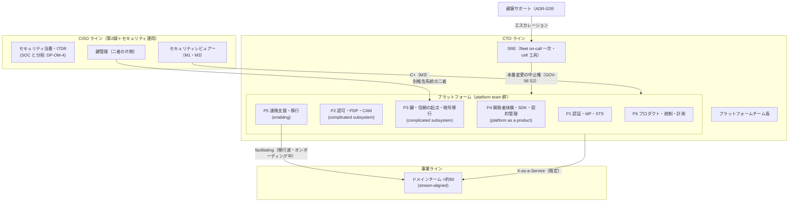
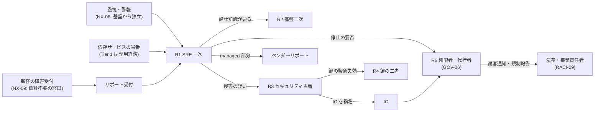
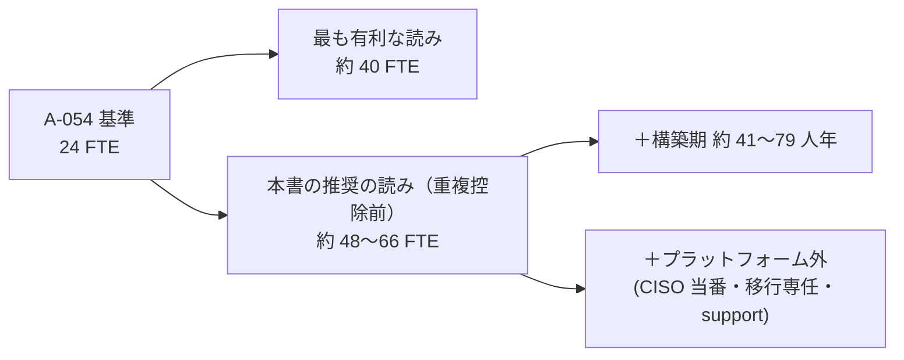
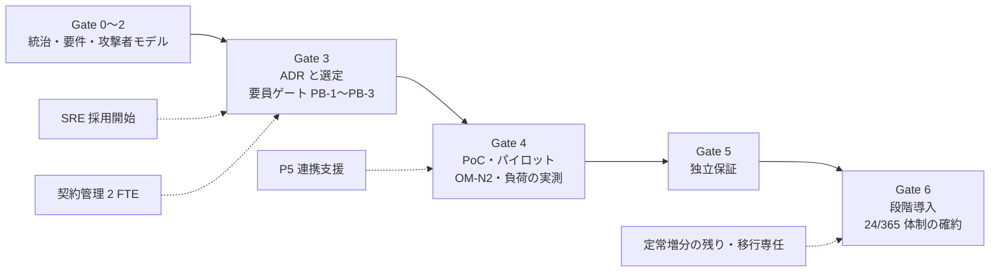
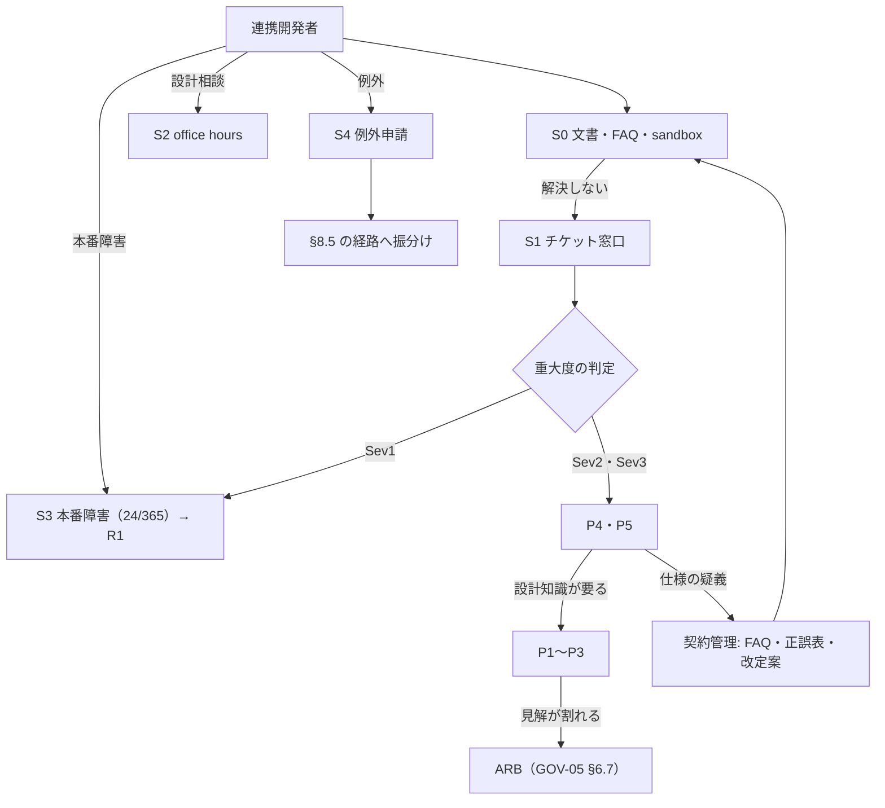
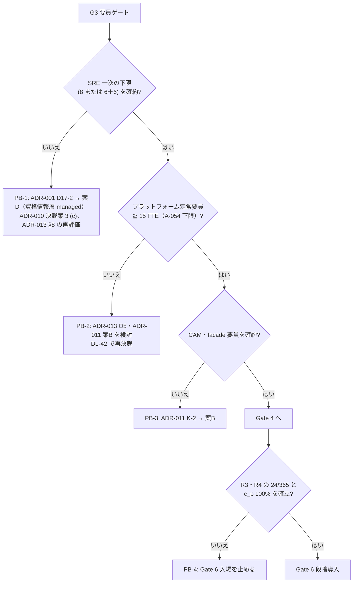

# 運用・要員モデル

> 文書ID: OPS-02 / 版: 0.1 / 状態: draft / 最終更新: 2026-10-15
> 対応要求: R-092, R-136, R-137, R-138, R-139, R-140, R-141, R-222, R-274, G-047, G-145（R-requirements.md・G-goal-criteria.md の対応成果物欄に本書のパスまたは DL-27 を含む全行。末尾の対応表）
> 依存文書: CONVENTIONS.md, traceability/deliverables.md（DL-27、DL-43、DEC-4）, traceability/R-requirements.md, traceability/G-goal-criteria.md, traceability/claims-ledger.md（CL-0178）, 01_governance/assumptions-register.md（A-050〜A-054、A-090、A-101）, 01_governance/raci-governance.md（GOV-05）, 01_governance/stop-authority.md（GOV-06）, 01_governance/exception-risk-acceptance.md（GOV-07）, 01_governance/kri.md（K-30、K-31、KA-2、SRC-17）, 01_governance/business-impact-analysis.md（GOV-04）, 01_governance/durability-charter-20y.md（設計原則 7）, 03_threat-model/attacker-model.md（ATK-09、ATK-10、ATK-17）, 03_threat-model/fraud-abuse-controls.md（新規仮定 5）, 06_controls/applicability.md（NA-3）, 05_adr/README.md, ADR-001, ADR-005〜ADR-029（要員・on-call・変更・例外に関わる決定）, research/RS-15-build-buy-tco.md, research/RS-16-parallel-development-governance.md, research/RS-01-governance-risk.md（RS-01#5, #42）, research/RS-03-identity-lifecycle.md（RS-03#13）

本書は AI エージェント（Claude）が起草した運用・要員モデルの案であり、経営会議・人事部門・各ライン長の承認を経ていない [D][^1]。FTE の幅は ADR の作成者見積り（多くは根拠の弱い仮置き）を足し合わせたものであり、事業計画値・実測値・決裁値ではない [D]。ライン長の確約欄（§12）はすべて未署名である [D]。

表の注記: 表のセルでタグのないものは、右端または本文に示した ADR・A-ID・RS の ID から導いた設計推論 [D] であり、この注記で個別のタグに代える。事実を述べるセルには個別にタグを付けた。

---

## 0. 結論

1. **前提台帳の 24 FTE（A-054）では、ADR-001〜ADR-029 が決めた運用を回せない** [D][A-054]。ADR の定常の増分を足すと、プラットフォームの定常要員は約 48〜66 FTE（重複控除前）になり、内数と読める増分をすべて内数にする最も有利な読みでも約 40 FTE で A-054 の高値 40 に並ぶ（§4）[D][A-054]。構築期には別に約 41〜79 人年の一時増分がある（§4.4）[D]。点推定でなく幅で決裁に載せるのは、点推定だけでは不確実性が分からず意思決定に不十分だとする GAO の指針による [N][^20]（RS-15#69）。
2. **24/365 on-call は「全 cell を 1 系統の fleet で受ける SRE 一次」＋「設計知識を持つ基盤開発者の二次」＋「CISO 組織のセキュリティ当番」＋「鍵の二者（quorum 保有者）」の 4 系統で組む**（§3）[D]。SRE 一次は単一拠点なら 8 名以上、2 拠点なら各 6 名以上を要する [V][^10]（RS-15#70）。A-054 の SRE 6 名はこれを下回るため、増員を G3 の要員ゲートにする [D][A-054]（ADR-001 D17、ADR-013 KD13-5）。
3. **責任分界は「プラットフォームが契約・共通部品・ガードレールを所有し、ドメインが自名前空間のモデルと PEP 組込みを所有し、CISO 組織が要求基準・セキュリティ当番・異議を持ち、SRE が可用性と本番変更の安全を持つ」形にする**（§2）[D]。チームの型は Team Topologies の platform・stream-aligned・enabling・complicated subsystem の 4 型に当てはめ、既定の相互作用を X-as-a-Service にする [V][^12]（RS-16#67）。
4. **bus factor は「重要手順ごとに独立して実行できる有資格者の数」と「24/365 手順のシフト充足率」で測る**（§6）[D]。K-30 (a) の重要手順一覧を 18 手順で確定し、各手順の有資格者の下限を 3 名（二者統制の 2 名＋不在の代替 1 名）、24/365 で要る手順はシフト充足率 100% とする案を置く [D]（GOV-05 §7、GOV-06 から導出）。
5. **変更承認は、CI の自動ゲートと peer review を既定とし、人の審査は信頼の起点（CP-0）・横断ガードレール（M3）・契約の破壊的変更に限る**（§7）[D]。NIST SP 800-53 の CM-3 は影響分析を考慮した承認・却下と記録を求め [N][^13]（RS-16#57）、DORA の調査は外部の重い承認が変更失敗率の低さと関連するという仮説を支持する証拠を見つけなかった [M][^15]（RS-16#59）。
6. **連携開発チーム向けサポートは、セルフサービス（文書・FAQ・sandbox）を一次とし、チケット窓口、週 1 回の office hours、本番障害の 24/365 経路、例外申請の単一受付口の 5 経路で組む**（§8）[D]。問い合わせ量は前提台帳のチーム数（A-052）から式で導くが、チームあたりの問い合わせ率は前提台帳になく、パイロットで実測する（新規仮定 OM-N2）[D][A-052]。応答目標の値は TBD とし、決め方と所有者を置く [D]。
7. **要員を確保できない場合は、ADR がすでに持つ fallback に自動的に移るゲート条件 PB-1〜PB-8 を置く**（§10）[D]。たとえば G3 までに SRE 一次の下限が確約されなければ、ADR-001 D17-2 により資格情報層を managed にする案 D へ移る [D]。
8. **本書が応える 11 件（R 9 件、G 2 件）のうち、本書だけで閉じたものはない**（対応表）[D]。決裁案まで 9 件、要実測を含むもの 2 件（R-137 の on-call 負荷、G-145 の応答時間）である [D]。

---

## 1. 範囲・位置付け・前提

### 1.1 扱う範囲

| 本書（OPS-02、DL-27）で扱う | 他文書で扱う（本書は参照だけ） |
|---|---|
| platform・domain・security・SRE の責任分界とチーム構成 | 12 役割の RACI と決裁権（GOV-05） |
| 24/365 on-call の系統・人数・負荷上限・エスカレーション | 停止権限者・代行者・発動条件（GOV-06）、侵害別 runbook（DL-24） |
| 必要 FTE の幅と導出、採用・育成計画、要員・資格台帳の様式 | TCO の金額と vendor support・LTS の評価（DL-33）、決裁要約（DL-43） |
| bus factor 指標と重要手順一覧（K-30 (a) の一覧の確定） | KRI の採番と報告様式（DL-06） |
| 変更承認の区分と承認者の対応表 | 認可モデル変更の分権規則（GOV-05 §6）、管理面の変更経路（ADR-008） |
| 連携開発チーム向けサポート（問い合わせ SLA、office hours、例外申請） | FAQ の中身（DL-68）、オンボーディング手順（DL-66）、例外の受容票（GOV-07） |
| 要員確保できない場合のゲート条件（Plan B 移行） | ゲート計画全体と Plan B の内容（DL-42） |

- 分担は成果物計画の DL-27 行[^2]と各上流文書の申し送り（§1.3）から導いた [D]。

### 1.2 前提（A-ID）と新規仮定

| A-ID | 値（基準） | 本書での効き方 |
|---|---|---|
| A-050 | 依存サービス 300（成長 600） | サポート対象数、consumer 台帳 [A-050] |
| A-051 | 事業ドメイン 30 | ドメインチームの数、名前空間の所有単位 [A-051] |
| A-052 | 開発組織 25・開発チーム 60（範囲 20〜30 組織・40〜100 チーム） | 問い合わせ量の導出、教育対象、ベンダー交代時の知識移転 [A-052] |
| A-053 | 開発者 1,500（範囲 1,000〜3,000） | 教育の対象人数 [A-053] |
| A-054 | 認証・認可プラットフォームチーム 24 FTE（認証・IdP 5、認可・PDP 5、PEP SDK・開発者支援 4、SRE 6、鍵管理・セキュリティ 2、プロダクト・統制 2）。範囲 15〜40、成長 36、規制強化 30 | 本書の起点。DEC-4 の確約対象 [A-054] |
| A-090 | 判定系の可用性帯 99.95〜99.99% | BIA の T0（21.6 分）を通じて on-call の応答目標に効く [A-090] |
| A-101 | 再決裁は初回 3 年以内、以後 5 年以内 | 要員計画の見直し周期 [A-101] |

- A-ID の値と範囲は前提台帳[^5]による [D]。
- 要員単価は ADR-001 の新規仮定 NA-001-2（1 人年 1,000 万〜2,000 万円）を使う [D]（RS-15#76 で未登録として提案済み）。
- 本書は次の新規仮定を必要とする [D]。いずれも **新規仮定（前提台帳へ追加要）** である [D]。値を置けないものは値を置かない [D]。

| 番号 | 新規仮定（前提台帳へ追加要） | 値 | 本書で効く箇所 | 確定責任者（案） |
|---|---|---|---|---|
| OM-N1 | SRE 一次の拠点構成（日本の単一拠点か、日本＋他法域の 2 拠点か） | 未定（DP-OM-1 で決める） | §3.2 の人数下限（8 か 6＋6）、§3.7 の所在国 | CTO＋人事責任者＋法務責任者 |
| OM-N2 | 開発チームあたりの問い合わせ率（週あたり件数。オンボーディング中と定常で別）と、1 件あたりの処理時間 | 値なし。パイロットで実測 | §8.3 の窓口要員 | プラットフォームチーム長 |
| OM-N3 | 構築期の長さ（G3 から G6 開始まで） | 値なし。DL-42 で決める | §4.4 の一時増分の FTE 換算 | CTO |
| OM-N4 | 新任者が on-call 一次の有資格者になるまでの期間 | 値なし。最初の採用者で実測 | §5.1 の採用時期の前倒し量 | SRE 責任者 |
| OM-N5 | 基盤開発者を on-call 二次に入れることが就業規則・委託契約上できる | 未確認 | §3.1 の R2、DP-OM-1 | 人事責任者＋調達責任者 |
| OM-N6 | 委託ベンダー要員がプラットフォーム要員に占める比率 | 値なし | K-30 (d)、§5.2 | 調達責任者＋CTO |

- GOV-06 の新規仮定①（CISO 組織に 24/365 のセキュリティ当番がある）、④（鍵緊急失効の二者を 24/365 で揃えられる）[^7]と、THR-04 の新規仮定 5（ITDR の 24/365 監視は A-054 の外で SOC と分担する）は、本書でも前提として使い、§3・§11 の決裁案で扱う [D]。

### 1.3 上流文書から本書への申し送り

| 申し送り元 | 申し送られた事項 | 本書の該当節 |
|---|---|---|
| ADR-001 NA-001-3、D17 | SRE を単一系統 8 名以上（2 系統なら各 6 名以上）にする要員ゲート、認証・IdP の増員数 | §3.2、§10 PB-1 |
| ADR-013 KD13-5、D13-46 | SRE の増員か開発者の on-call 参加。fleet 1 系統の on-call | §3.1、DP-OM-1 |
| ADR-010 D-44、決裁案 3 | self-host の条件としての SRE 体制 | §3.2、§10 PB-1 |
| ADR-011 決裁案 1、K-2 | CAM・facade の要員を A-054 の内数とするか外数とするか | §4.3、DP-OM-3、§10 PB-3 |
| ADR-016 NA-016-8、ADR-026、ADR-009、ADR-014 | 増分を A-054 の内数とするか外数とするか | §4.3、DP-OM-3 |
| ADR-008 N8-4、D8-24 | 追加 2 FTE、有資格者名簿、GOV-06 新規仮定④との統合 | §3.5、§6 |
| ADR-022 NA-022-4、D-7、§6.5 | 契約管理 2 FTE、二層の変更管理、疑義窓口 | §4.3、§7、§8 |
| ADR-023 §6.5 | Tier X 演習、Tier 1 障害注入の定常業務化 | §9 |
| ADR-027 K27-3、NA-027-1 | 移行専任チームの要否 | §4.5、DP-OM-6 |
| ADR-029 D29-23 | 承認者の有資格者名簿 | §6.2 |
| GOV-05 RACI-34、§4.1 | 基盤要員の確保と bus factor 対策、CISO 組織・第2線の人員 | §2、§4.5 |
| GOV-06 新規仮定①④ | セキュリティ当番、鍵の二者の 24/365 | §3.1、§3.5 |
| K-30、KA-2、SRC-17 | 重要手順一覧の確定、要員・資格台帳の様式、(b)(d)(e) の閾値 | §5.5、§6 |
| THR-04 新規仮定 5 | ITDR の要員と SOC の分担 | §3.1、DP-OM-4 |
| durability-charter 設計原則 7 | on-call 人数の確定 | §3.2 |
| CL-0178 | domain owner が型と継承規則を所有し、中央 schema 審査をボトルネックにしない | §2.1、§7.3 |
| applicability NA-3 | 運用・support 要員と SOC の所在国 | §3.7、DP-OM-5 |

---

## 2. 責任分界とチーム構成

### 2.1 4 ラインの責任分界

RACI の記号と役割の定義は GOV-05[^6]に従い、本書は運用の単位（チーム・系統）へ写す [D]。

| ライン | 所有するもの | 所有しないもの | 主な RACI | 根拠 |
|---|---|---|---|---|
| プラットフォーム | 連携契約と SDK、AS・STS・PDP・配布系・監査経路などの共通部品、横断型・テナント境界・ガードレール（M3）、名前空間の登録簿、自動ゲート、consumer 台帳、移行・出口の工具 | ドメインの業務上の意味論、依存サービスの可用性 | RACI-19, 21, 25（A）、26〜28（R） | GOV-05 §2.1・§6.3、RS-16#62〜#65 |
| ドメイン | 自名前空間の resource type・relation・permission（M0〜M2）、PEP の組込みと関係テスト・否定テスト、自サービスの Tier 申告と BIA 票、移行要員 | 横断型・テナント境界の変更、基盤の on-call | RACI-22〜24（A）、35（R） | GOV-05 §6.3、CL-0178、ADR-023 D23-50 |
| セキュリティ（CISO 組織） | セキュリティ要求基準、M1 のセキュリティレビュアーと M3 の同意、セキュリティ当番・ITDR、鍵の二者の片側、受容票への意見 | 残余リスクの受容、M0・M1 の個別差止め | RACI-11（A）、27・28（R） | GOV-05 §2.1・§6.4、GOV-07 §7 |
| SRE | 基盤の可用性と on-call 一次、本番変更の安全な実施（wave、1 回 1 cell）、break-glass の SRE 側、容量計画 | 特権操作の単独実行 | RACI-26〜28（R） | GOV-05 §2.1、ADR-013 D13-38・D13-46 |

- SRE はプラットフォームの内側に置くが、本番変更の中止・ロールバックの判断（GOV-06 の S2）を独立に持たせる [D]。変更を作る者と止める者を同じ判断系統にしないためである [D]。
- 中央の schema 審査を律速にしない（CL-0178）ために、ドメインの名前空間内の変更はドメインが承認し、中央は自動ゲートと権限拡大の非同期レビューに限る（GOV-05 §6.1 に従う）[D]。

### 2.2 チーム構成

Team Topologies は、チームの基本型を stream-aligned、enabling、complicated subsystem、platform の 4 つ、相互作用を collaboration、X-as-a-Service、facilitating の 3 つとし、チームの認知負荷を監視して減らすことを説く [V][^12]（RS-16#67）。本書はこの語彙で構成を表す [D]。



| チーム | 型 | 主な担当 | A-054 の内訳との対応 | 主な ADR |
|---|---|---|---|---|
| P1 認証・IdP・STS | platform | AS、資格情報層、federation、内部 STS・TTS、主体台帳 | 認証・IdP 5 | ADR-001〜005, 009, 017 |
| P2 認可・PDP・CAM | complicated subsystem | PDP・store、CAM・facade、一覧の認可、失効配布 | 認可・PDP 5 | ADR-006, 010, 011, 025 |
| P3 鍵・信頼の起点 | complicated subsystem | 鍵階層、ceremony、JWKS 公開、CP-0、PQC 移行 | 鍵管理・セキュリティ 2 | ADR-007, 008, 015 |
| P4 開発者体験・SDK・契約管理 | platform（製品） | 契約・SDK・負例ベクタ・モック、版台帳・非推奨計測、FAQ・正誤表 | PEP SDK・開発者支援 4 | ADR-016, 022 |
| P5 連携支援・移行 | enabling | オンボーディング支援、office hours、移行波の集中支援、dual-run 差分調査 | A-054 にない（外数） | ADR-012, 027 |
| P6 プロダクト・統制・計測 | platform | ロードマップ、KRI・統制証跡、監査経路の製品管理 | プロダクト・統制 2 | ADR-014, 018 |
| SRE | platform（運用） | fleet on-call、容量、cell 工具、Tier X 演習 | SRE 6 | ADR-013, 023 |

- 既定の相互作用を X-as-a-Service にするのは、約 60 チームに対して collaboration（高帯域・高コスト）を常態にすると、プラットフォーム側の要員がチーム数に比例して要るためである [D][A-052]（RS-16#67）。
- CNCF の Platforms White Paper は、トップダウンの強制だけで採用を進める platform チームは利用者の抵抗と反発に遭うとし、最初は少数の積極的なアプリチームに絞って始めることもあり得るとしている [V][^11]（RS-16#65）。本書はパイロット 2〜3 サービスの期間だけ P5 が collaboration で入り、その後は facilitating に移る案をとる [D]。
- 強制する範囲（認証、token 検証、PEP、監査イベント、ADR-022 §6.4 の 5 義務）と、pull で採用される範囲（それ以外の便利機能）を分けて宣言する [D]（RS-16 §2-11）。

### 2.3 活動別の分担

| 活動 | プラットフォーム | ドメイン | セキュリティ | SRE | 正本 |
|---|---|---|---|---|---|
| 基盤の障害の一次対応 | 二次（R2） | 自サービス側の切り分け | 侵害疑いなら IC 候補 | 一次（R1） | §3 |
| 侵害の対応 | 封じ込め工具の実行 | 自サービスの資格情報 rotation | 指揮・kill switch K1/K2・S4 | 実行支援 | GOV-06、DL-24 |
| 認可モデルの変更 | M2 の手順確認、M3 の所有 | M0〜M2 の A | M1 レビュー、M3 の C+ | — | GOV-05 §6.4 |
| PEP の組込みと coverage | 工具と例外台帳 | 組込み、宣言、否定テスト | 例外の意見 | — | ADR-012 |
| 契約の互換変更・破壊的変更 | A（互換）、R（破壊的） | consumer 代表として C | 審査会構成員 | 審査会構成員 | ADR-022 D-7 |
| 非推奨と移行 | 計測・通知・延長審議 | 期限内の移行 | — | — | ADR-016 |
| Tier の申告と検査 | 依存グラフ検査 | 申告と BIA 票 | — | 障害注入（Tier 1、四半期） | ADR-023 D23-50 |
| 鍵 ceremony・緊急失効 | プラットフォーム側の鍵管理 | — | CISO 組織側の鍵管理 | 立会い・実行支援 | GOV-05 §7、DL-14 |
| break-glass | — | — | CISO 組織当番 | SRE 当番 | GOV-06 S8b |
| 顧客サポートの特権昇格 | 昇格系の運用 | — | 承認者（別報告系統） | — | ADR-029 |

---

## 3. 24/365 on-call

### 3.1 系統

| 系統 | 担当 | 範囲 | 時間帯 | 人数の考え方 | 根拠 |
|---|---|---|---|---|---|
| R1 SRE 一次 | SRE | 全 cell の AS・STS・PDP・edge・配布系・状態ストア・監査経路。managed 部分のベンダーへのエスカレーション、顧客告知の起票 | 24/365 | 単一拠点 8 名以上、2 拠点なら各 6 名以上 | RS-15#70, #71、ADR-013 D13-46 |
| R2 基盤二次 | P1〜P4 の開発者 | R1 から呼ばれ、設計知識を要する切り分けと修正 | 24/365（呼出し時） | チーム（P1〜P3）ごとに待機 1 名。人数は DP-OM-1 | ADR-013 KD13-5 の「開発者の on-call 参加」、RS-15#71 (b) |
| R3 セキュリティ当番 | CISO 組織（ITDR を含む） | 侵害疑いの判定、kill switch K1、主体単位の S4、IC の指名元、break-glass の二者の片側 | 24/365 | DP-OM-4 で決める | GOV-06 新規仮定①、THR-04 新規仮定 5 |
| R4 鍵の二者 | P3 と CISO 組織の鍵管理有資格者 | S5 鍵緊急失効、issuer 鍵の緊急 rotation | 24/365（呼出し時） | 各シフトで 2 つの報告系統に有資格者が 1 名以上 | GOV-05 §7、GOV-06 新規仮定④ |
| R5 権限者・代行者 | SRE 責任者、プラットフォームチーム長、CISO・CTO の指名代行 | 停止権限の発動と代行（GOV-06 §3.2） | 24/365 連絡可能 | 代行名簿に複数名 | GOV-06 §3.2 |
| R6 連携開発者支援 | P4・P5 | 非本番の問い合わせ、office hours | 営業時間 | §8.3 の式 | §8 |

- R1 を cell ごと・地域ごとに分けないのは、ADR-013 D13-46 が全 cell を同一構成の複製として on-call 1 系統の fleet で運用すると決めたためである [D]。
- 当番の招集と対応者間の連絡は、本基盤の SSO にも社内 workforce IdP にも依存しない帯域外の手段を併置する（ADR-023 NX-07、KD23-3）[D]。
- 依存サービス側が自サービスの 24/365 当番を持つかは、各事業責任者が BIA で決める（TBD、所有者: 事業責任者、期限: G3、決め方: BIA 票の MTPD）[D]。Tier 1 の依存サービスについては、ADR-023 D23-11 の四半期の障害注入への参加が前提になる [D]。

### 3.2 人数の下限と A-054 との比較

- Google の SRE 本は、単一拠点のチームで on-call を回す最少人数を 8 名、2 拠点では各拠点 6 名としている [V][^10]（RS-15#70）。
- A-054 は SRE 6 名で 24/365 の on-call を 2 系統回す想定であり、1 系統 3 名になり、どちらの目安も下回る [D][A-054]（RS-15#71）。
- このため R1 の人数を次のとおりとする案を置く [D]。値は Google の社内実践の記述であり、規範でも本件規模の実測でもない（RS-15 §6）ので、PoC・パイロットの負荷実測（TC-13-20、RS-15 §5.2 の 8）で見直す [D]。

| 拠点構成（OM-N1） | R1 の人数下限 | A-054 からの増分 | 所在国の論点 |
|---|---|---|---|
| 日本の単一拠点 | 8 | ＋2 | 夜間シフトが生じる。所在国の論点は小さい |
| 2 拠点（日本＋他法域） | 6＋6＝12 | ＋6 | 遠隔参照が移転に当たり得る（§3.7） |

- 単一拠点 8 名は、前提台帳の範囲（15〜40 FTE）のどの値を採っても SRE 6 名の内訳のままでは満たせないため、内訳の組替えでなく増員として扱う [D][A-054]。

### 3.3 エスカレーション経路



- R1 の初動の応答時間目標は TBD とする（所有者: SRE 責任者、期限: G3、決め方: BIA の T0（A-090 の下限で 21.6 分）と NA-01 の MTPD に対し「応答＋切り分け＋緩和 ＜ MTPD」を満たすよう DL-20 の SLI として置く）[D][A-090]。
- 停止の発動・代行・解除は GOV-06 に従い、本書は経路と人の確保だけを定める [D]。

### 3.4 負荷の上限と監視

- Google の SRE 本は、SRE の業務時間のうち on-call に充てるのは 25% 以下とし、12 時間の on-call 1 シフトで扱うインシデントは最大 2 件としている [V][^10]（RS-15#70）。
- 本書はこの 2 つを R1 の負荷の監視指標にし、K-30 (c)（on-call 1 系統あたりの人数）と並べて月次で報告する [D]。上限を超えた月が続く場合の扱いは §10 PB-6 に置く [D]。
- 1 シフトのインシデント数は TC-13-20（fleet 運用演習）で事前に確かめ、PoC 期間中は alert とインシデントの件数を系統別に記録する [D]（RS-15 §5.2 の 8）。

### 3.5 二者統制と有資格者の常時充足

- 鍵緊急失効（GOV-06 S5）は同時二者を要し、二者は別々の報告系統から出す [D]（GOV-05 §7）。
- 24/365 で二者をそろえるには、R1 と R3（または R4）のシフトごとに、二者の片側になれる有資格者が 1 名以上いなければならない [D]。A-054 の鍵管理・セキュリティ 2 FTE だけではこの条件を満たせない可能性がある [D][A-054]（GOV-06 新規仮定④）。
- 満たし方は 2 通りある [D]。(a) R1・R3 の全員を鍵の二者の有資格者に育成する。(b) 有資格者だけの呼出し系統 R4 を別に置く。(b) を採る場合、R4 自体が 24/365 の系統になり、§3.2 と同じ人数の論点が生じる [D]。本書は (a) を推奨する（DP-OM-4）[D]。
- ADR-008 N8-4 の追加 2 FTE（管理用 IdP・PAW・CI 基盤・署名系の運用）と、GOV-06 新規仮定④の二者の担い手は重なる部分があるため、P3 の増員として一本化して数える（§4.3）[D]。

### 3.6 managed を選んでも残る on-call と vendor support

- managed を選んでも、障害時の切替え、顧客への連絡、設定変更、ベンダーへのエスカレーションのための on-call は残る [D]（RS-15#71）。
- ベンダーのサポート契約の応答時間は、R1 のエスカレーションの必要時間を下回るものを選ぶ [D]。参考として、AuthZed はサポートを Standard（メール、P3 は 1 営業日）、Premium（Slack、P1/P2 は 12 時間）、Enterprise（専任チーム、P1 は 1 時間）の 3 段にしている [V][^17]（RS-15#61）。応答時間の要件値と RFP 項目は DL-33 で決める [D]。

### 3.7 拠点と所在国

- 運用・support 要員と外部委託 SOC の所在国は未定であり（applicability NA-3）、時差運用で他法域の要員が本番の個人データを遠隔参照すると、移転や米国 28 CFR Part 202 の懸念国アクセス規制の判定に効く [D]（06_controls/applicability.md）。
- 本書は、本番の特権操作に関わる R1・R3・R4 を当面日本の単一拠点に置く案を推奨する（DP-OM-1、DP-OM-5）[D]。2 拠点化は、法務の判定（DL-34）が済み、cell の所在地と要員の参照範囲を一致させられる場合に限る [D]。

---

## 4. 必要 FTE の幅

### 4.1 方法

- GAO の費用見積り指針は、点推定だけでは見積りの不確実性について何も分からず意思決定に不十分だとし、感度分析とリスク・不確実性分析を求める [N][^20]（RS-15#69）。本書は FTE を点でなく幅で示す [D]。
- 幅は、A-054 の 24 FTE を起点に、各 ADR が「費用・要員の桁」として置いた増分（多くは作成者の仮置き）を足して出す [D]。
- 足し合わせには 2 つの偏りがある [D]。(1) ADR 間の重複（例: ADR-018 の変換器保守は ADR-010・ADR-011 の工数と重なると ADR-018 自身が述べる）で上に偏る。(2) ADR にない業務（採用・教育・サポート窓口の運営そのもの）の漏れで下に偏る。どちらも PoC の工数記録（H-7、H-18、H-14、TC-01-08）で補正する [D]。

### 4.2 内数・外数の扱い（本書の推奨）

- A-054 の内訳（認証 5、認可 5、SDK 4、SRE 6、鍵 2、統制 2）は、ADR が決めた中核機能でほぼ埋まっており、SRE は §3.2 のとおり単独でも不足する [D][A-054]。
- このため、ADR が「内数か外数かは DL-27 で決める」とした増分（ADR-009、ADR-011、ADR-014、ADR-016、ADR-026）は外数として扱うことを推奨する（DP-OM-3）[D]。ADR が明示的に内数とした増分（ADR-003、ADR-004、ADR-010、ADR-015、ADR-020）は内数のままとする [D]。

### 4.3 定常の増分（プラットフォーム）

| # | 増分の内容 | 定常 FTE（低〜高） | 出典 | 扱い |
|---|---|---|---|---|
| 1 | SRE 一次の下限への引上げ | ＋2〜＋6 | RS-15#70、ADR-001 NA-001-3、ADR-013 KD13-5 | 外数（§3.2） |
| 2 | 状態ストア・edge 照会系 | ＋1〜2 | ADR-005 NA-08 | 外数 |
| 3 | 失効配布・接続ゲートウェイ・SSF 送受信 | ＋2〜3 | ADR-006 NA-006-3（採用案 C） | 外数 |
| 4 | 管理用 IdP・PAW・CI 基盤・署名系（鍵の二者を含む） | ＋1〜4（中央 2） | ADR-008 N8-4、§3.5 | 外数 |
| 5 | workload ID 発行系・STS・TTS・登録簿 | ＋2〜3 | ADR-009 NA09-3 | 外数（推奨） |
| 6 | CAM 保守＋PDP facade 運用 | ＋2〜4 | ADR-011 NA-011-1・NA-011-2 | 外数（ADR-011 決裁案 1 の推奨 (b) と同じ側） |
| 7 | PEP coverage 工具の維持 | ＋2〜3 | ADR-012 NA-012-1 | 外数（ADR-012 §6.5） |
| 8 | 監査経路の定常運用 | ＋2 | ADR-014 NA-014-6 | 外数（推奨） |
| 9 | 版台帳・consumer 台帳・非推奨計測 | ＋1〜2（併存 major が増えると増える） | ADR-016 NA-016-8 | 外数（推奨） |
| 10 | 非人間 ID・AI エージェント（主体台帳、承認 grant、tool 目録） | ＋2〜3 | ADR-017 §3.3（採用案 C） | 外数（ADR-017 §6.5 が増分と明記） |
| 11 | 出口（EIF 生成器・変換器・往復試験・演習） | ＋1.5〜3 | ADR-018 NA-018-1 | 外数。#6 と重複あり |
| 12 | 契約管理（スキーマ、モック、負例ベクタ、正誤表、FAQ、審査会事務局） | ＋2 | ADR-022 NA-022-4 | 新設 |
| 13 | 一覧の認可（一覧レーン、索引同期キット） | ＋2〜3 | ADR-025（採用案 C） | 外数 |
| 14 | 非同期・長時間ジョブの委任（TTS 内部開始、ジョブ SDK） | ＋1〜2 | ADR-026（採用案 D） | 外数（推奨） |
| 計 | | **＋23.5〜＋42** | | |

- 定常のプラットフォーム要員は 24＋23.5〜24＋42 ＝ **約 48〜66 FTE**（重複控除前）である [D][A-054]。#11 の全量を重複として除いても約 46〜63 FTE である [D]。
- ADR が内数と読める余地を残した増分（#5、#8、#9、#14）と #11 をすべて 0 とし、#1〜#4、#6、#7、#10、#12、#13 を下限値で数える最も有利な読みでも 24＋16 ＝ 約 40 FTE になり、A-054 の範囲の高値 40 に並ぶ [D][A-054]。
- よって「A-054 の基準値 24 FTE で ADR 群の決定を運用できる」という前提は成り立たない、と本書は判断する [D][A-054]。前提台帳の A-054 を改訂するか、ADR の fallback（§10）に移るかを DEC-4 の決裁事項にする [D]。

### 4.4 構築期の一時増分

| ADR | 構築の要員 | 人年（低〜高） |
|---|---|---|
| ADR-007 N7-8 | 2〜3 FTE × 12〜18 か月 | 2〜4.5 |
| ADR-009 NA09-3 | 3〜5 FTE × 12〜18 か月 | 3〜7.5 |
| ADR-011 NA-011-1・2 | CAM 2〜3 FTE × 12 か月、facade 2〜4 人 × 6〜9 か月 | 3〜6 |
| ADR-012 NA-012-1 | 3〜5 FTE × 12〜18 か月 | 3〜7.5 |
| ADR-013 N13-3 | 3〜5 FTE × 18 か月 | 4.5〜7.5 |
| ADR-014 NA-014-6 | 3 FTE × 12 か月 | 3 |
| ADR-015 N15-1 | 1〜2 FTE × 12 か月 | 1〜2 |
| ADR-016 NA-016-8 | 1.5〜2.5 FTE × 9 か月 | 1.1〜1.9 |
| ADR-017 §3.3 | 4〜6 FTE × 2 年 | 8〜12 |
| ADR-019 §3 | 10^1 人月の桁 | 0.8〜8 |
| ADR-025 案 C | 4〜8 人年 | 4〜8 |
| ADR-026 案 D | 3〜5 FTE × 1 年 | 3〜5 |
| ADR-028 NA-028-1 | 2〜3 FTE × 12 か月 | 2〜3 |
| ADR-029 案 B | 約 3 人年 | 3 |
| 計 | | **約 41〜79 人年** |

- ADR-004 の構築（2〜3 FTE × 3〜4 四半期）は、ADR-004 が認証チーム 5 FTE のうちとしているため数えていない [D]。
- 構築期の長さ T（OM-N3）は未定である [D]。仮に T を 2 年とすると約 21〜40 FTE 相当の上乗せになるが、T は DL-42 のゲート計画で決まる値であり、この換算は例示である [D]。
- 構築要員は定常要員と同じ人で賄えない [D]。定常要員は §3 の on-call と運用で埋まるためである [D]（§3.2、§4.3）。

### 4.5 プラットフォーム外の要員

| 区分 | 内容 | 幅 | 出典 | 所有者 |
|---|---|---|---|---|
| CISO 組織のセキュリティ当番・ITDR | R3、ITDR の 24/365 監視、IC | TBD。自前で単一拠点の当番を回すなら、RS-15#70 の目安を類推して 8 名が下限の目安 [D] | GOV-06 新規仮定①、THR-04 新規仮定 5 | CISO（DP-OM-4） |
| 顧客サポートの特権昇格の承認と運用 | 社内承認、break-glass の検証 | 約 1.5 FTE（support 部門と CISO 組織） | ADR-029 §3（案 B の勝つ条件） | 顧客サポート責任者＋CISO |
| 移行専任チーム | MU の計画、差分の調査、顧客支援の技術窓口 | 10^1 FTE の桁（短期〜複数年） | ADR-027 NA-027-1 | CTO＋CFO（DP-OM-6） |
| ドメイン側の移行・組込み | PEP 組込み、ジョブ改修、破壊的変更の追随 | ADR-012 NA-012-2 は 105〜420 人月、ADR-026 は 75〜300 人月、ADR-022 NA-022-3 は破壊的変更 1 回で 600〜1,500 人日 | 各 ADR | 事業責任者（RACI-35） |
| 第2線・内部監査 | 受容票レビュー、独立保証 | TBD | GOV-05 §4.1（新規仮定②） | CFO＋人事責任者 |

### 4.6 費用の桁

- 定常 48〜66 FTE に NA-001-2 の単価（1 人年 1,000 万〜2,000 万円）を掛けると、要員費は年約 4.8 億〜13.2 億円の桁である [D][NA-001-2]。A-054 の 24 FTE での年 2.4 億〜4.8 億円（RS-15#76）の約 2〜3 倍に当たる [D]。
- 金額の確定、感度分析、リスク・不確実性分析は DL-33 で行い、本書は人数の幅だけを渡す [D]。



---

## 5. 採用・育成計画

### 5.1 採用の順序

| 時期 | 採用・確保する役割 | 理由 | 確約の形 |
|---|---|---|---|
| Gate 0〜Gate 3（設計・選定） | PoC 要員（ADR-010 NA-010-5 の認可 5 FTE＋SRE 1〜2 名を 3〜4 か月、TC-01-08 の認証要員、TC-08-04 の鍵の二者）、P4 の契約管理 2 FTE（NA-022-4） | PoC と DEC-8（連携契約 v1 の凍結）の前提になる | DEC-4 の確約（G-047 段階1） |
| G3 まで | SRE 一次を下限（8 または 6＋6）にそろえる採用の開始 | ADR-001 D17 の要員ゲートが G3 に置かれている。新任者が有資格になるまでの期間（OM-N4）だけ前倒しが要る | 人事責任者の採用計画と CFO の予算 |
| Gate 4（PoC） | P5 連携支援（パイロット 2〜3 サービス）、R3 セキュリティ当番の設計 | パイロットで問い合わせ率（OM-N2）と on-call 負荷を実測する | DEC-4 |
| Gate 5〜Gate 6 開始 | §4.3 の定常増分の残り、構築期の一時要員、移行専任チーム | 段階導入では 24/365 体制が要る | G-047 段階3 の確約 |
| G6 以降 | 再決裁（A-101）ごとの見直し | 成長シナリオで A-054 は 36 FTE とされている | 経営会議 |



### 5.2 確保の経路と委託の扱い

- 確保の経路は、社内異動、新規採用、委託ベンダーの 3 つである [D]。
- 委託ベンダー要員の比率（OM-N6）にかかわらず、K-30 (d)「単一ベンダーの要員だけが実行できる重要手順の数」を 0 件にする案を置く（DP-OM-7）[D]。重要手順（§6.2）は社内要員を必ず有資格者に含めるという意味である [D]。
- デジタル庁の公表では、自治体の標準化対象 34,366 システムのうち 10,013（29.1%）が移行期限までに移行できず、事由別で最多は事業者のリソースひっ迫による遅延であった [M][^18]（RS-16#78。測定条件: 総務省の標準化 PMO ツールによる集計、2026 年 3 月末時点）。本計画でも、ベンダーの要員確保をドメイン組織ごとの移行ゲートに入れる（§10 PB-7）[D][A-052]。

### 5.3 教育カリキュラム

| 対象 | 人数の桁 | 内容 | 形式 | 合格の証拠 | 根拠 |
|---|---|---|---|---|---|
| R1・R2 の当番 | §3 | runbook（DL-24）、停止権限（GOV-06）、Tier X の工具（ADR-023 NX-01〜NX-16）、cell 退避、policy rollback | shadow（見習い）→ reverse shadow（指導付き一次）→ 一次 | 演習記録（E8）、K-30 (e) | ADR-023 D23-31、durability-charter 設計原則 7 |
| R3・R4（鍵・セキュリティ） | §3.5 | 鍵 ceremony、緊急失効、全 session 失効、kill switch、証拠保全 | ceremony 演習、机上演習 | ceremony 記録、演習記録 | GOV-05 §7、ADR-008 D8-24 |
| 変更の承認者（CP-0〜CP-2、M1・M3） | 名簿 | 対象資産の変更の影響、二者レビューの観点 | 名簿登録前の確認 | 有資格者名簿（§5.5） | ADR-008 D8-24 |
| ドメインの開発者 | 1,500（A-053） | 契約と 5 義務、必須負例ベクタ 13 種、SDK、モデリング（DL-65）、PEP coverage、Tier の申告 | 文書・sandbox・office hours。オンボーディング時に必修 | 契約試験の合格（ADR-022 D-6）、修了記録 | ADR-022 §6.4、RS-16#63 |
| policy author（ATK-10） | ドメインごと | M0〜M3、CI ゲート、権限拡大の差分 | 実習 | M1 差戻し率の推移 | GOV-05 §6 |
| 顧客サポート・helpdesk（ATK-09） | support 部門 | ソーシャルエンジニアリングの兆候、折返し確認、特権昇格の手順 | 研修と抜打ち演習 | 研修記録、演習記録 | RS-03#13、ADR-029 |
| 停止権限者・代行者・経営 | GOV-06 名簿 | 代行連鎖、発動条件、顧客通知の判断 | 机上演習（GOV-06 SA-9） | 演習記録 | GOV-06 §8 |
| 委託ベンダーの新規参画者 | A-052 | 上記のうち担当範囲 | 参画時の必修 | 修了記録 | §5.2 |

- NIST SP 800-63A-4 は、trusted referee を使う場合に研修（ソーシャルエンジニアリングの兆候を含む）を行い、全セッションを記録しなければならない（SHALL）とする [N][^19]（RS-03#13）。本基盤の helpdesk は trusted referee そのものではないが、同じ攻撃を受ける窓口であるため、研修内容の参考にする [D]。
- NACD の取締役向けハンドブックは、KRI の例の一つに研修完了率を挙げている（例示であり拘束力はない）[N][^21]（RS-01#42）。本書は研修完了率を K-30 の補助指標として月次に報告する案をとる [D]。
- 新任者が R1 一次の有資格者になるまでの期間（OM-N4）は未知であり、最初の採用者の実績で決める（TBD、所有者: SRE 責任者、期限: G4）[D]。

### 5.4 有資格化の手順

| 段 | 条件 | 判定者 |
|---|---|---|
| 1 見習い（shadow） | 研修修了。当番の傍で観察 | SRE 責任者（R1）、チーム長（R2）、CISO 指名者（R3・R4） |
| 2 指導付き一次（reverse shadow） | 演習 1 回以上の合格。有資格者が付いて一次を担う | 同上 |
| 3 有資格 | 指導付き一次の期間を終え、重要手順の演習に合格 | 同上。台帳に記録（§5.5） |
| 4 更新 | 演習を周期内に受ける（NX-01 は 90 日ごと、他は年 1 回以上。ADR-023 D23-31） | 同上。未受講で資格を停止 |

### 5.5 要員・資格台帳の様式（KA-2、SRC-17）

| 欄 | 内容 |
|---|---|
| 要員 ID | 個人を識別する社内 ID（委託先は契約 ID と組で記録） |
| 所属ライン・報告系統 | プラットフォーム／CISO 組織／SRE／ドメイン／委託先（ベンダー名） |
| 系統（R1〜R6） | 参加する on-call 系統とシフト表への登録 |
| 有資格の重要手順 | §6.2 の手順 ID ごとに段（§5.4）、取得日、最終演習日、次回期限 |
| 承認者資格 | CP-0〜CP-2、M1、M3 の承認者名簿への登録 |
| 二者の片側 | 鍵の二者・break-glass の二者の片側として指名できるか |
| 所在国 | applicability NA-3 の判定に使う |
| 状態 | 有効／停止（期限切れ）／退任 |

- 台帳は人事部門と CTO 組織が共同で維持し、更新は配置換え・退任・演習のたびに行う [D]（KA-2）。月次で K-30 を台帳とシフト表から機械的に集計する [D]。

---

## 6. bus factor 指標

### 6.1 定義

| 指標 | 定義 | 対応する K-30 |
|---|---|---|
| 手順の bus factor b_p | 重要手順 p を独立して実行できる有資格者の数（二者手順は、二者の片側になれる者を報告系統ごとに数え、少ない側の数） | (a) は b_p ≦ 1 の手順の数 |
| シフト充足率 c_p | 24/365 で要る手順 p について、全シフトのうち有資格者が当番に入っているシフトの割合 | 本書で追加 |
| 重要役割の空席日数 | GOV-06 の権限者・代行者、SRE 責任者、鍵管理者などの空席の日数 | (b) |
| on-call 1 系統の人数 | R1 の在籍有資格者数 | (c) |
| 単一ベンダー依存 | 有資格者が 1 つのベンダーの要員だけの手順の数 | (d) |
| 演習合格率 | 重要手順の演習の合格率 | (e) |

- 手順単位で測るのは、レビューが「少数の専門家への過度な依存」を問い（L21）、bus factor の定義を求めている（L97）ためであり、人数の総数ではなく止める・戻す手順が人に縛られていないかを見る必要がある [D][^9]。

### 6.2 重要手順一覧（K-30 (a) の一覧の確定）

| ID | 重要手順 | 24/365 で要るか | 二者 | b_p の下限（案） | 正本 |
|---|---|---|---|---|---|
| CP-01 | オフライン root 鍵の ceremony | いいえ（計画実施） | 別報告系統の二者 | 3 | GOV-05 §7、DL-14 |
| CP-02 | issuer 署名鍵の緊急 rotation | はい | 二者 | 3＋c_p 100% | ADR-007、DL-24 |
| CP-03 | 鍵緊急失効（S5） | はい | 同時二者 | 3＋c_p 100% | GOV-06 S5 |
| CP-04 | 全 session 失効（S4、cell・全域） | はい | 同時二者 | 3＋c_p 100% | GOV-06 S4 |
| CP-05 | kill switch K1〜K3 | はい | K3 は同時二者 | 3＋c_p 100% | GOV-06 S3 |
| CP-06 | 緊急 freeze（S2） | はい | 不要 | R1 全員 | GOV-06 S2 |
| CP-07 | policy・model の rollback（既知良好版の差込み） | はい | 不要 | 3＋c_p 100% | ADR-013、ADR-023 NX-12 |
| CP-08 | cell 退避・待機 cell への切替 | はい | 不要 | 3＋c_p 100% | ADR-013 |
| CP-09 | break-glass の発動（S8b） | はい | SRE＋CISO 組織の同時二者 | 3＋c_p 100% | GOV-06 S8b、ADR-008 |
| CP-10 | 監査記録の復元と証拠保全 | はい（侵害時） | 不要 | 3 | ADR-014、DL-24 |
| CP-11 | テナント単位の復元 | いいえ | 二者 | 3 | ADR-028 |
| CP-12 | 顧客通知・規制報告の判断の起案 | はい | 不要 | 3 | RACI-29、DL-24 |
| CP-13 | JWKS 公開経路・DNS ゾーンの変更（CP-0） | いいえ（緊急時を除く） | 別報告系統の二者 | 3 | ADR-008 CP-0 |
| CP-14 | 横断ガードレール（M3）の merge | いいえ | 二者＋CISO 同意 | 3 | GOV-05 §6.4 |
| CP-15 | SDK・判定規則の緊急配布（Tier 別 wave） | はい | 不要 | 3 | ADR-023 D23-41 |
| CP-16 | 失効配布系の停止時の切替（M_rev 内の復旧） | はい | 不要 | 3＋c_p 100% | ADR-006 |
| CP-17 | 帯域外連絡手段・status page の立上げ | はい | 不要 | R1 全員 | ADR-023 NX-07, NX-08 |
| CP-18 | 出口・置換 cell の dual-run 起動 | いいえ（演習時） | 不要 | 3 | ADR-018 |

- 下限 3 は、二者統制の 2 名に不在時の代替 1 名を加えた数として置いた設計推論であり、実測や規範から得た値ではない [D]（GOV-05 §7 から導出）。二者を要しない手順も、休暇と退任に耐えるため同じ 3 にそろえる [D]。
- 「R1 全員」は、当番の誰でも実行できなければ意味がない手順（凍結、帯域外連絡）を示す [D]。GOV-06 は S2 の権限を当番名簿に載った全当番に与えている [D][^7]。
- 一覧は DL-24 の runbook が確定した時点で照合し、増えた手順を追加する [D]。

### 6.3 K-30 の閾値案

| K-30 | 目標 | 注意 | 限度 | 状態 |
|---|---|---|---|---|
| (a) b_p ≦ 1 の重要手順の数 | 0 件 | — | 停止・復旧の手順で 1 件以上（kri.md の既定） | kri.md で既定 |
| (a') b_p ＜ 3 の重要手順の数（本書で追加） | 0 件 | 1 件以上 | — | 案 |
| c_p ＜ 100% の 24/365 手順の数（本書で追加） | 0 件 | — | 1 件以上 | 案 |
| (b) 重要役割の空席日数 | 0 日 | TBD | TBD | TBD（所有者: CTO＋人事責任者、期限: G3、決め方: GOV-06 の代行連鎖の机上演習（SA-9）で代行が機能する期間を確かめて決める） |
| (c) on-call 1 系統の人数 | 8 以上（単一拠点）または各 6 以上（2 拠点） | 下限を割った月 | 下限を割ったまま 6 か月（ADR-013 §8 の再評価条件） | 案（RS-15#70） |
| (d) 単一ベンダー依存の重要手順の数 | 0 件 | 1 件以上 | — | 案（DP-OM-7） |
| (e) 重要手順の演習合格率 | TBD | TBD | TBD | TBD（所有者: CTO＋人事責任者、期限: G3、決め方: 最初の 2 回の演習の合格率を基準にする） |

---

## 7. 変更承認

### 7.1 原則

- NIST SP 800-53 Rev.5 の CM-3 は、提案された変更をセキュリティとプライバシーの影響分析を明示的に考慮して承認または却下し、決定を文書化し、変更記録を保持することを求める [N][^13]（RS-16#57）。CM-3(4) は、組織が定めるセキュリティとプライバシーの代表者を変更管理の構成員にすることを求める [N][^13]（RS-16#58）。
- DORA は、変更承認は開発過程での peer review と、悪い変更を早期に検出・防止・是正する自動化で行うのが最もよいとし、チーム外の CAB 等による重い承認はデリバリー性能に負の影響を与えたとしている [M][^14]（RS-16#59）。2019 年の報告本体は、より正式な外部レビューが変更失敗率の低さと関連するという仮説を支持する証拠は見つからなかったとしている [M][^15]（測定条件: 質問票調査、回答者約 1,000 人、報告 p.7 の注記による誤差 3%。効果量の信頼区間は RS-16 で未確認）。
- DORA は、職務分離の要求をチームの開発基盤に記録される peer review で満たすよう勧めている [M][^14]（RS-16#60）。
- 本書はこれらから、影響分析を CI の自動ゲートに、承認と記録を peer review の記録に、CM-3(4) の代表者を M1・M3 のセキュリティレビュアーと契約変更審査会の CISO 代表に割り当てる GOV-05 §6.2 の方針を、基盤の全変更に広げる [D]。

### 7.2 変更区分と承認者

| 区分 | 対象 | 承認 | 人の審査 | 記録 | 正本 |
|---|---|---|---|---|---|
| CP-0 信頼の起点 | 鍵、JWKS・マニフェスト公開経路、DNS・registrar、管理用 IdP、CI 署名系、break-glass 資格情報 | 別報告系統の二者（有資格者名簿の者）＋待機時間（KD8-5） | あり | 二者の記録（E10）、即時警報 | ADR-008 §2.1、D8-23, D8-24 |
| CP-1 全域・cell 横断の構成 | AS の realm 横断設定、G 段カタログ、横断型・ガードレール（M3）、配置表、wave 定義、監査設定 | 別報告系統の二者。M3 は CISO の同意（C+） | あり | 二者合意、署名付きスナップショット | ADR-008、GOV-05 §6.4 |
| CP-2 名前空間・テナント単位 | ドメインの M0〜M2、単一テナント・単一 cell の設定 | 作成者≠承認者の peer review（M1 は非同期のセキュリティレビュー、M2 は移行手順の確認） | M1・M2 のみ | CI ログ、レビュー記録 | ADR-008、GOV-05 §6.4 |
| 基盤実装の本番展開 | AS・PDP・SDK などのコード・設定 | peer review＋自動試験＋契約試験・can-i-deploy。展開は 1 回 1 cell の wave | なし（自動ゲート） | CI ログ、展開記録 | RACI-26、ADR-013 D13-38、ADR-022 D-7 |
| 契約の互換な変更・正誤表・疑義回答 | minor 追加、誤記訂正 | プラットフォーム（契約管理） | なし | 正誤表・FAQ | RACI-19、ADR-022 D-5-6 |
| 契約の破壊的変更・非推奨・凍結日・claim の追加と廃止 | 版付き凍結の契約 | 契約変更審査会（年 2 回の固定日と臨時） | あり | 審査記録、consumer 通知 | RACI-20、ADR-022 D-7-1、D-7-2 |
| 緊急のセキュリティ変更 | 非推奨期間の約束から外れる変更 | 実施後の事後承認（契約変更審査会）と consumer への個別通知 | 事後 | 例外記録 | ADR-022 D-5-5 |
| 緊急停止・凍結 | S2 freeze など | GOV-06 の権限者・当番 | 事後レビュー | 停止の記録票（NX-11） | GOV-06 |

- 人の審査を上表の「あり」に限ることで、中央チームが律速になる箇所を CP-0・CP-1・M1・M2・契約の破壊的変更に絞る [D]。
- 承認者は有資格者名簿（§5.5）に載った者に限り、有資格者が 1 名以下の承認系統は K-30 (a) に計上する [D]（ADR-008 D8-24）。

### 7.3 審査待ちの監視

- 中央の審査待ちは K-31（オンボーディング各段階の待ち件数と待ち時間、M1 レビューの待ち時間と未処理件数）で監視する [D][^8]。
- SLA 違反が続いた場合の是正の順序は、GOV-05 §6.6 のとおり (1) 自動化を増やして M1 の対象を狭める、(2) M0 の条件を広げる、(3) レビュアーを増やす、とする [D]。本書は (3) の増員を §4.3 の外数に含めていないため、(3) に至った場合は DP-OM-2 の再決裁に回す [D]。

---

## 8. 連携開発チーム向けサポート体制

### 8.1 窓口と経路

| 経路 | 用途 | 受付時間 | 担当 | 本基盤への依存 |
|---|---|---|---|---|
| S0 セルフサービス | 契約・SDK の文書、FAQ（DL-68）、正誤表、共有 sandbox（ADR-022 D-6-4）、契約試験キット | 常時 | P4 | sandbox は本番と別の issuer・鍵 |
| S1 チケット窓口（疑義窓口） | 仕様の解釈、開発中の不具合、オンボーディング各段階の依頼 | 営業時間（日本） | P4・P5 | 窓口の login は社内 workforce IdP への直接 federation（ADR-023 NX-13 の考え方） |
| S2 office hours | 設計相談、移行波の個別相談 | 週 1 回（案）。移行波の期間は回数を増やす | P5（必要に応じ P1〜P3） | — |
| S3 本番障害の 24/365 経路 | 依存サービスの本番で基盤起因が疑われる障害 | 24/365 | R1 | 帯域外の招集手段（ADR-023 NX-07） |
| S4 例外申請の受付口 | §8.5 の例外の起票 | 営業時間 | P6（受付・振分け） | — |
| S5 脆弱性の報告 | SDK・契約・基盤の脆弱性 | 常時受付 | CISO 組織 | — |



- デジタル庁は、標準準拠システムの開発で事業者から出る解釈の確認や疑義について、開発のボトルネックとならないよう改定プロセスを待たずに随時対応し、必要に応じて FAQ として公開し、誤記の訂正等は正誤表で対応できるとしている [N][^16]（RS-16#74）。本書の S1 と FAQ・正誤表の運用はこれに倣う [D]。
- 同じデジタル庁の多ベンダー検証事業（20 社）は、仕様書の解釈がベンダーごとにずれる可能性と、未定義部分の仕様がベンダーごとに異なる可能性を課題に挙げた [M][^22]（RS-16#79。測定条件: 検証環境でのテストデータによる検証）。疑義窓口を契約凍結（DEC-8）と同時に開くのはこのためである [D]。

### 8.2 重大度と目標

| 重大度 | 定義 | 初回応答の目標 | 解決（回避策の提示）の目標 | 経路 |
|---|---|---|---|---|
| Sev1 | 本番の依存サービスが基盤起因で止まっている、またはセキュリティ事象の疑い | R1 の初動目標と同じ（§3.3、TBD） | BIA の MTPD 内に緩和（TBD） | S3 |
| Sev2 | 本番で機能低下、またはリリースが基盤起因で止まっている | TBD | TBD | S1 |
| Sev3 | 開発が止まっている（非本番） | TBD | TBD | S1 |
| Sev4 | 質問・仕様の確認・改善要望 | TBD | FAQ・正誤表・改定案のいずれかで回答 | S1 |

- 目標値は TBD とする（所有者: プラットフォームチーム長、期限: G4 のパイロット開始前に暫定値、パイロット終了時に確定、決め方: Sev1 は BIA の T0・MTPD から導き、Sev2〜Sev4 はパイロットの実測（§8.7）と DL-20 の SLI で決め、CTO が決裁する）[D]。
- 外部の参考として、AuthZed の Standard サポートは P3 を 1 営業日としている [V][^17]（RS-15#61）。これはベンダーの有償サポートの条件であり、本基盤の目標値の根拠ではない [D]。
- 応答時間はチケットの受付・初回応答・解決の時刻を窓口の工具で記録し、K-31 と並べて月次で報告する [D]。

### 8.3 想定問い合わせ量と体制の導出

- 週あたりの問い合わせ件数 Q と窓口要員 N を次の式で導く [D][A-052]。

```
Q = T_on × q_on ＋ (T − T_on) × q_st
N = Q × h ÷ (H × u)
  T    : 開発チーム数（A-052 基準 60、範囲 40〜100）
  T_on : オンボーディング・移行中のチーム数（移行波の計画 DL-31 から決まる）
  q_on : オンボーディング中のチームあたり週の問い合わせ件数（OM-N2、値なし）
  q_st : 定常のチームあたり週の問い合わせ件数（OM-N2、値なし）
  h    : 1 件あたりの処理時間（OM-N2、値なし）
  H    : 1 FTE の週あたり稼働時間（人事規程の値）
  u    : 窓口業務に充てる比率（P4・P5 の他業務との按分、DP-OM-2 で決める）
```

- q_on・q_st・h は前提台帳にも research にも根拠のある値がないため、本書では値を置かない [D]。RS-16 §5.2 の 9 は、パイロット期間に開発組織あたり週何件の疑義が出るかを測るよう求めている [D]。
- 体制の判定規則: パイロットの実測から N を計算し、P4・P5 の窓口割当てを N が上回る場合は、(1) FAQ・文書・負例ベクタの改善で q を下げる、(2) self-service を広げる、(3) 増員を DP-OM-2 で再決裁する、の順に処置する [D]。人を増やすことを最後に置くのは GOV-05 §6.6 と同じ理由である [D]。
- ADR-022 H-7 は、契約管理 2 FTE と SDK 4 FTE でパイロットの疑義対応・正誤表・負例ベクタの保守を回せるかを判定する [D]。H-7 の不合格は §10 PB-8 の条件になる [D]。

### 8.4 office hours と移行波の集中支援

- office hours は週 1 回の定時開催を初期案とし、議事と回答を FAQ に還流する [D]。回数はパイロットの参加率と S1 の件数で見直す [D]。
- 移行波（DL-31、ADR-027）の期間は、P5 が対象チームに facilitating の型で入り、波の開始前説明、差分調査の支援、本番切替時の待機を行う [D]。デジタル庁の検証事業は、本番切替時に短期間に多数の調整が進むため余裕のあるスケジュールで整理・調整する必要があるとした [M][^22]（RS-16#79）。

### 8.5 例外申請

| 例外の類型 | 受付後の経路 | 決める者 | 正本 |
|---|---|---|---|
| 契約外の依存（製品固有のヘッダ・claim 等） | 例外台帳に製品名・理由・置換時の互換方針・期限を記載 | 契約変更審査会 | ADR-022 D-3-5 |
| 非推奨期限の延長 | 延長の判断基準に照らして審議 | 契約変更審査会 | ADR-016、DL-70 |
| PEP coverage の例外 | 例外台帳 | プラットフォーム（意見: CISO） | ADR-012 |
| Tier の引下げ・Tier 1 の追加 | D23-50 の手順 | 引下げ: CTO。Tier 1 追加: 事業責任者（KD23-1 の上限内） | ADR-023 D23-50 |
| セキュリティ要求からの逸脱（負例試験の免除、fresh 判定を外す等） | 受容票の起票 → CISO の意見 → 第2線レビュー → 受容者 | 類型の床に従う受容者（CISO は受容者にならない） | GOV-07 §3〜§5 |
| モデル変更の差戻しへの異議 | GOV-05 §6.7 | ARB（A: CTO） | GOV-05 §6.7 |

- 受付口を 1 つにするのは、類型の判定を申請者に委ねると経路の選び誤りで滞留が生じるためである [D]。振分けまでの時間は TBD とする（所有者: プラットフォームチーム長、期限: G4、決め方: パイロットの受付記録）[D]。
- 受容を伴う例外は GOV-07 の受容票を経ずに承認しない [D]。

### 8.6 FAQ・文書への還流

| 手順 | 内容 | 周期 |
|---|---|---|
| 1 分類 | チケットを「文書にない」「文書が誤り」「文書が分かりにくい」「基盤の不具合」「要望」に分類 | 受付ごと |
| 2 還流 | 同じ問い合わせが 2 件目に達したら FAQ に起票する（案）。誤記・解釈の補記は正誤表で即時に出し、意味が変わるものは改定案として契約変更審査会に回す | 随時 |
| 3 検証 | FAQ 公開後の同種の問い合わせ件数を測る | 月次 |
| 4 報告 | 再発件数、未回答の滞留を K-31 と並べて報告 | 月次 |

- 「2 件目で起票」は運用の初期案であり、根拠のある閾値ではない [D]。

### 8.7 言語とパイロットでの実測

- 言語は、日本語を正とし、契約・FAQ・正誤表の英語版を置くかを DP-OM-8 で決める [D]。A-052 の開発組織に海外の委託先がいるか、EU・米国 cell の運用者が英語話者かで要否が変わる [D][A-052, A-063]。
- G-145 の実測は、パイロット 2〜3 サービス（少なくとも 1 件は報告系統が別のベンダー。ADR-022 H-7）で、問い合わせ件数、重大度別の初回応答・解決時間、FAQ による再発抑止を記録し、独立立会人が確認する [D]。

---

## 9. 統制・監視・対応・保証の運用リズム（R-222）

| 周期 | 活動 | 主担当 | 正本 |
|---|---|---|---|
| シフトごと | on-call の引継ぎ、未解決事象の確認 | R1 | §3 |
| 日次 | 審査キュー（K-31）の集計 | P6 | kri.md |
| 週次 | 依存グラフの突合 | SRE | ADR-023 §6.5 |
| 週次 | office hours | P5 | §8.4 |
| 月次 | K-30・K-31 の報告、on-call 負荷（25%、2 件／12 時間）の確認、研修完了率、窓口の応答時間 | SRE 責任者、P6 | §3.4、§6、§8 |
| 90 日ごと | break-glass/P（NX-01）の演習 | SRE＋CISO 組織 | ADR-023 D23-31 |
| 四半期 | Tier 1 の障害注入、二者統制の名目化の確認、標準の状態の棚卸し、取締役会への KRI 報告 | SRE、P3、P4、CISO | ADR-023、ADR-008 D8-24、ADR-022 D-10-3、GOV-05 §8 |
| 年 2 回 | 契約の改定日 | 契約変更審査会 | ADR-022 D-5-6 |
| 年 1 回以上 | Tier X（NX-01 以外）の演習、重要手順の演習、本書の要員計画の見直し、独立評価 | SRE、CISO、CTO | ADR-023 D23-31、durability-charter 設計原則 5 |
| 3〜5 年 | 継続・置換の再決裁に合わせた要員モデルの再決裁 | 経営会議 | A-101 |

- NIST CSF 2.0 は、役割・責任・権限が確立・伝達・理解・強制されること（GV.RR-02）と、リスク戦略に見合う資源配分（GV.RR-03）を成果として挙げている [N][^23]（RS-01#5）。上表は、役割（§2）と資源（§4）を周期的な活動に結び付けるものである [D]。

---

## 10. 要員を確保できない場合のゲート条件（Plan B）



| ID | 条件（判定時期） | 移行先・既定の動作 | 正本 | 判定者 |
|---|---|---|---|---|
| PB-1 | G3 までに SRE 一次の下限（単一拠点 8 名以上、または 2 拠点で各 6 名以上）が DEC-4 で確約されない | ADR-001 D17-2 により資格情報層を managed にする案 D へ切り替える。ADR-010 の self-host 条件（D-44）を満たさないため、決裁案 3 の (c) managed を判定軸に入れる。cell 数は ADR-013 §8 に従い案 B 寄りか O5 を再評価する | ADR-001 D17、ADR-010 D-44、ADR-013 §8 | 経営会議（DEC-4）＋人事責任者 |
| PB-2 | プラットフォームの定常要員の確約が A-054 の下限 15 FTE を下回る | ADR-013 は O5、ADR-011 は案 B（K-2）を検討する。DL-42 の Plan B として再決裁する | ADR-013 §8、ADR-011 K-2 | CTO＋CFO |
| PB-3 | CAM・facade の要員（NA-011-1・NA-011-2）を DEC-4 で確約できない | ADR-011 の案 B に切り替える | ADR-011 K-2、決裁案 1 (c) | CTO |
| PB-4 | Gate 6 入場時に R3・R4 の 24/365 体制がなく、24/365 手順の c_p が 100% でない | Gate 6 の入場を止める。停止・復旧の手順を当番が実行できない状態で本番を始めないためである | GOV-06、§6.3 | CISO＋CTO |
| PB-5 | K-30 (a) が停止・復旧の手順（CP-02〜CP-09）で 1 件以上 | 次のゲートの入場を止め、育成を優先する（kri.md の限度） | kri.md K-30 | CTO＋人事責任者 |
| PB-6 | R1 の人数が下限を割った状態、または on-call 負荷（1 シフト 2 件、on-call 25%）の超過が 6 か月続く | 増員を再決裁し、承認されなければ ADR-013 §8 に従い cell 数を抑えた案 B 寄りか O5 を再評価する | ADR-013 §8、RS-15#70 | CTO＋人事責任者＋CFO |
| PB-7 | 開発組織が移行波の開始までに移行要員を確約できない | その組織を後続の波に回す。基盤側の凍結は維持する | ADR-022 §6.4、RACI-35、RS-16#78 | 事業責任者 |
| PB-8 | ADR-022 H-7 の不合格（契約管理 2＋SDK 4 FTE でパイロットの疑義対応が回らない）、または G-145 の応答目標をパイロットで満たせない | 負例の必須範囲と SDK 言語数の見直し（ADR-022 §8）、窓口の増員の再決裁。満たすまで移行波を広げない | ADR-022 §8、G-145 | CTO |

- PB-1〜PB-3 の移行先は、いずれも ADR がすでに fallback として持つ案であり、本書は新しい設計を加えていない [D]。
- 判定の結果は DL-42（ゲート計画と Plan B）に記録する [D]。

---

## 11. 決裁案

| ID | 論点 | 選択肢 | 推奨 | 帰結 | 決める人・時期 |
|---|---|---|---|---|---|
| DP-OM-1 | SRE 一次の拠点構成と開発者の on-call 参加（ADR-013 KD13-5、ADR-001 K1-2） | (a) 日本の単一拠点 8 名以上（＋2）、(b) 2 拠点各 6 名以上（＋6）、(c) (a)＋基盤開発者の二次（R2）、(d) どれも採らない | (c) | (c) は夜間の呼出しが R2 の開発者にも及び、OM-N5 の確認が要る。(b) は夜間シフトを減らすが、所在国の論点（§3.7）と＋6 の費用が生じる。(d) は PB-1 により案 D へ移る | CTO＋人事責任者＋CFO。G3（DEC-4） |
| DP-OM-2 | 定常要員の確約幅（RACI-34） | (a) A-054 の 24 FTE のまま、(b) 約 48 FTE（本書の推奨の読みの下限）を G3 で確約し、上限 66 までを Gate ごとの実測で追加、(c) 約 66 FTE を一括で確約 | (b) | (a) は §4.3 のとおり ADR 群の運用が成り立たず、PB-1〜PB-3 に移る。(b) は要員費が年約 4.8 億円以上になる。(c) は重複分を先払いする | CEO（経営会議）＋CFO。G3、DEC-4 |
| DP-OM-3 | ADR の増分を A-054 の内数とするか外数とするか（ADR-009、011、014、016、026） | (a) すべて内数（内訳の再配分）、(b) 本書 §4.2 のとおり外数、(c) ADR ごとに判断 | (b) | (a) は SRE の不足を解消できず、SDK・認可の中核業務と競合する（ADR-012 §6.5）。(b) は DP-OM-2 の幅に反映済み | CTO。G3 |
| DP-OM-4 | セキュリティ当番・ITDR・鍵の二者の 24/365（GOV-06 新規仮定①④、THR-04 新規仮定 5） | (a) CISO 組織が自前で当番を回す（類推の下限 8 名）、(b) 外部 SOC が監視し、K1・K2・S5 の判断と二者の片側は社内の有資格者が呼出しで担う、(c) 置かない | (b)＋鍵の二者は §3.5 (a)（R1・R3 の全員を有資格に育成） | (b) は SOC の契約に所在国（NA-3）と通知時間の条項が要る。(c) は PB-4 により Gate 6 に入れない | CISO＋CFO。G3 |
| DP-OM-5 | 本番の特権操作に関わる要員の所在国（applicability NA-3） | (a) 当面は日本のみ、(b) 時差運用で EU・米国を含む | (a) | (b) は DL-34 の判定と cell 単位の参照範囲の制限が前提になる | CISO＋CTO＋法務責任者。G3 |
| DP-OM-6 | 移行専任チーム（ADR-027 K27-3） | (a) 専任チームを置く（10^1 FTE の桁）、(b) 各ドメインの兼務 | (a) | (b) は差分調査が滞留し K-31 の待ちになる（ADR-027 K27-3） | CTO＋CFO。G3（DL-43） |
| DP-OM-7 | 単一ベンダー依存の重要手順（K-30 (d)） | (a) 0 件を目標にする、(b) 許容件数を置く | (a) | 委託比率（OM-N6）が高い場合、社内有資格者の育成が先行条件になる | CTO＋調達責任者。G3 |
| DP-OM-8 | 連携開発者向け文書と窓口の言語 | (a) 日本語のみ、(b) 文書は日英、窓口は日本語、(c) 文書・窓口とも日英 | (b) を暫定とし、A-052 の委託先の構成を確認して確定 | (c) は窓口要員の要件が増える | プラットフォームチーム長＋調達責任者。G4 前 |

- 本書の決裁案はいずれも決定していない [D]。上表の推奨は起草者の設計推論であり、実在の経営・CTO・CISO の判断ではない [D][^1]。

---

## 12. ライン長確約欄

G-047 は、要員と体制がライン長の確約付きで示されることを求め、段階1 で PoC 要員、段階3 で 24/365 体制の確約を合格条件にしている [D][^4]。下表の署名欄はすべて空欄である [D]。

| ライン | 確約する内容 | 幅・条件 | 確約の段階 | 署名者 | 署名日 | 状態 |
|---|---|---|---|---|---|---|
| CTO | プラットフォームの定常要員と PoC 要員 | DP-OM-2 の決定値。PoC は §5.1 の Gate 0〜3 行 | 段階1（PoC）、段階3（定常） | — | — | 未署名 |
| プラットフォームチーム長 | P1〜P6 の配置と R2 の待機、窓口の割当て | §2.2、§3.1、§8.3 | 段階1・段階3 | — | — | 未署名 |
| SRE 責任者 | R1 の人数下限と有資格化 | §3.2、§5.4 | 段階3 | — | — | 未署名 |
| CISO | R3・R4 の 24/365 と鍵の二者 | DP-OM-4 | 段階3 | — | — | 未署名 |
| 人事責任者 | 採用計画、要員・資格台帳の維持 | §5、§5.5 | 段階1・段階3 | — | — | 未署名 |
| CFO | 要員予算 | DP-OM-2 の幅、DL-33 の金額 | 段階1（DEC-4）・段階3 | — | — | 未署名 |
| 各事業責任者 | ドメイン側の移行要員と移行時期 | RACI-35、§10 PB-7 | 移行波ごと | — | — | 未署名 |
| 調達責任者 | 委託要員の比率と、ベンダー要員の重要手順への関与条件 | DP-OM-7 | 段階1 | — | — | 未署名 |
| 顧客サポート責任者 | 特権昇格の承認運用、helpdesk の研修 | §4.5、§5.3 | 段階3 | — | — | 未署名 |

---

## 対応表

R・G の定義と区分は R-requirements.md[^3]と G-goal-criteria.md[^4]による [D]。

| ID | 要求の要旨 | 本書の節 | 閉じ方 | 状態 |
|---|---|---|---|---|
| R-092 | 必要要員を評価 | §4（幅と導出）、§11 DP-OM-2・DP-OM-3 | B | 決裁案まで（DEC-4 の確約待ち） |
| R-136 | platform/domain/security/SRE の責任分界 | §2.1〜§2.3 | B | 決裁案まで（RACI と合わせた経営承認待ち） |
| R-137 | on-call | §3、§9、DP-OM-1・DP-OM-4 | B（負荷は C） | 決裁案まで。on-call 負荷は TC-13-20 と PoC の実測待ち |
| R-138 | 教育 | §5.3〜§5.5 | B | 決裁案まで（開発者向けの内容は DL-68 と分担） |
| R-139 | bus factor | §6（定義、重要手順 18 件、閾値案） | B | 決裁案まで。閾値 (b)(e) は TBD |
| R-140 | 変更承認 | §7（区分と承認者）、§7.3 | B | 決裁案まで（審査 SLA は GOV-05 §6.6 の実測待ち。オンボーディング側は DL-66） |
| R-141 | 24/365 運用責任・SRE 容量・vendor support・TCO 承認 | §3、§4、§3.6（vendor support の要件の型） | B | 決裁案まで。vendor support の値と TCO は DL-33 |
| R-222 | 統制・監視・対応・保証を継続的に成立させる体制と周期 | §9、§2.1 | B | 決裁案まで（保証の計画は DL-07・09_assurance/continuous-assurance-plan.md と分担） |
| R-274 | 承認条件 9（24/365、SRE 容量、on-call、教育、bus factor、vendor support、TCO の承認） | §3〜§6、§12 | B | 未達。本書は 9 項目のうち 5 項目の案を示し、vendor support と TCO は DL-33、承認は DL-43・DEC-4 |
| G-047 | 責任分界、24/365 on-call、教育、bus factor、変更承認、必要 FTE と採用計画のライン長確約、Plan B 移行条件 | §2〜§7、§10、§12 | B | 未達（確約欄は未署名。Plan B 条件 PB-1〜PB-8 は案として記載） |
| G-145 | 連携開発者向け窓口（経路、受付時間、重大度別目標、24/365 経路、エスカレーション、言語）、想定量と体制、FAQ への還流、確約、パイロットでの応答時間の実測 | §8.1〜§8.7、§12 | C（B 併用） | 部分。経路・重大度区分・式・還流手順は記載、目標値と q・h は TBD、確約と実測は未実施 |

- 件数: 11 件（R 9 件、G 2 件）。本書だけで閉じたもの 0 件、決裁案まで 9 件、要実測を含むもの 2 件（R-137、G-145）、要第三者 0 件 [D]。
- 関連: CL-0178（domain owner の所有と中央審査のボトルネック）は §2.1・§7.3 で扱った [D]。K-30 の重要手順一覧（kri.md が DL-27 に委ねた事項）は §6.2 で確定案を置いた [D]。

---

## 残課題

| # | 本書で閉じないもの | 担当 | 閉じるゲート |
|---|---|---|---|
| 1 | DP-OM-1〜DP-OM-8 の決定と、ライン長確約欄の署名（E1） | §11 の各「決める人」、§12 の各署名者 | G3（DEC-4）、段階3 |
| 2 | 新規仮定 OM-N1〜OM-N6 の前提台帳への登録と、A-054 の改訂の要否（本書 §4.3 は A-054 の範囲の高値を超える幅を示した） | 前提台帳（DL-45）の確定責任者、CTO＋CFO＋人事責任者 | G3 |
| 3 | ADR 間の重複を除いた FTE の確定（ADR-018 と ADR-010・011、ADR-005 と ADR-006 ほか） | プラットフォームチーム長（H-7、H-14、H-18、TC-01-08 の工数記録） | G4 |
| 4 | 構築期の長さ（OM-N3）と構築要員の配置 | CTO（DL-42） | G3 |
| 5 | R1 の初動応答目標、Sev1〜Sev4 の応答・解決目標の値 | SRE 責任者、プラットフォームチーム長（DL-20） | G4 |
| 6 | 問い合わせ率 q・処理時間 h の実測と窓口要員 N の算定（G-145） | P5、独立立会人 | G4（パイロット） |
| 7 | on-call 負荷（1 シフトのインシデント数、on-call 時間比率）の実測（TC-13-20） | SRE 責任者 | G4 |
| 8 | K-30 (b)(e) の閾値 | CTO＋人事責任者 | G3 |
| 9 | 有資格化に要する期間（OM-N4）の実測 | SRE 責任者 | G4 |
| 10 | 外部 SOC の契約条件（所在国、通知時間）と CISO 組織の当番の人数 | CISO（DP-OM-4） | G3 |
| 11 | 要員費の金額と vendor support の要件値（DL-33）、決裁要約（DL-43） | CFO、CTO | G3 |
| 12 | 第2線・内部監査・CISO 組織の人員（GOV-05 新規仮定②） | CFO＋人事責任者 | Gate 0／DEC-4 |
| 13 | 本書の重要手順一覧と DL-24 の runbook の照合 | SRE 責任者 | DL-24 確定時 |
| 14 | 本書の作成者以外による原典照合と、FTE 集計の検算 | traceability/ の照合担当 | Phase 4 |

- 上表の未達項目は DL-110（traceability/open-items.md）で追跡する [D]。
- 本書の判断はすべて AI エージェントの起草であり、模擬パネルを含め実在の CTO/CISO の決裁ではない [D][^1]。

---

## 参考文献

[^1]: 本リポジトリ『執筆規約（全成果物共通）』. CONVENTIONS.md （参照箇所: §1 メタ情報, §3 主張タグ, §5 禁止表現, §6 閉じ方の区分, §8 誠実性、確認日: 2026-10-15）
[^2]: 本リポジトリ『成果物計画（マスターファイル計画）』版 0.1・2026-10-03. traceability/deliverables.md （参照箇所: §3 DL-27・DL-43, §6.1 DEC-4, §8 08_operations、確認日: 2026-10-15）
[^3]: 本リポジトリ『原子要求追跡表』版 0.2・2026-10-03. traceability/R-requirements.md （参照箇所: R-092, R-136〜R-141, R-222, R-274 の各行、確認日: 2026-10-15）
[^4]: 本リポジトリ『/goal 受入基準』版 0.2・2026-10-03. traceability/G-goal-criteria.md （参照箇所: G-047, G-145 の各行、§4.2 段階の定義、確認日: 2026-10-15）
[^5]: 本リポジトリ『前提台帳』版 0.1・2026-10-03. 01_governance/assumptions-register.md （参照箇所: §5 A-050〜A-055, §10 A-100〜A-104、確認日: 2026-10-15）
[^6]: 本リポジトリ『ガバナンス規程・RACI』版 0.1・2026-10-03. 01_governance/raci-governance.md （参照箇所: §2.1, §3.3, §3.4 RACI-34・35, §4.1, §6, §7, §8、確認日: 2026-10-15）
[^7]: 本リポジトリ『停止権限・凍結規程』版 0.1. 01_governance/stop-authority.md （参照箇所: §1.3 新規仮定①〜④, §3 権限者・代行者の総表, §3.2 代行の順位、確認日: 2026-10-15）
[^8]: 本リポジトリ『KRI』. 01_governance/kri.md （参照箇所: K-30, K-31 の定義と閾値, §10 KA-2, SRC-17、確認日: 2026-10-15）
[^9]: 『20年運用を前提とした認証・認可基盤提案のCTO/CISOレビュー』. 20年運用を前提とした認証・認可基盤提案のCTO CISOレビュー.md （参照箇所: L21, L27, L92, L97, L247、確認日: 2026-10-15）
[^10]: Google『Site Reliability Engineering』Chapter 11 "Being On-Call"（web 版）. https://sre.google/sre-book/being-on-call/ （参照箇所: on-call の最少人数、on-call 時間の上限、1 シフトあたりのインシデント数、確認日: 2026-10-03。RS-15#70）
[^11]: CNCF TAG App Delivery『CNCF Platforms White Paper』（latest 版）. https://tag-app-delivery.cncf.io/whitepapers/platforms/ （参照箇所: Attributes of platforms, How to measure the success of platforms, Challenges with platforms、確認日: 2026-10-03。RS-16#62〜#65）
[^12]: Team Topologies『Key Concepts』. https://teamtopologies.com/key-concepts （参照箇所: Four fundamental topologies, Three team interaction modes, Managing Team Cognitive Load、確認日: 2026-10-03。RS-16#67）
[^13]: NIST『Electronic (OSCAL) Version of NIST SP 800-53 Rev 5.2.0 Controls and SP 800-53A Rev 5.2.0 Assessment Procedures』5.2.0. https://github.com/usnistgov/oscal-content/blob/main/nist.gov/SP800-53/rev5/json/NIST_SP-800-53_rev5_catalog.json （参照箇所: CM-3 の statement と guidance, CM-3(4)、確認日: 2026-10-03。RS-16#57, #58）
[^14]: DORA (Google Cloud)『Capabilities: Streamlining change approval』. https://dora.dev/capabilities/streamlining-change-approval/ （参照箇所: 冒頭, How to implement a change approval process, Common pitfalls、確認日: 2026-10-03。RS-16#59, #60）
[^15]: N. Forsgren, D. Smith, J. Humble, J. Frazelle (DORA / Google Cloud)『Accelerate: State of DevOps 2019』2019. https://services.google.com/fh/files/misc/state-of-devops-2019.pdf （参照箇所: p.7 注 2（回答者約 1,000 人、誤差 3%）, p.50〜51 Heavyweight change process、確認日: 2026-10-03。RS-16#59）
[^16]: デジタル庁 地方業務システム基盤チーム『標準仕様書の改定・運用について（基本的な考え方）』2025-01-29. https://www.digital.go.jp/assets/contents/node/basic_page/field_ref_resources/c58162cb-92e5-4a43-9ad5-095b7c45100c/394352a4/20250129_policies_local_governments_outline_01.pdf （参照箇所: p.1〜p.4、確認日: 2026-10-03。RS-16#74）
[^17]: AuthZed『Pricing』web ページ（版表記なし）. https://authzed.com/pricing （参照箇所: Support Tiers、確認日: 2026-10-03。RS-15#61）
[^18]: デジタル庁『移行支援期間における特定移行支援システムの数について（令和8年（2026年）3月末時点）』2026-06-30 掲載. https://www.digital.go.jp/assets/contents/node/basic_page/field_ref_resources/c58162cb-92e5-4a43-9ad5-095b7c45100c/d70e8d19/20260630_policies_local_governments_doc_1.pdf （参照箇所: p.1 事由別の表と要因の説明、確認日: 2026-10-03。RS-16#78）
[^19]: NIST『SP 800-63A-4』Final, 2025-07. https://pages.nist.gov/800-63-4/sp800-63a.html （参照箇所: §3.15.1 Requirements for Trusted Referees、確認日: 2026-10-03。RS-03#13）
[^20]: U.S. Government Accountability Office『Cost Estimating and Assessment Guide: Best Practices for Developing and Managing Program Costs』GAO-20-195G, 2020-03-12. https://www.gao.gov/assets/gao-20-195g.pdf （参照箇所: 信頼できる見積りの 4 特性、Chapter 3 の 12 手順（p.35）、感度分析とリスク・不確実性分析の記述、確認日: 2026-10-03。RS-15#69）
[^21]: NACD / Internet Security Alliance『Director's Handbook on Cyber-Risk Oversight』Fifth Edition, 2026. https://www.nacdonline.org/globalassets/public-pdfs/2026_directors-handbook-cyber-risk_accessible.pdf （参照箇所: Principle Five pp.24–27、確認日: 2026-10-03。RS-01#42。正式公表日は未確認）
[^22]: デジタル庁『令和6年度 共同利用方式の推進及びマルチベンダーにおけるシステム間連携の検証事業 報告書（本紙）』2026-03-27. https://www.digital.go.jp/assets/contents/node/basic_page/field_ref_resources/92d70acb-8407-4f60-8b45-363d9a2d358d/c71cd4d5/20260327_policies_local_governments_government-cloud-vendor-verification_01.pdf （表紙の日付は令和8年3月。2026-03-27 はファイル名による）（参照箇所: p.2, p.7 総括（2/5）のオ・カ・キ、確認日: 2026-10-03。RS-16#79）
[^23]: NIST『The NIST Cybersecurity Framework (CSF) 2.0』CSWP 29, 2024-02-26. https://doi.org/10.6028/NIST.CSWP.29 （参照箇所: Appendix A GV.RR-01〜03、確認日: 2026-10-03。RS-01#5）
