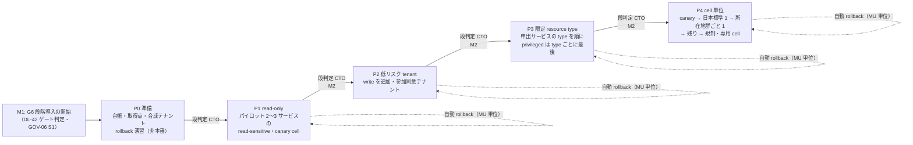
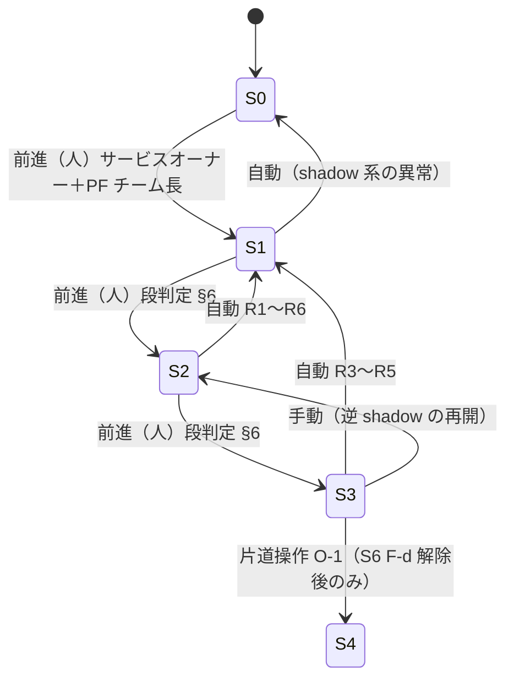
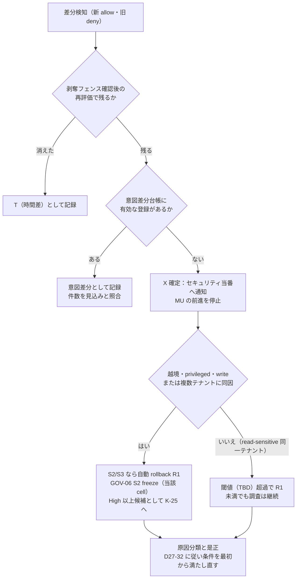

# 段階導入計画（dual-run・shadow・差分記録・段階判定・自動 rollback・顧客側作業・併存運用）

> 文書ID: OPS-04 / 版: 0.1 / 状態: draft / 最終更新: 2026-10-15
> 対応要求: R-107, R-149, R-154, R-177, R-178, R-179, R-180, R-194, R-194.1, R-194.2（R-requirements.md の対応成果物欄に本書のパスを含む全行）／G-050, G-051, G-143（G-goal-criteria.md の対応成果物欄に本書のパスまたは DL-31 を含む全行）。関連: R-022, R-058, R-074, R-155, R-156, R-175, R-190.6, R-194.3, R-194.5／G-025, G-033, G-052, G-112, G-144, G-146、主張台帳 CL-0266
> 依存文書: CONVENTIONS.md, traceability/deliverables.md（DL-31）, 05_adr/ADR-027-migration-dual-run-rollback.md（方式の正本）, 05_adr/ADR-016-versioning-deprecation.md, 05_adr/ADR-013-cell-partitioning-fail-mode.md, 05_adr/ADR-004-b2b-federation-linking-scim.md（D04-15）, 05_adr/ADR-012-pep-coverage-storage-guardrails.md（D12-23）, 05_adr/ADR-021-irreversible-identifiers.md, 05_adr/reconciliation-notes.md, 02_requirements/as-is-inventory.md（REQ-07）, 02_requirements/operation-risk-tiers-assurance.md（REQ-03）, 01_governance/assumptions-register.md, 01_governance/stop-authority.md（GOV-06）, 01_governance/kri.md（GOV-08）, 01_governance/business-impact-analysis.md（B13）, research/RS-09, RS-16（主）, RS-03, RS-07, RS-14, RS-17, research/standards-status.md
> 作成方法: AI エージェント（Claude）が上記文書を通読して起草した。判断は自己レビューであり、実在の CTO/CISO の決裁ではない（CONVENTIONS §8）。research の外から新しく取得した原典はない。脚注の原典はすべて research/ で検証済みの記録（research/verification/）に依る。
> 表記: 本書の決定は OP-xx、決裁案は OPS04-Kx、新規仮定は NA-OPS04-x と書く。ADR-027 の決定（D27-xx）・状態（S0〜S4）・段（P1〜P4）・差分種別（X/N/E/T）・自動 rollback 条件（R1〜R6）はそのまま使う。表のセルのうちタグのないものは設計推論 [D] であり、本注記で個別のタグに代える。

## 要旨（結論）

1. **本書は ADR-027 の方式を「運用計画」に落とすものであり、方式を変えない** [D]。移行は移行単位（MU = 依存サービス × resource type × 操作階層 × テナント群 × cell）の状態機械で進め、判定の正本は常に一方だけにする（ADR-027 D27-01〜D27-05）[D]。本書が新たに定めるのは、段ごとの入場・合格基準の値の決め方、自動 rollback 条件の段別・操作階層別の適用表、パイロット選定基準、顧客側作業の日程と告知、併存期間の運用規則、移行台帳と差分記録の様式である [D]。
2. **導入順序は P0（準備）→ P1 read-only → P2 低リスク tenant → P3 限定 resource type → P4 cell 単位の 5 段とし、前進は人が承認し、後退（rollback）だけを自動にする** [D]。段の拡大は GOV-06 S1 の M2 に当たり、未解決の Critical/High（K-25）が 1 件でもあれば移行ゲートが拒否する [D]。前進の合否は「未登録の allow 拡大差分 0 件」「誤 deny 率 ≤ BIA B13 の予算」「評価不能率 ≤ DL-20 の予算」「経路網羅 100%」「一致判定数 n ≥ 3/p」の 5 条件の積に、越境否定試験・rollback 演習・剥奪同期・allow cache 除去・告知の 5 条件を加えた 10 条件で判定する [D]。
3. **allow 拡大差分（新が allow・旧が deny）はセキュリティ事象としてセキュリティ当番が即時に調査し、write・privileged と越境の差分は 1 件で自動 rollback する** [D]。deny 差分はサービスオーナーが業務影響を確認し、BIA B13 の予算超過で自動 rollback する [D]。自動 rollback は 1 回 1 cell の MU に限り、通常の配布 pipeline を最大速度で使い、剥奪は戻さない（剥奪フェンス）[D]。
4. **顧客側作業は「切替時点で 0 件、残りは接続・利用者ごとに 1 回、顧客の自然な作業機会に合わせる」計画とする** [D]。この計画が成り立つかは、旧識別子が自社所有ドメインにあるか（REQ-07 N-3、TBD）に依存する [D][A-114, A-115]。GOV-06 S6 の F-b（強制移行）が凍結されている間は、期限付きの作業依頼を出さず、顧客が選ぶ任意参加のセルフサービスに限る [D]。
5. **未達**: 段の bake 時間、差分許容の閾値、調査着手時間、rollback 時間の目標、告知期間はすべて TBD であり、所有者・期限・決め方を §5〜§8 に付けた [D]。自動 rollback の作動は実測していない（G-051 は C 区分。PoC と立会人付き演習が残る）[D]。実データの棚卸し（G-050）も未達である [D]。

---

## 1. 位置付けと範囲

### 1.1 本書と ADR-027 の分担

| 論点 | ADR-027（方式の正本） | 本書（運用計画） |
|---|---|---|
| MU と状態機械 | S0〜S4、遷移の承認者、自動化してよい遷移（D27-01〜D27-05） | 移行台帳の様式、MU の編成と波への割付（§3、§5） |
| dual-run・shadow | 取得点、同期経路外、shadow 量、統計的十分さ（D27-11〜D27-16） | 差分記録の様式、記録量の運用、取得点の確認手順（§4） |
| 差分の扱い | 4 分類と意図差分台帳（D27-17〜D27-22） | 調査の手順・担当・時間の上限の決め方、業務影響確認の手順（§4.4〜§4.6） |
| 段階導入 | 4 段と 7 前進条件（D27-23〜D27-27） | 準備段 P0 の追加、段ごとの入場・合格基準の値の決め方、波の編成（§5、§6） |
| 自動 rollback | R1〜R6、方式、剥奪フェンス（D27-28〜D27-34） | 段別・操作階層別の適用表、演習計画、停止と再開の運用（§7） |
| 顧客側作業 | 互換受付・1 回化・告知原則（D27-39〜D27-46） | 作業の日程、告知の時期・手段・内容、進捗の計測（§9） |
| 旧系の扱い | 撤去条件と片道操作 O-1〜O-7（D27-47〜D27-50） | 併存期間の運用規則（セキュリティ基準、on-call、障害・侵害時の扱い、暫定方式）（§10） |

- 本書は ADR-027 を含む決定済み ADR に反する運用を定めない [D]。shadow check と段階展開の必須化は再提案の設計判断であり（DS-16）、OpenFGA の文書は model を不変とし、大きな変更の際の選択肢として shadow check と段階展開を挙げている [V][^19]（RS-07#18）。ADR-027 は proposed（決裁前）であり、ADR-027 の決定が変われば本書も追随する [D]。
- model・policy の版の切替（同一基盤内の新旧 revision の shadow・canary）は ADR-016 D16-31〜D16-36 が持ち、本書は「旧システム → 新基盤」の移行を扱う（ADR-016 D16-39）[D]。両者で shadow 差分の扱いを揃える（ADR-016 D16-32 と ADR-027 D27-17 はどちらも「承認済み以外の allow 拡大差分 0 件」）[D]。
- AS 製品置換・認可エンジン差替え・置換 cell への移動・暗号移行は ADR-027 D27-52 により同じ仕組みを使う [D]。本書の様式はそれらにも使えるが、差分許容はより厳しい（X・N とも 0 件。ADR-027 D27-53）[D]。暗号 alg の新旧併存の dual-run（R-107 の一部）は 04_architecture/evolution-pqc.md と ADR-015 が持つ [D]。

### 1.2 CL-0266 への回答

主張台帳 CL-0266 は、旧提案の「shadow authorization で既存判定との差分を計測する」が比較対象（既存の判定）を記述していないため「要前提登録」とした [D]。本書は次の 3 点でこれに応える [D]。(1) 既存の認可実装は前提台帳の A-112 に仮置きとして登録済みであり、実データでの置換は REQ-07 §7 の I-1 で行う [D][A-112]。(2) 旧判定の取得点は MU ごとに REQ-07 §3.5 の様式で確認し、観測できない MU は S1 に入れない（§4.2）[D]。(3) 差分の扱い（allow 拡大は即時調査）と rollback 条件は §4・§7 で定める [D]。

---

## 2. 全体像

### 2.1 段とゲート



- 段の自動 rollback は「段そのものを戻す」ものではなく、異常を検知した MU を S1（旧が正本）へ戻し、その MU を含む範囲の前進を止めるものである（ADR-027 D27-28）[D]。
- 段の後退（例: P2 から P1 の範囲へ縮める）は人の判断で行い、自動にしない [D]。範囲の縮小は複数 MU・複数 cell に及ぶため、1 回 1 cell の制約（ADR-013 D13-38）を守るには cell ごとに並べた rollback として実行する必要があるからである [D]。

### 2.2 MU の状態と自動・手動の遷移



- 状態と遷移の承認者は ADR-027 D27-02・D27-03 のとおりである [D]。本書は承認記録の置き場所を移行台帳（§3.1）とする [D]。

---

## 3. 台帳と記録の様式

### 3.1 移行台帳（MU ごと）

| 項目 | 内容 | 用途 |
|---|---|---|
| MU-ID | サービス・resource type・操作階層・テナント群・cell の組 | 状態機械の単位（D27-01） |
| 状態と遷移履歴 | S0〜S4、遷移時刻、承認者、根拠となる段判定記録 | GOV-06 M2 の移行判定記録 |
| 旧判定の取得点 | REQ-07 §3.5 の「旧判定の取得点」欄の値（middleware／gateway／ログ）、観測可否 | §4.2 |
| entry point 突合 | 当該 MU に属する entry point（DL-10）と、どの MU にも属さない入口の件数 | K-01（D27-04） |
| 前進条件の充足 | §6.2 の 10 条件それぞれの値と判定時刻 | 段判定 |
| 自動 rollback 履歴 | 条件（R1〜R6）、検知時刻、完了時刻、原因分類（D27-32） | K-04、§7.5 |
| 剥奪フェンス | 新旧各系の剥奪適用位置 | D27-09、D27-33 |
| 意図差分の参照 | 意図差分台帳の登録 ID と期限 | D27-20、D27-21 |
| 顧客告知の状態 | 告知の対象・日時・手段・受領確認 | §9 |
| allow cache の除去 | 除去の確認日と確認方法 | ADR-006 K6-4 (b) |

### 3.2 差分記録（判定差分 1 件ごと）

| 項目 | 内容 |
|---|---|
| 差分 ID、MU-ID、cell、時刻 | 一意の記録キー |
| 要求 | 主体（sub・tid）、resource（type・ID・所有テナント）、操作、操作階層 |
| 正本判定と shadow 判定 | allow/deny、新系の decision_id・`model_revision`・policy 版・整合性トークン、旧系の判定記録の参照 |
| 再評価 | 剥奪フェンス確認の結果、再評価時刻と結果（D27-19） |
| 分類 | X／N／E／T、越境か否か、意図差分台帳との照合結果 |
| 処理 | 担当（セキュリティ当番・サービスオーナー）、着手時刻、原因（写し違い・旧系欠陥・データ差分・新系障害・旧系障害）、処置、完了時刻 |

- 判定差分は全文で記録し、一致した判定は MU × 操作階層ごとの計数と抽出記録だけにする（D27-14）[D]。一致まで全文で残すと decision event が最大で 2 倍になり、基準シナリオで 1 日あたり約 9.07 億件・約 907 GB の追加になるからである [D][A-049]。
- shadow の記録を trace の sampling に依存させない（reconciliation-notes §3.1、D27-14）[D]。
- 差分記録は KRI の情報源 SRC-09 に入れ、K-04（誤 allow 件数）は「比較の基準が旧実装である」ものとして区別して数える（kri.md K-04 の定義）[D]。

---

## 4. dual-run・shadow・差分記録の運用

### 4.1 前提と容量

| 項目 | 値 | 根拠 |
|---|---|---|
| shadow 対象 Check の上限 | 基準全量 42,009/秒 | [A-045]、D27-14 |
| shadow の追加負荷 | shadow 対象 MU の Check 量と同じ桁 | NA-027-2（前提台帳へ追加要。所有者 SRE 責任者、G4、TC-027-03） |
| shadow の量 | privileged・write は全件、read-sensitive は層別抽出＋記録要求の全件再生、public は対象外、break-glass は移行しない | D27-13 |
| read-sensitive の抽出率 | TBD | 所有者: SRE 責任者＋認可・PDP チーム、期限: G4、決め方: TC-027-03 の負荷実測と、層ごとに n ≥ 3/p に達する時間（§6.3） |

### 4.2 旧判定の取得点の確認（S0 → S1 の入場条件）

1. サービスオーナーは REQ-07 §3.5 の様式で、MU ごとに旧判定（allow/deny）・主体・テナント・resource・操作を観測できる位置を示す [D]。
2. プラットフォームチームは、示された位置の記録と実際の要求を一定期間突き合わせ、欠落がないかを確かめる（突合の期間は TBD。所有者: プラットフォームチーム長、期限: G4、決め方: パイロットでの突合結果と t_cycle（§6.3））[D]。
3. 観測できない MU は「観測不能 MU」として移行台帳に記録し、次のいずれかを選ぶ（決裁案 OPS04-K4）[D]。(a) 旧系に判定記録を足す改修、(b) 記録した要求を新旧両系に再生する差分試験（R-175）で代え、S2 へ進む場合は受容票（DL-05）を付ける、(c) 移行対象から外し S0 のまま残す（§10.5 の暫定方式として扱う）[D]。

### 4.3 shadow の実行規則

- shadow 判定は要求の同期経路の外で行い、新系の遅延・失敗を正本の応答に影響させない（D27-12）[D]。shadow に副作用（書込、通知、課金、rate limit の消費）を持たせない [D]。
- S2 以降で新系に届かないとき、旧系の判定へ自動で落として許可しない（D27-05）[D]。不達時の扱いは ADR-013 D13-25 の操作階層別 fail-mode に従う [D]。
- 新系への shadow 要求には評価モードが shadow であることを示す値を付ける [D]。値の名前と置き場所は ADR-011・DL-72 で決める（未決。ADR-027 D27-12 の申し送り）[D]。
- 時間差の差分は、両系が剥奪フェンスまで適用したことを確かめてから再評価し、残ったものだけを X・N に数える（D27-19）[D]。

### 4.4 allow 拡大差分（X）の即時調査



| 項目 | 規則 | 値・決め方 |
|---|---|---|
| 受ける者 | セキュリティ当番（D27-18） | — |
| 検知から調査着手までの上限 | 上限を置く | TBD（所有者: CISO、期限: G4、決め方: DL-20 の SLI として BIA と当番体制（DL-27）から決める） |
| 前進への効果 | 未登録の X が 1 件でもあれば当該 MU は前進不可（D27-17） | 0 件（K-04 の限度と一致） |
| 重大度の扱い | 越境・privileged・複数テナントに同因の X は未解決の High 以上の候補として K-25 に入れる（D27-18） | GOV-06 S1 に接続 |
| 意図差分の承認 | N はサービスオーナー、X はサービスオーナー＋セキュリティレビュー担当、越境の X は CISO の同意を加える（D27-20） | 期限切れ登録は自動で無効（D27-21） |

### 4.5 deny 拡大差分（N）の業務影響確認

1. サービスオーナーは N を、写し違い・旧系の欠陥（意図差分の候補）・データ差分の 3 つに分ける [D]。
2. 写し違いはモデルの修正、旧系の欠陥は意図差分台帳への登録（承認者はサービスオーナー）、データ差分は D27-08 の突合へ回す [D]。
3. 誤 deny 率（意図差分でない N の率）を操作階層ごとに BIA B13 の予算と比べる [D]。B13 は許容できる誤 deny 率を階層ごとの拘束値として定める入力であり、値は未記入である（business-impact-analysis.md の B13、R-190.6）[D]。
4. S1 の間は N が利用者に出ないので（旧が正本）、確認はサービスオーナーの通常業務の時間内でよい [D]。S2 では N は利用者の誤 deny として現れるため、§7 の R2 で自動 rollback の対象になる [D]。

### 4.6 評価不能・不達（E）とデータ差分

- E（新系の `deny_indeterminate`・`deny_unavailable`）は意味論の差分に数えず、可用性・完全性の事象として扱う（D27-17）[D]。率の予算は DL-20 の判定系 SLO から決める（TBD、所有者: SRE 責任者、期限: G3）[D]。
- 新旧ストアの内容の突合（データ差分）は判定差分とは別に定期実行する（D27-08）[D]。データ差分が閾値（TBD、所有者: 認可・PDP チーム、期限: G4、決め方: パイロットでの複製遅延とデータ差分の実測）を超えた MU は判定差分を前進の評価に使わない [D]。
- 逆複製（S2 以降の新 → 旧）が新エンジンの変更取り出しに依存するかは ADR-010 M-8 が △（SpiceDB Watch API は未検証）であり、PoC で確かめるまで前提にできない（ADR-027 D27-06）[D]。このため P1 の入場条件に逆複製経路の非本番での確認を入れる（§5.2）[D]。

---

## 5. 導入順序

### 5.1 段の定義

| 段 | 範囲（S2 に進めてよい MU） | 広げる軸 | 主な狙い | 根拠 |
|---|---|---|---|---|
| P0 準備 | なし（S0 → S1 の shadow だけ） | — | 取得点・台帳・合成テナント・逆複製・rollback の非本番確認 | 本書で追加 [D] |
| P1 read-only | パイロット 2〜3 サービス（§8）の read-sensitive。テナントは日本の canary cell の従業員テナント・合成テナントと参加を申し出たテナント | 操作階層（read のみ） | 誤 allow でも書込の改変を生まない範囲から始める | D27-23、N13-2 |
| P2 低リスク tenant | P1 の範囲に write を加え、低リスクテナント（§5.3）へ広げる | テナント | 差分の多様性を得る | D27-23、D27-24 |
| P3 限定 resource type | 移行を申し出たサービスの resource type を順に加える。resource type ごとに privileged を最後に | resource type | 写し違いの影響を type ごとに閉じる | D27-23 |
| P4 cell 単位 | canary cell → 日本の標準 cell 1 つ → 所在地群ごとに 1 cell → 残り。規制スコープ cell と専用 cell は最後 | cell | 配布物と同じ順序で blast radius を広げる | D27-23、ADR-013 D13-30 |

- canary の効果は露出したトラフィック量に比例し、5% の canary なら 20% 失敗の欠陥でも全体の誤り率は 1% にとどまる [V][^2]（RS-09#31）。段の順序はこの性質を MU とテナント群の単位で使うものである [D]。
- 全域への一斉 push を避け、段階的に配備し、危険なら rollback できることは、SRE Workbook が安全な設定変更の性質に挙げている [V][^1]（RS-09#30）。
- break-glass は移行しない（基盤の PDP に依存しない別経路。ADR-013 D13-25、ADR-029）[D]。public は SDK の静的規則の照合だけで、段の対象にしない（D27-13）[D]。

### 5.2 P0（準備）の完了条件

P0 は ADR-027 の 4 段の前に置く非本番中心の段であり、本書で追加した [D]。G6（段階導入）の開始判定（GOV-06 M1、DL-42）は P0 の完了を前提にする案とする [D]。

| # | 完了条件 | 確認方法 | 担当 |
|---|---|---|---|
| 0-1 | 移行台帳・差分記録・意図差分台帳が稼働し、KRI SRC-09 へ出力される | 合成テナントでの記録確認 | プラットフォームチーム長 |
| 0-2 | パイロットの全 MU で旧判定の取得点が確認済み、または観測不能 MU の扱いが OPS04-K4 で決まっている | §4.2 | サービスオーナー |
| 0-3 | 複製・逆複製・剥奪の優先経路が非本番で動く | TC-027-04、TC-027-05 | 認可・PDP チーム |
| 0-4 | 自動 rollback（R1、R2）と配布 metadata 破損時の rollback が非本番で作動する | TC-027-01、-02、-12 | SRE 責任者（独立立会人を置く） |
| 0-5 | 越境否定試験（cross-tenant property test）がパイロットの MU で合格 | D27-16、TC-027-11 | セキュリティ |
| 0-6 | 合成テナントの既知解 probe（R4 の入力）が canary cell で動く | ADR-013 D13-27 | SRE 責任者 |
| 0-7 | 未解決の Critical/High がない（K-25(c) 0 件） | GOV-06 S1 | CISO（宣言権者） |

### 5.3 低リスクテナントの条件（P2）

ADR-027 D27-24 の初期案を採る [D]。

| 条件 | 内容 | 根拠 |
|---|---|---|
| 所属 cell | 規制スコープ cell・専用 cell に属さない | ADR-013 D13-30 |
| 規模 | 利用者数が閾値以下（閾値 TBD） | [A-009]。ADR-027 の「最大テナント規模の 10%」は根拠のない初期の仮置き |
| 顧客 IdP 連携 | ない、または移行で識別子が変わらない | REQ-07 N-3 |
| 業界規制 | REQ-03 の業界プロファイル（JP-金融等）を持たない。高保証要求テナント（[A-081]、基準 50）を含めない | ADR-004 D04-15 の「規制業種テナントを先行させない」 |
| 同意 | 移行への参加に同意している（決裁案 OPS04-K2） | S6 の F-b 凍結との整合 |

- 閾値と条件の確定は事業責任者（B2B）が G3 までに行う（D27-24）[D]。決め方は、P1 の差分の実測（NA-027-3）と A-009 の規模分布である [D]。

### 5.4 サービスの波の編成

- 300 サービスを波に割り付ける順序は、(1) 開発組織の要員確約（DL-27）がある組織、(2) 旧判定を観測できる MU を持つ、(3) 共通 SSO 経由（A-110 の 120 サービス）を先にし、独自セッション（105）・LDAP 直結（30）・共有シークレットのみ（45）を後にする、の順で決める案とする [D][A-050, A-110]。
- (1) を最初に置く理由は、自治体標準化で 34,366 システムのうち 10,013（29.1%）が期限内に移行できず、事由の大半が事業者のリソースひっ迫であったためである [M][^14]（RS-16#78）。RS-16 はこの結果から、多ベンダー並行の移行では要員確保と移行時期の平準化をゲート条件にし、要員を確保できない組織は後続の波に回すことを入力としている [D]（RS-16 §5.1 の DL-31 行）。
- (3) の理由は、共通 SSO を経由しない 180 サービスはサービス側の改修を伴い（ADR-027 §1.2）、改修の遅れが波全体を止めないようにするためである [D][A-110]。
- ADR-012 D12-23 の guardrail 後付け（データ分類と階層の高い順）は、認可判定の正本の移行とは別の工程であり、本書の波と並行して進める [D]。後付けは誤 allow を減らす方向の変更なので、低リスクから始める本書の順序と逆向きでも矛盾しない [D]。
- 同時に S1・S2 にある MU の数（並行度）の上限は、移行専任要員（NA-027-1、10^1 FTE の桁と仮置き）と差分調査の処理能力で決める（TBD、所有者: CTO、期限: G3、決め方: P1 の差分調査工数の実測と K-31 の待ち時間）[D]。決裁案は OPS04-K1 とする [D]。

---

## 6. 各段の合格基準

### 6.1 段の入場条件

| 段 | 入場条件 | 判定者 |
|---|---|---|
| P1 | P0 の完了（§5.2）。G6 開始のゲート判定（M1）。パイロットの参加確約（G-052） | CTO（DL-42） |
| P2 | P1 の全 MU が S2 で bake を満了し、§6.2 を満たす。P1 で自動 rollback が発動した場合はその原因が閉じている | CTO |
| P3 | P2 の全 MU が §6.2 を満たす。P3 で加える resource type ごとに意図差分の登録が済んでいる | CTO。privileged を含む MU は CISO の同意（D27-26） |
| P4 | P3 の全 MU が §6.2 を満たす。cell ごとの wave 計画が配布物の wave（ADR-013 D13-30）と一致している | CTO |

### 6.2 MU の前進条件（S1 → S2、S2 → S3）

ADR-027 D27-22（差分許容の構造）と D27-25（前進条件）を 1 つの表にまとめ、値の決め方を付ける [D]。

| # | 条件 | 合格の基準 | 値の状態・所有者・期限・決め方 |
|---|---|---|---|
| C1 | 未登録の allow 拡大差分 | 0 件 | 確定（K-04、R-178） |
| C2 | 誤 deny 率（意図差分でない N） | 操作階層別に ≤ B13 の予算 | TBD。事業責任者（BIA 署名者）、G3、BIA B13 の記入と R-190.6 |
| C3 | 評価不能・不達（E）の率 | ≤ DL-20 の予算 | TBD。SRE 責任者、G3、DL-20 の判定系 SLO |
| C4 | 経路網羅 | 正規モデルの permission 経路（type × relation × permission）の 100% が shadow か再生で 1 回以上評価 | 確定（D27-15） |
| C5 | 一致判定数 | 層（MU × 操作階層）ごとに n ≥ 3/p | p は TBD。CISO＋事業責任者、G4、B13 と K-04 の許容度（D27-15） |
| C6 | 越境否定試験 | 合格 | 確定（D27-16） |
| C7 | 自動 rollback の演習 | その段の範囲で作動を確認済み | 確定（G-051、D27-25 の 3） |
| C8 | 剥奪の同期遅延 | 上限以内 | TBD。認可・PDP チーム＋SRE 責任者、G4、DL-20 の剥奪反映 SLI と TC-027-05 |
| C9 | 未解決の Critical/High | 当該範囲に 0 件 | 確定（K-25、GOV-06 S1） |
| C10 | allow cache の除去・告知 | サービスが allow cache を除去済み（ADR-006 K6-4 (b)）、当該範囲の顧客・利用者への告知が済んでいる（§9） | 確定 |

- 上の C1〜C10 を、その段の bake 時間（§6.3）の間満たし続けたことを前進の条件にする（D27-25 の 1）[D]。
- 「n ≥ 3/p」は、独立な n 件で事象 0 件のとき発生率の 95% 上側信頼限界がおよそ 3/n になる近似（いわゆる 3 の法則）に基づく [D]。例として p = 10^-4 なら 3 万件である（-ln 0.05 ≈ 3.0 からの計算）[D]。実際の要求は独立でなく偏るため、C4 の経路網羅を併せて課す [D]。

### 6.3 bake 時間（policy/model canary 期間を含む。R-194.1）

- bake 時間は AWS の値（one-box 後 1 時間以上など）を転用しない [D]。AWS は one-box・wave・bake time を置き、待機中の高重大度 alarm や要求数がゼロに落ちる等の異常で自動 rollback するが [V][^3]（RS-09#33）、その値は AWS の文脈の値だからである（ADR-027 D27-27、ADR-013 D13-30）[D]。
- 本書は bake 時間の決め方を次の式で定め、値は置かない [D]。

```
bake(段, MU) = max( t_n , t_cycle , t_min )
  t_n     : MU の各層（操作階層）で一致判定数が 3/p に達するまでの時間（C5。MU の要求量の実測から算出）
  t_cycle : 当該業務の周期（月次締め・四半期バッチ等、まれな経路が通る期間）。BIA の業務記述から決める
  t_min   : 段ごとの下限（P1 > P2 ≥ P3 ≥ P4 の順に長くする案。値は TBD）
```

| 記号 | 値 | 所有者 | 期限 | 決め方 |
|---|---|---|---|---|
| p | TBD | CISO＋事業責任者 | G4 | B13 と K-04 の許容度 |
| t_cycle | TBD（サービスごと） | サービスオーナー | 各 MU の S1 入場時 | BIA（DL-21）の業務記述。新規仮定 NA-OPS04-1 |
| t_min | TBD | 認可・PDP チーム＋SRE 責任者 | G3 | ADR-016 D16-33 と同じ決め方（DL-20 と TC-016-07 の実測） |

- model・policy の revision の canary 期間（ADR-016 D16-31 の段 4）も同じ式で決める [D]。ADR-016 D16-33 は値を置かず、所有者を認可・PDP チーム＋SRE 責任者、期限を G3 としており、本書もこれに揃える [D]。

### 6.4 段の完了と記録

- 段の完了は、範囲内の全 MU が S2 以上で §6.2 を満たし、段の完了報告（自動 rollback の件数と原因、意図差分の件数、X・N の件数と処理時間、顧客問合せ件数）を CTO が承認した時点とする [D]。
- 完了報告は GOV-06 S6 の F-a・F-b の解除条件「対象範囲での段階導入の運用実績（DL-31 の自動 rollback 条件の下での運用）」の証跡に使う（stop-authority.md §4 の S6 解除条件）[D]。

---

## 7. 自動 rollback

### 7.1 条件の段別・操作階層別の適用

ADR-027 D27-28 の R1〜R6 を、段と操作階層に割り当てる [D]。閾値はすべて TBD である（所有者と決め方は §7.2）[D]。

| 条件 | 内容 | 対象状態 | read-sensitive | write | privileged | 適用段 |
|---|---|---|---|---|---|---|
| R1 | 未登録の allow 拡大差分（逆 shadow で旧 deny・新 allow） | S2 | 越境は 1 件、同一テナント内は閾値 θ1 | 1 件 | 1 件 | P1〜P4 |
| R2 | 誤 deny 率が窓 W の間 B13 の予算を超える | S2 | θ2(rs) | θ2(w) | θ2(p) | P1〜P4 |
| R3 | 評価不能・不達の率、または判定 p99 遅延が DL-20 の予算を超える | S2, S3 | DL-20 | DL-20 | DL-20 | P1〜P4 |
| R4 | 既知解 probe の不一致、allow 率・deny 率の急変、policy 版・データ版の後退 | S2, S3 | 1 件（probe 不一致・版の後退）、急変は θ4 | 同左 | 同左 | P1〜P4 |
| R5 | 業務指標の急変（要求数ゼロ、4xx・5xx 急増、ログイン成功率の低下） | S2, S3 | θ5 | θ5 | θ5 | P1〜P4 |
| R6 | データ差分が閾値を超える | S2 | θ6 | θ6 | θ6 | P1〜P4 |

- write・privileged の R1 を 1 件としたのは、K-04 の限度（cross-tenant、privileged・break-glass、write で 1 件以上）と一致させるためである（kri.md K-04）[D]。
- S3 には逆 shadow がなく N を数えられないので、S3 の誤 deny は R4・R5 で検知する（ADR-027 D27-28 R2）[D]。

### 7.2 閾値の所有者と決め方

| 記号 | 所有者 | 期限 | 決め方 |
|---|---|---|---|
| θ1（read-sensitive 同一テナント内の X） | CISO | G4 | K-04 の read-sensitive の率の上限（kri.md）と同じ値。shadow・differential 試験の実測分布と GOV-04 の影響度 |
| θ2、窓 W | 事業責任者（BIA 署名者）＋SRE 責任者 | G3（値）、G4（実測で補正） | BIA B13 の予算と TC-027-02 |
| θ4、θ5 | SRE 責任者 | G4 | パイロットの平常変動の実測（P1 の S1 期間に測る） |
| θ6 | 認可・PDP チーム | G4 | §4.6 のデータ差分の実測 |
| rollback 時間の目標（R-194.3） | SRE 責任者＋CTO | G4 | TC-027-06 の実測（利用側のキャッシュ更新と再接続の負荷を含む。D27-34）と BIA |

### 7.3 方式

- MU の状態（どちらが正本か）は ADR-013 D13-30 の配布物として署名し、対象 cell 集合と wave 番号を含めて配る（D27-30）[D]。rollback は通常の配布 pipeline を最大速度で使い、別系統の緊急手段を作らない [D]。SRS は通常の rollout と緊急 rollback を同じ系にすべきだとし、rollback は脆弱性を再導入し得るので不良版の deny list と最低許容版で制御するとしている [V][^4]（RS-09#35）。
- 1 回の自動 rollback が触れるのは 1 cell の MU に限る（ADR-013 D13-38）[D]。同じ原因を複数 cell で検知した場合も cell ごとの rollback を並べ、全域への一斉配布はしない [D]。policy データが数秒で global に複製され全リージョンが停止した事故がある [I][^20]（RS-09#67）。
- R1・R4 による rollback は当該 cell の配布の freeze（GOV-06 S2）を同時に発動する（D27-31）[D]。freeze 中も剥奪の配布と既知良好版への rollback は止めない（GOV-06 §4.2）[D]。
- rollback は、旧系が新系の剥奪フェンスまで剥奪を適用済みである場合に限りそのまま実行する [D]。未適用の剥奪がある主体・resource の要求は、旧系へ戻した後も適用が確認されるまで拒否する（D27-33）[D]。
- rollback の配布 metadata が壊れていても既知良好の状態へ戻れることを演習で確かめる（TC-027-12）[D]。Azure AD 2020-09-28 では自動 rollback が配備 metadata の破損で失敗して手動に頼り、是正は last known-good metadata への復帰と rollback 演習の拡大であった [I][^5]（RS-09#51, #52）。

### 7.4 自動にしないもの

| 操作 | 理由 | 誰が行うか |
|---|---|---|
| 前進（S0→S1→S2→S3） | 前進は証拠と上位の権限で行う（GOV-06 P1 と同じ非対称。D27-03） | §6 の判定者 |
| S3 → S2（逆 shadow の再開） | 新系起因の異常の封じ込めにならない（D27-03） | プラットフォームチーム長 |
| 段の範囲の縮小（例: P2 → P1） | 複数 MU・複数 cell に及ぶ | CTO |
| 片道操作 O-1〜O-7 | 戻すと費用・顧客作業・セキュリティの後退が生じる（ADR-027 §2.11） | ADR-027 §2.11 の承認者 |
| 既存範囲の稼働停止 | 止めれば利用者の停止になる（GOV-06 S1 の注記）。S3 の発動条件で判断する | GOV-06 S3 の権限者 |

### 7.5 rollback 後の再開

- 再開には、原因の分類（写し違い、意図差分の登録漏れ、データ差分、新系の障害、旧系の障害）を移行台帳に記録し、§6.2 の条件を最初から満たし直す（D27-32）[D]。
- 同じ MU で自動 rollback が繰り返し起きた場合、その MU の再開は段判定者（CTO）の承認を要する案とする [D]。回数の閾値は TBD である（所有者: CTO、期限: G4、決め方: パイロットの rollback 発動件数と原因分類）[D]。

### 7.6 演習

- CrowdStrike は事後報告で、canary・段階的な ring・bake-in・rollback と、顧客による配備先と時期の選択を是正策に挙げた [I][^7]（RS-09#65）。本計画の演習は、段階展開と rollback が実際に作動することを各段の入場前に確かめるものである [D]。

| 演習 | 時期 | 内容 | 立会い |
|---|---|---|---|
| E-1 非本番演習 | P0 | TC-027-01、-02、-05、-12 | 独立立会人（G-051 の判定者は CTO と独立立会人） |
| E-2 段の入場前演習 | P1〜P4 の各入場前 | その段の範囲の MU 1 つで写し違いを注入し、自動 rollback と剥奪フェンスを確認（C7） | 独立立会人 |
| E-3 定常演習 | 年 1 回 | 出口演習（ADR-001 D16-3、ADR-010 D-46）と schema migration 演習（R-185）に自動 rollback の作動確認を含める（D27-55） | 独立立会人 |

---

## 8. パイロットサービス選定基準

### 8.1 必須条件（すべて満たす）

| # | 条件 | 根拠 |
|---|---|---|
| PS-1 | サービスオーナーが参加を確約し、利用側の移行・運用コストの見積りに同意している | G-052（DL-40 の確約欄） |
| PS-2 | read-sensitive の resource type を持ち、P1 の範囲（read-only）で意味のある shadow ができる | D27-23 の P1 |
| PS-3 | 旧判定の取得点を観測できる（観測不能 MU でない） | §4.2、D27-11 |
| PS-4 | 日本の canary cell の従業員テナント・合成テナント、または参加を申し出たテナントの要求を受ける | D27-23、N13-2 |
| PS-5 | 規制スコープ cell・専用 cell に属さず、業界規制のプロファイルを持つテナント（[A-081]）を主な利用者にしない | ADR-013 D13-30、ADR-004 D04-15 |
| PS-6 | allow cache を除去できる（S2 の前進条件 C10） | ADR-006 K6-4 (b) |
| PS-7 | entry point の機械抽出（REQ-07 §4、I-2）を適用できる | REQ-07 §7 の I-2 |

### 8.2 組合せの条件（2〜3 サービスの組として満たす）

| # | 条件 | 根拠 |
|---|---|---|
| PC-1 | 少なくとも 1 サービスは基盤チームと報告系統が異なる開発ベンダーが担う | G-146 |
| PC-2 | 認証方式の区分（共通 SSO・独自セッション・LDAP 直結・共有シークレット）のうち少なくとも 2 区分を含む | A-110 の区分を後続の波の見積り（REQ-07 §6.2 の e_k）に使うため [D][A-110] |
| PC-3 | 認可実装が「アプリ層の検索条件のみでテナント分離」のサービスを少なくとも 1 つ含む | 旧判定が正解でない場合（D27-16）の検出を実測するため [D][A-112] |
| PC-4 | write を持つサービスを少なくとも 1 つ含む（P2 で使う） | D27-23 の P2 |

### 8.3 除外条件

- break-glass・特権サポートの経路（ADR-029）を主機能とするサービス [D]。
- PCI 対象の分離スコープに属するサービス（CONVENTIONS §7 のデータ前提）[D]。
- BIA で最大許容停止時間が最も短い区分の業務を担うサービス [D]。パイロットの目的は差分と rollback の実測であり、誤 deny の影響が最も重い業務で始める理由がないからである [D]。

### 8.4 選定の進め方

- CNCF の Platforms White Paper は、トップダウンの強制だけで採用を進める platform チームは利用者の抵抗に遭うとし、最初は少数の積極的で熟練したアプリチームに絞って始めることもあり得るとしている [V][^13]（RS-16#65）。本書は PS-1（自発的な確約）を最初の条件に置く [D]。
- 候補の一覧と採点は DL-40（プログラム憲章）で行い、確約は G-052 の判定者（各サービスオーナー）が記録する [D]。決裁案は OPS04-K5 とする [D]。
- パイロットでは、REQ-07 §6.2 の h_w・s_w・e_k、オンボーディング各段階のリードタイム（G-144、K-31）、基盤側の理由による待ち日数・手戻り件数（G-146）を併せて記録する [D]。

---

## 9. 顧客側作業と告知

### 9.1 作業の扱い（ADR-027 D27-39〜D27-45 の運用）

| 作業（REQ-07） | 基準の件数 | 切替時点の件数（本計画） | 残る作業の時期 | 成り立つ条件 |
|---|---|---|---|---|
| W1 SAML 再設定 | 1,800 接続 [A-114] | 0 | 接続ごとに 1 回。IdP 署名証明書の更新等の機会 | 旧識別子が自社所有ドメイン（N-3） |
| W2 IdP 起点 → RP 起点 | 540 接続 [A-114] | FAL2 を割り当てた IdP 起点の接続数（TBD） | W1 と同じ 1 回 | DS-14 |
| W3 OIDC 再設定 | 200 接続 [A-114] | 0 | W1 と同じ | N-3 |
| W4 SCIM 再設定 | 800 テナント [A-082] | 0（旧 token の並行受理） | W1 と同じ 1 回 | endpoint の互換受付 |
| W5 再同意 | grant 3 万 [A-013] | 0（移送できる場合） | grant の満了・定期再承認時 | ADR-005 D11-1、H-22 |
| W6 passkey 再登録 | 約 3.3 万人 [A-115] | 回復手続による再登録 0 | session 内の新 RP ID 登録 1 回 | 旧 RP ID が自社所有ドメイン、related origins の動作（TC-027-09） |
| W7 password 再設定 | 44.175 万人 [A-115] | hash を移送できる範囲は 0 | JIT 期間後の未ログイン者だけ回復手続 | ADR-001 D7-3 |
| W8 重複統合 | A-111 の 15%（母数未定義） | 利用者の任意 | 利用者の都合の時期 | email による自動統合をしない |
| W9 連携設定 | webhook 400・client 650 | 0 | 鍵 rotation の機会 | issuer を変えない、旧値の並行受理 |
| W10 許可リスト | TBD（N-10） | TBD | cell・送信元の変更時 | ADR-013 |

- N-3（識別子が自社所有ドメインにあるか）が「ベンダードメイン」と判明した場合、W1・W3・W6 の切替時点の件数は 0 にならず、ADR-027 §3.5 の代替案（一斉再設定、回復手続による再登録）に寄る（ADR-027 §8 の T-5）[D]。所有者は CTO、期限は G1 である（REQ-07 N-3）[D]。
- 識別子の変更に起因する顧客作業は K-32(b) に計上し、発生した全件を臨時再決裁の入力にする（GOV-09 §5.3、ADR-027 D27-41）[D]。
- 費用は REQ-07 §6.2 の C_顧客・C_支援・C_利用者・C_並行に入れる [D]。値は TBD であり、所有者・期限・決め方は REQ-07 §6.2 の表のとおりである [D]。本書は総額を置かない [D]。

### 9.2 顧客の切替の運用

- 切替は顧客のセルフサービス（新 metadata の取得、試験 IdP での接続試験、切替日の選択）で行い、顧客が切り替えるまで旧識別子と新識別子の両方で受け付ける（D27-41）[D]。
- 切替日はテナント群ごとに分散させる [D]。デジタル庁の多ベンダー検証では、本番切替時に短期間に多数の調整が進むため余裕のあるスケジュールが要るとされ、他ベンダーの認証基盤を使う場合は認証プロトコルだけでなく認証フローの確認も要るとされた（検証環境での試験）[M][^15]（RS-16#79）。このため試験 IdP での接続試験を切替の前提にする [D]。
- 識別子と鍵の更新は trust agreement で定めた保護チャネルで行う（SHALL）[N][^16]（RS-14#15）。
- 旧 RP ID の passkey は related origins で新系の login origin から使い、その session の中で新 RP ID の登録を案内する（D27-42）[D]。related origins では全関連 origin で共通の RP ID を選び（MUST）、`/.well-known/webauthn` に origin を列挙し（MUST）、対応クライアントは少なくとも 5 つの registrable origin label を扱う（MUST）[N][^17]（RS-03#29。W3C Recommendation 2026-08-25、standards-status SS-D01）。ブラウザの実装状況は research で調べていないので TC-027-09 で確かめる [D]。
- grant を移送できない場合の再同意は、grant の満了・定期再承認の機会に合わせ、移行のためだけの再同意の案内を出さない（D27-43）[D]。offline access の要求では別の条件がない限り prompt=consent を使い（MUST）、OP は refresh token を返すことへの同意を常に得る（MUST）ため [N][^18]（RS-17#24）、再同意は利用者の操作を伴う [D]。

### 9.3 告知

| 項目 | 規則 | 根拠 |
|---|---|---|
| 手段 | 製品内の通知と管理画面を主にする。告知の中で資格情報の入力を求めるリンクを使わない | D27-46（ATK-13、T-007） |
| IdP 管理者への依頼 | 識別子・鍵の更新依頼は trust agreement で定めた保護チャネルに限る | [N][^16]（RS-14#15） |
| 連携開発者への告知 | consumer 台帳の連絡先への直接通知（受領確認を記録）、購読型リリースノート、SDK の非推奨警告、開発者 FAQ を主とし、HTTP header は補助にする | ADR-016 D16-21 |
| HTTP header | 旧方式の API 応答に Deprecation header を付け、廃止日が決まったら Sunset を併用する。header は client にとってヒントであり保証ではない | ADR-016 D16-20、[N][^8]（RS-16#34） |
| 告知の内容 | 対象、代替、切替の手順、試験環境、旧方式の受付終了の見込み（決まっていれば）、延長の判断基準、問い合わせ先 | ADR-016 D16-23 を移行告知にも適用（本書の案） |
| 告知の時期 | 旧方式の受付終了（O-7）の告知は ADR-016 D16-16 の固定改定日（年 2 回）に揃える案 | ADR-016 D16-16 |
| 告知期間 | TBD | REQ-07 DQ-B（所有者: 法務責任者＋営業・顧客成功責任者、期限: G3、決め方: 既存契約の変更通知条項と BIA） |

- 告知期間の先例として、Google Cloud の利用規約は顧客向け API を後方互換でない形で大きく変える前に少なくとも 12 か月前の通知を定め（Cloud Identity Services と GA 前の機能は対象外）[V][^11]（RS-16#41）、GビズID のサービス連携利用規約は重大な変更を 90 日前までに公表または通知するとしている [V][^12]（RS-16#45）。先例は比較の参考であり、値の根拠にはしない（REQ-07 DQ-B と同じ扱い）[D]。

### 9.4 進捗の計測

- 進捗は接続・client_id・利用者ごとに実行時に数える（旧識別子への到達数、旧 RP ID での認証数、旧 grant の利用数）（D27-45）[D]。Kubernetes は非推奨 API への要求に Warning header を返し、監査イベントに注記を付け、削除予定リリースのラベル付きメトリクスを出す [V][^9]（RS-16#38）。本計画は同じ考え方を基盤側の計測点（ADR-016 D16-24 の 5 点）に写す [D]。
- 集計は K-29（未移行 consumer 数）と R-194.5 に入れる [D]。

### 9.5 S6（強制移行の凍結）との関係

- GOV-06 S6 の F-b（既存システムの強制移行）と F-d（旧方式・旧経路の撤去）が凍結されている間、本計画は期限付きの作業依頼と旧経路の撤去を計画に入れない（ADR-027 要旨、D27-39 の 4、D27-47）[D]。
- 凍結中に顧客へ求めるのは、顧客が時期を選ぶ任意のセルフサービス切替だけである [D]。顧客の切替を前提にしないよう、切替時点の作業 0 件（§9.1）を計画の基本にする [D]。
- 期限を約束する文書には遅延を見込んだ幅を置く（D27-50）[D]。Azure AD Graph は退役日 2023-06-30 から完全退役の予定日 2025-08-31 まで 2 年あまり延びた（予定日どおりの停止は未確認）[V][^10]（RS-16#40）。

---

## 10. 移行期間中の併存運用

### 10.1 旧系の運用規則

| 項目 | 規則 | 根拠 |
|---|---|---|
| 到達経路 | 旧系の入口を新系の edge の背後に置き、移行と rollback 以外の到達を遮断する | D27-48 |
| セキュリティ基準 | MFA、ログ、脆弱性修正の期限など現行の基準を旧系にも適用する | D27-48、RS-12#53, #18 |
| レガシー連携 | LDAP は unauthenticated Bind の拒否と TLS を必須にし、ヘッダ認証は署名付きヘッダの検証か到達経路の遮断に限る | D27-37 |
| session | 旧 session は寿命まで旧方式で受け付け、次のログインから新方式にする。一斉の再ログインはしない | D27-36、[A-048]（再ログイン集中 556/秒） |
| password | hash を移送できない利用者は JIT 移行とし、旧 IdP を照合専用で残す。期間は TBD（K27-4） | D27-38 |
| on-call | ADR-013 D13-46 の 1 系統の fleet 運用に含め、旧系の on-call を別に置く期間を MU の S3 の期間に限る | ADR-027 §6.5 |
| 費用 | 並行稼働の期間と月額を C_並行（REQ-07 §6.2）に計上する | REQ-07 §6.2 |

### 10.2 剥奪の両方向伝播

- 剥奪（role の除去、ACL の削除、テナント停止、利用者の無効化）は、正本がどちらでも新旧両方へ優先経路で即時に伝え、緊急 freeze の間も止めない（D27-09）[D]。
- 剥奪の同期遅延が上限を超えた場合、前進を止め、rollback の前提が崩れた状態として扱う（D27-29）[D]。上限は §6.2 の C8 で決める [D]。

### 10.3 障害・侵害時の扱い

| 事象 | 扱い | 根拠 |
|---|---|---|
| 新系の障害（S2・S3） | 当該 MU を S1 へ自動 rollback（R3〜R5）。旧系の判定へ自動 fallback して許可しない | D27-05、D27-28 |
| 旧系の障害（S1） | 旧が正本なので旧系の通常の障害対応。shadow は止めてよい（S0 への自動後退） | D27-02 |
| 旧系の障害（S2・S3） | 新が正本なので利用者影響はない。逆 shadow・逆複製の停止として記録し、rollback 先が失われた状態として前進を止める | D27-02 |
| policy リポジトリ・CI/CD・署名鍵の侵害の疑い | 全域 freeze（GOV-06 S2）。剥奪の配布と既知良好版への rollback は止めない | GOV-06 §4.2 |
| 移行工具の誤り・悪用 | 工具は 1 回 1 cell、MU に属するテナントの範囲に限り、初期投入・大量再同期は二者承認と dry-run | D27-10、ADR-013 D13-38 |
| 新旧どちらかの侵害 | 侵害対応 runbook（DL-24）に従い、両系に同じ剥奪・失効を適用する | ADR-019、D27-09 |

- 移行に起因する事故の型として、Google 2020-12-14 は新 quota 系への登録時に旧系の一部が残り使用量 0 を誤報告し、自動化が quota を削減して認証が全面停止した [I][^6]（RS-09#47, #48）。旧系と新系の併存期間には、旧系の値を入力にする自動化（quota・容量・鍵の削除）を配布物として wave に載せる（ADR-013 D13-30）[D]。

### 10.4 監視と報告

| 指標 | 内容 | 報告先 |
|---|---|---|
| K-04 | 誤 allow 件数（比較の基準が旧実装のもの） | DL-06 |
| K-01 | どの MU にも属さない入口、PEP を経由しない入口 | DL-06 |
| K-25 | 未解決の Critical/High（段の前進を止める） | DL-06、GOV-06 S1 |
| K-29 | 未移行サービス数、移行期限・廃止期限の超過、台帳にないレガシー API | DL-06 |
| K-31 | 意図差分の審査待ち・差分調査の滞留 | DL-06 |
| K-32(b) | 識別子起因の顧客作業 | DL-06、GOV-09 §5.3 |
| 移行固有の追加指標（提案） | MU の状態別件数、S3 の滞留期間、意図差分台帳の期限切れ件数、自動 rollback の発動件数と原因 | DL-06 への申し送り（ADR-027 D27-49） |

### 10.5 基盤の本番提供より前に本番を迎えるサービスの暫定方式（G-143）

| 暫定方式 | 使う条件 | 残余リスクの登録 | 基盤へ切り替える条件 | 期限 |
|---|---|---|---|---|
| T-a 既存方式の継続（S0 のまま） | 既存の認証・認可方式が現行のセキュリティ基準（§10.1）を満たす | DL-41 に登録（受容者は影響範囲で決まる段。GOV-07） | 当該サービスの MU が §6.2 で S1 に入れる状態になり、所属する波（§5.4）が到来した | サービスごとに TBD（所有者: サービスの事業責任者、期限: G3、決め方: §5.4 の波の割付と DL-42 のゲート日程） |
| T-b 契約互換のアダプタ | 連携契約 v1（DEC-8）の形で token・判定を受け、内部は既存方式で処理する | 同上。アダプタが PEP を迂回しないことを K-01 で追う | アダプタの背後を基盤の PDP に置き換えるだけで済むことを契約試験（DL-80）で確認した | 同上 |
| T-c 観測不能 MU の残置 | 旧判定を観測できず、改修も再生試験もできない（OPS04-K4 (c)） | 同上 | 旧系に判定記録を足す改修が完了した | 同上 |

- S6 の F-b が凍結されている間、期限は「計画上の期限」であり、期限の超過は K-29(b) の計上と DL-41 の受容票の更新で扱い、強制移行の命令にはしない [D]。
- 連携契約 v1 の機能ごとの提供時期（モック・sandbox・PoC 基盤・本番）は DL-42（ゲート計画）と DL-62 で公開する（G-143 の対応成果物の分担）[D]。

---

## 11. 決裁案

ADR-027 の K27-1（旧識別子の互換受付）、K27-2（allow 拡大差分の厳しさ）、K27-3（移行専任要員）、K27-4（JIT 期間）と、REQ-07 の DQ-A（棚卸しの回答義務）、DQ-B（顧客側作業・告知期間・費用負担）は本書でも前提とし、重ねて置かない [D]。本書で新たに要る決裁は次のとおりである [D]。

| ID | 論点 | 選択肢 | 推奨 | 帰結 | 決める人・期限 |
|---|---|---|---|---|---|
| OPS04-K1 | 波の編成と並行度 | (a) 要員確約のある組織から順に波へ入れ、同時並行の MU 数に上限を置く (b) ドメイン単位で一斉に波へ入れる (c) 認証方式区分の単位で波を組む | (a) | (a) は全体期間が延び得るが、要員ひっ迫による遅延（RS-16#78）を波の手前で吸収する。(b) は短期に見えるが差分調査が滞留する（K-31）。(c) は改修の型が揃うが組織の要員と噛み合わない [D] | CTO（編成）＋各事業責任者（要員確約）。G3 |
| OPS04-K2 | 低リスクテナントの参加方式 | (a) 参加同意（opt-in）のテナントだけ (b) 告知のうえ自動割当、申出で除外（opt-out） (c) P2 も従業員・合成テナントに限る | (a) | (a) は S6 の F-b 凍結と整合し顧客の信頼を損ねにくいが、応募が少なければ差分の多様性が不足する（NA-OPS04-2）。(b) は多様性を得るが顧客の同意なしの移行になる。(c) は顧客影響 0 だが B2B の差分を観測できない [D] | 事業責任者（B2B）、法務責任者の意見。G3 |
| OPS04-K3 | 段判定の独立性 | (a) CTO が判定し、独立立会人が自動 rollback 演習（C7）に立ち会う (b) 段判定そのものを独立評価者が行う | (a) | (a) は G-051 の判定者構成と一致し、判定の速度を保つ。(b) は独立性が高いが段ごとに評価者の日程待ちが生じる [D] | CTO、CISO の意見。G3 |
| OPS04-K4 | 観測不能 MU の扱い | (a) 旧系に判定記録を足す改修 (b) 再生試験で代え受容票付きで S2 へ (c) 移行対象から外し暫定方式 T-c | (a) を既定、(b) を例外 | (a) はサービス側の改修費用（C_改修）を要する。(b) は未観測差分の残余（RR27-04）をサービスの事業責任者が受容する。(c) は旧系が長く残る（RR27-06）[D] | サービスの事業責任者（受容者）、CISO の意見。MU ごと |
| OPS04-K5 | パイロットの選定 | §8 の必須条件と組合せ条件を満たす候補から 2〜3 サービスを選ぶ | §8 の基準で採点した上位の組 | 選定が遅れると P0・P1 が始まらず、G-051 の実測が遅れる [D] | CTO＋候補サービスのオーナー（確約）。DL-40、G-052 の期限 |

---

## 12. 前提と新規仮定

| ID | 内容 | 使い方 |
|---|---|---|
| A-045, A-049 | Check 42,009/秒、decision event 9.07 億/日・907 GB/日 | shadow の容量（§4.1、§3.2） |
| A-048 | 再ログイン集中 556/秒 | session を一斉に切り替えない（§10.1） |
| A-050, A-110 | 300 サービス、認証方式区分（共通 SSO 120・独自セッション 105・LDAP 30・共有シークレット 45） | 波の順序（§5.4）、パイロット PC-2 |
| A-052, A-054 | 25 組織・60 チーム、プラットフォームチーム 24 FTE | 並行度（OPS04-K1） |
| A-009, A-081 | 最大テナント 10 万、高保証要求テナント 50 | 低リスクテナントの条件（§5.3） |
| A-112 | 自前実装 240・アプリ層のみのテナント分離 70% | 旧判定の性質（§1.2、PC-3） |
| A-013, A-082, A-114, A-115 | grant 3 万、SCIM 800、SAML 1,800・OIDC 200、passkey 約 3.3 万人 | 顧客側作業（§9.1） |
| NA-027-1〜NA-027-4 | 移行専任要員、shadow 負荷、意図差分率、総期間（ADR-027） | 前提台帳へ追加要（ADR-027 で提案済み） |
| NA-OPS04-1 | 各サービスの業務周期 t_cycle（まれな経路が通る期間）は BIA の業務記述から取れる | **新規仮定（前提台帳へ追加要）**。所有者: 各サービスオーナー、期限: 各 MU の S1 入場時、決め方: BIA（DL-21）の業務記述 |
| NA-OPS04-2 | 参加同意（opt-in）の低リスクテナントの数が、P2 で差分の多様性（C4 の経路網羅）を得るのに足りる | **新規仮定（前提台帳へ追加要）**。所有者: 事業責任者（B2B）、期限: P2 入場前、決め方: P1 期間中の参加募集の応募数と C4 の充足状況 |

---

## 13. 検証

| 検証 | 内容 | 合否基準 | 状態 |
|---|---|---|---|
| TC-027-01、-02、-12 | 自動 rollback（allow 拡大、誤 deny、metadata 破損） | 事前登録基準内で作動（G-051） | 未実施（DL-22 で採番） |
| TC-027-03 | shadow が正本の遅延に影響しない | 正本 p99 の増分が DL-20 の予算内 | 未実施 |
| TC-027-04、-05 | 時間差の除去、剥奪の非復活 | 再評価後の残差 0、剥奪の復活 0 件 | 未実施 |
| TC-027-06 | rollback 時間（利用側の追随を含む） | 実測値を記録し目標を決裁 | 未実施 |
| TC-027-07、-08、-09 | 互換受付の一意写像、顧客切替の 1 回化、passkey の related origins | ADR-027 §7.1 のとおり | 未実施 |
| TC-027-11 | 越境否定試験が旧判定と独立に越境を検出 | 検出し、shadow では差分が出ないことを確認 | 未実施 |
| TC-016-07 | model revision の shadow → canary → wave と既知良好版への復帰 | ADR-016 H16-7 | 未実施 |
| E-1〜E-3 | §7.6 の演習 | 独立立会人の記録 | 未実施 |

---

## 残課題

| # | 課題 | 区分 | 所有者 | 期限 |
|---|---|---|---|---|
| 1 | 自動 rollback の作動の実測（G-051）。立会人付き演習 E-1・E-2 | C | SRE 責任者＋CTO（独立立会人） | G4（PoC）、各段の入場前 |
| 2 | 閾値（θ1〜θ6、窓 W、p、t_min）、調査着手時間の上限、rollback 時間の目標の決定 | B・C | §6.2・§7.2 の各所有者 | G3（値）、G4（実測補正） |
| 3 | BIA B13（誤 deny 予算）の記入と署名 | B | 事業責任者 | G3 |
| 4 | 実データの棚卸し（REQ-07 I-1〜I-3）と、顧客側作業を含む移行コストの見積り（G-050） | C | CTO＋対象サービスオーナー | G1（I-1）、G4（I-2）、段階2（I-3） |
| 5 | REQ-07 N-3（識別子の所在）の確定。結果により §9.1 の切替時点の件数が変わる | C | CTO | G1 |
| 6 | 決裁案 OPS04-K1〜K5、ADR-027 K27-1〜K27-4、REQ-07 DQ-A・DQ-B の決定 | B | §11 の決める人 | G3 |
| 7 | 告知期間の決定（DQ-B） | B | 法務責任者＋営業・顧客成功責任者 | G3 |
| 8 | shadow の評価モードの表現（ADR-011・DL-72）。未決（ADR-027 D27-12 の申し送り） | A | 認可・PDP チーム | G3 |
| 9 | 逆複製の経路（ADR-010 M-8 の △）の PoC での確認 | C | 認可・PDP チーム | G4 |
| 10 | NA-OPS04-1・NA-OPS04-2 と NA-027-1〜NA-027-4 の前提台帳への登録 | A | 前提台帳の管理者 | 次回改版 |
| 11 | 移行固有の KRI 指標（§10.4）の DL-06 への追加 | A | CISO（KRI 所有者） | G3 |
| 12 | 暫定方式（§10.5）のサービスごとの期限と DL-41 への登録 | B | 各サービスの事業責任者 | G3 |
| 13 | GOV-06 S6 の F-b・F-d の解除（強制移行と旧経路撤去の時期を計画に入れる前提） | B | 経営会議（CISO の同意） | 退出基準の充足後 |
| 14 | 本書と ADR-004・ADR-012・ADR-028 の整合の作成者以外による照合 | A | 作成者以外のレビュアー | Phase 4 |

---

## 対応表

閉じ方の区分は CONVENTIONS §6 に従う（A 机上、B 組織決定、C 実測、D 第三者）[D]。R-requirements.md と G-goal-criteria.md の対応成果物欄に本書のパスまたは DL-31 を含む行を Grep で全件抽出した（R 10 行、G 3 行）[D]。

### R（R-requirements.md）

| R | 内容 | 本書の節 | 閉じ方 | 状態 |
|---|---|---|---|---|
| R-107 | dual-run | §1.1、§2.2、§3、§4、§10 | C | 旧系 → 新基盤の dual-run の運用を定めた。alg の新旧併存は evolution-pqc・ADR-015。実測は未達（TC-027-01〜-05） |
| R-149 | 段階展開 | §5、§6、§2.1 | C | 段・入場条件・前進条件を定めた。実測は未達 |
| R-154 | 段階 rollout | §5.1 の P4、§7.3 | C | wave は ADR-013 D13-30 と同じ順序。緊急 freeze との連動を §7.3 で定めた。実測は未達 |
| R-177 | 新旧認可の dual-run と差分記録 | §3.2、§4.1〜§4.3、§1.2 | C | 差分記録の様式と運用を定めた。差分の実測は未達（パイロット） |
| R-178 | allow 拡大差分は即時調査、deny 差分は業務影響確認 | §4.4、§4.5 | C | 手順・担当・承認を定めた。調査着手時間の上限と B13 の値は TBD |
| R-179 | 導入順序（read-only → 低リスク tenant → 限定 resource type → cell 単位） | §5.1〜§5.4、§6.1、OPS04-K1・K2 | B | 順序と条件を定めた。低リスクテナントの条件と参加方式は事業責任者の決定待ち（決裁案まで） |
| R-180 | 各段階の自動 rollback 条件 | §7.1〜§7.6 | C | 段別・操作階層別の適用表を定めた。閾値と作動の実測は未達 |
| R-194 | 数値契約: 変更 | §6.3、§7.2 | C | 変更に関する指標の決め方を示した。指標定義の正本は DL-20 |
| R-194.1 | 変更: policy/model canary 期間 | §6.3 | B | bake 時間の決め方（式と所有者）を示した。値の決裁は未了 |
| R-194.2 | 変更: diff 許容条件 | §6.2（C1〜C5） | B | 構造と所有者を示した。値の決裁は未了 |

### G（G-goal-criteria.md）

| G | 内容 | 本書の節 | 閉じ方 | 状態 |
|---|---|---|---|---|
| G-050 | As-Is の実データ棚卸しと、顧客側作業（SAML/OIDC 再設定、再同意、passkey 再登録）を含む移行コスト | §9.1〜§9.5、残課題 4・5 | C | 作業件数・日程・告知・費用項目の枠を示した。実データの棚卸しと費用の見積りは未達（段階2） |
| G-051 | dual-run と差分記録、allow 拡大の即時調査、導入順序、各段階の自動 rollback 条件、PoC での作動実測 | §3〜§7、§13 | C | 定義は本書と ADR-027 で揃った。**PoC での自動 rollback の作動実測は未達**。判定者は CTO と独立立会人 |
| G-143 | 基盤の本番提供より前に本番を迎える依存サービスの暫定方式・残余リスク・切替条件と期限 | §10.5 | A | 暫定方式 3 種と切替条件の構造を示した。サービスごとの期限と DL-41 への登録、機能ごとの提供時期の公開は DL-42・DL-41・DL-62 で残る |

---

## 参考文献

[^1]: Štěpán Davidovič（Google）『The Site Reliability Workbook』Chapter 14 "Configuration Design and Best Practices", 2018. https://sre.google/workbook/configuration-design/ （参照箇所: Safe Configuration Change Application、確認日: 2026-10-03。RS-09#30）
[^2]: Alec Warner, Štěpán Davidovič（Google）『The Site Reliability Workbook』Chapter 16 "Canarying Releases", 2018. https://sre.google/workbook/canarying-releases/ （参照箇所: 冒頭定義、Release Engineering Principles、Canarying、Error budget の段落、確認日: 2026-10-03。RS-09#31）
[^3]: Clare Liguori（Amazon Web Services）『Automating safe, hands-off deployments』Amazon Builders' Library（AWS Builder Center 掲載 2026-06-12、最終更新 2026-07-07）. https://builder.aws.com/content/3ErTKQOTKc5NIw031UePBPxTQ6I/automating-safe-hands-off-deployments （参照箇所: production waves、One-box and rolling deployments、Bake time、自動 rollback の段落、確認日: 2026-10-03。RS-09#33）
[^4]: Google『Building Secure and Reliable Systems』Chapter 9 "Design for Recovery", 2020. https://google.github.io/building-secure-and-reliable-systems/raw/ch09.html （参照箇所: 緊急 push の段落、Rollbacks Represent a Tradeoff Between Security and Reliability、確認日: 2026-10-03。RS-09#35）
[^5]: Microsoft Azure『RCA - Authentication errors across multiple Microsoft services and Azure Active Directory integrated applications (Tracking ID SM79-F88)』Azure status history, 2020-09-28 事象（Wayback Machine 2020-10-15 取得）. https://web.archive.org/web/20201015125110/https://status.azure.com/en-us/status/history/ （参照箇所: Root Cause / Mitigation / Next Steps、確認日: 2026-10-03。RS-09#51, #52）
[^6]: Google Cloud『Google Cloud Infrastructure Components Incident #20013』Google Cloud Status Dashboard, Issue Summary 2020-12-18, 訂正 2020-12-22. https://status.cloud.google.com/incident/zall/20013 （参照箇所: ISSUE SUMMARY / ROOT CAUSE、確認日: 2026-10-03。RS-09#47, #48）
[^7]: CrowdStrike『External Technical Root Cause Analysis — Channel File 291』2024-08-06. https://www.crowdstrike.com/wp-content/uploads/2024/08/Channel-File-291-Incident-Root-Cause-Analysis-08.06.2024.pdf （参照箇所: Findings and Mitigations pp.3–6、確認日: 2026-10-03。RS-09#65）
[^8]: S. Dalal, E. Wilde『The Deprecation HTTP Response Header Field』RFC 9745, Standards Track, 2025-03. https://www.rfc-editor.org/rfc/rfc9745 （参照箇所: §1, §4 Sunset, §5 Resource Behavior、確認日: 2026-10-03。RS-16#34。状態: final（Proposed Standard）、standards-status SS-A48）
[^9]: The Kubernetes Authors『Kubernetes Deprecation Policy』kubernetes.io, 最終更新 2026-08-21. https://kubernetes.io/docs/reference/deprecation-policy/ （参照箇所: Deprecating parts of the API（REST resources の Warning header と metric）、確認日: 2026-10-03。RS-16#38）
[^10]: Microsoft『Migrate from Azure Active Directory (Azure AD) Graph to Microsoft Graph』Microsoft Learn, ms.date 2025-09-29. https://learn.microsoft.com/en-us/graph/migrate-azure-ad-graph-overview （参照箇所: Key timelines in the retirement of Azure AD Graph、確認日: 2026-10-03。RS-16#40）
[^11]: Google『Google Cloud Terms of Service』最終更新 2026-09-02. https://cloud.google.com/terms （参照箇所: §1.4(e) Discontinuation of Services、確認日: 2026-10-03。RS-16#41）
[^12]: デジタル庁『G ビズ ID サービス連携 利用規約』version1.3, 2026-07-09 制定. https://gbiz-id.go.jp/top/manual/pdf/rules_for_RP.pdf （参照箇所: 第14条 本サービスの休廃止等、確認日: 2026-10-03。RS-16#45）
[^13]: CNCF TAG App Delivery『CNCF Platforms White Paper』（latest 版）. https://tag-app-delivery.cncf.io/whitepapers/platforms/ （参照箇所: Challenges with platforms（トップダウンの強制への警告と少数チームからの開始）、確認日: 2026-10-03。RS-16#65）
[^14]: デジタル庁『移行支援期間における特定移行支援システムの数について（令和8年（2026年）3月末時点）』2026-06-30 掲載. https://www.digital.go.jp/assets/contents/node/basic_page/field_ref_resources/c58162cb-92e5-4a43-9ad5-095b7c45100c/d70e8d19/20260630_policies_local_governments_doc_1.pdf （参照箇所: p.1 事由別の表と要因の説明、確認日: 2026-10-03。RS-16#78）
[^15]: デジタル庁『令和6年度 共同利用方式の推進及びマルチベンダーにおけるシステム間連携の検証事業 報告書（本紙）』2026-03-27（表紙の日付は令和8年3月。2026-03-27 はファイル名による）. https://www.digital.go.jp/assets/contents/node/basic_page/field_ref_resources/92d70acb-8407-4f60-8b45-363d9a2d358d/c71cd4d5/20260327_policies_local_governments_government-cloud-vendor-verification_01.pdf （参照箇所: p.7 各検証項目の検証内容・検証結果・総括（2/5）、確認日: 2026-10-03。RS-16#79）
[^16]: NIST (D. Temoshok ほか)『SP 800-63C-4 Digital Identity Guidelines: Federation and Assertions』Final, 2025-07（CSRC 公表 2025-07-31, DOI 10.6028/NIST.SP.800-63c-4）. https://pages.nist.gov/800-63-4/sp800-63c.html （参照箇所: §3.6.1（識別子と鍵の更新）、確認日: 2026-10-03。RS-14#15。状態: final、standards-status SS-E12）
[^17]: W3C『Web Authentication: An API for accessing Public Key Credentials - Level 3』W3C Recommendation, 2026-08-25. https://www.w3.org/TR/webauthn-3/ （参照箇所: §5.11、§5.11.1（related origins）、確認日: 2026-10-03。RS-03#29。状態: final（W3C Recommendation）、standards-status SS-D01）
[^18]: OpenID Foundation (N. Sakimura, J. Bradley, M. Jones, B. de Medeiros, C. Mortimore)『OpenID Connect Core 1.0 incorporating errata set 2』Final, 2023-12-15. https://openid.net/specs/openid-connect-core-1_0.html （参照箇所: §11 Offline Access、確認日: 2026-10-03。RS-17#24）
[^19]: OpenFGA『Immutable Authorization Models』web 文書（版表記なし）. https://openfga.dev/docs/getting-started/immutable-models （参照箇所: Progressively rollout changes、確認日: 2026-10-03。RS-07#18）
[^20]: Google Cloud『Incident details（Service Control, 2025-06-12）』Google Cloud Service Health, Incident Report 2025-06-13. https://status.cloud.google.com/incidents/ow5i3PPK96RduMcb1SsW （参照箇所: What happened? / What's our approach moving forward?、確認日: 2026-10-03。RS-09#67, #68）
