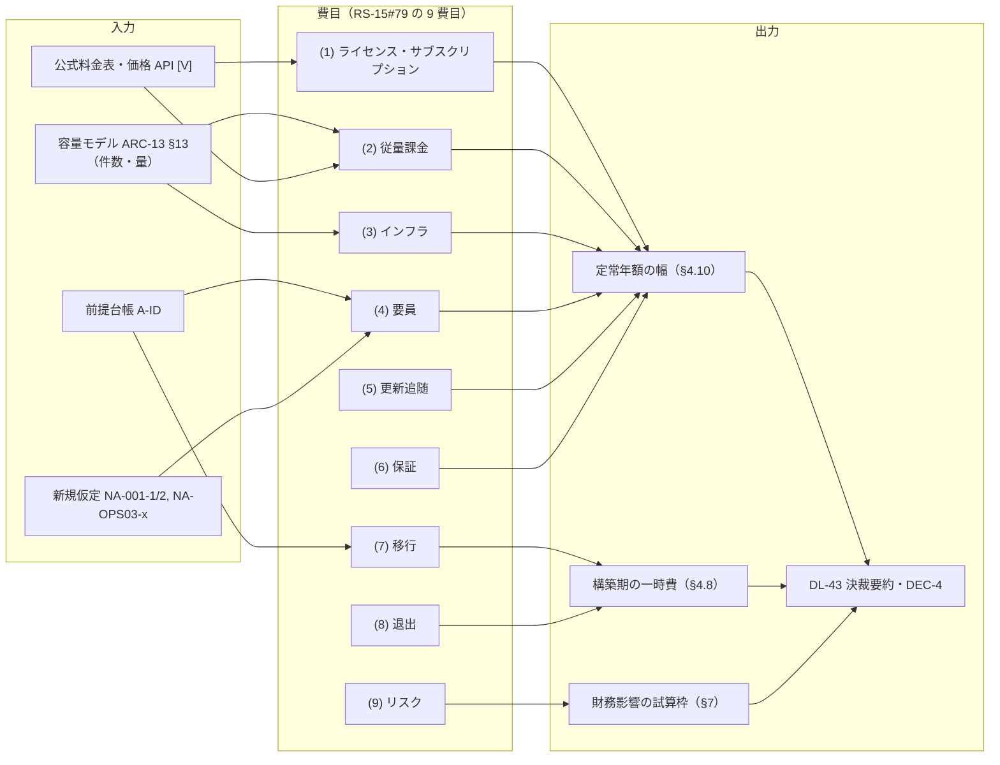
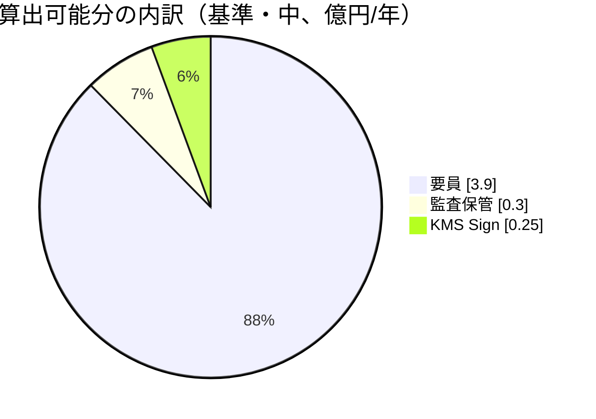

# TCO・vendor support・LTS 評価

> 文書ID: OPS-03 / 版: 0.1 / 状態: draft / 最終更新: 2026-10-15
> 対応要求: R-141, R-274, R-278, G-045, G-046（R-requirements.md・G-goal-criteria.md で対応成果物欄に本書のパスまたは DL-33 を含む行の全件。末尾の対応表を参照）。関連: R-092, R-125, R-137, R-139, R-208／G-070, G-074
> 依存文書: CONVENTIONS.md, traceability/deliverables.md（DL-33 行）, 01_governance/assumptions-register.md（GOV-01 v0.1。以下「前提台帳」）, 01_governance/business-impact-analysis.md（GOV-04）, 01_governance/loss-scenarios.md（GOV-03）, 01_governance/kri.md, 01_governance/durability-charter-20y.md, 04_architecture/capacity-model.md（ARC-13）, 04_architecture/product-evaluation-exit.md（ARC-14）, 05_adr/ADR-001, ADR-007, ADR-010, ADR-013, ADR-014, ADR-018, ADR-023, 08_operations/operating-model.md（OPS-02。並行作成中、本書作成時点で未存在）, research/RS-15-build-buy-tco.md（research/verification/RS-15-verification.md を含む）, research/standards-status.md（SS-G01, SS-G18, SS-G23）
> 作成方法: AI エージェント（Claude）が上記文書を読み単独で起草した。金額は公式料金表・公式価格 API の値（[V]、確認日を脚注に記載）と A-ID・新規仮定から式で算出した。research にない原典 3 件（GDPR 第 83 条、OpenFGA と SpiceDB のセキュリティ方針）は起草者が 2026-10-15 に取得したもので、作成者以外の照合は未実施である。本書の判断・推奨・決裁案は自己レビューであり、実在の CTO/CISO/CFO の決裁でも財務レビュー（E2）でもない（CONVENTIONS §8）[D]。
> 表記: 決裁案 K33-x、新規仮定 NA-OPS03-x（前提台帳へ追加要）、残余リスク RR-OPS03-xx。表のセルでタグのないものは、同じ行の式と入力 ID から導いた設計推論 [D] であり、この注記で個別タグに代える（決裁案の表を含む）。事実を述べるセルには個別にタグと脚注を付けた。金額は特記がない限り税抜・定価・割引なし、1 ドル 150 円（NA-001-1）で円換算した。

## 0. 結論

1. **算出できる費目だけで、基準シナリオの定常年額は低 2.9 億・中 4.5 億・高 6.8 億円であり、その 87〜90% は要員費である** [D][A-054]（§4.10）。要員 26〜30 FTE（A-054 の 24 FTE に SRE の on-call 最少人数の補正を加えた値）× 1 人年 1,000 万〜2,000 万円（NA-001-2）が主因で、KMS の署名費（年 0.21〜0.25 億円）と監査の保管費（年 0.06〜0.55 億円）は 1 桁小さい [D][A-054, A-049, A-074]。製品ライセンス・有償サポート（RHBK・OEL・AuthZed は定価非公開 [V][^15][^20][^24]）、インフラ（ノード数が PoC 実測待ち）、検索基盤・SIEM、第三者評価は **TBD** であり、上の幅に含まれない [D]。この幅は GAO のいう信頼水準付きの範囲ではなく、感度計算である [N][^14]（RS-15#69）。
2. **費用構造で決まっている設計判断は 1 つだけで、「内部 token と認可 Check を従量課金の managed に載せない」である** [D]。載せた場合の年額は token exchange で約 51.8 億円、認可 Check で約 2.4〜44.1 億円となり、算出可能な TCO（中）の 0.5〜12 倍になる [D][A-043, A-045]（RS-15#63, #75、§5）。人間の利用者の認証を managed にする案D の MAU 課金は年 0.08〜0.59 億円で、要員費より 1 桁小さい [D][A-004, A-082]（RS-15#73, #76）。したがって案E（ADR-001）と案D の比較は、ライセンス料ではなく SRE の人数（ADR-001 D17）と出口の可否（ADR-001 M1〜M8）で決まる [D]。
3. **全面停止・全テナント侵害時の財務影響は、TCO より桁が大きくなり得るのに、上流から回収できる額は小さい** [D]。最頻 150 分（GOV-03 の新規仮定 NA-15。前提台帳へ追加要）の全面停止は月間稼働率を約 99.65% に下げ、A-090・A-091 のどの帯も下回る [D][A-090, A-091]。顧客契約が例えば「99.9% 未満で 25%」型のクレジットなら、SLA 対象の月額売上が約 18 億円を超えた時点で、1 回の停止のクレジットだけで算出可能な年間 TCO（中）を上回る [D]（§7.4。クレジット率は例示で、自社契約の値は TBD）。一方、上流のクレジットは月額料金の一定割合で頭打ちになり（例: Auth0・Google は 50% が上限 [V][^34][^37]）、AWS は返金しない [V][^35]（RS-15#7）。案E では AS が self-host なので、認証停止について回収できる上流のクレジットはない [D]（ADR-001 §6.2）。試算の枠（§7）は式・物理量・単価の所有者まで用意したが、単価（MP-01〜MP-09）が未決のため金額は未算出であり、財務レビューは**未達**である [D]。
4. **vendor support と LTS は「修正期限が契約で約束されるか」で分かれる** [D]。期限を公表しているのは Ory（OEL・Ory Network で Critical 14 日）だけで [V][^18]（RS-15#22）、RHBK は長期サポート期間（26.x は最低 2 年、27.x 以降 3 年）を約束するが修正日数は公開文書で確認できない [V][^15]（RS-15#14）。認可エンジンの OpenFGA と SpiceDB の公開方針は、いずれもサポート対象版と修正期限を定めていない [V][^26][^27]。self-host の TCO には、Keycloak の年 4 回の minor 更新 [V][^16]（RS-15#12）への追随工数を固定費として入れる [D]。
5. **「1000 億円規模」に対する比率は、分母の定義が決まるまで 1 つの数値にできない** [D]。分母を 20 年の累計投資とみなすと算出可能分だけで 5.7〜13.6%、年間のシステム予算とみなすと 0.29〜0.68% になり、20 倍違う [D]（§6）。分母の定義を CFO の決裁事項にする（K33-2）[D]。
6. **経営判断が要る点は 7 つある**（§11 の K33-1〜K33-7）[D]。いずれも決定済みではない [D]。

---

## 1. 本書の位置付けと読み方

### 1.1 範囲

| 本書が扱うこと | 本書が扱わないこと（担当） |
|---|---|
| 構築・運用・要員・監査保管・第三者評価・移行・撤退の費目の定義と算出式、算出できる費目の幅（DL-33） | 要員の役割・on-call 設計・採用計画の本体（OPS-02、DL-27） |
| managed と self-host の費用構造の比較（ADR-001・ADR-010 の判断根拠の再確認） | 製品の選定（ARC-14、Gate 3） |
| 全サービス同時 SLA 違反・全顧客一斉通知時の財務影響の試算枠（G-045） | 損失単価 MP-01〜MP-09 の決定（GOV-03 決裁案 B、CFO） |
| vendor support・LTS・価格変動リスクの評価、供給者ごとの重要度・責任者・評価周期（R-278） | 退出条項の条文（ADR-018 C1〜C12、11_contracts/） |
| 「1000 億円規模」に対する比率の考え方 | 決裁要約（DL-43、00_decision/07-organization-and-tco.md） |

### 1.2 読み手別の入口

| 読み手 | 最初に読む節 | 持ち帰るもの |
|---|---|---|
| CTO・CISO | §0、§4.10、§5、§8、§11 | TCO の主因、managed を使う範囲、修正期限のない構成の受容判断 |
| CFO・財務部門 | §0、§4.10、§6、§7、§11 | 幅の出し方、比率の分母、財務影響の式と単価の所有 |
| 調達・法務 | §8〜§10 | RFP で取る価格・LTS・修正期限・価格改定条項、供給者台帳 |
| 連携開発者（依存サービス） | §4.8、§12 | 依存側に生じる費用（PEP SDK 移行の工数係数）と、依存側の SLA 設計への含意 |

### 1.3 計算の約束

- 為替は 1 ドル 150 円（ADR-001 の新規仮定 NA-001-1。前提台帳へ追加要）とする [D]。要員単価は 1 人年 1,000 万〜2,000 万円（NA-001-2。同）で、中位はその中点 1,500 万円（NA-OPS03-2）とする [D]。
- 料金は確認日の定価・税抜・割引なしの公式表示値（[V]）であり、リージョンにより異なり得る [D]。東京の単価を全域に当てた値は近似である（ADR-007 §1.6 と同じ扱い）[D][^8]。
- 量は容量モデル（ARC-13 §13）の値を使い、本書は再計算しない [D][^4]。月 = 2,592,000 秒、日平均 = ピーク ÷ 4（ARC-13 の NA-58-4）である [D]。
- 「定常」は運用開始後に監査アーカイブが保持期間いっぱいまで溜まった状態（約 8 年後）を指す [D][A-074]。監査保管費は定常の値なので、初年度はこれより小さい [D]（ADR-014 D14-58 の注記）[^9]。
- 幅は RS-15#79 の 3 段で出す [D]。本版は (a) 低・中・高のシナリオと (b) 1 変数ずつの感度（§9.3）までで、(c) 複数変数を同時に動かすリスク・不確実性分析は未実施である [D]。GAO は点推定だけでは不確実性について何も分からず意思決定に不十分としており [N][^14]（RS-15#69）、本書は点推定を決裁資料に載せない [D]。GAO の手引きは米国連邦計画向けのベストプラクティスであり、本プログラムを拘束しない [D]。

---

## 2. 前提

### 2.1 使う A-ID（値は GOV-01 v0.1）

値と導出は前提台帳による[^3]。本書の担当範囲（DL-33 行の要点）は成果物計画による[^2] [D]。

| A-ID | 値（基準） | 本書での使い方 |
|---|---|---|
| A-001 / A-002 | 登録 100 万（B2B 70 万／B2C 27 万／従業員 3 万） | 一斉通知の本人数の上限（§7） |
| A-004 / A-082 | MAU 57.7 万、顧客 IdP 経由が B2B 利用者の 75% | 案D の MAU 課金（§5） |
| A-007 | B2B テナント 1 万 | 一斉通知の対象テナント数（§7） |
| A-043 / A-045 / A-049 | token 発行ピーク 1,374/秒、Check ピーク 42,009/秒、監査 907 GB/日 | 従量費（§4.2、§4.3、§5） |
| A-050 / A-110 | 依存サービス 300（移行対象の内訳あり） | 依存側の移行工数の係数（§4.8） |
| A-054 | プラットフォームチーム 24 FTE（SRE 6、2 系統）。範囲 15〜40、成長 36、規制強化 30 | 要員費（§4.1） |
| A-061 / A-063 | 日本 85%。リージョン 4 | 監査の法域内複写（§4.3） |
| A-074 | 監査 オンライン 13 か月＋アーカイブ 7 年 | 監査保管費（§4.3） |
| A-080 / A-062 | 規制業種 25%、所在地指定テナント 500 | 通知・報告の宛先の分かれ方（§7） |
| A-090 / A-091 / A-092 | 判定系 99.95〜99.99%、認証系 99.9〜99.95%、管理系 99.5〜99.9% | SLA 違反の判定（§7.4） |
| A-100 / A-101 / A-104 | 20 年、再決裁は初回 3 年以内・以後 5 年以内、主要構成要素の置換 1 回以上 | 20 年の組み方（§4.12）、LTS の評価期間（§8） |
| A-115 | 自社で認証する人間 47.5 万人 | 移行・退出時の再設定件数（§4.9） |

### 2.2 本書が置く新規仮定（前提台帳へ追加要）

前提台帳は本書から編集しない [D]。次の値は登録までの暫定であり、登録時に A-ID へ置き換える [D]。

| 仮 ID | 内容 | 値と導出 | 使う節 | 確定の所有者・期限・決め方 |
|---|---|---|---|---|
| NA-OPS03-1 | 「1000 億円規模」の意味（比率の分母） | 値を置かない（TBD）。候補は §6 の (i)〜(iii) | §6 | CFO、G0、K33-2 で決める |
| NA-OPS03-2 | 要員単価の中位 | 1,500 万円/人年（NA-001-2 の中点）[D] | §4.1 | CFO＋人事責任者、G3、実際の等級別単価で置換 |
| NA-OPS03-3 | 監査の圧縮率 r の低位側 | r = 5（ADR-014 NA-014-2 の例示値）[D] | §4.3 | CISO＋SRE 責任者、G4、TC-014-10 の実測 |
| NA-OPS03-4 | 監査の複製数 c の高位側 | c = 1.85（日本分 85% を主・副に複写し、EU・米国は 1 部）[D][A-061] | §4.3 | 法務責任者＋CISO、G3、ADR-014 D14-38 の決定 |
| NA-OPS03-5 | 顧客契約の SLA（対象売上、稼働率の段、クレジット率、上限） | 値を置かない（TBD） | §7 | 法務責任者＋CFO＋営業・顧客成功責任者、G0、11_contracts/ の棚卸し |
| NA-OPS03-6 | 依存サービス 1 つあたりの PEP SDK・token 移行工数 | 値を置かない（TBD）。§4.8 では 1 人月あたりの係数だけ示す | §4.8 | プラットフォームチーム長＋各ドメイン責任者、G1、DL-31 のパイロット実測 |

---

## 3. TCO の構造（費目と算出式）

### 3.1 全体像

### 3.2 費目ごとの式と状態

| # | 費目 | 算出式 | 主な入力 | 本版の状態 |
|---|---|---|---|---|
| 1 | ライセンス・サブスクリプション | AS 製品（RHBK または OEL）の契約額 ＋ 認可エンジンの商用ライセンス・サポート ＋（案D のみ）MAU × 単価 | RFP 見積り、RS-15#73 | AS・エンジンは TBD（定価非公開）。案D の MAU 課金は算出済み（§5） |
| 2 | 従量課金 | KMS Sign 回数 × 単価 ＋ Txn-Token の Sign ＋ SMS 通数 × 単価 | ARC-13 §13、ADR-007 §1.6 | KMS は算出済み。Txn-Token は p_w の係数のみ。SMS は通数 TBD |
| 3 | インフラ | Σ_cell（ノード数 × 単価）＋ DB ＋ ネットワーク ＋ 待機 cell の固定費 F_s ＋ 監査保管 ＋ 検索基盤・SIEM | ARC-13 §5・§6.3、ADR-013 §3.2、ADR-014 D14-57 | 監査保管のみ算出済み。他は TBD |
| 4 | 要員 | FTE × 単価 | A-054、NA-001-2/3 | 算出済み |
| 5 | 更新追随 | minor・major 更新の回数 × 検証・適用工数 × cell・環境数 | RS-15#12, #28 | 工数 TBD（RS-15 §5.2 の 7 で実測）。定常は要員 FTE に含める |
| 6 | 保証 | OIDF 認定料（任意）＋ pentest・第三者評価（DL-30）＋ 出口演習の独立立会人 | RS-15#2、ARC-14 §8 | OIDF は単価のみ。他は TBD |
| 7 | 移行 | 依存サービスの改修 ＋ 利用者の認証器移行 ＋ dual-run の並行運用 | A-050, A-110, A-115、ADR-027 | 係数のみ（§4.8） |
| 8 | 退出 | ADR-018 D18-23 の 7 内訳 | ADR-018、ARC-14 §8.4 | 式と量のみ（§4.9） |
| 9 | リスク | SLA クレジットを超える損失 ＋ 修正期限のない脆弱性の受容 | GOV-03、GOV-04 §5 | 試算枠のみ（§7） |

---

## 4. 費目別 TCO（基準シナリオ）

### 4.1 要員（費目 4）

- A-054 の内訳は、認証・IdP 5、認可・PDP 5、PEP SDK・開発者支援 4、SRE 6、鍵管理・セキュリティ 2、プロダクト・統制 2 の計 24 FTE である [A-054]。
- Google SRE 本は、on-call を回す最少人数を単一拠点 8 名、2 拠点なら各 6 名としている [V][^19]（RS-15#70）。ADR-001 D17 と ADR-010 D-44 はこれを self-host の条件にした（NA-001-3）[D][^6][^7]。そこで SRE を単一系統 8 名（+2）か 2 系統各 6 名（+6）に補正する [D][A-054]。
- managed を選んでも、障害時の切替え、顧客連絡、設定変更、ベンダーへのエスカレーションの on-call は残る [D]（RS-15#71）。したがって案D でも SRE の補正は外さない [D]。

| 区分 | FTE | 単価 | 年額 | 入力 ID |
|---|---|---|---|---|
| 低 | 26（A-054 ＋ SRE 単一系統 8 名への補正 +2） | 1,000 万円 | 2.6 億円 | A-054, NA-001-2, NA-001-3 |
| 中 | 26 | 1,500 万円 | 3.9 億円 | NA-OPS03-2 |
| 高 | 30（2 系統各 6 名への補正 +6） | 2,000 万円 | 6.0 億円 | A-054, NA-001-3 |
| 参考: 規制強化 | 36（A-054 の規制強化値 30 ＋ SRE 補正 +6） | 1,000 万〜2,000 万円 | 3.6〜7.2 億円 | A-054 |

- 要員の役割・採用計画・稼働率は OPS-02（DL-27）が正本であり、OPS-02 の FTE が確定したら本表を置き換える [D]。OPS-02 は本書と並行作成中であり、本表は A-054 と ADR の要員ゲートから組んだ暫定である [D]。
- 更新追随（費目 5）と出口演習（年 1 回、ADR-018）は、この FTE の中で行う前提である [D]。追随工数が FTE に収まらない場合は費目 5 として外出しする（RS-15 §5.2 の 7 で実測、TBD: 所有者 プラットフォームチーム長、期限 G4）[D]。

### 4.2 従量課金（費目 2）

| 項目 | 式 | 年額（基準） | 年額（成長） | 根拠 |
|---|---|---|---|---|
| KMS Sign（内部 ES256・外部 RS256） | 9.23 × 10⁸ 回/月 × 単価 | 約 $137k（0.21 億円） | TBD（内訳なし） | ADR-007 §1.6 [V][^38]、ARC-13 §13 |
| KMS Sign（全署名 ES256） | 同 | 約 $166k（0.25 億円） | 約 $469k（0.70 億円） | 同上 |
| Txn-Token の Sign（KMS で署名する場合） | 1.09 × 10¹⁰ × p_w 回/月 × $0.15／1 万回 | p_w 1% あたり約 $19.6k（0.029 億円） | p_w 1% あたり約 $65.9k（0.099 億円） | ARC-13 §13、[V][^38] |
| SMS（OTP・回復） | 通数 × 単価（日本 $0.03/通の例 [V][^32]） | TBD（通数が前提台帳にない） | TBD | RS-15#56 |
| 単一テナント HSM（任意。L1 を 3 法域） | 6 台または 3 pool | 約 $84k〜$95k（0.13〜0.14 億円） | 同 | ADR-007 §1.6 [V][^39][^40] |

- KMS の単価は、ECC・RSA-3072 などの非対称要求が 1 万回 $0.15、RSA-2048 が 1 万回 $0.03 である [V][^38]（東京、publicationDate 2026-09-11。ADR-007 の統合者が取得した値の転記）。
- Txn-Token を要求ごとに KMS で署名するかは p_w（ADR-005 NA-02、TBD）と署名方式で決まり、本版の集計には入れない [D]。p_w = 10% なら年約 0.29 億円が加わる [D][A-040]。

### 4.3 監査の保管（費目 3 の一部）

- 保管費の式は「件数/日 × 1 件の bytes ÷ r × c × 保持日数 × 階層単価」である（ADR-014 D14-57）[D][^9]。
- ADR-014 D14-58 は decision event（907 GB/日）だけで、r = 1・c = 1 の定常の保管費を年約 $159k（S3 Standard $0.025〜$0.023/GB-月 [V][^41]、Glacier Deep Archive $0.002/GB-月 [V][^42]）と試算した [D][^9]。容量モデルは PEP 記録・発行イベント・一覧記録を加えた日量を 1,137 GB とし、これは decision event の約 1.25 倍である [D][^4][A-049]。

| 区分 | 式 | 年額（基準、定常） | 年額（成長、定常） | 入力 ID |
|---|---|---|---|---|
| 低 | $159k × 1.25 ÷ r（= 5） | 約 $40k（0.06 億円） | 約 $156k（0.23 億円） | NA-OPS03-3 |
| 中 | $159k × 1.25（r = 1、c = 1） | 約 $199k（0.30 億円） | 約 $781k（1.17 億円） | A-049, A-074 |
| 高 | 中 × c（= 1.85） | 約 $369k（0.55 億円） | 約 $1,445k（2.17 億円） | NA-OPS03-4, A-061 |

- 成長の値は ADR-014 D14-58 の成長試算（年約 $630k）に、容量モデルの成長日量と decision event の比（4,534 ÷ 3,658 ≈ 1.24）を掛けた [D][^4][^9]。
- この表は保管だけである [D]。検索基盤（オンライン層の索引・計算資源）と SIEM の取込みは単価を収集しておらず、費用の大部分がこちらになる可能性があると ADR-014 は述べている [D][^9]。TBD（所有者 CISO＋SRE 責任者、期限 G3、決め方: 候補の公式単価 × ARC-13 §6.3 の日量で算出し、TC-014-10 の実測で補正）。
- 記録率は下げない（ADR-014 D14-59）ので、費用の調整手段は保持区分・オンライン層の長さ・階層・圧縮である [D][^9]。

### 4.4 ライセンス・有償サポート（費目 1）

| 対象 | 公開状況 | 本書の扱い |
|---|---|---|
| Red Hat build of Keycloak（第一候補） | 価格は公式ページで確認できない [V][^15]（RS-15#14） | TBD（所有者 調達責任者、期限 G3、決め方: RFP の同一条件見積り。ADR-001 §2.19） |
| Ory Enterprise License（対抗） | Enterprise は個別見積り [V][^20]（RS-15#19, #74） | 同上 |
| OpenFGA / SpiceDB（OSS） | ライセンス費は 0 [D]（RS-15#74） | 0。ただし修正期限の約束がない（§8） |
| AuthZed の Self-Hosted ライセンス・サポート | リージョンと vCPU 単位の年間ライセンス、価格は非公開 [V][^24]（RS-15#61） | TBD（SpiceDB を選んだ場合。RFP） |
| 案D の managed 資格情報層 | MAU 課金は公開（§5） | 案D に切り替えた場合だけ加算 |

- コミュニティ版 Keycloak と Ory の Apache 2.0 版は本番候補にしない（ADR-001 D6-3）ので、ライセンス費 0 の AS は比較の下限に置かない [D][^6]。

### 4.5 インフラ（費目 3）

- 式: Σ_cell（PDP・STS・状態ストア・AS のノード数 × 単価）＋ relationship store（PostgreSQL）＋ ネットワーク ＋ 日本の待機 cell の固定費 F_s × 待機 cell 数 ＋ 非本番環境 [D]。
- cell 数は 9（＋日本の待機最大 5）、KD13-1 (a) なら 21 以上（＋待機最大 18）である（ADR-013 N13-1、ARC-13 §13）[D][^11][^4]。ADR-013 は cell の固定費 F を置き、9 cell で 9F〜14F とした [D][^11]。
- ノード数は「設計容量 ÷ 1 ノードの実測容量 × k_r」で決まり、実測容量は PoC（ARC-13 §9 の P5）待ちである [D][^4]。TBD（所有者 SRE 責任者、期限 G4、決め方: P5 の実測値と、採用クラウドの公式価格 API の単価から算出）。
- 本版の §4.10 の幅には、インフラ（監査保管を除く）が含まれていない [D]。決裁資料ではこの欠落を明示する（残課題 1）[D]。

### 4.6 保証（費目 6）

- OIDF の自己認定料は、OpenID Connect が会員 700 ドル・非会員 3,500 ドル、FAPI が会員 1,000 ドル・非会員 5,000 ドルで、いずれも新しい deployment ごとである [N][^29]（RS-15#2）。OP 1 deployment で両方を取ると、非会員 8,500 ドル（約 128 万円）、会員 1,700 ドル（約 26 万円）になる [D]。
- 認定の取得は必須ではない [D]。ADR-001 は採用版での conformance suite の自社実行を足切りにしており（D12-1、D13-1）、認定料は任意の費目である [D][^6]。
- pentest、cross-tenant 試験、red team、外部アーキテクチャレビュー（DL-30）と、出口演習の独立立会人（ARC-14 §8）は TBD（所有者 CISO、期限 G3、決め方: DL-30 の RFP 見積り）[D][^5]。

### 4.7 更新追随（費目 5）

- Keycloak は minor を年 4 回、major を 2〜3 年ごとに出す [V][^16]（RS-15#12）。ADR-001 は、これを 4 cell × 本番・非本番で追随する工数を悪い帰結に挙げた [D][^6]。
- ZITADEL は major を 3 か月ごと、minor を 2 週間ごとに出すとした [V][^21]（RS-15#28）。
- 式: 年間追随工数 = Σ_製品（年間リリース数 × 1 回の検証・適用工数 × 環境数）[D]。1 回の工数は RS-15 §5.2 の 7（Keycloak の minor 1 回分の実測）で決める（TBD、所有者 プラットフォームチーム長、期限 G4）[D]。

### 4.8 構築期の一時費（費目 3・4・7）

| 項目 | 式 | 幅 | 入力 ID |
|---|---|---|---|
| cell 化の工具 | 3〜5 FTE × 18 か月 × 単価 | 0.45〜1.5 億円（中 6 人年 × 1,500 万円 = 0.9 億円） | ADR-013 N13-3[^11]、NA-001-2 |
| 依存サービスの改修（PEP SDK・token 移行） | 300 サービス × 1 サービスあたり工数 × 単価 | 1 サービスあたり 1 人月ごとに 2.5〜5.0 億円（中 3.75 億円） | A-050, A-110, NA-OPS03-6 |
| 利用者の認証器移行の support 原価 | 再設定件数 × 1 件の support 原価 | TBD | A-115、MP-05 |

- 依存サービスの改修費は、各ドメインの予算に計上するか基盤の TCO に入れるかで、TCO の見え方が大きく変わる [D]。300 サービスで 1 サービスあたり 2 人月なら 5〜10 億円であり、基盤の定常年額（中）を上回る [D][A-050]。計上先は K33-1 で決める [D]。

### 4.9 移行・退出（費目 7・8）

- 撤退期間は T_exit = T_notice ＋ T_prep ＋ Σ T_wave ＋ T_JIT ＋ T_rollback ＋ T_retrieval で、撤退費用は準備・並行運用・移行要員・利用者と顧客の作業・監査の残置・契約・リスクの 7 内訳で見積もる（ADR-018 D18-21、D18-23）[D][^10]。
- 量の目安は、tuple 7.55 億件の移送が約 21 時間〜約 8.7 日、監査の全量移送が 10 Gbps で約 25 日、hash を移せない場合に JIT の初期窓 1 か月で移らない利用者が約 24 万人である（ADR-018 D18-21、ARC-14 §8.4）[D][^10][^5][A-049, A-115]。
- 費用への換算に要る単価（並行運用の月額、1 件の support 原価）は §4.4・§4.5 と MP-05 が TBD のため、本版では金額にしない [D]。初回の値は PoC 内の往復演習の実測を入れて Gate 3 の決裁資料に載せ、以後は年 1 回更新して本書と DL-43 に渡す（ARC-14 §8.4）[D][^5]。
- EU Data Act は、2027-01-12 以降、データ処理サービスの事業者が乗換え費用を課すことを禁じる（shall not）[N][^36]（RS-15#65、standards-status SS-G23）。同法が適用される契約では、退出費用の「契約」内訳（移行支援費）は 0 に近づく [D]。適用の有無は法務判断である（ADR-018 K18-1）[D]。

### 4.10 集計（基準シナリオ、定常の年額）

| 費目 | 低 | 中 | 高 | 本版に含まれないもの |
|---|---|---|---|---|
| (4) 要員 | 2.60 億円 | 3.90 億円 | 6.00 億円 | 規制強化（36 FTE で +1.0〜1.5 億円） |
| (2) KMS Sign | 0.21 億円 | 0.25 億円 | 0.25 億円 | Txn-Token（p_w 1% あたり 0.029 億円）、SMS、HSM（任意 0.13〜0.48 億円） |
| (3) 監査保管 | 0.06 億円 | 0.30 億円 | 0.55 億円 | 検索基盤・SIEM |
| **算出可能分の計** | **2.87 億円** | **4.45 億円** | **6.80 億円** | — |
| (1) ライセンス・サポート | TBD | TBD | TBD | RFP（G3） |
| (3) インフラ（監査保管以外） | TBD | TBD | TBD | PoC P5（G4） |
| (6) 保証 | TBD | TBD | TBD | DL-30（G3） |

- 低・中・高は各費目の低・中・高を同じ列で足した値であり、信頼水準を持たない [D]（RS-15 §6 の「試算の性格」と同じ限界）。
- 要員費が算出可能分の 87〜90% を占める [D]。したがって TCO の幅を最も動かすのは要員単価と SRE の系統数であり、従量単価や為替ではない（§9.3）[D]。この順位は、TBD のライセンス・インフラが確定すると変わり得る [D]。

### 4.11 成長シナリオ（5 年後、定常の年額）

| 費目 | 低 | 中 | 高 | 入力 ID |
|---|---|---|---|---|
| 要員（A-054 成長値 36 FTE） | 3.60 億円 | 5.40 億円 | 7.20 億円 | A-054, A-102 |
| KMS Sign（全 ES256） | 0.70 億円 | 0.70 億円 | 0.70 億円 | ADR-007 §1.6 |
| 監査保管 | 0.23 億円 | 1.17 億円 | 2.17 億円 | §4.3 |
| **算出可能分の計** | **4.53 億円** | **7.27 億円** | **10.07 億円** | — |

- 成長シナリオ（登録 3 倍）でも要員が主因だが、監査保管の比率は基準の 7% から 16% に上がる（中）[D][A-049, A-102]。成長の主な追加費は保管と検索であり、ADR-014 D14-59 の調整手段（保持区分・階層・圧縮）を費用管理の主手段にする [D][^9]。

### 4.12 20 年の組み方

- 期間は再決裁周期で区切る（初回は G6 から 3 年以内、以後 5 年以内）[A-101]。各期の TCO は「その期の定常年額 × 年数 ＋ その期の構築・置換・退出の一時費」で積む [D]（RS-15#79）。
- 計画期間中に AS/IdP 製品・認可エンジン・PEP SDK の主要版をそれぞれ 1 回以上置換する前提なので、20 年の総額には撤退費用（§4.9）を 1 回以上含める [D][A-104]。
- 基準の定常年額（算出可能分）を 20 年単純積算すると約 57〜136 億円になる [D]。これは成長・置換・TBD 費目を含まない下限側の目安であり、決裁の値には使わない [D]。

---

## 5. managed と self-host の費用構造（判断根拠の再確認）

| 載せる対象 | managed の課金単位と単価 | 基準の量 | 年額 | 判断 |
|---|---|---|---|---|
| token exchange（内部） | token 単位（Entra の M2M 単価 $0.001/token を仮に当てる [V][^30]） | ピーク 1,112/秒 | 約 51.8 億円（月約 288 万ドル） | 載せない（ADR-001 D10-1）[D][A-043]（RS-15#75） |
| M2M token | Cognito の token 応答単価（計算例からの逆算）[V][^31] | ピーク 25.3/秒が月間継続する上限 | 約 2.7 億円（月約 14.8 万ドル） | 同上 [D][A-029]（RS-15#75） |
| 認可 Check | Ory Network Production の check 単価 [V][^20] | 2.72 × 10¹⁰ 件/月 | 約 44.1 億円（月約 245 万ドル） | PDP は self-host（ADR-010 D-35）[D][A-045]（RS-15#63） |
| 認可 Check | AVP の単発要求単価 [V][^43] | 同上 | 約 2.4 億円（月約 13.6 万ドル） | 同上 |
| 人間の利用者の認証（案D の資格情報層） | MAU（Google・Cognito・Entra の定価）[V][^30][^31][^32] | MAU 57.7 万（federate 34.1 万） | 約 0.08〜0.59 億円（年 5.4 万〜39.0 万ドル） | 案D の場合だけ（ADR-001 D17-2）[D][A-004, A-082]（RS-15#73） |

- 内部 token と Check を managed に載せた場合の年額は、本書の算出可能な定常 TCO（中 4.45 億円）の 0.5〜12 倍になる [D]。費用構造が self-host の判断（ADR-001 D10、ADR-010 D-35）を支えていることを、本書の単価でも確認した [D]。
- 案D の MAU 課金は要員費より 1 桁小さい [D]（RS-15#76）。案D の財務上の効果は、認証・IdP 担当の一部と on-call の範囲の縮小として評価するが、SRE の補正（§4.1）は外せない [D]（RS-15#71）。
- 案D の費用の不確かさは、料金より出口にある [D]。hash の export を契約で約束する候補は 2026-10-03 時点で確認できず（ADR-001 M1）、出られない場合は JIT 移行と回復手順による再設定で出ることになる（ADR-018 D18-22）[D][^6][^10]。この再設定の support 原価（§4.9）を案D の TCO に入れる [D]。

---

## 6. 「1000 億円規模」の全体予算に対する比率の考え方

### 6.1 分母の候補

CONVENTIONS §7 の「1000 億円規模のシステム群」は、金額が何を指すかを定めていない [D][^1]。分母の取り方で比率は 20 倍変わる [D]。

| 分母の解釈 | 年換算の分母 | 算出可能分の比率（基準） | 意味 |
|---|---|---|---|
| (i) 本基盤に依存するシステム群の計画期間累計投資 | 1000 億円 ÷ 20 年 = 50 億円/年（均等と仮定）[D][A-100] | 2.87〜6.80 ÷ 50 = 5.7〜13.6% | 共通基盤が全体の何割を占めるか（投資配分） |
| (ii) 年間のシステム関連予算（開発＋運用） | 1000 億円/年 | 0.29〜0.68% | 年度予算の中での負担 |
| (iii) 依存事業の年間売上・取扱高 | 1000 億円/年 | 0.29〜0.68%（数値は (ii) と同じだが意味が異なる） | 売上に対する共通基盤費。財務影響（§7）の分母と揃う |

- いずれの比率も、TBD の費目（ライセンス、インフラ、検索基盤、保証）と依存側の改修費（§4.8）を含まない下限側の値である [D]。
- (i) の 50 億円/年は 20 年に均等配分した仮定であり、実際の投資は構築期に偏る [D]。

### 6.2 比率の使い方（推奨）

1. 比率を予算の上限（キャップ）として使わない [D]。要員費が主因であり、比率に合わせて SRE を削ると ADR-001 D17 の要員ゲートを割り、案D への切替えか Plan B（DL-42）になるからである [D][^6]。
2. 比率は次の 2 つと並べて示す [D]。(a) 共通基盤がない場合に依存サービス 300 がそれぞれ認証・認可を持つ費用（As-Is の A-110・A-112 から DL-50 で見積り、TBD）、(b) 全面停止・全テナント侵害の 1 事象あたりの損失（§7）[D][A-110, A-112]。共通基盤の費用は (a) の削減と (b) の集中リスクの両方と比べて初めて評価できる [D]。
3. 分母は K33-2 で CFO が決める [D]。推奨は (ii) を主、(iii) を財務影響の比較用の副とする（§11）[D]。

---

## 7. 全面停止・全テナント侵害時の財務影響の試算枠（G-045）

### 7.1 対象事象

| 事象 | 定義 | 対応する損失シナリオ |
|---|---|---|
| Ω1 全面停止 | 判定系または認証系が全 cell で同時に停止し、依存 300 サービスの顧客向け SLA が同時に違反になる [D][A-050] | S-06（PDP・AS 障害による全サービス停止）。global 依存が残る場合や、全域に複製された設定・policy の障害（GOV-03 §5.8 の事故例）[^13] |
| Ω2 全テナントに及ぶ侵害 | 署名鍵の侵害や policy 誤配布で、全 1 万テナントへの通知が要る [D][A-007] | S-02、S-05（全域 allow）。S-10・S-16 が二次損失を増幅する [^13] |

### 7.2 式

GOV-03 の損失形態（P1〜P4、S1〜S5）と単価 MP-01〜MP-09、GOV-04 §5.2 の評価欄 X3・X4・X6 に合わせる [D][^12][^13]。

```mermaid
flowchart TD
  D["停止時間 D（分）<br/>GOV-03 NA-15"] --> AV["月間稼働率 = 1 − D ÷ 43,200"]
  AV --> CR["クレジット率 c(AV)<br/>顧客契約（NA-OPS03-5）"]
  REV["SLA 対象の月額売上 R_sla<br/>（NA-OPS03-5）"] --> S3["S3 SLA クレジット = R_sla × c(AV)"]
  CR --> S3
  D --> P1["P1 業務停止 = Σ_domain MP-01 × D"]
  T["影響テナント 1 万（A-007）"] --> S2T["S2 通知（テナント）= 1 万 × MP-03"]
  U["影響本人 最大 100 万（A-001）"] --> S2U["S2 通知（本人、Ω2）= 本人数 × MP-02"]
  P1 --> SUM["1 事象の損失 = P1 ＋ P2 ＋ S2 ＋ S3 ＋ S4 ＋ S1"]
  S3 --> SUM
  S2T --> SUM
  S2U --> SUM
  SUM --> CMP["MP-08 キャパシティ・MP-09 保険と比較（GOV-04 X6）"]
  REC["上流からの回収 = Σ 上流の月額 × 上流クレジット率（上限付き）"] --> CMP
```

| 項目 | 式 | Ω1 | Ω2 | 単価の所有者（GOV-03 §2.4） |
|---|---|---|---|---|
| P1 業務停止 | Σ_domain MP-01_d × D | 対象 | 全域 deny の場合に対象 | 各事業責任者＋CFO |
| P2 対応 | 対応件数 × MP-05 | 対象 | 対象（全資格情報の回転、全 session 失効 86.5 万件）[A-006] | CISO＋CFO |
| S2 通知（テナント） | 1 万 × MP-03 | 契約上の障害通知 | 対象 | 営業・顧客成功責任者＋法務責任者 |
| S2 通知（本人） | 本人数 × MP-02（法域別） | 原則なし | 最大 100 万人（EU・英国 8 万人）[A-001, A-061] | 個人情報保護責任者＋CFO |
| S3 SLA クレジット | Σ_契約 R_sla × c(AV) | 対象 | 全域 deny の場合に対象 | 法務責任者（NA-OPS03-5） |
| S4 顧客離反 | 影響テナント数 × 離反率 × 顧客生涯価値（MP-06） | 対象 | 対象 | 事業責任者＋経営企画責任者 |
| S1 規制制裁 | 適用法域ごとの上限算定（MP-07） | 原則対象外 | 対象 | CFO＋法務責任者 |

### 7.3 物理量（A-ID から導けるもの）

| 量 | 値（基準） | 根拠 |
|---|---|---|
| 1 事象の停止時間 D | 下限 30 分・最頻 150 分・上限 900 分 | GOV-03 の新規仮定 NA-15（前提台帳へ追加要）[D][^13] |
| 停止 1 分あたりの失敗する edge API 呼出し | ピーク 100.8 万件・平均 25.2 万件。最頻 150 分の平均流量で約 3,780 万件 | GOV-03 Q5 [D][A-040] |
| 一斉通知の対象テナント | 1 万（うち所在地指定 500、規制業種の利用者 25%） | [A-007, A-062, A-080] |
| 同時に止まる依存サービス | 300 | [A-050] |
| 作業中に止められる利用者 | 同時アクティブ 11.1 万 | [A-005] |
| 復旧時の再ログイン集中 | 556/秒（平常 51/秒） | [A-048, A-041] |

### 7.4 SLA 違反の判定と、クレジットの規模感

| D | 月間稼働率 | A-090 判定系帯（99.95〜99.99%） | A-091 認証系帯（99.9〜99.95%） | 例示: Microsoft 型の段での率 [V][^33] |
|---|---|---|---|---|
| 30 分 | 99.931% | 下回る | 99.95% を下回り、99.9% は満たす | 10% |
| 150 分 | 99.653% | 下回る | 下回る | 25% |
| 900 分 | 97.917% | 下回る | 下回る | 50% |

- 例示の段は Microsoft Online Services SLA の Entra ID の項（99.99% 未満 10%、99.9% 未満 25%、99% 未満 50%、95% 未満 100%）であり [V][^33]（RS-15#37）、自社の顧客契約の値ではない [D]。自社契約の段と上限は NA-OPS03-5 で棚卸しする [D]。
- 係数で示すと、SLA 対象の月額売上 1 億円あたり、クレジット率 10%・25%・50% で 0.1・0.25・0.5 億円になる [D]。最頻 150 分（25% 段の例示）では、R_sla が約 18 億円/月を超えると、1 回の停止のクレジットだけで算出可能な年間 TCO（中 4.45 億円）を上回る [D]。
- 感度の例示: 分母の解釈 (iii)（年間売上 1000 億円、§6）で全売上が SLA 対象と仮定すると R_sla は約 83 億円/月であり、25% 段で約 21 億円になる [D]。SLA 対象の売上比率は不明であり、この値は決裁に使わない [D]。
- 停止が月をまたぐ、または同じ月に 2 回起きる場合は、稼働率を月ごとに計算する [D]。LEF は年 0.3〜3 回（GOV-03 NA-07）である [D][^13]。

### 7.5 上流から回収できる額の非対称

| 上流 | 約束 | 救済の上限・形 | 出典 |
|---|---|---|---|
| Auth0（Enterprise） | 月平均 99.99% | 段 5〜50%、上限は月額料金の 50%、請求は 5 営業日以内 | [V][^34]（RS-15#42） |
| Amazon Cognito | リージョンごと 99.9% | 段 10〜100%。クレジットは将来の支払いに充当し、返金しない | [V][^35]（RS-15#50, #7） |
| Google Identity Platform | 99.95% | 段 10〜50% | [V][^37]（RS-15#56） |
| Microsoft Entra ID Basic/Premium | 99.99% | 段 10〜100%（External ID への適用は未確認） | [V][^33]（RS-15#37） |

- 上流のクレジットは上流の月額料金に比例し、案D の MAU 課金でも月 0.07〜0.49 億円の桁である [D]（§5）。自社が顧客に払うクレジットは R_sla に比例するので、回収はほぼ相殺にならない [D]。
- 案E（ADR-001 採用案）では AS・資格情報層が self-host であり、認証停止について上流の SLA の枠組みがなく、可用性の責任をすべて自社が負う [D][^6]（ADR-001 §6.2）。クラウド基盤のクレジットも、そのサービスの月額料金が上限の基準になる [D]。
- したがって Ω1 の損失を移転する手段は、上流のクレジットではなく、(a) 顧客契約のクレジット上限、(b) サイバー保険（MP-09）、(c) 相関を断つ統制（cell、静的安定性。GOV-04 §5.4）である [D][^12]。これを K33-6 で決める [D]。

### 7.6 規制制裁の上限（Ω2）

- GDPR 第 83 条(4) は、第 25〜39 条（処理の安全、侵害の通知などを含む）の管理者・処理者の義務の違反に、1,000 万ユーロまたは事業者の場合は前会計年度の全世界年間売上高の 2% の、いずれか高い方を上限とする制裁金を科し得るとする [N][^44]。同条(5) は、別の規定群の違反について 2,000 万ユーロまたは 4% を上限とする [N][^44]。GDPR は適用中である（standards-status SS-G01）[N]。
- これは上限であり期待値ではない [D]。EU・英国の利用者は 8%（8 万人）であり、適用の有無と範囲は DL-34 の判定による [D][A-061]。MP-07（全世界売上高）が未決のため金額は置かない [D]。
- 日本の個人情報保護法の 2026 年改正は課徴金を含むが公布済み未施行であり（RS-02 の整理）、本書は額を確認していない（未確認）[D]。

### 7.7 財務レビューの手順（G-045 を閉じる道筋）

| 段 | 内容 | 担当 | 期限 | 証拠 |
|---|---|---|---|---|
| 1 | MP-01〜MP-09 と NA-OPS03-5 を決める | CFO、各事業責任者、法務責任者 | G0 | GOV-03 決裁案 B の記録 |
| 2 | §7.2 の式で Ω1・Ω2 の 1 事象の損失を、D と本人数の 3 点（下限・最頻・上限）で計算する | 本書の所有者（プラットフォームチーム長）＋CFO 配下の財務担当 | G0 | 計算表（A-ID・GOV-04 の行番号付き） |
| 3 | MP-08（キャパシティ）、MP-09（保険）と比べる（GOV-04 X6） | CFO | G0 | 比較表 |
| 4 | 財務レビュー（E2）を行い、超過する場合は K33-6 の選択肢で扱う | CFO（承認: 経営会議） | G0 | 財務レビュー記録 |

- 本版は段 1 の入力様式と段 2 の式までであり、段 1〜4 はすべて未達である [D]。

---

## 8. vendor support・LTS 評価

### 8.1 構成要素別の評価

| 構成要素 | サポート対象版・LTS | 修正期限 | 受付・応答 | 更新の周期 | 評価 |
|---|---|---|---|---|---|
| RHBK（AS 第一候補） | 常に 2 つ以上の major.minor をサポート。26.x は full＋maintenance で最低 2 年、27.x 以降 3 年。次の major が出ると前の major は最低 6 か月の maintenance [V][^15]（RS-15#14） | 公開文書で確認できない | 有償契約 | Keycloak 本体は minor 年 4 回 [V][^16] | LTS は約束あり。修正日数は RFP で取る |
| Keycloak コミュニティ版 | 現行の major.minor か次の版で修正 [V][^17]（RS-15#13） | 定めなし | 受領確認 7 営業日以内 [V][^17] | 同上 | 本番候補外（ADR-001 D6-3） |
| Ory OEL（AS 対抗） | 有償版 | Critical 14 日、High 30 日、Medium 90 日、Low 180 日 [V][^18]（RS-15#22） | 有償契約 | OSS 版の最終リリース（v26.2.0、2026-03-20）から確認日まで 6 か月以上空いている [D]（RS-15#25, #26） | 修正期限の約束がある唯一の候補 |
| Ory Apache 2.0 版 | 現行リリースのみ [V][^18] | SLA なし | — | — | 本番候補外 |
| ZITADEL（比較候補） | GA 機能のみサポート。major 版のサポート期間は未確認 [V][^22]（RS-15#29） | 公開方針に記載なし | 報告窓口のみ | major 3 か月、minor 2 週間 [V][^21] | 追随負荷が最も高い。AGPL-3.0 の法務確認が条件 |
| node-oidc-provider（FAPI 範囲の補助） | v9.x のみ。終了日は後継版の前に決める [V][^23]（RS-15#32） | 定めなし | 個人の管理者 | — | bus factor を自社で補う（ARC-14 §7.5） |
| OpenFGA（認可主候補） | サポート対象版の記載なし。CVE の対象は stable release [V][^26] | 定めなし | security@openfga.dev、5 営業日以内の返信を目標とする [V][^26] | — | 修正期限の約束なし |
| SpiceDB（認可主候補） | 最新版の稼働を前提とする記述のみ [V][^27] | 定めなし | security@authzed.com [V][^27] | — | 修正期限の約束なし。有償サポート（Standard: P3 1 営業日、Premium: P1/P2 12 時間、Enterprise: P1 1 時間）は応答時間の約束 [V][^24]（RS-15#61） |
| クラウド（KMS・ストレージ・計算） | 重要な機能の廃止は 12 か月以上前に通知、SLA の不利な変更は 90 日以上前、値上げは 30 日以上前（AWS Customer Agreement）[V][^28]（RS-15#55） | — | — | — | 値上げの通知期間が他より短い |

- OpenFGA と SpiceDB のセキュリティ方針は、起草者が 2026-10-15 に取得した一次資料であり、research での独立検証は未実施である [D]。ARC-14 は「認可エンジンの CVE 対応と LTS は research で未調査」としており、本表はその空欄を一部埋めたものである [D][^5]。

### 8.2 判定と推奨

1. 本番で使う AS 製品は、修正期限か LTS のどちらかを契約で約束させる [D]。ADR-001 K1-3 の推奨 (a)（有償サポート契約）を、TCO の費目 1 の前提にする [D][^6]。
2. 認可エンジンは、OSS のままでは修正期限が約束されない [D][^26][^27]。選定したエンジンについて、(a) 有償サポートを契約する、(b) 自社の追随 SLO（公表から本番適用までの日数）を定め CISO が露出期間を受容する、のどちらかを K33-4 で決める [D]。
3. LTS の期間（RHBK の 2〜3 年）は再決裁周期（3〜5 年）より短い [D][A-101]。1 再決裁期間に major 更新が 1〜2 回入る前提で、更新追随の工数（§4.7）と major 更新時の停止手順（RS-15#16 の multi-cluster の制約）を各期の TCO に入れる [D]。
4. 供給者健全性の四半期記録（ARC-14 §7.4、K14-5）に、本表の列（サポート対象版、修正期限、更新周期、価格・通知条項）を加え、KRI K-32 に入力する [D][^5]。

---

## 9. 価格変動リスク

### 9.1 種類と例

| 種類 | 例（一次資料） | 影響する費目 | 対策 |
|---|---|---|---|
| 単価の改定・課金単位の変更 | Entra External ID の価格 API には、2025-07-01 発効の Basic MAU と 2025-05-01 発効の Core MAU の 2 つのメータが並ぶ [V][^30]（RS-15#35） | (1)(2) | 契約に価格上限と改定通知期間を置く（K33-5） |
| 値上げの通知期間が短い | AWS は既存サービスの値上げを 30 日以上前に通知する [V][^28]（RS-15#55） | (2)(3) | 予算に予備費を持ち、主要単価の監視を四半期記録に入れる |
| ライセンスの変更 | ZITADEL は v3 で Apache 2.0 から AGPL-3.0 に変えた [V][^21]（RS-15#28） | (1)(8) | 退出トリガー（ARC-14 §7.4）に入れる |
| 機能の廃止による構成変更 | Keycloak の multi-cluster v1 は deprecated で、将来の版で削除される [V][^25]（RS-15#10） | (3)(5) | 更新追随の工数に構成変更を含める |
| 為替 | USD 建ての費目（KMS、ストレージ、案D の MAU、未確定のライセンス） | (1)(2)(3) | §9.2 |
| 人件費 | 要員単価（NA-001-2） | (4) | §9.3 の感度で最大の項目 |

### 9.2 為替の感度

- 算出可能分のうち USD 建ては年 $177k（低）〜$534k（高）、中は $365k である [D]。1 ドルが 30 円動くと 0.05〜0.16 億円動き、算出可能分（2.87〜6.80 億円）の 3% 未満である [D]。
- ライセンス・インフラが USD 建てで確定すると為替の比重は上がる [D]。RFP で円建て固定価格の可否を質問項目に入れる（K33-5）[D]。

### 9.3 1 変数ずつの感度（基準・中 4.45 億円からの変化）

| driver | 動かし方 | 変化 | 根拠 |
|---|---|---|---|
| 要員単価 | 1,500 万 → 1,000 万／2,000 万円 | −1.30／+1.30 億円 | NA-001-2 |
| SRE の系統数 | 単一 8 名 → 2 系統各 6 名 | +0.60 億円 | NA-001-3 |
| A-054 の規制強化 | 26 → 36 FTE（規制強化値 30 ＋ SRE 補正 6） | +1.50 億円 | A-054 |
| 監査の複製数 c | 1 → 1.85 | +0.25 億円 | NA-OPS03-4 |
| 監査の圧縮率 r | 1 → 5 | −0.24 億円 | NA-OPS03-3 |
| Txn-Token の KMS 署名 | p_w 0 → 10% | +0.29 億円 | ARC-13 §13 |
| 為替 | 150 → 180 円 | +0.11 億円 | NA-001-1 |
| 案D への切替え（MAU） | 0 → 0.08〜0.59 億円 | +0.08〜0.59 億円 | RS-15#73 |

- 最大の driver は要員（規制強化による FTE 増、単価）であり、次が案D の MAU 課金の上限側と Txn-Token の署名方式である [D]。複数 driver を同時に動かすリスク・不確実性分析は、TBD 費目が埋まった後に行う（残課題 2）[D]。

---

## 10. 供給者リスクの統治（R-278）

重要度は ADR-023 の依存 Tier と GOV-03 の損失シナリオで決める [D]。重要度 S は Tier 0（cell の data plane）を構成するか、侵害・停止が全テナントに及ぶもの、A は cell・一部テナントに限られるもの、B は補助である [D]。値と周期は本書の提案であり、調達・法務の署名（E2）を経ていない [D]。

| 供給者区分 | 代表（候補） | 重要度 | 責任者（案） | 評価周期（案） | 主な評価項目 | 関係する S・K |
|---|---|---|---|---|---|---|
| クラウド事業者（計算・DB・KMS/HSM・ストレージ） | 採用クラウド | S | CTO（契約は調達責任者） | 四半期＋契約更新時 | 価格・SLA・機能廃止の通知、障害の PIR、KMS の quota、所在地 | S-06, S-02, S-12／K-18, K-32 |
| AS 製品の提供者 | Red Hat（RHBK）、Ory（OEL） | S | プラットフォームチーム長 | 四半期（ARC-14 §7.4） | §8.1 の各列、CVE の修正日数の実績、ライセンス | S-12, S-08／K-32 |
| 認可エンジンの提供者・コミュニティ | OpenFGA、AuthZed（SpiceDB） | S | プラットフォームチーム長 | 四半期（ADR-010 D-45） | 同上、メンテナの所属分布、リリース間隔 | S-12, S-05／K-32 |
| 認定ライブラリ（FAPI 範囲） | node-oidc-provider | A | プラットフォームチーム長＋CISO | 四半期 | 管理者の継続性、サポート対象版 | S-12／K-30 |
| managed の上流 IdP（社内 workforce IdP、案D の資格情報層） | 採用時に決定 | A（案D なら S） | CISO＋CTO | 四半期 | ADR-001 M1〜M8、退出条項、CVE 公開方針 | S-03, S-12 |
| 基盤の開発・保守の委託先 | A-052 の 25 組織のうち基盤に関わる者 | A | CTO＋調達責任者 | 半期＋契約更新時 | 習熟、bus factor、セキュリティ要件の遵守、知識移転 | S-08／K-30 |
| 運用の委託先（on-call・support を委託する場合） | 採用時に決定 | S（特権を持つ場合） | CISO | 四半期 | 特権アクセスの統制（ADR-029）、所在地 | S-09, S-04, S-17 |
| 監査保管・SIEM の提供者 | 採用時に決定 | A | CISO | 半期 | 保持・WORM・所在地・単価 | S-10 |
| 通知・SMS の配信事業者 | 採用時に決定 | A | CISO＋営業・顧客成功責任者 | 年次 | 本基盤から独立しているか（ADR-023 の Tier X）、配信単価 | S-16 |
| 第三者評価の事業者 | DL-30 で選定 | B | CISO | 年次 | 独立性、資格 | — |

- 評価の結果は ARC-14 §7.4 の四半期記録と KRI K-32 に入れ、ARC-14 §7.4 のトリガー（LTS 終了、ライセンス変更、SaaS 終了、買収、修正期限のない Critical CVE の長期未修正）に当たれば再決裁にかける [D][^5]。
- 責任者と周期の確定は K33-7 で決める [D]。

---

## 11. 決裁案（経営・事業・法務の決定が要る点。決定済みではない）

| # | 決裁事項 | 選択肢 | 推奨 | 帰結 | 決める人（案） | 期限 |
|---|---|---|---|---|---|---|
| K33-1 | TCO の計上範囲（依存サービスの改修費を含めるか） | (a) 基盤 TCO に含める (b) 別建てにして同じ資料で並べる (c) 含めない | (b) | (c) では基盤の比率が小さく見え、300 サービスの改修費（1 サービスあたり 1 人月ごとに 2.5〜5.0 億円）が決裁の外に出る。(a) では基盤チームの予算に依存側の工数が混ざる | CFO＋CTO | G3 |
| K33-2 | 「1000 億円規模」の分母と比率の使い方 | (i) 累計投資 (ii) 年間システム予算 (iii) 年間売上 | (ii) を主、(iii) を財務影響の比較用。比率は上限に使わない | 分母で比率が 20 倍変わる（§6）。上限に使うと要員ゲートを割り案D・Plan B に進む | CFO | G0 |
| K33-3 | PoC 期間の予算上限の決め方（DEC-4、G-046 段階 1） | (a) 費目別の積上げ（PoC 要員 × 稼働率 × 期間、managed 候補の契約環境（K14-3）、RHBK・OEL の評価契約、合成 100 万人の負荷環境、独立立会人）＋予備費 (b) 総額の上限だけ | (a) | (b) では K14-3・K14-4 の範囲を予算で削った理由が残らず、Gate 3 の比較の公平性を説明できない。(a) の各単価は本版で TBD | CTO＋CISO＋CFO（DEC-4） | Gate 4 入場前 |
| K33-4 | 修正期限を約束しない OSS 構成の扱い（認可エンジン） | (a) 選定エンジンに有償サポートを契約 (b) 自社の追随 SLO を定め、露出期間を CISO が受容 (c) 修正期限を約束する製品に限る | (a)。契約先がない場合は (b) | (b) は受容票（E9）の期限管理が要る。(c) は現時点の主候補 2 つがともに外れる | CTO＋CISO（受容は CISO） | G3 |
| K33-5 | 価格変動リスクの契約条項 | (a) RFP の必須条件にする: 再決裁周期（3〜5 年）内の価格上限、改定・機能廃止の通知 12 か月以上、円建て固定の可否、課金単位の変更時の解約権 (b) 交渉事項 | (a) | (b) では AWS の値上げ通知 30 日のような条件が残り、TCO の幅が契約期間中に動く | 調達責任者＋法務責任者 | G3（RFP 前） |
| K33-6 | 全面停止・全テナント侵害の財務影響の受け方 | (a) 顧客契約のクレジットに上限を置き、残りをサイバー保険と相関を断つ統制で扱う (b) 上限を置かない (c) 基盤起因の停止を顧客 SLA の除外事由にする | (a) | (b) では 1 回の停止の損失が R_sla に比例して上限なく増える。(c) は顧客の受入れが不確かで、規制顧客（25%）の出口要件と衝突し得る | CFO＋法務責任者＋事業責任者（承認: 経営会議） | G0 |
| K33-7 | 供給者リスク台帳（§10）の所有と評価周期 | (a) §10 の案で確定し、ARC-14 §7.4 の記録に統合 (b) 調達部門の既存台帳に一本化 | (a) | (b) では技術的な健全性（CVE の修正日数、メンテナ分布）を評価できない（ARC-14 K14-5 と同じ理由） | CTO（RACI は DL-04）＋調達責任者 | G3 |

---

## 12. 連携開発者（依存サービス）への含意

- 依存サービスの PEP SDK・token 移行の工数は、各サービスの予算に計上される可能性がある（K33-1）[D]。パイロット（DL-31）で 1 サービスあたりの工数を測るので、計測に協力してほしい（NA-OPS03-6）[D]。
- 本基盤の判定系の帯（A-090）を全操作の重要依存として使うサービスは、それより 9 が 1 つ少ない可用性しか約束しにくい（ADR-023）[D][A-090]。顧客に約束する SLA は、ADR-023 の静的安定性の義務を満たしたうえで決める [D]。全面停止時のクレジット（§7.4）は依存サービスの顧客契約から生じる [D]。
- 内部 token の発行数を抑える cache（ADR-001 D10-1、ADR-009）は費用ではなく容量のための規約であり、自前で token を再発行させない [D]。

---

## 対応表

| R/G-ID | 要求の要点 | 節 | 閉じ方 | 状態 |
|---|---|---|---|---|
| R-141 | 24/365 運用責任・SRE 容量・vendor support・TCO の承認 | §4.1、§4.10、§8、§11（K33-1、K33-4） | B | TCO の幅（算出可能分）と vendor support の評価、決裁案を示した。ライセンス・インフラ等は TBD。経営承認は未達 |
| R-274 | 承認条件 9: 24/365 運用責任、SRE 容量、on-call、教育、bus factor、vendor support、TCO が承認されている | §4.1、§8、§10、§11 | B | 本書は vendor support と TCO の部分を担当し、決裁案まで。on-call・教育・bus factor は OPS-02、承認は DL-43 で、いずれも未達 |
| R-278 | 供給者ごとに重要度・責任者・評価周期を定める | §10、K33-7 | B | 10 区分の重要度・責任者・周期の案を示した。調達・法務の署名（E2）は未達 |
| G-045 | 全面停止・全テナント侵害の財務影響が試算され、財務レビューを経ている | §7、K33-6 | B | 式・物理量（A-ID）・単価の所有者・財務レビューの手順を示した。単価 MP-01〜MP-09 と NA-OPS03-5 が未決のため金額は未算出で、財務レビューは未達 |
| G-046 | 構築〜撤退の費用が幅で示され、PoC 予算上限が DEC-4 で承認され、本番設計審査前に運用 TCO と vendor support が承認されている | §3、§4、§8、K33-3 | B | 9 費目の式と算出可能分の幅（低 2.87・中 4.45・高 6.80 億円/年）を示した。第三者評価・インフラ・ライセンスは TBD。PoC 予算の承認（段階 1）と運用 TCO の承認（段階 3）は未達 |

---

## 残課題

1. TBD 費目の確定: ライセンス・有償サポート（RFP、調達責任者、G3）、インフラ（PoC P5、SRE 責任者、G4）、検索基盤・SIEM（CISO＋SRE 責任者、G3）、第三者評価（DL-30、CISO、G3）、SMS 通数（プロダクト責任者、G3）[D]。これらが入るまで、§4.10 の幅は下限側である [D]。
2. 複数の driver を同時に動かすリスク・不確実性分析（RS-15#79 (c)）は未実施である [D]。TBD 費目が埋まった後に実施する（所有者 CFO 配下の財務担当＋プラットフォームチーム長、期限 G3）[D]。
3. 新規仮定 NA-OPS03-1〜6 と、ADR-001 の NA-001-1〜3、GOV-03 の NA-15 を前提台帳へ登録する（DL-45 の変更手続）[D]。
4. 財務影響の試算（§7）の金額化と財務レビュー（G-045）。MP-01〜MP-09（GOV-03 決裁案 B）と NA-OPS03-5 の決定が先行条件である（CFO、G0）[D]。
5. OPS-02（DL-27）の FTE 確定後に §4.1 を置き換える [D]。本書は並行作成のため OPS-02 を参照できていない [D]。
6. OpenFGA・SpiceDB のセキュリティ方針と GDPR 第 83 条の脚注は、research 外で起草者が取得したもので、作成者以外の照合が未実施である [D]。
7. RHBK の修正日数、ZITADEL の major 版サポート期間、AuthZed の価格は公開文書で未確認であり、RFP の質問票（ARC-14 K14-2）で取る [D]。
8. 1 事象の停止時間（NA-15）は他社事例からの外挿で未検証である [D][^13]。PoC の障害注入（GOV-04 X5）で依存側の追随時間を測り、D の分布を見直す [D]。
9. 本書の判定・決裁案は AI による自己レビューであり、CFO の財務レビュー、CTO/CISO の承認、経営会議の決裁はいずれも未達である [D]。

---

## 参考文献

[^1]: 本リポジトリ『執筆規約（全成果物共通）』. CONVENTIONS.md （参照箇所: §1, §3, §4, §6, §7, §8、確認日: 2026-10-15）
[^2]: 本リポジトリ『成果物計画』. traceability/deliverables.md （参照箇所: DL-33 行、DL-43 行、DEC-4 行、§8 の OPS-03 行、確認日: 2026-10-15）
[^3]: 本リポジトリ『前提台帳（Assumptions Register）』GOV-01 版 0.1. 01_governance/assumptions-register.md （参照箇所: A-001〜A-115 の各行、§10、§11、確認日: 2026-10-15）
[^4]: 本リポジトリ『容量モデル』ARC-13 版 0.2. 04_architecture/capacity-model.md （参照箇所: §5.1、§6.3、§9、§13 TCO への入力値、確認日: 2026-10-15）
[^5]: 本リポジトリ『製品選定評価・出口戦略』ARC-14 版 0.2. 04_architecture/product-evaluation-exit.md （参照箇所: §0、§7.4〜§7.6、§8.4、§9 K14-1〜K14-5、確認日: 2026-10-15）
[^6]: 本リポジトリ『ADR-001 認証基盤（IdP/AS）の build/buy/managed』版 0.1. 05_adr/ADR-001-build-buy-identity-provider.md （参照箇所: §1.5 NA-001-1〜6、D6、D9（M1〜M8）、D10、D12、D13、D17、§2.18 K1-3、§2.19、§6.2、確認日: 2026-10-15）
[^7]: 本リポジトリ『ADR-010 認可エンジン・relationship store・整合性モデル』版 0.1. 05_adr/ADR-010-authz-engine-store-consistency.md （参照箇所: D-35、D-36、D-44、D-45、D-50、§6.5、確認日: 2026-10-15）
[^8]: 本リポジトリ『ADR-007 鍵階層と KMS/HSM』版 0.1. 05_adr/ADR-007-key-hierarchy-kms-hsm.md （参照箇所: §1.6 費用の桁、確認日: 2026-10-15）
[^9]: 本リポジトリ『ADR-014 監査データ』版 0.2. 05_adr/ADR-014-audit-data.md （参照箇所: D14-57、D14-58、D14-59、確認日: 2026-10-15）
[^10]: 本リポジトリ『ADR-018 出口戦略』. 05_adr/ADR-018-exit-strategy.md （参照箇所: D18-21、D18-22、D18-23、確認日: 2026-10-15）
[^11]: 本リポジトリ『ADR-013 cell 分割・fail-mode』版 0.1. 05_adr/ADR-013-cell-partitioning-fail-mode.md （参照箇所: N13-1、N13-3、§3.2 案 C の固定費、確認日: 2026-10-15）
[^12]: 本リポジトリ『BIA（事業影響分析）票』GOV-04 版 0.1. 01_governance/business-impact-analysis.md （参照箇所: §4.4 票D、§5.2 評価欄 X3・X4・X6、§5.3、§5.4、§6.2、確認日: 2026-10-15）
[^13]: 本リポジトリ『重大損失シナリオ』GOV-03. 01_governance/loss-scenarios.md （参照箇所: §2.4 MP-01〜MP-09、§5.8 S-06、NA-07、NA-15、確認日: 2026-10-15）
[^14]: U.S. Government Accountability Office『Cost Estimating and Assessment Guide: Best Practices for Developing and Managing Program Costs』GAO-20-195G, 2020-03-12. https://www.gao.gov/assets/gao-20-195g.pdf （参照箇所: 信頼できる見積りの 4 特性、Chapter 3 の 12 手順（p.35）、感度分析とリスク・不確実性分析、確認日: 2026-10-03。RS-15#69）
[^15]: Red Hat『Red Hat build of Keycloak Life Cycle and Support Policies』Red Hat Customer Portal（版表記なし）. https://access.redhat.com/support/policy/updates/red_hat_build_of_keycloak_notes （参照箇所: Full Support / Maintenance Support、major 版ごとの期間、同時サポート版数、確認日: 2026-10-03。RS-15#14）
[^16]: S. Thorgersen (Keycloak)『Backwards compatibility in Keycloak releases』Keycloak blog, 2024-10-08. https://www.keycloak.org/2024/10/release-updates （参照箇所: リリース周期と後方互換の方針、確認日: 2026-10-03。RS-15#12）
[^17]: Keycloak『Security Policy』GitHub keycloak/keycloak. https://github.com/keycloak/keycloak/security/policy （参照箇所: Supported versions, Reporting, 受領確認の期限、確認日: 2026-10-03。RS-15#13）
[^18]: Ory『Security policy』Ory docs. https://www.ory.com/docs/security-compliance/security （参照箇所: Ory Enterprise License & Ory Network の解決期限、Apache 2.0 利用者の扱い、確認日: 2026-10-03。RS-15#22）
[^19]: Google『Site Reliability Engineering』Chapter 11 "Being On-Call"（web 版）. https://sre.google/sre-book/being-on-call/ （参照箇所: on-call の最少人数、確認日: 2026-10-03。RS-15#70）
[^20]: Ory『Pricing』web ページ（版表記なし）. https://www.ory.com/pricing （参照箇所: Ory Network Production / Growth / Enterprise の単価（permission check を含む）、Enterprise の個別見積り、確認日: 2026-10-03。RS-15#19）
[^21]: ZITADEL『Zitadel v3: AGPL License, Streamlined Releases, and Platform Updates』ZITADEL blog, 2025-03-13. https://zitadel.com/blog/zitadel-v3-announcement （参照箇所: ライセンス変更、リリース周期、確認日: 2026-10-03。RS-15#28）
[^22]: ZITADEL『ZITADEL Software Release Cycle』ZITADEL Knowledge Base. https://help.zitadel.com/zitadel-software-release-cycle （参照箇所: General Availability, Maintenance、確認日: 2026-10-03。RS-15#29）
[^23]: F. Skokan『Security Policy』GitHub panva/node-oidc-provider. https://github.com/panva/node-oidc-provider/security/policy （参照箇所: Supported Versions、確認日: 2026-10-03。RS-15#32）
[^24]: AuthZed『Pricing』web ページ（版表記なし）. https://authzed.com/pricing （参照箇所: Self-Hosted / Dedicated Cloud、Support Tiers、確認日: 2026-10-03。RS-15#61）
[^25]: Keycloak『Enabling and disabling features』server guide（26.8.0 版の文書）. https://www.keycloak.org/server/features （参照箇所: Deprecated features の multi-site:v1、確認日: 2026-10-03。RS-15#10）
[^26]: OpenFGA『Security Policy』GitHub openfga/openfga（版表記なし）. https://github.com/openfga/openfga/security/policy （参照箇所: 報告窓口 security@openfga.dev、"We strive to reply within 5 business days."、CVE の対象を stable release とする記述、サポート対象版の記載の有無、確認日: 2026-10-15。research 外、本書の起草者が取得。作成者以外の照合は未実施）
[^27]: AuthZed『Security Policy』GitHub authzed/spicedb（版表記なし）. https://github.com/authzed/spicedb/security/policy （参照箇所: 報告窓口 security@authzed.com、最新版の稼働を前提とする記述、対応期限の記載の有無、確認日: 2026-10-15。research 外、本書の起草者が取得。作成者以外の照合は未実施）
[^28]: Amazon Web Services『AWS Customer Agreement』Last Updated: 2026-08-14. https://aws.amazon.com/agreement/ （参照箇所: §1.5 Notice of Changes to the Services、§1.6 Notice of Changes to the Service Level Agreements、§3.1 Service Fees、確認日: 2026-10-03。RS-15#55）
[^29]: OpenID Foundation『Self-Certification Fees』web ページ（版表記なし）. https://openid.net/certification/fees/ （参照箇所: OpenID Connect、FAPI 1 & FAPI 2、deployment ごとの料金、確認日: 2026-10-03。RS-15#2）
[^30]: Microsoft『Azure Retail Prices API』（productName に External ID を含むメータの照会結果）. https://prices.azure.com/api/retail/prices?$filter=contains(productName,%27External%20ID%27) （参照箇所: Basic / Core Monthly Active Users と effectiveStartDate、M2M Authentication Token、確認日: 2026-10-03。RS-15#35）
[^31]: Amazon Web Services『Amazon Cognito Pricing』web ページ（版表記なし）. https://aws.amazon.com/cognito/pricing/ （参照箇所: MAU 単価、federation の単価、M2M の計算例、確認日: 2026-10-03。RS-15#48, #49）
[^32]: Google Cloud『Identity Platform pricing』web ページ（版表記なし）. https://cloud.google.com/identity-platform/pricing （参照箇所: Tier 1・Tier 2 の MAU 単価、SMS の国別単価、確認日: 2026-10-03。RS-15#56）
[^33]: Microsoft『Service Level Agreements (SLA) for Online Services』2026 年 10 月版（WW English）. https://www.microsoft.com/licensing/docs/view/Service-Level-Agreements-SLA-for-Online-Services （参照箇所: Microsoft Entra ID Basic and Premium のサービスクレジット表、確認日: 2026-10-03。RS-15#37）
[^34]: Okta『Auth0 Platform Service Level Agreement』Rev 4.5.2, 2022-02-01（PDF）. https://www.okta.com/sites/default/files/2022-02/ServiceLevelAgreement-for-Auth0-Platform-02-7-22.pdf （参照箇所: §2.1〜§2.4 可用性、クレジットの段と上限、請求期限、確認日: 2026-10-03。RS-15#42）
[^35]: Amazon Web Services『Amazon Cognito Service Level Agreement』最終更新 2022-05-04. https://aws.amazon.com/cognito/sla/ （参照箇所: Service Commitment, Service Credits、確認日: 2026-10-03。RS-15#50, #7）
[^36]: European Union『Regulation (EU) 2023/2854 (Data Act)』OJ 掲載版. https://eur-lex.europa.eu/eli/reg/2023/2854/oj/eng （参照箇所: Article 29(1)〜(3), Article 50、確認日: 2026-10-03。RS-15#65）
[^37]: Google Cloud『Identity Platform Service Level Agreement (SLA)』web ページ. https://cloud.google.com/identity-platform/sla （参照箇所: SLO とクレジット表、確認日: 2026-10-03。RS-15#56）
[^38]: AWS『AWS Price List API: awskms / ap-northeast-1』publicationDate 2026-09-11T12:46:01Z. https://pricing.us-east-1.amazonaws.com/offers/v1.0/aws/awskms/current/ap-northeast-1/index.json （参照箇所: 「$0.15 per 10000 KMS Asymmetric Requests excluding RSA 2048」「$0.03 per 10000 KMS RSA 2048 requests」、確認日: 2026-10-15。research 外、ADR-007 の統合者が取得した値の転記（ADR-007 脚注 61））
[^39]: AWS『AWS Price List API: CloudHSM / ap-northeast-1』publicationDate 2026-09-11T12:46:25Z. https://pricing.us-east-1.amazonaws.com/offers/v1.0/aws/CloudHSM/current/ap-northeast-1/index.json （参照箇所: 「$1.81 Hourly charge for CloudHSM hsm2m usage」、確認日: 2026-10-15。research 外、ADR-007 の統合者が取得した値の転記（ADR-007 脚注 62））
[^40]: Microsoft『Azure Retail Prices API』serviceName 'Key Vault'、armRegionName 'japaneast'. https://prices.azure.com/api/retail/prices （参照箇所: Key Vault HSM Pool / Standard B1 の retailPrice 3.2 USD / 1 Hour、確認日: 2026-10-15。research 外、ADR-007 の統合者が取得した値の転記（ADR-007 脚注 63））
[^41]: AWS『AWS Price List API: AmazonS3 / ap-northeast-1』publicationDate 2026-10-14T20:58:47Z. https://pricing.us-east-1.amazonaws.com/offers/v1.0/aws/AmazonS3/current/ap-northeast-1/index.json （参照箇所: S3 Standard の階段単価 $0.025〜$0.023 per GB、確認日: 2026-10-15。research 外、ADR-014 の起草者が取得し作成者以外が再取得で一致を確認した値の転記（ADR-014 脚注 40））
[^42]: AWS『AWS Price List API: AmazonS3GlacierDeepArchive / ap-northeast-1』publicationDate 2026-09-11T12:45:07Z. https://pricing.us-east-1.amazonaws.com/offers/v1.0/aws/AmazonS3GlacierDeepArchive/current/ap-northeast-1/index.json （参照箇所: 「$0.002 per GB-Month」、確認日: 2026-10-15。research 外、ADR-014 脚注 41 の転記）
[^43]: Amazon Web Services『Amazon Verified Permissions pricing』web ページ（改定日表記なし）. https://aws.amazon.com/verified-permissions/pricing/ （参照箇所: Single Authorization Requests の単価、確認日: 2026-10-03。RS-07#47、RS-15#63）
[^44]: European Union『Regulation (EU) 2016/679 (General Data Protection Regulation)』OJ L 119, 2016-05-04. https://eur-lex.europa.eu/eli/reg/2016/679/oj/eng （参照箇所: Article 83(4) 柱書と (a)、Article 83(5) 柱書、確認日: 2026-10-15。research 外、本書の起草者が取得。作成者以外の照合は未実施。状態は research/standards-status.md SS-G01）
