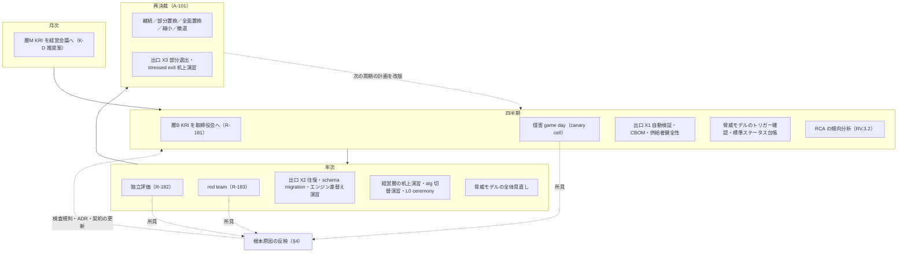
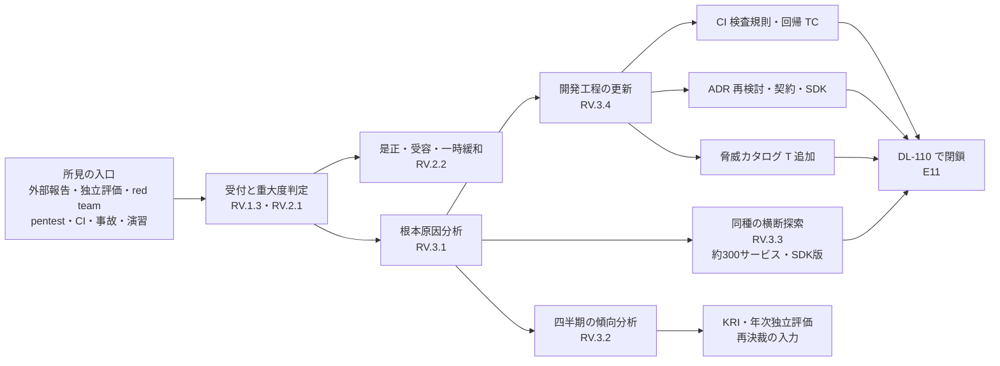
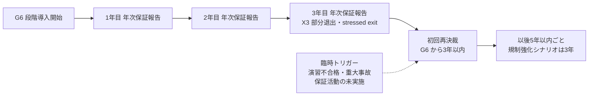

# 継続保証計画

> 文書ID: ASR-06 / 版: 0.1 / 状態: draft / 最終更新: 2026-10-15
> 対応要求: R-181, R-182, R-183, R-184, R-185, R-186, R-187, R-222, R-235, G-071, G-076, G-097, G-150
> 依存文書: CONVENTIONS.md, traceability/deliverables.md（DL-32）, traceability/R-requirements.md, traceability/G-goal-criteria.md, traceability/dissent-log.md（DS-10）, 01_governance/kri.md（GOV-08）, 01_governance/durability-charter-20y.md（GOV-09）, 01_governance/raci-governance.md（GOV-05）, 01_governance/stop-authority.md（GOV-06）, 01_governance/assumptions-register.md（A-100〜A-104）, 03_threat-model/attacker-model.md（THR-02 §8）, 03_threat-model/threat-catalog.md（§9）, 03_threat-model/fraud-abuse-controls.md, 05_adr/README.md, ADR-001, ADR-007, ADR-010, ADR-015, ADR-016, ADR-018, ADR-019, ADR-022, ADR-027, ADR-029, research/RS-01-governance-risk.md, research/RS-05-root-of-trust-keys-supply-chain.md, research/RS-12-incident-casebook.md, research/RS-13-fraud-abuse.md, research/standards-status.md。参照先（未作成または並行作成中）: 09_assurance/independent-assurance-plan.md（DL-07）, 09_assurance/pentest-redteam-plan.md（DL-59）, 09_assurance/rfp-sow.md（DL-30）, 09_assurance/self-assessments.md（DL-61）, 08_operations/compromise-runbooks.md（DL-24）, 07_slo/numeric-contracts.md（DL-20）, traceability/open-items.md（DL-110）

本書は AI エージェント（Claude）が 2026-10-15 に起草した継続保証計画の案である [D]。経営会議・CISO の承認を経ておらず、計画に定めた活動は 1 件も実施されていない（本基盤は未構築）[D]。周期の値は ADR・上流文書・規範から導けたものだけを置き、それ以外は TBD（所有者・期限・決め方）とした [D]。本書の判定・要約は自己レビューであり、実在の CTO/CISO の決裁ではない（CONVENTIONS §8）[D]。research/ に収載のなかった原典 3 件（SSDF の RV 群、CSF 2.0 の ID.IM、SP 800-61r3 の状態）は本書の作成時に原典を取得して確認した [D]（§参考文献の確認日 2026-10-15）。

---

## 0. 結論

1. **継続保証を「月次・四半期・年次・再決裁」の 4 つの周期に分け、各活動に所有者（役割）・証拠種別・合否の出力先を付けた**（§2、§3）[D]。四半期には KRI の取締役会報告（R-181）、侵害の game day、出口の自動検証、脅威モデルのトリガー確認を置く [D]。年次には独立評価（R-182）、red team（R-183）、出口の往復演習・schema migration 演習（R-185、R-186）、経営層の机上演習を置く [D]。周期の値は ADR-018 D18-19、ADR-019 D19-35、ADR-027 D27-55、ADR-015 D15-72、GOV-08 決裁案 K-D の初期案をそのまま集約したものであり、本書で新しい値は決めていない [D]。
2. **red team の周期と年次独立評価の評価者の輪番は、根拠のある値を置けないため決裁案（CA-2、CA-3）にした** [D]。レビューの要求は「年次独立評価、定期 red team」であり（L202）[^1]、red team の周期を数値で定めた規範は research で確認していない [D]。推奨は「年 1 回の全範囲 red team を年次独立評価と同期させ、重大な構成変更をトリガーに臨時の範囲限定 red team を加える」案である [D]（CA-3）。
3. **脆弱性の根本原因の反映（R-187）は、SSDF 1.1 の RV.3.1〜RV.3.4 を工程に写し、所見ごとの根本原因分析（RCA）→同種の脆弱性の横断探索→開発工程（CI 検査規則、ADR、連携契約、SDK、脅威カタログ、回帰 TC）の更新→四半期の傾向分析→年次の独立評価と再決裁への入力、の閉ループにした**（§4）[D]。SSDF の task は推奨であり shall 形式の要求ではない [N][^9]（RS-05#79）。SSDF をチェックリストではなく実践の枠組みとして扱う点は dissent-log DS-10 の立場に従う [D][^20]。
4. **継続保証の結果は、3〜5 年ごとの継続・置換の再決裁（A-101）の入力パッケージとして毎年積み上げる**（§7）[D][A-101]。保証活動が期限内に実施されなかったこと自体を KRI と臨時再決裁のトリガーに接続する（決裁案 CA-5）[D]。耐久性憲章 §7.4 は「演習の不合格」と「再決裁の期限超過」を臨時再決裁のトリガーにしている [D][^4]。
5. **本書だけで閉じる要求はない**（§12）[D]。13 件（R 9 件、G 4 件）のうち、本書で机上の部分を閉じたのは 1 件（G-097）、決裁案まで 3 件（R-181、R-222、G-071）、要実測 6 件、要第三者 3 件（R-182、R-183、G-076）である [D]。計画の承認（E1/E2）と、本番後の実施記録（E6、E8、E11）はすべて未達である [D]。

---

## 1. 位置付け・範囲

### 1.1 本書が決めること・決めないこと

| 本書が決めること | 本書が決めないこと（担当文書） |
|---|---|
| 本番後（G6 以降）の保証活動の一覧、周期、所有者、証拠、出力先 | KRI の定義・閾値・報告様式（GOV-08、DL-06） |
| 演習の周期の集約と、周期間の同期（同じ週に重ねる組合せ） | 演習の台本・runbook・合否の数値（DL-24、DL-20） |
| 年次独立評価の範囲の枠と、評価者の独立性要件の参照先 | 評価者の独立性要件の詳細、調達、SOW（DL-07、DL-30） |
| red team の周期の決裁案 | red team の交戦規則・攻撃シナリオ（DL-59） |
| 脆弱性の根本原因の反映工程（SSDF RV.3） | 脆弱性の修正期限の値（DL-20、ADR-022 D-4-5 の TBD） |
| 再決裁（A-101）への入力パッケージの作り方 | 再決裁の選択肢・既定動作（GOV-09 §7、D47-2・D47-3） |
| 保証活動を実施できなかった場合の扱い（決裁案） | 停止権限の発動条件（GOV-06） |

### 1.2 用語

| 用語 | 本書での意味 |
|---|---|
| 継続保証 | 統制・監視・対応・保証が運用期間を通じて有効であることを、決めた周期で証拠を取り直して示す活動の全体 [D]。R-222 の「継続的に成立させる」[^1] を、周期と証拠で表したもの [D] |
| 独立評価 | 第 1 線（基盤の構築・運用者）から独立した者による評価。外部評価者（DL-30）と内部監査（第 3 線）を含む [D]。独立性の要件は DL-07 が定める [D] |
| game day | 本番相当または canary cell で、障害・侵害を注入して手順と時間を実測する演習（ADR-019 D19-35 の「cell 単位の game day」）[D] |
| 机上演習 | 実システムを動かさず、判断・連絡・代行の手順を確かめる演習（GOV-06 SA-9、SA-10）[D] |
| 根本原因分析（RCA） | 脆弱性・所見・事故がなぜ作り込まれ、なぜ検出されなかったかを特定する分析。SSDF RV.3.1 の "determine their root causes" に当たる [N][^9] |

### 1.3 前提

| 前提 | 内容 | 出典 |
|---|---|---|
| 計画期間 | G0 承認から 20 年 | [A-100] |
| 再決裁 | 初回は G6 開始から 3 年以内、以後 5 年以内（規制強化シナリオでは 3 年ごと） | [A-101] |
| 暗号移行・主要構成要素の置換 | 計画期間中にそれぞれ 1 回以上 | [A-103]、[A-104] |
| 要員 | プラットフォームチーム 24 FTE（うち鍵管理・セキュリティ担当 2 FTE） | [A-054] |
| 本書の開始時点 | 本番後の周期は G6（段階導入）開始から数える。G4（PoC）と G5 では、各演習の初回を事前登録試験（DL-22）として行う | [D] |

### 1.4 原典が継続保証に求めること

| 原典 | 求めること | 強度 | 本書での扱い |
|---|---|---|---|
| CTO/CISO レビュー L202 | 本番後も四半期ごとに KRI、年次独立評価、定期 red team、鍵・IdP・PDP 侵害演習、schema migration 演習、vendor exit 演習を行う。脆弱性の根本原因を将来の開発へ反映する[^1] | 本プログラムの要求（R-181〜R-187） | §3、§4 |
| SSDF 1.1 RV.3 | 脆弱性の根本原因を分析し（RV.3.1）、時間をかけて傾向を見つけ（RV.3.2）、同種の脆弱性を探して先回りで直し（RV.3.3）、SDLC を見直して再発を防ぐ（RV.3.4）[N][^9] | 推奨 task（shall 形式ではない）[N][^9]（RS-05#79） | §4 |
| SSDF 1.1 RV.1.3 | 脆弱性の開示と是正の方針を持ち、役割・責任・工程を実装する。例として PSIRT の工程の定期的な演習を挙げる[N][^9] | 推奨 task | §4.4（G-150） |
| CSF 2.0 ID.IM | 評価（ID.IM-01）、セキュリティ試験と演習（ID.IM-02、供給者・第三者との共同を含む）、運用の実行（ID.IM-03）から改善を見つけ、インシデント対応計画等を維持・改善する（ID.IM-04）[N][^10] | 成果（CSF はチェックリストではない）[N][^10]（RS-01#2） | §5 |
| CSF 2.0 GV.OV | リスク管理戦略の成果と実績を評価し、戦略を調整する（GV.OV-01〜03）[N][^10]（RS-01#6） | 成果 | §7 |
| SP 800-61r3 | インシデント対応の推奨事項を CSF 2.0 のリスク管理活動全体に組み込む（2025-04、final）[N][^11] | 推奨（Community Profile） | §5 |
| IR 8286Cr1 §5.2 | lagging KRI の超過は中間的な連絡で伝えるべき（should）[N][^12]（RS-01#27） | should | §3.1（GOV-08 §6 に従う） |
| NACD ハンドブック 原則 4・5 | 保証機能の独立性を含む統治体制を少なくとも年 1 回評価させる。報告は少なくとも四半期ごと[N][^13]（RS-01#40, #41） | 推奨（非拘束） | §3.2、§3.1 |
| 英国 Cyber Governance Code D2・E2 | 対応計画の演習を少なくとも年 1 回行い教訓を反映する。少なくとも四半期ごとに正式報告[N][^14]（RS-01#63） | 非拘束の行動規範 | §3.7、§3.1 |
| IIA Cybersecurity Topical Requirement | 内部監査は、インシデント対応と復旧の定期試験を評価しなければならない[N][^15]（RS-01#56） | must（内部監査人向け） | §3.2 |
| 金融庁ガイドライン 2.1.1 | 取締役会等が管理態勢を少なくとも年 1 回レビューする[N][^16]（RS-01#65） | 監督上の期待（金融顧客の委託先となる場合。適用は DL-34 で判定） | §3.2 |
| SP 800-63-4 §3.5 | 継続的な評価・改善プログラムの実施と文書化（SHALL）。不正検知能力の有効性を定期的に評価する（SHALL）[N][^17]（RS-13#19） | SHALL | §3.7 |

---

## 2. 全体像

### 2.1 周期の構造

- 図は §3 の表を周期で束ねたものである [D]。下位の周期の結果は上位の周期の入力になり、年次の結果は再決裁の入力パッケージ（§7.2）に積み上がる [D]。

### 2.2 年間の配置（案）

| 四半期 | 主な活動 | 同期の理由 |
|---|---|---|
| 第 1 四半期 | KRI 報告、game day、X1、トリガー確認、red team の実施 | red team の所見を同じ年の独立評価の範囲に入れるため [D] |
| 第 2 四半期 | KRI 報告、game day、X1、トリガー確認、X2 往復演習と schema migration 演習（同一の窓） | ADR-027 D27-55 が年 1 回の出口演習と schema migration 演習に自動 rollback の作動確認を含めるとしており、同じ窓で行うと置換 cell の立上げを 1 回にできる [D][^8] |
| 第 3 四半期 | KRI 報告、game day、X1、トリガー確認、独立評価の実施、alg 切替演習 | 独立評価の時点で、その年の演習記録（E8）と red team の報告（E6）がそろう [D] |
| 第 4 四半期 | KRI 報告、game day、X1、経営層の机上演習、脅威モデルの年次見直し、年次保証報告（§7.1）の作成 | 年次保証報告を取締役会の年間日程と翌年の予算に間に合わせる [D] |

- 四半期の割当は初期案であり、取締役会の年間日程（GOV-08 §7.1 の TBD）が決まった時点で、所有者（CISO）が G6 までに確定する [D]。
- 演習を同じ週に重ねない [D]。on-call の負荷を 1 シフト 2 件以下に保つ目安（ADR-013 N13-4 が引く SRE の目安）に収めるためである [D]。

---

## 3. 保証活動の一覧と周期

### 3.0 総覧

所有者の略号は GOV-05 の RACI に従う（IS: CISO、TO: CTO、経: 経営会議、取: 取締役会、PF: プラットフォームチーム、SRE: SRE 責任者、RM: 第 2 線、IA: 内部監査）[^19]。

| # | 活動 | 周期 | 周期の根拠 | A（承認） | R（実施） | 証拠 | 対応 R/G |
|---|---|---|---|---|---|---|---|
| CA-01 | 層 B KRI の取締役会報告 | 四半期 | GOV-08 決裁案 K-D の推奨 (1)[^3]、L202[^1] | 経 | IS（起草）、RM（検証） | E1 | R-181 |
| CA-02 | 層 M KRI の経営会議報告 | 月次 | GOV-08 決裁案 K-D の推奨 (1)[^3] | 経 | IS、RM | E2 | R-181 |
| CA-03 | 年次独立評価 | 年 1 回 | L202[^1]。統治体制の年次評価（RS-01#40）[^13] | IS（DEC-5 の延長）、IA（独立性の確認） | 外部評価者（DL-30）＋IA | E6 | R-182、G-071 |
| CA-04 | red team（全範囲） | 未決（推奨: 年 1 回＋トリガー時。CA-3） | L202 の「定期」[^1]。数値の規範は未確認 | IS | 外部 red team（DL-59） | E6、E11 | R-183 |
| CA-05 | cross-tenant pentest | DL-59 で決める | — | IS | 外部評価者（DL-59） | E6、E11 | R-183（関連） |
| CA-06 | 侵害 game day（鍵の緊急切替、PDP 隔離、全 session 失効、kill switch） | 四半期（初期案） | ADR-019 D19-35「初期案は四半期に 1 回、確定は DL-24」[^5] | IS | SRE、PF | E8 | R-184 |
| CA-07 | IdP 侵害演習（自社 AS・上流 managed IdP・顧客 IdP の切離し） | game day の輪番に含める（年 1 回以上は各対象を通す） | ADR-019 D19-37（侵害対象 7 種を演習計画に載せる）[^5] | IS | SRE、PF | E8 | R-184 |
| CA-08 | 経営層の机上演習（K4 の判断、通知判断、代行連鎖） | 年 1 回以上 | ADR-019 D19-35[^5]、GOV-06 SA-10[^18]、英国 Code D2（RS-01#63）[^14] | 経 | IS | E8 | R-184、R-235 |
| CA-09 | 出口 X1 自動検証（EIF 出力・schema 検証・digest 照合） | 四半期（CI でも常時） | ADR-018 D18-19[^6] | TO | PF | E4 | R-186 |
| CA-10 | 出口 X2 往復演習（全データ種別 A→B→A、独立立会人付き） | 年 1 回 | ADR-018 D18-19、ADR-001 D16-3[^6][^8] | TO | PF、独立立会人 | E8 | R-186 |
| CA-11 | 出口 X3 部分退出（本番 1 cell）と stressed exit の経営机上演習 | 再決裁ごと、およびトリガー時 | ADR-018 D18-19[^6] | 経 | TO、PF | E8、E1 | R-186、G-071 |
| CA-12 | schema migration 演習（Prepare/Activate、自動 rollback の作動確認を含む） | 年 1 回（X2 と同じ窓） | ADR-027 D27-55[^8] | TO | PF、SRE、独立立会人 | E8、E5 | R-185 |
| CA-13 | 認可エンジンの差替え演習（PDP 実装 2 種） | 年 1 回 | ADR-010 D-46[^8] | TO | PF | E8 | R-186（関連） |
| CA-14 | alg 切替演習（利用側無改修） | 年 1 回以上（初期案） | ADR-015 D15-72[^7] | IS | PF | E8 | R-184（関連） |
| CA-15 | L0 鍵 ceremony（定例） | 年 1 回 | ADR-007 D7-52[^21] | IS | PF（鍵管理）、立会人 | E8 | R-184（関連） |
| CA-16 | break-glass の検証 | 90 日以内ごと | ADR-029 D29-77[^22]（GOV-06 DP46-6 の推奨 (a)） | IS | SRE | E8 | R-184（関連） |
| CA-17 | 脆弱性公表を模した事前登録シナリオの演習 | TBD（§3.8） | G-150 の合格基準[^2] | IS | PF、ドメイン代表、独立立会人 | E8、E11 | G-150 |
| CA-18 | 不正検知能力の有効性評価 | TBD（§3.7） | SP 800-63-4 §3.5（SHALL、周期の定めなし）[^17] | IS | ITDR | E2 | R-235 |
| CA-19 | 脅威モデルのトリガー確認／全体見直し | 四半期／年 1 回 | THR-02 §8.2、THR-01 §9[^23] | IS | PF（セキュリティ担当） | E2 | G-097 |
| CA-20 | 標準ステータス台帳の更新 | 四半期 | DL-84 の全体見直し周期[^24] | IS＋TO | 台帳所有者 | E2 | G-071 |
| CA-21 | CBOM の版固定と量子脆弱経路の指標 | 四半期 | ADR-015 D15-50、D15-51[^7] | IS | PF | E4 | — |
| CA-22 | 供給者の健全性の記録 | 四半期 | ADR-018 D18-25、ADR-010 D-45[^6][^8] | TO | PF＋調達 | E2 | R-186（関連） |
| CA-23 | RCA の傾向分析（RV.3.2） | 四半期 | 本書 §4.3（KRI 報告と同期）[D] | IS | PF、RM | E11 | R-187 |
| CA-24 | 年次保証報告（再決裁入力の年次分） | 年 1 回 | 本書 §7.1 [D] | 経 | IS＋TO | E1 | G-071、G-076 |

- 表の周期は、列「周期の根拠」に挙げた ADR・上流文書の初期案を転記したものである [D]。ADR はすべて proposed（決裁前）であり[^25]、ADR の決裁で値が変われば本表を改版する [D]。
- CA-05（cross-tenant pentest）の周期と範囲は DL-59 が持つ [D]。本書は CA-03 の範囲に、その年の pentest の結果と是正の確認を含めることだけを定める [D]。

### 3.1 四半期 KRI（R-181）

| 項目 | 内容 |
|---|---|
| 何を | GOV-08 の K-01〜K-32 のうち、層 B（16 件）を取締役会へ四半期ごとに、層 M（16 件）を経営会議へ月次で報告する（決裁案 K-D の推奨 (1)）[D][^3] |
| 本書が加えるもの | 様式の第 15 項「演習・独立評価の結果（DL-32 の計画に対する実施状況、合否、是正）」[^3] に、§3.0 の CA-01〜CA-24 の「予定／実施／延期／未実施」と、§4 の RCA の傾向（CA-23）を載せる [D] |
| 実施の遅れの扱い | 計画した保証活動の未実施・延期は、様式第 15 項で報告し、2 四半期続いた場合は決裁案 CA-5 の扱いにする [D] |
| 超過時の経路 | GOV-08 §6 に従う。lagging KRI の超過は中間報告で伝える [D]。IR 8286Cr1 は lagging KRI の超過を中間的な連絡で伝えるべき（should）としている [N][^12]（RS-01#27） |
| 新しい KRI 候補 | (a) 計画した保証活動の実施率、(b) 根本原因クラス別の再発件数（§4.3）、(c) Critical/High の所見で RCA が期限内に完了した割合。採番と閾値は GOV-08 の所有者が決める（GOV-08 への申し送り）[D] |
| 証拠 | 取締役会議事録（E1）、生データのハッシュ（GOV-08 §7.1 の段階 1）[D] |

- 四半期報告の作成手順と時期の TBD は GOV-08 §7.1 が持つ [D]。本書は周期と所有を GOV-08 と共有する（GOV-08 §6.5）[D][^3]。

### 3.2 年次独立評価（R-182）

| 項目 | 内容 |
|---|---|
| 目的 | 第 1 線・第 2 線の報告（KRI、演習記録、自己評価）が実態を表しているかを、独立した者が確かめる [D] |
| 評価者 | 外部評価者（DL-30 の SOW）と内部監査（第 3 線）の分担。第 3 線が独立した保証を提供するという IIA の三線モデル（RS-01#57）[^26] に従い、内部監査は外部評価の独立性と範囲の妥当性を確認する [D] |
| 範囲（毎年） | (1) 前年の独立評価・red team・pentest の所見の是正状況（E11）、(2) 演習記録（E8）の抜取り検証と、事前登録した合否基準との照合、(3) KRI の測定の健全性（GOV-08 §2.3）、(4) RCA の工程（§4）が回っていること、(5) 統治体制（保証機能の独立性を含む）の評価（RACI-15）[D][^19] |
| 範囲（輪番） | 設計・コード・IaC・policy・鍵管理・CI/CD・runbook（DL-07 の範囲）[^2] を、再決裁の周期のうちに一巡させる [D]。輪番の順序は DL-07 の所有者が決める（TBD） |
| 規範との関係 | NACD は保証機能の独立性を含む統治体制を少なくとも年 1 回評価させるよう推奨している [N][^13]（RS-01#40）。IIA の Topical Requirement は、内部監査がインシデント対応と復旧の定期試験を評価しなければならない（must、内部監査人向け）としている [N][^15]（RS-01#56）。金融庁ガイドラインは取締役会等による年 1 回以上の管理態勢のレビューを挙げる（適用は DL-34 で判定）[N][^16]（RS-01#65） |
| 出力 | 第三者報告（E6）、所見ごとの是正票（DL-110、E11）、年次保証報告（CA-24）への要約 [D] |
| 評価者の輪番 | 未決（決裁案 CA-2）[D] |

### 3.3 定期 red team（R-183）

| 項目 | 内容 |
|---|---|
| 目的 | 攻撃者モデル（THR-02）の類型が、統制の組合せを実際に突破できるかを、交戦規則の下で確かめる [D] |
| 範囲 | DL-59 が定める（ソーシャルエンジニアリング、ヘルプデスク・サポート経路、cross-tenant 経路を含む）[D]。RS-12 と RS-13 は、ヘルプデスクへのソーシャルエンジニアリング演習を red team の範囲に含めるよう導いている [D]（RS-12 §5 の 10、RS-13 §DL-59 行） |
| 周期 | 未決（決裁案 CA-3）。推奨案は年 1 回の全範囲と、トリガー時の範囲限定 [D] |
| トリガー（臨時の範囲限定 red team） | 新しい連携パターン・主体類型の追加（THR-02 §8.1 T4）、IdP 製品・認可エンジンの置換、issuer・鍵階層の変更、重大事故の後 [D][^23] |
| 所見の扱い | Critical/High は E6＋E11 で閉じる（DL-59）[D]。すべての所見を §4 の RCA に入れる [D]。新しい攻撃経路が見つかれば脅威カタログに T を追加する（THR-01 §9 C3）[D][^23]。想定しない能力が実証されたら攻撃者類型の定義を改める（THR-02 §8.1 T7）[D][^23] |

### 3.4 鍵・IdP・PDP 侵害演習（R-184）

- 演習は ADR-019 D19-35 の 3 層（自動試験、cell 単位の game day、経営層を含む机上演習）で行い、記録様式は E8（DL-24）とする [D][^5]。本書は周期と同期だけを定める [D]。
- 侵害対象 7 種（token、署名鍵、IdP、PDP、監査基盤、CI/CD、support 経路）を、四半期の game day の輪番で回す [D][^5]。各対象を年 1 回以上通す（四半期 4 回 × 1〜2 対象）[D]。
- game day は本基盤の control plane・管理面 login・IdP を止めた状態でも行う（ADR-019 D19-36、GOV-06 SA-2・SA-8）[D][^5][^18]。止める手段が止める対象に依存していないことを確かめるためである [D]。
- 鍵の rotation は自動化・段階展開・ロールバック可能な変更として扱い、反復演習するべきである [D]（RS-05#18）。CSRB は、Microsoft が手動 rotation に関連した障害の後に consumer 鍵の rotation を停止したと記す [I][^27]。演習が止まること自体を KRI（K-07 の最長鍵年齢）で検知する [D]。
- 独立立会人が game day に立ち会い、E8 の時刻と結果を確認する（ADR-019 §7）[D][^5]。本番 canary cell で行うかは決裁案 CA-4 とする [D]。

### 3.5 schema migration 演習（R-185）

- 年 1 回、出口の往復演習（CA-10）と同じ窓で行う [D]。ADR-027 D27-55 は、年 1 回の出口演習と schema migration 演習に自動 rollback の作動確認を含めるとしている [D][^8]。
- 演習の対象は、認可モデル（relation・型）の破壊的変更（RACI-24 の区分 M2）、監査イベント schema、連携契約の版上げ（ADR-016）の 3 種とする [D]。
- 合格の観点は、Prepare/Activate の 2 段階の順守、dual-run の差分（allow 拡大は即時調査）、自動 rollback の作動、剥奪の単調性である [D]（ADR-027）。数値の合否は DL-24・DL-20 で事前登録する [D]。
- Azure AD の 2020-09-28 の障害では自動 rollback が配備 metadata の破損で失敗した [I][^31]（RS-09#51、#52）。rollback 系そのものを演習の対象にする理由である [D][^8]。

### 3.6 vendor exit 演習（R-186）

- ADR-018 D18-19 の 3 層（X1 四半期の自動検証、X2 年 1 回の往復演習、X3 再決裁ごとの部分退出と stressed exit 机上演習）をそのまま採る [D][^6]。
- 演習の結果は KRI K-32（置換・撤退・暗号移行の準備度）に入力し、「演習で移出入できなかったデータ種別の数」を報告する（ADR-018 D18-20）[D][^6]。
- 撤退の期間と費用の見積りは、X2 の実測付きで毎年更新し（ADR-001 D16-3）、再決裁の入力にする [D][^8]。

### 3.7 その他の演習・評価

| 活動 | 内容 | 周期 | 状態 |
|---|---|---|---|
| 経営層の机上演習（CA-08） | K4 の判断、通知判断、公表と訂正、代行連鎖 | 年 1 回以上 | ADR-019・GOV-06 の初期案 [D] |
| 不正検知能力の有効性評価（CA-18） | 不正の傾向、調査結果、指標、ヘルプデスクの統計を入力に評価する [N][^17]（RS-13#19） | TBD（所有者: CISO、期限: G6、決め方: 四半期 KRI（K-11、K-12）の周期に合わせるかを、評価の工数と不正手口の変化の速さで決める） | SP 800-63-4 は定期評価を SHALL とするが周期は定めていない [N][^17] |
| alg 切替演習（CA-14） | 利用側無改修での alg 切替 | 年 1 回以上 | ADR-015 D15-72 の初期案 [D][^7] |
| break-glass 検証（CA-16） | 発動からログアウトまで | 90 日以内ごと | ADR-029 D29-77 [D][^22] |

### 3.8 脆弱性公表を模した演習（G-150）

- G-150 は、脆弱性の公表を模した事前登録シナリオの演習で、重大度別の修正期限の遵守を確かめることを求める [D][^2]。ADR-016 の対応表は、この演習の置き場所を本書（DL-32）としている [D][^28]。
- シナリオは「SDK または依存 OSS の Critical 脆弱性の公表」を基本とし、SBOM による影響サービスの特定 → 緊急修正の経路（ADR-016 D16-46 の緊急変更）→ 依存サービスへの個別通知 → 依存サービス側の反映、の各時刻を記録する [D][^28]。
- 修正期限の値は DL-20 の TBD（ADR-022 D-4-5）であり、本書では置かない [D]。
- 周期は TBD とする（所有者: CISO、期限: G4 入場前（G-150 の判定は段階 2）、決め方: 初回は G5 の段階導入前に 1 回行い、その所要時間と依存サービスの反映の分布から、game day の輪番に入れるか年 1 回の単独演習にするかを決める）[D]。

---

## 4. 脆弱性の根本原因の反映（SSDF RV.3、R-187）

### 4.1 方針

- R-187 の原文は「脆弱性の根本原因を将来の開発へ反映する」であり、「RV.3」は種資料の付記である（R-requirements の備考）[D][^1]。本書は、SSDF 1.1 の RV.3（Analyze Vulnerabilities to Identify Their Root Causes）がこの要求に最も近い practice であると判断して写像する [D]。
- SSDF 1.1（SP 800-218、final、2022-02）は RV.3 の目的を「将来の脆弱性の頻度を減らす」としている [N][^9]。SSDF 1.2（SP 800-218 Rev.1）は 2025-12-17 に ipd として公表され、2026-10-03 時点で final は公表されていない [N][^9]（RS-05#80、standards-status SS-E37）。本書は現行 final の 1.1 に写像し、1.2 の final 公表時に差分を取る [D]。
- 「脆弱性」は、外部報告・独立評価・red team・pentest・自己評価（DL-61）・CI の検出・インシデント・演習で見つかった、セキュリティに関わる欠陥と統制の失敗を含む [D]。演習の不合格を含めるのは、劣化の自動検知で見つからない劣化を検査規則に追加する手順を本書に置くよう、耐久性憲章 §5.8 が求めているためである [D][^4]。

### 4.2 工程

| 段 | SSDF の task | 本基盤での実施 | 所有者 | 期限 | 出力 |
|---|---|---|---|---|---|
| 1 受付 | RV.1.1、RV.1.3 | 外部報告の窓口と開示方針（§4.4）、内部の所見の登録 [N][^9] | IS | 登録は検出の当日（運用規則）[D] | 所見票（DL-110） |
| 2 判定・是正 | RV.2.1、RV.2.2 | 重大度の判定、是正・受容・移転の判断、一時緩和 [N][^9]。受容は GOV-07 の段に従い、CISO は受容者にならない [D] | PF（是正）、受容者（GOV-07） | 修正期限は DL-20 の TBD | 是正票、受容票（E9） |
| 3 根本原因分析 | RV.3.1 | Critical/High は全件、Medium 以下は抽出で、§4.3 の分類に従って根本原因を記録する [D] | PF（起票）、RM（レビュー） | TBD（所有者: CISO、期限: G4、決め方: 修正期限（DL-20）と同じ重大度区分で、修正完了から何日以内かを決める） | RCA 記録 |
| 4 横断探索 | RV.3.3 | 同じ根本原因クラスの欠陥を、全 SDK 版・全依存サービス・IaC・policy に対して探し、外部報告を待たずに直す [N][^9] | PF、ドメイン代表 | RCA と同じ | 探索結果と是正票 |
| 5 工程の更新 | RV.3.4 | §4.4 の更新先のいずれかに反映し、反映しない場合は理由を記録する [D] | 更新先の所有者 | 次の四半期の KRI 報告まで | 変更記録（E4/E2） |
| 6 傾向分析 | RV.3.2 | 四半期ごとに根本原因クラス別の件数と再発を集計し、特定の実践が一貫して守られていない兆候を見つける [N][^9] | RM＋IS | 四半期（CA-23） | KRI 報告の第 15 項、年次保証報告 |

- SSDF は RV.3.2 の例として「特定の安全なコーディング実践が一貫して守られていない」ような傾向を挙げ、RV.3.3 は外部報告を待たずに先回りで直すことを挙げる [N][^9]。RV.3.4 の例示には、根本原因の将来の出現を自動検出する仕組みを toolchain に加えることが含まれる [N][^9]。

### 4.3 根本原因の分類と再発の測定

| クラス | 例 | 主な反映先 |
|---|---|---|
| RC-1 設計判断の欠落・誤り | ADR の前提が実態と合わない | ADR の再検討トリガー（各 ADR §8） |
| RC-2 連携契約・SDK の欠陥 | SDK の検証漏れ、契約の曖昧さ | 連携契約（ADR-022）、SDK、契約試験キット |
| RC-3 ガードレール・CI 検査の欠落 | 検査規則にない性質の劣化 | CI 検査規則（耐久性憲章 §5.8） |
| RC-4 依存サービス側の実装 | PEP 未導入、独自の認可 | PEP 網羅の検査（K-01）、ドメインへの是正要求 |
| RC-5 運用手順・人 | runbook の誤り、二者統制の逸脱 | runbook（DL-24）、訓練、K-09 |
| RC-6 供給者・依存部品 | OSS・製品の脆弱性 | SBOM、供給者評価（ADR-018 D18-25） |
| RC-7 脅威モデルの想定外 | 想定しない攻撃者能力 | 攻撃者モデル・脅威カタログ（§6） |

- 分類は本書の設計推論であり、最初の 4 四半期の運用後に、RC-x に当てはまらない件数を見て改める [D]。
- 「再発」は、RCA を閉じた後に同じクラス・同じ構成要素で新しい所見が出たことと定義する [D]。再発件数は §3.1 の KRI 候補 (b) とする [D]。
- 2023 年の Microsoft の鍵侵害について、CSRB は鍵年齢の警報があれば 2016 年の鍵が 2023 年に有効なまま残ることはなかったと認定している [I][^27]（RS-12#10）。根本原因を「検出の仕組みの欠落」まで掘り下げ、検査規則（RC-3）に変える例として本書の分類に入れた [D]。

### 4.4 脆弱性管理の各項目（G-150）

| G-150 の項目 | 本書の扱い | 正本 |
|---|---|---|
| SBOM による影響範囲の特定 | 段 4 の横断探索の入力にする | DL-61（SLSA の自己評価）、ADR-008 |
| 重大度別の修正期限（公表から本番反映まで） | TBD を参照する | DL-20（ADR-022 D-4-5） |
| 緊急修正の経路と承認 | ADR-016 D16-46 の緊急変更（個別通知、契約変更審査会の事後承認）を使う [D][^28] | ADR-016 |
| 外部からの脆弱性報告の窓口と開示方針 | SSDF RV.1.3 の例（脆弱性開示プログラム、PSIRT、対応 playbook、PSIRT 工程の定期演習）を窓口と方針の項目にする [N][^9]。窓口・開示期限は TBD（所有者: CISO、期限: G5、決め方: 法務（DL-34）と顧客契約（DL-26）の通知条項に合わせる） | 本書（方針の枠）、DL-26 |
| 依存サービスへの通知と対応期限 | ADR-016 D16-46 の個別通知。依存サービス側の期限は DL-20 の TBD | ADR-016、DL-20 |
| 演習 | §3.8（CA-17） | 本書 |

---

## 5. 教訓反映のループ（R-235）

- R-235 は、インシデント対応を CSF 2.0 の全 6 機能へ統合し、予防・準備・検知・封じ込め・復旧・教訓反映を一体化することを求める [D][^1]。NIST SP 800-61r3（2025-04、final）は、インシデント対応の推奨事項を CSF 2.0 のリスク管理活動全体に組み込むための Community Profile である [N][^11]。
- 本書は「教訓反映」の部分を担い、CSF 2.0 の ID.IM の 4 つの成果に次のとおり写す [D]。予防から復旧までの手順は DL-24 と ADR-019 が担う [D]。

| CSF 2.0 | 成果（要旨）[N][^10] | 本書での入力 | 反映先 |
|---|---|---|---|
| ID.IM-01 | 評価から改善を見つける | 年次独立評価（CA-03） | §4 の RCA、DL-110 |
| ID.IM-02 | セキュリティ試験と演習から改善を見つける（供給者・第三者との共同を含む） | red team、pentest、game day、出口演習（X2 は製品ベンダーとの共同）、脆弱性公表演習 | §4 の RCA、runbook（DL-24） |
| ID.IM-03 | 運用の実行から改善を見つける | 実インシデントの事後レビュー、KRI の超過、緊急変更（D16-46）の件数 | §4 の RCA、GOV-08 |
| ID.IM-04 | インシデント対応計画等を維持・改善する | 上記すべて | DL-24 の改版（ADR-019 §8 は年 1 回の机上演習の後に見直すとしている）[^5] |

- 演習・事故の事後レビューは、責めない形式（個人の過失でなく仕組みの欠落を問う）で行う [D]。IR 8286r1 は従業員とパートナーが報復を恐れずにリスク状況を報告できる環境を挙げている [N][^29]（RS-01#18）。

---

## 6. 脅威モデルの再評価（G-097）

- G-097 は、攻撃者モデルと脅威カタログの再評価トリガー、定期見直しの周期、所有者が定義されていることを求める [D][^2]。トリガー・周期・所有者の定義は、攻撃者モデル §8（T1〜T8）と脅威カタログ §9（C1〜C5）に置かれている [D][^23]。本書はそれと重複定義せず、継続保証の周期への同期だけを定める [D]。

| 周期 | 脅威モデル側の活動 | 本書の同期先 |
|---|---|---|
| 四半期 | T1〜T8、C1〜C5 の発生確認 | CA-01（KRI 報告）、CA-20（標準ステータス台帳）、CA-23（RCA の傾向分析で RC-7 が出たか） |
| 年次 | 全類型・全 T の見直し | CA-03（年次独立評価。評価者は見直し結果を範囲に含める） |
| 臨時 | トリガーの発生時（着手期限は TBD、所有者 CISO、期限 G2） | red team・pentest の所見（CA-04、CA-05）、RCA で RC-7 と分類された所見 |
| 再決裁時 | 類型の体系そのものの見直し | §7 |

- 所有者（承認）は CISO、維持はプラットフォームチームの鍵管理・セキュリティ担当と脅威モデルの作成者である（THR-02 §8.3、THR-01 §9）[D][^23]。

---

## 7. 再決裁との接続（G-071）

### 7.1 年次保証報告

- 毎年の第 4 四半期に、CISO と CTO が年次保証報告（CA-24）を作り、経営会議に提出する [D]。内容は耐久性憲章 §7.2 の再決裁の入力のうち、保証に関わるものである [D][^4]。

| 年次保証報告の項目 | 出所 | 耐久性憲章 §7.2 の入力 |
|---|---|---|
| 7 性質ごとの演習・CI の結果と継続指標の推移 | CA-06〜CA-16、K-06、K-32 | 7 性質の証拠 |
| 年次独立評価の結果と未解決の Critical/High | CA-03、K-25 | 独立評価 |
| red team・pentest の所見と是正 | CA-04、CA-05、DL-110 | 独立評価 |
| RCA の傾向と再発 | CA-23 | （本書が追加）|
| 標準・暗号の変化と CBOM | CA-20、CA-21 | 外部の変化 |
| 供給者の健全性と出口の実測（期間・費用の幅） | CA-10、CA-22 | 供給者の状態、費用 |
| 保証活動の実施率と未実施の理由 | §3.1 の KRI 候補 (a) | （本書が追加）|

### 7.2 再決裁までの積上げ

- 初回の再決裁は G6 開始から 3 年以内、以後 5 年以内ごととする前提であり [A-101]、再決裁の時点で年次保証報告が 3 本（初回）または 5 本（2 回目以降）そろう [D][A-101]。
- 再決裁の直前の年次独立評価は、通常の範囲に加えて「7 性質の証拠が直近の周期内にあり合格しているか」（耐久性憲章 §7.3 の継続の条件の目安）を評価対象にする [D][^4]。
- CSF 2.0 GV.OV は、リスク管理戦略の成果と実績を評価して戦略を調整することを成果とする [N][^10]（RS-01#6）。年次保証報告と再決裁は、この評価と調整の場に当たる [D]。
- 再決裁の選択肢、期限超過時の既定動作（新規依存の受入れの凍結の推奨）は耐久性憲章 §7.3・§7.5 と決裁案 D47-3 が持つ [D][^4]。

---

## 8. 体制と所有（R-222）

### 8.1 三線の分担

| 線 | 役割 | 本書の活動 |
|---|---|---|
| 第 1 線（基盤の構築・運用、ドメイン） | リスクを所有・管理する [N][^26]（RS-01#57） | game day・出口演習・schema migration 演習の実施、是正、RCA の起票、横断探索 |
| 第 2 線（リスク管理、CISO 組織） | 第 1 線を指導・支援し、異議を申し立てる [N][^26] | KRI の検証（GOV-08 §7.1 段階 2）、RCA のレビュー、傾向分析、計画の起草 |
| 第 3 線（内部監査） | 独立した保証を提供する [N][^26] | 年次独立評価の独立性・範囲の確認、計画どおりの実施の監査（G-076 の判定者） |
| 外部 | 独立評価者、red team、独立立会人 | CA-03〜CA-05、立会い（E6、E8） |

### 8.2 RACI（本書の活動）

| 活動 | 取 | 経 | IS | TO | PF | SRE | RM | IA |
|---|---|---|---|---|---|---|---|---|
| 本計画の承認・改版 | I | C | A | C | C | C | R | C |
| 保証予算（CISO 所管分）の承認 | I | A | R | C | — | — | C | — |
| 四半期 KRI 報告（CA-01） | I（受領） | A | R | R | — | — | R | I |
| 年次独立評価（CA-03） | I | I | A | C | C | C | C | R（独立性確認） |
| red team（CA-04） | — | I | A | C | C | C | C | I |
| 侵害 game day・机上演習（CA-06〜CA-08） | — | A（机上）／I | A（game day）／R | C | R | R | C | I |
| 出口・schema migration・差替え演習（CA-09〜CA-13） | — | I | C | A | R | R | C | I |
| RCA と工程の更新（§4） | — | I | A | C | R | R | R | I |
| 年次保証報告（CA-24） | I | A | R | R | C | C | C | C |

- 予算の承認を経営会議（A）とするのは、GOV-05 の RACI-32（CISO 所管の監視・評価・保証の予算）に合わせたものである [D][^19]。本表は GOV-05 の確定時に照合し直す [D]。
- 所有は個人ではなく役割に紐付ける（G-071）[D][^2]。各活動の R の担い手に有資格者が 1 名以下しかいない場合は、K-30（属人化指標）に計上する [D][^3]。

---

## 9. 記録と証拠

| 証拠種別 | 本書の活動 | 保管・追跡 |
|---|---|---|
| E1 決議・議事録 | 計画の承認、予算、年次保証報告、四半期 KRI 報告 | 取締役会事務局・経営会議事務局 |
| E2 承認済み文書 | 本計画、RCA 記録、脅威モデルの改版 | リポジトリ（版管理） |
| E4 自動試験結果 | X1、CBOM、CI 検査規則 | CI ログ・コミットハッシュ |
| E6 第三者報告 | 年次独立評価、red team、pentest | DL-30・DL-59 の様式 |
| E8 演習記録 | game day、机上演習、X2、schema migration、alg 切替、break-glass、脆弱性公表演習 | DL-24 の様式（時系列・計測値・事後レビュー・是正追跡） |
| E11 是正追跡 | 所見と RCA の是正、工程の更新 | DL-110（POA&M） |

- 監視・計測の系は、本基盤の IdP・PDP に認証・認可を依存しない別系統で運用する前提である（GOV-08 KA-3、前提台帳へ追加要）[D][^3]。演習中に記録が取れなくなることを避けるためである [D]。

---

## 10. 決裁案

本節の内容は決裁案であり、決定済みのものはない [D]。

### 決裁案 CA-1: 本計画の承認者と承認時期（G-071、G-076）

| 項目 | 内容 |
|---|---|
| 決める人 | CISO（計画の承認、E2）、経営会議（保証予算と年次保証報告の受領、E1）[D] |
| 選択肢 | (1) CISO が計画を承認し、経営会議が予算と年次保証報告を承認する [D]。(2) 経営会議が計画全体を承認する [D]。(3) 取締役会（または委任委員会）が計画を承認する [D] |
| 推奨 | (1) [D] |
| 帰結 | (1) G-071 の判定者（CISO：継続保証）と一致する [D]。周期の変更を CISO の判断で機動的に行えるが、予算の裏付けは経営会議の承認に依存する [D]。(2) 改版のたびに経営会議の議題が要る [D]。(3) 統治の重みは増すが、演習周期の調整が年 1 回程度に縛られる [D] |
| 期限 | 計画の承認は G-076 の段階 1、予算は G6 の前年度の予算編成まで [D] |

### 決裁案 CA-2: 年次独立評価の評価者の輪番

| 項目 | 内容 |
|---|---|
| 決める人 | CISO（DEC-5 の延長として）、内部監査が独立性を確認 [D] |
| 選択肢 | (1) 同じ外部評価者を継続する [D]。(2) 一定年数ごとに外部評価者を交代する（年数は TBD）[D]。(3) 外部評価者は継続し、red team の実施者だけを交代する [D] |
| 推奨 | (2) [D]。年数は再決裁の周期（A-101）以内とし、DL-07 の独立性要件と調達の可否から CISO が G5 までに決める [D][A-101] |
| 帰結 | (1) 前年との比較がしやすいが、同じ視点の見落としが続き得る [D]。(2) 視点が入れ替わるが、引継ぎと立上げの費用がかかる [D]。(3) 攻撃視点だけを新しくできるが、評価の視点は固定される [D] |
| 期限 | G5 [D] |

### 決裁案 CA-3: red team の周期と形式（R-183）

| 項目 | 内容 |
|---|---|
| 決める人 | CISO（費用は経営会議）[D] |
| 選択肢 | (1) 年 1 回の全範囲 [D]。(2) 年 1 回の全範囲＋トリガー時の範囲限定（§3.3）[D]。(3) 半期ごとの全範囲 [D]。(4) 常設の内部 purple team＋年 1 回の外部 red team [D] |
| 推奨 | (2) [D] |
| 帰結 | (1) 費用は最小だが、置換・新パターン追加の直後の弱さを最長 1 年見逃し得る [D]。(2) 変化の直後を補えるが、トリガー時の費用の予見性が下がる [D]。(3) 費用が (1) の約 2 倍の桁になり、所見の是正が追いつかない恐れがある [D]。(4) 継続的な検出は増えるが、内部要員（A-054 の外数）を要する [D] |
| 費用 | TBD（所有者: CISO、期限: DL-33 の確定時、決め方: DL-30・DL-59 の SOW の見積りを幅で取る） |
| 期限 | G5 [D] |

### 決裁案 CA-4: 侵害 game day を行う環境（R-184）

| 項目 | 内容 |
|---|---|
| 決める人 | CISO＋CTO（顧客影響の受容は GOV-07 の段に従う）[D] |
| 選択肢 | (1) 非本番の本番相当環境だけで行う [D]。(2) 本番の canary cell で行う（ADR-019 D19-35 の初期案）[D][^5]。(3) 本番の一般 cell でも行う [D] |
| 推奨 | (2) [D] |
| 帰結 | (1) 顧客影響はないが、本番の構成ずれ・キャッシュ・依存の実態を測れない [D]。(2) 本番の振舞いを測れるが、canary cell のテナントに影響が出得るため、受容と事前通知の手順が要る [D]。(3) 実態に最も近いが、BIA の許容停止時間（DL-21）を演習で消費する [D] |
| 期限 | G4（PoC での初回の結果を見て）[D] |

### 決裁案 CA-5: 保証活動を期限内に実施できなかった場合の扱い

| 項目 | 内容 |
|---|---|
| 決める人 | 経営会議 [D] |
| 選択肢 | (1) KRI 報告で報告するだけとする [D]。(2) 同じ活動が 2 四半期（年次活動は 1 回）実施されなかったら、受容票の起票を求め、受容がなければ臨時再決裁のトリガー（耐久性憲章 §7.4 の「性質の毀損」）とする [D]。(3) 未実施の時点で新規依存の受入れを凍結する [D] |
| 推奨 | (2) [D] |
| 帰結 | (1) 演習の形骸化を止める仕組みがない [D]。ADR-018 は「演習が形骸化して実際の退出時に動かない」ことを主要リスクに挙げている [D][^6]。(2) 未実施が暗黙の受容にならない [D]。IR 8286B は、報告期間内に処置できない容認不可のリスクは暗黙に受容されたものになるとしている [N][^30]（RS-01#22）。(3) 抑止は強いが、要員不足のときに事業を止める副作用が大きい [D] |
| 期限 | G6 [D] |

### 決裁案 CA-6: 保証予算の確保方法

| 項目 | 内容 |
|---|---|
| 決める人 | 経営会議（CFO 協議）[D] |
| 選択肢 | (1) 保証活動の年間枠を CISO 所管予算として固定する（RACI-32）[D]。(2) 活動ごとに都度承認する [D]。(3) 耐久性維持枠（耐久性憲章 D47-5）に含める [D] |
| 推奨 | (1) [D]。額は TBD（所有者: CISO、期限: DL-33 の確定時、決め方: CA-03〜CA-05 の SOW 見積りと演習のインフラ費（ADR-018 案 A の「置換 cell 1 つを数週間動かす費用の桁」）を幅で合算する）[D][^6] |
| 帰結 | (1) 予算不足による先送りが起きにくい [D]。(2) 費用の予見性が低く、先送りが暗黙の受容になり得る [D]。(3) 耐久性と保証を一体で管理できるが、移行費と取り合いになる [D] |
| 期限 | G6 の前年度の予算編成 [D] |

---

## 11. TBD 一覧と新規仮定

### 11.1 TBD

| # | 項目 | 所有者 | 期限 | 決め方 |
|---|---|---|---|---|
| TB-1 | 四半期への活動の割当（§2.2） | CISO | G6 | 取締役会の年間日程（GOV-08 §7.1）から逆算する |
| TB-2 | RCA の完了期限（§4.2 段 3） | CISO | G4 | DL-20 の修正期限と同じ重大度区分で決める |
| TB-3 | 脆弱性公表演習の周期（§3.8） | CISO | G4 入場前 | G5 前の初回演習の所要時間から決める |
| TB-4 | 不正検知能力の評価周期（§3.7） | CISO | G6 | K-11・K-12 の周期と評価工数から決める |
| TB-5 | 外部報告の窓口と開示期限（§4.4） | CISO＋法務 | G5 | DL-34 と DL-26 の通知条項に合わせる |
| TB-6 | 独立評価の範囲の輪番順（§3.2） | DL-07 の所有者（CISO） | G5 | 前年の所見の密度と、再決裁までに一巡する条件から決める |
| TB-7 | red team・独立評価の費用（CA-3、CA-6） | CISO | DL-33 の確定時 | SOW の見積りを幅で取る |
| TB-8 | 新しい KRI 候補 (a)〜(c) の採否と閾値（§3.1） | GOV-08 の所有者（CISO） | GOV-08 の閾値決定時（決裁案 K-B） | 最初の 4 四半期の実測から決める |

### 11.2 新規仮定（前提台帳へ追加要）

CA-Ax は本書内の仮番号であり、前提台帳の所有者が A-ID を採番した時点で置き換える [D]。

| 仮番 | 新規仮定 | 依存する節 | 所有者 | 確かめ方 |
|---|---|---|---|---|
| CA-A1 | 独立性要件（DL-07）を満たす外部評価者・red team 事業者を、毎年調達できる | §3.2、§3.3 | CISO＋調達責任者 | DL-30 の RFP への応札数 |
| CA-A2 | game day・出口演習・schema migration 演習を、A-054 の 24 FTE の範囲で回せる（演習の要員を別枠にしない） | §3.4〜§3.6 | CTO＋SRE 責任者 | G4・G5 の演習の実工数を測り、DL-27 で照合する |
| CA-A3 | 依存サービス（約 300）の所有者が、横断探索（RV.3.3）と脆弱性公表演習に協力できる（連携契約に協力義務を置ける） | §3.8、§4.2 | CTO（契約変更審査会） | DL-62〜DL-80 の契約条項と、G5 の演習での反映率 |

---

## 12. 対応表

R-requirements.md と G-goal-criteria.md のうち、対応成果物の欄に本書のパス（09_assurance/continuous-assurance-plan.md）または DL-32 を含む行は、R-181〜R-187、R-222、R-235、G-071、G-076、G-097、G-150 の 13 件である（2026-10-15 に Grep で抽出）[D]。

| ID | 要求（要約） | 節 | 閉じ方 | 状態 |
|---|---|---|---|---|
| R-181 | 四半期 KRI | §3.0 CA-01・CA-02、§3.1 | B | 決裁案まで（GOV-08 K-D と共有）。本番後の実施記録（E1）は未達 |
| R-182 | 年次独立評価 | §3.2、決裁案 CA-2 | D | 計画の枠まで。評価者の任命・SOW（DL-07、DL-30）と第三者報告（E6）は未達 |
| R-183 | 定期 red team | §3.3、決裁案 CA-3 | D | 周期は未決（CA-3）。交戦規則は DL-59。第三者報告（E6）は未達 |
| R-184 | 鍵・IdP・PDP 侵害演習 | §3.4、決裁案 CA-4 | C | 周期と同期まで。演習の実施と合格（E8）は未達 |
| R-185 | schema migration 演習 | §3.5 | C | 周期と対象まで。演習の実施（E8）は未達 |
| R-186 | vendor exit 演習 | §3.6 | C | ADR-018 の 3 層を採用。演習の実施（E8）は未達 |
| R-187 | 脆弱性根本原因の将来開発への反映（SSDF RV.3） | §4 | C | 工程の設計まで。RCA の運用記録（E11）と再発件数の実測は未達 |
| R-222 | 統制・監視・対応・保証を継続的に成立させる体制と周期 | §2、§3.0、§8 | B | 決裁案まで（CA-1、CA-6）。RACI は GOV-05 の確定時に照合が要る |
| R-235 | CSF 2.0 の全 6 機能への統合と教訓反映 | §5、§3.7 | C | 教訓反映の写像まで。予防〜復旧の手順は DL-24。演習と事後レビューの実施（E8）は未達 |
| G-071 | 役割への所有、再決裁、年次独立評価、標準ステータス台帳の四半期更新と所有者の承認 | §3.2、§7、§8.2、決裁案 CA-1 | B | 本書側の定義まで。承認記録（E1/E2）は未達。サンセット条項は GOV-09 |
| G-076 | 四半期 KRI・年次独立評価・red team・各演習の周期と所有者、根本原因の反映手順、実施記録 | §3、§4、§8 | D | 段階 1 の計画は承認待ち。段階 3 の実施記録は未達 |
| G-097 | 攻撃者モデル・脅威カタログの再評価トリガー、周期、所有者 | §6 | A | 本書側の同期の定義で閉じた。トリガー・周期・所有者の本体は THR-02 §8・THR-01 §9 |
| G-150 | SBOM、修正期限、緊急修正経路、報告窓口、通知と期限、事前登録シナリオの演習 | §3.8、§4.4 | C | 修正期限（DL-20）、窓口（TB-5）、演習周期（TB-3）が TBD。演習の実施は未達 |

- 集計: A 机上で閉じたもの 1 件（G-097）、B 決裁案まで 3 件（R-181、R-222、G-071）、C 要実測 6 件（R-184、R-185、R-186、R-187、R-235、G-150）、D 要第三者 3 件（R-182、R-183、G-076）[D]。

---

## 13. 残課題

| # | 残課題 | 所有者 | 期限 | 区分 |
|---|---|---|---|---|
| 1 | 本計画の承認（CA-1）と保証予算の承認（CA-6） | CISO、経営会議 | G-076 段階 1、G6 前年度 | B（未達） |
| 2 | 決裁案 CA-2〜CA-5 の決定 | CISO、CTO、経営会議 | G4〜G6 | B（未達） |
| 3 | 演習の台本・合否の数値の事前登録（DL-24、DL-20、DL-22） | CISO、CTO | G4 | C（未達） |
| 4 | 年次独立評価・red team の評価者の任命と SOW（DL-07、DL-30、DL-59） | CISO | G5 | D（未達） |
| 5 | 本番後の実施記録（E1、E6、E8、E11）。G6 以降の各年 | 各活動の A | G6 以降 | C・D（未達） |
| 6 | GOV-08 への申し送り: KRI 候補 (a)〜(c) の採番、様式第 15 項の CA-01〜CA-24 対応 | GOV-08 の所有者 | 決裁案 K-B の時 | A |
| 7 | 前提台帳への新規仮定 CA-A1〜CA-A3 の登録 | 前提台帳の所有者 | G1 | A |
| 8 | §8.2 の RACI と GOV-05 の照合（本書の活動を RACI 表に登録するか） | CTO＋CISO | GOV-05 の確定時 | A |
| 9 | SSDF 1.2（SP 800-218 Rev.1）の final 公表時の §4 の差分確認 | CISO（DL-84 経由） | final 公表時 | A |
| 10 | ADR の決裁（すべて proposed）で周期が変わった場合の §3.0 の改版 | CISO | 各 ADR の決裁時 | A |
| 11 | red team の周期を数値で定めた規範・業界規制（金融顧客向け等）の有無の原典調査。本書の作成時点では research で確認していない | CISO＋法務 | G4 | A |
| 12 | 作成者以外による本書の脚注・参照箇所の照合（CONVENTIONS §4） | レビュアー | Phase 4 | A |

---

## 参考文献

[^1]: 本リポジトリ『20年運用を前提とした認証・認可基盤提案のCTO/CISOレビュー』. 20年運用を前提とした認証・認可基盤提案のCTO CISOレビュー.md （参照箇所: L27（CISO の責務）, L43（原則 7）, L202（本番後の継続保証）。原子要求は traceability/R-requirements.md の R-181〜R-187・R-222・R-235 の行、確認日: 2026-10-15）
[^2]: 本リポジトリ『成果物計画』TRC-03 および『/goal 受入基準』TRC-02. traceability/deliverables.md（DL-07, DL-30, DL-32, DL-59 の行）, traceability/G-goal-criteria.md（G-071, G-076, G-097, G-150 の行） （確認日: 2026-10-15）
[^3]: 本リポジトリ『KRI 定義・四半期報告様式』GOV-08 版 0.1. 01_governance/kri.md （参照箇所: §0, §3, §6.5, §7.1, §7.2 第 15 項, §9 決裁案 K-D, §10 KA-3、確認日: 2026-10-15）
[^4]: 本リポジトリ『20 年耐久性憲章』GOV-09 版 0.1. 01_governance/durability-charter-20y.md （参照箇所: §0, §5.8, §7.1〜§7.5, §8 D47-3・D47-5、確認日: 2026-10-15）
[^5]: 本リポジトリ『ADR-019 侵害時対応の設計原則』. 05_adr/ADR-019-compromise-response.md （参照箇所: D19-35〜D19-37, §7, §8、確認日: 2026-10-15）
[^6]: 本リポジトリ『ADR-018 出口戦略』. 05_adr/ADR-018-exit-strategy.md （参照箇所: 要旨, D18-19, D18-20, D18-25, 案 A の主要リスク・費用、確認日: 2026-10-15）
[^7]: 本リポジトリ『ADR-015 暗号の俊敏性と PQC』. 05_adr/ADR-015-crypto-agility-pqc.md （参照箇所: D15-50, D15-51, D15-72、確認日: 2026-10-15）
[^8]: 本リポジトリ『ADR-027 移行・dual-run・rollback』『ADR-001 IdP の build/buy』『ADR-010 認可エンジン』. 05_adr/ADR-027-migration-dual-run-rollback.md（D27-55, §1）, 05_adr/ADR-001-build-buy-identity-provider.md（D16-3）, 05_adr/ADR-010-authz-engine-store-consistency.md（D-45, D-46） （確認日: 2026-10-15）
[^9]: NIST (M. Souppaya, K. Scarfone, D. Dodson)『SP 800-218: Secure Software Development Framework (SSDF) Version 1.1』final, 2022-02. https://nvlpubs.nist.gov/nistpubs/SpecialPublications/NIST.SP.800-218.pdf （参照箇所: §1 p.3（"not to create a checklist"）, Table 1 RV.1.1〜RV.1.3（p.16–17）, RV.2.1〜RV.2.2（p.17–18）, RV.3（p.18）、確認日: 2026-10-15。状態と SSDF 1.2 ipd は RS-05#79, #80 と standards-status SS-E36, SS-E37）
[^10]: NIST『The NIST Cybersecurity Framework (CSF) 2.0』CSWP 29, 2024-02-26. https://doi.org/10.6028/NIST.CSWP.29 （参照箇所: Appendix A Core の GV.OV-01〜03（PDF p.22）, ID.IM-01〜04（PDF p.24）、確認日: 2026-10-15。状態は RS-01#1、GV.OV は RS-01#6）
[^11]: NIST CSRC『SP 800-61 Rev. 3 Incident Response Recommendations and Considerations for Cybersecurity Risk Management: A CSF 2.0 Community Profile』final, 2025-04. https://csrc.nist.gov/pubs/sp/800/61/r3/final （参照箇所: Abstract, Date Published, Rev.2 の置換、確認日: 2026-10-15）
[^12]: S. Quinn et al. (NIST)『Staging Cybersecurity Risks for Enterprise Risk Management and Governance Oversight』NIST IR 8286Cr1, 2025-12. https://doi.org/10.6028/NIST.IR.8286Cr1 （参照箇所: §5.2、確認日: 2026-10-03。RS-01#27）
[^13]: NACD / Internet Security Alliance『Director's Handbook on Cyber-Risk Oversight』Fifth Edition, 2026. https://www.nacdonline.org/globalassets/public-pdfs/2026_directors-handbook-cyber-risk_accessible.pdf （参照箇所: Principle Four pp.21–23, Principle Five pp.24–27、確認日: 2026-10-03。RS-01#40, #41）
[^14]: Department for Science, Innovation and Technology (UK)『Cyber Governance Code of Practice』2025-04-08. https://www.gov.uk/government/publications/cyber-governance-code-of-practice/cyber-governance-code-of-practice （参照箇所: Principle D Action 2, Principle E Action 2、確認日: 2026-10-03。RS-01#63）
[^15]: The Institute of Internal Auditors『Cybersecurity Topical Requirement』2025-02. https://www.theiia.org/globalassets/site/standards/topical-requirements/cybersecurity/cybersecurity_topical_requirement.pdf （参照箇所: 前文, RISK MANAGEMENT A–F、確認日: 2026-10-03。RS-01#55, #56）
[^16]: 金融庁『金融分野におけるサイバーセキュリティに関するガイドライン』2024-10-04（2025-07-04 一部改正後の掲載版）. https://www.fsa.go.jp/common/law/cybersecurity_guideline.pdf （参照箇所: 2.1.1【基本的な対応事項】、確認日: 2026-10-03。RS-01#65）
[^17]: NIST『SP 800-63-4 Digital Identity Guidelines』Final, 2025-07. https://pages.nist.gov/800-63-4/sp800-63.html （参照箇所: §3.5, §3.5.1、確認日: 2026-10-03。RS-13#19）
[^18]: 本リポジトリ『停止権限規程』GOV-06. 01_governance/stop-authority.md （参照箇所: §8 SA-1〜SA-10, DP46-6、確認日: 2026-10-15）
[^19]: 本リポジトリ『RACI・ガバナンス規程』GOV-05. 01_governance/raci-governance.md （参照箇所: RACI 表の列定義, RACI-13〜RACI-15, RACI-24, RACI-32、確認日: 2026-10-15）
[^20]: 本リポジトリ『異議・相違記録』. traceability/dissent-log.md （参照箇所: DS-10、確認日: 2026-10-15）
[^21]: 本リポジトリ『ADR-007 鍵階層・KMS/HSM』. 05_adr/ADR-007-key-hierarchy-kms-hsm.md （参照箇所: D7-29, D7-52、確認日: 2026-10-15）
[^22]: 本リポジトリ『ADR-029 特権サポートアクセス』. 05_adr/ADR-029-privileged-support-access.md （参照箇所: D29-76, D29-77、確認日: 2026-10-15）
[^23]: 本リポジトリ『攻撃者モデル』THR-02 と『脅威カタログ』. 03_threat-model/attacker-model.md（§8.1〜§8.3）, 03_threat-model/threat-catalog.md（§9） （確認日: 2026-10-15）
[^24]: 本リポジトリ『標準ステータス台帳』DL-84. research/standards-status.md （参照箇所: §3（四半期の全体見直し、次回 2027-01-03）, SS-E36, SS-E37、確認日: 2026-10-15）
[^25]: 本リポジトリ『ADR 索引と様式』ADR-000. 05_adr/README.md （参照箇所: 要旨（29 本すべて proposed）、確認日: 2026-10-15）
[^26]: The Institute of Internal Auditors『Statement of Position: Three Lines Model』2026. https://www.theiia.org/globalassets/site/resources/statements-of-position/tlm_assurance_advice_support_effective_gov_en.pdf （参照箇所: Principles 1–5, The Distinct Value of the First / Second / Third Line pp.17–18、確認日: 2026-10-03。RS-01#57）
[^27]: Cyber Safety Review Board (CISA/DHS)『Review of the Summer 2023 Microsoft Exchange Online Intrusion』2024-03-20. https://www.cisa.gov/sites/default/files/2025-03/CSRBReviewOfTheSummer2023MEOIntrusion508.pdf （参照箇所: §1.2.3.1 p.5（rotation の停止）, §2.1 p.17（反実仮想の認定）、確認日: 2026-10-03。RS-05#18, RS-12#10）
[^28]: 本リポジトリ『ADR-016 版管理と非推奨』. 05_adr/ADR-016-versioning-deprecation.md （参照箇所: D16-29, D16-46, 対応表の G-150 行、確認日: 2026-10-15）
[^29]: S. Quinn et al. (NIST)『Integrating Cybersecurity and Enterprise Risk Management (ERM)』NIST IR 8286r1, 2025-12. https://doi.org/10.6028/NIST.IR.8286r1 （参照箇所: §3.6.1、確認日: 2026-10-03。RS-01#18）
[^30]: S. Quinn et al. (NIST)『Prioritizing Cybersecurity Risk for Enterprise Risk Management』NIST IR 8286B-upd1, 2025-02. https://doi.org/10.6028/NIST.IR.8286B-upd1 （参照箇所: §2.3、確認日: 2026-10-03。RS-01#22）
[^31]: Microsoft Azure『RCA - Authentication errors across multiple Microsoft services and Azure Active Directory integrated applications (Tracking ID SM79-F88)』Azure status history, 2020-09-28 事象（Wayback Machine 2020-10-15 取得）. https://web.archive.org/web/20201015125110/https://status.azure.com/en-us/status/history/ （参照箇所: Root Cause / Mitigation / Next Steps、確認日: ADR-027 [^7] に従う。RS-09#51, #52）
