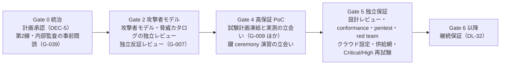
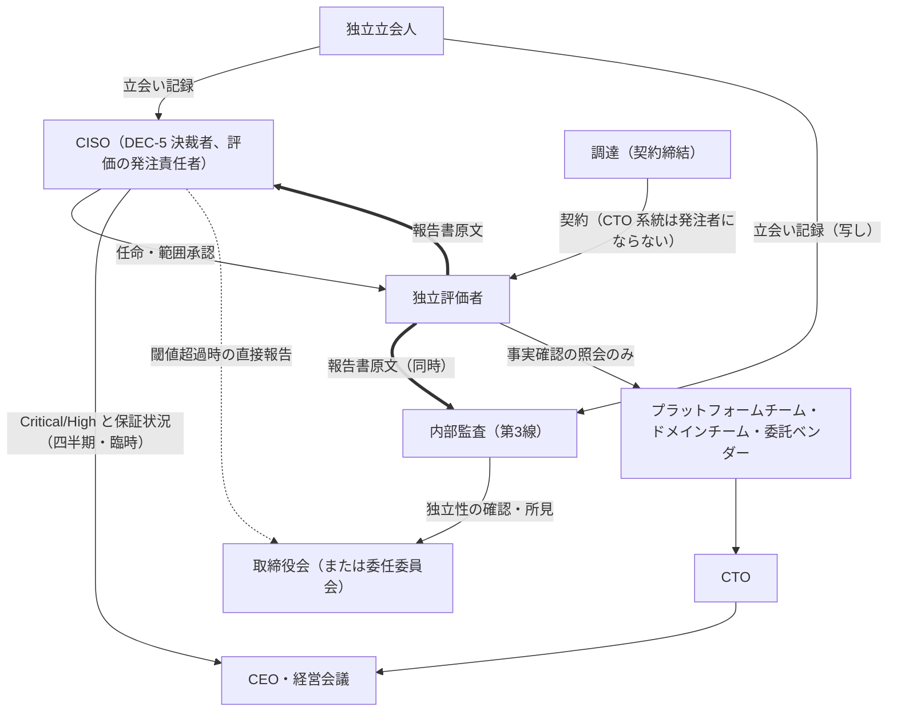
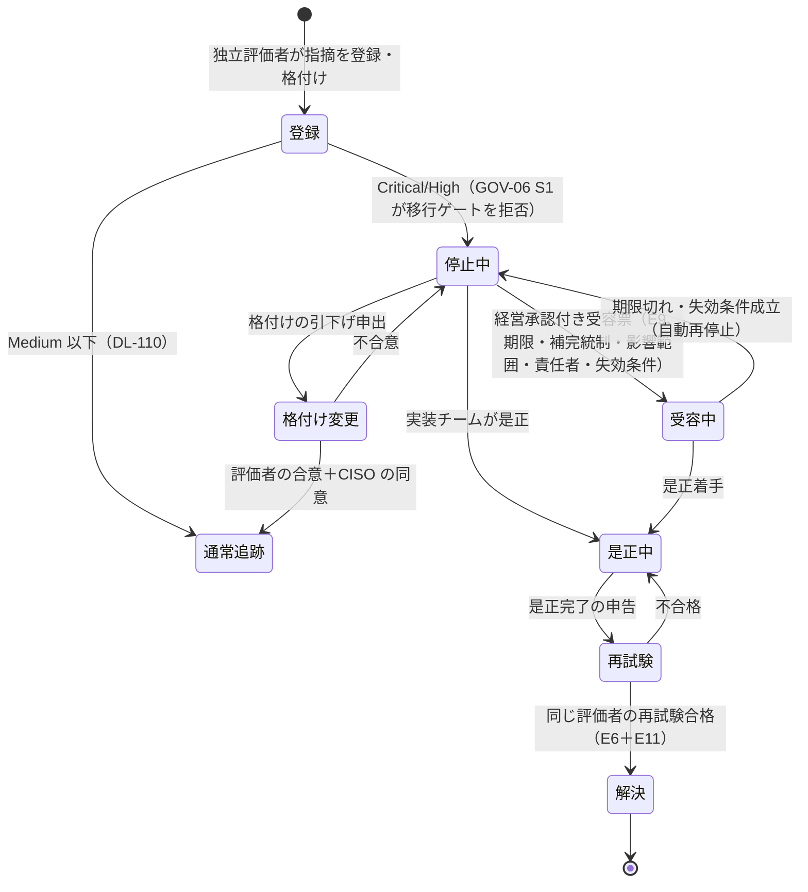

# 独立保証計画

> 文書ID: ASR-01 / 版: 0.3 / 状態: draft / 最終更新: 2026-10-15
> 対応要求: R-018, R-063, R-067, R-068, R-234, R-273, G-007, G-033, G-039（関連: R-064〜R-066, R-069〜R-076, G-009, G-034, G-061, G-076, G-083, G-085, G-091）
> 依存文書: CONVENTIONS.md, traceability/deliverables.md（DL-07, DEC-5）, traceability/R-requirements.md, traceability/G-goal-criteria.md, traceability/dissent-log.md（DS-08, DS-09）, traceability/seed/seed-01-ciso-assurance.md（§1 E1〜E11）, research/RS-01-governance-risk.md（RS-01#40, #44, #46, #55〜#58）, research/RS-08-pep-completeness-tenant-isolation.md（RS-08#14）, research/standards-status.md（SS-E13〜SS-E15）, 01_governance/raci-governance.md（GOV-05、DL-04）, 01_governance/stop-authority.md（GOV-06、DL-46）, 01_governance/kri.md（GOV-08、DL-06）, 01_governance/exception-risk-acceptance.md（GOV-07、DL-05）, 01_governance/loss-scenarios.md（GOV-03）, 01_governance/assumptions-register.md, 03_threat-model/attacker-model.md（THR-02）, 05_adr/ADR-007-key-hierarchy-kms-hsm.md。関連（未作成を含む）: 09_assurance/rfp-sow.md（DL-30）, 09_assurance/pentest-redteam-plan.md（DL-59）, 09_assurance/oidf-conformance-plan.md（DL-60）, 09_assurance/self-assessments.md（DL-61）, 09_assurance/continuous-assurance-plan.md（DL-32）, 00_decision/06-gate-plan-and-plan-b.md（DL-42）, traceability/open-items.md（DL-110）, traceability/independent-challenge-review.md（DL-108）, traceability/mock-panel-report.md（DL-109）

本書は AI エージェント（Claude）が起草した計画案であり、CISO（DEC-5）・経営会議の承認を経ていない [D][^1]。評価者は任命されておらず、独立評価は 1 件も実施されていない [D]。本書に書いた評価者の独立性要件・範囲・関与時期・決裁への反映規則は、すべて決裁案である [D]。

**本リポジトリ内の模擬パネル（DL-109）、AI による自己反証（DL-108）、research の AI による原典照合、自己評価（DL-61）は、いずれも独立保証に当たらない** [D][^1][^2]。理由と扱いは §8 に置く [D]。

---

## 0. 結論

1. **独立保証は「誰が評価するか」を先に固定し、Gate 0 で計画、Gate 2 で設計段階の反証、Gate 4 で立会い、Gate 5 で本評価の 4 点で関与させる**（§5）[D]。NIST SP 800-53 Rev.5 の CA-2(1) は、独立評価者を「開発・運用・維持・管理や統制有効性の判定に関して実際または外見上の利益相反がない者」とし、設計・開発段階では独立評価者が設計レビューに加わる独立 SME に相当すると述べている [N][^11]。連邦向けの統制を民間の本基盤へ当てるのは類推であり（DS-09）[D][^10]、ゲート化は本書の設計判断である [D]。
2. **評価者の報告系統は実装チーム（CTO 系統）から切り離し、評価者は CISO と内部監査へ同時に原文で報告する**（§3、DP-ASR-1 推奨案）[D]。RACI は独立保証計画の承認と評価者の任命を CISO（A）としており[^7]、DEC-5 の決裁者も CISO である[^2] [D]。ただし CISO 組織は鍵 ceremony・特権操作で実行者（R）になるため[^7]、CISO 単独への報告では CISO 組織の運用を評価する場面で自己評価に近づく [D]。この残余を内部監査への同時報告と独立性の確認（G-007 の判定方法）で補う [D][^4]。
3. **Critical/High は独立評価者が格付けし、登録した時点で本番移行を止め、閉じるのは「是正＋同じ評価者の再試験合格」か「経営承認付きの期限付き受容票」の 2 経路だけにする**（§6）[D]。これはレビューの「Critical/High の未解決事項は原則として本番移行を止める。例外は期限、補完統制、影響範囲、責任者、失効条件を記した経営承認付き risk acceptance だけ」[^5]を、停止権限規程（GOV-06 の S1、DP46-1・DP46-2）[^8]と同じ条件で保証側から実装したものである [D]。格付けの基準（何を Critical/High とするか）は TBD である（所有者: CISO＋独立評価者、期限: Gate 0（RFP 発出前）、決め方: §6.2）[D]。
4. **評価結果は「原文添付・全指摘回答・未回答なら決裁不可」の規則で決裁に入れる**（§7）[D]。Gate 5 の合否、DEC-7（前回指摘のクローズ）、取締役会への四半期報告（K-25）に、第三者報告書（E6）を要約ではなく原文で付ける [D]。
5. **本書が応える要求 9 件（R 6 件、G 3 件）のうち、本書だけで閉じたものはない**（§11）[D]。決裁案まで 5 件（R-018, R-067, R-068, G-033, G-039）、計画まで 1 件（G-007。実施は第三者で閉じる）、要第三者 3 件（R-063, R-234, R-273）である [D]。

---

## 1. 範囲・位置付け・用語

### 1.1 本書で扱うこと・扱わないこと

| 本書で扱う | 他文書で扱う（本書は参照だけ） |
|---|---|
| 評価者の独立性要件、利益相反の申告、報告系統 | 調達文書の条文・価格・契約条件（DL-30 rfp-sow.md） |
| 評価範囲（対象 7 領域×手法）と除外 | pentest・red team の交戦規則と攻撃シナリオ詳細（DL-59） |
| Gate 0/2/4/5 での関与時期と立会い範囲 | OIDF conformance の構成・合否（DL-60） |
| Critical/High の格付けの出所、登録、再試験、例外の経路 | 停止の発動・解除の権限（DL-46 GOV-06）、受容票の様式（DL-05 GOV-07） |
| 評価結果の決裁への反映規則 | ゲートの合格基準と予算上限の全体（DL-42） |
| 本リポジトリ内の活動が独立保証に当たらないことの明記 | 本番後の年次独立評価・定期 red team の周期（DL-32） |

- レビューは Gate 0 の成果物に「独立保証計画」を挙げ[^5]（L147）、Gate 5 で「実装チームと報告系統を分けた評価者が、設計、コード、IaC、policy、鍵管理、CI/CD、運用 runbook を評価する」としている[^5]（L194）[D]。本書はこの 2 か所を受ける [D]。
- 本番前に示せるのは設計の有効性と PoC 試験結果までであり、運用の有効性は Gate 6 後の運用期間を経て初めて評価できる、という監査人の前提[^6]を本書も採る [D]。運用の有効性の独立評価は DL-32 に送る [D]。

### 1.2 保証の担い手（4 類型）

| 類型 | 定義（本書） | 独立性の水準 | 主な証拠 | 根拠 |
|---|---|---|---|---|
| 独立評価者 | 当社の外部の事業者（または当社内で実装・運用・管理の系統外にある専門組織）で、§3 の要件を満たし、指摘の登録・格付け・再試験の合否を行う者 | 高 | 第三者報告書（E6）、適合試験ログ（E7） | CA-2(1), CA-8(1)[^11]、レビュー L194[^5] |
| 独立立会人 | PoC チーム・演習実施チームの報告系統外にあり、試験計画の凍結と実測・演習の実施を確認する者。指摘の格付けはしない | 中（系統外であること） | 立会い記録（E8 への署名）、凍結版のハッシュ確認 | G-goal §4 の判定規則[^4]、SA-11(3)[^11] |
| 内部監査（第3線） | IIA の Topical Requirement に従い統治・リスク管理・統制を評価し、評価者の独立性を確認する。リスク対応の決定はしない | 組織内で最も独立（取締役会へ直接報告） | 監査報告、所見と回答（E2） | RS-01#55〜#58[^14][^16][^17] |
| 第2線（リスク管理） | 受容票のレビューと異議申立て。保証ではなく監視と挑戦 | 中 | レビュー記録 | RS-01#57[^16]、GOV-05 RACI-12[^7] |

- 独立立会人を独立評価者と分けたのは、Gate 4 の立会い対象が 40 件を超える G に及び（§5.3）、すべてを外部評価者で賄うと費用と日程が Gate 4 の律速になるおそれがあるためである [D]。費用の大小は RFP（DL-30）で取得するまで不明である [D]。
- CA-2(1) の discussion は、組織の構造上、評価を開発・運用・管理の系統内の者が行わざるを得ない場合でも、結果を独立した専門家チームが精査・分析して完全性・正確性・完全性（integrity）・信頼性を検証することで独立性を得られるとしている [N][^11]。独立立会人の実測確認に独立評価者による抜取り精査を組み合わせる設計（§5.3）は、この考え方に倣う [D]。

---

## 2. 規範上の根拠と適用の論理

### 2.1 根拠

| 原典 | 内容 | 強度 | 本書での使い方 |
|---|---|---|---|
| NIST SP 800-53 Rev.5 CA-2 | 評価の種類に応じて評価者を選び、範囲（対象統制、評価手順、環境・体制・役割）を記した評価計画を作り、評価前に authorizing official（または指名代理人）の承認を得、報告書を作って所定の者に渡す [N][^11] | 統制要求（連邦向け） | §4 の範囲、§5.1 の計画承認 |
| 同 CA-2(1) Independent Assessors | 独立評価者を用いる。独立とは、評価対象の開発・運用・維持・管理や統制有効性の判定について利益相反がないこと。自分の仕事を評価しない、被評価組織の経営者・従業員として振る舞わない、依頼側の擁護者の立場に立たない。契約で調達した評価の独立性には、システムオーナーが契約手続に直接関与せず評価者の公平性に影響できないかを含めて判断する [N][^11] | 統制要求（連邦向け） | §3 の独立性要件 |
| 同 CA-7(1) Independent Assessment | 継続監視にも独立評価者を用いる [N][^11] | 統制要求（連邦向け） | DL-32 への申し送り |
| 同 CA-8 / CA-8(1) | 侵入試験を行い、独立した侵入試験者・チームを用いる。独立とは、対象の開発・運用・管理について利益相反がないこと [N][^11] | 統制要求（連邦向け） | §4（R-065）、DL-59 |
| 同 CA-8(2) Red Team Exercises | 交戦規則に従い、技術的攻撃とソーシャルエンジニアリングを含み得る red team 演習を行う [N][^11] | 統制要求（連邦向け） | §4（R-066）、DL-59 |
| 同 SA-11(3) | 開発者の評価計画と試験・評価で生じた証拠の正しい実施を独立した者に検証させ、その者に十分な情報（または取得権限）を与える [N][^11] | 統制要求（連邦向け） | §5.3 の Gate 4 立会い |
| NIST SP 800-53B（Release 5.2.0） | CA-2(1) と CA-7(1) は MODERATE と HIGH、CA-8 と CA-8(1) は HIGH のベースラインに含まれ、CA-8(2) はどのベースラインにも含まれない [N][^12]（RS-08#14 と同じ OSCAL profile で本書作成者が確認） | ベースライン割当 | 適用の論理（§2.2） |
| IIA Cybersecurity Topical Requirement | 2026-02-05 発効。保証業務では適合が必須。内部監査は統治・リスク管理・統制の各項目を評価しなければならない [N][^14][^15]（RS-01#55, #56） | must（IPPF 準拠の内部監査向け） | §7.3（G-039）、§1.2 |
| IIA Statement of Position（Three Lines Model, 2026-07-08） | 第3線（内部監査）は独立した保証を提供する [N][^16]（RS-01#57） | IIA の公式見解 | §1.2、§3.2 |
| IIA Statement of Position（Role in ERM, 2026-07-08） | 内部監査責任者はリスク対応を決定してはならず、その説明責任を負ってもならない [N][^17]（RS-01#58） | must not | §6.4（内部監査は受容者にならない） |
| NACD-ISA ハンドブック第5版（2026） | 保証機能の独立性を含む統治体制を少なくとも年1回評価させる。使っている定量化モデルが独立検証されているかを経営に問う [N][^18]（RS-01#40, #44） | 非拘束の業界指針 | §4.2 の定量化モデル検証、DP-ASR-1 |
| 17 CFR §229.106(b) | 登録企業は、リスク管理の手続に関連して評価者・コンサルタント・監査人等の第三者を利用しているかを記述する [N][^19]（RS-01#46） | 開示義務（登録企業のみ） | §7.4（適用は新規仮定） |

### 2.2 適用の論理

- SP 800-53B のベースラインは米国連邦の情報システム向けであり、民間の SaaS 基盤に「必要」と書くのは類推である（DS-09）[D][^10]。
- 本基盤は全テナントの認証・認可を担い、署名鍵・JWKS 侵害（S-02）やテナント間漏えい（S-01）が全テナントへ波及し得る[^21] [D]。そこで本書は「連邦の HIGH ベースラインが独立評価（CA-2(1)）と独立侵入試験（CA-8(1)）を含むことを参考に、両者をゲート条件にする」を設計判断として採る [D]（DS-09 の再提案での扱い[^10]に従う）。
- レビュー脚注が引いた SP 800-53A Rev.4 は 2023-01-25 に撤回されているため引かない（DS-08）[D][^10]。本書は SP 800-53 Rev.5 の OSCAL カタログ（Release 5.2.0）を引く [D]。同 Release の状態は final（minor release、2025-08-27）である [N][^13][^25]。

---

## 3. 評価者の独立性要件

### 3.1 要件

| ID | 要件 | 確認方法 | 根拠 |
|---|---|---|---|
| IND-1 | 評価者（法人・個人とも）は、評価対象の設計・実装・運用・維持・管理に、評価期間と直前の TBD 年間に関与していない | 利益相反申告書（IND-6）と、実装チーム・委託先名簿との突合 | CA-2(1)「自分の仕事を評価しない」[N][^11] |
| IND-2 | 評価者は、評価対象の構成要素（IdP・認可エンジン・HSM/KMS・CI/CD 製品など）の販売者・導入支援者・その関連会社でない。製品選定（ADR-001 等、RACI-36）で助言した者は、その製品を含む範囲の評価者になれない | 申告書、調達の取引先台帳 | CA-2(1)「依頼側の擁護者の立場に立たない」[N][^11] |
| IND-3 | 評価者の報告系統は実装チーム（CTO 系統、プラットフォームチーム、ドメインチーム、委託ベンダー）から独立している。評価者への指示・報告書の受領・報酬の検収を CTO 系統が単独で行わない | 契約書の発注者・検収者欄、報告書の配布先 | R-068、レビュー L194[^5]、CA-2(1)「システムオーナーが契約手続に直接関与しない」[N][^11] |
| IND-4 | 報告書は原文のまま CISO と内部監査へ同時に届き、実装チームは事実誤認の指摘だけを評価者へ申し出られる。格付けの変更は評価者の判断による | 配布記録、版履歴 | G-007 の「報告書を原文のまま付属」[^4]、GOV-06 §3.3[^8] |
| IND-5 | 評価者は評価に必要な情報（設計書、コード、IaC、policy、鍵管理記録、CI/CD 設定、runbook、ログ）を取得できる権限を契約で持つ。提供拒否は報告書に記載される | 契約条項、報告書の制約欄 | SA-11(3)(b)[N][^11] |
| IND-6 | 評価開始前に利益相反申告書と独立性宣言を提出し、評価期間中に事情が変わればただちに再申告する | 申告書（E6 の一部） | G-007 の「独立性宣言」[^4]、DL-07 の要点[^2] |
| IND-7 | 評価者の独立性は内部監査が確認し、確認結果を DEC-5 の決裁記録に添える | 内部監査の確認記録（E2） | G-007 の判定方法[^4]、GOV-05 RACI-13 注[^7] |
| IND-8 | 評価者は統制の設計・是正の実施を代行しない。是正の助言は行えるが、自らが助言した是正の再試験を行う場合はその旨を報告書に記す | 報告書 | CA-2(1)「自分の仕事を評価しない」[N][^11]、GOV-05 RACI-27・28 注（承認者になると後の保証で自らの関与を評価する）[^7] |
| IND-9 | 評価者は技能・経験の証明（手法ごとの実績、資格）を提出する | 提案書の審査 | CA-2 discussion（評価者が必要な技能と専門知識を持つことを組織が確保する）[N][^11] |

- IND-1 の「直前の TBD 年間」は TBD とする（所有者: CISO＋調達、期限: Gate 0（RFP 発出前）、決め方: 評価者市場の供給量を RFP の事前照会で確認し、IND-1 を満たす候補が 2 者以上残る最長の期間を採る）[D]。
- 独立性の要件は、利益相反を「排除する」ものではなく「申告させて判定する」ものである [D]。判定者は内部監査（IND-7）とし、判定に疑義があれば DP-ASR-1 の報告先が決める [D]。

### 3.2 報告系統

- 太線は報告書の原文の流れを示す [D]。評価者と実装チームの間は事実確認の照会だけとし、報告書の草稿を実装チームが承認する手順を置かない [D]。
- CISO が取締役会へ直接報告できる経路は GOV-05 §4.3 の決裁案による [D][^7]。

---

## 4. 評価範囲

### 4.1 対象 7 領域×手法

レビューが Gate 5 で挙げた対象 7 領域（設計、コード、IaC、policy、鍵管理、CI/CD、運用 runbook）と手法（conformance、ASVS、API Top 10、cross-tenant pentest、red team、クラウド設定レビュー、供給網レビュー）[^5]（L194）を行列にする [D]。○は本評価（Gate 5）の対象、△は Gate 2/4 の先行評価・立会いの対象である [D]。

| 手法（R-ID） ＼ 対象 | 設計 | コード | IaC | policy・model | 鍵管理 | CI/CD | runbook | 調達・詳細計画 |
|---|---|---|---|---|---|---|---|---|
| 外部アーキテクチャレビュー（R-063） | ○（△ Gate 2） | — | ○ | ○ | ○ | ○ | ○ | DL-30 |
| OAuth/OIDC/FAPI conformance（R-064） | — | ○ | — | — | ○（JWKS） | — | — | DL-60（自前実行は DL-61 の前提） |
| cross-tenant pentest・PEP bypass（R-065） | — | ○ | ○ | ○ | — | — | — | DL-59 |
| red team（ソーシャルエンジニアリング含む）（R-066） | — | ○ | ○ | — | ○ | ○ | ○ | DL-59 |
| ASVS 5.0 ベース検証（R-070） | ○ | ○ | — | ○ | ○ | — | — | DL-30（自己評価は DL-61） |
| API Top 10（R-071） | — | ○ | — | ○ | — | — | — | DL-30（自前負例は R-242） |
| クラウド設定レビュー（R-072） | — | — | ○ | — | ○ | ○ | — | DL-30 |
| 供給網レビュー（R-073） | — | ○ | ○ | ○ | ○ | ○ | — | DL-30 |
| 鍵 ceremony 立会い（R-055, G-085） | — | — | — | — | ○（△ Gate 4 演習） | — | ○ | DL-14、ADR-007 |
| 侵害演習・PoC 実測の立会い（G-009 ほか） | — | — | — | — | △ | △ | △ | DL-22、DL-24 |

- 鍵 ceremony には quorum 外の独立立会人を置くことが ADR-007 の決定である（D7-51）[D][^20]。本書は、その立会人を §3 の IND-1〜IND-3 を満たす者から選ぶ規則を加える [D]。
- 各手法の具体的な攻撃シナリオは攻撃者類型 ATK-01〜ATK-19[^22]に対応づけて DL-59・DL-30 で定める [D]。本書は範囲の網羅性を次の 2 点で確認する [D]: (a) レビューが Gate 2 で挙げた 12 類型[^5]がすべて少なくとも 1 つの手法の対象になること、(b) 上位損失シナリオ（S-01, S-02, S-18, S-06 ほか）[^21]がいずれかの手法の対象になること [D]。照合表は DL-30 の付録として作る TBD である（所有者: CISO、期限: Gate 2、決め方: THR-02 の ATK 表と GOV-03 の S 表を行、本表の手法を列にした突合）[D]。

### 4.2 統治・定量化の独立検証

| 対象 | 担い手 | 根拠 | 関与ゲート |
|---|---|---|---|
| 損失シナリオの定量化モデル（K-24、SRC-19） | 独立評価者または内部監査（DP-ASR-2） | NACD Tool K は、定量化モデルが独立検証されているかを経営に問うよう促す [N][^18]（RS-01#44）。KRI 台帳は SRC-19 の独立検証を DL-07 の範囲としている[^9] [D] | G0（モデル承認前の検証）、G5（再検証） |
| RACI・受容階層・停止規則・エスカレーション経路 | 内部監査 | IIA TR は、説明責任の確立と、容認できない水準のリスクを迅速にエスカレーションする仕組みの有無を内部監査が評価しなければならないとする [N][^14]（RS-01#56） | G0（G-039 の事前閲読）、G5 |
| 独立保証機能自体の独立性 | 内部監査（取締役会へ報告） | NACD は保証機能の独立性を含む統治体制の年次評価を挙げる [N][^18]（RS-01#40）。GOV-05 RACI-15 は取締役会を A とする[^7] | 年次（DL-32） |

### 4.3 範囲外

| 範囲外 | 理由 | 扱う先 |
|---|---|---|
| 運用の有効性（一定期間の運用実績に基づく評価） | 本番前には評価できない[^6] [D] | DL-32（CA-7(1) の継続評価に相当）[N][^11] |
| 顧客側 IdP・顧客環境そのもの | 当社の評価権限が及ばない [D] | 顧客契約（DL-26）。顧客 IdP を攻撃者とみなす試験（ATK-04）は範囲内 |
| 財務諸表監査・ISMS 認証審査 | 目的と基準が異なる [D] | 06_controls（第三者認証の取得範囲は applicability.md の L-10 が DL-07 へ申し送り） |

- 06_controls/applicability.md は、第三者認証・保証報告書の取得範囲（L-10）を DL-07 へ申し送っている [D]。どの認証・報告書（例: ISMS 認証、保証報告書）を取得するかは顧客契約と法域の判定に依存するため、本書では範囲を決めず、残課題 6 に置く [D]。

---

## 5. ゲート別の関与時期と立会い範囲

### 5.1 全体

| ゲート | 関与 | 担い手 | 成果物・証拠 | 合格の条件（本書の提案） |
|---|---|---|---|---|
| Gate 0 統治 | 本計画の承認と評価者の任命方針、RFP の発出承認。決裁パッケージの第2線・内部監査による事前閲読（G-039） | CISO（DEC-5）、内部監査、第2線 | 承認記録（E1/E2）、所見と回答（E2） | 本書の承認、IND-7 の確認手順の合意、G-039 の所見への全件回答 |
| Gate 2 攻撃者モデル | 攻撃者モデル（THR-02）と脅威カタログ（THR-03）の独立レビュー。DP-ASR-3 (b) を採る場合は DEC-3 対象の ADR 5 本の設計レビューを含む。推奨案への独立反証レビュー（G-007） | 外部の独立評価者（設計レビュー担当。§3 の IND-1〜IND-9 を満たす者。ASR-05 の SOW-01 設計段・SOW-07 で調達）。内部監査・社内の報告系統外の者は担い手にしない（§5.5） | レビュー報告（E6）と回答 | 指摘への全件回答。Critical/High の指摘は §6 で登録。DEC-3 は報告と全所見への回答の後にだけ決裁に付す |
| Gate 4 高保証 PoC | 試験計画の凍結確認（G-009）、PoC 実測・演習の立会い、鍵 ceremony 演習（TC-07-12）の立会い、独立評価者による証拠の抜取り検証 | 独立立会人、独立評価者（抜取り） | 立会い記録、凍結版のハッシュ、抜取り検証記録 | 立会いのない実測は「実測済・未立会」とし合格に数えない[^4] |
| Gate 5 独立保証 | §4.1 の本評価、Critical/High の再試験 | 独立評価者 | 第三者報告書（E6）、適合試験ログ（E7）、是正追跡（E11） | 受容分を除く未解決の Critical/High が 0 件（G-034、G-083）[^4] |
| Gate 6 以降 | 継続評価、年次独立評価、定期 red team | 独立評価者、内部監査 | DL-32 の記録 | DL-32 で定める |

- Gate 3（ADR と選定）は DL-07 の要点が関与時期として挙げていない[^2] [D]。ただし不可逆 ADR（DEC-3）の前に設計段階の独立レビューを置くかは DP-ASR-3 で決める [D]。CA-2(1) が設計・開発段階の独立評価者を設計レビューの独立 SME に相当するとしていること[N][^11]は、Gate 2〜3 での関与を支持する [D]。

### 5.2 Gate 2 の関与

- 対象: 攻撃者類型（ATK-01〜ATK-19）、各脅威の予防・検知・封じ込め・復旧・証拠の記載、レビューが Gate 2 で例示した具体脅威（recovery bypass、session theft、token replay、IdP mix-up、JWKS 差替え、tenant confusion、BOLA、policy rollback、stale allow 等）[^5]の網羅 [D]。
- 独立反証レビュー（G-007）: 作成者以外のレビュアーによる AI 自己反証（G-006、DL-108）と同じ 4 手法（pre-mortem、代替案の steelman、数値への攻撃、推奨が正しいために真でなければならない条件の列挙）を、実装チームの報告系統外の独立者が行う [D][^4]。報告書は原文のまま DL-108 に付属し、全指摘に回答するか DEC に持ち込む [D][^4]。
- 時期: Gate 2 の判定前に開始し、DEC-3（不可逆 ADR）の決裁前に報告を受ける [D]。G-007 の最終判定は段階2（Gate 3〜5）である[^4] [D]。

### 5.3 Gate 4 の立会い範囲

G-goal-criteria は、PoC・演習の実測の達成判定に PoC チームの報告系統外の独立立会人を置くとしている[^4] [D]。判定者に独立立会人（または第三者立会人）を含む G は 44 件ある（本書作成者が G-goal-criteria の判定者欄から抽出、2026-10-15）[D]。

| 区分 | 対象の G | 立会いの内容 |
|---|---|---|
| 試験計画の凍結 | G-009 | 全 TC の仮説・合否基準・中止基準・測定方法の凍結版（版・日付・ハッシュ）を測定開始前に確認し、凍結後の変更の理由開示を確認する |
| テナント分離・PEP・認可 | G-072, G-082, G-105, G-108, G-110, G-112, G-113, G-114, G-115, G-136 | 負例（cross-tenant、bypass、漏えい）の実行と結果の記録を確認する |
| token・federation・ライフサイクル | G-086, G-088, G-095, G-102, G-103 | 負例の拒否と、ログ上の拒否理由を確認する |
| 可用性・性能・失敗モード | G-048, G-056, G-058, G-059, G-111 | 負荷条件・障害注入の条件が凍結版と一致すること、生データと測定スクリプトの保存を確認する |
| 鍵・特権・侵害対応 | G-084, G-085（第三者立会人）, G-092, G-093 | 演習の時系列・計測値・逸脱を確認する。G-085 の ceremony は IND-1〜IND-3 を満たす第三者が立ち会う |
| 監査・不正 | G-062, G-063, G-081 | 記録率・欠損検知・再現攻撃の結果を確認する |
| 進化・移行・出口 | G-051, G-066, G-068, G-069, G-070, G-075, G-117 | 切替・rollback・移出入の実施と結果を確認する |
| 連携契約・オンボーディング | G-123, G-141, G-142, G-144, G-145, G-146, G-147 | 契約試験・計測の実施と結果を確認する |
| その他 | G-149, G-150 | 試験の実施と結果を確認する |

- 上表の G の最終判定段階は、G-085 と G-111 が段階3、他は段階2である[^4] [D]。G-146（パイロット）や G-149 など、Gate 4 より後の段階で実測するものも含むため、各 G の実施ゲートは DL-42 のゲート計画に従う [D]。
- 独立評価者による抜取り検証: 立会い済みの TC のうち、Critical/High に関わる損失シナリオ（S-01, S-02 ほか）に対応するものを独立評価者が抜き取り、生データから合否を再計算する [D]。SA-11(3) は、開発者の評価計画と試験で生じた証拠の正しい実施を独立した者に検証させることを求めている [N][^11]。抜取りの件数・比率は TBD とする（所有者: CISO、期限: DEC-4（Gate 4 入場）、決め方: 事前登録 TC の総数と DL-30 で得た評価費用から、S-01・S-02 対応の TC を全件、その他を層別抽出とする案を基準に決める）[D]。
- 独立立会人の母集団（社内の系統外か外部か）は DP-ASR-2 で決める [D]。

### 5.5 ゲート別の担い手（DEC-5「評価者の母集団」の案）

DEC-5 の決裁文書（DCS-03 §4.5）は評価者の母集団を「系統 1 は内部監査、系統 2（Gate 4 立会い・Gate 5 本評価）は外部」と書いていた[^26] [D]。「系統 1・系統 2」は高保証 PoC 試験計画（POC-01）で PoC の試験の区分（系統 1 は本リポジトリ内の小規模 PoC、系統 2 は Gate 4 の本番相当環境）を指す語であり[^29]、評価者の区分としては読めない [D]。また、この書き方では Gate 2 のレビューを内部監査が担う読み方になり、DP-ASR-3 (b) の推奨理由「不可逆決定の前に外部の目が入る」と整合しない [D]。本書は、母集団をゲートと担い手の表で次のとおり提案し、「系統」の語は使わない [D]。

| ゲート | 関与 | 担い手 | 担い手の理由 |
|---|---|---|---|
| Gate 0 | 計画承認、独立性の確認（IND-7）、事前閲読（G-039） | CISO（決裁）、内部監査（独立性の確認と事前閲読）、第2線 | 内部監査は評価者ではなく、評価者の独立性を確認する役割である（§1.2）[D] |
| Gate 2 | THR-02・THR-03 の独立レビュー、DP-ASR-3 (b) の範囲（ADR-001/007/013/021/022）の設計レビュー、独立反証（G-007） | 外部の独立評価者 | 不可逆決定（DEC-3）の入力になる [D]。設計レビューには鍵階層・識別子・認可モデルの技術評価の能力が要り、IND-9（技能・経験の証明）を満たす必要がある [D][^11]。CA-2(1) は設計・開発段階の独立評価者を設計レビューの独立 SME に相当するとしている [N][^11] |
| Gate 4 | PoC 実測・演習の立会い | 社内の報告系統外の者（DP-ASR-2 (b) 推奨）。鍵 ceremony（G-085）は外部 | 立会いは格付けをしない（§1.2）[D]。G-goal の判定規則は PoC チームの報告系統外を求める[^4] |
| Gate 4 | 立会い済み TC の抜取り検証 | 外部の独立評価者 | SA-11(3) の独立した検証 [N][^11] |
| Gate 5 | §4.1 の本評価、Critical/High の再試験 | 外部の独立評価者 | レビュー L194 の「実装チームと報告系統を分けた評価者」[^5] |

- 内部監査を評価者に置かない理由: 内部監査は IND-7 で評価者の独立性を確認する立場にあり、同じ組織が評価もすると確認する者とされる者が重なる [D]。IIA の Statement of Position は、内部監査が独立性・客観性を保つための safeguards を求めている [N][^17]。
- この表は DCS-03 §4.5 の選択肢 (c) と決議文案 2 の書換え案として申し送る（§13 申し送り H-1）[D]。

### 5.4 Gate 5 の本評価

- 範囲は §4.1 の ○ の全セルとする [D]。
- 評価の前提条件: ASVS 5.0（L2/L3）・API Top 10・SLSA 1.2 の自己評価（DL-61）と OIDF conformance suite の自前実行（DL-60）が完了し、その結果を評価者に渡していること [D]。G-090 は第三者評価の前にこれらを済ませることを求めている[^4] [D]。自己評価は独立保証に当たらない（§8）[D]。
- 評価計画（範囲、手順、環境、体制）は評価開始前に CISO が承認する [D]。CA-2(c) は評価計画を評価の前に authorizing official（または指名代理人）が承認することを求めている [N][^11]。本書では DEC-5 の決裁者である CISO をこれに当てる [D]。受容の権限は CISO に置かない（GOV-05 規則 1）[D][^7]。

---

## 6. Critical/High の扱い

### 6.1 流れ

### 6.2 規則

| ID | 規則 | 根拠 |
|---|---|---|
| CH-1 | Critical/High の格付けは独立評価者が行う。実装チームは格付けを引き下げられない [D] | GOV-06 DP46-1 推奨 (a)[^8]、§3.3 |
| CH-2 | 登録と同時に DL-110（POA&M、E11）と K-25 に載り、GOV-06 の S1（本番移行停止）が及ぶ範囲の移行ゲートが拒否する [D] | GOV-06 §4.1[^8]、GOV-08 K-25(c)[^9] |
| CH-3 | 「解決」は是正と、指摘した評価者（またはその後継として IND を満たす評価者）の再試験合格だけで成立する [D]。実装チームの自己確認では解決にしない [D] | G-034、G-083 の判定者は独立評価者[^4]、レビュー L246[^5] |
| CH-4 | 例外は経営承認付きの受容票（GOV-07）[^24]だけとし、CISO・CTO の単独受容、合議受容は認めない [D] | レビュー L196[^5]、R-075、GOV-06 DP46-2 推奨 (a)[^8] |
| CH-5 | 受容票は期限・補完統制・影響範囲・責任者・失効条件を必須とし、期限切れ・失効で自動的に停止へ戻る [D] | GOV-06 §4.1 発動条件 (b)[^8] |
| CH-6 | 格付けの引下げは評価者の合意と CISO の同意を要する [D] | GOV-06 §3.3[^8] |
| CH-7 | 内部監査は受容者・承認者にならない。経営が選好・許容度を超えて受容したと判断した場合は取締役会へエスカレーションしなければならない [N][^17]（RS-01#58） | IIA SoP |
| CH-8 | Gate 2・Gate 4 で見つかった Critical/High も同じ規則に載せる [D]。Gate 5 まで登録を待たない [D] | 早期登録で是正期間を確保する設計判断 [D] |
| CH-9 | 自社の検出（CI、インシデント）と依存製品の脆弱性公表も、評価者が格付けして同じ規則に載せる [D] | GOV-06 DP46-1 推奨[^8] |

- 格付けの基準は TBD とする（所有者: CISO＋独立評価者、期限: Gate 0（RFP 発出前）、決め方: 損失シナリオ（GOV-03 の S-ID）の影響規模と BIA（GOV-04）の操作階層別の停止許容、攻撃者類型（THR-02）からの到達可能性の 3 軸で格付け表を作り、RFP（DL-30）の成果物形式に入れる）[D]。CVSS の基本値だけで機械的に格付けする案は、同じ脆弱性でも出所で値が異なり、テナント分離への影響を反映しにくいとして GOV-06 が退けている[^8] [D]。
- 是正期限は格付けごとに TBD とする（所有者: CISO＋CTO、期限: Gate 0、決め方: KRI 台帳の K-25(b)（期限超過件数）の閾値と同時に決める）[D][^9]。
- 再試験の費用と回数の上限は RFP（DL-30）で取得する [D]。

### 6.3 停止の及ぶ範囲

- 基盤共通の指摘とテナント分離に関わる指摘は全ての移行を、特定サービスの指摘はそのサービスの移行を止める案が GOV-06 DP46-1 の推奨である[^8] [D]。範囲の判定は評価者の所見に基づき CISO が行う [D]。既に本番にある範囲で見つかった場合は拡大を止め、既存範囲の停止は GOV-06 S3 で判断する[^8] [D]。

---

## 7. 結果の決裁への反映

### 7.1 反映規則

| ID | 規則 | 根拠 |
|---|---|---|
| RF-1 | 決裁パッケージには第三者報告書（E6）を原文のまま付属する。要約だけの添付は認めない [D] | G-007 の「報告書を原文のまま付属」[^4] |
| RF-2 | 全指摘に、是正・受容（受容票 ID）・不同意（理由）のいずれかの回答を付ける。未回答の指摘があるゲートの決裁は行わない [D] | G-007 の合格基準[^4] |
| RF-3 | 実装チームが評価者の指摘に不同意の場合、不同意の理由と評価者の再反論を併記し、決裁者が判断する。不同意だけで指摘を閉じない [D] | IND-4 |
| RF-4 | 未解決の Critical/High の一覧（受容中を含む）を、受容票 ID・期限・責任者とともに決裁文書の本文に載せる [D] | GOV-06 §4.1 の移行判定記録[^8] |
| RF-5 | 評価が範囲どおりに実施できなかった部分（情報提供の拒否、時間切れ）は「未評価」として明記し、評価済みと同視しない [D] | IND-5、CONVENTIONS §8[^1] |
| RF-6 | 保証の状況（実施・未実施、未解決 Critical/High、例外）を四半期の取締役会報告に載せる [D] | GOV-08 §7 の報告項目 12・15[^9]、GOV-06 §4.1 事後レビュー[^8] |

### 7.2 決裁ごとの入力

| 決裁 | 決める人 | 保証側の入力 | 入力がない場合 |
|---|---|---|---|
| DEC-5 独立保証計画 | CISO | 本書、内部監査の独立性確認手順（IND-7） | 評価者の任命・RFP 発出を行わない |
| DEC-3 不可逆 ADR | CTO（CISO 同意） | Gate 2 の独立レビューと独立反証（G-007）の報告と回答（DP-ASR-3 による） | DP-ASR-3 で決める |
| DEC-10 G0〜G3 の段階予算 | CTO＋CISO（起案）、CFO | §9 の Gate 2 の独立レビューの費用（上限キャップ 0.8 億円。RFI の幅で置換）と調達の日程（DL-42 CP-7）[^27] | Gate 2 の独立レビューを発注できず、DEC-3 を決裁に付さない |
| DEC-4 Gate 4 PoC 入場 | CTO＋CISO＋CFO | 立会い体制（DP-ASR-2）と抜取り検証の方針、立会い費用の見積り | 立会いのない実測を合格に数えない[^4] |
| Gate 5 判定（DL-42） | DL-42 で定める | §5.4 の全報告書、Critical/High 一覧、受容票 | 本番移行を承認しない（S1）[^8] |
| DEC-7 前回指摘のクローズ | CTO＋CISO | 独立評価で閉じる指摘（R-063〜R-066 等）の E6/E7 | 当該指摘は「未達」のまま DL-110 に残す |

### 7.3 第2線・内部監査の事前閲読（G-039）

1. 決裁パッケージ提出の TBD 営業日前に、第2線（リスク管理）と内部監査へ全成果物を渡す [D]。日数は TBD（所有者: 内部監査責任者、期限: Gate 0、決め方: 内部監査の年間計画（GOV-05 RACI-14）と提出日程から逆算）[D]。
2. 内部監査は IIA Cybersecurity TR の統治・リスク管理・統制の各項目に照らして所見を記録する [D]。同 TR は保証業務で適合が必須であり、要件ごとの適用可否の評価と除外理由の記録を求める [N][^14]（RS-01#55）。
3. 所見の置き場所は G-039 が DL-109 §8 からの申し送りとしている[^4] [D]。本書では、所見と回答を DL-109 とは別の記録（内部監査の所見記録、E2）に置き、DL-109 には所在だけを書く案を採る [D]。DL-109 は模擬パネルの自己レビューであり（§8）、実在の内部監査の所見と同じ文書に置くと両者の区別が曖昧になるためである [D]。
4. 全所見に回答し、回答できないものは DEC に持ち込む [D]。

### 7.4 開示との関係

- 当社が SEC 登録企業である場合、17 CFR §229.106(b) はリスク管理の手続に関連して評価者等の第三者を利用しているかの記述を求める [N][^19]（RS-01#46）。当社がこれに当たるかは前提台帳にない（新規仮定①、前提台帳へ追加要）[D]。

---

## 8. 本リポジトリ内の活動は独立保証に当たらない

| 活動 | 文書 | 独立保証に当たらない理由 | 扱い |
|---|---|---|---|
| 模擬 CTO/CISO パネルの判定 | DL-109 traceability/mock-panel-report.md | 実在の CTO/CISO の決裁ではない自己レビューである[^1][^2] [D]。パネルは本書と同じく AI エージェントが担い、作成者と報告系統が分離していない [D] | 提出前の自己検証（E2）として扱い、E6 に数えない |
| AI による独立反証 | DL-108 traceability/independent-challenge-review.md | 本リポジトリ内のものは AI による自己反証であり、報告系統外の独立反証は未達として扱うと成果物計画が定めている[^2] [D] | G-006 の証拠。G-007 は §5.2 の独立者が行う |
| research の原典照合 | research/verification/ | 照合も AI によるものであり、人間のレビュアや第三者による照合ではない（RS-01 冒頭の記載）[D] | 調査品質の記録として扱う |
| 自己評価（ASVS・API Top 10・SLSA） | DL-61 09_assurance/self-assessments.md | 被評価者自身の評価である [D] | Gate 5 の前提条件（§5.4） |
| OIDF conformance suite の自前実行 | DL-60 | 実行者が実装側である [D] | 認定取得・評価者による確認は D |
| PoC チームによる実測 | DL-81 | 立会いのない実測は「実測済・未立会」とする[^4] [D] | §5.3 の立会いで補う |

- CA-2(1) は、評価者が自分の仕事を評価しないことを独立性の条件に挙げている [N][^11]。上表の活動はいずれもこの条件を満たさない [D]。
- 本書を含む本リポジトリの全成果物は、独立評価者の評価対象であって、評価結果ではない [D]。

---

## 9. 調達・費用・要員

| 項目 | 値 | 所有者 | 期限 | 決め方 |
|---|---|---|---|---|
| Gate 2 の独立レビューの費用（THR-02・THR-03 の独立レビュー、DP-ASR-3 (b) の ADR 5 本の設計レビュー、独立反証 G-007。ASR-05 の SOW-01 設計段・SOW-07） | 上限キャップ 0.8 億円（仮置き。工数 1.43〜2.47 人年 × 外部単価の仮置きで約 0.14〜0.74 億円。DL-42 NA-DCS06-8）[^27]。RFI の幅が取れた時点で置き換える | CISO＋CFO | G0（DEC-10 決議文案 1・DEC-5）[^27][^30] | RFP の事前照会（RFI）で 2 者以上から同じ入力（対象文書の数: THR-02・THR-03・ADR 5 本と推奨案の数）に対する見積りを取り、幅で示す（ASR-05 §2.7 と同じ決め方[^28]）。上限キャップは DL-42 §5.2.2 の G0〜G2 の費目に計上済みである[^27]。G0 までに幅が取れない場合は、キャップを DEC-10 決議文案 1 の上限として承認し、幅が取れた時点で CISO＋CFO がキャップ内で置き換える。幅がキャップを超える場合は、DL-42 §5.1 の原則 3 の継続審査にかける |
| 独立評価の費用（Gate 4/5 分。再試験を含む。Gate 2 分は前行） | TBD | CISO＋CFO | DEC-4（G4 入場前） | DL-30 の RFP 回答から積上げ。GOV-05 DP-2 の CISO 予算枠で扱う案と連動[^7] |
| 独立立会人の要員（社内の場合）または費用（外部の場合） | TBD | CISO＋人事責任者 | DEC-4 | DP-ASR-2 の決定と §5.3 の立会い対象数から算定 |
| 鍵 ceremony の独立立会人 | TBD | CTO（RFP） | Gate 4 | ADR-007 が RFP（DL-30）で取得するとした費用[^20] |
| 内部監査の工数（G-039、IND-7、§4.2） | TBD | 内部監査責任者 | Gate 0 | 内部監査計画（RACI-14、RACI-33）[^7] |

- Gate 2 分の期限を G0 に置くのは、DEC-3（不可逆）が Gate 2 の独立レビューの報告と全所見への回答を前提にしており[^26]、G0〜G2 の予算は次回決裁の DEC-10 案で決まるためである[^27] [D]。版 0.1 は期限を一括して DEC-4（G4 入場前）としていたため、Gate 2 のレビューの費用がどの決裁にも載らなかった [D]。DL-42 §5.2.2 の G0〜G2 の積上げには、本書の時点で独立レビューの行がない[^27] [D]。ASR-05 は RFI の回収期限を G3 としており[^28]、Gate 2 分には間に合わない [D]（§13 申し送り H-3）。
- 版 0.2 では Gate 2 分の金額を TBD とし、DL-42 §5.2.2 の G0〜G2 の積上げにも独立レビューの行がなかった [D]。ラウンド 2（cfo）の指摘を受け、DL-42 は同じラウンドで G0〜G2 に「Gate 2 の独立レビュー（外部評価者）」の行を加え、上限キャップ 0.8 億円（NA-DCS06-8）を置いた[^27] [D]。工数は ASR-05 の体制（SOW-01 は 6 役割、SOW-07 は 4 役割）から積み上げた[^28] [D]。外部単価は原典で確かめていない仮置きである [D]。これにより G0〜G2 の幅は約 0.7〜5.7 億円になった[^27] [D]。
- 調達のリードタイムは DL-42 §5.3.1 の CP-7 に置いた[^27] [D]。経路は「RFP の発出（DEC-5 と DEC-10 決議文案 1 の承認後）→ 任命 1〜3 か月 → レビュー 2〜3 か月 → 回答 1〜2 か月」である（NA-DCS06-9。いずれも仮置き）[D]。回答の完了は G0 から 4〜8 か月後で、G0〜G2 の期間上限の 12 か月には収まるが、6 か月には収まらない場合がある[^27] [D]。G2 の判定者には独立評価者が入るので、任命が遅れると G2 判定、DEC-3、DEC-8 が順に遅れる [D]。SOW-01 と SOW-07 は別法人（X-7）なので、調達は 2 件になる[^28] [D]。
- 前提台帳は G5（独立保証）を確定ゲートとする前提を持たない[^23] [D]。独立評価の費用・評価者市場の供給量・社内の系統外人材の有無は前提台帳にない [D]。これらは新規仮定②（前提台帳へ追加要）とする [D]。
- プラットフォームチーム 24 FTE（A-054）の内訳には独立評価者を含めない [D][A-054]。同チームの「プロダクト・統制 2」は評価への対応（資料提供・是正の管理）を担う第1線の要員であり、評価者ではない [D][A-054]。

---

## 10. 決裁案

決裁案はすべて未決定である [D]。

### DP-ASR-1 評価者の報告先

| 選択肢 | 帰結 |
|---|---|
| (a) CISO だけに報告する | DEC-5・RACI-13 と整合し手続は単純になる [D]。CISO 組織が実行者になる鍵 ceremony・特権操作・監視の評価で、発注者と被評価者が重なる [D] |
| (b) CISO と内部監査へ同時に原文で報告する（推奨） | (a) の重なりを内部監査の同時受領と独立性確認で補える [D]。内部監査の工数が増える [D] |
| (c) 内部監査が発注し、報告を受ける | 独立性は最も高い [D]。内部監査が是正の進捗管理に関与すると、IIA SoP の「リスク対応を決定しない」と境界が曖昧になる [N][^17][D]。DEC-5 の決裁者構成（CISO）[^2]の変更を要する [D] |

- 推奨: (b) [D]。
- 決める人: CISO（DEC-5）。内部監査の工数を伴うため内部監査責任者の合意を要する [D]。期限: Gate 0 [D]。

### DP-ASR-2 独立立会人と定量化モデル検証の担い手

| 選択肢 | 帰結 |
|---|---|
| (a) すべて外部の独立評価者 | 独立性は高い [D]。§5.3 の 44 件に外部の立会いが要り、費用と日程が Gate 4 の律速になり得る [D]（費用は DL-30 まで不明） |
| (b) 社内の系統外の者（CISO 組織の保証担当、他事業部門の技術者等）を立会人とし、独立評価者が S-01・S-02 対応の TC を抜取り検証する（推奨） | CA-2(1) の「系統内の評価でも独立チームの精査で独立性を得る」考え方[N][^11]に沿う [D]。社内の系統外人材の確保が前提になる（新規仮定②）[D] |
| (c) PoC チーム内の別担当が立ち会う | G-goal の判定規則（PoC チームの報告系統外）[^4]を満たさない [D] |

- 推奨: (b) [D]。G-085（鍵 ceremony）と定量化モデルの検証は外部の独立評価者とする [D]。
- 決める人: CISO（DEC-5）、立会い費用は DEC-4（CTO＋CISO＋CFO）[D]。期限: DEC-4 [D]。

### DP-ASR-3 Gate 3（不可逆 ADR）前の独立レビュー

| 選択肢 | 帰結 |
|---|---|
| (a) 行わない（Gate 2 と Gate 5 だけ） | DL-07 の要点（Gate 2/4/5）[^2]どおりで費用は小さい [D]。不可逆 ADR（DEC-3）の誤りが Gate 5 で見つかると、是正に識別子や鍵階層の作り直しが要る [D] |
| (b) DEC-3 対象の ADR（ADR-001/007/013/021/022）に限り、Gate 2 の独立レビューの範囲に含める（推奨） | 不可逆決定の前に外部の独立評価者の目が入る（担い手は §5.5。内部監査は担わない）[D]。Gate 2 の評価範囲と費用が増える [D]。費用は §9 の Gate 2 の行（上限キャップ 0.8 億円、期限 G0、DEC-10 決議文案 1）で確保する [D][^27] |
| (c) 全 ADR を Gate 3 で独立レビューする | 網羅的だが、ADR 29 本の評価で Gate 3 が律速になり得る [D] |

- 推奨: (b) [D]。(b) を採っても Gate 2 の費用が G0 で予算化されなければ、DEC-3 の前提（レビューの報告と全所見への回答）が満たせない [D]。このため (b) の採択と §9 の Gate 2 の費用の予算化（DEC-10 案）は同じ会議で決める [D]。
- 決める人: CISO（DEC-5）と CTO（DEC-3 の日程）、費用は CFO（DEC-10 案）[D]。期限: Gate 0 [D]。

### DP-ASR-4 評価者の数と集中の回避

| 選択肢 | 帰結 |
|---|---|
| (a) 1 者に全範囲を委託する | 調整は容易 [D]。評価の盲点が 1 者の手法に依存し、IND-2 の利益相反が 1 件生じると全範囲の評価者を差し替えることになる [D] |
| (b) 設計レビュー・pentest/red team・conformance/供給網で評価者を分ける（推奨） | 手法ごとの専門性を選べ、1 者の利益相反の影響が局所化する [D]。指摘の格付け基準（§6.2）の統一が要る [D] |

- 推奨: (b) [D]。
- 決める人: CISO（DEC-5）、調達 [D]。期限: Gate 0（RFP 発出前）[D]。

### DP-ASR-5 Critical/High の格付け基準と是正期限

- 選択肢と推奨は GOV-06 DP46-1（格付けの出所）・DP46-2（例外の承認者）に従う [D][^8]。本書で追加して決めるのは、§6.2 の格付け表（3 軸）と格付けごとの是正期限である [D]。
- 決める人: CISO が起案し、経営会議が承認する（G-033 は停止規則の判定者を経営会議としている）[D][^4]。期限: Gate 0 [D]。

---

## 11. 対応表

本書を対応成果物に指定した行を R-requirements.md と G-goal-criteria.md から Grep で全件抽出した（9 件: R 6 件、G 3 件）[D][^3][^4]。

| ID | 要求・基準の要旨 | 本書の節 | 閉じ方 | 状態 | 残る条件 |
|---|---|---|---|---|---|
| R-018 | 独立保証計画（L15 の独立リスク評価を含む） | §0, §1〜§7, §4.2（定量化モデル・統治の独立検証）, §10 | B | 決裁案まで | DEC-5 の承認（E1/E2）、DP-ASR-1〜5 の決定 |
| R-063 | 外部アーキテクチャレビュー | §4.1, §5.2, §5.4, DP-ASR-3 | D | 要第三者 | DL-30 による調達、評価の実施と報告（E6） |
| R-067 | 独立保証のゲート化（red team を含む） | §0-1, §5（Gate 0/2/4/5）, §6.2 CH-2, §7.2 | B | 決裁案まで | DEC-5 の承認と DL-42 への合格基準の反映 |
| R-068 | 評価者の報告系統を実装チームから分離 | §3（IND-1〜IND-9、報告系統図）, DP-ASR-1 | B | 決裁案まで | DEC-5 の承認、契約への IND 条項の反映（DL-30）、内部監査の独立性確認 |
| R-234 | 独立評価者による統制評価（CA-2）と独立侵入試験（CA-8） | §2, §4.1, §5.4 | D | 要第三者 | 評価と侵入試験の実施（E6）。R-063・R-065 の閉鎖 |
| R-273 | 承認条件8: 独立設計レビュー、conformance、cross-tenant pentest、red team で Critical/High が閉じている | §6, §7 | D | 要第三者 | Gate 5 の評価と、受容分を除く未解決 Critical/High 0 件の証跡（E6＋E11、DL-110） |
| G-007 | 報告系統外の独立者による反証レビュー、原文付属、全指摘回答 | §5.2, §7.1 RF-1・RF-2, §3 IND-6・IND-7 | D | 計画まで（実施は要第三者） | 独立者の任命、独立性宣言と内部監査の確認、報告と回答（E6） |
| G-033 | 評価者の任命・範囲・関与時期の承認と、Critical/High 停止・例外規則の承認 | §3, §4, §5, §6, DP-ASR-1〜5 | B | 決裁案まで | 評価者部分は CISO（DEC-5）、停止規則は経営会議（GOV-06）の承認記録（E1/E2） |
| G-039 | 提出前に第2線と内部監査が決裁パッケージを読み、IIA TR に照らした所見と回答がある | §7.3, §4.2 | B | 決裁案まで | 実在の第2線・内部監査による閲読と所見・回答（E2） |

- 件数: 9 件。決裁案まで 5 件（R-018, R-067, R-068, G-033, G-039）、計画まで（実施は第三者）1 件（G-007）、要第三者 3 件（R-063, R-234, R-273）。本書だけで閉じたものは 0 件 [D]。

### 11.1 関連要求（他成果物が所管。本書は入力を渡すだけで件数に含めない）

| ID | 所管 | 本書の関連箇所 |
|---|---|---|
| R-064〜R-066, R-069〜R-073 | DL-30, DL-59, DL-60, DL-61 | §4.1 |
| R-074 | DL-46 | §6 |
| R-075 | DL-05 | §6.2 CH-4・CH-5 |
| R-076, G-034, G-083 | DL-110, DL-59 | §6.2 CH-3 |
| R-055, G-085 | DL-14 | §4.1, §5.3 |
| G-009 ほか §5.3 の G | DL-22 ほか | §5.3 |
| G-076 | DL-32 | §4.3 |

---

## 12. 残課題

| # | 未達事項 | 所有者 | 期限 |
|---|---|---|---|
| 1 | 本書の DEC-5 承認と内部監査による独立性確認手順の合意（E1/E2） | CISO、内部監査責任者 | Gate 0 |
| 2 | DP-ASR-1〜DP-ASR-5 の決定 | §10 の各「決める人」 | Gate 0／DEC-4 |
| 3 | TBD の値: IND-1 の冷却期間、Critical/High の格付け表と是正期限、Gate 4 の抜取り件数、G-039 の事前閲読の日数、§9 の費用・要員（Gate 2 の独立レビューの費用は G0 までに RFI の幅で上限キャップ 0.8 億円を置き換える） | §3.1, §6.2, §5.3, §7.3, §9 の各所有者 | Gate 0／DEC-4 |
| 4 | 独立評価者の調達（DL-30）と任命、利益相反申告の受領。Gate 2 分（SOW-01 設計段・SOW-07）は RFI を G0 までに行う | CISO、調達 | RFI: G0／任命: Gate 2 前 |
| 5 | ATK-01〜ATK-19 と上位 S-ID の手法別照合表（§4.1） | CISO | Gate 2 |
| 6 | 第三者認証・保証報告書の取得範囲（applicability.md L-10 からの申し送り） | CISO＋法務 | Gate 0（法域判定 DL-34 の後） |
| 7 | 新規仮定（前提台帳へ追加要）: ①SEC 登録の有無（§7.4。RS-01 §6 の登録候補②と同じ）、②独立評価の費用・評価者市場の供給量・社内の系統外人材の有無（§9） | 前提台帳の確定責任者 | Gate 0 |
| 8 | 独立評価・独立反証・立会いの実施と、第三者報告書（E6）の取得。本書の時点で 1 件も実施していない | CISO | Gate 2／4／5 |
| 9 | DL-42（ゲート計画）への Gate 5 合格基準と本書 §5.1 の反映、DL-109 への G-039 所見の所在の記載 | DL-42・DL-109 の作成者 | Gate 0 |
| 10 | 本番後の継続評価（CA-7(1) 相当）、年次独立評価、保証機能の独立性の年次評価の周期 | DL-32 の作成者、内部監査 | Gate 6 |

---

## 13. 他文書への申し送り

本書は指示により本ファイルだけを編集した [D]。次の修正は各文書の作成者に申し送る [D]。

| ID | 対象 | 修正案 | 所有者 | 期限 |
|---|---|---|---|---|
| H-1 | 00_decision/03-decision-items.md §4.5 DEC-5 の選択肢表 (c) と決議文案 2[^26] | (c) を「ゲート別の組合せ: Gate 2 の設計レビュー（DP-ASR-3 の範囲を含む）と独立反証は外部の独立評価者、Gate 4 の立会いは社内の報告系統外の者（鍵 ceremony は外部）、Gate 4 の抜取り検証と Gate 5 の本評価は外部、内部監査は独立性の確認（IND-7）」に改め、本書 §5.5 の表を参照する。「系統 1・系統 2」の語は POC-01 の試験区分[^29]と衝突するので使わない。決議文案 2 も同じ文言にする | DCS-03 の作成者、CISO | 次回決裁（G0）前 |
| H-2 | 00_decision/06-gate-plan-and-plan-b.md §5.2 の G0〜G2 の行と §5.2.2 の積上げ[^27] | **反映済み**（ラウンド 2、cfo）。DL-42 が G0〜G2 に「Gate 2 の独立レビュー（外部評価者）」の行（上限キャップ 0.8 億円、NA-DCS06-8）、調達のリードタイム（NA-DCS06-9）、CP-7 を加えた。DEC-10 決議文案 1 への文言の追加は DL-42 §11 H2-5 で DCS-03 に申し送られている | DL-42 の作成者、CFO | 済 |
| H-3 | 09_assurance/rfp-sow.md §2.7 と残課題 3[^28] | RFI の回収期限 G3 のうち、SOW-01 設計段と SOW-07 は G0 に前倒しする | ASR-05 の作成者、CISO、調達責任者 | G0 前 |
| H-4 | 01_governance/assumptions-register.md | 新規仮定②（独立評価の費用・評価者市場の供給量）のうち Gate 2 分の確定期限を G0 として登録する。Gate 2 分の上限キャップと調達のリードタイムは DL-42 の NA-DCS06-8・NA-DCS06-9 として登録する（DL-42 H2-5 と同じ） | 前提台帳の確定責任者 | G0 |

---

## レビュー記録

本書のレビューは模擬 CTO/CISO パネル（DL-109）による自己レビューであり、実在の CTO・CISO の決裁ではない [D][^1]。パネルも本書と同じく AI エージェントが担っている（§8）[D]。

### ラウンド 2（2026-10-15）

| # | 指摘（重大度・観点） | 対応 |
|---|---|---|
| 1 | High（ciso）: DEC-3（不可逆）は Gate 2 の独立レビュー（DP-ASR-3 (b)）の報告と全所見への回答を前提にしているのに、そのレビューの費用・要員がどの決裁にも載っていない。§9 は独立評価の費用の期限を DEC-4（G4 入場前）とし、DL-42 §5.2.2 の G0〜G2 の積上げ（DEC-10 案）にも行がない。DCS-03 §4.5 DEC-5 の推奨 (c) は「系統 1 は内部監査、系統 2 は外部」で Gate 2 を内部監査が担う読み方になり、DP-ASR-3 (b) の「外部の目」と整合しない。「系統 1/2」は POC-01 の語と衝突する | §5.1 の Gate 2 行の担い手を外部の独立評価者（IND-1〜IND-9、SOW-01 設計段・SOW-07）に限り、社内の者を外した。§5.5 を新設し、ゲートと担い手の表で母集団を示し、「系統」の語を使わない理由を POC-01 要旨 1 で確かめて書いた[^29]。§9 で Gate 2 分の費用を独立の行に分け、TBD（所有者 CISO＋CFO、期限 G0、決め方 RFI の幅、DL-42 §5.2.2 の G0〜G2 と DEC-10 案に入れる）とした。Gate 4/5 分は DEC-4 のまま残した。DP-ASR-3 の帰結・推奨に予算化との同時決定を加え、§7.2 に DEC-10 案の行を加えた。DCS-03 §4.5（選択肢 (c)・決議文案 2）[^26]、DL-42 §5.2・§5.2.2（G0〜G2 に独立レビューの行がないこと）[^27]、ASR-05 §1.4・§2.7（SOW-01 設計段・SOW-07 が Gate 2〜3、RFI 期限 G3）[^28]を本文で確認した。他文書の修正は §13 H-1〜H-4 に申し送った |
| 2 | High（cfo）: Gate 2 の独立レビューには予算も調達経路もない。DP-ASR-3 (b) により DEC-3 対象の ADR 5 本を含み、DEC-3 の前提であるのに、DL-42 §5.2.2 の G0〜G2 の積上げに評価者の費用がない。本書 §9 は独立評価の費用の期限を DEC-4（G4 入場前）とし、期限が G2 より後に来ている。クリティカルパス CP-1〜CP-6 にも評価者の RFP・任命のリードタイムがない。G2 判定・DEC-3・DEC-8・並行開発の開始が予算の未承認と調達待ちで遅れる経路が開示されていない | §9 の 1 行目を Gate 2 分とし、2 行目を Gate 4/5 分（期限 DEC-4）に分けた状態を保った。Gate 2 分の期限は G0（DEC-10 決議文案 1・DEC-5）とした。値には上限キャップ 0.8 億円（DL-42 NA-DCS06-8）を置き、RFI の幅で置き換える手順と、キャップを超えた場合の継続審査を書いた。§9 の注記に、DL-42 の G0〜G2 の行、CP-7 とリードタイム（NA-DCS06-9）、2 件の調達（X-7）を書いた。§7.2 の DEC-10 行、DP-ASR-3 (b)、残課題 3 も改めた。§13 H-2 は DL-42 に反映済みとし、H-4 に NA-DCS06-8・9 の登録を加えた。DL-42 の G0〜G2 の行、CP-7、NA-DCS06-8・9 は本文で確かめた[^27]。役割の数は ASR-05 §3.4・§9.1 で確かめた[^28]。DEC-10 決議文案 1 は DCS-03 §4.10 で確かめた[^30]。外部単価とリードタイムは原典も実績もない仮置きである |

---

## 参考文献

[^1]: 本リポジトリ『執筆規約（全成果物共通）』. CONVENTIONS.md （参照箇所: §1 メタ情報, §3 主張タグ, §6 閉じ方の区分, §8 誠実性、確認日: 2026-10-15）
[^2]: 本リポジトリ『成果物計画（マスターファイル計画）』. traceability/deliverables.md （参照箇所: §3 DL-07・DL-30・DL-32, §4.3 DL-59〜DL-61, DL-108・DL-109・DL-110 の行, §6.1 DEC-3〜DEC-5・DEC-7, §8 09_assurance の文書ID表、確認日: 2026-10-15）
[^3]: 本リポジトリ『原子要求追跡表』. traceability/R-requirements.md （参照箇所: R-018, R-063〜R-076, R-234, R-273 の各行、確認日: 2026-10-15）
[^4]: 本リポジトリ『/goal 受入基準』. traceability/G-goal-criteria.md （参照箇所: §4 判定規則（独立立会人、「実測済・未立会」）, G-006, G-007, G-009, G-033, G-034, G-039, G-083, G-085, G-090 と §5.3 に挙げた各 G の判定者欄・段階欄、確認日: 2026-10-15）
[^5]: 『20年運用を前提とした認証・認可基盤提案のCTO/CISOレビュー』. 20年運用を前提とした認証・認可基盤提案のCTO CISOレビュー.md （参照箇所: L42 原則6, L89 重大な不足「独立保証がない」, L147 Gate 0 成果物, Gate 2 攻撃者モデル, L194・L196 Gate 5 独立保証, L246 承認条件、確認日: 2026-10-15）
[^6]: 計画エージェント『種資料01: CISO／内部監査／独立保証の観点による指摘分解』2026-10-03. traceability/seed/seed-01-ciso-assurance.md （参照箇所: §1 受入証拠 E1〜E11 と監査人の前提, §2.5 独立保証、確認日: 2026-10-15。構成の入力としてだけ使用）
[^7]: 本リポジトリ『ガバナンス規程・RACI』GOV-05 版 0.1. 01_governance/raci-governance.md （参照箇所: §2.1 役割, §2.2 注（CISO 組織の二面性）, §3.1 規則 1, §3.2 RACI-13〜15 と注, §3.3 RACI-27・28 注, §4.3, DP-2、確認日: 2026-10-15）
[^8]: 本リポジトリ『停止権限・凍結規程』GOV-06 版 0.1. 01_governance/stop-authority.md （参照箇所: §0 結論2, §3.3 権限を持たない者, §4.1 S1 本番移行停止, DP46-1, DP46-2、確認日: 2026-10-15）
[^9]: 本リポジトリ『KRI 定義・四半期報告様式』GOV-08 版 0.1. 01_governance/kri.md （参照箇所: §4.1 SRC-12・SRC-19, K-24, K-25, §7 報告項目 12・15、確認日: 2026-10-15）
[^10]: 本リポジトリ『レビュー側の誤り・相違の記録』. traceability/dissent-log.md （参照箇所: DS-08 撤回済みの SP 800-53A Rev.4 の参照, DS-09 「高影響システムでは必要」の根拠と適用の論理、確認日: 2026-10-15）
[^11]: NIST『Electronic (OSCAL) Version of NIST SP 800-53 Rev 5.2.0 Controls』version 5.2.0（catalog の last-modified 2026-05-11）. https://raw.githubusercontent.com/usnistgov/oscal-content/main/nist.gov/SP800-53/rev5/json/NIST_SP-800-53_rev5_catalog.json （参照箇所: CA-2 statement a〜f と guidance 第1段落, CA-2(1) statement と guidance 全3段落, CA-7(1), CA-8, CA-8(1), CA-8(2), SA-11(3) の statement と guidance、確認日: 2026-10-15。CA 系・SA-11(3) は research ノートにない原典であり、本書の作成者が取得・確認した。独立照合は未了）
[^12]: NIST『SP 800-53B Control Baselines（OSCAL profiles: LOW / MODERATE / HIGH）』version 5.2.0. https://github.com/usnistgov/oscal-content/tree/main/nist.gov/SP800-53/rev5/json （参照箇所: NIST_SP-800-53_rev5_{LOW,MODERATE,HIGH}-baseline_profile.json の include-controls における ca-2.1, ca-7.1, ca-8, ca-8.1, ca-8.2 の有無、確認日: 2026-10-15。RS-08#14 と同じ原典。CA 系の収録は本書の作成者が確認した）
[^13]: NIST CSRC『SP 800-53 Rev. 5 Security and Privacy Controls for Information Systems and Organizations』. https://csrc.nist.gov/pubs/sp/800/53/r5/upd1/final （参照箇所: Date Published, Planning Note (08/27/2025, Release 5.2.0)、確認日: 2026-10-03。standards-status SS-E13 による）
[^14]: The Institute of Internal Auditors『Cybersecurity Topical Requirement』2025-02. https://www.theiia.org/globalassets/site/standards/topical-requirements/cybersecurity/cybersecurity_topical_requirement.pdf （参照箇所: 前文（適用・必須性、適用可否の評価と除外理由の記録）, GOVERNANCE A–D, RISK MANAGEMENT A–F, CONTROLS A–G、確認日: 2026-10-03。RS-01#55, #56）
[^15]: The Institute of Internal Auditors『Cybersecurity Topical Requirement』web page. https://www.theiia.org/en/standards/2024-standards/topical-requirements/cybersecurity/ （参照箇所: 「Issued: February 5, 2025 | Effective: February 5, 2026」、確認日: 2026-10-03。RS-01#55）
[^16]: The Institute of Internal Auditors『Statement of Position: Three Lines Model』2026. https://www.theiia.org/globalassets/site/resources/statements-of-position/tlm_assurance_advice_support_effective_gov_en.pdf （参照箇所: Principles 1–5, 「The Distinct Value of the First / Second / Third Line」pp.17–18、確認日: 2026-10-03。RS-01#57）
[^17]: The Institute of Internal Auditors『Statement of Position: The Internal Audit Function's Role in Enterprise Risk Management』2026. https://www.theiia.org/globalassets/site/resources/statements-of-position/role_of_ia_function_enterprise_risk_mgmt_en.pdf （参照箇所: Executive Summary（safeguards）, 「Internal Audit Assurance」末尾, 「Safeguards to Preserve Independence and Objectivity」、確認日: 2026-10-03。RS-01#58）
[^18]: NACD / Internet Security Alliance『Director's Handbook on Cyber-Risk Oversight』Fifth Edition, 2026. https://www.nacdonline.org/globalassets/public-pdfs/2026_directors-handbook-cyber-risk_accessible.pdf （参照箇所: Principle Four pp.21–23, Tool K pp.66–68、確認日: 2026-10-03。RS-01#40, #44。非拘束の業界指針。正式公表日は未確認）
[^19]: U.S. eCFR『17 CFR §229.106 (Item 106) Cybersecurity』current. https://www.ecfr.gov/current/title-17/section-229.106 （参照箇所: (b)(1)–(2)、確認日: 2026-10-03。RS-01#46）
[^20]: 本リポジトリ『ADR-007 鍵階層・KMS/HSM』. 05_adr/ADR-007-key-hierarchy-kms-hsm.md （参照箇所: D7-51（quorum 外の独立立会人）, N7-4・N7-5, TC-07-12, 第三者評価の節、確認日: 2026-10-15）
[^21]: 本リポジトリ『重大損失シナリオ登録簿』GOV-03 版 0.1. 01_governance/loss-scenarios.md （参照箇所: S-01〜S-19 の一覧、確認日: 2026-10-15）
[^22]: 本リポジトリ『攻撃者モデル』THR-02 版 0.1. 03_threat-model/attacker-model.md （参照箇所: ATK-01〜ATK-19 の一覧、確認日: 2026-10-15）
[^23]: 本リポジトリ『前提台帳』. 01_governance/assumptions-register.md （参照箇所: §2.3 ゲート別の確定対象（G5 の行）, A-054 の値と内訳、確認日: 2026-10-15）
[^24]: 本リポジトリ『例外・リスク受容手順と受容票様式』GOV-07 版 0.1. 01_governance/exception-risk-acceptance.md （参照箇所: 受容票の必須項目、確認日: 2026-10-15）
[^25]: 本リポジトリ『標準・文書ステータス台帳』. research/standards-status.md （参照箇所: SS-E13〜SS-E15, Δ-17、確認日: 2026-10-15）
[^26]: 本リポジトリ『決裁事項詳細（DEC-1〜DEC-10）』DCS-03 版 0.3. 00_decision/03-decision-items.md （参照箇所: §2.1 DEC-3・DEC-5 の行, §2.2 DEC-5 → Gate 2 → DEC-3 の注, §4.5 DEC-5 の選択肢表・推奨・決議文案 2 と 4、確認日: 2026-10-15）
[^27]: 本リポジトリ『ゲート計画と Plan B』DCS-06（DL-42）版 0.3. 00_decision/06-gate-plan-and-plan-b.md （参照箇所: 要旨 2, §5.2 予算上限の表（G0〜G2・G5 の行）, §5.2.1 NA-DCS06-8・NA-DCS06-9, §5.2.2 積上げの「G0〜G2: Gate 2 の独立レビュー（外部評価者）」の行と G0〜G2・G0〜G3 の合計, §5.3.1 CP-7 と注記, §11 H2-5、確認日: 2026-10-15）
[^28]: 本リポジトリ『独立評価 RFP/SOW 群』ASR-05. 09_assurance/rfp-sow.md （参照箇所: 要旨 6, §1.4 調達と Gate の流れ（Gate 2〜3 の SOW-07・SOW-01 設計段）, §2.7 期間・体制の目安の決め方（RFI、期限 G3）、確認日: 2026-10-15）
[^29]: 本リポジトリ『高保証 PoC 試験計画（事前登録）』POC-01. 12_poc/preregistered-test-plan.md （参照箇所: 要旨 1（系統 1・系統 2 の区分）, 要旨 2、確認日: 2026-10-15）
[^30]: 本リポジトリ『決裁事項詳細（DEC-1〜DEC-10）』DCS-03 版 0.3. 00_decision/03-decision-items.md （参照箇所: §4.10 DEC-10 の決裁内容・承認者（CFO＋CTO＋CISO）・決議文案 1（G0 から G2 判定までの予算上限と期間上限）、確認日: 2026-10-15）
