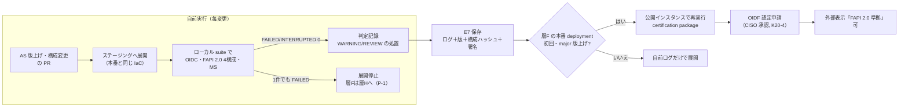
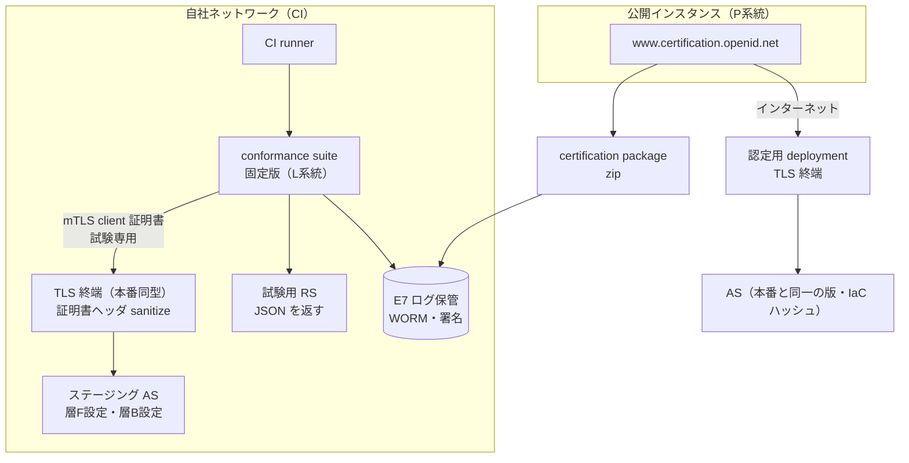
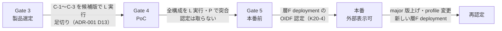

# OIDF conformance 計画（OAuth/OIDC/FAPI 2.0 適合試験の自前実行と認定）

> 文書ID: ASR-03 / 版: 0.1 / 状態: draft / 最終更新: 2026-10-15
> 対応要求: R-046, R-064, R-160, G-034, G-089（対応成果物欄に本書のパスまたは DL-60 を含む行と、deliverables.md の DL-60 行の主な対応要求）。関連: R-240, R-273, R-173, G-088
> 依存文書: CONVENTIONS.md, traceability/deliverables.md, traceability/R-requirements.md, traceability/G-goal-criteria.md, traceability/dissent-log.md（DS-19）, traceability/rejected-hypotheses.md（RH-030, RH-159）, 05_adr/ADR-020-fapi2-applicability.md, 05_adr/ADR-005-token-profile.md, 05_adr/ADR-001-build-buy-identity-provider.md, 05_adr/ADR-004-b2b-federation-linking-scim.md, 05_adr/ADR-022-integration-contract-standards.md, 05_adr/ADR-014-audit-data.md, 04_architecture/token-profile.md, 01_governance/assumptions-register.md, 01_governance/kri.md, 01_governance/loss-scenarios.md, 03_threat-model/attacker-model.md, research/RS-04-oauth-oidc-profile.md, research/RS-15-build-buy-tco.md, research/RS-16-parallel-development-governance.md, research/standards-status.md
> 作成方法: AI エージェント（Claude）が起草した。research ノートにない原典（OIDF の FAPI OP 試験ページ、OIDC RP 試験ページ、FAPI RP 試験ページ、認定提出の手順ページ 2 件、conformance suite の GitLab プロジェクトと README）は起草者が 2026-10-15 に取得して確認した。照合ログの traceability/ への追記は要対応である（本書からは編集していない）。本書は自己レビューであり、実在の CTO/CISO の決裁ではない（CONVENTIONS §8）[D]。

## 要旨（結論）

1. **自前実行は「CI のローカル実行」と「公開インスタンスでの事前確認」の 2 系統で行い、AS の版上げ・構成変更・新 deployment の前に必ず通す**。OIDF の conformance suite は MIT License で GitLab に公開され、ローカル実行の手順が案内されている [V][^9][^10]。CI では自社内に立てた suite を使い、層 F（ADR-020）を受け持つ AS について FAPI 2.0 Security Profile Final の 4 構成（private key＋MTLS、MTLS＋MTLS、private key＋DPoP、MTLS＋DPoP）と Message Signing の層 F で使う要素、全 AS について OIDC（Basic、Config、Form Post）を回す（ADR-020 D20-10-1、ADR-001 D12-1・TC-01-06）[D]。合否は「採用 profile の全試験で FAILED・INTERRUPTED が 0 件」とし、WARNING・REVIEW は全件を判定記録に残す [N][^12][D]。
2. **認定は PoC（Gate 4）では取らず、層 F の本番 deployment について Gate 5（本番前）までに取る。外部への「FAPI 2.0 準拠」表示は認定取得後に限る**（ADR-020 D20-10-4・K20-4）[D]。認定の提出物は公開インスタンス（www.certification.openid.net）で作る certification package と、実装者内の権限者が署名する Certification of Conformance であり、外部コンサルタントは署名できない [N][^13]。認定に成功すると提出したログ全体が公開されるので、試験専用の client と鍵を使い、提出前に失効させる [N][^13][D]。料金は FAPI で非会員 5,000 ドル／deployment であり、deployment の単位（法域パーティション 3 か cell 9 か）が未定義のため 1.5 万〜4.5 万ドルの桁になる [N][^7][D]（RS-15#2、ADR-020 §3.1）。
3. **PoC で実行できる。ただし PoC の結果は E7 の「自前実行ログ」にとどまり、認定ではない**。PoC 環境は合成データに限られ（DEC-4）、本番と同じ TLS 終端・mTLS 構成を再現しなければ層 F の試験として意味を持たない（ADR-020 D20-05-1）[D]。PoC で確かめるのは、(a) 採用候補版の合否（ADR-001 D13 の足切り）、(b) ローカル実行と公開インスタンスの結果の一致、(c) 試験の自動化に要する工数（NA20-03 の検証）の 3 点である [D]。適合試験は FAPI Attacker Model の範囲のプロトコル実装しか確かめず、AS 上の RCE・DB 漏えい・鍵管理・正規権限の濫用は確かめない [N][^3]（RS-04#50）。これらは pentest（DL-59）と負例試験（DL-22）で別に閉じる [D]。

---

## 1. 目的と範囲

### 1.1 本書が答える問い

| # | 問い | 主な R/G | 節 |
|---|---|---|---|
| Q1 | （旧提案レビューは OAuth/OIDC 適合試験を独立保証の一部に挙げた [D][^1]）どの profile・試験構成を、どの対象（OP／RP／client）に対して回すか | R-064, G-089, R-046 | §3 |
| Q2 | 試験環境をどう構成するか（ローカル suite、公開インスタンス、TLS 終端、試験用 client・鍵） | R-064 | §4 |
| Q3 | 合否と、不合格時に何を止めるか | G-089, G-034 | §5 |
| Q4 | ログを何として、どこに、どれだけ保存するか | G-089（E7） | §6 |
| Q5 | 認定をいつ、どの条件で取るか。費用は | R-064, R-160, G-089 | §7 |
| Q6 | PoC で実行できるか。何が残るか | R-064 | §8 |

### 1.2 範囲外

- 製品選定そのもの（DL-13、ADR-001）と FAPI 必須範囲の決定（ADR-020 K20-1）は本書で決めない [D]。
- SAML の assertion injection（R-046 のうち SAML 接続）は OIDF の試験対象ではないので、負例試験（ADR-004 TC-004-03〜-05・-16）と pentest（DL-59）で閉じる [D]。
- 第三者評価者による conformance ログの独立確認は、範囲・手法を DL-30（rfp-sow）に委ね、本書は確認対象の様式（§6）を定める [D]。

### 1.3 前提（A-ID）

| A-ID | 値（基準） | 本書での使い方 |
|---|---|---|
| A-013 | 外部 client 800・grant 3 万（成長 2,500・12 万） | 層 F の client 側試験の自己実行を課す対象の上限 |
| A-054 | プラットフォーム 24 FTE | 試験の運用要員の内数（NA20-03） |
| A-063 | リージョン 4 | deployment 数の上限側の見積り |
| A-081 | 高保証要求テナント 50（範囲 10〜200） | F6 の認定需要。ADR-001 D12 の足切りを掛ける理由 |
| A-101 | 再決裁周期（初回 3 年以内、以後 5 年以内） | 認定の再取得を再決裁の証拠に含めるか（§7.4） |

**新規仮定（前提台帳へ追加要）**: 前提台帳は本書から編集しない [D]。

| 仮 ID | 内容 | 扱い |
|---|---|---|
| NA60-01 | 認定を取る「deployment」の単位 | TBD（所有者 CISO、期限 Gate 4 終了時、決め方: ADR-013 の cell 構成確定後に、OIDF へ単位の解釈を照会し、§7.3 K60-1 で決める） |
| NA60-02 | E7 ログの保持期間 | TBD（所有者 CISO＋法務、期限 Gate 3、決め方: ADR-014 の記録区分に「適合試験ログ」を追加し、再決裁周期 A-101 と第三者評価の遡及範囲から下限を決める） |
| NA60-03 | 1 回の全構成実行の所要時間 | TBD（所有者 プラットフォームチーム長、期限 Gate 4、決め方: TC-60-03 の実測。CI の待ち時間と展開頻度の上限を決める） |
| NA20-03 | 試験の運用要員（ADR-020 で既出、未登録） | 0.5〜1 FTE の桁の仮置き。TC-60-03 で検証する [D][A-054] |

### 1.4 関連する脅威・損失シナリオ

| 区分 | ID | 本書との関係 |
|---|---|---|
| 攻撃者 | ATK-01, ATK-05, ATK-15 | FAPI の A1・A2・A3a・A5 に当たる能力に対し、PAR・sender constraint・client 認証の実装の正しさを試験で示す [D]（attacker-model §5） |
| 攻撃者 | ATK-04 侵害された顧客 IdP | 本基盤が RP として顧客 OIDC IdP を受ける経路で、iss・nonce・aud の検証を RP 試験で示す（R-046）[D] |
| 攻撃者 | ATK-08, ATK-11, ATK-17, ATK-18 | FAPI Attacker Model の範囲外 [N][^3]（RS-04#50）。本書の試験は証拠にならない [D] |
| 損失 | S-15 第三者連携 token の大量窃取 | 層 F の sender constraint が実装どおり働くことの証拠 [D] |
| 損失 | S-03 顧客 IdP 侵害・IdP 追加 | RP 起点・期待 IdP 検証（ADR-004 D04-06・D04-11）の OIDC 側の証拠 [D] |
| KRI | K-25 未解決 Critical/High | 層 F の試験の FAILED を High として計上する（§5.2）[D] |

---

## 2. 前提とする事実（原典）

| # | 事実 | 種別 | 根拠 |
|---|---|---|---|
| F-1 | OIDF は FAPI 2.0 Security Profile Final と Message Signing Final の適合試験と認定を、AS と client の双方向けに提供すると 2025-07-09 に告知した。Message Signing の Final 承認は 2025-09-26 の告知による | [N] | [^5]（RS-04#52）、[^4] |
| F-2 | OIDF の FAPI OP 試験ページは、FAPI 2.0 Security Profile Final と Message Signing Implementers Draft 1 を対象に挙げ、Message Signing Final を挙げていない。HTTP Message Signatures は現時点で支援しないと記す。ログインは試験データ保護のためで、誰でも使えると記す。DPoP の記載はない | [N] | [^8]（確認日 2026-10-15） |
| F-3 | FAPI 2.0 Final の OP 認定一覧は MTLS＋MTLS、MTLS＋DPoP、private key＋MTLS、private key＋DPoP、OpenID Connect、Message Signing の JAR、JARM の 7 列で認定を記録する | [N] | [^6]（RS-15#4） |
| F-4 | 認定は特定の版・deployment が特定の日に試験に通った記録であり、後の版の適合を示さない | [D] | RS-15#8、RH-030 |
| F-5 | conformance suite は GitLab で公開され、MIT License と表示され、Production deployment として www.certification.openid.net を挙げる。README はローカル実行の手順（wiki）へ案内する | [V] | [^9][^10] |
| F-6 | 認定パッケージは suite の「Publish for certification」で作る。全試験が FINISHED であること、WARNING 付きの結果は受け付けられること、成功時には提出ログ全体が公開され、client 資格情報・秘密鍵を含み得るので提出前に client の無効化と鍵の失効を強く推奨すること、Certification of Conformance の試験 suite 欄に「www.certification.openid.net」と suite の版を書くこと、署名は実装者の権限者に限り外部コンサルタント等の第三者は署名できないこと、を定める | [N] | [^13]（確認日 2026-10-15） |
| F-7 | 認定申請は、試験の完了と公開、料金の支払い、宣言書への電子署名の 3 部からなり、署名が済むまで処理されない。複数 profile は profile ごとの zip を 1 回の申請に添付する | [N] | [^14]（確認日 2026-10-15） |
| F-8 | OIDC の RP 試験では、profile のすべての試験が PASSED・REVIEW・WARNING・SKIPPED のいずれかである必要があり、FAILED と INTERRUPTED は認定を妨げる。「認定プログラム外」と表示された試験計画は認定に使えない | [N] | [^12]（確認日 2026-10-15）、RS-16#56 |
| F-9 | FAPI の RP 試験ページは FAPI-RW ID2 と FAPI 1 Final の RP を対象として記し、FAPI 2.0 の client 試験計画は記載していない。同ページは認定の提出には www.certification.openid.net を使わなければならないと記す | [N] | [^15]（確認日 2026-10-15） |
| F-10 | 自己認定料は FAPI 1/FAPI 2 で会員 1,000 ドル・非会員 5,000 ドル、OpenID Connect で会員 700 ドル・非会員 3,500 ドル、いずれも新しい deployment ごと。OP と RP は別払い。FAPI は 1 回の料金で複数 profile を認定できる。料金表は予告なく変わり得る | [N] | [^7]（RS-15#2） |
| F-11 | FAPI 2.0 の Keycloak・Ory・ZITADEL の行は認定一覧にない。node oidc-provider >= 9.2.0 が 7 列すべてで認定を持つ | [N] | [^6]（RS-15#4〜#6） |

- F-2 と F-3 は Message Signing の版の扱いで食い違う。試験ページの更新が遅れている可能性があり、Message Signing Final の試験計画の有無は §8 の TC-60-02 で suite 上で確かめる（TBD、所有者 CISO、期限 Gate 4）[D]（ADR-020 D20-10-2、DS-19）。
- F-9 から、FAPI 2.0 の client 側の試験計画名と提供状況は試験ページでは確認できていない（F-1 の告知は client 向けの提供を述べる）。参照 SDK・BFF の client 試験（§3.3）は、Gate 4 で suite 上の計画一覧を確認してから確定する（TBD、所有者 CISO、期限 Gate 4）[D]。

---

## 3. 対象 profile と試験構成

### 3.1 対象マトリクス

| # | 試験対象（役割） | 実装 | profile／試験構成 | 必須の条件 | 根拠 |
|---|---|---|---|---|---|
| C-1 | AS（OP）全 deployment | 採用 AS 製品（第一候補 Keycloak） | OIDC Basic、Config、Form Post（OIDC Core errata set 2 [N][^11]） | 全 deployment（層 B を含む） | ADR-001 D13-1・TC-01-06 [D] |
| C-2 | 層 F を受け持つ AS | 同上（不合格時は ADR-001 D12-2 の node-oidc-provider 系） | FAPI 2.0 SP Final: private key＋MTLS、MTLS＋MTLS | 層 F の全 deployment | ADR-020 D20-05・D20-06・D20-10-1 [D] |
| C-3 | 層 F を受け持つ AS | 同上 | FAPI 2.0 SP Final: private key＋DPoP、MTLS＋DPoP | K20-2 によらず常に実行（採否判定と、後から DPoP 構成を許す場合の再試験を省くため） | ADR-020 D20-10-1、ADR-001 D12-1 [D] |
| C-4 | 層 F を受け持つ AS | 同上 | Message Signing: JAR、JARM（F6 で有効化し得る要素） | F6 の契約テナントがいる deployment | ADR-020 D20-07-2 [D] |
| C-5 | 層 F を受け持つ AS | 同上 | introspection 応答の署名（RFC 9701、Message Signing の要素） | 層 F の全 deployment | ADR-020 D20-07-1 [D]。suite 上の試験の有無は未確認（TC-60-02） |
| C-6 | 本基盤（RP として顧客 OIDC IdP を受ける） | AS 製品の federation 機能 | OIDC RP: Basic（code）、Form Post 版。必要に応じ logout | 顧客 OIDC IdP 接続を提供する全 deployment | R-046、ADR-004 §7.2 [D]、[^12] |
| C-7 | 参照 SDK・第一者 BFF（client） | プラットフォーム提供 | FAPI 2.0 client 試験（構成は C-2・C-3 に対応） | 層 F の scope を使う版 | ADR-020 D20-10-5 [D]。計画の提供状況は TBD（§2） |
| C-8 | 第三者の層 F client | 連携事業者 | FAPI 2.0 client 試験の自己実行 | 層 F の登録条件 | ADR-020 D20-10-5、ADR-022 D-6-5 [D] |

- C-1〜C-6 は自社の責任で回す [D]。C-8 は連携事業者に自己実行を課し、本基盤は結果（公開インスタンスの plan の公開リンクか、ログ）を登録審査で確かめる [D]。審査の工数は q3×800 件（NA20-01）に比例するので、Gate 2 の範囲決定（K20-1）の後に見積もる（TBD、所有者 プロダクト責任者）[D][A-013]。
- 層 F の alg を ES256・PS256 に絞る設定（ADR-020 D20-08-3）で C-2〜C-4 を回し、FAPI の mandatory な振る舞いの除去に当たらないことを確かめる（TC-20-01）[D]。部分集合への絞り込みで不合格になった場合は、その試験の内容を記録して ADR-020 の見直しに回す [D]。
- HTTP Message Signatures は suite が支援せず [N][^8]、FAPI 2.0 Http Signatures は draft である [N]（standards-status SS-C08）。リソース要求の否認防止は試験対象にしない [D]。

### 3.2 R-046（assertion injection）への寄与と限界

| 経路 | 本書の試験 | 閉じない部分と持込み先 |
|---|---|---|
| 本基盤が RP となる OIDC 接続 | C-6 で、state・nonce・iss の検証、別 IdP からの応答の拒否を suite の負例で確かめる [D] | 期待 IdP の allowlist（テナント単位、ADR-004 D04-10）は suite の範囲外。TC-004-03〜-05 と pentest（DL-59） |
| 本基盤が OP となる経路（RFC 9207 の iss、PAR） | C-2・C-3 の FAPI 試験 [D] | mix-up の client 側検証は C-7・C-8 |
| SAML 接続（既存接続の約 9 割、ADR-004） | 対象外 | TC-004-16（XSW）、DL-59 |

- したがって R-046 の閉じ方 D のうち、本書が与える証拠は OIDC 経路の E7 に限られる [D]。

---

## 4. 実行環境の構成

### 4.1 2 系統の実行

| 系統 | 用途 | suite | 対象 AS | 認定に使えるか |
|---|---|---|---|---|
| L（ローカル） | CI のゲート。毎変更 | 自社ネットワーク内に立てた suite（版を固定し、更新は四半期ごとに追随） | ステージング（本番と同じ IaC・設定） | 使えない（提出物は www.certification.openid.net の記載を要する [N][^13]。FAPI RP ページは公開インスタンスの使用を求める [N][^15]） |
| P（公開インスタンス） | 認定の取得と、L の結果の定期突合 | www.certification.openid.net | 認定用 deployment（§7.2） | 使える |

- suite の版を固定するのは、試験の追加・変更で合否が変わったときに、AS の変更と suite の変更を切り分けるためである [D]。suite の版上げは独立の PR とし、旧版との差分の試験結果を記録する [D]。
- P 系統では suite が AS へ外部から接続するので、認定用 deployment は公開インターネットから到達できる必要がある [D]。本番の層 F endpoint を直接試験に使うかは K60-2 で決める（§7.3）[D]。

### 4.2 構成図

### 4.3 構成の固定値

| 項目 | 値 | 根拠 |
|---|---|---|
| TLS 終端 | 本番と同型（mTLS のホスト名分離、client 証明書ヘッダの sanitize）。異なる構成での合格は層 F の証拠にしない | ADR-020 D20-05-1、RFC 9700 §4.13 [N]（RS-04#24） |
| 試験用 client・鍵 | 試験専用の client と鍵（client 認証鍵、mTLS 証明書、JWKS）を試験ごとに発行し、本番の発行系（ADR-007）と別の試験用 CA・鍵で作る。P 系統の提出前に無効化・失効する | 提出ログ全体が公開され、資格情報・秘密鍵を含み得る [N][^13] |
| JWKS の alg | 両 client の JWKS に alg を入れる | FAPI OP 試験ページの手順 [N][^8] |
| 試験用 RS | JSON を返す RS の URL を用意する | 同上 [N][^8] |
| データ | 合成の利用者・テナントだけ。実利用者の個人情報を使わない | DEC-4（合成データ限定）[D]。P 系統はログが公開されるため [N][^13] |
| 利用者操作 | 認可画面の login・同意を自動化する（ブラウザ自動化）。期待されるエラー画面は画面記録を保存する | 手順は試験ごとに login や画面記録を求める [N][^8] |

---

## 5. 合否と停止規則

### 5.1 合否基準

| 系統・対象 | 合格 | 根拠 |
|---|---|---|
| L・P 共通 | 採用した profile の全試験計画で、全試験が FINISHED、FAILED と INTERRUPTED が 0 件 | 認定の要件（RP は FAILED・INTERRUPTED が認定を妨げる [N][^12]。OP は全試験 FINISHED、WARNING 付きは受付 [N][^13]）。合否の線は自社判断 [D] |
| WARNING | 全件に判定記録（原因、仕様上の強度、処置か受容）を付ける。層 F で WARNING を残す場合は CISO が受容票（DL-05）で受容する | 認定は WARNING を受け付けるが [N][^13]、WARNING は推奨（should）水準の逸脱を含み得るので放置しない [D] |
| REVIEW | 期待されるエラー画面等の証拠（画面記録）を添え、作成者以外が確認する | 試験ページの手順 [N][^8] [D] |
| SKIPPED | 構成上の理由（例: 機能を無効にしている）を記録する。層 F の mandatory な機能による SKIPPED は不合格扱い | FAPI の mandatory な振る舞いは除去できない [N][^2]（RS-04#48）[D] |

- 「採用 profile の全試験に合格」（G-089）を本書では上表の合格と定義する [D]。

### 5.2 不合格時の扱い

| 事象 | 既定動作 | 決める人 | 根拠 |
|---|---|---|---|
| L 系統で C-1〜C-6 の FAILED | 展開を止める（CI ゲート）。修正か版の差し戻し | プラットフォームチーム長 | ADR-020 D20-10-3 [D] |
| 本番稼働中の版で新たな FAILED（suite 更新で判明） | High として是正追跡（E11）と K-25 に計上。層 F の該当構成は ADR-020 P-1 (a) に従い層 H へ下げる判断を 30 日以内に行う（日数は仮置き。DL-20 で確定、所有者 CISO、期限 Gate 3） | CISO | ADR-020 §2.15 P-1、K-25 [D] |
| 採用候補版が Gate 3 の選定で C-2・C-3 に不合格 | ADR-001 D13 の足切り。ADR-001 D12-2・T-02 へ | CTO＋CISO | ADR-001 D12-2 [D] |
| P 系統と L 系統の結果の不一致 | 不一致の原因を記録するまで L 系統の結果を証拠に使わない | CISO | §8 TC-60-04 [D] |

- 本番稼働中の FAILED を High とするのは、層 F の統制の一部が実装どおりに働かないことを第三者が再現できる形で示すからである [D]。重大度区分の正本は DL-59・DL-110 であり、本書の区分は提案である [D]。

---

## 6. ログの保存（E7）

### 6.1 保存する内容

| 項目 | 内容 |
|---|---|
| 試験ログ | suite の試験計画ごとのログ（L 系統はエクスポート、P 系統は certification package の zip）と、REVIEW の画面記録 |
| 版 | AS 製品の版、AS 設定（IaC）のコミットハッシュ、suite の版、試験計画名と variant |
| 構成 | TLS 終端・client 登録（試験専用）の設定スナップショット。E10 と同じ署名付きスナップショットとする |
| 判定 | §5.1 の WARNING・REVIEW・SKIPPED の判定記録と判定者 |
| 環境 | 実行日時、実行系統（L/P）、対象 deployment 名 |

### 6.2 保存の規則

- E7 は ADR-014 の監査保管の仕組み（WORM、署名と封印）に置き、作成後の改変を検出できるようにする [D]（ADR-014）。保持期間は NA60-02（TBD）とし、少なくとも「その版が稼働している期間＋次の再決裁（A-101）」を下限の候補とする [D][A-101]。
- L 系統のログにも試験専用の鍵・client 資格情報が含まれ得るので、試験後に鍵を失効させ、ログの閲覧権限を CISO 配下の保証担当と独立評価者に限る [D]。
- 第三者評価者（DL-30）には、E7 と再実行に必要な情報（suite の版、試験計画、構成ハッシュ）を渡し、独立に再実行できることを確認させる [D]（G-034、ADR-020 §7.2）。

---

## 7. 認定取得の条件・時期

### 7.1 時期

| 時点 | 実行 | 認定 | 証拠 |
|---|---|---|---|
| Gate 3（製品選定） | 候補の採用予定版で C-1〜C-3 を L 実行（RS-15 §5 の評価軸） | 取らない | E7（選定記録 DL-13） |
| Gate 4（PoC） | C-1〜C-6 を L 実行、P で 1 回突合。C-7 は計画の提供状況を確認 | 取らない（PoC 環境は本番 deployment ではない） | E7、TC-60-01〜-04 |
| Gate 5（本番前） | 層 F の本番 deployment（または K60-2 で決めた認定用 deployment）で P 実行 | 層 F の deployment で FAPI 2.0（C-2・C-3、C-4 は F6 があれば）と OIDC OP（C-1）を申請 | 認定記録、E7 |
| 本番後 | 毎変更の L 実行。年 1 回の P 突合 | §7.4 の再認定条件 | E7、継続保証（DL-32） |

### 7.2 認定の条件

1. 対象 deployment の全試験計画が §5.1 の合格を満たす [D]。
2. 認定用の client・鍵を提出前に無効化・失効し、ログに実利用者のデータがない [N][^13][D]。
3. Certification of Conformance に署名する権限者を決める（署名は実装者内の権限者に限られる [N][^13]）。署名者は CISO を案とする（DEC-5 の範囲）[D]。
4. 認定は「どの deployment・どの版が、どの日に」合格した記録であり、以後の版の適合は L 系統の E7 で示す、と外部表示に注記する [D]（F-4）。
5. AS が ADR-001 D12-2 により製品を分けた場合は、層 F を受け持つ実装（issuer）ごとに認定を取る [D]。

### 7.3 決裁案

| # | 論点 | 選択肢 | 推奨 | 帰結 | 決める人・期限 |
|---|---|---|---|---|---|
| K60-1 | 認定を取る deployment の単位（NA60-01） | (a) 法域パーティション単位（3）／(b) cell 単位（試算 9、ADR-013 N13-1）／(c) 層 F の代表 1 deployment だけ | (a)。各パーティション内の cell は同一の版・IaC ハッシュであることを L 系統の E7 で示す | (a) 非会員で 1.5 万ドルの桁 [N][^7][D]。(b) 4.5 万ドルの桁で表示の正確さは最大。(c) 0.5 万ドルだが、他パーティションの表示根拠が自前ログだけになる | CISO。Gate 4 終了時（OIDF への単位の照会後） |
| K60-2 | P 系統の試験先 | (a) 本番と同一の版・IaC ハッシュの認定用 deployment を公開して試験／(b) 本番の層 F endpoint を試験用テナントで直接試験 | (a)。本番に試験専用 client を登録しない | (a) 本番との差分がないことを構成ハッシュで示す手間が残る。(b) 本番に試験用 client・鍵を置き、公開されるログに本番 endpoint の構成が載る | CTO＋CISO。Gate 4 |
| K60-3 | OIDF の会員になるか | (a) 会員／(b) 非会員 | TBD。会費は本書で確認していない | 認定料は会員 1,000 ドル・非会員 5,000 ドル／deployment [N][^7] | 調達責任者＋CISO（DL-30）。Gate 4 |
| K60-4 | 層 F で WARNING を残したまま本番に出すか | (a) 受容票付きで可／(b) 不可 | (a)。件数と内容を CISO が確認する | (b) は認定の要件より厳しく、製品の修正待ちで本番が遅れる | CISO。Gate 5 |

- ADR-020 K20-4（認定を取るか）は本書では再決定しない。本書は K20-4 が (a) と決まった場合の条件と時期を定める [D]。

### 7.4 再認定の条件

- 次のいずれかで再認定を申請する（案）[D]。(1) AS 製品の major 版上げ、(2) 層 F の試験構成の追加・変更（例: K20-2 で DPoP 構成を本番で有効にする）、(3) 新しい層 F deployment の開設、(4) FAPI 2.0 の改版（standards-status の年次確認、SS-C05）。
- minor 版上げは L 系統の E7 で示し、再認定しない [D]。OIDF の手順ページは認定の有効期限や更新を定めていない（確認した範囲）[N][^13][^14]。年数による再認定の周期は TBD（所有者 CISO、期限 Gate 5、決め方: Keycloak の major 版周期と A-101 の再決裁周期から逆算）[D]。

---

## 8. PoC での実行可否

| 観点 | 判定 | 根拠 |
|---|---|---|
| suite の入手と自社内実行 | 可。OSS（MIT）で、ローカル実行の手順が案内されている | [V][^9][^10] |
| 公開インスタンスでの実行 | 可。ただし PoC の AS を公開インターネットから到達可能にする必要がある | [N][^8][D] |
| 合成データでの実行 | 可。試験は suite が作る要求と試験専用 client で行う | DEC-4 [D] |
| 本番同型の TLS 終端 | 要構築。満たさない場合、層 F の試験の結果を証拠にしない | ADR-020 D20-05-1 [D] |
| 認定の取得 | しない。PoC 環境は本番 deployment ではない | F-4 [D] |
| FAPI 2.0 client 試験（C-7） | 未確認。suite 上の計画一覧で確認する | F-9 [D] |

### 8.1 PoC の試験ケース案（TC-ID は 12_poc で採番する）

| TC 案 | 仮説・試験 | 合否基準 | 紐付け |
|---|---|---|---|
| TC-20-01 / TC-20-02 | ADR-020 のとおり（層 F の mTLS 構成・DPoP 構成・Message Signing の全試験合格） | §5.1 | G-089 |
| TC-01-06 | ADR-001 のとおり（OIDC Basic・Config・Form Post と FAPI 2.0） | §5.1 | ADR-001 D13 |
| TC-60-01 | 本基盤の RP 機能（C-6）が OIDC RP 試験の Basic・Form Post で合格する | §5.1 | R-046 |
| TC-60-02 | suite 上に Message Signing Final（JAR、JARM、introspection 応答の署名）と FAPI 2.0 client の試験計画があるかを確認し、ある計画は実行する | 有無の記録。ある計画は §5.1 | F-2、F-9、C-5、C-7 |
| TC-60-03 | 全構成（C-1〜C-6）の 1 回の実行所要時間と、自動化に要した工数を測る | 記録（合否値なし）。NA60-03・NA20-03 に入力 | E4 運用要員 |
| TC-60-04 | 同じ版・同じ IaC ハッシュの AS に対し、L 系統と P 系統の結果（試験ごとの判定）が一致する | 不一致 0 件。不一致は原因を記録 | §4.1 |
| TC-60-05 | TLS 終端の構成を本番と変えた環境（終端位置の違い）で、合否が変わるかを確かめる | 変わる場合は差分を記録し、本番同型以外の結果を証拠にしない | D20-05-1、TC-20-05 |
| TC-60-06 | 提出用ログに試験専用以外の資格情報・実データが含まれないことを、提出前の検査（秘密情報の走査）で確かめる | 検出 0 件 | §7.2 条件 2 |

---

## 9. 体制と役割

| 役割 | 担当 | 責任 |
|---|---|---|
| 実行・CI 保守 | プラットフォームチーム（認証・IdP 担当、A-054 の内数） | L 系統の実行、suite の版上げ、試験用 client・鍵の発行と失効 |
| 判定 | CISO 配下の保証担当（実装チームと別の報告系統） | §5.1 の WARNING・REVIEW・SKIPPED の判定記録、E7 の承認 |
| 認定申請・署名 | CISO（案） | Certification of Conformance の署名、K60-1〜K60-4 |
| 独立確認 | 独立評価者（DL-30、DL-07） | E7 の再実行による確認、Critical/High の閉鎖確認（G-034） |
| 連携事業者の client 試験の審査 | 連携窓口（DL-62・DL-66） | C-8 の結果の確認 |

- 判定者を実装チームから分けるのは、合否の線（特に WARNING の受容）を実装者が自分で引かないためである [D]（R-068 と同じ考え方。正本は DL-07）。

---

## 対応表（R/G）

抽出方法: traceability/R-requirements.md と traceability/G-goal-criteria.md を `oidf-conformance|DL-60` で Grep し、対応成果物欄に本書のパスまたは DL-60 を含む行（R-046、R-064、G-034、G-089）を抽出した。deliverables.md の DL-60 行の主な対応要求 R-160 を加えた。関連行として R-240・R-273・R-173・G-088 を参照した [D]。

| ID | 内容（要約） | 本書の節 | 閉じ方 | 状態 |
|---|---|---|---|---|
| R-046 | FAL2 assertion injection 対策（RP 起点、期待 IdP・audience 厳格検証） | §3.1 C-6、§3.2、TC-60-01 | D | 計画は本書。OIDC 経路の E7 は未取得（Gate 4）。SAML 経路と allowlist は ADR-004・DL-59 |
| R-064 | OAuth/OIDC/FAPI 適合試験 | §3〜§7、§8 | D | 計画は本書。実行・認定は未達（Gate 4・Gate 5） |
| R-160 | 高価値 API への FAPI 2.0 採否 | §3.1 C-2〜C-5（採否後の検証手段）、§7 | B | 採否は ADR-020 K20-1 で未決。本書は採った場合の検証と表示条件を担う |
| G-034 | 独立設計レビュー・conformance・pentest・red team の Critical/High が閉じている | §5.2（FAILED を High として K-25・E11 へ）、§6.2（独立再実行） | D | 未達（第三者評価と是正が要る） |
| G-089 | conformance suite を実行して合格し、必要な範囲で認定を取得 | §5.1（合格の定義）、§7（認定の条件・時期）、§6（E7） | D | 未達（実行は Gate 4、認定は Gate 5。K20-4・K60-1〜K60-4 は決裁前） |
| R-240（関連） | FAPI 2.0 を高価値 API の比較基準 profile とする（適合試験を含む） | §3 | A | 本体は DL-16・ADR-020 |
| R-273（関連） | 承認条件 8（conformance を含む独立評価） | §5.2、§6.2 | D | 未達 |
| R-173・G-088（関連） | token 誤用の負例試験 | §1.2（負例は DL-22 で閉じる） | C | 本書の範囲外。正本は DL-22 |

---

## 残課題

| # | 内容 | 所有者 | 期限 |
|---|---|---|---|
| O-1 | Message Signing Final・introspection 応答署名・FAPI 2.0 client の試験計画が suite にあるかの確認（TC-60-02） | CISO | Gate 4 |
| O-2 | deployment の単位（NA60-01）と OIDF への照会、K60-1 の決裁 | CISO | Gate 4 終了時 |
| O-3 | E7 の保持期間（NA60-02）を ADR-014 の記録区分へ追加 | CISO＋法務 | Gate 3 |
| O-4 | 本番稼働中の FAILED から層 H への判断までの日数（§5.2 の 30 日は仮置き）を DL-20 で確定 | CISO | Gate 3 |
| O-5 | NA60-01〜NA60-03 と NA20-03 の前提台帳への登録 | 前提台帳の所有者 | Gate 1 |
| O-6 | 本書で取得した research 外の原典（[^8]〜[^10]、[^12]〜[^15]）の照合ログを traceability/ に追記 | 照合ログの所有者 | Phase 4 |
| O-7 | 実行・認定・独立確認はすべて未達。達成済みとは扱わない（CONVENTIONS §8） | CISO | Gate 4〜5 |
| O-8 | ローカル実行の具体手順（wiki の Build & Run）の本文は本書の起草時に取得できなかった（未確認）。PoC 準備で確認する | プラットフォームチーム長 | Gate 4 入場前 |
| O-9 | 第三者の層 F client の試験結果を審査する工数（q3×800、NA20-01） | プロダクト責任者 | Gate 2 後 |

---

## 参考文献

[^1]: 本リポジトリ『20年運用を前提とした認証・認可基盤提案のCTO CISOレビュー.md』. （参照箇所: L89, L107, L125, L194, L246、確認日: 2026-10-15）
[^2]: OpenID Foundation FAPI WG (D. Fett, D. Tonge, J. Heenan)『FAPI 2.0 Security Profile』Final, 2025-02-22. https://openid.net/specs/fapi-security-profile-2_0-final.html （参照箇所: §5.3.2.1 NOTE 2（mandatory な振る舞いの除去の禁止）、確認日: 2026-10-03。RS-04#48、standards-status SS-C05）
[^3]: OpenID Foundation FAPI WG (D. Fett)『FAPI 2.0 Attacker Model』Final, 2025-02-22. https://openid.net/specs/fapi-attacker-model-2_0-final.html （参照箇所: §5〜§8（範囲外の脅威）、確認日: 2026-10-03。RS-04#50、SS-C06）
[^4]: OpenID Foundation『FAPI 2.0 Message Signing Final Specification Approved』2025-09-26. https://openid.net/fapi-2-message-signing-final-specification-approved/ （参照箇所: 告知の日付、確認日: 2026-10-03。RS-04#52、SS-C07）
[^5]: OpenID Foundation『FAPI 2.0 Security Profile and FAPI 2.0 Message Signing: Final Conformance Tests and Certifications Now Available』2025-07-09. https://openid.net/fapi2-0-final-conformance-tests-available/ （参照箇所: 本文（AS とクライアント向けの適合試験・認定の提供、Message Signing が public review 中である旨）、確認日: 2026-10-03。RS-04#52）
[^6]: OpenID Foundation『Certified FAPI 2.0 OP Security Profile Final & Message Signing Final』公開一覧（随時更新）. https://openid.net/certification/certified-fapi-2-0-op-security-profile-final-message-signing-final/ （参照箇所: 列見出し 7 列、node oidc-provider >= 9.2.0 行、他社行の有無、確認日: 2026-10-03。RS-15#4〜#6、SS-C22）
[^7]: OpenID Foundation『Self-Certification Fees』web ページ（版表記なし）. https://openid.net/certification/fees/ （参照箇所: OpenID Connect と FAPI 1 & FAPI 2 の会員・非会員料金、deployment ごとの支払い、OP/RP の別払い、改定の注記、確認日: 2026-10-03。RS-15#2）
[^8]: OpenID Foundation『Conformance Testing for FAPI 2 and FAPI1 Advanced-Final OPs』認証プログラムのページ. https://openid.net/certification/certification-fapi_op_testing/ （参照箇所: Supported FAPI specifications、試験手順（ログイン、計画作成、JWKS の alg、JSON を返す RS、画面記録）、HTTP Message Signatures 非支援の注記、"the system is open for anyone to use"、確認日: 2026-10-15。research ノート外）
[^9]: OpenID Foundation『conformance-suite』GitLab プロジェクト. https://gitlab.com/openid/conformance-suite （参照箇所: ライセンス表示（MIT License）、Production deployment の記載、確認日: 2026-10-15。research ノート外）
[^10]: OpenID Foundation『conformance-suite README.md』GitLab. https://gitlab.com/openid/conformance-suite/-/raw/master/README.md （参照箇所: ローカル実行の手順への案内（wiki の Developers/Build-&-Run）、対象仕様の列挙、確認日: 2026-10-15。research ノート外）
[^11]: OpenID Foundation『OpenID Connect Core 1.0 incorporating errata set 2』final, 2023-12-15. https://openid.net/specs/openid-connect-core-1_0.html （参照箇所: 版と状態、確認日: 2026-10-03。standards-status SS-C01）
[^12]: OpenID Foundation『OpenID Connect RP Testing』. https://openid.net/certification/connect_rp_testing/ （参照箇所: Basic・Implicit・Hybrid・Form Post・logout の試験計画、認定に必要な判定（PASSED・REVIEW・WARNING・SKIPPED、FAILED・INTERRUPTED の扱い）、認定プログラム外の計画、ログイン方法、確認日: 2026-10-15。RS-16#56 の原典を再取得）
[^13]: OpenID Foundation『Submission of Results for OP Certification』. https://openid.net/certification/fapi_op_submission/ （参照箇所: Publish for certification、FINISHED と WARNING の扱い、ログ公開と資格情報・鍵の警告、Certification of Conformance の試験 suite 欄と署名者の制限、料金、確認日: 2026-10-15。research ノート外）
[^14]: OpenID Foundation『How to submit your certification request』. https://openid.net/how-to-submit-your-certification-request/ （参照箇所: 3 部構成、profile ごとの zip、電子署名後に処理、確認日: 2026-10-15。research ノート外）
[^15]: OpenID Foundation『Conformance Testing for FAPI Read/Write RPs』. https://openid.net/certification/fapi_rp_testing/ （参照箇所: 対象（FAPI-RW ID2、FAPI 1 Final の RP）、提出には www.certification.openid.net を使う旨、client 側ログの提出、確認日: 2026-10-15。research ノート外）
