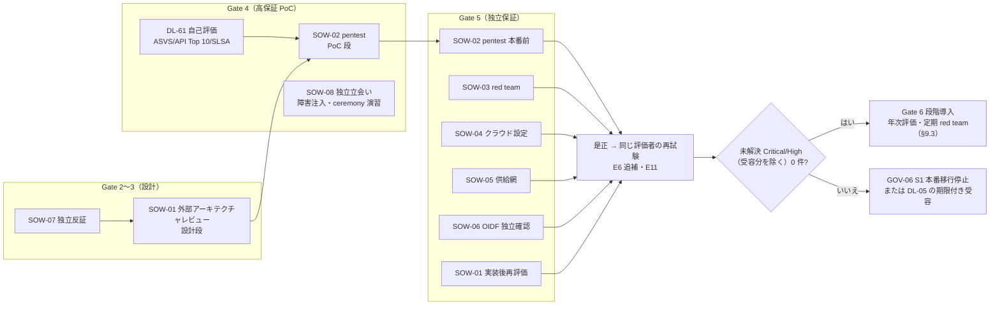

# 独立評価 RFP/SOW 群

> 文書ID: ASR-05 / 版: 0.1 / 状態: draft / 最終更新: 2026-10-15
> 対応要求: R-042, R-046, R-055, R-060, R-063〜R-066, R-069〜R-073, R-157, R-182, R-183, R-234, G-034, G-083, G-089, G-091, G-132（対応成果物欄に本書のパスまたは DL-30 を含む全行。全 22 件と閉じ方は末尾「対応表」）
> 依存文書: CONVENTIONS.md, traceability/deliverables.md（DL-30）, traceability/R-requirements.md, traceability/G-goal-criteria.md, traceability/dissent-log.md（DS-08, DS-09, DS-11）, 05_adr/README.md, 05_adr/ADR-001〜ADR-029（各 §7.2・§7.3「第三者評価で確かめること」）, 05_adr/reconciliation-notes.md, 01_governance/raci-governance.md（RACI-13, DP-2）, 01_governance/stop-authority.md（DP46-1）, 01_governance/kri.md（K-25, SRC-12）, 01_governance/assumptions-register.md, 02_requirements/operation-risk-tiers-assurance.md, 03_threat-model/attacker-model.md（ATK-01〜ATK-19）, 03_threat-model/threat-catalog.md, 04_architecture/root-of-trust.md（KRT-5）, 04_architecture/cell-blast-radius.md（§9.4）, 06_controls/applicability.md, 06_controls/control-mapping-ledger.md（C-013, C-079）, 06_controls/mappings/identity-appsec.md（KM-1）, 06_controls/mappings/cloud-supplychain.md, research/RS-01, RS-04, RS-05, RS-08, RS-15, research/standards-status.md
> 並行文書（本書と同時に作成中。境界は §1.2）: 09_assurance/independent-assurance-plan.md（ASR-01, DL-07）, 09_assurance/pentest-redteam-plan.md（ASR-02, DL-59）, 09_assurance/oidf-conformance-plan.md（ASR-03, DL-60）, 09_assurance/self-assessments.md（ASR-04, DL-61）, 09_assurance/continuous-assurance-plan.md（ASR-06, DL-32）, traceability/independent-challenge-review.md（DL-108）

本書は、第三者でしか閉じない要求（閉じ方 D）を調達できる状態にするための、提案依頼書（RFP）と作業範囲記述書（SOW）の共通条項と個別 SOW の雛形である [D]。調査・起草には AI エージェント（Claude）を用いた。本書の判定は自己レビューであり、実在の CTO/CISO の決裁や第三者評価ではない（CONVENTIONS §8）[D]。本書を作っても評価は 1 件も実施されておらず、本書が扱う D 区分の要求はすべて未達である [D]。

表のセルのうちタグのないものは設計推論 [D] であり、本注記で個別タグに代える。事実を述べるセルには個別にタグと脚注を付けた。

---

## 0. 結論

1. **RFP は 8 本の SOW（SOW-01〜SOW-08）に分け、全 SOW に共通条項（§2）を課す** [D]。7 本は DL-30 の要点と本書の担当範囲が挙げる評価（外部アーキテクチャレビュー、cross-tenant pentest、red team、クラウド設定レビュー、供給網レビュー、OIDF 適合の独立確認、独立反証レビュー）である [D]。もう 1 本は、R-055（L0 ceremony の第三者立会い）と各 ADR の「独立立会人」要求をまとめた独立立会いの SOW-08 である [D]（ADR-007 D7-51、root-of-trust.md KRT-5 から導出）。G-132 の 6 項目（独立性要件、利益相反の申告、範囲、手法、成果物の形式、再試験の条件）は、8 本すべてに置いた（§11 の自己点検表）[D]。
2. **独立性の要件は NIST SP 800-53 Rev.5 の CA-2(1) と CA-8(1) の考え方を写し、「報告系統の分離」と「発注・格付けへの実装側の不関与」で担保する** [D]。CA-2(1) は、評価者を開発・運用・維持・管理と統制有効性の判定について利益相反のない者とし、自分の仕事を評価しない、被評価組織の経営者・従業員として行動しない、発注者の利益を代弁しない、を公平性の条件に挙げる [N][^1]。同じ解説は、システム所有者が契約過程に直接関与しないことを独立性の判断要素に挙げる [N][^1]。本書はこれに従い、契約主体を CISO 組織（立会いの一部は内部監査）とし、CTO 系統（実装側）は事実誤認の指摘だけを行い、格付けを変更できないとする [D]（R-068、DP46-1 の推奨 (a)）。
3. **OIDF の認定は自己認定であり、それだけでは独立評価にならない** [N][^10]（RS-15#1）。そのため SOW-06 は「認定取得の代行」ではなく、「採用版・本番相当構成での conformance suite 実行の独立確認（再実行または立会い）」として発注し、認定の申請は自社が行う [D]。認定を取るかどうかは ADR-020 の K20-4（推奨 (a) 層 F の全 deployment で取得、決定者 CISO、期限 G5）で未決であり、本書は決め直さない [D]。
4. **cross-tenant pentest の手法は ASVS 5.0.0 の要件 ID と API Security Top 10 2023 の分類で記録させるが、合否は「未解決の Critical/High 0 件」で判定する** [D]（G-034, G-083）。ASVS 5.0.0 は要件（must）だけを含むと自らを定義する [N][^4]（RS-08#1）。API Top 10 2023 は自らを awareness document と位置付けるため、試験の観点の分類には使うが、適合の基準には使わない [N][^5]（RS-08#7）。ASVS の L2/L3 の適用範囲は KM-1（推奨: 全経路 L2、層 F・privileged/P・break-glass/P・support の昇格経路は L3）で未決である [D]。
5. **Critical/High の格付けは評価者が行い、是正後の再試験も原則として同じ評価者が行う** [D]。閉じ方は「是正＋再試験合格」か「経営承認付きの期限付き受容（DL-05）」の 2 つに限る [D]（G-034）。再試験の結果は E6 の追補として発行させ、所見台帳を機械可読形式で DL-110（E11）と K-25 に流す [D]。
6. **期間・人員・費用の値は本書に置かない** [D]。値を支える A-ID・実測・見積りがないためである [D]。各 SOW に「規模の入力（A-ID・ADR から数えられる対象数）」と「決め方（RFI の見積り比較）」を置き、値は TBD（所有者・期限付き）とした [D]。唯一の公表値は OIDF の FAPI 認定料（非会員 5,000 ドル／deployment）である [N][^11]（RS-15#2）。
7. **経営判断が要る点を 5 件の決裁案（RS-D1〜RS-D5）にした**（§10）[D]。ロットの分割と兼任の制限、SOW ごとの独立性の水準、実在の従業員を対象とするソーシャルエンジニアリングの可否、評価者の交代周期、複数年の枠契約と予算枠である [D]。いずれも決定していない [D]。
8. **対応表の 22 件（R 17 件、G 5 件）のうち、本書で閉じたのは G-132 の 1 件（区分 A、作成者以外の判定待ち）である** [D]。残る 21 件は第三者の実施（D）を要し、本書はその調達準備（RFP/SOW）までを担う [D]。

---

## 1. 位置付け・範囲・読み方

### 1.1 本書が決めるものと決めないもの

| 本書が決める | 本書が決めない（所在） |
|---|---|
| RFP の共通条項（独立性要件、利益相反申告、データ保護、交戦規則の共通部分、重大度格付け、成果物形式、再試験）（§2） | 独立保証の全体計画、Gate ごとの関与時期、評価者の任命（DL-07、DEC-5、RACI-13） |
| SOW-01〜SOW-08 の範囲・手法・成果物・再試験・期間と体制の決め方（§3〜§9） | 攻撃シナリオの詳細、交戦規則の個別条項（DL-59）、conformance の自前実行計画（DL-60） |
| 評価者の選定基準と提案書の様式（§2.8） | 自己評価の計画と結果（DL-61）。本書は自己評価の結果を評価者への入力として渡す |
| 年次独立評価・定期 red team を調達する契約の形（§9.3） | 本番後の周期そのもの（DL-32）、KRI（DL-06） |
| managed 製品・global 集約を採る場合の追加要求（§9.2） | 製品選定（DL-13、ADR-001）、cell 構成（ADR-013） |
| — | 指摘の是正・受容の判断（DL-05、DL-110、GOV-06 S1） |

### 1.2 並行文書との境界

- DL-07（独立保証計画）は「誰が・いつ・どの Gate で」評価するかを決め、本書は「何を・どう発注するか」を決める [D]。両者で独立性要件が食い違った場合は、DEC-5 の決裁で DL-07 側を正とし、本書を改版する [D]。
- DL-59（pentest・red team 計画）は攻撃シナリオと交戦規則の詳細を持つ [D]。本書の SOW-02・SOW-03 は、DL-59 を評価者に渡す前提で、契約上の範囲・成果物・再試験だけを定める [D]。
- DL-60（OIDF conformance 計画）は自社による suite 実行を定め、本書の SOW-06 はその独立確認を定める [D]。
- DL-108（独立反証レビュー記録）のうち AI による自己反証は本リポジトリ内で行う。報告系統外の独立反証は SOW-07 で調達する [D]（deliverables.md の DL-108 行「報告系統外の独立反証は未達として扱う」）。

### 1.3 RFP 群の一覧

| SOW | 名称 | 主な要求 | 閉じる対象 | 主な攻撃者（ATK） | 実施時期（Gate） | 証拠 |
|---|---|---|---|---|---|---|
| SOW-01 | 外部アーキテクチャレビュー | R-063, R-069, R-234 | G-034（設計レビュー部分） | 全 19 類型の網羅性 | G3（設計）、G5（実装後の再評価） | E6 |
| SOW-02 | cross-tenant pentest（PEP bypass を含む） | R-046, R-060, R-065, R-069〜R-071, R-234 | G-034, G-083 | ATK-01〜06, 10, 11, 15 | G4（PoC）、G5（本番前） | E6, E11 |
| SOW-03 | red team | R-042, R-066, R-183, R-234 | G-034 | ATK-01(L3), 04, 07〜09, 13〜16 | G5、以後定期 | E6, E8, E11 |
| SOW-04 | クラウド設定レビュー | R-069, R-072 | G-091 | ATK-08, 11, 12, 19 | G5、以後年次 | E6, E10 |
| SOW-05 | 供給網レビュー | R-069, R-073 | G-091 | ATK-07, 17, 18 | G5、以後年次 | E6, E10 |
| SOW-06 | OIDF 適合の独立確認 | R-046, R-064 | G-089, G-034 | FAPI の A1〜A5（ATK-01, 04, 05 の一部） | G5（本番前） | E7, E6 |
| SOW-07 | 独立反証レビュー | R-063 | （DL-108 の独立実施） | — | G3 前（DEC-3 前）、再決裁時 | E6 |
| SOW-08 | 独立立会い（ceremony・障害注入・演習） | R-055, R-157 | G-034 の前提となる実測の信頼性 | ATK-01(L4), 08, 12, 19 | G4〜G6 | E8, E6 |

年次独立評価（R-182）と定期 red team（R-183）は、SOW-01〜SOW-05 と SOW-03 を複数年の枠契約で繰り返し発注する形で扱う（§9.3）[D]。

### 1.4 調達と Gate の流れ

図の順序は設計推論である [D]。SOW-01 を SOW-02 の前に置くのは、設計上の欠陥を試験より前に見つけるためである [D]。CA-2(1) の解説も、設計・開発段階で独立評価者を置くことを設計レビューに独立の専門家を関与させることになぞらえている [N][^1]。

---

## 2. 共通条項（全 SOW に適用）

### 2.1 独立性要件

#### 2.1.1 規範と本書の写し方

| 原典 | 内容 | 強度 |
|---|---|---|
| SP 800-53 Rev.5 CA-2(1) Independent Assessors | 独立した評価者・評価チームに統制評価を行わせる [N][^1] | 統制文（organization-defined の選択肢ではない統制拡張）。ベースラインでは MODERATE と HIGH に割当 [N][^2]（RS-08#14、DS-09） |
| CA-2(1) の解説 | 公平性とは、評価対象システムの開発・運用・維持・管理、または統制有効性の判定について、認識された・実際の利益相反がないこと。そのために、被評価組織と相互の・相反する利害を作らない、自分の仕事を評価しない、被評価組織の経営者・従業員として行動しない、発注者の代弁者の立場に立たない [N][^1] | 解説（discussion） |
| CA-2(1) の解説 | 独立評価は組織内の部門からも、外部の契約先からも得られる。必要な独立性の水準は Authorizing Official がシステムのセキュリティ区分とリスクに基づいて決める。契約による評価の独立性の判断には、システム所有者が契約過程に直接関与せず評価者の公平性に影響できないかを含める [N][^1] | 解説 |
| SP 800-53 Rev.5 CA-8(1) | 独立した侵入試験の主体・チームに侵入試験を行わせる [N][^1]。ベースラインでは CA-8 と CA-8(1) は HIGH に割当 [N][^2]（DS-09） | 統制文 |
| CA-8 の解説 | 侵入試験の開始前に全当事者が交戦規則に合意する。試験者が法令で保護された情報に触れ得るため、交戦規則・契約でその保護の期待を伝え得る。試験者に要る独立性の水準はリスク評価で決める [N][^1] | 解説 |
| CA-8(2) Red Team Exercises | 交戦規則に従い、敵の侵害の試みを模擬する red team 演習を行う。解説は、技術的攻撃とソーシャルエンジニアリング（メール・電話・のぞき見・対面）を含み得るとする [N][^1] | 統制文と解説 |

- これらは米国連邦の情報システム向けの統制とベースラインであり、民間の SaaS 基盤への適用は類推である [D]（DS-09）。本書は「連邦の HIGH ベースラインを参考に、独立評価と独立侵入試験を Gate 条件にする」設計判断として写す [D]（DS-09 の再提案での扱い）。
- 評価手順書は SP 800-53A Rev.5 を引き、撤回済みの Rev.4 は引かない [D]（DS-08）。CA-02(01) と CA-08(01) の評価手順は SP 800-53A Rev.5 Chapter Four にある [N][^3]。
- 本書が取得した OSCAL カタログは Release 5.2.0（metadata の last-modified 2026-05-11）である [N][^1]。版の正本は research/standards-status.md SS-E13（Rev.5、Release 5.2.0）とする [D]。

#### 2.1.2 独立性の水準（全 SOW 共通の区分）

| 水準 | 定義 | 適用 SOW（案。決裁 RS-D2） |
|---|---|---|
| I-1 外部・報告系統外 | 評価者は社外の法人。契約・検収・報告は CISO 組織が行い、写しを内部監査に同時に送る。CTO 系統は発注・選定・格付けに関与しない | SOW-01, 02, 03, 04, 05, 07 |
| I-2 外部・限定 | I-1 に同じ。ただし評価の主作業（suite 実行・演習の実施）は自社が行い、評価者は立会い・再実行・記録の監査を行う | SOW-06, SOW-08（定例 ceremony・障害注入） |
| I-3 社内・別系統 | 内部監査（第 3 線）。実施後に I-1 の評価者が記録を監査する | SOW-08 のうち緊急 ceremony（root-of-trust.md KRT-5 推奨 (a) の但し書き） |

- I-1 で CISO 組織を契約主体にするのは、CA-2(1) の「システム所有者が契約過程に直接関与しない」に当たる配置が、本プログラムでは CTO 系統の外にしか作れないためである [D]（RACI-13、raci-governance.md §4.3）。
- 一方 CISO 組織も、統制の設計（セキュリティ要求基準の制定、RACI-11）を担う当事者である [D]。そのため I-1 でも、評価報告書の写しを内部監査へ同時に送り、内部監査は評価者の独立性を確認する（RACI-13 の注記「評価者の独立性は内部監査が確認する」）[D]。内部監査はリスク対応を決定してはならず、その説明責任も負わない [N][^14]（RS-01#58）。したがって内部監査は受領・確認だけを行い、受容の判断には入らない [D]。
- 評価者も受容者にならない [D]。評価者が受容の可否に意見を述べることは妨げないが、受容は DL-05 の段の受容者が行う [D]（RS-01#58 の分離の考え方から導出）。

#### 2.1.3 禁止事項（契約条項に入れる）

| # | 禁止事項 | 導出元 |
|---|---|---|
| X-1 | 評価対象（基盤の設計・実装・IaC・policy・運用・runbook）について、評価者の法人・要員が過去に設計・実装・運用支援をしていること。遡る期間は TBD（所有者: CISO、期限: G3、決め方: RS-D4 と同時に決める） | CA-2(1)「自分の仕事を評価しない」[N][^1] |
| X-2 | 評価期間中と評価後の一定期間（TBD、RS-D4）に、同じ法人が基盤の実装・運用・是正作業を受注すること | CA-2(1)「相互の・相反する利害を作らない」[N][^1] |
| X-3 | 候補製品（ADR-001 の RHBK・Ory、ADR-010 の OpenFGA・SpiceDB など）の販売代理・再販・導入支援の契約を持ちながら、当該製品の評価を担当すること。持つ場合は申告し、当該部分の担当から外す | CA-2(1)「代弁者の立場に立たない」[N][^1] |
| X-4 | 成功報酬・指摘件数連動・合格連動の報酬 | 同上。報酬が結論に連動すると代弁・利害の相反が生じる [D] |
| X-5 | 評価者の要員が、評価期間中に被評価側の会議体で意思決定に加わること（ARB の投票、受容票の署名） | CA-2(1)「経営者・従業員として行動しない」[N][^1] |
| X-6 | 実装側（CTO 系統）が報告書の格付け・結論を変更させること。実装側は事実誤認の指摘だけをでき、評価者が採否を報告書に記録する | DP46-1 推奨 (a)（評価者の格付けを正とする）、R-068 |
| X-7 | 同一ロット内での自己再評価。SOW-07（独立反証）を、SOW-01 の評価者が同じ対象について兼ねること | 反証の独立性 [D]（RS-D1） |

### 2.2 利益相反の申告

提案時と契約時、さらに評価期間中に変化があった時点で、法人と各要員に次の様式を提出させる [D]。虚偽・不申告が判明した場合は、当該評価を無効とし、再評価の費用を評価者負担とする条項を置く [D]。

| 欄 | 内容 |
|---|---|
| 申告者 | 法人名、要員名、役割（責任者・試験者・レビュアー） |
| 過去の関与 | 本基盤、自社の他システム、候補製品・候補ベンダーへの設計・実装・運用・助言の有無、期間、内容（X-1 の期間を遡る） |
| 現在の契約 | 自社との他の契約、候補製品ベンダーとの提携・再販・報酬関係（X-3） |
| 将来の受注予定 | 是正・実装・運用の提案中または予定の案件（X-2） |
| 人的関係 | 自社の役員・CTO/CISO 系統の要員との雇用歴・親族関係・出向 |
| 経済的利害 | 候補ベンダーの株式等の保有（要員単位） |
| 標準化団体での立場 | 評価に使う標準（OIDF、OWASP、SLSA、IETF）の作成者・WG の役職。禁止はしないが、当該標準の解釈が争点になる指摘で申告する |
| 宣誓 | 公平性を損なう事情がないこと、変化時に遅滞なく再申告すること |
| 確認者 | 内部監査（RACI-13 の注記に従う） |

### 2.3 データ保護と交戦規則の共通部分

- 交戦規則（RoE）は全当事者が試験開始前に合意する [N][^1]（CA-8 の解説）。個別条項（対象、時間帯、禁止手法、停止条件、連絡経路）は DL-59 で定め、契約の別紙にする [D]。
- 評価者が触れ得る個人データ・顧客機密・鍵素材の扱いを契約で定める [D]。CA-8 の解説は、侵入試験で法令保護された情報が試験者に露出し得るとし、交戦規則・契約等で保護の期待を伝え得るとする [N][^1]。本基盤は個人情報・要配慮個人情報・決済関連情報を含み得る（CONVENTIONS §7）ため、試験環境は合成テナント・合成データを既定とし、本番データに触れる SOW（SOW-03、SOW-04）は法務の承認を事前に得る [D]。越境移転の要否は DL-34 の判定に従う [D]。
- 評価者が見つけた資格情報・token は、試験終了時に一覧を提出させ、自社がすべて失効・回転する [D]。Cloudflare は、上流の侵害で流出した資格情報を未使用と誤認して回転しなかったことで侵入された [I][^15]（RS-12#28）。
- 停止条件: 本番の可用性（判定系・認証系）に影響が出た場合、またはテナントの実データに想定外に到達した場合は、評価者が即時に停止して報告する [D]。停止と再開の判断者は DL-59 で定める [D]。

### 2.4 重大度の格付け（全 SOW 共通の案）

- 格付けは評価者が行う（DP46-1 の推奨 (a)、未決）[D]。CVSS の基本値だけで機械的に格付けしない [D]。同じ脆弱性でも出所で基本値が異なり（CVE-2025-55241 は MSRC 10.0、NVD 9.8）、テナント分離への影響を反映しにくいためである [I][^16]（RS-12#55、stop-authority.md DP46-1）。
- 評価者には次の基準案を契約の別紙で渡す [D]。保護目標 SG と攻撃者 ATK は 03_threat-model/attacker-model.md、操作階層は 02_requirements/operation-risk-tiers-assurance.md の定義を使う [D]。

| 格付け | 基準案（いずれか 1 つに該当） |
|---|---|
| Critical | (a) 他テナントの資源の読取・変更（SG-1 のテナント越え）が、ATK-01〜ATK-03 の前提（外部、自テナントの管理者、侵害された 1 利用者）だけで成立する。(b) 正規の発行系以外で有効な token・assertion・内部 context を作れる、または未許可の issuer・鍵を受理させられる（SG-4）。(c) privileged/P・break-glass/P の操作に、要求される認証・承認を迂回して到達できる。(d) 承認されていない policy・model・bundle を効力のある状態にできる（SG-5）。(e) 監査記録を痕跡なく欠損・改ざんできる（SG-7）|
| High | Critical の (a)〜(e) が、追加の前提（ATK-06 の内部位置、ATK-08 の管理権限の一部、利用者の操作）を要して成立する。または、剥奪・失効の後もアクセスを継続できる（SG-9）、write・privileged/T の操作で認可を迂回できる、PEP を経由しない経路で保護対象データを大量に得られる（SG-8） |
| Medium / Low | 上記以外。定義は DL-59 で置く |

- この基準案は設計推論であり、確定は CISO が起案し経営会議が承認する（DP46-1 と同じ経路、期限 Gate 0）[D]。基準が確定するまで、評価者の格付けは「暫定」として記録する [D]。
- 「未解決」の定義は stop-authority.md §4.1 に従う [D]。格付けが Critical/High の未解決事項は GOV-06 S1（本番移行停止）の入力になる [D]（K-25(c)）。

### 2.5 成果物の形式（E6 の最低要件）

E6 は「第三者報告書（独立性宣言・範囲・指摘・再試験）」と定義されている [D]（seed-01 §1）。全 SOW に次の構成を求める [D]。

| 章 | 必須の内容 |
|---|---|
| 1. 独立性宣言 | §2.2 の申告の要約、水準（I-1〜I-3）、禁止事項 X-1〜X-7 への適合の宣誓、内部監査の確認日 |
| 2. 範囲 | 評価した対象（版・commit hash・環境・cell・期間）、範囲外とした対象とその理由、試験できなかった項目（制約・時間切れ） |
| 3. 手法 | 使った基準と版（例: `v5.0.0-8.2.2`、`API1:2023`、SLSA v1.2 Source L4）、ツールと版、交戦規則の版、攻撃者類型（ATK-xx）の想定 |
| 4. 要約 | 格付け別件数、Critical/High の一覧、評価者の総合所見（範囲内で言えることだけ。「安全」等の断定を書かない旨を契約に入れる） |
| 5. 所見 | 所見ごとに: ID、格付け、対象、前提条件（ATK・権限・位置）、再現手順、証拠（ログ・画面・要求応答）、影響（SG・S-ID・操作階層）、対応する基準の要件 ID、関連する脅威 T-xxx・ADR、推奨する是正 |
| 6. 網羅の記述 | 試験した入口・シナリオの一覧と、各入口で試した負例の種類。DL-10 の entry point inventory との突合結果 |
| 7. 再試験 | §2.6 の追補として発行 |
| 付属 A | 所見台帳の機械可読ファイル（CSV または JSON。欄は上の 5 章と同じ。DL-110 と K-25 に取り込む） |
| 付属 B | 生データ（ツール出力、要求応答の記録）の保管場所とハッシュ。保管期間は ADR-014 の監査保持に合わせる（値は TBD、L-03 の法務署名に紐付く） |
| 付属 C | 顧客・監査人に開示できる要約版（評価者の署名付き）。開示範囲は自社が決め、評価者は要約版の正確性だけを保証する |

### 2.6 再試験の条件

| 項目 | 条件 |
|---|---|
| 対象 | Critical/High の全件。Medium 以下は自社が選んだもの |
| 実施者 | 原則として同じ評価者（同じ所見の理解と再現手順を持つため）。評価者を替える場合は、新しい評価者が元の再現手順で再現できることを先に確かめる |
| 着手条件 | 自社が是正の内容・版・配備先を通知し、是正の証跡（commit hash、設定スナップショット E10）を渡す |
| 判定 | 「是正確認」（元の再現手順と、評価者が選ぶ変種の両方で再現しない）、「部分是正」、「未是正」の 3 区分。部分是正・未是正は未解決として扱う |
| 受容との関係 | 是正せずに受容する所見は、DL-05 の受容票（経営承認、期限、補完統制、失効条件）を評価者に提示し、評価者は報告書に「受容済み（受容票 ID、期限）」と記録する。評価者は受容の可否を判定しない |
| 発行物 | E6 の追補（再試験報告書）。所見台帳（付属 A）を更新して再発行する |
| 費用 | 再試験を固定価格に含める。含める回数と期間は見積り比較で決める（TBD、所有者: CISO、期限: 各 SOW の契約時） |
| 期限 | 是正期限は DL-110 の格付け別期限に従う（値は TBD）。再試験の着手は通知から一定期間内（TBD、契約で定める） |

G-034 の合格基準「受容分を除く未解決の Critical/High 0 件」は、この再試験報告書（E6）と是正追跡（E11）でだけ判定できる [D]。

### 2.7 期間・体制の目安の決め方

- 期間・人日・費用は、本書では値を置かない [D]。A-ID・実測・見積りのいずれも存在しないためである [D]。
- 各 SOW には「規模の入力」として、A-ID と ADR から数えられる対象数を置いた [D]。値は RFI（情報提供依頼）で複数の評価者から同じ入力に対する見積りを取り、幅で示す [D]。点推定だけを決裁資料に載せない（ADR-001 の RFP 見積りと同じ扱い）[D]。
- 決め方の共通事項: 所有者 CISO（費用は調達責任者と CFO）、期限 G3（RFI の回収）、記録先 DL-33 の費目 (6) 保証 [D]（RS-15 §5 の WBS）。
- 体制は役割で定める [D]。全 SOW に、責任者（署名者）、試験者・レビュアー、品質レビュアー（報告書の第二確認者。試験者と別人）を置かせる [D]。

### 2.8 評価者の選定基準と提案書の様式

| 評価軸 | 確認方法 | 足切り |
|---|---|---|
| 独立性 | §2.2 の申告、X-1〜X-7 への適合 | 不適合は失格 |
| 対象領域の能力 | OAuth/OIDC/FAPI・SAML・認可（ReBAC/ABAC）・マルチテナント分離・クラウド IAM/KMS・CI/CD の評価実績。要員単位の経歴 | 担当 SOW の領域で要員単位の実績を示せない場合は失格 |
| 手法の具体性 | 本書の範囲に対する試験計画案（入口・シナリオ・ATK との対応、ASVS 要件 ID の割当） | 計画案がない場合は失格 |
| 成果物 | 過去報告書の匿名化サンプルが §2.5 の構成を満たすか | — |
| 再試験 | 再試験の回数・期限・価格への包含 | 再試験を含めない提案は失格 |
| データ保護 | §2.3 の条件への同意、要員の守秘・身元確認 | 同意しない場合は失格 |
| 価格 | 固定価格（X-4 により成果連動は不可） | — |

重み付けは TBD とする（所有者: CISO と調達責任者、期限: G3、決め方: 独立性と能力を価格より上位に置く方針で調達規程に合わせる）[D]。

---

## 3. SOW-01 外部アーキテクチャレビュー

### 3.1 目的と要求

- 目的: 設計（ADR-001〜ADR-029、04_architecture/）と脅威モデル（03_threat-model/）が、攻撃者モデルの 19 類型に対して欠落・矛盾なく統制を当てているかを、実装チームと報告系統を分けた評価者に評価させる [D]（R-063、R-234）。
- 評価範囲は「設計、コード、IaC、policy、鍵管理、CI/CD、runbook」とする [D]（R-069）。コード・IaC・CI/CD の深い試験は SOW-02・SOW-04・SOW-05 が受け持ち、SOW-01 は設計との整合を抜き取りで確かめる [D]。

### 3.2 範囲

| 区分 | 対象 | 根拠 |
|---|---|---|
| 設計判断 | ADR-001〜ADR-029 の決定、棄却案、残余リスク、再検討トリガー。特に DEC-3 対象の不可逆決定（05_adr/README.md §5.1） | R-063 |
| 脅威モデル | ATK-01〜ATK-19 の能力・想定しない能力、T-xxx の予防・検知・封じ込め・復旧・証拠、ATK と統制の接続表（attacker-model.md §6） | threat-catalog.md 残課題 3「外部の脅威モデルレビュー（R-063）」 |
| ADR ごとの確認事項 | ADR-002（DIAS 相当の記録と規制プロファイルの割当）、ADR-003（SP 800-63B-4 §4.1〜§4.6 の SHALL と実装の対応表）、ADR-004（D04-07 の変換が SP 800-63C-4 §3.11.1 の対象外に当たるかの解釈）、ADR-009（SPIRE の登録条件が偽造しやすい属性だけに依存しないか）、ADR-011（CAM 仕様の実装可能性、変換器の意味保存）、ADR-012（静的ルールと台帳生成器）、ADR-013（cell ごとの故障モード分析表、global 部品の棚卸し）、ADR-016（破壊的変更の定義表）、ADR-018（EIF 仕様の実装可能性）、ADR-020（統制台帳の FAPI 行の写像）、ADR-021（鍵スコープ検証の実装レビュー） | 各 ADR の §7.2・§7.3 |
| 鍵管理 | 鍵階層 L0〜L2、鍵マニフェスト、JWKS 公開経路の変更統制、二者統制（ADR-007、root-of-trust.md） | ADR-007 §7 第三者評価 |
| runbook | 侵害時の kill switch K1〜K4、失効下限時刻、break-glass、停止規程（ADR-019、stop-authority.md） | R-069 |
| 範囲外 | 動的な侵入試験（SOW-02）、組織への攻撃（SOW-03）、クラウド設定の全件照合（SOW-04）、供給網の全件（SOW-05） | — |

### 3.3 手法

- 文書レビュー、設計者への聞取り、設計とコード・IaC の抜き取り照合（抜き取りの対象は評価者が選ぶ。自社は選ばない）[D]。
- 攻撃者類型ごとに「統制・証拠・残余リスク・受容者」の 4 点がそろっているかを確認し、欠けている類型を所見にする [D]（attacker-model.md §0 第 1 項）。
- FAPI 2.0 Attacker Model の範囲外（認可サーバ上の RCE、DB からの漏えい、端末の侵害、内部アーキテクチャ）を、別の統制と証拠で受けているかを確認させる [D]。同モデルは設定を誤った DB からの資格情報漏えいと認可サーバ上の RCE を対象外と明記している [N][^13]（RS-04#50）。

### 3.4 独立性・成果物・再試験・期間と体制

| 項目 | 内容 |
|---|---|
| 独立性 | I-1。SOW-07 の評価者との兼任を禁止（X-7） |
| 利益相反 | §2.2 の様式。候補製品ベンダーとの関係（X-3）を特に確認 |
| 成果物 | §2.5。所見は ADR-ID・決定 ID（例 D7-50）・ATK-ID に紐付ける。設計段（G3）と実装後（G5）で 2 冊 |
| 再試験 | §2.6。設計所見の再評価は、改版した ADR と差分の説明を評価者が読み、是正確認・部分是正・未是正を判定する |
| 規模の入力 | ADR 29 本、04_architecture の設計文書群、ATK 19 類型、cell の試算 9（ADR-013）、リージョン 4 [A-063] |
| 体制（役割） | 責任者、アイデンティティ・プロトコル担当、認可・マルチテナント担当、鍵管理・暗号担当、クラウド・SRE 担当、品質レビュアー |
| 期間 | TBD（§2.7）。設計段は G3 の決裁前に所見の初版と再評価を終える必要がある |

---

## 4. SOW-02 cross-tenant pentest（PEP bypass を含む）

### 4.1 目的と要求

- 目的: テナント境界（SG-1）、発行の真正性（SG-4）、PEP の網羅性を、外部と内部の位置から独立した試験者に攻撃させる [D]（R-060、R-065、G-083）。
- 手法の基準は ASVS 5.0.0 の要件 ID と API Security Top 10 2023 の分類とする [D]（R-070、R-071）。自己評価（DL-61）の結果を入力として渡し、試験者は自己評価が「合格」とした要件を重点的に反証する [D]。

### 4.2 範囲（各 ADR §7.2 の pentest 項目の集約）

| 区分 | 試験すること | 根拠 |
|---|---|---|
| テナント越え（外部位置） | BOLA、テナント文脈ヘッダ・token 内テナントの偽装、他テナント ID の混入、一覧・検索・件数・補完・順位・応答時間の側路（ADR-025 TC-025-08・09）、custom role 昇格 | ADR-011、ADR-012、ADR-025 |
| PEP bypass（R-060） | gateway 迂回、未宣言の entry point、非同期経路（queue・batch・webhook）での再認可漏れ、G 段・façade の前段 deny と合成規則の迂回 | ADR-010、ADR-012、ADR-026 |
| 内部位置（ATK-06） | 侵害 workload からの DB 直接接続、他区画の資格情報、envelope の改ざん、登録範囲外サービスへの到達、token exchange の濫用、内部 context の replay・付け替え | ADR-009、ADR-012、ADR-005 |
| federation（R-046） | SAML の XSW・assertion injection、接続越え、IdP mix-up、issuer の混同、linking の乗っ取り、IdP 追加・属性連結の悪用 | ADR-001 §7.2、ADR-004 §7.2、ADR-021 |
| 越境共有 | 外部付与・リンク・再共有・移動・信頼リスト・cell 間認証 | ADR-024 §7.2 |
| token・失効 | edge 迂回、状態ストアへの token scanning、BFF の CSRF、主体種別の偽装、失効状態配布の抑止・巻戻し、派生 token による失効迂回、SSF 受信口への偽造 SET | ADR-005、ADR-006 |
| 版・暗号 | 最低受理版と交渉の downgrade、SDK の alg 混同、二重署名の受理条件、鍵スコープ検証 | ADR-015、ADR-016、ADR-021 |
| 運用経路 | support tool と昇格 API の認可迂回、特権 grant ストアへの直接書込み、export 経路（二者承認の迂回）、移行工具の権限、統合・分割前後の越境 | ADR-018、ADR-027、ADR-028、ADR-029 |
| DNS・ドメイン | サブドメイン乗っ取り、related origins の悪用 | ADR-021 |
| cell 境界 | 他 cell の token・鍵・配置の受理 | ADR-013 §7.3 |
| 範囲外 | ソーシャルエンジニアリング（SOW-03）、本番環境への破壊的試験、可用性の負荷試験（DL-22） | — |

### 4.3 手法

- グレーボックス（設計文書・ソース・合成テナントの資格情報を渡す）を既定とする [D]。CA-8 の解説は、システムの完全な知識に基づく事前分析、潜在的脆弱性の事前特定、悪用可能性を決める試験を標準的な方法として挙げる [N][^1]。
- ASVS 5.0.0 の適用レベルは KM-1 の決定に従う [D]。KM-1 が未決の間は推奨案（全経路 L2、層 F・privileged/P・break-glass/P・support の昇格経路は L3）で計画し、決定後に差分を追加する [D]。L2 の適合には L1 と L2 を合わせた約 70% の要件を満たす必要がある [N][^4]（RS-08#1）。要件は `v5.0.0-x.y.z` の形で記録させる [N][^4]。
- API Top 10 2023 は試験観点の分類として使う [D]。API1:2023 は、session の利用者 ID と要求中の ID の比較だけでは BOLA の解決に足りないとする [N][^6]（RS-08#8）。この観点を負例の設計に含めさせる [D]。
- 攻撃者の位置は ATK-01（外部）、ATK-02（自テナントの管理者）、ATK-03（侵害された 1 利用者）、ATK-04（攻撃者が支配する IdP）、ATK-05（盗まれた token）、ATK-06（侵害 workload）、ATK-11（DB 読取権限）とし、所見ごとに使った位置を記録させる [D]。
- 環境は PoC・本番前環境で 2 cell 以上、合成テナントを複数の業種・構成（IdP 連携、SCIM、越境共有あり）で用意する [D]。合成テナント数は TBD（所有者: CTO、期限: G4、決め方: DL-22 の cross-tenant property test の構成に合わせる）[D]。

### 4.4 独立性・成果物・再試験・期間と体制

| 項目 | 内容 |
|---|---|
| 独立性 | I-1（CA-8(1) の写し）[N][^1]。SOW-03 と同じ法人に発注するかは RS-D1 |
| 利益相反 | §2.2。PEP SDK・PDP 製品への関与を特に確認 |
| 成果物 | §2.5。所見に ASVS 要件 ID、API Top 10 の分類、ATK の位置、入口（DL-10 の ID）を付ける。網羅の記述で DL-10 の entry point inventory との突合を示す |
| 再試験 | §2.6。cross-tenant の所見は、是正後に元の再現手順に加え、同じ入口の別 HTTP メソッド・別資源型での変種も試験させる |
| 規模の入力 | 基盤の構成要素（AS、STS、PDP façade、PEP SDK、管理 API、support tool、export）、cell 2 以上、依存サービス 300 [A-050] のうち抜き取り対象（抜き取り数は TBD。決め方: A-112 のアプリ層だけで分離する 70% の比率と操作階層の分布から評価者が提案）|
| 体制（役割） | 責任者、Web/API 試験者、プロトコル（OAuth/OIDC/SAML）試験者、クラウド内部位置の試験者、品質レビュアー |
| 期間 | TBD（§2.7）。G4 段（PoC）と G5 段（本番前）の 2 回 |

---

## 5. SOW-03 red team

### 5.1 目的と要求

- 目的: 技術・人・手順を組み合わせた連鎖攻撃で、予防・検知・封じ込めが組織として機能するかを評価させる [D]（R-066、R-183）。CA-8(2) の解説は、red team 演習が侵入試験の目的を広げ、技術的攻撃とソーシャルエンジニアリングを含み得るとする [N][^1]。
- support 経由の回復（ソーシャルエンジニアリング対策）の閉じ方 D は、この報告書で判定する [D]（R-042、ADR-029 §7.2）。

### 5.2 範囲（目標と経路）

| 目標（flag） | 主な経路（ATK の連鎖） | 根拠 |
|---|---|---|
| 他テナントの資源の取得 | ATK-01(L3) → ATK-09(a) helpdesk のなりすまし → ATK-03 → ATK-04 IdP の追加（Scattered Spider 型） | attacker-model.md §3.20、ADR-002 §7.2 |
| privileged/P 操作の実行 | ATK-13 AiTM、管理者の端末・session・JIT 承認への攻撃、非本番からの到達 | ADR-002、ADR-008 §7.2 |
| 署名鍵・配布路の悪用 | ATK-07 → ATK-08。所在地群の control plane・配布 pipeline・CI/CD | ADR-013 §7.3（RR13-01） |
| 監査の改ざん・抑止 | 運用者権限を想定した改ざん検知の迂回（TC-014-06 の独立再実施） | ADR-014 §7.3 |
| 委任の悪用 | ATK-16 間接 prompt injection で承認 grant・allowlist・量の上限を迂回 | ADR-017 §7.2 |
| 第三者連携の悪用 | ATK-15 consent phishing、侵害された連携事業者の grant | attacker-model.md §3.15 |
| support 経路 | ケース管理と添付からの token 入手、support 端末の侵害からの昇格、break-glass 濫用の検知 | ADR-029 §7.2、ADR-003 §7.2 |
| 障害時の受付 | 帯域外の連絡手段と顧客連絡先台帳へのソーシャルエンジニアリング | ADR-023 §7.3 |

### 5.3 手法

- 告知範囲は white team（CISO と最小限の連絡要員）だけとし、SOC・SRE・helpdesk には事前に知らせない方式を既定案とする [D]。実在の従業員・委託先要員への電話・メール・チャットによるソーシャルエンジニアリングを行うかは、法務・人事の判断を要する（RS-D3）[D]。
- 検知と封じ込めの時刻（初回接触、初回検知、封じ込め完了）を評価者と white team の双方で記録し、E8 の様式で残す [D]。これは K-22（検知・封じ込め）の基準値の入力になる [D]。
- 攻撃者の能力段は ATK-01 の L3（標的型）までを既定とする [D]。L4（署名鍵の窃取）は、AM-1 の決裁（推奨 (b) 検知・封じ込め・復旧を対象）に従い、「鍵を持った後」の状態を white team が付与して検知・封じ込めを評価する形にする [D]（attacker-model.md §7 AM-1）。

### 5.4 独立性・成果物・再試験・期間と体制

| 項目 | 内容 |
|---|---|
| 独立性 | I-1。CA-8(1) の考え方を red team にも適用する [N][^1] |
| 利益相反 | §2.2。SOC の運用委託先・MSSP と同じ法人は不可（検知側を評価するため）[D] |
| 成果物 | §2.5 に加え、攻撃の時系列（評価者側と防御側の対照表）、到達した flag、検知できなかった段階、組織・手順への所見 |
| 再試験 | §2.6。技術所見は再試験、手順・人の所見は是正後の再演習（範囲を絞った追加演習）で確認する |
| 規模の入力 | 目標 8 種（§5.2）、support・helpdesk の拠点と窓口数（support 人数は TBD、DL-48 新規仮定 N3）、管理者・SRE（A-054 の SRE 6 FTE）|
| 体制（役割） | 責任者、ソーシャルエンジニアリング担当、初期侵入・横移動担当、クラウド・CI/CD 担当、AI エージェント担当、品質レビュアー |
| 期間・周期 | 初回は G5。以後の周期は TBD（所有者: CISO、期限: G5、決め方: K-12 の推移。ADR-003 は年次以上とする）[D] |

---

## 6. SOW-04 クラウド設定レビュー

### 6.1 目的と範囲

- 目的: クラウドの IAM・KMS・ネットワーク・ログ・組織 guardrail の設定が、ADR と IaC の宣言どおりであり、特権の常設や環境越えの付与がないことを第三者に確認させる [D]（R-072、C-079、G-091）。

| 対象 | 確認すること | 根拠 |
|---|---|---|
| 特権 | 常設特権 0 件、環境をまたぐ付与 0 件、JIT と二者承認の構成、break-glass の構成 | ADR-008 §7.2、ADR-029 |
| KMS/HSM | 鍵ポリシー、非エクスポート設定、cell 別アカウントの分離、署名権限と復号権限の分離 | ADR-007、ADR-008 |
| 組織 guardrail | KD8-4 の guardrail、cell ごとの独立クラウドアカウント（N13-8） | ADR-008、ADR-013 |
| 監査保管 | WORM の保持固定の状態、迂回権限の不在、透明性ログの管理主体の分離 | ADR-014 §7.3、audit-privacy.md |
| global 依存 | 隠れた global 依存（DNS、IdP、監視、CI）の有無。global 部品の許可リスト 5 つとの照合 | ADR-013 §7.3、ADR-023 §7.3 |
| DB・バックアップ | DB ロール、RLS 構成、バックアップ・レプリカ・CDC へのアクセス | ADR-012 §7.2、ATK-11 |
| DNS・registrar | registry lock、DNSSEC、CAA、変更の二者統制 | ADR-021 §7.2 |

### 6.2 手法

- 読取専用の権限で、実環境の設定スナップショットを取得し、IaC の宣言と署名付きスナップショット（E10）との差分を評価させる [D]。
- 照合の基準は CTL-05（06_controls/mappings/cloud-supplychain.md）の CCM 写像と ADR の固定値とする [D]。クラウド事業者別の設定基準の採否は TBD（所有者: CISO、期限: G3、決め方: 採用クラウドの決定後に CTL-02 の適用性判定に追加）[D]。
- IAM の到達経路分析（ある主体からどの鍵・データ・設定変更に到達できるか）を求める [D]。ATK-08 は管理 API でスナップショット取得、ログ停止、KMS の key policy 変更ができる立場として定義されている [D]（attacker-model.md §3.8）。

### 6.3 独立性・成果物・再試験・期間と体制

| 項目 | 内容 |
|---|---|
| 独立性 | I-1 |
| 利益相反 | §2.2。クラウドの構築・運用の委託先、クラウド事業者の販売代理は不可 |
| 成果物 | §2.5。所見に対象リソースの識別子、IaC 上の宣言箇所、E10 との差分を付ける |
| 再試験 | §2.6。是正は IaC の変更として行い、再試験では再度スナップショットを取得して差分 0 を確認させる |
| 規模の入力 | リージョン 4 [A-063]、cell の試算 9（ADR-013）、cell ごとのクラウドアカウント（N13-8）、global 部品 5 |
| 体制（役割） | 責任者、クラウド IAM・KMS 担当、ネットワーク・DNS 担当、ログ・監査保管担当、品質レビュアー |
| 期間・周期 | 初回 G5。以後は年次と大きな構成変更時（周期の正本は DL-32）|

---

## 7. SOW-05 供給網レビュー

### 7.1 目的と範囲

- 目的: build・source・依存・配布の各段で、改ざんされた成果物が本番に入らないことを第三者に評価させる [D]（R-073、G-091）。対象の攻撃者は ATK-07（CI/CD 侵害）、ATK-17（内部不正の開発者）、ATK-18（供給網の侵害）である [D]。

| 対象 | 確認すること | 根拠 |
|---|---|---|
| Build | SLSA v1.2 Build L3 の達成（実行同士の隔離、provenance 署名の秘密を利用者定義の build 手順から触れられないこと）[N][^7]（RS-05#77） | ADR-008 D8-60 |
| Source | Source L4（保護ブランチへの変更に 2 名以上の信頼された者の合意。MUST）と History 要件（force push の禁止）[N][^8]（RS-05#78）。AM-3 の決裁範囲（推奨 (b)）に従う | ADR-008、attacker-model.md AM-3 |
| provenance | 配備時の provenance 検証（admission の拒否ログ）、policy bundle の署名と版の単調性 | ADR-008、ADR-011、RS-05#82 |
| CI の秘密 | CI に置かれた秘密・machine account の棚卸し | ADR-008 §7.2 |
| 依存 | 依存の固定、SBOM、上流製品（AS/IdP、認可エンジン、SDK）の更新取込み経路 | ATK-18、CTL-05 §3 |
| 配布 | PEP SDK・sidecar の 300 サービスへの配布経路 [A-050] | CTL-05 §3（RV 群の空白） |
| 開発環境 | 開発環境の分離・保護、開発端末の堅牢化 | SSDF 1.1 PO.5 |

### 7.2 手法

- SLSA の各要件について、自社の自己評価（DL-61）の主張を証跡（設定、ログ、provenance）で検証させる [D]。SLSA v1.2 の状態は Approved（2025-11-24 公表）である [N][^7]（RS-05#76、standards-status.md）。
- SSDF 1.1 は task 単位（PO/PS/PW/RV）の実践の枠組みとして使い、チェックリストとして合否を付けない [D]（DS-10）。SSDF の task は推奨であり shall 形式の要求ではない [N][^9]（RS-05#79）。後継の SSDF 1.2 は ipd（2025-12-17）で final ではない [N][^9]（RS-05#80）。
- 実際に改ざんした成果物（無害な目印入り）を各段に投入し、拒否されることを確認する試験を含める [D]（threat-catalog.md TH-TC-051 の独立再実施）。

### 7.3 独立性・成果物・再試験・期間と体制

| 項目 | 内容 |
|---|---|
| 独立性 | I-1 |
| 利益相反 | §2.2。CI/CD 基盤・署名基盤の構築委託先は不可 |
| 成果物 | §2.5。SLSA の要件ごとに「達成・未達・証跡」の表を付ける |
| 再試験 | §2.6。投入試験を再実施して拒否を確認させる |
| 規模の入力 | 基盤のリポジトリ群、CI runner、成果物レジストリ、配布対象 300 サービス [A-050]、開発組織 25 [A-052]、開発者 1,500 [A-053]（抜き取り対象の数は評価者が提案） |
| 体制（役割） | 責任者、build・署名基盤担当、SCM・ブランチ保護担当、依存管理担当、品質レビュアー |
| 期間・周期 | 初回 G5。以後は年次と SLSA の新版公表時（ADR-008 の再検討トリガー）|

---

## 8. SOW-06 OIDF 適合の独立確認

### 8.1 前提: OIDF 認定の性質

- OIDF の認定は、OIDF の conformance test を使う自己認定（self-certification）である [N][^10]（RS-15#1）。OIDF は認定監査人と試験サービス事業者の網を整備中としており、独立認定の仕組みは発展途上である [N][^10]（RS-15#1）。
- 認定は特定の版・deployment が特定の日に試験に通った記録であり、その後の版の適合を示さない [D]（RS-15#8）。そのため本書は「認定ロゴの取得」ではなく「採用版・本番相当構成で suite を実行し、その実行が真正であることの独立確認」を調達する [D]（ADR-001 D6-4、RH-001-H）。
- OIDF は FAPI 2.0 Security Profile と Message Signing の Final に対する適合試験と認定を、AS とクライアントの双方向けに提供すると告知した（2025-07-09）[N][^12]（RS-04#52）。Message Signing が Final として承認されたのは 2025-09-26 である [N][^12]（RS-04#52）。DPoP と mTLS のどの組み合わせが試験対象かは RS-04 で未確認であり、DL-60 で確認する [D]。

### 8.2 範囲

| 対象 | profile | 根拠 |
|---|---|---|
| 層 F の AS（cell ごとの deployment） | FAPI 2.0 Security Profile Final（mTLS・private_key_jwt・PAR に固定）、必要なら Message Signing Final | ADR-020、ADR-005 §7.2 |
| OIDC OP | OIDC の OP 試験。issuer と discovery の完全一致、RFC 9207 の iss、pairwise | ADR-021 §7.2 |
| RP（federation 受信側） | OIDC 接続の RP 機能（RP 起点、期待 IdP・audience の厳格検証）| ADR-004 §7.2、R-046 |
| AuthZEN | 適合試験・interop が提供されていれば使う（提供の有無は未確認）。なければ作成者以外による契約試験の再実行 | ADR-011 §7.2 |
| 範囲外 | FAPI の攻撃者モデル外の脅威（ATK の 7 類型など）。これらは SOW-02・SOW-03 で受ける | attacker-model.md §5.6 |

### 8.3 手法と独立性

- 自社が DL-60 の計画で suite を実行し、評価者は (a) 実行への立会い、(b) 対象 deployment の構成（版、設定、鍵）が本番相当であることの照合、(c) 抜き取りの再実行、(d) ログ（E7）の完全性の確認を行う [D]。独立性の水準は I-2 とする [D]。
- 認定の申請は自社が行う [D]。申請するか否かは K20-4（推奨 (a) 層 F の全 deployment で取得、決定者 CISO、期限 G5）に従う [D]。
- 認定料は FAPI 1/FAPI 2 が非会員 5,000 ドル、会員 1,000 ドルで、新しい deployment ごとに支払う。OP と RP は別払いである [N][^11]（RS-15#2）。料金表は予告なく変わり得る [N][^11]。層 F の deployment 数は TBD（所有者: CTO、期限: G3、決め方: ADR-020 の層 F の範囲と ADR-013 の cell 割当から数える）[D]。

### 8.4 成果物・再試験・期間と体制

| 項目 | 内容 |
|---|---|
| 利益相反 | §2.2。候補製品の認定を代行・支援した法人は当該製品の確認から外す（X-3） |
| 成果物 | §2.5 に加え、profile × 構成 × deployment ごとの試験結果表（合格・不合格・警告）、ログのハッシュ、構成照合の結果 |
| 再試験 | 不合格の試験は、是正後に suite を再実行し、評価者が立ち会うか再実行する。警告（warning）の扱いは DL-60 の合否基準に従う |
| 規模の入力 | 層 F の deployment 数（TBD）、OP・RP の別、profile 数 |
| 体制（役割） | 責任者、プロトコル担当（OAuth/OIDC/FAPI）、品質レビュアー |
| 期間・周期 | G5（本番前）。以後は採用版の更新ごと（ADR-001 の年 4 回の minor 更新への追随と同期。周期の正本は DL-60）|

---

## 9. SOW-07 独立反証レビュー、SOW-08 独立立会い、追加要求、定期化

### 9.1 SOW-07 独立反証レビュー

| 項目 | 内容 |
|---|---|
| 目的 | 推奨（再提案の主要決定）が誤っている可能性を、報告系統外の専門家に先に洗い出させる（R-063、DL-108 の独立実施）[D] |
| 範囲 | DEC-3 対象の不可逆決定、ADR の主要決定、前提台帳の A-ID と容量導出、棄却仮説ログ（rejected-hypotheses.md）の主要な棄却理由 |
| 手法 | (1) pre-mortem（「Gate 6 から 3 年後に失敗した」と仮定して原因を書く）、(2) 棄却した代替案の steelman、(3) 数値への攻撃（A-ID の値と範囲、容量・費用の導出）、(4)「推奨が正しいために真でなければならないこと」の列挙と、その検証方法の提案 [D]（DL-108 の要点）。定量化モデルの独立検証も含める。NACD は、取締役会が使っている定量化モデルが独立検証されているかを経営に問うよう促している [N][^17]（RS-01#44） |
| 独立性 | I-1。SOW-01 の評価者、候補製品ベンダー、実装の受注予定者は不可（X-7、X-3、X-2）。CA-2(1) の解説は、設計・開発段階の独立評価者を設計レビューに独立の専門家を関与させることになぞらえる [N][^1] |
| 利益相反 | §2.2 |
| 成果物 | 反証の指摘を原文で記録し、自社の回答も原文で並べる（DL-108 に収録）。合否は付けない。回答できない指摘は DEC の議題と DL-110 に送る |
| 再試験 | 自社の回答と改版を評価者が読み、指摘ごとに「解消・一部解消・未解消」を付けた追補を発行する |
| 規模の入力 | ADR 29 本、A-ID（前提台帳）、棄却仮説 215 件のうち評価者が選ぶもの |
| 体制（役割） | 責任者、アーキテクチャ担当、リスク定量化担当、事業・費用担当 |
| 期間・時期 | G3 の決裁（DEC-3）の前。以後は継続・置換の再決裁時（A-101: 初回 G6 開始から 3 年以内、以後 5 年以内）[A-101] |

### 9.2 SOW-08 独立立会い（ceremony・障害注入・演習）

| 項目 | 内容 |
|---|---|
| 目的 | 自社が行う実測・演習の記録が真正であることを、quorum・実施者の外にいる立会人に確認させる [D]（R-055、G-085 ほか） |
| 範囲 | L0 ceremony（3-of-7、CTO 系統 4・CISO 系統 3 の組合せ規則。D7-50・D7-51）、鍵侵害演習（R-184、G-093）、障害注入（TC-13-01・02・13・17、TC-18-03・04。G-048）、Tier X の同時停止演習と break-glass（TC-23-02、G-092）、game day（ADR-019 D19-35）、出口演習（ADR-018 X2・X3、G-070）、PoC の実測（ADR-010 TC-010-01 ほか、ADR-025、ADR-027、ADR-028）、切替演習（TC-15-01） |
| 手法 | 台本との照合、時刻の独立記録、生データとハッシュの確認、逸脱の記録。ceremony では注釈付き台本、複数カメラの録画、署名用 OS イメージのハッシュ、署名ログ、HSM の状態記録と破壊証明を確認する [D]（ADR-007 D7-51）。IANA の ceremony はこれらを公開している [V][^18]（RS-05#73） |
| 独立性 | 定例の ceremony と障害注入は I-2（外部の監査・保証業者）。緊急 ceremony で外部が揃わない場合は I-3（内部監査）で実施し、記録を事後に I-2 の業者が監査する（root-of-trust.md KRT-5 の推奨）[D] |
| 利益相反 | §2.2。HSM・保管施設の提供業者は立会人になれない |
| 成果物 | 立会い報告書（E6）と演習記録（E8）への署名。逸脱と是正の一覧 |
| 再試験 | 逸脱が合否に関わる場合は、是正後の再実施に立ち会う |
| 規模の入力 | ceremony（年次と緊急）、障害注入・演習の TC 数（DL-22 で確定） |
| 費用 | L0 の HSM・保管施設・独立立会人・第 2 事業者の待機の費用は、本 RFP で取得するまで不明（ADR-007 N7-5、所有者 CTO、期限 G4）[D] |

### 9.3 managed 製品・global 集約を採る場合の追加要求（R-157）

- 全テナントを global store/PDP に集約する構成は、ADR-013 と cell-blast-radius.md で不採用である [D]。そのため本節は条件付きであり、ADR-013 の改訂または managed 製品の採用（ADR-001 の案D 等）が起きた場合に RFP に加える [D]。
- 製品ベンダーへの RFP 要求: cell（またはそれに当たる障害封じ込め単位）の構成の開示、封じ込め単位ごとの障害の公表、global endpoint と global 依存の開示、障害時の RCA の公表 [D]（cell-blast-radius.md §9.4）。
- 独立実証: blast radius と noisy neighbor の抑制を、独立立会人（SOW-08）の下で実測させる（E5＋E6）[D]。合否基準は ADR-013 の blast radius 予算（KD13-1）と DL-20 の数値契約に紐付ける（値は TBD）[D]。
- managed を採る場合は、ベンダーの第三者監査報告（SOC 2 Type II 等）、自社 pentest の許可、資格情報ストアの第三者監査報告の契約上の保証も RFP に入れる [D]（ADR-001 §7.2、T-05）。

### 9.4 年次独立評価・定期 red team の調達形（R-182、R-183）

- SOW-01〜SOW-05 と SOW-03 は、Gate 6 以後に年次（red team は DL-32 が定める周期）で繰り返す [D]。毎回の個別調達では評価の連続性が切れ、交代を避ける誘因も生じるため、複数年の枠契約（評価者の交代条項付き）を推奨する（RS-D5）[D]。
- 枠契約の条項: 年次の範囲は前年の所見・変更・KRI（K-25、K-01・K-03 など）から評価者と CISO が合意して決める。範囲の縮小には CISO の同意と内部監査への通知を要する [D]。
- 評価者の交代周期（同じ法人・同じ責任者が続けて評価できる回数）は RS-D4 で決める [D]。
- 根本原因の開発への反映（SSDF RV.3）と周期の正本は DL-32 であり、本書は契約の形だけを定める [D]。

---

## 10. 決裁案

すべて未決定である [D]。期限は Gate 番号による [D]。

### RS-D1 ロットの分割と同一法人の兼任制限

- 論点: 8 本の SOW を何ロットに分け、同じ法人がどの組合せを兼ねてよいか [D]。
- 選択肢:
  - (a) 全 SOW を 1 法人に一括発注する [D]。
  - (b) 3 ロット: ロット A（SOW-01 設計レビュー）、ロット B（SOW-02 pentest、SOW-04 クラウド設定、SOW-05 供給網）、ロット C（SOW-03 red team）。SOW-06・SOW-08 は立会い業者、SOW-07 は別の専門家。A と C、A と SOW-07 は同じ法人を禁止する [D]。
  - (c) SOW ごとに別法人 [D]。
- 推奨: (b) [D]。設計レビューの評価者が反証も行うと自分の結論を反証することになり、CA-2(1) の「自分の仕事を評価しない」に近い状態になる [N][^1][D]。red team を pentest と分けるのは、pentest の所見で知った内部構造が red team の現実性（外部の攻撃者の知識）を損なうためである [D]。
- 帰結: (a) は調達と調整の費用が最も小さいが、1 法人の見落としが全評価に共通して残る [D]。(b) は契約管理が 3〜5 本に増える [D]。(c) は評価者間の引継ぎ費用が最も大きく、同じ対象を複数の法人が学習する費用が重複する [D]。
- 決める人: CISO（DEC-5 の独立保証計画の一部）。費用は CFO と合議 [D]。
- 期限: G3（RFI の前）[D]。

### RS-D2 SOW ごとの独立性の水準

- 論点: §2.1.2 の I-1〜I-3 を SOW ごとにどう割り当てるか [D]。CA-2(1) の解説は、必要な独立性の水準を Authorizing Official がリスクに基づいて決めるとしている [N][^1]。
- 選択肢:
  - (a) §2.1.2 の表のとおり（評価は I-1、suite 実行と立会いは I-2、緊急 ceremony は I-3）[D]。
  - (b) 全 SOW を I-1 にする（立会いも外部に限り、緊急 ceremony も外部を待つ）[D]。
  - (c) SOW-04・SOW-05 を内部監査（I-3）で行い、外部は SOW-01〜03 に限る [D]。
- 推奨: (a) [D]。
- 帰結: (a) は緊急 ceremony の記録の独立性が事後監査になる [D]。(b) は緊急時に外部の立会人が揃うまで L0 の操作が遅れ、ADR-019 の封じ込めの時間に影響し得る（値は BIA と DL-20 に紐付き TBD）[D]。(c) は G-091 の判定者が「独立評価者」であり、内部監査の能力（クラウド IAM、SLSA）を確保できない場合に G-091 を判定できない [D]。
- 決める人: CISO が起案し、経営会議が DEC-5 で承認する [D]。
- 期限: G3 [D]。

### RS-D3 実在の従業員・委託先要員を対象とするソーシャルエンジニアリング

- 論点: red team（SOW-03）で、helpdesk・support・SRE の実在の要員に、事前告知なしで電話・メール・チャットの攻撃を行うか [D]。CA-8(2) の解説は red team 演習がソーシャルエンジニアリングを含み得るとする [N][^1]。
- 選択肢:
  - (a) 告知なしで行う。対象者は個人評価に使わないことを就業規則・委託契約で事前に明示する [D]。
  - (b) 部門単位で「期間内に演習がある」とだけ告知し、日時と手口は告知しない [D]。
  - (c) 実在の要員を対象にせず、机上演習とシミュレーションだけにする [D]。
- 推奨: (b) [D]。R-042 の閉じ方 D は実際の手順の突破可否を見る必要があり、(c) では判定できない [D]。(a) は委託先との契約と各法域の労働・個人情報の規律の確認が要り、法務の判断が出るまで実施できない [D]。
- 帰結: (b) は告知による警戒で検知率が実態より高く出る偏りが残る [D]。その偏りは報告書の制約欄に記録させる [D]。(c) は R-042・G-061 が未達のまま残る [D]。
- 決める人: CISO が起案し、法務責任者と人事責任者が同意する。委託先を含む場合は調達責任者も同意する [D]。
- 期限: G4（SOW-03 の契約前）[D]。

### RS-D4 評価者の交代周期とクーリングオフ期間

- 論点: 同じ法人・同じ責任者が連続して評価できる回数（交代周期）と、評価の前後で実装・運用を受注できない期間（X-1、X-2）[D]。
- 選択肢:
  - (a) 期間と回数を固定値で定める（値は調達規程と内部監査の意見で決める）[D]。
  - (b) 固定値を置かず、毎回の申告（§2.2）で内部監査が個別に判断する [D]。
  - (c) 交代を求めない [D]。
- 推奨: (a) [D]。値は TBD（所有者: CISO と内部監査、期限: G3、決め方: 社内の他の監査・保証業務の交代規程と合わせ、市場の評価者の数を RFI で確認して決める）[D]。
- 帰結: (a) は評価者が交代するたびに対象を学習し直す費用が生じる [D]。(b) は判断が案件ごとにぶれ、理由の記録が要る [D]。(c) は同じ評価者の盲点が年次評価で残り続ける [D]。
- 決める人: CISO が起案し、内部監査が意見を述べ、経営会議が DEC-5 で承認する [D]。内部監査は意見を述べるだけで、決定者にはならない [N][^14]（RS-01#58）[D]。
- 期限: G3 [D]。

### RS-D5 複数年の枠契約と予算の帰属

- 論点: 年次評価・定期 red team（R-182、R-183）を、複数年の枠契約で調達するか、毎年個別に調達するか。予算をどこに置くか [D]。
- 選択肢:
  - (a) 3 年程度の枠契約（交代条項付き）。予算は CISO 所管の独立予算枠（DP-2 の推奨 (a)）に置く [D]。期間は A-101 の再決裁周期（初回 3 年以内）と合わせる [A-101][D]。
  - (b) 毎年個別に調達し、予算は基盤の運用予算に置く [D]。
  - (c) (a) の枠契約で、予算は基盤の運用予算に置く [D]。
- 推奨: (a) [D]。評価の費用が基盤の費用削減と競合すると、範囲の縮小圧力が評価の独立性を損なう [D]（raci-governance.md DP-2 の帰結から導出）。
- 帰結: (a) は枠の金額を事前に確保する必要があり、額は TBD（所有者: CFO と CISO、期限: DEC-4、決め方: 本書 §2.7 の RFI 見積りと DL-07 の所要から積み上げ）[D]。(b) は毎年の調達で範囲が予算に合わせて縮み得る [D]。(c) は独立予算枠（DP-2）の趣旨と矛盾する [D]。
- 決める人: CFO（予算）と CISO（範囲）。取締役会への報告は四半期報告（DL-06 §7 の 15 項「演習・独立評価の結果」）で行う [D]。
- 期限: DEC-4 [D]。

---

## 11. G-132 の自己点検（全 SOW に 6 項目があるか）

| SOW | 独立性要件 | 利益相反の申告 | 範囲 | 手法 | 成果物の形式 | 再試験の条件 |
|---|---|---|---|---|---|---|
| SOW-01 | §2.1、§3.4 | §2.2、§3.4 | §3.2 | §3.3 | §2.5、§3.4 | §2.6、§3.4 |
| SOW-02 | §2.1、§4.4 | §2.2、§4.4 | §4.2 | §4.3 | §2.5、§4.4 | §2.6、§4.4 |
| SOW-03 | §2.1、§5.4 | §2.2、§5.4 | §5.2 | §5.3 | §2.5、§5.4 | §2.6、§5.4 |
| SOW-04 | §2.1、§6.3 | §2.2、§6.3 | §6.1 | §6.2 | §2.5、§6.3 | §2.6、§6.3 |
| SOW-05 | §2.1、§7.3 | §2.2、§7.3 | §7.1 | §7.2 | §2.5、§7.3 | §2.6、§7.3 |
| SOW-06 | §2.1、§8.3 | §2.2、§8.4 | §8.2 | §8.3 | §2.5、§8.4 | §2.6、§8.4 |
| SOW-07 | §2.1、§9.1 | §2.2、§9.1 | §9.1 | §9.1 | §9.1（DL-108 形式） | §9.1 |
| SOW-08 | §2.1、§9.2 | §2.2、§9.2 | §9.2 | §9.2 | §9.2 | §9.2 |

点検は作成者による自己点検であり、G-132 の判定者（作成者以外のレビュアーと CISO）の判定ではない [D]。

---

## 対応表

R-requirements.md と G-goal-criteria.md のうち、対応成果物の欄に本書のパス（09_assurance/rfp-sow.md）または DL-30 を含む行は、R 17 件、G 5 件の計 22 件である [D]。

| ID | 要求の要旨 | 本書の節 | 閉じ方 | 状態 |
|---|---|---|---|---|
| R-042 | support 経由の回復（ソーシャルエンジニアリング対策） | §5（SOW-03）、RS-D3 | D | 要第三者（RFP 準備済み。red team の報告書で判定） |
| R-046 | FAL2 assertion injection 対策（RP 起点、期待 IdP・audience） | §4.2 federation 行、§8.2 RP 行 | D | 要第三者（SOW-02・SOW-06 で準備済み） |
| R-055 | オフライン root（ceremony の第三者立会い） | §9.2（SOW-08） | D | 要第三者（立会い業者の RFP 準備済み。費用は未取得） |
| R-060 | bypass test | §4.2 PEP bypass 行、§4.3 | D | 要第三者 |
| R-063 | 外部アーキテクチャレビュー | §3（SOW-01）、§9.1（SOW-07） | D | 要第三者 |
| R-064 | OAuth/OIDC/FAPI 適合試験 | §8（SOW-06） | D | 要第三者（自前実行は DL-60、独立確認は本書） |
| R-065 | 独立 pentest（cross-tenant を含む） | §4（SOW-02） | D | 要第三者 |
| R-066 | red team | §5（SOW-03） | D | 要第三者 |
| R-069 | 評価範囲: 設計・コード・IaC・policy・鍵管理・CI/CD・runbook | §3.1〜§3.2、§4〜§7 の範囲表 | D | 要第三者（範囲の定義は本書で済み） |
| R-070 | ASVS 5.0 ベースの検証 | §4.3 | D | 要第三者（L2/L3 の範囲は KM-1 で未決） |
| R-071 | API Top 10 負例試験 | §4.3 | D | 要第三者 |
| R-072 | クラウド設定レビュー | §6（SOW-04） | D | 要第三者 |
| R-073 | 供給網レビュー（SLSA 1.2） | §7（SOW-05） | D | 要第三者 |
| R-157 | global store/PDP 集約時の blast radius・noisy neighbor の実証 | §9.3 | D | 条件付き（該当構成は不採用。採る場合の RFP 要求と実証方法を定義） |
| R-182 | 年次独立評価 | §9.4、RS-D5 | D | 要第三者・決裁案まで（RS-D5） |
| R-183 | 定期 red team | §5.4 期間・周期、§9.4、RS-D5 | D | 要第三者・決裁案まで（周期は TBD） |
| R-234 | 原則 6: CA-2 の独立評価と CA-8 の独立侵入試験 | §2.1 | D | 要第三者（写し方は本書で定義） |
| G-034 | 独立設計レビュー・conformance・cross-tenant pentest・red team の Critical/High が是正＋再試験または期限付き受容で閉じている | §2.4、§2.6、§3〜§5、§8 | D | 要第三者 |
| G-083 | PEP bypass と cross-tenant の侵入試験で Critical/High が閉じている | §4、§2.6 | D | 要第三者 |
| G-089 | conformance suite の実行・合格・必要範囲の認定 | §8（K20-4 は ADR-020） | D | 要第三者（認定の要否は K20-4 で未決） |
| G-091 | 管理面・署名・ビルド来歴の設計実装と、クラウド設定レビュー・供給網レビューの第三者実施 | §6、§7 | D | 要第三者 |
| G-132 | 第三者評価の RFP/SOW に 6 項目がある | §2、§3〜§9、§11 | A | 本書で閉じた（作成者以外のレビュアーと CISO の判定待ち） |

件数: 本書で閉じた 1 件（G-132）、決裁案まで 0 件（R-182・R-183 は要第三者に数え、契約形の決裁 RS-D5 を併記）、要実測 0 件、要第三者 21 件 [D]。

「本書で閉じた」は区分 A の机上の様式ができたことを指す [D]。要第三者の 21 件はいずれも評価が実施されておらず、未達である [D]。

関連するが本書の担当ではない要求: R-067・R-068（独立保証の Gate 化、評価者の報告系統。DL-07）、R-076（Critical/High closure の証跡。DL-110・DL-59）、R-184（鍵侵害演習。ADR-007、実施は C 区分で本書は立会いだけ）[D]。

---

## 残課題

| # | 本書で閉じないもの | 担当 | 閉じるゲート | 区分 |
|---|---|---|---|---|
| 1 | 決裁案 RS-D1〜RS-D5 の決定 | §10 の各決定者 | G3（RS-D1, D2, D4）、G4（RS-D3）、DEC-4（RS-D5） | B |
| 2 | 重大度の格付け基準（§2.4）と DP46-1 の決定 | CISO 起案、経営会議 | Gate 0 | B |
| 3 | RFI の実施と、期間・人日・費用の幅（§2.7）。DL-33 の費目 (6) への記入 | CISO、調達責任者、CFO | G3 | B |
| 4 | 評価者の選定基準の重み付け（§2.8） | CISO、調達責任者 | G3 | B |
| 5 | 禁止事項 X-1・X-2 の期間（RS-D4） | CISO、内部監査 | G3 | B |
| 6 | KM-1（ASVS L2/L3 の範囲）の決定と SOW-02 への反映 | CISO | G1 | B |
| 7 | 層 F の deployment 数と認定料の総額（§8.3）、K20-4 の決定 | CTO（数）、CISO（K20-4） | G3、G5 | B |
| 8 | クラウド事業者別の設定基準の採否（§6.2） | CISO | G3 | A |
| 9 | 合成テナント数と pentest の依存サービス抜き取り数（§4.3、§4.4） | CTO、評価者の提案 | G4 | A |
| 10 | DL-07・DL-59・DL-60・DL-61・DL-32 との整合の確認（並行作成のため未照合）。食い違いは DL-07 側を正として本書を改版 | 本書と各 DL の作成者 | G3 | A |
| 11 | 全 SOW の実施、再試験、E6・E11 の取得（要第三者 21 件） | CISO（調達）、独立評価者 | G4〜G6 | D |
| 12 | 本書で研究ノート外から取得した原典（SP 800-53 Rev.5 の CA-2・CA-2(1)・CA-8・CA-8(1)・CA-8(2) の統制文と解説）の作成者以外による照合 | DL-29（引用監査）の担当 | Phase 4 | A |
| 13 | 本書の作成者以外による照合と、G-132 の判定 | DL-108 の担当、CISO | G3 | A |

本書の判定は AI エージェントによる自己レビューであり、実在の CTO/CISO の決裁や第三者評価ではない [D]。

---

## 参考文献

[^1]: NIST『Electronic (OSCAL) Version of NIST SP 800-53 Rev 5.2.0 Controls』version 5.2.0（catalog metadata last-modified 2026-05-11）. https://github.com/usnistgov/oscal-content/blob/main/nist.gov/SP800-53/rev5/json/NIST_SP-800-53_rev5_catalog.json （参照箇所: CA-2 statement a〜f、CA-2(1) Independent Assessors の statement と guidance、CA-8 Penetration Testing の statement と guidance（交戦規則、保護対象情報、独立性の水準）、CA-8(1) Independent Penetration Testing Agent or Team の statement と guidance、CA-8(2) Red Team Exercises の statement と guidance。研究ノート外。本書の作成時に取得して確認、確認日: 2026-10-15。同カタログは RS-08 [^14] でも他の統制について参照済み）
[^2]: NIST『Control Baselines for Information Systems and Organizations』SP 800-53B, 2020-10（2020-12-10 更新を含む。Release 5.2.0 でもベースラインは変更なし）. https://nvlpubs.nist.gov/nistpubs/SpecialPublications/NIST.SP.800-53B.pdf （参照箇所: §3 Table 3-4 p.23（CA-2(1) は MODERATE・HIGH、CA-8・CA-8(1) は HIGH）。RS-08#14、dissent-log DS-09、確認日: 2026-10-03）
[^3]: NIST『Assessing Security and Privacy Controls in Information Systems and Organizations』SP 800-53A Rev.5, 2022-01（CSRC 上の現行 Release 5.2.0、2025-08-27）. https://nvlpubs.nist.gov/nistpubs/SpecialPublications/NIST.SP.800-53Ar5.pdf （参照箇所: Chapter Four, CA-02(01) p.162, CA-08(01) p.173。dissent-log DS-08、確認日: 2026-10-03）
[^4]: OWASP『Application Security Verification Standard 5.0.0 — What is the ASVS?』v5.0.0, 2025-05-30. https://github.com/OWASP/ASVS/blob/v5.0.0_release/5.0/en/0x03-What-is-the-ASVS.md （参照箇所: Levels（Level 1/2/3）, "requirements (must)" の段落, Requirement identifiers の節。RS-08#1、確認日: 2026-10-03）
[^5]: OWASP『API Security Top 10 2023 — Release Notes』2023. https://github.com/OWASP/API-Security/blob/master/editions/2023/en/0x04-release-notes.md （参照箇所: "awareness document" の段落。RS-08#7、確認日: 2026-10-03）
[^6]: OWASP『API1:2023 Broken Object Level Authorization』API Security Top 10 2023. https://github.com/OWASP/API-Security/blob/master/editions/2023/en/0xa1-broken-object-level-authorization.md （参照箇所: Is the API Vulnerable?, How To Prevent。RS-08#8、確認日: 2026-10-03）
[^7]: SLSA (OpenSSF)『SLSA v1.2: Build Track Basics』（仕様状態 Approved、2025-11-24 公表）. https://slsa.dev/spec/v1.2/build-track-basics （参照箇所: Build levels 表、Build L3 の要件。RS-05#76・#77、確認日: 2026-10-03）
[^8]: SLSA (OpenSSF)『SLSA v1.2: Source Track requirements』. https://slsa.dev/spec/v1.2/source-requirements （参照箇所: Source levels、Two-party review、Change history。RS-05#78、確認日: 2026-10-03）
[^9]: NIST (M. Souppaya, K. Scarfone, D. Dodson)『SP 800-218: Secure Software Development Framework (SSDF) Version 1.1』final, 2022-02. https://nvlpubs.nist.gov/nistpubs/SpecialPublications/NIST.SP.800-218.pdf （参照箇所: Table 1 PO.5（PDF p.17–18）、PS.1・PS.2（PDF p.18–19）。SSDF 1.2 ipd の状態は https://csrc.nist.gov/pubs/sp/800/218/r1/ipd 。RS-05#79・#80、確認日: 2026-10-03）
[^10]: OpenID Foundation『OpenID Certification』web ページ（版表記なし）. https://openid.net/certification/ （参照箇所: Self-Certification, Independent Certification の説明。RS-15#1、確認日: 2026-10-03）
[^11]: OpenID Foundation『Self-Certification Fees』web ページ（版表記なし）. https://openid.net/certification/fees/ （参照箇所: OpenID Connect、FAPI 1 & FAPI 2 の会員・非会員料金、deployment ごとの支払い、OP/RP の別払い、改定の注記。RS-15#2、確認日: 2026-10-03）
[^12]: OpenID Foundation『FAPI 2.0 Security Profile and FAPI 2.0 Message Signing: Final Conformance Tests and Certifications Now Available』2025-07-09. https://openid.net/fapi2-0-final-conformance-tests-available/ （参照箇所: 本文（AS とクライアント向けの適合試験・認定の提供、Message Signing が public review・投票中である旨）。Message Signing の Final 承認は同財団『FAPI 2.0 Message Signing Final Specification Approved』2025-09-26 https://openid.net/fapi-2-message-signing-final-specification-approved/ 。RS-04#52、確認日: 2026-10-03）
[^13]: OpenID Foundation FAPI WG (D. Fett)『FAPI 2.0 Attacker Model』Final, 2025-02-22. https://openid.net/specs/fapi-attacker-model-2_0-final.html （参照箇所: §8.2・§8.4 Limitations（DB からの漏えい、AS 上の RCE、内部アーキテクチャ）。RS-04#50、確認日: 2026-10-03）
[^14]: The Institute of Internal Auditors『Statement of Position: The Internal Audit Function's Role in Enterprise Risk Management』2026. https://www.theiia.org/globalassets/site/resources/statements-of-position/role_of_ia_function_enterprise_risk_mgmt_en.pdf （参照箇所: Executive Summary（safeguards）, 「Safeguards to Preserve Independence and Objectivity」。RS-01#58、確認日: 2026-10-03）
[^15]: Cloudflare (M. Prince, J. Graham-Cumming, G. Bourzikas)『Thanksgiving 2023 security incident』2024-02-01. https://blog.cloudflare.com/thanksgiving-2023-security-incident/ （参照箇所: 冒頭 5 段落。RS-12#28、確認日: 2026-10-03）
[^16]: NIST National Vulnerability Database『CVE-2025-55241 Detail』2025-09-04 公開. https://nvd.nist.gov/vuln/detail/CVE-2025-55241 （参照箇所: CVSS v3.1（secure@microsoft.com 10.0、nvd@nist.gov 9.8）。RS-12#55、01_governance/stop-authority.md DP46-1、確認日: 2026-10-03）
[^17]: NACD / Internet Security Alliance『Director's Handbook on Cyber-Risk Oversight』Fifth Edition, 2026. https://www.nacdonline.org/globalassets/public-pdfs/2026_directors-handbook-cyber-risk_accessible.pdf （参照箇所: Tool K pp.66–68（定量化モデルの独立検証）。業界団体の非拘束ガイダンス。RS-01#44、確認日: 2026-10-03）
[^18]: IANA『Root KSK Ceremony 62』2026-08-12. https://www.iana.org/dnssec/ceremonies/62 （参照箇所: Ceremony Materials（注釈付き台本、監査カメラ映像、署名用 OS イメージと SHA-256、鍵署名ログ、HSM 破壊証明）。RS-05#73、ADR-007 [^41]、確認日: 2026-10-03）
