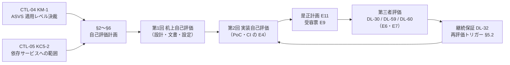

# 自己評価（ASVS 5.0・API Top 10・SLSA 1.2）

> 文書ID: ASR-04 / 版: 0.1 / 状態: draft / 最終更新: 2026-10-15
> 対応要求: R-070, R-071, R-073, R-165, R-233, R-241, R-246, G-090, G-150（全件と閉じ方は末尾「対応表」）。関連: R-242, R-172, G-091, G-088
> 依存文書: CONVENTIONS.md, traceability/deliverables.md（DL-61 行、§8 の 09_assurance）, traceability/R-requirements.md, traceability/G-goal-criteria.md, traceability/dissent-log.md（DS-11）, 05_adr/README.md, 05_adr/ADR-002, ADR-005, ADR-008, ADR-011, ADR-012, ADR-020, ADR-022, ADR-025, 05_adr/reconciliation-notes.md, 06_controls/applicability.md（CTL-02 の X-10, X-11, X-12, X-15）, 06_controls/mappings/identity-appsec.md（CTL-04。KM-1, KM-2）, 06_controls/mappings/cloud-supplychain.md（CTL-05。KC5-2）, 01_governance/assumptions-register.md, 01_governance/kri.md（K-01, K-03, K-06）, 01_governance/raci-governance.md, 02_requirements/operation-risk-tiers-assurance.md, 03_threat-model/attacker-model.md, 03_threat-model/dfd-entry-points.md, research/RS-05, RS-08, research/standards-status.md（SS-E36, SS-E37, SS-I04, SS-I05, SS-I25）
> 作成方法: AI エージェント（Claude）が上記の文書と調査ノートを読み、単独で起草した。research に収録のない原典（ASVS 5.0.0 の Assessment and Certification 章と全 17 章の要件表、API Security Top 10 2023 の一覧、SLSA v1.2 の Assessing build platforms／Assessing source control systems）は起草者が 2026-10-15 に取得して照合した。本書は自己評価の**計画と様式**であり、自己評価の結果ではない。実在の CTO/CISO の決裁でも第三者評価でもない（CONVENTIONS §8）[D]。
> 表記: 表のセルでタグのないものは設計推論 [D] であり、本注記で個別のタグに代える。新規仮定は NA-ASR04-x（前提台帳へ追加要）、決裁案は SA-x、試験案は各 ADR の仮番（TC-08-xx、TC-012-xx など。DL-22 で TC-ID に採番）で書く。

---

## 0. 結論（CTO/CISO 向け）

1. **本書が定めるのは自己評価であり、第三者評価ではない** [D]。評価者は基盤の開発・運用組織と同じ会社に属し、独立性要件（DL-07）を満たさない [D]。OWASP 自身が ASVS の認証を行わず、ASVS 適合をうたう認証・トラストマークを公式に承認していない [N][^2]。SLSA v1.2 は、評価の回答を自己証明（self-attest）するか第三者監査人の認証を受けるかを組織に委ねている [N][^17][^18]。したがって本書の結果は「自己評価」と明記し、R-070・R-071・R-073 の閉じ方 D（第三者）は DL-30・DL-59 の第三者評価でしか閉じない [D]。本書は、その第三者評価の**前提**（範囲・証跡・既知の不合格の是正計画）をそろえる役割を持つ [D]。
2. **自己評価は 4 本立てにする** [D]。(a) ASVS 5.0.0 の要件単位の判定（全 17 章 345 件。適用レベルは CTL-04 KM-1 の推奨案「全経路 L2＋特定経路 L3」を前提に 253 件／345 件）、(b) API Security Top 10 2023 の 10 項目に対する負例試験、(c) SLSA v1.2 の Build L3・Source L4（ADR-008 D8-60）の達成を、SLSA 自身の評価プロンプト（build platform と source control system）で確かめる評価、(d) R-233・R-241 が求める SSDF 1.1 の task 単位の実施状況の評価、である [N][^3][^7][^15][^16][^17][^18][^19][D]。件数は ASVS 5.0.0 の要件表を起草者が数えた値である（§3.2）[D]。
3. **2026-10-15 時点の結果は全項目「未評価」である** [D]。CTL-04 の ASVS 127 行・API Top 10 10 行と CTL-05 の SLSA 表は、外部要件と設計要素の**対応付け**であり、実装を確かめた評価ではない [D]。全 29 本の ADR は proposed であり、評価対象の実装はまだない [D]（05_adr/README.md 要旨）。
4. **合否の規則は G-090 に合わせる** [D]。全要件に結果（合格／不合格／部分／非該当／逸脱／未評価）を付け、未評価を 0 件にし、不合格・部分・逸脱には是正計画（E11）または受容票（E9）を付けることを自己評価の完了条件とする [D]。「全合格」は完了条件にしない [D]。ASVS は、報告書に範囲・確認した全要件の要約・例外のあった要件・是正の手引きを含め、非該当の要件はその旨を記すことを求めている [N][^2]。
5. **経営判断が要るのは 4 点**（§9）[D]。SA-1 ASVS の適用レベル（CTL-04 KM-1 の決裁をそのまま用いる）、SA-2 自己評価の実施者と作成者以外のレビュー、SA-3 自己評価結果の開示範囲（SLSA は自己証明の証拠を公開すべき（should）とする [N][^17]）、SA-4 依存サービス（A-050 の 300）に課す自己評価の範囲（CTL-05 KC5-2 と同時）である [D][A-050]。

---

## 1. 位置付け：自己評価と第三者評価の区別

### 1.1 区別の表

| 観点 | 本書（DL-61 自己評価） | 第三者評価（DL-30 RFP/SOW、DL-59 pentest・red team、DL-60 OIDF） |
|---|---|---|
| 評価者 | 社内（基盤チームが実施、作成者以外の社内者がレビュー。SA-2） | 独立評価者（独立性・利益相反申告は DL-07） |
| 証拠種別 | E3（双方向トレーサビリティ）、E4（自動試験ログ）、E10（署名付きスナップショット）、E11（是正追跡） | E6（第三者報告書）、E7（OIDF 適合試験） |
| 閉じられる要求 | 閉じ方 A（机上）と C（実測）の一部。R-165, R-241, R-246 の自己評価部分、G-090 | 閉じ方 D。R-070, R-071, R-073, G-091 |
| 名乗れること | 「ASVS 5.0.0 L2（特定経路 L3）を目標とした自己評価を実施し、結果と是正計画を記録した」 | 第三者報告書の範囲と結論 |
| 名乗れないこと | 「ASVS 適合」「SLSA L3 認証」「第三者が確認した」 | OWASP の公式認証（OWASP は認証しない [N][^2]） |

- 本書の結果を対外資料・RFP 回答・顧客監査で使うときは、表題と各ページに「自己評価（第三者評価ではない）」と記す（§7.1 の必須文言）[D]。
- 自己評価の結果は、第三者評価の範囲を狭める根拠にしない [D]。第三者評価者には、自己評価の結果と証跡を入力として渡し、評価者自身の方法で確かめてもらう（DL-30 の SOW に記載）[D]。ASVS は、評価者が範囲（目標レベルと含めた要件）を明確にし、実装しなかった要件を除外した理由について意見を示すべき（should）としている [N][^2]。

### 1.2 流れ



---

## 2. 評価基準と版

版と状態の正本は research/standards-status.md である [D]。

| 基準 | 版・状態 | 確認日 | 本書での使い方 | 台帳 |
|---|---|---|---|---|
| OWASP ASVS | 5.0.0、final（GitHub release tag `v5.0.0_release`、2025-05-30）[N][^3] | 2026-10-03（SS-I04）、章構成は 2026-10-15 に再確認 | 要件単位の判定。要件は `v5.0.0-x.y.z` 形式で参照する（RS-08#1）[N][^1] | SS-I04 |
| OWASP API Security Top 10 | 2023、公開済み awareness document [N][^6]（RS-08#7） | 2026-10-03（SS-I05）、一覧は 2026-10-15 に再確認 | 負例試験の観点。規範語は小文字の should で、強度を持つ要件ではない [N][^6] | SS-I05 |
| SLSA | v1.2、Approved（2025-11-24）[N][^14][^21]（RS-05#76） | 2026-10-03（SS-I25）、評価ページは 2026-10-15 に取得 | Build／Source の各 level の達成評価 | SS-I25 |
| NIST SP 800-218 SSDF | 1.1 final（2022-02）[N][^19]（RS-05#79）。1.2 は ipd（2025-12-17 公表、意見募集 2026-01-30 締切、final 未公表）[N][^20]（RS-05#80） | 2026-10-03 | task 単位の実施状況の評価。1.2 は監視のみ | SS-E36, SS-E37 |

- ASVS 4.0.3 の章構成で 5.0 を説明した旧レビューの記述は使わない（DS-11）[D]。
- ASVS は「要件（must）のみを含み、推奨（should）を主たる条件として含まない」と自らを定義し、強度を L1〜L3 で表す [N][^1]（RS-08#1）。SSDF の task は推奨であり、shall 形式の要求ではない [N][^19]（RS-05#79）。本書は強度を原典どおりに写し、推奨を必須に引き上げる場合は理由を書く [D]。

---

## 3. 評価範囲

### 3.1 対象システム

| 区分 | 対象 | ASVS | API Top 10 | SLSA | SSDF |
|---|---|---|---|---|---|
| T1 基盤の実行系 | AS（認可サーバ・IdP）、PDP・façade、管理 API、ログイン・同意・回復 UI、顧客管理者コンソール | 全章（§3.2） | 全 10 項目 | Build L3（成果物）| 全 task |
| T2 基盤の配布物 | PEP SDK、sidecar、適用 agent、変換器、policy・model・カタログ・設定の bundle、IaC、JWKS・鍵マニフェスト | V4・V8・V9・V10・V11・V13・V15・V16 の該当要件 | API1・API3・API5（SDK の既定動作） | Build L3・Source L4（ADR-008 D8-60） | PS・PW 群 |
| T3 基盤の開発・配備系 | SCM、CI、署名系（Signer）、admission | V13（設定）・V11（鍵） | — | build platform と source control system の評価（§3.4） | PO.5・PS 群 |
| T4 依存サービス（A-050 の 300） | 業務サービスの PEP 統合部分 | SA-4（KC5-2 と同時）で範囲を決める | API1・API3・API5 は DL-80 の試験キットで依存サービスの CI でも実行（ADR-012 D12-41） | KC5-2 の推奨は Build L2・Source L2 | KC5-2 の最低線 |

- T4 を対象に含める範囲は未決（SA-4、CTL-05 KC5-2、ADR-008 KD8-2）[D]。本書は、決裁がどの選択肢になっても使えるよう、様式を対象区分ごとに分けた（§7）[D][A-050]。

### 3.2 ASVS 5.0.0 の章と適用

ASVS 5.0.0 は 17 章からなる [N][^3]。下表の件数は、起草者が release tag `v5.0.0_release` の各章の要件表を数えた値である（確認日 2026-10-15）[D][^3]。

| 章 | 名称 | 全件 | L1 | L2 | L3 | 基盤（T1〜T3）での見込み | 対応付けの所在 |
|---|---|---|---|---|---|---|---|
| V1 | Encoding and Sanitization | 30 | 8 | 19 | 3 | 該当（UI・管理 API） | 本書で新規 |
| V2 | Validation and Business Logic | 13 | 4 | 7 | 2 | 該当 | 本書で新規 |
| V3 | Web Frontend Security | 31 | 8 | 11 | 12 | 該当（ログイン・同意・回復 UI、管理コンソール） | 本書で新規 |
| V4 | API and Web Service | 16 | 2 | 8 | 6 | 該当 | 本書で新規（4.1.3・4.3.2 は DFD-01 §6〜§9、V4.4 は ADR-006 N-14） |
| V5 | File Handling | 13 | 4 | 5 | 4 | 要確認（一括取込み・export の有無） | 本書で新規 |
| V6 | Authentication | 47 | 13 | 22 | 12 | 該当 | CTL-04 §3.1 |
| V7 | Session Management | 19 | 6 | 12 | 1 | 該当 | CTL-04 §3.2 |
| V8 | Authorization | 13 | 4 | 3 | 6 | 該当 | CTL-04 §3.3 |
| V9 | Self-contained Tokens | 7 | 4 | 3 | 0 | 該当 | CTL-04 §3.4 |
| V10 | OAuth and OIDC | 36 | 5 | 24 | 7 | 該当 | CTL-04 §3.5 |
| V11 | Cryptography | 24 | 3 | 11 | 10 | 該当 | 本書で新規（ADR-007・ADR-015 に対応付け） |
| V12 | Secure Communication | 12 | 3 | 6 | 3 | 該当 | 本書で新規 |
| V13 | Configuration | 21 | 1 | 12 | 8 | 該当 | 本書で新規（13.4.5 は DFD-01） |
| V14 | Data Protection | 13 | 2 | 7 | 4 | 該当 | 本書で新規 |
| V15 | Secure Coding and Architecture | 21 | 3 | 10 | 8 | 該当 | CTL-04 §3.6（15.3.1・15.3.3・15.4.2）、残りは本書 |
| V16 | Security Logging and Error Handling | 17 | 0 | 16 | 1 | 該当 | CTL-04 §3.6（16.1.1・16.3.2）、残りは本書 |
| V17 | WebRTC | 12 | 0 | 7 | 5 | 非該当の見込み（基盤は WebRTC を提供しない想定。非該当は理由を記録する） | 本書 |
| 計 | — | 345 | 70 | 183 | 92 | — | — |

- **適用レベル**: CTL-04 KM-1 の推奨案 (a)「全経路 L2、層 F（ADR-020）・privileged/P・break-glass/P・PC-06 の昇格経路は L3」を前提に計画する [D]。KM-1 は決裁前である（SA-1）[D]。この案では、全経路で判定する要件は L1＋L2 の 253 件、L3 経路で追加する要件は 92 件である [D][^3]。ASVS は L2 の適合に L1 と L2 を合わせた約 70% を満たすことを求めると説明しており [N][^1]（RS-08#1）、253／345 はこの説明と整合する [D]。
- **非該当の扱い**: ASVS は、非該当の要件を報告書に記すことを求めている（must）[N][^2]。本書の様式は非該当を結果の 1 つとし、理由と判断者を必須欄にする（§7.2）[D]。
- **ASVS で表せない性質**: ASVS V8 には entry point の棚卸しや enforcement coverage の自動検証を直接求める要件がない [N][^4]（RS-08#6）。「全入口の PEP 網羅」は、V8 と V13・V16 の組合せと自社の追加要件（ADR-012、K-01）で判定する [D]（RS-08#6）。V16 の 16.1.1（L2）はログの在庫を、16.3.2（L3）は全認可判断の記録を求めており [N][^5]（RS-08#34）、後者の判断イベントを coverage の実行時証跡に兼用する（ADR-011 D8-4）[D]。本書の様式では、ASVS 要件 ID の行とは別に「自社追加要件」の行（ID 接頭辞 ASR04-X）を置く（§7.2）[D]。
- **ASVS と SP 800-63B-4 の食い違い**: ASVS 6.4.4 と ADR-003 RC2-2 の食い違いは、CTL-04 KM-2 の決裁に従って「逸脱」として受容票（E9）に結び付ける [D]。
- **評価の方法**: ASVS は、L2・L3 の要件の検証には文書・ソースコード・設定・開発に関わる人へのアクセスが要り得ると述べ、自動ツールを動かすだけでは不十分で、各要件を検証可能な形で試験しなければならないとしている [N][^2]。業務ロジックとアクセス制御の要件は既製の DAST・SAST では検証しきれず、アプリケーション固有の試験を書く必要があるとも述べる [N][^2]。本書は各要件に検証方法（§4.2 の M1〜M5）を割り当てる [D]。

### 3.3 API Security Top 10 2023 の負例試験

API Security Top 10 2023 は自らを awareness document と位置付ける [N][^6]（RS-08#7）。本書は 10 項目を負例試験の観点として使い、各項目に「攻撃の型→期待結果→試験の所在」を割り当てる（CTL-02 X-12）[D]。R-071 の自前の負例試験は R-242（C、DL-22・DL-80）が受け、本書はその結果を API Top 10 の項目ごとに集約して自己評価の記録にする [D]。

| 項目 [N][^7] | 負例の型（最小集合） | 期待結果 | 試験の所在（仮番） | 設計要素 |
|---|---|---|---|---|
| API1:2023 Broken Object Level Authorization | 2 テナント以上×複数ロール×（他テナントの実在 ID、存在しない ID、自テナントの ID）を全 entry point に生成 [N][^12][D]（RS-08#39）。JWT の利用者 ID と ID パラメータの比較だけでは不十分とされる [N][^8]（RS-08#8） | 他テナントへの許可 0 件。他テナントと非実在の応答を区別しない | ADR-012 D12-41、D12-39、K-03(a)(b)、RS-08 M-10 | ADR-012 D12-04, D12-05 |
| API2:2023 Broken Authentication | alg・typ・iss・aud・時刻・鍵と issuer の結合の負例、別 API 用 token の提示、mix-up、盗まれた refresh token、DPoP replay | 全件拒否 | G-088（ARC-02 の NV 系）、DL-60 の OIDF suite | ADR-005 V1〜V14 |
| API3:2023 Broken Object Property Level Authorization | 許可外 field の読出し・書込み（mass assignment）。汎用シリアライザの回避とスキーマによる応答検証は API3 の予防策 [N][^9]（RS-08#10） | 許可外 field の返却・更新 0 件 | DL-22 へ申送り（field 規則の表現が未設計。CTL-04 残課題 6） | ADR-012 D12-20、ASVS 8.2.3・15.3.1・15.3.3 |
| API4:2023 Unrestricted Resource Consumption | ページ件数上限の超過、検索の予算超過、認証系への高頻度要求 | 上限で打切り・拒否。他テナントへの波及なし | ADR-025 の試験案、ADR-013 の負荷試験 | ADR-025、ADR-013 D13-23 |
| API5:2023 Broken Function Level Authorization | 一般ロールでの管理機能呼出し、URL パスの書換え、未登録操作。既定で全拒否とすべき（should）[N][^10]（RS-08#11） | 拒否。未分類操作は本番に出ない | REQ-03 J10 の検査、ADR-012 D12-01〜D12-03 | ADR-011（既定拒否） |
| API6:2023 Unrestricted Access to Sensitive Business Flows | 回復・登録・export の自動化による濫用 | THR-04 の検知と段階的抑制が働く | THR-04 FA 系の試験案 | THR-04、REQ-03 §2.3 |
| API7:2023 Server Side Request Forgery | `jku`・`x5u` の差込み、未登録 metadata URL・内部アドレスの指定 | 取得しない | ADR-005 V3、ADR-004 D04-17・D04-19 | 同左 |
| API8:2023 Security Misconfiguration | 監視・debug endpoint の外部公開、本番の introspection、CORS・TLS の誤設定 | 露出 0 件 | TC-THR01-01・TC-THR01-02（DFD-01）、K-06 | ADR-008、ADR-012 D12-10 |
| API9:2023 Improper Inventory Management | 台帳にない入口・旧版 endpoint への到達 [N][^11] | K-01 の未網羅 0 件（移行済みサービス） | RS-08 M-01・M-03、TC-012-15 | ADR-012 D12-08〜D12-11、ADR-016 |
| API10:2023 Unsafe Consumption of APIs | 上流 IdP の assertion・SSF の受信データの改ざん・過大属性 | 検証失敗で拒否、上流の acr・amr を転記しない | ADR-004 D04-11、ADR-006 の受信試験 | ADR-004、ADR-002 D2-20 |

- API1:2023 は、認可機構の脆弱性を評価する試験を書き、試験を失敗させる変更をデプロイしないことを予防策に挙げる [N][^8]（RS-08#9）。本書は API1・API3・API5 の負例を CI の必須ゲートとして実行した記録（E4）を自己評価の証跡にする [D]。
- OWASP Authorization Cheat Sheet は、認可ロジックの単体・結合試験を推奨しつつ、それが専門の試験や pentest の代替にならないとしている [N][^13]（RS-08#39）。本書の負例試験は DL-59 の pentest を置き換えない [D]。

### 3.4 SLSA v1.2 の自己評価

目標水準は ADR-008 D8-60 が決めており、本書は変えない [D]。基盤の成果物、policy・model・設定の bundle、IaC、JWKS・鍵マニフェストの公開物に Build L3、リポジトリに Source L4 である [N][^15][^16][D]（RS-05#77, #78）。

| 評価対象 | 原典の評価プロンプトの区分 | 本書で見る証跡 | 関連試験（仮番） |
|---|---|---|---|
| build platform（CI・runner・Signer） | External parameters、Control plane（Administration、Provenance generation、Development practices、Creating build environments、Managing cryptographic secrets）、Build environment（Isolation technologies、Creation and destruction、Network access）、Cache、Output storage [N][^17] | 使い捨て隔離 runner の構成、build 手順と分離した provenance 生成・署名、署名鍵の KMS 保管（D8-60）、信頼する builder の表と externalParameters の検証（D8-61）| TC-08-06、TC-08-07 |
| source control system（SCM） | Change management interface、Control configuration and technical controls、Control plane and verifier（administration、control effectiveness、source provenance generation、VSA generation、development practices、managing cryptographic secrets）、Output storage [N][^18] | 保護ブランチ設定の署名付きスナップショット（E10、D8-64）、二者合意の記録（D8-70〜D8-72）、force push の禁止（D8-60） | TC-08-04、TC-08-11、TC-08-12 |
| 成果物単位 | Build L1〜L3、Source L1〜L4 の要件 [N][^15][^16] | 配備時の provenance と署名の検証記録、admission の拒否ログ（E4） | TC-08-06 |

- SLSA v1.2 の Build L3 は、実行同士が互いに影響しないことと、provenance 署名に使う秘密を利用者定義の build 手順から触れられないことを求める [N][^15]（RS-05#77）。Source L4 は、保護ブランチへの変更を提出前に 2 名以上の信頼された者が合意することを MUST とする [N][^16]（RS-05#78）。
- SLSA は、組織が評価の回答を自己証明するか第三者監査人の認証を受けるかを選べるとし、自己証明の証拠はインターネットに公開すべき（should）、第三者認証に出した証拠は公開しなくてよいとする [N][^17][^18]。本書は自己証明に当たる [D]。公開範囲は SA-3 で決める [D]。
- Source VSA の発行能力は SCM 製品の選定に依存し、未決である（CTL-05 §4.2）[D]。発行できない revision は Source Level 0 になる（MUST）ため、Source L4 の自己評価は SCM 製品の決定まで「未評価」にとどめる [N][^16][D]。
- bundle の rollback（署名済み旧版の再提示）は SLSA の範囲外であり、ADR-008 D8-81〜D8-84 と TC-08-07 で扱う [D]（RS-05#82）。本書では自社追加要件 ASR04-X として同じ様式で記録する [D]。

### 3.5 SSDF 1.1 の task 単位の評価（R-233、R-241）

- SSDF は、チェックリストを作ることではなく、リスクに基づく実践の採用の基礎を与えることを意図している [N][^19]（CTL-05 §3）。本書は task ごとに「実施している／一部／未実施／非該当」と証跡を記録し、合否ではなく実施状況として扱う [D]。
- 対象の task と、基盤と依存サービスの区分は CTL-05 §3 の表を正本とする [D]。開発環境の分離・保護（PO.5.1）、開発端末の堅牢化（PO.5.2）、全コードの最小権限保管（PS.1.1）、完全性検証情報の提供（PS.2.1）は推奨 task である [N][^19]（RS-05#79）。
- R-241 が求める「検証可能なチェックリスト」は ASVS 5.0.0 の要件で作り（§3.2）、SSDF は開発組織の実践として評価する（DS-10、CTL-05 §3 の方針）[D]。
- SSDF 1.2（ipd）は final 公表時に 1.1 との差分を取り、評価項目を更新する（再評価トリガー §5.2）[N][^20][D]。

### 3.6 SBOM と脆弱性対応（G-150 の一部）

G-150 の正本は DL-32（継続保証計画）である [D]。本書は、その前提となる次の点の自己評価だけを持つ [D]。

| 項目 | 自己評価で確かめること | 正本 |
|---|---|---|
| SBOM の生成 | 基盤の全成果物（T1・T2）に SBOM があり、provenance と同じ build で作られる | CTL-05 CS-09（SSDF PS.3.2） |
| 影響範囲の特定 | SBOM から、ある部品を含む成果物と配備先 cell を特定できる | DL-32 |
| 重大度別の修正期限・緊急経路 | 定めの有無だけを確かめる（期限値は DL-32 が決める） | DL-32 |
| 依存サービスへの通知 | 通知の経路と依存サービス側の対応期限の定めの有無 | DL-32、ADR-022 |

- 修正期限の遵守を演習で確かめること（G-150 の合格条件）は DL-32 の範囲であり、本書では閉じない [D]。

---

## 4. 実施方法

### 4.1 役割

| 役割 | 担い手 | 責務 | 独立性の位置 |
|---|---|---|---|
| 計画承認 | CISO | 範囲・レベル・時期・完了条件の承認 | 第2線（GOV-05 の IS）[D] |
| 実施者 | 基盤チーム（A-054）の各担当 | 要件ごとの判定、証跡の採取、是正計画の起票 | 第1線。作った者が評価する（自己評価）[D][A-054] |
| レビュアー | CISO が指名する、評価対象の作成者以外の社内者（SA-2） | 判定と証跡の照合、抜取り再試験 | 社内。独立評価者ではない [D] |
| 受容者 | GOV-05 §4.2 の受容権限者 | 逸脱・不合格の受容（E9） | 第1線の経営・事業責任者 [D] |
| 受け手 | DL-30・DL-59・DL-60 の第三者評価者 | 自己評価の結果と証跡を入力として受け取る | 独立（DL-07） |

- CISO 組織の運用を CISO 組織が評価すると自己評価になる（GOV-05 §2.2 注）[D]。本書の評価はすべて自己評価として記録する [D]。

### 4.2 検証方法の区分

| 区分 | 方法 | 主な証拠 | 主な対象 |
|---|---|---|---|
| M1 文書確認 | 設計文書・ADR・台帳と要件の照合 | E3 | ASVS の文書化要件（例 8.1.1・16.1.1）、SSDF |
| M2 ソース・設定の確認 | コードレビュー、IaC・SCM 設定の読取り | E10 | V11・V13、SLSA Source |
| M3 自動試験 | CI 上の単体・結合・負例・property test | E4（CI ログ・コミットハッシュ） | V8、API1・API3・API5、SLSA Build |
| M4 手動試験 | 文書とソースを見ながら行う手動試験（ASVS が推奨する hybrid 型 [N][^2]） | E4（手順・ログ・画面記録） | V3・V6・V7 の UI、業務ロジック |
| M5 実測 | PoC での測定 | E5 | 剥奪反映（8.3.2）、資源消費（API4） |

- 1 要件に 1 つ以上の区分を割り当て、M1 だけで「合格」にできるのは文書化を求める要件に限る [D]。ASVS が述べるとおり、自動ツールを動かすだけの判定は合格の根拠にしない [N][^2][D]。

---

## 5. 時期と再評価

### 5.1 実施回

| 回 | 時期 | 対象の状態 | 主な方法 | 完了の判定 |
|---|---|---|---|---|
| 計画確定 | G1（KM-1・SA-1 の決裁後）[D] | — | — | 本書の review 版を CISO が承認（E2） |
| 第1回 机上 | TBD（所有者: CISO、期限: G3、決め方: ADR の accepted 化と CTL-04・CTL-05 の確定時期から決める） | 設計（ADR・設計文書） | M1・M2 | 全要件に暫定結果。設計上のギャップを是正計画に起票 |
| 第2回 実装 | TBD（所有者: CISO、期限: G4、決め方: DL-22 の PoC 日程と DL-30 の RFP 発行日の前に置く） | PoC・CI | M1〜M5 | G-090 の合格条件（§6.2） |
| 継続 | DL-32 が定める周期（TBD、所有者 CISO、期限 G5） | 本番 | M1〜M5 | DL-32 |

- 第2回は、DL-30 の第三者評価の開始前に完了させる [D]。DL-61 の計画上の役割が「第三者評価の前提」だからである（deliverables.md DL-61 行）[D]。
- 自己評価に要する工数は、新規仮定 NA-ASR04-1「第2回の自己評価を基盤チーム（A-054）の内数で実施できる」に置く（前提台帳へ追加要。値は TBD、所有者 CTO、期限 G3、決め方: 第1回の実績工数から 345 件・10 項目・SLSA 2 評価の所要時間を外挿）[D][A-054]。

### 5.2 再評価のトリガー

| トリガー | 再評価の範囲 |
|---|---|
| ASVS の新版（5.0.x の修正版を含む）の公表 | 変更された要件 |
| API Security Top 10 の新版 | 全 10 項目の対応付け |
| SLSA の新版、または SCM・CI 製品の変更 | SLSA 評価の全体 |
| SSDF 1.2 の final 公表（RS-05#80） | SSDF の task 対応 |
| ADR の決定の変更（特に ADR-002・ADR-005・ADR-008・ADR-012・ADR-020） | 影響する要件 |
| 第三者評価・pentest・事故で、自己評価が「合格」とした要件に不合格が見つかった場合 | 当該章の全要件と、判定方法（M1〜M5）の見直し |

- 最後の行は自己評価の精度の指標になる [D]。第三者が見つけた不合格のうち自己評価で合格としていた件数を、自己評価の見落とし件数として記録する（§7.7）[D]。

---

## 6. 判定規則

### 6.1 結果の区分

| 結果 | 意味 | 必須の付帯 |
|---|---|---|
| 合格 | 要件を満たすことを、割り当てた方法で確かめた | 証跡の所在（E3・E4・E10 のいずれか） |
| 部分 | 一部の経路・構成要素で満たさない | 是正計画（E11）と未充足の範囲 |
| 不合格 | 満たさない | 是正計画（E11）。重大度（§6.3） |
| 逸脱 | 設計判断として満たさないことを選んだ（例: KM-2 の 6.4.4） | 受容票（E9）、根拠の ADR・決裁 |
| 非該当 | 対象に機能がない（例: V17） | 理由と判断者。ASVS は非該当の明記を求める [N][^2] |
| 未評価 | まだ判定していない | 予定日。完了時は 0 件であること |

### 6.2 完了条件（G-090）

- 全要件（ASVS は適用レベルに応じた 253 件または 345 件、API Top 10 は 10 項目、SLSA は §3.4 の 3 対象、SSDF は CTL-05 §3 の task）に結果がある [D]。
- 未評価が 0 件である [D]。
- 不合格・部分には是正計画（E11）、逸脱には受容票（E9）が結び付いている [D]。
- 記録の全ページに「自己評価」の必須文言がある（§7.1）[D]。
- 判定者は CISO、確認対象は自己評価記録と試験ログ（E4）である（G-090）[D]。

### 6.3 不合格の重大度

- 重大度は DL-59（pentest・red team 計画）と同じ区分（Critical／High／Medium／Low）を用いる [D]。区分の定義と是正期限は DL-59・DL-32 を正本とし、本書では値を置かない（TBD、所有者 CISO、期限 G4）[D]。
- cross-tenant の負例（API1・ASVS 8.4.1）の不合格は、K-03(a) の限度（1 件以上で配備しない）に従う [D]（01_governance/kri.md K-03）。自己評価の場で見つかった場合も同じ扱いとする [D]。

---

## 7. 結果記録様式

### 7.1 評価記録のヘッダ（全記録に共通）

```yaml
assessment_id: ASR04-<回>-<対象区分>-<連番>   # 例 ASR04-R2-T1-001
title: "自己評価（第三者評価ではない）: <対象>"
notice: >-
  本記録は社内の自己評価であり、第三者評価・認証ではない。
  OWASP は ASVS の認証を行わない。SLSA の level は自己証明である。
standard:
  name: OWASP ASVS | OWASP API Security Top 10 | SLSA | NIST SSDF
  version: 5.0.0 | 2023 | v1.2 | 1.1
  status_checked_on: YYYY-MM-DD        # standards-status.md の確認日
target:
  class: T1 | T2 | T3 | T4
  components: [ ... ]
  commit_or_release: <hash / version>  # 評価した実体を特定する
level_target: L2 | L3 | Build L3 / Source L4 | —
decision_basis: [KM-1, SA-1, ...]       # 範囲を決めた決裁
assessors: [ { name, team, role: 実施者 } ]
reviewers: [ { name, team, role: レビュアー, not_author: true } ]
independence_statement: "評価者は評価対象の開発・運用組織と同じ会社に属する"
methods_disclosed: [M1, M2, M3, M4, M5]
period: { from: YYYY-MM-DD, to: YYYY-MM-DD }
summary: { pass: n, partial: n, fail: n, deviation: n, na: n, not_assessed: n }
approver: CISO
approved_on: YYYY-MM-DD
```

- `notice` と `independence_statement` は削除・変更できない必須欄である [D]。
- ASVS は、評価者が試験方法を報告書で開示し、できれば再現可能にすべきとする [N][^2]。`methods_disclosed` と各行の証跡欄はそのためである [D]。

### 7.2 ASVS 要件の記録行

| 欄 | 内容 | 例 |
|---|---|---|
| 要件 ID | `v5.0.0-x.y.z`、または自社追加要件 `ASR04-X-nn` | v5.0.0-8.4.1 |
| L | 1／2／3 | 2 |
| 適用経路 | 全経路／L3 経路（層 F・privileged/P・break-glass/P・PC-06） | 全経路 |
| 対象区分 | T1〜T4 | T1, T4 |
| 設計要素 | ADR・設計文書の決定 ID（CTL-04 の行を引く） | ADR-012 D12-04, D12-20〜D12-29 |
| 方法 | M1〜M5 | M3 |
| 試験・証跡 | TC-ID、CI ログの URL とコミットハッシュ、スナップショット ID | D12-41 の CI ジョブ、K-03(a) |
| 結果 | §6.1 の 6 区分 | 未評価 |
| 根拠の要約 | 判定理由（非該当・逸脱は必須） | — |
| 是正・受容 | POA&M ID（E11）／受容票 ID（E9） | — |
| 実施者／レビュアー | 氏名・日付 | — |

### 7.3 API Top 10 負例試験の記録行

| 欄 | 内容 |
|---|---|
| 項目 | API1:2023〜API10:2023 |
| 負例の型 | §3.3 の型（生成器の設定と件数） |
| 対象の entry point | 台帳（DL-10）の ID の集合と件数、台帳の版 |
| 実行件数／許可件数／拒否件数 | 自動試験の集計 |
| 検出力 | 変異体（PEP 呼出し・tenant scope を外したもの）のうち検出した割合（K-03(b)） |
| 期待結果との差 | 期待外の結果の件数と内容 |
| 証跡 | CI ログ、コミットハッシュ（E4） |
| 結果・是正 | §6.1、POA&M ID |

### 7.4 SLSA 評価の記録

| 欄 | 内容 |
|---|---|
| 評価対象 | build platform／source control system／成果物 |
| プロンプト区分 | §3.4 の原典の区分（例 Control plane > Managing cryptographic secrets） |
| 回答 | 自由記述（構成・統制・運用） |
| 主張する level | Build L1〜L3／Source L1〜L4 |
| 証跡 | provenance のサンプル、署名検証の記録、保護設定の署名付きスナップショット（E10）、二者合意の記録 |
| 結果 | §6.1 |
| 公開範囲 | SA-3 の決裁による（社内／顧客 NDA／公開） |

### 7.5 SSDF の記録行

| 欄 | 内容 |
|---|---|
| task | PO.x.y／PS.x.y／PW.x.y／RV.x.y |
| 対象 | 基盤／依存サービス（KC5-2 の最低線） |
| 実施状況 | 実施／一部／未実施／非該当 |
| 実施の証跡 | 手順書、CI 設定、記録 |
| 対応する統制 | CTL-05 の CS-xx |

### 7.6 是正計画（POA&M、E11）

| 欄 | 内容 |
|---|---|
| POA&M ID | ASR04-POAM-nnn |
| 元の記録行 | 要件 ID・項目・task |
| 重大度 | §6.3 |
| 是正内容 | 設計・実装・運用の変更 |
| 所有者 | 第1線の責任者 |
| 期限 | 重大度別の期限（DL-32・DL-59 の定め） |
| 再試験 | 方法と結果、日付 |
| 第三者評価への申送り | DL-30 の範囲に含めるか |

### 7.7 サマリ

| 欄 | 内容 |
|---|---|
| 枠組み別の結果件数 | §6.1 の 6 区分 × ASVS・API Top 10・SLSA・SSDF |
| 未評価 | 0 件であること |
| 是正計画の件数 | 重大度別 |
| 逸脱・受容票 | 件数と受容者 |
| 自己評価の見落とし件数 | 第三者評価・pentest・事故で見つかった不合格のうち、自己評価で合格としていたもの（§5.2） |
| 必須文言 | 「自己評価であり第三者評価ではない」 |

---

## 8. 現時点の状態（2026-10-15）

| 枠組み | 評価対象の件数 | 結果 | 備考 |
|---|---|---|---|
| ASVS 5.0.0 | 345（KM-1 (a) のもとで全経路 253、L3 経路は追加 92） | 全件 未評価 | CTL-04 の 127 行は対応付けであり評価ではない。V1〜V5・V11〜V14・V17 と V15・V16 の残りは対応付けも未作成 |
| API Top 10 2023 | 10 | 全件 未評価 | 負例試験の生成器（D12-41）と DL-80 の試験キットは未実装 |
| SLSA v1.2 | 3 対象 | 全件 未評価 | SCM・CI 製品が未決（Source VSA は CTL-05 で未決） |
| SSDF 1.1 | CTL-05 §3 の task | 全件 未評価 | RV 群・PS.3.2 は設計がない（CTL-05 要旨 2） |

- 本書の時点で「合格」と記録できる要件はない [D]。対外的に ASVS・SLSA の水準を述べるときは「目標」として述べ、達成とは書かない（CONVENTIONS §8）[D]。

---

## 9. 決裁案

本書の決裁案は自己レビューによる案であり、決裁ではない（CONVENTIONS §8）[D]。

### SA-1 ASVS の適用レベル

| 項目 | 内容 |
|---|---|
| 論点 | 自己評価で判定する ASVS の範囲（L2／L3 の経路）[D] |
| 選択肢 | CTL-04 KM-1 の (a) 全経路 L2＋特定経路 L3、(b) 全経路 L3、(c) 全経路 L2 だけ [D] |
| 推奨 | KM-1 の決裁をそのまま用い、本書で別の値を作らない。KM-1 の推奨は (a) [D] |
| 帰結 | (a) は判定件数が全経路 253 件、L3 経路 345 件 [D][^3]。(b) は ADR-002・ADR-005・ADR-020 の 4 点の改版を要する（CTL-04 KM-1）[D]。(c) は ADR-020 の FAPI 範囲の固定値を ASVS 側で検証できない [D] |
| 決める人・期限 | CISO（ADR 改版を伴う (b) は CTO の同意）、G1 [D] |

### SA-2 自己評価の実施者と作成者以外のレビュー

| 項目 | 内容 |
|---|---|
| 論点 | 誰が判定し、誰が照合するか [D] |
| 選択肢 | (a) 基盤チームが実施し、レビューも基盤チーム内の別担当。(b) 基盤チームが実施し、CISO が指名する評価対象の作成者以外の社内者（CISO 組織のセキュリティ技術者など）が判定と証跡を照合し、抜取りで再試験する。(c) 自己評価そのものを外部に委託する [D] |
| 推奨 | (b) [D]。作成者以外の照合は CONVENTIONS §4 の規則と同じ考え方である [D]。(c) は外部委託でも DL-07 の独立性要件を満たさない限り自己評価の延長であり、DL-30 と費用が重なる [D] |
| 帰結 | (b) はレビュー要員が要る（工数は NA-ASR04-1 と同じ決め方で TBD）[D]。(a) は判定の誤りを見つける経路が第三者評価まで無い [D] |
| 決める人・期限 | CISO、G1 [D] |

### SA-3 自己評価結果の開示範囲

| 項目 | 内容 |
|---|---|
| 論点 | SLSA は自己証明の証拠をインターネットに公開すべき（should）とする [N][^17][^18]。一方で自己評価の記録には未是正の不合格が含まれる [D] |
| 選択肢 | (a) 社内限り。(b) 社内＋顧客・監査人に NDA の下で開示（要約と是正状況）。(c) SLSA の自己証明の要約だけを公開し、ASVS・API Top 10 は (b) [D] |
| 推奨 | (b) [D]。未是正の不合格の公開は攻撃者に入口を示すからである [D]。SLSA の should から外れる点は、本書の逸脱として受容票（E9）に記録する [D] |
| 帰結 | (b) は SLSA の自己証明を第三者が検証する手段がなく、顧客への説明は DL-30 の第三者報告に頼る [D]。(c) は公開物の作成・更新の工数が増える [D] |
| 決める人・期限 | CISO＋法務（開示）、G3 [D] |

### SA-4 依存サービスに課す自己評価の範囲

| 項目 | 内容 |
|---|---|
| 論点 | 300 の依存サービス（A-050）、25 の開発組織（A-052）にどこまで自己評価を課すか [D][A-050, A-052] |
| 選択肢 | (a) 課さない（基盤だけ）。(b) API1・API3・API5 の負例試験（DL-80 の試験キット）と ASVS V8 の自己点検を全依存サービスに課し、高リスク階層（DL-09）を扱うサービスには V6・V7・V9・V10 の該当要件を加える。(c) 全依存サービスに基盤と同じ範囲を課す [D] |
| 推奨 | (b) [D]。cross-tenant の漏えいは依存サービス内の object 単位の判定で起きるからである（ADR-012 D12-04、RS-08 の API1 の記述）[N][^8][D] |
| 帰結 | (b) は連携契約（ADR-022）と DL-30 の改訂、試験キットの整備が要る [D]。(a) は K-03 の測定対象が基盤に限られ、R-071 の範囲が狭くなる [D]。(c) は CTL-05 KC5-2 (c) と同じくレビュー要員の不足を招き得る [D] |
| 決める人・期限 | CTO（調達責任者と合議、CISO 同意）、G3。CTL-05 KC5-2・ADR-008 KD8-2 と同時に決める [D] |

---

## 10. 他文書への申し送り

| 先 | 内容 |
|---|---|
| DL-22（12_poc/preregistered-test-plan.md） | §3.3 の API3（field 単位）・API4・API6 の負例と、SLSA の TC-08-06 に「未知の externalParameters」の負例を加えること（CTL-05 §4.2 と同じ） |
| DL-30（09_assurance/rfp-sow.md） | 自己評価の結果と証跡を評価者への入力にすること。自己評価の範囲で第三者評価の範囲を狭めないこと（§1.1） |
| DL-32（09_assurance/continuous-assurance-plan.md） | 継続時の自己評価の周期、重大度別の是正期限、G-150 の演習 |
| DL-59（09_assurance/pentest-redteam-plan.md） | 重大度区分の定義（§6.3） |
| DL-28（CTL-01、CTL-04） | V1〜V5・V11〜V14・V17 と V15・V16 の残りの対応付け（CTL-04 残課題 7 を本書の第1回で行う） |
| 前提台帳 | NA-ASR04-1 の追加 |

---

## 対応表

抽出方法: traceability/R-requirements.md と traceability/G-goal-criteria.md を「self-assessments」「DL-61」で Grep し、対応成果物欄に本書のパスまたは DL-61 を含む行を全件抽出した（R 7 件、G 2 件、計 9 件）[D]。

| ID | 要旨 | 本書の節 | 閉じ方 | 状態 |
|---|---|---|---|---|
| R-070 | ASVS 5.0 ベース検証 | §3.2、§6、§7.2 | D | 自己評価（L2/L3）の計画と様式まで。第三者の ASVS 検証（DL-30）は未達 |
| R-071 | API Top 10 負例試験 | §3.3、§7.3 | D | 自己評価の観点と記録様式まで。自前の試験は R-242（DL-22・DL-80）、独立評価は DL-30 で未達 |
| R-073 | 供給網レビュー（SLSA 1.2） | §3.4、§7.4 | D | 自己評価の範囲と様式まで。第三者の供給網レビュー（DL-30、G-091）は未達 |
| R-165 | ASVS で受入基準化（アーキ・認証・session・アクセス制御） | §3.2（章・件数・適用レベル）、§6.1、§7.2 | A | 部分（受入基準の枠は定めた。V1〜V5・V11〜V14 等の要件単位の対応付けは第1回で行う。KM-1／SA-1 は決裁待ち） |
| R-233 | Secure by Design を SDLC へ埋め込む（SSDF） | §3.5、§7.5、§9 SA-4 | B | 決裁案まで（SA-4、CTL-05 KC5-2）。実施状況の評価は未実施 |
| R-241 | SSDF 1.1・ASVS 5.0 を検証可能なチェックリストとして適用 | §3.2、§3.5、§4.2、§7.2、§7.5 | A | 部分（様式と方法は定めた。要件単位の展開は第1回で行う） |
| R-246 | SLSA 1.2 を CI/CD・policy bundle に適用 | §3.4、§7.4 | C | 自己評価の計画まで。TC-08-04・06・07・11・12 の実測と E10 は未実施 |
| G-090 | 第三者評価の前に ASVS・API Top 10・SLSA の自己評価を実施し、自己評価と明記して記録 | §0、§1、§5、§6.2、§7、§8 | C | 計画と様式まで。実施は未達（§8 は全件未評価） |
| G-150 | SBOM・修正期限・緊急経路・脆弱性受付・依存サービス通知と演習 | §3.6 | C | 部分（本書は SBOM 等の定めの有無の自己評価だけ。正本と演習は DL-32 で未達） |

関連（対応成果物欄に本書を含まないが内容が関係する行）: R-242、R-172（§3.3 の負例試験の実施先）、G-091（§3.4 の第三者側）、G-088（§3.3 の API2）[D]。

---

## 残課題

1. **自己評価は未実施である**（§8）。G-090 は未達であり、第1回・第2回の実施が必要である [D]。
2. **SA-1〜SA-4 は決裁前である**。特に SA-1 は CTL-04 KM-1 に、SA-4 は CTL-05 KC5-2・ADR-008 KD8-2 に依存する [D]。
3. **ASVS の V1〜V5・V11〜V14・V17 と V15・V16 の残りの要件単位の対応付けがない**（CTL-04 残課題 7）。第1回で作る [D]。
4. **V5 File Handling の該当性**（一括取込み・export の有無）が未確認である [D]。
5. **Source L4 の自己評価は SCM 製品の決定待ち**（Source VSA の発行能力。CTL-05 §4.2）[D]。
6. **API3（field 単位の認可）の負例は、field 規則の表現が未設計のため作れない**（CTL-04 残課題 6）[D]。
7. **時期・工数・重大度別の期限は TBD**（§5.1、§6.3、NA-ASR04-1）[D]。
8. **第三者評価（DL-30・DL-59・DL-60）は未実施であり、本書では閉じない**。R-070・R-071・R-073 は未達である [D]。
9. **本書が新規に取得した原典**（参考文献 [^2]・[^3] の件数・[^7]・[^17]・[^18]）は起草者の照合だけであり、作成者以外による照合（CONVENTIONS §4）が未実施である [D]。
10. 新規仮定 NA-ASR04-1 の前提台帳への追加 [D]。

---

## 参考文献

[^1]: OWASP『Application Security Verification Standard 5.0.0 — What is the ASVS?』v5.0.0, 2025-05-30. https://github.com/OWASP/ASVS/blob/v5.0.0_release/5.0/en/0x03-What-is-the-ASVS.md （参照箇所: Levels（Level 1/2/3）, "requirements (must)" の段落, Requirement identifiers の節、確認日: 2026-10-03。RS-08#1）
[^2]: OWASP『Application Security Verification Standard 5.0.0 — Assessment and Certification』v5.0.0, 2025-05-30. https://github.com/OWASP/ASVS/blob/v5.0.0_release/5.0/en/0x04-Assessment_and_Certification.md （参照箇所: OWASP's Stance on ASVS Certifications and Trust Marks、Verification reporting、Scope of Verification、Verification Mechanisms、The Role of Automated Security Testing Tools、The Role of Penetration Testing、確認日: 2026-10-15。research 未収録、本書起草時に取得）
[^3]: OWASP『Application Security Verification Standard 5.0.0』GitHub release tag v5.0.0_release, 2025-05-30. https://github.com/OWASP/ASVS/tree/v5.0.0_release/5.0/en （参照箇所: 0x10-V1〜0x26-V17 の 17 章の要件表。件数は起草者が各章の要件行を数えた値、確認日: 2026-10-15。版・状態は standards-status SS-I04）
[^4]: OWASP『ASVS 5.0.0 — V8 Authorization』v5.0.0, 2025-05-30. https://github.com/OWASP/ASVS/blob/v5.0.0_release/5.0/en/0x17-V8-Authorization.md （参照箇所: 8.1.1〜8.4.2、確認日: 2026-10-03。RS-08#2〜#6）
[^5]: OWASP『ASVS 5.0.0 — V16 Security Logging and Error Handling』v5.0.0, 2025-05-30. https://github.com/OWASP/ASVS/blob/v5.0.0_release/5.0/en/0x25-V16-Security-Logging-and-Error-Handling.md （参照箇所: 16.1.1, 16.3.2、確認日: 2026-10-03。RS-08#34）
[^6]: OWASP『API Security Top 10 2023 — Release Notes』2023. https://github.com/OWASP/API-Security/blob/master/editions/2023/en/0x04-release-notes.md （参照箇所: "awareness document" の段落, 統合カテゴリの箇条、確認日: 2026-10-03。RS-08#7）
[^7]: OWASP『OWASP Top 10 API Security Risks – 2023』. https://github.com/OWASP/API-Security/blob/master/editions/2023/en/0x11-t10.md （参照箇所: API1:2023〜API10:2023 の一覧、確認日: 2026-10-15。research 未収録、本書起草時に取得）
[^8]: OWASP『API1:2023 Broken Object Level Authorization』API Security Top 10 2023. https://github.com/OWASP/API-Security/blob/master/editions/2023/en/0xa1-broken-object-level-authorization.md （参照箇所: Is the API Vulnerable?, How To Prevent、確認日: 2026-10-03。RS-08#8, #9）
[^9]: OWASP『API3:2023 Broken Object Property Level Authorization』API Security Top 10 2023. https://github.com/OWASP/API-Security/blob/master/editions/2023/en/0xa3-broken-object-property-level-authorization.md （参照箇所: How To Prevent、確認日: 2026-10-03。RS-08#10）
[^10]: OWASP『API5:2023 Broken Function Level Authorization』API Security Top 10 2023. https://github.com/OWASP/API-Security/blob/master/editions/2023/en/0xa5-broken-function-level-authorization.md （参照箇所: How To Prevent、確認日: 2026-10-03。RS-08#11）
[^11]: OWASP『API9:2023 Improper Inventory Management』API Security Top 10 2023. https://github.com/OWASP/API-Security/blob/master/editions/2023/en/0xa9-improper-inventory-management.md （参照箇所: Is the API Vulnerable?, How To Prevent、確認日: 2026-10-03。RS-08 §3.2）
[^12]: OWASP『Web Security Testing Guide v4.2 — WSTG-ATHZ-04 Testing for Insecure Direct Object References』v4.2, 2020-12-03. https://owasp.org/www-project-web-security-testing-guide/v42/4-Web_Application_Security_Testing/05-Authorization_Testing/04-Testing_for_Insecure_Direct_Object_References （参照箇所: Test Objectives, How to Test、確認日: 2026-10-03。RS-08#39）
[^13]: OWASP『Authorization Cheat Sheet』master. https://cheatsheetseries.owasp.org/cheatsheets/Authorization_Cheat_Sheet.html （参照箇所: Create Unit and Integration Test Cases for Authorization Logic、確認日: 2026-10-03。RS-08#39）
[^14]: SLSA (OpenSSF)『SLSA specification v1.2』Status: Approved. https://slsa.dev/spec/v1.2/ （参照箇所: 仕様状態表示、確認日: 2026-10-03。RS-05#76）
[^15]: SLSA (OpenSSF)『SLSA v1.2: Build Track Basics』. https://slsa.dev/spec/v1.2/build-track-basics （参照箇所: Build levels 表、Build L2/L3 の要件、確認日: 2026-10-03。RS-05#77）
[^16]: SLSA (OpenSSF)『SLSA v1.2: Source Track requirements』. https://slsa.dev/spec/v1.2/source-requirements （参照箇所: Source levels、Two-party review、Change history、確認日: 2026-10-03。RS-05#78。Source VSA の記述は CTL-05 §4.2 の照合による）
[^17]: SLSA (OpenSSF)『SLSA v1.2: Assessing build platforms』. https://slsa.dev/spec/v1.2/assessing-build-platforms （参照箇所: 冒頭（self-attest／third-party auditor、証拠の公開）、各プロンプトの節見出し、確認日: 2026-10-15。research 未収録、本書起草時に取得）
[^18]: SLSA (OpenSSF)『SLSA v1.2: Assessing source control systems』. https://slsa.dev/spec/v1.2/assessing-source-systems （参照箇所: 冒頭（self-attest／third-party auditor、証拠の公開）、Assessing components の節見出し、確認日: 2026-10-15。research 未収録、本書起草時に取得）
[^19]: NIST (M. Souppaya, K. Scarfone, D. Dodson)『SP 800-218: Secure Software Development Framework (SSDF) Version 1.1』final, 2022-02. https://nvlpubs.nist.gov/nistpubs/SpecialPublications/NIST.SP.800-218.pdf （参照箇所: §1（PDF p.12 付近、チェックリストではないとする記述。CTL-05 §3 の照合による）、Table 1 PO.5（PDF p.17–18）、PS.1（PDF p.18）、PS.2（PDF p.19）、確認日: 2026-10-03。RS-05#79）
[^20]: NIST CSRC『SP 800-218 Rev. 1 (Initial Public Draft): SSDF Version 1.2』ipd, 2025-12-17. https://csrc.nist.gov/pubs/sp/800/218/r1/ipd （参照箇所: 状態・公表日・意見募集締切、確認日: 2026-10-03。RS-05#80）
[^21]: SLSA Community『Announcing SLSA v1.2』2025-11-24. https://slsa.dev/blog/2025/11/announce-slsa-v1.2 （参照箇所: 本文冒頭、確認日: 2026-10-03。RS-05#76）
