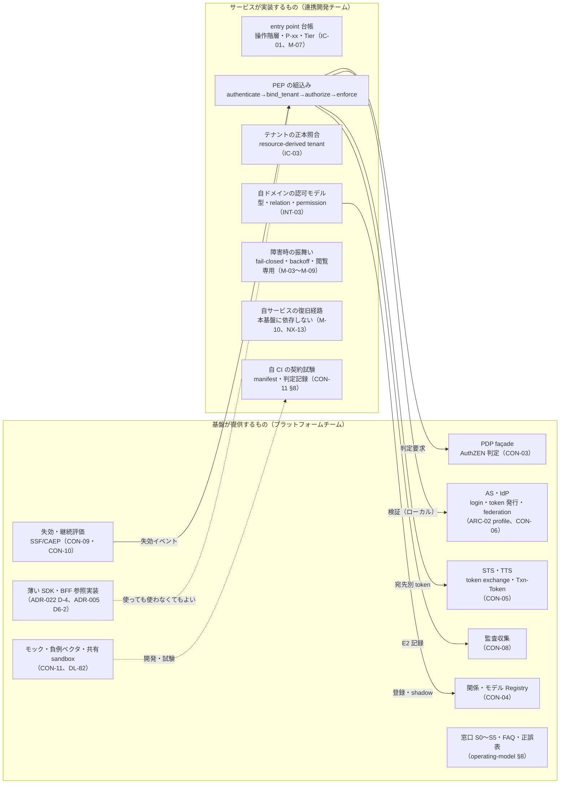
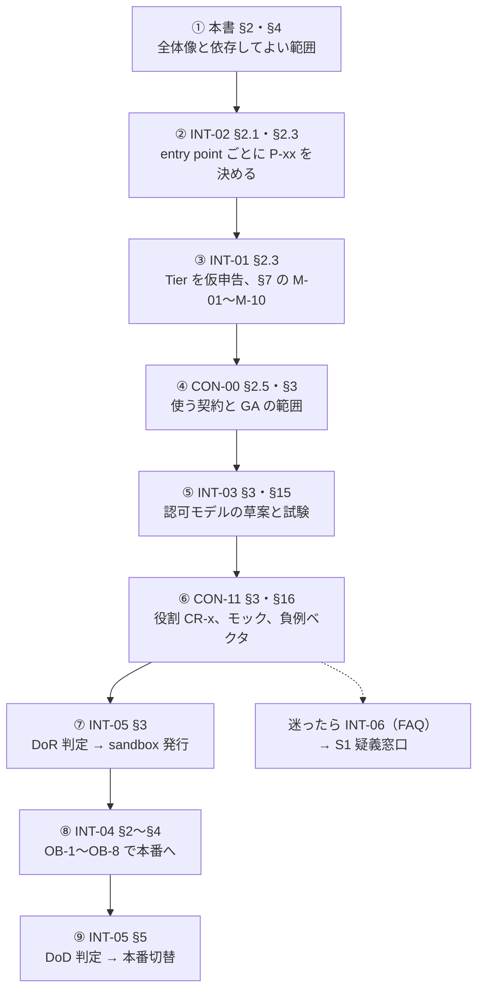
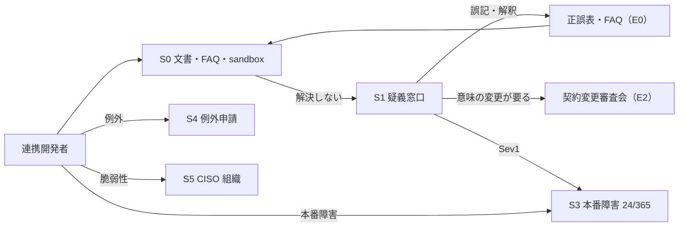

# 連携ハンドブック総覧

> 文書ID: INT-00 / 版: 0.1 / 状態: draft / 最終更新: 2026-10-15
> 対応要求: G-100, G-140, G-143, G-145（R-requirements.md・G-goal-criteria.md で対応成果物欄に本書のパスまたは DL-62 を含む全行。R-requirements.md には該当行がない）／R-136, R-140（deliverables.md の DL-62 行が挙げるもの）。全件と閉じ方は末尾「対応表」
> 依存文書: CONVENTIONS.md, traceability/deliverables.md（DL-62 行、§8、DEC-8）, 05_adr/README.md, 05_adr/ADR-002・ADR-005・ADR-009・ADR-011・ADR-012・ADR-016・ADR-017・ADR-020・ADR-022・ADR-023・ADR-026・ADR-027（設計判断の正本）, 05_adr/reconciliation-notes.md, 10_integration/dependency-tiers.md（INT-01）, integration-patterns.md（INT-02）, authz-modeling-guide.md（INT-03）, onboarding.md（INT-04）, definition-of-ready.md（INT-05）, developer-faq.md（INT-06）, 11_contracts/README.md（CON-00）, compatibility-deprecation-policy.md（CON-01）, mock-contract-test-kit.md（CON-11）, 04_architecture/pep-contract.md（ARC-06）, token-profile.md（ARC-02）, 08_operations/operating-model.md（DL-27 §8）, 08_operations/phased-rollout.md（OPS-04 §10.5）, 01_governance/assumptions-register.md（A-050〜A-055, A-110, A-113）, 01_governance/exception-risk-acceptance.md（GOV-07）, 02_requirements/operation-risk-tiers-assurance.md（REQ-03。操作 5 分類の正本）, 06_controls/mappings/identity-appsec.md（ASVS 7.4.4、KM-4）, research/RS-16（verification 記録を含む）, research/standards-status.md
> 作成方法: AI エージェント（Claude）が 10_integration の全文書と 11_contracts/README.md・CON-11・ADR-022 を通読し、連携開発者の入口として起草した。本書は新しい設計判断をしない。食い違いがあれば ADR と各正本を正とする。ASVS 5.0 の 7.4.4 は research に収載がないため、起草者が 2026-10-15 に原典を取得して文言を確認した。判断は自己レビューであり、実在の CTO/CISO・連携開発者の確認を経ていない（CONVENTIONS §8）[D]。

---

## 0. 結論（CTO/CISO・連携開発者向け）

1. **連携開発者が依存してよいのは、11_contracts の契約のうち `x-freeze-class` が GA の要素と、版付きの OIDC/OAuth profile（ARC-02）だけである。製品、エンジン、cell 構成、内部 API、SDK の内部実装、モックの実装には依存してはならない** [D]（ADR-022 D-1・D-3-2、§4）。この線引きは、AS・認可エンジン・PEP SDK をそれぞれ 1 回以上置き換える 20 年の前提 [A-104] の下で、約 300 サービス [A-050] の改修を置換のたびに発生させないためのものである [D]。
2. **基盤が提供するのは「token・判定・関係データ・委譲・失効・監査の契約と、その実装・SDK・モック」であり、サービスが実装するのは「entry point の宣言、テナントの正本照合、認可モデル、PEP の組込み、障害時の振舞い、自サービスの復旧経路」である（§2 の 1 ページ図）** [D]。テナント分離の最後の照合（resource-derived tenant）は資源の正本を持つサービスにしか書けないので、基盤に移せない [D]（ARC-06 §4.2 の `bind_tenant`）。
3. **基盤の完成を待たずに、今日から設計・実装・単体試験の大半を始められる。始められないのは、自チームの CI で合否を出す契約試験（キット本体 DL-82 が未実装、予定 G3）、Webhook 署名（KD64-1 の決裁待ち）、保管庫を使う outbound 連携（KD64-2 の決裁待ち）の 3 つである** [D]（§6、INT-02 §10.1、CON-11 §16.1）。ライフサイクル事象の受信は条件付きで着手できる。CON-12・CON-13（draft）の封筒・type 名・冪等と順序は GA、個別 data は preview である。キット本体（DL-82）が未実装でモック MK-08 を動かせず、LC-OI-1〜3、期限 T_* の値、独立レビューが残るため、配送の保証に依存する結合試験はモックの提供後になる [D]（CON-00 §2.5・§2.6）。client 登録は契約（CON-14 client-registration.openapi.yaml、draft。登録の手段は preview）がある。sandbox はセルフ登録、本番は承認付きの申請 API である [D]（CON-00 §3 の client 登録行）。DEC-8 まで契約は 0.x 版で変更期間が約束されないため、契約ファイルの git コミットを固定し、DEC-8 後に DL-80 の判定で適合を確かめ直す [D]（CON-00 §2.5）。
4. **SDK は 5 つの責務に限った薄いラッパであり、使わなくても契約と負例ベクタだけで適合できる（G-140）** [D]（ADR-022 D-4）。本書 §5 に、SDK を提供しない言語向けの「契約だけで連携する手順」を責務ごとに置いた [D]。SDK 提供言語（候補 3、NA-022-1）、版差の許容幅、支援期間、脆弱性修正期限の値は未決（TBD、所有者 CTO・CISO、期限 DEC-8 前）である [D]。
5. **問い合わせは S0〜S5 の 6 経路、例外申請は S4 の単一受付口に集約する（§8）** [D]（operating-model §8）。重大度別の目標値、想定問い合わせ量、体制のライン長確約、パイロットでの応答時間の実測はいずれも未達である（G-145 は C 区分）[D]。
6. **機能ごとの提供時期は、ゲート（DEC-8、G3、G4、G6）との対応までを §7 に示した。日付は DL-42（ゲート計画。00_decision/06-gate-plan-and-plan-b.md、DCS-06 版 0.2 draft）が持つ。DCS-06 §8 は機能ごとの提供ゲートの割当て案までを示し、日付は同 §5.4 の規則で決まるまで置いていない。このため G-143 は未達である** [D]。
7. **経営判断が要る点は 3 件（§10）**: 疑義窓口の開設時期（KD-INT00-1）、SDK・参照実装の提供順序（KD-INT00-2）、提供時期表の正本の置き場所（KD-INT00-3）。いずれも決裁前である [D]。

---

## 1. 本書の位置付けと読み方

### 1.1 本書が決めること・決めないこと

| 本書が決めること | 決めないこと（正本） |
|---|---|
| 10_integration・11_contracts の読む順番と入口 | 設計判断（05_adr、すべて proposed） |
| 依存してよい契約と依存してはならない実装の一覧（ADR-022 の写し） | 契約の中身（11_contracts の各ファイル）、凍結区分（ADR-022 D-1・D-2） |
| SDK 方針の 7 項目の所在と、SDK なしの連携手順（ADR-022 D-4-5 が DL-62 に委ねた部分） | SDK の責務の上限（ADR-022 D-4-1・D-4-2） |
| 並行開発の始め方（初日・モック・契約試験）の統合手順 | モック・ベクタ・判定の仕様（CON-11）、着手手順の契約側の詳細（CON-00 §2.5） |
| 機能ごとの提供時期とゲートの対応（G-143 の DL-62 分担。OPS-04 §10.5） | ゲートの日付（DL-42）、暫定方式の定義（OPS-04 §10.5） |
| 問い合わせ・例外申請経路の案内 | 窓口・重大度・体制の正本（operating-model §8）、受容の規則（GOV-07） |
| 用語集 | 用語の規範的な定義（各正本） |

- 正本の優先順位は「ADR ＞ 設計文書（04_architecture）・契約（11_contracts）＞ ハンドブック（10_integration）＞ 本書」である [D]。本書の要約が正本と食い違う場合は正本を正とし、本書を直す [D]。
- 本書は非規範文書である [D]。拘束力のある解釈は正誤表（CON-00 §5.2 の E0 経路）でだけ出す（INT-06 KD-FAQ-1 の推奨案と同じ扱い。決裁前）[D]。

### 1.2 文書一覧（2026-10-15 時点）

| 文書ID | DL | ファイル | 何に答えるか | 版・状態 |
|---|---|---|---|---|
| INT-00 | DL-62 | [README.md](README.md)（本書） | どこから読み、何に依存してよいか | 0.1 draft |
| INT-01 | DL-63 | [dependency-tiers.md](dependency-tiers.md) | 自サービスの Tier、障害時の振舞い、必須実装 M-01〜M-10、依存してはならないもの NX-01〜NX-16 | 0.2 draft |
| INT-02 | DL-64 | [integration-patterns.md](integration-patterns.md) | やりたいこと → パターン P-01〜P-27 の決定表、共通義務 IC-01〜IC-12 | 0.2 draft |
| INT-03 | DL-65 | [authz-modeling-guide.md](authz-modeling-guide.md) | 認可モデル（型・relation・permission）の書き方、変更区分 M0〜M3 | 0.2 draft |
| INT-04 | DL-66 | [onboarding.md](onboarding.md) | 参加の 9 段階 OB-0〜OB-8、承認者・リードタイム・費用配賦 | 0.1 draft |
| INT-05 | DL-67 | [definition-of-ready.md](definition-of-ready.md) | 連携開始の条件 RD-01〜RD-14、本番切替の条件 DD-01〜DD-14 | 0.1 draft |
| INT-06 | DL-68 | [developer-faq.md](developer-faq.md) | 75 問の FAQ、してはならないこと N-1〜N-15 | 0.1 draft |
| CON-00 | DL-69 | [../11_contracts/README.md](../11_contracts/README.md) | 契約の一覧・版・状態・準拠範囲、変更提案 E0〜E3 | 0.2 draft |
| CON-01 | DL-70 | [../11_contracts/compatibility-deprecation-policy.md](../11_contracts/compatibility-deprecation-policy.md) | 互換区分、非推奨期間、consumer 台帳 | 0.1 draft（数値は未承認） |
| CON-11 | DL-80 | [../11_contracts/mock-contract-test-kit.md](../11_contracts/mock-contract-test-kit.md) | モック MK-01〜MK-07、負例ベクタ CV-xxx、CI 組込み、合格判定、共有 sandbox | 0.2 draft（キット本体 DL-82 は未実装） |

- どの文書も作成者以外の人による判定は未実施である [D]。AI エージェントによる独立レビューの有無は各文書のレビュー記録にある [D]。

---

## 2. 1 ページの全体像（基盤が提供するもの／サービスが実装するもの）

| 区分 | 基盤が提供し、責任を持つもの | サービスが実装し、責任を持つもの | 正本 |
|---|---|---|---|
| 認証 | login、MFA、federation、token 発行、discovery・JWKS の静的配信 | 内部 JWT のローカル検証（V1〜V14）、要求経路で AS を呼ばないこと | ARC-02、ADR-005、INT-01 M-01 |
| テナント | `tid` の発行、テナント台帳 | 資源の正本から所有テナントを返す resolver（三者一致の照合） | ARC-06 §3.3、ADR-024 D24-07 |
| 認可 | PDP、G 段（テナント境界・主体停止・認証強度など）の評価、横断型・deny・越境共有のモデル | 自ドメインの型・relation・permission、tuple の書込み、PEP の組込みと網羅 | INT-03 §2、ADR-011、ADR-012 |
| 委譲 | STS・TTS、交換可能な組の登録簿 | 宛先ごとの取り直し、Txn-Token と traceparent の無改変伝播 | ADR-009、ADR-022 D-8-6 |
| 失効 | 失効状態の配布、SSF/CAEP の送信 | 受信と処理、ストリーム接続の期限切断（P-14） | ADR-006、CON-09・CON-10 |
| 監査 | 監査 SDK、cell 内の耐久ジャーナル、収集 | 業務データ変更の記録に `txn`・`decision_id` を残す欄、spool の資源 | ADR-014、INT-05 RD-05 |
| 可用性 | Tier 0 の静的安定性、cell 分割 | Tier 申告、M-01〜M-10、Tier 1 の追加義務 | INT-01 §4・§7 |
| 画面 | BFF 参照実装（cookie 属性・CSRF・session 連動を固定） | 認証が必要な全画面にログアウトへの導線を置く（ASVS 5.0 7.4.4 は L2 で「容易で見える」導線を求める [N][^1]） | ADR-005 D6-2、06_controls/mappings/identity-appsec.md |
| 業務フロー濫用・外部 API 応答 | （所有者未決。06_controls KM-4 の推奨は基盤が共通規則を本書と DL-67 に置く案、決める人 CTO、期限 G2） | 当面は各ドメインで実装し、負例試験の観点は CON-11 §6.5 に従う | 06_controls/mappings/identity-appsec.md KM-4 |

- 責任の線引きの理由は 3 つある [D]。(1) テナントの正本照合は資源の正本と同一トランザクションでしか正しく書けない（ARC-06 §4.2）。(2) 基盤が業務の意味（権限の名前・資源の型）を中央で持つと、約 30 ドメイン [A-051] の変更が中央審査で滞留する（INT-03 §2）。(3) 依存サービスの復旧経路を基盤に依存させると、基盤の障害時に依存サービスも復旧できなくなる（INT-01 §6）。
- R-136（platform／domain／security／SRE の責任分界）の全体の正本は operating-model（DL-27）であり、上表は連携の境界に限った写しである [D]。

---

## 3. 読む順番

| 読み手 | 最初に読むもの | 次に読むもの |
|---|---|---|
| CTO・CISO | 本書 §0・§10、CON-00 §6（DEC-8 の凍結範囲） | INT-01 §12、INT-02 §8、INT-04 §8、INT-05 §8、INT-06 §5（各決裁案） |
| 連携開発の技術責任者 | 本書 §2〜§6 | 上図の ②〜⑥ |
| 連携開発者（実装者） | INT-06 §2（してはならない 15 項目）、本書 §6 | INT-02 の自パターンの節、CON-11 §16 |
| ベンダーの委託元責任者・調達 | 本書 §4、INT-05 §7（委託契約の条項案 VC-01〜VC-10） | INT-04 付録 A |
| SRE・運用 | INT-01 §5・§6 | 本書 §8（S3 本番障害経路） |

- 読む順番は INT-06 §1.3 の図に、DoR・オンボーディング・DoD の段を加えたものである [D]。② の決定表は G-100 の判定対象であり、決定表の正本は INT-02 §2.1 である [D]。主パターンは entry point ごとに 1 つ選び、付加パターン（P-09・P-10・P-15・P-16・P-18・P-26）を要件の和で重ね、義務が衝突したら厳しい側を採る（INT-02 §2.3 の規則 1〜7）[D]。

---

## 4. 依存してよい契約と依存してはならない実装

### 4.1 依存してよいもの

| 区分 | 範囲 | 条件 |
|---|---|---|
| GA（v1） | CON-00 §2.2 の「準拠範囲（GA）」列、ARC-02 の GA 範囲 | DEC-8 前は 0.x 版。git コミットを固定し差分を追う（CON-00 §2.5 手順 3） |
| preview | CON-00 §2.2 の「preview」列（例: `searchResources`、`requestTxnToken`、モデル管理 API） | 使う要素・理由・preview の期限を DoR（INT-05 RD-04）で申告する。変更は随時あり得る（非推奨期間は経る）（ADR-022 D-1） |
| 不可逆の識別子 | issuer URL、sub・tid の形式、名前空間、claim 名の予約、イベント type、kid 規則、相関 ID 欄の意味 | 依存してよいが、値は DEC-3・DEC-8 で確定する（issuer の粒度 U-01 は未決（ADR-007／ADR-021））。値を設定から読む |
| 数値 | token 寿命、PDP deadline、cache 最大齢など | 値は DL-20 で TBD。設定から読み、コードに直書きしない（ADR-022 D-4-2） |

### 4.2 依存してはならないもの

| # | 依存してはならないもの | 理由 | 正本 |
|---|---|---|---|
| X-1 | 製品固有のヘッダ・パラメータ・endpoint・claim 名（例: OpenFGA の model ID 指定ヘッダ、`scp`） | 製品置換（A-104）のたびに約 300 サービスの改修が要る | ADR-022 D-3-2 |
| X-2 | client による access token の中身の解析 | RFC 9068 §6 は client による解析を禁じる（MUST NOT）[N][^2]（RS-04#60） | ADR-022 D-3-2 |
| X-3 | JWKS URL・issuer・endpoint の直書き | 鍵 rotation・alg 切替・環境切替を設定の差し替えで吸収するため | ADR-022 D-3-2、CON-11 §11.4 |
| X-4 | AS・PDP・関係ストアへの直接接続、未公開の内部 endpoint | 内部 API・cell 構成は凍結しない区分 | ADR-022 D-1・D-3-2 |
| X-5 | エラー文言・HTTP 理由句の文字列一致 | 文言は契約でない。理由コードと状態コードで分岐する | ADR-022 D-3-2 |
| X-6 | sandbox の資格情報・issuer を本番で使う | sandbox は本番と別の信頼（CV-011 で検査） | ADR-022 D-3-2・D-6-4 |
| X-7 | SDK の内部実装・モックの実装の挙動（例: 汎用モックの誤りに合わせたコード） | SDK・モックは契約から生成・検証される従属物 | ADR-022 D-3-1、CON-11 §16.2 |
| X-8 | 自サービスの復旧経路・連絡手段での本基盤の login | 基盤障害時に復旧できなくなる | INT-01 NX-13、M-10 |

- 禁止は CI の静的検査・契約 lint、gateway の未定義ヘッダ除去、egress の許可リスト、契約試験の負例ベクタの 4 層で検出する（ADR-022 D-3-3）[D]。2・3 層目は「検出のみ」で導入し、検出 0 件の経路から遮断に切り替える（D-3-4）[D]。
- 製品に依存せざるを得ない場合は、S4 例外申請で「製品名、理由、置換時の互換方針、期限」を記載し、契約変更審査会の承認を得る（ADR-022 D-3-5、§8.3）[D]。
- 連携側の義務の要約は INT-06 §2 の N-1〜N-15 にある [D]。

---

## 5. SDK 方針（G-140）

### 5.1 7 項目の所在

| G-140 の項目 | 決定（正本） | 値・状態 |
|---|---|---|
| 対象の言語・フレームワーク | サーバー側は主要 3 言語（NA-022-1、前提台帳へ追加要）。ブラウザは BFF 経由で token を扱う SDK を提供しない。モバイルは OpenID RP 適合試験を通ったライブラリを使う（ADR-022 D-4-5・D-6-5） | 言語の確定は as-is 調査（所有者 CTO、期限 DEC-8 前）。未確定 |
| SDK の責務の上限 | (1) token 検証、(2) AuthZEN 呼出し、(3) Txn-Token・traceparent の無改変伝播、(4) 監査イベントの共通項目付与と送出、(5) 非推奨警告と利用計測。契約にない意味論（独自 deny、cache 延長、判定不能時の allow）を持たない（ADR-022 D-4-1・D-4-2） | 決定（proposed） |
| SDK を使わずに契約だけで連携できること | 契約と負例ベクタだけで適合を判定（ADR-022 D-4-3、D-11 条件 1） | 手順は §5.2。実測は未実施（TC-119） |
| 版付け | SemVer 2.0.0。リリースごとに契約の版を 1 つに固定（ADR-022 D-4-5）[N][^3]（RS-16#31） | 決定（proposed） |
| サポート期間・版差 | 版差は Tier 1 が N−1、Tier 2・3 が N−2 を提案値（ARC-06 §4.2、ADR-023 D23-11）。メジャー版ごとの支援期間を数値契約にする | TBD（所有者 CTO、DL-70、期限 DEC-8 前）。参考: Microsoft Graph の SDK は直前のメジャー版を最新版のリリースから 12 か月、セキュリティ修正だけで支援する [V][^4]（RS-16#44） |
| 脆弱性修正の期限 | 深刻度別の修正・配布期限を数値契約にする。報告は S5（§8.1） | TBD（所有者 CISO、DL-20） |
| 利用状況の把握 | SDK が非推奨の版・機能の利用を client_id・workload ID 単位で計測し、consumer 台帳と合わせる（ADR-022 D-4-4） | 決定（proposed）。SDK を使わない実装は consumer manifest（CON-11 §7.2）で把握する |

- SDK を必須にしないのは、SDK の挙動が事実上の契約になり、SDK のない言語が連携できず、SDK の供給網侵害が全サービスに波及するためである（ADR-022 §3 案 D の棄却、RH-176）[D]。
- 「承認 grant の引数照合」（P-08 の tool 呼出し）を SDK の責務に加えるかは、未決（ADR-022／ADR-017）である（所有者 CTO）[D]。決まるまでは、tool を提供するサービスが INT-02 P-08 の手順で自前に実装し、CON-11 の該当ベクタで確かめる [D]。

### 5.2 SDK なしで契約だけで連携する手順（言語に依存しない）

SDK を提供しない言語（§5.1 の 3 言語以外。言語は未確定）のチームは、次の対応で SDK の 5 責務と ARC-06 §4.2 の 11 関数の外形を自前で満たす [D]。合否は「SDK を入れたか」ではなく、契約上の記録（`decision_id` 付きの E2）と負例ベクタの合格で判定する（ADR-022 D-4-3、ARC-06 §4.2）[D]。

| SDK の責務 | 自前実装が従う契約 | 使う既製部品の条件 | 合否の確かめ方 |
|---|---|---|---|
| (1) token 検証 | ARC-02 の検証規則 V1〜V14、CON-06（claim スキーマ） | 汎用の JOSE/JWT ライブラリ。alg は allowlist、未知の `crit` は拒否、未知 claim は無視 | CV-001〜CV-008・CV-013・CV-014（CON-11 §6.2） |
| (2) AuthZEN 呼出し | CON-03（evaluation・evaluations）、ARC-06 §4.2 の `authorize`・`enforce` | 生成した HTTP client。判定不能はすべて拒否側。`reason` の未知値は拒否として扱う | CV-012、CON-11 §6.3 の PDP 族 |
| (3) 伝播 | CON-05 の `Txn-Token` の義務、W3C Trace Context | HTTP middleware。`Txn-Token` を Authorization ヘッダに入れない。baggage に識別子を載せない | CV-010、CON-11 §6.6 |
| (4) 監査 | CON-08、CON-02 の相関 ID | JSON Schema 2020-12 の検証器。OpenTelemetry と別経路で送る（IC-08） | CON-11 §6.3 の監査族、MK-07 の受信記録 |
| (5) 非推奨と計測 | CON-01 §5（Deprecation・Sunset header） | header を受けたら警告ログを出す | consumer manifest の登録（CON-11 §7.2） |

1. ARC-06 §4.2 の 11 関数の外形（入出力・記録）を自言語で書き、SDK なし実装として台帳に登録する（INT-04 OB-4）[D]。
2. 上表の契約から client・型を生成し、生成物を手で直さない（ADR-022 D-3-1）[D]。
3. CON-11 §16.2 の手順 1〜9 を実行する（§6.3）[D]。
4. OIDC RP の実装（BFF を自作する例外、ネイティブ・CLI）は OpenID Foundation の RP 適合試験を自己実行する（推奨。FAPI 範囲は必須）（ADR-022 D-6-5）[D]。

### 5.3 SDK・手引きに委ねられた個別事項

| 事項 | 扱い | 正本 |
|---|---|---|
| step-up（RFC 9470）の challenge を受けた client | 新しい認可要求を出す。BFF 参照実装と SDK の client 側で扱う | ADR-002、INT-06 FQ-29 |
| mTLS 証明書の更新 | 証明書の更新で束縛 token は無効になるので、更新前に token を取り直す | ADR-020 D20-05-2、INT-02 P-03・P-22 |
| FAPI 範囲（層 F）の client 登録 | FAPI client profile での登録と OIDF 試験の自己実行。sandbox と参照 SDK で支援 | ADR-020 |
| 環境変数名（差し替え点） | CON-11 §11.4 の暫定名（`AUTH_OIDC_DISCOVERY_URL` ほか 9 種）を本書でも採る。凍結は DL-82 と DEC-8 | CON-11 §11.4 |

---

## 6. 並行開発の始め方

### 6.1 判定（2026-10-15）

- 本ハンドブックと 11_contracts だけで、主パターンの選定、entry point 台帳への記載、token 検証・PEP 呼出し・exchange・監査送出の実装、拒否と不存在の応答の同一化、fail-closed の分岐、負例の単体試験を始められる [D]（INT-02 §10.1、CON-11 §16.1）。
- ライフサイクル事象の受信は条件付きで始められる。CON-12・CON-13 に対して、受信 consumer、(source, id) による重複除去、順序番号による欠番検知、未知の type の受理と無視、完了報告の実装と単体試験を書ける。CON-13 の examples と `x-negative-examples` を試験データにする [D]（CON-00 §2.5）。配送の保証（重複・順序の逆転・欠番・replay）に依存する結合試験はモックの提供後になる [D]。独自 session を持つサービスは CON-12 RO-6 の事象で session を無効にする（INT-04 ONB-R9）[D]。
- client 登録は、sandbox では client-registration.openapi.yaml の RFC 7591/7592 profile でセルフ登録し、本番では同契約の申請 API で申請する（いずれも preview）[D]（CON-00 §3、INT-04 §4.3）。
- ローカルのモックでの開発は DoR の前でも始めてよい。DoR は共有 sandbox の資格情報の発行と consumer 台帳への登録の前の関門である（INT-05 §0）[D]。

### 6.2 初日にすること

| 順 | すること | 完了の確かめ方 | 参照 |
|---|---|---|---|
| 1 | 責任者を正副で決める（サービスオーナー、技術責任者、セキュリティ連絡窓口、委託元責任者、受容者） | サービス台帳の欄が埋まる | INT-05 RD-06 |
| 2 | entry point を列挙し、INT-02 §2.1 で主・付加パターンを、REQ-03 で操作階層を付ける | 一覧の全行に P-ID・操作階層がある | INT-02 §2.1、IC-01 |
| 3 | INT-01 §2.3 の設問で Tier を仮申告する | Q-01〜Q-09 の回答記録 | INT-01 §2.3 |
| 4 | CON-00 §2.5 の表で使う契約を拾い、契約ファイルの git コミットを固定して自リポジトリに記録する | 依存する operation と契約コミットの一覧 | CON-00 §2.5 手順 1〜3 |
| 5 | CON-11 §3 で自サービスの役割 CR-1〜CR-8 を決め、`contract-kit.manifest.yaml` の草案を書く | 使うモック・必須ベクタの一覧 | CON-11 §3・§7.2 |
| 6 | 設定の差し替え点を環境変数から読む骨組みを作る（URL・数値の直書き 0） | 静的検査 | CON-11 §11.4、§4.2 X-3 |
| 7 | INT-06 §2 の N-1〜N-15 を設計レビューの観点に入れる | 設計レビュー記録 | INT-06 §2 |

### 6.3 モックの起動

| 時期 | 使うもの | できること | 注意 |
|---|---|---|---|
| 今（キット配布前） | 契約ファイルの examples から起動する汎用モック（Microcks 型 [V][^5]（RS-16#55）） | 正例の結合確認 | 起動を確認したのは CON-07 だけ（CON-00 §2.3）。汎用モックの既知の誤り（CON-11 §4.10）に合わせてコードを直さない。起動できなければ S1（E0）に報告 |
| キット配布後（DL-82、予定 G3） | MK-01〜MK-07 と制御 API。1 コマンドで起動し、役割を指定すれば必要なモックだけ起動 | 負例・署名付き試験、障害注入（PDP timeout 等） | 業務 API と制御 API は別ポート。モックは本番と別の issuer・鍵（CON-11 §11.2） |
| PoC 基盤（G4） | 同じ設定を PoC 基盤へ向ける | 同じベクタの再実行 | 変えてよいのは §5.3 の差し替え点だけ（コード差分 0、G-123） |

### 6.4 契約試験

1. 下層（全サービス必須）: スキーマ適合、必須ベクタ 14 種のうち自役割に当たるもの、契約別の `x-negative-examples` を自 CI で流す（CON-11 §3・§6.2・§8）[D]。
2. 上層（Pact）: edge・BFF・PEP sidecar・監査収集だけが対象である [D]（ADR-022 D-6-1）。Pact の公式文書は、consumer が provider チームと個別に関係を持てる程度に少ないことを向く条件に挙げている [V][^6]（RS-16#47）。
3. キット配布前は、モックなしで書ける負例（静的検査、自サービス内の拒否）を CON-11 の CV 番号と対応づけて CI で動かせば、DoR の RD-04 を満たすとみなす（INT-05 RD-04）[D]。
4. 合格判定は自己判定で、判定記録（キットの版・ハッシュ、ベクタごとの期待値と実測値、seed）を契約レジストリへ登録する（CON-11 §10.1・§10.3）[D]。中央の承認は待たない（INT-04 OB-5）[D]。
5. DEC-8 前に作ったものは、DEC-8 後に凍結版で再判定する [D]。SemVer 2.0.0 は major 0 の間はいつ何が変わってもよいとする [N][^3]（RS-16#31）。

---

## 7. 機能ごとの提供時期と暫定方式（G-143 の DL-62 分担）

### 7.1 提供時期とゲートの対応

- ゲートの意味は前提台帳の G0〜G6（G3: ADR と選定、G4: 高保証 PoC、G6: 段階導入）である [D]（assumptions-register.md）。日付は DL-42（DCS-06、draft）が持つ。DCS-06 §8 は機能ごとの提供ゲートの割当て案を示したが、日付は同 §5.4 の規則で決まるまで置いていない（残課題 1）[D]。下表の「（案）」は DCS-06 §8 の割当て案の写しであり、決裁されていない [D]。
- 下表は、各文書が書いた予定を「どのゲートで使えるようになるか」の形にまとめたものである。どれも計画であり、実績ではない [D]。

| 機能（契約） | 契約ファイル | モック | 共有 sandbox | PoC 基盤 | 本番 |
|---|---|---|---|---|---|
| token 検証（ARC-02、CON-06） | 今（0.x）→ DEC-8 で v1 | 汎用モックは今。MK-01 は G3（DL-82） | G3 予定（K11-3 で運用水準が未決） | G4 | G6（段 P1〜P4） |
| 認可判定 evaluation（CON-03） | 同上 | MK-03 は G3 | 同上 | G4 | G6 |
| 一覧・検索 search（CON-03、preview） | 今（preview） | MK-03 は G3 | 同上 | G4 | GA 昇格の別承認（ADR-022 D-1）の後、早くても G6 の P3（案、DCS-06 §8） |
| tuple の書込み（CON-04） | 今 → DEC-8 | MK-04 は G3 | 同上 | G4 | G6 |
| モデル管理（CON-04、preview） | 今（preview。CAM の式の文法が未公開、INT-03 §15.3 G-1） | MK-04 は example 駆動のみ | 同上 | G4 | G6 |
| token exchange（CON-05） | 今 → DEC-8 | MK-02 は G3 | 同上 | G4 | G6 |
| Txn-Token（CON-05、preview、draft 依存） | 今（preview） | MK-02 は G3 | 同上 | G4 | Transaction Tokens が RFC になり GA 昇格の別承認を得た後（案、DCS-06 §8。2026-10-15 時点は draft-11、standards-status SS-B04） |
| 監査イベント（CON-08） | 今 → DEC-8 | MK-07 は G3 | 同上 | G4 | G6 |
| 失効・継続評価（CON-09・CON-10） | 今 → DEC-8 | MK-05 は G3 | 同上 | G4 | G6 |
| SCIM（CON-07） | 今 → DEC-8 | 汎用モックで起動確認済み。MK-06 は G3 | 同上 | G4 | G6 |
| ライフサイクル事象（G-137。CON-12・CON-13） | draft 作成済み（2026-10-15）。封筒・type 名・冪等と順序は GA、個別 data は preview。DL-117・DL-118 は割当済み。独立レビューは DEC-8 前、凍結は DEC-8 | キット本体 DL-82 の配布後（G3。モックの仕様は CON-11 版 0.3。案、DCS-06 §8） | G3（案） | G4（案） | G6（案） |
| client 登録（CON-14、client-registration.openapi.yaml） | draft 作成済み（2026-10-15）。登録する内容（ClientMetadata）は GA、登録の手段（sandbox のセルフ登録、本番の申請 API）は preview。凍結は DEC-8 | キット本体 DL-82 の配布後（G3。モックの仕様は CON-11 版 0.3。案、DCS-06 §8）。契約の `x-mock` は定義済みで起動は未確認 | G3（案） | G4（案） | G6（案） |
| Webhook 署名（I-15） | KD64-1 の決裁待ち | 決裁後 | G3（案、DCS-06 §8） | G4（案） | G6（案） |
| PEP SDK（3 言語） | — | — | 言語確定後、G3（案、DCS-06 §8） | G4（案。TC-119 で SDK なし適合を先に示す） | G6 の P1（案） |
| BFF 参照実装（ADR-005 D6-2） | — | — | G3（案、DCS-06 §8） | G4（案） | G6（案） |

- 版 0.1 の初版で「未定」とした行は、DCS-06 §8 の割当て案を写して「（案）」とした（2026-10-15、レビュー記録 R2-1）[D]。割当ての決裁は DCS-06 の決裁に従い、決裁・改訂のときに本表を同期する（KD-INT00-3 (a)）[D]。契約欄は CON-00 §2.6・§3 の判定（2026-10-15）による [D]。

### 7.2 基盤の本番提供より前に本番を迎えるサービス

| 暫定方式 | 使う条件 | 基盤へ切り替える条件 |
|---|---|---|
| T-a 既存方式の継続 | 既存方式が現行のセキュリティ基準（OPS-04 §10.1）を満たす | 当該 MU が S1 に入れる状態になり、所属する波が到来した |
| T-b 契約互換のアダプタ | 契約 v1 の形で token・判定を受け、内部は既存方式で処理する | アダプタの背後を基盤の PDP に置き換えるだけで済むことを DL-80 の契約試験で確認した |
| T-c 観測不能 MU の残置 | 旧判定を観測できず改修も再生試験もできない（OPS04-K4） | 旧系に判定記録を足す改修が完了した |

- 上表の正本は OPS-04 §10.5、運用の規則（条件 E-1〜E-6）は INT-04 §7 である [D]。いずれの方式でも、例外票（DL-05）と残余リスク台帳（DL-41）に期限付きで登録する [D]。期限はサービスごとに TBD（所有者: サービスの事業責任者、期限: G3、決め方: 波の割付と DL-42 の日程）である [D]。
- 早期本番の間、テナント分離の正しさは自サービスの実装に依存したままであり、S-01 の残余リスクは例外票の受容者（GOV-07 の段）が持つ [D]（INT-04 §7.2）。

---

## 8. 問い合わせ・例外申請経路（G-145）

### 8.1 経路

| 経路 | 用途 | 受付時間 | 本基盤への依存 |
|---|---|---|---|
| S0 セルフサービス | 本ハンドブック、契約、FAQ、正誤表、共有 sandbox、キット | 常時 | sandbox は本番と別の issuer・鍵 |
| S1 チケット窓口（疑義窓口・E0） | 仕様の解釈、開発中の不具合、オンボーディング各段の依頼 | 営業時間（日本） | 窓口の login は workforce IdP への直接 federation |
| S2 office hours | 設計相談、移行波の個別相談 | 週 1 回（初期案） | — |
| S3 本番障害（24/365） | 本番で基盤起因が疑われる障害 | 24/365 | 帯域外の招集手段（NX-07） |
| S4 例外申請の受付口 | 規則を守れない事情の起票 | 営業時間 | — |
| S5 脆弱性の報告 | SDK・契約・基盤の脆弱性 | 常時受付 | — |

- 正本は operating-model §8.1 である [D]。デジタル庁は、標準準拠システムの開発で事業者から出る解釈の確認や疑義に、改定を待たずに随時対応し、必要に応じて FAQ で公開し、誤記は正誤表で対応できるとしている [N][^7]（RS-16#74）。S1 と正誤表の運用はこれに倣う [D]。

### 8.2 重大度・目標・量と体制

| 項目 | 現状 | 所有者・期限・決め方 |
|---|---|---|
| 重大度 Sev1〜Sev4 の定義 | operating-model §8.2 に案 | — |
| 初回応答・解決の目標 | TBD | プラットフォームチーム長。G4 のパイロット開始前に暫定値、終了時に確定。Sev1 は BIA の T0・MTPD から、Sev2〜4 はパイロットの実測から導き CTO が決裁 |
| 想定問い合わせ量 | 式のみ: Q = T_on × q_on ＋ (T − T_on) × q_st、窓口要員 N = Q × h ÷ (H × u)。T は A-052 の 60 チーム（範囲 40〜100）[A-052] | q_on・q_st・h は根拠のある値がない（OM-N2）。パイロット 2〜3 サービスで実測（ADR-022 H-7） |
| 体制 | P4（PEP SDK・開発者支援、A-054 の 4 FTE の内側）と P5。契約管理 2 FTE の新設（NA-022-4） | ライン長の確約は未達（operating-model §12） |
| 言語対応 | 日本語を正とし、英語版の要否は DP-OM-8 | 海外委託先の有無（A-052）、EU・米国 cell の運用者で決まる |
| FAQ・文書への還流 | 分類 → 同種 2 件目で FAQ 起票（初期案。根拠のある閾値ではない）→ 月次で再発件数を K-31 と並べて報告 | operating-model §8.6、INT-06 §4 |

### 8.3 例外申請の振分け（S4）

| 例外の類型 | 決める者 | 正本 |
|---|---|---|
| 契約外の依存（製品固有ヘッダ・claim 等） | 契約変更審査会 | ADR-022 D-3-5 |
| 非推奨期限の延長 | 契約変更審査会 | ADR-016、CON-01 |
| PEP coverage の例外 | プラットフォーム（意見: CISO）。privileged 以上とテナントデータを返す read-sensitive は CISO | ADR-012、ARC-06 §6.6 |
| Tier の引下げ・Tier 1 の追加 | 引下げ: CTO。Tier 1 追加: 事業責任者 | ADR-023 D23-50 |
| セキュリティ要求からの逸脱（負例試験の免除等） | GOV-07 の受容者（CISO は意見を出すが受容者にならない） | GOV-07 §3〜§5 |
| モデル変更の差戻しへの異議 | ARB（A: CTO） | GOV-05 §6.7 |

- テナント間漏えいに直結する例外は受容できない（GOV-07 §3.3 の U1）[D]。

### 8.4 変更承認の経路（R-140 の連携側の要約）

| 変わるもの | 経路 | 決める者 | 正本 |
|---|---|---|---|
| 契約 | E0 正誤・E1 互換な追加（CI）・E2 審査会（年 2 回の固定改定日）・E3 緊急（事後承認） | 契約所有者／契約変更審査会（最終責任 CTO、RACI-20） | CON-00 §5.2 |
| 自ドメインの認可モデル | M0 peer review〜M3（プラットフォーム 2 名＋CISO 同意） | GOV-05 §6.4 | INT-03 §8 |
| オンボーディングの各段 | OB-1〜OB-8 の承認者 | 各段の正本 | INT-04 §3 |
| 本番切替 | DoD（DD-01〜DD-14）＝GOV-06 S1 の M3 | サービスオーナー＋プラットフォームチーム長、段の切替は CTO | INT-05 §5.3 |

- 人の審査は、信頼の起点に近い操作、権限の拡大、本番の正本の切替に限り、それ以外は CI と自己判定で通す [D]（INT-04 §3）。DORA は、チーム外の重い承認がデリバリー性能に負に働いたと報告している [M][^8]（RS-16#59）。

---

## 9. 用語集

| 用語 | 意味 | 正本 |
|---|---|---|
| AS | 認可サーバー（login・token 発行・federation） | ARC-02 |
| BFF | Backend for Frontend。ブラウザに token を持たせず、サーバー側で token を持つ構成。参照実装を基盤が提供 | ADR-005 D6-2 |
| PEP／PDP | 判定を強制する点（サービス側）／判定する点（基盤側） | ARC-06、CON-03 |
| STS／TTS | token exchange の発行元／Transaction Token の発行元 | ADR-009、CON-05 |
| Txn-Token・`txn` | 内部取引 context の token とその取引 ID。下流へ無改変で渡す | ADR-022 D-8、CON-05 |
| `decision_id` | 判定 1 件の ID。E1（判定）と E2（enforcement）を突き合わせる | CON-03、CON-08 |
| 相関 8 欄 | iss、jti_ref、sid、grant_ref、txn、decision_id、request_id、trace_id | INT-02 §1.3 |
| 操作階層（5 分類） | public／read-sensitive／write／privileged／break-glass（修飾子 +SEC・+FIN・+XT・+AGT・+REG） | REQ-03 |
| Tier | 依存階層。Tier X／Tier 0／CP／Tier 1〜3。サービスが申告するのは Tier 1〜3 | INT-01、ADR-023 |
| P-xx | 連携パターン（P-01〜P-27） | INT-02 |
| IC-xx／M-xx／NX-xx／N-x | 共通義務／必須実装／依存してはならないもの／してはならないこと | INT-02、INT-01、INT-06 |
| GA／preview／不可逆／凍結しない | 契約要素の凍結区分 | ADR-022 D-1 |
| DEC-8 | 連携契約 v1 の凍結の決裁（CTO＋CISO） | ADR-022 D-11 |
| U-01 | issuer の粒度（未決。DEC-3 で決める） | reconciliation-notes |
| consumer 台帳・契約レジストリ | 契約を使うサービス・版・連絡先の台帳 | CON-01 §6.1、CON-11 §2 |
| manifest | consumer が使う契約・版・operation・依存欄を書く `contract-kit.manifest.yaml` | CON-11 §7.2 |
| MK-xx／CV-xxx／CR-x | モック／負例ベクタ／consumer の役割 | CON-11 |
| 共有 sandbox | 本番と別の issuer・鍵・trust domain の非本番環境 | CON-11 §5 |
| OB-x／RD-xx／DD-xx | オンボーディングの段／DoR の条件／DoD の条件 | INT-04、INT-05 |
| M0〜M3 | 認可モデル変更の区分 | INT-03 §8、GOV-05 §6.4 |
| E0〜E3 | 契約変更の経路 | CON-00 §5.2 |
| S0〜S5 | 問い合わせ・例外・脆弱性の経路 | operating-model §8.1 |
| G 段／R 段 | 基盤が評価する deny 規則／ドメインのモデルによる関係の評価 | INT-03 §0 |
| CAM | ドメインが書く認可モデルの中立表現（`CamModule`） | ADR-011 D2-3、CON-04 |
| shadow・MU | 新旧判定の並行実行／移行単位 | ADR-027、INT-04 |
| resource-derived tenant | 資源の正本から導いた所有テナント。token の `tid`・route と三者一致で照合 | ADR-024 D24-07 |
| workload identity・SVID | サービス間認証の SPIFFE ID と X.509-SVID | ADR-009 |
| G0〜G6 | ゲート（G3 ADR と選定、G4 高保証 PoC、G6 段階導入） | assumptions-register.md |

---

## 10. 決裁案（経営判断が要る点）

本節の推奨は自己レビューによる案であり、決裁は済んでいない（CONVENTIONS §8）[D]。

### KD-INT00-1 疑義窓口（S1）の開設時期

| 項目 | 内容 |
|---|---|
| 論点 | operating-model §8.1 は疑義窓口を DEC-8 と同時に開くとしている。一方で各文書は今日（DEC-8 前）から 0.x 契約での実装開始を勧めており、その間の疑義の受け先がない [D] |
| 選択肢 | (a) 今から暫定窓口（S1 の縮小版。回答は正誤表の草稿と FAQ 改訂で返す）を開く。(b) DEC-8 と同時（現行案）。(c) G4 のパイロットと同時 |
| 推奨 | (a)。DEC-8 前の疑義は契約の誤りの早期発見源でもある。デジタル庁の多ベンダー検証事業は、仕様書の解釈がベンダーごとにずれる可能性を課題に挙げている [M][^9]（RS-16#79） |
| 帰結 | (a) は P4 の工数を DEC-8 前から使う（量は §8.2 の式で、実測待ち）。(b)(c) は各チームが疑義を自己解釈で実装し、DEC-8 後の手戻りが増える [D] |
| 決める人・期限 | CTO（P4 の割当て）。次回の ARB |

### KD-INT00-2 SDK・参照実装の提供順序

| 項目 | 内容 |
|---|---|
| 論点 | SDK 3 言語と BFF 参照実装は A-054 の PEP SDK・開発者支援 4 FTE の内側で作る [A-054]。どれを先に出すかで、早期に連携するチームの自前実装量が変わる [D] |
| 選択肢 | (a) BFF 参照実装 → 利用が最も多いサーバー側言語の SDK → 残り 2 言語。(b) 3 言語の SDK を同時 → BFF。(c) SDK は作らず、§5.2 の SDK なし手順と負例ベクタだけを先に整える |
| 推奨 | (a)。BFF は各チームの自作が例外審査の対象であり（ADR-005 D6-2）、参照実装がないと例外申請が集中する [D]。言語の順位は as-is 調査（NA-022-1）の結果で決める |
| 帰結 | (a) は 2・3 番目の言語のチームが当面 §5.2 の手順で自前実装する。(b) は 4 FTE に収まらない恐れがある（ADR-022 H-7 の判定対象）。(c) は ADR-022 D-11 条件 1 の記録を先に得られるが、全チームの自前実装量が最大になる [D] |
| 決める人・期限 | CTO。DEC-8 前（言語の確定と同時） |

### KD-INT00-3 機能ごとの提供時期表の正本の置き場所

| 項目 | 内容 |
|---|---|
| 論点 | G-143 の提供時期表は DL-42 と DL-62 の分担とされた（OPS-04 §10.5）が、両者の境界がない [D] |
| 選択肢 | (a) 日付は DL-42、機能とゲートの対応は本書 §7.1 を正本とし、DL-42 の改訂時に本書を同期する。(b) すべて DL-42 に置き、本書は参照だけにする。(c) 10_integration/roadmap-interim.md を新設する（G-goal-criteria §8 の申し送り案） |
| 推奨 | (a)。連携開発者の入口は本書であり、日付の決裁は DL-42 で行う、という役割分担が明確になる [D] |
| 帰結 | (a) は 2 文書の同期の手間が残る。(b) は連携開発者が決裁文書を読む必要がある。(c) は文書が 1 つ増え、deliverables.md の改訂が要る [D] |
| 決める人・期限 | CTO。DL-42（DCS-06）の決裁時 |

---

## 11. ADR で未決の点（本書の記述に影響するもの）

| 未決点 | 影響 | 暫定の扱い |
|---|---|---|
| issuer の粒度（U-01）。未決（ADR-007／ADR-021） | discovery URL の数、issuer 照合 | 設定から読み、複数 issuer に備える（CON-11 L11-1） |
| SDK を通してだけ PDP を呼ぶ（ADR-011 D5-4）と SDK なし実装の関係。未決（ADR-011／ADR-012 L-01） | SDK なし実装の位置付け | ARC-06 の「SDK または契約適合の自前実装」で読む |
| 承認 grant の引数照合を SDK 責務に加えるか。未決（ADR-022／ADR-017） | P-08 の実装主体 | §5.1 のとおりサービスが実装 |
| 他テナント・不存在の応答コード。未決（ARC-06 K06-4） | 応答の同一化 | 同一化だけ実装し、コードは設定で切替（IC-09） |
| 新規サービスの shadow の扱い。未決（ADR-027） | OB-6 | INT-05 §0 のとおりモデルの shadow と合成試験で代替 |
| criticality 欄（ADR-023 L23-2） | M-07 の伝播 | 台帳への宣言だけ行う |

---

## 対応表

| R/G-ID | 要求の要点 | 本書の節 | 閉じ方 | 状態 |
|---|---|---|---|---|
| G-100 | ユースケースからパターンと契約・設定を選ぶ決定表と組合せ規則 | §3（入口と組合せ規則の要約）。決定表の正本は INT-02 §2.1〜§2.3、契約側は CON-00 §3 | A | 決定表と規則は記述済み（INT-02）。作成者以外による 27 種別＋無作為 5 件の再現判定は未実施なので未達 |
| G-140 | SDK 方針 7 項目と、SDK を提供しない主要言語の契約だけの手順 | §5 | A | 7 項目の所在と言語非依存の手順は記述済み。言語の確定・支援期間・修正期限の値が TBD、判定未実施なので未達 |
| G-143 | 機能ごとのモック・sandbox・PoC 基盤・本番の提供時期と、暫定方式・残余リスク・切替条件と期限 | §7 | A | ゲートとの対応と暫定方式は記述済み。ゲートの割当ては DCS-06 §8 の案の写しで未決裁。日付（DCS-06 §5.4 の規則で未設定）とサービスごとの期限が残り未達 |
| G-145 | 窓口の経路・受付時間・重大度別目標・24/365・エスカレーション・言語、量と体制、還流手順、確約、実測 | §8.1〜§8.3（正本は operating-model §8） | C（B 併用） | 経路と手順は案。目標値・量は TBD、ライン長確約と実測は未達 |
| R-136 | platform／domain／security／SRE の責任分界 | §2（連携の境界）。全体は operating-model | B | 連携の境界は記述済み。組織決定は未実施なので open |
| R-140 | 変更承認 | §8.4（連携側の経路の要約）。正本は CON-00 §5、INT-04 §3、operating-model §7.2 | B | 経路の案は記述済み。決裁は未実施なので open |

計 6 件（G 4 件、R 2 件）。R-requirements.md には対応成果物欄に本書のパスか DL-62 を含む行がなく、R の 2 件は deliverables.md の DL-62 行から採った [D]。

---

## 残課題

| # | 課題 | 閉じ方 | 所有者 | 期限 |
|---|---|---|---|---|
| 1 | DL-42（DCS-06、draft）の §8 はゲートの割当て案までで、日付がない。§7.1 は案を写したが、割当ての決裁と日付の記入が残る | A・B | CTO | DEC-8 前 |
| 2 | KD-INT00-1〜3 の決裁 | B | CTO | §10 の各期限 |
| 3 | SDK 提供言語の確定（as-is 調査）、支援期間・版差・脆弱性修正期限の値（G-140） | B | CTO・CISO | DEC-8 前 |
| 4 | G-145 の目標値の決裁、ライン長の確約、パイロットでの応答時間の実測 | B・C | プラットフォームチーム長、CTO、独立立会人 | G4 |
| 5 | G-100 の再現判定（作成者以外、27 種別＋無作為 5 件） | A | 連携開発者の立場のレビュアー | DEC-8 前 |
| 6 | API6・API7・API10 の業務 API 部分の共通規則の所有者（06_controls KM-4）。決まれば本書 §2 に共通規則を置く | B | CTO | G2 |
| 7 | 申し送り（本書は他文書を編集していない）: CON-00 §2.1・§8 残課題 13 は CON-11・DL-65・DL-67・DL-68 を「未作成」としているが、2026-10-15 時点で存在する。CON-00 §2.5 は「ハンドブックができたら手順を移す」としており、本書 §6 を参照する形への改訂が要る。INT-06 §1.1 の「DL-62 は存在しない」の記述と、INT-02 §10.3 の「BFF 参照実装の提供時期（DL-62）」も本書 §7.1 への参照に直す | A | 各文書の所有者 | 次版 |
| 8 | 作成者以外のレビュー（人）と、本書のリンク切れ検査 | A | 作成者以外のレビュアー | DEC-8 前 |
| 9 | Webhook 署名 profile の作成。ライフサイクル事象（CON-12・CON-13）と client 登録の契約は 2026-10-15 に draft を作成済みで、文書ID・DL は CON-12〜CON-14・DL-117〜DL-119 として確定した（CON-00 版 0.4）。残りは作成者以外の独立レビュー、モックの実装（キット本体 DL-82）、LC-OI-1〜3 と T_* の値である（CON-00 §8 残課題 1・7） | A・B | CON-00 §8 の所有者、KD64-1 の決裁者 | DEC-8 前 |

本書は新規仮定を置いていない。NA-022-1・NA-022-4 は ADR-022 の新規仮定であり、前提台帳への追加は ADR-022 側で扱う [D]。

---

## 他文書への申し送り

本書は並行作業の約束により本ファイルだけを編集した [D]。次の修正を各文書の所有者に申し送る [D]。

| # | 対象文書・箇所 | 申し送る内容 | 理由 |
|---|---|---|---|
| S-1 | traceability/consistency-checks.md（DL-111）§3 | 機械検査を 1 規則追加する。CON-00 §2.1・§2.6.1 の表と deliverables.md §8 に載り、実在する契約・成果物（パスと文書ID・DL-ID）について、他文書が同じ行・同じ文で「未作成」「契約なし」「契約がない」「契約ファイル未作成」と書いている箇所を検出する。主題語（例: ライフサイクル事象、G-137、client 登録、I-01、I-11、DL-42）と状態語の組を対象にし、検出したら状態の正本（CON-00 §2.1・§2.6、deliverables.md §8）の行を併記して警告する | ラウンド 2 で、CON-12・CON-13・client-registration.openapi.yaml・DL-42（DCS-06）が存在するのに、本書を含む 10_integration と 00_decision の 7 文書が「未作成」のまま残っていた（レビュー記録 R2-1）。人の通読では再発を防げない |

---

## 参考文献

[^1]: OWASP『Application Security Verification Standard 5.0.0 — V7 Session Management』v5.0.0, 2025-05-30. https://github.com/OWASP/ASVS/blob/v5.0.0_release/5.0/en/0x16-V7-Session-Management.md （参照箇所: 7.4.4（Level 2）、確認日: 2026-10-15。research に収載がなく、起草者が原典を取得して照合した）
[^2]: IETF (V. Bertocci)『RFC 9068: JSON Web Token (JWT) Profile for OAuth 2.0 Access Tokens』2021-10. https://www.rfc-editor.org/rfc/rfc9068 （参照箇所: §6、確認日: 2026-10-03）（RS-04#60）
[^3]: T. Preston-Werner『Semantic Versioning 2.0.0』. https://semver.org/ （参照箇所: Specification 項目 4, 8、確認日: 2026-10-03）（RS-16#31）
[^4]: Microsoft『Versioning, support, and breaking change policies for Microsoft Graph』Microsoft Learn, ms.date 2024-11-07（更新 2025-08-06）. https://learn.microsoft.com/en-us/graph/versioning-and-support （参照箇所: Support policy and deprecation information、確認日: 2026-10-03）（RS-16#44）
[^5]: Microcks『Main Concepts』Microcks Documentation. https://microcks.io/documentation/overview/main-concepts/ （参照箇所: Artifacts, Mocks, Tests、確認日: 2026-10-03）（RS-16#55）
[^6]: Pact Foundation『When to use Pact』Pact Docs, 最終更新 2022-04-13. https://docs.pact.io/getting_started/what_is_pact_good_for （参照箇所: What is Pact good for? / What is it not good for?、確認日: 2026-10-03）（RS-16#47）
[^7]: デジタル庁 地方業務システム基盤チーム『標準仕様書の改定・運用について（基本的な考え方）』2025-01-29. https://www.digital.go.jp/assets/contents/node/basic_page/field_ref_resources/c58162cb-92e5-4a43-9ad5-095b7c45100c/394352a4/20250129_policies_local_governments_outline_01.pdf （参照箇所: p.1〜p.4、確認日: 2026-10-03）（RS-16#74）
[^8]: DORA (Google Cloud)『Capabilities: Streamlining change approval』. https://dora.dev/capabilities/streamlining-change-approval/ （参照箇所: 冒頭, Common pitfalls、確認日: 2026-10-03）（RS-16#59）
[^9]: デジタル庁『令和6年度 共同利用方式の推進及びマルチベンダーにおけるシステム間連携の検証事業 報告書（本紙）』2026-03-27. https://www.digital.go.jp/assets/contents/node/basic_page/field_ref_resources/92d70acb-8407-4f60-8b45-363d9a2d358d/c71cd4d5/20260327_policies_local_governments_government-cloud-vendor-verification_01.pdf （参照箇所: p.7 各検証項目の検証内容・検証結果・総括（2/5）、確認日: 2026-10-03）（RS-16#79）

---

## レビュー記録

本節の模擬パネルは AI エージェント（Claude）による自己レビューであり、実在の CTO・CISO の決裁ではない（CONVENTIONS §8）[D]。

### ラウンド 2（模擬パネル、2026-10-15）

| # | 重大度・指摘者 | 指摘（要旨） | 対応 | 修正箇所 |
|---|---|---|---|---|
| R2-1 | High・devlead | ラウンド 1 で CON-12・CON-13（ライフサイクル事象）と client-registration.openapi.yaml（client 登録）が作成され、CON-00 §2.5 は受信を「条件付きで着手可」に改めた。しかし本書は §0-3・§7.1・残課題 9 で「契約未作成なので受信に着手できない」「client 登録の契約なし」のままだった。§7.1 は「DL-42 は未作成」としていたが、DL-42 は 00_decision/06-gate-plan-and-plan-b.md（DCS-06）として存在し、§8 でゲートの割当て案を示している | 対応済み。§0-3 の「始められないもの」から受信を外して 3 つにし、受信は条件付きで着手可（封筒・type 名・冪等と順序は GA、data は preview。モック・LC-OI-1〜3・T_*・独立レビューが残る）、client 登録は契約あり（preview。sandbox はセルフ登録、本番は申請 API）と書いた。§0-6・§7.1 の「DL-42 は未作成」を削り、DCS-06 §8 の割当て案を §7.1 の表に写した（ライフサイクル事象・client 登録の 2 行は「draft 作成済み（2026-10-15）、凍結は DEC-8」）。§6.1 に条件付きの着手範囲を加え、KD-INT00-3・対応表 G-143・残課題 1・9 を改めた。再発防止の機械検査は「他文書への申し送り」S-1 で DL-111 に申し送った | §0-3、§0-6、§6.1、§7.1、KD-INT00-3、対応表 G-143、残課題 1・9、他文書への申し送り（新設） |

- 根拠として確認した箇所: CON-00 §2.1（CON-12・CON-13 の行）、§2.5（判定と役割別の表）、§2.6.1、§3 の client 登録行、§8 残課題 7、§9 申し送り 1・4・5・6。client-registration.openapi.yaml の `info`（x-status draft、x-freeze-classes、paths `/v1/register`・`/v1/client-registration-requests`）。lifecycle-events.asyncapi.yaml の RO-6 と LC-OI-1〜3。deliverables.md の DL-42 行（パス 00_decision/06-gate-plan-and-plan-b.md）。DCS-06 §5.4・§8。いずれも 2026-10-15 に本リポジトリで確認した [D]。
- 是正の途中で CON-00 が版 0.4 に改版され、CON-12・CON-13・client 登録（CON-14）に DL-117〜DL-119 が割り当てられ、文書ID の衝突も解消された（CON-00 要旨 1、§2.1。deliverables.md §8）。本ラウンドの記述はこの状態（2026-10-15 確認）に合わせた [D]。
- 対応件数: 1 件（対応済み 1、他文書への申し送り 1 項目）[D]。
