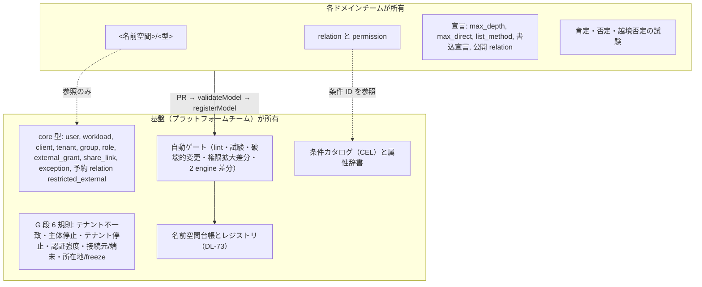
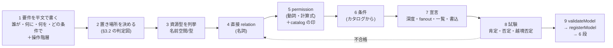
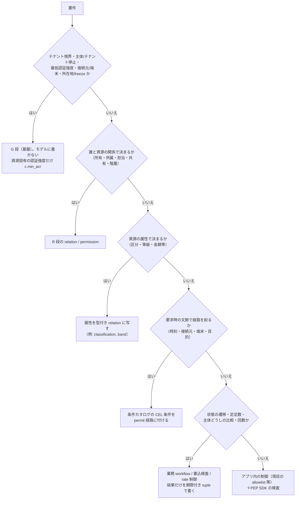
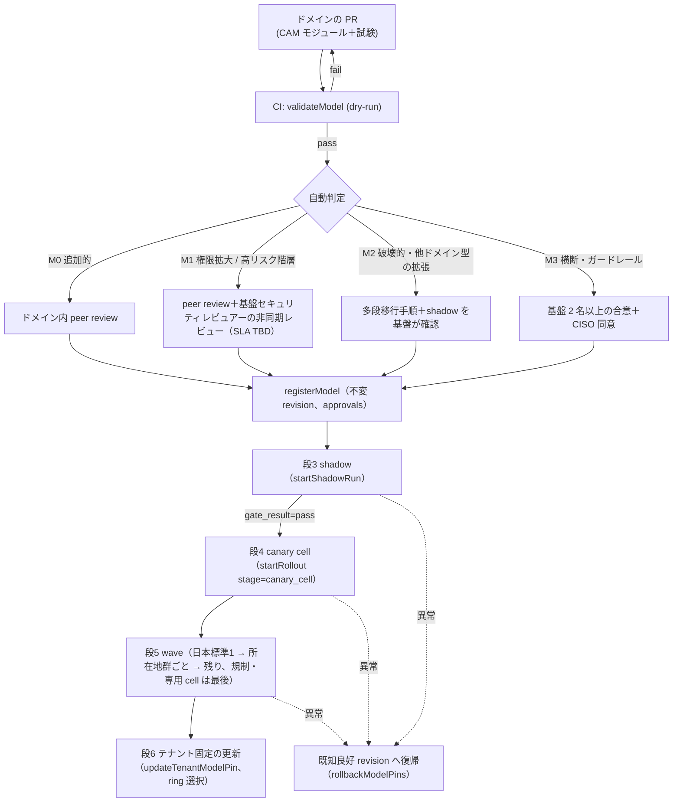
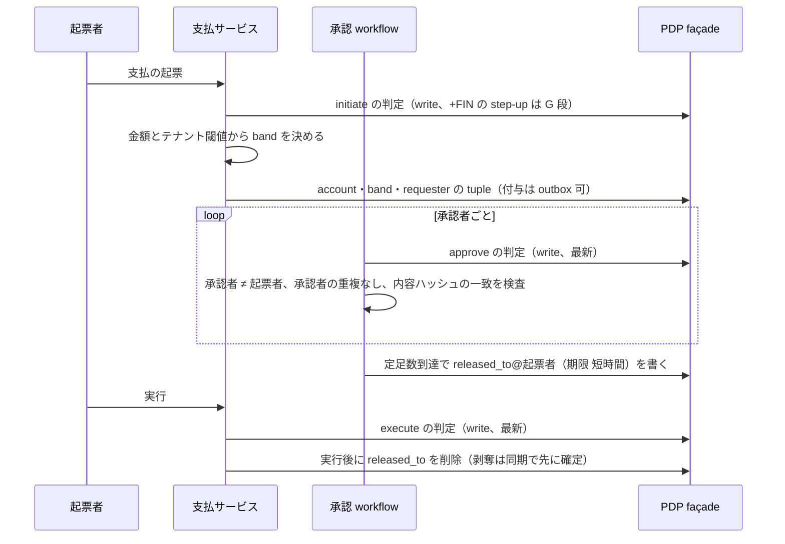
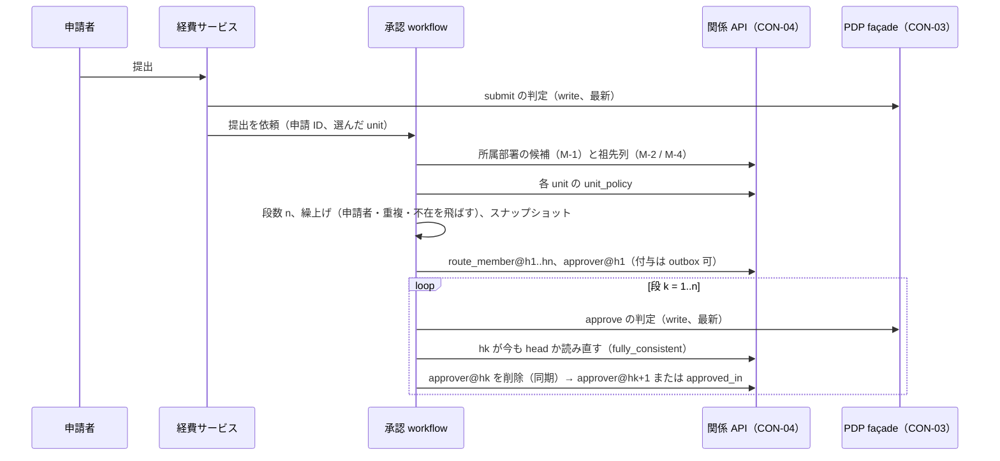

# 認可モデリングガイド

> 文書ID: INT-03 / 版: 0.10（v1.2） / 状態: draft / 最終更新: 2026-10-15（0.10（v1.2）: AI による 2 回目の模擬連携検証（13_integration-trial/room-booking/report.md。実在の連携チームの検証ではない）の L-8・L-9・L-10 と、新契約 CON-17（外部付与）・CON-18（AI エージェント代理）のモデル側の規則を反映した。§4.1 の注記、§9.1 の書込対応表の注記、§10.1 XS-1 の書き方と XS-10・XS-11、§10.3（新設）、§16.6・§16.7。0.9（v1.1 の同期）: 他文書の v1.1 改訂が本書に宛てた申し送りを反映した。§15.2 S-3 の `base_revision` と `tier` の表記（CON-04 HO-V11-2）、§15.2 の CLI の版の注記（CON-11 H11-4）、§16.5 の記録。0.8: 0.8: v1.1 改訂。AI による模擬連携検証 13_integration-trial/report.md の P-04・P-05・P-06・P-17 と改善提案 I-4・I-5 を反映した。§9.7 経費精算の承認経路（組織階層・部署長・閾値による上位承認）の通し例、所属部署・祖先の取得手段、決裁前に使える暫定形、§4.4 N-26（`action.name` の書き方）、§1.3 D-11・D-12、§16.4 の申し送り。末尾「レビュー記録」の「v1.1 改訂」。0.7: PoC/R7反映。[M] の付け方を CONVENTIONS §3 の条件に揃え（MP-7-15）、§10.1 に POC-02 の X-C・X-D からのモデル規則 XS-8・XS-9 を加えた。末尾「レビュー記録」の「PoC/R7反映」）
> 対応要求: R-252, R-256, G-107, G-108, G-115, G-116, G-147（R-requirements.md・G-goal-criteria.md で対応成果物欄に本書のパスまたは DL-65 を含む全行）。成果物計画の DL-65 行が挙げる R-098, R-147, R-148, R-205 も対応表に含める
> 依存文書: CONVENTIONS.md, traceability/deliverables.md（DL-65）, 04_architecture/authorization-model.md（ARC-05。本書の上位仕様）, 05_adr/ADR-010・ADR-011・ADR-016・ADR-021・ADR-024・ADR-025・ADR-029（設計判断の正本）, 05_adr/reconciliation-notes.md, 11_contracts/relationship-model-registry.openapi.yaml（CON-04、DL-73）, 11_contracts/authorization-api.openapi.yaml（CON-03、DL-72）, 11_contracts/mock-contract-test-kit.md（CON-11、DL-80）, 04_architecture/pep-contract.md（ARC-06）, 02_requirements/operation-risk-tiers-assurance.md（REQ-03。操作 5 分類の正本）, 02_requirements/customer-admin-responsibility.md（DL-26）, 01_governance/raci-governance.md（GOV-05 §6）, 01_governance/assumptions-register.md, 01_governance/kri.md, 03_threat-model/threat-catalog.md（T-026〜T-034, T-080）, 07_slo/numeric-contracts.md（SLI-040〜SLI-043）, 12_poc/preregistered-test-plan.md, research/RS-07, RS-17（各 verification 記録を含む）, research/RS-18（独立検証記録なし）, research/standards-status.md, traceability/claims-ledger.md, traceability/dissent-log.md
> 改版: v0.3（RS-18反映（2026-10-15））で、containment の命名（N-9 改訂、N-20・N-21 追加）、主体の `(type, id)` と `subject_id`／`subject_type`（N-19 補足）、祖先閉包と深度（§7.2）、§9.2・§9.3 の写像表と注意、INT03-K1・K2 と ARC-05 K05-6〜K05-8 の関係、残課題 17〜19 を加えた。§9 の予備実行済みのモデルは変えていない [D][^28]。v0.4（模擬パネル ラウンド1 の対応）で、CON-04 v0.2.0 の CAM 式 v0・試験ケース欄・変更区分・意味の変更の申告欄・条件カタログ・階層サービス API（preview）に合わせて §0-6、§1.2、§1.3、§8.1〜§8.3、§14 残課題 15・19、§15、§16 を改め、「他文書への申し送り」節を加えた。v0.5（模擬パネル ラウンド3 の対応）で、CAM での書き方（§4.4、N-22〜N-25。直接付与は `CamRelation`、計算は `CamPermission`、PEP が問い合わせるのは動詞の permission だけ）を加え、§6.1・§9.1・§9.3・§9.5・§11 のモデルをその形に書き直し、§9 の全モデルを CON-04 の `CamModule` の JSON（付録 A）にして JSON Schema で検証した（§9.0）。v0.6（模擬パネル ラウンド5 の対応）で、契約の参照版を CON-04 v0.3.0 に改め、PoC の CAM 生成器（12_poc/code/model/generate.js）の利用可否と条件、PoC の cam.json と CON-04 `CamModule` の差 3 点を §0-6・§15.1・§15.2 S-8・§15.3 G-7 に書き、§14 残課題 21 と §16.3 の申し送りを加えた。v0.8（v1.1 改訂。13_integration-trial の I-4・I-5）で、§9.7（経費精算の承認経路）と付録 A.7 を加え、§4.4 に N-26、§1.3 に D-11・D-12、§7.2・§7.3・§10.2（AC-33）・§13（INT03-K5）・§14（残課題 22〜24）・§15.2・§15.3（G-8）・§16.4 を改め、付録 A の `tier` を CON-04 v0.4.0（v1.1 改訂）の表記（CON-02 `OperationTier`）に揃えた。模擬パネルと模擬連携検証は AI による自己レビュー・模擬で、実在の CTO/CISO の決裁でも実在の連携チームの検証でもない（CONVENTIONS §8）[D]。
> 作成方法: AI エージェント（Claude）が上記の ADR・設計文書・調査ノートから起草した。ADR に反する設計は置いていない。ADR で決まっていない点は「未決（ADR-0xx）」と書いた。§9 の例は作成者が手作業で OpenFGA DSL と SpiceDB schema に写し、公式 CLI で予備実行した（§9.0。証拠 E4 には数えない）。その後、起草者と別の AI エージェント（Claude）が独立レビューを行い修正した（末尾「レビュー記録」）。実在の CTO/CISO の決裁は経ていない（CONVENTIONS §8）[D]。

---

## 0. 結論

1. **モデルは要件の平文から始め、役割名からは始めない。各要件は「G 段（基盤の deny）」「R 段の関係」「R 段の条件」「業務 workflow」「アプリ内の制御」の 5 か所のどれに置くかを §3 の判定図で先に決める** [D]。OpenFGA の公式手順も「利用者が対象に操作できるのはどの場合か」という平文から始め、「role」から始めると誤った方向に進み得ると述べている [V][^1]（RS-17#84）。テナント境界・主体停止・認証強度などは G 段の 6 規則で基盤が評価するので、ドメインのモデルに書かない（ADR-011 D1-2）[D]。
2. **ドメインが所有するのは自分の名前空間の型・relation・permission と、その試験・宣言（深度、fanout、一覧方式、書込権限）だけである。横断型・deny・越境共有は基盤が所有し、中央の関与は自動ゲートと権限拡大の非同期レビューに限る** [D]（ADR-011 D2-6、ADR-021 D21-25・D21-26、GOV-05 §6.1・§6.4）。変更は M0〜M3 に自動判定され、登録 → CI 検査 → shadow → canary cell → wave → テナント固定の更新の 6 段を通る（ADR-016 D16-31）[D]。審査 SLA の値は未決で、PoC の実測を受けて CTO が決める（GOV-05 DP-6、期限 Gate 3）[D]。
3. **巨大ロール表は「関係を資源に付ける」「custom role はデータで表し委譲可の permission だけを入れる」「属性は型付き relation に写す」の 3 つで避ける** [D]（ADR-011 D1-3・D4-1〜D4-3）。資源名・拠点名・金額帯を役割名に埋め込んだ時点で表は資源数と条件の積で増える [D]。Google Cloud は数千の権限を含む basic role を本番で付与しないよう述べ、custom role は自動で更新されず利用者が保守するとしている [V][^6]（RS-17#89）。
4. **6 ドメイン（ファイル共有、組織・拠点・ツール、プロジェクト管理、医療記録、金融取引承認、管理コンソール）の、要件から試験までの通しの例を §9 に置いた。作成者の予備実行では、OpenFGA CLI v0.7.4 の `fga model test` で 73 件の Check と 1 件の ListObjects、zed v0.30.2 の `zed validate` で 72 件の assertion がすべて期待どおりだった** [D]（作成者の予備実行。TC 未採番、生データは作成者の一時作業領域にあり本リポジトリ未保存。CAM 生成器を通しておらず、試験した engine は RS-07 の確認版より古い。E4 には数えない）。v0.5 で全例を CAM での書き方（§4.4）に書き直し、CON-04 v0.2.0 の `CamModule` の JSON Schema で検証して誤り 0 件を確かめた [D]（作成者の自前の確認。§9.0。書き直し後の engine での再実行は未実施）。正式な検証は TC-ARC05-10・TC-ARC05-11（DL-22 の TC-013）で行う [D]。v1.1（I-4）: 7 つ目の例として §9.7（経費精算。部署長と金額閾値による上位承認の経路）を加えた。経路の解決は承認 workflow が行い、R 段には結果の `approver`・`route_member` の tuple だけを置く。作成者の予備実行（OpenFGA CLI、go install 版で版表示は `dev`）で、3 試験群の Check 39 件・ListObjects 2 件と変形 A の Check 8 件が期待どおりだった [D]（作成者の予備実行。TC 未採番、生データは本リポジトリ未保存。E4 には数えない）。
5. **表せない要件は 3 類型に限られる。承認の定足数と内容への束縛、職務分離（自己承認の禁止・相反役割の同時保持）、件数上限である** [D]。それぞれ workflow・書込検査・業務側の rate 制御に置き、ReBAC で近似しない（§10.2 の要件カタログ、ARC-05 §8.7）[D]。
6. **基盤の完成を待たずに、連携開発者は本書・CON-03・CON-04・CON-11 のモックと engine 公式 CLI だけでモデル設計・モデル試験・アプリの契約試験を始められる（§15）。CAM の式の文法（CAM 式 v0）、試験ケースの提出形式、変更区分（M0〜M3）の返却欄、意味の変更の申告欄、条件カタログの列挙、階層サービス API は CON-04 v0.2.0 に preview として定義し、v0.3.0 でもその形は変わっていない（v0.3.0 の改版はテナント結合 §6 の追加）。残る待ちは、条件カタログの引数の確定、階層の決裁（ARC-05 K05-6〜K05-8）、CAM 生成器と `validateModel` の提供である** [D]（§15.3）。PoC の CAM 生成器（12_poc/code/model/generate.js）は手元で生成結果を見る参考には使えるが、入力の形が CON-04 の `CamModule` と 3 点で異なる（PoC の cam.json は CON-04 v0.3.0 の `CamModule` の JSON Schema で誤り 13 件）。このため S-8 の生成器には数えず、提出物は CON-04 の形で別に作る [D]（§15.1、§15.3 G-7）。
7. **新たな決裁は 5 件（§13。v1.1（I-4）で INT03-K5「部署長（業務上の長）の置き場所」を加えた）。最大の論点は、組織の木（unit）を core 型に昇格するかと、組織の木を辿る継承で解決深度の設計値 8 [A-036] を超える問題の扱いである** [D]。RS-18反映（2026-10-15）: ARC-05 v0.3 §3.6 が、`core/tenant`・`core/unit`（単一親の再帰コンテナ、`kind` 属性）・`core/group`（n:n）・`core/admin_scope`（非ネストの委任範囲）の 4 型、containment の `parent` 統一、祖先閉包 `ancestor` の事前計算を決裁案 K05-6〜K05-8 として置いた。INT03-K1・K2 は同じ論点なので ARC-05 の決裁と 1 回にまとめる [D][^28]。閉じ方は、机上（A）で閉じるのが R-252・R-256・R-098・G-107 の 4 件、組織決定（B）が G-116 の 1 件、実測（C）が残る 6 件である（末尾の対応表）[D]。

---

## 1. 本書の位置付けと読み方

### 1.1 位置付け

| 項目 | 内容 |
|---|---|
| 本書が定めるもの | 連携開発者がドメインの認可モデルを設計・申請・変更する手順、命名・名前空間規約、巨大ロール表を避ける指針、custom role・越境共有・一覧の表し方、性能上の制約、変更レビューと shadow・段階展開の進め方、誤りと修正例、6 ドメインの例、G-108 の認可要件カタログ、基盤の完成前に開発・試験を始める手順（§15）[D] |
| 本書が決めないもの | 型システム・deny semantics・整合性・剥奪時間（ARC-05 と ADR-010・ADR-011 が正本）、契約の電文（DL-72・DL-73）、数値の確定値（DL-20）、オンボーディングの段取り（DL-66）[D] |
| 正本の関係 | 本書と ADR・ARC-05 が食い違う場合は ADR、次に ARC-05 を優先し、本書を直す [D] |
| 読み手 | CTO・CISO は §0、§7、§8、§13、残課題を読めば判断に必要な点を押さえられる。連携開発者は §2〜§6 を読んでから §9 の該当ドメインを写し、§15 の手順で開発を始める [D] |

### 1.2 表記

- permission の式は CON-04 v0.2.0 の CAM 式 v0（`info.description` §9 の EBNF）で書く [D]。`a | b` は和、`a & b` は積、`a - b` は exclusion（core モジュールに限る。E-6）、`x->r` は relation `x` が指す object の relation `r`（tuple-to-userset）である [D]。ARC-05 §8.1 の擬似表記と同じ記号で、本書・ARC-05・CON-04 の例の表記を 1 つにした [D]。
- 異なる演算子を括弧なしで並べない（`(a | b) & c` と書く。E-2）[D]。SpiceDB は和 `+` を `&`・`-` より優先して評価する [V][^29] ため、CAM は優先順位を定義せず括弧を必須にした（CON-04 §9.2）[D]。`x->r` の `x` は直接型だけを持つ relation に限る（E-3）。OpenFGA は `from` の後の relation（tupleset）が他の relation を参照することを許さない [V][^30] [D]。
- 本書のモデルの中の `[T]`（直接型）と `with c`（条件）は CAM の `CamRelation.directly_related`・`conditions` を読みやすく書いた形で、式の文法には含まれない（E-7）[D]。`relations` の行には直接型と条件だけを書き、和・積・arrow を含む式は `permissions` の行にだけ書く（§4.4 N-22）[D]。v0.4 までの例にあった `editor: [T] | owner | parent->editor` の形（relation に式を混ぜる形）は CON-04 の `CamRelation` で表せないので使わない [D]。
- 条件 ID は CAM 上の名前（`c.not_expired`）で書く。各 engine の識別子（`c_not_expired`）への写像は生成器が持つ（ARC-05 §3.5）[D]。
- 表の各行の根拠は「根拠」列に書き、列のない表は本文の注記で根拠を示す。セルごとのタグは省略し、本注記で代える [D]。
- 主張タグ [M] は、CONVENTIONS §3 の条件（TC-ID と生データの所在を記す自前の測定）を満たすものだけに付ける。本書の作成者の予備実行と自前の確認は、TC が未採番で生データを本リポジトリに保存していないので [D] を付け、括弧で確認の種別（予備実行・自前の確認）を書く（版 0.7、PoC/R7反映。MP-7-15。版 0.6 までは同じ確認に [M] を付けていた）[D]。12_poc/measurement-report.md（POC-02）の値を引くときは、立会人なしの自己実行で Gate 4 の証拠でないことを併記し、[D] を付ける（DCS-01 §10.1・ARC-08 と同じ扱い。タグの規則の統一は POC-02 MR-1 で決まる）[D]。

### 1.3 連携開発者のチェックリスト（要約）

| # | すること | 節 | 機械検査 |
|---|---|---|---|
| D-1 | 要件を平文で書き、操作階層（REQ-03）を付ける | §3.1 | 未登録の操作は本番に出ない（REQ-03 J10） |
| D-2 | 名前空間コードを申請する | §4.1 | `/v1/namespace-requests` の自動検査 3 種 |
| D-3 | 型・relation・permission を X-1〜X-10 と §4 の命名規約で書く。直接付与は relation、計算は permission に分ける（§4.4） | §3, §4 | `validateModel` の lint 群 |
| D-4 | 深度・fanout・一覧方式・書込宣言を宣言する | §7 | `lint_recursion_depth`, `depth_fanout_budget`, `lint_write_declaration` |
| D-5 | 全 relation の肯定・否定試験と越境の否定試験を書く（CON-04 `ModelChangeRequest.tests`）。意味の変更があれば `semantic_change` で申告する | §8.2 | `positive_negative_tests`, `cross_tenant_negative_tests`（`test_summary.uncovered_relations`） |
| D-6 | CI から `validateModel` を呼び、合格後に `registerModel` で登録する | §8.3 | M0〜M3 の自動判定（`ValidationReport.change_class`） |
| D-7 | shadow・canary・wave の結果を確認し、テナント固定の更新まで追う | §8.4 | `getShadowRun` の `gate_result` |
| D-8 | relation ごとに「その tuple の書込を認可する permission」を決め、書込前に判定する（書込対応表） | §3.1 段 7 | 契約試験の負例（DL-80） |
| D-9 | tuple の書込順序（剥奪は同期で先に確定、付与は outbox 可）、移動の 1 要求化、整合性トークンの保存、差分照合を実装する | ARC-05 §1.3 I-4〜I-7 | 契約試験の順序族（CON-11 §6.3） |
| D-10 | 基盤の完成前は §15 の手順でモデル試験とアプリの契約試験を進める | §15 | `fga model test`・`zed validate`、CON-11 のキット |
| D-11 | v1.1（I-5）: PEP が送る `action.name` は catalog に載せた動詞の permission 名だけにし（型名・`can_`・scope の形を付けない）、`subject.type` はモデルの型名（`core/user` など）にする。判定宣言（CON-03 §4.2 `caller_scope`）に入れる permission が自分のモデルに存在することを、登録前に確かめる | §4.4 N-24・N-26 | CON-03 `Action.name` の pattern（v1.1。scope の形は 400）、`caller_scope`（宣言外は `deny_guardrail:caller_scope`） |
| D-12 | v1.1（I-4）: 承認者が組織の位置（部署長・上位部署）で決まる要件は、§9.7 の形（経路は workflow が解決し、R 段には結果の tuple だけを置く）で設計する | §9.7 | モデル試験と workflow の負例（§9.7 の WF-01〜WF-09） |

---

## 2. 所有の境界



| 対象 | 所有者 | ドメインにできること | ドメインにできないこと | 根拠 |
|---|---|---|---|---|
| G 段の規則 | 基盤 | テナント設定値の範囲で使われることを前提に設計する | 規則の追加・迂回、custom role での解除 | ADR-011 D1-2・D4-4 |
| core 型 | 基盤 | 直接型・tuple-to-userset の参照先に使う | relation の追加・改名、`core/tenant` への管理権限の追加（X-3） | ARC-05 §3.1、ADR-021 D21-26 |
| 縮小（exclusion） | 基盤 | 資源の付与権限者の操作として、子の資源に `restricted_external` を設定する | 独自の `but not`（X-5） | ADR-011 D3-4。`restricted_external` の tuple を誰が書くか（façade の専用操作か、ドメインの書込宣言か）は ARC-05・CON-04 に定めがなく未決（§14 残課題 14） |
| ドメインの型 | ドメイン | 追加・変更・移行（M0〜M2） | 他ドメインの型の変更（`namespace_not_owned`） | ADR-011 D2-6、CON-04 `registerModel` |
| 他ドメインの relation の参照 | 参照される側が公開宣言 | 公開宣言された relation だけを参照 | 非公開 relation への依存 | ARC-05 X-4 |
| 条件 | 基盤（カタログ） | 登録済み条件 ID の使用 | 任意 script・汎用 policy の持込み（例外承認制） | ADR-011 D1-3 |

- 横断型を基盤が持つのは、テナント境界・越境共有・横断型をドメインに委ねるとチームごとに意味論がばらつくからである [D]（RS-17#96 項 1・7）。OpenFGA の modular models は、多くのチームが関わるとモデルの所有境界が不明確になりレビューがスケールしない課題に対し、モジュール分割と code owners による所有の表現を提供している [V][^2]（RS-17#85）。
- 主張台帳 CL-0281（全サービス共通は tenant/user/group/action の契約だけで、resource type と relation はドメイン所有）は、上表の形で維持する [D]。

---

## 3. 設計手順

### 3.1 手順



| 段 | すること | 出力 | 根拠 |
|---|---|---|---|
| 1 | 要件を「{主体} が {資源} に {操作} できるのは {条件} の場合」の形で書き、REQ-03 の操作階層と修飾子を付ける | 要件表（§10.2 の形式） | OpenFGA の手順 01 [V][^1]（RS-17#84）、REQ-03 §2.4 |
| 2 | 要件ごとに置き場所を決める（§3.2） | 要件表の「置き場所」列 | ADR-011 D1-1〜D1-3 [D] |
| 3 | 資源型を列挙する。可変長の入れ子は再帰できる 1 つの型（例: folder）にし、固有の permission と寿命を持つ節点は別の型にする | 型の一覧 | OpenFGA 手順 02 [V][^1] |
| 4 | 主体と資源を結ぶ直接 relation を列挙する。relation は名詞（`owner`, `parent`, `approver`）にする | relation と直接型 | ARC-05 X-2 |
| 5 | permission を relation の和・積で定義し、permission catalog の印（操作階層、テナント委譲可、外部付与可）を付ける | permission と印 | ARC-05 §3.2 |
| 6 | 経路を絞る条件を条件カタログから選ぶ。カタログにない条件は基盤に登録を申請する | 条件 ID | ADR-011 D1-3、ARC-05 §3.5 |
| 7 | 再帰 relation の `max_depth`、relation の `max_direct`、一覧方式（L1〜L3）、書込宣言、公開 relation を宣言する。あわせて relation ごとに、その tuple を書く利用者操作を認可する permission（書込対応表。例 §9.2）を決める | CAM モジュールの宣言欄、書込対応表（ドメインの設計文書） | CON-04 `CamRelation`・`CamType`・`WriteDeclaration`。書込対応表は ARC-05 X-8（workload 単位の書込権限）を利用者単位に補う本書の規則 [D] |
| 8 | 全 relation に肯定・否定試験を書き、越境の否定試験を加える | 試験ファイル | OpenFGA は全モデルをデプロイ前に試験すべきとし、良い試験は全ての関係を検証すると述べる [V][^3]（RS-17#86）。SpiceDB は assertion と CI 用の validate を提供する [V][^4]（RS-17#87） |
| 9 | CI から `validateModel`（dry-run）を呼び、合格後に `registerModel` で登録し、§8 の 6 段を進める | revision、shadow 結果 | ADR-016 D16-31、CON-04 |

- 書込対応表は、tuple を書く前にサービスの PEP が判定する permission を relation ごとに 1 つ定めた表である [D]。X-8 の書込宣言は「どの workload が書けるか」しか決めないため、利用者の操作としての書込（共有、所属の変更、付け替え）を誰に許すかは、この表がないと実装ごとにばらつく [D]。付け替え（`parent` の変更）は、対象の資源と移動先の親の両方で判定する [D]（ADR-024 D24-13 の移動の検査と同じ向き）。
- 条件付きの直接型は、1 つの relation に 1 種類だけ置く [D]。CON-04 の `CamRelation.conditions` は relation 単位で条件を持ち、直接型ごとに条件を付け分ける欄がないためである [D]。条件付きと条件なしの主体を同じ relation で受けたい場合は、条件を core 側（`core/external_grant#grantee` など）に置くか、relation を分けて permission で和をとる [D]。
- OpenFGA の手順は最後を「繰り返す」としている [V][^1]。本基盤でも 1 回で完全なモデルを作ろうとせず、最重要の機能から順に M0（追加的変更）を重ねることを勧める [D]。M0 は作成者以外のドメイン内 peer review だけで反映でき、中央を待たない（GOV-05 §6.4）[D]。

### 3.2 要件の置き場所の判定



| 置き場所 | 置くもの | 置いてはならないもの | 根拠 |
|---|---|---|---|
| G 段 | 6 規則の対象 | ドメイン固有の業務規則 | ADR-011 D1-2 |
| R 段 relation | 所有、所属、担当、共有、親子、custom role の割当 | 業務上の識別名、テナント ID（X-9） | ADR-010 D-12、T-034 |
| 型付き relation への写像 | 機密区分、等級、金額帯など離散化できる資源属性 | 連続値そのもの | ADR-011 D1-3「資源属性に基づく条件は関係か型に写して表す」 |
| CEL 条件 | 期限、時間帯、接続元ゾーン、管理端末、資源固有の認証強度、利用目的 | 「条件が真なら拒否」（C-1）、資源属性の比較 | ARC-05 §3.5・§4.2、ADR-011 D1-3 |
| workflow・書込検査 | 承認の定足数、申請者≠承認者、相反役割の同時保持の禁止、件数上限 | ReBAC での近似 | ARC-05 §8.7、K05-4（未決） |
| アプリ内 | 返却・更新できる項目の allowlist（T-026） | 認可の根拠になる独自 ACL | T-026 の予防策（DL-15、本書） |

- G 段の構造は主要クラウドの IAM と同じ向きである [D]。Google Cloud IAM は deny policy を allow policy より先に評価し、条件を評価できない deny rule も適用する [V][^8]（RS-17#90）。AWS IAM は既定で全要求を暗黙に拒否し、明示的な deny が明示的な allow に優先する [V][^9]（RS-17#91）。ドメインはこの層を持たず、permit の経路だけを書く [D]。
- 条件の入力が欠けた場合は評価不能（deny）になる（ARC-05 C-4）[D]。SpiceDB は context が足りない場合に CONDITIONAL を返し、façade はこれを deny に写す [V][^18]（RS-07#32）。条件付きの経路だけで許可する permission は、呼出側が必要な context を渡さない限り常に deny になるので、条件の入力を PEP SDK の要求に含める [D]。
- 項目単位の制御は、項目群ごとに permission を分けて表す（§9.4 の `read_clinical` と `read_billing`）[D]。分けた permission の中で返す項目の allowlist は schema で宣言し PEP SDK で検査する。これは T-026（プロパティ単位の認可漏れ）の予防策である [D]。

---

## 4. 命名・名前空間規約

### 4.1 名前空間

| # | 規約 | 根拠 | 機械検査 |
|---|---|---|---|
| N-1 | 名前空間コードは中央台帳が事業能力（capability）に対して払い出す。組織名・チーム名・製品名・ベンダー名を含めない | ADR-021 D21-25。20 年のうちにベンダーと組織は入れ替わる [D] | `/v1/namespace-requests` の `no_org_or_product_name` |
| N-2 | 払い出したコードは再利用しない。廃止は deprecated、削除後は tombstoned とする | ADR-021 D21-25・D21-27 | `not_reserved_or_tombstoned` |
| N-3 | コードは英小文字始まり、英小文字・数字・下線、末尾英数字、3〜63 文字 | CON-04 `NamespaceCode`。SpiceDB の接頭辞部分の制約に合わせた値で、X-2 の確定（DL-73 凍結前）で見直す（未決） | `naming_rule` |
| N-4 | `core` は基盤の予約。ドメインは使えない | ADR-021 D21-26 | `lint_namespace` |
| N-5 | M&A で取り込んだ組織の型には新しいコードを払い出し、重複する型は改名手順で統合する | ADR-021 D21-27 | 審査（M2） |
| N-6 | 名前空間の所有移転と廃止は `kind=transfer_ownership` / `deprecate` で申請する | CON-04 `NamespaceRequestInput` | 審査 |

- 名前空間台帳の所有者は、プラットフォームのプロダクト責任者を推奨とした未決事項である（ADR-021 K21-5、決める人 CTO）[D]。
- v1.2（room-booking L-9）: §9.2 の `org` は例のための名前空間コードで、払い出された実在のコードではない。拠点・フロアなどを `org` に置くか自ドメインの名前空間に置くか、`core/unit` で表すかの判断の目安は §10.3 に置いた。`org` を含む共通の名前空間の所有者は、上の台帳の所有者（ADR-021 K21-5）が決まるまで未定である [D]。

### 4.2 型・relation・permission

| # | 規約 | 良い例 | 悪い例 | 根拠 |
|---|---|---|---|---|
| N-7 | 型は `<名前空間コード>/<型名>`。型名は業務上の物の名詞の単数形 | `files/folder`, `fin/payment` | `files/folders`, `files/folder_v2`, `dms_team_a/doc` | ADR-021 D21-26、ARC-05 X-1 |
| N-8 | relation は名詞（主体の役割）、permission は動詞。例外は保持者集合の permission（§4.4 N-23）で、relation 名の複数形にする | relation `approver`、permission `approve`、保持者集合 `editors` | relation `can_approve`、permission `approver` | ARC-05 X-2。例外は CON-04 `CamRelation` が式を持てないことによる本書の規則 [D] |
| N-9 | 再帰する包含（同じ型の入れ子）は `parent` だけで表す。再帰しない参照は役割の名詞（`project`, `account`, `unit`, `site`）にする。RS-18反映（2026-10-15）: ARC-05 X-11・X-12（K05-7、決裁前）が採られた場合は、再帰しない包含（タスク→プロジェクト、プロジェクト→unit、拠点→unit）も `parent`（単一値、型付きの直接型）に揃え、包含でない参照（所管部署・担当チーム）だけを役割名（`owning_unit`, `care_team`）にする | `files/folder#parent`、（K05-7 採用後）`proj/task#parent: [proj/project]` | 包含に `container`、`higher` などを使う再帰。（K05-7 採用後）包含を `unit`・`project` と書く | ARC-05 X-7・X-11・X-12。§9 の例は予備実行済みの v0.2 の名前のまま（§9.2 の写像表） |
| N-10 | 識別子は英小文字始まり、英小文字・数字・下線、末尾英数字（案）。長さは relation 3〜64 文字（CON-04 `RelationName`） | `restricted_external` 以外の予約語を避けた `share_external` | `Read`, `x`, `share-ext` | ARC-05 X-2。SpiceDB の識別子規則 [V][^25] に先頭英字を足した案で、OpenFGA の識別子規則は未確認（TC-ARC05-10） |
| N-11 | 条件の有無・資源名・拠点名・金額を名前に入れない | permission `read` に `c.network_zone` を付ける | `read_from_office`, `tokyo_viewer`, `approve_under_1m` | §5 |
| N-12 | 予約語（`restricted_external`, `restricted_external_inherited`, `external_member` など core が使う名前）をドメインで定義しない | — | ドメイン型に `restricted_external` を自作 | ARC-05 X-2・X-5 |
| N-13 | 改名はしない。必要なら追加 → 二重書込 → backfill → 旧参照削除 → 旧定義削除の M2 手順で行い、旧名は再利用しない | — | relation のその場の改名 | ARC-05 X-10、ADR-021 D21-27。SpiceDB はデータがある relation の削除を拒否し、この多段手順を示す [V][^5]（RS-17#88） |
| N-14 | 他ドメインから参照される relation は `public: true` を宣言し、その変更は破壊的変更の検査対象になる | `org/site#enter_system` を公開 | 非公開 relation を他ドメインが参照 | ARC-05 X-4、CON-04 `CamRelation.public` |
| N-20（RS-18反映（2026-10-15）） | 組織の木はドメインで作らない。部署・子会社・支社は基盤の `core/unit`（呼び名は `kind` の表示名）、管理委任の範囲は `core/admin_scope` を参照する（K05-6 の決裁後）。型名に `organization`・`org` を使わない | ドメインの葉ノードを `parent: [core/unit, core/tenant]` でぶら下げる | ドメイン型 `hr/department`・`sales/branch` を並立させる | ARC-05 §3.6.1、K05-6 |
| N-21（同上） | `ancestor` は予約語。ドメインは定義・書込みせず、permission の式で `ancestor->manage` のように参照だけする（K05-8 の決裁後） | `view = member \| ancestor->manage` | ドメインが祖先 tuple を自前で書く | ARC-05 X-13 |
| N-15 | arrow（`x->r`）の右辺は permission を指すことを推奨する | `site->enter_system`（permission） | `tenant->admin`（core の relation を直接指す） | 予備実行で zed v0.30.2 が relation を指す arrow に `arrow-references-relation` の警告を 8 件出した [D]（作成者の予備、§9.0）。core 側に参照用の公開 permission を置く案は §13 INT03-K4 |

### 4.3 識別子（object ID）

| # | 規約 | 根拠 |
|---|---|---|
| N-16 | object ID は不透明 ID。英数字・`_`・`-`、最大 128 文字。122 bit 以上の乱数（UUIDv4 相当）を最低線とし、ID を推測できないことを認可の根拠にしない（推測できても PEP の判定で拒否されること） | CON-04 `ObjectId`、ADR-021 D21-14 |
| N-17 | 業務上の識別名（患者名、ファイル名、口座番号）、個人データ、テナント ID、時刻を ID に入れない | ARC-05 X-9、ADR-010 D-12、T-034。関係の存在そのものが機微になり得る [D][A-071] |
| N-18 | 資源の所有テナントは資源の正本ストアに記録した不変の属性とし、要求のパラメータから取らない | ADR-024 D24-07・D24-10 |
| N-19 | 主体・資源は `(type, id)` の組で運び、ID 文字列に型の接頭辞を付けない。RS-18反映（2026-10-15）: 主体の id は人もシステムも同じ値域の sub で、自サービスのデータモデルでも `user_id` ではなく `subject_id`＋`subject_type` の 2 欄で持つ。要求元ソフトウェア（`client_id`）と代理（`act`）は別の欄にし、主体の列に混ぜない（ARC-15 §3.9） | ADR-021 D21-10・D21-26（AuthZEN の Subject/Resource と同じ値の体系）、[^28] |
| N-19b（RS-18反映（2026-10-15）） | 階層のパス（`/本社/開発本部`）や祖先列を ID・認可キーにしない。パスは表示専用、祖先列は一覧の索引だけに使う。選択中の unit・ワークスペースは token ではなく BFF のセッション状態か要求パラメータで運ぶ | ARC-05 §3.6.5、ADR-021 D21-38 規則 2 [D] |

### 4.4 CAM での書き方（直接付与と計算の分離。v0.5、模擬パネル ラウンド3 の対応）

CON-04 v0.2.0 の `CamRelation` は `required: [name, directly_related]`・`additionalProperties: false` で、式の欄を持たない。式（和・積・exclusion・arrow）を持てるのは `CamPermission.expression` だけである [D]（CON-04 `components.schemas.CamRelation`・`CamPermission`）。CON-03 の `Action.name` は「型の内側で一意な permission 名」である [D]（CON-03 `components.schemas` の Action の description。ADR-021 D21-26）。このため、ドメインのモデルは次の規則で書く [D]。PoC の CAM（12_poc/code/model/cam.json、POC 実装記録 12_poc/code/README.md §10.2 P-10）も同じ分け方をとっている [D]。

| # | 規則 | 例 | 根拠 |
|---|---|---|---|
| N-22 | `relations`（`CamRelation`）には直接付与だけを書く。直接型（`directly_related`）、条件（`conditions`）、宣言（`max_depth`・`max_direct`・`public`）以外を書かない。包含・継承・和・積は全て `permissions`（`CamPermission.expression`）に書く | relation `editor: [core/user, core/group#member, core/role#assignee]` | CON-04 `CamRelation`・`CamPermission` [D] |
| N-23 | 直接付与を包含・継承で広げた集合（v0.4 までの `editor: [T] \| owner \| parent->editor` に当たるもの）は、relation 名の複数形の permission（保持者集合）として書く。relation 名は単数の名詞のまま残す。保持者集合を作るのは、(a) arrow の右辺として他の型か `parent->` の再帰から参照される、(b) 2 つ以上の permission から参照される、のどちらかの場合に限り、それ以外は動詞の permission の式に直接展開する | `editors = editor \| owner \| parent->editors`、`viewers = viewer \| editors \| parent->viewers`（§9.1）。展開の例は `fin/account#view = viewer \| operator \| unit->manage`（§9.5） | PoC の P-10（`editor` と `editors`・`viewers`・`members`）と同じ命名 [D]。arrow の右辺が permission になり E-5・N-15 の推奨にも沿う [D] |
| N-24 | PEP が CON-03 の `action.name` に渡すのは、permission catalog に操作階層と印を付けて載せた動詞の permission だけである。保持者集合と、式の部品として置いた補助の permission（§9.3 の `view_internal`、§9.4 の `clinician`）は catalog に載せず、`tier` は `read-sensitive`（v1.1: CON-04 v0.4.0（v1.1 改訂。I-7）で表記を CON-02 `OperationTier` に揃えた。v1.0 までは `read_sensitive`）、`marks` は付けない（PoC と同じ）。呼出し元の判定宣言（CON-03 §4.2 `caller_scope`）にもこれらを入れない | アプリは `files/file` に `read`・`write` を問い合わせ、`editors`・`viewers` を問い合わせない | CON-03 §4.2（宣言外の permission の照会は `deny_guardrail:caller_scope`）[D]。保持者集合を問い合わせ先にすると、catalog の操作階層と監査の単位が permission とずれる [D] |
| N-25 | core の生成器が付ける部分（予約 relation `restricted_external`、計算 `restricted_external_inherited`、動詞の permission への `- restricted_external_inherited` の付加）は、ドメインの `CamModule` に書かない。ドメインは exclusion を含まない式（例 `read = viewers`）を書く | §9.1 の「core 生成器が付ける部分」の注記 | ARC-05 §3.1（`restricted_external` は core が生成）・§8.2、CON-04 E-6（exclusion は core モジュールだけ）[D]。生成器がこの付加を行う規則は CON-04 に未記載（§16.2 HO-R3-2） |
| N-26（v1.1（I-5）） | `action.name` には、`resource.type` の型に定義した動詞の permission の名前を**そのまま**入れる。型名・名前空間（`docs.document.read`）、接頭辞（`can_read`）、OAuth scope の形を付けない。型は `resource.type` で運ぶ。`<名前空間>.<型>.<動詞>` の形は第三者に公開する OAuth scope（CON-02 `ExternalScope`、ADR-021 D21-28）だけに使い、判定要求には使わない。`subject.type` は主体のモデルの型名（人間の利用者は `core/user`、workload は `core/workload`）で、token の主体類型（`ptype` の `human` など）を入れない。類型は `subject.properties.principal_type` に入れる | 良い例: `resource.type="files/file"`、`action.name="read"`、`subject.type="core/user"`。悪い例: `action.name="can_read"`（モデルに `can_read` がない）、`"files.file.read"`（scope の形）、`subject.type="human"` | CON-03 `Action`（v1.1 で CON-02 `NameSegment` の pattern を課し、scope の形は 400）・`Subject`（v1.1）[D]。主体類型から `subject.type` への写像の正本は CON-02 で、本書は写しを持たない（§16.4 HO-V11-6）[D] |

- v1.1（I-5）の背景: v1.0 の文書群は `action.name` を 3 通り（CON-03 の例の `can_read`、INT-02 の例の `docs.document.read`、本書の `read`）に書いていた [D]（13_integration-trial P-05）。モデルにない名前を送ると、本番では判定宣言（CON-03 §4.2）に当たらず全件 `deny_guardrail:caller_scope` になるが、汎用モックは名前の意味を評価しないので開発中に気づけない [D]。名前の正本は自分のモデル（`CamModule` の `permissions[].name`）であり、PEP の設定・判定宣言・試験の期待値はこの一覧から作る [D]。
- 判定宣言を登録する前に、宣言した `(resource.type, action.name)` の組が自分の `CamModule` の catalog 対象の permission（保持者集合・補助の permission を除く。N-24）に全て含まれることを、CI の自前の検査で確かめる（`validateModel` の検査に入るまでの代わり。CON-03 §12 N-3 の申し送りを本書で受けた）[D]。手順は §15.2 S-5 の完了判定に入れた [D]。

- 名前の対応（v0.4 → v0.5）: v0.4 の例の計算 relation `editor`・`viewer`（`files`）、`admin`・`member`（`proj/project`、§6.1）は、v0.5 では保持者集合の permission `editors`・`viewers`・`admins`・`members` になり、直接付与の部分が同名の relation になった [D]。v0.4 の §9.0 で SpiceDB に写した `editor_direct`（直接部分）は v0.5 の relation `editor`、計算 relation `editor` は permission `editors` に当たる [D]。動詞の permission（`read`・`write`・`view` など）の名前と意味は変えていない [D]。
- 判定の意味は変わらない [D]。v0.4 の relation 式 `X: [T] | e` は「直接付与 `[T]` と式 `e` の和」であり、relation `X: [T]` と permission `Xs = X | e`（`e` の中の `parent->X` は `parent->Xs`）に分けても同じ主体の集合になる [D]。

---

## 5. 巨大ロール表を避ける指針

### 5.1 なぜ表が巨大になるか

- 役割を「資源 × 操作 × 条件」の組ごとに作ると、役割の数は資源数・条件の値の数の積で増える [D]。例として、30 ドメイン [A-051] が拠点別・部門別・金額帯別の役割を作れば、ドメインごとの役割数は拠点数×部門数×帯の数になる [D][A-051]。
- 全権に近い役割は、少数の役割で済む代わりに最小権限を失う。Google Cloud は basic role が全サービスにまたがる数千の権限を含むとし、本番環境では代替がない場合を除き付与しないよう述べている [V][^6]（RS-17#89）。
- 条件付き割当てを役割ごとに足す方式も上限に当たる。Google Cloud は 1 つの allow policy に 100 を超える条件付き role binding を入れないことをベストプラクティスとしている [V][^7]（RS-17#89）。GitHub の custom repository role は上限が 20 で、基本役割の 1 つを継承して権限を足す方式である [V][^12]（RS-17#94）。いずれも役割を無制限に増やさない設計である [D]。

### 5.2 指針

| # | 指針 | やり方 | 根拠 |
|---|---|---|---|
| RB-1 | 関係を資源に付ける | 「プロジェクト P の管理者」は役割 `p_admin` ではなく `proj/project:P#admin` の tuple で表す | typed ReBAC を中核にする（R-252、ADR-011 D1-1） |
| RB-2 | 階層で継承する | フォルダ・組織・プロジェクトの親子を `parent` や参照 relation で辿り、子ごとに付与しない | ARC-05 §8 |
| RB-3 | グループに付与する | 個人を大量に列挙せずグループ・テナント所属の userset に付与する。`max_direct` を超える付与は lint が警告する | ARC-05 §3.4 |
| RB-4 | 属性は型付き relation に写す | 「機密区分が高い文書」は `classification` relation、「金額帯」は `band` relation（§9.5）にする | ADR-011 D1-3 |
| RB-5 | 条件は経路に付ける | 「拠点内からだけ」は役割を分けず `c.network_zone` を tuple に付ける | ARC-05 §3.5 |
| RB-6 | custom role はデータで、委譲可の permission だけを束ねる | §6 | ADR-011 D4-1〜D4-3 |
| RB-7 | 全権的な役割を作らせない | basic role に相当する「全部できる」role は catalog の規則で作れない | ADR-011 D4-3 |
| RB-8 | 役割名を要件から導かない | 要件を平文で書き、役割はモデリングの中で見つける | OpenFGA は「role」から始めると誤った方向に進み得るとする [V][^1]（RS-17#84） |

### 5.3 兆候と処置

| 兆候 | 測り方 | 処置 |
|---|---|---|
| 役割名に資源名・拠点名・金額が入っている | custom role の名前と permission 集合の類似度（管理画面での警告） | RB-1・RB-4・RB-5 で関係・型・条件に戻す |
| 同じ permission 集合の役割がテナント内に複数ある | テナントごとの重複 role 数 | 統合を顧客管理者に提案する（保守責任は顧客、ARC-05 §5） |
| テナントあたりの custom role 数が上限に近い | role 数と上限の比 | 上限は TBD（ADR-011 D4-5。所有者 プロダクト責任者＋CTO、期限 G4、決め方 TC-011-09 の遅延・隔離の実測） |
| 1 つの permission に条件付きの経路が多数ある | permission ごとの条件付き直接型の数 | 閾値を超えたら、条件の値ごとに分かれている経路を型付き relation への写像（RB-4）に置き換える変更（追加は M0、既存 relation の置換は M2 の多段手順）を出す。閾値は TBD（所有者 認可・PDP チーム、期限 G4、決め方 TC-ARC05-08 の tail latency） |

- 主張台帳 CL-0173（固定 role は schema に、custom role と共有関係は tuple に置く分離が有効）は、OpenFGA の Custom Roles 文書を原典に加えたうえで維持する [D]。OpenFGA の公式文書は、役割が動的で頻繁に変わり得るため別の型として表すと説明している [V][^21]。「有効」は設計推論である [D]。

---

## 6. custom role と委任管理

### 6.1 表し方

```text
# core（基盤所有。ARC-05 §3.1）
type core/role
  relations
    assignee: [core/user, core/group#member]

# ドメイン側: role で付与できる relation の直接型に core/role#assignee を許す（§4.4 の書き方）
type proj/project
  relations
    owner:  [core/user]
    admin:  [core/user, core/role#assignee]
    member: [core/user, core/group#member, core/role#assignee]
  permissions
    admins  = admin | owner                    # 保持者集合（N-23）
    members = member | admins                  # 保持者集合（N-23）
```

| 項目 | 規則 | 根拠 |
|---|---|---|
| role の付与先を開く | ドメインは、custom role で付与してよい relation の直接型に `core/role#assignee` を加える。加えていない relation は role では付与できない | ADR-011 D4-1。公式文書に明記がなくモデル構造からの推論（ARC-05 §5） |
| role に入れられる permission | catalog で「テナント委譲可」（`tenant_delegable`）の印を付けた permission だけ | ADR-011 D4-2 |
| 印を付ける基準 | privileged 以上、+XT、+FIN の permission に印を付けるかは、ドメイン責任者が決め、M1（権限拡大）の非同期レビューを通す | GOV-05 §6.4、REQ-03 §2.4 [D] |
| 自動拡張なし | catalog に permission を足しても既存の role は広がらない | ADR-011 D4-3。Google Cloud の custom role も自動で更新されない [V][^6]（RS-17#89） |
| 昇格の防止 | 作成者が持たない permission を含む role は作れない。保護 permission を role に足す変更は保護操作 P-6 | ADR-011 D4-3、DL-26 §3.2 B-1・§4 P-6 |
| G 段との関係 | role で G 段の deny を外せない | ADR-011 D4-4 |
| 操作階層 | role の定義と割当ては privileged/T、資源の relation へ role を結ぶ書込は write | ARC-05 §5、REQ-03 §6.1・§6.2 |
| 外部主体 | 外部主体に role を割り当てない。`core/external_grant#grantee` を `core/role#assignee` 経由で到達させない | ADR-024 D24-12、DL-26 B-4 |

### 6.2 委任管理（delegated admin）

| 規則 | モデルでの表し方 | 根拠 |
|---|---|---|
| 範囲は明示必須 | 委任管理者は `org/unit#user_admin` を特定の unit に書いて作る。範囲のない付与はない | DL-26 B-2 |
| 範囲内だけ | `manage_membership = user_admin \| manage \| parent->manage_membership`（部分木に効く） | §9.2 |
| 自己拡大の禁止 | unit の付け替え（`restructure = parent->manage`）と委任管理者の任命（`assign_user_admin = manage`）は、委任管理者自身には与えない | DL-26 B-3。予備実行で uadm の `restructure`・`assign_user_admin` が deny であることを確認した [D]（作成者の予備、§9.0） |
| 付与者の部分集合 | 委任できるのは付与者が持つ権限の部分集合だけ。書込検査で確かめる | DL-26 B-1。書込検査の置き場所は未決（ARC-05 §16 K05-4） |

### 6.3 G-115 の認可モデル側の負例ベクタ（PoC への申し送り）

G-115 の合格条件は「全負例が拒否される」ことである [D]。認証方針（MFA、IdP、接続元・端末、session 寿命）の負例は DL-26 §8 が持つ。本書は認可モデル側の負例を次のとおり定める [D]。TC 番号は DL-22 で採番する（未採番）[D]。

| # | 負例 | 期待 | 拒否する箇所 | 根拠 |
|---|---|---|---|---|
| NV-01 | 基盤予約の permission を含む custom role の作成 | 拒否 | 管理 API の書込検査 | ADR-011 D4-2 |
| NV-02 | 作成者が持たない permission を含む role の作成 | 拒否 | 同上 | ADR-011 D4-3 |
| NV-03 | 外部主体への role・管理者 relation の付与 | 拒否 | façade の書込検査（X-8）と catalog | ADR-024 D24-12、DL-26 B-4 |
| NV-04 | 委任管理者による自分の範囲の付け替え・委任管理者の任命 | deny | R 段（§9.2 の `restructure`・`assign_user_admin`） | DL-26 B-3 |
| NV-05 | 他テナントの group・role を直接型に使う tuple の書込 | 拒否 | façade（主体と資源のテナント不一致の書込を拒否） | CON-04 §3、DL-26 B-6 |
| NV-06 | custom role による G 段 deny（主体停止中・認証強度不足）の解除 | deny | G 段 | ADR-011 D4-4 |
| NV-07 | 保護 permission を role に追加する変更を P-6 の統制（束縛認証器・通知）なしで実行 | 拒否 | 管理 API | DL-26 §4 P-6 |
| NV-08 | 外部付与可でない permission を外部主体へ到達させるモデル変更 | CI 不合格 | `external_grant_reachability` | ARC-05 §3.2 |
| NV-09 | 越境共有の既定・上限を基盤の床より緩める設定（期限なしの外部付与、外部主体への管理者ロール） | 拒否 | テナント設定の書込検査（DL-26 V-1） | ADR-024 D24-18 |

---

## 7. 性能上の制約

### 7.1 上限と宣言

| 制約 | 値 | 根拠 | ドメインがすること |
|---|---|---|---|
| 解決深度の設計値 | 8（フォルダ 5＋グループ 3）。規制強化シナリオで 10 | [A-036]、ARC-05 §3.4 | 再帰 relation の `max_depth` を宣言し、宣言の合計を設計値以内に収める。作成・移動時に深度を検査する |
| engine の深度上限 | OpenFGA `resolveNodeLimit` 既定 25 [V][^14]（RS-07#19）、SpiceDB `--dispatch-max-depth` 既定 50 [V][^19]（RS-07#35） | — | 上限に当たると評価不能（deny）になる前提で設計する |
| fanout | 最大テナントの全員グループで 10 万（成長 30 万） | [A-036, A-009] | relation ごとに `max_direct` を宣言し、超える付与はグループ・テナント所属の userset で書く |
| モデルあたりの型数 | OpenFGA 既定 100（v1.20.0 表示。v1.21.0 で変わらないかは未確認） | [V][^14]（RS-07#19） | 型を増やす前に既存型の relation で表せないか確かめる。超過時の扱いは ARC-05 §16 K05-2（未決） |
| 1 書込要求の tuple 数 | 100 | OpenFGA `maxTuplesPerWrite` 既定 100 [V][^14] と SpiceDB の既定 1,000 [V][^19] の小さい方（ARC-05 §3.4） | 超える変更は bulk レーンで「狭める変更を先に確定 → 広げる変更」の順に流す（ARC-05 §11.3） |
| 条件 | 要求 context 4,096 バイト以下、CEL コスト 100 以下 | SpiceDB の caveat context 既定 4,096 バイト [V][^19]、OpenFGA の CEL コスト既定 100 [V][^17]（RS-07#22, #32） | 条件 context に大きな集合を入れない。集合は relation で表す |
| 一覧方式 | L1: アクセス可能件数 p99 ≤ 1,000、L2: 許可割合 p ≥ 0.5、L3: それ以外 | ADR-025 D25-05、[NA-025-2] | 資源型ごとに `list_method` を宣言する（§7.3） |
| ListObjects の打切り | OpenFGA は既定 3 秒・1,000 件で打ち切る [V][^15]（RS-07#20）。SpiceDB は LookupResources の対象が 1 万件を超えると重いとする [V][^20]（RS-07#33） | — | L1 を選ぶ型は打切りを欠落として扱う（`enumeration_truncated`。ADR-025 D25-07） |
| 判定量 | 全体の Check ピーク 42,009/秒、最大テナント単独 5,266/秒、edge 呼出 1 件あたり Check 2.5 件 | [A-045, A-009, A-025] | 1 画面で同じ資源を何度も判定しない。evaluations でまとめる（ADR-011 D3-7） |
| tuple 量 | 登録者 1 人あたりリソース 300 件・1 件あたり 2.5 tuple、総数 7.55 億 | [A-035, A-049] | 資源ごとに個人を列挙せず、継承とグループで tuple を減らす |

### 7.2 深度の数え方

- 深度は「tuple を 1 本辿るごとに 1」と数える [D]。A-036 の 8 は「フォルダの入れ子 5＋グループの入れ子 3」であり、次の 3 種類の hop を含んでいない [D][A-036]。
  1. custom role の経由（`core/role#assignee` → 主体またはグループ）: 1 hop。
  2. 外部付与の経由（`core/external_grant#grantee` → 主体）: 1 hop。
  3. 組織の木（`org/unit#parent`）を辿る継承: unit の深さ分。
- したがって、§9.1 のファイルを custom role 経由のグループで読む経路は、最悪でフォルダ 5＋role 1＋グループ 3＝9 になり、設計値 8 を超え得る [D][A-036]。組織の木を辿る継承（§9.3 の `unit->manage` が `parent->manage` を辿る形）を加えると、unit の深さ分がさらに増える [D]。
- RS-18反映（2026-10-15）: ARC-05 K05-8 は「継承を管理系に限る＋祖先閉包 `ancestor` で unit の部分を 1 hop に畳む」を推奨し、設計値 8 を維持する案である [D][^28]。この場合、上の表の `unit×N` は 1 hop になり、タスク view は 3、ツール use は 3（`ancestor` を拠点に持たせた場合）になる [D]。閉包は階層サービスが書くので、移動時の一時 deny（剥奪先行）を前提にする [D]。
- 設計値の引上げか、継承の範囲の制限か、事前計算かは §13 INT03-K2 の決裁案とし、TC-ARC05-08（深度 8・10・25 の tail latency）の結果で決める [D]。決まるまでの暫定規則として、新しいドメインは「組織の木からの継承を管理系の permission（`manage` 系）に限り、閲覧系は資源側の直接付与かグループで表す」ことを推奨する [D]。

| 例（§9） | 最悪経路 | hop 数 | 設計値 8 との関係 |
|---|---|---|---|
| ファイル read（グループ経由） | file → folder×5 → group×3 | 8 | 同じ |
| ファイル write（custom role 経由） | file → folder×5 → role → group×3 | 9 | 超過（K2） |
| タスク view（所管部署の管理者） | task → project → unit×N（`manage` の `parent` 継承） | 2＋N | N は unit の深さ。上限 TBD（K2） |
| ツール use | instance → site → unit×N（`manage`）、または staff（条件付き） | 2＋N | 同上 |
| 医療記録 read_clinical | record → care_team → 主体（＋`acr_gate` → tenant#member） | 2〜3 | 内 |
| 支払 approve | payment → band → role → group | 3〜6 | 内 |
| 経費 view・approve（v1.1、§9.7） | report → `route_member`・`approver`（主体を直接） | 1 | 内 |
| 経費 pay（v1.1、§9.7） | report → `approved_in` → book → role → group×3 | 3〜6 | 内 |
| 経費 view の変形 A（v1.1、§9.7） | report → `request_unit` → unit×N（core/unit の `manage` の `parent` 継承）→ group×3 | 1＋N＋3 | N は unit の深さ（上限 5 は NA-ARC05-1 の初期案）。最悪 9 で設計値 8 を超え得る（K2・K05-8） |

### 7.3 一覧方式の初期選択

| 資源型（§9） | 方式（初期案） | 理由 | 確定方法 |
|---|---|---|---|
| `files/file` | L3 | 主体あたりの可視件数が多く、検索条件で絞った後の許可割合が低い場合がある | TC-027（DL-22。ADR-025 の試験 TC-025-xx を含む）で可視件数と許可割合を測る |
| `proj/task` | L2 | プロジェクトで絞った候補の大半はメンバーに見える見込み | 同上 |
| `med/patient_record` | L1 | 担当・ケアチーム経由で見える記録は限られる見込み。存在そのものが機微のため件数・補完を出さない（ADR-025 D25-13・D25-14、A-071） | 同上。p99 が 1,000 を超えれば L3 へ |
| `fin/payment` | L2 | 口座で絞った候補の許可割合が高い見込み | 同上 |
| `tool/instance` | L1 | 拠点あたりの台数が少ない見込み | 同上 |
| `expense/report`（v1.1、§9.7） | L2 | 台帳（`book`）と状態で絞った候補は、経理担当には大半が見え、申請者・承認者は自分の申請と承認待ちで絞れる見込み | 同上。経理担当の可視件数が 1,000 を超える前提なので L1 にしない |

- 上表は机上の初期案である [D]。宣言の変更はモデル変更と同じ 6 段を通す（ADR-025 D25-05）[D]。
- OpenFGA は権限付きの検索に 3 つの方式を示し、対象が多く許可割合が低い場合は変更の購読から作る索引を勧めている [V][^16]（RS-07#21）。L3 はこの方式に当たる（ADR-025 D25-05）[D]。

---

## 8. モデル変更のレビュー、shadow、段階展開

### 8.1 全体の流れ



- 段と合否は ADR-016 D16-31、区分と承認は GOV-05 §6.4、API は CON-04 による [D]。本番反映そのものは privileged/P（申請者≠承認者、canary）である（REQ-03 §6.5）[D]。
- スキーマの差分で検出できない意味の変更（permission の式を変えて同じ名前の意味を変える、継承の向きを変えるなど）は、変更の起票時に申告欄へ書く（ADR-016 D16-08）[D]。CON-04 v0.2.0 の `ModelChangeRequest.semantic_change`（必須欄。`declared`・`description`・`affected`）に書き、`declared=true` は M2 に回る（CON-04 §9.4）[D]。
- 自動判定の結果は `ValidationReport.change_class`（M0〜M3）と `change_class_reasons` で返る（CON-04 §9.4）。上図の承認経路は登録前にこの値で決まる [D]。
- 主張台帳 CL-0178（domain owner が型と継承規則を所有し、schema review と migration を行う）は、上図の M0〜M2 の形で維持する [D]。中央スキーマ審査をボトルネックにしないため、全変更を通す中央審査会は置かない（GOV-05 §6.1・§6.2）[D]。

### 8.2 自動ゲート（`validateModel` の検査）

| 検査（`CheckResult.name`） | 内容 | 不合格になる典型 | 根拠 |
|---|---|---|---|
| `cam_schema` | JSON Schema による構造検証 | 必須欄の欠落 | ADR-011 D2-1 |
| `lint_expression_syntax` | CAM 式 v0 の構文（E-1〜E-8） | `a \| b & c`（括弧なしの混在）、permission を tupleset に使う | CON-04 §9.2 |
| `lint_reserved_relation` | 予約 relation（`ancestor` など）の定義・書込宣言 | ドメインが `ancestor` を書込宣言に含める | ARC-05 X-13 |
| `lint_namespace` / `lint_naming` | X-1・X-2、§4 の規約 | 未登録の名前空間、大文字 | ARC-05 §3.3 |
| `lint_extension_scope` | core の拡張範囲（X-3） | `core/tenant` への relation 追加 | CON-04 の負例 |
| `lint_cross_domain_reference` | 公開宣言のない他ドメイン relation の参照（X-4） | 非公開 relation への arrow | ARC-05 X-4 |
| `lint_no_domain_deny` | ドメイン独自の exclusion（X-5） | `but not` を自前の relation で書く | ADR-011 D3-4 |
| `lint_no_wildcard` | 型ワイルドカードの直接型（X-6） | `core/user:*` | ADR-024 D24-09 |
| `lint_recursion_depth` / `depth_fanout_budget` | 再帰は `parent` に限り、深度・fanout の宣言が予算内（X-7、§7） | `higher->approver` のような `parent` 以外の再帰 | ARC-05 §3.4 |
| `lint_write_declaration` | 書込宣言（X-8） | 宣言のない relation を書くサービス | T-033 |
| `lint_identifier_policy` | 識別子の規則（X-9） | 業務名を含む ID 規則 | T-034 |
| `external_grant_reachability` | 外部付与可でない permission に `core/external_grant#grantee` が到達しない | 外部付与を `editor` の直接型に許す | ARC-05 §3.2 |
| `positive_negative_tests` | 全 relation の肯定・否定試験。入力は `ModelChangeRequest.tests`（`.fga.yaml` と同じ tuples・check・list_objects の構成 [V][^31]） | 試験のない relation（`test_summary.uncovered_relations`） | RS-17#86・#87、CON-04 `ModelTestCase` |
| `cross_tenant_negative_tests` | 越境の否定試験（`ModelTestCase.kind=cross_tenant_negative`） | 試験の欠落 | ADR-011 D2-5 |
| `breaking_change` | データがある relation の削除・改名 | その場の改名 | RS-17#88 [V][^5] |
| `permission_expansion_diff` | 権限が広がる差分。検出すると M1 と追加承認 | 直接型の追加 | AWS IAM Access Analyzer の CheckNoNewAccess と同じ考え方 [V][^10]（RS-17#92） |
| `engine_differential` / `dsl_roundtrip` | 2 engine の判定差、OpenFGA DSL→CAM→SpiceDB schema の往復 | engine 固有機能の使用 | ADR-011 D2-2・D2-3 |

- 越境の否定試験は 2 層に分けて書く [D]。engine の試験（R 段）では、他テナントの主体に tuple がない限り deny であることを確かめる。他テナントの主体を書く tuple はそもそも façade が書込を拒否し（CON-04 §3）、token の tid と資源のテナントの不一致は L0・G 段で拒否するので、それらは契約試験キット（DL-80）とテナント越え property test（TC-002）で確かめる [D]。
- 全件を記号的に解析できる保証はないため、shadow で補う（ADR-011 D2-5）[D]。

### 8.3 変更区分の例

| 変更の例 | 区分（自動判定） | 承認 |
|---|---|---|
| 新しい型 `proj/milestone` を追加 | M0 | ドメイン内 peer review |
| `proj/task#watcher` の直接型に `core/group#member` を追加 | M1（権限拡大） | ＋基盤セキュリティレビュアー（非同期） |
| `files/file#viewer` の直接型に `core/external_grant#grantee` を追加 | M1（外部付与可の拡大。catalog の印の変更を伴う） | 同上。+XT の permission に関わる |
| `med/patient_record#read_clinical` の式の変更 | M1（高リスク階層。+REG） | 同上 |
| `proj/project#member` を `participant` に改名 | M2（破壊的） | 多段移行と shadow を基盤が確認 |
| `org/site#enter_system` の公開を取りやめる | M2 | 同上。参照するドメインの移行が先 |
| `core/unit` の新設（§13 INT03-K1） | M3 | 基盤 2 名以上の合意＋CISO 同意 |

### 8.4 shadow と段階展開の運用

| 項目 | 規則 | 根拠 |
|---|---|---|
| 比較の基準 | 各テナントの現行固定 revision（`baseline=tenant_pinned`） | CON-04 `ShadowRun` |
| 判定への影響 | shadow の結果は判定に使わず、副作用を持たない | ADR-027 D27-12、CON-04 |
| 差分の分類 | X（allow 拡大）、N（deny 拡大）、E（評価不能・不達）、T（時間差） | ADR-027 D27-17 |
| 合格条件 | 承認済みの変更で説明できない X が 0 件、N は業務影響の確認済み、剥奪済みの関係が deny のまま（`revoked_relations_still_denied=true`） | ADR-016 D16-32・D16-35 |
| 対象量 | privileged・write は全件を既定、read-sensitive の抽出率は TBD | CON-04 `startShadowRun`、ARC-05 §16 K05-3（決める人 CTO＋CISO、G3） |
| 件数の下限 | 層ごとに n ≥ 3/p（p は検出したい発生率。TBD） | ADR-027 D27-15（移行の規則をモデル変更に準用する本書の判断 [D]。モデル変更の許容条件の値は ADR-016 D16-32 により R-194.2・DL-20 で決める） |
| 期間 | shadow と canary の bake 期間は操作階層ごとに TBD | ADR-016 D16-33（所有者 認可・PDP チーム＋SRE 責任者、G3） |
| 網羅率 | type×relation×permission の経路のうち評価された割合（`permission_path_coverage`）を確認し、未評価の経路は合成要求で補う | ADR-027 D27-15 [D] |
| 復帰 | テナント固定の指示子を既知良好 revision で上書きする。剥奪は復活しない | ADR-016 D16-34・D16-35 |
| 緊急 freeze | 新 revision の展開（段 4〜6）は止まる。剥奪・既知良好版への復帰は止まらない | ADR-016 D16-36 |
| 旧 revision の滞留 | テナントが旧 revision に留まれる期間は上限（NA-016-5 の仮置き: 90 日、または後続 revision が 2 つ出るまでの短い方）以内。ドメインは旧 revision でも試験が通る状態を上限まで保つ | ADR-016 D16-31 段 6、NA-016-5 |
| SpiceDB 採用時の pin | schema の版がないため façade とレジストリで補う方式が未決 | ARC-05 §16 K05-5（TC-ARC05-14） |

- 新旧モデルの shadow check と段階的な rollout の考え方は OpenFGA の文書にも記述があり、OpenFGA はモデルを不変とし本番でモデル ID を渡すことを強く推奨している [V][^13]（RS-07#18）。shadow を必須の段にするのは本基盤の設計判断である [D]（DS-16 の処置: 必須化は [D]、OpenFGA の推奨は [V] として分ける）。

### 8.5 審査 SLA と監視

- 審査の律速は K-31（中央チームの審査待ち）で監視する [D]。M1 レビューの待ち時間 p50・p90、未処理件数、M0 の比率、ゲート別の拒否件数を指標候補とする（GOV-05 §6.6）[D]。
- SLA の値は TBD である（所有者: プラットフォームチーム長、期限: Gate 3、決め方: パイロット 2〜3 サービスでモデル登録の所要時間を実測し SLI として DL-20 に置く。GOV-05 §6.6）[D]。決裁は CTO（CISO 同意）が DP-6 で行う [D]。
- SLA 違反が続いた場合は、(1) 検査の自動化を増やして M1 の対象を狭める、(2) M0 の条件を広げる（M3 変更）、(3) レビュアーを増やす、の順で是正する（GOV-05 §6.6）[D]。

---

## 9. ドメイン別の通しの例

### 9.0 例の位置付けと予備実行

- 各例は「要件 → モデル → permission catalog → 宣言 → 試験 → 注意」の順に書く [D]。core 型は ARC-05 §3.1 の定義を使い、条件付きの core relation（`core/external_grant#grantee`、`core/exception#holder` は `core/user with c.not_expired`）は core 側に条件を持つ [D]。これは ARC-05 §3.1（「tuple には期限条件だけを付ける」）に合わせた形である [D]。ARC-05 §8.2・§8.5 は資源側の直接型にも `with c.not_expired` を重ねて書いているが、資源側に重ねると、条件なしの直接型と同じ relation に混在し、relation 単位でしか条件を持てない CON-04 の `CamRelation.conditions` で表せない [D]。本書は core 側に 1 回だけ付ける形をとり、ARC-05 §8 の例の書換えを「ARC-05 への指摘」（§16）に記した [D]。
- 作成者は、§9.1〜§9.6 の全モデルを手作業で OpenFGA DSL（schema 1.1）と SpiceDB schema に写し、試験を付けて公式 CLI で実行した [D]（作成者の予備実行。下表）。

| 項目 | OpenFGA | SpiceDB |
|---|---|---|
| ツール | openfga/cli v0.7.4（`fga model test`、内蔵 engine は openfga v1.9.5）[^26] | authzed/zed v0.30.2（`zed validate`、内蔵 spicedb v1.42 系）[^27] |
| 結果 | 6 試験群、Check 73/73、ListObjects 1/1 が期待どおり | relationship 60 件、assertion 72 件が期待どおり。`arrow-references-relation` 警告 8 件 |
| 陰性対照 | 期待値を 1 件だけ誤らせると 72/73 になり、失敗を検出した | 同様に 1 件を誤らせると assertion の失敗を検出した |
| 型名の `/` | 受理された（ARC-05 残課題 6・12 の予備的な観測。v1.21.0 での確認は TC-ARC05-10） | 受理された |
| 限界 | CAM 生成器を通していない。試験した engine は RS-07 の確認版（OpenFGA v1.21.0、SpiceDB v1.56.2）より古い。生データは本リポジトリに保存していない（作成者の一時作業領域）。TC 未採番のため E4 に数えない | 同左 |

- 上表の予備実行は v0.4 の例（relation に式を混ぜた形）で行った [D]（作成者の予備）。SpiceDB では relation と permission の名前を分ける必要があったため、計算を含む relation（例: `editor`）の直接部分を `editor_direct` として写した [D]（作成者の予備）。v0.5 では CON-04 の `CamRelation` が式を持てないこと（模擬パネル ラウンド3 の指摘）に合わせ、全例を §4.4 の書き方（直接付与は relation、計算は permission）に書き直した [D]。SpiceDB 側の予備実行は既にこの分け方の構造で行っており、v0.5 との違いは名前（`editor_direct` → relation `editor`、計算 relation `editor` → permission `editors`）だけである [D]。試験表の問い合わせ先は動詞の permission だけで、名前を変えていない [D]。ただし v0.5 の例そのものを engine の CLI で再実行してはいない（本対応の実行環境に CLI がない。残課題 20）[D]。
- v0.5 の機械検証 [D]（作成者の自前の確認。TC 未採番。2026-10-15）: §9.1〜§9.6 の全モデルを名前空間ごとの `CamModule` の JSON 6 件（付録 A。14 型、relation 46 件、permission 48 件）にし、CON-04 v0.2.0 の `components.schemas.CamModule`（`$ref` を解決）に対して JSON Schema 2020-12 で検証した（Python、jsonschema 4.26.0）。結果は次のとおりである。

| 検査 | 結果 | 扱い |
|---|---|---|
| JSON Schema（`CamModule`） | 6 件とも誤り 0 件 | S-3 の完了判定を満たす形であることを確かめた |
| CAM 式 v0 の構文（CON-04 §9.1 の EBNF、E-2 の括弧なしの混在、E-8 の入れ子）を自前の構文解析器で検査 | 48 式とも合格 | `validateModel` の `lint_expression_syntax` の代わりではない（提供前の目安） |
| E-6（ドメインの exclusion） | 0 件 | exclusion は core 生成器が付ける（N-25） |
| E-3（tupleset は直接型だけの relation） | 0 件 | — |
| E-4（tupleset は `parent`・`ancestor`・他ドメイン参照・core 型の relation に限る） | 6 個の relation（`org/site#unit`、`proj/task#project`、`med/patient_record#care_team`・`#patient`、`fin/payment#account`・`#band`）を使う 11 式が当たる | 同じ名前空間の、`parent` でない参照 relation を tupleset にする形である。containment の 2 個（`org/site#unit`、`proj/task#project`）は K05-7 採用後に `parent` へ書き換える（§9.2 写像表、残課題 17）。containment でない参照（`care_team` など）は ARC-05 X-12 が「推移は permission の式で明示する」として使うことを前提にしているが、CON-04 E-4 はこれを許していない。E-4 の改訂を申し送る（§16.2 HO-R3-3） |
| E-5・N-15（arrow の右辺は permission を推奨） | relation を指す arrow が 8 件（`care_team->member`、`patient->person`、`patient->guardian`、`band->approver`、`tenant->admin` 3 件、`tenant->security_admin` 1 件） | 推奨の水準で、構文誤りではない。core 側は INT03-K4 の決裁待ち |
| 名前の解決（式の名前が同じ型の relation・permission、arrow の右辺が参照先の型の relation・permission） | 未解決 0 件 | core 型の relation は ARC-05 §3.1 の定義を前提にし、検査の対象外 |

- 上の検証は構造と構文だけを確かめた。判定の意味（試験表の期待値）は検証していない [D]。`public` は `CamRelation` にだけあり、§9.2 の `org/site#enter_system`・`administer`（permission）に公開を宣言する欄が CON-04 にないため、付録 A では宣言していない（§16.2 HO-R3-4）[D]。
- 正式な検証は、生成器で作った DSL を TC-ARC05-10（2 engine の判定差 0）と TC-ARC05-11・TC-013（要件カタログ全件）で行い、合格した版で本節を置き換える [D]。

### 9.1 ファイル共有

**要件**

| # | 要件（平文） | 階層（REQ-03 §6.1） |
|---|---|---|
| F-1 | フォルダの owner・editor・viewer は配下のファイルを、それぞれの権限で読める・書ける | read-sensitive / write |
| F-2 | 社外ゲストは、共有を受けたフォルダとその子孫だけを、期限内に閲覧できる | read-sensitive |
| F-3 | 子フォルダに制限を付けると、その部分木では外部主体の閲覧を止める | write |
| F-4 | テナント内の共有は owner（と上位フォルダの owner）が行う。テナント外への共有は +XT | write / write＋XT |
| F-5 | 顧客管理者は「編集者」相当の custom role を作り、フォルダ単位で割り当てられる | privileged/T（role）/ write（資源への結合） |

**モデル**（名前空間 `files`）

```text
type files/folder
  relations                                     # 直接付与だけ（N-22）
    parent: [files/folder]                      # max_depth 5 [A-036]
    owner:  [core/user]
    editor: [core/user, core/group#member, core/role#assignee]
    viewer: [core/user, core/group#member, core/role#assignee, core/external_grant#grantee]
  permissions
    editors        = editor | owner | parent->editors      # 保持者集合（N-23。PEP は問い合わせない）
    viewers        = viewer | editors | parent->viewers    # 保持者集合（N-23）
    read           = viewers
    write          = editors
    share          = owner | parent->share
    share_external = owner | parent->share_external
    delete         = owner | parent->delete

type files/file
  relations
    parent: [files/folder]
    owner:  [core/user]
    editor: [core/user, core/group#member, core/role#assignee]
    viewer: [core/user, core/group#member, core/role#assignee, core/external_grant#grantee]
  permissions
    editors = editor | owner | parent->editors
    viewers = viewer | editors | parent->viewers
    read    = viewers
    write   = editors
    share   = owner | parent->share
    delete  = owner | parent->delete

# core 生成器が両方の型に付ける部分（ドメインは書かない。N-25、ARC-05 §3.1・§8.2、CON-04 E-6）
#   relation   restricted_external: [core/tenant#external_member]
#   permission restricted_external_inherited = restricted_external | parent->restricted_external_inherited
#   read  → viewers - restricted_external_inherited
#   write → editors - restricted_external_inherited
```

**permission catalog**

| permission | 階層・修飾子 | テナント委譲可 | 外部付与可 | 根拠 |
|---|---|---|---|---|
| `read` | read-sensitive | ○ | ○ | REQ-03 §6.1、ADR-024 D24-12 |
| `write` | write | ○ | × | 同上 |
| `share` | write | ○ | × | REQ-03 §6.1「テナント内の利用者・グループへの共有」 |
| `share_external` | write＋XT | × | × | REQ-03 §6.1、ADR-024 D24-13 |
| `delete` | write | ○ | × | REQ-03 §6.1 |

**宣言**

| 項目 | 値 | 根拠 |
|---|---|---|
| `max_depth` | `files/folder#parent` 5 | [A-036] |
| `max_direct` | relation `viewer`・`editor` 1,000（初期案。超える付与はグループで書くよう lint が警告） | ARC-05 §3.4。値は TC-ARC05-08 で確定（所有者 認可・PDP チーム、G4） |
| 一覧方式 | `files/file` L3、`files/folder` L1 | §7.3 |
| 書込宣言 | ファイルサービスの workload が `parent`・`owner`・`editor`・`viewer` を書く。`core/external_grant` と `core/tenant#external_member` は façade が外部付与の作成・失効と同時に書く（ARC-05 §3.1）。`restricted_external` の書き手は未決（§2、残課題 14） | ARC-05 X-8、§3.1 |
| 書込対応表 | `viewer`・`editor`（内部主体・グループ・role）← `share`、外部付与の作成 ← `share_external`、`restricted_external` の設定 ← `share_external`（案）、`parent` の変更 ← 対象の `write` かつ移動先フォルダの `write`（外部付与のある部分木へは write＋XT とデータ分類の検査）、`owner` の変更 ← `delete`（本人の owner と上位フォルダの owner） | §3.1 段 7、ADR-024 D24-13 [D]。v1.2（CON-17 V12-XG-8）: 外部付与の作成は自サービスが tuple を書くのではなく、CON-17 `createExternalGrant` の `authorizing_permission` に `share_external` を渡して発行を依頼し、façade が付与者の permission を再評価する（CON-17 XGS-3）。起点の tuple（`files/folder#external_viewer@core/external_grant:<id>#grantee` など）も façade が書く |
| 公開 relation | なし | — |

**試験**（予備実行で、最終行を除き全件期待どおり。最終行は L0・G 段の試験で engine の予備実行の対象外）

| 主体 | 対象 | permission | 期待 | 確かめること |
|---|---|---|---|---|
| フォルダ F1 の owner | F1>F2 配下の doc1 | read・write・delete | allow | CL-0171 の修正（owner が子孫を読める） |
| F1 の viewer | doc1 | write・delete | deny | 閲覧者は書けない |
| F2 に custom role（editor）を持つ主体 | doc1 | write / share | allow / deny | role は委譲した範囲だけ |
| F1 の外部付与（期限内）のゲスト | doc1 | read / write | allow / deny | 外部付与は read だけ |
| 同じゲスト | `restricted_external` 付きの F3 配下 doc3 | read | deny | 部分木での縮小 |
| 内部の viewer | doc3 | read | allow | 縮小は外部主体だけに効く |
| 期限切れのゲスト | doc1 | read | deny | `c.not_expired` |
| F1 の viewer | `files/file` の ListObjects（read） | — | doc1, doc3 | 一覧の候補（認可の根拠は post-check） |
| 他テナント主体 | doc1 | read | deny（L0・G 段規則 1。R 段に到達しない） | 契約試験・TC-002 で確かめる |

**注意**

- ゲストが期限切れでも、同じ文書に内部所属の経路があればその経路で許可される（和の意味論、ARC-05 C-2）[D]。
- 外部付与のある部分木へ資源を移す操作は write＋XT で、移す資源のデータ分類を検査する（ADR-024 D24-13）[D]。移動は旧親の削除と新親の追加を 1 回の書込要求にまとめる（ARC-05 §11.2 例 A）[D]。共有を解除した後に資源を移す順序は Zanzibar が new enemy 問題の例に挙げる順序であり [V][^22]（RS-07#4）、共有・解除・移動はいずれも write として fresh で評価し、解除の書込で得た整合性トークンを移動の判定に渡して因果順序を守る（ADR-024 D24-13、ARC-05 §9.2）[D]。
- Google Drive は継承した権限を子で縮小できず、親で変えるか limited access 設定を使う必要がある [V][^11]（RS-17#93）。本基盤は外部主体に限って `restricted_external` で縮小できる（ADR-024 D24-11）[D]。

### 9.2 組織・拠点・ツール

**要件**

| # | 要件（平文） | 階層 |
|---|---|---|
| O-1 | 部署の所属者と上位部署の所属者は部署の名簿を見られる | read-sensitive |
| O-2 | 部署の管理者は配下の全部署を管理する | privileged/T |
| O-3 | 委任管理者は指定された部署の部分木の所属だけを変更でき、自分の範囲を広げられない | privileged/T |
| O-4 | 拠点の業務システムには、拠点の担当者が拠点ネットワークから入れる | read-sensitive / write |
| O-5 | 拠点に設置した業務ツールは、登録された操作者が拠点ネットワークから使える。設定は拠点の管理者だけ | write / privileged/T |

**モデル**（名前空間 `org` と `tool`。`org/unit` は ARC-05 v0.2 §8.3 に合わせてドメイン型とし、core への昇格は §13 INT03-K1）

RS-18反映（2026-10-15）: ARC-05 v0.3 §8.3 は K05-6・K05-7 の推奨案の形（`core/unit`、containment の `parent` 統一）に書き換えた [D][^28]。本節のモデルは予備実行（§9.0）を行った版を保つため v0.2 の形のまま残し、決裁後に次の写像で書き換えて再実行する（残課題 17）[D]。

| 本節（予備実行済み） | K05-6・K05-7 採用後 | 備考 |
|---|---|---|
| `org/unit` | `core/unit`（`kind` で事業部・部・課などを区別） | core の変更（M3）。ドメインは unit を定義しない（N-20） |
| `org/unit#parent: [org/unit]` | `core/unit#parent: [core/unit, core/tenant]` | 根を `core/tenant` にする |
| `org/unit#manager` | `core/unit#admin` | core/tenant の語彙に揃える |
| `org/unit#user_admin`（unit ごとの委任管理者） | `core/admin_scope#delegate`＋`core/unit#admin_scope` | 委任範囲をフラットな集合にし、複数の unit をまとめて委任できるようにする（Entra の AU と同じ意味論。ARC-05 §3.6.1） |
| `org/site#unit` | `org/site#parent: [core/unit, core/tenant]` | containment の名前を `parent` に（X-11） |
| `tool/instance#site` | `tool/instance#parent: [org/site]` | 同上 |


```text
type org/unit
  relations
    parent:     [org/unit]                         # max_depth は TBD（§7.2、INT03-K2）。付録 A は NA-ARC05-1 の初期案 5 を入れた
    member:     [core/user, core/group#member]
    manager:    [core/user]
    user_admin: [core/user]                        # 委任管理者（範囲＝この unit の部分木）
  permissions
    view_directory    = member | manager | parent->view_directory
    manage            = manager | parent->manage
    manage_membership = user_admin | manage | parent->manage_membership
    assign_user_admin = manage
    restructure       = parent->manage             # 自分の unit の付け替えは上位の管理者だけ（B-3）

type org/site
  relations
    unit:           [org/unit]
    staff:          [core/user with c.network_zone]
    facility_admin: [core/user]
  permissions
    enter_system = staff | unit->manage            # public: true（tool から参照）
    administer   = facility_admin | unit->manage   # public: true

type tool/instance
  relations
    site:     [org/site]
    operator: [core/user, core/role#assignee]
    viewer:   [core/user, core/group#member]
  permissions
    view      = viewer | operator | site->administer
    use       = operator & site->enter_system      # 操作者で、かつ拠点に入れる者
    configure = site->administer
```

**permission catalog**

| permission | 階層 | テナント委譲可 | 外部付与可 | 備考 |
|---|---|---|---|---|
| `org/unit#view_directory` | read-sensitive | ○ | × | REQ-03 §6.2「社内ディレクトリの閲覧」 |
| `org/unit#manage_membership` | privileged/T | ×（委任管理者は relation で付与） | × | REQ-03 §6.2「利用者の招待」「一般ロールの付与」 |
| `org/unit#restructure` | privileged/T | × | × | 組織改編。bulk の順序規則（ARC-05 §11.3） |
| `org/site#enter_system` | read-sensitive | ○ | × | 接続元は条件 |
| `tool/instance#use` | write | ○ | ×（委託先に許す場合は §9.3 の注意と同じ M1） | — |
| `tool/instance#configure` | privileged/T | × | × | REQ-03 J2(b) |

**書込対応表**（§3.1 段 7。委任管理者の自己拡大を防ぐ要の表）

| 書く relation | 書込を認可する permission | 理由 |
|---|---|---|
| `org/unit#member` | 対象 unit の `manage_membership` | 委任管理者の範囲（DL-26 B-2） |
| `org/unit#manager` | 対象 unit の `manage` | 管理者は配下の管理者を任命できる |
| `org/unit#user_admin` | 対象 unit の `assign_user_admin` | 委任管理者は委任管理者を任命できない（DL-26 B-3） |
| `org/unit#parent`（付け替え） | 対象 unit の `restructure` かつ移動先 unit の `manage` | 片方だけで許すと、自分の管理する木の下へ他の部署を取り込める [D] |
| `org/site#staff`・`facility_admin` | 対象 site の `administer` | — |
| `tool/instance#operator`・`viewer` | 対象 instance の `configure` | — |

**試験**（予備実行で全件期待どおり）

| 主体 | 対象 | permission | 期待 |
|---|---|---|---|
| 部署 dev の manager | 子部署 dev_a | manage・manage_membership・restructure | allow |
| dev の委任管理者 | dev_a | manage_membership / manage・restructure・assign_user_admin | allow / deny |
| dev の委任管理者 | dev（自分の範囲の根） | restructure | deny |
| 拠点 osaka の staff（拠点 LAN から） | press1 | use | allow |
| 同じ staff（自宅から） | press1 | use | deny（`c.network_zone`） |
| 操作者だが拠点の staff でない主体 | press1 | use / view | deny / allow |
| 上位部署の manager | press1 | configure | allow |

**注意**

- テナント全体の接続元条件は G 段規則 5 で評価するので、R 段の `c.network_zone` は拠点固有の条件に限る（ARC-05 §8.3）[D]。
- 上位から下位へ閲覧を継承するか、逆向きにするかは業務規程の選択であり、継承の向きはドメイン責任者が決めてレジストリに記録する（ARC-05 §8.3）[D]。
- 1,000 人の異動のように 100 tuple を超える変更は、旧部署からの削除を全て確定してから新部署へ追加する（ARC-05 §11.3）[D]。途中で両方の権限を同時に持つ時間は生じない [D]。
- RS-18反映（2026-10-15）: unit の付け替え（組織再編）で循環（自分の部分木の下への移動）と深さ超過を拒否するのは、ドメインではなく基盤の階層サービスの責任とする案である（ARC-05 §3.6.3）[D][^28]。エンジンは循環を検出しないので、ドメインが unit を自前で持つ現行の形（本節）では、ドメインサービスが付け替え時に同じ検査を実装する必要がある [D]。

### 9.3 プロジェクト管理

**要件**

| # | 要件（平文） | 階層 |
|---|---|---|
| P-1 | プロジェクトのメンバーは全タスクを見て編集できる。タスクの担当者は自分のタスクを編集できる | read-sensitive / write |
| P-2 | 所管部署の管理者はプロジェクトを閲覧・アーカイブできるが、編集はしない | read-sensitive / write |
| P-3 | 委託先（他社の担当者）は、ウォッチャーに指定されたタスクだけを期限内に閲覧できる | read-sensitive |
| P-4 | 顧客管理者は「プロジェクト管理者」相当の custom role を作れる | privileged/T |

**モデル**（名前空間 `proj`）

```text
type proj/project
  relations
    unit:   [org/unit]                                       # 所管部署（包含ではない参照）。K05-7 採用後は owning_unit に改名（X-12）
    owner:  [core/user]
    admin:  [core/user, core/role#assignee]
    member: [core/user, core/group#member, core/role#assignee]
    guest:  [core/external_grant#grantee]
  permissions
    admins         = admin | owner                           # 保持者集合（N-23）
    members        = member | admins                         # 保持者集合（N-23）
    view_internal  = members | unit->manage                  # task から arrow で参照する（catalog 外）
    view           = view_internal | guest
    edit           = members
    manage_members = admins
    archive        = owner | unit->manage

type proj/task
  relations
    project:  [proj/project]
    assignee: [core/user]
    watcher:  [core/user, core/external_grant#grantee]
  permissions
    view   = project->view_internal | assignee | watcher     # ゲストはウォッチ中のタスクだけ
    edit   = project->edit | assignee
    delete = project->manage_members
```

**permission catalog**

| permission | 階層 | テナント委譲可 | 外部付与可 |
|---|---|---|---|
| `proj/project#view` | read-sensitive | ○ | ○ |
| `proj/project#edit` | write | ○ | × |
| `proj/project#manage_members` | privileged/T（他主体の所属を変える。J2(a)） | ○ | × |
| `proj/project#archive` | write | ○ | × |
| `proj/task#view` | read-sensitive | ○ | ○ |
| `proj/task#edit`・`delete` | write | ○ | × |

**試験**（予備実行で全件期待どおり）

| 主体 | 対象 | permission | 期待 |
|---|---|---|---|
| メンバー | タスク k2 | view・edit / delete | allow / deny |
| 委託先（期限内、k1 のウォッチャー） | k1 | view / edit | allow / deny |
| 同じ委託先 | k2（ウォッチしていない） | view | deny |
| 同じ委託先 | プロジェクト p1 | view / edit・view_internal | allow / deny |
| 所管部署の manager | p1 | view・archive / edit | allow / deny |
| owner | k2 | delete | allow |

**注意**

- 委託先に編集を許す場合は、`edit` に「外部付与可」の印を付け、`edit` の計算式に `guest` を加えるモデル変更を M1 で出す [D]。印の付与は権限拡大として検出される（`permission_expansion_diff`）[D]。
- 委託先の会社単位で付与する型（相手テナント・グループを付与先にする型）は v1 で提供しない（ADR-024 D24-02、K24-4 は決裁待ち）[D]。
- 共同作業の場（共有プロジェクト）は作成したテナントが所有する資源とし、中立の共有領域は作らない（ADR-024 D24-05）[D]。
- RS-18反映（2026-10-15）: 本節の `proj/project#unit` は「所管部署」（包含ではない参照）として書いた。プロジェクトが部署の下に**属する**（部署の廃止・移動にプロジェクトのライフサイクルが従う）なら containment であり、K05-7 採用後は `parent: [core/unit, core/tenant]` と書く。属さず所管するだけなら `owning_unit` と書く [D][^28]。どちらかを要件の平文（P-2）で先に決める。`proj/task#project` は containment なので K05-7 採用後は `parent` になる [D]。

### 9.4 医療記録

**要件**

| # | 要件（平文） | 階層（REQ-03 §6.4） |
|---|---|---|
| M-1 | 主治医とケアチームは、資源固有の認証強度を満たす場合に担当患者の臨床記録を閲覧・追記できる。ケアチームは勤務時間帯だけ | read-sensitive＋REG / write＋REG |
| M-2 | 請求情報は主治医と請求担当グループが見られる。臨床情報とは分ける | read-sensitive＋REG |
| M-3 | 担当外の医師は、緊急時に理由を記録した型付き例外で、時間限定で閲覧できる | break-glass/B＋REG |
| M-4 | 患者本人と保護者（期限付き）はポータル公開項目を見られる | read-sensitive＋REG |
| M-5 | 研究目的の閲覧は、研究者グループが研究目的を示した場合に限る | privileged/T＋REG（一括抽出）/ read-sensitive＋REG（個別） |

**モデル**（名前空間 `med`）

```text
type med/care_team
  relations
    member: [core/user with c.time_window]

type med/patient
  relations
    person:   [core/user]                        # 患者本人（NA-INT03-1）
    guardian: [core/user with c.not_expired]     # 保護者・代理人

type med/patient_record
  relations
    patient:       [med/patient]
    attending:     [core/user]
    care_team:     [med/care_team]
    billing_clerk: [core/group#member]
    emergency:     [core/exception#holder]                   # break-glass/B の型付き例外（ADR-029 D29-80）
    acr_gate:      [core/tenant#member with c.min_acr]       # 記録の作成時に 1 tuple（ARC-05 §8.5）
    researcher:    [core/group#member with c.purpose_in]
  permissions
    clinician     = attending | care_team->member
    read_clinical = (clinician & acr_gate) | emergency
    append        = clinician & acr_gate
    read_billing  = attending | billing_clerk
    read_portal   = patient->person | patient->guardian      # ポータル公開項目だけ（項目は allowlist）
    read_research = researcher & acr_gate
```

**permission catalog**

| permission | 階層・修飾子 | テナント委譲可 | 外部付与可 | 記録 |
|---|---|---|---|---|
| `read_clinical` | read-sensitive＋REG | × | × | AU-2 全件（REQ-03 §6.4） |
| `append` | write＋REG | × | × | 版と訂正理由を残す |
| `read_billing` | read-sensitive＋REG | ○ | × | AU-2 全件 |
| `read_portal` | read-sensitive＋REG | × | × | AU-2 全件 |
| `read_research` | read-sensitive＋REG（一括抽出は privileged/T の別経路） | × | × | AU-4（一括） |
| 緊急閲覧（`emergency` 経由の `read_clinical`） | break-glass/B＋REG | × | × | 判定記録必須、即時通知、事後レビュー（ADR-029 D29-80） |

**試験**（予備実行で全件期待どおり）

| 主体 | 文脈 | permission | 期待 |
|---|---|---|---|
| 主治医 | acr 2 | read_clinical・append・read_billing | allow |
| 主治医 | acr 1 | read_clinical・append | deny（`acr_gate`） |
| ケアチームの看護師 | acr 2、10 時 | read_clinical / read_billing | allow / deny |
| 同じ看護師 | acr 2、22 時 | read_clinical | deny（`c.time_window`） |
| 担当外の医師（例外 期限内） | acr 2 | read_clinical / append | allow / deny |
| 同じ医師（例外 期限切れ） | acr 2 | read_clinical | deny |
| 保護者（期限内） | — | read_portal / read_clinical | allow / deny |
| 患者本人 | — | read_portal | allow |

**注意**

- 関係の存在そのもの（ある利用者がある患者の担当であること）が機微になり得るため、患者・記録の ID は不透明 ID にし、一覧・存在確認は AU-2 の全件記録の対象にする [D][A-071]（REQ-03 §6.4、T-034）。件数・補完は返さず、順位は時刻順などの許可集合内で決まる順にする（ADR-025 D25-13・D25-14）[D]。
- `acr_gate` は「全経路に共通の条件」をワイルドカードを使わずにテナント所属の userset に付けた形であり、tuple が未作成の間は deny に倒れる（ARC-05 §8.5）[D]。緊急閲覧は `acr_gate` の外に置いた。緊急時の認証強度は G 段規則 4 の操作階層ごとの下限で評価する [D]（ADR-011 D1-2）。緊急閲覧にも資源固有の強度を課すかは医療ドメイン責任者が REQ-03 §6.4 と合わせて決める（TBD、所有者 医療ドメイン責任者、期限 G1）[D]。
- 緊急閲覧を R 段の `emergency`（`core/exception#holder`）で評価する形は ADR-029 D29-80（break-glass/B は本基盤の PDP 上の型付き例外）に従った [D]。ADR-011 D3-5 は本基盤上の例外型を「記録と事後審査の連携に限る」と書いており、両者の関係は ARC-05 §18 AF-3 で ADR 所有者に申し送り済みである [D]。ADR-029 D29-81 により、D3-5 の限定は break-glass/P に当たると読む [D]。例外の object（`core/exception`）と `holder` の tuple は基盤が所有し、作成時に理由・対象 1 患者・時間限定・即時通知を課す（ADR-011 D3-5、ADR-029 D29-80）[D]。資源側の `emergency` tuple を基盤とドメインのどちらが書くかは ARC-05・CON-04 に定めがなく未決である（残課題 14）[D]。
- 利用目的（`c.purpose_in`）は ADR-011 D9-5 の属性辞書の「目的・同意」から渡す。D1-3 の条件入力の列挙に利用目的がない点は ARC-05 §18 AF-1 で ADR 所有者に申し送り済みである [D]。同意の取得・撤回は ADR-014 の範囲である [D]。
- 患者本人・保護者が医療機関テナントの文脈で認証することを前提にした（NA-INT03-1、前提台帳へ追加要）[D]。B2C realm の利用者として認証する構成なら、越境になるため ADR-024 の外部付与で表す [D]。

### 9.5 金融取引承認

**要件**

| # | 要件（平文） | 階層（REQ-03 §6.3） |
|---|---|---|
| B-1 | 口座の操作者は支払を起票できる | write＋FIN |
| B-2 | 支払は金額帯ごとに定めた承認者が承認する。上位の帯の承認者は下位の帯も承認できる | write＋FIN |
| B-3 | 起票者は自分の支払を承認できない。閾値超は異なる 2 名の承認が要る | write＋FIN（二者承認、閾値は TBD） |
| B-4 | 定足数に達した支払は、起票者が短時間のうちに実行できる | write＋FIN |
| B-5 | 支払先マスタの一括変更は二者承認 | privileged/T |

**置き場所**

| 要件 | 置き場所 | 理由 |
|---|---|---|
| B-1、B-4 の「操作者」 | R 段 relation | 主体と口座の関係 |
| B-2 の金額 | 型付き relation（`band`）への写像 | 金額は資源属性。ADR-011 D1-3 は資源属性を関係か型に写すとする |
| B-2 の「上位は下位も」 | データ（上位の承認者の role を下位の帯にも書く） | 帯どうしの再帰は `parent` 以外の再帰になり X-7 に反する（§11 E-07） |
| B-3 の自己承認禁止と定足数 | workflow | ReBAC の和・積では「主体どうしの比較」と「異なる n 人」を表せない（ARC-05 §8.7）。ドメインの exclusion も禁止（X-5） |
| B-4 の「定足数に達した」 | workflow が期限付き tuple `released_to` を書く | 承認済みの結果を期限付き tuple として書く（ARC-05 §8.7） |
| 認証強度（step-up） | G 段規則 4（+FIN の下限） | ADR-011 D1-2、REQ-03 §3.2 |

**モデル**（名前空間 `fin`）

```text
type fin/account
  relations
    unit:     [org/unit]
    operator: [core/user, core/role#assignee]
    viewer:   [core/user, core/group#member, core/role#assignee]
  permissions
    view     = viewer | operator | unit->manage   # 参照が 1 か所なので保持者集合を作らず展開（N-23）
    initiate = operator

type fin/approval_band                         # 金額帯。境界値はテナント設定（NA-INT03-2）
  relations
    approver: [core/user, core/role#assignee]

type fin/payment
  relations
    account:     [fin/account]
    band:        [fin/approval_band]             # 起票時に支払サービスが金額から決めて書く
    requester:   [core/user]
    released_to: [core/user with c.not_expired]  # 承認 workflow だけが書ける（書込宣言）
  permissions
    view    = account->view | requester
    approve = band->approver & account->view
    execute = released_to & account->initiate
    cancel  = requester
```



**permission catalog**

| permission | 階層・修飾子 | テナント委譲可 | 外部付与可 | 備考 |
|---|---|---|---|---|
| `fin/account#view`・`fin/payment#view` | read-sensitive | ○ | × | REQ-03 §6.3「請求・取引履歴の閲覧」 |
| `fin/account#initiate` | write＋FIN | ○（`operator` が role を受けるため。印の付与は M1 の非同期レビュー、§6.1） | × | REQ-03 §6.3 |
| `fin/payment#approve` | write＋FIN | ○（同上） | × | 自己承認の禁止と定足数は workflow |
| `fin/payment#execute` | write＋FIN | × | × | `released_to` は承認 workflow だけが書く。閾値超・一括は二者承認（REQ-03 §6.3） |
| `fin/payment#cancel` | write | × | × | 起票者だけ |

- B-5（支払先マスタの一括変更、privileged/T）は本例のモデルに含めていない [D]。支払先マスタの型を置く場合は、§9.6 と同じく管理 workflow で二者承認を行い、AU-4 で記録する（REQ-03 §6.3）[D]。

**宣言**

| 項目 | 値 | 根拠 |
|---|---|---|
| 書込宣言 | 支払サービスは `account`・`band`・`requester` だけ。`released_to` は承認 workflow の workload だけ | ARC-05 X-8。起票側のサービスが自分で実行権を書けないようにする [D] |
| 一覧方式 | `fin/payment` L2 | §7.3 |
| `released_to` の期限 | TBD（所有者 事業責任者（決済）、期限 G1、決め方 REQ-03 §3.2 の閾値と同時） | — |

**試験**（予備実行で全件期待どおり）

| 主体 | 対象（高額帯の支払） | permission | 期待 |
|---|---|---|---|
| 上位帯の承認者（口座の閲覧者） | pay1 | approve / execute | allow / deny |
| 下位帯だけの承認者 | pay1 | approve / view | deny / allow |
| 起票者（release 期限内） | pay1 | execute / approve | allow / deny |
| 起票者（release 期限切れ） | pay1 | execute | deny |

**注意**

- 起票者が承認者の role も持つ場合、R 段の `approve` は allow になり得る [D]。自己承認の禁止は workflow の検査が唯一の統制なので、workflow の負例（起票者の承認、同一人物の 2 回承認、承認後の金額変更）を契約試験（DL-80）に入れる [D]。相反役割（同じ口座の操作者と承認者）の同時保持を付与時に拒否する書込検査の置き場所は未決（ARC-05 §16 K05-4。決める人 CTO、期限 G4）[D]。
- 金額を変えた支払は承認をやり直す。帯の書換えは「旧帯の削除を確定 → 新帯の追加」の順にし、途中は deny に倒す（ARC-05 §11.1 K-1）[D]。
- 帯の境界値と閾値は REQ-03 §3.2 のテナント設定であり、既定値は TBD（所有者 事業責任者（決済）、期限 G1）である [D]。

### 9.6 管理コンソール

管理コンソールには 3 種類がある [D]。

| 種類 | 誰が | モデルの置き場所 | 階層 |
|---|---|---|---|
| テナント管理（顧客管理者） | テナント所有者・セキュリティ管理者・委任管理者 | `core/tenant`（基盤所有。ARC-05 §8.6）と `org/unit#user_admin`（§9.2） | privileged/T |
| ドメインのテナント設定（保持期間、エクスポートなど） | テナント管理者とドメインの設定管理者 | ドメインの設定型（下の例） | privileged/T |
| 基盤の管理コンソール（基盤運用者・support） | 基盤運用者 | ドメインのモデルには置かない。JIT の型付き例外と顧客の承認（ADR-029） | privileged/P |

**モデル**（ドメインのテナント設定。名前空間 `files`）

```text
type files/tenant_policy
  relations
    tenant:       [core/tenant]
    policy_admin: [core/user, core/role#assignee]
  permissions
    view             = policy_admin | tenant->admin | tenant->security_admin
    change_retention = policy_admin | tenant->admin        # privileged/T、申請者≠承認者は管理 workflow
    export_all       = tenant->admin                       # privileged/T、二者承認、AU-4
```

| permission | 階層 | テナント委譲可 | 外部付与可 | 根拠 |
|---|---|---|---|---|
| `view` | privileged/T（設定・監査の閲覧は J2(c) に当たる場合がある。ドメイン責任者が判定） | ○ | × | REQ-03 §2.2 |
| `change_retention` | privileged/T | ○（保護 permission なら P-6） | × | REQ-03 §6.1「保持ポリシー・完全消去の設定変更」 |
| `export_all` | privileged/T | × | × | REQ-03 §6.1「一括エクスポート」 |

**試験**（予備実行で全件期待どおり）

| 主体 | permission | 期待 |
|---|---|---|
| テナント管理者 | view・change_retention・export_all | allow |
| セキュリティ管理者 | view / change_retention・export_all | allow / deny |
| 一般利用者 | view | deny |

**注意**

- ドメインは `core/tenant` に管理権限の relation を足せない（X-3）[D]。テナント全体に効く管理権限は、ドメインの設定型からテナントの根の relation を参照して表す [D]。参照先は core の公開 permission にすることを推奨し（§4.2 N-15）、その新設は §13 INT03-K4 とした [D]。
- 外部主体には管理機能を与えない。`core/external_grant#grantee` は管理系の relation の直接型に入れない（ADR-024 D24-12、ARC-05 §8.6）[D]。
- 二者承認・申請者≠承認者は R 段では表さず、管理 API の申請 workflow で行う（ARC-05 §8.6）[D]。権限を縮小する操作（剥奪、session 失効、停止）は事前承認なしで即時に反映する（REQ-03 J8）[D]。
- 基盤運用者の support アクセスは、対象テナント文脈の期限付き付与（JIT）として表し、三者一致の例外を作らない（ADR-024 D24-09、ADR-029）[D]。

### 9.7 経費精算（承認経路・組織階層。v1.1（I-4））

v1.1（I-4）で加えた例である [D]。INT-02 §2.2 は経費精算を代表例に挙げていたが、v1.0 の本書には「申請者の所属部署の部署長が承認し、金額が大きければ上位部署の部署長も承認する」型の例がなく、模擬連携検証では `core/unit` の公開 permission、部署長と `core/unit#admin` の違い、所属部署の引き方が分からずにモデルを確定できなかった（13_integration-trial P-04）[D]。本節はその要件を、要件 → 置き場所 → モデル → 経路の解決 → 取得手段 → 決裁前の暫定形 → 試験の順に通す [D]。

- 組織の木の型は決裁前である（ARC-05 K05-6〜K05-8、本書 INT03-K1・K2）[D]。本節のモデルは ARC-05 v0.3 §8.3 の推奨案（`core/unit`）を参照する形で書き、決裁の結果ごとの書き換えを「決裁前に使える暫定形」の表に置いた [D]。
- §9.5（金融取引承認）との使い分け: 承認者の集合が金額帯ごとに固定で決まる（帯の承認者は組織の位置に依らない）なら §9.5 の `band`、承認者が申請者の組織上の位置（所属部署とその上位）で決まるなら本節の形を使う [D]。両方が要る場合は、組織の経路で決まった各段に、帯の条件を workflow の検査として重ねる [D]。

**要件**

| # | 要件（平文） | 階層 |
|---|---|---|
| EX-1 | 経費台帳の利用者は経費を申請できる。申請者は自分の申請を作成・編集・提出・閲覧できる | write / read-sensitive |
| EX-2 | 提出した申請は、提出時の申請者の所属部署（申請部署）の部署長が承認する | write |
| EX-3 | 金額がテナントの定める閾値を超える申請は、上位部署の部署長も順に承認する（必要な段数は金額で決まる） | write |
| EX-4 | 申請者は自分の申請を承認できない。同じ人が 2 つの段を承認しない。承認後に内容を変えたら承認をやり直す | write（職務分離） |
| EX-5 | 承認経路に入った部署長（承認済み・承認待ちの段）は、その申請を閲覧できる | read-sensitive |
| EX-6 | 経理担当は台帳の申請を閲覧でき、最終承認された申請だけを支払処理できる | read-sensitive / write |
| EX-7 | 部署長の指名は、部署の管理者（`core/unit` の `manage`）か経費の設定管理者が行う。部署長は自分で自分を指名できない | privileged/T |
| EX-8 | （変形 A。テナントが選んだ場合だけ）申請部署とその上位部署の管理者は、配下の申請を閲覧できる | read-sensitive |

**置き場所**（§3.2 の判定図）

| 要件 | 置き場所 | 理由 |
|---|---|---|
| EX-1 の申請者 | R 段 relation（`requester`） | 主体と資源の関係 |
| EX-2・EX-3 の「誰が承認者か」の決定 | 承認 workflow（経路の解決）。結果を R 段の `approver`・`route_member` の tuple として書く | 「申請者が所属する部署の長」は主体から部署へ辿る式になるが、所属は `core/unit#member` の tuple（部署の側の relation）で、`core/user` は relation を持たないので、申請者から部署へ arrow で辿れない [D]。「n 段上まで」「申請者を飛ばす」「同じ人を 2 回数えない」は主体どうしの比較と回数で、ReBAC の和・積で表せない（§3.2 の Q5、ARC-05 §8.7）[D] |
| EX-3 の閾値・段数 | テナント設定（承認段数の表）。workflow が提出時に読む | 金額は資源属性だが、ここでは承認者の決定にだけ使い、R 段の判定には使わない [D] |
| EX-4 | workflow の検査 | 自己承認禁止・定足数・内容への束縛は表せない 3 類型（§0-5）[D] |
| EX-5 | R 段 relation（`route_member`。workflow が経路の確定時に書く） | 経路は提出時に確定するデータなので、継承の式ではなくデータで表す（§9.5 で上位帯の承認者をデータで書くのと同じ考え方）[D] |
| EX-6 | R 段（`book->process`、`approved_in->process`） | 台帳との関係。最終承認の結果は workflow が `approved_in` として書く（§9.5 の `released_to` と同じ形）[D] |
| EX-7 | R 段（`expense/unit_policy#configure`）と書込対応表 | 部署長の指名は承認権限の付与なので privileged/T（REQ-03 J2(a)）[D] |
| EX-8 | R 段（変形 A の `request_unit->manage`） | `core/unit` の `manage` は管理の継承（子へ継承する）をそのまま使う [D] |

**部署長と `core/unit#admin` の違い**（P-04）

| 項目 | `core/unit#admin`（基盤の型。ARC-05 §3.1・§8.3、決裁前の案） | 部署長（本節の `expense/unit_policy#head`） |
|---|---|---|
| 意味 | 部署という木の節点の**管理者**。所属の変更・配下の管理（`manage`）を行う | 業務上の**長**。そのドメインの業務（ここでは経費の承認）の権限を持つ |
| 継承 | `manage = admin \| parent->manage` で配下の全部署に継承する（管理は子へ継承。ARC-05 X-12） | 継承しない。上位部署の長が下位の申請を承認するのは、閾値で段数が増えた場合に workflow が経路に入れたときだけ |
| 操作階層 | privileged/T（所属・委任の変更） | write（承認）。指名は privileged/T |
| 誰が持つか | 情報システム部門や人事の担当者が持つことがある（業務上の長と一致するとは限らない） | 業務規程で決まる。代理・兼務がある |
| 本節での扱い | 承認には使わない。部署長の指名（EX-7）と変形 A（EX-8）でだけ参照する | 承認経路の解決に使う |

- `core/unit#admin` を承認者に使うと、(1) 管理を担う担当者が承認権限を持ち、(2) 継承により上位の全部署の管理者が全申請の承認者になる [D]。予備実行の試験で、申請部署の管理者（`ita`）が `approve` も `view` も deny になることを確かめた（下の試験表）[D]（作成者の予備実行）。
- 部署長を基盤の `core/unit` に持たせる（例: `core/unit#head`）か、各ドメインが本節のように自分の型で持つかは INT03-K5（§13）の決裁案とした [D]。決裁までは本節の形（ドメインの型）で書く [D]。

**ドメインが参照してよい `core/unit` の名前**（P-04「公開 permission の一覧がない」への回答。ARC-05 v0.3 §8.3 の案に基づく。決裁で変わり得る）

| 名前 | 種類 | ドメインの使い方 | 根拠 |
|---|---|---|---|
| `manage` | permission（`admin \| parent->manage`） | arrow の右辺に使ってよい（`unit->manage`）。判定宣言に入れて、部署長の指名などの書込前判定に使ってよい（§16.4 HO-V11-3） | N-15（arrow の右辺は permission）、ARC-05 §8.3 |
| `view_directory` | permission（`member \| manage`） | arrow の右辺に使ってよい（名簿を見せる要件） | 同上 |
| `manage_membership` | permission | 参照しない（所属の変更は基盤の管理機能の操作） | ARC-05 §3.6.1 |
| `admin`・`member`・`admin_scope`・`parent` | relation | arrow の右辺に使わない（N-15、INT03-K4）。`member`・`parent` は tuple の**読取り**（下の取得手段 M-1・M-4）にだけ使う | ARC-05 X-4・X-12・X-13 |
| `ancestor` | 予約 relation（葉ノードに階層サービスが書く。K05-8） | 書かない（N-21）。本節のモデルは使わない | ARC-05 X-13 |

**モデル**（名前空間 `expense`。core 型は ARC-05 v0.3 §8.3 の案）

```text
type expense/book                          # テナントに 1 つの経費台帳
  relations
    member:     [core/user, core/group#member]
    accountant: [core/user, core/group#member, core/role#assignee]
  permissions
    file_report = member | accountant
    process     = accountant

type expense/unit_policy                   # 部署ごとの経費承認の設定（1 unit に 1 件）。木を持たない（N-20）
  relations
    unit:         [core/unit]              # 参照（containment ではない。X-12）。作成時に 1 回だけ書き、付け替えない
    head:         [core/user]              # 部署長（max_direct 1）
    policy_admin: [core/user, core/role#assignee]
  permissions
    configure = policy_admin | unit->manage    # 部署長の指名。部署とその上位の管理者、または経費の設定管理者

type expense/report
  relations
    book:         [expense/book]
    requester:    [core/user]
    approver:     [core/user]              # 承認待ちの段の承認者。承認 workflow だけが書く
    route_member: [core/user]              # 経路に入った部署長（全段）。承認 workflow だけが書く
    approved_in:  [expense/book]           # 最終承認で承認 workflow が書く
  permissions
    view    = requester | approver | route_member | book->process
    edit    = requester                    # 提出後の編集の可否は申請の状態（アプリ）。変えたら承認をやり直す（EX-4）
    submit  = requester
    approve = approver                     # 自己承認禁止・重複禁止・内容の束縛は workflow
    pay     = approved_in->process
```

- 申請部署・祖先列・経路は、R 段の tuple にせず承認 workflow の記録（経路のスナップショット）に持つ [D]。判定に使わない relation を置くと、試験のない relation（`test_summary.uncovered_relations`）になり、tuple の量も増えるからである [D]。変形 A を採る場合だけ `request_unit` を relation にする（下の「変形 A」）[D]。
- `unit->manage` の tupleset `unit` は core 型を指す relation で、CON-04 E-4 の「core 型の relation」に当たる（§9.0 の数え方で `files/tenant_policy#tenant` を E-4 に数えていないのと同じ読み）[D]。E-4 の範囲の確定は HO-R3-3 に従う [D]。
- 申請者の所属部署を `expense/report` から arrow で辿る式（`requester->...`）は書けない。arrow の左辺（tupleset）は直接型だけを持つ relation で、その先の型（`core/user`）が辿る relation を持たないからである（CON-04 E-3、§1.2）[D]。

**permission catalog**

| permission | 階層 | テナント委譲可 | 外部付与可 | 備考 |
|---|---|---|---|---|
| `expense/book#file_report` | write | ○ | × | — |
| `expense/book#process` | write | ○ | × | 支払処理。決済に当たる場合は修飾子 +FIN をドメイン責任者が判定（REQ-03 §6.3） |
| `expense/unit_policy#configure` | privileged/T | ○ | × | 部署長の指名（承認権限の付与。REQ-03 J2(a)） |
| `expense/report#view` | read-sensitive | ○ | × | 経費の明細は個人情報を含み得る |
| `expense/report#edit`・`submit` | write | × | × | 申請者だけ |
| `expense/report#approve` | write | × | × | 自己承認の禁止と経路の検査は workflow |
| `expense/report#pay` | write | ○ | × | `approved_in` は承認 workflow だけが書く |

**宣言と書込対応表**

| 項目 | 値 | 根拠 |
|---|---|---|
| 書込宣言（経費サービス） | `expense/book#member`・`accountant`、`expense/unit_policy#unit`・`head`・`policy_admin`、`expense/report#book`・`requester` | ARC-05 X-8 |
| 書込宣言（承認 workflow） | `expense/report#approver`・`route_member`・`approved_in` だけ | 起票側のサービスが自分で承認者・最終承認を書けないようにする（§9.5 の `released_to` と同じ）[D] |
| `max_direct` | `expense/unit_policy#head` は 1（部署長は 1 人。兼務は別の unit の policy に書く） | 経路の解決で段ごとに 1 人を選ぶため [D] |
| 一覧方式 | `expense/report` L2 | §7.3 |

| 書く relation | 書込を認可する permission | 理由 |
|---|---|---|
| `expense/unit_policy#unit`（policy の作成） | 作成者が対象 unit の `core/unit#manage` を持つ（PEP が判定する。§16.4 HO-V11-3） | 他の部署の承認設定を作らせない [D] |
| `expense/unit_policy#head`・`policy_admin` | 対象 policy の `configure` | 部署長は `configure` を持たない（自分で自分を指名しない。EX-7）[D] |
| `expense/report#book`・`requester` | 台帳の `file_report`（起票時。`requester` は起票者自身だけ） | — |
| `expense/report#approver`・`route_member`・`approved_in` | 利用者の操作としては書かない（承認 workflow の書込宣言だけ） | 経路の解決結果だけを書く [D] |

**承認経路の解決（承認 workflow）**

| 段 | すること | 失敗時 |
|---|---|---|
| R-1 | 提出要求で `expense/report#submit` を判定する（write、最新） | deny |
| R-2 | 申請部署を決める。所属部署の候補を下の取得手段 M-1 で引く（`fully_consistent`）。0 件なら提出を受け付けない。1 件ならそれ。2 件以上なら申請者が選んだ unit（BFF のセッション状態か要求パラメータ。N-19b）を使い、候補に含まれることを確かめる | 0 件・候補外は業務エラーで拒否（WF-05・WF-06）。読取の失敗は保留（WF-09） |
| R-3 | 申請部署から根までの祖先列を引く（M-2、使えなければ M-4）。並びは近い順（申請部署、親、祖父、…） | 取得失敗・`ancestor_sync=pending` は保留（WF-09）。推測で経路を組まない |
| R-4 | 提出時の金額とテナント設定の段数表から必要な段数 n を決める（例: 10 万円以下は 1 段、100 万円以下は 2 段、それ以上は 3 段。例示であり既定値ではない。NA-INT03-3） | 設定の読めない場合は保留 |
| R-5 | 祖先列を近い順に辿り、各 unit の `expense/unit_policy` の `head` を引く（自分の名前空間の `readRelationships`。`fully_consistent`）。部署長がいない、申請者本人である、既に経路に入っている、のどれかなら、その unit を飛ばして上へ進む（繰上げ）。異なる部署長が n 人そろうまで続ける | 根まで辿っても n 人に満たなければ提出を受け付けない（WF-07）。代替の承認者をテナント設定で持つかは事業責任者が決める（TBD） |
| R-6 | 経路のスナップショットを workflow の記録に確定する（申請 ID、内容のハッシュ、金額、申請部署、祖先列、経路の部署長 h1〜hn、段数表の版）。`route_member@h1〜hn` と `approver@h1` を書く（付与なので outbox 可。ARC-05 I-5） | — |
| R-7 | 段 k の承認要求で `approve` を判定する（write、最新）。workflow が、要求者＝hk、要求者≠申請者、未承認、内容のハッシュがスナップショットと一致、を確かめる。さらに hk が今もその unit の `head` であることを `fully_consistent` で読み直す | 交代していれば受け付けず、段 k を R-5 の規則で現在の木から引き直す（WF-03） |
| R-8 | `approver@hk` を削除して確定させ（剥奪は同期で先。ARC-05 I-5）、次の段があれば `approver@hk+1` を書く。最終段なら `approved_in@book` を書く | — |
| R-9 | 承認後に内容を変えた場合は、`approver`・`approved_in` を同期で削除し、R-2 からやり直す。新しい経路に入らない `route_member` も同期で削除する | — |



**所属部署・祖先の取得手段**（P-04「所属部署を引く API がない」への回答）

| # | 手段 | 契約と状態 | 使い方 | 注意 |
|---|---|---|---|---|
| M-1 | `readRelationships`（filter: `resource_type=core/unit`、`relation=member`、`subject_type=core/user`、`subject_id`＝申請者の sub） | CON-04、GA | 申請者が直接所属する unit の列を得る | 呼出し元は読める resource type を宣言し、宣言外は 403（CON-04 `readRelationships`）。`core/unit` をドメインの読取宣言に入れてよいかが契約に書かれていない（§16.4 HO-V11-1）。グループ経由の所属（`core/group#member` を直接型にした tuple）は出ないので、承認経路には直接所属の tuple だけを使う（NA-INT03-4） |
| M-2 | `readAncestors`（`type=core/unit`、`id`＝申請部署） | CON-04 §10、preview（K05-6・K05-8 の決裁待ち。不採用なら削除） | 祖先列を 1 回で得る。`ancestor_sync` が `synced` のときだけ使う | 祖先列は経路の解決に使い、token・認可キーにしない（ARC-05 §3.6.5） |
| M-3 | `getUnit` を親へ繰り返す | CON-04 §10、preview | M-2 が使えない場合 | 回数は深さ上限（5。NA-ARC05-1）で打ち切る |
| M-4 | `readRelationships`（filter: `resource_type=core/unit`、`resource_id`＝unit、`relation=parent`）を親へ繰り返す | CON-04、GA | 階層 API が使えない間の暫定。決裁に依らない | M-1 と同じ読取宣言が要る。回数は深さ上限で打ち切り、上限を超えたら保留する |
| ― | 使わないもの: token の部署 claim・groups claim、SCIM の enterprise 拡張（`department`・`manager`） | — | — | token は判定時点の状態を表さない（§11 E-10、ARC-05 §3.6.5 で階層を token に載せない）。SCIM（CON-07）は顧客 IdP から基盤への受信契約で、依存サービスには公開されない。`department` は文字列で unit の ID ではなく、`manager` は人の上長で部署長と一致するとは限らない [D] |

**決裁前に使える暫定形**（K05-6〜K05-8、INT03-K5 の結果ごとの書き換え）

| 状況 | モデルの書き方 | 所属部署 | 祖先 | 試験 |
|---|---|---|---|---|
| 現在（決裁前） | 本節のとおり `core/unit` を参照して書く | M-1（読取宣言が得られるまでは MK-04 でだけ試験） | M-4 | `fga model test` は本節の core の代役（下の試験）で、契約試験は MK-04 に unit の `parent`・`member` の tuple を種として書いて流す |
| K05-6 (a) 採用 | 変更なし | M-1 | M-2（K05-8 採用時）、なければ M-3 | 同左 |
| K05-6 (b)（組織の木を各ドメインの型に） | `core/unit` を組織の木を持つドメインの型（例 §9.2 の `org/unit`）に置き換える。`manage` はその型の公開 permission にしてもらう（N-14、HO-R3-4）。本番データの投入前なら置き換え、投入後は N-13 の多段手順 | M-1 の filter をその型に | M-4 をその型の `parent`（§9.2 の形）に | 同左 |
| K05-6 (c)（組織の木を持たない） | 組織階層から経路を導けない。`expense/unit_policy#unit` の直接型を `core/group` に変え、上位の承認者はテナント設定の承認経路表（段ごとの承認者）で持つ | `core/group` の直接所属 | 経路表 | 同左 |
| K05-7 採用 | 影響なし（`unit`・`request_unit` は containment でない参照なので `parent` にしない。X-12） | — | — | — |
| K05-8 不採用 | 既定のモデルは影響なし。変形 A は unit の深さ分の hop が残る（§7.2） | — | M-3・M-4 | — |
| INT03-K5 (b) 採用（部署長を core に） | `expense/unit_policy#head` を `core/unit#head`（仮称）の読取りに置き換え、`unit_policy` は経費固有の設定だけにする | — | — | 同左 |

**試験**（作成者の予備実行で全件期待どおり。OpenFGA CLI（go install 版、版表示 `dev`）の `fga model test`。core 型は ARC-05 v0.3 §8.3 の案の最小の代役で、`core/unit#parent` は `core/unit` だけにした）

| 主体 | 対象（2 段の経路の段 1。部署長 dan→上位の vic） | permission | 期待 |
|---|---|---|---|
| 申請者 alice | r1 | view・edit・submit / approve・pay | allow / deny |
| 段 1 の部署長 dan | r1 | view・approve / edit・pay | allow / deny |
| 段 2 の部署長 vic（まだ承認待ちでない） | r1 | view / approve | allow / deny |
| 経路外の最上位部署の部署長 hana | r1 | view・approve | deny |
| 申請部署の管理者 ita（`core/unit#admin`、部署長でない） | r1 | view・approve | deny |
| 経理担当 carol | r1（未承認） | view / approve・pay | allow / deny |
| 経理担当 carol | r2（`approved_in` あり） | pay | allow |
| 段 1 承認後の dan（approver を削除済み） | r1 | view / approve | allow / deny |
| 設定管理者 pam、申請部署の管理者 ita、上位部署の管理者 dadm | p_dept | configure | allow |
| 申請部署の管理者 ita | 上位部署の p_div | configure | deny |
| 部署長 dan | 自部署の p_dept | configure | deny（自分で自分を指名しない） |
| 他テナントの部署長・管理者・経理担当 eve | r1 | view・approve・pay | deny（越境の否定試験） |
| 段 2 の部署長 vic（ListObjects） | `expense/report` | view / approve | [r1] / [] |

- 集計: 3 試験群、Check 39 件・ListObjects 2 件が期待どおり。期待値を 1 件だけ誤らせると 38/39 になり、失敗を検出した [D]（作成者の予備実行。TC 未採番、2026-10-15。試験ファイルと結果は本リポジトリに保存していない。E4 には数えない）。付録 A.7 の `CamModule` は、CON-04 v0.4.0（作業ツリーの版。`tier` は CON-02 `OperationTier` を参照）の `components.schemas.CamModule` に対する JSON Schema 2020-12 の検証（jsonschema 4.26.0）で誤り 0 件だった。同じ検証で A.1〜A.6 も誤り 0 件で、旧表記 `read_sensitive` を入れた陰性対照は不合格になった [D]（作成者の自前の確認）。

workflow の負例（契約試験 DL-80 に入れる。R 段だけでは防げない）:

| # | 負例 | 期待 |
|---|---|---|
| WF-01 | 申請者が申請部署の部署長である | 申請者を経路から外して上位へ繰り上げる。申請者の `approve` は deny（`approver` に書かれない） |
| WF-02 | 同じ人が 2 つの部署の部署長を兼ねる | 1 段として数え、さらに上位へ進む |
| WF-03 | 承認待ちの間に段 k の部署長が交代した | 旧部署長の承認を受け付けず、段 k を引き直す |
| WF-04 | 承認後に金額・明細を変えた | `approver`・`approved_in` を同期で削除し、経路を解決し直す |
| WF-05 | 申請者の直接所属の unit が 0 件 | 提出を受け付けない |
| WF-06 | 所属が 2 件以上で、選んだ unit が候補にない | 提出を受け付けない |
| WF-07 | 根まで辿っても必要な段数の部署長がそろわない | 提出を受け付けない（代替の承認者の設定がなければ） |
| WF-08 | 部署長でない `core/unit#admin` が承認を試みる | deny（R 段。上の試験表） |
| WF-09 | 所属・祖先・部署長の読取りが 503、または `ancestor_sync=pending` | 提出を保留して再試行する。読めた範囲で経路を組まない（fail-closed） |

**変形 A（EX-8。申請部署とその上位の管理者に閲覧を許す）**

```text
type expense/report
  relations
    request_unit: [core/unit]              # 申請部署。R-2 で承認 workflow が書く（書込宣言に加える）
    ...                                    # 他は上と同じ
  permissions
    view = requester | approver | route_member | request_unit->manage | book->process
```

- `core/unit` の `manage` は子へ継承するので、申請部署の管理者と全ての上位部署の管理者が閲覧でき、兄弟部署の管理者は閲覧できない [D]。作成者の予備実行で、申請部署の管理者・上位部署の管理者が `view` allow・`approve` deny、兄弟部署の管理者が `view` deny であることを確かめた（Check 8 件が期待どおり）[D]（作成者の予備実行）。
- 閲覧者が管理者（業務上の長とは限らない）に広がるので、テナントの業務規程が「部署の管理者は配下の経費を見てよい」としている場合だけ採る [D]。既定のモデルからの変更は権限拡大で M1 になる（§8.3）[D]。深さは §7.2 の表のとおり unit の深さ分増える [D]。
- `request_unit` は提出時の値に固定する（組織改編で書き換えない）か、改編に追随させるかを業務規程で決める。既定は固定とする [D]。

**注意**

- 経路は提出時に確定し（R-6）、組織改編・異動が承認の途中で起きても経路を組み替えない。ただし各段の承認時に部署長であることを読み直し（R-7）、交代していればその段だけを引き直す [D]。異動後の申請者に、元の部署の経路で承認させるかは業務規程の選択であり、既定はスナップショットとする [D]。
- 部署長の代理（不在時の期限付きの承認）は、`expense/unit_policy` に `acting_head: [core/user with c.not_expired]` を別の relation として加え（条件付きの直接型は 1 relation に 1 種類。§3.1）、R-5 で `head` の代わりに使う [D]。加える変更は M0 で、経路の解決で期限切れを読み飛ばすために、workflow は候補ごとに PDP の判定で期限を確かめる（tuple の条件を自前で評価しない）[D]。
- 承認の結果を R 段に書く形（`approver` を段ごとに付け替える）は、承認待ちでない段の部署長に `approve` を与えないためである [D]。全段の部署長を最初から `approver` に書くと、段の順序を workflow の検査だけで守ることになる [D]。
- 部署長の交代や部署の廃止で `expense/unit_policy` が古くなる。unit の廃止の API と事象は未定義（残課題 19）なので、経費サービスは R-5 で `unit_policy` が見つからない unit を「部署長不在」として飛ばし、管理者に設定を促す [D]。

---

## 10. 越境共有・一覧検索の表し方と、認可要件カタログ

### 10.1 越境共有と一覧検索のモデル規則

| # | 規則 | 根拠 |
|---|---|---|
| XS-1 | 外部主体への許可は `core/external_grant#grantee` を直接型に許した relation だけで表す。ドメイン独自の「ゲスト」型を作らない | ADR-024 D24-01・D24-11、T-080（越境の tuple を名前空間で区別して棚卸し）。v1.2（room-booking L-8）: 直接型は `#grantee` 付きの `[core/external_grant#grantee]` と書く（期限条件 `c.not_expired` は core 側の grantee の tuple に付く。CON-17 XGC-3）。INT-02 P-16 の v1.1 までの例 `[core/external_grant]` は userset の relation が欠けた書き方で、CON-16・CON-17 と食い違っていた |
| XS-2 | 外部付与を許す relation は、外部付与可の印を付けた permission にだけ到達させる（読取系が既定） | ADR-024 D24-12、`external_grant_reachability` |
| XS-3 | 外部付与は共有の起点となる資源に付け、`parent` で子へ継承させる。子での縮小は `restricted_external` だけ | ADR-024 D24-11 |
| XS-4 | 外部付与の付与先は個人の人間主体だけ。グループ型に外部主体を入れるのは「外部可」と宣言したグループ型に限る | ADR-024 D24-02 |
| XS-5 | 三者一致に共有由来の例外は作らない。ゲストは tid＝資源側テナントの token を持つ | ADR-024 D24-07・D24-08 |
| XS-6 | 共有リンクは `core/share_link` で表す。認証付きリンクは初回利用で外部付与になり、リンクの期限を超えない。匿名リンクは公開分類の資源を既定とし、public 階層として R 段で判定しない。個人情報の資源の匿名リンクは、テナント管理者の有効化（P-10）、ドメインによる J11 の引下げ登録、CISO の承認と受容票がそろった場合に限り、要配慮個人情報・決済関連情報・顧客機密・認証秘密・監査記録には作れない。リンクの利用ごとにサービスの PEP がリンクの状態を確かめ、署名付き URL を受け手に渡さない | ADR-024 D24-06、ARC-05 X-6 |
| XS-7 | 外部主体による再共有は既定で不可。資源型ごとに資源側テナントが許可した場合だけ可能で、再共有で作る外部付与の期限は元の付与を超えない | ADR-024 D24-12 |
| XS-8 | （v0.7、PoC/R7反映）外部ゲストの閉じ込めを自モデルの R 段で閉じる前提で書き、外部付与のない資源へのゲストの allow が 0 件であることをモデル試験（§8.2 の負例）に入れる | POC-02 §6.2 X-C（TC-002 で、全域 permit にした誤りモデルの構成で外部ゲストが付与されていない資源に allow を得た。ADR-024 D24-08 は G 段で付与範囲を見ないため、閉じ込めは R 段だけに依存する）。立会人なしの自己実行で Gate 4 の証拠ではない。ADR-024 §8 の再検討トリガー、DEC-3 論点 5 |
| XS-9 | （v0.7、PoC/R7反映）role・group の userset を主体とする relation（`[core/role#assignee]` など）には、他テナントの role・group を書かない。façade が拒否する規則（CON-04 §3、v0.3.1）に頼るだけでなく、アプリ側でも書込み前に role・group の所属テナントを確かめる | POC-02 §6.2 X-D（TC-021 で、PoC の façade が他テナントの role の userset を自テナントの folder の viewer として受理した。原因区分は未確定）。CON-04 §3・`writeRelationships` の負例（v0.3.1） |
| XS-10 | （v1.2、room-booking C-1）起点の relation（例 `rsv/booking#guest`）の tuple は、CON-17 の発行時に façade が書く。自サービスの書込宣言（CON-04）に起点の relation を入れず、`core/external_grant` を主体とする tuple を自分で書かない。ゲストの到達先は「外部付与可」の印を付けた permission（閲覧系が既定）に限る（XS-2） | CON-17 XGC-2・XGS-6、ADR-024 D24-01・D24-12 |
| XS-11 | （v1.2、room-booking C-2）AI エージェントの代理のために、エージェント用の relation・型をドメインのモデルに作らない。代理の判定は `subject`＝利用者の関係で行い、エージェントの上限（tool allowlist・操作階層・自律度）と承認は AS・tool 側 PEP が受け持つ。`subject.properties.actor`（暫定 `core/workload`）を permission の式で参照しない | CON-18 §4.2・§5、ADR-017 D17-16 |
| LS-1 | 一覧は SDK の一覧ヘルパだけを使う。ListObjects・LookupResources・AuthZEN search を直接呼ばない | ADR-025 D25-03 |
| LS-2 | 返すページの各資源を返却直前に evaluations（`execute_all`）で評価し、候補段の結果を認可の根拠にしない | ADR-025 D25-04。AuthZEN 1.0 は、search の結果を evaluation にかけると decision が true に「なるべき」（SHOULD）とする一方で、それを保証しないとしている [N][^23]（RS-07#65）。evaluations の意味論 `execute_all` は同仕様の既定である [N][^23]（RS-07#64） |
| LS-3 | L1 を選ぶ型では、主体側の所属 userset の列挙が上限に収まるよう、グループの入れ子と fanout を宣言内に保つ | ARC-05 §7 |
| LS-4 | L3 の型は ACL 欄に展開する継承経路（`parent`）を宣言する。外部付与の userset も ACL 欄に入れ、外部主体の一覧範囲を付与された部分木に限る | ADR-025 D25-08、ADR-024 D24-12 |
| LS-5 | 件数は既定で返さず、返す場合は post-check 後の件数を上限 1,000 付きで返す。ファセット・補完も post-check を通った集合から作る | ADR-025 D25-13・D25-14 |
| LS-6 | 「存在しない」と「見る権限がない」を同じ応答にする | ADR-025 D25-16 |

### 10.2 認可要件カタログ（G-108）

- 判定欄の「表せる」「一部」「表せない」は机上の判定である [D]。「予備」欄は §9.0 の予備実行で試験した要件を示し、E4 には数えない [D]（作成者の予備）。モデル検証ツールによる正式な判定は TC-ARC05-11（DL-22 の TC-013）で全件に付ける [D]。
- カタログは G-108 が列挙する 13 類型を全て含む [D]。

| ID | 類型 | 要件（代表） | 表し方 | 机上判定 | 予備 | 表せない部分の代替手段 |
|---|---|---|---|---|---|---|
| AC-01 | 文書・フォルダ | 親フォルダの権限が子孫に継承される | `parent` の tuple-to-userset（§9.1） | 表せる | 済 | — |
| AC-02 | 文書・フォルダ | フォルダの owner は子孫ファイルを読み書きできる（CL-0171） | 保持者集合 `viewers ⊇ editors ⊇ owner` と継承 | 表せる | 済 | — |
| AC-03 | 文書・フォルダ | 子フォルダで外部主体だけの継承を止める | `restricted_external`（core） | 表せる | 済 | 内部主体の継承を子で止めることは v1 で提供しない（ドメインの forbid 禁止、X-5） |
| AC-04 | 組織階層 | 上位部署の管理者は配下全部署を管理する | `manage = manager \| parent->manage` | 表せる | 済 | 深度は K2 |
| AC-05 | 組織階層 | 上位部署の所属者は下位部署の名簿を見る（または逆向き） | 継承の向きを permission 式で選ぶ | 表せる | 済 | — |
| AC-06 | 組織階層 | マトリクス組織（1 人が 2 部署に属する） | 複数の `member` tuple、グループ | 表せる | 未 | — |
| AC-07 | プロジェクト | メンバーは全タスク、担当者は自タスクを編集 | §9.3 | 表せる | 済 | — |
| AC-08 | プロジェクト | 所管部署の管理者は閲覧・アーカイブできるが編集しない | 参照 relation `unit` | 表せる | 済 | — |
| AC-09 | 拠点 | 拠点の担当者は拠点ネットワークからだけ入れる | `c.network_zone` 付き tuple | 表せる | 済 | テナント全体の接続元は G 段規則 5 |
| AC-10 | 拠点 | 拠点設置のツールは操作者かつ拠点に入れる者だけ使える | 積 `operator & site->enter_system` | 表せる | 済 | — |
| AC-11 | B2B の委託 | 委託先はウォッチ中のタスクだけ期限内に見る | `core/external_grant` | 表せる | 済 | 相手テナント単位の付与は v1 で提供しない（K24-4） |
| AC-12 | 代理操作（代理店） | 代理店の担当者が顧客テナントの管理を期限付きで代行する | パートナー管理者の明示付与（期限付き、最小権限） | 一部 | 未 | 外部主体への管理者ロールは不可（D24-12）。代行は顧客テナント文脈の期限付き所属として DL-26 B-8 の統制で扱う |
| AC-13 | 属性条件 | 機密区分「高」の文書は区分の閲覧資格者だけ | `classification` の型付き relation と積 | 表せる（写像が要る） | 未 | 写像できない連続値は条件カタログに登録を申請 |
| AC-14 | 属性条件 | 金額帯ごとの承認権限 | `band` relation（§9.5） | 表せる（写像が要る） | 済 | 帯の決定は支払サービス（決定論的な写像） |
| AC-15 | 時間条件 | ケアチームは勤務時間帯だけ閲覧 | `c.time_window` | 表せる | 済 | — |
| AC-16 | 時間条件 | 期限付きの付与・共有 | `c.not_expired` | 表せる | 済 | — |
| AC-17 | デバイス条件 | 機微資料のダウンロードは管理端末だけ | `c.device_managed` | 表せる | 未 | 端末状態の鮮度は属性辞書の管理（ADR-011 D9-4） |
| AC-18 | デバイス・認証強度 | 医療記録は資源固有の認証強度以上 | `acr_gate`（`c.min_acr`） | 表せる | 済 | 操作階層の下限は G 段規則 4 |
| AC-19 | 承認ワークフロー | 定足数に達した支払だけ実行できる | workflow が `released_to` を期限付きで書く | 一部 | 済（R 段部分） | 定足数・内容への束縛は workflow |
| AC-20 | 承認ワークフロー | 権限付与の申請・承認後に期限付きで付与 | workflow が期限付き tuple を書く | 一部 | 未 | 申請状態は workflow |
| AC-21 | 職務分離 | 起票者は自分の支払を承認できない | — | 表せない | — | workflow での主体比較（§9.5） |
| AC-22 | 職務分離 | 同じ口座の操作者と承認者を同一人物が兼ねない | — | 表せない（静的な保持の禁止） | — | 付与時の書込検査（未決 K05-4） |
| AC-23 | 項目・列単位 | 臨床情報と請求情報を分ける | permission の分割（§9.4） | 表せる（粒度は粗い） | 済 | 返す項目は allowlist（T-026）、列単位の統制はデータ基盤（DL-57） |
| AC-24 | 利用目的 | 研究目的を示した研究者だけ閲覧 | `c.purpose_in`＋属性辞書 | 表せる | 未 | 目的の真正性は属性辞書の出所（ADR-011 D9-4・D9-5） |
| AC-25 | 同意 | 患者の同意がある場合だけ第三者に開示 | 同意を出所付き属性として条件に渡す、または同意で期限付き tuple を書く | 一部 | 未 | 同意の取得・撤回は ADR-014 |
| AC-26 | 代理操作（保護者） | 保護者は期限内に子のポータル情報を見る | `guardian` relation（§9.4） | 表せる | 済 | 代理の範囲・期限の根拠は委任 grant（ADR-017・ADR-026） |
| AC-27 | 代理操作（エージェント） | AI エージェントは利用者の権限かつエージェントの上限内で操作 | 委任と `act`、G 段での上限 | 一部 | 未 | 利用者権限と上限の論理積（ADR-017 D17-16、ADR-025 D25-20）。上限を G 段の第 7 規則にするかは未決（ADR-017 L17-3） |
| AC-28 | 緊急アクセス | 担当外患者の緊急閲覧（時間限定、事後審査） | `core/exception`（break-glass/B） | 表せる | 済 | 事後審査は ADR-029 の手順 |
| AC-29 | 委任管理 | 委任管理者は範囲内の所属だけ変更し範囲を広げられない | §9.2 | 表せる | 済 | 付与者の部分集合の検査は書込検査（K05-4） |
| AC-30 | custom role | 顧客管理者が委譲可 permission で役割を作る | `core/role#assignee` | 表せる | 済 | 上限数は TBD（ADR-011 D4-5） |
| AC-31 | 件数上限 | 1 日 N 件まで閲覧可 | — | 表せない | — | 業務側の rate 制御と監査の検知（RS-13 の不正対策） |
| AC-32 | 管理機能 | セキュリティ管理者は設定を見られるが変更・一括エクスポートはできない | §9.6 | 表せる | 済 | 二者承認は管理 workflow |
| AC-33（v1.1、I-4） | 承認ワークフロー（組織階層） | 申請部署の部署長が承認し、金額が閾値を超えれば上位部署の部署長も順に承認する。承認経路の部署長は申請を閲覧できる | 経路は workflow が解決し、結果を `approver`・`route_member` の tuple で書く（§9.7） | 一部 | 済（R 段部分） | 経路の解決（申請者の所属部署、祖先、繰上げ、段数）・自己承認禁止・内容への束縛は workflow。部署の管理者への閲覧は変形 A |

- 机上判定の集計は、表せる 24 件（写像が要るもの 2 件を含む）、一部 6 件（v1.1 で AC-33 を加えた）、表せない 3 件の計 33 件で、G-108 の 13 類型を全て含む [D]。表せない 3 件と一部 6 件は全てに代替手段を書いた [D]。
- SLI-040（表現力）は「カタログのうちモデル・policy の変更だけで表せる割合」と定義されている（SLO-01）[D]。本書の机上判定では 24/33（v1.0 は 24/32）だが、正式な値は TC-ARC05-11 の判定で求める [D]。目標値は TBD（所有者 CTO、期限 G4、決め方 カタログの判定とパイロット。SLO-01 SLI-040）[D]。

---

### 10.3 v1.2 で加えた注記（2 回目の模擬連携検証から）

会議室予約サービスの模擬連携検証（13_integration-trial/room-booking/report.md。AI による模擬であり、実在の連携チームの検証ではない）でモデルを書く段に詰まった点への答えである [D]。

**拠点・フロアを `core/unit` で表すか、ドメインの型で表すか（L-9）** [D]

| 目安 | `core/unit`（案。K05-6 の決裁前）で表す | ドメインの型（例 `rsv/site`）で表す |
|---|---|---|
| 何の木か | 組織の管理の木（部署・子会社・支社）。管理者が配下を管理する（`manage` の継承）、所属者が名簿を見る（`view_directory`） | 業務の資源の木（拠点 → フロア → 会議室）。業務の動詞（`book`・`configure`）を持つ |
| 書くのは誰か | 階層サービスと基盤・テナント管理者（ドメインは書けない） | 自サービス |
| 両方が要る場合 | — | ドメインの型を自分で持ち、組織の管理者に管理させる場合だけ、`owning_unit: [core/unit]` のような containment でない参照（X-12）から `owning_unit->manage` を引く。拠点を `core/unit` の子にする（`parent: [core/unit]`）のは、拠点が組織の木の一部である場合に限る |

- 会議室予約の模擬検証はドメインの型（`rsv/site`・`rsv/floor`・`rsv/room`）を選んだ [M]。業務の動詞を持ち、自サービスが書く木なので、上の目安とも合う [D]。
- 拠点を他ドメインと共有する場合（複数サービスが同じ拠点の木を参照する）は、1 つのドメインが型を所有して `public` を宣言し（N-14）、他はそれを参照する。共有のための共通の名前空間（例の `org`）を作るかは、名前空間台帳の所有者の決定を待つ（§4.1）[D]。

**テナント管理者の配下への継承（L-10）** [D]

- ARC-05 の `core/tenant` には `manage` がなく、`parent->manage`・`ancestor->manage` でテナント管理者が配下へ継承されない。CON-16 §3.5 の代替定義は `manage = admin` を足しており、2 回の模擬検証のモデルはいずれもこれに依存した（CON-16 IE-5・IE-9）。決着までは、テナント管理者の継承を資源の木の根（例 `rsv/site`）の `parent->manage` の 1 か所に集め、ARC-05 の改版の結果で 1 か所だけ書き換えられるようにする [D]。

**越境ゲストと AI エージェント代理のモデル（C-1・C-2）** [D]

- ゲスト: XS-1・XS-2・XS-10。例 `rsv/booking` に `define guest: [core/external_grant#grantee]` を置き（期限条件 `not_expired` は core 側の `core/external_grant#grantee` の tuple に付く。CON-16 §3.5 の代替定義と room-booking のモデルの書き方）、`view` だけに到達させる（`define view: ... or guest`）。`invite_guest` はゲストに到達させない。起点の tuple は CON-17 が書く。外部付与のない資源へのゲストの allow が 0 件であることをモデル試験に入れる（XS-8、CV-061c）。
- AI エージェント: XS-11。代理予約のモデルは利用者本人の予約と同じで、エージェント用の relation を足さない。

## 11. 誤りと修正例

| ID | 誤り | なぜ問題か | 修正 | 検出 |
|---|---|---|---|---|
| E-01 | file の `read = parent->viewer`、`write = parent->editor` だけを継承し、folder の relation 間に包含がない（CL-0171） | folder の owner がファイルを読めず、editor は書けるが読めない | 保持者集合 `viewers ⊇ editors ⊇ owner` を folder・file の両方で定義する（§9.1） | 肯定試験。予備実行で旧形のモデルは 4 件中 3 件の期待に反した [D]（作成者の予備）。修正後の形は保持者集合 `editors`・`viewers` で書く（§4.4） |
| E-02 | object ID に `t123_doc456` のようにテナント ID を入れる | テナントの統合・分割で ID が変わる。ID からテナントを推測させる | 不透明 ID。テナントは資源の正本属性（N-17・N-18） | `lint_identifier_policy`、書込時検査 |
| E-03 | object ID に患者名・ファイル名を入れる | tuple の読取だけで機微情報が漏れる（T-034） | 不透明 ID（X-9） | 同上 |
| E-04 | 「プロジェクトごとの管理者 role」をテナントに数百作る | 役割表が資源数で増える | `proj/project#admin` の relation（RB-1） | 兆候の監視（§5.3） |
| E-05 | ドメインが `read = viewer but not blocked_user` を書く | deny の意味論がドメインごとにばらつく（X-5） | 経路を作らない、経路の条件で絞る、外部主体の縮小は `restricted_external` | `lint_no_domain_deny` |
| E-06 | 条件で「夜間なら拒否」を書く | 和の意味論では他の経路で許可され、拒否にならない（C-1） | 「勤務時間帯なら許可」を permit 経路に付ける。全経路に課す場合は積（C-3） | レビュー、否定試験 |
| E-07 | 承認帯を `higher: [fin/approval_band]` と `approvers = approver \| higher->approvers` の再帰で書く | `parent` 以外の再帰で深度宣言の管理外になる（X-7） | 上位帯の承認者 role を下位帯にもデータとして書く（§9.5） | `lint_recursion_depth` |
| E-08 | 公開文書のために `viewer: [core/user:*]` を許す | 全主体への許可は越境の経路になる（X-6） | 公開分類は public 階層として R 段で判定しない。テナント全員なら `core/tenant#member` | `lint_no_wildcard` |
| E-09 | `editor` の直接型に `core/external_grant#grantee` を許す | 外部主体に書込が到達する | 外部付与は `viewer` だけ。編集を許すなら M1 で印を付ける | `external_grant_reachability` |
| E-10 | token の groups claim や部署 claim を見てアプリが許可する | token は判定時点の状態を表さず、剥奪が反映されない | PDP の判定に委ねる（ADR-021 D21-38、ADR-011 D9-1） | PEP coverage 検査（DL-15） |
| E-11 | 一覧で ListObjects を直接呼び、その結果をそのまま返す | 打切り・非決定性・索引遅延で漏えい・欠落が起きる | 一覧ヘルパと post-check（LS-1・LS-2） | CI の呼出し検査（ADR-025 D25-03） |
| E-12 | `member` を `participant` にその場で改名する | データがある relation の削除になり、判定が変わる | M2 の多段手順（N-13） | `breaking_change` |
| E-13 | 移動を「新親の追加」→「旧親の削除」の 2 要求で行う | 途中で両方の親の権限が重なる | 1 要求にまとめる。100 tuple を超える場合は狭める変更を先に確定（ARC-05 §11） | 契約試験（W-4） |
| E-14 | 全員グループに 10 万人を個人 tuple で `viewer` に書く | fanout と書込量が増え、tail latency に効く（T-031） | `core/tenant#member` の userset | `max_direct` の lint 警告 |
| E-15 | 要求ごとに呼出側が親子の entity を組み立てて渡す | 欠落が許可に変わり得る（Cedar は error になった policy を skip する [V][^24]（RS-07#39〜#41）） | 関係は relationship store に置く（ARC-05 C-5） | 設計レビュー |
| E-16 | ゲストを資源側テナントの「全メンバー」グループに入れる | 既定のグループ経由で想定外の資源に届く | 既定グループに外部主体を入れない（XS-4） | façade の書込検査 |
| E-17 | 生成された DSL を手で直して本番に出す | 正本（CAM）と本番がずれる | CAM を直して再生成（ADR-011 D2-3） | 配布物の署名・ダイジェスト照合 |
| E-18 | 一覧の件数を候補段（索引）の件数で表示する | 見えない資源の存在が漏れる | post-check 後の件数（LS-5） | 一覧の負例 kit（DL-80） |
| E-19 | relation に式を書く（`editor: [core/user] \| owner \| parent->editor`）か、PEP が保持者集合（`editors`）を問い合わせる | 前者は CON-04 の `CamRelation` に式の欄がなく登録できない。後者は permission catalog の操作階層・監査の単位とずれる | 直接付与は relation、計算は permission に分け、PEP は動詞の permission だけを問い合わせる（§4.4 N-22〜N-24） | `cam_schema`（`additionalProperties: false`）、判定宣言（CON-03 §4.2 `caller_scope`） |

---

## 12. 柔軟性の 4 指標と本書の関係（G-107・G-147）

| 指標 | 定義（ARC-05 §13、SLO-01） | 本書が与えるもの | 測り方 | 目標値 |
|---|---|---|---|---|
| ① 表現力（SLI-040） | 要件カタログのうち CAM の変更だけで表せる割合 | §10.2 のカタログ 33 件（v1.1。v1.0 は 32 件）と机上判定 | TC-013・TC-ARC05-11 で全件に検証ツールの判定を付ける | TBD（CTO、G4） |
| ② 変更速度（SLI-041） | 申請から本番相当環境への反映までの所要時間（p50・p95）と、自動審査だけで反映できた割合 | §8 の M0〜M3 と自動ゲート。M0 は中央を待たない | レジストリと pipeline の時刻記録。審査待ちは K-31 | TBD（CTO、G3 決裁／G4 実測。TC-119） |
| ③ テナント側の設定範囲（SLI-042） | 顧客管理者が基盤チームへの依頼なしに行える設定の割合 | §6 の custom role・委任管理、ADR-024 の越境ポリシー | DL-26 の設定項目と基盤予約の対の列挙 | TBD（CTO＋事業責任者（B2B）。TC-119） |
| ④ 安全性の維持（SLI-043） | 意図的に混入させた誤 allow を自動解析・shadow で検出できた割合 | §11 の誤りを注入の種にする | 誤った変更（E-05・E-07・E-08・E-09 など）を注入し、CI と shadow での検出率を測る（TC-012、TC-ARC05-12） | TBD（CISO、G4） |

- 4 指標は提案自身の特徴ではなく、要件カタログと変更記録という外部の基準で測る（G-107）[D]。目標値は全て未決で、決裁は CTO（④は CISO）が DL-20 で行う [D]。
- ADR-011（§6 の設計文書表、TC-011-08、残課題 9）は G-147 の表現率目標を DL-65（本書）に割り当てているが、SLO-01 の SLI-040 は目標値の所有者を CTO・期限 G4 としている [D]。本書は SLO-01 に従い目標値を置かず、目標値の案を作る材料（§10.2 のカタログと机上判定、TC-ARC05-11 の判定結果）を供給する役割に限った [D]。ADR-011 の記載の直しを §16 に記した [D]。

---

## 13. 決裁案

ARC-05 §16（K05-1〜K05-5）、ADR-011 D4-5、ADR-024 K24-1〜K24-4、GOV-05 DP-6 で既に決裁案になっている点は重ねて決めない [D]。本書で新たに判断が要る点は次の 5 件である（INT03-K5 は v1.1（I-4）で追加）[D]。

| # | 論点 | 選択肢 | 推奨 | 帰結 | 決める人・期限 |
|---|---|---|---|---|---|
| INT03-K1（RS-18反映（2026-10-15）: ARC-05 K05-6 と同じ論点。決裁は 1 回にまとめる） | 組織の木（部署・子会社など）の型の所有 | (a) 各ドメインが `org/unit` のようなドメイン型として持つ（ARC-05 §8.3 の現状）、(b) 基盤が `core/unit`（と委任範囲の型）として持つ、(c) 組織の木を認可モデルに入れず、所属をグループだけで表す | (b) | (a) は組織の木を参照する全ドメインが 1 つのドメインの公開 relation に依存し、意味（継承の向き、委任範囲）がドメインごとにばらつく。横断型を基盤が持つ理由（ARC-05 §3.1）と同じ問題が出る [D]。(b) は M3（基盤 2 名以上＋CISO 同意）の core 変更で、基盤チームの保守対象が増える [D][A-054]。(c) は「上位部署の管理者は配下を管理する」（AC-04）を表せない [D]。research/RS-18 も (b) を提案しているが、同ノートは独立検証記録がないため本推奨の根拠にはしていない [D] | CTO（CISO 同意）。Gate 3（DL-73 凍結前） |
| INT03-K2（RS-18反映（2026-10-15）: ARC-05 K05-8 と同じ論点。ARC-05 は (a)＋(b) を推奨） | 組織の木・custom role の hop で解決深度の設計値 8 [A-036] を超える問題 | (a) 組織の木からの継承を管理系 permission に限り、閲覧系は資源側の付与で表す、(b) 祖先の閉包を基盤の階層サービスが事前計算し tuple として書く、(c) 設計値を引き上げる（例: 12） | 当面 (a)。(b)・(c) は TC-ARC05-08 の結果で判断 | (a) は「上位部署の所属者は配下の文書を全部見る」型の要件を直接表せず、グループの付与で代替する [D]。(b) は組織改編のたびに大量の tuple を非原子的に書き換え、剥奪先行の順序規則と差分照合（ARC-05 §11）が前提になる [D]。(c) は Check の tail latency と PDP の計算量増幅（T-031）に効き、容量モデル（DL-58）の見直しが要る [D] | CTO。G4（TC-ARC05-08 の後） |
| INT03-K3 | 認可要件カタログ（§10.2）の維持責任 | (a) プラットフォームのプロダクト責任者が持ち、各ドメインが追記を申請する、(b) 各ドメインが自ドメインの分を持ち、基盤は集計だけ、(c) 独立立会人が持つ | (a) | (a) は SLI-040 の分母が 1 か所で管理され、G-108 の判定者（CTO と独立立会人）が全件を追える [D]。(b) は分母がドメインごとに揺れ、表現力の値が比較できない [D]。(c) は立会人の独立性と作成責任が衝突する [D] | CTO。G3 |
| INT03-K4 | ドメインが core の relation を arrow で参照する形 | (a) core に参照用の公開 permission（例: テナント管理者を表す permission）を置き、ドメインはそれだけを参照する、(b) core の relation を直接参照してよい（現状の ARC-05 §8 の例） | (a) | (a) は core の relation の意味を変えても参照側が影響を受けにくく、zed の推奨（arrow は permission を指す）にも沿う。core の変更（M3）と、ARC-05 §8 の例の書換えが要る [D]。(b) は core relation が不可逆側に入り、改名・分割が多段手順になる（ADR-021 D21-27）[D] | 認可・PDP チーム（M3、CISO 同意）。DL-73 凍結前 |
| INT03-K5（v1.1（I-4）。ARC-05 K05-6 に関わる） | 部署長（業務上の長）の置き場所（§9.7） | (a) 各ドメインが自分の型（例 `expense/unit_policy#head`）で unit ごとに持つ、(b) 基盤が `core/unit` に業務上の長の relation（例 `head`。継承しない）を持ち、ドメインは読むだけにする、(c) `core/unit#admin` を部署長として使う | 当面 (a)。経費・購買・勤怠など部署長を使うドメインが 2 つ以上になった時点で (b) を再検討 | (a) は core の変更が要らず決裁を待たないが、ドメインごとに部署長の指名と保守が重複し、同じ部署の部署長がドメインごとに食い違い得る [D]。(b) は 1 か所で指名でき、上位部署の長を祖先閉包から引けるが、core の変更（M3）で、業務上の役割（承認権限）を基盤の型に入れることになる [D]。(c) は管理者と長の意味が違い、継承で上位の全管理者が承認者になる（§9.7 の比較表。予備実行で deny を確認した試験の逆）[D] | CTO（CISO 同意）。K05-6 と同じ場（Gate 3、DL-73 凍結前） |

---

## 14. 残課題

| # | 残課題 | 区分 | 所有者・期限 |
|---|---|---|---|
| 1 | §9 の例は手作業の写像による予備実行だけで、CAM 生成器・現行版 engine での検証（E4）は未取得 | C | 認可・PDP チーム。TC-ARC05-10、G3 |
| 2 | 要件カタログ 33 件（v1.1）の検証ツールによる正式判定と、独立立会人の確認（G-108） | C | CTO と独立立会人。TC-ARC05-11・TC-013、段階 2 |
| 3 | 柔軟性 4 指標（SLI-040〜SLI-043）の目標値の決裁と実測（G-147） | C・B | CTO（④は CISO）。G4 |
| 4 | 審査 SLA の値と承認記録（G-116）。パイロットでの実測が前提 | B | プラットフォームチーム長（SLA 案）、CTO（決裁、DP-6）。Gate 3 |
| 5 | G-115 の負例ベクタ NV-01〜NV-09 の TC 採番と PoC 実測。認証方針側の負例は DL-26 | C | DL-22 の所有者。G4 |
| 6 | INT03-K1〜K5 の決裁（K5 は v1.1 で追加） | B | §13 のとおり |
| 7 | CON-04 の `CamPermission.tier` は 5 分類だけを持ち、/T・/P と修飾子（+XT、+FIN、+REG）を運べない。操作の登録形式（REQ-03 §2.4 で DL-15・DL-70 が決める）との対応付けが未決 | A | 認可・PDP チーム＋DL-15 の所有者。DL-73 凍結前 |
| 8 | 命名規則 X-2 の確定（OpenFGA の識別子規則の原典確認。予備実行では `/` を含む型名が受理された）と、名前空間コードの長さ（X-2 の 3〜64 と CON-04 の 3〜63）の統一 | C | 認可・PDP チーム。TC-ARC05-10、DL-73 凍結前 |
| 9 | 職務分離の書込検査の置き場所（ARC-05 K05-4）が決まるまで、AC-22 は未実装 | B | CTO。G4 |
| 10 | 前提の追加: NA-INT03-1（患者本人・保護者は医療機関テナントの文脈で認証する）、NA-INT03-2（承認金額帯の数と境界値はテナント設定で、帯の数は少数。値 TBD）を前提台帳へ追加要 | A | 前提台帳の所有者。G3 |
| 11 | custom role のテナントあたり上限（ADR-011 D4-5）と、§5.3 の兆候の閾値 | C | プロダクト責任者＋CTO。G4 |
| 12 | `max_direct` の初期値（§9.1 の 1,000）と、OpenFGA の型数上限（既定 100）への対処（ARC-05 K05-2） | C・B | 認可・PDP チーム、CTO。TC-ARC05-08、Gate 3 |
| 13 | 実在の CTO/CISO による決裁、第三者による本書の検証は未実施（未達） | B・D | CTO・CISO。G4 |
| 14 | `restricted_external` と資源側の `emergency` の tuple を誰が書くか（façade の専用操作か、ドメインの書込宣言か）。ARC-05・CON-04 に定めがない | A | 認可・PDP チーム。DL-73 凍結前 |
| 15 | v0.4 で CON-04 v0.2.0 に preview として定義した（§15.3 G-1〜G-5）。残りは CAM 仕様全体への移管と第三者レビュー（ADR-011 D2-3）、条件カタログの引数の確定、M1 の高リスク階層の範囲の確定、preview から GA への昇格判断 | A | 認可・PDP チーム（CON-04 の所有者）。DL-73 凍結前 |
| 16 | 書込対応表（§3.1 段 7）を基盤の検査で強制するか（façade が tuple の書込要求に利用者の判定結果を求めるか）、ドメインの実装と契約試験に委ねるか | B | 認可・PDP チーム、CTO。G3 |
| 17 | RS-18反映（2026-10-15）: K05-6・K05-7 の決裁後に §9.2・§9.3 を写像表どおり書き換え、予備実行（§9.0）をやり直す。RS-18 のモデル例と ARC-05 v0.3 §8.3・§8.4 はエンジンの検証器（`fga model test`・`zed validate`）を実行していない（ARC-05 残課題 16） | C | 認可・PDP チーム。TC-ARC05-10、G3 |
| 18 | RS-18反映: research/RS-18 は独立検証記録がない。本書の追記は ARC-05 §3.6 と ADR-021 から導いた [D] で、RS-18 の事実記述を根拠にしていない | A | 作成者以外の照合者。G3 |
| 19 | v0.4 で CON-04 に置くと決め、preview として定義した（§15.3 G-6、CON-04 §10）。連携開発者は MK-04 の改訂後に `attachToHierarchy`・`moveHierarchyNode` を使う書込を試験できる。採否は K05-6〜K05-8 の決裁に従い、不採用なら削除する。unit の廃止とテナント統合・分割の API は未定義 | A・B | 認可・PDP チーム（CON-04 の所有者）、CTO（K05-6〜K05-8）。DL-73 凍結前 |
| 20 | v0.5 で §4.4 の書き方に書き直した例（付録 A）を engine の CLI（`fga model test`・`zed validate`）で再実行していない。構造と構文は JSON Schema と自前の構文解析器で確かめた（§9.0）。あわせて CON-04 側の不足（E-4 の範囲、permission の公開宣言、保持者集合の印、core 生成器の付加規則。§16.2 HO-R3-1〜HO-R3-5）の解消を待つ | C・A | 認可・PDP チーム。TC-ARC05-10、DL-73 凍結前 |
| 21 | v0.6: PoC の CAM 生成器と cam.json が CON-04 の `CamModule` と 3 点で異なる（§15.1 の差 D-1〜D-3、§15.3 G-7）。本書は (a) PoC 側を契約の形に揃える案を採り、POA&M への起票を申し送った（§16.3 HO-R5-1）。揃うまで、PoC の生成器は S-8 に数えない | A | PoC チーム（DL-82）、認可・PDP チーム。PoC の凍結済み試験の再実行前（G4 入場前） |
| 22 | v1.1（I-4）: §9.7 の所属部署・祖先の取得（M-1・M-4）に要る `core/unit` の読取宣言（`member`・`parent`）が CON-04 で定まっていない。決まるまで連携開発者は MK-04 でしか試験できない（§16.4 HO-V11-1） | A | 認可・PDP チーム（CON-04 の所有者）。DL-73 凍結前 |
| 23 | v1.1（I-4）: §9.7 の例は core の代役（ARC-05 v0.3 §8.3 の案の最小形）で予備実行しただけで、SpiceDB（`zed validate`）では実行していない。K05-6〜K05-8・INT03-K5 の決裁後に暫定形の表どおり書き換えて再実行する。前提 NA-INT03-3（承認段数と金額閾値はテナント設定、値 TBD）・NA-INT03-4（承認経路に使う所属は直接所属の tuple に限る）を前提台帳へ追加要 | C・A | 認可・PDP チーム、前提台帳の所有者。TC-ARC05-10、G3 |
| 24 | v1.1（I-4）: 承認経路の解決（§9.7 R-1〜R-9）は各ドメインの承認 workflow が実装する。ARC-05 K05-4 が承認 workflow を基盤の部品（(b)）にすると推奨しているので、部品の API が決まれば §9.7 をその呼出しに置き換える | B | CTO（K05-4）。G4 |

---

## 15. 基盤の完成を待たずに始める手順

連携開発者がこの文書と契約（CON-03・CON-04）とモック（CON-11）だけで、自サービスの認可モデルの設計・試験とアプリの実装・試験を始めるための手順である [D]。

### 15.1 いま使えるもの

| もの | 所在 | 状態 | 何に使うか |
|---|---|---|---|
| 判定の契約 | CON-03（`authorization-api.openapi.yaml`、AuthZEN 1.0 の evaluation・evaluations） | draft 0.1.0（CON-00 の一覧） | アプリの PEP が送る要求と、受ける応答（allow、deny、`deny_guardrail`、`deny_indeterminate`、`deny_unavailable`）の実装 |
| 関係とモデルの契約 | CON-04（`relationship-model-registry.openapi.yaml`） | draft 0.3.0（11_contracts/README.md の一覧。v0.3.0 はテナント結合 §6 の追加で、`CamModule`・`ModelChangeRequest` の形は v0.2.0 と同じ）。モデル管理（登録・pin・shadow・rollback）、CAM 式 v0、試験ケース欄、条件カタログ、階層サービス API は `x-stability: preview` | tuple の書込・削除・読取の実装、`CamModule` と `ModelChangeRequest`（`tests`・`semantic_change`）の JSON の作成 |
| モック | CON-11 の MK-03（PDP façade）・MK-04（registry） | 仕様 draft 0.2 | アプリの契約試験。MK-03 は MK-04 に書いた tuple と制御 API の許可表で判定し、ドメインのモデルの意味論は評価しない（CON-11 §4.4）。MK-04 のモデル管理は example 駆動だけ（CON-11 §4.5） |
| engine 公式 CLI | OpenFGA CLI（`fga model test`）[^26]、zed（`zed validate`）[^27] | 公開済み | モデルの意味論の試験（ADR-011 D2-4 が CI の検証経路に定めるツール） |
| 例と規則 | 本書 §3〜§11 | 本版 | モデルの書き方、試験の観点 |
| PoC の CAM 生成器 | 12_poc/code/model/generate.js・cam.js（入力は model/cam.json。POC-03 §2 の「モデル（CAM）」行） | **条件付きで使える（参考用途だけ）**。PoC の部品で、ADR-011 D2-3 の CAM 生成器でも `validateModel` でもない。下の差 3 点のとおり、入力は CON-04 の `CamModule` の形ではない [D] | 手元の作業コピーで PoC の cam.json に自分の型を足し、生成された OpenFGA DSL・JSON と Cedar の policy・schema を見て、S-4 の手写しの DSL と見比べる |

**PoC の CAM 生成器を使う条件（v0.6）** [D]

1. 入力は PoC の cam.json の形（全名前空間を 1 ファイルに束ね、最上位に `conditions` を置く形）で作る。CON-04 の形の `CamModule` をそのまま渡すと、次の 2 つが起きることを確かめた [D]（作成者の自前の確認。TC 未採番、2026-10-15、Node.js で generate.js を作業領域外に出力して実行。生データは保存していない）。(a) PoC の cam.json から最上位の `types` だけを残した JSON（CON-04 の形）を渡すと、生成は終わるが、OpenFGA DSL から `condition c_not_expired(...)` の定義が消え、`define grantee: [core/user with c_not_expired]` の参照だけが残る（条件の定義を CAM の最上位の `conditions` からしか読まないため。cam.js `compileCam`）。(b) 1 名前空間分（`files/*` の 2 型）だけを渡すと、Cedar の strict 検証が `failed to resolve types: core::user, ...` で不合格になる（生成器に base revision を合わせる機能がなく、core 型を同じファイルに要するため）。
2. 生成器の式の構文解析は ARC-05 §8.1 の擬似表記に沿い、`&` と `-` を同じ優先度の左結合で受ける（cam.js の冒頭の文法）。CON-04 §9.2 E-2（異なる演算子は括弧なしで並べない）を検査しないので、生成器が通っても CAM 式 v0 に合うとは言えない [D]。E-1〜E-8 と自動ゲート（§8.2）は `validateModel` の提供まで目視と S-4 で確かめる。
3. 書込宣言は PoC の形（`writer`・`types`。型単位、`*` あり）で、facade.js だけが読む。CON-04 の `WriteDeclaration`（`workload` の SPIFFE ID と `<型>#<relation>` の列）とは粒度も違う [D]。書込宣言の試験は CON-11 の MK-04 で行う（S-6）。
4. 出力は開発中の参考だけに使い、本番にも共有 sandbox にも配布しない（ADR-011 D2-3）。出力を S-8 の「生成器が出した DSL」に数えない。
5. 手元で変えた cam.json は 12_poc/code に戻さない（PoC の凍結と合否に影響させないため。INT-00 §6.3 の「自サービスを workload として繋ぐ場合」と同じ扱い）。

**PoC の cam.json と CON-04 v0.3.0 の `CamModule` の差（3 点）** [D]

CON-04 v0.3.0 の `components.schemas.CamModule` に対し、PoC の 12_poc/code/model/cam.json を Python（jsonschema 4.26.0、Draft 2020-12）で検証すると誤りは 13 件で、すべて次の (1)・(2) に当たる。名前空間ごとに分けた `types` だけ（core 9 型、files 2 型、proj 2 型）はいずれも誤り 0 件だった [D]（作成者の自前の確認。TC 未採番、2026-10-15、生データは保存していない）。

| # | 差 | PoC の cam.json | CON-04 v0.3.0 | 誤りの件数 |
|---|---|---|---|---|
| D-1 | 最上位の欄 | `$comment`・`cam_version`・`guardrail_catalog_version`・`conditions` を持つ | `CamModule` は `types`・`write_declarations` だけ（`additionalProperties: false`）。条件の定義は基盤の `ConditionCatalog`（preview）、版は registry が払い出す `ModelRevisionId` | 1 |
| D-2 | `write_declarations` の形 | `{writer, types}`（4 件。書き手は論理名、対象は型単位で `core/tenant#external_member` と `*` が混在） | `WriteDeclaration` は `{workload, relations}` が必須（`workload` は URI、`relations` は `<型>#<relation>`） | 12（4 件 × 余計な欄 1・必須欄の欠落 2） |
| D-3 | 名前空間の束ね方 | core・files・proj の 3 名前空間を 1 ファイルに束ねる（core 型もこのファイルにある） | `CamModule` は「1 名前空間分」で、`ModelChangeRequest.modules[]` が `namespace_code` と `content`（`CamModule`）の組で並べる。`core` は基盤の予約（`NamespaceCode`）で、ドメインは書かない | 0（スキーマでは検出されない。意味の差） |

### 15.2 手順

| # | すること | 出力 | 完了の判定 |
|---|---|---|---|
| S-1 | §3.1 段 1〜2 のとおり要件を平文で書き、REQ-03 の操作階層と置き場所を付ける | 要件表（§10.2 の形式） | 全要件に階層と置き場所がある。v1.1（I-4）: 承認者が組織の位置で決まる要件は §9.7 の置き場所の表で振り分けた |
| S-2 | 名前空間コードの申請内容を CON-04 `NamespaceRequestInput` の形で作り、台帳の運用が始まっていれば `/v1/namespace-requests` で申請する。始まる前は候補コードをローカルだけで使い、払い出されたコードが異なれば本番登録の前に置き換える（未登録の名前は N-13 の改名手順の対象外）[D] | 申請内容 | 自動検査 3 種（`naming_rule` 等）に通る形である |
| S-3 | モデルを CON-04 `CamModule` の JSON（型、relation、permission、`tier`・`marks`、`max_depth`・`max_direct`、`list_method`、`write_declarations`）で書く。§4.4 のとおり、relation には直接付与だけを書き、包含・継承は保持者集合の permission（`editors` など）、操作は動詞の permission に書く。`expression` は CAM 式 v0（CON-04 §9、本書 §1.2）で書き、条件は `ConditionId` の 6 件から選ぶ。付録 A が書き方の見本である。S-4 の試験を `ModelChangeRequest.tests` の形でも書き、`semantic_change` を付ける | `ModelChangeRequest` の JSON | CON-04 の JSON Schema で検証が通る（付録 A は通ることを確かめた。§9.0）。式は CON-04 §9.1 の EBNF に合う（`validateModel` の提供前は目視と S-4 の手写しで確かめる）。アプリが CON-03 の `action.name` に渡す名前が、catalog に載せた動詞の permission だけである v1.1 の同期（CON-04 §11 HO-V11-2、v1.1（I-7・I-14））: `tier` は CON-02 `OperationTier` の表記（`read-sensitive`、`privileged/T` など）で書く。登録要求（`ModelChangeRequest`）の `base_revision` は、registry 全体の直近の revision を `listModels` で取って入れる。名前空間の初回登録でも同じで、registry の初期化で `core` だけの revision（`sequence`=1）が登録されている。直近でなければ 409 `base_revision_conflict`（`latest_revision` 付き）が返るので、取り直して出し直す |
| S-4 | 同じモデルを OpenFGA DSL（schema 1.1）に手で写し、`.fga.yaml` に tuple と試験（check、list_objects の期待値）を書いて `fga model test` で流す [V][^3]（RS-17#86）。SpiceDB も評価する場合は zed の validation file に assertion を書いて `zed validate` で流す [V][^4]（RS-17#87）。§4.4 の書き方では relation と permission の名前が分かれているので、OpenFGA DSL ではどちらも `define`、SpiceDB schema では relation は `relation`、permission は `permission` として名前を変えずに写す。演算子は CON-04 §9.3 の写像表のとおりに写す | 手写しの DSL と試験ファイル | §8.2 の観点（全 relation の肯定・否定、越境の否定）がそろい、全件が期待どおり。使った CLI と内蔵 engine の版を記録する |
| S-5 | アプリの PEP を、PEP SDK（ARC-06）か、SDK のない言語では契約に適合する自前実装（ARC-06 PP-2。ADR-011 D5-4 との関係は ARC-06 L06-3 で未決）で実装し、CON-11 のキットで契約試験を流す。MK-03 の許可表には S-4 の試験と同じ期待値を入れる | アプリと契約試験の結果 | CON-11 §8 の段 1〜7 が合格。v1.1（I-5）: PEP が送る全ての `(resource.type, action.name)` と判定宣言の permission が、S-3 の `CamModule` の catalog 対象の permission に含まれることを CI の自前の検査で確かめた（N-26）。`subject.type` が CON-02 の写像どおり（人間の利用者は `core/user`）である |
| S-6 | tuple の書込を CON-04 の `writeRelationships`・`deleteRelationships` で MK-04 に対して実装し、書込対応表（§3.1 段 7）、書込順序（ARC-05 I-5・I-6）、整合性トークンの保存（I-4）を試験する | 書込経路の実装 | CON-11 の順序族のベクタが合格 |
| S-7 | 一覧は SDK の一覧ヘルパだけで実装し（LS-1）、MK-03 の search（preview）で `completeness=incomplete` と post-check を試験する | 一覧の実装 | CON-11 §4.4 の一覧の応答を扱える |
| S-8 | CAM 生成器と `validateModel` が使えるようになったら、S-3 の JSON を登録前検証にかけ、生成器が出した DSL を S-4 の試験で再評価し、手写しの DSL を捨てる（ADR-011 D2-3: 人が DSL を直接編集した結果は本番に配布しない） | `ValidationReport` | `result=pass`。手写しと生成の DSL で S-4 の試験結果が一致 |

- S-8 の「CAM 生成器」は ADR-011 D2-3 の基盤の生成器で、CON-04 の形（`ModelChangeRequest.modules[].content`）を入力に取るものを指す [D]。PoC の生成器（12_poc/code/model/generate.js）は入力の形が違う（§15.1 の差 D-1〜D-3）ので、これを使っても S-8 は完了しない。それまでは §15.1 の条件 1〜5 の範囲で、手写しの DSL の見比べにだけ使ってよい [D]。PoC の生成器が CON-04 の形に揃った時点（§16.3 HO-R5-1 の (a)）で、本項を見直す。

- S-4 の手写しの DSL は開発中の試験のためだけに使い、本番には出さない [D]（ADR-011 D2-3、§11 E-17）。
- v1.1 の同期（CON-11 §14.3 H11-4、v1.1（I-14）。P-24）: `fga model test` の CLI の版と入手方法は CON-11 §6.7 と `11_contracts/kit/README.md` §6 にある。キットの既定は openfga/cli **v0.8.1** である。§9.0 の作成者の予備実行は v0.7.4（内蔵 engine openfga v1.9.5）で行ったので、キットの既定と版が違う。版で試験の結果が変わり得るため、使った CLI と内蔵 engine の版を S-4 の出力に記録する。v0.8.1 での §9 の全例の再実行は残課題とする（本節の下の記録、§16.5）[D]。
- engine の版は RS-07 の確認版（OpenFGA v1.21.0、SpiceDB v1.56.2）を基準にする [D]。§9.0 の予備実行は CLI 内蔵の古い engine で行ったため、基準版での再確認は TC-ARC05-10 で行う [D]。
- MK-03 は判定にモデルの意味論を使わないので、アプリの契約試験が合格してもモデルの正しさは示さない [D]（CON-11 §4.4）。モデルの正しさは S-4 と、基盤提供後の S-8 で示す [D]。

### 15.3 契約に足りないもの（連携開発者が待たされる点）と v0.4 の対応

v0.4（模擬パネル ラウンド1）で、G-1〜G-5 を CON-04 v0.2.0 に preview として定義した。preview の要素は変わり得る（ADR-022 D-1-1・D-2-1）ので、下表の「残り」が閉じるまで正式登録の形は確定しない [D]。

| # | 不足（v0.3 時点） | CON-04 v0.2.0 での対応 | 残り | 解消の場所 |
|---|---|---|---|---|
| G-1 | CAM の permission 式の文法が未公開。CON-04 の例（`viewer or parent->read`）と本書・ARC-05 の擬似表記（`a \| b`）がそろっていない | `info.description` §9 に CAM 式 v0 の EBNF・制約 E-1〜E-8・OpenFGA/SpiceDB への写像表を置き、例を `viewer \| parent->read` に改めた。`CamPermission.expression` に文字種の pattern を付けた [D] | CAM 仕様全体（ADR-011 D2-3 の「作成者以外が実装できる」記述と第三者レビュー）への移管。E-8 の上限値の根拠（TC-ARC05-10） | CAM 仕様（認可・PDP チーム、DL-73 凍結前） |
| G-2 | `ModelChangeRequest` に試験ケースの欄がない | `tests`（必須、`ModelTestCase`: tuples・check・list_objects、`kind=cross_tenant_negative`）を加え、`ValidationReport.test_summary.uncovered_relations` を返す [D] | 生成器による `.fga.yaml`・zed validation file への写像の実装と、手写しとの一致確認（S-8） | CAM 生成器（認可・PDP チーム） |
| G-3 | `ValidationReport` が変更区分（M0〜M3）を返さない | `change_class`・`change_class_reasons` を加え、判定規則を CON-04 §9.4 に置いた（GOV-05 §6.4 の写し）[D] | M1 の「高リスク操作階層」の範囲（REQ-03・DL-09 の確定） | DL-09・GOV-05 |
| G-4 | 意味の変更の申告欄（ADR-016 D16-08）がない | `semantic_change`（必須。`declared=true` で M2）を加えた [D] | 申告の真偽の確かめ方（審査と shadow）の運用手順 | GOV-05 §6.4、DL-66 |
| G-5 | 条件カタログの正式な一覧と引数の型が未公開 | `ConditionId`（6 件の列挙）と `ConditionCatalog.$defs`（各条件の tuple_context・request_context）を preview として置いた。`CamRelation.conditions` は列挙に変えた。tuple の `Condition.name`（GA）は列挙で縛らない [D] | 引数の型・既定・CEL 式の確定（ARC-05 §3.5 は案のまま） | 条件カタログ（認可・PDP チーム、DL-73 凍結前） |
| G-6 | 階層サービス（unit の作成・移動、循環・深さ検査、祖先閉包）の API の置き場所が未定（残課題 19） | CON-04 に置くと決め、`createUnit`・`getUnit`・`attachToHierarchy`・`moveHierarchyNode`・`readAncestors` を tag `hierarchy`、`x-decision-pending: [K05-6, K05-8]` の preview で定義した。`ancestor` と unit を親に取る `parent` は階層サービスだけが書く（既存の `relation_not_writable`）[D] | K05-6〜K05-8 の決裁（不採用なら削除）。unit の廃止とテナント統合・分割の接ぎ木の API | ARC-05 §16（CTO、Gate 3・G4） |
| G-7 | （v0.6 で追加）PoC の CAM 生成器と cam.json が CON-04 の `CamModule` と別の形を使う（§15.1 の差 D-1〜D-3）。cam.json の `$comment` は「CamModule に従う」と書くが、検証すると誤り 13 件。PoC の生成器と、cam.json を読む試験（TC-013 の参照評価器 `refEvaluate` の既定入力、TC-012・TC-021・TC-026 など）は、連携開発者が CON-04 の形で書くモデルとは別の形式を検証している [D] | 対応なし（CON-04 の変更は本書の範囲外） | 本書は (a)「PoC の cam.json と生成器を `ModelChangeRequest.modules[].content`（名前空間ごとの `CamModule`）の形に揃える」を採る。条件の定義は条件カタログ（CON-04 `ConditionCatalog`）の別ファイル、版は生成器の出力（manifest の `cam_revision`）に移し、書込宣言は `WriteDeclaration` の形に改める。(b)「CON-04 に `cam_version`・条件カタログの埋込みを preview で加える」は採らない（理由は §16.3 HO-R5-1）。実施までの扱いは §15.1 の条件 1〜5 | POA&M への起票（§16.3 HO-R5-1）。PoC チーム（DL-82）と認可・PDP チーム（CON-04 の所有者）。凍結済みの試験の再実行前 |
| G-8 | （v1.1（I-4）で追加）承認経路の解決に要る、申請者の所属部署と祖先列の取得手段が契約に示されていなかった（13_integration-trial P-04）。`readRelationships` は GA だが `core/unit` を依存サービスの読取宣言に入れてよいかが未定。`readAncestors`・`getUnit` は preview（K05-6・K05-8 の決裁待ち） | 対応なし（CON-04 の変更は本書の範囲外）。本書 §9.7 に取得手段 M-1〜M-4 と、決裁の結果ごとの暫定形を置いた [D] | `core/unit#member`・`#parent` の読取宣言の可否と、主体の所属 unit を返す専用の照会を設けるか（関係の存在が機微になり得る T-034 との兼ね合い） | CON-04（§16.4 HO-V11-1）、ARC-05 K05-6 |

---

## 16. ADR・上流文書への指摘

本書の独立レビューで見つけた、本書の側では直せない食い違いである [D]。

| # | 対象 | 指摘 | 本書の扱い |
|---|---|---|---|
| AF-INT03-1 | ADR-011（§6 設計文書表「G-147 の表現率目標」、TC-011-08、残課題 9） | 表現率の目標値を DL-65 に割り当てているが、SLO-01 SLI-040 は所有者 CTO・期限 G4 とし、目標値の決裁は DL-20 で行う形になっている | SLO-01 に従い、本書は目標値を置かず材料を供給する（§12）。ADR-011 の記載を「目標値は DL-20（SLO-01）、材料は DL-65」に改めることを申し送る |
| AF-INT03-2 | ARC-05 §8.2・§8.5 | 資源側の直接型に `with c.not_expired` を重ね、条件なしの直接型と同じ relation に混在させている。ARC-05 §3.1 は条件を core 側に置くとし、CON-04 の `CamRelation.conditions` は relation 単位でしか条件を持てない | 本書の例は core 側に 1 回だけ付けた（§9.0）。ARC-05 §8 の例の書換えを申し送る |
| AF-INT03-3 | ADR-011 D3-5 と ADR-029 D29-80 | break-glass/B を R 段の型付き例外で評価することと、D3-5 の「記録と事後審査の連携に限る」の関係（ARC-05 §18 AF-3 で申し送り済み） | ADR-029 D29-81 により D3-5 の限定を break-glass/P に当たると読み、§9.4 を書いた |
| AF-INT03-4 | CON-04 | §15.3 の G-1〜G-4 | v0.4 で CON-04 v0.2.0 に preview として定義済み（§15.3）。他文書の改訂は「他文書への申し送り」に記した |

### 16.1 他文書への申し送り（模擬パネル ラウンド1 の対応で生じたもの）

本書と CON-04 だけを編集したため、次の文書の改訂は所有者に申し送る [D]。

| # | 対象 | 申し送る内容 | 理由 |
|---|---|---|---|
| HO-1 | ARC-05（04_architecture/authorization-model.md）§8.1 | 擬似表記の説明を「CON-04 §9 の CAM 式 v0 と同じ。`[T]`・`with c` は `directly_related`・`conditions` の読みやすい表記」に改め、§8 の例に異なる演算子の括弧なしの混在がないか確かめる | 表記の統一（G-1）。E-2 の括弧必須 |
| HO-2 | ARC-05 §3.3 | X-13 の検査欄に CON-04 の check `lint_reserved_relation` を、X-5 に E-6 を対応付ける | 検査名の対応 |
| HO-3 | ARC-05 §3.5 | 条件カタログの表に CON-04 `ConditionCatalog.$defs` の引数（tuple_context・request_context）を正本として参照させ、「案」の確定手順を書く | G-5 |
| HO-4 | ARC-05 §16・§17 | K05-6〜K05-8 の帰結に「CON-04 §10 の階層 API（preview）の採否」を加え、残課題 19 相当を閉じる | G-6 |
| HO-5 | ADR-011 D2-3 | CAM 仕様の公開先と、CON-04 §9 を CAM 仕様へ移す時期を記す | CON-04 §9 は暫定の正本 |
| HO-6 | GOV-05（01_governance/raci-governance.md）§6.4・§6.5 | 区分の機械判定規則（CON-04 §9.4）と、`semantic_change.declared=true` を M2 に回す規則を区分表に加える | G-3・G-4 |
| HO-7 | CON-11（11_contracts/mock-contract-test-kit.md）MK-04 | `validateModel` の example に `tests`・`semantic_change`・`change_class` を加え、階層 API（`moveHierarchyNode` の 409・422）の example を追加する | 連携開発者の試験（§15.2 S-6） |
| HO-8 | research/（RS-17 または新規ノート） | OpenFGA Configuration Language、SpiceDB Schema Language（演算子の優先順位）を原典として収載し、作成者以外が照合する | 本書 [^29]・[^30]、CON-04 [^17]・[^18] は research ノート未収載 |
| HO-9 | traceability/claims-ledger.md・consistency-checks.md | CON-04 v0.2.0 の追加（CAM 式 v0、試験欄、変更区分、条件カタログ、階層 API）を記録する | 台帳の更新 |
| HO-10 | 前提台帳（01_governance/assumptions-register.md） | CON-04 E-8 の上限（括弧 4 段、2,048 文字）と、階層の深さ上限 5（NA-ARC05-1）を前提として登録する | 根拠のない初期値 |

### 16.2 他文書への申し送り（模擬パネル ラウンド3 の対応で生じたもの）

本対応では本書だけを編集した。次の改訂は各文書の所有者に申し送る [D]。

| # | 対象 | 申し送る内容 | 理由 |
|---|---|---|---|
| HO-R3-1 | CON-04（11_contracts/relationship-model-registry.openapi.yaml）`CamRelation`・`CamPermission`・§9.4 | (a) `CamRelation` の description に「直接付与だけ。計算は `CamPermission`」（本書 N-22）を明記する。(b) 保持者集合・補助の permission（N-23・N-24）を表す印（例: `marks` に catalog 外を示す値）を設け、`tier` を形式的に入れなくて済むようにする。(c) §9.4 の M1 判定で、privileged・break_glass の permission が参照する保持者集合の式の変更も M1 に数える | (b) は現状 `tier` が必須のため `read_sensitive` を入れている（N-24）。(c) は保持者集合の変更で privileged の permission の集合が変わっても、`tier` の判定では M1 に当たらないため（`permission_expansion_diff` だけが頼りになる） |
| HO-R3-2 | CON-04 §9・ADR-011 D2-3（CAM 仕様） | core 生成器がドメインの型に `restricted_external`・`restricted_external_inherited` を付け、動詞の permission に `- restricted_external_inherited` を付加する規則（どの permission に付けるか。例: 外部付与の経路がある permission だけか、全てか）を定める | 本書 N-25 は ARC-05 §3.1・§8.2 の記述から導いたが、付加の対象は CON-04・ARC-05 に定めがない |
| HO-R3-3 | CON-04 §9.2 E-4 | tupleset に使える relation に、同じ名前空間の containment でない参照（ARC-05 X-12 の `care_team`・`owning_unit` など）を加えるか、加えない場合の代わりの書き方を定める | ARC-05 X-12 は推移を permission の式で明示するとして参照 relation の arrow を前提にしているが、E-4 は許していない。付録 A の 11 式が当たる（§9.0） |
| HO-R3-4 | CON-04 `CamPermission` | `public`（X-4 の公開宣言）を permission にも持たせる | E-5 は他ドメインの arrow の右辺を「公開 permission」に限るが、公開を宣言する欄が `CamRelation` にしかない（§9.2 の `org/site#enter_system`・`administer`） |
| HO-R3-5 | PoC（12_poc/code/model/cam.json、12_poc/code/README.md §10.2 P-10） | (a) P-10 の分割規則の出典に本書 §4.4 N-22〜N-25 を加える。(b) cam.json を CON-04 の `CamModule` の JSON Schema で検証すると 13 件の誤りが出る（最上位の `$comment`・`cam_version`・`conditions`・`guardrail_catalog_version`、`write_declarations` の形が `writer`・`types`）。PoC の拡張であれば別の schema として記す。(c) `files/folder#read` の `viewers - restricted_external - parent->restricted_inherited` は exclusion を 3 項につないでおり E-2（exclusion は 2 項）に当たる。core 生成部分をドメインの型に書いている点は N-25・E-6 と異なる | 本対応での確認 [D]（作成者の自前の確認、jsonschema 4.26.0）。PoC は本書と同じ分割をとるが、契約の形との差は記録が要る |
| HO-R3-6 | ARC-05（04_architecture/authorization-model.md）§8.1〜§8.6 | 例を本書 §4.4 の書き方（直接付与の relation と保持者集合・動詞の permission）に書き直す。AF-INT03-2・HO-1 と同じ改訂でまとめる | ARC-05 §8.2 は `editor: [...] \| owner \| parent->editor` の形のままで、CON-04 の `CamRelation` で表せない |
| HO-R3-7 | CON-03 §4.2（判定宣言 `caller_scope`）、ARC-05 X-14 の追加案、CON-11 | 判定宣言には catalog に載せた動詞の permission だけを入れ、保持者集合・補助の permission を入れない規則を加える。CON-11 に「保持者集合（`editors`）の照会が `deny_guardrail:caller_scope` になる」負例を加える | 本書 N-24 の強制手段 |
| HO-R3-8 | research/RS-18-hierarchy-modeling.md、reports/テナント配下の階層モデリング.md | relation に式を混ぜた例（直接型の `[...]` に続けて `\| owner` などを書く形）が残っている。次の改版で §4.4 の書き方に揃えるか、擬似表記であることを注記する | 連携開発者が写す際の食い違いの防止 |

### 16.3 他文書への申し送り（模擬パネル ラウンド5 の対応で生じたもの）

本対応では本書だけを編集した（並行作業のため）。次の改訂は各文書の所有者に申し送る [D]。HO-R3-5 (b) は本節の HO-R5-1・HO-R5-2 に引き継ぐ。

| # | 対象 | 申し送る内容 | 理由 |
|---|---|---|---|
| HO-R5-1 | traceability/open-items.md（POA&M） | 行を 1 つ起票する。「PoC の CAM 生成器（12_poc/code/model/generate.js・cam.js）と cam.json を CON-04 の形に揃える（案 (a)）: 入力を `ModelChangeRequest.modules[]`（`namespace_code`＋`content`＝名前空間ごとの `CamModule`）にし、core の module は基盤所有として分け、条件の定義は `ConditionCatalog` の別ファイルから読み、版は manifest の `cam_revision` にだけ置き、書込宣言を `WriteDeclaration`（`workload`・`relations`）に改め、facade.js の読み方を合わせる。式の検査に CON-04 §9.2 E-2 を加える。CamModule ごとの JSON Schema 検証を生成の前段に置く」。閉じ方 A・C、所有者 PoC チーム（DL-82）と認可・PDP チーム（CON-04 の所有者）、期限 凍結済み試験（TC-012・TC-013・TC-021・TC-026）の再実行前（G4 入場前）、依存 TC-013・TC-ARC05-10、残課題は本書 21 | 案 (b)（CON-04 に `cam_version`・条件カタログの埋込みを加える）を採らない理由: 条件カタログは基盤所有で、ドメインの module ごとに定義を持たせると 1 つの条件 ID に複数の定義が並び得る（CON-04 の `ConditionCatalog` は、型・既定・CEL 式を認可・PDP チームが確定する 1 つのカタログとして置かれている）。版は registry が採番する不変の `ModelRevisionId`（CON-04）なので、入力側に版を持たせると二重になる。`CamModule` を 1 名前空間分とする CON-04 の形は、ドメインが自分の名前空間だけを所有する規則（§2、ADR-011 D2-6）に合う。PoC の生成器と試験が契約と同じ形を検証しないと、TC-013 の結果を連携開発者のモデルに当てはめられない。PoC の凍結（POC-01）の範囲を変えるかは PoC チームが判断する（判定の意味は変えない作業だが、cam.json のハッシュは変わる） |
| HO-R5-2 | 12_poc/code/README.md（POC-03）§10.2、12_poc/code/model/cam.json | (1) §10.2 に暫定 P-15 を加える。「CAM の入力形式: cam.json は全名前空間を 1 ファイルに束ね、最上位に `cam_version`・`guardrail_catalog_version`・`conditions`、書込宣言を `{writer, types}` で持つ。CON-04 v0.3.0 の `CamModule` の JSON Schema では誤り 13 件（INT-03 §15.1 の差 D-1〜D-3）。名前空間ごとの `types` は適合する」。(2) cam.json の `$comment` の「形式は … CamModule … に従う」を「types[] の各型の形は CamModule の CamType に従う。最上位の欄・書込宣言の形・名前空間の束ね方は PoC 限りの形で、CamModule に適合しない（POC-03 §10.2 P-15）」の趣旨に直す。(3) §2 の「モデル（CAM）」行に同じ注記を加える | `$comment` の記述が検証結果と合わない（本書 §15.1 の確認）。INT-00 §6.3 が「POC-03 §10.2 の PoC 限りの暫定（P-1〜P-14）を仕様とみなさない」としているので、P-15 にすれば同じ扱いが及ぶ |
| HO-R5-3 | 10_integration/README.md（INT-00）§6.3「暫定ローカル結合環境の条件」 | 「使える構成要素」に「CAM 生成器（`model/generate.js`。参考用途だけ、条件は INT-03 §15.1）」を加え、「依存してはならないもの」に「cam.json の形式（POC-03 §10.2 P-15）」を加える | 部品表に生成器の可否がない（模擬パネル ラウンド3 MP-3-22・ラウンド5 の指摘） |
| HO-R5-4 | traceability/mock-panel-report.md MP-3-22 | 「契約版が古い」は本書 §15.1 で CON-04 v0.3.0 に改め、「CAM 生成器の利用可否が未判断」は §15.1 の条件付きの可否で判断した、として状態を更新する（POA&M の HO-R5-1 の行が閉じるまで生成器の契約適合は残る） | 指摘の閉じ方の記録 |

### 16.4 他文書への申し送り（v1.1）

v1.1 改訂（13_integration-trial の I-4・I-5）では本書だけを編集した（並行作業のため）。次の改訂は各文書の所有者に申し送る [D]。

| # | 対象 | 申し送る内容 | 理由 |
|---|---|---|---|
| HO-V11-1 | CON-04（11_contracts/relationship-model-registry.openapi.yaml）`readRelationships`・§6.3（読取宣言）・§10 | (1) 依存サービスが `core/unit#member`（subject を指定した filter）と `core/unit#parent` を読取宣言に入れてよいかと、その条件（例: `subject_id` を要求の起点主体に限る、件数上限）を定める。(2) 代わりに「主体の直接所属 unit の一覧」を返す hierarchy の照会（例 `listSubjectUnits`、preview）を置く案を検討する。(3) `readAncestors` の応答の並び（根から親）を例で示す | §9.7 の M-1・M-4 が契約上できるか分からない（13_integration-trial P-04）。所属の読取りは関係 graph の読取り（T-034）なので、無条件の宣言にはしない [D] |
| HO-V11-2 | ARC-05（04_architecture/authorization-model.md）§3.1・§3.6・§8.3・§16 K05-6、11_contracts の core 型抜粋（I-2 の担当） | (1) `core/unit` の relation・permission のうち、ドメインが arrow の右辺に使ってよいもの（`manage`・`view_directory`）と、読取りだけに使うもの（`member`・`parent`）を表にする（本書 §9.7 の表を写す）。(2) K05-6 の論点に「業務上の長（部署長）を `core/unit` に持たせるか」（本書 INT03-K5）を加える。(3) 連携開発者向けの core 型抜粋に `core/unit` の最小定義（§9.7 の試験で使った代役）を載せる | 連携開発者が手写しの DSL に core 型を書けない（P-17）。部署長と `admin` の意味の違いが文書にない（P-04） |
| HO-V11-3 | CON-03（11_contracts/authorization-api.openapi.yaml）§4.2、ARC-05 X-14 | 判定宣言（`caller_scope`）に core の permission（例 `core/unit#manage`。§9.7 の部署長の指名の書込前判定）を入れてよいかを定める | 書込対応表（§3.1 段 7）で core の permission を判定する場面がある |
| HO-V11-4 | 前提台帳（01_governance/assumptions-register.md） | NA-INT03-3（承認段数と金額閾値はテナント設定。値 TBD）、NA-INT03-4（承認経路の解決に使う所属は `core/user` の直接所属の tuple に限る）を登録する | §9.7 の前提（残課題 23） |
| HO-V11-5 | INT-02（10_integration/integration-patterns.md）§2.2 の経費精算の行 | 認可モデルの参照先に本書 §9.7 を加える | 代表例に挙げた経費精算の例が本書になかった（P-04） |
| HO-V11-6 | 10_integration/README.md（INT-00）の連携の入口、CON-08（11_contracts/schemas/audit-event.schema.json） | 主体類型から `subject.type` への写像の正本の所在を 1 つに揃える。CON-03 v1.1（`Subject` の説明、§12 N-5）は CON-02 を正本とし、INT-00 の v1.1 の記述は CON-08 を挙げている。本書 N-26 は CON-02 を正本として参照した | I-5「写像を 1 か所に」。参照先が 2 つあると P-06 が再発する |
| HO-V11-7 | CON-11（11_contracts/mock-contract-test-kit.md）MK-04 | (1) `core/unit` の `parent`・`member` の tuple を種として書き、`readRelationships` の subject filter で所属を返す example を加える。(2) §9.7 の workflow の負例 WF-01〜WF-09 を契約試験の族（承認経路）として加える | §9.7 の暫定形の試験を MK-04 で流せるようにする |
| HO-V11-8 | CON-03 §12 N-3 | 本書側の対応（`action.name` と scope の形の書き分け、判定宣言の permission がモデルに存在することの登録前の確認）を N-26 と §15.2 S-5 で行った。N-3 の本書の分を閉じてよい | 申し送りの閉じ方の記録 |

---

### 16.5 v1.1 の同期の記録

他文書の v1.1 改訂が本書に宛てた申し送りと、§16.4 の申し送りの宛先での反映状況を、v1.1 の同期作業（AI エージェント。人による照合は未実施）で次のとおり記録する [D]。

| 出所 | 内容 | 反映・確認 |
|---|---|---|
| CON-04 §11 HO-V11-2 | 登録手順の `base_revision` と初期 revision、`tier` の表記 | §15.2 S-3。付録 A と N-24 の `tier` は v1.1（版 0.8）で改め済みを確かめた |
| CON-11 §14.3 H11-4 | `fga model test` の CLI の版と入手方法、§9.0 の版の差 | §15.2 の注記。v0.8.1 での §9 の全例の再実行は未実施（残課題） |
| CON-02 HO-I7-7 | `tier` の記入例の表記 | 本文・付録 A に v1.0 の表記（`read_sensitive`、副区分のない `privileged`）が `tier` の値として残っていないことを確かめた（改版の経緯の記述を除く） |
| INT-02 §9.2 HO11-6 (a) | N-24 と INT-02 AN-1〜AN-5 の一致 | 一致を確かめた。どちらも `action.name` は catalog に載せた動詞の permission 名だけで、型名・名前空間・保持者集合を入れない（N-24、AN-1〜AN-3）。判定宣言の permission がモデルにあることの登録前の確認は §15.2 S-5 と AN-5 が同じ観点である |
| INT-02 §9.2 HO11-6 (b) | §9.7 の承認経路と INT-02 BN-2（通知の宛先を workflow が決める）の整合 | 矛盾しないことを確かめた。§9.7 は承認者を workflow が書く `approver` の tuple で決め、通知の宛先の決め方は書いていない。宛先は INT-02 §3.9 の BN-2 に従い workflow が決める |
| CON-12 §10.1 V11-L5、CON-15 §8 V11-Q5 | 本書のライフサイクル受信の手順の参照 | 本書にはライフサイクル事象の受信の手順・`lcsig`・CON-15 への参照がないことを確かめた（変更不要）。受信の手順は INT-00 §6.1・INT-02 §10.1 にある |
| §16.4 HO-V11-1 | CON-04 の所属の読取り | CON-04 §8 に未決として登録された |
| §16.4 HO-V11-2 | ARC-05 の表・K05-6、core 型抜粋の `core/unit` | (3) は CON-16 §3.5 に `core/unit` の代替定義があることを確かめた。(1)(2) は 04_architecture の範囲で、本同期では未反映 |
| §16.4 HO-V11-3 | 判定宣言に core の permission | CON-03 §9 に未決として登録された |
| §16.4 HO-V11-4 | 前提台帳 | 01_governance の範囲で、本同期では未反映 |
| §16.4 HO-V11-5 | INT-02 §2.2 | INT-02 §2.2 で反映された |
| §16.4 HO-V11-6 | 写像の正本の所在 | CON-02 `x-subject-type-map` に一本化した。INT-00・CON-08・CON-16・INT-02・INT-06 の記述を揃えた |
| §16.4 HO-V11-7 | CON-11 MK-04 | CON-11 §4.5・§6.8 CV-054 で反映された（CV-054 は preview） |
| §16.4 HO-V11-8 | CON-03 §12 N-3 の本書の分 | CON-03 §13 で閉じた |

### 16.6 他文書への申し送り（v1.2）

v1.2 の改訂では、並行作業の約束により本書（と CON-11・kit/・CON-16・INT-00・INT-06）だけを編集した [D]。

| # | 対象 | 申し送る内容 | 理由 |
|---|---|---|---|
| HO-V12-1 | 10_integration/integration-patterns.md（INT-02）P-16 の認可モデル例 | `[core/external_grant]` を `[core/external_grant#grantee]`（期限条件付き）に改める（XS-1 v1.2） | room-booking L-8 |
| HO-V12-2 | 11_contracts/relationship-model-registry.openapi.yaml（CON-04）CamModule | 「外部付与の作成を許す permission」を catalog で宣言する欄（CON-17 XG-L3 の案 `external_grant_authority`）を設け、書込対応表の「外部付与の作成 ← `share_external`」を機械検査できるようにする | CON-17 XG-L3、V12-XG-8 |
| HO-V12-3 | 05_adr/ADR-021（K21-5）、名前空間台帳 | 拠点・組織の共通の名前空間（例の `org`）の所有者を決める。決まるまで本書 §9.2 の `org` は例のコードとして読む | room-booking L-9 |
| HO-V12-4 | 04_architecture/authorization-model.md（ARC-05）§3.1・§8.4 | IE-5（`core/tenant` の `manage`）を CON-16 IE-9 と同じく改版する | room-booking L-10 |

**v1.2 の同期での反映状況（2026-10-15）**: AI エージェントによる同期で、人による照合は未実施（CONVENTIONS §8）[D]。

| # | 反映 |
|---|---|
| HO-V12-1 | 済。INT-02 版 0.9 の P-16 の認可モデル例（`[core/external_grant#grantee with c.not_expired]`）で反映済みを確かめた |
| HO-V12-2 | 済。CON-04 版 0.5.0 の `CamPermission.marks` に `external_grant_authority` |
| HO-V12-3 | 論点として記録。ADR-021 版 0.2 §8A V12-21-1。決定は未了で、`org` は例のコードとして読む |
| HO-V12-4 | 一部。ADR-011 版 0.3 §8A V12-11-1 に記録。ARC-05 の改版は同期の範囲外で未反映 |

### 16.7 v1.2 改訂の記録（2026-10-15、版 0.9 → 版 0.10）

> AI エージェント（Claude）による改訂。独立レビュー・人による照合は未実施（CONVENTIONS §8）[D]。

| # | 出典 | 反映 | 箇所 |
|---|---|---|---|
| V12-1 | room-booking L-8 | 外部付与の直接型の書き方 | §10.1 XS-1 |
| V12-2 | room-booking L-9 | 拠点の表し方の目安、`org` の位置付け | §4.1、§10.3 |
| V12-3 | room-booking L-10 | テナント管理者の継承の局所化 | §10.3 |
| V12-4 | room-booking C-1、CON-17 V12-XG-8 | 起点の tuple の書き手、`authorizing_permission` | §9.1 書込対応表、§10.1 XS-10、§10.3 |
| V12-5 | room-booking C-2、CON-18 §5 | エージェント用の relation を作らない | §10.1 XS-11、§10.3 |

- 確認: 本改訂では `fga model test` を実行していない。§10.3 のゲストの例は CON-17 の examples（`rsv/booking:...#guest`）と room-booking のモデル（`guest: [core/external_grant#grantee]`、30 check 合格と同報告に記録）に合わせた書き方の説明で、本書の作成者による新しい実測はない [D]。

## 対応表

閉じ方は CONVENTIONS §6 の区分。状態の「設計済み」は本書の範囲の記述を終えたことを示し、要求の達成を意味しない [D]。

| R/G | 出所 | 要求の要点 | 本書の節 | 閉じ方 | 状態 |
|---|---|---|---|---|---|
| R-252 | R-requirements（対応成果物に本書） | typed ReBAC を中核に固定 RBAC と限定 ABAC を合成し、巨大ロール表を避ける | §3.2, §5, §6, §9 | A | 設計済み。実証は R-205 |
| R-256 | R-requirements（対応成果物に本書） | schema-first、policy-as-code、revision pinning、shadow 判定、canary、rollback の維持 | §3.1, §8 | A | 設計済み（手順と API への写像）。実測は R-148・TC-ARC05-12・13 |
| G-107 | G-goal-criteria（DL-65） | 柔軟性を 4 指標で定義 | §12 | A | 定義と測り方を ARC-05 §13 と整合して記載。目標値は G-147 |
| G-108 | G-goal-criteria（DL-65） | 要件カタログと、検証ツールによる表現可否の一覧 | §10.2, §9.0 | C | カタログ 33 件（v1.1 で AC-33 を追加）・13 類型と机上判定、代替手段を記載。予備実行のみで正式判定（TC-ARC05-11・TC-013）待ち |
| G-115 | G-goal-criteria（DL-65） | 顧客管理者の設定範囲、最低基準、昇格・他テナント影響の防止、負例の PoC | §6 | C | 認可モデル側の範囲と負例 NV-01〜09 を定義。PoC 実測待ち。認証方針側は DL-26 |
| G-116 | G-goal-criteria（DL-65） | ドメインが自名前空間で設計・申請でき、中央審査は互換性・安全性の確認に限定され、審査 SLA が承認されている | §2, §4.1, §8, §15 | B | 手順と区分を記載。基盤完成前の着手手順と契約の不足（§15.3）を記載。SLA の値と承認記録は未達（DP-6、Gate 3） |
| G-147 | G-goal-criteria（DL-65） | 4 指標の目標値・実測・決裁 | §12 | C（B 併用） | 未達。目標値 TBD、実測は TC-013・TC-119・TC-012 |
| R-098 | deliverables の DL-65 行 | policy language、schema、deny semantics、conflict resolution | §1.2, §2, §3.2, §11 | A | ADR-011 の決定を開発者向けの規則に写した |
| R-147 | deliverables の DL-65 行 | model ID pin | §8.4 | C | 手順を記載。SpiceDB の方式は K05-5 で未決。実測は TC-ARC05-14 |
| R-148 | deliverables の DL-65 行 | 新旧モデルの shadow check | §8.4 | C | 運用規則を記載。抽出率は K05-3。実測は TC-ARC05-12・TC-012 |
| R-205 | deliverables の DL-65 行 | typed ReBAC＋限定 ABAC＋resource-local PEP の方向性の実証 | §9, §10.2 | C | 6 ドメインの例を予備実行。実証は TC-ARC05-10・11、TC-013、TC-021 |

R 6 件（R-requirements から 2 件、成果物計画の DL-65 行から 4 件）、G 5 件、計 11 件 [D]。G-goal-criteria §8 の申し送り（G-108 の認可要件カタログを DL-65 の範囲に加える）は §10.2 で反映した [D]。

主張台帳・異議記録・脅威カタログのうち本書を持込み先とする行の扱い:

| ID | 処置 | 本書の節 |
|---|---|---|
| CL-0082（script ACL の複雑性・評価コスト・説明可能性に共通規約とテストが要る） | 維持。任意 script は例外承認制、条件はカタログに限り、試験を CI の合格条件にする | §3.2, §7.1, §8.2 |
| CL-0173（固定 role は schema、custom role と共有は tuple） | 原典（OpenFGA Custom Roles）を加えて維持。「有効」は [D] | §5.3, §6.1 |
| CL-0178（domain owner が型と継承規則を所有し、review と migration を行う） | 維持。M0〜M2 と自動ゲート | §8.1 |
| CL-0281（共通契約は tenant/user/group/action、resource type と relation はドメイン所有） | 維持 | §2 |
| CL-0171（例示モデルの誤り） | 修正済みの形を予備実行で確認。正式検証は TC-ARC05-10 | §9.1, §11 E-01 |
| DS-16（必須化は [D]、OpenFGA の推奨は [V]） | 分けて記載 | §8.4 |
| T-026（項目単位の認可漏れ）の予防「allowlist を schema で宣言し PEP SDK で検査（DL-65）」 | permission の分割と項目 allowlist | §3.2, §9.4 |
| T-031（PDP の計算量増幅）の復旧「graph 形状の是正（DL-65）」 | 深度・fanout の宣言と兆候、K2 | §7, §13 |
| T-034（関係データの大量読取）の予防「不透明 ID 規約（DL-65）」 | N-16〜N-19 | §4.3 |

---

## 付録 A §9 の例の `CamModule` JSON（v0.5）

§9.1〜§9.6 のモデルを、CON-04 v0.2.0 の `CamModule`（1 名前空間に 1 件）で書いたものである [D]。§9.0 の機械検証（JSON Schema の誤り 0 件）はこの JSON に対して行い、本文の `text` のモデルとの一致（14 型の relation・直接型・条件・式）も自前のスクリプトで確かめた [D]（作成者の自前の確認。スクリプトは本リポジトリに保存していない）。core 型（ARC-05 §3.1）と core 生成器が付ける部分（N-25）は含めていない。`write_declarations` の workload は仮置きの SPIFFE ID（trust domain `example.invalid`）で、本文に書込宣言のある `files`・`fin` だけに置いた [D]。`org/unit#parent` の `max_depth` 5 は NA-ARC05-1 の初期案を入れた（本文では TBD）[D]。

v1.1: CON-04 v0.4.0（v1.1 改訂）で `CamPermission.tier` の表記が CON-02 `OperationTier` に変わった（I-7、P-09）ので、A.1〜A.6 の `tier` を `read_sensitive` → `read-sensitive`（21 か所）、`privileged` → `privileged/T`（10 か所。§9 の catalog はいずれもテナント内の管理操作）に改めた。式・relation・宣言は変えていない [D]。v1.1（I-4）で §9.7 の `expense` を A.7 に加えた [D]。

### A.1 `files`

```json
{
  "types": [
    {"name": "files/folder", "list_method": "L1",
      "relations": [
        {"name": "parent", "directly_related": ["files/folder"], "max_depth": 5},
        {"name": "owner", "directly_related": ["core/user"]},
        {"name": "editor", "directly_related": ["core/user", "core/group#member", "core/role#assignee"], "max_direct": 1000},
        {"name": "viewer", "directly_related": ["core/user", "core/group#member", "core/role#assignee", "core/external_grant#grantee"], "max_direct": 1000}
      ],
      "permissions": [
        {"name": "editors", "expression": "editor | owner | parent->editors", "tier": "read-sensitive"},
        {"name": "viewers", "expression": "viewer | editors | parent->viewers", "tier": "read-sensitive"},
        {"name": "read", "expression": "viewers", "tier": "read-sensitive", "marks": ["tenant_delegable", "external_grantable"]},
        {"name": "write", "expression": "editors", "tier": "write", "marks": ["tenant_delegable"]},
        {"name": "share", "expression": "owner | parent->share", "tier": "write", "marks": ["tenant_delegable"]},
        {"name": "share_external", "expression": "owner | parent->share_external", "tier": "write"},
        {"name": "delete", "expression": "owner | parent->delete", "tier": "write", "marks": ["tenant_delegable"]}
      ]
    },
    {"name": "files/file", "list_method": "L3",
      "relations": [
        {"name": "parent", "directly_related": ["files/folder"]},
        {"name": "owner", "directly_related": ["core/user"]},
        {"name": "editor", "directly_related": ["core/user", "core/group#member", "core/role#assignee"], "max_direct": 1000},
        {"name": "viewer", "directly_related": ["core/user", "core/group#member", "core/role#assignee", "core/external_grant#grantee"], "max_direct": 1000}
      ],
      "permissions": [
        {"name": "editors", "expression": "editor | owner | parent->editors", "tier": "read-sensitive"},
        {"name": "viewers", "expression": "viewer | editors | parent->viewers", "tier": "read-sensitive"},
        {"name": "read", "expression": "viewers", "tier": "read-sensitive", "marks": ["tenant_delegable", "external_grantable"]},
        {"name": "write", "expression": "editors", "tier": "write", "marks": ["tenant_delegable"]},
        {"name": "share", "expression": "owner | parent->share", "tier": "write", "marks": ["tenant_delegable"]},
        {"name": "delete", "expression": "owner | parent->delete", "tier": "write", "marks": ["tenant_delegable"]}
      ]
    },
    {"name": "files/tenant_policy",
      "relations": [
        {"name": "tenant", "directly_related": ["core/tenant"]},
        {"name": "policy_admin", "directly_related": ["core/user", "core/role#assignee"]}
      ],
      "permissions": [
        {"name": "view", "expression": "policy_admin | tenant->admin | tenant->security_admin", "tier": "privileged/T", "marks": ["tenant_delegable"]},
        {"name": "change_retention", "expression": "policy_admin | tenant->admin", "tier": "privileged/T", "marks": ["tenant_delegable"]},
        {"name": "export_all", "expression": "tenant->admin", "tier": "privileged/T"}
      ]
    }
  ],
  "write_declarations": [
    {"workload": "spiffe://example.invalid/ns/files/sa/file-service", "relations": ["files/folder#parent", "files/folder#owner", "files/folder#editor", "files/folder#viewer", "files/file#parent", "files/file#owner", "files/file#editor", "files/file#viewer"]}
  ]
}
```

### A.2 `org`

```json
{
  "types": [
    {"name": "org/unit",
      "relations": [
        {"name": "parent", "directly_related": ["org/unit"], "max_depth": 5},
        {"name": "member", "directly_related": ["core/user", "core/group#member"]},
        {"name": "manager", "directly_related": ["core/user"]},
        {"name": "user_admin", "directly_related": ["core/user"]}
      ],
      "permissions": [
        {"name": "view_directory", "expression": "member | manager | parent->view_directory", "tier": "read-sensitive", "marks": ["tenant_delegable"]},
        {"name": "manage", "expression": "manager | parent->manage", "tier": "privileged/T"},
        {"name": "manage_membership", "expression": "user_admin | manage | parent->manage_membership", "tier": "privileged/T"},
        {"name": "assign_user_admin", "expression": "manage", "tier": "privileged/T"},
        {"name": "restructure", "expression": "parent->manage", "tier": "privileged/T"}
      ]
    },
    {"name": "org/site",
      "relations": [
        {"name": "unit", "directly_related": ["org/unit"]},
        {"name": "staff", "directly_related": ["core/user"], "conditions": ["c.network_zone"]},
        {"name": "facility_admin", "directly_related": ["core/user"]}
      ],
      "permissions": [
        {"name": "enter_system", "expression": "staff | unit->manage", "tier": "read-sensitive", "marks": ["tenant_delegable"]},
        {"name": "administer", "expression": "facility_admin | unit->manage", "tier": "privileged/T"}
      ]
    }
  ]
}
```

### A.3 `tool`

```json
{
  "types": [
    {"name": "tool/instance", "list_method": "L1",
      "relations": [
        {"name": "site", "directly_related": ["org/site"]},
        {"name": "operator", "directly_related": ["core/user", "core/role#assignee"]},
        {"name": "viewer", "directly_related": ["core/user", "core/group#member"]}
      ],
      "permissions": [
        {"name": "view", "expression": "viewer | operator | site->administer", "tier": "read-sensitive"},
        {"name": "use", "expression": "operator & site->enter_system", "tier": "write", "marks": ["tenant_delegable"]},
        {"name": "configure", "expression": "site->administer", "tier": "privileged/T"}
      ]
    }
  ]
}
```

### A.4 `proj`

```json
{
  "types": [
    {"name": "proj/project",
      "relations": [
        {"name": "unit", "directly_related": ["org/unit"]},
        {"name": "owner", "directly_related": ["core/user"]},
        {"name": "admin", "directly_related": ["core/user", "core/role#assignee"]},
        {"name": "member", "directly_related": ["core/user", "core/group#member", "core/role#assignee"]},
        {"name": "guest", "directly_related": ["core/external_grant#grantee"]}
      ],
      "permissions": [
        {"name": "admins", "expression": "admin | owner", "tier": "read-sensitive"},
        {"name": "members", "expression": "member | admins", "tier": "read-sensitive"},
        {"name": "view_internal", "expression": "members | unit->manage", "tier": "read-sensitive"},
        {"name": "view", "expression": "view_internal | guest", "tier": "read-sensitive", "marks": ["tenant_delegable", "external_grantable"]},
        {"name": "edit", "expression": "members", "tier": "write", "marks": ["tenant_delegable"]},
        {"name": "manage_members", "expression": "admins", "tier": "privileged/T", "marks": ["tenant_delegable"]},
        {"name": "archive", "expression": "owner | unit->manage", "tier": "write", "marks": ["tenant_delegable"]}
      ]
    },
    {"name": "proj/task", "list_method": "L2",
      "relations": [
        {"name": "project", "directly_related": ["proj/project"]},
        {"name": "assignee", "directly_related": ["core/user"]},
        {"name": "watcher", "directly_related": ["core/user", "core/external_grant#grantee"]}
      ],
      "permissions": [
        {"name": "view", "expression": "project->view_internal | assignee | watcher", "tier": "read-sensitive", "marks": ["tenant_delegable", "external_grantable"]},
        {"name": "edit", "expression": "project->edit | assignee", "tier": "write", "marks": ["tenant_delegable"]},
        {"name": "delete", "expression": "project->manage_members", "tier": "write", "marks": ["tenant_delegable"]}
      ]
    }
  ]
}
```

### A.5 `med`

```json
{
  "types": [
    {"name": "med/care_team",
      "relations": [
        {"name": "member", "directly_related": ["core/user"], "conditions": ["c.time_window"]}
      ]
    },
    {"name": "med/patient",
      "relations": [
        {"name": "person", "directly_related": ["core/user"]},
        {"name": "guardian", "directly_related": ["core/user"], "conditions": ["c.not_expired"]}
      ]
    },
    {"name": "med/patient_record", "list_method": "L1",
      "relations": [
        {"name": "patient", "directly_related": ["med/patient"]},
        {"name": "attending", "directly_related": ["core/user"]},
        {"name": "care_team", "directly_related": ["med/care_team"]},
        {"name": "billing_clerk", "directly_related": ["core/group#member"]},
        {"name": "emergency", "directly_related": ["core/exception#holder"]},
        {"name": "acr_gate", "directly_related": ["core/tenant#member"], "conditions": ["c.min_acr"]},
        {"name": "researcher", "directly_related": ["core/group#member"], "conditions": ["c.purpose_in"]}
      ],
      "permissions": [
        {"name": "clinician", "expression": "attending | care_team->member", "tier": "read-sensitive"},
        {"name": "read_clinical", "expression": "(clinician & acr_gate) | emergency", "tier": "read-sensitive"},
        {"name": "append", "expression": "clinician & acr_gate", "tier": "write"},
        {"name": "read_billing", "expression": "attending | billing_clerk", "tier": "read-sensitive", "marks": ["tenant_delegable"]},
        {"name": "read_portal", "expression": "patient->person | patient->guardian", "tier": "read-sensitive"},
        {"name": "read_research", "expression": "researcher & acr_gate", "tier": "read-sensitive"}
      ]
    }
  ]
}
```

### A.6 `fin`

```json
{
  "types": [
    {"name": "fin/account",
      "relations": [
        {"name": "unit", "directly_related": ["org/unit"]},
        {"name": "operator", "directly_related": ["core/user", "core/role#assignee"]},
        {"name": "viewer", "directly_related": ["core/user", "core/group#member", "core/role#assignee"]}
      ],
      "permissions": [
        {"name": "view", "expression": "viewer | operator | unit->manage", "tier": "read-sensitive", "marks": ["tenant_delegable"]},
        {"name": "initiate", "expression": "operator", "tier": "write", "marks": ["tenant_delegable"]}
      ]
    },
    {"name": "fin/approval_band",
      "relations": [
        {"name": "approver", "directly_related": ["core/user", "core/role#assignee"]}
      ]
    },
    {"name": "fin/payment", "list_method": "L2",
      "relations": [
        {"name": "account", "directly_related": ["fin/account"]},
        {"name": "band", "directly_related": ["fin/approval_band"]},
        {"name": "requester", "directly_related": ["core/user"]},
        {"name": "released_to", "directly_related": ["core/user"], "conditions": ["c.not_expired"]}
      ],
      "permissions": [
        {"name": "view", "expression": "account->view | requester", "tier": "read-sensitive", "marks": ["tenant_delegable"]},
        {"name": "approve", "expression": "band->approver & account->view", "tier": "write", "marks": ["tenant_delegable"]},
        {"name": "execute", "expression": "released_to & account->initiate", "tier": "write"},
        {"name": "cancel", "expression": "requester", "tier": "write"}
      ]
    }
  ],
  "write_declarations": [
    {"workload": "spiffe://example.invalid/ns/fin/sa/payment-service", "relations": ["fin/payment#account", "fin/payment#band", "fin/payment#requester"]},
    {"workload": "spiffe://example.invalid/ns/fin/sa/approval-workflow", "relations": ["fin/payment#released_to"]}
  ]
}
```

### A.7 `expense`（v1.1、§9.7。既定のモデル。変形 A は含めない）

```json
{
  "types": [
    {"name": "expense/book",
      "relations": [
        {"name": "member", "directly_related": ["core/user", "core/group#member"]},
        {"name": "accountant", "directly_related": ["core/user", "core/group#member", "core/role#assignee"]}
      ],
      "permissions": [
        {"name": "file_report", "expression": "member | accountant", "tier": "write", "marks": ["tenant_delegable"]},
        {"name": "process", "expression": "accountant", "tier": "write", "marks": ["tenant_delegable"]}
      ]
    },
    {"name": "expense/unit_policy",
      "relations": [
        {"name": "unit", "directly_related": ["core/unit"]},
        {"name": "head", "directly_related": ["core/user"], "max_direct": 1},
        {"name": "policy_admin", "directly_related": ["core/user", "core/role#assignee"]}
      ],
      "permissions": [
        {"name": "configure", "expression": "policy_admin | unit->manage", "tier": "privileged/T", "marks": ["tenant_delegable"]}
      ]
    },
    {"name": "expense/report", "list_method": "L2",
      "relations": [
        {"name": "book", "directly_related": ["expense/book"]},
        {"name": "requester", "directly_related": ["core/user"]},
        {"name": "approver", "directly_related": ["core/user"]},
        {"name": "route_member", "directly_related": ["core/user"]},
        {"name": "approved_in", "directly_related": ["expense/book"]}
      ],
      "permissions": [
        {"name": "view", "expression": "requester | approver | route_member | book->process", "tier": "read-sensitive", "marks": ["tenant_delegable"]},
        {"name": "edit", "expression": "requester", "tier": "write"},
        {"name": "submit", "expression": "requester", "tier": "write"},
        {"name": "approve", "expression": "approver", "tier": "write"},
        {"name": "pay", "expression": "approved_in->process", "tier": "write", "marks": ["tenant_delegable"]}
      ]
    }
  ],
  "write_declarations": [
    {"workload": "spiffe://example.invalid/ns/expense/sa/expense-service", "relations": ["expense/book#member", "expense/book#accountant", "expense/unit_policy#unit", "expense/unit_policy#head", "expense/unit_policy#policy_admin", "expense/report#book", "expense/report#requester"]},
    {"workload": "spiffe://example.invalid/ns/expense/sa/approval-workflow", "relations": ["expense/report#approver", "expense/report#route_member", "expense/report#approved_in"]}
  ]
}
```

---

## 参考文献

[^1]: OpenFGA『Getting Started with Modeling』web 文書（版表記なし）. https://openfga.dev/docs/modeling/getting-started （参照箇所: A Process For Defining Authorization Models（01〜06）, roles に関する注記、確認日: 2026-10-03）（RS-17#84）
[^2]: OpenFGA『Modular Models』web 文書（版表記なし）. https://openfga.dev/docs/modeling/modular-models （参照箇所: 冒頭の課題記述, code owners, Type extensions の制約、確認日: 2026-10-03）（RS-17#85）
[^3]: OpenFGA『Testing Models』web 文書（版表記なし）. https://openfga.dev/docs/modeling/testing （参照箇所: 冒頭, Write tests, Running tests, CI/CD integration、確認日: 2026-10-03）（RS-17#86）
[^4]: AuthZed『Validation, Testing, Debugging SpiceDB Schemas』SpiceDB 文書（版表記なし）. https://authzed.com/docs/spicedb/modeling/validation-testing-debugging （参照箇所: zed validate, Assertions, Expected Relations, GitHub Actions、確認日: 2026-10-03）（RS-17#87）
[^5]: AuthZed『Updating and Migrating Schema in SpiceDB』SpiceDB 文書（版表記なし）. https://authzed.com/docs/spicedb/modeling/migrating-schema （参照箇所: 許される変更と拒否される変更, 複数段階の移行手順、確認日: 2026-10-03）（RS-17#88）
[^6]: Google Cloud『Roles and permissions』IAM 文書, 2026-09-30 更新. https://docs.cloud.google.com/iam/docs/roles-overview （参照箇所: Role types, Basic roles の注意, Custom roles の保守責任、確認日: 2026-10-03）（RS-17#89）
[^7]: Google Cloud『Overview of IAM Conditions』IAM 文書, 2026-09-30 更新. https://docs.cloud.google.com/iam/docs/conditions-overview （参照箇所: Limitations（basic role、allUsers、条件付き binding 数）、確認日: 2026-10-03）（RS-17#89）
[^8]: Google Cloud『Deny policies』IAM 文書, 2026-09-30 更新. https://docs.cloud.google.com/iam/docs/deny-overview （参照箇所: Policy evaluation, Deny rules（denial conditions, exception principals）、確認日: 2026-10-03）（RS-17#90）
[^9]: Amazon Web Services『How AWS enforcement code logic evaluates requests to allow or deny access』IAM User Guide. https://docs.aws.amazon.com/IAM/latest/UserGuide/reference_policies_evaluation-logic_policy-eval-denyallow.html （参照箇所: 要約の 3 項目, 評価手順、確認日: 2026-10-03）（RS-17#91）
[^10]: Amazon Web Services『Validate policies with IAM Access Analyzer custom policy checks』IAM User Guide. https://docs.aws.amazon.com/IAM/latest/UserGuide/access-analyzer-custom-policy-checks.html （参照箇所: 冒頭, CLI / API の 3 種のチェック、確認日: 2026-10-03）（RS-17#92）
[^11]: Google『Share files, folders, and drives』Google Drive API 文書, 2026-09-14 更新. https://developers.google.com/workspace/drive/api/guides/manage-sharing （参照箇所: permission の種類, How permissions propagate, 継承権限の取消しに関する注記、確認日: 2026-10-03）（RS-17#93）
[^12]: GitHub『About custom repository roles』GitHub Enterprise Cloud Docs. https://docs.github.com/en/enterprise-cloud@latest/organizations/managing-user-access-to-your-organizations-repositories/managing-repository-roles/about-custom-repository-roles （参照箇所: 冒頭（Enterprise Cloud、上限 20）, 継承ロール, 加算に関する記述、確認日: 2026-10-03）（RS-17#94）
[^13]: OpenFGA『Immutable Authorization Models』web 文書（版表記なし）. https://openfga.dev/docs/getting-started/immutable-models （参照箇所: How to target a particular model, Progressively rollout changes、確認日: 2026-10-03）（RS-07#18）
[^14]: OpenFGA『Configuration』（ページ表示 v1.20.0）. https://openfga.dev/docs/getting-started/setup-openfga/configuration （参照箇所: resolveNodeLimit, maxTuplesPerWrite, maxTypesPerAuthorizationModel、確認日: 2026-10-03）（RS-07#19）
[^15]: OpenFGA『Relationship Queries: Check, Read, Expand, ListObjects and ListUsers』web 文書（版表記なし）. https://openfga.dev/docs/interacting/relationship-queries （参照箇所: ListObjects — Caveats、確認日: 2026-10-03）（RS-07#20）
[^16]: OpenFGA『Search With Permissions』web 文書（版表記なし）. https://openfga.dev/docs/interacting/search-with-permissions （参照箇所: Option 1〜3, Choosing the best option、確認日: 2026-10-03）（RS-07#21）
[^17]: OpenFGA『Conditions』web 文書（版表記なし）. https://openfga.dev/docs/modeling/conditions （参照箇所: Queries with condition context, Limitations、確認日: 2026-10-03）（RS-07#22）
[^18]: AuthZed『Caveats』SpiceDB 文書（版表記なし）. https://authzed.com/docs/spicedb/concepts/caveats （参照箇所: 定義, CheckPermission の CONDITIONAL 応答、確認日: 2026-10-03）（RS-07#32）
[^19]: AuthZed『SpiceDB Commands & Parameters』SpiceDB 文書（版表記なし）. https://authzed.com/docs/spicedb/concepts/commands （参照箇所: --dispatch-max-depth, --max-caveat-context-size, WriteRelationships の更新件数上限、確認日: 2026-10-03）（RS-07#32, #35）
[^20]: AuthZed『Querying Data』SpiceDB 文書（版表記なし）. https://authzed.com/docs/spicedb/concepts/querying-data （参照箇所: LookupResources, LookupSubjects、確認日: 2026-10-03）（RS-07#33）
[^21]: OpenFGA『Custom Roles』web 文書（版表記なし）. https://openfga.dev/docs/modeling/custom-roles （参照箇所: role 型と assignee 関係、別の型にする理由、確認日: 2026-10-03。research ノートに未収録で、ADR-011 の起草者が取得した原典。ARC-05 のレビュー（2026-10-15）で原文 "Because our roles are going to be dynamic and might change frequently, we represent them in a new type" を照合し支持を確認）
[^22]: R. Pang et al. (Google)『Zanzibar: Google's Consistent, Global Authorization System』USENIX ATC 2019. https://www.usenix.org/system/files/atc19-pang.pdf （参照箇所: §2.2 Consistency Model、§2.3 userset rewrite、確認日: 2026-10-03）（RS-07#4, #5, #12）
[^23]: O. Gazitt, D. Brossard, A. Tulshibagwale (Eds.), OpenID AuthZEN WG『Authorization API 1.0』Final, 2026-01-11. https://openid.net/specs/authorization-api-1_0.html （参照箇所: §7 Access Evaluations API, §8 Search APIs、確認日: 2026-10-03。standards-status SS-C13: final）（RS-07#60〜#66）
[^24]: Cedar Policy『Authorization』Cedar Policy Language Reference Guide（版表記なし）. https://docs.cedarpolicy.com/auth/authorization.html （参照箇所: 判定規則（skip on error）、確認日: 2026-10-03）（RS-07#39, #41）
[^25]: AuthZed『Schema Language』SpiceDB 文書（版表記なし）. https://authzed.com/docs/spicedb/concepts/schema （参照箇所: Identifiers, Prefixes、確認日: 2026-10-15。ARC-05 のレビュー時に取得した原典で research ノートに未収録。作成者以外の照合は未実施。本書では N-10 の背景としてだけ参照）
[^26]: OpenFGA『openfga/cli』GitHub, tag v0.7.4. https://github.com/openfga/cli （参照箇所: `fga model test` コマンド。本書の予備実行に使ったツールの所在。確認日: 2026-10-15。research ノート未収録）
[^27]: AuthZed『authzed/zed』GitHub, tag v0.30.2. https://github.com/authzed/zed （参照箇所: `zed validate` コマンド。本書の予備実行に使ったツールの所在。確認日: 2026-10-15。research ノート未収録）
[^28]: 本リポジトリ『階層を三つの関係に分けて名前の揺れを断つ』research/RS-18-hierarchy-modeling.md（deep research、2026-10-15、commit 30b3260）. research/RS-18-hierarchy-modeling.md （参照箇所: 「汎用コンテナ一つと型付きの葉で、命名の揺れを止める」（relation 名の規約 R-1〜R-6）, 「木を保ち、循環を断ち、深さを予算に収める」, 「token には tid だけを載せ、階層は PDP で評価する」, 「補足: user_id ではなく sub、client_id、act を分ける」、確認日: 2026-10-15。項目番号と独立検証記録がないため節名で参照する。設計の入力としてだけ使い、事実の根拠には使わない）
[^29]: AuthZed『Schema Language』SpiceDB 文書（版表記なし）. https://authzed.com/docs/spicedb/concepts/schema （参照箇所: Permissions の Operator Precedence（"For historical reasons, union (`+`) takes precedence over intersection (`&`) and exclusion (`-`)"）, Arrows の右辺に permission を推奨、確認日: 2026-10-15。模擬パネル ラウンド1 の対応で取得した原典で research ノート未収録。作成者以外の照合は未実施）
[^30]: OpenFGA『Configuration Language』web 文書（版表記なし）. https://openfga.dev/docs/configuration-language （参照箇所: union・intersection・exclusion の演算子（`or`・`and`・`but not`）, `X from Y`（"OpenFGA does not allow the referenced relation (the word after `from`, also called the tupleset) to reference another relation"）、確認日: 2026-10-15。模擬パネル ラウンド1 の対応で取得した原典で research ノート未収録。作成者以外の照合は未実施）
[^31]: OpenFGA『Testing Models』web 文書（版表記なし）. https://openfga.dev/docs/modeling/testing （参照箇所: Write tests（`.fga.yaml` の tests の tuples・check・list_objects、check の user・object・context・assertions）、確認日: 2026-10-15）（RS-17#86 と同じ原典。本対応で試験ファイルの要素を再確認）

---

## レビュー記録

> 独立レビュー: 起草者と別の AI エージェント（Claude）が 2026-10-15 に実施した。実在の CTO/CISO の判定ではない（CONVENTIONS §8）[D]。

### 確認した範囲

- ADR-010・ADR-011（D1〜D5、D9）・ADR-016（D16-07・D16-08・D16-30〜D16-36）・ADR-017（D17-16、L17-3）・ADR-021（D21-14・D21-25〜D21-27）・ADR-024（D24-01〜D24-13、D24-18）・ADR-025（D25-03〜D25-08、D25-13〜D25-16、D25-20）・ADR-027（D27-12〜D27-16）・ADR-029（D29-80〜D29-81）と本文の突合せ。
- ARC-05（§1.3、§3.1〜§3.5、§5、§6、§8、§16、§18）、REQ-03（§2.3、§6.1〜§6.4）、GOV-05 §6、前提台帳（A-007、A-009、A-025、A-035、A-036、A-045、A-049、A-051、A-054、A-071）、SLO-01（SLI-040〜SLI-043）、KRI（K-31）、PoC 計画（TC-002、TC-012、TC-013、TC-021、TC-027、TC-119）。
- 契約 CON-04 の operationId・`CheckResult.name`・`CamRelation`・`CamPermission`・`CamType`・`WriteDeclaration`・`ModelChangeRequest`・`ValidationReport`、CON-11 の MK-03・MK-04・CI 手順、ARC-06 の PP-2・L06-3。
- 脚注 [^1]〜[^24] の主張を RS-17#84〜#94 と RS-07#4・#18〜#22・#32・#33・#35・#39・#41・#64・#65 の検証済み記述と照合した。RS-17 の独立検証記録（[^65]〜[^78] の判定）で支持または部分支持（本書の引用部分は一致）を確認した。[^25]〜[^27] は research ノート未収録のまま（本文の扱いは変えていない）。
- 禁止表現（CONVENTIONS §5）の検索で該当なし。

### 修正（28 件）

| # | 箇所 | 観点 | 修正内容 |
|---|---|---|---|
| 1 | メタ情報 | 整合 | 版を 0.2 にし、依存文書に CON-03・CON-11・ARC-06 を加え、独立レビューを経たことを記載 |
| 2 | §0-4、§9 見出し | 表現 | 「完全な例」を「通しの例」に改めた（予備実行だけの例に自己評価の語を使わない） |
| 3 | §0-6（新設） | (6) | 基盤完成前に着手できる範囲と、契約の不足で待たされる点を結論に加えた |
| 4 | §1.1 | (4) | 定めるもの・読み手に §15 を加えた |
| 5 | §1.3 | (4) | D-8（書込対応表）、D-9（ARC-05 I-4〜I-7 の書込順序・整合性トークン）、D-10（§15）を追加。ARC-05 §1.3 の義務のうち抜けていたもの |
| 6 | §2 縮小の行 | (2) | 「`restricted_external` の tuple は façade が書く」は ARC-05・CON-04 に根拠がないため未決に改めた |
| 7 | §3.1 段 7 と注記 | (4) | 利用者の書込を認可する permission を relation ごとに決める「書込対応表」を追加。条件付き直接型を relation に 1 種類とする規則を追加（CON-04 `CamRelation.conditions` が relation 単位のため） |
| 8 | §4.3 N-16 | (1) | ADR-021 D21-14 の 122 bit 以上の乱数と、推測困難性を認可の根拠にしない規則を追加 |
| 9 | §5.3 | (4) | 「〜を検討する」を、閾値超過時に出す変更の区分（M0・M2）まで具体化 |
| 10 | §7.3 | (1) | 「TC-027（TC-025-xx）」が TC-025（sandbox）と紛れるため、DL-22 の TC-027 と ADR-025 の試験の関係を明記 |
| 11 | §8.1 | (1) | ADR-016 D16-08 の意味の変更の申告欄と、CON-04 に欄がない間の扱いを追加 |
| 12 | §8.4 件数の下限 | (2) | ADR-027 D27-15（移行）をモデル変更に準用する本書の判断であることと、許容条件は ADR-016 D16-32 で DL-20 が決めることを明記 |
| 13 | §8.4 | (3) | ADR-016 D16-31 段 6 の旧 revision の滞留上限（NA-016-5）の行を追加 |
| 14 | §9.0 | (1) | ARC-05 §8 との食い違いを、ARC-05 §3.1 と CON-04 に沿った形として説明し、ARC-05 への指摘（§16）に回した（§1.1 の「ARC-05 を優先」と矛盾しないように） |
| 15 | §9.1 注意 | (1)(2) | 解除後の移動の順序を、ADR-024 D24-13 のとおり fresh 評価と整合性トークンで守る記述に改めた |
| 16 | §9.1 宣言 | (2)(4) | 書込宣言の書き手を ARC-05 §3.1 に合わせ、書込対応表を追加 |
| 17 | §9.2 | (4) | 書込対応表を追加。unit の付け替えに移動先の `manage` も要ることを明記（委任管理者の自己拡大の抜け道を塞ぐ） |
| 18 | §9.4 注意 | (1) | break-glass/B を R 段で評価する根拠（ADR-029 D29-80）と ADR-011 D3-5 の関係（ARC-05 AF-3）を明記し、例外 tuple の書き手を未決とした |
| 19 | §9.5 | (3)(4) | permission catalog が欠けていたため追加。B-5 がモデル外であることを明記 |
| 20 | §10.1 XS-6 | (2) | 匿名リンクの条件を ADR-024 D24-06 のとおり（個人情報は P-10・J11・CISO 承認、要配慮等は不可）に正し、リンク検査と署名付き URL の禁止を追加 |
| 21 | §10.1 XS-7 | (3) | 外部主体の再共有の既定不可（ADR-024 D24-12）を追加 |
| 22 | §10.1 LS-2 | (2) | AuthZEN の search の保証に関する出典を RS-07#64 から #65 に正し、強度（SHOULD、保証なし）を原典どおりに写した |
| 23 | §6.2・§10.2・§11・§15.3 の表 | 形式 | コード中の `|` が GFM の表の列区切りになる 4 行をエスケープした |
| 24 | §12 | (1) | ADR-011 が表現率目標を DL-65 に割り当てている点と SLO-01 の所有の食い違いを明記 |
| 25 | §14 | (6) | 残課題 14〜16（tuple の書き手、CON-04 の不足、書込対応表の強制方法）を追加 |
| 26 | §15（新設） | (6) | 基盤完成前の手順 S-1〜S-8、使えるもの、契約の不足 G-1〜G-5 を追加 |
| 27 | §16（新設） | (1) | ADR・上流文書への指摘 AF-INT03-1〜4 を追加 |
| 28 | 対応表 G-116 | (3) | §15 を加えた |

### (6) の判定

- 判定: **条件付きで可** [D]。要件表、名前空間の申請内容、`CamModule` の JSON、engine 公式 CLI によるモデル試験、CON-11 のモックによるアプリの契約試験（判定応答、書込順序、一覧）は、本書と契約だけで始められる [D]。
- 待たされる点: CAM の式の文法（G-1）、試験の提出形式（G-2）、条件カタログの確定（G-5）が決まるまで `validateModel` に通す正式な形は作れない [D]。MK-03 はモデルの意味論を評価しないため、モデルとアプリを結合した試験は CAM 生成器と共有 sandbox の提供後になる [D]。

### 未解決事項

1. CON-04 の不足（G-1〜G-4）と条件カタログの確定（G-5）は契約・基盤側の作業で、本書では解消できない（残課題 15）。
2. `restricted_external` と `emergency` の tuple の書き手（残課題 14）、書込対応表の強制方法（残課題 16）。
3. ADR-011 の表現率目標の割当て（AF-INT03-1）と ARC-05 §8 の例の書換え（AF-INT03-2）は ADR・ARC-05 の所有者の判断待ち。
4. §9 の例は予備実行だけで、生データは本リポジトリになく、本レビューでは再実行していない（残課題 1）。脚注 [^25]〜[^27] は作成者以外の照合が済んでいない。
5. §7.2 の hop 数の表は概算で、最悪経路の数え方（file から folder への 1 hop を含めるか）を TC-ARC05-08 の設計時に確定する必要がある。

### 模擬パネル ラウンド1（2026-10-15）

> 模擬パネルは AI エージェント（Claude）による自己レビューであり、実在の CTO/CISO の決裁ではない（CONVENTIONS §8）[D]。

| # | 指摘（重大度・指摘者） | 対応 | 箇所 |
|---|---|---|---|
| P1-1 | High（devlead）: CAM の permission 式の文法が未公開で、CON-04 の例（`viewer or parent->read`）と INT-03・ARC-05 の擬似表記（`a \| b`）がそろっていない | CON-04 v0.2.0 §9 に CAM 式 v0（EBNF、E-1〜E-8、写像表）を置き、CON-04 の例を `viewer \| parent->read` に改めた。本書 §1.2 を CAM 式 v0 の参照に改めた。括弧必須（E-2）と tupleset の制約（E-3）は原典 [^29]・[^30] で確認した。ARC-05 §8.1 の改訂は HO-1 で申し送り | CON-04 §9・`CamPermission`、本書 §1.2・§8.2・§15.3 G-1 |
| P1-2 | 同上: `ModelChangeRequest` に試験ケースの欄がない | `tests`（`ModelTestCase`）を必須で加え、`ValidationReport.test_summary` を返すようにした。構成は `.fga.yaml` と同じ（[^31] で再確認） | CON-04 `ModelChangeRequest`・`ModelTestCase`、本書 §1.3 D-5・§8.2・§15.3 G-2 |
| P1-3 | 同上: `ValidationReport` が M0〜M3 を返さない | `change_class`・`change_class_reasons` を加え、判定規則を CON-04 §9.4 に置いた（GOV-05 §6.4 の写し。HO-6） | CON-04 `ValidationReport`・`ChangeClass`・§9.4、本書 §8.1・§15.3 G-3 |
| P1-4 | 同上: 意味の変更の申告欄がない | `semantic_change`（必須、`declared=true` で M2）を加えた（ADR-016 D16-08） | CON-04 `SemanticChangeDeclaration`、本書 §8.1・§15.3 G-4 |
| P1-5 | 同上: 条件カタログが案のまま | `ConditionId` の列挙と `ConditionCatalog.$defs` を preview で置いた。引数の確定は残る（HO-3） | CON-04 `ConditionId`・`ConditionCatalog`、本書 §15.3 G-5 |
| P1-6 | 同上: 階層サービス API の置き場所が未定（残課題 19） | CON-04 に置くと決め（理由は CON-04 §10）、unit の作成・照会、葉ノードの接続、移動（循環・深さ・型の検査、楽観的並行制御）、祖先閉包の読取りを `x-decision-pending: [K05-6, K05-8]` の preview で定義した | CON-04 §10・tag `hierarchy`、本書 §14 残課題 19・§15.3 G-6 |

- 対応後の確認: CON-04 を YAML として読み込み、全 `$ref` の解決、全 schema の JSON Schema 2020-12 としての妥当性、`ModelChangeExample`・`ValidationPassExample`・`ModelRevisionExample` の schema 適合を Python（jsonschema 4.26.0）で確かめた [D]（作成者の自前の確認。TC 未採番、生データは保存していない）。redocly lint は実行環境に CLI がなく未実施 [D]。
- 未解決: preview の各要素の GA 昇格、条件カタログの引数、K05-6〜K05-8 の決裁、CAM 仕様全体の第三者レビュー（残課題 13・15・19）。CAM 式 v0 の例（本書 §9 を含む）はエンジンの検証器で再評価していない（残課題 1・17）[D]。

### 模擬パネル ラウンド3（2026-10-15）

> 模擬パネルは AI エージェント（Claude）による自己レビューであり、実在の CTO/CISO の決裁ではない（CONVENTIONS §8）[D]。

| # | 指摘（重大度・指摘者） | 対応 | 箇所 |
|---|---|---|---|
| P3-1 | High（devlead）: §9.1 などの例が relation に直接付与と計算を混ぜて書き（`editor: [core/user, ...] \| owner \| parent->editor`）、§9.0 は「ドメインは CAM 上の 1 つの名前で書く」としていた。一方 S-3 は CON-04 の `CamModule` で書かせるが、`CamRelation` は `required: [name, directly_related]`・`additionalProperties: false` で式を持てず、例どおりの JSON はスキーマ検証に通らない。PoC は `editor` と `editors` に分けて回避し、アプリが CON-03 の action に渡す名前がガイドとずれた | (1) §4.4「CAM での書き方」を新設し、N-22（relation は直接付与だけ）、N-23（包含・継承は relation 名の複数形の保持者集合 permission。PoC P-10 と同じ命名）、N-24（PEP が CON-03 の `action.name` に渡すのは catalog に載せた動詞の permission だけ。保持者集合は判定宣言にも入れない）、N-25（core 生成部分はドメインに書かない）を置き、N-8 に例外を加えた。(2) §6.1・§9.1・§9.3・§9.5 のモデルを書き直した（§9.2・§9.4・§9.6 は既に直接付与だけの relation だったので式は変えていない）。§1.2・§1.3 D-3・§10.2 AC-02・§11 E-01・E-07 を合わせ、E-19 を加えた。(3) §9.0 の「1 つの名前で書く」を削除し、予備実行（v0.4 の形）との対応と、v0.5 の機械検証の結果（付録 A の 6 件が CON-04 の `CamModule` の JSON Schema で誤り 0 件、48 式が CAM 式 v0 の構文に合格、E-4 に当たる 11 式と E-5 推奨外の 8 件）を記録した。(4) S-3 の完了判定に action 名の条件を加え、S-4 の写し方を改めた。(5) CON-04 の E-4・`public`・保持者集合の印、core 生成器の規則、PoC の cam.json の契約との差、ARC-05 §8 の例の書換え、判定宣言の規則を §16.2 HO-R3-1〜HO-R3-8 で申し送った | §0-4、§1.2、§1.3、§4.2 N-8、§4.4、§6.1、§9.0、§9.1、§9.3、§9.5、§10.2、§11、§14 残課題 20、§15.2、§16.2、付録 A |

- 対応後の確認 [D]（作成者の自前の確認。TC 未採番、生データは保存していない）: (a) 付録 A の 6 件を CON-04 v0.2.0 の `components.schemas.CamModule` に対して Python（jsonschema 4.26.0、Draft 2020-12）で検証し、誤り 0 件。(b) 同じ JSON の 48 式を CON-04 §9.1 の EBNF に沿う自前の構文解析器で検査し、全件合格。(c) 本文 §9.1〜§9.6 の `text` のモデル（14 型）と付録 A の relation 名・直接型・条件・式が一致することをスクリプトで確かめた。(d) 参考として PoC の 12_poc/code/model/cam.json を同じ schema で検証し、13 件の誤りを得た（HO-R3-5）。
- 新たな事実の根拠: 本対応で使った事実は、CON-04 の `CamRelation`・`CamPermission`・E-2〜E-6、CON-03 の `Action.name` の description と §4.2、ARC-05 §3.1・§8.2・X-12、PoC の cam.json と README P-10 の記述で、いずれも本リポジトリの文書を開いて確かめた [D]。外部の原典は新たに引用していない。
- 未解決: v0.5 の例の engine CLI による再実行（残課題 20）、CON-04 の E-4 と `CamPermission.public` の不足、core 生成器の付加規則（HO-R3-2〜HO-R3-4）。

### 模擬パネル ラウンド5（2026-10-15）

> 模擬パネルは AI エージェント（Claude）による自己レビューであり、実在の CTO/CISO の決裁ではない（CONVENTIONS §8）[D]。

| # | 指摘（重大度・指摘者） | 対応 | 箇所 |
|---|---|---|---|
| P5-1 | High（devlead）: PoC の model/cam.json の `$comment` は「形式は CON-04 の CamModule に従う」と書くが、CON-04 v0.3.0 の JSON Schema で不適合 13 件（最上位の `cam_version`・`conditions`・`guardrail_catalog_version`・`$comment`、`write_declarations` の `types`・`writer` と必須欄の欠落、複数名前空間の束ね）。PoC の生成器と TC-013 は CON-04 の形と別の形式を検証している。§15 は「CAM 生成器の提供を待つ」のままで、INT-00 §6.3 の部品表にも生成器の可否がない。ラウンド3 MP-3-22 が閉じていない | (1) §15.1 に「PoC の CAM 生成器」の行を加え、「条件付きで使える（参考用途だけ）」と判断し、条件 1〜5 を置いた。(2) CON-04 との差を D-1（最上位の欄）・D-2（書込宣言の形）・D-3（名前空間の束ね方）として列挙し、誤り 13 件の内訳（1＋12）を示した。(3) S-8 に、PoC の生成器では S-8 が完了しないことを加えた。(4) §15.3 に G-7 を加え、案 (a)（PoC を `ModelChangeRequest.modules[].content` の形に揃える）を採り、(b) を採らない理由を §16.3 HO-R5-1 に書いた。(5) POA&M への起票（HO-R5-1）、POC-03 §10.2 P-15 と cam.json の `$comment` の修正（HO-R5-2）、INT-00 §6.3 の部品表（HO-R5-3）、MP-3-22 の状態更新（HO-R5-4）を申し送った。(6) §0-6 と §15.1 の CON-04 の版を v0.3.0 に改めた（MP-3-22 の「契約版が古い」）。§14 に残課題 21 を加えた | 冒頭の改版、§0-6、§14 残課題 21、§15.1、§15.2 S-8、§15.3 G-7、§16.3 |

- 対応後の確認 [D]（作成者の自前の確認。TC 未採番、2026-10-15、生データは保存していない）: (a) CON-04 v0.3.0（`info.version` 0.3.0、HEAD と作業ツリーで同じ）の `components.schemas.CamModule` に対し、12_poc/code/model/cam.json を Python（jsonschema 4.26.0、Draft 2020-12、`referencing` で OpenAPI 文書内の `$ref` を解決）で検証し、誤り 13 件（最上位の追加欄 1、`write_declarations[0..3]` ごとに追加欄 1・必須欄欠落 2）を得た。名前空間ごとに分けた `types` だけ（core・files・proj）は各 0 件。(b) `node model/generate.js` を出力先を作業領域外にして実行し、既定の cam.json では Cedar strict 検証が合格（cedar 4.13.0）、最上位 `types` だけの入力では条件の定義が DSL から消えて参照だけが残り、`files/*` だけの入力では Cedar の型解決が不合格になることを確かめた。12_poc/code の内容は変えていない。(c) 生成器・façade・試験の読み方は、cam.js（`compileCam`、文法の注記）、facade.js（`write_declarations` の `writer`・`types` の読取り）、TC-012・TC-021・TC-026 と engine-swap-perf-audit/lib/helpers.js（`refEvaluate` の既定入力）のソースで確かめた。
- 新たな事実の根拠: 本対応で使った事実は、CON-04 v0.3.0 の `CamModule`・`WriteDeclaration`・`ModelChangeRequest`・`NamespaceCode`・`ModelRevisionId`・`ConditionCatalog`、11_contracts/README.md の CON-04 の版、POC-03（12_poc/code/README.md）§2・§10.2、INT-00 §6.3、mock-panel-report の MP-3-22、PoC のソースで、いずれも本リポジトリのファイルを開いて確かめた [D]。外部の原典は新たに引用していない。
- 未解決: 案 (a) の実施と PoC の凍結の扱い（HO-R5-1、残課題 21）。POC-03・cam.json・INT-00・POA&M・mock-panel-report の改訂は各所有者の作業として残る（HO-R5-2〜HO-R5-4）。

### PoC/R7反映（2026-10-15、版 0.6 → 版 0.7）

> 12_poc/measurement-report.md（POC-02 版 0.1）、12_poc/reproduction-log.md と、ラウンド 7 の模擬パネルの指摘（traceability/mock-panel-report.md の MP-7-15）を読んで反映した。模擬パネルは自己レビューであり、実在の CTO/CISO の決裁ではない（CONVENTIONS §8）。POC-02 の値は立会人なしの自己実行で、Gate 4 の証拠ではない [D]。

| # | 出典 | 反映 | 箇所 |
|---|---|---|---|
| P-1 | MP-7-15（[M] の意味が 3 通りに分かれる） | 作成者の予備実行・自前の確認に付けていた [M] を [D] に改め（21 か所）、§1.2 にタグの規則を書いた。レビュー記録の過去の記述も同じ規則で改めた | §1.2、§9.0、§10.2、§11、§15.1、レビュー記録 |
| P-2 | POC-02 §6.2 X-C | XS-8 を加えた | §10.1 |
| P-3 | POC-02 §6.2 X-D、CON-04 v0.3.1 | XS-9 を加えた | §10.1 |

- 設計上の含意 [D]: 見直しトリガーは ADR-024 §8（X-C）と CON-04 §3 の末尾（X-D の設計欠陥への分類）。追加 TC は XS-8 のモデル試験の負例と、CON-11 の Registry 族の userset 主体のベクタ。
- 閉じられなかったもの [D]: §9.0 の予備実行を TC として採番し生データを保存すること（DL-22 の担当）。
- 対応件数: 3 件（対応済み 3）[D]。

### v1.1 改訂（2026-10-15、版 0.7 → 版 0.8）

> 13_integration-trial/report.md（AI エージェントが新規の経費精算サービスの開発チームを演じた模擬連携検証。実在の連携チームによる検証ではない）の P-04・P-05・P-06・P-17 と改善提案 I-4・I-5 を反映した。改訂は AI エージェント（Claude）が行い、独立レビュー・人による照合は未実施（CONVENTIONS §8）[D]。

| # | 出典 | 反映 | 箇所 |
|---|---|---|---|
| V11-1 | P-04、I-4（承認経路の通し例） | 経費精算の通し例を加えた。要件 EX-1〜EX-8、置き場所、部署長と `core/unit#admin` の比較、ドメインが参照してよい `core/unit` の名前、モデル、catalog、書込宣言と書込対応表、承認経路の解決 R-1〜R-9、試験、workflow の負例 WF-01〜WF-09、変形 A | §9.7、付録 A.7 |
| V11-2 | P-04、I-4（所属部署の取得手段） | 取得手段 M-1〜M-4 と、使わないもの（token の claim、SCIM の `department`・`manager`）を書いた。契約の不足を G-8 とした | §9.7、§15.3 G-8 |
| V11-3 | P-04、I-4（決裁前に使える暫定形） | K05-6〜K05-8・INT03-K5 の結果ごとの書き換えを表にした。部署長の置き場所を INT03-K5 として決裁案にした | §9.7、§13 |
| V11-4 | P-05・P-06、I-5 | `action.name` は型名・接頭辞・scope の形を付けない動詞の permission 名、`subject.type` はモデルの型名とする規則 N-26 を加え、判定宣言の permission がモデルに存在することの登録前の確認を S-5 に入れた。写像の正本は CON-02 とし、本書は写しを持たない | §4.4 N-26、§1.3 D-11、§15.2 S-5 |
| V11-5 | P-17（core 型の定義がない）の一部 | §9.7 の試験に使った `core/unit` の最小の代役を示し、core 型抜粋への収載を申し送った | §9.7 試験、§16.4 HO-V11-2 |
| V11-6 | CON-04 v0.4.0（並行作業の I-7） | 付録 A の `tier` を CON-02 `OperationTier` の表記に改めた（21＋10 か所）。N-24 の `read_sensitive` も改めた | 付録 A、§4.4 N-24 |
| V11-7 | 波及 | §0-4・§0-7、§1.3 D-12、§7.2・§7.3 の表、§10.2 AC-33（カタログ 33 件、表せる 24・一部 6・表せない 3）、§12、§14 残課題 6・22〜24、§16.4、対応表の G-108 | 各節 |

- 確認 [D]（作成者の予備実行・自前の確認。TC 未採番、2026-10-15、生データは本リポジトリに保存していない）: (a) §9.7 の既定のモデルを OpenFGA DSL（schema 1.1）に手で写し、`fga model test`（OpenFGA CLI の go install 版、版表示 `dev`）で 3 試験群 Check 39/39・ListObjects 2/2、変形 A で Check 8/8。期待値を 1 件誤らせた陰性対照は 38/39 で失敗を検出した。(b) 付録 A.1〜A.7 を CON-04 v0.4.0（作業ツリー）の `CamModule` に対して jsonschema 4.26.0（Draft 2020-12、`referencing` で CON-02 の `$ref` を解決）で検証し、7 件とも誤り 0 件。`tier` に旧表記を入れた陰性対照は不合格。SpiceDB（`zed validate`）では実行していない（残課題 23）。
- 新たな事実の根拠: 本改訂で使った事実は、13_integration-trial/report.md と同 expense-service/model、ARC-05 §3.1・§3.6・§8.3・§16、CON-04 の `readRelationships`・`TupleFilter`・§10・`readAncestors`・`CamModule`・E-4、CON-03 の `Action`・`Subject`・§12 N-3、CON-02 の `NameSegment`・`ExternalScope`・`OperationTier`、CON-07 の `EnterpriseUser` で、いずれも本リポジトリのファイルを開いて確かめた [D]。外部の原典は新たに引用していない。
- 未解決: §16.4 HO-V11-1〜HO-V11-8 の他文書の改訂、INT03-K5 の決裁、残課題 22〜24。
- 対応件数: 7 件（対応済み 7。うち他文書の改訂を要するものは §16.4 に申し送り）[D]。
