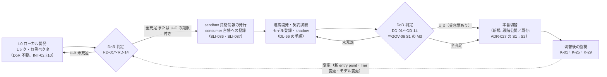
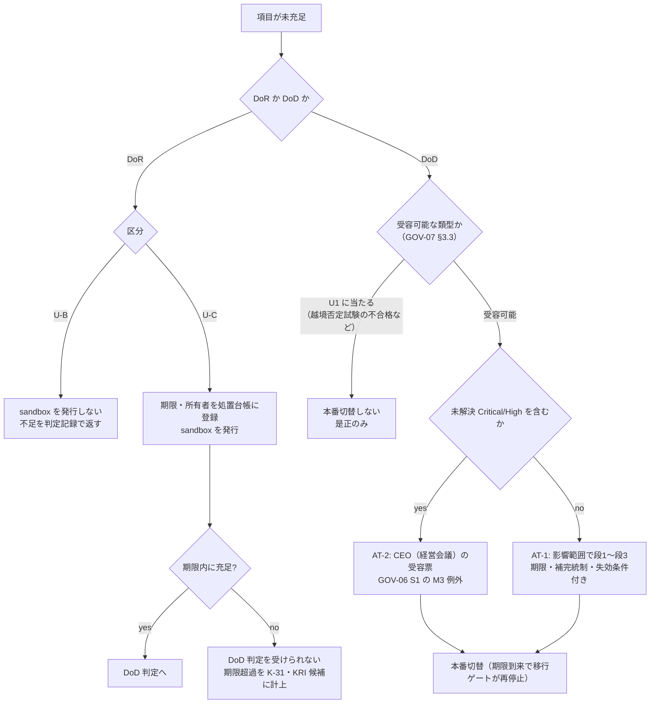

# Definition of Ready（連携開始の条件）と Definition of Done（本番切替の条件）

> 文書ID: INT-05 / 版: 0.4 / 状態: draft / 最終更新: 2026-10-15
> 対応要求: G-125, G-129, R-233（R/G 台帳の対応成果物欄に本書のパスまたは DL-67 を含む全行）、R-058, R-059, R-164（deliverables.md の DL-67 行が挙げるもの）。全件と閉じ方は末尾「対応表」
> 依存文書: CONVENTIONS.md, traceability/deliverables.md（DL-67 行、§8 G-129 の申し送り）, traceability/R-requirements.md, traceability/G-goal-criteria.md, 02_requirements/operation-risk-tiers-assurance.md（REQ-03 §2.2 J10・J11、§2.4）, 03_threat-model/dfd-entry-points.md（THR-01 §6・§7）, 01_governance/assumptions-register.md（A-050, A-052, A-054, A-055, A-110, A-112）, 01_governance/business-impact-analysis.md（GOV-04 §2.3）, 01_governance/stop-authority.md（GOV-06 S1 の M3）, 01_governance/exception-risk-acceptance.md（GOV-07 §3）, 01_governance/kri.md（K-01, K-25, K-29, K-31）, 04_architecture/pep-contract.md（ARC-06 §4.3）, 04_architecture/audit-privacy.md（ARC-10 §5.4 DV-1〜DV-9）, 04_architecture/fail-mode-matrix.md（DL-19 §3.6）, 04_architecture/reference-architecture-v2.md（ARC-01 §9.1 J01〜J16）, 05_adr/ADR-012, ADR-014, ADR-020, ADR-022, ADR-023, ADR-027, 06_controls/control-mapping-ledger.md（C-046, C-078, C-015）, 06_controls/applicability.md（CTL-02 §1.2・§3.6〜§3.8・L-06）, 06_controls/mappings/regulations.md（CTL-06 RGM-04〜RGM-06・RGM-15・RGM-35・RGM-63）, 08_operations/compromise-runbooks.md（OPS-01 §2.8）, 10_integration/onboarding.md（付録 A）, research/RS-02, RS-10, RS-14, 07_slo/numeric-contracts.md（SLI-086〜SLI-091）, 08_operations/phased-rollout.md（OPS-04 §6.2）, 10_integration/dependency-tiers.md（INT-01 §8）, 10_integration/integration-patterns.md（INT-02 §3.1・§10）, 10_integration/authz-modeling-guide.md（INT-03 §1.3・§8）, 11_contracts/mock-contract-test-kit.md（CON-11 §8・§10）, research/RS-05, RS-16, research/standards-status.md, 00_decision/03-decision-items.md（DCS-03 §4.8・申し送り 8-3。版 0.3 で追加）, 00_decision/05-residual-risk-register.md（DCS-05 RRG-070。版 0.3 で追加）, 00_decision/06-gate-plan-and-plan-b.md（DCS-06 §5.3.1 CP-3。版 0.3 で追加）, 11_contracts/compatibility-deprecation-policy.md（CON-01 §13。版 0.3 で追加）
> 作成方法: AI エージェント（Claude）が上記文書を通読して起草した。判定は自己レビューであり、実在の CTO/CISO の決裁ではない（CONVENTIONS §8）。SSDF 1.1 の PO.1.3・PW.1.1・PW.7.2・PW.8.2・RV.1.1・RV.2.2・RV.3.3・RV.3.4 の task 文は research に収載がないため、本書の作成時に NIST の原典 PDF を取得して確認した（確認日 2026-10-15）。版 0.4 は模擬パネル（自己レビューであり、実在の CTO/CISO の決裁ではない）のラウンド 7 の指摘を受け、RD-08 に workload ID と交換可能な組の登録手段（client-registration.openapi.yaml（CON-14）§4A、申請種別 `workload`・`exchange_pair`、承認者案 AR-6・AR-7）と、API 提供前の暫定手順への参照を加えた版である。新たな外部原典は用いていない（末尾「レビュー記録」ラウンド 7）。
> 表記: 本書で置く ID は、準備条件 RD-xx、本番切替条件 DD-xx、未充足の区分 U-B／U-C／U-X、委託契約の条項案 VC-xx、決裁案 KD-INT05-x、新規仮定 NA-INT05-x とする。表のセルのうちタグのないものは設計推論 [D] であり、この注記で個別のタグに代える。事実を述べるセルには個別にタグと脚注を付けた。

---

## 0. 結論

1. **DoR は「共有 sandbox の資格情報を発行し、consumer 台帳に登録する前」の関門とする。ローカルのモックでの開発は DoR の前でも始めてよい** [D]。G-125 の 6 条件（操作階層の割当、DFD への登録、モデル草案、契約試験キットの導入、監査イベントの定義、責任者の指名）を RD-01〜RD-06 とし、ADR が DL-67 に確認を委ねた 8 項目（依存 Tier の申告、資格情報、SDK の選択、PEP 外データ経路、修飾子付きの操作、SSDF の開発統制、移行対象の旧判定取得点、復旧経路の非依存）を RD-07〜RD-14 として加えた（§3）[D]。関門を開発の着手ではなく sandbox の発行に置くのは、トップダウンの強制が利用者の抵抗を生むという CNCF の指摘 [V][^6]（RS-16#65）と、連携開発者が基盤の完成を待たずに始められるという INT-02 §10 の判定を両立させるためである [D]。
2. **未充足時の扱いは 3 区分とする**（§4）[D]。U-B は着手できない（RD-01〜RD-06 と、テナント分離・資格情報に関わる項目）。U-C は期限付きで着手できるが、期限内に充足しなければ DoD に進めない。U-X は例外台帳と受容票（GOV-07）を要し、テナント間漏えいに直結する項目（越境否定試験など）は受容できない（GOV-07 §3.3 の U1）[D]。判定は IDL・台帳・CI の機械検査と自己判定を基本にし、基盤チームの照合は privileged/P・break-glass・Tier 1・規制プロファイル・SDK を使わない実装に絞る案を推奨する（KD-INT05-2）[D]。DORA は、チーム外の重い承認がデリバリー性能を下げ、変更失敗率の低さとの関連を示す証拠も見つからなかったと報告している [M][^5]（RS-16#59）。
3. **DoD（本番切替の条件）は DD-01〜DD-14 の 14 項目とし、GOV-06 S1 の M3（依存サービスの本番接続）の判定の場として使う**（§5）[D]。中心は、契約試験の合格記録、サービス単位の PEP 網羅（THR-01 AC-01〜AC-08 のサービス分が 0 件）、越境否定試験の合格、Tier 義務の適合、監査送出の突合、未解決の Critical/High 0 件である [D]。既存サービスの移行では DoD が ADR-027 の MU 前進条件（OPS-04 §6.2 の C1〜C10）を包含し、新規サービスでは旧判定がないため判定差分の代わりにモデルの shadow（INT-03 §8）と本番相当環境の合成試験を使う [D]。
4. **R-233（Secure by Design の SDLC への組込み）と G-129（委託契約の連携要件）には、DoR・DoD の項目と SSDF 1.1 の task の対応（§6）と、委託契約の条項案 VC-01〜VC-17（§7）で応えた** [D]。SSDF 1.1 の task は推奨であり shall 形式の要求ではない [N][^3]（RS-05#79）ため、全開発チーム・ベンダーへの義務付けは契約と調達標準で行う必要がある [D]。条項を調達の標準条項にするかは調達部門・法務の決定事項であり、決裁案 KD-INT05-3 に置いた [D]。採否の決定記録はまだない（G-129 は未達）[D]。
   - VC-01〜VC-10 は技術的な連携要件である [D]。ベンダーは開発・保守の過程で個人データを扱い得るため、個人データを扱う委託先としての条項 VC-11〜VC-16 を §7.2 に加えた（安全管理と目的外利用の禁止、再委託の事前承認、当社への侵害通知、要員・作業拠点の所在国、終了時の返却・削除、監査受入）[D]。個人情報保護法は委託元に委託先の監督を義務付けている（25 条）[N][^11]（RS-02#10, RS-14#65）。顧客への通知を最初の期限とする設計（CTL-02 §3.7、OPS-01 §2.8）は、ベンダーから当社への通知がそれより早く届くことを前提にしており、その前提を契約で担保するのが VC-13 である [D]。VC-13 の期限の値は TBD（L-06 の社内目標から逆算する。§7.2）である [D]。
   - VC-17（案）は、DEC-8 第 2 段（v1 凍結）の前、すなわち版 0.x と `1.0.0-rc.N` の期間に発注する開発委託で、契約の変更をどう吸収するか（CP-60 の購読、rc の版とハッシュの固定、告知期間内の破壊的変更への追従工数の負担区分、第 2 段後の DL-80 による再適合）を定める（§7.1）[D]。DEC-8 第 2 段の最早時期は G4 の実測報告の後であり、それまでに発注する委託は凍結前の契約に対して見積もられる [D][^20][^22]。負担区分は選択肢を併記し、採否は調達部門・法務の決定事項として KD-INT05-3 に含めた [D]。
5. **閉じ方**: G-125 は机上（A）で本書の範囲を書き終えたが、作成者以外のレビューは未実施である [D]。R-233・G-129 は組織決定（B）を要し、決裁案まで [D]。R-058・R-059 は実測（C）が要り、本書は台帳登録とサービス単位の受入条件を DoR・DoD に組み込んだところまでである [D]。対応表は 6 件で、机上の範囲を閉じたもの 2 件、決裁案まで 2 件、実測待ち 2 件である [D]。

---

## 1. 位置付けと読み方

### 1.1 本書が決めること・決めないこと

| 論点 | 正本 | 本書の扱い |
|---|---|---|
| 参加の手順（登録、workload ID、モデル登録、PEP 組込み、契約試験、shadow、本番切替）と各段の承認者・所要期間・費用配賦 | DL-66 10_integration/onboarding.md（INT-04。2026-10-15 時点で版 0.1 draft が存在） | 決めない。本書はその手順の「入口（DoR）」と「出口（DoD）」の条件を決める |
| 操作 5 分類の定義・判定規則 | REQ-03 §2 | 写して使う。再定義しない |
| entry point の類型、受入条件 AC-01〜AC-10 | THR-01 §6・§7 | 写して使い、サービス単位の判定に割り当てる |
| PEP の義務、配備ゲート | ARC-06 §4.3・§6.5、ADR-012 | 写して使う |
| 契約試験の合格判定 | CON-11 §10 | 写して使う |
| Tier の判定・適合の確認項目 | INT-01 §8（CK-01〜CK-23） | 写して使う。DoR・DoD のどちらで見るかを割り当てる |
| 既存サービスの移行の前進条件 | ADR-027、OPS-04 §6.2 | 写して使う |
| DoR・DoD の項目、未充足時の扱い、判定記録の様式 | 本書 | 決める |
| 委託契約に組み込む連携要件の条項案（G-129） | 専用の DL がなく、暫定の置き場所が DL-66／DL-67（deliverables.md §8）[^1] | 条項案と決裁案を置く。条項の法的文言と採否は調達部門・法務が決める |

### 1.2 前提（A-ID）

| A-ID | 値（基準シナリオ） | 本書での使い方 |
|---|---|---|
| A-050 | 依存サービス 300 | DoR・DoD の判定件数の上限の桁。全件を中央で審査しない理由 [D][A-050] |
| A-052 | 開発組織 25・開発チーム 60 | 委託契約の条項（§7）の適用対象の桁 [D][A-052] |
| A-054 | 認証・認可プラットフォームチーム 24 FTE（うち PEP SDK・開発者支援 4） | 基盤チームの照合を高リスクに絞る理由（KD-INT05-2）[D][A-054] |
| A-055 | entry point 1.2 万（範囲 4,500〜3 万） | RD-01・RD-02 を機械検査にする理由 [D][A-055] |
| A-110 | 共通 SSO 120・独自セッション 105・LDAP 直結 30・共有シークレットのみ 45 | RD-13（移行対象）の該当数の桁 [D][A-110] |
| A-112 | 自前の認可実装 80%、アプリ層の検索条件だけでテナント分離 70% | 越境否定試験を DoD の受容不可項目にする理由（DD-04）[D][A-112] |

### 1.3 新規仮定（前提台帳へ追加要）

- **NA-INT05-1**: DoR の項目の大半（RD-01・RD-02・RD-03・RD-04・RD-07 の機械判定部分）は、IDL・entry point 台帳・CI の出力から機械的に判定できる [D]。成り立たない場合は KD-INT05-2 の推奨 (b) が基盤チームの照合負荷で回らなくなる [D]。パイロット 2〜3 サービス（OPS-04 §8）で判定に要した人手の時間を測って確かめる（SLI-086〜SLI-089）[D]。
- **NA-INT05-2**: 開発委託の契約は、新規発注と更新の機会に条項を追加できる [D]。既存契約の途中改定が要る場合は、KD-INT05-3 の帰結（費用・期間）が変わる [D]。調達部門が契約の更新周期の分布を棚卸しして確かめる（所有者: 調達部門責任者、期限: DEC-8 の前）[D]。

### 1.4 R/G の抽出結果

R-requirements.md と G-goal-criteria.md の対応成果物欄を `definition-of-ready` と `DL-67` で検索した [D]。該当は R-233、G-125、G-129 の 3 件である [D]。G-129 は専用の DL がなく、暫定の置き場所として DL-66 と DL-67 が挙がっている [^2] [D]。これに deliverables.md の DL-67 行が挙げる R-058・R-059・R-164 を加えた計 6 件に、末尾の対応表で応える [D]。

### 1.5 読み手別の入口

| 読み手 | 最初に読む節 |
|---|---|
| CTO・CISO | §0、§4（未充足時の扱い）、§5.3（DoD の承認）、§8（決裁案） |
| 連携開発者（依存サービスのチーム・ベンダー） | §2（全体の流れ）、§3（DoR チェックリスト）、§5（DoD チェックリスト） |
| 調達部門・法務 | §6（SSDF との対応）、§7（委託契約の条項案。個人データを扱う委託先の条項は §7.2）、KD-INT05-3、§11（他文書への申し送り） |
| プラットフォームチーム | §4.3（照合の範囲）、§5.4（判定記録）、§9（運用と KRI） |

---

## 2. 全体の流れ

- DoR の関門を sandbox の発行に置くのは、共有 sandbox が本番と信頼を分けた issuer・鍵を持ち（G-141）、ここで初めて基盤側の資源（資格情報、テナント、consumer 台帳の行）を消費するからである [D]。ローカルのモックと負例ベクタは基盤側の資源を使わないので、DoR の前でも使ってよい（CON-11 §16、INT-02 §10.2）[D]。
- 参加の手順の各段（登録、workload ID、モデル登録、PEP 組込み、契約試験、shadow、本番切替）の承認者・所要期間・費用配賦は DL-66 が持つ [D]。本書の DoR はその最初の段の入場条件、DoD は最後の段の入場条件に当たる [D]。
- デジタル認証サービスの民間事業者向け手続は、申込、事前準備契約、テスト環境の提供・テスト、本契約、本番環境の提供・テストの順で進む [V][^10]（RS-16#80）。本書の流れも、試験環境の利用の前に条件を確かめ、本番の前に再び確かめる 2 段にした [D]。
- 一度 DoR・DoD を満たしたサービスでも、新しい entry point の追加、Tier の変更、モデルの変更があれば、変わった項目だけを CI と台帳の差分で再判定する（§9.1）[D]。

---

## 3. DoR チェックリスト（連携開始の条件）

### 3.1 G-125 の 6 条件（RD-01〜RD-06）

| RD | 条件 | 充足の基準（確認方法） | 正本 | 未充足の区分 |
|---|---|---|---|---|
| RD-01 | **操作階層の割当**: 全 entry point の全操作に、操作階層（public／read-sensitive／write／privileged/T・/P／break-glass/B・/P）・修飾子（+SEC・+FIN・+XT・+AGT・+REG）・扱うデータの最高分類を付け、FAPI 必須の属性と主パターン（P-ID）を併記する。consumer・batch は `async_type` も付ける | IDL の lint と台帳生成で欄の欠落 0 件（機械）。privileged と break-glass の登録は基盤とセキュリティの審査（REQ-03 §2.4） | REQ-03 J10・§2.4、ADR-012 D12-09、ADR-020 D20-03-1、ARC-06 §4.3 #1、INT-02 IC-01 | U-B |
| RD-02 | **DFD への登録**: サービスの entry point を THR-01 の類型（EPT-01〜EPT-19）で entry point 台帳に登録する。IDL を持たない類型（管理画面・support tool・ETL・DB 直接接続・緊急経路・監視 endpoint・ファイル連携・本番の対話的実行）は届出で登録する。信頼境界を内向きに越えるデータフローごとに入口類型を割り当てる | 台帳の登録（S 集合）と届出（M 集合）が揃い、THR-01 AC-08 の整合検査で当該サービスの不整合 0 件（機械）。EPT-13（DB 直接接続）を届け出たサービスは privileged 以上で登録 | THR-01 §6.1・§7.4 H1・§7.6、ADR-012 D12-08 | U-B |
| RD-03 | **認可モデルの草案**: 業務要件を平文で書き、名前空間コードを申請し、型・relation・permission の草案と、全 relation の肯定・否定試験と越境の否定試験を書く。深度・fanout・一覧方式・書込宣言を宣言する | `validateModel`（dry-run）の lint 群に合格（機械）。M1 以上（権限拡大・高リスク階層）は基盤セキュリティレビュアーの非同期レビュー | INT-03 §1.3 D-1〜D-5、§8.1・§8.2 | U-B（草案と試験）。M1 以上の審査の待ちは U-C |
| RD-04 | **契約試験キットの導入**: consumer manifest を書き、自チームの CI にキットの段を組み込む。依存する契約の要素を GA に限り、preview（searchResources・requestTxnToken・モデル管理など）を使う場合は要素・理由・preview の期限を申告する | CI の設定と manifest が存在し、キットの版とハッシュを記録している（機械）。キット本体（DL-120）の配布前[^24]は、モックなしで書ける負例（静的検査・自サービス内の拒否）の単体試験が CI で動き、CON-11 の CV 番号と対応付いていることで充足とみなす | CON-11 §7.2・§8、INT-02 §10.2 手順 4・7、ADR-022 D-1-2・RR-3 | U-B（manifest と CI の段）。キット配布後の全段の実行は DoD（DD-02） |
| RD-05 | **監査イベントの定義**: PEP SDK（監査 SDK を同梱）または契約適合の自前実装を全 entry point に組み込む計画、業務データを変更する処理の記録に `txn` と decision_id を残す欄、spool 用の資源の確保、監査を省いて再実行する経路を作らないことを設計に入れる。操作階層ごとの監査レベル（AU-1〜AU-5）を確認する | 設計記録に DV-1〜DV-9 の各項の扱いが書かれている（自己判定）。業務側の監査スキーマに `txn`・decision_id の欄がある（機械: スキーマ検査） | ARC-10 §5.4 DV-1〜DV-9、ADR-014 §6.4、ADR-022 D-8-6、REQ-03 §3.7 | U-B |
| RD-06 | **責任者の指名**: サービスオーナー（ドメイン責任者）、技術責任者、セキュリティ連絡窓口（K-01 の違反・遮断・脆弱性の通知先）、ベンダー開発の場合の委託元責任者、残余リスクの受容者（事業責任者）を、正副の 2 名ずつ登録する | サービス台帳の責任者欄が埋まり、連絡試験に応答した記録がある（機械＋自己） | GOV-07 §3.1（受容者）、ADR-023 D23-50、ARC-06 §6.5（遮断の当番） | U-B |

- RD-06 を正副で登録するのは、遮断（GOV-06 S3 の entry point 単位の kill switch）や allow 拡大差分の調査で、サービス側の判断者に連絡がつかないと封じ込めが遅れるためである [D]。人数「2」は運用設計上の最小の冗長であり、根拠となる実測はない [D]。
- RD-01 の申告は BIA 票の行にもなる（GOV-04 §2.3）[D]。BIA の記入は DoR の時点で「行の作成」まで、MTPD の値の記入は DoD（DD-09）までとする [D]。

### 3.2 ADR・設計文書が DL-67 に確認を委ねた項目（RD-07〜RD-14）

| RD | 条件 | 充足の基準（確認方法） | 正本 | 未充足の区分 |
|---|---|---|---|---|
| RD-07 | **依存 Tier の申告**: INT-01 §2.3 の設問に答えて Tier を申告し、BIA 票 A6（依存する基盤機能と止まる障害形態）と、基盤を重要依存とする entry point の割合を登録する | INT-01 §8.1 CK-01〜CK-06 が記入済み。Tier の引下げと Tier 1 の新規追加は承認記録がある | ADR-023 D23-04・D23-50、INT-01 §8.1、DL-19 §3.6 #2 | U-B（申告のないサービスは本番に接続しない。ADR-023 D23-04） |
| RD-08 | **主体と資格情報**: workload ID の発行申請、外部 client の登録計画、STS で交換する組（呼出し元→呼出し先）の事前登録を行う。新規の client・workload 間認証で共有秘密（client_secret_*・静的 API key）を使わない。登録の手段は client-registration.openapi.yaml（CON-14、preview）による。client は sandbox が `registerSandboxClient`、本番が申請 API（承認者案 AR-1〜AR-5・AR-8）。workload ID（SVID 登録エントリ、INT-02 I-16）は sandbox が CON-14 §4A.2 の `registerSandboxWorkload`、本番が申請種別 `subject: workload`（承認者案 AR-6）。交換する組（I-17）は sandbox が §4A.3 の `registerExchangePair`（呼出し先が他の consumer なら呼出し先の所有者の承認）、本番が申請種別 `subject: exchange_pair`（承認者案 AR-7）。§4A の API とモック（キット本体 DL-120、G3）の提供前は、CON-14 §4A.5 の暫定手順（PoC の手元改変か S1 経由の手動登録。INT-00 §6.1）で登録した記録を代わりに置く | 登録申請の記録（機械。sandbox の応答の `client_id`・`workload_entry_id`・`pair_id`、本番の申請の `request_id`。API 提供前は S1 への依頼記録）。共有秘密の新規使用 0 件（静的検査） | INT-02 IC-04・IC-12・§5.1 I-01・I-16・I-17、INT-04 §4.3 OB-2(b)(c)、CON-14 §4・§4A・§5、ARC-01 J08、ADR-009 D09-13 | U-B（共有秘密の新規使用）。登録の待ちは U-C |
| RD-09 | **SDK の選択**: PEP SDK を使うか、契約からの自前実装にするかを決め、言語・フレームワーク・SDK の版を記録する。自前実装の場合は ARC-06 §4.2 の 11 関数と同じ外形の記録・応答・計数を出す設計にする | 選択と版の記録（自己）。自前実装は基盤チームの照合対象（§4.3） | ARC-06 §4.2、ADR-022 D-4-3、ADR-012 D12-14 | U-C。SDK を使わない場合の扱いの細部は **未決（ADR-012 L-01）** |
| RD-10 | **PEP の外を通るデータ経路**: export・署名付き URL・ETL・CDC・DWH 抽出・バックアップ取得・DB 直接接続・ファイル連携・検索インデックスへの持出しを届け出る。テナント表に RLS の 4 条件を満たす計画を持つ | 届出が台帳にある（`db_role` 必須の類型を含む）。RLS の計画（自己） | THR-01 EPT-10・12・13・18、ADR-012 D12-21・D12-30、ARC-11 | U-B（届出）。RLS の後付けは既存サービスに限り U-C（ADR-012 D12-23 の後付け順） |
| RD-11 | **修飾子が付く操作の追加条件**: +XT（テナント越境共有・ゲスト）は ADR-024 の規則、+AGT（AI エージェントの実行）は ADR-017 と P-08、+REG（規制プロファイル）は P-26 と applicability の該当を確認する。support tool・break-glass の経路を持つ場合は P-11・P-17 の依存台帳を作る | 該当パターンの「適用条件」と「アンチパターン」に当たらないことを設計レビューの記録に書ける（自己）。+REG と break-glass は基盤とセキュリティの照合 | INT-02 P-08・P-11・P-16・P-17・P-26、ADR-017、ADR-024、ADR-029 | 該当があれば U-B。break-glass/P の台帳上の配置は **未決（ADR-012／ADR-029）** |
| RD-12 | **SDLC の開発統制（SSDF）**: サービス単位の脅威モデルを THR-01 の DFD から作る。自チームの安全なコーディング標準に基づくコードレビュー・解析と、試験で見つけた問題を課題管理に記録・トリアージする工程を CI に置く。脆弱性報告の受付窓口と調査手順を持つ | §6 の SSDF 対応表の DoR 列が満たされている（自己＋CI 設定の機械検査） | C-078、C-015、SSDF 1.1 PW.1.1・PW.7.2・PW.8.2・RV.1.1 [N][^3] | U-C（期限は DoD まで）。ベンダー開発は §7 の条項で担保 |
| RD-13 | **移行対象の既存サービス**: 移行単位（MU）を定義し、MU ごとに旧判定の取得点（middleware・gateway・ログ）を特定する。allow cache の除去計画を持つ | REQ-07 §3.5 の様式で取得点が記入され、観測不能 MU が識別されている | ADR-027 D27-01・D27-11、OPS-04 §3.1・§4.2 | 移行対象なら U-B（S1 に入れない。ADR-027 D27-11）。観測不能 MU は受容票（OPS04-K4） |
| RD-14 | **復旧経路の非依存**: 自サービスの配備・rollback・当番招集の経路を本基盤に依存させない設計にする | 復旧手順書と login 経路の記録（自己） | INT-01 §6・CK-18、INT-02 IC-11、ADR-023 D23-10 (7) | U-C。全 Tier 必須かは **KD23-4** の決裁による（(b) なら Tier 2・3 は推奨） |

- 上表は、ARC-06 §4.3、ARC-10 §5.4、DL-19 §3.6、ADR-023 D23-04・D23-50、ADR-020 D20-03-1、ADR-022 RR-3、ARC-01 J16、C-078 が「DL-67 で確かめる」とした項目を漏れなく割り当てたものである [D]。ARC-01 §9.1 の J01〜J16 との照合は §10.2 に置いた [D]。

---

## 4. 未充足時の扱い

### 4.1 区分

| 区分 | 意味 | 着手（sandbox 発行） | DoD への影響 | 記録 |
|---|---|---|---|---|
| U-B（阻止） | 欠けたまま連携を始めると、台帳・試験・監査の前提が崩れるか、テナント分離・資格情報の誤りが既成事実になる | できない。ローカル開発は続けてよい | — | DoR 判定記録に不合格項目と理由 |
| U-C（期限付き） | 基盤側の審査待ち、キット・契約の未配布、既存サービスの後付けなど、サービス側だけでは今すぐ満たせない | できる。項目ごとに期限と所有者を登録する | 期限内に充足しなければ DoD 判定を受けられない。期限超過は K-31・新規 KRI 候補（§9.2）で報告 | 処置台帳（THR-01 §7.4 H4 と同じ台帳） |
| U-X（例外） | DoD の項目を満たさないまま本番に出す | — | 例外台帳への登録と受容票（GOV-07）を要する。受容者は影響範囲と類型の床の高い方 | 例外台帳、受容票 |

### 4.2 判定の流れ

- 受容の段と類型の床は GOV-07 §3.1・§3.2 による [D]。DoD の未充足のうち、未解決の Critical/High を残したまま本番に接続するものは AT-2（床は段2、CEO）に当たる [D]。それ以外の逸脱（例: 監査 spool の資源不足、Tier 1 の閲覧専用モード未実装）は AT-1 であり、影響範囲で段が決まる [D]。
- AT-2 の受容票は期限到来または失効条件の成立で移行ゲートが自動で再停止する（GOV-07 §4.4、GOV-06 S1 の発動条件 (b)）[D]。
- 操作階層の引下げ（REQ-03 J11）は DoR・DoD の未充足ではなく、CISO の承認と受容票（AT-1）を要する別の手続である [D]。
- U-C の期限の値は置かない [D]。TBD（所有者: プラットフォームチーム長、期限: G3、決め方: パイロットで測る審査・配布の待ち時間（SLI-086〜SLI-089）の実測と、DL-31 の波の周期）とする [D]。

### 4.3 判定の担い手（KD-INT05-2 の推奨 (b) を前提にした案）

| 判定 | 既定の担い手 | 基盤チームの照合を加える場合 |
|---|---|---|
| 機械判定できる項目（RD-01・RD-02・RD-03 の lint・RD-04・RD-07 の記入・RD-08 の静的検査） | CI と台帳の自動判定 | — |
| 自己判定の項目（RD-05・RD-06・RD-09〜RD-14） | サービスオーナーが署名 | privileged/P または break-glass を含む、Tier 1、+REG、SDK を使わない実装、RD-13 の観測不能 MU のいずれかに当たるサービス |
| DoD | 機械判定（DD-02〜DD-06）＋サービスオーナーの署名 | 上と同じ条件に当たる場合はプラットフォームチーム長の照合。privileged/P・break-glass・テナント越境（+XT）を含む場合は CISO の同意 |

- 照合の対象を絞るのは、300 サービス [A-050] に対して PEP SDK・開発者支援が 4 FTE [A-054] という桁の差があり、全件の中央審査は待ち行列になるからである [D][A-050, A-054]。DORA は職務分離の要求をチームの開発基盤に記録される peer review で満たすことを勧め、中央の CAB に頼って誤りを捕まえようとすることを落とし穴に挙げている [M][^5]（RS-16#60）。
- 一方で、自己判定だけでは過小申告（Tier・操作階層）が残る [D]。ADR-023 は Tier の過小申告を RR23-05 とし、申告と BIA の照合で抑えるとしている [D]。本書は照合の対象を「誤ったときの影響が基盤横断になるもの」に限る [D]。

---

## 5. DoD チェックリスト（本番切替の条件）

### 5.1 全サービス共通（DD-01〜DD-11）

| DD | 条件 | 合格の基準 | 正本・証拠 | 未充足時 |
|---|---|---|---|---|
| DD-01 | DoR の全項目が充足（U-C の期限付き項目を含めて解消） | DoR 判定記録の再判定で不合格 0 件 | 本書 §3 | 本番切替しない |
| DD-02 | 契約試験の合格 | CON-11 §10.1 の合格（必須ベクタ CV-001〜CV-014 の適用分 100%、該当族 100%、越境許可 0 件、モック障害 0 件）。判定記録は CI の署名付きで契約レジストリに残す。PoC 基盤・本番相当環境での負例ベクタの再実行に合格 | CON-11 §10、ADR-022 D-6-3、E4 | U-X（ただし越境に関わるベクタは受容不可） |
| DD-03 | サービス単位の PEP 網羅 | 当該サービスの THR-01 AC-01〜AC-06・AC-08 が 0 件、AC-07（計装率）100%。K-01(a)(b) の当該サービス分 0 件 | THR-01 §7.5、ARC-06 §6.5、K-01 | U-X（段は影響範囲で決まる） |
| DD-04 | テナント越えの否定試験 | cross-tenant property test が合格（n 回の範囲で越境許可 0 件。残余率の上限 3/n を併記） | CON-11 §6.4、ADR-012、ADR-027 D27-16 | **受容不可**（GOV-07 §3.3 U1）。是正のみ |
| DD-05 | 依存 Tier の義務 | INT-01 §8.2 の CK-11〜CK-18 が全件合格。Tier 1 は CK-19〜CK-23 も合格 | INT-01 §8.2、ADR-023 D23-04 | CK-11〜CK-18 は本番接続しない（ADR-023 D23-04）。CK-19〜CK-23 の扱いは **KD-INT01-2** |
| DD-06 | 監査の送出 | 発行カウンタと受理件数の一致（C2）、E1・E2 の突合（C3）、業務側監査の `txn`・decision_id の欠け 0 件（R4 の突合）、token 類のアプリログ出力 0 件 | ARC-10 §5.4 DV-1〜DV-9、TC-012-02、TC-014-03・TC-014-11・TC-014-13 | U-X |
| DD-07 | 認可モデルの登録と shadow | `registerModel` 済み（不変 revision と承認記録）。shadow の `gate_result` が pass。canary cell での前進が済んでいる | INT-03 §8.1・§8.4、ADR-016 D16-31 | 本番切替しない（モデルは既知良好 revision に固定） |
| DD-08 | 障害時の挙動 | fail-mode・timeout・再試行を上書きしていない（SDK 設定の検査）。503＋Retry-After と通常の deny の区別の試験。基盤の障害注入（TC-13 系）への参加結果 | DL-19 §3.6、INT-02 §3.3、IC-10 | U-X（AT-1） |
| DD-09 | 運用の準備 | entry point 単位の遮断（S3 kill switch）の手順と当番、BIA 票の MTPD の記入、rollback 手順（新規: 公開範囲の縮小、既存: ADR-027 の後退）、自サービスの復旧経路の非依存（RD-14 の実装確認） | ADR-012 §6.5、GOV-04、ADR-027 D27-28、INT-01 CK-18 | U-X（AT-1） |
| DD-10 | 未解決の Critical/High | 当該サービスの範囲に K-25(c) 0 件 | GOV-06 S1（M3）、K-25 | U-X（AT-2、CEO） |
| DD-11 | SDLC の開発統制（SSDF） | §6 の DoD 列（コードレビュー・解析と試験の結果が記録・トリアージ済み、脆弱性対応の手順と期限の合意、ASVS 自己評価の提出（適用範囲は DL-61））が満たされている | C-078、C-015、DL-61、SSDF 1.1 PW.7.2・PW.8.2・RV.2.2 [N][^3] | U-X（AT-1） |

- DD-04 を受容不可にするのは、旧系の 70% がアプリ層の検索条件だけでテナントを分離しており [A-112]、越境の欠陥が既存の運用で見えていない可能性が高いからである [D][A-112]。テナント間漏えいは GOV-02 が受容できないものとしている（GOV-07 §3.3 U1）[D]。
- DD-02 の「PoC 基盤・本番相当環境での再実行」は、モックとの不一致を検出するためである（ADR-022 D-6-3、G-142）[D]。デジタル庁の検証事業は、仕様書の解釈がベンダーごとに食い違う可能性と、他ベンダーの認証基盤を使う場合は認証プロトコルだけでなく認証フローの確認も要ることを課題に挙げている [M][^8]（RS-16#79）。
- 合格の判定に版の組を使う点は、consumer と provider の版の組ごとの検証結果を調べ、成功した組がある場合だけ展開を許す can-i-deploy の方式と同じ考え方である [V][^7]（RS-16#49）。

### 5.2 サービスの種類で加わる条件（DD-12〜DD-14）

| DD | 対象 | 条件 | 正本 |
|---|---|---|---|
| DD-12 | 既存サービスの移行（RD-13 の該当） | MU ごとに OPS-04 §6.2 の C1〜C10（未登録の allow 拡大差分 0 件、誤 deny 率 ≤ B13 の予算、評価不能率 ≤ DL-20 の予算、経路網羅 100%、n ≥ 3/p、越境否定試験、rollback 演習、剥奪同期、未解決 Critical/High 0 件、allow cache 除去と告知）を bake 時間の間満たす | ADR-027 D27-22・D27-25、OPS-04 §6.2・§6.3 |
| DD-13 | 新規サービス（旧判定がない） | 本番相当環境での合成トラフィックによる観測（THR-01 AC-05 の未観測入口の解消）と、DD-07 のモデル shadow を終える。shadow の最短期間は SLI-090 の下限で決める | INT-03 §8、SLI-090、THR-01 §7.5 |
| DD-14 | 修飾子・高リスクの操作を持つ | +REG は P-26 とプロファイル要件の充足（コンプライアンス責任者の確認）。+AGT は P-08 の負例。break-glass/P は P-17 の演習。privileged/P は二者承認と JIT の動作確認 | INT-02 P-08・P-17・P-26、REQ-03 §3.1、ADR-029 |

- 新規サービスに ADR-027 の判定差分を適用しないのは、比較する旧判定がないからである [D]。代わりに、合成トラフィックで全 entry point の観測を作り（THR-01 の D3 の解消）、モデルの shadow で permission 経路を評価する [D]。
- 既存サービスでは、本番切替は MU の S1→S2（新が正本）への前進に当たり、自動で行ってよいのは後退だけである（ADR-027 D27-03）[D]。DD-12 はその前進条件を写したもので、値（p、B13 の予算、bake 時間）は OPS-04 §6.2・§6.3 の TBD のままである [D]。
- DD-13 の shadow の最短期間と、切替後の監視期間は置かない [D]。TBD（所有者: CTO、期限: G4、決め方: パイロットの実測と ADR-027 の段（P1〜P4）、SLI-090 の決め方（numeric-contracts.md）に揃える）とする [D]。

### 5.3 DoD の承認

| 対象 | 承認者 | 根拠 |
|---|---|---|
| 全サービス | 移行ゲートの自動判定（DD-02〜DD-06・DD-10 の機械判定）＋サービスオーナーの署名 | GOV-06 S1 の権限者は「自動（移行ゲート）」 |
| §4.3 の照合対象 | 上に加えてプラットフォームチーム長 | KD-INT05-2 の推奨 (b) |
| privileged/P・break-glass・+XT を含む | 上に加えて CISO の同意 | REQ-03 §2.4（privileged・break-glass の審査）、ADR-027 D27-20（越境の X は CISO の同意） |
| 既存サービスの段の拡大 | CTO の段判定（privileged を含む MU は CISO の同意） | OPS-04 §6.1 |
| U-X | GOV-07 の受容者（段1〜段3、AT-2 は CEO） | GOV-07 §3 |

- CISO は受容権を持たない（GOV-05 の RACI）ため、CISO の「同意」は受容ではなく、要求基準への適合の確認である [D]。CISO の同意を得られない場合は本番切替せず、受容が要るなら GOV-07 の受容者へ回す [D]。

### 5.4 判定記録の様式（DoR・DoD 共通）

| 欄 | 内容 |
|---|---|
| 識別 | サービス ID、consumer ID、判定の種別（DoR／DoD／差分再判定）、判定日時 |
| 対象 | entry point 台帳の版、IDL のコミットハッシュ、モデルの revision、契約とキットの版・ハッシュ |
| 結果 | RD・DD ごとの合否、区分（U-B／U-C／U-X）、未充足の理由 |
| 処置 | U-C の期限・所有者、U-X の例外台帳 ID と受容票 ID |
| 署名 | 自動判定の CI 署名、サービスオーナー、照合者、CISO の同意（該当時） |
| 保管 | 契約レジストリと CI ログ（E4）、本書の様式による記録（E2） |

- 判定記録は GOV-06 S1 の「移行判定記録」（対象、判定時刻、未解決 Critical/High の一覧と状態、受容票 ID、判定者）を兼ねる [D]。

---

## 6. SSDF との対応（R-233）

SSDF 1.1 は、ソフトウェアがよく保護されるようにするための推奨の実践を示す文書である [N][^3]。task は推奨であり shall 形式の要求ではない [N][^3]（RS-05#79）。SSDF 1.2（SP 800-218 Rev.1）は 2025-12-17 公表の ipd で、確認日（2026-10-03）時点で final は未公表である [N][^4]（RS-05#80、standards-status SS-E37）。本書は現行 final の 1.1 に対応付ける [D]。

| SSDF 1.1 の task（原典の要旨） | DoR の項目 | DoD の項目 | 統制 |
|---|---|---|---|
| PO.1.3: 要求を、組織が再利用する商用ソフトウェア部品を提供するすべての第三者に伝える [N][^3] | RD-06（委託元責任者）、§7 の条項案 | — | C-078 |
| PO.5.1・PS.1.1・PS.2.1: 開発環境の分離・保護、全コードの最小権限での保管、完全性検証情報の提供 [N][^3]（RS-05#79） | — | 基盤側の統制（C-045、C-046）。依存サービスへの適用範囲は **未決（DL-27 と KD-INT05-3）** | C-046 |
| PW.1.1: 脅威モデリング・攻撃モデリング・攻撃面の写像などのリスクモデリングで、ソフトウェアのセキュリティリスクを評価する [N][^3] | RD-02（DFD への登録）、RD-12（サービス単位の脅威モデル） | — | C-078 |
| PW.7.2: 組織の安全なコーディング標準に基づいてコードレビュー・解析を行い、見つけた問題と推奨の是正を開発チームの課題管理に記録・トリアージする [N][^3] | RD-12（工程を CI に置く） | DD-11（結果の記録とトリアージ） | C-078 |
| PW.8.2: 試験の範囲を決め、設計し、実行し、結果を記録し、見つけた問題を記録・トリアージする [N][^3] | RD-04（契約試験キットの導入） | DD-02、DD-04、DD-11 | C-078 |
| RV.1.1: 取得者・利用者・公開情報源から潜在的な脆弱性の情報を集め、信頼できる報告をすべて調べる [N][^3] | RD-06（セキュリティ連絡窓口）、RD-12（受付窓口） | DD-11 | C-015 |
| RV.2.2: 脆弱性へのリスク対応を計画し実施する [N][^3] | — | DD-10（未解決 Critical/High 0 件）、DD-11（是正期限の合意） | C-015 |
| RV.3.3・RV.3.4: 類似の脆弱性を探して類ごと根絶する。根本原因の再発を防ぐよう SDLC を見直し更新する [N][^3] | — | 切替後の運用（§9）。基盤の負例ベクタと DoR の項目への追加で全サービスに戻す | C-015 |

- 対応付けは、各 task の文と DoR・DoD の各項目の内容から導いた設計推論である [D]。task 単位の写像の正本は 06_controls/mappings/ であり、本書の表はその入力の一つにとどまる [D]（control-mapping-ledger X-10 は「未実施」）。
- SSDF の task は推奨にとどまるので [N][^3]、全開発チーム・ベンダーの SDLC に組み込むには、社内チームには本書の DoR・DoD を通じて、ベンダーには契約（§7）を通じて義務にする必要がある [D]。CTL-01 は、ベンダーへの義務付けを調達の標準条項にするかは経営と調達の判断が要るとし、その決裁を DL-67 と DL-27 に委ねている（control-mapping-ledger §8.4）[D]。

---

## 7. 委託契約・発注仕様に組み込む連携要件の条項案（G-129）

本節は条項の「要件」の案であり、契約書の法的文言ではない [D]。法的文言・責任制限・違約の扱いは法務が起草する [D]。G-129 の合格は調達部門・法務の採否の決定記録であり、本書はその材料までである [D]。§7.1 は技術的な連携要件、§7.2 は個人データを扱う委託先としての要件である [D]。

### 7.1 技術的な連携要件（VC-01〜VC-10、VC-17）

| VC | 条項の要件（案） | 対応する DoR・DoD | G-129 の列挙との対応 |
|---|---|---|---|
| VC-01 | 受託者は、連携を始める前に本書の DoR を満たし、判定記録を委託者に提出する | RD-01〜RD-14 | DoR の充足 |
| VC-02 | 受託者は、委託者が指定する版の契約試験キットを自らの CI に組み込み、合格の判定記録（CI 署名付き）を納品ごとに提出する。不合格の版を本番へ配備しない | RD-04、DD-02 | 契約試験の合格 |
| VC-03 | 受託者は、全 entry point を台帳に登録し、未登録の入口や認可判断なしで完了する入口を作らない。委託者の機械列挙で検出された差分を指定期限内に是正する | RD-01、RD-02、DD-03 | PEP coverage |
| VC-04 | 受託者は、監査 SDK の送出を無効化・上書きせず、業務データの変更記録に `txn` と decision_id を残す。token 類をログに出力しない | RD-05、DD-06 | 監査イベントの送出 |
| VC-05 | 受託者は、脆弱性の報告を受け付ける窓口を持ち、委託者が定める重大度別の期限内に是正または委託者の受容票の手続に付す | RD-12、DD-10、DD-11 | 脆弱性対応の期限 |
| VC-06 | 受託者は、安全なコーディング標準に基づくコードレビュー・解析と試験の結果を記録し、委託者の求めに応じて提出する。委託者が指定する範囲で ASVS 自己評価を提出する | RD-12、DD-11 | （R-233、SSDF PW.7.2・PW.8.2） |
| VC-07 | 受託者は、テナント越えの否定試験に合格しない成果物を納品しない。この要件は例外の対象外とする | DD-04 | （GOV-07 U1） |
| VC-08 | 受託者は、操作階層・依存 Tier を過小に申告しない。引下げは委託者の承認手続（REQ-03 J11、ADR-023 D23-04）による | RD-01、RD-07 | （RR23-05） |
| VC-09 | 受託者は、再委託先に VC-01〜VC-08 と同等の義務を課す。個人データを扱う再委託の事前承認と、VC-11〜VC-16 の承継は VC-12 による | RD-06 | （SSDF PO.1.3 の第三者への伝達） |
| VC-10 | 委託者は、GOV-06 の停止権限に基づき、当該サービスの本番接続の停止・entry point 単位の遮断を行える。受託者はその判断に協力する | DD-09、DD-10 | （GOV-06 S1・S3） |
| VC-17（案） | **凍結前（版 0.x・`1.0.0-rc.N`）の契約変更の吸収**: (1) 受託者は、委託者の契約変更通知（CON-01 CP-60 の購読型リリースノート）を購読し、通知された差分を自らの影響評価と作業計画に取り込む。(2) 受託者は、開発に用いる契約の版（`0.y.z` または `1.0.0-rc.N`）とハッシュ、契約試験キットの版とハッシュを納品物ごとに記録し、委託者が指定した版にだけ依存する。GA 候補の要素の外（preview）に依存する場合は要素・理由・期限を申告する。(3) 委託者が告知期間を守って行った破壊的変更への追従工数の負担区分を、契約に定める（下の注の (i)〜(iii) から選ぶ）。委託者が告知期間を守らなかった破壊的変更への追従は、(i)〜(iii) にかかわらず委託者の負担とする。(4) 受託者は、DEC-8 第 2 段（v1 の凍結）の後、凍結版に対する契約試験キット（DL-80）の判定で再び適合を示し、判定記録を提出する。凍結版に適合するまでは本番に配備しない | RD-04、DD-02 | 契約試験の合格（凍結前の期間の扱い。DCS-03 申し送り 8-3） |

- 脆弱性是正の期限の値は置かない [D]。K-25 の重大度別の是正期限は TBD（所有者: CISO、期限: DEC-4（Gate 4 入場）、決め方: GOV-06 の DP46-1 と DL-110 の運用）であり（kri.md K-25 行）、VC-05 はその値を参照する形にする [D]。
- 地方公共団体情報システム標準化基本方針は、データ要件・連携要件への適合について、デジタル庁が提供するツールによる適合確認試験への合格を求め、常時の適合確認が難しい非機能要件は SLA などの取決めに明示して担保するとしている [N][^9]（RS-16#72）。本書の VC-02（機械的な試験合格）と VC-05・VC-06（取決めによる担保）の分け方は、これに倣ったものである [D]。
- 条項の適用時期は、DEC-8（連携契約 v1 の凍結）の後に発注する開発委託に間に合う必要がある [D]。G-129 は、採否の決定が DEC-8 より後であってはならないとして最終判定を段階1 に移している [^2] [D]。
- **VC-17 を置く理由**: DCS-03 は DEC-8 を 2 段に分け、第 1 段（凍結前の安定性の約束）を DEC-3 の後、G3 でキット・sandbox を提供する時点、第 2 段（v1 の凍結）を G4 での TC-119・TC-026 の実測報告の後に置いた [D][^20]。DCS-06 のクリティカルパス CP-3 では、第 2 段は G0 から 10〜21 か月に報告期間を足した時期である [D][^22]。凍結前の契約について提供者が約束するのは変更の通知（CP-60）だけであり、期間は約束しない [D][^18]。SemVer 2.0.0 は、major 0 の間は何がいつ変わってもよいとし [N][^19]（RS-16#31）、pre-release 版は不安定で、関連する通常版が示す互換性の要件を満たさない場合があるとする [N][^19]。DCS-03 が推奨する第 1 段 (B)（GA 候補要素の rc 固定と、rc 間の破壊的変更の最短事前告知期間。値は TBD、所有者 CTO）でも、告知期間内の破壊的変更による手戻りは残る [D][^20]。ADR-022 は破壊的変更 1 回あたりの consumer 側移行費を 300 サービスで 600〜1,500 人日（2〜5 人日／サービス）と仮置きしている [D][^21]（NA-022-3）。G-129 は条項の採否を DEC-8 より前に決めることを求めるので [^2]、DEC-8 第 2 段の前に発注する委託では、この費用を誰が負担するかが契約に書かれていないと、受託者の見積りにも委託者の予算にも入らない [D]。この手戻りは残余リスク台帳の RRG-070（受容者案は段 2・CEO。受容は未決）として登録した [D][^23]。
- **追従工数の負担区分の選択肢**（VC-17 (3)。採否は調達部門・法務）[D]:
  - (i) 委託者負担: 告知期間を守った破壊的変更への追従も、変更として追加発注する。受託者は見積りに不確実性を上乗せしなくてよい。委託者の費用には回数の上限がなく、RRG-070 の手戻りがそのまま委託者の予算に出る [D]。
  - (ii) 定額の吸収枠: 受託者は、1 契約あたり破壊的変更 n 回または追従 m 人日までを契約金額の範囲で吸収し、超えた分は (i) とする。n・m は TBD（所有者: 調達部門責任者＋CTO、期限: DEC-8 第 1 段の前、決め方: NA-022-3 の 2〜5 人日／サービスと、第 1 段で決める告知期間の値から置き、パイロットの移行人日の実測（ADR-022 H-7）で G4 に見直す）[D][^21]。費用の上限が契約ごとに見え、受託者も見積りに入れられる [D]。
  - (iii) 受託者負担: 告知期間を守った変更への追従はすべて受託者の負担とし、見積りに含めさせる。委託者の予算は固定されるが、受託者は回数の不確実性を見積りに上乗せし、変更が少なくても費用が高くなり得る [D]。第 1 段で (A) 通知のみを選んだ場合は告知期間がなく、(iii) は受託者にとって上限のない負担になる [D][^20]。
  - 作成者の暫定案は (ii) である [D]。決定は KD-INT05-3 と同時に行う [D]。
- **VC-17 の適用期間**: VC-17 (1)〜(3) は DEC-8 第 2 段の決議までの期間に適用し、凍結後の変更は互換性・非推奨ポリシー（CON-01）の非推奨期間に従う [D][^18]。(4) は第 2 段の後に 1 回行う再適合である [D]。DEC-8 第 2 段が延期された場合（CP-3 の「間に合わない場合」）、VC-17 の適用期間も延びる [D][^22]。

### 7.2 個人データを扱う委託先としての要件（VC-11〜VC-16）

**なぜ要るか**: 20〜30 の開発ベンダー [A-052] は、障害調査・移行・shadow 比較・監査データの確認などで、本番の個人データや管理面に触れ得る [D][A-052]。個人情報保護法は、個人データの取扱いを委託する事業者に、委託先への必要かつ適切な監督を義務付けている（25 条）[N][^11]（RS-02#10, RS-14#65）。同法の通則編ガイドラインは、監督の内容を (1) 適切な委託先の選定、(2) 委託契約の締結、(3) 委託先での取扱状況の把握とし、(1) の安全管理措置の事前確認を「しなければならない」、(2) の取扱状況を委託元が合理的に把握できる旨の契約への盛込みと (3) の定期的な監査による評価、再委託の事前報告・承認を「望ましい」としている [N][^12]。当社が B2B 顧客の委託先である場合 [D]（CTL-02 §1.2 の仮定 NA-2）、ベンダーは顧客から見て再委託先になるので、顧客側の監督に応える材料もこの条項から出す必要がある [D]（CTL-02 §3.8、CTL-06 RGM-04）。

**原典の強度の違い**: GDPR 28 条は処理者との契約に定める事項を shall で列挙している（3 項 (a) 文書化された指示による処理、(b) 要員の守秘、(c) 32 条の措置、(d) 再処理者の条件、(g) 終了後の削除・返却、(h) 監査への協力）[N][^13]。個人情報保護法のガイドラインは、契約への盛込みを「望ましい」としている [N][^12]。EU の個人データを扱う委託では GDPR 28 条が直接の要求になり、それ以外では本節の条項は当社の監督義務（25 条）を果たす手段として置く [D]。適用の最終判定は法務署名による（DL-34、CTL-02）[D]。

| VC | 条項の要件（案） | 根拠（原典） | 当社側の連動先 |
|---|---|---|---|
| VC-11 | **安全管理と目的外利用の禁止**: 受託者は、委託者の文書化された指示の範囲でのみ個人データを取り扱い、目的外の利用、第三者への提供、指示にない第三国への移転をしない。個人情報保護法 23 条に基づき委託者が講ずべき措置と同等の安全管理措置を講じ、選定時と委託者が定める周期にその実施状況を書面で示す。個人データにアクセスする要員に守秘義務を課す | 個人情報保護法 25 条 [N][^11]、通則編 GL 3-4-4 (1)(2) [N][^12]、GDPR 28 条 3 項 (a)(b)(c) [N][^13] | CTL-06 RGM-04、ADR-029（ベンダー・support のアクセスを JIT・記録付き）|
| VC-12 | **再委託の事前承認と同等義務の承継**（VC-09 を拡張）: 受託者は、個人データの取扱いを再委託する前に、再委託先・業務内容・取扱方法を委託者に書面で報告し承認を得る。一般承認とする場合は、追加・変更を事前に通知し、委託者が異議を述べる機会を与える。再委託先に VC-01〜VC-16 と同等の義務を契約で課し、再委託先の義務の履行について委託者に責任を負う | GDPR 28 条 2 項・3 項 (d)・4 項 [N][^13]、通則編 GL 3-4-4（再委託の事前報告・承認）[N][^12] | CTL-06 RGM-04 の再委託先台帳（R-278）。顧客契約で当社が負う再委託の承認手続と整合させる |
| VC-13 | **当社への侵害通知**: 受託者は、個人データの漏えい・滅失・毀損（おそれを含む）、または基盤の資格情報・鍵・監査送出に関わるセキュリティ事象を認知したとき、期限 T_V 以内に委託者の窓口へ一次通知し、確定情報を続報する。通知には、認知時刻、影響範囲（テナント・データ種別・件数の見込み）、封じ込めの状況を含め、委託者の影響特定（P-SCOPE）に協力する。T_V の値は TBD（下の注） | GDPR 33 条 2 項（処理者は認知後遅滞なく管理者へ通知）[N][^13]（RS-02#45, RS-14#64）、個人情報保護法 26 条 1 項ただし書（委託先が委託元へ通知した場合の報告免除）[N][^11]（RS-14#65）、GDPR 28 条 3 項 (f) [N][^13] | CTL-02 §3.7・L-06、OPS-01 §2.8、CTL-06 RGM-05 |
| VC-14 | **要員・作業拠点の所在国の事前申告と変更通知**: 受託者は、個人データ・本番環境・管理面にアクセスし得る要員の所属拠点と作業拠点、遠隔アクセス元の国を事前に申告し、追加・変更は事前に通知して委託者の承認を得る。委託者が 28 CFR Part 202 の適用を受けると判定した範囲（CTL-02 U-08）では、懸念国または対象者に当たる要員・拠点からのアクセスを、委託者の事前承認と同規則のセキュリティ要件の充足の確認なしに行わせない | EDPB Guidelines 05/2021 §2.2（第三国からの遠隔アクセスは、画面表示だけの support・管理目的でも 3 要件を満たせば移転）[N][^14]（RS-10#72）、通則編 GL 10-7（外的環境の把握）[N][^12]（RS-02#8）、28 CFR 202.401(a) [N][^15]（RS-02#78）、DORA 30 条 2 項 (b)（所在地の契約明示と変更の事前通知。金融顧客との契約で当社が負う場合の連鎖）[N][^16]（RS-02#58） | 移転台帳・所在台帳（CTL-06 RGM-06・RGM-35）、RGM-15、RGM-63 |
| VC-15 | **終了時の返却・削除と証明**: 受託者は、契約終了時（または委託者の求めがあったとき）に、委託者の選択で個人データを返却または削除し、複製も削除する。法令で保存が求められる場合は対象と期間を書面で示す。削除の完了を証明書で提出し、sandbox・本番の資格情報（workload ID、client 資格情報）の失効を委託者と確認する | GDPR 28 条 3 項 (g) [N][^13]（RS-14#42） | CTL-02 §3.6、ADR-028（削除の 3 段）、OB-8（onboarding.md の旧経路撤去） |
| VC-16 | **監査の受入と情報提供**: 受託者は、VC-11〜VC-15 の遵守を示すのに必要な情報を提供し、委託者または委託者が指定する監査人による監査（書面・実地）を受け入れて協力する。委託者が自らの顧客（委託元）の監督・監査に応じるために必要な範囲でも協力する | GDPR 28 条 3 項 (h) [N][^13]（RS-14#42）、通則編 GL 3-4-4 (3) [N][^12] | CTL-06 RGM-04（E2 再委託先台帳、E6 第三者報告書）|

- **T_V（VC-13 の期限）の決め方**: 当社の顧客への一次通知は、契約テナントに適用される最短の顧客側時計から逆算した社内目標時間（L-06。値は TBD）で出す設計である [D]（CTL-02 L-06）。DORA の初期通知は、重大分類から 4 時間以内かつ認知から 24 時間以内である [N][^17]（RS-02#59）。ベンダーが先に事象を知った場合、当社の時計はベンダーからの通知で始まるので、T_V はおおむね「L-06 の社内目標時間 − 当社の影響特定と通知判断に要る時間」以下でなければ、顧客への通知期限を守れない [D]。値は TBD とする（所有者: 法務責任者＋CISO、期限: 決め方は G0（L-06 の方式と同時）、値は G4（L-06 の値と同時）、決め方: L-06 の社内目標時間から、PoC の影響特定時間の実測（CTL-02 H-O07）と当社の通知判断の所要時間を差し引き、ベンダーの検知・連絡体制で達成可能かを調達時の確認で確かめる）[D]。値が決まるまでの契約では「認知後遅滞なく」と書き、値の決定後に差し替える条項にする案である（採否は法務）[D]。
- **所在国の申告と台帳の連動**: VC-14 の申告は、CTL-06 RGM-06・RGM-35 の移転台帳と所在台帳、RGM-63 の懸念国アクセスの遮断対象に、同じ行として取り込む [D]。28 CFR 202 の「懸念国」の一覧（202.601）とセキュリティ要件（202.248）の本文は research で精読していない（RS-02 §6 の 19）ため、VC-14 は同規則を参照する形にとどめ、要件の中身は未確認とする [D]。
- **残る点**: 開発ベンダーが本番の個人データに触れない運用（合成データ、JIT アクセスの承認制）を徹底すれば、VC-11〜VC-16 の負担は小さくなるが、障害対応と移行の作業では接触を 0 にできない前提で条項を置いた [D]。ベンダーが個人データに触れる範囲の棚卸しは残課題 12 とする [D]。

---

## 8. 決裁案

本節の決裁案はいずれも決定していない [D]。

### KD-INT05-1 DoR を満たさない連携の扱いの厳しさ

| 選択肢 | 内容 | 帰結 |
|---|---|---|
| (a) 全項目を阻止 | RD-01〜RD-14 の 1 つでも欠ければ sandbox を発行しない | 前提の漏れは最も少ない [D]。キット（DL-120、期限 G3）・ライフサイクル事象のモック（CON-12・CON-13 は draft。MK-08 は CON-11 版 0.3 で仕様化されたが、DL-82（PoC 基盤）は納品済み。キット本体 DL-120 は未実装、期限 G3）など基盤側の未配布が全サービスの着手を止める [D] |
| (b) 推奨: 3 区分（U-B／U-C／U-X） | §4 のとおり | 基盤側の未配布で止まらない [D]。U-C の期限超過を監視する運用（§9.2）が要る [D] |
| (c) 自己申告だけ | 申告すれば発行し、DoD でまとめて確かめる | 着手は速い [D]。台帳・モデル・監査の欠けが DoD の時点で一斉に見つかり、手戻りが大きい [D] |

決める人: CTO（未充足のまま本番に出す受容は GOV-07 の受容者）。期限: DEC-8 の前。推奨は (b) [D]。

### KD-INT05-2 DoR・DoD の判定の担い手

| 選択肢 | 内容 | 帰結 |
|---|---|---|
| (a) 中央の審査会が全件を判定 | 全サービスの DoR・DoD を基盤チームとセキュリティが審査する | 審査の質は揃う [D]。300 サービス [A-050] に対し支援要員 4 FTE [A-054] で待ち行列になり、K-31 が悪化する [D][A-050, A-054]。DORA は重い外部承認がデリバリー性能を下げたと報告している [M][^5]（RS-16#59） |
| (b) 推奨: 機械判定と自己判定を基本にし、高リスクだけ照合 | §4.3 のとおり | 待ちを高リスクに集中できる [D]。NA-INT05-1 が成り立つことが前提であり、過小申告の残余（RR23-05）は申告と BIA の照合で抑える [D] |
| (c) すべて自己判定 | 照合なし | 最も速い [D]。break-glass・規制プロファイル・SDK なし実装の誤りが本番で初めて見つかる [D] |

決める人: CTO（CISO の同意）。期限: G3。推奨は (b) [D]。

### KD-INT05-3 委託契約の条項を調達の標準条項にするか（G-129、R-233）

| 選択肢 | 内容 | 帰結 |
|---|---|---|
| (a) 推奨: 新規発注と更新時の標準条項にする | VC-01〜VC-17 を標準の発注仕様と契約に入れる（VC-11〜VC-16 は個人データを扱う委託すべてに入れる。VC-17 は DEC-8 第 2 段の前に発注する委託に入れ、(3) の負担区分を §7.1 の注の (i)〜(iii) から選ぶ）。既存契約は更新時に入れる | 全ベンダーに同じ要件が及ぶ [D]。更新周期が長い契約では適用が遅れる（NA-INT05-2）[D] |
| (b) 発注ごとに任意 | 案件の担当者が選ぶ | 調達の負荷は小さい [D]。ベンダー間で要件が揃わず、SSDF の組込みが一部にとどまる（R-233 未達）[D] |
| (c) 既存契約も途中改定 | 全契約を改定する | 適用は最速 [D]。改定の費用と交渉期間が要り、値は TBD（所有者: 調達部門責任者、期限: DEC-8 の前、決め方: 契約件数と改定の見積り）[D] |

決める人: 調達部門責任者＋法務責任者（CTO・CISO が協議）。期限: DEC-8 の前（G-129）。VC-17 の負担区分は、DEC-8 第 2 段の前に発注が始まるため、DEC-8 第 1 段の前に決める [D][^20]。推奨は (a) [D]。

### KD-INT05-4 既存サービスへの DoR・DoD の適用時期

| 選択肢 | 内容 | 帰結 |
|---|---|---|
| (a) 推奨: 新規・改修は即時、既存は移行の波（DL-31）の到来時 | 既存サービスは所属する波の S0→S1 の前に DoR、S1→S2 の前に DoD を満たす | 300 サービス [A-050] の一斉の手戻りを避ける [D][A-050]。CON-11 K11-4 (a)・THR-01 KD-THR01-1 (b) の推奨と揃う [D]。波の到来までの残余リスクは受容票に載せる [D] |
| (b) 全サービス即時 | 既存サービスも直ちに DoR を満たす | 配備が大量に止まり、OPS-04 §5.4 の波の順序と衝突する [D] |

決める人: CTO（受容は CISO の意見を付けて GOV-07 の受容者）。期限: DL-31 の確定時。推奨は (a) [D]。

---

## 9. 運用

### 9.1 差分の再判定

| 変化 | 再判定する項目 | 起動 |
|---|---|---|
| entry point の追加・変更 | RD-01、RD-02、DD-03 | CI（IDL の差分）と本番の日次走査（THR-01 §7.4 H6） |
| 操作階層・修飾子の変更 | RD-01、RD-11、DD-14 | 台帳の差分。引下げは J11 の手続 |
| Tier の変更 | RD-07、DD-05 | 申告の更新、年 1 回の見直し（INT-01 §8.2） |
| モデルの変更 | RD-03、DD-07 | `validateModel` の自動判定（INT-03 §8） |
| 契約・キットの版の更新 | RD-04、DD-02 | 基盤側の provider verification と consumer の CI（CON-11 §9） |
| 責任者の交代 | RD-06 | サービス台帳の更新と連絡試験 |

### 9.2 監視と KRI

| 指標 | 内容 | 所在 |
|---|---|---|
| K-31 | オンボーディングの段階ごとの中央の審査待ち（件数、待ち時間 ÷ 目標値） | kri.md、SLI-086〜SLI-091 |
| K-01 | 移行済みサービスの PEP 未網羅 entry point 数 | kri.md |
| K-25 | 本番移行の対象に残る未解決 Critical/High | kri.md |
| K-29 | 未移行サービス数・非推奨版の consumer 数 | kri.md |
| KRI 候補（採番は 01_governance） | U-C の期限超過件数と最長の超過日数、U-X の受容票の件数と期限切れ件数 | 本書の提案 |

- KRI 候補の閾値は TBD（所有者: プラットフォームチーム長、期限: G4、決め方: パイロットでの U-C の発生件数と K-31 の実測）とする [D]。
- CNCF の白書は、platform の効率の指標として、新サービスを構築して本番に展開するまでの時間や、新しい利用者が最初のコード変更を出すまでの時間を挙げている [V][^6]（RS-16#64）。DoR・DoD の判定時間は SLI-086〜SLI-091 で測り、DoR・DoD が開発を妨げていないかを K-31 で確かめる [D]。

### 9.3 脅威との対応

| 脅威・攻撃者 | DoR・DoD での扱い |
|---|---|
| T-018（宣言と実在の入口の差分、gateway の迂回） | RD-02、DD-03 |
| T-022（PEP の欠落、mesh を PEP と数える経路） | RD-01、DD-03 |
| T-020・T-021（BOLA、tenant confusion） | RD-03、DD-04（受容不可） |
| ATK-17（内部不正の開発者） | RD-12、DD-11、VC-06（SSDF の開発統制）。二者がともに見落とす変更と共謀は残る（attacker-model の残余） |
| ATK-06（侵害された microservice） | RD-08（共有秘密の禁止、交換組の登録）、RD-10（PEP 外の経路の届出） |
| ATK-19（自社の変更と自動化の誤り） | DD-07（モデルの shadow と canary）、DD-12（ADR-027 の自動 rollback） |

---

## 10. ADR で未決の点と他文書との照合

### 10.1 未決の点（本書への影響）

| 未決 | 本書への影響 | 本書の暫定 |
|---|---|---|
| **未決（ADR-012 L-01）** SDK を使わない実装の扱いの細部 | RD-09 の基準 | 自前実装は基盤チームの照合対象にする（§4.3） |
| **未決（ADR-012／ADR-029）** break-glass/P と基盤自身の入口の台帳上の配置 | RD-02・RD-11 の登録の仕方 | THR-01 §6.3 の暫定（台帳に登録し、独立経路の記録で突き合わせる）に従う |
| **未決（ADR-005 K-1）** BFF 経路の token 形式 | DD-02 の BFF パターンの試験範囲 | 両方の形式を SDK 経由で扱える構成を求める（ARC-01 J15） |
| **未決（ADR-005 §2.15 U2）** `txn` の発行範囲の read-sensitive への拡大 | RD-05・DD-06 の範囲 | 「Txn-Token があれば検証して伝播する」を義務にし、結論で変わらないようにする（INT-02 §3.2） |
| **KD23-1・KD23-4・KD-INT01-2**（Tier の閾値、復旧経路の非依存の範囲、Tier 1 候補の未充足） | RD-07・RD-14・DD-05 | INT-01 の推奨案を暫定とする |
| **KD13-6**（read-sensitive の known-good） | DD-08 の試験内容 | 決裁まで known-good は無効で出荷（INT-02 §3.3） |
| ライフサイクル事象の契約（G-137）は CON-12・CON-13 として draft で配置済み（2026-10-15）。DL-117・DL-118 は割当済み。モック（MK-08。DL-82（PoC 基盤）は納品済み。キット本体 DL-120 は未実装、期限 G3）、LC-OI-1〜3、期限 T_* の値、独立レビューが残る | 独自 session・派生状態を持つサービスの DD-02 | 受信の単体試験（CON-13 の examples と `x-negative-examples`）は RD-04 の範囲で今から行う。配送の保証に依存する結合試験は U-C とし、モックの提供後に再判定する |

### 10.2 ARC-01 §9.1 J01〜J16 との照合

| J | 本書 | J | 本書 |
|---|---|---|---|
| J01 | RD-01、RD-02、DD-03 | J09 | RD-05、DD-06 |
| J02 | RD-02、DD-03 | J10 | RD-05、DD-06 |
| J03 | RD-04、RD-09、DD-02 | J11 | DD-03（mesh の allow-nothing は DD-02 の静的検査） |
| J04 | RD-03、DD-04 | J12 | RD-01（`async_type`）、DD-02 |
| J05 | RD-03、DD-03 | J13 | DD-02（単体試験は今から。結合試験は CON-12 のモック提供後） |
| J06 | DD-08 | J14 | RD-08、DD-02 |
| J07 | DD-05、DD-08 | J15 | RD-11、DD-02 |
| J08 | RD-08 | J16 | 本書全体（DoD 判定記録） |

- J01〜J16 のうち、本書の DoR・DoD のどちらにも当たらないものは 0 件である [D]。ARC-01 は J01 で「宣言のない entry point は privileged として扱われる」とするが、本書は宣言のない entry point を DoR の U-B とし、本番には出さない（REQ-03 J10）[D]。両者は矛盾しない（前者は実行時の既定、後者は配備前の関門）[D]。

---

## 11. 他文書への申し送り

本書は指示により本ファイルだけを編集した [D]。VC-11〜VC-16 の追加（H-1〜H-7）と VC-17 の追加（H-8〜H-10）に伴い、次の文書の所有者に反映を依頼する [D]。

| # | 文書・箇所 | 依頼内容 | 理由 |
|---|---|---|---|
| H-1 | 06_controls/applicability.md（CTL-02）§3.8 | 個人情報保護法・GDPR の行の「基盤への具体要件」に、当社が委託元となる開発・保守ベンダーへの要求として INT-05 §7.2 VC-11〜VC-16 を参照する旨を加える。現行の行は当社が委託先・処理者の立場の要件だけである | 当社が委託元として負う監督（25 条）の契約側の手段を台帳から辿れるようにする |
| H-2 | 06_controls/applicability.md（CTL-02）§3.7・L-06 | L-06 の「決め方」に、ベンダーから当社への通知期限 T_V（VC-13）を同じ逆算で決めることを加える。§3.7 の表に「委託先（当社のベンダー）→ 当社」の行を契約上の時計として加える | 顧客を最初の期限とする設計の前提（ベンダーの通知が先に届くこと）を明示する |
| H-3 | 06_controls/mappings/regulations.md（CTL-06）RGM-04 | 「設計要素」列に INT-05 VC-11・VC-12・VC-16 を、「証拠」列に再委託承認の記録と監査報告を加える。RGM-05 に VC-13、RGM-06・RGM-35・RGM-63 に VC-14 の所在国申告を加える | 25 条の監督と、移転・懸念国アクセスの台帳の入力元を定める |
| H-4 | 10_integration/onboarding.md 付録 A（A-1〜A-10）と ONB-K5 | VC-11〜VC-16 と同じ内容を A-11〜A-16 として加え、A-10（再委託）を VC-12 に合わせて「事前承認と A-1〜A-16 の承継」に拡張する。検証方法の列には、安全管理措置の書面、再委託承認の記録、T_V の通知訓練の記録、所在国の申告、削除証明書、監査報告を置く | 同じ条項が 2 か所にあり、片方だけでは G-129 の条項案が食い違う |
| H-5 | 08_operations/compromise-runbooks.md（OPS-01）§2.8 | 通知時計の表に「ベンダー → 当社（VC-13、契約上の時計、T_V は TBD）」の行を加え、RB の起算点にベンダーからの通知時刻を含める | ベンダーが先に認知した事象でも、当社の 4 時刻の記録を欠かさない |
| H-6 | 01_governance/assumptions-register.md | 「開発ベンダーは障害対応・移行で本番の個人データに触れ得る」を新規仮定として登録するか、残課題 12 の棚卸しで置き換える | VC-11〜VC-16 の適用範囲の前提 |
| H-7 | traceability/R-requirements.md の R-278 行 | 対応成果物欄に INT-05 §7.2（VC-12・VC-16）を加えるかを判断する | 再委託先の監督台帳の入力元になる |
| H-8 | 11_contracts/README.md（CON-00）§2.5 の制約・§2.5 末尾・§4 の版の規則、10_integration/README.md（INT-00）要旨 3・§6 の表 | 「DEC-8 までは版が 0.x」を DEC-8 の 2 段に合わせ、「DEC-8 第 1 段までは 0.x。第 1 段で (B) を採れば GA 候補要素は `1.0.0-rc.N`（rc 間の破壊的変更は最短事前告知期間付き）。第 2 段で `1.0.0`」に改める。「DEC-8 後に DL-80 で確かめ直す」を「DEC-8 第 2 段の後」に改め、委託開発では VC-17 によることを加える（DCS-01 の申し送りと同件） | DCS-03 §4.8 の 2 段と食い違い、連携側が rc 期間の約束を読み取れない |
| H-9 | 10_integration/onboarding.md 付録 A と ONB-K5 | VC-17 と同じ内容を A-17 として加え、検証方法の列に CP-60 の購読の記録、版とハッシュの記録、第 2 段後の DL-80 の判定記録を置く | H-4 と同じく、同じ条項が 2 か所にあるため |
| H-10 | 11_contracts/compatibility-deprecation-policy.md（CON-01）§13 | DEC-8 第 1 段で (B) を採る場合、rc 間の破壊的変更の最短事前告知期間を §13 に書く（値 TBD、所有者 CTO）。VC-17 (3) の「告知期間を守った／守らなかった」の判定はこの値による | SemVer は pre-release に互換性を約束させないため、告知期間は自社のポリシーに書く必要がある（DCS-03 §4.8） |

---

## 対応表

| R/G-ID | 要求の要点 | 本書の節 | 閉じ方 | 状態 |
|---|---|---|---|---|
| G-125 | 連携開始前の 6 条件（操作階層の割当、DFD 登録、モデル草案、契約試験キットの導入、監査イベントの定義、責任者の指名）のチェックリストと未充足時の扱い | §3.1 RD-01〜RD-06、§4、KD-INT05-1 | A | 机上で定義済み（6 条件と 3 区分の扱い）。作成者以外のレビュアーの判定は未実施 |
| G-129 | 委託契約・発注仕様の連携要件（DoR の充足、契約試験の合格、PEP coverage、監査イベントの送出、脆弱性対応の期限）の条項案と、調達部門・法務の採否 | §7 VC-01〜VC-17、KD-INT05-3 | B | 未達: 条項案（5 要件をすべて含む。個人データを扱う委託先の条項 VC-11〜VC-16、凍結前の契約変更の吸収 VC-17 を追加）まで。VC-17 の負担区分と n・m は未決。侵害通知の期限 T_V は L-06 に依存する TBD。採否の決定記録はない。脆弱性是正期限の値は K-25 の TBD に依存 |
| R-233 | Secure by Design を SDLC へ埋め込む（SSDF の組織準備・保護・生成・脆弱性対応を全チーム・ベンダーへ統合） | §6、RD-12、DD-11、§7 VC-05・VC-06・VC-09、KD-INT05-3 | B | 決裁案まで: DoR・DoD と SSDF 1.1 の task の対応を定義。ベンダーへの義務付けは KD-INT05-3 の決定待ち。PO.5・PS の依存サービスへの適用範囲は DL-27 と未決 |
| R-058 | 全 entry point inventory（batch・queue・内部 API・データ直アクセス） | RD-02、RD-10、DD-03 | C | 本書は登録・届出を DoR の阻止条件に、サービス単位の差分 0 件を DoD に組み込んだところまで。棚卸しと突合の実測は THR-01・ADR-012（未実施） |
| R-059 | enforcement coverage の機械的検証 | DD-03、§9.1 | C | 本書はサービス単位の受入条件（THR-01 AC-01〜AC-08）を DoD に割り当てたところまで。機械検証の実測は ARC-06 §6 と PoC（未実施） |
| R-164 | DFD（全 entry point、trust boundary、非同期経路、管理面、緊急経路） | RD-02（類型・届出・TB を越えるフローの割当） | A | 本書の担当（DFD への登録を連携開始の条件にすること）は机上で定義済み。DFD 本体は THR-01 |

- 抽出方法: R-requirements.md と G-goal-criteria.md の対応成果物欄を `definition-of-ready` と `DL-67` で検索した [D]。該当は R-233・G-125・G-129 の 3 件であり、deliverables.md の DL-67 行が挙げる R-058・R-059・R-164 を加えて計 6 件に応えた [D]。机上の範囲を閉じたもの 2 件（G-125、R-164）、決裁案まで 2 件（G-129、R-233）、実測待ち 2 件（R-058、R-059）である [D]。

---

## 残課題

| # | 課題 | 区分 | 所有者 | 期限 | 完了条件 |
|---|---|---|---|---|---|
| 1 | 作成者以外のレビュアーによる G-125 の判定 | A | CTO が指名するレビュアー | G1 | 6 条件と未充足時の扱いがあることの判定記録 |
| 2 | KD-INT05-3 の採否の決定（G-129） | B | 調達部門責任者＋法務責任者 | DEC-8 の前 | 決定記録 |
| 3 | 条項案の法的文言化と、再委託（VC-09・VC-12）の扱い。VC-11〜VC-16 の法域ごとの適用（GDPR 28 条が直接適用される委託の判定）を含む | B | 法務責任者 | DEC-8 の前 | 標準契約書の改訂案 |
| 4 | KD-INT05-1・KD-INT05-2・KD-INT05-4 の決定 | B | CTO（CISO の同意） | DEC-8 の前／G3／DL-31 の確定時 | 決定記録 |
| 5 | U-C の期限、shadow の最短期間、切替後の監視期間、KRI 候補の閾値（いずれも TBD） | C | プラットフォームチーム長、CTO | G3〜G4 | パイロットの実測（SLI-086〜SLI-091）に基づく値の決裁 |
| 6 | NA-INT05-1・NA-INT05-2 の前提台帳への追加と検証 | A・C | CTO、調達部門責任者 | G1（登録）、パイロット（検証） | 前提台帳の行と、パイロットでの判定時間の実測 |
| 7 | DL-66（onboarding）との整合: DoR を最初の段、DoD を本番切替の段の入場条件として参照してもらう | A | DL-66 の作成者 | G1 | DL-66 が本書の RD・DD を参照 |
| 8 | 判定記録の様式（§5.4）を契約レジストリ・consumer 台帳の欄として実装 | C | PEP SDK・開発者支援チーム | G3 | パイロットの判定記録が様式どおりに残る |
| 9 | SSDF の task 単位の写像を 06_controls/mappings/ で完成させ、§6 と照合 | A | mappings/ の作成者 | G1 | control-mapping-ledger X-10 が「実施」 |
| 10 | 「DoR 判定で不合格になった件数」「DoD で見つかった欠け」の実測による、項目の過不足の見直し | C | プラットフォームチーム長 | G4 | パイロット 2〜3 サービスの判定記録の分析 |
| 11 | 新規 KRI 候補（U-C 期限超過、U-X の件数）の採番 | A | 01_governance（GOV-08）の所有者 | G1 | kri.md への行の追加 |
| 12 | 開発ベンダーが個人データ・本番環境・管理面に触れる範囲の棚卸し（VC-11〜VC-16 の適用範囲の確定） | B | 調達部門責任者＋CISO | DEC-8 の前 | ベンダーごとの接触範囲と、VC-14 の所在国申告の初回の取込み |
| 13 | VC-13 の通知期限 T_V の決定（L-06 から逆算） | B | 法務責任者＋CISO | G0（決め方）、G4（値） | L-06 の社内目標時間と H-O07 の実測に基づく T_V の決裁記録 |
| 14 | 「他文書への申し送り」（§11）の反映確認 | A | 各文書の所有者 | G1 | CTL-02 §3.8、CTL-06 RGM-04、onboarding.md 付録 A、OPS-01 §2.8 が VC-11〜VC-16 を参照 |
| 15 | VC-17 (3) の負担区分（(i)〜(iii)）の選択と、(ii) を選ぶ場合の n・m の決定。DEC-8 第 1 段の告知期間の値（所有者 CTO）と連動させる。H-8〜H-10 の反映確認を含む | B | 調達部門責任者＋法務責任者（CTO が協議） | DEC-8 第 1 段の前（G3） | 決定記録と標準契約書の VC-17 の文言。CON-00 §2.5・INT-00 §6・onboarding.md A-17・CON-01 §13 が rc 段と VC-17 を参照 |

---

## 参考文献

[^1]: 本リポジトリ『成果物計画（マスターファイル計画）』版 0.1・2026-10-03. traceability/deliverables.md （参照箇所: §4 DL-67 行、§8 G-129 の申し送り、ファイル一覧の INT-05、確認日: 2026-10-15）
[^2]: 本リポジトリ『/goal 受入基準』traceability/G-goal-criteria.md （参照箇所: G-125・G-129 の行、確認日: 2026-10-15）
[^3]: NIST (M. Souppaya, K. Scarfone, D. Dodson)『SP 800-218: Secure Software Development Framework (SSDF) Version 1.1: Recommendations for Mitigating the Risk of Software Vulnerabilities』final, 2022-02. https://nvlpubs.nist.gov/nistpubs/SpecialPublications/NIST.SP.800-218.pdf （参照箇所: Abstract（推奨の実践の記述）、Table 1 の PO.1.3（PDF p.14）、PO.5・PS.1・PS.2（PDF p.17–19、RS-05#79 で検証済み）、PW.1.1（PDF p.20）、PW.7.2（PDF p.23）、PW.8.2（PDF p.24）、RV.1.1（PDF p.25）、RV.2.2・RV.3.3・RV.3.4（PDF p.27）、確認日: 2026-10-15（PO.5・PS は 2026-10-03））
[^4]: NIST CSRC『SP 800-218 Rev. 1 (Initial Public Draft): SSDF Version 1.2』ipd, 2025-12-17. https://csrc.nist.gov/pubs/sp/800/218/r1/ipd （参照箇所: 状態・公表日・意見募集締切、確認日: 2026-10-03（RS-05#80））
[^5]: DORA (Google Cloud)『Capabilities: Streamlining change approval』. https://dora.dev/capabilities/streamlining-change-approval/ （参照箇所: 冒頭, How to implement a change approval process, Common pitfalls、確認日: 2026-10-03（RS-16#59, #60））
[^6]: CNCF TAG App Delivery『CNCF Platforms White Paper』（latest 版）. https://tag-app-delivery.cncf.io/whitepapers/platforms/ （参照箇所: Attributes of platforms, How to measure the success of platforms, Challenges with platforms、確認日: 2026-10-03（RS-16#63, #64, #65））
[^7]: Pact Foundation『Can I Deploy』Pact Docs. https://docs.pact.io/pact_broker/can_i_deploy （参照箇所: The Matrix, Recording deployments、確認日: 2026-10-03（RS-16#49））
[^8]: デジタル庁『令和6年度 共同利用方式の推進及びマルチベンダーにおけるシステム間連携の検証事業 報告書（本紙）』2026-03-27. https://www.digital.go.jp/assets/contents/node/basic_page/field_ref_resources/92d70acb-8407-4f60-8b45-363d9a2d358d/c71cd4d5/20260327_policies_local_governments_government-cloud-vendor-verification_01.pdf （参照箇所: p.7 各検証項目の検証内容・検証結果・総括（2/5）のオ・カ・キ、確認日: 2026-10-03（RS-16#79））
[^9]: 内閣（閣議決定）『地方公共団体情報システム標準化基本方針』2024-12-24 改定. https://www.digital.go.jp/assets/contents/node/basic_page/field_ref_resources/c58162cb-92e5-4a43-9ad5-095b7c45100c/6a6cf2e1/20241224_policies_local_governments_doc_04.pdf （参照箇所: 5.2.2 共通標準化基準の適合性の確認、確認日: 2026-10-03（RS-16#72））
[^10]: デジタル庁『民間事業者向けよくある質問｜デジタル認証サービス』. https://services.digital.go.jp/auth-and-sign/business-faq/ （参照箇所: 「デジタル認証サービスAPIへの利用条件、申込手続きはどのようになりますか。」の回答、確認日: 2026-10-03（RS-16#80））
[^11]: e-Gov 法令検索『個人情報の保護に関する法律』（平成 15 年法律第 57 号）現行版. https://laws.e-gov.go.jp/law/415AC0000000057 （参照箇所: 第 23 条、第 25 条、第 26 条第 1 項ただし書、確認日: 2026-10-03（RS-02#10、RS-14#65 で検証済み。令和 8 年法律第 56 号の未施行分でも第 25 条・第 26 条第 1 項の文言は変わらないことを RS-14#65 で確認））
[^12]: 個人情報保護委員会『個人情報の保護に関する法律についてのガイドライン（通則編）』平成 28 年 11 月（令和 8 年 6 月一部改正）. https://www.ppc.go.jp/personalinfo/legal/guidelines_tsusoku/ （参照箇所: 3-4-4 委託先の監督（(1) 適切な委託先の選定「あらかじめ確認しなければならない」、(2) 委託契約の締結・(3) 取扱状況の把握・再委託の事前報告又は承認はいずれも「望ましい」）、確認日: 2026-10-15（本書の改訂時に原典を取得して確認）。10-7 外的環境の把握、確認日: 2026-10-03（RS-02#8））
[^13]: European Parliament and Council『Regulation (EU) 2016/679 (General Data Protection Regulation)』OJ L 119, 4.5.2016, p.1. https://eur-lex.europa.eu/eli/reg/2016/679/oj/eng （参照箇所: Art. 28(2), 28(3)(a)(b)(c)(d)(f)(g)(h), 28(4), Art. 33(2)。28(3)(g)(h) と 33(2) は RS-14#42・#64、RS-02#45 で検証済み（確認日 2026-10-03）。28(2)、28(3)(a)(b)(c)(d)(f)、28(4) は本書の改訂時に Publications Office の官報本文（CELEX 32016R0679）を取得して逐語確認、確認日: 2026-10-15）
[^14]: European Data Protection Board『Guidelines 05/2021 on the Interplay between the application of Article 3 and the provisions on international transfers as per Chapter V of the GDPR』Version 2.0, Adopted 2023-02-14. https://www.edpb.europa.eu/system/files/documents/2023-02/edpb_guidelines_05-2021_interplay_between_the_application_of_art3-chapter_v_of_the_gdpr_v2_en_0.pdf （参照箇所: §2（3 つの累積要件）、§2.2、Example 11、確認日: 2026-10-03（RS-10#71, #72））
[^15]: eCFR『28 CFR Part 202 — Access to U.S. Sensitive Personal Data and Government-Related Data by Countries of Concern or Covered Persons』. https://www.ecfr.gov/current/title-28/chapter-I/part-202 （参照箇所: §202.205, §202.401(a)。§202.248・§202.601 は未精読、確認日: 2026-10-03（RS-02#78））
[^16]: European Parliament and Council『Regulation (EU) 2022/2554 (DORA)』14 December 2022. https://eur-lex.europa.eu/legal-content/EN/TXT/?uri=CELEX:32022R2554 （参照箇所: Art. 30(2)(b)、確認日: 2026-10-03（RS-02#58））
[^17]: European Commission『Commission Delegated Regulation (EU) 2025/301 of 23 October 2024 (content and time limits for reporting of major ICT-related incidents)』OJ L series, 20.2.2025. https://eur-lex.europa.eu/eli/reg_del/2025/301/oj/eng （参照箇所: Art. 5(1)(a)、確認日: 2026-10-03（RS-02#59））
[^18]: 本リポジトリ『互換性・非推奨ポリシー（SLA）』CON-01. 11_contracts/compatibility-deprecation-policy.md （参照箇所: 要旨 7, §1.2, §13.1 CP-60（「期間は約束しない」）, §13.3 CC-01〜CC-08、確認日: 2026-10-15）
[^19]: T. Preston-Werner『Semantic Versioning 2.0.0』. https://semver.org/ （参照箇所: Specification 項目 4（"Major version zero (0.y.z) is for initial development. Anything MAY change at any time."）, 項目 9（"A pre-release version indicates that the version is unstable and might not satisfy the intended compatibility requirements as denoted by its associated normal version."）。項目 4 は RS-16#31 で検証済み（確認日 2026-10-03）。項目 9 は research に未収録のため、本書の改訂時に原典を取得して逐語確認した（確認日 2026-10-15））
[^20]: 本リポジトリ『決裁事項詳細』DCS-03. 00_decision/03-decision-items.md （参照箇所: §4.8 最早時期・凍結前の期間の問題・第 1 段の選択肢 (A)〜(C)・推奨・凍結前の手戻りの受容者案、DEC-8 是正の他文書への申し送り 8-2・8-3、確認日: 2026-10-15）
[^21]: 本リポジトリ『ADR-022 連携契約の標準と並行開発の契約凍結範囲』. 05_adr/ADR-022-integration-contract-standards.md （参照箇所: §1.3 NA-022-3, D-11, H-7、確認日: 2026-10-15）
[^22]: 本リポジトリ『ゲート計画と Plan B』DCS-06. 00_decision/06-gate-plan-and-plan-b.md （参照箇所: §5.3.1 CP-3、確認日: 2026-10-15）
[^23]: 本リポジトリ『残余リスク台帳』DCS-05 版 0.3. 00_decision/05-residual-risk-register.md （参照箇所: §4.13 RRG-070, §10 DP41-5、確認日: 2026-10-15）
[^24]: 本リポジトリ『モック・契約試験キット仕様』（CON-11、版 0.4 draft）2026-10-15. 11_contracts/mock-contract-test-kit.md （参照箇所: 要旨 7, §11 冒頭, §14.2 の 10_integration・11_contracts 行、確認日: 2026-10-15）。DL-120 の定義は本リポジトリ『成果物計画』（TRC-03、版 0.3）traceability/deliverables.md §4.6・§8（確認日: 2026-10-15）

---

## レビュー記録

本節の模擬パネルは AI エージェント（Claude）による自己レビューであり、実在の CTO・CISO の決裁ではない（CONVENTIONS §8）[D]。

### ラウンド 1（2026-10-15）

| # | 重大度・観点 | 指摘（要旨） | 対応 | 修正箇所 | 根拠 |
|---|---|---|---|---|---|
| 1 | High・legal | 開発ベンダー向けの条項（VC-01〜VC-10、onboarding.md A-1〜A-10）が技術的な連携要件だけで、個人データを扱う委託先として要る条項（安全管理措置、再委託の事前承認、当社への侵害通知の期限、終了時の返却・削除、要員・作業拠点の所在国、監査への協力）がない。顧客を最初の期限とする通知設計（CTL-02 §3.7、OPS-01 §2.8）が前提とする「ベンダー → 当社の通知が先に届くこと」を担保する条項がない | 対応済み（本書の範囲）。§7.2 に VC-11（安全管理・目的外利用の禁止）、VC-12（再委託の事前承認と同等義務の承継。VC-09 を拡張）、VC-13（当社への侵害通知。期限 T_V は L-06 から逆算する TBD とし、所有者・期限・決め方を記載）、VC-14（要員・作業拠点・遠隔アクセス元の所在国の事前申告と変更通知。移転台帳・28 CFR 202 と連動）、VC-15（終了時の返却・削除と証明）、VC-16（監査受入）を追加した。CTL-02 §3.8・L-06、CTL-06 RGM-04 ほか、onboarding.md 付録 A、OPS-01 §2.8 への反映は §11 の H-1〜H-7 として申し送った（他文書は未編集） | §0 の 4、§1.5、§7（7.1・7.2）、VC-09、KD-INT05-3 (a)、§11、対応表 G-129、残課題 3・12〜14、参考文献 [^11]〜[^17] | 個人情報保護法 25 条・26 条 1 項ただし書 [^11]、通則編 GL 3-4-4 [^12]（2026-10-15 に原典確認）、GDPR 28 条 2〜4 項・33 条 2 項 [^13]（28 条 2 項・3 項 (a)〜(d)(f)・4 項は 2026-10-15 に官報本文で確認）、EDPB 05/2021 [^14]、28 CFR 202 [^15]、DORA 30 条 2 項 (b) [^16]、委任規則 2025/301 第 5 条 [^17] |

- 対応件数: 1 件（対応済み 1、他文書への申し送り 7 項目）[D]。
- 残る点: T_V の値、VC-11〜VC-16 の法的文言と法域ごとの適用判定、ベンダーの個人データ接触範囲の棚卸しは未決であり、残課題 3・12・13 に置いた [D]。

### ラウンド 2（2026-10-15）

| # | 重大度・観点 | 指摘（要旨） | 対応 | 修正箇所 | 根拠 |
|---|---|---|---|---|---|
| 1 | High・devlead | DCS-03 §4.8 が DEC-8 を 2 段に分け（第 1 段は凍結前の安定性 (B)）、申し送り 8-3 で委託契約条項に 0.x・rc 期間の変更吸収の扱いを入れることを求めたが、§7.1・§7.2（VC-01〜VC-16）に、0.x・rc 期間に契約が変わったときの追従工数を誰が負担するかがない。DEC-8 第 2 段の最早時期は G4 の実測後（DCS-06 CP-3）で、それまでに発注する開発ベンダーの見積りと契約が手戻りの費用を織り込めない | 対応済み（本書の範囲）。§7.1 に VC-17（案）を追加した。内容は (1) CP-60 の購読義務、(2) 契約（0.y.z・rc）とキットの版・ハッシュの固定と記録、(3) 告知期間を守った破壊的変更への追従工数の負担区分（(i) 委託者負担、(ii) 定額の吸収枠（n・m は TBD）、(iii) 受託者負担を併記し、作成者の暫定案は (ii)。告知期間を守らない変更は委託者負担）、(4) DEC-8 第 2 段の後の DL-80 による再適合である。採否は調達部門・法務の決定事項として KD-INT05-3 に含め、負担区分の期限を DEC-8 第 1 段の前とした。残余リスク台帳の RRG-070 と結んだ。CON-00 §2.5・INT-00 §6 の「DEC-8 までは 0.x」の rc 段への対応、onboarding.md A-17、CON-01 §13 の告知期間は §11 の H-8〜H-10 に申し送った（他文書は未編集） | §0 の 4、§7.1（VC-17 と注 3 項目）、KD-INT05-3 (a)、§11 H-8〜H-10、対応表 G-129、残課題 15、参考文献 [^18]〜[^23] | DCS-03 §4.8・申し送り 8-3 [^20]、ADR-022 NA-022-3 [^21]、DCS-06 CP-3 [^22]、CON-01 §13.1 CP-60 [^18]、SemVer 2.0.0 項目 4・9 [^19]（項目 9 は 2026-10-15 に原典確認） |

- 是正の途中で CON-00 が版 0.4 に改版され、CON-12・CON-13・client 登録（CON-14）に DL-117〜DL-119 が割り当てられ、文書ID の衝突も解消された（CON-00 要旨 1、§2.1。deliverables.md §8）。本ラウンドの記述はこの状態（2026-10-15 確認）に合わせた [D]。
- 対応件数: 1 件（対応済み 1、他文書への申し送り 1 項目）[D]。
- 残る点: 負担区分の選択と n・m の値、第 1 段の告知期間の値は未決であり、残課題 15 と H-10 に置いた [D]。本記録は模擬パネルによる自己レビューへの対応であり、実在の CTO/CISO の決裁ではない [D]。

### ラウンド 2（2026-10-15）

| # | 重大度・観点 | 指摘（要旨） | 対応 | 修正箇所 | 根拠 |
|---|---|---|---|---|---|
| 2 | High・devlead | CON-12・CON-13 が作成され CON-00 §2.5 は受信を「条件付きで着手可」としたのに、KD-INT05-1 (a)・§10.1・§10.2 の J13 は「ライフサイクル事象の契約が未作成」「G-137 の配布後」のままだった。§1 の表も DL-66 を「未作成」としていた | 対応済み。§10.1 の行を「draft で配置済み。DL・モック・LC-OI-1〜3・T_* が残る」に改め、受信の単体試験は今から、配送の保証に依存する結合試験は U-C（モック提供後に再判定）とした。KD-INT05-1 (a) の帰結と J13 の行を揃え、§1 の DL-66 の状態を改めた | §1 の表、KD-INT05-1、§10.1、§10.2 J13 | CON-00 §2.5・§2.6.1、CON-12 RO-6・LC-OI-1〜3 |

- 根拠として確認した箇所: CON-00 §2.5（判定と役割別の表）・§2.6.1・§3 の client 登録行、lifecycle-events.asyncapi.yaml（CON-12）の RO-6・LC-OI-1〜3・LC-CV-08、client-registration.openapi.yaml の `info`（x-status draft）。いずれも 2026-10-15 に本リポジトリで確認した [D]。再発防止の DL-111 の検査規則は INT-00「他文書への申し送り」S-1 で申し送った [D]。
- 対応件数: 1 件（対応済み 1）[D]。

### ラウンド 4（模擬パネル、2026-10-15）

> 模擬パネルは AI エージェントによる自己レビューであり、実在の CTO/CISO の決裁ではない（CONVENTIONS §8）[D]。

| # | 重大度・観点 | 指摘（要旨） | 対応 | 修正箇所 | 根拠 |
|---|---|---|---|---|---|
| R4-1 | High・devlead | CON-11 版 0.4 は契約試験キット本体を DL-82（PoC 基盤、納品済み）から分けて DL-120 案としたが、本書は「キット本体 DL-82 は未実装」と書き、納品済みの DL-82 と矛盾していた。キット本体を誰がいつ配布するかを追跡できない | **対応**。「キット本体（DL-82）は未実装」の類を「DL-82（PoC 基盤）は納品済み。キット本体 DL-120 は未実装（期限 G3）」に、「キット（DL-82）の配布後」の類を DL-120 に改めた。DL-120 は traceability/deliverables.md 版 0.3 で所有者案（PEP SDK・開発者支援チーム）・受入れ基準・期限 G3 とともに登録された。CON-11 の原文（要旨 7、§11 冒頭、§14.2）を 2026-10-15 に確認した[^24] [D] | §3.1 RD-04、KD-INT05-1 の選択肢 (a)、§10.1 の未決の点 | CON-11 要旨 7・§14.2[^24] |

- 他文書への申し送り: 10_integration/onboarding.md（INT-04）にも同じ記載（「キット本体（DL-82）の配布は G3 の予定」、図の「キット配布（DL-82、G3）」）が残る。CON-11 §14.2 の申し送りに従い DL-120 に改める（本ラウンドの担当外）[D]。

### ラウンド 7（模擬パネル、2026-10-15）

> 模擬パネルは AI エージェントによる自己レビューであり、実在の CTO/CISO の決裁ではない（CONVENTIONS §8）[D]。

| # | 重大度・観点 | 指摘（要旨） | 対応 | 修正箇所 | 根拠 |
|---|---|---|---|---|---|
| R7-1 | High・devlead | RD-08 は workload ID と交換する組の事前登録を DoR に求めるが、手段を示していない。CON-14 §9 の申し送り H-9・H-10・H-13 が 10_integration に反映されておらず、入口文書だけを読む P-03 のチームは登録手段の契約にたどり着けない | **対応（本書の担当分）**。RD-08 の条件に、client・workload ID（I-16）・交換する組（I-17）それぞれの sandbox の操作と本番の申請種別・承認者案（AR-1〜AR-5・AR-8、AR-6、AR-7）を書き、API とモックの提供前は CON-14 §4A.5 の暫定手順の記録で代えることを加えた。確かめ方に、登録申請の記録として残す識別子（`client_id`・`workload_entry_id`・`pair_id`・`request_id`、API 提供前は S1 への依頼記録）を書いた。根拠列に INT-02 §5.1 I-16・I-17、INT-04 §4.3 OB-2(b)(c)、CON-14 §4A を加えた。INT-00・INT-02・INT-04 は同じラウンドで各ファイルを是正した | 冒頭（版・作成方法）、§3.2 RD-08 | client-registration.openapi.yaml（CON-14、確認時の `info.version` は 0.3.0。§4A は版 0.2.0 で追加）の description §4・§4A.2〜§4A.5・§5、`x-approval-rules` の AR-1〜AR-8、paths の operationId と応答の `workload_entry_id`・`pair_id`・`request_id`（2026-10-15 に本リポジトリで確認）[D] |

- 新たな外部原典は用いていない。新たに書いた事実はいずれも本リポジトリの文書の照合による [D]。
- 他文書への申し送り: なし [D]。
- 対応件数: 1 件（対応済み 1）[D]。
