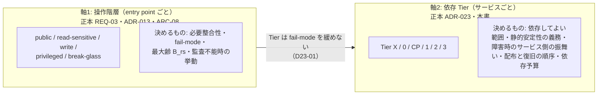
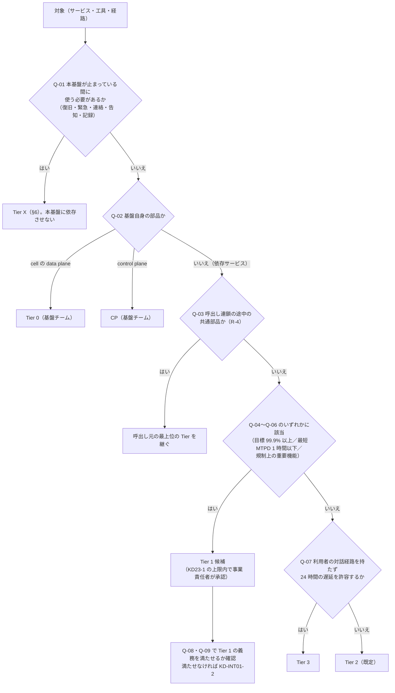
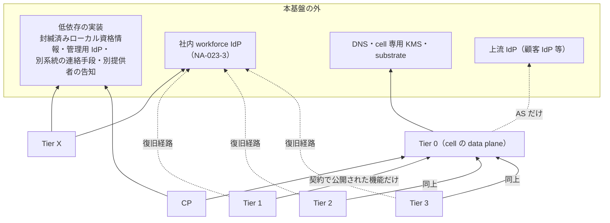
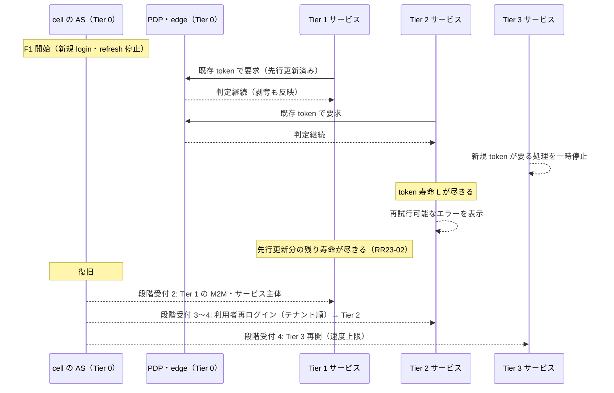

# 依存階層（Tier）

> 文書ID: INT-01 / 版: 0.2（独立レビュー反映。末尾の「レビュー記録」）/ 状態: draft / 最終更新: 2026-10-15
> 対応要求: R-192.5, R-207, G-042, G-048, G-049, G-098, G-104, G-135（R-requirements.md・G-goal-criteria.md で本書のパスまたは DL-63 を対応成果物に含む全行）／R-210（deliverables.md の DL-63 行）／関連: G-057, G-059, G-106, R-154, R-219（全件と閉じ方は末尾の対応表）
> 依存文書: CONVENTIONS.md, traceability/deliverables.md（DL-63 行）, 05_adr/ADR-023-dependency-tiers.md（設計判断の正本）, 05_adr/ADR-013-cell-partitioning-fail-mode.md, 05_adr/ADR-005, ADR-006, ADR-008, ADR-009, ADR-016, ADR-022, ADR-026, ADR-029, 05_adr/reconciliation-notes.md, 04_architecture/fail-mode-matrix.md (ARC-08), 04_architecture/cell-blast-radius.md (ARC-07), 07_slo/numeric-contracts.md, 12_poc/preregistered-test-plan.md, 01_governance/assumptions-register.md, 01_governance/business-impact-analysis.md (GOV-04), 01_governance/stop-authority.md (GOV-06), 01_governance/kri.md, 02_requirements/operation-risk-tiers-assurance.md (REQ-03), 03_threat-model/threat-catalog.md, traceability/R-requirements.md, traceability/G-goal-criteria.md, traceability/rejected-hypotheses.md（RH-019, RH-182〜RH-184）, research/RS-09, RS-12, RS-16（各 research/verification/ の検証記録を含む）
> 作成方法: AI エージェント（Claude）が ADR-023 の決定（proposed）を連携開発者向けに展開した。本書は ADR-023 に反する設計を書かず、ADR で未決の点は「未決（ADR-0xx）」と書く。判断は自己レビューであり、実在する CTO/CISO の決裁ではない（CONVENTIONS §8）[D]。起草では新たな原典を取得していない。脚注はすべて research の検証済み項目（RS-xx#n）、または research ノート外の 1 件（[^20]）を経由している。[^20] は本書の独立レビューで原典 PDF を再取得し、引用箇所を照合した [D]。
> 表記: 本書で新たに置く項目は、必須実装 M-xx、判定設問 Q-xx、適合確認 CK-xx、決裁案 KD-INT01-x、残余リスク RR-INT01-xx と書く。ADR-023 の D23-xx、NX-xx、KD23-x、TC-23-xx、NA-023-x はそのまま引く。TC-23-xx は DL-22 で TC-105〜TC-126 に統合済みであり（12_poc/preregistered-test-plan.md の ADR-023 行）、本書では両方を併記する。**表のセルのうちタグのないものは設計推論 [D] であり、この注記で個別のタグに代える。** 事実を述べるセルには個別にタグと脚注を付けた。
> 用語の注意: 本書の「Tier」は依存の階層であり、REQ-03 の操作階層（public／read-sensitive／write／privileged／break-glass）とも、BIA の時間格子 T0〜T6 とも別の軸である。本書では必ず「Tier 1」のように書き、「T1」とは略さない（ADR-023 の用語注意に従う）[D]。

---

## 0. 結論（CTO/CISO 向け）

1. **依存は「操作階層（entry point ごと）× 依存 Tier（サービスごと）」の二軸で決め、Tier は fail-mode を緩めない [D]（ADR-023 D23-01）。** 操作階層が「障害時に拒否するか、上限付きで継続するか」を決め、Tier は「基盤に依存してよい範囲、静的安定性の義務、障害時のサービス側の振舞い、配布と復旧の順序、依存予算」を決める [D]。どの Tier でも認可判定の fail-open は禁止で、read-sensitive の最大齢 B_rs・失効状態の最大齢 M_rev・token 寿命を Tier で延ばさない [D]（ADR-013 D13-23、ADR-023 D23-01）。fail open は DoS だけで安全性を下げる手段を攻撃者に与えるからである [V][^6]（RS-09#20）。
2. **Tier は 6 区分（Tier X／Tier 0／CP／Tier 1／Tier 2／Tier 3）で、依存サービスが申告するのは Tier 1〜3 だけである [D]（ADR-023 D23-02, D23-04）。** 判定は §2 の設問 Q-01〜Q-09（閾値の初期値は NA-023-1）で行い、申告のない依存サービスは本番に接続しない [D]。Tier 1 の閾値と上限数は未決（ADR-023 KD23-1）である [D]。
3. **全 Tier の依存サービスに 10 項目の必須実装（M-01〜M-10）を課す [D]（§7）。** 中核は、要求経路と起動時に AS・control plane を呼ばないこと、allow を SDK の外で cache せず独自の迂回を作らないこと、jitter 付き backoff と Retry-After を守ること、自サービスの復旧経路を本基盤に依存させないことである [D]（ADR-023 D23-10）。Tier 1 にはさらに閲覧専用モード、受付キューと実行時の再認可、token の先行更新、N−1 以内の版、四半期の障害注入参加を課す [D]（ADR-023 D23-11）。連携開発者は §7.4 の手順で、基盤の完成を待たずに契約とモックで設計・実装・大半の試験を始められる。ただし障害時の振舞いの試験は、モック・契約試験キット（DL-80）が未作成のため当面は自前のスタブで行う [D]。
4. **「本基盤に依存してはならないもの」は 16 項目（NX-01〜NX-16）で、全項目に代替手段を置いた [D]（§6、ADR-023 D23-30）。** 根拠は、共通の認証基盤の障害が依存サービスの同時停止として起き [I][^11][^13]（RS-09#47, #53）、同じ障害で status page・顧客連絡先・緊急切断・管理画面 login が使えなくなった当事者報告が複数あることである [I][^12][^14][^15][^16]（RS-09#56, #62, #68, #69）。G-049 の「循環依存 0 件」は、依存グラフの機械検査（§6.3）と同時停止演習（TC-115）で示すが、実測は未実施であり未達である [D]。
5. **静的安定性と剥奪反映のトレードオフは、3 つの状況（PDP 不達時の read-sensitive、失効配布路の停止、AS 停止中の発行済み token）に限って残る [D]（ADR-023 D23-22）。** 剥奪・停止の入力経路を cell の Tier 0 に置くため、control plane の停止が長引いても剥奪は反映され続ける [D]（ADR-023 D23-21）。上限値 B_rs・M_rev・H・L はすべて未決（ADR-013 KD13-6、ADR-006、ADR-005）である [D]。
6. **依存予算（R-192.5）は「基盤の帯 × 依存サービスの申告」で配分する [D]（§9）。** Google の経験則（重要依存は自サービスより 9 が 1 つ多い）[V][^20] と NA-023-5 の配分に従うと、基盤の判定系を全操作の重要依存とするサービスは、判定系 99.95% なら約 99.5%、99.99% なら約 99.9% を超えて約束しにくい [D][A-090, NA-023-5]。それを超える Tier 1 は、静的安定性で継続する entry point を増やして基盤を重要依存とする割合を下げる [D]（ADR-023 D23-45）。
7. **経営判断が要る点は 7 件である [D]（§12）。** ADR-023 の KD23-1〜KD23-5 に、本書の KD-INT01-1（Tier 申告の審査の仕方）と KD-INT01-2（Tier 1 の義務を期限までに満たせないサービスの扱い）を加えた [D]。
8. **G-048（blast radius 予算への適合の実測）、G-049 の演習による実証、R-207・R-210 の実測は未達である [D]。** 本書で閉じたのは、Tier の規則・義務・振舞い・非依存一覧・判定手順の机上の定義（A）までである [D]。

---

## 1. 位置付けと読み方

### 1.1 本書が決めること・決めないこと

| 区分 | 内容 | 正本 |
|---|---|---|
| 本書が決める（ADR-023 の展開） | Tier 判定の設問と手順、Tier ごとの依存可能範囲・静的安定性要件・障害時の振舞いの連携開発者向けの記述、必須実装 M-01〜M-10 の確認方法、NX 項目ごとの所有者と演習、適合確認チェックリスト、依存予算の申告様式 | 本書 |
| 本書が従う（変えない） | 二軸、Tier の定義と逆転の禁止、Tier ごとの義務、Tier X の 16 項目、剥奪入力の Tier 0 化、Tier 別の wave・shed・段階受付（ADR-023 D23-01〜D23-50） | ADR-023 |
| 本書が従う（変えない） | 操作階層 × 障害種別のセルの挙動（拒否・known-good・spool） | ARC-08（DL-19）、ADR-013 D13-23〜D13-29 |
| 本書が決めない | B_rs・M_rev・H・L・J_max・Q_r・Q_w の値、Tier 1 の閾値と上限、SDK の版差の値、連携パターン P-xx の割当 | ADR-013 KD13-6、ADR-006、ADR-005、ADR-023 KD23-1、DL-70、DL-64 |

- ADR はすべて proposed（決裁前）である [D]（05_adr/README.md）。決裁で ADR-023 が変われば、本書はそれに従って改める [D]。
- ARC-07 §6.3 の DV-1〜DV-12 と ARC-08 §3.6 の 10 項目は、取込み後は本書を正本とすると ARC-07 が定めている [D]（ARC-07 §6.3 の注記）。本書 §7 は両表を M-01〜M-10 に統合し、対応を §7.3 に示した [D]。

### 1.2 読み手別の入口

| 読み手 | 最初に読む節 | 持ち帰るもの |
|---|---|---|
| CTO/CISO | §0、§2.1、§6、§9、§12 | Tier の規則、非依存一覧と代替手段、依存予算の配分規則、決裁案 7 件 |
| 連携開発者（依存サービスのチーム・ベンダー） | §2.3（判定）、§3、§5、§7（特に §7.4 の開発開始の手順）、§8 | 自サービスの Tier、依存してよい範囲、障害時の振舞い、必須実装、オンボーディングで提出するもの |
| SRE・プラットフォームチーム | §4、§6、§10、§11、§13 | Tier 0 の静的安定性義務、Tier X の演習、依存グラフ検査、段階受付の順序、試験 |

### 1.3 二軸の関係

- 同じ Tier 1 のサービスでも、write の entry point は PDP 不達時に拒否され、read-sensitive の entry point だけが B_rs 以内の known-good で継続し得る（KD13-6 で許すと決裁された場合に限る）[D]（ARC-08 §5）。
- Tier を上げても「障害時に長く allow が続く」ことにはならない [D]。Tier を上げて得られるのは、配布 wave で後に回ること、過負荷時に後で落とされること、復旧時に先に受け付けられることである [D]（ADR-023 D23-41〜D23-43）。

---

## 2. Tier 分類規則

### 2.1 Tier の定義

| Tier | 何が入るか | 誰が属するか | 申告・決定 |
|---|---|---|---|
| Tier X（非依存層） | 本基盤が止まっても使えなければならないもの（§6 の NX-01〜NX-16） | 基盤の緊急経路・運用工具、連絡・告知手段、依存サービスの復旧経路 | ADR-023 が列挙。追加は §6.4 |
| Tier 0（cell の data plane） | 判定系: edge PEP、opaque token の状態ストア、STS、TTS、PDP facade・engine、失効状態の配布元と配布路、剥奪・停止の入力経路、router と配置表のローカルコピー、discovery・JWKS の静的配信、監査 producer と spool。認証系: cell の AS（login、token 発行、federation）と session store | 基盤（プラットフォームチーム） | ADR-023 D23-02 |
| CP（基盤の control plane） | 所在地群の配置台帳の書込み、wave の実行、PAP、テナント管理、AS の宣言適用、オンボーディング | 基盤 | ADR-023 D23-02 |
| Tier 1（重要依存サービス） | NA-023-1 の閾値に当たる依存サービス | 依存サービス | 申告（§2.3）。閾値と上限は未決（ADR-023 KD23-1） |
| Tier 2（標準） | Tier 1 と Tier 3 以外（既定） | 依存サービス | 申告 |
| Tier 3（非同期・遅延許容） | 利用者の対話経路を持たず遅延を許容するもの | 依存サービス | 申告 |

- 「Tier 0」の名は、ADR-005・ADR-019 が状態ストア・STS・TTS・失効状態配布路を「Tier-0 部品」と呼んだ用法に合わせている [D]（ADR-023 D23-02 の注記）。
- Tier 0 と CP を分けるのは、control plane は誤情報より失敗を選び、data plane は古い情報でも可用性を保つという AWS の cell 白書の設計実践に合わせたものである [V][^1]（RS-09#12）。

### 2.2 分類の規則（R-1〜R-7）

| # | 規則 | 根拠 |
|---|---|---|
| R-1 | 下位の Tier は上位の Tier に実行時依存してはならない。順序は Tier X ＜ Tier 0 ＜ CP、Tier 0 ＜ Tier 1 ≦ Tier 2 ≦ Tier 3。Tier X はどれにも依存しない | ADR-023 D23-03 |
| R-2 | 「依存」は要求経路の呼出しに限らず、起動時の資格情報・設定の取得、ヘルスチェック、login、配備と rollback の経路を含めて数える | ADR-023 D23-03。Google SRE は依存の欠落への対処を起動時と実行時の両方で問うよう勧めている [V][^20] |
| R-3 | Tier はサービス（デプロイ単位）ごとに 1 つ。1 つのサービスが Tier 1 の entry point と Tier 3 の処理を併せ持つ場合は高い方（Tier 1）を申告し、基盤を重要依存とする entry point の割合を別に申告する（§9） | ADR-023 D23-45 の 2、REQ-03 J6 の high-water mark と同じ考え方 [D] |
| R-4 | 呼出し連鎖の途中にある共通部品（内部のサービス間同期呼出し、検索・一覧、ストレージ・署名付き URL、外部共有、レガシー adapter）は、呼出し元の最上位の Tier を継ぐ | ADR-023 D23-48 |
| R-5 | Tier の引上げは各ドメイン責任者の判断でよい。引下げは CTO の承認を要する。Tier 1 の新規追加は KD23-1 の上限の範囲で事業責任者が承認する | ADR-023 D23-04, D23-50 |
| R-6 | Tier は fail-mode・最大齢・token 寿命を変えない。Tier を理由とした窓の延長の要求は受け付けない | ADR-023 D23-01、RH-183 |
| R-7 | 申告のない依存サービスは本番に接続しない（REQ-03 J10 と同じ扱い） | ADR-023 D23-04 |

### 2.3 判定の手順（設問 Q-01〜Q-09）

依存サービスのチームは、オンボーディングの準備完了条件（DL-67）で次の設問に答えて Tier を申告する [D]。閾値は NA-023-1 の初期値であり、KD23-1 の決裁で変わり得る [D]。

| 設問 | 問い | 該当したら | 根拠・確認する資料 |
|---|---|---|---|
| Q-01 | 本基盤が止まっている間に使う必要があるか（障害の検知・連絡・告知・復旧・緊急操作・証拠保全・規制報告の記録） | Tier X。§6 の該当 NX 項目の代替手段に従う | ADR-023 D23-30、GOV-04 X8 |
| Q-02 | 基盤自身の部品か | Tier 0 または CP（基盤チームが決める） | ADR-023 D23-02 |
| Q-03 | 呼出し連鎖の途中の共通部品（G-135 の (6)(12)(13)(21)(23)）か | 呼出し元の最上位の Tier を継ぐ | R-4 |
| Q-04 | 申告する可用性目標が 99.9% 以上か | Tier 1 候補 | NA-023-1 [D]（前提台帳へ追加要） |
| Q-05 | BIA 票の最短 MTPD が 1 時間以下か | Tier 1 候補 | NA-023-1、GOV-04 票 A |
| Q-06 | 規制上の重要機能（DORA の重要機能等）を担うか | Tier 1 候補 | NA-023-1。DORA の判定は DL-34（ADR-023 §8） |
| Q-07 | 利用者の対話経路を持たず、24 時間の遅延を許容するか | Tier 3 | NA-023-1 |
| Q-08 | Tier 1 候補の場合、閲覧専用モード・受付キュー（ADR-026）・先行更新・N−1 以内の版・四半期の障害注入を、本番接続までに実装・参加できるか | できなければ KD-INT01-2 の扱い | ADR-023 D23-11 |
| Q-09 | Tier 1 候補の場合、申告目標が §9 の上限を超えるか | 超えるなら、静的安定性で継続する entry point を示すか、KD23-2 に付す | ADR-023 D23-45 の 3 |

- 閾値の 99.9%・1 時間・24 時間は NA-023-1 の初期案であり、根拠のある値ではない [D][NA-023-1]。所有者は事業責任者＋CTO、期限は G3、決め方は BIA の MTPD 分布と Tier 1 の候補数の試算（KD23-1）である [D]。
- Tier の分布の試算（Tier 1 約 10%＝30、Tier 2 約 60%＝180、Tier 3 約 30%＝90）は運用量の見積りだけに使い、判定には使わない [D][NA-023-2, A-050]。

### 2.4 依存サービス種別ごとの既定の Tier（G-135 の 27 種別、G-098）

ADR-023 D23-48 の既定値を、判定の出発点として示す [D]。既定は Q-01〜Q-09 で引き上げ・引き下げる [D]。連携パターン P-xx・「非対応」・「禁止」の割当は DL-64（10_integration/integration-patterns.md）が持つ [D]。

| # | 種別（G-135） | 既定の Tier | 判定の注意 | 代表例（仮置き。作成者以外による選定は未実施） |
|---|---|---|---|---|
| 1 | サーバー描画の Web アプリ | BIA で Tier 1 または 2 | 業務の重要度による | 顧客向けの契約管理画面 |
| 2 | SPA（BFF 経由） | BIA で Tier 1 または 2 | BFF が token を扱う。BFF のサービスとして申告 | 利用者向けダッシュボード |
| 3 | モバイル・ネイティブアプリ | Tier 2 | アプリの backend を申告対象にする | 一般利用者向けアプリの backend |
| 4 | CLI・開発者ツール | Tier 3 | 本番の復旧経路に使う工具は NX-13（Tier X） | 社内の開発者 CLI |
| 5 | デバイス・IoT・共有端末 | Tier 2 | — | 店舗の共有端末 |
| 6 | 内部のサービス間同期呼出し | 呼出し元の最上位を継ぐ | R-4 | 在庫照会の内部 API |
| 7 | 外部 M2M・パートナー API | Tier 2 | 契約の SLA で Tier 1 に引き上げ得る | パートナー向け注文 API |
| 8 | バッチ・定期ジョブ・長時間処理 | Tier 3 | 実行時の再認可は ADR-026 | 夜間の請求集計 |
| 9 | イベント駆動 | Tier 3 | consumer は処理を一時停止し再開する | 監査連携の consumer |
| 10 | Webhook の送受信 | Tier 3 | — | 外部への通知 webhook |
| 11 | データ基盤（DWH、ETL、ML） | Tier 3 | — | DWH の取込み |
| 12 | 検索・一覧 | 呼出し元の最上位を継ぐ | R-4 | 横断検索 |
| 13 | ストレージ・署名付き URL・CDN | 呼出し元の最上位を継ぐ | R-4 | 添付ファイル配信 |
| 14 | メール・SMS の操作リンク | Tier 3 | — | 招待メール送信 |
| 15 | リアルタイム（WebSocket 等） | Tier 2 | — | チャット |
| 16 | 第三者連携アプリ（inbound） | Tier 2 | — | 顧客が導入する外部 app |
| 17 | 外部 SaaS への outbound 連携 | Tier 3 | — | 外部 CRM への同期 |
| 18 | AI エージェント | Tier 2 | 高リスク操作は人の確認を要し、確認は基盤に依存するため Tier 1 にしない（ADR-017） | 社内の業務支援エージェント |
| 19 | 管理コンソール・support tool | Tier 2 | 障害時の受付は NX-09（Tier X） | 顧客サポート画面 |
| 20 | 従業員向けの社内業務システム | BIA で Tier 1 または 2 | — | 経費精算 |
| 21 | レガシー・パッケージ製品 | 呼出し元を継ぐ | adapter は依存サービス側に属し、Tier 0 に入れない | パッケージ製品の adapter |
| 22 | 顧客 IdP 連携と SCIM | 依存サービスではなく基盤の機能 | federation は Tier 0 の AS、SCIM の無効化は Tier 0、追加・変更は CP | — |
| 23 | 外部共有・ゲスト・テナント越境 | 呼出し元の最上位を継ぐ | R-4。cell 間の同期呼出しをしない（ADR-013 D13-13） | 文書の外部共有 |
| 24 | 匿名・公開アクセス | 判定は NX-16（Tier X） | public の判定は基盤に依存させない | 公開ページ |
| 25 | 規制スコープのサービス | Tier 1 の候補 | Q-06 | 決済の実行 |
| 26 | break-glass・緊急経路・復旧ツール | Tier X | §6 | 基盤の break-glass/P |
| 27 | 非本番環境 | Tier 3 | 本番の依存先にしない。別の issuer・鍵（ADR-022 D-6-4） | 開発・試験環境 |

- 27 種別すべてに既定の Tier があり、空欄は 0 件である [D]。代表例は本書の作成者が置いた仮置きであり、G-098 の合格条件（作成者以外が前提台帳の事業ドメインから代表例を選び、割当漏れ 0 件を確認する）は未実施である [D]。
- 27 種別のどれにも当てはまらない連携は、暫定で Tier 2 として扱い、DL-64 の新パターン追加の手続に付す [D]。Tier の側では、種別が決まるまで Tier 1 の申告を受け付けない（Tier 1 の義務を判定できないため）[D]。審査者はプラットフォームチーム長、期限と ADR の要否は DL-64 の手続に従う [D]。

---

## 3. 各 Tier の依存可能範囲

### 3.1 依存の向き

- 矢印は「依存してよい」向きだけを示す [D]。描いていない向き（Tier 0 → CP、Tier 1〜3 → CP、Tier X → 本基盤、Tier 1〜3 → AS の要求経路での呼出し）はすべて禁止である [D]（ADR-023 D23-02, D23-03）。
- 依存サービスの復旧経路（配備、rollback、クラウド管理コンソール、当番招集）は本基盤の AS を経由せず、社内 workforce IdP への直接の federation かクラウドの local 認証で行う [D]（NX-13、ADR-023 D23-10 の 7）。

### 3.2 Tier ごとの依存可能範囲

| Tier | 依存してよいもの（実行時・起動時） | 依存してはならないもの |
|---|---|---|
| Tier X | 本基盤の外の低依存の実装（封緘済みのローカル資格情報、別アカウントの製品 local 認証、管理用 IdP、別系統の連絡手段） | 本基盤のどの cell の AS・PDP・edge・STS・管理面、本基盤が broker する認証 |
| Tier 0 | 同じ cell の Tier 0 部品（判定系は要求経路で AS に依存しない）、cell 専用アカウントの KMS（検証は公開鍵の cache で継続、ADR-007 D7-41）、DNS、substrate、上流 IdP（AS だけ。停止中も既存 session と refresh を継続、ADR-001 D14-1） | CP、Tier 1〜3、管理用 IdP（運用者 assertion を公開鍵の cache でローカル検証する場合を除く）、global endpoint（ADR-013 D13-21 の例外登録を除く）、他 cell |
| CP | Tier 0、管理用 IdP、CI | —（Tier 0 と Tier 1〜3 から実行時に依存されない） |
| Tier 1 | 契約（ADR-022）で公開された Tier 0 の機能だけ。重要依存として扱う操作を entry point ごとに申告し、静的安定性で継続する操作と分ける | 要求経路での AS・CP の呼出し、global endpoint、契約外の endpoint |
| Tier 2 | 契約で公開された Tier 0 の機能だけ | 同上 |
| Tier 3 | 同上。処理単位での同期呼出しの連鎖を持たない（1 件ごとに基盤を呼ぶ loop は jitter 付きの速度上限の下で行う） | 同上 |

（出典: ADR-023 D23-02, D23-11 の表 [D]）

### 3.3 Tier 1〜3 が使ってよい基盤の機能（契約単位）

依存サービスが使ってよいのは、契約（11_contracts/、ADR-022）で公開された機能だけである [D]（ADR-022 D-3、契約外依存の禁止）。

| 機能 | 呼出しの時点 | 置き場所 | 不達時 |
|---|---|---|---|
| 内部 access token の検証 | 要求ごと（ローカル） | SDK・検証器が公開鍵の cache で検証（ADR-005 D1-4、ADR-023 D23-10 の 1。外部 opaque token は edge だけが検証、D1-2） | 前回の JWKS を J_max まで使い、J_max/2 で警報。J_max を超えたら read-sensitive 以上を拒否（ARC-08 FM-08） |
| 認可 Check（AuthZEN 準拠 API、DL-72） | 要求ごと | 同じ cell の PDP facade | engine 不達は 200・decision=false・`deny_unavailable`、facade の過負荷は 503（Retry-After は付く場合がある）、quota 超過は 429＋Retry-After（DL-72 §6）。SDK は `deny_unavailable` と 503 を「判定が得られない」として操作階層ごとの fail-mode を適用する（ARC-08 FM-01, FM-02、§5.2） |
| discovery・JWKS の取得 | 定期 | 静的な配布物（ADR-021 D21-08b） | 前回の値で J_max まで継続し警報（M-05） |
| M2M token の取得（外部 API 用） | 初回利用時と寿命の後半 | 同じ cell の AS | 既存 token の寿命内で継続（F1） |
| token exchange（STS） | 下流呼出しの前（呼出し先 1 サービスを aud とする内部 token を hop ごとに取り直す、ADR-009 要旨） | 同じ cell の STS | 下流呼出しを行わず、再試行可能なエラーとして扱う（§5.1 の F2 と同じ振舞い） |
| 監査 event の送信 | 要求ごと | 監査 SDK のローカル spool | spool の上限 Q_r・Q_w（ARC-08 FM-09） |
| テナント設定の受領 | 配布時 | 署名付きの配布物（ADR-013 D13-30） | 最終版で継続（H まで） |

- 管理 API（PAP、テナント管理、配置台帳）は要求経路でも起動時でも呼ばない [D]（ADR-023 D23-10 の 2）。

---

## 4. 静的安定性要件

静的安定な設計では、依存先が劣化しても、それまで動いていたものは動き続ける [V][^2]（RS-09#10）。AWS IAM は control plane の障害中も既存 principal の認証・認可を継続し、回復経路で control plane に頼らないよう求めている [V][^3]（RS-09#13）。本書の要件はこの設計実践を Tier ごとに割り当てたものである [D]。

### 4.1 Tier 0（基盤チームの義務）

| # | 要件 | 根拠 | 検証 |
|---|---|---|---|
| S0-1 | CP が全面的に止まっても、署名付きの最終状態で上限時間 H まで判定を続ける | ADR-013 D13-14、ADR-023 D23-12 の 1 | TC-23-04（TC-105） |
| S0-2 | Tier 0 部品自身の資格情報（workload 証明書、KMS 接続資格情報）の更新経路を CP と AS に依存させず、H の間の継続を妨げない寿命と更新方式にする。短命資格情報の強制は、障害が寿命を超えると時限爆弾になり得る [V][^8]（RS-09#36） | ADR-023 D23-12 の 2 | TC-105 |
| S0-3 | Tier 0 部品間の相互認証の trust anchor を利用者向けの AS から独立させる（方式は ADR-009 の SPIFFE ID と X.509-SVID の mTLS、発行系は SPIRE が第一候補。trust domain の数は未決（ADR-009 P09-1）） | ADR-023 D23-12 の 3、NX-14 | TC-106 |
| S0-4 | cache や状態ストアに届かないとき、正本ストアや AS 本体へ直接照会する迂回を設けない | ADR-005 D1-3、ADR-013 D13-15 | TC-105 |
| S0-5 | 剥奪・停止の入力経路（REQ-03 J8 の縮小方向の操作、SCIM の無効化・削除、CAEP・RISC の受信）を cell の Tier 0 で受け付け、CP の停止中も受け付け続ける。SCIM 契約（11_contracts/scim.openapi.yaml §8）はこの受付を「未決（ADR-023 L23-3）」としており、本書と食い違う（本書末尾「ADR・契約への指摘」の 2） | ADR-023 D23-21 | TC-23-03（TC-105） |
| S0-6 | 署名付き配布物の有効期限を H とし、H の半分で警報する。H は自動で延長せず、break-glass による既知良好版の再発行（ADR-008 D8-83）だけで延ばす。自動延長は平常時と障害時で挙動を変える bimodal behavior に当たる [V][^5]（RS-09#15） | ADR-023 D23-23 | TC-23-04（TC-105） |
| S0-7 | 公開ページ・ログイン画面の表示・discovery・JWKS は AS 本体ではなく静的な配布物から返す | ADR-023 D23-16、ADR-021 D21-08b | TC-105 |

### 4.2 Tier 1〜3（依存サービスの義務）

| 要件 | Tier 1 | Tier 2 | Tier 3 |
|---|---|---|---|
| 要求経路・起動時に AS・CP を呼ばない（M-01, M-02, M-04） | 必須 | 必須 | 必須 |
| allow を SDK の外で cache しない・独自の迂回を作らない（M-03） | 必須 | 必須 | 必須 |
| discovery・JWKS は前回値で J_max まで継続し警報（M-05） | 必須 | 必須 | 必須 |
| AS 停止（F1）への備え | 既存 token の寿命の後半（例: 50% 経過後）に jitter 付きで先行更新する。寿命は延ばさない | 先行更新を推奨 | 先行更新しない（停止中は待つ） |
| 判定不能（F2）への備え | read-sensitive は KD13-6 が許す範囲で known-good を使う。write を続ける業務は受付キューと実行時の再認可（ADR-026）。閲覧専用モードを UI に持つ | 再試行可能なエラー（`deny_unavailable`・503）を利用者に分かる形で表示し、Retry-After があれば示す（§5.2） | 処理を一時停止し、Retry-After に従って再開 |
| SDK・検証器の版差 | 現行版から N−1 以内（ADR-023 の提案） | N−2 以内（ADR-022 の候補） | N−2 以内 |
| 障害注入への参加 | 四半期ごと | 年 1 回 | 年 1 回（復旧時の再開挙動だけ） |
| 復旧時の優先 | 段階受付で先に受け付け | Tier 1 の後 | 最後。再開の速度上限に従う |

（出典: ADR-023 D23-10, D23-11 [D]）

- 先行更新は、AS 停止の開始時点で各 token に残る寿命を寿命 L の半分以上にし、F1 が F2 に発展するまでの時間を延ばすためのものである [D][A-027]。「50%」は例示であり、値は未決（ADR-005 の寿命 L と DL-20）である [D]。jitter は更新の同期を防ぐために入れる [V][^10]（RS-09#8）。
- 版差の値（N−1、N−2）は ADR-023 の提案と ADR-022 D-4-5 の候補であり、確定は DL-70（所有者 CTO、DEC-8 前）である [D]。Kubernetes が kubelet と kube-apiserver の版差の許容幅を明文化しているように [V][^21]（RS-16#39）、版差は数値契約にする [D]。
- 障害注入の頻度（四半期・年 1 回）は ADR-023 D23-11 の設計推論であり、SRE の増員（ADR-013 KD13-5）が承認されなければ見直す [D][A-054]（ADR-023 §8）。

### 4.3 静的安定性と剥奪反映のトレードオフ（残る 3 つ）

| 状況 | 継続させるもの | 剥奪反映への影響 | 上限 | 状態 |
|---|---|---|---|---|
| PDP 不達（当該 cell） | read-sensitive の known-good（KD13-6 で許すと決裁された場合だけ） | 失効 epoch に載らない relationship の剥奪は B_rs まで効かない | B_rs | 未決（ADR-013 KD13-6）。決裁までは read-sensitive も拒否（ARC-08 §4） |
| 失効配布路の停止 | 最後に受け取った失効状態での判定 | 配布停止後の剥奪が届かない | M_rev。超えたら read-sensitive 以上を拒否 | 未決（ADR-006 D6-08） |
| AS 停止 | 発行済み token の寿命内の利用 | 剥奪は edge の状態照会・STS・PDP で効く（AS は剥奪の強制点ではない） | token 寿命 L。延長しない | 未決（ADR-005 D3） |

（出典: ADR-023 D23-22 [D]）

- CP の停止は剥奪反映の遅れを生まない [D]。剥奪の入力経路が Tier 0 にあるためである（S0-5）[D]。H の相手は「新しい付与ができないことの業務影響」と「署名付き配布物の期限」に限られる [D]（ADR-023 D23-21、L23-3）。
- token に所属・role・属性を多く載せて PDP 依存を減らす案は採らない [D]（ADR-023 D23-24、RH-019）。載せた属性の剥奪が token の寿命まで効かず、claim 名が不可逆だからである [D]（ADR-005 D9-4、ADR-021）。

### 4.4 Tier X と CP の静的安定性と障害時の挙動（G-104 の全 Tier 分）

§4.1・§4.2・§5.1 は Tier 0 と Tier 1〜3 を扱う。残る 2 つの Tier の 3 項目を次に示す [D]。

| Tier | 依存してよい範囲 | 静的安定性の要件 | 本基盤の障害時の挙動 |
|---|---|---|---|
| Tier X | §3.2 の行（本基盤の外の低依存の実装だけ） | 本基盤のどの部品が止まっても使えること自体が要件である。資格情報は封緘済み・事前作成で、SSO・federated IdP の動的部品から導出しない [V][^8]（RS-09#41）。演習で使えることを示す（NX-01 は 90 日ごと、他は年 1 回以上） | F1〜F7 のどれでも平常どおり使う。本基盤・管理用 IdP の同時停止下で使えることを TC-115（TC-23-02）で確かめる |
| CP | §3.2 の行（Tier 0、管理用 IdP、CI） | CP 自身は誤情報を配るより失敗を選ぶ [V][^1]（RS-09#12）。CP の停止は Tier 0 の判定を止めない（S0-1）。署名付き配布物の期限 H は自動延長しない（S0-6） | F3（CP 停止）では変更・付与・オンボーディング・新規テナント作成の受付を止め、再試行可能なエラーを返す。剥奪・停止は Tier 0 の入力経路で受け付け続ける（S0-5）。F1・F2 では CP の変更操作を続けてよいが、配布は Tier 0 の受信側の検証（ADR-013 D13-31）に従う |

（出典: ADR-023 D23-02, D23-12, D23-15, D23-21, D23-30, D23-31 [D]）

---

## 5. 基盤障害時の挙動

### 5.1 障害形態 × Tier（サービス側の振舞い）

障害形態は GOV-04 §2.4 の F1〜F7 である [D]。操作階層ごとの判定の挙動（拒否・known-good・spool）は ARC-08 のセルが正本であり、本表はサービス側の振舞いだけを定める [D]（ADR-023 D23-15）。

| 障害形態（ARC-08 の列） | Tier 0 の挙動 | Tier 1 | Tier 2 | Tier 3 |
|---|---|---|---|---|
| F1 AS 停止（FM-06、FM-05 の一部） | 新規 login・refresh を止める。既存 session・token の検証、剥奪の反映、判定は継続 | 既存 token の寿命内で業務を継続し、新規 login 不可を利用者に表示。M2M は先行更新済みの token で継続 | 既存 token の寿命内で継続し、尽きたら再試行可能なエラーを表示 | 新規 token が要る処理を一時停止 |
| F2 判定不能（FM-01, FM-02, FM-04, FM-13） | ARC-08 のとおり（read-sensitive は B_rs 以内の known-good、write 以上は拒否と 503） | 閲覧専用モードへ切替。write は受付キューで受け、実行時に fresh な判定で再認可（ADR-026）。privileged は待つ | 再試行可能なエラーとして表示し、Retry-After があれば示す（§5.2） | 一時停止 |
| F3 管理系（CP）停止（FM-14） | H まで最終状態で継続。剥奪・停止は Tier 0 の入力経路で受付継続 | 影響なし。権限付与・オンボーディングは CP 復旧まで待つ | 同左 | 同左 |
| F4 剥奪未反映の危険（FM-15、FM-10 の一部） | 失効状態の齢が M_rev を超えたら read-sensitive 以上を拒否 | F2 と同じ振舞いに移る | F2 と同じ | 一時停止 |
| F7 監査不能（FM-09） | ARC-08 の AF 規則（spool 上限 Q_r・Q_w、privileged は同期記録できなければ拒否） | 拒否された操作を業務側で記録し、復旧後に再実行 | 再試行可能なエラー | 一時停止 |
| 復旧時 | 段階受付（§10.3） | 先に受け付けられる。接続を一斉に張り直さない | Tier 1 の後 | 最後。再開の速度上限に従う |

- F5（データの損失・巻戻り）と F6（誤 deny）は Tier によって振舞いを変えない [D]。F5 は ADR-013 D13-39 のテナント単位の復元、F6 は ARC-08 の FM-13 と誤 deny の通報経路で扱う [D]。
- Cloudflare 2025-11-18 では、新規の Access 認証は失敗したが既存の Access session は影響を受けなかった [I][^17]（RS-09#73）。F1 で「既存は継続、新規は停止」とする設計はこの挙動と同じ形である [D]。

### 5.2 PEP から返る応答と依存サービスの扱い

| 応答（DL-72 の形） | 意味 | 依存サービスがすること | してはならないこと |
|---|---|---|---|
| 200・decision=false・reason が `deny_no_relation`・`deny_guardrail:<規則ID>` | 権限がない（通常の deny） | 権限なしとして扱う。`reason` はエンドユーザーに返さない（ADR-011 D6-1） | 「障害」と表示する。再試行する |
| 200・decision=false・`deny_unavailable` | facade は受け付けたが engine に届かない（基盤側の障害、ADR-011 D3-6）。Retry-After は付かない | 「判定が得られない」として §5.1 の Tier ごとの振舞いに移る。再試行は SDK 既定の backoff に従う。UI・ログで通常の deny と区別する | 即時再送、独自の再試行ループ、迂回、known-good での許可への変換（SDK の外で行うこと） |
| 503（Retry-After は付く場合がある） | facade の過負荷による shed、または保守 | 同上。Retry-After があればそれより早く再送しない。なければ SDK 既定の backoff に従う | 同上 |
| 429＋Retry-After | テナント・クライアント単位の quota 超過 | 速度を落とし、Retry-After まで再送しない | 他テナント・他 client 名義での再送 |
| 200・decision=false・`deny_indeterminate` | 属性の欠落などの評価不能（基盤の障害ではない。`tid` の欠落もここに入る） | deny として扱い、自サービスの要求の組立て（属性・`tid`）を直す。SDK は「判定が得られない」として扱い、known-good で許可に変えない | 許可に変える。障害として再試行し続ける |
| 200・decision=false・`unsupported_profile` | 要求した profile の major 版を facade が扱えない | deny として扱い、SDK・profile の版を直す（§7.1 M1-4、CK-21） | 許可に変える |
| facade 不達・timeout、`decision_id` 欠落、X-Request-ID の echo 不一致 | 判定が得られない（ARC-06 §3.5） | `deny_unavailable` と同じ | 同上 |

（出典: 11_contracts/authorization-api.openapi.yaml §5〜§7（DL-72）、ADR-011 D3-3, D3-6、ARC-08 §3.6 の 4、ARC-07 DV-5 [D]）

- `deny_unavailable` と 503 はどちらも SLI-068（依存予算）の「基盤起因の停止分」に計上される [D]（numeric-contracts.md SLI-068）。依存サービスは自サービスのログに両者を区別して残し、§9 の月次の突合に使う [D]。
- ADR-023 D23-11 と §5.1 の Tier 2 の行は「503 と Retry-After を表示」と書くが、DL-72 では engine 不達は 503 ではなく `deny_unavailable` で返り、Retry-After も付かない [D]。本書では両者を同じ振舞いで扱い、Retry-After がなければ SDK 既定の backoff に従うと読む（本書末尾「ADR・契約への指摘」の 1）[D]。

### 5.3 基盤障害時の時間の流れ（AS 停止が長引く場合）

- AS 停止が token の寿命を超えて続くと、Tier 1 も新規の操作ができなくなる（ADR-023 RR23-02）[D]。これは token の寿命を延ばさない決定（ADR-005 D3）の代償であり、受容者案は事業責任者（BIA の MTPD として）である [D]。

---

## 6. 本基盤に依存してはならないもの（Tier X）

### 6.1 一覧と代替手段（G-049）

共通の認証基盤の障害の最中に、連絡・告知・緊急工具が同じ障害で損なわれた当事者報告が複数ある [I]。Google 2020-12-14 では Cloud Support の内部工具が影響を受けて告知が遅れた [I][^11]（RS-09#49）。Auth0 2021-04-20 では status page も応答しなかった [I][^12]（RS-09#56）。Atlassian 2022 では顧客連絡先も同じスクリプトで削除された [I][^14]（RS-09#62）。Google 2025-06-12 では Cloud Service Health 自体の障害で最初の告知が約 1 時間後になった [I][^15]（RS-09#68）。Cloudflare 2025-06-12 では緊急切断機能と管理画面の SSO login が使えなかった [I][^16]（RS-09#69）。

| ID | 依存してはならないもの | 代替手段（本基盤の外の低依存の実装） | 所有者案 | 演習頻度 | 正本 |
|---|---|---|---|---|---|
| NX-01 | break-glass/P（基盤管理面の緊急経路） | 系統ごとに 2 つ以上の封緘済みローカル資格情報、federation しない device-bound 認証 [V][^9]（RS-09#44） | CISO | 少なくとも 90 日ごと [V][^9]（RS-09#44） | ADR-008 D8-40〜D8-42、ADR-029 |
| NX-02 | 本基盤の管理面への人の login（AS・PAP・KMS・CI・DNS） | 管理用 IdP（本基盤の AS にも workforce IdP にも依存しない）と製品の local RBAC | CTO | 年 1 回以上 | ADR-008 D8-10〜D8-12 |
| NX-03 | 管理用 IdP と JIT 承認系 | cell の外に置き、停止時は NX-01 で操作 | CTO | 年 1 回以上 | ADR-008 D8-14, D8-22 |
| NX-04 | KMS/HSM・JWKS 公開・マニフェスト署名・CI 署名の管理者認証 | 別系統のフィッシング耐性認証と非フェデレーションの緊急アカウント | CISO | 年 1 回以上 | ADR-007 D7-55、ADR-008 |
| NX-05 | 停止スイッチ（緊急 freeze、kill switch、失効の実行、鍵の緊急失効） | cell ごとに当番が直接操作できる専用工具（認証は管理用 IdP、停止時は NX-01）。遮断状態は失効状態と同じ配布路で配る | CISO（発動権限は GOV-06） | 年 1 回以上 | GOV-06 §5.3、ADR-013 D13-36、ADR-019 D19-05 |
| NX-06 | 基盤自身の監視・警報（metrics・log の保管と閲覧、警報配送、外形監視、既知解判定） | cell とは別アカウントの監視基盤、閲覧は管理用 IdP、警報は NX-07 の経路。外形監視は cell の外から | SRE 責任者 | 年 1 回以上 | 本書、DL-20 |
| NX-07 | 当番の招集と対応者間の連絡（paging、チャット、会議） | 平常の手段に加え、本基盤の SSO にも workforce IdP にも依存しない帯域外の手段を併置。侵害の疑いがある事象では帯域外に切替 [I][^19]（RS-12#50） | CISO＋CTO | 年 1 回以上 | GOV-06 §5.3、ADR-019、KD23-3 |
| NX-08 | status page・障害告知 | 別の提供者が配信する静的な告知ページ。作成者は管理用 IdP または製品の local 認証で login | CTO | 年 1 回以上 | 本書、DL-24 |
| NX-09 | サポート受付（障害の問合せ） | 認証を要しない窓口（電話・メール・公開フォーム）。NX-10 の登録連絡先で折り返して相手を確認。障害時の受付からアカウント回復・要素リセットは行わない | プロダクト責任者 | 年 1 回以上 | 本書、ADR-029 |
| NX-10 | 顧客連絡先台帳（緊急連絡先、規制上の報告先） | 本基盤のデータストアと削除工具の外に置き、別アカウントに定期複製。更新は CP から非同期に写す | CISO | 年 1 回以上 | GOV-04 X8、ADR-019 |
| NX-11 | 認知時刻の記録・停止の記録票・規制報告の作成 | 本基盤の監査基盤とは別の保存先 | 法務責任者＋CISO | 年 1 回以上 | GOV-06 §5.3、DL-24 |
| NX-12 | 復旧工具（IaC 再配備、既知良好版の差込み、テナント単位の復元、配置表の編集、待機 cell への切替） | 認証は管理用 IdP（停止時は NX-01）、artifact は別の保管庫。障害中のテナント移動は回復手段にしない | SRE 責任者 | 年 1 回以上 | ADR-013 D13-20, D13-34, D13-39、ADR-008 |
| NX-13 | 依存サービス自身の復旧経路（配備、rollback、クラウド管理コンソール、当番招集） | 社内 workforce IdP への直接の federation（本基盤の AS を経由しない、NA-023-3）かクラウドの local 認証 | 各ドメイン責任者 | 年 1 回以上（Tier 1 は障害注入と同時） | ADR-023 D23-10 の 7、KD23-4 |
| NX-14 | Tier 0 部品間の workload 認証の trust anchor | 利用者向け AS から独立した workload identity の発行系（ADR-009 の SPIFFE／X.509-SVID。発行系は SPIRE が第一候補、trust domain の数は未決（ADR-009 P09-1）） | CTO | 年 1 回以上 | ADR-009 |
| NX-15 | DNS ゾーンと registrar の管理 | 管理用 IdP と製品の local 認証。変更は二者承認 | CTO | 年 1 回以上 | ADR-008、ADR-013 KD13-7 |
| NX-16 | public 操作の判定 | SDK 内の静的規則と静的な配布物 | プラットフォームチーム長 | 年 1 回以上 | ADR-013 D13-25、ADR-023 D23-16 |

- 代替手段と正本は ADR-023 D23-30 の表に従う [D]。所有者案は本書の提案であり、GOV-06・ADR-019 の確定時に揃える [D]。
- 演習頻度の「年 1 回以上」は ADR-023 D23-31 の設計推論である [D]。NX-01 の 90 日は Microsoft の緊急アクセスアカウントの指針（少なくとも 90 日ごとの検証）に合わせた [V][^9]（RS-09#44）。SRS は、普段使わない break-glass 工具を使いこなせないこと自体が障害になるため定期的な演習を義務化するよう勧めている [V][^8]（RS-09#42）。
- 緊急用資格情報を SSO や federated IdP の動的部品から導出してはならない（低依存の実装で置き換えられる場合を除く）[V][^8]（RS-09#41）。NX-01〜NX-04 の代替手段はこの設計実践に従う [D]。
- NX-01 の常設の封緘アカウントは、緊急アカウントを組織が定めた期間の後に自動で削除または無効化することを求める SP 800-53 AC-2(2) [N][^7]（RS-09#45。統制文であり、期間と処置は組織が定める）と緊張関係にある [D]。補完統制は ADR-008 D8-41 の 4 つ（発動窓満了での権限の自動失効、常時監視、90 日ごとの演習、使用後の資格情報の更新）である [D]（ADR-023 D23-32）。

### 6.2 依存してはならないものではないもの（誤解しやすい 2 件）

| 対象 | 扱い | 理由 |
|---|---|---|
| break-glass/B（テナント内の業務上の緊急アクセス。例: 担当外の患者記録の緊急閲覧） | Tier X に含めない。利用者の認証は本基盤の AS に依存する。基盤の全停止中は各ドメインの業務継続手順（紙・オフラインを含む）で担い、BIA 票 A6・D8 に記入する | ADR-023 D23-17、ARC-08 KD08-5。ADR-013 D13-25 の break-glass 行は /P を指すと読む（ADR-023 L23-1。ADR-013 の改版は未決） |
| 顧客テナントの緊急管理者（PC-08(b)） | Tier X に含めない。顧客 IdP の停止・侵害に備える経路であり、本基盤の顧客向け AS のローカル認証を使う | ADR-023 D23-18 |

- break-glass/B のために、各ドメインが基盤から独立した認証・認可経路を独自に作ってはならない [D]（ARC-08 §3.6 の 9）。独自経路は PEP の coverage と判定記録の対象外の判定を増やすからである [D]。

### 6.3 循環依存と Tier の逆転の検出（G-049 の「循環依存 0 件」）

| 0 件に保つもの | 例 | 検出 | 正本 |
|---|---|---|---|
| 管理面の閉路 | 本基盤の AS → 管理用 IdP → 本基盤の AS／本基盤の KMS → CI の署名 → KMS の鍵ポリシー変更 → CI／JIT 承認系 → 本基盤の PDP → JIT 承認系／配布 pipeline → 自身の設定の配布 | 管理面資産ごとの依存台帳（認証・承認・配布・回復） | ADR-008 D8-13、TC-08-01, TC-08-02 |
| Tier の逆転 | Tier 0 → CP、Tier 0 → Tier 1〜3、Tier X → 本基盤 | 依存グラフ（構成と実行時トレース） | ADR-023 D23-36 |
| Tier 0 の global endpoint への実行時依存 | クラウド事業者の global な sign-in への依存 | 同上 | ADR-013 D13-21、ADR-023 D23-36 |
| 依存サービスの要求経路・起動時の AS・CP 依存 | 起動時に AS の token 取得を必須にする | 依存グラフ、契約試験の負例 | ADR-023 D23-10、本書 M-01, M-02, M-04 |

- 依存グラフは IaC、サービス台帳、egress の許可リスト、実行時トレースから機械的に作り、要求経路・起動時・ヘルスチェック・login・配備と rollback の辺を含める [D]（ADR-023 D23-35）。entry point は約 1.2 万と見込まれ、手作業の棚卸しでは追随できない [D][A-055]。
- CI（構成の静的検査）で新しい逆転を含む変更は merge できないようにし、週次の実行時トレースの突合で構成から読めない依存を見つけて起票する [D]（ADR-023 D23-37）。
- 残る場合は例外台帳に理由・代替手段・期限・受容者を記録する（DL-05 の受容票）[D]（ADR-023 D23-36）。
- AWS us-east-1 の 2025-10 の障害では、us-east-1 以外のリージョンでも root 資格情報と signin.aws.amazon.com 経由の federation による console login がエラーになった [I][^18]（RS-09#71）。このような「表に出ない依存」は構成からは読めないため、実行時トレースとリージョン遮断試験（TC-106）で確かめる [D]。

### 6.4 非依存項目の追加・変更の手続

| 手順 | 内容 | 担当 |
|---|---|---|
| 1 | Q-01 に該当する新しい工具・経路を見つけた者が起票する（依存サービスのチームを含む） | 起票者 |
| 2 | 代替手段（認証・置き場所・経路）と演習方法を案にする | プラットフォームチーム長 |
| 3 | 本基盤・管理用 IdP・workforce IdP への依存がないことを依存グラフで確認する | SRE 責任者 |
| 4 | ADR-023 の改版の要否を判断する（NX の追加は ADR-023 の表の変更に当たる） | CTO＋CISO |

---

## 7. サービス側の必須実装

### 7.1 全 Tier 共通の必須実装（M-01〜M-10）

| ID | 必須実装 | してはならないこと | 根拠 | 確認方法 |
|---|---|---|---|---|
| M-01 | 内部 access token を SDK または契約どおりの検証器で、公開鍵の cache によりローカルに検証する。外部 opaque token は edge だけが検証する | 要求経路で AS（introspection、userinfo 等）を呼ぶ | ADR-005 D1-2, D1-4、ADR-023 D23-10 の 1 | 依存グラフ（TC-106）、契約試験 |
| M-02 | テナント設定・policy は署名付きの配布物として受け取る | 要求経路・起動時に CP（管理 API、PAP、配置台帳）を呼ぶ | ADR-013 D13-30、ADR-023 D23-10 の 2 | 依存グラフ（TC-106） |
| M-03 | 認可の allow は SDK・検証器の最大齢付き cache だけを使う | allow を SDK の外で cache する。基盤不達時に正本ストアへの直接照会・独自のバックアップ認証・独自の allow list で迂回する | ADR-006、ADR-005 D1-3、ADR-013 D13-15、ADR-023 D23-10 の 3。分散 fallback は障害を悪化させることが多い [V][^4]（RS-09#14） | ARC-08 の FM-02・FM-04 の合否（迂回の問合せ 0 件）、TC-105 |
| M-04 | サービス間の認証は workload identity（ADR-009 の SPIFFE ID と X.509-SVID の mTLS）で行い、AS が止まっていても起動できるようにする。受け付ける token の audience を自サービスに限定する。外部 API 用の M2M token は初回利用時に取得する（client credentials は private_key_jwt か mTLS、共有 client secret は新規禁止、ADR-009 要旨） | 起動時に AS からの token 取得を必須にする。共通 aud の token を受け付ける | ADR-023 D23-10 の 4、ADR-009、ARC-07 DV-9 | 起動時依存の検査（TC-106）、aud 誤りの負例ベクタ（ADR-022 D-6-2） |
| M-05 | discovery・JWKS は discovery を経由して取得し、失敗したら前回の値（last known good）を J_max まで使い続け、J_max/2 で警報を出す。J_max を超えたら read-sensitive 以上を拒否する（SDK の既定に任せる）。静的安定な設計は取得に失敗したら前回の cache 値を使い警報を出す [V][^5]（RS-09#15） | JWKS を固定値で埋め込む。取得失敗で即時に全拒否・全許可に切り替える。J_max を超えて前回値を使う | ADR-022 D-3-2、ADR-023 D23-10 の 5、ARC-08 FM-08・§3.6 の 7 | TC-13-22（TC-105） |
| M-06 | 再試行は SDK 既定（ランダム化した指数 backoff、要求単位の回数上限、deadline の伝播）だけを使い、Retry-After があれば守る。fail-mode・timeout・再試行回数は SDK の配布設定（DL-19・DL-20 由来）に任せる。再試行にはランダム化した指数 backoff を使う [V][^25]（RS-09#38） | 独自の再試行ループを重ねる。503・`deny_unavailable` を即時に再送する。fail-mode・timeout・再試行回数を自サービスで上書きする | ADR-013 D13-19、ADR-023 D23-10 の 6、ARC-07 DV-2、ARC-08 §3.6 の 3 | TC-13-07（TC-105） |
| M-07 | entry point ごとに操作階層を台帳に宣言し、要求に（操作階層, Tier）を criticality として載せて下流へ伝播させる。criticality の欄は DL-72 の現行版にまだない（ADR-023 L23-2 で未決）ため、欄が定まるまでは台帳への宣言だけを行い、伝播は SDK の更新で入る | 宣言を省く（privileged 扱いになり障害時に最も早く拒否される）。独自の header で criticality を送る | ADR-013 D13-19, D13-28、ADR-023 L23-2（欄の名前と値は未決（DL-72）） | entry point 台帳と CI 検査（ADR-012） |
| M-08 | PEP SDK の cell ごとの接続プール・circuit breaker・deadline（bulkhead）を無効にしない。他 cell・他テナントの状態を同期呼出しで取りに行かない。複数テナントに所属する利用者は、作用中のテナントごとに token を取り直す | bulkhead を外す。cell 間の同期呼出し。1 つの token で複数テナントを操作する | ADR-013 D13-13, D13-18、ARC-07 DV-1, DV-7 | TC-13-15（TC-105） |
| M-09 | `deny_unavailable`／503 と通常の deny を UI・ログで区別し、§5.1 の Tier ごとの振舞いを実装する。監査 SDK のローカル spool の容量を実行環境に確保する | deny を「障害」と表示する。監査記録を捨てて処理を続ける | ARC-08 §3.6 の 4・8 | 障害注入（§4.2 の頻度）、TC-105 |
| M-10 | 自サービスの復旧経路（配備、rollback、クラウド管理コンソール、当番の招集）を本基盤に依存させない。社内の開発者向け工具の login は workforce IdP に直接 federation する | 復旧手順に本基盤の login を含める | NX-13、ADR-023 D23-10 の 7、KD23-4 | TC-23-02（TC-115） |

- M-01〜M-10 は ADR-023 D23-05 に従い、SDK の利用を前提にせず契約の外形（要求経路の依存、起動時の依存、再試行の挙動、障害時の応答の扱い）として定めた [D]。ADR-022 は SDK を使わずに契約と負例ベクタだけで適合できることを求めているからである [D]。
- 義務は相関障害と剥奪反映に関わる最小限に絞った [D]。CNCF の白書は、利用者の feedback なしに機能を出したり、トップダウンの強制で採用を進めたりする platform チームは利用者の抵抗に遭うと述べている [V][^22]（RS-16#65）。閲覧専用モードの UI の作り方などの推奨は DL-68（開発者 FAQ）に置く [D]。

### 7.2 Tier 1 の追加の必須実装

| ID | 追加の必須実装 | 根拠 | 確認方法 |
|---|---|---|---|
| M1-1 | 閲覧専用モードを UI に持ち、F2 で切り替える | ADR-023 D23-11 | TC-23-10（TC-105） |
| M1-2 | write を続ける業務は受付キューに入れ、実行時に fresh な判定で再認可する。キューに入れた時点の allow で後から実行しない | ADR-026、ADR-023 D23-11 | TC-23-10（剥奪済みの要求の実行 0 件） |
| M1-3 | token の寿命の後半に jitter 付きで先行更新する。寿命は延ばさない | ADR-023 D23-11、ADR-005 D3 | TC-23-05（TC-105） |
| M1-4 | SDK・検証器を現行版から N−1 以内に保つ（値は未決（DL-70）） | ADR-023 D23-11 | consumer 台帳（ADR-022 D-4-4） |
| M1-5 | 四半期ごとの障害注入に試験環境と合成テナントで参加する | ADR-023 D23-11、ARC-07 DV-12 | 参加記録 |
| M1-6 | 基盤を重要依存とする entry point と、静的安定性で継続する entry point を分けて申告する（§9） | ADR-023 D23-45 の 3 | 申告と SLI-068 の突合 |

### 7.3 ARC-07・ARC-08 の開発者向け項目との対応

| 本書 | ARC-07 §6.3 | ARC-08 §3.6 |
|---|---|---|
| M-01 | — | 7 |
| M-02 | — | 7 |
| M-03 | DV-4 | 6 |
| M-04 | DV-9 | — |
| M-05 | — | 7（JWKS の J_max） |
| M-06 | DV-2, DV-5（429・503 の扱い） | 3, 4 |
| M-07 | DV-3, DV-6 | 1 |
| M-08 | DV-1, DV-7（テナントごとの token を含む） | — |
| M-09 | DV-5 | 4, 8 |
| M-10 | — | 10 |
| §8 CK-01（Tier の申告）、CK-21（版差。DV-10 の最低許容版）、§10.2（Tier 別 wave の受信） | DV-10 | 2 |
| M1-1, M1-2 | DV-5 | 5 |
| M1-3 | — | 7 |
| M1-5 | DV-12 | — |
| 本書の対象外（正本は各文書） | DV-8（cell 識別子を外に出さない、ADR-013 D13-42）、DV-11（policy の wave、ADR-013 D13-30） | 9（BIA 票 A6、GOV-04） |

### 7.4 基盤の完成を待たずに開発・試験を始める手順

判定: 本書と契約（11_contracts/、いずれも版 0.x・draft）だけで、Tier の仮申告、M-01〜M-10 と M1-1〜M1-6 の設計・実装、正常系と通常の deny の試験までは始められる [D]。障害時の振舞い（§5）の試験は、契約から生成するモック（ADR-022 D-6-1）に障害注入の機能が要る。モック・契約試験キット（DL-80、11_contracts/mock-contract-test-kit.md）は 2026-10-15 時点で未作成なので、それまでは依存サービスが自前のスタブで代える [D]。

| # | すること | 使う文書・契約 | 今すぐできること | 基盤側を待つもの |
|---|---|---|---|---|
| 1 | Tier の仮申告 | §2.3、§2.4、§8.1 | Q-01〜Q-09 に答えて仮の Tier を決め、§7.2 の追加義務を設計に入れる。迷う場合は高い方で設計する（R-3） | 閾値と Tier 1 の上限（KD23-1）、申告様式（DL-67、未作成） |
| 2 | entry point ごとの操作階層の宣言 | REQ-03、M-07 | 台帳の草案を作る。未宣言は privileged 扱いになることを前提に、全 entry point を埋める | entry point 台帳の形式（ADR-012）、criticality の欄（DL-72、L23-2） |
| 3 | token の検証 | CON-06（schemas/access-token-claims.schema.json）、ADR-022 D-6-2 の負例 13 種 | 自前の試験鍵で発行した token で、aud・typ・iss・alg・kid・tenant の検証と負例の全件拒否を試験する | 共有 sandbox の issuer・鍵（ADR-022 D-6-4。本番と別の issuer） |
| 4 | 認可 Check の呼出しと応答の扱い | CON-03（authorization-api.openapi.yaml）の正例・負例（`deny_guardrail`、`deny_indeterminate`、`deny_unavailable`、`unsupported_profile`、429、503） | OpenAPI から生成したモックで §5.2 の全行を試験する | PEP SDK の提供（ADR-022 D-4-5）。SDK を使わない場合は CON-03 と負例ベクタだけで適合を判定する（ADR-023 D23-05） |
| 5 | 下流呼出しの token exchange | CON-05（token-exchange.openapi.yaml） | モックで exchange の成功・拒否・不達を試験する | STS の PoC 環境 |
| 6 | 障害時の振舞い（M-05、M-06、M-09、M1-1〜M1-3） | §5.1、§5.2 | 自前のスタブ・プロキシで次を注入して試験する: `deny_unavailable`、Retry-After 付き・なしの 503、429、JWKS 取得失敗（J_max 経過を含む）、token endpoint の停止、監査送信先の停止 | 同じ注入を DL-80 のモックが提供すること（本書末尾「ADR・契約への指摘」の 3）、Tier 1 の障害注入の場（TC-105） |
| 7 | 値が未決のパラメータ | §4.3、§12 の注記 | B_rs・M_rev・L・J_max・H・Q_r・Q_w・版差をコードに埋め込まず、SDK・配布設定から読む形で実装する。試験では仮値を使い、試験記録に仮値であることを書く。token 寿命の仮値には A-027 の 10 分を使ってよい（容量計算用の仮置きで、決定値ではない）[A-027] | 値の確定（ADR-013 KD13-6、ADR-006、ADR-005、DL-20。G4） |
| 8 | 監査 event の送信と spool | CON-08（schemas/audit-event.schema.json）、M-09 | schema に沿った event を出し、spool の容量を設定値にする | Q_r・Q_w の値（DL-20） |
| 9 | 自サービスの復旧経路 | M-10、NX-13 | 配備・rollback・クラウド管理コンソール・当番招集の login を workforce IdP への直接の federation かクラウドの local 認証で構成する。本基盤の完成を待つ必要はない | KD23-4 の決裁（Tier 2・3 で必須か） |
| 10 | 依存予算の申告 | §9.3 | 自サービスの目標と、基盤を重要依存とする entry point の割合を仮置きで記入する | A-090 と依存予算の値（DL-20、G4） |

- 本番接続の前に基盤側の環境を要するのは、依存グラフ検査（CK-11、TC-106）、Tier 1 の障害注入（CK-19〜CK-22、TC-105）、PoC 基盤での負例ベクタの再実行（ADR-022 D-6-3）である [D]。これらは基盤の PoC の進み具合に依存し、期限は DL-66・DL-67 の段階に従う [D]。
- ADR-022 は、基盤チームと報告系統が異なる者がハンドブック・契約・モック・試験キットだけで模擬連携を作り、コード差分 0 で PoC 基盤へ切り替えられることを凍結の承認条件にしている（G-123）[D]。§7.4 の手順はこの条件を依存サービス側から見たものであり、達成は TC-119 で実測する（未実施）[D]。

---

## 8. Tier 判定チェックリスト

オンボーディング（DL-66）の準備完了条件（DL-67）で、依存サービスのチームが記入し、プラットフォームチームが照合する [D]。審査の仕方は未決（KD-INT01-1）である [D]。

### 8.1 判定（どの Tier か）

| # | 確認事項 | 記入するもの | 照合する資料 |
|---|---|---|---|
| CK-01 | §2.3 の Q-01〜Q-07 の回答と、その結果の Tier | 各設問の yes/no と理由 | サービス台帳 |
| CK-02 | G-135 の種別（複数可）と §2.4 の既定の Tier からの差分の理由 | 種別番号、差分理由 | DL-64 の種別×パターン表 |
| CK-03 | 呼出し連鎖の途中の部品の場合、呼出し元の最上位の Tier | 呼出し元の一覧 | 依存グラフ |
| CK-04 | BIA 票 A6（依存する基盤機能と、F1〜F7 のどれで止まるか）と最短 MTPD | 票 A6 の写し | GOV-04 票 A |
| CK-05 | 申告する可用性目標と、基盤を重要依存とする entry point の割合 | 目標値、割合 | §9 の上限、SLI-068 |
| CK-06 | Tier の引下げ・Tier 1 の新規追加の場合の承認者 | 承認記録 | R-5 |

### 8.2 適合（その Tier の義務を満たすか）

| # | 確認事項 | Tier 1 | Tier 2 | Tier 3 | 証拠 |
|---|---|---|---|---|---|
| CK-11 | 要求経路・起動時に AS・CP を呼ばない（M-01, M-02, M-04） | 要 | 要 | 要 | 依存グラフの検査結果（逆転 0 件） |
| CK-12 | allow の独自 cache・迂回がない（M-03） | 要 | 要 | 要 | 契約試験の負例、コードの検査 |
| CK-13 | JWKS の前回値継続と警報（M-05） | 要 | 要 | 要 | JWKS 取得失敗の注入結果 |
| CK-14 | 再試行・Retry-After（M-06） | 要 | 要 | 要 | 再試行の注入結果 |
| CK-15 | 全 entry point の操作階層の宣言（M-07） | 要 | 要 | 要 | entry point 台帳（未宣言 0 件） |
| CK-16 | bulkhead を外していない（M-08） | 要 | 要 | 要 | SDK 設定の検査 |
| CK-17 | 障害時の応答の扱いと監査 spool（M-09） | 要 | 要 | 要 | §5.1 の振舞いの試験記録 |
| CK-18 | 復旧経路が本基盤に依存しない（M-10） | 要 | 要（KD23-4 で (b) と決まれば推奨） | 同左 | 復旧手順書と login 経路の記録 |
| CK-19 | 閲覧専用モード・受付キューと実行時の再認可（M1-1, M1-2） | 要 | — | — | TC-23-10 相当の試験記録 |
| CK-20 | 先行更新（M1-3） | 要 | 推奨 | — | token 更新の時刻分布 |
| CK-21 | SDK の版差（M1-4） | N−1 以内 | N−2 以内 | N−2 以内 | consumer 台帳 |
| CK-22 | 障害注入への参加計画（M1-5） | 四半期 | 年 1 回 | 年 1 回 | 参加計画 |
| CK-23 | entry point の重要依存／静的継続の区分（M1-6） | 要 | — | — | 申告書 |

- CK-11〜CK-18 のどれかを満たさないサービスは本番に接続しない [D]（R-7、ADR-023 D23-04）。ただし CK-18 は、KD23-4 が (b) と決まった場合、Tier 2・3 では接続の条件から外れて推奨になる [D]。CK-19〜CK-23 を満たさない Tier 1 候補の扱いは KD-INT01-2 による [D]。
- Tier の申告は年 1 回見直す [D]（ADR-023 §8）。BIA 票の改訂、可用性目標の変更、種別の追加のいずれかがあれば、その時点で再判定する [D]。

---

## 9. 依存予算（R-192.5）

### 9.1 配分の規則

| # | 規則 | 根拠 |
|---|---|---|
| B-1 | 基盤は判定系・認証系・管理系の帯（A-090〜A-092）を cell ごとの数値契約として約束する | ADR-023 D23-45 の 1、07_slo/numeric-contracts.md |
| B-2 | 依存サービスは、自サービスの目標と、基盤を重要依存として扱う entry point の割合を申告する（CK-05） | ADR-023 D23-45 の 2 |
| B-3 | 申告目標が §9.2 の上限を超える Tier 1 は、静的安定性（public の静的判定、read-sensitive の known-good、受付キュー）で継続する entry point を示し、基盤を重要依存とする割合を下げる。それでも足りない場合は KD23-2 で扱い、fail-open や独自の迂回では扱わない | ADR-023 D23-45 の 3 |
| B-4 | 依存サービスごとの基盤起因の停止分を、PEP の `deny_unavailable`・503 と decision event から月次で集計する（SLI-068） | ADR-023 D23-45 の 4、numeric-contracts.md SLI-068 |
| B-5 | 基盤起因の停止分が 2 か月連続で予算を超えたら、cell の寸法と Tier 1 の専用 cell（KD23-2）を見直す | ADR-023 §8 |

### 9.2 上限の目安（試算）

サービスの可用性は、重要依存すべての可用性の交わりを超えられない [V][^20]。Google の経験則では、重要依存は自サービスより 9 が 1 つ多くあるべきであり、典型的なサービスは重要依存を 5〜10 持つ [V][^20]。NA-023-5 の配分（依存サービスは自身の誤り予算の半分を 5 つの重要依存に等分する）では、各重要依存に割り当てる停止は誤り予算の 1/10 になる [D][NA-023-5]。

| 基盤の判定系の帯（A-090） | 判定系の 30 日停止分 | 全操作で基盤を重要依存とするサービスが約束しにくくなる目標 |
|---|---|---|
| 99.95% | 21.6 分（43,200 分 × 0.0005） | 約 99.5% を超える目標 |
| 99.99% | 4.32 分（43,200 分 × 0.0001） | 約 99.9% を超える目標 |

- 計算: 依存サービスの誤り予算を E とすると、基盤への割当は E/10 であり、基盤の非可用率 0.05% を E/10 に等しいと置くと E = 0.5%（目標 99.5%）、0.01% なら E = 0.1%（目標 99.9%）になる [D][A-090, NA-023-5]。停止分の式は前提台帳の A-090 の導出（43,200 分 × (1 − 可用性)）に従う [D][A-090]。
- この上限は「全 entry point が基盤を重要依存とする」場合の値である [D]。静的安定性で継続する entry point（public、known-good が許された read-sensitive、受付キューで受ける write）の割合を増やせば、基盤起因の停止が自サービスの停止になる割合が下がる [D]。Google の文書は緩和策に capacity cache、failing open、graceful degradation を挙げるが [V][^20]、認可判定の failing open は禁止しているので（ADR-013 D13-23）、使えるのは cache（known-good）と縮退だけである [D]（ADR-023 D23-45 の 3）。
- A-090 自体が仮置きであり（前提台帳 §9.2、確定は事業責任者＋CTO、G0→G4）、NA-023-5 も前提台帳へ追加要の仮定である [D]。依存予算の値は、所有者 SRE 責任者、期限 G4、決め方は BIA（GOV-04 X1・X7）と TC-23-11（TC-105）の実測で DL-20 が確定する [D]。

### 9.3 申告様式（CK-05 の記入例）

| 項目 | 記入内容 |
|---|---|
| 自サービスの可用性目標 | 例: 99.9%（BIA の MTPD と事業責任者の承認に基づく値を記入する） |
| 重要依存の数 | 基盤を含む重要依存の数 |
| 基盤を重要依存とする entry point | 一覧と割合（操作階層別） |
| 静的安定性で継続する entry point | 一覧と継続の方式（public 静的規則／read-sensitive known-good／受付キュー） |
| §9.2 の上限との比較 | 超える場合の対処（B-3 の方式、または KD23-2 への付議） |

---

## 10. 全サービスの同時停止を避ける仕組み（R-207）

### 10.1 共有される実装と障害範囲（G-042）

依存サービスが共有するのは「契約と統制」（ADR-022 の契約、操作階層、Tier の義務）であり、共有される実装と障害範囲は cell 単位の Tier 0 と、ADR-013 D13-10 の許可リストにある global 部品 G1〜G5 に限る [D]（ADR-023 D23-40、ARC-07 §3.1）。

| 共有の区分 | 要素 | 共有の理由 | 依存サービスから見た障害時の影響範囲 |
|---|---|---|---|
| 共通の契約・統制（実装を共有しない） | 契約（11_contracts/）、操作階層、Tier の義務、必須実装 M-01〜M-10 | 300 サービスが同じ規則で連携するため | 契約の誤りは版管理と契約試験で止める（ADR-022） |
| cell 単位の共有実装（Tier 0） | AS、session store、PDP、STS、TTS、edge、失効配布、監査 producer | 判定・認証を同じ所在地・同じテナント群の中で行うため（ADR-013） | 1 cell に収容されたテナント（初期構成で最大 21.25%、ARC-07 §0）[D][A-001, A-061] |
| global 部品 | G1 テナント配置表 | 要求を正しい cell へ送るため | 新規テナント作成と cell 間移動が止まる。既存テナントは最終版で継続 |
| global 部品 | G2 DNS と薄い router | 単一の入口 | 所在地群の新規接続（日本では 85%、ARC-07 §3.1）[D] |
| global 部品 | G3 L0 trust anchor | 鍵階層の root | 平常時の影響なし。侵害時は全法域 |
| global 部品 | G4 配布 pipeline の定義 | 全配布物を同じ規則で段階展開するため | 変更が止まる（fail-static）。data plane は継続 |
| global 部品 | G5 契約・schema 登録簿 | 300 サービスが同じ契約を参照するため | 新しい契約版の公開が止まるだけ。実行時の依存なし |

- global 部品の正本は ADR-013 D13-10 と ARC-07 §3.1 である [D]。本書は依存サービスから見た影響範囲を加えた [D]。表に出ない共通依存（DNS、クラウド事業者の global な sign-in、PEP SDK の配布元など 10 種）は ARC-07 §3.3 が棚卸しの対象として列挙している [D]。
- PEP SDK の供給網侵害は、cell と無関係に最大 100% のテナントに及び得る [D]（ARC-07 §0 の 2）。これを縮めるのが §10.2 の Tier 別 wave である [D]。

### 10.2 相関を断つ仕組み

| 仕組み | 内容 | 根拠 | 検証 |
|---|---|---|---|
| Tier 別の配布 wave | PEP SDK・検証器・SDK 判定ルールの更新を、cell 単位の wave に加えて Tier 3 → Tier 2 → Tier 1 の順に配る。緊急でない更新の受信時期は依存サービスが選べる | ADR-023 D23-41、ADR-013 D13-30, D13-36。Azure AD 2020-09-28 では、段階的に配るはずの更新が配備系の潜在欠陥で全 ring に同時に配備された [I][^23]（RS-09#51）。CrowdStrike 2024 の是正策は段階展開・canary・bake-in と顧客による配信時期の選択であった [I][^24]（RS-09#65） | TC-23-08（TC-108） |
| Tier 別の shed | 過負荷時の拒否を、同じ操作階層の中で Tier 3 → Tier 2 → Tier 1 の順に行う（順序の決裁は KD23-5） | ADR-023 D23-42。SRE 本は criticality を下流へ伝播させ低い criticality から拒否するとしている（global quota を使い切った場合の規則）[V][^26]（RS-09#39）。基盤全体の過負荷への適用は設計推論である [D] | TC-23-07（TC-107） |
| jitter | token・JWKS cache・known-good の TTL と先行更新の時刻に jitter を入れる | ADR-023 D23-44 [V][^10]（RS-09#8） | TC-105 |
| 依存予算 | §9 | ADR-023 D23-45 | TC-23-11（TC-105） |

### 10.3 復旧時の段階受付（R-210、G-059）

| 段 | 受け付けるもの | 制御 |
|---|---|---|
| 1 | Tier 0 部品の再起動と cache の再充填 | 速度を制御する（ADR-013 D13-20） |
| 2 | Tier 1 の M2M・サービス主体の token 発行 | — |
| 3 | 利用者の再ログイン | テナント順・cell 順。AS の前段で待合せと Retry-After を返す（ADR-019 の受付制御）。全 session 失効直後の再ログイン集中は 556/秒と見込む [D][A-048] |
| 4 | Tier 2、Tier 3 の再開 | Tier 3 は再開の速度上限に従う |

（出典: ADR-023 D23-43 [D]）

- Google 2025-06 では、task 再起動が依存先に herd effect を起こし、randomized exponential backoff がなかったため回復が最長約 2 時間 40 分に延びた [I][^15]（RS-09#66）。Cloudflare 2025-06 は、cache 再充填で自社基盤を DoS しないよう段階的に再有効化する工具を是正策に挙げた [I][^16]（RS-09#70）。
- 依存サービス側は、復旧時に接続を一斉に張り直さず、M-06 の backoff と Retry-After に従う [D]。各段の完了時間の目標は TBD（所有者 SRE 責任者、期限 G4、決め方は TC-23-06（TC-111）の実測と A-093 の RTO 1 時間との照合）である [D][A-093]。

### 10.4 「1 テナント・1 サービス・1 期間」への Tier の寄与（R-207）

| 軸 | Tier が担うこと | Tier が担わないこと（担う文書） |
|---|---|---|
| テナント | 復旧時のテナント順の段階受付 | 1 cell 分の封じ込め、テナント境界 deny、quota（ARC-07 §6.1、ADR-013、ADR-010） |
| サービス | M-03（迂回禁止）、M-08（bulkhead）による 1 サービスの不具合の局所化。Tier 別 wave で不良 SDK が Tier 1 に届く前に止める | SDK 供給網の侵害そのもの（ARC-07 C-09、ADR-008） |
| 期間 | Tier 1 の閲覧専用モード・受付キュー、段階受付で業務の停止時間を縮める。Tier X で停止中も検知・連絡・復旧ができる | 最大齢・H・token 寿命の上限（ARC-08、DL-20） |

- cell が封じ込めるのはテナント軸の障害の一部（1 cell 分）だけであり、Tier は「どの業務を先に守るか」と「止まっている間も何が使えるか」を表す [D]（ARC-07 §6.1、ADR-023 §5.1）。したがって本書は、Tier によって 1 テナントに封じ込められるとは主張しない [D]。

---

## 11. 運用

| 項目 | 内容 | 頻度 | 担当 |
|---|---|---|---|
| Tier の申告と照合 | §8 のチェックリスト | オンボーディング時、年 1 回、変更時 | 各ドメイン責任者（申告）、プラットフォームチーム（照合） |
| 依存グラフの検査 | CI の静的検査、実行時トレースの突合 | CI は変更ごと、突合は週次 | SRE 責任者 |
| Tier X の演習 | 本基盤の AS・PDP・CP・管理用 IdP を同時に止めた状態で NX-01〜NX-16 を使う | NX-01 は 90 日ごと、他は年 1 回以上 | CISO（NX-13 は各ドメイン責任者） |
| Tier 1 の障害注入 | §5.1 の振舞いの確認 | 四半期 | SRE 責任者＋各 Tier 1 サービス |
| 依存予算の集計 | SLI-068 | 月次 | SRE 責任者 |

- 定常の運用は、Tier X の演習と Tier 1 の障害注入（NA-023-2 で約 30 サービス）で、プラットフォームチームの 0.5〜1 FTE の桁と ADR-023 は見積もっている [D][A-054, NA-023-2]。この桁は設計推論であり、DL-33・DL-43 で確定する（所有者 CTO、期限 G3）[D]。A-054 の SRE 6 名は ADR-013 が on-call の最少人数を下回るとしており（KD13-5）、本書の演習はその増員の判断に含める [D][A-054]。

### 11.1 KRI との対応

| 観測すること | 既存の K-ID | 本書から渡すデータ |
|---|---|---|
| Tier の逆転件数、Tier 0 の global 依存 | K-19（cell 間依存違反数）の (a)(b)。Tier の逆転（Tier 0 → CP など）そのものは (a)(b) の定義に入らない | 依存グラフ検査の結果。Tier の逆転件数は新しい K-ID の候補（採番は DL-06） |
| Tier X が本基盤と依存を共有している件数 | K-19 (c)（本基盤と依存を共有する停止経路・break-glass・連絡経路の数）、K-10 (d)（本基盤に依存する緊急経路の数） | §6.3 の依存グラフで NX-01〜NX-16 ごとに数えた結果 |
| Tier X の演習の未実施、break-glass の検証からの経過日数 | K-10（break-glass の使用と検証）の (c)(d) | NX-01 の演習記録。NX-02〜NX-16 の演習の未実施件数は K-10 の対象外のため、新しい K-ID の候補とする（採番は DL-06） |
| plane 別の停止時間、CP 停止中の判定継続 | K-18（plane 別停止時間と許容度の比） | Tier 1 障害注入の結果 |
| 段階展開を経ない変更 | K-20 | Tier 別 wave の逸脱件数 |
| Tier 1 の版差超過件数、基盤起因の停止分の予算超過件数 | なし | 新しい K-ID の候補（ADR-023 D23-50 の 4。採番は DL-06） |

---

## 12. 経営判断が要る点（決裁案）

| ID | 論点 | 選択肢 | 推奨 | 帰結 | 決める人・期限 |
|---|---|---|---|---|---|
| KD23-1 | Tier の判定閾値と Tier 1 の上限数 | (a) NA-023-1 の閾値、上限 30 サービス／(b) BIA の MTPD だけで判定／(c) 上限を置かない | (a)（ADR-023 の推奨） | (a) は Tier 1 の義務の検査と復旧時の優先を運用可能な量に保つ。(c) は Tier 1 が増えると段階受付の「先に受け付ける」が意味を失う [D][A-054] | 事業責任者＋CTO。G3 |
| KD23-2 | Tier 1 が §9 の上限を超える可用性を求めた場合 | (a) 専用 cell／(b) 上限を BIA で受容／(c) 方式の異なるバックアップ系 | (a) と (b) の組合せ。(c) は採らない（RH-184） | 専用 cell は障害の範囲を狭めるが、同じ帯（A-090）を超える可用性は生まない。超える分は (b) で受容する [D] | 事業責任者＋CISO＋CTO。G3 |
| KD23-3 | 帯域外の連絡手段の方式と費用（NA-023-4） | (a) 別提供者の連絡・会議サービス＋電話網の一斉通報／(b) 平常の手段だけ | (a) | (b) では侵害時に対応会議が傍受され得る。Scattered Spider は標的組織のチャットを検索し対応会議に参加していた [I][^19]（RS-12#50） | CISO＋CTO。G3 |
| KD23-4 | NX-13（依存サービスの復旧経路の非依存）を全 Tier の必須にするか | (a) 全 Tier 必須／(b) Tier 1 だけ必須 | (a) | (a) は workforce IdP への直接の federation で足り、費用が小さい [D][NA-023-3]。(b) では Tier 2・3 が基盤障害中に自らの不具合を直せない | CTO。G3 |
| KD23-5 | 過負荷時の shed の順序 | (a) 操作階層の中で Tier 順／(b) Tier の中で操作階層順 | (a) | (b) は Tier 1 の低リスク操作を Tier 3 の高リスク操作より優先し、ADR-013 D13-19 と食い違う [D] | CTO＋事業責任者。G4（TC-23-07 の後） |
| KD-INT01-1 | Tier 申告の審査の仕方 | (a) ドメイン責任者の自己申告＋プラットフォームチームが BIA 票・依存グラフと機械的に照合し、差分だけを人が審査／(b) 中央の審査会が全件を判定／(c) 自己申告だけ（照合なし） | (a) | (a) は過小申告（RR23-05）を照合で拾い、中央の審査待ち（K-31）を増やしにくい。(b) は約 300 サービス・年 1 回の見直しで審査待ちが中央に集中する [D][A-050]。(c) は過小申告を検出できない | CTO＋プラットフォームチーム長。G3 |
| KD-INT01-2 | Tier 1 の義務（M1-1〜M1-6）を本番接続までに満たせないサービスの扱い | (a) Tier 2 の義務で接続し、Tier 1 相当の業務影響を BIA で受容する／(b) 期限付き例外（受容票、期限、是正計画）で Tier 1 として接続する／(c) 満たすまで本番接続しない | (b) | (b) は Tier 1 の優先（wave で後、復旧で先）を早く受けられるが、期限切れの例外は K-26 の暗黙の受容として検出する。(a) は重要業務が軽い義務で運用される（RR23-05 と同じ形）。(c) は移行計画（DL-31）を遅らせる [D] | 事業責任者＋CTO（受容票は DL-05 の段に従う）。G3 |

- 上記のほか、B_rs・H・Q_r・Q_w（ADR-013 KD13-6、CISO＋事業責任者＋CTO、G4）、M_rev と R(t, c)（ADR-006、G4）、token 寿命 L（ADR-005、G3→G4）、SDK の版差（DL-70、DEC-8 前）が未決であり、本書の Tier 1 の F2 の振舞いと §4.3 の上限はそれらの決定に従う [D]。KD13-6 で read-sensitive の fail-static を「許さない」と決まった場合、Tier 1 の F2 の閲覧専用モードは「待機表示」に改める [D]（ADR-023 §8）。

---

## 13. 検証

| 試験（DL-22 の ID） | ADR-023 の試験案 | 確かめること | 合否基準 |
|---|---|---|---|
| TC-106 | TC-23-01 | 依存グラフで閉路・逆転・Tier 0 の global 依存が 0 件、起動時依存も検出できる | 本番構成で 0 件（例外は台帳と受容者付き）。仕込んだ逆転の検出 100% |
| TC-115 | TC-23-02 | 本基盤の AS・PDP・CP・管理用 IdP の同時停止下で NX-01〜NX-16 が使える | 全項目が使用可能。所要時間は BIA の期限と照合（TBD: BIA） |
| TC-105 | TC-23-03 | CP の全停止中も J8 の API・SCIM 無効化・CAEP 受信の剥奪が R(t, c) 以内に反映 | write 以上の stale allow 0 件。反映時間は TBD（DL-20、ADR-006） |
| TC-105 | TC-23-04 | H を過ぎると操作階層別の fail-mode に移り、再発行で回復 | 期限切れ配布物での allow 0 件 |
| TC-105 | TC-23-05 | AS 停止時に Tier 1・2・3 の代表サービスが §5.1 どおりに振る舞い、寿命は延びない | 表からの逸脱 0 件 |
| TC-111 | TC-23-06 | 段階受付で herd を抑える | 依存ストアの飽和 0 件、Tier 1 の受付が先 |
| TC-107 | TC-23-07 | 過負荷時に同じ操作階層の中で Tier 3 から拒否 | 順序の逸脱 0 件 |
| TC-108 | TC-23-08 | 不良な SDK 判定ルールが Tier 3 の wave で止まる | Tier 1 への到達 0 件 |
| TC-126 | TC-23-09 | 帯域外の手段だけで招集・会議・顧客通知ができる | 帯域外の手段の認証が本基盤と workforce IdP に依存しない |
| TC-105 | TC-23-10 | Tier 1 の閲覧専用モードと受付キューが働き、剥奪済みの要求は実行時に拒否 | 剥奪済みの要求の実行 0 件 |
| TC-105 | TC-23-11 | 基盤起因の停止分をサービスごとに集計できる | 全 Tier 1 について集計がある。誤差は TBD（DL-20） |

（TC の対応は 12_poc/preregistered-test-plan.md の ADR-023 行による [D]）

- 「0 件」の基準は値の決裁を待たずに適用する [D]（ADR-023 §7.2）。時間の基準は BIA の MTPD、A-090〜A-093、R(t, c)、B_rs・H に紐付け、値は TBD（所有者 CISO＋SRE 責任者＋事業責任者、期限 G4、決め方は BIA と実測）である [D]。
- 第三者評価では、Tier X の同時停止演習への独立立会人の立会い（G-092 と同時）、依存グラフの網羅性の監査、帯域外の連絡手段と顧客連絡先台帳を対象にした red team を行う [D]（ADR-023 §7.3）。

### 13.1 残余リスク

| ID | 残余リスク | 統制 | 受容者案 |
|---|---|---|---|
| RR-INT01-01 | 依存サービスが SDK を使わず契約だけで連携する場合、M-03・M-06・M-08 の違反を構成から検出しにくい | 契約試験の負例（ADR-022 D-6）、実行時トレース、障害注入 | CTO |
| RR-INT01-02 | Tier の過小申告（ADR-023 RR23-05 と同じ） | KD-INT01-1 の照合、BIA 票との突合 | CTO |
| RR-INT01-03 | 代表例と 27 種別の既定 Tier が、実在の事業ドメインの構成と合わない | G-098 の作成者以外による割当確認、年 1 回の見直し | プラットフォームチーム長 |
| RR-INT01-04 | NX-02〜NX-16 の演習の未実施を KRI で観測できない（K-10 は break-glass が対象。依存の共有は K-19 (c) で観測できるが、演習の未実施は観測できない） | 新しい K-ID の候補（§11.1） | CISO |
| RR-INT01-05 | DL-80 のモックに障害注入の機能が入るまで、依存サービスは §5 の振舞いを自前のスタブで試験するため、スタブと実際の基盤の応答が食い違い得る | §7.4 の 6、PoC 基盤での再試験（TC-105）、DL-80 への申し送り（「ADR・契約への指摘」の 3） | プラットフォームチーム長 |

- ADR-023 の RR23-01〜RR23-08（stale allow の上限、AS 停止の長期化、Tier X の劣化、帯域外の連絡手段の侵害、過小申告、表に出ない依存、DNS と単一クラウド事業者、H 到達後の停止）はそのまま本書にも残る [D]。

---

## 対応表

| ID | 要求の要点 | 本書の節 | 閉じ方 | 状態 |
|---|---|---|---|---|
| R-192.5 | dependency budget | §9（B-1〜B-5、上限の試算、申告様式）、§11 | C | 配分規則と申告様式は本書で閉じた（A）。値は DL-20（SLI-068）で決め、集計は TC-105（TC-23-11）で要実測。未達 |
| R-207 | 被害を 1 テナント/1 サービス/1 期間に封じ込める論証 | §10.4、§10.1〜§10.3、§4.3 | C | Tier の寄与と担わない範囲を本書で示した（A）。封じ込めの実測は TC-105〜TC-108 と ARC-07 §9。未達 |
| R-210 | 安全な縮退・復旧・rollback・証拠保全 | §5.1（Tier 別の縮退）、§10.3（段階受付）、§4.1 S0-6（H の後）、§6.1 NX-05・NX-11・NX-12・NX-13 | C | 原則は本書で閉じた。復旧時間は TC-111・TC-105 で要実測（値は TBD）。runbook は DL-24。未達 |
| G-042 | 共通基盤を「共通の契約・統制」と「共有される実装・障害範囲」に分け、global 部品の共有理由と影響範囲を記載 | §10.1 | A | 正本は ADR-013 D13-10・ARC-07 §3.1。本書は依存サービスから見た影響範囲を加えた。作成者以外の AI エージェントによる独立レビューを 2026-10-15 に実施（実在のレビュアーによる判定ではない） |
| G-048 | blast radius 予算への適合を注入試験で実測 | §10、§13 | C（B 併用） | 予算の決定は ADR-013 KD13-1（B）、実測は TC-105〜TC-108 と ARC-07 §9（C）。本書は Tier の義務と試験の対応を示しただけ。未達 |
| G-049 | 依存してはならないものの列挙・代替手段・循環依存 0 件 | §6.1（NX-01〜NX-16 と代替手段、所有者、演習頻度）、§6.3（閉路・逆転の検出）、§6.4 | A | 列挙と代替手段は全 16 項目で空欄 0 件。循環依存 0 件の確認は TC-106・TC-08-01／02、使用可能性は TC-115（C）で未実施 |
| G-098 | 依存サービスを P-xx と Tier で分類、代表例の割当、分類外の手続 | §2.2〜§2.4、§8 | A | Tier 側の規則・既定値・分類外の暫定扱いは本書で閉じた。P-xx の割当と新パターン追加の手続は DL-64。作成者以外による代表例の選定と割当確認は未実施 |
| G-104 | Tier ごとに依存してよい範囲・静的安定性・障害時の挙動（既知良好 decision の上限、縮退の方法） | §3.2（範囲）、§4（静的安定性、§4.3 で既知良好の上限、§4.4 で Tier X と CP）、§5.1・§5.2（障害時の挙動と縮退） | A | 全 Tier（X、0、CP、1、2、3）に 3 項目を記載した（Tier X と CP は独立レビューで §4.4 を追加）。上限値は未決（ADR-013 KD13-6 ほか）。作成者以外の AI エージェントによる独立レビューを実施（実在のレビュアーによる判定ではない） |
| G-135 | 27 種別への P-xx／非対応／禁止の割当 | §2.4（27 種別の既定 Tier） | A | Tier の割当は空欄 0 件。P-xx・非対応・禁止の割当は DL-64 の担当 |
| G-057（関連） | plane 別 SLO・dependency budget の導出と決裁 | §9 | C（B 併用） | 配分規則は本書。値の導出と決裁は DL-20・BIA。未達 |
| G-059（関連） | 全 session 失効・IdP 復旧直後の一斉再認証の過負荷制御 | §10.3 | C | 制御の順序は本書。A-048 の負荷での実測は TC-111。未達 |
| G-106（関連） | 連携側の既定値（JWKS cache 最大齢・timeout・retry・circuit breaker） | §7.1 M-05, M-06, M-08 | B | 挙動の原則は本書。値（SLI-ID と根拠）は ADR-005・ADR-013・DL-20 で決裁 |
| R-154（関連） | 段階 rollout | §10.2（Tier 別 wave） | C | 正本は ADR-013 D13-30〜D13-36。実測は TC-108 |
| R-219（関連） | レジリエンスを BIA で事業影響と接続 | §8 CK-04、§9 | B | 正本は GOV-04。本書は Tier の申告を BIA 票 A6 と依存予算に結び付けた |

- 件数: R-requirements.md・G-goal-criteria.md の対応成果物欄に本書のパスまたは DL-63 を含む行は 8 件（R-192.5, R-207, G-042, G-048, G-049, G-098, G-104, G-135）であり、全件に応えた [D]。deliverables.md の DL-63 行が挙げる R-210 を加えた必須 9 件と、関連 5 件の計 14 件を表に載せた [D]。

---

## ADR・契約への指摘

本書のレビューで見つけた、上流文書の側で直すべきと考える点である。本書からは上流文書を編集していない [D]。

| # | 対象 | 指摘 | 本書での扱い | 決める場 |
|---|---|---|---|---|
| 1 | ADR-023 D23-10 の 6、D23-11・D23-15 の Tier 2 の F2 行 | 「基盤が返す Retry-After を守る」「503 と Retry-After を表示」と書くが、DL-72 では engine 不達は 200・`deny_unavailable` で返り Retry-After は付かず、503 の Retry-After も MAY である（RFC 9110 §10.2.3 を引く DL-72 §6）。Retry-After がない場合の振舞いが ADR に書かれていない | §5.2 で、`deny_unavailable` と 503 を同じ振舞いにし、Retry-After がなければ SDK 既定の backoff に従うと定めた | CTO（ADR-023 の改版。DL-72 と同時）。G3 |
| 2 | SCIM 契約（CON-07、11_contracts/scim.openapi.yaml §8） | CP 停止中の SCIM 無効化・削除の受付を「未決（ADR-023 L23-3）」としている。ADR-023 D23-21 は Tier 0 で受け付けると決めており（proposed）、L23-3 は ADR-013・ADR-004 側に明記がないという論点である。契約の記述は ADR-023 の決定より弱い | S0-5 は ADR-023 D23-21 に従い、食い違いを注記した | CTO＋CISO（L23-3 と同時）。G4 |
| 3 | モック・契約試験キット（DL-80、未作成） | ADR-022 D-6-1 は生成モックを全 consumer の下層試験に置くが、§5 の振舞いを試験するのに要る障害注入（`deny_unavailable`、Retry-After 付き・なしの 503、429、JWKS 取得失敗と J_max 経過、token endpoint の停止、監査送信先の停止）は deliverables.md の DL-80 行の要点に含まれていない | §7.4 の 6 で当面は自前のスタブで代えるとした（RR-INT01-05） | プラットフォームチーム長（DL-80 の起草）。G3 |
| 4 | DL-72（CON-03） | criticality（操作階層, Tier）を運ぶ欄がない（ADR-023 L23-2 で未決）。依存サービスは M-07 の伝播を実装できない | M-07 で、欄が定まるまで台帳への宣言だけを行い、独自の header で送らないとした | CTO。DEC-8 の前 |

---

## 残課題

| 項目 | 本書で閉じない理由 | 担当 | 閉じるゲート |
|---|---|---|---|
| KD23-1〜KD23-5、KD-INT01-1、KD-INT01-2 の決裁 | 事業・リスク受容・調達の決定が要る | §12 の各決める人 | G3（KD23-5 は G4） |
| B_rs・H・M_rev・L・J_max・Q_r・Q_w・R(t, c) の値 | BIA と PoC の実測が要る（ADR-013 KD13-6、ADR-006、ADR-005、DL-20） | CISO＋SRE 責任者＋事業責任者 | G4 |
| SDK の版差（N−1／N−2）の確定 | DL-70 の決定事項 | CTO | DEC-8 前 |
| NA-023-1〜NA-023-5 の前提台帳への登録 | 本書では前提台帳を編集しない（前提台帳へ追加要） | 前提台帳の管理者 | G3 |
| G-098 の代表例の選定と割当確認 | 作成者以外が前提台帳の事業ドメインから選ぶ必要がある | 作成者以外のレビュアー | 段階1 |
| DL-64 との突合（27 種別の P-xx・非対応・禁止と本書の既定 Tier） | DL-64 は並行して起草中 | プラットフォームチーム長 | G3 |
| TC-105〜TC-108、TC-111、TC-115、TC-126 の実測 | 実測（C）と独立立会人が要る | SRE 責任者、CISO | G4 |
| 新しい K-ID 候補（NX-02〜NX-16 の演習未実施、Tier 1 の版差超過、依存予算の超過）の採番 | DL-06 の担当 | CISO | G3 |
| ADR-023 L23-1〜L23-3（ADR-013 の break-glass 行、criticality 欄、H のトレードオフの相手）の主要 ADR 側での調整 | ADR-013 の改版と DL-72・ADR-004・DL-76 の起草が要る | CTO＋CISO | G3〜DEC-8 前 |
| NX の所有者案の確定 | GOV-06・ADR-019・DL-24 と揃える必要がある | CISO＋CTO | G3 |
| 実在の CTO/CISO・事業責任者による決裁と第三者評価 | 本書の判断は自己レビューである（CONVENTIONS §8） | CTO＋CISO | G3〜G5 |
| 『The Calculus of Service Availability』（[^20]）の照合ログへの追記と research ノートへの取込み | research ノート外の原典であり、照合は ADR-023 の起草・レビューと本書のレビューで行ったが traceability/ と research/ には未記載 | 調査の独立検証担当 | G3 |
| 「ADR・契約への指摘」1〜4 の反映 | ADR-023・DL-72・DL-76・DL-80 の所有者の判断が要る（本書からは編集しない） | 各文書の所有者（CTO、プラットフォームチーム長） | G3 |
| 依存サービスが §7.4 の手順だけで開発を始められることの実証 | TC-119（G-123）の実測が要る | プラットフォームチーム長 | G3〜G4 |

---

## 参考文献

[^1]: Amazon Web Services『Reducing the Scope of Impact with Cell-Based Architecture』AWS Well-Architected whitepaper, 2023-09-20. https://docs.aws.amazon.com/wellarchitected/latest/reducing-scope-of-impact-with-cell-based-architecture/reducing-scope-of-impact-with-cell-based-architecture.html （参照箇所: Control plane and data plane、確認日: 2026-10-03。RS-09#12）
[^2]: Becky Weiss, Mike Furr（Amazon Web Services）『Static stability using Availability Zones』Amazon Builders' Library. https://aws.amazon.com/builders-library/static-stability-using-availability-zones/ （参照箇所: 導入、Static stability 節、確認日: 2026-10-03。RS-09#10）
[^3]: Amazon Web Services『AWS Fault Isolation Boundaries』whitepaper, 2022-11-16（2023-02-09 改訂）. https://docs.aws.amazon.com/whitepapers/latest/aws-fault-isolation-boundaries/global-services.html （参照箇所: Appendix A - Partitional service guidance の AWS IAM 節、確認日: 2026-10-03。RS-09#13）
[^4]: Jacob Gabrielson（Amazon Web Services）『Avoiding fallback in distributed systems』Amazon Builders' Library（Wayback Machine 2024-08-16 取得の aws.amazon.com 版）. https://web.archive.org/web/20240816011626/https://aws.amazon.com/builders-library/avoiding-fallback-in-distributed-systems/ （参照箇所: Distributed fallback / How Amazon avoids fallback、確認日: 2026-10-03。RS-09#14）
[^5]: Amazon Web Services『REL11-BP05 Use static stability to prevent bimodal behavior』AWS Well-Architected Framework Reliability Pillar. https://docs.aws.amazon.com/wellarchitected/latest/reliability-pillar/rel_withstand_component_failures_static_stability.html （参照箇所: 冒頭定義、Implementation guidance、確認日: 2026-10-03。RS-09#15）
[^6]: Vitaliy Shipitsyn, Mitch Adler, Zoltan Egyed, Paul Blankinship（Google）『Building Secure and Reliable Systems』Chapter 8 "Design for Resilience", 2020. https://google.github.io/building-secure-and-reliable-systems/raw/ch08.html （参照箇所: Security and Reliability Tradeoff: Response Mechanisms、確認日: 2026-10-03。RS-09#20）
[^7]: NIST『SP 800-53 Rev. 5 Security and Privacy Controls for Information Systems and Organizations』final（公表 2020-09、2020-12-10 の更新を含む。Release 5.2.0 は 2025-08-27 の minor release。standards-status SS-E13）. https://csrc.nist.gov/pubs/sp/800/53/r5/upd1/final （本文は NIST 公式 OSCAL カタログ 5.2.0 で照合。参照箇所: AC-2(2)、確認日: 2026-10-03。RS-09#45）
[^8]: Google『Building Secure and Reliable Systems』Chapter 9 "Design for Recovery", 2020. https://google.github.io/building-secure-and-reliable-systems/raw/ch09.html （参照箇所: Time 節、Emergency Access（Access Controls / Responder Habits）、確認日: 2026-10-03。RS-09#36, #41, #42）
[^9]: Microsoft『Manage emergency access admin accounts - Microsoft Entra ID』Microsoft Learn, ms.date 2026-06-04. https://learn.microsoft.com/en-us/entra/identity/role-based-access-control/security-emergency-access （参照箇所: Create / Configuration requirements / Validate accounts regularly、確認日: 2026-10-03。RS-09#44）
[^10]: Joe Magerramov（Amazon Web Services）『Minimizing correlated failures in distributed systems』Amazon Builders' Library（AWS Builder Center）. https://builder.aws.com/content/3Ev2H7t3l2eZa9xBXiZcAjz12JK/minimizing-correlated-failures-in-distributed-systems （参照箇所: Reducing correlated behaviors の jitter 列挙、確認日: 2026-10-03。RS-09#8）
[^11]: Google Cloud『Google Cloud Infrastructure Components Incident #20013』Google Cloud Status Dashboard, Issue Summary 2020-12-18. https://status.cloud.google.com/incident/zall/20013 （参照箇所: ISSUE SUMMARY / DETAILED DESCRIPTION OF IMPACT、確認日: 2026-10-03。RS-09#47, #49）
[^12]: Auth0『2021-04-20 - US-1 Full Service Disruption: Detailed Root Cause Analysis (RCA)』2021-07-01 更新. https://cdn.auth0.com/blog/Detailed_Root_Cause_Analysis_(RCA)_4-2021.pdf （参照箇所: Status Page Failure、確認日: 2026-10-03。RS-09#56）
[^13]: Microsoft Azure『RCA - Authentication errors across multiple Microsoft services (Tracking ID LN01-P8Z)』Azure status history, 2021-03-15 事象（Wayback Machine 2021-04-02 取得）. https://web.archive.org/web/20210402023547/https://status.azure.com/en-us/status/history/ （参照箇所: Summary of Impact、確認日: 2026-10-03。RS-09#53）
[^14]: Atlassian『Post-Incident Review on the Atlassian April 2022 outage』2022-04-30（2024-11-18 更新）. https://www.atlassian.com/blog/how-we-build/post-incident-review-april-2022-outage （参照箇所: Support experience & customer outreach、確認日: 2026-10-03。RS-09#62）
[^15]: Google Cloud『Incident details（Service Control, 2025-06-12）』Google Cloud Service Health, Incident Report 2025-06-13 16:45 PDT. https://status.cloud.google.com/incidents/ow5i3PPK96RduMcb1SsW （参照箇所: What happened? / How did we communicate?、確認日: 2026-10-03。RS-09#66, #68）
[^16]: Cloudflare『Cloudflare service outage June 12, 2025』The Cloudflare Blog, 2025-06-12. https://blog.cloudflare.com/cloudflare-service-outage-june-12-2025/ （参照箇所: 影響表の Access・WARP・Dashboard 行、Remediation and follow-up steps、確認日: 2026-10-03。RS-09#69, #70）
[^17]: Matthew Prince（Cloudflare）『Cloudflare outage on November 18, 2025』The Cloudflare Blog, 2025-11-18. https://blog.cloudflare.com/18-november-2025-outage/ （参照箇所: 影響表の Access 行、確認日: 2026-10-03。RS-09#73）
[^18]: Amazon Web Services『Summary of the Amazon DynamoDB Service Disruption in the Northern Virginia (US-EAST-1) Region』. https://aws.amazon.com/message/101925/ （参照箇所: STS・IAM sign-in の段落、確認日: 2026-10-03。RS-09#71）
[^19]: CISA / FBI ほか『Scattered Spider』Cybersecurity Advisory AA23-320A、2023-11-16（2025-07-29 改訂）. https://www.cisa.gov/news-events/cybersecurity-advisories/aa23-320a （参照箇所: Technical Details の Discovery/Exfiltration、確認日: 2026-10-03。RS-12#50）
[^20]: Ben Treynor, Mike Dahlin, Vivek Rau, Betsy Beyer（Google）『The Calculus of Service Availability』acmqueue, March-April 2017（DOI 10.1145/3084693.3096459）. https://queue.acm.org/detail.cfm?id=3096459 （本文は Google SRE が公開する PDF https://sre.google/static/pdf/calculus_of.pdf で照合。参照箇所: Implication 1: Rule of the extra 9（"A service cannot be more available than the intersection of all its critical dependencies."、"critical dependencies must offer one additional 9 relative to your service"、緩和策の列挙）、Clarifying the "Rule of the extra 9" for nested dependencies（"Typical services often have about 5 to 10 critical dependencies"）、Systematically examine all possible failure modes（"Upon startup of the service? During runtime?"）、確認日: 2026-10-15。research ノート外。ADR-023 の起草者が確認し、作成者以外のレビューエージェントが 2026-10-15 に同 PDF を再取得して照合した（ADR-023 レビュー記録 #15）。本書の独立レビューでも 2026-10-15 に同 PDF を再取得し、上記 3 箇所と「依存サービスは誤り予算の半分を自身に、半分を重要依存に充て、N 個の依存はそれぞれ 1/N を受け取る」旨の記述（NA-023-5 の配分の根拠）、failing safe の例（cache したデータで提供し、古くなったら閉じる）を照合した）
[^21]: The Kubernetes Authors『Version Skew Policy』kubernetes.io, 最終更新 2026-04-14. https://kubernetes.io/releases/version-skew-policy/ （参照箇所: Supported version skew の kube-apiserver と kubelet、確認日: 2026-10-03。RS-16#39）
[^22]: CNCF TAG App Delivery『CNCF Platforms White Paper』（latest 版）. https://tag-app-delivery.cncf.io/whitepapers/platforms/ （参照箇所: Challenges with platforms、確認日: 2026-10-03。RS-16#65）
[^23]: Microsoft Azure『RCA - Authentication errors across multiple Microsoft services and Azure Active Directory integrated applications (Tracking ID SM79-F88)』Azure status history, 2020-09-28 事象（Wayback Machine 2020-10-15 取得）. https://web.archive.org/web/20201015125110/https://status.azure.com/en-us/status/history/ （参照箇所: Root Cause、確認日: 2026-10-03。RS-09#51）
[^24]: CrowdStrike『External Technical Root Cause Analysis — Channel File 291』2024-08-06. https://www.crowdstrike.com/wp-content/uploads/2024/08/Channel-File-291-Incident-Root-Cause-Analysis-08.06.2024.pdf （参照箇所: Findings and Mitigations pp.3–6、確認日: 2026-10-03。RS-09#65）
[^25]: Mike Ulrich（Google）『Site Reliability Engineering』Chapter 22 "Addressing Cascading Failures", 2016. https://sre.google/sre-book/addressing-cascading-failures/ （参照箇所: Retries、確認日: 2026-10-03。RS-09#38）
[^26]: Alejandro Forero Cuervo（Google）『Site Reliability Engineering』Chapter 21 "Handling Overload", 2016. https://sre.google/sre-book/handling-overload/ （参照箇所: Criticality、確認日: 2026-10-03。RS-09#39）

---

## レビュー記録

- 実施: 2026-10-15。作成者以外の AI エージェント（Claude）による独立レビューであり、実在する CTO/CISO・レビュアーの判定ではない（CONVENTIONS §8）[D]。
- 観点: (1) ADR・上流文書との整合、(2) 原典による支持と規範の強度・版・状態、(3) 対応表の網羅、(4) 連携開発者がこの文書だけで行動できるか、(5) 根拠のない数値・禁止表現・主張タグ、(6) 基盤の完成を待たずに開発・試験を始められるか。
- 照合した資料: ADR-023（全文）、ADR-005・ADR-009・ADR-011・ADR-013・ADR-022 の該当決定、ARC-07 §6.3、ARC-08 §2・§3.6・§4・§8、CON-03（DL-72）・CON-07（DL-76）、12_poc/preregistered-test-plan.md の ADR-023 行、07_slo/numeric-contracts.md の SLI-068、01_governance/kri.md の K-10・K-19、GOV-04 票 A6・D8・X1・X7・X8・E05、assumptions-register.md の A-027・A-048・A-054・A-055・A-090、RS-09#8〜#73 と RS-16#39・#65 の本文、standards-status.md SS-E13、[^20] の原典 PDF（再取得）。

| # | 箇所 | 指摘 | 修正 |
|---|---|---|---|
| 1 | §5.2 | `deny_unavailable` と 503＋Retry-After を同じ応答として書いていた。DL-72 では engine 不達は 200・`deny_unavailable`（Retry-After なし）、facade の過負荷は 503（Retry-After は MAY）であり、`unsupported_profile`・`decision_id` 欠落・echo 不一致も「判定が得られない」に入る | 表を DL-72 の応答の形で書き直し、SLI-068 への計上を注記。ADR 側の記述との差を「ADR・契約への指摘」1 に記載 |
| 2 | §3.3 | 認可 Check・JWKS・token exchange の不達時の扱いが DL-72・ARC-08 FM-08 と食い違う、または曖昧（JWKS の J_max 後の拒否がない、STS 不達を「拒否と 503」とだけ書く） | 不達時の欄を契約と ARC-08 に合わせた |
| 3 | §4.1 S0-3、§6.1 NX-14 | 「方式は未決（ADR-009）」としていたが、ADR-009 は SPIFFE ID と X.509-SVID の mTLS を決めており（SPIRE が第一候補）、未決は trust domain の数（P09-1） | 決定済みの方式と未決点を書き分けた |
| 4 | §4.1 S0-5 | SCIM 契約が同じ点を「未決（L23-3）」としている食い違いが書かれていなかった | 注記し、「ADR・契約への指摘」2 に記載 |
| 5 | §4、§5、対応表 G-104 | 「全 Tier（X、0、CP、1、2、3）に 3 項目を記載」としていたが、Tier X と CP の静的安定性と障害時の挙動の記述がなかった | §4.4 を追加し、対応表を改めた |
| 6 | §7.1 M-05、§4.2 | JWKS の前回値を期限なく使い続けると読めた（ARC-08 §3.6 の 7 と FM-08 は J_max まで、超えたら read-sensitive 以上を拒否） | J_max・J_max/2 の警報・超過後の拒否を追記 |
| 7 | §7.1 M-06、§7.3 | ARC-08 §3.6 の 3（fail-mode・timeout・再試行回数を自サービスで上書きしない）が M-01〜M-10 のどれにも入っていないのに、対応表で M-09 に割り当てていた | M-06 に取り込み、対応表を直した |
| 8 | §7.1 M-04・M-08、§7.3 | ARC-07 DV-9（audience の限定）と DV-7（テナントごとの token の取り直し）、DV-10（最低許容版・Tier 別 wave の受信）が取り込まれていなかった | M-04・M-08 に追記し、DV-10 の対応先に CK-21 と §10.2 を加えた |
| 9 | §7.1 M-07 | criticality の欄が DL-72 にないのに伝播を必須としており、連携開発者が実装できなかった | 欄の確定までは台帳への宣言だけを行うと具体化し、「ADR・契約への指摘」4 に記載 |
| 10 | §7.4（新設）、§0 の 3、§1.2 | 観点 (6) について、基盤の完成前に何ができ何を待つかの記述がなかった。モック・試験キット（DL-80）は未作成 | 開発開始の手順表を追加し、未決値は設定から読むこと、障害注入は当面自前のスタブで行うことを明記。RR-INT01-05 と「ADR・契約への指摘」3 を追加 |
| 11 | §8.2 | CK-18 を全 Tier で接続条件としつつ、KD23-4 (b) では Tier 2・3 で推奨になる点との関係が不明だった | 注記を追加 |
| 12 | §11.1、§13.1 | K-19 (c)・K-10 (d) が Tier X と本基盤の依存共有を既に観測していることを見落とし、K-19 (a)(b) が Tier の逆転を含むと読める書き方だった | 行を分けて対応を正し、RR-INT01-04 を改めた |
| 13 | §6.1 | AC-2(2) の規範強度（統制文で、期間と処置は組織定義）が書かれていなかった | 追記 |
| 14 | [^7] | 版の書き方が standards-status SS-E13（公表 2020-09、Release 5.2.0 は 2025-08-27 の minor release）と揃っていなかった | 揃えた |
| 15 | [^20]、作成方法 | 原典を本書で再取得していなかった | Google SRE 公開の PDF を再取得し、「交わりを超えられない」「extra 9」「5〜10」「誤り予算の半分を重要依存に」「起動時と実行時」「failing safe の例」を照合した。主張と一致した |
| 16 | 対応表 | G-042・G-104 の状態が「作成者以外のレビューは未実施」のままだった | AI エージェントによる独立レビュー実施（実在のレビュアーではない）に改めた |

- 照合して一致した点: TC の対応（preregistered-test-plan.md の ADR-023 行と一致）、§9.2 の計算（43,200 分 × 0.0005 = 21.6 分、E = 0.5%／0.1%）、事故の一次報告の脚注と RS-09 の項目番号の対応、禁止表現（該当なし）、ADR-023 の D23-xx・NX・KD との整合（上記を除く）。
- 未解決: 「ADR・契約への指摘」1〜4、G-098 の代表例の作成者以外による選定（G-098 は代表例の選定を求めており、本レビューでは行っていない）、KD・未決値の決裁、TC の実測。

