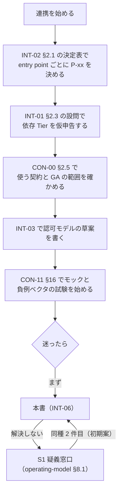
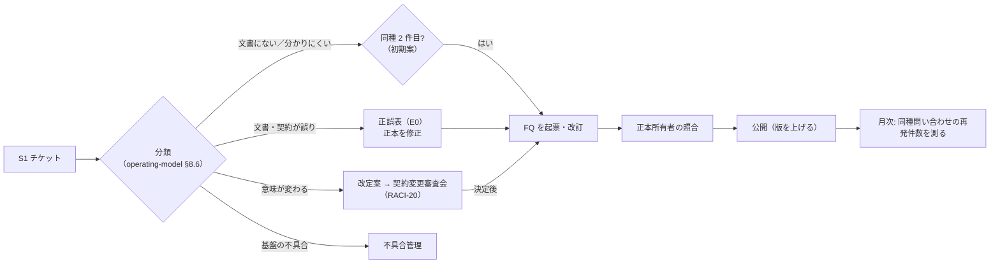

# 開発者 FAQ

> 文書ID: INT-06 / 版: 0.6（v1.2） / 状態: draft / 最終更新: 2026-10-15（0.6（v1.2）: AI による 2 回目の模擬連携検証（13_integration-trial/room-booking/report.md。実在の連携チームの検証ではない）を受け、FQ-82〜FQ-87 を加え、FQ-54・FQ-60・FQ-62・FQ-81 に新契約 CON-17・CON-18 を案内し、§6 に未決 5 行を加えた。新しい義務は作っていない（答えは CON-16・CON-11・CON-17・CON-18 の写し）。末尾「v1.2 改訂」。0.5（v1.1 の同期）: 他文書の v1.1 改訂が本書に宛てた申し送りを反映した。§1.3 の入口、FQ-04・FQ-43・FQ-44・FQ-79、§6 の写像の行。新しい義務は作っていない（FR-2）。末尾「v1.1 の同期」。0.4: v1.1 改訂。模擬連携検証 13_integration-trial/report.md の改善提案 I-5・I-6・I-12 を反映し、FQ-79（`action.name` と `subject.type` の書き方）、FQ-80（SDK なしの一覧の候補生成と NP09-4）、FQ-81（業務通知の送信経路）を追加し、FQ-57 を INT-02 §3.8 に合わせ、§6 に未決 3 行を加えた。他文書への申し送りは末尾「レビュー記録」の「v1.1 改訂」。0.3 追補（凍結前の同期。2026-10-15T10:35Z（UTC）、git HEAD 3228df6 の作業ツリー。本文の回答は変えていない）: 申し送り S10-1・S10-2 に宛先での反映状況を記した（TRC-11 申し送り 72、INT-02 §9.1）。0.3: 模擬パネル ラウンド 10 の devlead 指摘により、FQ-02 と §6 のライフサイクル事象の行を CON-13 版 0.2.0 以降に合わせた。始められないものを 3 つから 4 つにし、撤回事象の扱い・failure_reason・lcsig の正例の試験の時期を書いた。末尾「レビュー記録」ラウンド 10。同じ版 0.3 で、ラウンド 10 の別の devlead 指摘により、FQ-60 に ADR-017 D17-07 (a)〜(c)（実行単位のテナント主体ごとの分離、tool 側 PEP の `tid` 一致検査、共有実行単位の本番配備の禁止）を 1 行加えた（末尾「レビュー記録」ラウンド 10 R10-2）。0.2: PoC/R7反映。FQ-76〜FQ-78 を追加し、FQ-55 に PoC の観察を加えた。末尾「レビュー記録」の「PoC/R7反映」）
> 対応要求: R-138, G-128, G-145（R-requirements.md・G-goal-criteria.md で対応成果物欄に本書のパスまたは DL-68 を含む全行。閉じ方と状態は末尾の対応表）。関連: ADR-022 D-7-3（疑義窓口と FAQ）、ADR-016 D16-21（告知の主手段としての FAQ）、ADR-026 §6.4（非同期の FAQ 項目）、INT-01 §7.1（閲覧専用モードの推奨を本書へ委任）
> 依存文書: CONVENTIONS.md, traceability/deliverables.md（DL-68 行）, 05_adr/README.md, 05_adr/ADR-005・ADR-006・ADR-009・ADR-011・ADR-012・ADR-013・ADR-014・ADR-016・ADR-017・ADR-021・ADR-022・ADR-023・ADR-024・ADR-025・ADR-026・ADR-027・ADR-029, 05_adr/reconciliation-notes.md, 10_integration/integration-patterns.md（INT-02）, 10_integration/dependency-tiers.md（INT-01）, 10_integration/authz-modeling-guide.md（INT-03）, 11_contracts/README.md（CON-00）, 11_contracts/compatibility-deprecation-policy.md（CON-01）, 11_contracts/mock-contract-test-kit.md（CON-11）, 11_contracts/*.openapi.yaml・schemas/*.json, 04_architecture/token-profile.md（ARC-02）, workload-identity-delegation.md（ARC-04）, authorization-model.md（ARC-05）, pep-contract.md（ARC-06）, fail-mode-matrix.md（ARC-08）, revocation-continuous-evaluation.md（ARC-09）, audit-privacy.md（ARC-10）, data-outside-pep.md（ARC-11）, capacity-model.md（ARC-13）, claims-catalog.md（ARC-15）, 07_slo/numeric-contracts.md（DL-20）, 08_operations/operating-model.md（DL-27 §8）, 01_governance/assumptions-register.md, 01_governance/exception-risk-acceptance.md（GOV-07）, 01_governance/raci-governance.md（GOV-05）, 01_governance/kri.md, 02_requirements/operation-risk-tiers-assurance.md（REQ-03。操作 5 分類の正本）, research/RS-04, RS-06, RS-09, RS-10, RS-13, RS-16, RS-17（各 verification 記録を含む）, research/standards-status.md
> 作成方法: AI エージェント（Claude）が上記の文書を通読し、連携開発者から出ると想定される問いと、その答えを正本文書から写して起草した。本書は新しい設計判断をしない。問いの選定と答えの照合は自己レビューであり、実在の CTO/CISO・連携開発者の確認を経ていない（CONVENTIONS §8）[D]。

---

## 0. 結論（CTO/CISO・連携開発者向け）

1. **本書は 16 分野・87 問（FQ-01〜FQ-87。FQ-76〜FQ-78 は版 0.2 の PoC/R7反映、FQ-79〜FQ-81 は版 0.4 の v1.1 改訂（I-5・I-6・I-12）、FQ-82〜FQ-87 は版 0.6 の v1.2 改訂で追加）の問いと答えを置き、全回答に根拠文書へのリンクを付けた** [D]。G-128 が名指しする 6 分野（token、テナント context、キャッシュ、非同期、エラー時の挙動、ローカル開発とモック）に加え、権限追加、越境共有、検索、AI エージェント、レガシー、性能、障害時、例外申請、trace id と `txn` の違い、Tier を扱う（§3）[D]。G-128 の合格判定（作成者以外のレビュアーによる確認）は未実施である [D]。
2. **答えの大半は「してはならないこと」に集約できる。§2 の 15 項目を守れば、主要な事故類型（テナント越境、剥奪の未反映、token の流出、障害時の迂回）に対する連携側の義務の大半を満たす** [D]。15 項目は INT-02 の共通義務 IC-01〜IC-12、INT-01 の M-01〜M-10、ARC-15 の DEV-1〜DEV-9、ARC-06 §4.3 の 12 項目から重複を除いて抜き出した [D]。義務の正本はそれらの文書であり、本書の要約が食い違えば正本を優先する（§1.1）[D]。
3. **75 問のうち 28 問の答えは「値は未決」「契約は未作成」に依存する（§6）** [D]。token 寿命・PDP deadline・cache 最大齢などの数値は DL-20 で未決裁（TBD）、issuer の粒度は未決（ADR-007／ADR-021、U-01）、PoC 基盤（DL-82）は納品済みだが、契約試験キット本体（DL-120）は未実装（期限 G3）である。ライフサイクル事象の契約（G-137）は CON-12・CON-13 が draft で配置済みだが、キット本体（DL-120）が未実装で[^29]モック MK-08 を動かせず、LC-OI-1〜3、期限 T_* の値、独立レビューが残る [D]。本書はこれらについて「値をコードに直書きせず設定から読む」「安全側の暫定動作で実装する」という答えを返す（§6）[D]。決まった時点で該当回答を改訂する（§4 の改訂規則）[D]。
4. **FAQ は非規範文書とし、拘束力のある解釈は正誤表（CON-00 §5.2 の E0 経路）でだけ出す案を推奨する（決裁案 KD-FAQ-1）** [D]。約 20〜30 の組織 [A-052] が FAQ の文言を契約とみなして実装すると、FAQ の改訂が事実上の契約変更になり、契約変更審査会（RACI-20）を迂回するからである [D]。
5. **G-145 のうち本書が担うのは「問い合わせを FAQ・文書の改訂に戻す手順」の FAQ 側の受け口だけである（§4）** [D]。窓口の経路・重大度別目標・体制の導出は 08_operations/operating-model.md §8 が正本で、目標値は TBD、ライン長の確約とパイロットでの実測は未達である [D]。
6. **経営判断が要る点は 3 件である（§5）**。FAQ の規範性（KD-FAQ-1）、開示範囲（KD-FAQ-2）、所有と改訂の目標（KD-FAQ-3）であり、いずれも決裁前である [D]。

---

## 1. 本書の位置付けと読み方

### 1.1 正本の関係

| 事項 | 正本 | 本書の役割 |
|---|---|---|
| 設計判断 | 05_adr/（ADR-001〜ADR-029。すべて proposed） | 決定を答えに写す。未決は「未決（ADR-0xx）」と書く |
| 連携パターン・共通義務 IC-01〜IC-12 | [INT-02](integration-patterns.md) | 問いからパターンへの入口 |
| 依存 Tier・必須実装 M-01〜M-10・障害時の振舞い | [INT-01](dependency-tiers.md) | 障害時の問いに答える。閲覧専用モードの推奨（INT-01 §7.1 の委任）を FQ-36 に置く |
| 認可モデルの書き方・変更手順 | [INT-03](authz-modeling-guide.md) | 権限追加の問いに答える |
| 契約・着手手順・疑義経路 | [CON-00](../11_contracts/README.md)、[CON-01](../11_contracts/compatibility-deprecation-policy.md) | 依存してよい範囲と非推奨の問いに答える |
| モック・負例ベクタ・sandbox | [CON-11](../11_contracts/mock-contract-test-kit.md) | ローカル開発の問いに答える |
| 数値 | [DL-20](../07_slo/numeric-contracts.md) | SLI-ID だけを示し、値を置かない |
| 操作 5 分類（public／read-sensitive／write／privileged／break-glass） | [REQ-03](../02_requirements/operation-risk-tiers-assurance.md) | 再定義しない |
| 窓口・重大度・例外申請の受付 | [operating-model §8](../08_operations/operating-model.md) | 経路を案内する |

- 本書は非規範文書である [D]。本書の答えと正本が食い違う場合は正本を正とし、食い違いは §4 の手順で FAQ を直す [D]。拘束力のある解釈は正誤表で出す（KD-FAQ-1 の推奨案。決裁前）[D]。
- 連携ハンドブック総覧（DL-62、10_integration/README.md）、オンボーディング手順（DL-66）、Definition of Ready（DL-67）は、本書の作成時点（2026-10-15）でリポジトリに存在しない（並行作成中）[D]。本書はそれらへの参照を文書 ID で書き、作成後にリンクを補う（残課題 2）[D]。

### 1.2 表記

| 表記 | 意味 |
|---|---|
| FQ-nn | 本書の問いの ID。INT-01 の Tier 判定の設問 Q-01〜Q-09、INT-02 の決定表 Q1〜Q21 と区別するため接頭辞を変えた [D] |
| 根拠 | 答えの根拠文書と節。答えの文の末尾のタグ（[D] 等）は CONVENTIONS §3 に従う |
| 未決（ADR-0xx） | ADR で決まっていない点。暫定動作を併記する |
| TBD | 値が未決。所有者・期限・決め方は正本（主に DL-20）にある |
| SDK | PEP SDK と共通の検証器。SDK のない言語は契約適合の自前実装（ARC-06 要旨 1） |

### 1.3 読む順番

- v1.1 の同期（INT-00 申し送り（v1.1）V-3）: 読み始めは INT-00（10_integration/README.md）冒頭の「実装者向けの入口（1 枚）」である。下の図はその後の流れで、入口と食い違えば入口を正とする。汎用モックの起動は `11_contracts/kit/README.md` の手順による [D]。

- 上図は INT-02 §10.2、CON-00 §2.5、INT-01 §7.4、CON-11 §16.2 の手順を並べたものである [D]。

### 1.4 前提（A-ID）

| A-ID | 値（基準シナリオの仮置き） | 本書での使い方 |
|---|---|---|
| A-027 | access token 寿命 10 分（容量計算用。決定値ではない） | 試験での仮値に限る（FQ-07）[A-027] |
| A-028 | 1 session が寿命内に要求する下流 audience 数 6 | token exchange の量の目安（FQ-62）[A-028] |
| A-036 | 認可 graph の最大深度 8・最大 fanout 10 万 | モデルの深度宣言（FQ-63）[A-036] |
| A-015 | 複数テナント所属 3% | 1 token 1 テナントの問い（FQ-16）[A-015] |
| A-043 | token 発行 1,374/秒（うち token exchange 1,112/秒） | exchange の cache の問い（FQ-68）[A-043] |
| A-045 | Check 42,009/秒（中央推定） | 性能の問い（FQ-66）の規模感 [A-045] |
| A-050・A-052・A-053 | 依存サービス 300、25 組織・60 チーム、開発者 1,500 | 読み手の規模と問い合わせ量の前提 [A-050][A-052][A-053] |
| A-090 | 判定系の想定可用性帯 99.95〜99.99% | 依存予算の問い（FQ-41）[A-090] |
| A-110・A-112・A-113 | 現行の独自セッション 105・LDAP 直結 30・共有シークレットのみ 45、自前認可 240 サービス、静的資格情報 3,000 件 | レガシーと共有秘密の問い（FQ-12・FQ-64・FQ-65）[A-110][A-112][A-113] |

- 本書は新規仮定を置かない [D]。

---

## 2. してはならないこと 15 項目（早見表）

| # | してはならないこと | 代わりにすること | 根拠 |
|---|---|---|---|
| N-1 | 要求経路・起動時に AS・control plane を呼ぶ（introspection、userinfo、管理 API） | 内部 JWT を SDK でローカル検証。設定は署名付き配布物で受け取る | IC-05、M-01・M-02（[INT-01 §7.1](dependency-tiers.md)） |
| N-2 | 認可の allow を SDK の外で cache する。基盤不達時に正本ストア・独自 allow list へ迂回する | SDK の既定に任せ、判定不能は拒否側へ倒す | IC-06、M-03、ADR-006 D6-10 |
| N-3 | 受け取った token を下流へ素通しする | SDK の exchange で宛先ごとに取り直す | IC-04、ADR-009 D09-32 |
| N-4 | 未署名ヘッダ（`X-Tenant-ID`、`X-User` 等）を判定や業務ロジックの入力にする | テナントは token の `tid` と資源の正本から導く | OB-01、[ARC-06 §3.3](../04_architecture/pep-contract.md) |
| N-5 | 1 つの token で複数テナントを操作する | 作用中のテナントごとに token を取り直す | M-08、DEV-4 |
| N-6 | メッセージ・ジョブ引数に token・権限一覧・role を入れる | 不透明な参照（`job_run_id`、tid、起点 `sub`、`txn`、資源 ID）だけを入れる | ADR-026 D26-11 |
| N-7 | enqueue 時の判定で後から実行する | 実行直前に再 Check する | ADR-026 D26-02 |
| N-8 | 拒否・不存在・他テナントで異なる応答を返す、エラー文言で分岐する | 3 つを同一応答にし、理由コードで分岐しない | IC-09、OB-10 |
| N-9 | 独自の再試行ループ、503・`deny_unavailable` の即時再送 | SDK 既定の backoff と Retry-After | IC-10、M-06 |
| N-10 | access token・Txn-Token の全文や生の `jti` をログ・trace・エラーに出す | 相関 8 欄（`jti_ref` 等）だけを残す | DEV-6、[ARC-15 §3.8](../04_architecture/claims-catalog.md) |
| N-11 | traceparent・tracestate・baggage に主体・テナント・資源の識別子を載せる。`trace_id` を認可に使う | `decision_id` 以外の監査由来の値を span に載せない | IC-07、DEV-7 |
| N-12 | issuer・JWKS URL・endpoint・数値をコードに直書きする | discovery と環境変数（CON-11 §11.4）から読む | CON-00 §2.5 手順 6、ADR-022 D-3-2 |
| N-13 | 新規の client・workload 間認証に共有秘密（client_secret、静的 API key）を使う | private_key_jwt、mTLS、workload identity | IC-12、ADR-009 D09-18 |
| N-14 | 自サービスの復旧経路（配備、rollback、当番招集）に本基盤の login を含める | workforce IdP への直接 federation かクラウドの local 認証 | IC-11、M-10、NX-13 |
| N-15 | 製品固有のヘッダ・claim、preview の要素に理由を記録せず依存する | GA の要素だけに依存し、preview は理由を申告する | CON-00 §2.5 手順 2、ADR-022 D-3-2 |

- 上表は要約であり、合否は各正本の検査（静的規則 SR-xx、負例ベクタ CV-xxx、TC）で判定する [D]（[ARC-06 §4.3](../04_architecture/pep-contract.md)、[CON-11 §6.2](../11_contracts/mock-contract-test-kit.md)）。

---

## 3. 問いと答え

### 3.1 はじめに

#### FQ-01 何から読めばよいか
- [INT-02 §2.1](integration-patterns.md) の決定表で entry point ごとの主パターン（P-xx）を決め、[INT-01 §2.3](dependency-tiers.md) で Tier を仮申告し、[CON-00 §2.5](../11_contracts/README.md) で使う契約を確かめる順に読む [D]。モデルは [INT-03](authz-modeling-guide.md)、試験は [CON-11 §16](../11_contracts/mock-contract-test-kit.md) に進む（§1.3 の図）[D]。
- 根拠: INT-02 §10.2、CON-00 §2.5、INT-01 §7.4

#### FQ-02 基盤の完成を待たずに何を始められるか
- 主パターンの選定、entry point 台帳への記載、token 検証・PEP 呼出し・exchange・監査送出の実装、拒否と不存在の応答の同一化、fail-closed の分岐、負例の単体試験は今日から始められる [D]。
- 始められないのは次の 4 つである [D]（INT-00 §0 の 3 と同じ）。(1) 自チームの CI で合否を出す契約試験（DL-82（PoC 基盤）は納品済みだが、キット本体 DL-120 が未実装、期限 G3）、(2) Webhook の署名（KD64-1 の決裁待ち）、(3) 保管庫を使う outbound 連携（KD64-2 の決裁待ち）、(4) ライフサイクル事象の署名検証（CON-12 RO-11）の正例の試験（CON-13 の正例の `lcsig` はダミーで検証を通らない。キットの試験鍵と鍵マニフェストの配布（DL-120、G3）以降）[D][^30][^31]。
- ライフサイクル事象の受信は条件付きで始められる。CON-12・CON-13（draft）に対して受信処理（(source, id) による重複除去、順序番号による欠番検知、未知の type の受理と無視、撤回事象の処理、完了報告）の実装と単体試験を書ける。封筒・type 名・冪等と順序は GA、個別 data は preview である。配送の保証に依存する結合試験はモックの提供後になる [D]（CON-00 §2.5）。
  - **CON-13 の版の注意（ラウンド 10。INT-00 §6.1 の「CON-13 の版の注意（ラウンド 9）」と同じ内容）** [D]。試験データは CON-13 版 0.2.0 以降（2026-10-15 時点の現行は 0.2.1）を使い、版 0.1.1 の examples では受信処理を始めない。版 0.2.0 は封筒の必須属性に `lcsig` を加え、撤回事象と完了報告の failure_reason を加えた非互換な改版で、版 0.1.1 には `lcsig`（CON-12 PO-13）も撤回事象もない。版 0.1.1 に合わせた処理は署名のない事象を正常として処理し得る。RO-11（署名の検証）・RO-13（削除の猶予と撤回）は CON-12 を正とする（CON-13 x-handoffs R8-H4）[D][^30]。
  - tenant.deletion.withdrawn・user.deletion.withdrawn は版 0.2.0 で既知の type になった。「未知の type として受理し無視する」扱いにしてはならない。猶予中は可逆な準備（処理の停止、削除予定の印）だけを行い、撤回事象を受けたら準備を戻して DeletionReport を outcome=withdrawn で報告する（CON-12 RO-13）[D][^31]。撤回事象を読み捨てると、撤回されたテナント・利用者のデータを猶予の満了後に削除し得る。これは取り返しがつかない [D]。猶予の満了時は撤回事象の受信の有無にかかわらず正本照会（RO-12）で実行の可否を決める [D][^31]。
  - outcome=failed で報告するときは failure_reason が必須である。既知の値は source_of_truth_mismatch（正本不一致）・state_query_unavailable（照会不能）・processing_error（受信側の処理失敗）・other で、開いた列挙である（CON-13 `$defs/DeletionReport`、CON-12 RO-8・RO-12）[D][^30][^31]。
  - 署名検証の正例の試験までに書けるのは、`lcsig` の負例（LC-NE-08・09・11）を拒否する試験と、自チームで作った鍵で署名した事象による検証論理の単体試験である。鍵マニフェストの形式は未決（ADR-007、CON-11 L11-11）なので、その部分は差し替えられるように作る [D]（INT-00 §6.1、CON-11 §16.3）[^30]。
- client 登録は契約（client-registration.openapi.yaml、preview）がある。sandbox はセルフ登録、本番は承認付きの申請 API である [D]（CON-00 §3）。
- DEC-8 までは契約の版が 0.x で、変更期間は約束されない [D]。SemVer 2.0.0 は major 0 の間はいつ何が変わってもよいとする [N][^17]（RS-16#31）。契約ファイルの git コミットを固定し、DEC-8 後に DL-80 の判定で適合を確かめ直す [D]。
- 根拠: [INT-02 §10](integration-patterns.md)、[CON-00 §2.5](../11_contracts/README.md)、[CON-11 §16](../11_contracts/mock-contract-test-kit.md)

#### FQ-03 契約のどの要素に依存してよいか
- `x-freeze-class` が GA の要素だけに依存する [D]。preview の要素（`searchResources`、`requestTxnToken`、モデル管理 API）を使う場合は、使う要素と理由を Definition of Ready（DL-67）の申告に書く [D]。
- 製品固有のヘッダ・claim、client による access token の中身の解析、JWKS URL の直書き、AS・PDP・ストアへの直接接続、エラー文言の文字列一致は禁止である（ADR-022 D-3-2）[D]。
- 根拠: [CON-00 §2.5 手順 2・7](../11_contracts/README.md)、05_adr/ADR-022 D-3-2

#### FQ-04 SDK を使わないといけないか
- 使わなくてもよい [D]。PEP の適合は「SDK を入れたか」ではなく「契約上の記録（decision_id 付きの E2）を出し、負例ベクタに合格したか」で判定する（ADR-022 D-4-3、G-140）[D]。
- SDK のない言語は ARC-06 §4.2 の 11 関数と同じ外形を自前実装し、台帳に登録する [D]。連携チームが開くのは抜粋の `11_contracts/integration-essentials.md`（CON-16）で、11 関数は §2.3、token 検証の V1〜V14 は §1.3、core 型は §3 にある（v1.1 の同期。CON-16 IE-2）[D]。ADR-011 D5-4（SDK を通してだけ PDP を呼ぶ）の文言との関係は未決（ADR-011／ADR-012 L-01）であり、ARC-06 は「SDK または契約適合の自前実装」と読む [D]。
- SDK の提供言語と時期は未定である（ADR-022 NA-022-1、DL-62）[D]。
- 根拠: [ARC-06 要旨 1・§4.1・§4.2](../04_architecture/pep-contract.md)、05_adr/ADR-022 D-4-3

### 3.2 token

#### FQ-05 自サービスが受け取る token はどれか
- 業務 API（resource server）が受け取るのは内部 access token（JWT、`typ=at+jwt`、宛先は呼出し先 1 サービス）だけである [D]。外部 access token は opaque で edge だけが検証し、ID Token・refresh token・logout token を業務 API で受けると拒否される [D]。
- RFC 9068 は access token の JWT に `at+jwt` の typ 宣言を求め、RS は他の typ を拒否しなければならない（MUST）[N][^10]（RS-04#60）。
- 根拠: [ARC-02 §3.1・§4.3](../04_architecture/token-profile.md)、05_adr/ADR-005 D1-1・D1-4

#### FQ-06 JWT を自前のライブラリで検証してよいか
- 原則として SDK・sidecar に任せ、SDK が拒否した要求を業務コードで救済しない（DEV-1）[D]。自前実装をする場合は、ARC-02 §10 のライブラリ要件 LR-01〜LR-12 を満たし、必須負例ベクタ（NV-01〜NV-58、CON-11 の CV-001〜CV-014）を全件拒否する必要がある [D]。
- 根拠: [ARC-15 §3.8 DEV-1](../04_architecture/claims-catalog.md)、[ARC-02 §10](../04_architecture/token-profile.md)、[CON-11 §6.2](../11_contracts/mock-contract-test-kit.md)

#### FQ-07 token の寿命は何分か。いつ更新すればよいか
- 一律の値はない [D]。寿命は操作階層ごとの 3 つの profile（LP-1 privileged・FAPI、LP-2 write、LP-3 read-sensitive）で、値はすべて TBD（所有者 CTO＋CISO、期限 G4、DL-20 で決裁）である [D]。
- コードは寿命を仮定せず `exp` に従う [D]。試験の仮値には A-027 の 10 分を使ってよいが、決定値ではない [A-027]。
- Tier 1 は寿命の後半に jitter 付きで先行更新する（M1-3）[D]。障害時に寿命を延ばしてはならない（ADR-005 D3）[D]。
- 根拠: [ARC-02 §5.2](../04_architecture/token-profile.md)、[INT-01 §7.2 M1-3](dependency-tiers.md)

#### FQ-08 業務コードで読んでよい claim はどれか
- SDK が渡す `sub`・`tid`・主体種別・`act`（現在の actor）・`client_id`・`scope` だけである [D]。claim の値から独自に許可・拒否を組み立てず、認可は PDP の判定で決める [D]。
- `sub`・`tid` は 64 文字以下の不透明な文字列として大文字小文字を区別して比較し、解析しない [D]。email・電話番号・UPN を照合キーにしない（ADR-021 D21-09・D21-10）[D]。
- 目録にない claim は無視し、予約名（`authorization_details` 等）が発行されることを前提にしない（DEV-8）[D]。
- 根拠: [ARC-15 §3.8 DEV-2・DEV-3・DEV-8](../04_architecture/claims-catalog.md)

#### FQ-09 下流サービスを呼ぶとき、受け取った token を転送してよいか
- 転送してはならない [D]。SDK の exchange（RFC 8693 の社内 profile、CON-05）で宛先ごとに token を取り直す [D]。scope・寿命・テナントは広げられず、縮小だけができる（ADR-009 D09-11〜D09-16）[D]。
- RFC 8693 は、ある token を別の宛先・別の文脈の token と交換する手順を定める [N][^1]（RS-17#25）。
- 交換済み token は SDK 内で (sub, aud, act, scope, tid) をキーに `exp` まで cache してよいが、寿命は延ばさない [D]。
- 根拠: [INT-02 §3.1 IC-04・§3.4・P-03](integration-patterns.md)、[ARC-04 §4〜§5](../04_architecture/workload-identity-delegation.md)

#### FQ-10 issuer や JWKS の URL はどこから得るか
- discovery を経由して得て、discovery URL は環境変数（暫定名 `AUTH_OIDC_DISCOVERY_URL`）で渡す [D]。JWKS URL の直書きは禁止である（ADR-022 D-3-2）[D]。
- issuer の粒度（テナント別か信頼区画別か）は未決（ADR-007 KD7-1／ADR-021 K21-1、U-01）である [D]。issuer が複数になる前提で、allowlist の配布物から issuer を受け取る実装にする [D]。
- 根拠: [CON-11 §11.4](../11_contracts/mock-contract-test-kit.md)、[INT-02 §9](integration-patterns.md)、05_adr/reconciliation-notes.md（U-01）

#### FQ-11 SPA でブラウザに access token を持たせてよいか
- 第一者の SPA では禁止である（禁止 D-1、ADR-005 D6-2）[D]。BFF 経由（P-01）にし、ブラウザには session cookie だけを持たせる [D]。
- RFC 10017 は業務・個人データを扱うアプリに BFF を "strongly recommended" とし、ブラウザ内 client を "not recommended" とする（いずれも小文字表記で BCP 14 のキーワードではない）[N][^6]（RS-17#4）。禁止は自社規範である [D]。
- ネイティブアプリ・CLI は OS ブラウザ＋PKCE で、WebView での認可要求は RFC 8252 の MUST NOT に当たる [N][^28]（RS-17#6）。
- 根拠: [INT-02 §2.2・P-01・P-02](integration-patterns.md)

#### FQ-12 新しい連携で client_secret や静的 API key を使ってよいか
- 新規では使わない [D]。外部 client は private_key_jwt か mTLS、内部のサービス間は workload identity（SPIFFE ID と X.509-SVID の mTLS）を使う（ADR-009 D09-18〜D09-20）[D]。既存の共有秘密は期限付きの例外として例外台帳に登録する [D]。現行の静的資格情報は約 3,000 件、うち rotation 記録なし 50% と仮置きされている [A-113]。
- 根拠: [INT-02 IC-12・P-22](integration-patterns.md)、[INT-01 §7.1 M-04](dependency-tiers.md)

#### FQ-13 token をログに出してよいか。調査で token を特定するには
- access token・Txn-Token の全文、生の `jti` はログ・trace・エラーメッセージに出さない [D]。Transaction Tokens 草案もログへの記録を MUST NOT としている [N][^2]（RS-06#41）。
- 調査には相関 8 欄（`iss`・`jti_ref`・`sid`・grant 参照・`txn`・`decision_id`・`request_id`・`trace_id`）を使う [D]。`jti_ref` は鍵付き HMAC で、発行台帳と同じ関数で結合する（ADR-014 D14-21）[D]。
- 根拠: [ARC-15 §2.1・§3.8 DEV-6](../04_architecture/claims-catalog.md)、[INT-02 §3.2](integration-patterns.md)

### 3.3 テナント context

#### FQ-14 操作対象のテナントはどこから取るか
- 3 つの値の完全一致で確かめる [D]。(i) 検証済み token の `tid`、(ii) edge が収容を確かめた route テナント、(iii) 資源の正本ストアに記録された所有テナント（resource-derived tenant）であり、1 つでも一致しなければ拒否される（ADR-024 D24-07・D24-08）[D]。
- 依存サービスが実装するのは (iii) を返す `resolver`（資源の正本から所有テナントを返す関数。業務クエリと同一トランザクション）である [D]。資源 ID の文字列や要求パラメータからテナントを推測しない [D]。
- 三者の 3 つ目を route テナントとするか PDP 要求の `resource.properties` とするかの定義の正は未決（ADR-012／ADR-024、XR-07）であり、ARC-06 §3.3 は両方を検査する [D]。
- 根拠: [ARC-06 §3.3・§4.3 #4](../04_architecture/pep-contract.md)、[INT-02 IC-03](integration-patterns.md)

#### FQ-15 `X-Tenant-ID` ヘッダや path のテナントを信じてよいか
- 信じてはならない [D]。未署名ヘッダ・path の生値・要求本文はテナントの出所にならない（OB-01）[D]。route テナントは edge が署名付きで渡す場合だけ PEP が照合に使う [D]。
- 根拠: [ARC-06 §3.3 の定義表](../04_architecture/pep-contract.md)

#### FQ-16 複数テナントに所属する利用者はどう扱うか
- 1 token は 1 テナントであり、利用者がテナントを切り替えたら token を取り直す（ADR-005 V9）[D]。複数テナント所属は利用者の 3% と仮置きされている [A-015]。
- 根拠: [INT-01 §7.1 M-08](dependency-tiers.md)、[ARC-15 §3.8 DEV-4](../04_architecture/claims-catalog.md)

#### FQ-17 DB のテナント分離はどう実装するか
- PostgreSQL ではテナント表を ENABLE＋FORCE RLS にし、migration 用 owner とアプリ実行ロール（非 owner・NOBYPASSRLS）を分け、view を `security_invoker=true` にし、テナント文脈は `tenant_scope`（`SET LOCAL`）だけで設定する [D]。PostgreSQL 以外は ARC-06 §7.4 の評価を例外台帳に出す [D]。
- ストレージ側の guardrail はテナント境界だけを担う二層目であり、PEP の代わりにはならない [D]。
- 根拠: [ARC-06 §4.3 #9・§7](../04_architecture/pep-contract.md)

#### FQ-18 他テナントの資源・存在しない資源には何を返すか
- 権限のない資源・他テナントの資源・存在しない資源を同じ応答（状態コード・本文・ヘッダを同一）にする [D]。既定は 404 が推奨案だが決裁前（ARC-06 K06-4）のため、設定で切り替えられるように実装する [D]。
- 応答時間の差がないことは TC-06-05 で測るまで主張しない [D]。
- 根拠: [ARC-06 §3.10](../04_architecture/pep-contract.md)、[INT-02 IC-09](integration-patterns.md)

### 3.4 キャッシュ

#### FQ-19 認可判定の結果をキャッシュしてよいか
- SDK・契約適合実装の外では不可である（ADR-006 D6-10）[D]。SDK 内でも read-sensitive だけが対象で、known-good の最大齢 B_rs は未決（ADR-013 KD13-6）のため、決裁までは無効で出荷する [D]。write・privileged・break-glass は判定を cache しない [D]。
- 根拠: [ARC-06 §3.9](../04_architecture/pep-contract.md)、[INT-02 §3.4](integration-patterns.md)

#### FQ-20 業務データをキャッシュしてよいか
- よい [D]。ただしキーに区画キー（テナント）を必須にし、応答が主体・権限に依存する場合は主体または判定範囲もキーに含める [D]。キーは基盤の共通ライブラリで生成し、業務キャッシュを allow の代用にしない（ADR-012 D12-27）[D]。
- 共有キャッシュ（Redis 等）の ACL はサービス単位の境界でテナント単位ではないため、テナント間の分離はキー規約に依存する（残余リスク RR12-05）[D]。
- 根拠: [ARC-06 §3.9](../04_architecture/pep-contract.md)

#### FQ-21 HTTP・CDN のキャッシュはどうするか
- read-sensitive 以上の応答は、キャッシュキーにテナントと主体を含められる構成だけで共有キャッシュに載せる [D]。含められなければ `Cache-Control: private` か `no-store` にする [D]。
- 根拠: [ARC-06 §3.9](../04_architecture/pep-contract.md)

#### FQ-22 JWKS の取得に失敗したらどうなるか
- SDK は前回の値（last known good）を J_max まで使い続け、J_max/2 で警報を出し、J_max を超えたら read-sensitive 以上を拒否する [D]。J_max は TBD（SLI-026、所有者 CTO＋SRE 責任者、期限 G4）である [D]。
- AWS Well-Architected は、静的安定な設計では取得に失敗したら前回の cache 値を使い警報を出すとしている [V][^13]（RS-09#15）。
- 根拠: [INT-01 §7.1 M-05](dependency-tiers.md)、[INT-02 §3.5](integration-patterns.md)

### 3.5 非同期処理

#### FQ-23 非同期処理で token をどう扱うか
- メッセージに token を入れない [D]。consumer は実行時にジョブ基盤 SDK（`consume()`）を通じて TTS の内部開始フローで Txn-Token を得て、元の主体の権限で再 Check する（ADR-026、ADR-009 §2.10）[D]。
- ASVS 5.0.0 の 8.3.3（L3）は、中間サービスではなく発端の主体の権限で判定することを求める [N][^5]（RS-17#34）。
- 根拠: [INT-02 P-04](integration-patterns.md)、[ARC-06 §3.11](../04_architecture/pep-contract.md)、05_adr/ADR-026 §6.4

#### FQ-24 メッセージに何を入れてよいか
- 認可に関わる値は不透明な参照だけにする。`job_run_id`、tid、起点主体の `sub`、起点の `txn`、資源 ID である（ADR-026 D26-11）[D]。token・権限一覧・role は入れない [D]。
- CloudEvents 1.0.2 は context attributes に機微情報を載せるべきでない（SHOULD NOT）とする [N][^4]（RS-17#32）。
- メッセージの `tid` は受付記録を引く参照であり、実行時の DB 文脈は Txn-Token の `tctx` の tid から設定する [D]。両者と resource-derived tenant が一致しなければ拒否する [D]。
- 根拠: [ARC-06 §3.11](../04_architecture/pep-contract.md)、05_adr/ADR-026 D26-03a・D26-11

#### FQ-25 enqueue 時に認可したので、実行時の判定は省いてよいか
- 省いてはならない [D]。受付時の判定は「受け付けてよいか」の判定で、実行の根拠にしない（ADR-026 D26-02）[D]。滞留中に剥奪された主体のメッセージは、実行時の再 Check で拒否される（負例 NP04-1）[D]。
- 再 Check の整合性は、read-sensitive が max(受付時の整合性トークン, 剥奪フェンス)（フェンス有効化までは最新を強制）、write 以上が最新である [D]。
- 根拠: [ARC-06 §3.11](../04_architecture/pep-contract.md)、[INT-02 §2.3 規則 5・P-04](integration-patterns.md)

#### FQ-26 再 Check で拒否されたメッセージはどう扱うか
- デッドレターへ送り、監査（E2）に記録し、業務側へ通知する [D]。黙って捨てず、黙って再試行もしない（ADR-012 D12-34、ADR-026 D26-10）[D]。処理は (source, id) で冪等にする（ADR-028 D28-59）[D]。
- 根拠: [INT-02 P-04 チェックリスト](integration-patterns.md)、[ARC-06 §3.11](../04_architecture/pep-contract.md)

#### FQ-27 定期ジョブ・長時間ジョブは誰の権限で動かすか
- ジョブ用の非人間 ID（PC-14）で実行し、利用者の名で処理する場合は型 A2 として委任 grant を台帳に持ち、実行のたびに利用者の状態を確かめる [D]。ジョブに利用者の `offline_access` refresh token を持たせる形は禁止である [D]。
- Databricks はジョブの Run as を service principal に変えるよう推奨し、所有者が去ってもジョブが壊れないことを理由に挙げている [V][^22]（RS-17#27）。
- 所有者退職時の既定は未決（principal-catalog 決裁案 3・4、ADR-026 K26-1）である [D]。+FIN・+XT の委任ジョブ実行も未決（ADR-026 K26-4）で、既定では実行しない [D]。
- 根拠: [INT-02 P-05](integration-patterns.md)、[ARC-04 §7](../04_architecture/workload-identity-delegation.md)

#### FQ-28 PDP や TTS が止まっている間、ジョブはどうなるか
- write 以上は実行せず backoff で待つ（ADR-026 D26-09）[D]。業務側でバックログが溜まることは ADR-026 の残余リスク RR26-04 として事業責任者が受容する案である [D]。
- 根拠: 05_adr/ADR-026 §6.2・§6.3、[ARC-06 §3.11](../04_architecture/pep-contract.md)

#### FQ-81 承認依頼などの業務通知（メール・アプリ内通知）はどこから送るか（版 0.4、v1.1（I-12））
- 本基盤は業務通知の送信 API・契約を提供しない [D]。AS の招待・回復の機能（INT-02 P-19）は依存サービスから呼べない [D]。送信の手段は自サービスか社内の通知基盤（本基盤の範囲外）が持つ [D]。
- 経路は P-24（発行）と P-04（送信を担う consumer）の重ね掛けである [D]。業務の更新と同じトランザクションの outbox に、参照だけの通知事象（tid、通知の種別、資源 ID、宛先の `sub`、起点の `txn`）を書く [D]。連絡先・token・本文は入れない [D]。
- consumer は送信の直前に、起点主体の権限で起点の操作を再 Check し（P-04）、業務状態・テナント・宛先の状態を確かめる [D]。拒否・判定不能・テナント停止・宛先の削除なら送らない [D]。
- 本文は最小にし（種別・参照番号・通常の画面 URL）、業務の中身は宛先が login してから PEP の判定を経て見せる [D]。URL に token を入れず、URL だけで session を作らない（禁止 D-3）[D]。
- `sub` から連絡先を引く契約はまだない（未決。§6）[D]。決まるまでは、アプリ内通知を既定にし、自サービスが本人から正当に得た連絡先がある場合に限ってメール・SMS を使う [D]。
- v1.2（room-booking M-5）: 外部ゲストへの業務通知はアプリ内通知に限る。CON-17 は招待の通知だけを基盤が送り、ゲストの連絡先を返さない（CON-17 XGS-11・XG-L6）[D]。
- 根拠: [INT-02 §3.9（BN-1〜BN-9、NP24-4〜NP24-7）・P-19・P-24・P-04](integration-patterns.md)、05_adr/ADR-026 D26-02・D26-11

#### FQ-82 数日後のリマインドのような遅延実行は、A1〜A4 のどれで作るか（版 0.6、v1.2）
- 利用者の 1 回の要求（例: 予約の作成）に伴って後で 1 回だけ実行する処理は A1 として作り、受付記録を要求の処理中に、起点の Txn-Token を添えて CON-05 の `registerAcceptanceRecord` で登録する [D]（CON-16 §2.10 v1.2）。
- 受付記録の有効期限は CON-05 で TBD である。実行時刻が期限を超えると内部開始の Txn-Token が発行されず実行されないので、デッドレターと監査に残す（黙って捨てない）[D]。定期の実行や、期限を超えることが確実な遅延実行は A2（委任 grant）だが、A2 の grant を作る契約がまだないので実装せず S1 に出す [D]。
- 受付台帳が 503 のときは受付記録のないジョブを投入しない。業務も確定させず 503 にするか、業務だけを確定させてリマインドが未登録であることを見える形で残すかを選び、manifest の `options.acceptance_atomic` で申告する（CV-060c）[D]。
- 実行時の再 Check の `subject.type` は、受付時に検証済み token の `ptype` から求めて保存した値を使い、メッセージの値を使わない（CV-060d）[D]。
- 汎用モックで内部開始の正例を通すには echo proxy 0.3.0 の R9・R10 を挟む（`11_contracts/kit/README.md` §2.5）[D]。
- 根拠: [CON-16 §2.10](../11_contracts/integration-essentials.md)、05_adr/ADR-026 D26-01・D26-02、[CON-05](../11_contracts/token-exchange.openapi.yaml)

### 3.6 エラー時の挙動

#### FQ-29 401・403・404・503 はどう使い分けるか

| 状況 | 応答 |
|---|---|
| token が無い・無効・失効 | 401。原因の細目は返さない |
| 認証強度の不足 | 401 と step-up の指示（`insufficient_user_authentication`、`acr_values`・`max_age`） |
| 機能単位の拒否（資源の存在を示さない場合） | 403 |
| 資源単位の拒否、テナント不一致、他テナント、不存在 | 同じ応答（既定 404 案、K06-4 で決裁前） |
| write 以上で判定が得られない | 503（Retry-After 付き） |
| 一覧で post-check ができない | 空の一覧ではなく「利用不可」 |

- RFC 9470 は、RS が `insufficient_user_authentication` と auth-param で追加認証を求められると定める [N][^11]（RS-04#72）。
- 根拠: [ARC-06 §3.10](../04_architecture/pep-contract.md)

#### FQ-30 PDP の応答 `deny_unavailable` と通常の deny はどう違うか
- 通常の deny（`deny_no_relation`・`deny_guardrail:<規則ID>`）は「権限がない」で、再試行しない [D]。`deny_unavailable` は「基盤側の障害で判定が得られない」で、Tier ごとの振舞い（FQ-35）に移り、UI・ログで通常の deny と区別する [D]。
- `deny_indeterminate`（属性・`tid` の欠落など）と `unsupported_profile` は deny として扱い、自サービスの要求の組立てや SDK の版を直す [D]。いずれも許可に変えてはならない [D]。`reason` はエンドユーザーに返さない（ADR-011 D6-1）[D]。
- 根拠: [INT-01 §5.2](dependency-tiers.md)、[CON-03](../11_contracts/authorization-api.openapi.yaml)

#### FQ-31 429 や 503 を受けたら、どう再試行するか
- SDK 既定の再試行（ランダム化した指数 backoff、要求単位の回数上限、deadline の伝播）だけを使い、Retry-After があればそれより早く再送しない [D]。独自の再試行ループを重ねない [D]。
- Google SRE は、再試行にランダム化した指数 backoff を使うよう述べている [V][^12]（RS-09#38）。
- 429 は他テナント・他 client の名義で再送してはならない [D]。retry 予算と circuit breaker の既定値は TBD（SLI-044）である [D]。
- 根拠: [INT-01 §5.2・§7.1 M-06](dependency-tiers.md)

#### FQ-32 PDP に届かないとき、fail-open にできるか
- できない [D]。認可判定の fail-open はどの Tier でも禁止である（ADR-013 D13-23）[D]。Google の『Building Secure and Reliable Systems』は、fail open は DoS だけで安全性を下げる手段を攻撃者に与えるとしている [V][^24]（RS-09#20）。
- 自サービスで fail-mode・timeout・再試行回数を上書きしてはならず、SDK の配布設定に任せる [D]。
- 根拠: [ARC-08 §3.6](../04_architecture/fail-mode-matrix.md)、[INT-01 §0 結論 1](dependency-tiers.md)

#### FQ-33 「判定が得られない」場合の UI 文言はどうするか
- 「権限がありません」と「一時的に利用できません」を分ける [D]。後者は再試行可能であることを示し、Retry-After があれば待ち時間を示す [D]。deny を「障害」と表示しない（M-09）[D]。文言は自サービスで決めてよいが、理由コードの文字列一致で分岐しない [D]。
- 根拠: [INT-01 §7.1 M-09](dependency-tiers.md)、[ARC-08 §3.6 #4](../04_architecture/fail-mode-matrix.md)

### 3.7 障害時

#### FQ-34 AS（認証サーバー）が止まったら、自サービスはどうなるか
- 発行済み token の寿命内は業務を継続でき、新規 login・refresh はできない [D]。Tier 1 は新規 login 不可を利用者に表示し、M2M は先行更新済みの token で継続する [D]。Tier 3 は新規 token が要る処理を一時停止する [D]。
- Cloudflare の 2025-11-18 の障害では、新規の Access 認証は失敗したが既存の Access session は影響を受けなかった [I][^14]（RS-09#73）。本基盤の F1 の設計はこれと同じ形である [D]。
- 根拠: [INT-01 §5.1 F1](dependency-tiers.md)、[ARC-08 FM-06](../04_architecture/fail-mode-matrix.md)

#### FQ-35 PDP が止まったら、Tier ごとに何をするか

| Tier | 振舞い |
|---|---|
| Tier 1 | 閲覧専用モードへ切替。write は受付キューで受け、実行時に fresh な判定で再認可。privileged は待つ |
| Tier 2 | 再試行可能なエラーとして表示し、Retry-After があれば示す |
| Tier 3 | 一時停止 |

- read-sensitive の known-good は KD13-6 の決裁まで使わない [D]。
- 根拠: [INT-01 §5.1 F2](dependency-tiers.md)、[ARC-08 §5〜§6](../04_architecture/fail-mode-matrix.md)

#### FQ-36 閲覧専用モードはどう作ればよいか（INT-01 §7.1 から委任された推奨）
本問の内容は推奨であり、義務は INT-01 の M1-1・M1-2 だけである [D]。

| # | 推奨 | 理由 |
|---|---|---|
| RO-1 | 切替の契機は SDK が返す「判定が得られない」（`deny_unavailable`、503、facade 不達）に限り、通常の deny では切り替えない | 権限の剥奪を障害と取り違えないため（M-09）[D] |
| RO-2 | 画面の上部に「一時的に閲覧のみ」を表示し、変更操作のボタンを無効化する。無効化は表示の工夫であり、サーバー側の拒否を省かない | 表示だけでは統制にならない（IC-02）[D] |
| RO-3 | 閲覧も PEP の判定を通す。read-sensitive は判定が得られなければ 503 であり、known-good は KD13-6 の決裁まで使わない | 閲覧専用モードは「判定を省くモード」ではない（ADR-013 D13-23）[D] |
| RO-4 | 続けたい write は受付キューに入れ、利用者に「受付済み・未実行」と示す。実行時に fresh な判定で再認可し、拒否されたら利用者に通知する | M1-2、ADR-026 D26-02 [D] |
| RO-5 | 復帰は SDK の判定が戻った時点で自動にし、全利用者の画面を一斉に再読込させない | 復旧時の一斉再接続を避ける（INT-01 §5.1 の復旧時の行）[D] |
| RO-6 | 切替・復帰の時刻と、閲覧専用中に受け付けた件数をログに残し、SLI-068 の突合に使う | INT-01 §5.2 の計上 [D] |
| RO-7 | 四半期の障害注入（M1-5）で切替を試験する | TC-23-10 [D] |

- 根拠: [INT-01 §5.1・§7.1・§7.2](dependency-tiers.md)

#### FQ-37 監査の送信先が止まったら、処理を続けてよいか
- 監査 SDK のローカル spool に溜めて続ける [D]。spool の上限（Q_r・Q_w、SLI-076、TBD）を超えたら read-sensitive・write を拒否する [D]。privileged は同期記録できなければ拒否する [D]。監査記録を捨てて処理を続けてはならない [D]。
- spool の容量を実行環境に確保するのは依存サービスの義務である（M-09）[D]。
- 根拠: [INT-02 §3.3](integration-patterns.md)、[ARC-08 §3.3](../04_architecture/fail-mode-matrix.md)

#### FQ-38 基盤起因の本番障害が疑われるとき、どこへ連絡するか
- S3 本番障害の 24/365 経路（R1 が受ける。帯域外の招集手段）へ連絡する [D]。S1 チケット窓口は営業時間で、Sev1 と判定されれば S3 へ回される [D]。重大度別の初回応答・解決の目標は TBD である [D]。
- 根拠: [operating-model §8.1・§8.2](../08_operations/operating-model.md)

#### FQ-39 自サービスの復旧手順に本基盤の login を使ってよいか
- 使ってはならない [D]。配備・rollback・クラウド管理コンソール・当番招集の login は、workforce IdP への直接 federation かクラウドの local 認証で構成する（M-10、NX-13）[D]。本基盤の完成を待たずに整備できる [D]。
- 根拠: [INT-01 §6.1・§7.1 M-10](dependency-tiers.md)

#### FQ-40 本基盤に依存してはならないものは何か
- 復旧ツール、break-glass/P、障害時の連絡手段など 16 項目（NX-01〜NX-16）であり、全項目に代替手段がある [D]。共通の認証基盤の障害で status page や顧客連絡手段まで使えなくなった当事者報告が複数ある [I][^25]（RS-09#56）。
- 根拠: [INT-01 §6](dependency-tiers.md)

#### FQ-41 自サービスの可用性目標はどこまで約束できるか
- 基盤の判定系を全操作の重要依存とするサービスは、判定系 99.95% なら約 99.5%、99.99% なら約 99.9% を超えて約束しにくい [D][A-090]（NA-023-5 の配分と、重要依存は自サービスより 9 が 1 つ多いという Google の経験則による。INT-01 §9）。それを超える Tier 1 は、静的安定性で継続する entry point を増やして基盤を重要依存とする割合を下げる（ADR-023 D23-45）[D]。依存予算の申告様式は INT-01 §9.3 にある [D]。
- 根拠: [INT-01 §0 結論 6・§9](dependency-tiers.md)

### 3.8 ローカル開発とモック

#### FQ-42 ローカルで token を発行して試験するには
- 契約試験キットのモック MK-01（開発用 AS・IdP）を使う [D]。MK-01 は「本番役」と「sandbox 役」の 2 issuer を持ち、制御 API で合成の主体・テナント・client を登録し、負例の token（alg=none、期限切れ、他 aud、他テナントの tid など）を鋳造できる [D]。
- DL-82（PoC 基盤）は納品済みだが、キット本体（DL-120）は未実装（期限 G3）である [D]。それまでは自前の試験鍵で発行した token で、CON-06 の examples と `x-negative-examples`、ADR-022 D-6-2 の必須負例のうち自サービスに当たるものを単体試験にする [D]。
- 根拠: [CON-11 §4.2・§16](../11_contracts/mock-contract-test-kit.md)、[INT-01 §7.4 #3](dependency-tiers.md)

#### FQ-43 PDP（認可判定）をモックするには
- MK-03（PDP façade のモック）を使う [D]。MK-03 は tuple と制御 API の許可表で判定し、ドメインのモデルの意味論は評価しないため、アプリの契約試験が合格してもモデルの正しさは示さない [D]。モデルの正しさは engine 公式 CLI（`fga model test`、`zed validate`）で別に試験する（INT-03 §15）[D]。
- キット配布前は CON-03 の examples から汎用モックを起動して正例だけを確かめる [D]。汎用モックが返す誤り（CON-11 §4.10）に合わせてコードを直さず、疑義は窓口へ出す [D]。
- v1.1 の同期（CON-11 §14.3 H11-3、CON-03 §12 N-1、CON-05 §9 HO-04）: キット配布前の汎用モックは、前に `11_contracts/kit/echo-proxy.js` を置く（X-Request-ID の写し R1、evaluations の件数 R5、PDP metadata R3、search の結果の型 R8）。返す例は `Prefer: example=<例の名前>` で選ぶ（kit の R7。CON-03 は `allowWrite`・`mixed` など、CON-05 は `hopToPayment` など）。モックに合わせて PEP の検査（echo・件数・実効モード・metadata の照合・結果の型）を外さない。手順の詳細は INT-00 §6.3 と CON-03 §11 [D]。
- モデルの試験の CLI は openfga/cli **v0.8.1** をキットの既定とし、版と入手方法は CON-11 §6.7 と kit/README.md §6 にある（v1.1 の同期。CON-11 §14.3 H11-3）[D]。
- 根拠: [CON-11 §4.4・§4.10・§6.7・§16.2 #8](../11_contracts/mock-contract-test-kit.md)、[kit/README.md](../11_contracts/kit/README.md)、[INT-03 §15](authz-modeling-guide.md)

#### FQ-44 モックから sandbox・本番へ移るとき、何を変えてよいか
- 環境変数で渡す差し替え点だけである [D]。discovery URL、trust anchor、PDP・STS・TTS・Registry・SSF・監査送出の endpoint、workload 資格情報の取得元、fail-mode の設定の取得先である [D]。暫定の変数名は `AUTH_OIDC_DISCOVERY_URL`、`AUTH_TRUST_ANCHOR_FILE`、`AUTHZ_PDP_BASE_URL`、`AUTH_STS_TOKEN_URL`、`AUTH_TTS_URL`、`AUTHZ_REGISTRY_BASE_URL`、`AUTH_SSF_CONFIGURATION_URL`、`AUDIT_SINK_URL`、`WORKLOAD_CREDENTIAL_SOURCE`、`AUTHZ_FAILMODE_CONFIG_URL` で、キット本体 DL-120 と SDK で凍結する [D]。
- v1.1 の同期（CON-11 §14.3 H11-3、v1.1（I-8））: 差し替え点に、自サービスの aud `AUTH_SERVICE_AUDIENCE`、検証設定の取得先 `AUTH_VERIFIER_CONFIG_URL`、環境名 `AUTH_ENVIRONMENT`、自サービスの SPIFFE ID の期待値 `WORKLOAD_SPIFFE_ID` が加わった。設定文書（fail-mode 設定 `failmode-config/1`、token 検証設定 `verifier-config/1`）の形は CON-11 §11.6 にある。v1.1 の同期では、照会 API の timeout と Q_fresh（`LIFECYCLE_STATE_QUERY_TIMEOUT_MS`・`LIFECYCLE_STATE_QUERY_FRESH_MS`）と TTS の期待値（`AUTH_TTS_ISSUER`・`AUTH_TTS_AUDIENCE`・`AUTH_TTS_JWKS_URL`）も加えた（CON-11 §11.4）[D]。
- 業務 API に試験用のヘッダ・パラメータを加えない [D]。加えると PoC 基盤への切替でコード差分が出て、G-123（コード差分 0）を満たせない [D]。
- 根拠: [CON-11 §4.1 MK-P4・§11.4・§11.6](../11_contracts/mock-contract-test-kit.md)

#### FQ-83 write の要求に Txn-Token が無い・検証できないとき、何を返すか（版 0.6、v1.2）
- 業務として処理せず拒否する（INT-02 §3.2）。v1.2 の暫定では、応答は token 検証の失敗と同じ 401 の型（CON-11 §6.1.2 の `auth_failure`）にし、どの token のどの検査で落ちたかを区別させない。`tctx.tid` が access token の `tid` と違う場合は L0 の拒否（404 の群）。TTS の鍵が前回の値を含めて得られない場合は 503 [D]（CON-16 §1.9 v1.2、CV-058）。
- Txn-Token は TTS の鍵（CON-05 `/txn-token-jwks`、差し替え点 `AUTH_TTS_JWKS_URL`）で検証する。access token の issuer の鍵で検証できても受理しない（CV-045c）[D]。
- 監査（E2）は `txn` を書かず `txn_absence` を記録する（CON-08）[D]。
- 根拠: [CON-16 §1.6・§1.9](../11_contracts/integration-essentials.md)、[INT-02 §3.2](integration-patterns.md)

#### FQ-84 一覧の後段 Check で、一部の要素だけ `deny_indeterminate` が返ったらどうするか（版 0.6、v1.2）
- 一覧全体を利用不可（503）にする。空の一覧や、判定が得られた要素だけの一覧を返さない。`deny_no_relation` などの拒否の要素だけを除く [D]（CON-16 §2.6 v1.2、CV-059）。
- CON-03 の evaluations の既定の例 `mixed` は 2 件目が `deny_indeterminate` なので、汎用モックの既定のままでは一覧の正例は 503 になる。PEP を緩めずに `Prefer: example=oneItem` などで正例の形を確かめる（`11_contracts/kit/README.md` §2.6）[D]。
- 「存在しない」と「権限がない」の同一化は、PDP の reason ではなく PEP の L0 と、自 DB からテナントで絞る候補生成で行う [D]。
- 根拠: [CON-16 §2.6](../11_contracts/integration-essentials.md)、ADR-025 D25-04・D25-16

#### FQ-85 契約のどの版を使ったかをどう固定するか（版 0.6、v1.2）
- 契約は git のタグ（例 `v1.2`）かコミットで固定し、使うファイルごとの SHA-256 を自リポジトリの記録（例 `CONTRACTS.lock.json`）に残す。タグとファイルのハッシュが食い違えば試験を止める [D]（`11_contracts/kit/README.md` §5.4）。
- 未コミットの作業ツリーの契約を使うと、コミットで再現できない。その場合は SHA-256 だけが固定の手段になる [D]（room-booking L-1）。
- 根拠: [kit/README.md §5.4](../11_contracts/kit/README.md)、[INT-00 入口の手順 2](README.md)

#### FQ-86 監査イベントの `subj_ref`・`res_ref`・`cell_id`・`jurisdiction` は何を入れるか（版 0.6、v1.2）
- 参照値は cell 内の参照値 API から受け取る設計だが、その契約はまだない（CON-08 x-handoff-v1.1 の 3）。それまでは試験用の固定値表（本番と同じ接頭辞・長さの値）で埋め、自前の鍵で鍵付きハッシュを計算しない [D]（CON-08 `x-ref-derivation`）。
- `cell_id`・`jurisdiction` は token や要求から導かず、CON-11 §11.4（v1.2）の差し替え点 `AUTH_CELL_ID`・`AUTH_JURISDICTION` から読む。キットの値は `kit0`・`jp` [D]（room-booking M-6）。
- 根拠: [CON-11 §11.4](../11_contracts/mock-contract-test-kit.md)、[kit/README.md §5.5](../11_contracts/kit/README.md)

#### FQ-87 `fga version` が `dev` と表示される。版はどう記録するか（版 0.6、v1.2）
- `go install` で入れた `fga` は版を `dev` と表示する。判定記録に版を残すため、releases ページの実行ファイルか Homebrew・Scoop・Docker の版付きの入手を使う。`go install` を使う場合は、渡した版（`@v0.8.1`）と実行ファイルの SHA-256 を記録する。64 bit の実行ファイルを使う [D]（`11_contracts/kit/README.md` §6、room-booking L-12）。
- 根拠: [CON-11 §6.7](../11_contracts/mock-contract-test-kit.md)、[kit/README.md §6](../11_contracts/kit/README.md)

#### FQ-45 共有 sandbox で得た token は本番で使えるか
- 使えない [D]。sandbox は本番と別の issuer・鍵・trust domain で運用し、sandbox の issuer を本番の allowlist に載せない（ADR-022 D-6-4）[D]。sandbox の発行物を本番相当環境に提示する負例（CV-011）は全件拒否が合格条件である [D]。
- 共有 sandbox の提供時期・可用性・リセット周期は TBD（決裁案 K11-3）である [D]。
- 根拠: [CON-11 §5](../11_contracts/mock-contract-test-kit.md)、[INT-02 P-27](integration-patterns.md)

#### FQ-77 自サービスを workload として登録し、token exchange の組を登録するには（版 0.2、PoC/R7反映）
- C7（内部 workload）は ClientMetadata の client 登録ではなく、CON-14 §4A で登録する [D]。sandbox では `registerSandboxWorkload`（SVID の登録エントリ。SPIFFE ID は基盤が払い出し、selector は `k8s:ns`・`k8s:sa`・`image:digest` に限る）と `registerExchangePair`（呼出し元・呼出し先・`max_scope`。呼出し先が他の consumer なら呼出し先の所有者の承認を待つ）、本番では申請 API の申請種別 `workload`（承認者案 AR-6）・`exchange_pair`（AR-7）で申請する（いずれも preview）[D]。
- 2026-10-15 時点で API とモック（キット本体 DL-120）は未実装である [D]。それまではローカルで PoC の固定一覧（`lib/topology.js` の `WORKLOADS`、`config/ledger.json` の `exchange_registry`）を手元で改変するか、共有 sandbox の提供後に S1 窓口へ依頼する（CON-14 §4A.5）[D]。手元の改変は 12_poc/code にコミットしない [D]。
- 根拠: [CON-14 §4A](../11_contracts/client-registration.openapi.yaml)、[INT-00 §6.1・§6.3](README.md)、[INT-04 §4.3](onboarding.md)、[INT-02 §5.1 I-16・I-17](integration-patterns.md)

#### FQ-78 PoC の実測結果（POC-02）を自サービスの設計や性能の根拠に使ってよいか（版 0.2、PoC/R7反映）
- 使ってはならない [D]。系統 1 の 50 件の実行はすべて立会人なしの自己実行で、合否と Gate 4 の証拠に使えない（POC-02 要旨 2）[D]。性能の値は 1 台のデスクトップ機のもので、OpenFGA 経路の最大水準は 1 cell 相当の平常負荷の約 0.7% にとどまり、100 万人規模へ外挿しない（POC-02 要旨 7・§8）[D]。
- 一方、PoC で観察された不利な事象は、連携実装の注意点として持ち帰る（INT-00 §6.3 の表）[D]。PDP 呼出しの締切を接続確立を含めてかけること（TC-010）、他テナントの role・group の userset を主体とする関係書込みをしないこと（TC-021）、受信した `txn` を発行側の pattern で拒否しないこと（TC-016）がその例である [D]。
- 根拠: [POC-02 要旨・§6・§8](../12_poc/measurement-report.md)、[INT-00 §6.3](README.md)

#### FQ-46 試験に本番データを使ってよいか
- 使ってはならない（ADR-008 D8-55）[D]。sandbox は登録できる属性値を合成データ生成器の書式に限り、本番の識別子の書式を取込み経路で拒否し、保存データを定期走査する [D]。検出したテナントは止めてインシデントとして扱う [D]。
- 根拠: [CON-11 §5.2 (e)](../11_contracts/mock-contract-test-kit.md)

#### FQ-47 契約試験は何を通せば合格か
- 自サービスの役割（CR-1 資源サーバ〜CR-8 監査 producer）で、適用されるモックと必須ベクタが決まる [D]。例えば資源サーバ（CR-1）は MK-01・MK-03・MK-07 と CV-001〜CV-008・CV-010〜CV-014 である [D]。役割は `contract-kit.manifest.yaml` で申告し、申告にない契約の呼出しは不合格になる [D]。
- 判定記録（キットの版とハッシュ、ベクタごとの期待値と実測値、生成型試験の seed と試行回数）を E4 として残す [D]。
- 根拠: [CON-11 §3・§7.2・§10.1](../11_contracts/mock-contract-test-kit.md)

#### FQ-48 Pact（consumer-driven contract）は必須か
- 全サービスには必須でない [D]。Pact の上層は edge・BFF・PEP sidecar・監査収集に限る（ADR-022 D-6-1）[D]。Pact の公式文書は、Pact が向く条件に consumer が少ないことを挙げ、向かない例に API が安定した OAuth provider を挙げている [V][^16]（RS-16#47）。約 300 の consumer [A-050] にはこの条件が合わないためである [D]。
- 根拠: [CON-11 要旨 1・§7.1](../11_contracts/mock-contract-test-kit.md)

### 3.9 権限追加・認可モデル

#### FQ-49 新しい権限（permission）を追加するには
- 要件を平文で書いて操作階層を付け、自名前空間の CAM モジュールに型・relation・permission を書き、CI から `validateModel` を通してから `registerModel` で登録する [D]。登録後は shadow → canary cell → wave → テナント固定の更新の段を通る（ADR-016 D16-31）[D]。
- OpenFGA の公式手順も、役割名ではなく「利用者が対象に操作できるのはどの場合か」という平文から始めるとしている [V][^26]（RS-17#84）。
- 根拠: [INT-03 §1.3・§3・§8.1](authz-modeling-guide.md)

#### FQ-50 権限の追加に誰の承認が要り、何日かかるか
- 変更は M0〜M3 に自動判定される [D]。M0（追加的）はドメイン内 peer review、M1（権限拡大・高リスク階層）は基盤セキュリティレビュアーの非同期レビューを足し、M2（破壊的）は多段移行と shadow を基盤が確認し、M3（横断・ガードレール）は基盤 2 名以上の合意と CISO 同意を要する [D]。
- 審査 SLA の値は TBD（所有者 プラットフォームチーム長、期限 Gate 3、決め方 パイロットの実測、決裁 CTO）である [D]。審査待ちは K-31 で監視する [D]。
- 契約上、`ValidationReport` は M0〜M3 を返さないため、当面は `permission_expansion=true` を M1 以上と読む（INT-03 §15.3 G-3）[D]。
- 根拠: [INT-03 §8.1・§8.3・§8.5](authz-modeling-guide.md)

#### FQ-51 ロール表（role × 権限）を作ってよいか
- 資源名・拠点名・金額帯を役割名に埋め込む表は作らない [D]。関係を資源に付け、custom role はデータで表して委譲可の permission だけを入れ、属性は型付き relation に写す（ADR-011 D1-3・D4-1〜D4-3）[D]。
- 根拠: [INT-03 §5・§6](authz-modeling-guide.md)

#### FQ-52 tuple の書込み順序に決まりはあるか
- ある [D]。剥奪は同期で先に確定し、付与は outbox でよい [D]。資源の移動は 1 要求にし、write で返った整合性トークンを内容と同じトランザクションで保存する [D]。relation ごとに「その tuple の書込を認可する permission」を決め、書込前に判定する [D]。
- 根拠: [INT-03 §1.3 D-8・D-9](authz-modeling-guide.md)、[ARC-05 §9.2・§11](../04_architecture/authorization-model.md)

#### FQ-53 token に新しい claim を足してほしい
- 原則として claim を増やさず、認可に要る情報は PDP の判定で得る [D]。必要な場合は ARC-15 §6.3 の様式で契約変更審査会に申請する（ADR-016 D16-41）[D]。claim の追加・廃止は年 2 回の固定改定日に決まる [D]。
- 根拠: [ARC-15 §6](../04_architecture/claims-catalog.md)、[CON-00 要旨 3](../11_contracts/README.md)

#### FQ-79 PDP に渡す `action.name` と `subject.type` には何を入れるか（版 0.4、v1.1（I-5））
- `action.name` には、資源型の permission catalog に載せた動詞の permission の名前だけを入れる（例: `read`、`approve`）[D]。型名を連結しない（`docs.document.read` は誤り）、relation 名（`viewer`）や保持者集合（`editors`）を渡さない、`can_read` のような接頭辞を付けない [D]。型は `resource.type` で渡す [D]。
- 宣言外の permission は façade の判定宣言（`caller_scope`）で deny になる [D]。汎用モックは値を検査しないので、取り違えは本番で初めて全件 deny として表れる [D]。自チームの CI で「コードが渡す `action.name` ⊆ catalog の動詞」を検査する [D]。
- `subject.type` には `ptype` の値（`human`）ではなく型名を入れる。`human` → `core/user`、`workload` → `core/workload` である [D]。`service_account` は `core/client`（暫定）、`ai_agent` は未決で、未決の値と未知の値を受けたら型を推測せず拒否する [D]。写像は自サービスの 1 か所に置き、正本は CON-02（common.schema.json）の `x-subject-type-map` とする（v1.1 の同期で正本を設置。INT-02 §3.7.2 の写しに追随。S11-1）[D]。
- 監査イベント（CON-08）の `subject.type` は主体種別（`human` など）で、AuthZEN の `subject.type` とは値の範囲が違う [D]。
- 根拠: [INT-02 §3.7（AN-1〜AN-5、SM-1〜SM-5）](integration-patterns.md)、[INT-03 N-8・N-19・N-24](authz-modeling-guide.md)、[CON-03 §4.2](../11_contracts/authorization-api.openapi.yaml)

### 3.10 越境共有

#### FQ-54 他テナントの利用者に資源を共有するには
- P-16 を使う [D]。ゲストは資源側テナントの文脈で認証し、`tid`＝資源側テナントの token を受け取り、資源側には期限付きの外部付与（`core/external_grant`）を置く（ADR-024 D24-01）[D]。home 側 token を資源側でそのまま受ける相互信頼型は禁止である（禁止 D-5）[D]。
- 越境共有は既定で無効であり、outbound と inbound の両方の許可、付与の期限、棚卸し機能が要る [D]。付与先は v1 では個人の人間主体だけである（ADR-024 D24-02。K24-4 は決裁待ち）[D]。
- v1.2（room-booking C-1）: 招待は `11_contracts/external-grant.openapi.yaml`（CON-17。v1.2 の同期で確定、preview）の `createExternalGrant` で発行を依頼する。宛先の email を渡せばよく、ゲストの `sub` を事前に知る必要はない。ゲストが資源側 AS で受諾すると有効になり、起点の tuple（例 `booking#guest`）と grantee の tuple は façade が書く。自サービスは `core/external_grant` を主体とする tuple を CON-04 で書かない（CON-17 XGC-2）。起点の資源を取り消す・削除するときは `revokeExternalGrantsByAnchor` を呼ぶ [D]。
- 宛先の email は CON-17 にだけ渡し、自サービスのログ・監査・DB に残さない（CON-17 XGS-11、CV-061g）[D]。ゲストの状態と表示名は `listExternalGrantChanges`・`getExternalGrant` から得る [D]。
- 根拠: [INT-02 P-16](integration-patterns.md)、[ARC-05 §6](../04_architecture/authorization-model.md)、[CON-17](../11_contracts/external-grant.openapi.yaml)

#### FQ-55 越境共有のために三者一致の照合を緩めてよいか
- 緩めてはならない [D]。ゲストに資源側テナントの token を発行する形で表すので、照合式は変わらない（ADR-024 D24-08）[D]。外部主体への管理者ロール・privileged 以上の付与、期限のない外部付与は基盤が拒否する（D24-18）[D]。
- PoC/R7反映（版 0.2）: POC-02 の TC-002 では、全域 permit にした誤りモデルの構成で、外部ゲストが付与されていない資源に allow を得た（X-C）。照合式を緩めなくても、ゲストの閉じ込めは自サービスの R 段のモデルの正しさに依存している [D]。外部付与のない資源へのゲストの allow が 0 件であることを自 CI で確かめる（INT-02 P-16 の NP16-6）[D]。この値は立会人なしの自己実行で Gate 4 の証拠ではなく、ADR-024 §8 の再検討トリガーとして DEC-3 論点 5 で扱われる [D]。
- 根拠: [ARC-06 要旨 2](../04_architecture/pep-contract.md)、[INT-02 P-16](integration-patterns.md)、[POC-02 §6.2 X-C](../12_poc/measurement-report.md)

#### FQ-56 共有リンク・署名付き URL を発行してよいか
- 要配慮個人情報・決済関連情報・顧客機密への匿名リンクは禁止である（禁止 D-6）[D]。署名付き URL は発行後に個別失効できない bearer として扱い、発行前に判定し、寿命を L_url(t) ≤ R(t) − Δ − C に縛る（値は TBD、KD64-5）[D]。
- S3 の presigned URL は所持者なら誰でも使え、CLI/SDK では最長 7 日に設定できる [V][^23]（RS-17#47）。
- 根拠: [INT-02 P-18・P-25](integration-patterns.md)、[ARC-09 §6.9](../04_architecture/revocation-continuous-evaluation.md)

#### FQ-76 顧客テナントのために、利用者を伴わない client（client_credentials）を登録するには（版 0.2、PoC/R7反映）
- 本番の申請 API（CON-14 §5）に、`platform_owning_tenant` を顧客テナント T にして申請し、T の管理者の同意記録（`tenant_consent`）を付ける [D]。app-only の権限か低リスクでない scope を求める申請は、基盤側の承認（AR-1・AR-4）に加えて T の管理者の同意（AR-8）がないと払い出されない [D]。所有テナントの管理画面の承認 API はまだ契約がないので、それまでは署名付き同意票を使う（CON-14 §9 H-17）[D]。
- T の主状態が A（有効）でなければ CR23 で拒否される。所有テナントを変える・scope を広げる変更は同意の取り直しになる。払い出された client の token の `tid` は T に固定されるので、1 つの client で複数の顧客テナントを扱わない（INT-02 P-22）[D]。
- これらは CON-14 版 0.3.0・0.3.1 の規則で、負例 CRN-31〜CRN-41 は未実装・未実行である。PoC は client 登録を試験していない [D]。
- 根拠: [CON-14 §5・x-approval-rules](../11_contracts/client-registration.openapi.yaml)、[INT-04 §4.3](onboarding.md)、[INT-05 RD-08](definition-of-ready.md)、[INT-02 P-22](integration-patterns.md)

### 3.11 一覧・検索

#### FQ-57 検索結果・一覧の認可はどうするか
- 一覧ヘルパ（SDK の `list()`）だけを使い、返却直前のページの各資源を `evaluateAccessBatch`（`execute_all`）で post-check する（ADR-025 D25-04）[D]。検索エンジン・ACL 反映索引・engine の列挙は候補の生成器であり、認可の根拠にしない [D]。
- AuthZEN 1.0 の search は結果が evaluation で許可になることを保証せず、ページングも原子的なスナップショットを保証しない [N][^9]（RS-17#45）。
- `searchResources` を依存サービスが直接呼ぶことは CI と façade で拒否される（D25-03）[D]。SDK を使わない自前実装（PP-2）は searchResources を候補生成にも使えない。候補の作り方と NP09-4 の判定方法は FQ-80 に書いた（v1.1（I-6））[D]。
- 根拠: [INT-02 P-09](integration-patterns.md)、[ARC-05 §7](../04_architecture/authorization-model.md)

#### FQ-58 総件数・ファセット・自動補完を返してよいか
- 総件数は既定で返さない（D25-13）[D]。返す場合は post-check 後の件数を上限付きで返し、ファセット・補完も post-check を通った集合から作る [D]。打切りは `completeness=incomplete` と理由で返し、「完全」と偽らない [D]。
- 根拠: [ARC-05 §7](../04_architecture/authorization-model.md)、[INT-02 P-09](integration-patterns.md)

#### FQ-80 SDK を使わない自前実装（PP-2）で一覧を返すとき、候補はどう作るか。NP09-4 はどう判定するか（版 0.4、v1.1（I-6））
- 候補は、自サービスの DB・検索をテナント条件付きで引く（方式 L2）か、自サービスが持つ関係の列・自分が書いた tuple の写しで絞るか、listRelationshipChanges で自分が作る ACL 反映索引（方式 L3。preview なので DoR に理由を書く）で作る [D]。searchResources、engine の ListObjects などの列挙、他サービスの DB は使えない [D]。
- 方式 L1（エンジン列挙）は searchResources に依存するので PP-2 では選べない [D]。L1 が要る資源型は、その一覧だけ SDK（PP-1）を採るか、L2 で打切り（`completeness=incomplete`）を受け入れるか、例外を申請する [D]。
- どの方式でも、返すページの各資源を `evaluateAccessBatch`（`execute_all`）で post-check し、allow だけを返す [D]。応答は `items`・`next_cursor`・`completeness` で、総件数は返さない [D]。post-check ができなければ「利用不可」を返す [D]。
- NP09-4 は 3 つに分けて判定する [D]。4a は、アプリコードに search の path・`searchResources`・engine の client がないことを、自チームの CI の静的検査で確かめる。4b は、PP-2 の判定宣言の申請・DoR の申告・出口の許可リストに search がないことを確かめる。4c は、façade が許可外の呼出し元の search を 403 にすることで、これは基盤側の試験で確かめる [D]。façade は同じ workload の SDK とアプリコードを区別できないので、依存サービスが出す合否は 4a と 4b で決める [D]。汎用モックは search に 200 を返すので、モックの結果は NP09-4 の合否に使えない [D]。
- 根拠: [INT-02 §3.8・P-09](integration-patterns.md)、05_adr/ADR-025 D25-03〜D25-07・D25-19・D25-21、[CON-03 search/resource の x-callers](../11_contracts/authorization-api.openapi.yaml)

#### FQ-59 検索インデックスや DWH にデータを持ち出してよいか
- PEP 外経路台帳に登録した経路だけが存在してよい [D]。利用者・エージェントへ返る経路は返却直前に post-check を必須にし、返らない経路はテナント単位の区画と JIT の特権資格情報に閉じ込める [D]。テナント間の境界は index・dataset・collection の分離で担う [D]。
- 削除伝播期限 Del(p)・ACL 反映遅延 L_idx は TBD（K57-2）、テナント横断の学習は K57-3 の決裁まで不可である [D]。
- 根拠: [ARC-11 §0.1](../04_architecture/data-outside-pep.md)、[INT-02 P-15](integration-patterns.md)

### 3.12 AI エージェント

#### FQ-60 AI エージェントに自社 API を呼ばせるには
- エージェントを独立した主体（PC-16。1 主体 1 SPIFFE ID 1 テナント、人の所有者 2 名、有効期限）として登録し、利用者のための動作は委任（`sub`＝利用者、`act`＝エージェント）で表す（ADR-017）[D]。tool サーバーごとに `resource` を指定した token を得て、tool 側の PEP が呼出しごとに判定する [D]。
- MCP 2026-07-28 版は client に RFC 8707 の `resource` を MUST、server に自分宛て token の検証を MUST とし、他の token の受入れ・中継を MUST NOT とする [N][^7]（RS-17#67・#68）。RFC 8707 は、AS が `resource` の示す資源に audience を絞るべき（SHOULD）とする [N][^21]（RS-17#67）。MCP は SDO 外の仕様であり、基盤契約は MCP の版や OAuth 2.1 草案に依存させない（ADR-017 D17-26）[D]。
- 自社のエージェント製品が複数テナントにサービスする場合、実行単位（プロセス・sandbox・コンテナ）はテナント主体ごとに分け、タスクのテナントで割り当て、他テナントの主体の SVID・鍵・委任 token・承認 grant を載せない。tool サーバーは、token の `tid`・タスクの `tctx` のテナント・提示された SVID の主体の登録テナントの一致を検査し、不一致を拒否して監査に記録する。テナントをまたいで共有する実行単位（(a)(b) を満たせない形態）は本番に配備できず、例外の受容票もない。これは PoC の観察ではなく ADR-017 D17-07 (a)〜(c) の決定で、DoD では INT-05 DD-14（NP08-7〜NP08-9、CON-11 CV-036〜CV-038）として受容不可で判定する [D][^32]。
- v1.2（room-booking C-2・L-13）: 委任の付与・代理 token の取得・人の承認・取消しの契約は `11_contracts/agent-delegation.openapi.yaml`（CON-18。v1.2 の同期で確定、preview）である。依存サービス（tool サーバー）が受けるのは edge が exchange した K3（`sub`＝利用者、`act`＝エージェント主体）と K5 だけで、エージェントが edge に送る外部 AT は受けない（CON-18 §2.2・AD-01）[D]。entry point 台帳に `agent_delegation` を宣言した entry point だけがエージェント経由の要求を受け、PDP には `subject`＝利用者（`core/user`）、`subject.properties.actor`＝`{type: core/workload（暫定）, id: act.sub, principal_type: ai_agent}` で問う（CON-18 §5・AD-03・AD-08）[D]。`sub` 自体が `ai_agent` の token（自律動作）は拒否する（AD-02）[D]。PEP 側の負例は CV-062（preview）[D]。
- 根拠: [INT-02 P-08](integration-patterns.md)、[ARC-04 §8](../04_architecture/workload-identity-delegation.md)、[ADR-017 D17-07](../05_adr/ADR-017-non-human-ai-agent-identity.md)、[INT-05 DD-14](definition-of-ready.md)、[CON-18](../11_contracts/agent-delegation.openapi.yaml)

#### FQ-61 自サービスを MCP server（tool サーバー）にするには
- OAuth のリソースサーバーとして登録し、RFC 9728 の metadata を実装し、tool 目録に tool ごとの「操作種別×資源型×作用範囲」・操作階層・修飾子（+FIN・+XT・+SEC）を登録する（D17-14）[D]。下流は exchange で取り直し、受け取った token を中継しない [D]。MCP の Security Best Practices は token passthrough を anti-pattern としている [N][^8]（RS-17#69）。
- 根拠: [INT-02 P-08 チェックリスト](integration-patterns.md)

#### FQ-62 送金などの操作を、エージェント内の確認ダイアログで許可してよいか
- してはならない [D]。+FIN・+XT・privileged の tool 呼出しは、AS の画面で利用者の step-up を経て発行する一回限り・短命の承認 grant を要し、tool 側 PEP が実際の呼出し引数との一致を検証する（ADR-017）[D]。token・承認 grant をエージェントのコンテキスト（プロンプト）に入れない [D]。
- 起点エージェント主体を記録する欄名は未決（ADR-017 L17-2）で、`tctx` に入れる前提で空けておく [D]。
- v1.2: 承認 grant は `Agent-Approval` ヘッダで受け、CON-18 の `consumeApprovalGrant` で消費できた場合だけ進める（CON-18 AD-07）。ただし承認の受付は ADR-017 L17-5 の決定まで無効で、それまで承認要の tool は常に拒否する [D]。要求本文や独自ヘッダの「承認済み」の申告、tool annotation を判定に使わない（AD-10）[D]。
- 根拠: [INT-02 P-08](integration-patterns.md)、05_adr/ADR-017 要旨、[CON-18 §2.3・§4.2](../11_contracts/agent-delegation.openapi.yaml)

### 3.13 レガシー

#### FQ-63 OIDC/OAuth に対応しない既存製品をつなぐには
- 前段の gateway（P-20）で本基盤に認証し、バックエンドには gateway が付ける署名付き JWT を検証させる [D]。検証できない製品は、gateway 以外からの到達を網で遮断し、外部から来た偽造ヘッダを gateway で除去・上書きする [D]。未署名ヘッダだけを信頼して迂回を塞がない形は禁止である（禁止 D-4）[D]。
- Google Cloud IAP は、迂回されると未署名の ID ヘッダが偽造され得ると明記している [V][^18]（RS-17#79）。
- gateway の判定は機能単位までで、object 単位は未網羅として例外台帳と残余リスクに登録する [D]。
- 根拠: [INT-02 P-20](integration-patterns.md)

#### FQ-64 既存の独自セッション・LDAP 直結・共有シークレットはいつまで使えるか
- 期限付きの例外として例外台帳に登録して使う [D]。廃止期限は TBD（所有者 各ドメイン責任者＋プラットフォームチーム長、決め方 DL-31 の移行計画と ADR-027 の移行単位）である [D]。対象は独自セッション 105・LDAP 直結 30・共有シークレットのみ 45 と仮置きされている [A-110]。
- 移行は移行単位ごとの状態機械（S1 旧が正本・新は shadow → S2 新が正本 → S3 旧は待機 → S4 撤去）で進め、新旧の判定を AND で合成する二重強制と一斉切替は採らない（ADR-027）[D]。強制移行は GOV-06 S6 の解除まで計画に入れない [D]。
- 根拠: 05_adr/ADR-027 要旨、[INT-02 P-20](integration-patterns.md)

#### FQ-65 既存の自前認可（アプリ内のロール判定）はどう移すか
- 移行単位ごとに旧判定を正本のまま新判定を shadow で動かし、差分を 4 種に分ける [D]。allow 拡大差分（新が allow・旧が deny）は承認済みの意図差分以外が 1 件でもあれば先へ進めず、S2 以降なら自動で S1 に戻る [D]。剥奪は新旧どちら向きにも即時に伝え、rollback しても剥奪は戻らない [D]。自前認可は 240 サービスと仮置きされている [A-112]。
- 根拠: 05_adr/ADR-027 要旨、[INT-03 §8.4](authz-modeling-guide.md)

### 3.14 性能

#### FQ-66 Check の遅延はどれくらいを見込めばよいか
- 値は未決である [D]。Check 遅延 p95/p99/p99.9（SLI-030）と PEP→PDP deadline（SLI-035）は TBD（所有者 CTO、期限 G4、決め方 TC-010-03・TC-13-04 の実測と BIA の B14）である [D]。公開性能値は容量判断の根拠にしない [D]。
- 実装は deadline を設定から読み、超過は SDK が `deny_unavailable` として fail-mode に回す [D]。設計規模は、Check のピークが中央推定で 42,009/秒、G1 前の設計容量（安全係数 ×2.8）で 117,626/秒、最大テナント 1 区画の設計値が 14,745/秒と試算されている [D][A-045]（ARC-13 §4.1・§5.3）。
- 根拠: [DL-20 §5.3](../07_slo/numeric-contracts.md)、[ARC-13 §4・§5](../04_architecture/capacity-model.md)

#### FQ-67 一覧で大量の資源を判定すると遅くならないか
- 1 ページ分を `evaluateAccessBatch` でまとめて判定し、1 件ずつ呼ばない [D]。一覧 1 回の評価件数には上限（SLI-036、TBD）がある [D]。資源型ごとに一覧方式（L1 エンジン列挙、L2 検索して post-filter、L3 ACL 反映索引）を宣言し、対象が多く許可割合が低い型は L3 を選ぶ [D]。
- OpenFGA は、件数が多く割合が低い場合に変更購読からの索引を勧めている [V][^20]（RS-17#43）。
- 根拠: [ARC-05 §7](../04_architecture/authorization-model.md)、[INT-03 §7.3](authz-modeling-guide.md)

#### FQ-68 token exchange を毎回呼んでよいか
- 交換済み token は SDK 内で寿命内 cache し、要求ごとに交換しない [D]。基準シナリオの token 発行 1,374/秒のうち token exchange が 1,112/秒（約 81%）を占め、要求ごとに交換すると約 90 倍になると試算されている [D][A-028][A-043]（ARC-15 §2.2）。
- 根拠: [INT-02 §3.4](integration-patterns.md)、[ARC-15 §2.2](../04_architecture/claims-catalog.md)

#### FQ-69 認可モデルの深さ・fanout に上限はあるか
- ある [D]。設計値は深度 8・fanout 10 万と仮置きされ [A-036]、モデルごとに深度・fanout を宣言し、`lint_recursion_depth`・`depth_fanout_budget` で予算内か検査される [D]。再帰は `parent` に限る [D]。予算超過の要求は `deny_indeterminate` になる（SLI-034）[D]。
- 根拠: [INT-03 §7・§8.2](authz-modeling-guide.md)、[DL-20 §5.3](../07_slo/numeric-contracts.md)

### 3.15 例外申請・問い合わせ・非推奨

#### FQ-70 規則を守れない事情があるとき、どうするか
- S4 例外申請の受付口に起票する [D]。受付口は 1 つで、類型で経路が振り分けられる（契約外の依存は契約変更審査会、PEP coverage の例外はプラットフォーム、Tier の引下げは CTO、セキュリティ要求からの逸脱は GOV-07 の受容票）[D]。
- 受容を伴う例外は受容票を経ずに承認されない [D]。受容者は事業責任者・CEO・取締役会に限られ、CISO は意見を出すが受容者にならない [D]。テナント間漏えいは受容できない（GOV-07 §3.3 U1）[D]。write 以上で fresh 判定を外す例外は CEO（段2）以上である [D]。
- 根拠: [operating-model §8.5](../08_operations/operating-model.md)、[GOV-07 §0・§3](../01_governance/exception-risk-acceptance.md)

#### FQ-71 契約の誤り・解釈の疑問はどこへ出すか
- S1 疑義窓口（E0 経路）へ出す [D]。誤記の訂正・意味を変えない解釈の補記は正誤表で随時出し、意味が変わるものは改定案として契約変更審査会に回す [D]。窓口の開設までは、契約ファイルの `x-open-issues`（CON-10 は `x-open-items`）を先に確かめる [D]。
- デジタル庁は、標準仕様書の解釈の確認や疑義に改定プロセスを待たずに随時対応し、FAQ と正誤表で公開するとしている [N][^15]（RS-16#74）。
- 根拠: [CON-00 §5.2](../11_contracts/README.md)、[operating-model §8.1・§8.6](../08_operations/operating-model.md)

#### FQ-72 非推奨・廃止の通知はどう届くか
- 主手段は 4 つである [D]。consumer 台帳の連絡先への直接通知（受領確認を記録）、購読型リリースノート、SDK の非推奨警告、本書と正誤表である（ADR-016 D16-21）[D]。HTTP の Deprecation・Sunset header は補助である [D]。
- RFC 9745 は Deprecation header の値を Date 形式とする [N][^27]（RS-16#34）。header はヒントであり保証ではないので、header だけに頼らず consumer 台帳に連絡先を登録する [D]。
- 根拠: [CON-01 §5.2・§5.3](../11_contracts/compatibility-deprecation-policy.md)

### 3.16 監査・相関・Tier

#### FQ-73 trace id と `txn` は何が違うか

| 観点 | `txn`（取引 ID） | `trace_id` |
|---|---|---|
| 生成者 | cell の TTS。外部要求 1 件（または内部開始 1 件）ごとに 1 回 | edge が信頼境界で再採番。誰でも生成できる |
| 運び方 | Txn-Token（`Txn-Token` ヘッダ。Authorization ヘッダに置かない） | `traceparent` ヘッダ |
| 保護 | TTS の専用鍵で署名。下流は改変できない | なし |
| 証明すること | 共通の入口で検証を通った呼出し連鎖であること | 何も証明しない。調査の索引だけ |
| 使い道 | 監査の相関、一貫リクエスト証跡の再構成 | 遅延・経路の分析。「監査→trace」の向きにだけ辿る |
| 認可に使うか | 判定の入力にはしない（`tctx` のテナントは照合に使う） | 使わない |

- `trace_id` を access token に入れないのは、token が寿命の間に多数の要求で再利用されること、外部の trace-id は偽造・衝突させられること、trace は sampling で全件の証跡にならないことによる [D]（ARC-15 §2.2）。W3C Trace Context は traceparent・tracestate に個人識別情報を入れてはならないとし（MUST NOT）[N][^3]（RS-10#16）、OpenTelemetry の Sampler が DROP を返した span は記録されない [N][^19]（RS-10#22）。
- Transaction Tokens は draft-ietf-oauth-transaction-tokens-11（WG Consensus: Waiting for Write-Up、IESG 未提出、2027-01-31 失効予定、確認日 2026-10-03）であり RFC ではない [N][^2]（standards-status SS-B04）。失効・大改訂時は ADR-022 D-8-5 の自社形式へ退避する [D]。`txn` の発行範囲（read-sensitive への拡大）は未決（ADR-005 U2、U-02）であり、依存サービスの義務は「Txn-Token があれば検証して無改変で伝播する」で変わらない [D]。
- 根拠: [ARC-15 §2.1〜§2.3](../04_architecture/claims-catalog.md)、[INT-02 §3.2](integration-patterns.md)

#### FQ-74 監査イベントを OpenTelemetry の経路で送ってよいか
- 送ってはならない [D]。監査は OpenTelemetry と別経路で、監査 SDK から cell 内の耐久ジャーナルへ送り、E2 に相関 8 欄を残し、sampling に依存しない計数を出す（ADR-014 D14-02・D14-18）[D]。span に載せてよい監査由来の値は `decision_id` だけである [D]。
- 根拠: [INT-02 IC-08](integration-patterns.md)、[ARC-10 §5](../04_architecture/audit-privacy.md)

#### FQ-75 自サービスの Tier はどう決まり、申告しないとどうなるか
- INT-01 §2.3 の設問 Q-01〜Q-09 に答えて Tier 1〜3 を仮申告する [D]。迷う場合は高い方で設計する（R-3）[D]。申告のないサービスは本番に接続しない [D]。Tier 1 の閾値と上限数は未決（ADR-023 KD23-1）である [D]。
- entry point の操作階層を宣言しないと privileged として扱われ、障害時に最も早く拒否される [D]。
- 根拠: [INT-01 §0・§2・§8](dependency-tiers.md)、[ARC-08 §3.6 #1](../04_architecture/fail-mode-matrix.md)

---

## 4. FAQ の運用（G-145 の FAQ 側）

### 4.1 還流の流れ

- 分類・起票の閾値・月次の測定は operating-model §8.6 が正本であり、「2 件目で起票」は根拠のない初期案である [D]。本書はその受け口として §4.2〜§4.4 を定める [D]。

### 4.2 FQ の項目と改訂規則

| # | 規則 |
|---|---|
| FR-1 | 各 FQ は「問い」「結論先行の答え」「根拠文書へのリンク（節まで）」を必須とし、根拠のない FQ は公開しない（G-128 の合格条件）[D] |
| FR-2 | 答えに新しい義務・数値・解釈を書かない。書く必要がある場合は正誤表か改定案を先に通し、FQ はその結果を写す（KD-FAQ-1 の推奨案）[D] |
| FR-3 | 答えが TBD・未決・未作成に依存する FQ は、§6 の一覧に依存先を載せ、依存先が決まった時点で改訂する [D] |
| FR-4 | FQ の ID は末尾採番とし、廃止した FQ の ID は再利用しない（INT-02 の P-ID と同じ規則）[D] |
| FR-5 | 本書の版は、FQ の追加・意味の変わる改訂で minor、誤記の訂正で patch を上げ、変更履歴に FQ-ID を記す [D] |
| FR-6 | 正本の版が上がったら、その正本を根拠に挙げる FQ を機械的に抽出し（根拠欄のリンクを grep）、照合する [D] |
| FR-7 | 照合は FQ の起草者と別の者が行う（G-128 の判定者は作成者以外）[D] |

### 4.3 FAQ の効果の測り方

| 指標 | 定義 | 出所 | 値 |
|---|---|---|---|
| 再発件数 | FQ 公開後 30 日の同種問い合わせ件数 | S1 のチケット分類 | TBD（所有者 プラットフォームチーム長、期限 G4、決め方 パイロットの実測。operating-model §8.6・§8.7） |
| FQ の陳腐化 | 依存先（§6）が決まってから FQ を改訂するまでの日数 | 本書の変更履歴と DL-20・ADR の決裁記録 | TBD（同上） |
| 根拠リンク切れ | 根拠欄のリンク先の節が存在しない FQ の件数 | CI のリンク検査 | 0 件を目標とする（機械検査で判定できるため値を置く）[D] |

- 問い合わせ量の導出（Q = T_on × q_on ＋ (T − T_on) × q_st）と窓口要員 N の式は operating-model §8.3 にあり、q・h の値は根拠がなく置かれていない [D]。FAQ による再発抑止は q を下げる最初の処置（同 §8.3 の判定規則 (1)）である [D]。

### 4.4 G-145 の項目と所在

| G-145 の項目 | 所在 | 状態 |
|---|---|---|
| 経路、受付時間 | operating-model §8.1 | 案 |
| 重大度別の初回応答と解決の目標 | operating-model §8.2 | 値は TBD |
| 本番障害時の 24/365 の経路、エスカレーション先 | operating-model §8.1・§3.3 | 案 |
| 言語対応の要否 | operating-model §8.7（DP-OM-8） | 決裁前 |
| 想定問い合わせ量と体制 | operating-model §8.3 | 式のみ。値は実測待ち |
| 問い合わせを FAQ・文書の改訂に戻す手順 | operating-model §8.6、本書 §4.1〜§4.3 | 案 |
| 体制のライン長確約 | operating-model §12 | 未達 |
| パイロットでの応答時間の実測 | operating-model §8.7 | 未達 |

---

## 5. 決裁案

### KD-FAQ-1 FAQ の規範性

| 項目 | 内容 |
|---|---|
| 問い | FAQ の答えを、契約の解釈として拘束力を持つものにするか |
| 選択肢 | (a) FAQ は非規範。拘束力のある解釈は正誤表（E0）と改定（契約変更審査会）でだけ出し、FAQ はその結果を写す／(b) FAQ も規範とし、FAQ の改訂を契約変更審査会の承認事項にする／(c) 区別を置かない |
| 推奨 | (a) |
| 帰結 | (a) FAQ を速く改訂できる。答えと正本の食い違いは正本が勝つので、FQ ごとに根拠リンクの照合（FR-6・FR-7）が要る。(b) FAQ が契約の一部になり、改訂が年 2 回の固定改定日に縛られて問い合わせへの即応ができない。(c) FAQ の改訂が事実上の契約変更になり、約 25 組織 [A-052] がそれぞれ異なる時点の FAQ で実装して解釈がずれる |
| 決める人 | CTO（RACI-20 の A。RACI-19 の疑義回答との境界を決めるため）。CISO に協議 |
| 期限 | DEC-8 の前（疑義窓口を契約凍結と同時に開くため。operating-model §8.1） |

### KD-FAQ-2 FAQ の開示範囲

| 項目 | 内容 |
|---|---|
| 問い | 失敗時の挙動・負例・禁止事項を含む FAQ を、誰に開示するか |
| 選択肢 | (a) 社内と、契約を結んだ開発ベンダーの全員に全文を開示／(b) 社内に全文、ベンダーには担当パターンの分だけ開示／(c) 外部に公開 |
| 推奨 | (a)。ただし FAQ に秘密値・内部ホスト名・cell 名を書かない（FAQ の起草規則に加える） |
| 帰結 | (a) 連携開発者が自律的に正しく実装できる。FAQ が外部へ漏れた場合、fail-mode や禁止事項の内容が攻撃者に知られる。本書の答えは秘密に依存しない設計の写しであり、知られても統制は弱まらない、という前提に立つ [D]。(b) 開示の管理費用が増え、パターンをまたぐ連携で答えが見えない。(c) 第三者連携アプリ（P-07）の開発者にも届くが、社内の未決事項まで外部に出る |
| 決める人 | CISO（開示の可否）＋調達責任者（ベンダー契約の秘密保持条項）[A-052 の所有者] |
| 期限 | 段階 1（G-128 と同じ） |

### KD-FAQ-3 FAQ の所有と改訂の目標

| 項目 | 内容 |
|---|---|
| 問い | FAQ を誰が所有し、依存先の決定から改訂までの目標をどう置くか |
| 選択肢 | (a) PEP SDK・開発者支援チームが所有し、各 FQ を正本の所有者が照合する／(b) 各正本の所有者が分担して所有する／(c) 契約管理（CON-00 の所有者）が所有する |
| 推奨 | (a)。RACI-19（正誤表・疑義回答）の A がプラットフォームチーム長であり、窓口の担当（P4・P5）と同じ組織に置くと還流が短い |
| 帰結 | (a) 開発者支援チーム（A-054 の内訳で 4 FTE）[A-054] の工数を FAQ の維持に割く。(b) 所有が分散し、文書横断の問い（障害時、非同期）の担当が曖昧になる。(c) 契約に関わらない問い（UI 文言、Tier の申告）が扱いにくい |
| 改訂の目標 | TBD（所有者 プラットフォームチーム長、期限 G4、決め方 パイロットでの陳腐化日数の実測。§4.3） |
| 決める人 | CTO |

---

## 6. 答えが依存する未決事項

| 未決・未作成 | 所在 | 影響する FQ | 本書の暫定の答え |
|---|---|---|---|
| issuer の粒度 | 未決（ADR-007 KD7-1／ADR-021 K21-1、U-01、DEC-3） | FQ-10 | discovery と allowlist の配布物から得る |
| `txn` の発行範囲 | 未決（ADR-005 U2、U-02） | FQ-13、FQ-73 | あれば検証して伝播 |
| read-sensitive の known-good | 未決（ADR-013 KD13-6） | FQ-19、FQ-35、FQ-36 | 無効で出荷 |
| OpenFGA 採用時の read-sensitive の窓 W | 未決（ADR-010・ADR-011、U-03） | FQ-25 | 最新強制 |
| 三者一致の 3 つ目の値の定義 | 未決（ADR-012／ADR-024、XR-07） | FQ-14 | 両方を検査 |
| 他テナント・不存在の応答コード | 決裁前（ARC-06 K06-4） | FQ-18、FQ-29 | 同一応答。コードは設定で切替 |
| SDK を通してだけ PDP を呼ぶ規定の読み方 | 未決（ADR-011 D5-4／ADR-012 L-01） | FQ-04 | SDK または契約適合の自前実装 |
| 起点エージェント主体の欄名 | 未決（ADR-017 L17-2） | FQ-62 | `tctx` に入れる前提で空ける |
| 内部開始の `tctx`・`txn` の意味 | 未決（ADR-026 L26-1・L26-2） | FQ-23 | grant 参照を必須にする例外で実装 |
| 受付記録の有効期限、A2 の委任 grant の契約（v1.2） | 未決（CON-05 x-open-issues、ADR-026。CON-16 IE-15） | FQ-82 | 遅延実行は A1。期限を超えるものは実装しない |
| write で Txn-Token が無いときの応答コード（v1.2） | 未決（ARC-06 §3.10。CON-16 IE-12） | FQ-83 | 401 の token 検証失敗と同じ型 |
| AI エージェントの actor の型（v1.2） | 未決（ADR-017・ARC-05 §16 の未決 7。CON-18 §5 の暫定） | FQ-60 | `core/workload`＋`principal_type`=`ai_agent` |
| 承認 grant の受付（v1.2） | 未決（ADR-017 L17-5） | FQ-62 | 承認要の tool は常に拒否 |
| 監査の参照値 API（v1.2） | 未作成（CON-08 x-handoff-v1.1 の 3） | FQ-86 | 試験用の固定値表 |
| ジョブ所有者の退職時の既定、+FIN・+XT の委任ジョブ | 未決（ADR-026 K26-1・K26-4） | FQ-27 | 推奨案を前提。+FIN・+XT は実行しない |
| Tier 1 の閾値と上限数 | 未決（ADR-023 KD23-1） | FQ-75 | 迷えば高い方 |
| criticality の伝播欄 | 未決（ADR-023 L23-2） | FQ-75 | 台帳への宣言だけ |
| token 寿命、J_max、C_edge、D(t)、retry 予算、q_t、M_rev、B_rs、L_url、Q_r・Q_w | TBD（DL-20、G4） | FQ-07、FQ-22、FQ-31、FQ-37、FQ-56、FQ-66 | 設定から読む。試験は仮値と明記 |
| 審査 SLA | TBD（INT-03 §8.5、Gate 3） | FQ-50 | K-31 で監視 |
| 重大度別の応答目標 | TBD（operating-model §8.2、G4） | FQ-38 | — |
| ライフサイクル事象のモック・未決の値・CON-13 の版 | CON-12・CON-13 は draft（DL-117・DL-118）。モック（MK-08。DL-82（PoC 基盤）は納品済み。キット本体 DL-120 は未実装、期限 G3）、キットの試験鍵と鍵マニフェスト（DL-120、G3。形式は ADR-007・CON-11 L11-11 で未決）、LC-OI-1〜3、期限 T_*・G_del（DL-20）が未決。CON-13 版 0.2.0 は非互換な改版（`lcsig` の必須化、withdrawn 系の type、failure_reason）で、作成者以外のレビューは未了（TRC-11 OI-G10） | FQ-02 | 受信の実装と単体試験は今から。試験データは CON-13 版 0.2.0 以降（版 0.1.1 では始めない）。withdrawn 系は無視せず準備を戻して outcome=withdrawn で報告し、outcome=failed では failure_reason を付ける。署名検証の正例の試験は試験鍵の配布（G3）以降で、それまでは負例と自前の鍵で書く。配送の保証に依存する結合試験はモックの提供後 |
| 契約試験キット本体 | 未実装（DL-120、G3。PoC 基盤 DL-82 は納品済みだがキットを含まない） | FQ-02、FQ-42、FQ-43 | 自前スタブと汎用モックで正例 |
| 共有 sandbox の提供時期・水準 | TBD（K11-3） | FQ-45 | — |
| SDK の提供言語と時期 | 未定（ADR-022 NA-022-1） | FQ-04 | 自前実装の外形を ARC-06 §4.2 で示す |
| レガシー互換層の廃止期限 | TBD（DL-31、ADR-027） | FQ-64 | 例外台帳に期限付きで登録 |
| `service_account`・`ai_agent` の `subject.type` への写像（v1.1（I-5）） | 正本の置き場所は CON-02 `x-subject-type-map` に決まった（v1.1 の同期）。`service_account` → `core/client` は暫定（確定は DL-75・CAM 生成器）、`ai_agent` は未決（ADR-017） | FQ-79 | 推測で型を埋めず拒否。`human`・`workload`・`service_account`（暫定）を写す |
| façade の search の受付制御の方式（v1.1（I-6）） | 未決（CON-03 `/access/v1/search/resource`、ADR-025） | FQ-80 | NP09-4 は静的検査（4a）と申告（4b）で判定 |
| `sub` から業務通知の連絡先を引く経路、宛先を主体にする照会の扱い（v1.1（I-12）） | 契約なし・未決（INT-02 §9.2 HO11-4・HO11-5） | FQ-81 | アプリ内通知を既定。本文は最小にし、送信時に宛先の権限を評価しない |

---

## 対応表

| R/G-ID | 要求の要点 | 本書の節 | 閉じ方 | 状態 |
|---|---|---|---|---|
| R-138 | 教育（on-call、教育、bus factor のうち連携開発者向けの教育内容） | §2、§3（FQ-01〜FQ-75）、§4 | B（本書の分担は A） | 一部: 連携開発者向けの問いと答えは机上で定義。教育カリキュラム・有資格化は operating-model §5.3〜§5.5 の決裁案で、決裁前。R-138 全体の閉じ方 B は未達 |
| G-128 | token、テナント context、キャッシュ、非同期、エラー時の挙動、ローカル開発とモックの問いと答えを根拠文書への参照付きで示す | §3.2（FQ-05〜FQ-13）、§3.3（FQ-14〜FQ-18）、§3.4（FQ-19〜FQ-22）、§3.5（FQ-23〜FQ-28）、§3.6（FQ-29〜FQ-33）、§3.8（FQ-42〜FQ-48） | A | 一部: 6 分野すべてに問いと答えを置き、全 FQ に根拠リンクを付けた。合格判定（作成者以外のレビュアーによる確認）は未実施 |
| G-145 | 連携開発者向けの問い合わせ窓口、想定量と体制、FAQ への還流手順、ライン長確約、応答時間の実測 | §4（還流の FAQ 側）、FQ-38、FQ-70、FQ-71、KD-FAQ-1〜KD-FAQ-3 | C（B 併用） | 未達: FAQ への還流の受け口は定義。窓口・目標・体制の正本は operating-model §8 で値は TBD。ライン長確約とパイロットの実測は未実施 |

- 抽出方法: traceability/R-requirements.md と G-goal-criteria.md の対応成果物欄を「developer-faq」と「DL-68」で検索した（2026-10-15）[D]。該当は R-138、G-128、G-145 の 3 件で、deliverables.md の DL-68 行が挙げる要求も R-138 だけであった [D]。

---

## 残課題

1. **G-128 の作成者以外による判定**: 全 FQ の根拠リンクが答えを支えているかの照合は未実施である [D]。所有者: プラットフォームチーム長（KD-FAQ-3 の推奨案）。期限: 段階 1 [D]。
2. **連携ハンドブック類へのリンク**: DL-62（README）、DL-66（onboarding）、DL-67（Definition of Ready）が本書の作成時点で存在しない [D]。作成後に FQ-01・FQ-03・FQ-75 へリンクを補う [D]。
3. **TBD・未決に依存する FQ の改訂**: §6 の 23 項目（版 0.4 で 3 項目を追加）が決まるたびに該当 FQ を改訂する [D]。特に DL-20 の数値（G4）と U-01（DEC-3）の影響が大きい [D]。
4. **KD-FAQ-1〜KD-FAQ-3 の決裁**: いずれも決裁前である [D]。
5. **G-145 の実測と確約**: パイロット 2〜3 サービス（少なくとも 1 件は報告系統の別なベンダー）での問い合わせ件数・応答時間・再発抑止の実測と、ライン長の確約が未達である（operating-model §8.7・§12）[D]。
6. **英語版の要否**: DP-OM-8 の決裁待ちである [D]。
7. **パイロットで実際に出た問いの反映**: 本書の 75 問は文書から想定した問いであり、実際の問い合わせの分布を反映していない [D]。パイロット後に、実際の問いで FQ を並べ替え・追加する [D]。
8. **根拠リンクの機械検査**: §4.3 のリンク切れ検査を CI に組み込む作業は未着手である [D]。所有者: PEP SDK・開発者支援チーム（案）。期限: G3 [D]。
9. **本書の人による照合**: 本書は AI エージェントが起草し、独立レビューも人による照合も経ていない（CONVENTIONS §4・§8）[D]。

---

## 参考文献

[^1]: IETF (M. Jones, A. Nadalin, B. Campbell, J. Bradley, C. Mortimore)『RFC 8693: OAuth 2.0 Token Exchange』2020-01. https://www.rfc-editor.org/rfc/rfc8693 （参照箇所: §1.1, §2.1、確認日: 2026-10-03。RS-17#25）
[^2]: IETF (A. Tulshibagwale, G. Fletcher, P. Kasselman)『Transaction Tokens』draft-ietf-oauth-transaction-tokens-11, 2026-07-30（WG Consensus: Waiting for Write-Up、IESG 未提出、2027-01-31 失効予定）. https://www.ietf.org/archive/id/draft-ietf-oauth-transaction-tokens-11.txt （参照箇所: §12, §15.2、確認日: 2026-10-03。RS-06#35, #41、standards-status SS-B04）
[^3]: W3C『Trace Context』W3C Recommendation, 2021-11-23. https://www.w3.org/TR/trace-context/ （参照箇所: §6, §7.2、確認日: 2026-10-03。RS-10#16, #17）
[^4]: CNCF CloudEvents『CloudEvents - Version 1.0.2』2022-02-06. https://github.com/cloudevents/spec/blob/v1.0.2/cloudevents/spec.md （参照箇所: Privacy and Security、確認日: 2026-10-03。RS-17#32）
[^5]: OWASP『Application Security Verification Standard 5.0.0』V8 Authorization. https://github.com/OWASP/ASVS/blob/v5.0.0/5.0/en/0x17-V8-Authorization.md （参照箇所: 8.3.3、確認日: 2026-10-03。RS-17#34）
[^6]: IETF (A. Parecki, P. De Ryck, D. Waite)『RFC 10017: OAuth 2.0 for Browser-Based Applications』BCP 212, 2026-08. https://www.rfc-editor.org/rfc/rfc10017 （参照箇所: §6.1.3.1, §6.1.4.3、確認日: 2026-10-03。RS-17#4）
[^7]: Model Context Protocol『Authorization』Specification Version 2026-07-28. https://modelcontextprotocol.io/specification/2026-07-28/basic/authorization （参照箇所: Resource Parameter Implementation, Access Token Usage, Token Handling、確認日: 2026-10-03。RS-17#67, #68。MCP は SDO 外の仕様、standards-status SS-I28）
[^8]: Model Context Protocol『Security Best Practices』2026-07-28 版の文書. https://modelcontextprotocol.io/docs/tutorials/security/security_best_practices （参照箇所: Token Passthrough、確認日: 2026-10-03。RS-17#69）
[^9]: OpenID AuthZEN WG『Authorization API 1.0』Final, 2026-01-11. https://openid.net/specs/authorization-api-1_0.html （参照箇所: §8 Search APIs、確認日: 2026-10-03。RS-17#45、standards-status SS-C13）
[^10]: IETF (V. Bertocci)『RFC 9068: JSON Web Token (JWT) Profile for OAuth 2.0 Access Tokens』2021-10. https://www.rfc-editor.org/rfc/rfc9068 （参照箇所: §2.1, §4、確認日: 2026-10-03。RS-04#60）
[^11]: IETF (V. Bertocci, B. Campbell)『RFC 9470: OAuth 2.0 Step Up Authentication Challenge Protocol』2023-09. https://www.rfc-editor.org/rfc/rfc9470 （参照箇所: §3, §6、確認日: 2026-10-03。RS-04#72）
[^12]: Mike Ulrich（Google）『Site Reliability Engineering』Chapter 22 "Addressing Cascading Failures", 2016. https://sre.google/sre-book/addressing-cascading-failures/ （参照箇所: Retries、確認日: 2026-10-03。RS-09#38）
[^13]: Amazon Web Services『REL11-BP05 Use static stability to prevent bimodal behavior』AWS Well-Architected Framework Reliability Pillar. https://docs.aws.amazon.com/wellarchitected/latest/reliability-pillar/rel_withstand_component_failures_static_stability.html （参照箇所: 冒頭定義、Implementation guidance、確認日: 2026-10-03。RS-09#15）
[^14]: Matthew Prince（Cloudflare）『Cloudflare outage on November 18, 2025』The Cloudflare Blog, 2025-11-18. https://blog.cloudflare.com/18-november-2025-outage/ （参照箇所: 影響表の Access 行、確認日: 2026-10-03。RS-09#73）
[^15]: デジタル庁 地方業務システム基盤チーム『標準仕様書の改定・運用について（基本的な考え方）』2025-01-29. https://www.digital.go.jp/assets/contents/node/basic_page/field_ref_resources/c58162cb-92e5-4a43-9ad5-095b7c45100c/394352a4/20250129_policies_local_governments_outline_01.pdf （参照箇所: p.1〜p.4、確認日: 2026-10-03。RS-16#74）
[^16]: Pact Foundation『When to use Pact』Pact Docs, 最終更新 2022-04-13. https://docs.pact.io/getting_started/what_is_pact_good_for （参照箇所: What is Pact good for? / What is it not good for?、確認日: 2026-10-03。RS-16#47）
[^17]: T. Preston-Werner『Semantic Versioning 2.0.0』. https://semver.org/ （参照箇所: Specification 項目 4、確認日: 2026-10-03。RS-16#31）
[^18]: Google Cloud『Securing your app with signed headers』Identity-Aware Proxy 文書, 2026-09-30 更新. https://docs.cloud.google.com/iap/docs/signed-headers-howto （参照箇所: 冒頭, Verifying the JWT、確認日: 2026-10-03。RS-17#79）
[^19]: OpenTelemetry『OpenTelemetry Specification — Tracing SDK』v1.61.0, 2026-09-14. https://github.com/open-telemetry/opentelemetry-specification/blob/v1.61.0/specification/trace/sdk.md （参照箇所: Sampler の Decision（DROP）、確認日: 2026-10-03。RS-10#22）
[^20]: OpenFGA『Search With Permissions』web 文書（版表記なし）. https://openfga.dev/docs/interacting/search-with-permissions （参照箇所: Possible options, Choosing the best option、確認日: 2026-10-03。RS-17#43）
[^21]: IETF (B. Campbell, J. Bradley, H. Tschofenig)『RFC 8707: Resource Indicators for OAuth 2.0』2020-02. https://www.rfc-editor.org/rfc/rfc8707 （参照箇所: §2、確認日: 2026-10-03。RS-17#67）
[^22]: Databricks『Manage identities, permissions, and privileges for Lakeflow Jobs』Databricks on AWS 文書, 2026-09-11 更新. https://docs.databricks.com/aws/en/jobs/privileges （参照箇所: Run as を service principal に変える推奨、確認日: 2026-10-03。RS-17#27）
[^23]: Amazon Web Services『Download and upload objects with presigned URLs』Amazon S3 User Guide. https://docs.aws.amazon.com/AmazonS3/latest/userguide/using-presigned-url.html （参照箇所: 冒頭, Expiration time for presigned URLs、確認日: 2026-10-03。RS-17#47）
[^24]: Vitaliy Shipitsyn, Mitch Adler, Zoltan Egyed, Paul Blankinship（Google）『Building Secure and Reliable Systems』Chapter 8 "Design for Resilience", 2020. https://google.github.io/building-secure-and-reliable-systems/raw/ch08.html （参照箇所: Security and Reliability Tradeoff: Response Mechanisms、確認日: 2026-10-03。RS-09#20）
[^25]: Auth0『2021-04-20 - US-1 Full Service Disruption: Detailed Root Cause Analysis (RCA)』2021-07-01 更新. https://cdn.auth0.com/blog/Detailed_Root_Cause_Analysis_(RCA)_4-2021.pdf （参照箇所: Status Page Failure、確認日: 2026-10-03。RS-09#56）
[^26]: OpenFGA『Getting Started with Modeling』web 文書（版表記なし）. https://openfga.dev/docs/modeling/getting-started （参照箇所: A Process For Defining Authorization Models（01〜06）, roles に関する注記、確認日: 2026-10-03。RS-17#84）
[^27]: S. Dalal, E. Wilde『The Deprecation HTTP Response Header Field』RFC 9745, Proposed Standard, 2025-03. https://www.rfc-editor.org/rfc/rfc9745 （参照箇所: §2.1 Syntax、確認日: 2026-10-03。RS-16#34）
[^28]: IETF (W. Denniss, J. Bradley)『RFC 8252: OAuth 2.0 for Native Apps』BCP 212, 2017-10. https://www.rfc-editor.org/rfc/rfc8252 （参照箇所: §8.12、確認日: 2026-10-03。RS-17#6）
[^29]: 本リポジトリ『モック・契約試験キット仕様』（CON-11、版 0.4 draft）2026-10-15. 11_contracts/mock-contract-test-kit.md （参照箇所: 要旨 7, §11 冒頭, §14.2 の 10_integration・11_contracts 行、確認日: 2026-10-15）。DL-120 の定義は本リポジトリ『成果物計画』（TRC-03、版 0.3）traceability/deliverables.md §4.6・§8（確認日: 2026-10-15）
[^30]: 本リポジトリ『ライフサイクル事象の封筒と data のスキーマ』（CON-13、版 0.2.1 draft）2026-10-15. 11_contracts/schemas/lifecycle-event.schema.json （参照箇所: `$comment`・`x-version`、`$defs/DeletionReport` の outcome・failure_reason（`x-known-values`、outcome=failed のとき必須）、`x-schema-limits`、`x-handoffs` R8-H4、確認日: 2026-10-15）。INT-00 §0 の 3・§6.1（10_integration/README.md）、CON-11 §16.3（11_contracts/mock-contract-test-kit.md）も同日に確認した
[^31]: 本リポジトリ『ライフサイクル事象契約』（CON-12、版 0.5.0 draft）2026-10-15. 11_contracts/lifecycle-events.asyncapi.yaml （参照箇所: §2 の tenant/user.deletion.withdrawn 行、§4 RO-8・RO-11・RO-12・RO-13、確認日: 2026-10-15）
[^32]: 本リポジトリ『ADR-017 非人間 ID と AI エージェントの主体モデル』版 0.1（proposed）. 05_adr/ADR-017-non-human-ai-agent-identity.md （参照箇所: §1.3 の T-094（案）の行、§2.2 D17-07 (a)〜(c)、§7.1 TC-017-15、確認日: 2026-10-15T09:33Z（UTC）、SHA-256 先頭 16 桁 64722a33d33f6c44）。および『連携パターン集』INT-02 版 0.5. 10_integration/integration-patterns.md （参照箇所: P-08 の「主体・認証」「PEP 配置」「契約試験・負例」（NP08-7〜NP08-9）「チェックリスト」⑥⑦、§9.1 の申し送り、確認日: 同日）

---

## レビュー記録

本節の模擬パネルは AI エージェント（Claude）による自己レビューであり、実在の CTO・CISO の決裁ではない（CONVENTIONS §8）[D]。

### ラウンド 2（模擬パネル、2026-10-15）

| # | 重大度・指摘者 | 指摘（要旨） | 対応 | 修正箇所 |
|---|---|---|---|---|
| R2-1 | High・devlead | CON-12・CON-13 と client-registration.openapi.yaml が作成され CON-00 §2.5 は受信を「条件付きで着手可」としたのに、要旨 3・FQ-02・§6 は「ライフサイクル事象の契約は未作成」「受信は着手できない」のままだった | 対応済み。要旨 3 を「draft で配置済み。モック・LC-OI-1〜3・T_*・独立レビューが残る」に改めた。FQ-02 で受信を「始められないもの」から外し、条件付きの着手範囲と client 登録の契約（preview）を書いた。§6 の行を改めた（項目数 20 は変わらない） | 要旨 3、FQ-02、§6 |

- 根拠として確認した箇所: CON-00 §2.5（判定と役割別の表）・§2.6.1・§3 の client 登録行、lifecycle-events.asyncapi.yaml（CON-12）の RO-6・LC-OI-1〜3・LC-CV-08、client-registration.openapi.yaml の `info`（x-status draft）。いずれも 2026-10-15 に本リポジトリで確認した [D]。再発防止の DL-111 の検査規則は INT-00「他文書への申し送り」S-1 で申し送った [D]。
- 対応件数: 1 件（対応済み 1）[D]。

### ラウンド 4（模擬パネル、2026-10-15）

> 模擬パネルは AI エージェントによる自己レビューであり、実在の CTO/CISO の決裁ではない（CONVENTIONS §8）[D]。

| # | 重大度・指摘者 | 指摘（要旨） | 対応 | 修正箇所 |
|---|---|---|---|---|
| R4-1 | High・devlead | CON-11 版 0.4 は契約試験キット本体を DL-82（PoC 基盤、納品済み）から分けて DL-120 案としたが、本書は「キット本体 DL-82 は未実装」と書き、納品済みの DL-82 と矛盾していた。キット本体を誰がいつ配布するかを追跡できない | **対応**。「キット本体（DL-82）は未実装」の類を「DL-82（PoC 基盤）は納品済み。キット本体 DL-120 は未実装（期限 G3）」に、「キット（DL-82）の配布後」の類を DL-120 に改めた。DL-120 は traceability/deliverables.md 版 0.3 で所有者案（PEP SDK・開発者支援チーム）・受入れ基準・期限 G3 とともに登録された。CON-11 の原文（要旨 7、§11 冒頭、§14.2）を 2026-10-15 に確認した[^29] [D] | §0 の 3、FQ-02、FQ-42、FQ-44（環境変数の凍結先）、§6 の表 2 行 |

- 他文書への申し送り: 10_integration/onboarding.md（INT-04）にも同じ記載（「キット本体（DL-82）の配布は G3 の予定」、図の「キット配布（DL-82、G3）」）が残る。CON-11 §14.2 の申し送りに従い DL-120 に改める（本ラウンドの担当外）[D]。

### PoC/R7反映（2026-10-15、版 0.1 → 版 0.2）

> 12_poc/measurement-report.md（POC-02 版 0.1）、12_poc/reproduction-log.md と、ラウンド 7 の模擬パネルの指摘（traceability/mock-panel-report.md、CON-14 の R7-1 と §9 H-10・H-13・H-17）を読んで反映した。模擬パネルは自己レビューであり、実在の CTO/CISO の決裁ではない（CONVENTIONS §8）。POC-02 の値は立会人なしの自己実行で、Gate 4 の証拠ではない [D]。

| # | 出典 | 反映 | 箇所 |
|---|---|---|---|
| P-1 | CON-14 版 0.3.0（AR-8）・版 0.3.1（CR23、`tid` の固定） | FQ-76 を追加した | §3.10 |
| P-2 | CON-14 §9 H-10・H-13（§4A が入口文書に伝わっていない、ラウンド 7 devlead） | FQ-77 を追加した | §3.8 |
| P-3 | POC-02 要旨 2・7、§6、§8 | FQ-78 を追加し、FQ-55 に TC-002 の X-C を加えた | §3.8、§3.10 |

- 閉じられなかったもの [D]: §6 の表（答えが依存する未決事項）と §0 の 3（未決に依存する問いの数）は、FQ-76〜FQ-78 を数えに入れていない。FQ-76・FQ-77 は preview の契約と未実装の API に依存する。
- 対応件数: 3 件（対応済み 3）[D]。

### ラウンド 10（模擬パネル、2026-10-15、版 0.2 → 版 0.3）

> 模擬パネルは AI エージェント（Claude）による自己レビューであり、実在の CTO/CISO の決裁ではない（CONVENTIONS §8）[D]。

| # | 重大度・指摘者 | 指摘（要旨） | 対応 | 修正箇所 |
|---|---|---|---|---|
| R10-1 | High・devlead | FQ-02 が CON-13 版 0.2.0 より前の記述のまま。(1) 受信処理を「重複除去、欠番検知、未知の type の受理と無視、完了報告」とし、版 0.2.0 で既知の type になった tenant/user.deletion.withdrawn を無視せず outcome=withdrawn で報告すること（CON-12 RO-13）がない。(2) 版 0.1.1 の examples で始めない注意がない。(3) 始められないものを 3 つとし、INT-00 §0 の 3（4 つ）と食い違う。(4) outcome=failed で failure_reason が必須であることがない。FAQ の通りに作った consumer は撤回事象を読み捨て、撤回されたテナント・利用者のデータを削除し得る。OI-G10 (4) の照合対象に INT-06 がない | **対応**。(1)(2)(4) FQ-02 に INT-00 §6.1 の「CON-13 の版の注意（ラウンド 9）」と同じ注記を置いた。版 0.2.0 以降を使い版 0.1.1 では始めないこと、withdrawn 系を無視せず準備を戻して outcome=withdrawn で報告すること、failed では failure_reason（既知の値 4 つ）が必須であること、署名検証の正例の試験は試験鍵の配布（DL-120、G3）以降でそれまでは負例と自前の鍵で書くこと。(3) 始められないものに署名検証の正例の試験を加えて 4 つにし、番号を付けた。§6 のライフサイクルの行に同じ点を加えた（項目数 20 は変わらない）。事実は CON-13 版 0.2.1（`$defs/DeletionReport`、`x-schema-limits`、`x-handoffs` R8-H4）、CON-12 版 0.5.0（RO-8・RO-11〜RO-13）、INT-00 §0 の 3・§6.1、CON-11 §16.3 で 2026-10-15 に確かめた[^30][^31]。OI-G10 と INT-02 §10.1 は担当外のため申し送った（下記 S10-1〜S10-3） | 冒頭、FQ-02、§6 のライフサイクルの行、脚注 30・31 |

- 他文書への申し送り（本ラウンドの担当外）[D]:

| # | 宛先 | 内容 | 理由 |
|---|---|---|---|
| S10-1 | traceability/open-items.md（TRC-11）OI-G10 | (4) の照合対象と完了条件に「INT-06 FQ-02 と §6 のライフサイクルの行」を加える（INT-00 §6.1・INT-02 §10.1 の注記と同じ 4 点: 版 0.1.1 で始めない、撤回事象を無視しない、failure_reason の必須、署名検証の正例は試験鍵の配布の後）。照合の実行者は本書の改訂の担当以外の者とする | 連携開発者が最初に引く FQ-02 が照合対象から漏れると、同じ追随漏れが再発しても検出されない。**状態（凍結前の同期、2026-10-15T10:35Z）: 反映済み（TRC-11 版 0.17 の OI-G10 (4) の照合対象と完了条件、照合の実行者。凍結前是正 FZ-019。TRC-11 申し送り 72）。照合そのものは未実施** |
| S10-2 | 10_integration/integration-patterns.md（INT-02）§10.1 | INT-00 申し送り S-8 の注記を、本書 FQ-02 の改訂と同じ改訂の単位で適用する | INT-00・INT-02・INT-06 の 3 文書で「始められないもの」と撤回事象の扱いを揃えるため。**状態（凍結前の同期、2026-10-15T10:35Z）: 適用済み（INT-02 版 0.6 §10.1。凍結前是正 FZ-035。INT-02 §9.1 の申し送り）** |
| S10-3 | 11_contracts/schemas/lifecycle-event.schema.json（CON-13）`x-handoffs` R8-H4 | 宛先に INT-06 FQ-02 を加え、status に本書版 0.3 で適用済みと記す | R8-H4 の宛先が INT-00・INT-02 だけで、FAQ が伝播の対象として追跡されていない |

- 新しい外部原典は用いていない。根拠はすべて本リポジトリの契約・文書である [D]。
- 対応件数: 1 件（対応済み 1。申し送り 3 件）[D]。

### ラウンド 10 R10-2（模擬パネル、2026-10-15、版 0.3）

> 模擬パネルは AI エージェントによる自己レビューであり、実在の CTO/CISO の決裁ではない（CONVENTIONS §8）[D]。上の R10-1 とは別の devlead 指摘で、同じ版 0.3 の中で是正した。

| # | 重大度・指摘者 | 指摘（要旨） | 対応 | 修正箇所 |
|---|---|---|---|---|
| R10-2 | High・devlead | INT-02 版 0.5（R8-1）が §9.1 で FQ-60 に申し送った、エージェント製品の実行単位のテナント主体ごとの分離と、テナントをまたぐ共有実行単位の本番配備の禁止（ADR-017 D17-07 (a)(c)）が FQ-60 にない。tool 側 PEP の `tid` 一致検査（(b)）も FAQ から引けない | **対応**。FQ-60 に 1 行を加え、(a) 実行単位の分離と割当て、(b) tool 側 PEP の `tid`・`tctx`・SVID の一致検査と拒否の監査、(c) 共有実行単位の本番配備の禁止（受容票の例外なし）を書き、PoC の観察ではなく ADR の決定であることと、DoD（INT-05 DD-14、受容不可）・キット（CON-11 CV-036〜CV-038）の所在を示した。根拠に ADR-017 と INT-05 を加えた | 冒頭、FQ-60、脚注 32 |

- 根拠として確認した箇所: ADR-017 §2.2 D17-07 (a)〜(c)・§7.1 TC-017-15、INT-02 P-08・§9.1（2026-10-15 に本リポジトリで確認）[D][^32]。本書に「D17-07」「NP08」が 0 件であることを同日 09:33Z（UTC）に文字列検索で確かめた。新たな外部原典は用いていない [D]。
- 閉じられなかったもの [D]: §6 の表（答えが依存する未決事項）に `tctx` のテナント欄の名前（DL-115）を加えるかは判断していない。作成者以外の照合は TRC-11 OI-G13 で追跡する。
- 対応件数: 1 件（対応済み 1、申し送り 0 件）[D]。

### v1.1 改訂（2026-10-15、版 0.3 → 版 0.4）

> 13_integration-trial/report.md（AI エージェントが新規の依存サービス（経費精算）の開発チームを演じた模擬連携検証。実在の連携チームの検証ではない）の改善提案 I-5・I-6・I-12 を反映した。答えは INT-02 版 0.7 の §3.7〜§3.9 を写したもので、本書で新しい義務を作っていない（FR-2）[D]。判定は自己レビューであり、実在の CTO/CISO の決裁ではない（CONVENTIONS §8）[D]。

| # | 詰まった点（report） | 改善提案 | 対応 | 修正箇所 |
|---|---|---|---|---|
| V11-1 | P-05・P-06 `action.name` の書き方が 3 通り、`subject.type` が `core/user` と `human` で食い違う | I-5 | FQ-79 を追加した | §3.9、§6 |
| V11-2 | P-07 PP-2 が searchResources を呼んでよいか、NP09-4 をどう判定するかが不明 | I-6 | FQ-80 を追加し、FQ-57 に PP-2 の扱いと FQ-80 への参照を加えた | §3.11、§6 |
| V11-3 | P-16 承認依頼の通知の送り先の契約がない | I-12 | FQ-81 を追加した | §3.5、§6 |

- 他文書への申し送り（v1.1）[D]:

| # | 宛先 | 内容 | 理由 |
|---|---|---|---|
| S11-1 | 10_integration/integration-patterns.md（INT-02）§9.2 | INT-02 の申し送り HO11-1〜HO11-9 が宛先で反映されたら、FQ-79〜FQ-81 と §6 の追加 3 行を同じ改訂の単位で改める（FR-3・FR-6） | FQ-79〜FQ-81 は INT-02 §3.7〜§3.9 の写しであり、正本が変われば追随が要る |
| S11-2 | 10_integration/README.md（INT-00） | 入口の「最初に読む FQ」に FQ-79（PDP に渡す値）を加える | 取り違えは本番だけで全件 deny として表れ、モックでは検出できないため、着手の初日に知る必要がある |
| S11-3 | traceability/open-items.md（TRC-11） | FQ-79〜FQ-81 を、作成者以外の照合（残課題 1・9）の対象に加える | G-128 の判定者は作成者以外である（FR-7） |

- 閉じられなかったもの [D]: §0 の 3（未決に依存する問いの数）と対応表の FQ の範囲（FQ-01〜FQ-75）は、版 0.2 の FQ-76〜FQ-78 と同じく、FQ-79〜FQ-81 を数えに入れていない。FQ-79〜FQ-81 はいずれも §6 の未決に依存する。
- 根拠として確認した箇所: INT-02 版 0.7 の §3.7〜§3.9・§9.2（2026-10-15、本リポジトリ）[D]。新たな外部原典は用いていない [D]。
- 対応件数: 3 件（対応済み 3。他文書への申し送り 3 件）[D]。

### v1.1 の同期（2026-10-15、版 0.4 → 版 0.5）

> AI エージェントによる同期であり、模擬パネルの判定でも実在の CTO/CISO の決裁でもない（CONVENTIONS §8）[D]。

| 出所 | 内容 | 反映 |
|---|---|---|
| INT-00 申し送り（v1.1）V-3 | 読み始めを INT-00 冒頭の入口への参照に | §1.3 |
| CON-16 IE-2 | ARC-06 §4.2 等の参照を CON-16 に | FQ-04 |
| CON-11 §14.3 H11-3、CON-03 §12 N-1、CON-05 §9 HO-04 | FQ-43 の echo proxy・CLI の版、FQ-44 の差し替え点 | FQ-43、FQ-44 |
| 本書 S11-1（INT-02 §3.7 の正本の変更への追随） | INT-02 §3.7.2 の `service_account` の行と SM-4 が v1.1 の同期で改まった | FQ-79、§6 の写像の行 |
| 本書 S11-2 | INT-00 の入口に FQ-79 | INT-00 で反映 |
| 本書 S11-3 | TRC-11 の照合対象に FQ-79〜FQ-81 | traceability/open-items.md の範囲で、本同期では未反映 |

- FQ の数と番号は変えていない [D]。

### v1.2 改訂（2026-10-15、版 0.5 → 版 0.6）

> 13_integration-trial/room-booking/report.md（AI エージェントが会議室予約サービスの開発チームを演じた 2 回目の模擬連携検証。実在の連携チームの検証ではない）を反映した。AI エージェントによる改訂で、模擬パネルの判定でも実在の CTO/CISO の決裁でもない（CONVENTIONS §8）[D]。

| 出所 | 内容 | 反映 |
|---|---|---|
| room-booking C-1、CON-17 | 越境ゲストの招待の経路、宛先の email、取消し | FQ-54 |
| room-booking C-2・L-13、CON-18 | AI エージェント代理の契約、受け取る token、actor の写像、承認 grant | FQ-60、FQ-62 |
| room-booking M-4・L-5 | 遅延実行の型、受付台帳の停止、再 Check の主体種別 | FQ-82（新設） |
| room-booking M-5 | ゲストへの業務通知 | FQ-81 |
| room-booking L-6 | Txn-Token の欠落の応答 | FQ-83（新設） |
| room-booking M-1 | evaluations の要素の reason | FQ-84（新設） |
| room-booking L-1 | 契約の版の固定 | FQ-85（新設） |
| room-booking M-6 | 監査の参照値・cell・法域 | FQ-86（新設） |
| room-booking L-12 | fga の版の記録 | FQ-87（新設） |
| 未決の追加 | 5 行 | §6 |

- FQ を 6 件（FQ-82〜FQ-87）加えた。既存の FQ の番号は変えていない [D]。
- 他文書への申し送り（v1.2）: (S12-1) traceability/open-items.md の TRC-11 の照合対象に FQ-82〜FQ-87 を加える。(S12-2) 10_integration/integration-patterns.md（INT-02）P-04・P-05 から FQ-82 を、P-16 から FQ-54 の v1.2 の段を、P-08 から FQ-60 の v1.2 の段を参照する。
- v1.2 の同期での反映状況（2026-10-15。AI エージェントによる同期で、人による照合は未実施（CONVENTIONS §8）[D]。）: S12-2 は INT-02 版 0.10 の P-04・P-05・P-08・P-16 の「v1.2 の参照」の行で済。S12-1 は traceability/open-items.md が同期の範囲外のため未反映（v1.2 の締めで扱う）。
